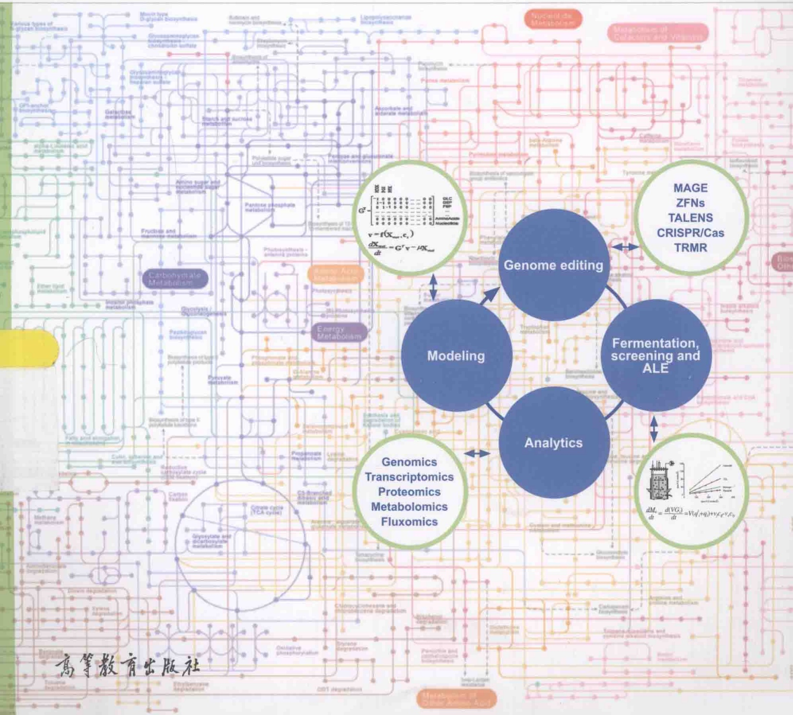
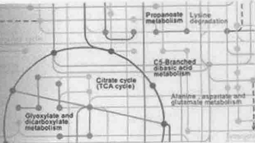
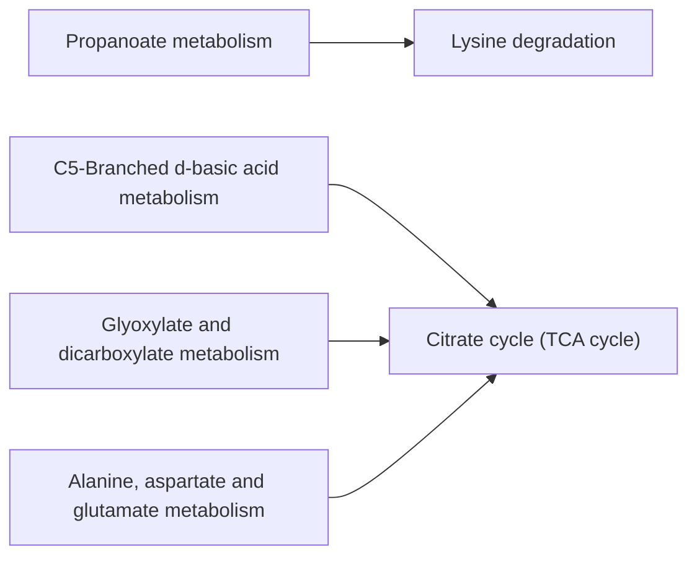
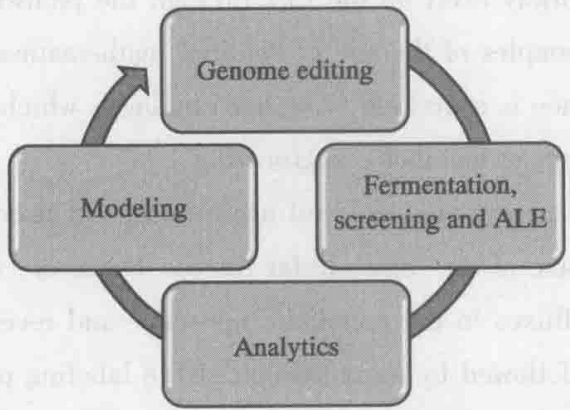
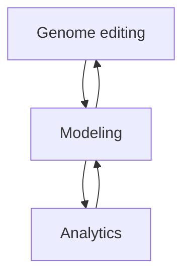
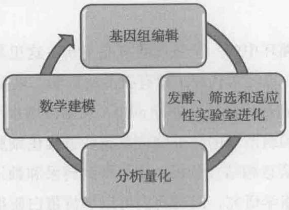
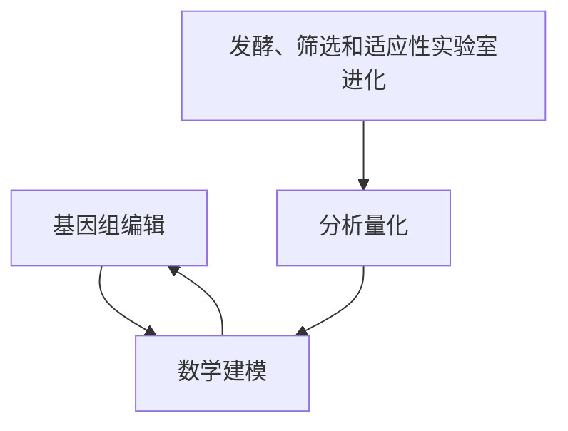

```mermaid
graph TD
  A["Genome editing"] --> B["Modeling"]
  C["Fermentation, screening and ALE"] --> D["Analytics"]
  E["Genomics Transcriptomics Proteomics Metabolomics Fluxomics"] --> F["Analytics"]
  G["MAGE ZFNs TALENS CRISPR/Cas TRMR"] <--> H["Genome editing"]
  I["Phytochrome beta-1 (p)"] --> J["Phytochrome beta-2 (p)"]
  K["Phytochrome beta-3 (p)"] --> L["Phytochrome beta-4 (p)"]
  M["Phytochrome beta-5 (p)"] --> N["Phytochrome beta-6 (p)"]
  O["Phytochrome beta-7 (p)"] --> P["Phytochrome beta-8 (p)"]
  Q["Phytochrome beta-9 (p)"] --> R["Phytochrome beta-10 (p)"]
  S["Phytochrome beta-11 (p)"] --> T["Phytochrome beta-12 (p)"]
  U["Phytochrome beta-13 (p)"] --> V["Phytochrome beta-14 (p)"]
  W["Phytochrome beta-15 (p)"] --> X["Phytochrome beta-16 (p)"]
  Y["Phytochrome beta-17 (p)"] --> Z["Phytochrome beta-18 (p)"]
  AA["Phytochrome beta-19 (p)"] --> AB["Phytochrome beta-20 (p)"]
  AC["Phytochrome beta-21 (p)"] --> AD["Phytochrome beta-22 (p)"]
  AE["Phytochrome beta-23 (p)"] --> AF["Phytochrome beta-24 (p)"]
  AG["Phytochrome beta-25 (p)"] --> AH["Phytochrome beta-26 (p)"]
  AI["Phytochrome beta-27 (p)"] --> AJ["Phytochrome beta-28 (p)"]
  AK["Phytochrome beta-29 (p)"] --> AL["Phytochrome beta-30 (p)"]
  AM["Phytochrome beta-31 (p)"] --> AN["Phytochrome beta-32 (p)"]
  AO["Phytochrome beta-33 (p)"] --> AP["Phytochrome beta-34 (p)"]
  AQ["Phytochrome beta-35 (p)"] --> AR["Phytochrome beta-36 (p)"]
  AS["Phytochrome beta-37 (p)"] --> AT["Phytochrome beta-38 (p)"]
  AU["Phytochrome beta-39 (p)"] --> AV["Phytochrome beta-40 (p)"]
  AW["Phytochrome beta-41 (p)"] --> AX["Phytochrome beta-42 (p)"]
  A --> B
  B --> C
  C --> D
  D --> E
  E --> F
  F --> G
  G --> H
  H --> I
  I --> J
  J --> K
  K --> L
  L --> M
  M --> N
  N --> O
  O --> P
  P --> Q
  Q --> R
  R --> S
  S --> T
  T --> U
  U --> V
  V --> W
  W --> X
  X --> Y
  Y --> Z
  Z --> AA
  AA --> AB
  AB --> AC
  AC --> AD
  AD --> AE
  AE --> AF
  AF --> AG
  AG --> AH
  AH --> AI
  AI --> AJ
  AJ --> AK
  AK --> AL
  AL --> AM
  AM --> AN
  AN --> AO
  AO --> AP
  AP --> AQ
  AQ --> AR
  AR --> AS
  AS --> AT
  AT --> AU
  AU --> AV
  AV --> AW
  AW --> AX
  AX --> AZ
  AZ --> BA
  BA --> BC
  BC --> BD
  BD --> BE
  BE --> BF
  BF --> BG
  BG --> BH
  BH --> BI
  BI --> BJ
  BJ --> BK
  BK --> BL
  BL --> BM
  BM --> BN
  BN --> BO
  BO --> BP
  BP --> BR
  BR --> BC
  BC --> BD
  BD --> BE
  BE --> BF
  BF --> BG
  BG --> BH
  BH --> BI
  BI --> BJ
  BJ --> BK
  BK --> BL
  BL --> BM
  BM --> BN
  BN --> BO
  BO --> BP
  BP --> BR
  BR --> BS
  BS --> BT
  BT --> BU
  BU --> BV
  BV --> BW
  BW --> BX
  BX --> BY
  BY --> BB
  BB --> BC
  BC --> BD
```

# 封面、序、前言与目录

原始 PDF 第 1–20 页。

十一五

普通高等教育“十一五”国家级规划教材

## Metabolic Engineering

# 代谢工程

赵学明 陈涛 王智文 等编著

flowchart

高等教育出版社

---

## Metabolic Engineering

数字课程账号
高等教育出版社
明码 9156 3385 9337 8831
增值服务
说明说明详见书内数字课程说明页

数字课程网站

网址:http://abook.hep.com.cn/41769

http://abook.hep.edu.cn/41769

ISBN 978-7-04-041769-2
9 787040 417692>

定价 39.00 元

---

十一五

普通高等教育“十一五”国家级规划教材

DAIXIE GONGCHENG

# 代谢工程

赵学明 陈涛 王智文 杨琛 花强 柳志杰
郝彤 史硕博 陈磊 张卫文 程景胜 编著

高等教育出版社·北京

---

## 内容提要

代谢工程是利用重组 DNA 技术对特定的生化反应进行修饰，或引入新的反应以定向改进产物的生成或细胞性质的学科。本书详细阐述代谢工程的基本原理与方法，并介绍了通量分析、代谢网络模型、组学、进化工程及合成生物学等技术在代谢工程中的应用，列举了许多代谢工程的典型实例。各章附学习要点、知识导图、思考题与推荐阅读，配套数字课程网站（http://abook.hep.com.cn/41769）包含背景知识、知识拓展、技术应用等多项学习资源。

本书可作为生物工程、生物技术等专业本科生、研究生的教学用书，也可供代谢工程及生物工程相关领域的研究、开发及工程设计人员参考。

## 图书在版编目（CIP）数据

代谢工程 / 赵学明等编著.—北京:高等教育出版社，2015.3

ISBN 978-7-04-041769-2

I. ①代… II. ①赵… III. ①代谢-生物工程 IV.
①Q493

中国版本图书馆 CIP 数据核字（2015）第 016025 号

策划编辑 王莉 责任编辑 高新景 封面设计 张楠 责任印制 刘思涵

| 出版发行 | 高等教育出版社 | 咨询电话 | 400-810-0598 |
| --- | --- | --- | --- |
| 社址 | 北京市西城区德外大街4号 | 网址 | http://www.hep.edu.cn |
| 邮政编码 | 100120 |  | http://www.hep.com.cn |
| 印刷 | 肥城新华印刷有限公司 | 网上订购 | http://www.landraco.com |
| 开本 | 787mm×1092mm 1/16 |  | http://www.landraco.com.cn |
| 印张 | 21.25 |  |  |
| 字数 | 510千字 | 版次 | 2015年3月第1版 |
| 插页 | 2 | 印次 | 2015年3月第1次印刷 |
| 购书热线 | 010-58581118 | 定价 | 39.00元 |

本书如有缺页、倒页、脱页等质量问题，请到所购图书销售部门联系调换

版权所有 侵权必究

物料号 41769-00

---

## 数字课程（基础版）

## 代谢工程

赵学明 陈 涛 王智文 等编著

## 登录方法:

1. 访问http://abook.hep.com.cn/41769
2. 输入数字课程用户名（见封底明码）、密码
3. 点击 “进入课程”

账号自登录之日起一年内有效，过期作废使用本账号如有任何问题

请发邮件至:lifescience@pub.hep.cn

## 代谢工程

赵学明 陈涛 王智文 等编著

flowchart

用户名

密码

验证码

7293

进入课程

内容介绍

纸质教材

版权信息

联系方式

代谢工程数字课程与纸质内容一体化设计，紧密配合。数字课程内容包括以下各部分:与教材内容相关的彩图、背景知识、知识拓展、技术应用及教学课件等。充分运用多种形式媒体资源，提升课程教学效果，丰富知识呈现形式，为学生学习提供思维与探索的空间。

## 使用说明

数字课程网站

网址:http://abook.hap.com.cn/28382
http://abook.edu.com.cn/28382

用户名:输入教材封底的16位明码；密码:刮开"增值服务"涂层，输入16位暗码；输入正确的验证码后，点击"进入课程"开始学习。

相关教材

基因工程（第3版）

张惠展 叶江 欧阳立明 编著

高等教育出版社

http://abook.hep.com.cn/41769

---

## 郑重声明

高等教育出版社依法对本书享有专有出版权。任何未经许可的复制、销售行为均违反《中华人民共和国著作权法》，其行为人将承担相应的民事责任和行政责任；构成犯罪的，将被依法追究刑事责任。为了维护市场秩序，保护读者的合法权益，避免读者误用盗版书造成不良后果，我社将配合行政执法部门和司法机关对违法犯罪的单位和个人进行严厉打击。社会各界人士如发现上述侵权行为，希望及时举报，本社将奖励举报有功人员。

反盗版举报电话 (010)58581897 58582371 58581879

反盗版举报传真 (010)82086060

反盗版举报邮箱 dd@hep.com.cn

通信地址 北京市西城区德外大街4号 高等教育出版社法务部

邮政编码 100120

## 短信防伪说明

本图书采用出版物短信防伪系统，用户购书后刮开封底防伪密码涂层，将16位防伪密码发送短信至106695881280，免费查询所购图书真伪。

## 反盗版短信举报

编辑短信“JB，图书名称，出版社，购买地点”发送至10669588128

## 短信防伪客服电话

(010) 58582300

---

Preface

My good colleague Professor Xue-Ming Zhao has kindly asked me to write a preface to this new textbook on Metabolic Engineering and I am very happy to do so. A couple of years back Professor Xue-Ming Zhao translated the textbook $^{1}$  I wrote together with Professor Stephanopoulos from English to Chinese, but this textbook needs revision and I am therefore happy that there will now be a new updated textbook on this important topic in Chinese.

Metabolic engineering is the enabling science for quantitative characterization of living cells and the use of this for engineering cellular metabolism with the objective to improve their properties. We often talk about the Metabolic Engineering Cycle $^{2}$ (see Fig. 1). This cycle involves several steps: 1) Mathematical models or quantitative analysis of metabolism are being used for identification of metabolic engineering targets, i. e. specific genetic modifications that are introduced through genome editing. 2) Newly constructed strains are being characterized through well-controlled fermentation experiments or libraries of strains are being screened at well-defined conditions. 3) Advanced analytics is used to quantify the performance of selected strains; 4) Results from the quantitative analysis of cellular physiology are integrated with detailed mathematical models with the objective of identifying the second round of genomic modifications required for further improving the cellular per-

flowchart

Fig. 1 The Metabolic Engineering Cycle. In the process of genome editing the genome of the host organism is engineered either through directed genetic modifications or through generation of strain libraries. The resulting strain (s) are subsequently screened and characterized through well-controlled fermentation experiments. In this process adaptive laboratory evolution (ALE) may also be used in order to select for strains with improved properties. Samples from the fermentation experiments, ALE and screening are analyzed, and this may involve genome - sequencing and analysis of the transcriptome, proteome, metabolome, lipidome etc. These high - throughput experimental data may be analyzed in the context of genome - scale metabolic models and further improve the modeling that can be used for design of new metabolic engineering targets that are then further pursued through genome editing.

---

ii

Preface

formance.

This textbook provides fundamental description of all four elements of the Metabolic Engineering Cycle. Following an introduction to cellular metabolism (Chapter 2) there is given an introduction and description of macroscopic models that can be used to extract quantitative data from fermentation experiments (Chapter 3). This forms the fundament for any type of quantitative characterization of living cells, and estimation of specific rates, volumetric rates and yield coefficients is the basic for any discussion on strain performance in research and development. Furthermore, these data are essential for further analysis of the metabolism, and through the use of metabolic flux analysis the rates of substrate uptake and product secretion can be used to calculate intracellular fluxes (Chapter 4). A key assumption in metabolic flux analysis is the concept of flux balancing, where it is assumed that there is balancing of fluxes around each of the intracellular metabolites, but this assumption has proven to be reasonable at all cases, except for a few minutes following dramatic perturbation in cellular metabolism.

Whereas the concept of metabolic flux analysis is valuable for quantification of the fluxes through the different metabolic pathways, it does not provide any information about why the flux distribution takes the shape it does. This is of course due to extensive regulation of cellular metabolism. This regulation takes place at both the transcriptional level, post-transcriptional level and at the metabolic level, i. e. through enzyme-metabolite interactions. This aspect is discussed in Chapter 2 and hence you will here get a brief introduction to the many different layers of regulation that are involved in controlling fluxes. It is, however, difficult to translate all this information into a quantitative analysis, but here the concept of metabolic control analysis is very useful (Chapter 5). This concept was coined in the early 1970es and it allows for assigning quantitative scores on the relative control each enzyme in a pathway exert on the flux through the pathway. Metabolic control analysis represents one of the first examples of the use of detailed mathematical analysis of biochemistry and cellular metabolism, and hence is a prelude to systems biology, which today is a rapidly growing research field with strong impact on metabolic engineering $^{3}$ .

Flux balance analysis is a very powerful and useful tool, but it does have its limitation in terms of given high resolution to some of the intracellular fluxes. However, through the use of tracers it is possible to quantify specific fluxes in the metabolic network, and recently feeding of specifically labeled  ${}^{13}$ C-labeled substrates followed by measurement of the labeling pattern in intracellular metabolites has shown that it is possible to obtain very precise flux estimation of most key intracellular fluxes (Chapter 6). Despite the power of this technique it is, however, limited to the study of the central carbon metabolism, and the trend is therefore today to build comprehensive metabolic models that encompass all metabolic reactions in a metabolic network and at the same time link these reactions to their associated enzymes and genes (Chapter 7). These models are referred to as genome-scale metabolic models $^{4}$  and they have become widely used, not only in metabolic engineering but also in systems medicine $^{5}$ .

As mentioned above a key component in the Metabolic Engineering Cycle is analytics. Here Systems Biology has in particular impacted metabolic engineering as tools from high-throughput analysis such as transcriptome (Chapter 8) and proteome (Chapter 9) analysis have enabled genome-

---

Preface · iii

wide analysis of mRNA and protein levels. Clearly information about the genome-wide transcriptional response to a given perturbation or engineering strategy provides important information about the cellular physiology, and when this can be supplemented with information about the protein levels it is possible to get information about both transcriptional and translational control. Today proteomics can be done at the genome-wide level and we can therefore expect to see more extensive use of proteomics in Metabolic Engineering. For engineering of metabolism it is, however, important to have information about the metabolite level (or the metabolome) (Chapter 10) as this is directly linked to the metabolic fluxes. It is, however, inherently difficult to measure the complete metabolome as there is a large variation in chemical structure of the different metabolites $^{6}$, i. e. a range of different lipids, organic acids, amino acids, sugars etc. There is, however, rapid progress in this field and through the advancement of mass spectrometry we may soon be able to routinely analyze >100 key metabolites involved in cellular metabolites by one single analytical technique.

As also mentioned above adaptive laboratory evolution (or ALE) is a powerful technique for acquiring new phenotypes (Chapter 11) and with the advancement of next generation genome sequencing it is possible to identify driving mutations, in particular if the evolved strains are characterized using systems biology tools $^{7}$ . These driving mutants can subsequently be introduced as directed genetic mutations, a concept referred to as inverse metabolic engineering $^{8,9}$ , and ALE hereby becomes a powerful screening tool in metabolic engineering.

The last component in the Metabolic Engineering Cycle is genome editing (Chapter 12). This is probably the fastest developing component of the field at the moment, as tools from Synthetic Biology are being transferred, both in terms of components (often referred to as bio-bricks) and methods for directed engineering of the genome or for generation of strain libraries. Thus, the future is likely to see an even closer interaction between synthetic biology and metabolic engineering $^{10,11}$ .

In conclusion I am confident that by reading and studying the material in this book you will get a very strong basis in all elements of the Metabolic Engineering Cycle and hereby be capable of contributing to further advancement of the field. Metabolic Engineering has already evolved as a strong scientific discipline with a strong societal support, but I will expect it to grow further in the future. It was for this reason that we have founded the International Metabolic Engineering Society (http://www.aiche.org/sbe/community/imes/about) that besides organizing conferences drives two key journals in the field, the high-impact journal Metabolic Engineering and the open access only journal Metabolic Engineering Communication. I wish you much welcome to join this society and hope you will enjoy reading and studying this book.

## References

1. G. Stephanopoulos; A. Aristodou; J. Nielsen (1998) Metabolic Engineering. Academic Press, San Diego
2. J. Nielsen (2001) Metabolic engineering. Appl. Microbiol. Biotechnol. 55: 263-283
3. Nielsen J; Jewett MC (2008) Impact of systems biology on metabolic engineering of Saccharomyces cerevisiae. FEMS Yeast Research 8: 122–131
4. L. Liu; R. Agren; S. Bordel; J. Nielsen (2010) Use of genome-scale metabolic models

---

iv

Preface

for understanding microbial physiology. FEBS Lett. 584: 2556-2564
5. A. Mardinoglu; F. Gatto; J. Nielsen (2013) Genome-scale modeling of human metabolism. Biotechnol. J. 8: 985–996
6. S. G. Villas-Bôas; S. Mas; M. Åkesson; J. Smedsgaard; J. Nielsen (2005) Mass spectrometry in metabolome analysis. Mass Spec. Rev. 24: 613–646
7. K. -K. Hong; W. Vongsangnak; G. N. Vemuri; J. Nielsen (2011) Unravelling evolutionary strategies of yeast for improving galactose utilization through integrated systems level analysis. Proc. Nat. Acad. Sci. USA 108: 12179–12184
8. C. Bro; J. Nielsen (2004) Impact of 'Ome' analysis on inverse metabolic engineering. Met. Eng. 6: 204–211
9. K. -K. Hong; J. Nielsen (2012) Recovery of phenotypes obtained by adaptive evolution through inverse metabolic engineering. Appl. Environ. Microbiol. 78: 7579–7586
10. J. Nielsen; J. Keasling (2011) Synergies between synthetic biology and metabolic engineering. Nature Biotechnol. 29: 693–695
11. J. Nielsen; M. Fussenegger; J. Keasling; S. Y. Lee, J. C Liao, K. Prather; B. Palsson (2014) Engineering synergy in Biotechnology. Nature Chem. Biol. 10: 319–322

Jens Nielsen

Department of Biology and Biological Engineering, Chalmers University of Technology, Gothenburg, Sweden

---

## 序

应我的同行赵学明教授的亲切邀请，我很高兴为这本新的《代谢工程》教科书写序。我和 Stephanopoulos 教授编写的英文版《代谢工程》 $^{[1]}$ 出版后没几年，赵学明教授就将其翻译并出版了中文版，但是这本书需要修订。我非常高兴，在代谢工程领域，现在将有一本更新版本的代谢工程中文教科书了。

代谢工程是对活细胞进行定量表征的支撑学科，通过定量表征可对细胞代谢进行工程操作，从而达到改进细胞性能的目的。我们常常谈到代谢工程循环 $^{[2]}$ （图1），这个循环包括以下几个步骤:①利用代谢的数学模型或定量分析，识别代谢工程靶标，即通过基因组编辑导入特定的遗传修饰。②通过控制良好的发酵实验，对新构建的菌株进行表征；或在明确定义的筛选条件下，对构建的菌种文库进行筛选。③使用先进的分析技术量化所选菌种的性能。④将细胞生理学的定量分析结果与详细的数学模型集成，以识别第二轮基因组修饰的目标，进而可以进一步改进细胞的性能。

flowchart

图1 代谢工程循环

在基因组编辑过程中，通过定向遗传修饰，或通过菌种库的建立，对宿主生物的基因组进行工程操作。接下来，需要通过控制良好的发酵实验，对所产生的菌种进行筛选和表征。在这个过程中，为了筛选性能改进的菌种，也可以使用适应性实验室进化（adaptive laboratory evolution，ALE）技术。随后，对从发酵实验、ALE以及筛选过程中取得的样品进行分析，这可能包括基因组测序，转录组、蛋白质组、代谢组以及脂质组等组学数据的分析。这些高通量实验数据可以在基因组尺度代谢模型的范围内进行分析，并且进一步改进模型模拟，以便能用于新的代谢工程靶标设计，进而通过基因组编辑来实现菌种改进

这本教科书提供了代谢工程循环所有四个要素的基本描述。在对细胞代谢（第2章）进行介绍之后，接下去是对宏观模型的叙述。宏观模型用于从发酵实验提取定量数据（第3章），这就形成活细胞各种类型定量表征的基础。在研究开发过程中，比速率、体积速率和得率系数的计算对于菌种性能的任何讨论来说都是基础的。此外，这些数据对代谢做进一步分析也是必需的。通过代谢通量分析方法，可以用底物利用速率和产物分泌速率计算胞内通量（第4章）。在代谢通量分析中的一个关键概念是通量平衡，其假定围绕每一个胞

---

ii · 序

内代谢物的通量都是平衡的。除了在剧烈扰动后几分钟之内的细胞代谢的情况之外，已经证明这个假定在所有情况下都是合理的。

尽管代谢通量分析的概念对于通过不同代谢途径的通量量化是重要的，但是对于通量为什么是这样分布，其并没有提供任何信息。当然，这是由于细胞代谢中存在的广泛而复杂的调控。这种调控既可发生在转录水平、转录后水平，也可发生在代谢水平，即通过酶-代谢物之间的相互作用。第2章对此进行了讨论，读者可以从中了解到在通量控制中所涉及的很多不同层次的调控。虽然将所有这些信息转化为定量分析是困难的，但是这里介绍的代谢控制分析的概念是非常有用的（第5章）。这个概念20世纪70年代初期提出，用以确定在一条途径中的每个酶，对施加到通过该途径通量的相对控制量化分数。代谢控制分析是生物化学和细胞代谢详细数学分析的最早例子之一，因此是系统生物学的一个序幕。当今，系统生物学是一个迅速发展的研究领域，其对代谢工程具有很大的影响 $^{[3]}$ 。

通量平衡分析是一种强有力的、非常有用的工具，但就一些胞内通量要得到高分辨率而言，还有一定的局限性。然而，通过使用示踪剂，可以量化代谢网络中的特定通量。最近，通过加入特定标记的 $^{13}$ C底物，进而测定胞内代谢物标记类型的实验，这可以对最关键的胞内通量进行非常精确的通量确定（第6章）。然而，尽管这种技术非常有效，但仅限于对中心碳代谢的研究。因此，现在的趋势是建立综合性的代谢模型，包括一个代谢网络中的所有反应，同时将这些反应与它们相应的酶及基因相联系（第7章），这些模型被称作基因组尺度代谢网络模型 $^{[4]}$ 。这些模型不仅在代谢工程，在系统医学中也已经得到广泛应用 $^{[5]}$ 。

如前所述，代谢工程循环中的一个关键要素是分析。这里要指出，系统生物学，特别是来自高通量分析的工具，已经对代谢工程有很大的影响。转录组分析（第8章）和蛋白质组分析（第9章）已能在基因组尺度进行mRNA和蛋白质水平的分析。很显然，对于特定的扰动或工程策略，基因组范围的转录响应数据能够提供细胞生理学的重要信息，而且将转录组与蛋白质水平的信息相结合分析，则可得到转录和翻译控制的信息。现在，可以在基因组范围进行蛋白质组学研究，因而我们可以期待蛋白质组学在代谢工程中会得到更广泛的应用。可是，要对代谢进行工程化，重要的是要有代谢物水平（即代谢组）的信息（第10章），因为其直接联系到代谢通量。然而，因为不同代谢物的化学结构有很大变化[6]，即一系列不同的脂质、有机酸、氨基酸及糖等，这就使得测量完整的代谢组数据存在着固有的困难。但是，由于该领域的迅速进展，通过发展质谱技术，我们不久就可用单一的分析技术分析出参与细胞代谢的100种以上的代谢物。

前面也已提到，适应性实验室进化（ALE）对于获得新的表型是一种强有力的技术（第11章），而且随着新一代测序技术的发展，特别是如果用系统生物学工具 $^{[7]}$ 来表征进化菌种的话，则可以识别驱动突变。接下来，这些驱动突变体作为定向遗传突变而导入菌株中，这个概念被称作反向代谢工程 $^{[8,9]}$ 。在此，ALE已成为代谢工程中一种强有力的筛选工具。

在代谢循环中的最后一个组成部分是基因组编辑（第12章），这可能是目前该领域发

---

序 · iii

展最快的部分，因为来自合成生物学的工具正以组件（通常称为生物砖）和方法两种形式进行转化，以用于基因组的定向工程或菌种库的产生。因此，未来预期会看到合成生物学与代谢工程之间更加紧密的互动 $^{[10,11]}$ 。

总之，我相信通过阅读和学习这本书的内容，读者将在代谢工程循环的各种要素方面奠定坚实的基础，从而有能力对该领域的进一步发展做出贡献。代谢工程已经发展成社会广泛关注的前沿学科，我更期待未来它的进一步成长与发展。鉴于此，我们创建了国际代谢工程学会（http://www.aiche.org/sbe/community/imes/about），除了组织学术会议之外，学会还经办该领域的两种刊物，一种是具有高影响力的刊物 Metabolic Engineering，另一种是开源期 Metabolic Engineering Communication。我非常欢迎读者加入这个学会，并希望你们喜欢阅读和学习这本书。

参考文献（见 Preface）

Jens Nielsen

国际代谢工程学会主席

瑞典查尔姆斯理工大学

生物学与生物工程系主任

化学工程与生物工程系教授

(赵学明 译)

---

## 前言

代谢工程是利用重组 DNA 技术对特定的生化反应进行修饰，或引入新的反应以定向改进产物的生成或细胞性质的学科。20 多年来，在代谢通量和网络控制基本原理的指导下，代谢工程在实践中与时俱进，紧密结合来自分子生物学、生物信息学、系统生物学及合成生物学的新工具，以提高产品的浓度、生产速度和得率。代谢工程现在已经发展成生物基能源、化学品、材料、医药和食品原料等生产的支撑学科与技术。

天津大学从 1996 年开始在生物化工专业研究生 “生物反应工程” 课程教学中，引入代谢通量分析与代谢网络控制的内容。从 1999 年开始利用英文版《代谢工程——原理与方法》教科书，为硕士、博士研究生进行教学，并逐渐形成了 “代谢工程与系统生物学” 实验室。为了进一步满足教学、科研以及工业生物技术快速发展的需要，基于国内外代谢工程理论与实践的最新成果，结合自己多年来从事代谢工程教学与科研体会，我们编著了这本《代谢工程》教科书。

全书共分12章，本书在详细阐述代谢工程的基本原理与方法的基础上（第2\~5章），设立专门章节分别介绍“基于 $^{13}$ C同位素信息的代谢通量分析”、“基因组尺度代谢网络模型”、“转录组学”、“蛋白质组学”、“代谢组学”、“进化工程”和“合成生物学”等技术在代谢工程中的应用（第6\~12章）。在这些章节中，结合最新科学文献，还列举了许多代谢工程的典型实例。本书可作为生物工程、生物技术等专业高年级本科生、研究生的教学用书，在教学中可根据学时数选学不同的章节。本书也可供在代谢工程及生物工程相关领域的研究、开发及工程设计人员参考，相信会对他们进行创新研发起很大促进作用。

全书内容、结构及各章编著者由赵学明统筹安排、邀请，并分别与各章作者讨论、修改初稿。在此基础上，由赵学明、陈涛、王智文三人对书稿进一步修改、统稿与格式调整。各章的编著者分别是:第1、12章，赵学明；第2\~5章，陈涛；第6章，杨琛、花强、柳志杰；第7章，郝彤；第8章，史硕博、陈磊、张卫文；第9章，程景胜；第10、11章，王智文。我们要特别感谢第6章的作者——中国科学院上海植物生理生态研究所杨琛和华东理工大学生物工程学院花强、柳志杰，他们在百忙中欣然为该章执笔。美国圣路易斯华盛顿大学的唐寅杰教授、中国科学院天津工业生物技术研究所的马红武研究员分别对第6、7章初稿进行了审阅，并提出了很好的修改建议。研究生李宁提供了第4章基元模式分析的应用实例。乔建军博士提供了第9章的部分例题。研究生李一凡编写了第12章的多元基因组工程，李炳志博士和研究生张文政编写了合成酵母基因组的相关内容。

Metabolic Engineering: Principles and Methodologies 一书的作者——美国麻省理工学院的 Stephanopoulos 教授和瑞典查尔姆斯理工大学的 Nielsen 教授，非常关心本书的写作与出版。

---

ii · 前言

Stephanopoulos 教授通过对代谢工程基本原理及其自身“系统学”属性的阐述，建议本书出版时仍用 Metabolic Engineering 作为书名。Nielsen 教授根据本书的内容，在百忙之中为本书作序，图文并茂、清楚地阐述了代谢工程的循环过程。我们对两位教授对本书的关心及帮助表示衷心感谢。

本书在编写过程中，还得到高等教育出版社领导、王莉副编审和高新景编辑的大力支持与帮助，在此谨向他们表示真诚的谢意。我们借此机会，向长期以来一直支持、关心和鼓励我们的天津大学各级领导和同事们表示感谢。

代谢工程是正处在迅速发展中的学科领域，由于我们的理论水平及实践经验有限，书中错误和不足之处在所难免，恳请读者给予批评指正。

赵学明 陈涛 王智文

2014年仲夏于天津大学

---

目录

## 1 绪论

## 1.1 代谢工程学科的建立 / 2

1.1.1 背景 / 2
1.1.2 代谢工程学科的建立 / 3
1.1.3 代谢工程的定义 / 4
1.1.4 代谢工程的理论框架 / 4

## 1.2 代谢工程发展的标志 / 4

1.2.1 代谢工程学术会议 / 4
1.2.2 代谢工程教科书及学术专著 / 5
1.2.3 国际代谢工程学会 / 5
1.2.4 代谢工程学术刊物 / 5
1.2.5 代谢工程学术论文 / 5
1.2.6 代谢工程研究方法的进化 / 6

## 1.3 代谢工程研究进展 / 8

## 2 细胞代谢反应和调节方式

## 2.1 细胞生长 / 11

## 2.2 细胞代谢反应的基本类型和功能 / 12

2.2.1 运输反应 / 12
2.2.2 供能反应与分解代谢 / 17
2.2.3 生物合成反应与聚合反应 / 26

## 2.3 酶活性的主要调节方式及酶动力学 / 27

## 2.3.1 酶活性的主要调节方式 / 27

2.3.2 酶动力学 / 29

## 2.4 酶表达水平的调节 / 36

2.4.1 底物诱导 / 36
2.4.2 终产物阻遏 / 38
2.4.3 基因表达的弱化机制 / 38
2.4.4 核糖核酸开关对基因表达的调控 / 40
2.4.5 翻译的控制 / 44
2.4.6 酶分子降解的调节 / 45

## 2.5 流通代谢物及全局调控 / 46

2.5.1 流通代谢物 / 46
2.5.2 全局调控 / 47

## 3 生化反应质量平衡与模型

## 3.1 生物量化学式 / 51

## 3.2 生物反应的质量平衡方程 / 53

3.2.1 间歇培养 / 54
3.2.2 连续培养 / 55

## 3.3 比反应速率与得率系数 / 56

## 3.4 生物反应的黑箱模型 / 57

3.4.1 黑箱模型的元素平衡和还原度平衡 / 59
3.4.2 黑箱模型测量数据一致性的检验 / 61
3.4.3 黑箱化学计量模型的系统分析 / 63
3.4.4 测量数据的最优估计和 h 检验 / 65

---

ii · 目录

## 4 代谢通量分析

## 4.1 代谢通量分析的原理 / 72

4.1.1 无细胞生长时的代谢通量分析 / 73

4.1.2 有细胞生长时的代谢通量分析 / 75

## 4.2 基于测量数据的代谢通量分析 / 77

4.2.1 正定系统 / 77

4.2.2 超定系统 / 80

## 4.3 基于线性规划的通量平衡分析 / 84

## 4.4 同位素标记法测定代谢通量简介 / 88

## 4.5 基元模式分析 / 89

4.5.1 基元模式分析与极端途径分析 / 89

4.5.2 基元模式分析的应用实例 / 91

## 5 代谢控制分析

## 5.1 代谢控制分析的基础 / 97

5.1.1 通量控制系数及其加和定理 / 100

5.1.2 浓度控制系数及其加和定理 / 102

5.1.3 弹性系数和连接定理 / 102

5.1.4 参数弹性系数及 MCA 理论的通用表达式 / 104

## 5.2 通量控制系数的确定方法 / 105

5.2.1 直接法 / 105

5.2.2 间接法 / 108

5.2.3 Lin-log 动力学法 / 113

5.2.4 瞬态代谢物浓度法 / 118

5.2.5 大扰动法 / 120

## 5.3 部分守恒循环途径通量控制系数的确定 / 125

## 6 基于 $^{13}$ C 同位素标记信息的代谢通量分析

## 6.1  $^{13}$ C代谢通量分析的发展 / 129

## 6.2  ${}^{13}$ C 标记实验和测量 / 130

6.2.1 标记实验 / 130

6.2.2 质谱检测 / 131

6.2.3 核磁共振波谱检测 / 135

## 6.3 代谢通量比率分析 / 137

6.3.1 同位素标记异构体中天然同位素丰度的矫正 / 137

6.3.2 基于质谱数据的代谢通量比率的推导 / 139

6.3.3 基于 NMR 数据的代谢通量比率的推导 / 142

## 6.4 基于同位素标记异构体分布模型的代谢网络通量分析 / 144

6.4.1 原子映射矩阵和同位素标记异构体映射矩阵 / 144

6.4.2 同位素标记异构体平衡方程 / 145

6.4.3 代谢通量计算 / 146

## 6.5 基于 $^{13}$ C 同位素标记信息代谢通量分析的应用 / 148

6.5.1 辨别代谢途径及细胞功能 / 149

6.5.2 阐明代谢网络结构及调控特性 / 151

## 6.6 大肠杆菌代谢通量的计算举例 / 154

6.6.1 大肠杆菌生长期相关生理学参数的测定及计算 / 154

6.6.2 大肠杆菌代谢模型的建立 / 155

6.6.3 代谢通量比率的计算 / 156

6.6.4 大肠杆菌净通量的计算 / 158

---

目录·iii

## 7 基因组学与基因组尺度代谢网络模型

## 7.1 基因组学 / 161

7.1.1 基因、基因组与基因组学 / 161

7.1.2 基因组学研究内容 / 161

7.2 基因组尺度代谢网络模型 / 163

7.3 基因组尺度代谢网络模型的重构过程 / 165

7.3.1 基因组尺度代谢网络数据库的建立 / 165

7.3.2 数学模型的建立 / 170

7.3.3 模拟运算 / 173

7.4 基因组尺度代谢网络模型的应用 / 184

7.4.1 基因敲除研究 / 184

7.4.2 发现药物靶点 / 186

7.4.3 指导菌体改进和代谢工程 / 186

## 8 转录物组学技术与代谢工程

## 8.1 转录物组与转录物组学 / 191

8.1.1 转录、转录物组与转录物组学 / 191

8.1.2 转录组学平台技术 / 192

8.2 基于基因芯片技术的转录物组分析 / 192

8.2.1 cDNA 基因芯片技术 / 193

8.2.2 寡核苷酸基因芯片技术 / 195

8.2.3 芯片数据分析 / 197

8.3 基于 RNA-Seq 技术的转录物组分析 / 206

8.3.1 RNA-Seq 的原理及实验步骤 / 206

8.3.2 RNA-Seq 的技术优势 / 208

8.4 两种转录物组分析平台技术的比较 / 208

8.5 转录物组数据的存储及交流 / 209

8.6 转录物组学技术在微生物代谢工程中的应用 / 211

8.6.1 减少副产物及提高产物耐受性 / 211

8.6.2 提高蛋白质的产量 / 211

8.6.3 扩大底物利用范围 / 212

8.6.4 提高氨基酸的产量 / 212

8.6.5 提高抗生素的产量 / 213

8.6.6 提高大宗化学品的生产能力 / 214

## 9 蛋白质组学技术与代谢工程

## 9.1 蛋白质组与蛋白质组学 / 217

9.1.1 蛋白质组 / 217

9.1.2 蛋白质组学 / 217

9.1.3 蛋白质组学研究平台技术分类 / 218

9.2 蛋白质组学研究步骤 / 220

9.3 蛋白质组学研究核心技术 / 221

9.3.1 大规模蛋白质分离 / 221

9.3.2 蛋白质组学研究中的质谱分析技术 / 222

9.3.3 基于质谱的定量蛋白质组学技术 / 224

9.3.4 基于选择反应检测的靶向蛋白质组学技术 / 229

9.4 海量蛋白质数据分析处理技术 / 231

9.5 蛋白质组学在微生物学研究中的应用 / 232

9.5.1 蛋白质组学研究工业酵母对胁迫环境的响应 / 232

9.5.2 蛋白质组学研究细菌膜蛋白与多重抗性 / 233

---

iv 目录

9.5.3 蛋白质组学研究拜耳接合酵母耐酸性机制 / 233

9.6 蛋白质组学在菌种构建中的应用 / 234

9.6.1 提高次级代谢产物的基本策略 / 234
9.6.2 蛋白质组学技术改进青霉素生产菌的应用举例 / 235
9.6.3 靶向蛋白质组学在萜类代谢工程菌种改进中的应用举例 / 237

10 代谢物组学技术与代谢工程

10.1 代谢物组与代谢物组学 / 242

10.2 微生物代谢物组学的研究方法 / 243

10.2.1 菌株培养 / 243
10.2.2 样品处理 / 244
10.2.3 代谢物组数据的采集 / 247
10.2.4 数据挖掘 / 253
10.3 代谢物组学在代谢工程菌种改进中的应用 / 260

11 进化工程技术与代谢工程

11.1 进化工程的定义 / 267

11.2 进化工程的原理与方法 / 268

11.2.1 进化工程的原理与过程 / 268

11.2.2 进化过程中的基因型变异 / 269

11.3 进化工程的步骤与方法 / 270

11.3.1 变异 / 270
11.3.2 选择 / 271
11.3.3 筛选 / 273
11.4 进化工程与代谢工程 / 273

11.5 进化工程的应用 / 275

11.5.1 激活细胞潜在代谢途径，提高底物利用效率 / 275
11.5.2 提高微生物的环境耐受性 / 276
11.5.3 改进细胞的生物基产品合成能力 / 277
11.5.4 创造新型催化活性蛋白酶 / 280

11.6 基于高通量测序技术的进化工程研究和逆向代谢工程 / 281

11.6.1 基因组尺度的进化工程菌株突变规律分析 / 281
11.6.2 基于比较基因组学的逆向代谢工程 / 282

12 合成生物学工具与代谢工程

12.1 合成生物学的研究背景 / 291
12.2 合成生物学的定义 / 292
12.3 合成生物学的研究策略 / 293
12.3.1 生物系统的层次结构 / 293
12.3.2 合成生物学的研究策略 / 294
12.4 DNA 合成与组装 / 294
12.5 基本的生物零件与基因线路 / 295
12.6 基因组工程 / 297
12.6.1 多元自动化基因组工程技术 / 297
12.6.2 基因组编辑技术 / 299
12.6.3 生物底盘 / 300
12.6.4 基因组简化 / 300
12.7 合成基因组（合成细胞） / 301
12.8 酵母人工基因组的合成 / 303
12.8.1 SynⅢ的设计 / 304

---

目录 · V

12.8.2 SynⅢ的构建 / 304
12.8.3 含 SynⅢ酵母菌株的表征与检验 / 304
12.9 合成生物学与代谢工程 / 305
12.10 合成生物学与代谢工程应用举例 / 308

12.10.1 生物能源 / 308
12.10.2 生物医药 / 308
12.10.3 化学品 / 311
12.10.4 合成生物学产业发展 / 312

## 索引
