# 2 细胞代谢反应和调节方式

原始 PDF 第 30–69 页。

## 2

natural_image

Abstract network of interconnected nodes forming a chain-like structure (no text or symbols)

# 细胞代谢反应和调节方式

## 【本章学习要点】

1. 细胞生长的特点
2. 细胞内的主要反应类型及功能
3. 酶活和酶表达水平的主要调节模式及特点

活细胞体内含有大量不同的化合物和代谢物，其中水是含量最多的组分，约占细胞物质总量的70%。除去水之后的细胞质量称为细胞干重，其主要由高相对分子质量的多聚化合物组成，这些高相对分子质量化合物包括脱氧核糖核酸（DNA）、核糖核酸（RNA）、蛋白质、脂质以及糖类等，除此之外，细胞内还含有低相对分子质量的代谢物（如各种氨基酸、核苷酸、维生素、有机酸、无机盐等）。虽然这些代谢物的质量在细胞干重中所占的比例很小，但其种类繁多，并通过酶促反应相互关联，形成一个复杂的细胞代谢网络。一个活细胞可以被看作是一个非常复杂的微型生物反应器，其中进行着数千个代谢反应。

微生物细胞通过多种多样的代谢调节方式来调控这些代谢反应的速率，以保持细胞代谢的平衡，这些调节方式分为对酶活性的直接调节，以及对酶表达水平的间接调节两大类。在许多情况下，细胞内的特定代谢物可以直接和酶分子结合而抑制或激活酶分子。另外，通过共价修饰也可以调节酶的活性。酶表达水平的调节包括转录水平和翻译水平的控制，以及翻译后酶分子降解的控制等。通常，高等植物或动物的分化细胞由于其特有的性质而很少出现酶表达水平的调节，而细菌等单细胞生物除了酶活性的直接调节外，主要依赖于酶水平的调节来协调不同的反应。

---

2.1 细胞生长

11

## 知识导图

flowchart

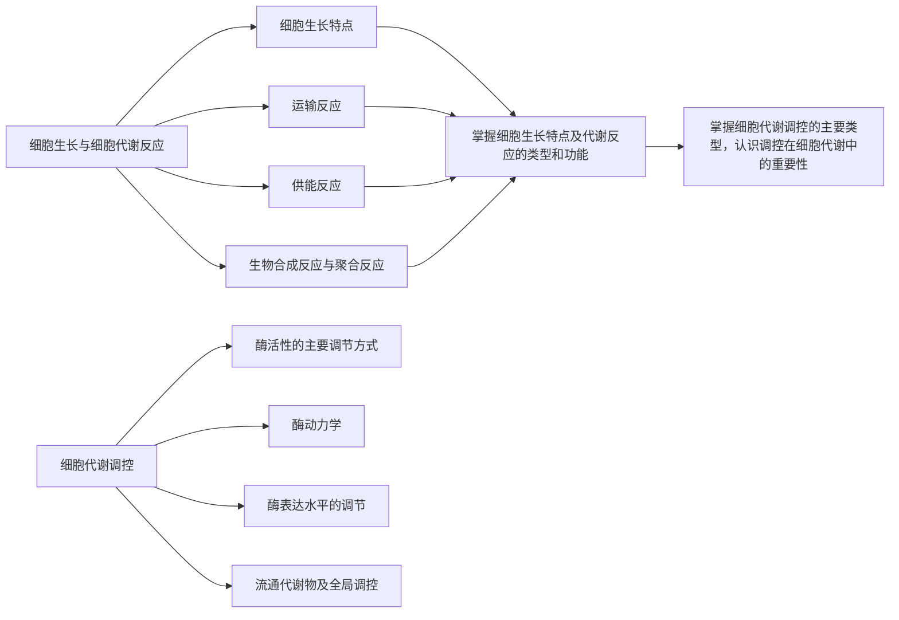

## 2.1 细胞生长

细胞生长是指细胞吸收环境中的营养物质（也称为底物），并将其转化成新的细胞成分即生物量（biomass）的过程。细胞生长导致微生物质量的增加，是细胞长大和繁殖的双重结果。微生物能在各种各样的物理化学环境和营养条件下生长，吸收的营养物质一部分用于产生能量和生物量的合成，一部分用于副产物的生成，其过程可用下式简单描述:

$$
\sum S + X \rightarrow \sum P + n X \tag {2-1}
$$

底物包括碳源、能源、氮源、矿物质和维生素，能源用于提供细胞生长所需要的自由能。通常碳源也是能源物质，常用的碳源和能源物质包括葡萄糖、蔗糖、麦芽糖、糊精和淀粉等糖类。许多微生物还能利用乙酸、乳酸、甘油充当碳源和能源。一些微生物能利用不同的物质分别充当碳源和能源，例如热自养甲烷菌（Methanobacterium thermoautotrophicum）利用  $H_{2}$  作为能源，利用  $CO_{2}$  作为碳源（Schill et al. 1999）。

细胞生长的结果除了导致生物量的增加外，还能够产生各种副产物，例如乙酸、乙醇、乳酸等。一些副产物的生产和细胞生长没有直接的关系，例如抗生素等。

细胞生长是典型的自催化反应。生长速率与细胞质量直接相关，一般用净比生长速率（net specific growth rate）来表征，其定义为:

$$
\mu_ {n e t} = \frac {1}{X} \frac {\mathrm{d} X}{\mathrm{d} t} \tag {2-2}
$$

$$
\mu_ {n e t} = \mu_ {g} - k _ {d} \tag {2-3}
$$

式中， $X$ 是细胞质量（g）， $t$ 是时间（h）， $\mu_{net}$ 是净比生长速率或表观生长速率。净比

---

12

2 细胞代谢反应和调节方式

生长速率是真实比生长速率 $\mu_{g}(h^{-1})$ 和由于细胞死亡或内源代谢引起的细胞质量损失比速率 $k_{d}(h^{-1})$ 之差。在本书中，用 $\mu$ 来代表 $\mu_{net}$ 。

同细胞质量 X 一样，细胞生长也可以用细胞数 N 来表示，此时有:

$$
\mu_ {R} = \frac {1}{N} \frac {\mathrm{d} N}{\mathrm{d} t} \tag {2-4}
$$

式中， $\mu_{R}$  是净比繁殖速率（ $h^{-1}$ ）。如果我们忽略细胞死亡比速率  $k_{d}$ ，那么可用符号  $\mu_{R}^{\prime}$  来表示上式，而当细胞死亡可以忽略不计时， $\mu_{R}$  将等于  $\mu_{R}^{\prime}$ 。

## 2.2 细胞代谢反应的基本类型和功能

根据细胞代谢反应功能和用途的不同，可以将其分为5类:运输反应（transport reactions）、供能反应（fueling reactions）、生物合成反应（biosynthetic reactions）、聚合反应（polymerization reactions）和装配反应（assembly reactions）。

(1) 运输反应: 主要负责底物的输入、代谢产物及酶的输出。
（2）供能反应:属于分解代谢反应，将底物分解、转化为前体代谢物（12种），为生物量的合成提供基本的碳骨架、能量（ATP）和还原力（NADH、NADPH）。
（3）生物合成反应:将前体代谢物进一步转化成构造单元（building block）（氨基酸、核苷酸、磷脂、肽聚糖等）、辅酶及信号分子，属于合成代谢反应。
(4) 聚合反应: 将结构单元聚合成生物大分子 (蛋白质、DNA、RNA 等), 属于合成代谢反应。
（5）装配反应:将生物大分子进一步组装成细胞结构物质（细胞壁、膜、核、鞭毛等）。另外，在细胞内还存在大量的基因表达及调节过程和信号转导过程，它们对细胞功能起着总体控制的功能，属于细胞调节反应。

## 2.2.1 运输反应

微生物为了维持快速生长繁殖，必须快速吸收环境中的营养物，并有效地输出胞内的有毒代谢物，即必须具有高速运输物质的能力。运输反应是不同种类的物质跨越原生质膜输入细胞或输出细胞的过程，主要包括底物的输入、代谢产物和酶的输出。运输反应主要有三种不同的类型:自由扩散（free diffusion）、促进扩散（facilitated diffusion）和主动运输（active transport）。前两种类型是被动的运输过程，原则上不需要吉布斯自由能的供应。在自由扩散和促进扩散中，物质从高浓度区域被运输到低浓度区域，即顺浓度梯度方向运输。这两种运输机制的不同之处在于:自由扩散是在化学势能差的驱动下进行的自发分子扩散过程，而促进扩散是通过特定的跨膜运输蛋白进行运输的过程。主动运输，其允许物质逆浓度梯度方向进行运输，但需要吉布斯自由能的参与。与促进扩散相似，主动运输也需要特定的膜蛋白参与运输过程。细胞中除了蛋白类的运输载体之外，还存在各种非蛋白类的运输载体，参与促进扩散或主动运输。

知识拓展2-1
非蛋白类运输载体

---

2.2 细胞代谢反应的基本类型和功能

13

## 2.2.1.1 自由扩散

物质通过自由扩散方式穿过细胞质膜的过程包括下面所示的三个步骤:①从环境的液相主体扩散到质膜，②质膜内扩散，③从质膜扩散到细胞质。其中第①和第③步的扩散能够达到快速平衡，而在质膜内的扩散速度最慢，自由扩散的速度由该步骤的扩散速度决定。通过单位面积进行自由扩散的速度服从费克第一定律，即:

$$
J = P (c _ {\mathrm{a}} - c _ {\mathrm{b}}) = \frac {D _ {\mathrm{mem}}}{d _ {\mathrm{mem}}} K _ {\mathrm{par}} (c _ {\mathrm{a}} - c _ {\mathrm{b}}) \tag {2-5}
$$

式中，J 是物质在单位时间内通过单位细胞表面积的运输量  $\left(\mathrm{mol}\cdot\mathrm{m}^{-2}\cdot\mathrm{s}^{-1}\right)$ 。P 是该物质在质膜中的渗透系数（permeability coefficient）  $\left(\mathrm{m}\cdot\mathrm{s}^{-1}\right)$ ， $D_{mem}$  是该物质在质膜中的扩散系数  $\left(\mathrm{m}^{2}\cdot\mathrm{s}^{-1}\right)$ ， $d_{mem}$  是质膜的厚度  $(\mathrm{m})$ ， $K_{par}$  是该物质的脂-水分配系数， $c_{a}$ 、 $c_{b}$  分别是物质在环境中和细胞质中的浓度。

自由扩散的速度 r 为:

$$
r = J a _ {\mathrm{cell}} = P a _ {\mathrm{cell}} \left(c _ {\mathrm{a}} - c _ {\mathrm{b}}\right) \tag {2-6}
$$

式中， $\alpha_{cell}$ 是细胞的比表面积（ $m^{2}\cdot g^{-1}DCW$ ）。

通过自由扩散进行运输的物质主要有气体、脂质类和小分子有机物，这些物质中疏水小分子的扩散速度最快，而带电离子的扩散速度最慢，即:疏水性小分子＞不带电荷的极性小分子＞不带电荷的极性大分子＞离子。

一些有机酸主要通过自由扩散方式进行运输，如果在环境中存在这些有机酸，对细胞会有较大的毒害作用。未解离的有机酸 HA 在质膜中的溶解度远大于解离状态的酸根 A⁻，也具有更大的渗透系数，因此前者自由扩散的速度远高于后者。对于许多微生物，细胞质膜内外存在 pH 梯度（细胞内的 pH 相对较高，而环境中的 pH 较低），因此有机酸在胞内更倾向于解离。当环境中存在大量有机酸时，主要是未解离的有机酸输入细胞，然后在胞内解离，导致细胞内的酸根浓度逐渐升高而超过环境中酸根的浓度。当运输达到稳态时，HA 通过自由扩散输入胞内的速度等于酸根 A⁻ 输出胞外的速度，这就会形成质子（H⁺）进入细胞的净流入，并且导致运输稳态时胞内酸根的浓度很高，从而对细胞造成毒害作用。同时，为了维持细胞质膜内外的 pH 梯度，细胞必须在消耗 ATP 的条件下由原生质膜 ATP 酯酶将输入的质子重新泵出细胞外。因此，有机酸的存在还会导致细胞消耗更多的 ATP 用于维持生长，这种现象也被称为 ATP 泄漏（leakage of ATP）。有的微生物可以通过促进扩散或主动运输的方式运输某些有机酸，在这种情况下有机酸对细胞的毒性作用较小，例如，生产柠檬酸的黑曲霉可以耐受高浓度的柠檬酸。

## 2.2.1.2 促进扩散

许多化合物在细胞膜中的溶解度很低，它们通过自由扩散方式运输的速率极低，但其运输速率在跨膜运输载体的参与下可以显著增强。据统计，微生物中大约10%的基因编码各种蛋白运输载体，在这些载体的帮助下，细胞可以通过促进扩散或主动运输的方式进行物质输送。

如果在运输载体的参与下，物质只能沿着浓度梯度方向进行运输，则该运输过程是被动发生的，不需要能量消耗，称为促进扩散。在真核生物中许多物质采用这种方

---

14

2 细胞代谢反应和调节方式

式进行运输，例如，酿酒酵母和许多丝状真菌中葡萄糖的运输。同真核生物相比，原核生物采用促进扩散进行运输的物质相对较少，典型的例子有:甘油在大肠杆菌中的运输，葡萄糖在运动单胞菌中的运输以及木糖在戊糖乳杆菌中的运输。由于只有存在着空载的载体时，物质才能进入质膜相，因此促进运输的速率遵从饱和动力学，即在低浓度时，扩散速率为一级，在高浓度时，扩散速率为零级（图2-1）。

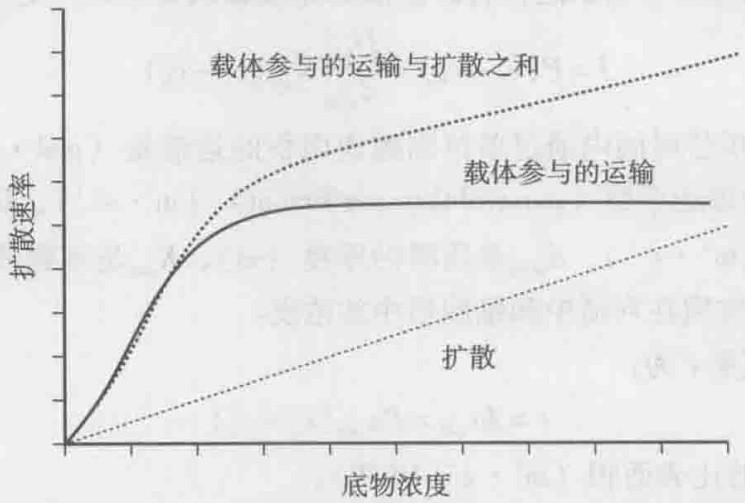

line

| 底物浓度 | 载体参与的运输 (扩散速率) | 载体参与的运输与扩散之和 (扩散速率) | 扩散 (扩散速率) |
| --- | --- | --- | --- |
| 0 | 0 | 0 | 0 |
| ~1 | ~0.45 | ~0.45 | ~0.15 |
| ~2 | ~0.65 | ~0.75 | ~0.3 |
| ~3 | ~0.75 | ~0.95 | ~0.45 |
| ~4 | ~0.8 | ~1.15 | ~0.6 |
| ~5 | ~0.82 | ~1.35 | ~0.75 |
| ~6 | ~0.83 | ~1.55 | ~0.9 |
| ~7 | ~0.83 | ~1.75 | ~1.05 |
| ~8 | ~0.83 | ~1.95 | ~1.2 |

图2-1 不同运输方式的动力学特征

在大肠杆菌等革兰氏阴性菌的外膜上分布有许多由孔蛋白（porin）构成的运输通道，其数量可高达 $10^{5}$ 个/细胞，这些孔蛋白包括OmpF，OmpC，PhoE等蛋白。这些蛋白的二级结构主要是反向平行的 $\beta-$ 折叠，并形成桶状的三级结构（图2-2）。细菌外膜中的孔蛋白的孔径一般约 $1\mathrm{nm}$，可允许相对分子质量达600的物质通过。在真核细胞的线粒体和叶绿体的外膜上的孔蛋白允许较大的分子通过，其中线粒体孔蛋白可通过的最大分子的相对分子质量为6000，而叶绿体的孔蛋白则可通过相对分子质量在10000到13000之间的物质。目前发现有些孔蛋白对物质的运输没有专一性，而有些孔蛋白能专一性地运输某类物质，即表现出促进扩散的特点。孔蛋白内侧具有疏水性或亲水性程度不同的氨基酸残基，从而对极性不同的运输物质做出选择。一般孔蛋白内部还有一个“过滤”装置，对相对分子质量不同的运输物质做出选择。除了孔蛋白之外，常见的参与促进扩散的运输载体还有 $\alpha-$ 型通道蛋白

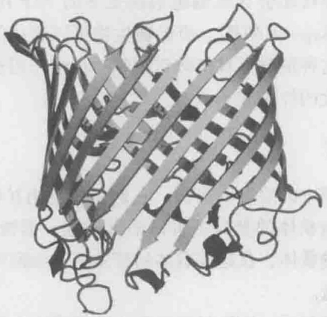

natural_image

3D ribbon diagram of a protein structure showing helices and strands (no text or labels)

图2-2 孔蛋白的桶状三级结构 [http://en.wikipedia.org/wiki/Porin\_(protein)]

---

2.2 细胞代谢反应的基本类型和功能

15

(channel protein)。

## 2.2.1.3 主动运输

主动运输也是通过运输载体来运输物质的过程，但与促进扩散相反，主动运输可以逆着浓度梯度的方向进行，因此是一个消耗自由能的过程。主动运输过程中需要的自由能主要有以下几种来源。

(1) ATP 中的高能磷酸键: 在细胞中存在一些直接水解 ATP 的运输蛋白, 依靠 ATP 水解产生的能量来实现物质的逆浓度梯度跨膜运输。有一些运输蛋白并不直接水解 ATP, 而是与物质结合后将之传递给其他膜蛋白, 并在传递过程中触发 ATP 水解而使膜蛋白上的小孔打开, 物质通过小孔单向扩散进细胞质。这类蛋白中最重要的一种是 ABC 型运输蛋白, 广泛存在于原核生物和真核生物中。大肠杆菌中通过这种载体运输的物质有: 组氨酸、麦芽糖、阿拉伯糖和半乳糖等。上述主动运输方式也被称为初级主动运输 (primary active transport)。

ABC 型运输蛋白一般有两个跨膜结构域（transmembrane domain，TMD）和两个处于细胞质中的核苷酸结合结构域（nucleotide-binding domain，NBD），NBD 可以和 ATP 结合并催化其水解，随后运输蛋白改变构象而使物质运入细胞内（图 2-3 中显示的是一种吸收物质的 ABC 型运输蛋白）。

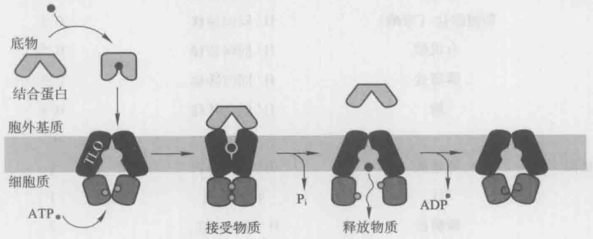

flowchart

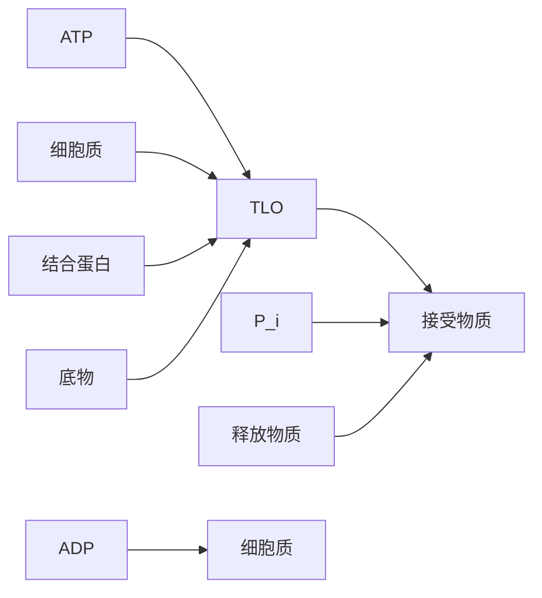

图2-3 ABC型运输蛋白的运输机制

(2) Gibbs 自由能或电势能: 原核生物通过细胞膜上的呼吸链传递电子时, 直接利用 Gibbs 自由能或电势能将胞内的质子主动运输到胞外, 在细胞膜两侧形成质子浓度梯度和电势差, 上述运输过程也属于初级主动运输。在此过程中, Gibbs 自由能或电势能被转化为存在于膜两侧的质子驱动力 (由质子浓度梯度和电势差两部分构成), 因此也可以认为细胞膜被赋予了能量。电子通过呼吸链传递的过程与 ATP 的生成相耦联, 细胞膜外侧的质子再通过 $\mathrm{F_0F_1}$-ATP 合成酶 ($\mathrm{F_0F_1}$-ATPase) 重新运入胞内, 并生成 ATP, 在这个过程中质子驱动力进一步被转化为化学能储存在 ATP 的高能磷酸键中。
（3）质子浓度梯度:某些物质的逆浓度梯度的运输过程与另一种物质的顺浓度梯度运输过程相耦联，这种主动运输方式称为次级主动运输（secondary active transport）。如果这两种物质沿同一物理方向进行运输，这种运输就叫同向运输（sym-

---

16

2 细胞代谢反应和调节方式

port)，反之则称为反向运输（antiport）。质子同向运输是这种主动运输中最重要的一种，即直接借助质子驱动力进行物质的逆浓度梯度运输，微生物中有许多渗透酶通过这种运输方式实现糖类的运输（图2-4），运输1分子糖的同时需要1到数个质子的

同向运输。对于大肠杆菌（E. coli）中的乳糖透性酶，运输1分子乳糖的同时需要向胞内运输1个质子，对于大多数其他的糖透性酶，糖和质子的比例可能也是1:1。对于质子同向运输，输入细胞内的质子必须借助于呼吸链或ATP酯酶重新运输到胞外，以维持细胞膜两侧的质子驱动力及胞内的pH平衡。除质子之外， $Na^{+}$ 、 $K^{+}$

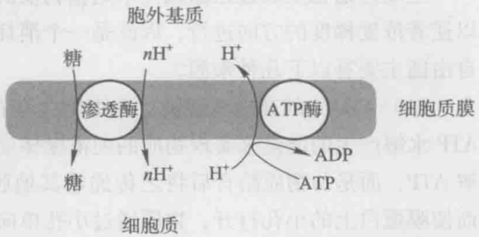

flowchart

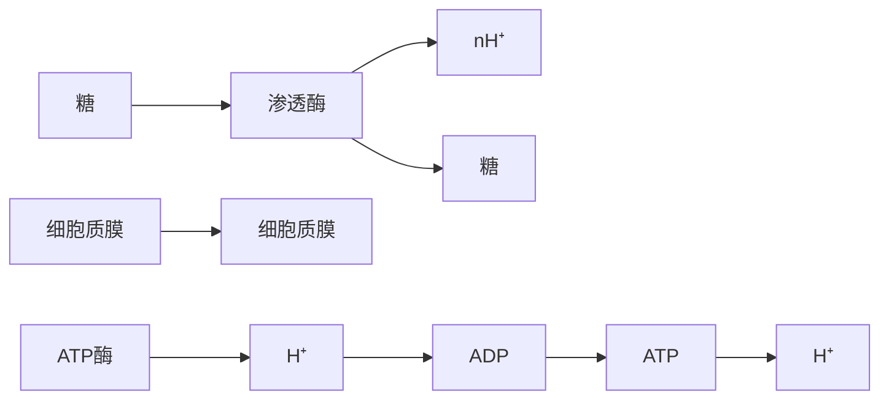

图2-4 糖类通过质子同向运输的运输

和  $Mg^{2+}$  也可以进行同向运输或反向运输，表 2-1 总结了细菌和真菌中一些化合物的次级主动运输方式。

表 2-1 细菌和真菌中一些化合物的主动运输概述（Stephanopoulos et al. 1998）

<table><tr><td>种类</td><td>化合物</td><td>机制</td><td>消耗ATP量</td></tr><tr><td rowspan="6">细菌</td><td>氨基酸</td><td> $H^{+}$ 同向转移</td><td>0.5</td></tr><tr><td>葡糖酸盐(或酯)</td><td> $H^{+}$ 同向转移</td><td>0.5</td></tr><tr><td>有机酸</td><td> $H^{+}$ 同向转移</td><td>0.5</td></tr><tr><td>磷酸盐</td><td> $H^{+}$ 同向转移</td><td>0.5</td></tr><tr><td>糖</td><td> $H^{+}$ 同向转移</td><td>0.5</td></tr><tr><td></td><td>PTS*</td><td>0*</td></tr><tr><td rowspan="7">真菌</td><td>氨基酸</td><td> $H^{+}$ 同向转移</td><td>1</td></tr><tr><td> $NH_{4}^{+}$ </td><td>化学渗透</td><td>1</td></tr><tr><td>磷酸盐</td><td> $H^{+}$ 同向转移,</td><td>2</td></tr><tr><td></td><td> $Na^{+}$ 反相转移</td><td></td></tr><tr><td>糖</td><td> $H^{+}$ 同向转移</td><td>1</td></tr><tr><td></td><td>促进扩散</td><td>0</td></tr><tr><td>硫酸盐</td><td> $Ca^{2+}$ 和 $H^{+}$ 同向转移</td><td>1</td></tr></table>

\* 通过磷酸转移酶系统，糖在运输过程中被磷酸化。即使在磷酸烯醇丙酮酸中出现一个高能的磷酸基团，在糖的磷酸化过程中高能磷酸键的能量并不释放，因此 ATP 能耗为 0。

## (4) 其他高能分子:如 PEP。

在基团转位中，运输过程中伴随着对被运输物质的共价基团修饰。最典型的基团转位系统是细菌中的磷酸转移酶系统（phosphotransferase system，PTS 系统），某些糖类物质主要通过这个系统运输进细菌中，并在运输过程中被磷酸基团修饰（磷酸化），运输所需的能量和磷酸基团均来源于磷酸烯醇式丙酮酸。物质被磷酸化的好处在于进入细胞内的物质很难泄漏到胞外。

主动运输过程中的 ATP 消耗在细胞生物合成全部过程的 ATP 消耗中占重要部分。

知识拓展2-2
大肠杆菌的 PTS
系统

---

2.2 细胞代谢反应的基本类型和功能

17

在质子同向运输的过程中，ATP 消耗依赖于运输过程的化学计量学和质子重新输出的化学计量学。研究得最透彻的体系是大肠杆菌中的乳糖渗透酶，其同时运输一个质子和一个乳糖（见图 2-4）。对许多其他物质的运输相似的化学计量比也成立，例如原核生物和真核生物中许多氨基酸的运输以及丝状真菌中通过高度亲和系统对葡萄糖、果糖和半乳糖等的运输。原核生物和真核生物中质子的重新输出过程有一些不同之处。在好氧细菌中，电子传递链位于细胞质膜，质子可通过电子传递链从胞液中重新运输出去（见 2.3.3 节）。质子还可由 $F_0F_1$-ATP 合成酶转运至胞内。$F_0F_1$-ATP 合成酶位于原核生物的细胞质膜或真核生物的线粒体内膜上，这种酶是一种复合酶，其 $F_0$ 部分位于膜内，$F_1$ 部分位于膜外（细胞质或线粒体基质一侧）。该酶主要涉及氧化磷酸化（oxidative phosphorylation）过程中 ATP 的合成，还有一些 ATP 酯酶可以在消耗 ATP 的情况下将质子泵出细胞外（见图 2-4）。表 2-1 总结了部分化合物运输时的能量消耗。

## 2.2.1.4 运输反应的代谢工程改造

应用代谢工程改进菌株性能的一个主要策略是通过修饰或表达运输载体来增加产物的合成，扩大细胞对底物的利用范围，或增强对底物的利用速率。在这方面已经有许多成功的应用实例。例如，利用谷氨酸棒杆菌可以生产重要平台化学品1,5-二氨基戊烷，这种代谢物对其合成途径中的赖氨酸脱羧酶具有强烈的反馈抑制作用，如果细胞不能快速将其运输到胞外，将限制细胞合成该代谢物的能力，并导致副产物N-乙酰-二氨基戊烷的大量积累。Kind等（2011）在谷氨酸棒杆菌中发现一种可以高效运输1,5-二氨基戊烷的渗透酶（由cg2893基因编码），在1,5-二氨基戊烷生产菌株中过表达该基因可以使1,5-二氨基戊烷的产量提高 $20\%$ ，并使副产物N-乙酰-二氨基戊烷的产量减少 $75\%$ 。

提高菌株对木糖等戊糖的利用能力对利用木质纤维素原料生产化学品或生物燃料具有重要的意义。在内部代谢途径得到优化后，木糖的运输就成为整个生物合成途径的主要代谢控制步骤。在酿酒酵母中，木糖运输的通量控制系数随着木糖浓度的不同在0.2\~0.5之间变动（Gardonyi et al. 2003）。通过对木糖运输蛋白编码基因的突变与修饰，可以大幅改善运输蛋白的酶学参数，提高菌株利用木糖的速度。例如，Kuyper等（2005）报道一种突变的木糖运输蛋白，其最大反应速度由15.8提高到32 mmol·g $^{-1}$ (CDW)·h $^{-1}$ ， $K_{m}$ 由132 mmol·L $^{-1}$ 降低到99 mmol·L $^{-1}$ 。Young等（2012）报道了在对两种木糖运输蛋白（中间假丝酵母的GXS1蛋白和毕氏酵母的XUT3蛋白）进行进化后，得到木糖运输能力更为优良的突变蛋白，将它们在酿酒酵母中表达后可以使菌株利用木糖的生长速度提高36%\~70%。

## 2.2.2 供能反应与分解代谢

供能反应是细胞中生成能量的反应，对于大多数化学营养生物而言，供能反应主要存在于分解代谢途径中，主要包括糖酵解（glycolysis）、戊糖磷酸途径（pentose phosphate pathway, PP）、TCA 循环（TCA cycle）、回补途径（anaplerotic pathway）及一些发酵途径（fermentative pathway）。分解代谢通常将复杂的分子或较大的分子分解成简单或较小的分子，并在此过程中产生细胞生长所需要的能量、还原力和基本的碳

---

18

2 细胞代谢反应和调节方式

骨架。供能反应产生的能量主要以 ATP 的形式存在，一些反应直接伴随着 ADP 生成 ATP，而一些反应伴随着 NAD$^{+}$生成 NADH，后者再通过电子呼吸链（respiratory chain）将化学电势能转化到 ATP 的高能磷酸键中。分解代谢产生的还原力主要以辅助因子 NADPH 的形式存在，在一些微生物中存在活性较强的转氢酶，可以实现 NADPH 与 NADH 的相互转化。分解代谢产生的基本碳骨架也称为前体代谢物，表 2-2 列出了合成细胞所需的 12 种基本的前体代谢物，这些前体代谢物通过生物合成反应进一步被转化为氨基酸、核苷酸等构造单元（Nielsen et al. 2004）。

表 2-2 大肠杆菌中 12 种前体代谢物及合成构造单元的需求量

| 前体代谢物 | 构造单元 | 需求量 /μmol·g-1(CDW) |
| --- | --- | --- |
| 6-磷酸葡萄糖 | UDP-葡萄糖,UDP-半乳糖 | 205 |
| 6-磷酸果糖 | UDP-N-乙酰葡萄糖胺 | 71 |
| 5-磷酸核糖 | 组氨酸,色氨酸,核苷酸 | 898 |
| 4-磷酸赤藓糖 | 苯丙氨酸,色氨酸,酪氨酸 | 361 |
| 3-磷酸甘油醛 | 磷脂的骨架 | 129 |
| 3-磷酸甘油酸 | 半胱氨酸,甘氨酸,丝氨酸,胆碱,核苷酸 | 1496 |
| 磷酸烯醇丙酮酸 | 苯丙氨酸,色氨酸,酪氨酸 | 519 |
| 丙酮酸 | 丙氨酸,异亮氨酸,缬氨酸 | 2833 |
| 乙酰辅酶A | 脂质 | 3747 |
| 酮戊二酸 | 精氨酸,谷氨酰胺,谷氨酸,脯氨酸 | 1079 |
| 琥珀酰辅酶A | 血红素 | - |
| 草酰乙酸 | 天冬酰胺,天冬氨酸,异亮氨酸,甲硫氨酸,苏氨酸,赖氨酸,核苷酸 | 1787 |

## 2.2.2.1 糖酵解途径

糖酵解途径也称为 Embden-Meyerhoff-Parnas（EMP）途径，是从葡萄糖开始到丙酮酸生成的所有生化反应的总和。

糖类一般通过1-磷酸葡萄糖（G1P）、6-磷酸葡萄糖（G6P）和6-磷酸果糖（F6P）这三种单磷酸己糖进入糖酵解途径。三者之间很容易通过葡萄糖磷酸变位酶（对G1P和G6P）和磷酸己糖异构酶（对G6P和F6P）而相互转化。这些酶一般都过量存在，因此三种化合物通常处于一种平衡状态并构成一个单独的代谢库。这个代谢库可通过生成三种化合物中的任何一种而得到快速补充。

在 EMP 途径中，1 mol 葡萄糖转化成 2 mol 丙酮酸（图 2-5，EMP 途径），此途径在细胞质中进行。在细菌中，第 1 步反应一般通过 PTS 运输系统来实现，葡萄糖的磷酸化作用与转运同时进行，此时该反应与反应 10 相偶联来获得能量（注意此时 PEP 将磷酸基团传递给 EI，而不是传递给 ADP 以生成 ATP，所以相当于间接消耗了 ATP），而不直接消耗以 ATP 形式存在的自由能。而在真核内，磷酸化作用是由己糖

---

2.2 细胞代谢反应的基本类型和功能

19

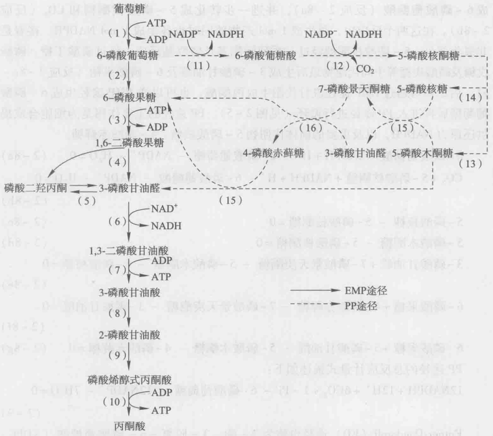

flowchart

This flowchart illustrates the metabolic pathways of various phosphate compounds (such as glucose, fatty acids, and alcohols) in a biological process involving ATP, NADP, CO2, and AMP.

图2-5 真菌中的EMP途径和PP途径

酶（1）:己糖激酶；酶（2）:磷酸己糖异构酶；酶（3）:磷酸果糖激酶；酶（4）:醛缩酶；酶（5）:磷酸甘油醛异构酶；酶（6）:3-磷酸甘油醛脱氢酶；酶（7）:3-磷酸甘油酸激酶；酶（8）:3-磷酸甘油酸变位酶；酶（9）:烯醇酶；酶（10）:丙酮酸激酶；酶（11）:6-磷酸葡萄糖脱氢酶；酶（12）:6-磷酸葡糖酸脱氢酶；酶（13）:二磷酸核酮糖3-差向异构酶；酶（14）:二磷酸核酮糖异构酶；酶（15）:转羟乙醛酶；酶（16）:转二羟丙酮基酶

激酶催化的，此时反应1直接消耗以ATP形式存在的自由能。在酿酒酵母中有三种不同的酶参与葡萄糖和果糖的磷酸化:即己糖激酶A、己糖激酶B和葡萄糖激酶。两种己糖激酶可催化葡萄糖或果糖的磷酸化反应，而葡萄糖激酶只特异性地催化葡萄糖的磷酸化。6-磷酸果糖转化成1,6-二磷酸果糖的反应（反应3）需要消耗以ATP形式存在的自由能，而反应7和反应10都生成ATP，因此在EMP途径中每分解1mol葡萄糖总计获得2mol ATP。3-磷酸甘油醛氧化生成1,3-二磷酸甘油酸酯的反应（反应6）还产生了NADH，通过EMP途径葡萄糖转化成丙酮酸的总化学计量式可表示为:2丙酮酸+2ATP+2NADH+2H₂O+2H⁺-葡萄糖-2ADP-2\~Pi-2NAD⁺=0(2-7)

## 2.2.2.2 戊糖磷酸途径及 Entner-Doudoroff 途径

戊糖磷酸（PP）途径可以分为氧化和非氧化两个部分，均在细胞质中进行。在氧化部分中，6-磷酸葡萄糖被氧化生成中间体6-磷酸葡糖酸内酯，后者再水解生

---

20

2 细胞代谢反应和调节方式

成6-磷酸葡糖酸（反应2-8a），并进一步转化成5-磷酸核酮糖和 $CO_{2}$ （反应2-8b）。在这两个反应中，每生成1 mol产物的同时也各生成1 mol NADPH。接着是非氧化部分:5-磷酸核酮糖经过一系列转酮基及转醛基反应，经过磷酸丁糖、磷酸戊糖及磷酸庚糖等中间代谢物最后生成3-磷酸甘油醛及6-磷酸果糖（反应2-8c\~g），后二者可通过EMP途径进行代谢生成丙酮酸，也可以逆EMP途径生成6-磷酸葡萄糖后再进入PP途径进行循环（见图2-5）。PP途径的主要作用是为细胞合成提供还原力NADPH，以及重要的前体代谢物5-磷酸核糖、4-磷酸赤藓糖。

6-磷酸葡糖酸+NADPH+H$^{+}$-6-磷酸葡萄糖-NADP$^{+}$-H$_{2}$O=0 (2-8a)

$$
\mathrm{CO} _ {2} + 5 - \text {磷酸核酮糖} + \mathrm{NADPH} + \mathrm{H} ^ {+} - 6 - \text {磷酸葡糖酸} - \mathrm{NADP} ^ {+} - \mathrm{H} _ {2} \mathrm{O} = 0 \tag {2-8b}
$$

5-磷酸核糖 - 5-磷酸核酮糖 = 0 (2-8c)

5-磷酸木酮糖 - 5-磷酸核酮糖 = 0 (2-8d)

3-磷酸甘油醛+7-磷酸景天庚酮糖-5-磷酸木酮糖-5-磷酸核糖=0
(2-8e)

6-磷酸果糖+4-磷酸赤藓糖-7-磷酸景天庚酮糖-3-磷酸甘油醛=0
(2-8f)

6-磷酸果糖+3-磷酸甘油醛-5-磷酸木酮糖-4-磷酸赤藓糖=0 (2-8g)

PP 途径的总反应计量式描述如下:

$$
1 2 \mathrm{NADPH} + 1 2 \mathrm{H} ^ {+} + 6 \mathrm{CO} _ {2} + 1 \sim \mathrm{Pi} - 6 - \text {磷酸葡萄糖} - 1 2 \mathrm{NADP} ^ {+} - 7 \mathrm{H} _ {2} \mathrm{O} = 0 \tag {2-9}
$$

Entner-Doudoroff（ED）途径也称为2-酮-3-脱氧-6-磷酸葡糖酸（KDPG）裂解途径，6-磷酸葡糖酸在6-磷酸葡糖酸脱水酶的作用下转化成KDPG，接着KD-PG在KDPG醛缩酶的作用下裂解成3-磷酸甘油醛和丙酮酸。因此通过ED途径将葡萄糖转化成丙酮酸的总反应式为:

$$
\begin{array}{l} 2 \text {丙酮酸} + \mathrm{ATP} + \mathrm{NADPH} + \mathrm{NADH} + 2 \mathrm{H} _ {2} \mathrm{O} + 2 \mathrm{H} ^ {+} - \text {葡萄糖} \\ - \mathrm{ADP} - 1 \sim \mathrm{Pi} - \mathrm{NAD} ^ {+} - \mathrm{NADP} ^ {+} = 0 \tag {2-10} \\ \end{array}
$$

在 ED 途径中，每代谢 1 mol 葡萄糖生成 1 mol ATP、1 mol NADH 和 1 mol NADPH，而 EMP 途径是 2 mol ATP 和 2 mol NADH。ED 途径还有一条非磷酸化的途径，其中葡糖酸通过 2-酮-3-脱氧葡糖酸转化成丙酮酸和甘油醛，但该途径只有当细胞代谢葡糖酸时才被激活。

EMP 途径中的三个中间代谢物（3-磷酸甘油醛、3-磷酸甘油酸和磷酸烯醇式丙酮酸）和 PP 途径中的两个中间代谢物（5-磷酸核糖和4-磷酸赤藓糖）是氨基酸和核酸生物合成的前体代谢物。通过这两条途径的相对通量取决于细胞对吉布斯自由能、NADH、NADPH 以及前面的前体代谢物的需求。大多数研究结果表明 EMP 途径是主要的代谢途径，然而对于那些过量合成某些还原度较低的产物的微生物，例如生产赖氨酸的谷氨酸棒杆菌，PP 途径上的通量可能大于 EMP 途径上的通量。表 2-3 列出了一些微生物的 EMP 和 PP 途径上的相对通量分布。通过 PP 途径通量的相对大小还取决于比生长速率和培养基组成，一般比生长速率越大，细胞对还原力的需求就越高，PP 途径的通量就越大。

---

2.2 细胞代谢反应的基本类型和功能

21

## 2.2.2.3 三羧酸循环

前面介绍的 EMP、PP 及 ED 途径是微生物通过发酵方式获得能量的主要途径，而三羧酸循环（TCA 循环）是微生物在有氧环境中获取能量的主要途径。在真核细胞中，该途径存在于线粒体内；而在原核细胞中，该途径存在于细胞质中。

表 2-3 不同种类微生物中 EMP 途径和 PP 途径上的相对通量分布

<table><tr><td>种类</td><td>EMP/%</td><td>PP/%</td><td>条件</td><td>参考文献</td></tr><tr><td rowspan="2">E. coli K12</td><td>55.3</td><td>43</td><td>恒化器培养  $D = 0.22 \text{ h}^{-1}$ </td><td>Zhao et al. 2003</td></tr><tr><td>70</td><td>28.3</td><td>恒化器培养  $D = 0.11 \text{ h}^{-1}$ </td><td>Zhao et al. 2003</td></tr><tr><td rowspan="3">Bacillus subtilis</td><td>91</td><td>3</td><td>恒化器培养  $D = 0.15 \text{ h}^{-1}$ </td><td>Goel et al. 1993</td></tr><tr><td>77</td><td>20</td><td>恒化器培养  $D = 0.11 \text{ h}^{-1}$ </td><td>Dauner et al. 2001</td></tr><tr><td>63</td><td>34</td><td>恒化器培养  $D = 0.44 \text{ h}^{-1}$ </td><td>Dauner et al. 2001</td></tr><tr><td>S. cerevisiae</td><td>&gt;96</td><td>&lt;4</td><td>间歇培养</td><td>Fiaux et al. 2003</td></tr><tr><td>P. stipitis</td><td>&gt;43</td><td>&lt;57</td><td>间歇培养</td><td>Fiaux et al. 2003</td></tr><tr><td>A. niger</td><td>78</td><td>-</td><td>间歇培养</td><td>Shu et al. 1954</td></tr><tr><td>C. glutamicum</td><td>32</td><td>66</td><td>恒化器培养</td><td>Marx et al. 1996</td></tr><tr><td rowspan="2">P. chrysogenum</td><td>77</td><td>23</td><td>间歇培养</td><td>Wang et al. 1958</td></tr><tr><td>56 - 70</td><td></td><td>间歇培养</td><td>Lewis et al. 1954</td></tr><tr><td rowspan="2">P. digitatum</td><td>83</td><td>17</td><td>间歇培养</td><td>Wang et al. 1958</td></tr><tr><td>77</td><td>23</td><td>间歇培养</td><td>Reed and Wang 1959</td></tr></table>

(1) 三羧酸循环及其主要作用: TCA 循环的第 1 步是丙酮酸氧化脱羧生成乙酰辅酶 A 的反应 (图 2-6), 辅酶 $\mathrm{NAD}^{+}$作为电子受体参与反应。这个反应由丙酮酸脱氢酶系催化, 在 ATP/ADP 或 NADH/NAD 以及乙酰辅酶 A 浓度较高时, 该酶的活性被抑制。随后, 乙酰辅酶 A 与草酰乙酸在柠檬酸合成酶的催化下缩合生成柠檬酸。柠檬酸随后在乌头酸酶的作用下生成其异构体——异柠檬酸, 这个反应要生成中间体顺乌头酸, 但它在细胞代谢中没有其他作用, 因此在 TCA 循环中不予考虑。柠檬酸转化成异柠檬酸的总平衡常数接近 1 , 表明柠檬酸和异柠檬酸非常容易相互转化, 因此这两种代谢产物通常被归类于一个代谢库中。TCA 循环中接下来的两步是氧化脱羧反应。首先, 异柠檬酸在异柠檬酸脱氢酶的作用下生成 $\alpha-$ 酮戊二酸。接着, $\alpha-$ 酮戊二酸经 $\alpha-$ 酮戊二酸脱氢酶催化转化成琥珀酰辅酶 A , 该步反应类似于丙酮酸脱氢酶催化的丙酮酸脱羧反应。实际上, 这两个酶系使用同样的脱氢酶亚基。在下面的反应中, 琥珀酰辅酶 A 水解生成琥珀酸, 同时在辅酶 A 酯键水解过程中释放出吉布斯自由能, 通过 GDP 磷酸化生成 GTP 而回收这部分自由能。然后琥珀酸脱氢生成延胡索酸, FAD 作为受氢体被还原成 $\mathrm{FADH}_{2}$ 。FAD 整合在琥珀酸脱氢酶黄素蛋白酶中来催化这个反应。延胡索酸在延胡索酸酶的作用下生成 L-苹果酸。最后, L-苹果酸在苹果酸脱氢酶的作用下生成草酰乙酸, 从而完成了整个循环。TCA 循环的主要作用是为细胞提供能量及重要的前体代谢物 $\alpha-$ 酮戊二酸和草酰乙酸。

TCA 循环中丙酮酸完全氧化的总化学计量式如下:

---

22

2 细胞代谢反应和调节方式

$$
\begin{array}{l} 3 \mathrm{CO} _ {2} + \mathrm{GTP} + 4 \mathrm{NADH} + \mathrm{FADH} _ {2} + 4 \mathrm{H} ^ {+} - \text {丙酮酸} - \mathrm{H} _ {2} \mathrm{O} \\ - \mathrm{GDP} - 1 \sim \mathrm{Pi} - 4 \mathrm{NAD} ^ {+} - \mathrm{FAD} = 0 \tag {2-11} \\ \end{array}
$$

(2) 电子呼吸链及氧化磷酸化: 从式 2-11 可以看出, TCA 循环可以为细胞提供大量的 NADH 和 $\mathrm{FADH}_{2}$ 。只有当这两种辅助因子被重新氧化生成 $\mathrm{NAD}^{+}$和 FAD 时, TCA 循环才能继续进行。细胞除了通过底物磷酸化直接生成 ATP 外 (如图 2-6 中反应 6), 还可以通过电子呼吸链将 NADH 和 $\mathrm{FADH}_{2}$ 重新氧化来间接合成 ATP, 这一过程也称为氧化磷酸化。电子呼吸链是镶嵌在原核生物的质膜上或真核生物的线粒体内膜上的一系列电子受体 (其中大多数电子受体组成一个大的复合物) 组成的电子传递系统 (图 2-7)。在好氧条件下, 通过电子呼吸链把辅酶 NADH 和 $\mathrm{FADH}_{2}$ 中的电子逐步转移给自由氧, 这一过程可以看成由两个单电极反应组成:

负极反应: $NADH \rightarrow NAD^{+} + H^{+} + 2e^{-}$ ，其标准电极电势为 -320 mV

正极反应: $1/2O_{2}+2H^{+}+2e^{-}=H_{2}O$ ，其标准电极电势为820 mV

其产生的标准自由能:

$$
\triangle G ^ {0} = - n F \Delta E ^ {\circ} = - 2 \times 9 6. 5 \times 1. 1 4 = - 2 2 0 \mathrm{kJ} \cdot (\mathrm{molNADH}) ^ {- 1} \tag {2-12}
$$

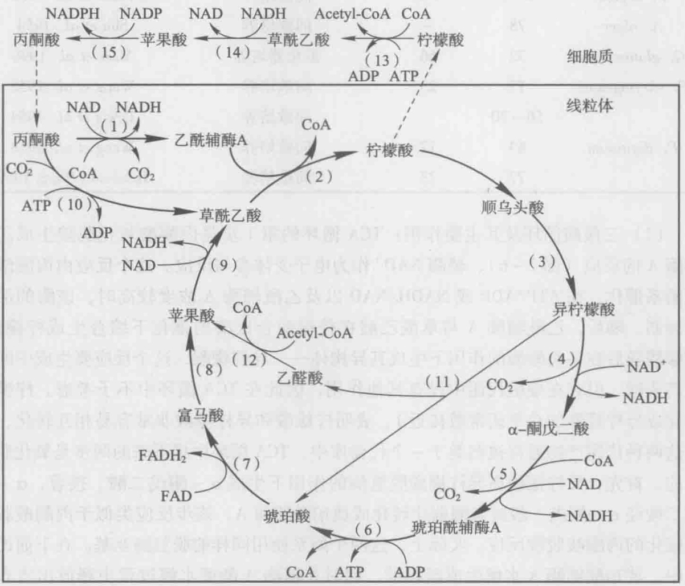

flowchart

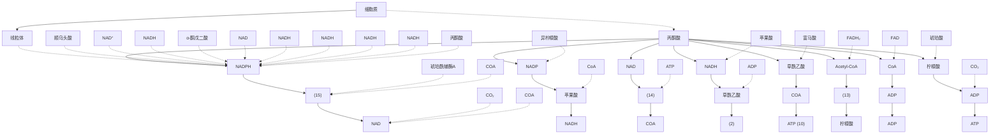

图2-6 真菌体内的TCA循环和回补途径

酶（1）:丙酮酸脱氢酶复合物；酶（2）:柠檬酸合成酶；酶（3）:顺乌头酸酶；酶（4）:异柠檬酸脱氢酶；酶（5）:α-酮戊二酸脱氢酶；酶（6）:琥珀酸硫激酶；酶（7）:琥珀酸脱氢酶；酶（8）:延胡索酸酶；酶（9）:苹果酸脱氢酶；酶（10）:丙酮酸羧化酶；酶（11）:异柠檬酸裂解酶；酶（12）:苹果酸合成酶；酶（13）:ATP-柠檬酸裂解酶；酶（14）:苹果酸脱氢酶；酶（15）:苹果酸酶。在真核细胞中，丙酮酸脱氢酶复合物与膜结合，因此，丙酮酸转化为乙酰辅酶A是和丙酮酸向线粒体的运输相关联的（在线粒体膜上没有丙酮酸的载体）。而且，乙醛酸等循环，其中的反应由酶（2）、（3）、（11）、（12）和（9）催化，反应不是在线粒体中进行（如图所示），而是在乙醛酸循环体中进行的，由乙酰CoA转化为琥珀酸的合成也是在此处进行。琥珀酸在乙醛酸循环中形成，然后运输到线粒体中，由此进入TCA循环。在原核细胞中没有反应（13）、（14）和（15）组成的途径

---

2.2 细胞代谢反应的基本类型和功能

23

式中，n 为氧化 1 mol NADH 传递的电子数，F 为法拉第常数， $\Delta E^{\circ}$  为正负极之间的标准电势差。由于  $FADH_{2}/FAD$  电极的标准电势为 -220 mV，通过电子呼吸链氧化  $FADH_{2}$  时产生的标准自由能较少。电子在标准吉布斯自由能的驱动下进行传递，并且在传递过程中利用这种能量将细胞内的质子（ $H^{+}$ ）泵出细胞膜或线粒体内膜。随着电子呼吸链种类的不同，其泵出质子的位点数目及效率也不同。图 2-7 的电子呼吸链中泵出质子的位点有三处，分别是电子受体复合体 I、II 和 IV，其泵出质子的效率均为 4 个质子每电子对，即传递一对电子最多可以泵出 12 个质子。

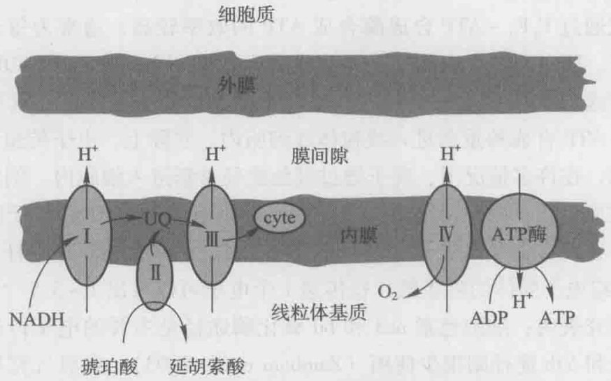

flowchart

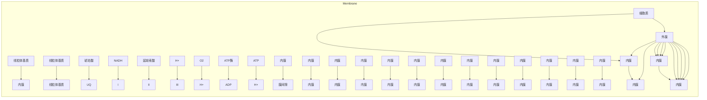

图2-7 真核生物的电子呼吸链和氧化磷酸化

电子传递链基本单元以较大复合物的形式位于线粒体内膜。来自 NADH 的电子首先传递给 NADH 脱氢酶（复合物 I），它是含有黄素单核苷酸的黄素蛋白。来自琥珀酸的电子首先传递给整合在琥珀酸脱氢酶（复合物 II）中的 FDA（即 TCA 循环的反应 7）。接着，复合物 I 和 II，或位于线粒体内膜的其他黄素蛋白将电子进一步传递给在质膜中自由移动的辅酶 Q（UQ），后者再将电子传递给复合物 III（由细胞色素 b566、b562 和 c1 组成）。然后，复合物 III 将电子传递给附在质膜外表面的细胞色素 c，后者再将电子传递给复合物 IV（细胞色素氧化酶 aa₃），最后，复合物 IV 将电子传递给氧。复合物 I、III 和 IV 是跨膜蛋白，当这些复合物传递一对电子时，每种复合物向膜外泵出 4 个质子。由于耦联效应，同时有等量质子（完全耦联时）通过 F₁F₀-ATP 酶复合物运输回线粒体基质

(3) 化学渗透理论: Mitchell (1961) 提出的化学渗透理论解释了电子传递和 ATP 合成这两种完全不同的过程是如何耦联在一起的。这个理论认为: 在真核细胞的线粒体内膜 (或原核生物的质膜) 两侧存在比较稳定的质子浓度差 (细胞内或线粒体内的质子浓度低一些), 从而形成了稳定的 pH 梯度 (约 -0.05 pH 单位) 和电势梯度 (约 $0.14 \mathrm{~V}$), 即质子驱动力 (proton motive force)。当电子通过此电子链运输时, 质子同时被泵出线粒体外 (或被泵出原核生物的细胞外) 而使 $\mathrm{pH}$ 梯度和电势梯度增大, 此时细胞会通过 $\mathrm{F}_{1} \mathrm{~F}_{0}-\mathrm{ATP}$ 合成酶将线粒体外 (或细胞膜外) 的质子再运输入线粒体基质 (或细胞质) 以维持 $\mathrm{pH}$ 梯度和电势梯度的稳定, 在这一过程中, 质子驱动力就转化成了 ATP 形式的自由能。在上述稳定的 $\mathrm{pH}$ 梯度和电势梯度下及常温时, 通过 $\mathrm{F}_{1} \mathrm{~F}_{0}-\mathrm{ATP}$ 合成酶每输入 $1 \mathrm{~mol}$ 质子产生的质子驱动力 $\Delta P$ 为:

$$
\begin{array}{l} \Delta P = - 2. 3 R T \lg \frac {\left[ \mathrm{H} \right] _ {\mathrm{high}}}{\left[ \mathrm{H} \right] _ {\mathrm{low}}} - Z F \Delta V \\ = 2. 3 R T \times (- 0. 0 5) - 9 6 5 0 0 \times (0. 1 4) = - 1 3. 8 \mathrm{kJ/mol} \tag {2-13} \\ \end{array}
$$

如果通过呼吸链传递 1 mol 电子对时泵出的 12 mol 质子全部通过  $F_{1}F_{0}-ATP$  酶复

---

24

2 细胞代谢反应和调节方式

合物输入线粒体内（或胞内），则产生的质子驱动力为 $165.6 \mathrm{~kJ}(\mathrm{mol} \mathrm{NADH})^{-1}$，即 $220 \mathrm{~kJ}(\mathrm{mol} \mathrm{NADH})^{-1}$ 的标准吉布斯自由能只有部分转化为质子驱动力。在真核生物中，通过 $\mathrm{F}_{1} \mathrm{~F}_{0}-\mathrm{ATP}$ 合成酶运输 3 个质子会产生 1 个 ATP，另外还需要消耗 1 个质子用于 ADP 和磷酸根输入线粒体及 ATP 从线粒体输出到细胞质中，因此每产生 1 个 ATP 需要 4 个质子。这样对真核生物而言，氧化磷酸化的化学计量系数 P/O（即每传递 $1 \mathrm{~mol}$ 电子对给 $1 \mathrm{~mol}$ 自由氧时生成的 ATP 数）的理论值为 $3 \mathrm{~mol} \mathrm{ATP} / \mathrm{mol} \mathrm{NADH}_{2}$ 或 $2 \mathrm{~mol} \mathrm{ATP} / \mathrm{mol} \mathrm{FADH}_{2}$ 。对于原核生物而言，电子呼吸链上泵出质子的位点通常只有 $1 \sim 2$ 个，其泵出效率为 $2 \sim 4$ 个质子每电子对，但原核生物无需 ATP、ADP 及磷酸根的运输，因此通过 $\mathrm{F}_{1} \mathrm{~F}_{0}-\mathrm{ATP}$ 合成酶合成 ATP 的效率较高，通常为每产生 1 个 ATP 需要 3 个质子。所以原核生物的理论 P/O 最大为 $2.67 \mathrm{~mol} \mathrm{ATP} / \mathrm{mol} \mathrm{NADH}_{2}$ 。上述数据是基于电子传递与 APT 合成完全耦联，即呼吸链泵出质子的同时，有等量的质子全部通过 $\mathrm{F}_{1} \mathrm{~F}_{0}-\mathrm{ATP}$ 合成酶重新进入线粒体或细胞内。实际上，电子传递和磷酸化作用并不完全耦联，在许多情况下，质子通过其他途径重新进入细胞内，例如前述的有机酸自由扩散效应、质子同向运输等。因此，实际上有效的 P/O 远低于理论值。一般在原核生物中存在多条泵出质子效率不同的呼吸链，例如在枯草芽胞杆菌中，存在多条以氧作为最终电子受体的呼吸链，每传递 1 个电子可以泵出 $1 \sim 3.5$ 个质子（图 2-8）。现有的研究表明:细胞色素 aa3 和 bd 氧化酶途径是主要的电子传递途径，而细胞色素 c 途径和 Yth 途径则很少使用（Zamboni et al. 2003）。在氧气充足，并且用基本培养基或丰富培养基进行分批培养时，对数生长期的细胞主要利用细胞色素 aa3 氧化酶进行氧化磷酸化。而在微氧条件下，或在以葡萄糖为限制性营养的恒化培养过程中，细胞主要利用氧亲和力更高的细胞色素 bd 氧化酶进行氧化磷酸化。由于存在上述各种影响 P/O 的复杂因素，准确计算某种培养条件下的实际 P/O 具有很大的困难。

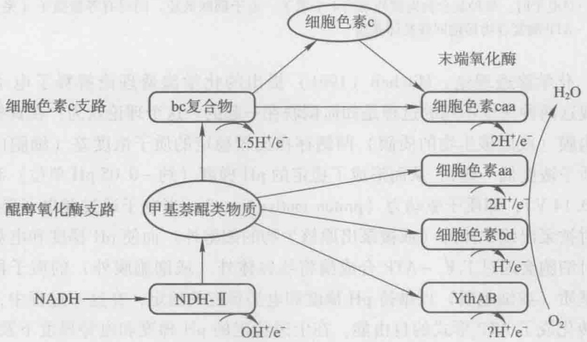

flowchart

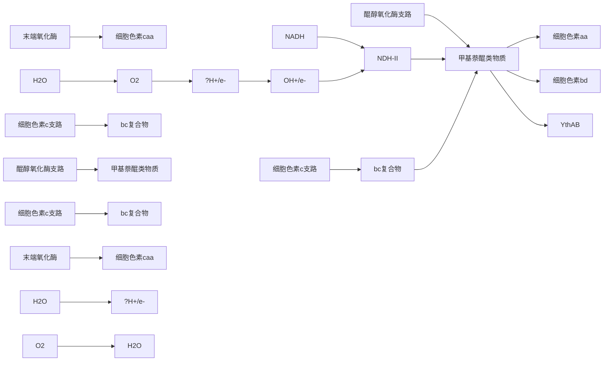

图2-8 枯草芽胞杆菌的主要电子呼吸链

由于 NADH 不能通过线粒体内膜进行运输，因此真核生物细胞质中生成的 NADH 不能在线粒体内将电子传递给电子传递链。除了跨膜的 NADH 脱氢酶外，在线粒体内膜的外表面还存在一种专门的 NADH 脱氢酶，它的作用是接受来自线粒体外 NADH

---

2.2 细胞代谢反应的基本类型和功能

25

的电子，并将其进一步传递给辅酶 Q，因此在细胞质 NADH 氧化的电子传递过程中，只有两个质子泵出位点（见图 2-7 中的复合物Ⅲ和Ⅳ）。细胞质 NADH 氧化的另外一种机制是借助磷酸二羟丙酮和 3-磷酸甘油的相互转换来实现的，主要过程是细胞质 NADH 将电子传递给磷酸二羟丙酮，将其还原成 3-磷酸甘油，而在线粒体内膜的外表面存在线粒体 3-磷酸-甘油脱氢酶，该酶再重新将 3-磷酸甘油氧化成磷酸二羟丙酮，并将电子传递给线粒体内膜中的辅酶 Q，从而进入电子传递链。因此细胞质 NADH 氧化的理论 P/O 为 2。

合成 1 mol ATP 需要的吉布斯自由能为 30.5 kJ，由于 P/O 值最大为 3，因此 220 kJ（mol NADH） $^{-1}$ 的标准吉布斯自由能最多有 91.5 kJ 转化为 ATP 中的自由能，其他能量以热量的形式耗散。

$$
\mathrm{ATP} + \mathrm{H} _ {2} \mathrm{O} - \mathrm{ADP} - 1 \sim \mathrm{Pi} = 0; \Delta G _ {\mathrm{p}} ^ {\mathrm{o}} = 3 0. 5 \mathrm{kJ} \cdot \mathrm{mol} ^ {- 1} \tag {2-14}
$$

有些微生物可以以无机含氧化合物（ $NO_{3}^{-}$ ， $NO_{2}^{-}$ ， $SO_{4}^{2-}$ 等）或者其他有机化合物（如延胡索酸作为电子受体生成琥珀酸）替代氧作为电子传递链的最终电子受体进行无氧呼吸，这种呼吸方式产生的能量远少于通过TCA循环产生的能量。

## 2.2.2.4 回补途径

TCA 循环中的两个中间代谢物，α-酮戊二酸和草酰乙酸是氨基酸和核苷酸生物合成所需的前体代谢物。在 TCA 循环中这两种物质没有净生成，为满足其他的细胞功能而消耗的这些物质必须通过别的途径来补充。能完成这些补充作用的一系列反应总称为回补途径。回补途径（见图 2-6）包括:①丙酮酸在丙酮酸羧化酶作用下的羧化；②PEP 在 PEP 羧化酶的作用下羧化；③苹果酸在苹果酸酶的作用下氧化生成丙酮酸；④乙醛酸循环（glycoxylate cycle）。

最重要的回补途径是由丙酮酸羧化酶或 PEP 羧化酶催化的  $CO_{2}$  固定反应，其导致草酰乙酸生成（见图 2-6）。在 ATP/ADP 和乙酰辅酶 A 浓度较高时，丙酮酸羧化酶被激活，同时该酶的活性受到 L-天冬氨酸的抑制。与丙酮酸羧化酶的调控相似，PEP 羧化酶受 L-天冬氨酸抑制而被乙酰辅酶 A 激活。在不同微生物中这两种酶的活性有很大的不同，酿酒酵母的细胞质和线粒体中都有较强的丙酮酸羧化酶的活性。在许多原核生物中，例如谷氨酸棒杆菌和枯草芽胞杆菌中，丙酮酸羧化酶的活性远高于 PEP 羧化酶。在大肠杆菌中，PEP 羧化酶催化的反应是主要的回补途径，另外 PEP 羧化酶也能催化 PEP 生成草酰乙酸，并且伴随着 ATP 的生成，但是该酶的表达受到葡萄糖的抑制，在糖异生的情况下才能有效表达。

苹果酸酶催化的回补途径对于真核细胞中线粒体和细胞质之间的物质转化和平衡具有重要的作用。由于在真核细胞中 TCA 循环发生在线粒体内，而在细胞质中合成氨基酸和脂质需要的关键前体物乙酰辅酶 A 不能通过线粒体膜运输到细胞质中，因此细胞必须在细胞质中合成乙酰辅酶 A:首先柠檬酸通过线粒体膜自由运输到细胞质中，然后通过柠檬酸裂解酶将细胞质柠檬酸分解成草酰乙酸和乙酰辅酶 A，并同时将 ATP 水解成 ADP（反应 13）。通常，细胞对于乙酰辅酶 A 的需求量远超过对草酰乙酸的需求量，由柠檬酸裂解产生的过量草酰乙酸在细胞质苹果酸脱氢酶的催化下生成 L-苹果酸（反应 14）。然后 L-苹果酸可以直接通过线粒体膜进入线粒体参与 TCA 循环，或者在苹果酸酶的作用下氧化脱羧生成丙酮酸后进入线粒体参与

---

26

2 细胞代谢反应和调节方式

TCA 循环（反应 15）。在苹果酸酶催化作用下回补反应可形成 NADPH，可能是真核生物细胞质中 NADPH 的主要来源。在一些真核微生物中，例如，酿酒酵母首先将细胞质中的丙酮酸氧化脱羧生成乙酸，然后在乙酰辅酶 A 合成酶作用下将乙酸转化成乙酰辅酶 A。

在乙醛酸循环（也称乙醛酸支路）中，异柠檬酸在异柠檬酸裂解酶的作用下裂解成琥珀酸和乙醛酸（反应11），乙醛酸可与乙酰辅酶A在苹果酸合成酶的作用下生成L-苹果酸（反应12）。随后，L-苹果酸进入TCA循环生成异柠檬酸完成循环。因此，乙醛酸循环的净结果是从2分子乙酰辅酶A合成四碳的琥珀酸。这个途径在乙酸代谢和脂肪酸代谢中具有重要作用，同时也是合成琥珀酸的重要途径。

## 2.2.2.5 发酵途径

在好氧生物中，大多数丙酮酸经过乙酰辅酶 A 进入 TCA 循环，进而被完全氧化成  $CO_{2}$  和水。然而在氧受限制条件下或在厌氧生物中，丙酮酸可通过发酵途径转化成诸如乳酸、乙酸和乙醇等代谢产物。在发酵工业上，发酵的含义较广，是指任何利用好氧或厌氧微生物来生产目的代谢产物的一类生产方式。而在生物氧化或能量代谢中，发酵仅是指在无氧条件下，底物脱氢后所产生的还原力 NADH 不将电子传递给呼吸链，而是直接传递给胞内某种内源中间代谢物来重新氧化的过程。显然，在发酵过程中，葡萄糖不能被完全氧化成  $CO_{2}$ ，细胞只能通过底物磷酸化获得 ATP，因此其产能效率非常低。随着作为电子受体的中间代谢物的变化，发酵的产物也会不同，包括乳酸、丙酮、丁醇和乙醇等。

## 2.2.3 生物合成反应与聚合反应

生物合成反应与聚合反应均属于合成代谢。细胞合成所需的构造单元、辅酶以及辅基的数量为75\~100个，这些代谢物都是从供能反应中产生的12种前体代谢物合成而来。此外，大多数代谢物的合成都需要还原力NADP以及ATP，并生成NADH。在一些生物化学书籍或文献中有对这些代谢物合成途径的详细介绍，不同的微生物种类中的生物合成途径有一些差别。

聚合反应是指结构单元聚合成生物大分子的反应，细胞中的大分子主要有RNA、DNA、蛋白质、糖类（主要为糖原）、氨基糖（肽聚糖）和脂质。在不同的生物种类中，大分子物质在细胞中的含量是不同的，即使对同一个细胞而言，其大分子组成也会随着比生长速率和培养环境的变化而改变。蛋白质和RNA含量通常占细菌干重的80%以上，通常蛋白质含量随细菌比生长速率增加而降低，而RNA含量随比生长速率增加而增加。DNA、脂质、脂多糖、肽聚糖以及糖原的含量则基本稳定不变。在真菌中，糖类在细胞干重中占有相当大的比例，为20%\~30%，其含量一般随比生长速率增加而降低。真菌中RNA含量也随比生长速率增加而增加，但与细菌相反，其蛋白质含量通常也随比生长速率增加而增加。表2-4列出了大肠杆菌中大分子含量及其对ATP和NADPH的需求，其中蛋白质合成消耗的ATP和还原力约占70%。

背景知识2-1 常见的发酵类型

知识拓展2-3细菌和真菌中主要构造单元对前体物的需求

---

2.3 酶活性的主要调节方式及酶动力学

27

表 2-4 大肠杆菌大分子合成对 ATP 和 NADPH 的需求 (Ingraham et al. 1983)

<table><tr><td>细胞组分</td><td>含量/(g· $g^{-1}$ 干细胞)</td><td colspan="2">ATP/(mmol· $g^{-1}$ 干细胞)</td><td colspan="2">NADPH/(mmol· $g^{-1}$ 干细胞)</td></tr><tr><td>蛋白质</td><td>0.55</td><td>29.26*</td><td>21.97**</td><td>11.52</td><td>0</td></tr><tr><td>RNA</td><td>0.2</td><td>6.80</td><td>2.15</td><td>0.43</td><td>0</td></tr><tr><td>rRNA</td><td>0.16</td><td></td><td></td><td></td><td></td></tr><tr><td>tRNA</td><td>0.03</td><td></td><td></td><td></td><td></td></tr><tr><td>mRNA</td><td>0.01</td><td></td><td></td><td></td><td></td></tr><tr><td>DNA</td><td>0.03</td><td>1.24</td><td>0.45</td><td>0.20</td><td>0</td></tr><tr><td>脂质</td><td>0.09</td><td>2.84</td><td>0.39</td><td>5.27</td><td>0</td></tr><tr><td>脂多糖</td><td>0.03</td><td>0.47</td><td>0.13</td><td>0.56</td><td>0</td></tr><tr><td>肽聚糖</td><td>0.03</td><td>0.39</td><td>0.19</td><td>0.19</td><td>0</td></tr><tr><td>糖原</td><td>0.03</td><td>0.15</td><td>0.15</td><td>0</td><td>0</td></tr><tr><td>结构单元</td><td>0.04</td><td></td><td></td><td></td><td></td></tr><tr><td>合计</td><td>1</td><td>41.14</td><td>25.43</td><td>18.18</td><td>0</td></tr></table>

\* 正体数据来自在基本培养基上生长、比生长速率为 $1.04 \mathrm{~h}^{-1}$ 的大肠杆菌，$37^{\circ} \mathrm{C}$ 培养。

\*\*斜体数据来自在丰富培养基上生长的大肠杆菌，培养基中含所有的结构单元。

## 2.3 酶活性的主要调节方式及酶动力学

代谢调控最为普通的形式是调节酶的活性水平，酶活性的调节是通过对酶分子结构的影响来改变酶的催化活性，属于对酶的“质”的控制。同酶表达水平的调节相比，酶活性的调节是一种更为快速的调节方式。

## 2.3.1 酶活性的主要调节方式

酶活性的主要调节方式包括酶原的激活、变构调节、共价修饰等方面，均涉及酶动力学中本征参数的改变。

## 2.3.1.1 酶原的激活

如同其他某些活性蛋白质一样，有一些酶，如消化系统中的蛋白水解酶和血液凝固系统的许多酶，它们在细胞内合成及释放的初期，通常不具催化活性，必须经过蛋白酶酶解或其他因素的作用，然后才能转变成有活性的酶。不具有催化活性的酶的前体称为酶原（proenzyme），由酶原转变成有活性的酶的过程称为酶原的激活。酶原激活的实质是部分非必需的酶原肽链被降解后改变了蛋白质一级结构和空间构象，从而形成酶的活性中心，或者使已有的活性中心暴露。例如，胰蛋白酶原进入小肠后，在 $Ca^{2+}$ 存在下受肠激酶的激活，第6位赖氨酸与第7位异亮氨酸残基之间的肽键被切断，水解掉一个六肽，分子构象发生改变，形成酶活性部位，从而成为有催化活性的胰蛋白酶。

---

28

2 细胞代谢反应和调节方式

## 2.3.1.2 变构调节

(1) 变构酶和变构调节: 有很多酶能够和某些代谢物特异性结合而使酶分子构象发生改变, 从而改变酶的催化活性以及代谢反应的速度, 这种调节作用被称为变构调节 (allosteric regulation), 具有变构调节作用的酶就称为变构酶。变构酶一般是多亚基构成的聚合体, 一些亚基为催化亚基, 另一些亚基为调节亚基。当调节亚基或调节部位与变构剂结合后, 就可导致酶的空间构象发生改变, 从而导致酶的催化活性中心的构象发生改变而提高或降低酶的活性。

（2）协同效应:当变构酶的一个亚基与其配体（底物或变构剂）结合后，能够通过改变相邻亚基的构象而使其对配体的亲和力发生改变，这种效应就称为变构酶的协同效应（synergistic effect）。如果对相邻亚基的影响是导致其对配体的亲和力增加，则称为正协同效应；反之，则称为负协同效应。如果是同种配体所产生的影响，则称为同促协同效应。如果是不同配体之间产生的影响则称为异促协同效应。变构酶的酶促反应速度与底物浓度的关系一般是“S”形曲线，这是由于底物对变构酶存在同促正协同效应。

(3) 变构酶的反馈调节: 变构酶通常为代谢途径的起始关键酶, 而变构剂则为代谢途径的终产物。因此, 变构剂一般以反馈方式对代谢途径的起始关键酶进行调节, 最常见的为负反馈调节, 也称为反馈抑制, 它是指代谢途径的末端产物过量时能够反过来直接抑制该途径中第一个酶的活性, 使反应中止或减慢, 从而避免末端产物的过量累积。例如, 当细胞内氨基酸或核苷酸等终产物过量而积累的时候, 积累的终产物反过来直接抑制该途径中第一个酶的活力, 使整个合成过程减慢或停止, 从而避免了不必要能量和营养浪费。反馈抑制是酶活力调节的一种主要方式, 它具有调节精细、快速以及需要这些终产物时可以消除抑制再重新合成等优点。

在线性代谢途径中，一般存在前体物激活和终产物反馈抑制两种简单的调节方式。在复杂的分支途径中，不同分支的调控被解耦，而且分支点代谢物充当途径中第一个酶的调节物。含有多个共同代谢物的更复杂途径需要更复杂的控制方式，该控制方式可以将激活和抑制二者结合起来以协调控制代谢通量。这些反馈调控方式在细菌中非常普遍。

（4）变构调节的主要特点:酶活性的改变通过酶分子构象的改变而实现；酶的变构仅涉及非共价键的变化；调节酶活性的调节分子为代谢物；变构调节为非耗能过程且无放大效应。

## 2.3.1.3 共价修饰调节

某些酶分子上的基团可以在另一种酶催化下发生共价修饰作用（例如磷酸化或去磷酸化作用），从而引起酶活性的激活或抑制。这种调节作用称为共价修饰调节，这类酶则称为共价调节酶（covalent regulatory enzyme）。共价修饰包括磷酸化与脱磷酸化、乙酰化与脱乙酰化、甲基化与脱甲基化、腺苷化与脱腺苷化等，其中以磷酸化修饰最为常见。

共价修饰调节有如下特点:

背景知识2-2
反馈抑制的主要类型

---

2.3 酶活性的主要调节方式及酶动力学

29

（1）被修饰的酶可以有两种互变形式，即一种为有催化活性的形式，另一种为无催化活性的形式。两种形式的互相转换均需要发生共价修饰反应，并且都将引起酶活性的变化。例如，肌肉中存在一种能催化糖原的合成和分解的酶，即磷酸化酶b。该酶本身无活性，当磷酸化酶b活性中心的丝氨酸残基被磷酸化酶激酶所磷酸化后，即形成高活性磷酸化酶a。磷酸化酶a的去磷酸化则由另一种磷酸酶所催化。
（2）共价修饰调节作用可产生酶的连续激活现象，所以具有信号放大效应。例如，肾上腺素引起糖原分解过程中的一系列磷酸化激活步骤，结果共将激素的信号被逐级放大了约300万倍。另外，共价修饰调节一般是耗能过程。

## 2.3.2 酶动力学

## 2.3.2.1 Michaelis-Menten 动力学

1913 年，Michaelis 和 Menten 最早尝试分析酶促反应动力学，反应速率与底物浓度间的关系如图 2-9a 所示。其数学表达式如下:

$$
v = \frac {v _ {\max} [ \mathrm{S} ]}{K _ {\mathrm{m}} + [ \mathrm{S} ]} \tag {2-15}
$$

上式也称为 Michaelis-Menten 方程，其中  $v_{max}$  和  $K_{m}$  为动力学参数。第一个参数  $v_{max}$  称为最大反应速度，表示在给定的酶量下反应可达的最大速度，即酶被底物饱和时的反应速度。这是酶催化效率的度量，而且直接与酶的转换数相关，酶的转换数定义为每秒钟底物转化成为产物的数目。有些酶的转换数可高达每秒几十万个分子，例如，碳酸酐酶转换数达  $600\,000\,s^{-1}$ 。有些酶的转换数低至每秒少于一个分子，如溶菌酶的转换数为  $0.5\,s^{-1}$ 。第二个动力学参数  $K_{m}$  称为米氏常数，定义为反应速度为  $v_{max}/2$  时的底物浓度。两个参数的一个重要区别是: $v_{max}$  与酶浓度有关，而  $K_{m}$  与酶浓度无关。 $K_{m}$  提供了酶对其底物相对亲合性大小的一个近似度量: $K_{m}$  值越小，表示亲合性越高；反之，表示亲和性越低。当胞内底物浓度远高于  $K_{m}$  时，反应速度会接近于  $v_{max}$，并对底物浓度的变化不敏感。而当细胞内底物浓度远小于  $K_{m}$  时，则  $v < v_{max}$，因此酶的催化活性的大部分会浪费掉。通过研究不同化合物对  $K_{m}$  的影响，还可以发现潜在的变构效应物。一般细胞内的大多数代谢物的浓度均在  $K_{m}$  值附近，这样可以根据代谢物浓度变化快速调节反应速度。通常，对于催化同一反应而来源不同的酶，可以用  $v_{max}/K_{m}$  值来表征酶的性质，该比值越大，表明酶的性状越好。

Michaelis-Menten 方程是一个机制模型，该机制假定酶与底物先形成一个复合物（ES），然后复合物再进一步分解为产物（P）和游离酶（E），另外还假定 ES 转化为产物的速率比 ES 解离成为  $E + S$  的速率要快，那么 E 与 S 混合后不久，将建立一个稳态，这时 ES 的浓度将不随时间而改变，如式 2-16 所示。

$$
\mathrm{E+S} \xrightarrow [ k _ {- 1} ]{k _ {1}} (\mathrm{ES}) \xrightarrow {k _ {2}} \mathrm{E+P} \tag {2-16}
$$

基于稳态假定，可推导出式2-15，反应速率取决于酶-底物复合物ES的浓度:

$$
v = k _ {2} [ \mathrm{ES} ] \tag {2-17}
$$

总酶浓度等于游离酶浓度和酶-底物复合物浓度之和:

$$
\left[ \mathrm{E} _ {0} \right] = \left[ \mathrm{E} \right] + \left[ \mathrm{ES} \right] \tag {2-18}
$$

---

30

2 细胞代谢反应和调节方式

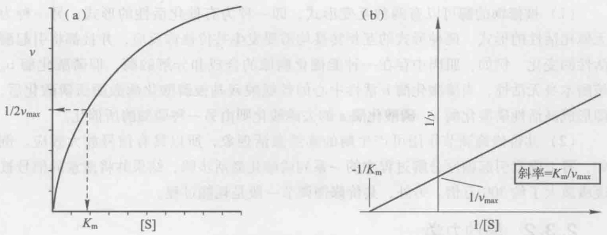

图2-9 酶促反应速率-底物浓度图

式2-17除以式2-18得:

$$
\frac {v}{[ \mathrm{E} _ {0} ]} = \frac {k _ {2} [ \mathrm{ES} ]}{[ \mathrm{E} ] + [ \mathrm{ES} ]} \tag {2-19}
$$

因为假定酶-底物复合物 ES 处于稳态而不随时间改变，因此其形成速度与分解速度相等:

$$
\frac {\mathrm{d} [ \mathrm{ES} ]}{\mathrm{d} t} = 0 = k _ {- 1} [ \mathrm{ES} ] + k _ {2} [ \mathrm{ES} ] - k _ {1} [ \mathrm{E} _ {0} - \mathrm{ES} ] [ \mathrm{S} ] \tag {2-20}
$$

整理后得:

$$
\left[ \mathrm{ES} \right] = \frac {\left[ \mathrm{E} _ {0} \right] \left[ \mathrm{S} \right]}{K _ {\mathrm{m}} + \left[ \mathrm{S} \right]} \tag {2-21}
$$

其中上式的 $K_{\mathrm{m}} = (k_{-1} + k_2) / k_1 = [\mathrm{E}][\mathrm{S}] / [\mathrm{ES}]$，将上式代入式2-17，注意最大反应速度 $v_{\mathrm{max}} = k_2[\mathrm{E}_0]$，即得式2-15。$K_{\mathrm{m}}$ 的物理意义是当酶反应速度达最大反应速度一半时的底物浓度，即当 $[\mathrm{S}] = K_{\mathrm{m}}$ 时有:

$$
v = \left(\frac {K _ {\mathrm{m}} v _ {\max}}{K _ {\mathrm{m}} + K _ {\mathrm{m}}}\right) = \frac {1}{2} v _ {\max} \tag {2-22}
$$

式2-17可转换为线性形式，以使 $K_{\mathrm{m}}$ 值和 $v_{\mathrm{max}}$ 值能更准确地通过实验确定:

$$
\frac {1}{v} = \frac {1}{v _ {\max}} + \left(\frac {K _ {\mathrm{m}}}{v _ {\max}}\right) \frac {1}{[ \mathrm{S} ]} \tag {2-23}
$$

因此，由 $1 / v$ 对 $1 / [\mathrm{S}]$ 作双倒数图，就可得到一条直线，其斜率为 $K_{\mathrm{m}} / v_{\mathrm{max}}$ ，$Y$ 轴截距为 $1 / v_{\mathrm{max}}$ ，而 $X$ 轴截距为 $-1 / K_{\mathrm{m}}$ （图2-9b）。

当底物浓度过量时（此时 [S] 可以看成常数），式 2-20 很容易采用分离变量法进行积分，得到 [ES] 与时间的函数关系式:

$$
\left[ \mathrm{ES} \right] = (1 - \exp [ - (k _ {1} [ \mathrm{S} ] + k _ {- 1} + k _ {2}) t ]) \tag {2-24}
$$

或者反应速度 v 与时间的函数关系式:

$$
v = \frac {k _ {2} [ \mathrm{E} _ {0} ] [ \mathrm{S} ]}{[ \mathrm{S} ] + K _ {\mathrm{m}}} (1 - \exp [ - (k _ {1} [ \mathrm{S} ] + k _ {- 1} + k _ {2}) t ]) \tag {2-25}
$$

实际上，上述酶促反应的稳态假设只在 $k_{2}$ 、 $k_{-1}$ 和 $k_{1}[\mathrm{S}]$ 的数值比较大时才成立，此时式2-25中的指数函数近似为零（对于普通的酶，这些数值一般在100到$1000\mathrm{s}^{-1}$ 之间，这意味着在 $0.1\sim 0.01\mathrm{s}$ 内，ES的浓度就达到了稳态）。当所有三个速率常数 $k_{1}$ 、 $k_{-1}$ 和 $k_{2}$ 都比较小时，[ES]达到稳定值时将会花费很长时间，此时

---

2.3 酶活性的主要调节方式及酶动力学

31

Michaelis-Menten 方程并不成立。

Michaelis-Menten 方程的另一个缺陷是假定第二步反应不可逆。由于酶像其他催化剂一样同时促进正反应和逆反应（但促进程度不一样，产物可能与酶的亲合力低），所以多数情况下应考虑可逆反应:

$$
\mathrm{E+S} = \frac {k _ {1}}{k _ {- 1}} \mathrm{ES} \frac {k _ {2}}{k _ {- 2}} \mathrm{E+P} \tag {2-26}
$$

同样采用拟稳态假设，ES 的浓度稳定，可以推导出:

$$
\left[ \mathrm{ES} \right] = \frac {k _ {1} [ \mathrm{S} ] + k _ {- 2} [ \mathrm{P} ]}{k _ {- 1} + k _ {2} + k _ {1} s + k _ {- 2} [ \mathrm{P} ]} \left[ \mathrm{E} _ {0} \right] \tag {2-27}
$$

则反应速度:

$$
r = k _ {2} [ \mathrm{ES} ] - k _ {- 2} [ \mathrm{P} ] ([ \mathrm{E} _ {0} ] - [ \mathrm{ES} ]) = \frac {k _ {1} k _ {2} [ \mathrm{S} ] - k _ {- 1} k _ {- 2} [ \mathrm{P} ]}{k _ {- 1} + k _ {2} + k _ {1} [ \mathrm{S} ] + k _ {- 2} [ \mathrm{P} ]} [ \mathrm{E} _ {0} ] (2 - 2 8)
$$

当  $[P]=0$  时即得到式2-15，体外的酶动力学研究一般是最初反应时没有产物时进行的，但当产物生成后，式2-15仍很准确。当产物参与另外的反应使其酶促反应偏离平衡，则从S生成P在热力学上是可行的。如果没有逆反应的影响  $(k_{-2}, k_{-1} \approx 0)$ ，则几乎所有的S可以转化为P。当通过实验分析反应的酶动力学时，通常可以使用式2-15的动力学模型，但是对于工业生物反应器中底物转化的研究来说，式2-15的动力学模型并不理想。例如，当使用固定葡萄糖异构酶的活塞流反应器将葡萄糖转化为果糖时，需要十分接近平衡状态时才能获取足够糖含量的溶液，如果利用式2-15而不是式2-28，那么计算出所需的催化剂用量将会出现严重偏差。

## 2.3.2.2 抑制剂对酶动力学的影响

（1）竞争性抑制（competitive inhibition）:竞争性抑制剂是一种与底物具有共同的特征，能与该底物竞争酶活性中心的代谢物。反应产物、不可代谢的底物类似物、底物衍生物及替代性底物都可作为竞争性抑制剂。例如，琥珀酸脱氢酶催化琥珀酸氧化反应生成延胡索酸，丙二酸与主要底物琥珀酸的结构具有类似性，是琥珀酸脱氢酶的竞争性抑制剂。由于抑制剂与酶的结合是可逆的，于是在游离酶分子与结合了抑制剂的酶抑制剂复合物分子之间就建立了一个平衡，如图2-10的反应所示:

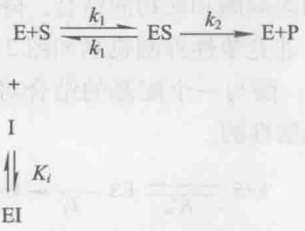

flowchart

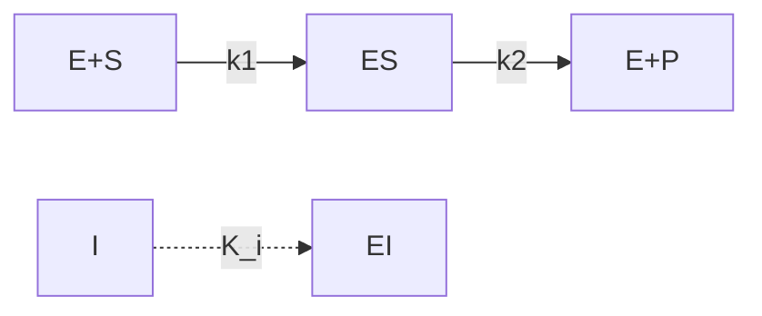

图2-10 竞争性抑制剂的作用机制

根据拟稳态假设，由上面的反应机制可以推导出竞争性抑制反应速率为:

---

32

2 细胞代谢反应和调节方式

$$
v = \frac {v _ {\mathrm{max}} [ \mathrm{S} ]}{K _ {\mathrm{m}} \left(1 + \frac {[ \mathrm{I} ]}{K _ {i}}\right) + [ \mathrm{S} ]} \tag {2-29}
$$

或写成双倒数的形式:

$$
\frac {1}{v} = \frac {K _ {\mathrm{m}}}{v _ {\max}} \bigg (1 + \frac {[ \mathrm{I} ]}{K _ {i}} \bigg) \frac {1}{[ \mathrm{S} ]} + \frac {1}{v _ {\max}} \tag {2-30}
$$

竞争性抑制剂的浓度越大，通过实验测定的表观米氏常数越大，即 $K_{\mathrm{m,app}} = K_{\mathrm{m}} \left(1 + [\mathrm{I}] / K_{i}\right)$，而 $v_{\max}$ 保持不变。这是因为在竞争性抑制剂的干扰下，需要更高的底物浓度才能获得同样的反应速度，这种干扰作用在底物浓度非常高时变得非常小，即酶遇到抑制剂分子的概率变得非常小了，所以最大反应速率不变。存在竞争性抑制剂时的双倒数图见图2-11a。

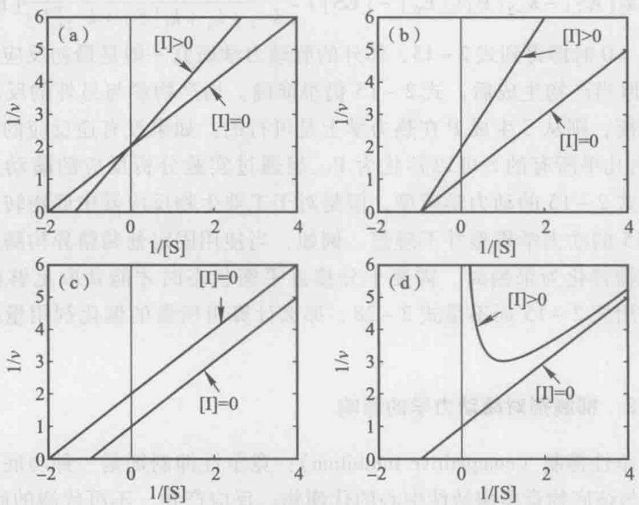

图2-11 不同抑制剂类型的酶动力学双倒数图

（a）竞争性抑制剂；（b）非竞争性抑制剂；（c）反竞争性抑制剂；（d）底物为反竞争性抑制剂

(2) 非竞争性抑制（noncompetitive inhibition）:非竞争抑制剂与酶也是非共价的可逆结合，这些抑制剂并不和底物竞争同一个结合位点，而是结合到酶分子的调节位点并触发酶的构象变化，从而影响酶和底物的结合，降低催化效率。这样的抑制在稳态多反应物体系中普遍存在。非竞争性抑制机制如图 2-12 所示，抑制剂 I 能与 E 及 ES 结合，S 能与 E 及 EI 结合。酶与一个配基的结合对另一个的解离常数没有影响，但是所生成的 ESI 复合物是无活性的。

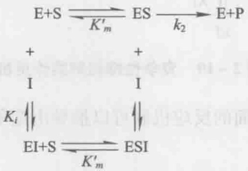

chemical

Chemical reaction pathway diagram showing E+S conversion to ES via K'm and k2, with I and EI+S reactions forming ESI

图2-12 非竞争性抑制剂的作用机制

---

2.3 酶活性的主要调节方式及酶动力学

33

同样根据拟稳态假设，由上面的反应机制可以推导出非竞争性抑制反应速率为:

$$
v = \frac {v _ {\mathrm{max}} [ \mathrm{S} ]}{\left(1 + \frac {[ \mathrm{I} ]}{K _ {i}}\right) (K _ {\mathrm{m}} + [ \mathrm{S} ])} \tag {2-31}
$$

或写成双倒数的形式:

$$
\frac {1}{v} = \left(\frac {K _ {\mathrm{m}}}{v _ {\mathrm{max}}} \frac {1}{[ \mathrm{S} ]} + \frac {1}{v _ {\mathrm{max}}}\right) \left(1 + \frac {[ \mathrm{I} ]}{K _ {i}}\right) \tag {2-32}
$$

上式表明在通常的 $1 / v$ 对 $1 / [\mathrm{S}]$ 图中直线斜率和在 $Y$ 轴上的截距均为[I]的函数，这是由于非竞争性抑制对底物结合及催化效率二者的双重影响。如图2-11b所示，由于 $Y$ 轴截距和斜率均以相同的因子（$1 + [\mathrm{I}] / K_{i}$）增加，而 $X$ 轴截距保持不变，并等于 $-1 / K_{\mathrm{m}}$。因此，非竞争性抑制剂的唯一影响是减小 $v_{\max}$ 而 $K_{\mathrm{m}}$ 保持不变，ES的稳态浓度由于部分ES转变为非反应的ESI形式而实际上减小了。

因为非竞争性抑制剂通常不类似于任何特定底物，故单一类型的抑制剂往往能够影响范围很广的酶类。例如，螯合剂（如EDTA和氰化物分别结合镁和铁）就属于此类抑制剂。由于含铁蛋白质在氧化还原反应中具重要作用，而对所有含ATP的反应中都需要镁离子，故这类抑制剂可能会产生有害的生理影响。

（3）反竞争性抑制（uncompetitive inhibition）:反竞争性抑制剂可以可逆地结合到酶-底物复合物，并形成一个无活性的ESI复合物。这类抑制普遍存在于多反应物系统，如图2-13所示。

$$
\begin{array}{c} \mathrm{E+S} \xrightarrow {K _ {m} ^ {\prime}} \mathrm{ES} \xrightarrow {k _ {2}} \mathrm{E+P} \\ + \\ \mathrm{I} \\ \parallel K _ {i} \\ \mathrm{ESI} \end{array}
$$

图2-13 反竞争性抑制剂的作用机制

根据拟稳态假设，可得出如下速率方程:

$$
v = \frac {v _ {\mathrm{max}} [ \mathrm{S} ]}{K _ {\mathrm{m}} + \left(1 + \frac {[ \mathrm{I} ]}{K _ {i}}\right) [ \mathrm{S} ]} \tag {2-33}
$$

或写成双倒数的形式:

$$
\frac {1}{v} = \frac {K _ {\mathrm{m}}}{v _ {\mathrm{max}}} \frac {1}{[ \mathrm{S} ]} + \frac {1}{v _ {\mathrm{max}}} \left(1 + \frac {[ \mathrm{I} ]}{K _ {t}}\right) \tag {2-34}
$$

反竞争性抑制剂使  $v_{max}$  和表观  $K_{m}$  都以相同因子降低，反应  $ES + I \rightleftharpoons ESI$  使 ES 浓度降低，引起  $E + S \rightleftharpoons ES$  的平衡向右移动。其双倒数图如图 2-11c 所示，当 [I] 增加时，Y 轴截距也增加，形成一系列平行线。

如果反竞争抑制剂就是底物 S，则反应速率方程为:

$$
v = \frac {v _ {\max} [ \mathrm{S} ]}{K _ {\mathrm{m}} + [ \mathrm{S} ] + \frac {[ \mathrm{S} ] ^ {2}}{K _ {i , s}}} \tag {2-35}
$$

此时双倒数图中的直线变为双曲线，见图2-11d。该双曲函数具有一条垂直和

---

34

2 细胞代谢反应和调节方式

一条倾斜的渐近线（该线代表不存在抑制作用的情况），这两条渐近线表明:当底物浓度很高时，存在严重的抑制作用，反应速率接近于0；当底物浓度很低时，几乎没有抑制作用，反应速率可用 Michaelis-Menten 方程近似表示。

（4）不可逆抑制（irreversible inhibition）:不可逆抑制剂与酶分子共价结合后永久性地破坏了酶的催化活性。例如非特异性的不可逆抑制剂二异丙基磷酸氟化物（DIPF）可与酶蛋白中丝氨酸残基的羟基结合而使酶失活。有些不可逆抑制剂是具有特异性，如青霉素特异性地抑制参与细胞壁合成的酶。不可逆抑制剂和非竞争性抑制剂都能使 $v_{max}$ 变小，这两种不同的抑制效应可以通过 $v_{max}$ 对 $[E_{0}]$ 作图来区分。如图2-14所示，对于可逆的非竞争性抑制剂来说，其直线比对照的直线斜率要小，且两条

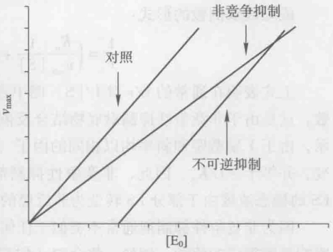

line

| [E0] | 对照 (Vmax) | 非竞争抑制 (Vmax) | 不可逆抑制 (Vmax) |
| --- | --- | --- | --- |
| 0 | 0 | 0 | 0 |
| ~1.5 | ~2.5 | — | — |
| ~3.5 | — | ~4.5 | — |
| ~6.5 | — | ~7.5 | ~2.5 |

图2-14 不可逆抑制与非竞争性抑制的比较 $\left[\mathrm{E}_0\right]$ 代表滴定的总酶浓度

直线都经过原点。不可逆抑制的直线斜率与对照直线斜率相同，与 X 轴相交的数值等于不可逆失活的临界酶浓度  $\left[E_{i}\right]$  （即酶浓度小于该浓度时，酶全部被不可逆性地失活，高于该浓度时，由于几乎所有的不可逆抑制剂分子都已经和酶结合在一起，有一部分酶分子不受抑制剂的影响而具有活性）。

## 2.3.2.3 变构酶的动力学

变构酶通常由多亚基组成，并且由S形速率曲线来表征，这种动力学具有明显的优点:当底物浓度在生理浓度范围内波动时，反应速率的变化幅度比通常情况（米氏方程）更大。这是由变构酶的协同性造成的，在生理上极为重要，这种动力学特点使得细胞可以在低或高底物浓度时来“关闭”或“打开”反应。在中等底物浓度时，S形动力学响应提供了反应速率更加敏感的控制。这种调节的另一个重要性质是存在着一个浓度阈值，低于该阈值就没有催化活性，这种阈值现象在激素响应、神经信号或细胞分化等情况下极为重要。

（1）无协同性的动力学:对于双亚基酶，如果具有两个相同且相互独立的催化位点，如图2-15所示。根据拟稳态假设（这里假设复合物ES和SES均处于稳态），动力学表达式如2-36所示:

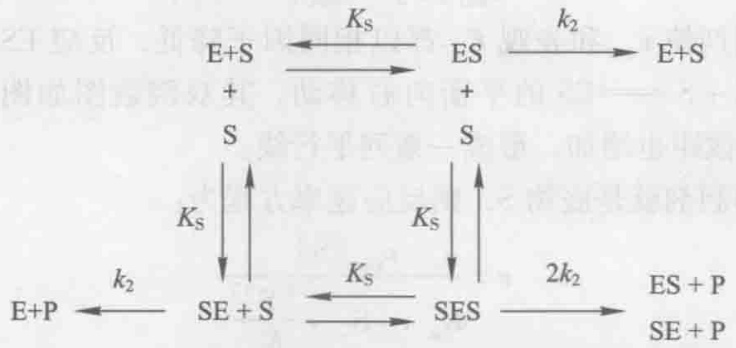

flowchart

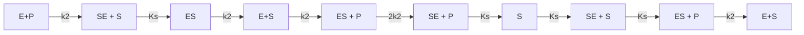

图2-15 不具有协同作用的双亚基酶的催化机制

二聚体中两个位点是相同的，并且相互独立， $K_{\mathrm{S}}$ 称为本征解离常数

---

2.3 酶活性的主要调节方式及酶动力学

35

$$
\frac {v}{v _ {\max}} = \frac {\frac {[ \mathrm{S} ]}{K _ {\mathrm{s}}} + \frac {[ \mathrm{S} ] ^ {2}}{K _ {\mathrm{s}} ^ {2}}}{1 + \frac {2 [ \mathrm{S} ]}{K _ {\mathrm{s}}} + \frac {[ \mathrm{S} ] ^ {2}}{K _ {\mathrm{s}} ^ {2}}} = \frac {\frac {[ \mathrm{S} ]}{K _ {\mathrm{s}}} \left(1 + \frac {[ \mathrm{S} ]}{K _ {\mathrm{s}}}\right)}{\left(1 + \frac {[ \mathrm{S} ]}{K _ {\mathrm{s}}}\right) ^ {2}} \tag {2-36}
$$

其中: $K_{\mathrm{S}} = \frac{[\mathrm{S}][\mathrm{E}]}{[\mathrm{ES}]}$ ， $v_{\mathrm{max}} = 2k_2[\mathrm{E}_0]$ 。

通常，对具有 n 个相同且相互独立位点的酶，其动力学方程可表示为:

$$
\frac {v}{v _ {\max}} = \frac {\frac {[ \mathrm{S} ]}{K _ {\mathrm{S}}} \left(1 + \frac {[ \mathrm{S} ]}{K _ {\mathrm{S}}}\right) ^ {n - 1}}{\left(1 + \frac {[ \mathrm{S} ]}{K _ {\mathrm{S}}}\right) ^ {n}} \tag {2-37}
$$

或者进一步化简为:

$$
\frac {v}{v _ {\max}} = \frac {[ \mathrm{S} ]}{K _ {\mathrm{S}} + [ \mathrm{S} ]} \tag {2-38}
$$

从式2-37可以看出， $v$ 对[S]作图总是双曲形，无法由动力学数据来确定 $n$ 或者无法区分具有 $n$ 个相同位点的1mol酶和具有1个位点的 $n\mathrm{mol}$ 酶。

(2) 有协同性的动力学: 如果考虑到协同性, 同样是具有两个位点的双亚基酶酶, 第一个底物分子的结合将影响第二个底物分子与酶的亲和力, 因此, 第二个底物分子和 ES (或 SE) 复合物结合的解离常数变为 $\alpha K_{\mathrm{s}}$, 当 $\alpha < 1$ 时为正协同效应, 而当 $\alpha > 1$ 时为负协同效应。该机制产生的动力学见式 2-39, 其在图形上具有 S 形的特征:

$$
\frac {v}{v _ {\max}} = \frac {\frac {[ \mathrm{S} ]}{K _ {\mathrm{s}}} + \frac {[ \mathrm{S} ] ^ {2}}{\alpha K _ {\mathrm{s}} ^ {2}}}{1 + \frac {2 [ \mathrm{S} ]}{K _ {\mathrm{s}}} + \frac {[ \mathrm{S} ] ^ {2}}{\alpha K _ {\mathrm{s}} ^ {2}}} \tag {2-39}
$$

对于更加复杂的四聚体变构酶，动力学方程为:

$$
\frac {v}{v _ {\max}} = \frac {\frac {[ \mathrm{S} ]}{K _ {\mathrm{S}}} + \frac {3 [ \mathrm{S} ] ^ {2}}{\alpha K _ {\mathrm{S}} ^ {2}} + \frac {3 [ \mathrm{S} ] ^ {3}}{\alpha^ {2} \beta K _ {\mathrm{S}} ^ {3}} + \frac {[ \mathrm{S} ] ^ {4}}{\alpha^ {3} \beta^ {2} \gamma K _ {\mathrm{S}} ^ {4}}}{1 + \frac {4 [ \mathrm{S} ]}{K _ {\mathrm{S}}} + \frac {6 [ \mathrm{S} ] ^ {2}}{\alpha K _ {\mathrm{S}} ^ {2}} + \frac {4 [ \mathrm{S} ] ^ {3}}{\alpha^ {2} \beta K _ {\mathrm{S}} ^ {3}} + \frac {[ \mathrm{S} ] ^ {4}}{\alpha^ {3} \beta^ {2} \gamma K _ {\mathrm{S}} ^ {4}}} \tag {2-40}
$$

与  $\alpha$  类似， $\beta$  是两个底物分子和酶结合后对第三个底物分子与复合物 ESS 亲和力的影响因子， $\gamma$  是三个底物分子和酶结合后对第四个底物分子与复合物 ESSS 亲和力的影响因子，这种亲和力的影响是渐进的和累积的。

（3）变构酶的经验动力学方程:Hill 方程。对于呈现显著协同效应的酶，影响因子  $\alpha$ 、 $\beta$ 、 $\gamma$  等都非常小，因此，动力学方程主要取决于  $[S]^{n}$  项。当  $[S] > K_{s}$  时，通常酶的 n 个位点都和底物结合，因此结合少于 n 个底物分子的酶-底物复合物的浓度将可以忽略不计。这样，式 2-40 可简化为:

$$
\frac {v}{v _ {\mathrm{max}}} = \frac {\frac {[ \mathrm{S} ] ^ {4}}{\alpha^ {3} \beta^ {2} \gamma K _ {\mathrm{s}} ^ {4}}}{1 + \frac {[ \mathrm{S} ] ^ {4}}{\alpha^ {3} \beta^ {2} \gamma K _ {\mathrm{s}} ^ {4}}} = \frac {\frac {[ \mathrm{S} ] ^ {4}}{K ^ {\prime}}}{1 + \frac {[ \mathrm{S} ] ^ {4}}{K ^ {\prime}}} = \frac {[ \mathrm{S} ] ^ {4}}{[ \mathrm{S} ] ^ {4} + K ^ {\prime}} \tag {2-41}
$$

具有 n 个底物结合位点的酶，动力学方程如式 2-42 所示，该方程也称为 Hill 方程:

---

36

2 细胞代谢反应和调节方式

$$
\frac {v}{v _ {\max}} = \frac {[ \mathrm{S} ] ^ {n}}{K ^ {\prime} + [ \mathrm{S} ] ^ {n}} \tag {2-42}
$$

其中  $K' = \alpha^{n-1} \beta^{n-2} \gamma^{n-3} \cdots K_{S}^{n}$ ，相当于  $v = 0.5 v_{max}$  时底物浓度的 n 次幂。上述方程可以写成对数的形式:

$$
\lg \left(\frac {v}{v _ {\mathrm{max}} - v}\right) = n _ {\mathrm{app}} \lg [ \mathrm{S} ] - \lg K ^ {\prime} \tag {2-43}
$$

根据测定的反应速度和底物浓度等实验数据作  $\lg\left(\frac{v}{v_{\max}-v}\right)-\lg[S]$  图，可以得到一条斜率为  $n_{app}$  的直线，同时可以根据直线在 X 轴上的截距确定  $K'$  值。大量实验证明，Hill 方程中的 n 和底物结合位点的数目并不一致，因此在这里用  $n_{app}$  来替代底物结合位点的个数 n。例如，血红蛋白具有四个氧气结合位点，但是实验表明  $n_{app}=2.7$ 。

## 2.4 酶表达水平的调节

除通过改变酶分子的结构来调节细胞内原有酶的活性外，生物体还可通过改变酶的合成或降解速度以控制酶的绝对含量来调节代谢。酶是基因表达过程的产物，其浓度可以分别在转录和翻译两种水平上进行控制。大多数原核生物是在转录水平上控制酶的表达水平，因为对于细胞来说，控制 mRNA 的量要比控制蛋白质的量在能量消耗上更为经济，另外 mRNA 的半衰期远低于蛋白质的半衰期，因此控制 mRNA 的水平可以更为迅速的调节蛋白质的浓度。除了在转录水平上调节酶蛋白合成的诱导和阻遏过程之外，控制酶降解的速度也是一种重要的调控方式。

## 2.4.1 底物诱导

受酶催化的底物常常可以诱导该酶的合成，这种现象在生物界普遍存在。高等动物体内，因有激素的调节作用，底物诱导作用不如在微生物体内重要，但是，某些代谢途径中的关键酶也受底物的诱导调节。例如，如果将鼠饲料中酪蛋白的含量从8%增至70%，则鼠肝中的精氨酸酶的表达水平也会显著增加。在食物被消化和吸收后，血液中多种氨基酸的浓度会增加，氨基酸浓度的增加又诱导氨基酸分解酶体系中的一些关键酶的表达，如苏氨酸脱水酶和酪氨酸转氨酶等。这种诱导作用对于维持体内游离氨基酸浓度的相对恒定非常重要。

底物诱导中研究得最早和最充分的是乳糖对乳糖操纵子（lactose operon）的诱导作用。乳糖操纵子的调控十分复杂，除了底物诱导的负调控系统之外，还有一个正调控系统。乳糖操纵子带有大肠杆菌利用乳糖时所必需的结构基因，如图2-16所示。乳糖操纵子的启动子和操纵区分别是lacP和lacO。lacI基因编码阻遏蛋白，当缺乏乳糖时，阻遏蛋白与操纵基因（lacO）结合，形成空间位阻而阻碍RNA聚合酶向启动子下游移动。在这种情况下，整个乳糖操纵子的转录水平非常低（也称为本底表达水平），细胞内只有极少量利用乳糖的蛋白（图2-16b）。在乳糖存在的条件下，它可以作为诱导物诱导乳糖操纵子的表达（实际的诱导物为乳糖运入细胞后在β-半乳糖苷酶作用下生成的异乳糖，这些酶具有本底表达量）。异乳糖可以和阻遏蛋白在特

---

2.4 酶表达水平的调节

37

定位点结合，引起阻遏蛋白的构象变化，降低了它与操纵基因结合的亲合力。因此，RNA聚合酶就能够向下游移动而转录出多顺反子mRNA，其编码的β-半乳糖苷酶（LacZ）、乳糖透性酶（LacY）和β-半乳糖苷转乙酰基酶（LacA）的表达量提高，从而加快乳糖的利用（图2-16a）。显然，调节基因所编码的调控蛋白和DNA结合后转录水平降低，乳糖操纵子的底物诱导系统是一个负调控系统。

乳糖操纵子的表达还受到一个正调控系统的调节，正调控的信号分子是胞外的葡萄糖。由于葡萄糖是细胞的最适碳源，因此当葡萄糖和乳糖同时存在时，细胞会优先利用葡萄糖，当葡萄糖被细胞代谢而使其浓度变得非常低的时候，乳糖代谢有关的酶才能高效表达。因为大肠杆菌利用葡萄糖的酶是组成型的，所以当葡萄糖与乳糖同时存在时，生产乳糖代谢有关的酶对细胞来说是一种资源浪费。大肠杆菌通过正调控系统来防止过量葡萄糖存在时浪费能量和营养去合成乳糖代谢有关的酶。

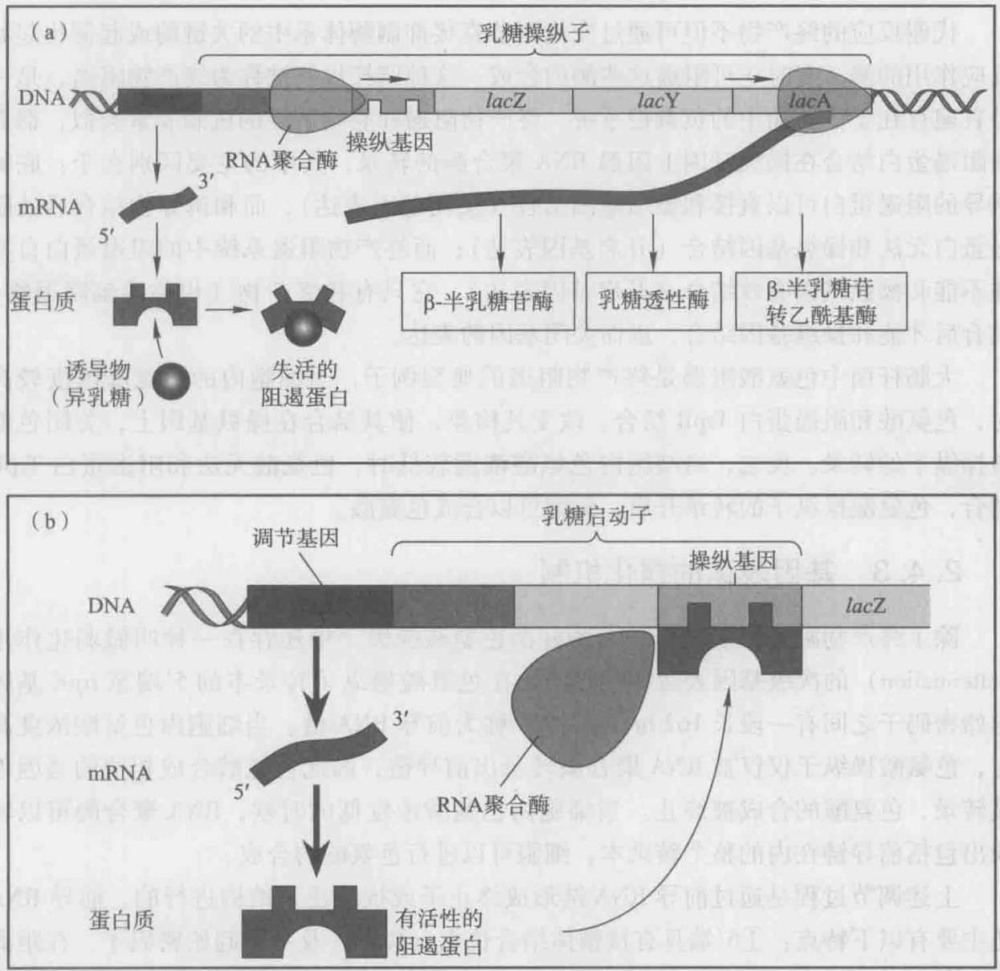

图2-16 乳糖操纵子的底物诱导机制

（a）乳糖存在时，允许RNA聚合酶转录编码乳糖操纵子三个酶基因的mRNA；（b）乳糖缺乏时，阻遏蛋白与乳糖操纵子的操纵基因结合，阻碍RNA聚合酶对操纵子的转录

正调控系统中的主要调节蛋白是一种全局调节蛋白:环腺苷酸受体蛋白（cyclic AMP receptor protein, CRP），该蛋白除了能调控乳糖操纵子的表达之外，还能调控许

---

38

2 细胞代谢反应和调节方式

知识拓展2-4葡萄糖浓度和细胞内cAMP浓度的关联

多与其他碳源代谢有关基因的表达。正调控的机制也已经研究得比较深入，主要调控过程如下:CRP蛋白根据细胞内cAMP浓度调控乳糖操纵子的表达。当细胞内cAMP浓度高时（在这种情况下，葡萄糖浓度较低），CRP蛋白和cAMP结合形成活化的cAMP-CRP，只有被cAMP活化的CRP蛋白才能高效结合在乳糖启动子的上游，促进RNA聚合酶和启动子的结合，并在乳糖的诱导作用下使乳糖操纵子高效表达（即不存在LacI蛋白对RNA聚合酶的空间位阻效应）。反之，当细胞内cAMP浓度低时（在这种情况下，葡萄糖浓度较高），无法形成活化的cAMP-CRP，此时RNA聚合酶和启动子的结合能力较弱，即使存在乳糖的诱导作用，乳糖操纵子也不能高效表达。乳糖操纵子表达的正、负调控机制可以很好地解释以葡萄糖和乳糖为碳源培养大肠杆菌时的二次生长现象。

## 2.4.2 终产物阻遏

代谢反应的终产物不但可通过变构调节直接抑制酶体系中的关键酶或起催化起始反应作用的酶，有时还可阻遏这些酶的合成，这种调控机制被称为终产物阻遏，是一种普遍存在于微生物中的负调控系统。终产物阻遏和底物诱导的机制非常类似，都需要阻遏蛋白结合在操纵基因上阻遏 RNA 聚合酶的转录，其中的主要区别在于:底物诱导的阻遏蛋白可以直接和操纵基因结合（关闭基因表达），而和诱导物结合后的阻遏蛋白无法和操纵基因结合（开启基因表达）；而终产物阻遏系统中的阻遏蛋白自身并不能和操纵基因有效结合（开启基因表达），它只有和终产物（也称为辅阻遏物）结合后才能和操纵基因结合，进而关闭基因的表达。

大肠杆菌中色氨酸阻遏是终产物阻遏的典型例子，当细胞内的色氨酸浓度较高时，色氨酸和阻遏蛋白TrpR结合，改变其构象，使其结合在操纵基因上，关闭色氨酸操纵子的转录。反之，当细胞内色氨酸浓度较低时，色氨酸无法和阻遏蛋白TrpR结合，色氨酸操纵子的转录开启，细胞可以合成色氨酸。

## 2.4.3 基因表达的弱化机制

除了终产物阻遏机制之外，大肠杆菌色氨酸操纵子中还存在一种叫做弱化作用（attenuation）的次级基因表达调控机制。在色氨酸操纵子转录本的5'端至trpE基因起始密码子之间有一段长162 bp的序列，称为前导RNA链。当细胞内色氨酸浓度高时，色氨酸操纵子仅仅被RNA聚合酶转录出前导链，因此色氨酸合成相关的基因不被转录，色氨酸的合成被终止。当细胞内色氨酸浓度低的时候，RNA聚合酶可以转录出包括前导链在内的整个转录本，细胞可以进行色氨酸的合成。

上述调节过程是通过前导 RNA 链形成终止子或抗终止子结构进行的。前导 RNA 链主要有以下特点:①5'端具有核糖体结合位点（RBS）及一个起始密码子，在距离 5'端约 70 个碱基的位置有一个终止密码子，这段序列的翻译产物是由 14 个氨基酸残基组成的短肽，称为前导肽。②在前导肽的编码区中有两个连续的色氨酸密码子。③在前导链中共有四段能相互配对的区域，其中区域 2 和区域 3 配对后形成抗终止子结构，而区域 3 和区域 4 配对后形成终止子结构（图 2-17a）。一旦前导 RNA 链被转录，核糖体就可以结合在 RBS 上启动前导肽的翻译。通常在色氨酸浓度较高时，细胞内的绝大多数色氨酰-tRNA 负载有色氨酸，因此核糖体可以很快通过两个连续的

---

2.4 酶表达水平的调节

39

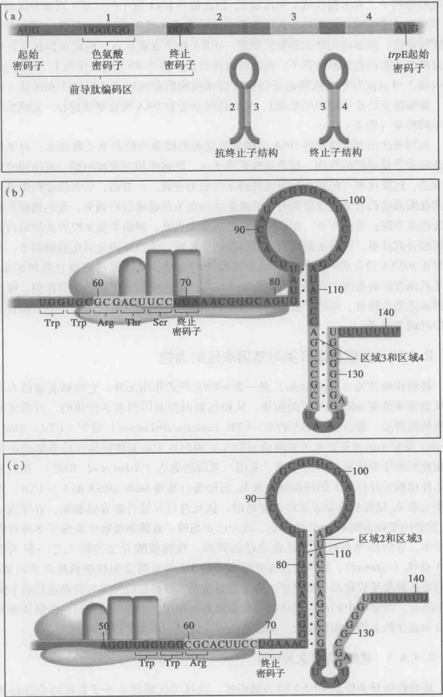

图2-17 色氨酸操纵子表达的弱化机制

（a）前导 RNA 链结构；（b）色氨酸浓度高时，区域 3 和区域 4 配对形成终止子，转录在色氨酸操纵子第一个结构基因 trpE 上游提前终止，细胞停止合成色氨酸；（c）色氨酸浓度低时，区域 2 和区域 3 配对形成抗终止子，色氨酸操纵子被转录，细胞启动色氨酸的合成

---

40

2 细胞代谢反应和调节方式

色氨酸密码子，并占据区域1和区域2，因此前导RNA链中的区域3只能和区域4配对形成终止子结构，从而终止色氨酸操纵子的转录（图2-17b）。反之，当在色氨酸浓度较低时，细胞内的绝大多数色氨酰-tRNA处于空载状态，因此核糖体无法快速通过两个连续的色氨酸密码子，此时核糖体只占据前导RNA链的区域1，因此区域2和区域3可以配对形成抗终止子结构（即该结构的形成阻遏了区域3和区域4的配对，能够防止终止子结构的形成），从而使转录沿着DNA模板继续进行，完成整个操纵子的转录（图2-17c）。

基因表达的弱化机制将 RNA 的构象变化和基因表达的调节关联起来，对基因的表达起着严格调控的作用。在色氨酸操纵子中，阻遏作用与衰减机制一起协同控制基因表达，这要比单一的终产物阻遏调控系统更为有效。一方面，当有活性的阻遏物向无活性阻遏物的转变速度很慢时，衰减系统能更为迅速地进行调节，使色氨酸从较高浓度快速下降；另一方面，如果外源色氨酸浓度太低，细菌本身又没有其他的内源性色氨酸合成体系，以致细菌难以支持自身的生长时，就需要通过弱化机制调节，通过不终止 mRNA 的合成来增加色氨酸合成酶类的合成，从而提高内源色氨酸的浓度。弱化机制在控制基因产物的量和产物种类的配比上起着快速灵敏的调节作用，使操纵基因表达更为精密、高效，是一种普遍存在于原核生物的氨基酸、核苷等生物合成途径中的调节方式。

## 2.4.4 核糖核酸开关对基因表达的调控

核糖核酸开关（riboswitchs）是一类 mRNA 顺式作用元件，它能够直接结合小分子代谢物来改变 mRNA 分子的构象，从而起到调控基因的表达作用的，目前发现的核糖核酸开关一般位于 mRNA 的  $5'$ -UTR（untranslated region）或  $3'$ -UTR。2002 年，Breaker 研究小组首先证实了细菌的 mRNA 非编码区中的某些结构元件能够感应特定代谢物的浓度变化来“启动”或“关闭”基因的表达（Nahvi et al. 2002）。他们发现的这种结构元件位于大肠杆菌维生素  $B_{12}$  运输蛋白基因 btuB mRNA 的  $5'$ -UTR，当胞内维生素  $B_{12}$  辅酶腺苷钴胺素的浓度高时，该元件可以结合腺苷钴胺素，并导致 mRNA 构象的变化而阻遏 btuB 的表达。迄今已在细菌、真菌和植物中发现了多种核糖核酸开关，它们参与多种重要代谢途径的调控。核糖核酸开关实际上是一种天然的 RNA 适体（aptamer），目前已经发现细菌中约 3% 的基因受到核糖核酸开关的调控，控制着各种物质代谢的基础途径。对于合成途径，核糖核酸开关可以和途径的下游代谢物结合，对途径中的基因表达起着反馈阻遏的作用。对于降解途径，核糖核酸开关可以和途径的上游代谢物结合，通过前馈启动途径中相关基因的表达。

## 2.4.4.1 核糖核酸开关的结构

核糖核酸开关位于 mRNA 的非编码区，通过与代谢物小分子直接结合进行基因表达的调控。大多数核糖核酸开关都可以分成两个结构域:一个是作为感应器的适体结构域（aptamer domain, AD），另外一个是作为基因表达调节结构域的表达平台（expression platform, EPD）。AD 是一个高度折叠的结构，能感应特定代谢物的浓度，从而选择性地与特定的代谢物结合，这种结合会导致其自身以及表达平台的构象发生变化。表达平台构象的变化可以形成终止子或抗终止子结构，或形成掩蔽或暴露 RBS

---

2.4 酶表达水平的调节

41

位点、mRNA剪切位点的结构，从而可以在基因转录、翻译或者mRNA剪切和加工等水平上调节基因的表达（图2-18）。在一些真核生物中，核糖核酸开关也存在于3'-UTR区域，可能形成具有自剪切能力的核酶结构，通过和特定代谢物结合后影响核酶活性来控制mRNA的稳定性，进而调控基因的表达。

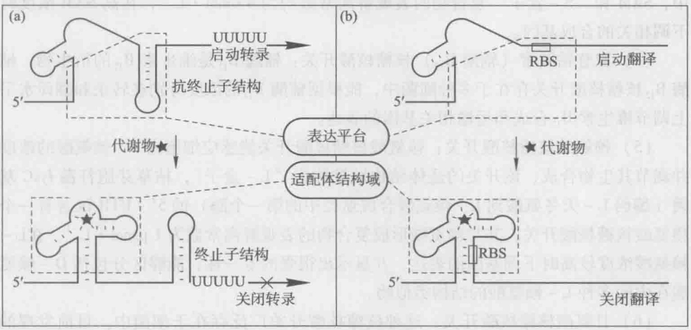

flowchart

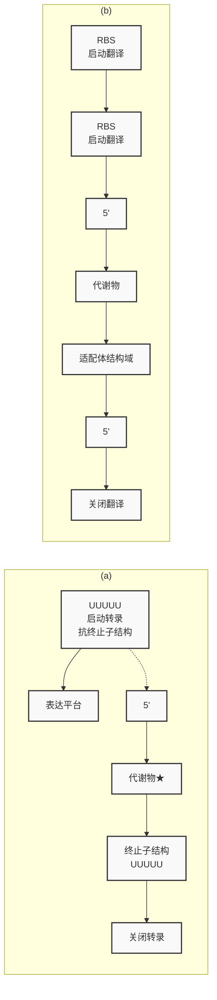

图2-18 核糖核酸开关的一般结构

图中显示了分别在转录水平（a）和翻译水平上（b）控制基因表达的核糖核酸开关

## 2.4.4.2 核糖核酸开关的种类

目前已经发现多种天然存在的感应特定代谢物浓度的核糖核酸开关，这些代谢物主要是辅酶、氨基酸及嘌呤等。根据代谢物种类的不同，核糖核酸开关主要分为以下几种（Smolke 2009）。

（1）焦磷酸硫胺素（TPP）核糖核酸开关:TPP 是一种由维生素  $B_{1}$  衍生而来的辅酶。TPP 核糖核酸开关是在自然界分布最广的核糖核酸开关，普遍存在于细菌、古细菌、真菌和植物中。这种开关通过控制维生素  $B_{1}$  的合成来调节胞内 TPP 的浓度。大肠杆菌中 thiC 基因的 5' - UTR 区存在此开关，其适体结构域也被称为 “thi 盒子” (thi box)，TPP 和该适体形成的复合物的表观解离常数  $K_{d}$  约为  $100 \, mmol \cdot L^{-1}$ ，而没有焦磷酸基团的前体代谢物和该适体形成的复合物的表观解离常数要比其大三个数量级。TPP 核糖核酸开关的调节基因表达的机制有多种:对于细菌，通常在转录或翻译水平上进行调节；对于真菌，通常在 mRNA 的剪切和拼接环节上进行调节；对于植物细胞，有可能在 mRNA 的加工环节进行调节。
(2) 黄素单核苷酸 (FMN) 核糖核酸开关: FMN 是许多氧化还原酶类的辅酶, 由前体物维生素 $\mathrm{B}_{2}$ 衍生而来。FMN 核糖核酸开关最先在枯草芽胞杆菌中发现, 随后的研究表明这种开关广泛存在于许多细菌中, 其适体结构域也被称为 RFN 元件, 调节维生素 $\mathrm{B}_{2}$ 和 FMN 的合成及运输等相关基因的表达。枯草芽胞杆菌维生素 $\mathrm{B}_{2}$ 操纵子 rib-DEAHT 的 FMN 核糖核酸开关与 FMN 形成的复合物的表观解离常数约为 $5 \mathrm{nmol} \cdot \mathrm{L}^{-1}$, 而与维生素 $\mathrm{B}_{2}$ 形成的复合物的表观解离常数约为 $3 \mu \mathrm{mol} \cdot \mathrm{L}^{-1}$ 。TPP 核糖核酸开关主要在转录水平上 (例如维生素 $\mathrm{B}_{2}$ 操纵子) 和翻译水平上 (例如 ypaA) 调节基因的表达。

---

42

2 细胞代谢反应和调节方式

(3) S-腺苷甲硫胺酸（SAM）核糖核酸开关:SAM 是一种由甲硫氨酸衍生而来的辅酶，为甲基化酶提供甲基基团。SAM 核糖核酸开关的适体结构域被称为 “S-盒子”，该开关调节与半胱氨酸、甲硫氨酸及 SAM 合成相关基因的表达，常见于革兰氏阳性细菌中。SAM 核糖核酸开关主要在转录水平调节基因的表达，在枯草芽胞杆菌中，SAM 和 “S-盒子” 复合物的表观解离常数约为 $4 \mathrm{nmol} \cdot \mathrm{L}^{-1}$，在高 SAM 浓度时下调相关的合成基因。
（4）腺苷钴胺素（辅酶  $B_{12}$  ）核糖核酸开关:辅酶  $B_{12}$  是维生素  $B_{12}$  的衍生物，辅酶  $B_{12}$  核糖核酸开关存在于多种细菌中，能根据辅酶  $B_{12}$  的浓度分别在转录和翻译水平上调节维生素  $B_{12}$  合成和运输相关基因的表达。
（5）赖氨酸核糖核酸开关:赖氨酸核糖核酸开关能感应细胞内 L-赖氨酸的浓度并调节其生物合成，该开关的适体结构域被称为“L-盒子”，枯草芽胞杆菌 lysC 基因（编码 L-天冬氨酸到 L-赖氨酸合成途径中的第一个酶）的  $5^{\prime}-UTR$  区含有一个赖氨酸核糖核酸开关，其与赖氨酸形成复合物的表观解离常数为  $1 \mu mol \cdot L^{-1}$ ，在 L-赖氨酸浓度较高时下调基因的表达，并显示出很强的专一性，能够区分包括 D-赖氨酸在内的多种 L-赖氨酸的结构类似物。
(6) 甘氨酸核糖核酸开关: 这种核糖核酸开关广泛存在于细菌中。目前发现的大部分核糖核酸开关只含有一个适体结构域, 但在甘氨酸核糖核酸开关中有两个相距很近的适体结构域。枯草芽胞杆菌 $gcvT$ 操纵子负责甘氨酸的分解, 该操纵子的前导区 (或 $5^{\prime}-UTR$) 含有甘氨酸核糖核酸开关, 负责在细胞内甘氨酸浓度过高时启动 $gcvT$ 操纵子的转录, 从而降解甘氨酸。开关中的两个适体结构域都能特异性地和甘氨酸结合, 并且存在协同效应: 第一个适体结构域和甘氨酸结合后会增强第二个适体结构域与甘氨酸的亲和力。这种协同效应类似于变构酶的协同性, 可以在很窄的甘氨酸浓度范围内对基因的表达起着“开关”作用。
（7）鸟嘌呤和腺嘌呤核糖核酸开关:嘌呤核糖核酸开关的适体结构域被称为“G-盒子”，这种开关主要控制嘌呤合成和运输途径相关基因的表达。枯草芽胞杆菌xpt-pbuX操纵子中的嘌呤核糖核酸开关能特异性地和鸟嘌呤及次黄嘌呤结合（复合物的表观解离常数 $K_{d}$ 分别约为5 nmol·L $^{-1}$ 和50 nmol·L $^{-1}$ ），在这些代谢物浓度过高时下调xpt-pbuX操纵子的转录水平。该开关的适体结构域不能有效地和腺嘌呤结合（复合物的 $K_{d}$ 高达300 μmol·L $^{-1}$ ）。在嘌呤输出蛋白编码基因ydhL的上游含有一个腺嘌呤核糖核酸开关，其适体结构域特异性地和腺嘌呤结合（复合物的 $K_{d}$ 约为300 nmol·L $^{-1}$ ），而不能和鸟嘌呤有效结合（复合物的 $K_{d}$ 高达10 μmol·L $^{-1}$ ）。该开关在腺嘌呤浓度过高时上调ydhL的转录。
（8）6-磷酸葡萄糖胺（GlcN6P）核糖核酸开关:6-磷酸葡萄糖胺核糖核酸开关存在于革兰氏阳性细菌glmS基因（该基因编码蛋白催化6-磷酸果糖和谷氨酰胺生成GlcN6P）的5'-UTR，它可以和GlcN6P结合后形成有活性的核酶结构，导致mRNA的5'端发生自剪切，从而下调glmS基因的表达。
(9) SAM-辅酶 $\mathrm{B}_{12}$ 核糖核酸开关:在克劳氏芽胞杆菌 metE 基因的 $5^{\prime} - \mathrm{UTR}$ 中存在一种特殊的核糖核酸开关系统，该系统含有两个串联的核糖核酸开关，其适体结构域分别和 SAM 及辅酶 $\mathrm{B}_{12}$ 结合。这种串联结构的开关形成了双输入的或逻辑门，两种代谢物中的任何一种浓度过高都能使 metE 基因的转录终止。metE 和 metH

---

2.4 酶表达水平的调节

43

编码的酶都能催化同型半胱氨酸合成甲硫氨酸，其中后者的催化效率更高，但需要辅酶  $B_{12}$  的衍生物作为辅因子。这个开关系统可以让细胞在辅酶  $B_{12}$  充足的时候关闭 metE 基因的表达，而表达催化效率更高的 MetH 合成甲硫氨酸，以及其衍生物 SAM。

## 2.4.4.3 核糖核酸开关的生物学意义及应用

核糖核酸开关这种通过感应代谢产物浓度进行基因表达调控的方式具有显著的优点（Dambach et al. 2009）:元件大小在数百碱基之内，构成非常简单；灵敏度高，响应配体时间一般在数分钟之内，反应迅速；由于不需要蛋白因子参与调控，其免疫原性小；核糖开关位于 mRNA 之上，发挥顺式调节作用，可实现紧密调节。与 miRNA 等其他非编码 RNA 一样，核糖核酸开关被认为是原始 RNA 世界遗留下来的分子化石，在基因调控中有着许多不为人知的重要作用。至今，在哺乳动物中尚未发现有核糖核酸开关存在，而该机制究竟是否同样存在于高等真核生物中是科学家们一直感兴趣和探索的问题，如果这一调节机制能在哺乳动物中得到证实，那么人们对非编码序列的功能可能需要重新加以认识和评价。

核糖核酸开关是有适体结构域和表达平台有机的组合，因此可以通过筛选人工适体和表达平台组合在一起，合理设计某种代谢物作为基因表达调控的信号。目前，通过随机突变的方法已经筛选到能与茶碱等代谢物分子特异性结合的人工RNA适体。有的研究者将这种人工筛选的RNA适体与核酶、核糖体结合位点、短发卡RNA（short hairpin RNA, shRNA）或RNA剪接位点等基因表达的调节元件组合在一起构建了人工的核糖核酸开关，通过RNA适体与特定代谢物的结合来改变作为表达平台的核酶的二维或三维构象，从而使调节元件在有活性和无活性形式之间转换，以此达到调节基因表达的目的（Suess et al. 2004, Kim et al. 2005, An et al. 2006, Win et al. 2007）。因此，今后有可能在代谢途径中所有基因的 $5^{\prime}-UTR$ 或 $3^{\prime}-UTR$ 区域加上人工的核糖核酸开关，这些开关可以根据途径中不同代谢物的浓度进行基因表达的调节，以保持代谢物浓度的相对稳定，从而实现整个代谢途径中基因的协调表达和代谢通量的优化。如果用能感应某种代谢物浓度的人工核糖核酸开关来控制报告基因（例如绿色荧光蛋白基因）的表达，则可以实现对该代谢物在胞内浓度的实时监测。已有研究者利用茶碱的人工RNA适体（该适体也能有效地和茶碱的结构类似物黄嘌呤结合）和核酶组而合成的人工核糖核酸开关放置在绿色荧光蛋白基因的 $3^{\prime}-UTR$ 区域，将其作为生物传感器放入酿酒酵母中表达，结果能够很好地检测细胞内黄嘌呤的浓度（Win et al. 2007）。特定代谢物的核糖核酸开关与报告基因组合成的生物传感器也可以导入指示菌株中，用于对该特定代谢物高产菌株的筛选与检验（Fowler et al. 2010）。另外，还可以利用人工的核糖核酸开关设计各种逻辑门，实现生物计算的功能。例如，Smolke研究组（Win et al. 2008）开发了一个通用的由标准元件组装成具有特定逻辑电路功能的RNA元件的技术，这些RNA元件可以将分子输入信号和特定蛋白的表达相关联，不但可以行使各种逻辑门（包括与门、与非门、或门、或非门）和信号过滤器的功能，还可以实现输入信号对输出信号的协同性控制，从而能够对高层次细胞信息进行处理运算。

---

44

2 细胞代谢反应和调节方式

## 2.4.5 翻译的控制

某些酶的表达调节也能够发生在翻译水平，被称为转录后调节。这种调节机制控制着一个完整的 mRNA 分子被翻译的次数。一般情况下，翻译的调节方式主要有:控制 mRNA 稳定性、通过掩蔽 RBS 位点控制翻译起始概率（图 2-18），以及控制蛋白质的合成速度。

许多编码核糖体蛋白的操纵子都可以在翻译水平上进行调控。通常每个核糖体翻译蛋白质的速度约为每秒钟15个氨基酸（37℃时），细胞生长速度加快时，蛋白质合成速度也加快，因此细胞会相应地合成更多的核糖体。大肠杆菌以 $1.6\ h^{-1}$ 的比生长速率高速生长时，每个细胞含有数万个核糖体，而当比生长速率降为 $0.14\ h^{-1}$ 时，每个细胞只含有数千个核糖体。细胞通过一种翻译抑制的机制确保核糖体蛋白质的合成与核糖体的合成相耦联:rRNA和核糖体蛋白组装成核糖体，当所有的rRNA几乎和核糖体蛋白结合后，有一部分核糖体蛋白会结合在其自身的mRNA上，阻止翻译过多的核糖体蛋白。参与翻译的起始因子IF3的表达调节也发生在翻译水平上，IF3的起始密码子是翻译起始效率较低的AUU密码子，而IF3可以降低核糖体在AUU起始翻译的效率。当IF3浓度较高时，其自身的翻译效率就会降低，而当IF3浓度较低时，在AUU起始的翻译效率会增加，从而增加IF3的表达水平，这是一种典型的自调节。

在原核生物中，可以通过核糖核酸开关对基因的表达进行翻译控制，如图2-18所示，细胞通过感应某种代谢物的浓度而对mRNA结构进行重排，进而掩蔽或暴露核糖体结合位点（RBS位点），实现翻译的关闭或启动。除此之外，也可以通过小RNA来控制翻译。这些小RNA在低温或低铁水平等环境下表达，随后通过和目标mRNA的翻译起始区配对结合而抑制翻译，或者通过诱导目标mRNA结构发生重排暴露出翻译起始位点而激活翻译过程。在某些噬菌体和原核生物中还有一类mRNA特异性的阻遏蛋白，这些蛋白可以直接结合在目标mRNA的RBS位点周围从而妨碍核糖体与RBS的结合。在有些情况下，这些蛋白和mRNA结合后使其发生重新折叠，从而掩蔽或暴露RBS位点（Kozak 2005）。例如，在枯草芽胞杆菌中色氨酸浓度较高时可以激活特异性结合色氨酸操纵子mRNA的弱化蛋白（trp RNA-binding attenuation protein, TRAP），被激活的TRAP可以有效结合在trpE基因的RBS位点上游约100个碱基的位置，造成mRNA的重新折叠，从而掩蔽了trpE基因的RBS位点。TRAP还可以直接结合在trpG和trpP的RBS位点上，阻碍它们的翻译。非常有趣的是，TRAP也是一个控制色氨酸操纵子转录的蛋白，在色氨酸浓度较高的情况下弱化色氨酸操纵子的转录（Du et al. 1998）。

在真核生物中，一种典型的基因表达的翻译控制方式是控制核糖体和 mRNA 的重结合，在 DNA 损伤、营养限制、热刺激和缺氧等应急条件下，细胞会降低总体的蛋白质合成速率，但同时会选择性地增加一些特定应急响应蛋白的合成。mRNA 的 5' 端和 3' 端的非编码区的一些元件参与了核糖体和 mRNA 重结合的调节过程（图 2-19），这些元件包括内部核糖体进入位点（internal ribosome entry sites, IRESs），一些小 RNA 的结合位点以及上游开放阅读框。与原核生物不同，真核生物的翻译起始普遍发生在 mRNA 的 5' 端，核糖体 40S 亚基在翻译起始因子的帮助下从 5' 端进入 mRNA

---

2.4 酶表达水平的调节

45

后向下游滑动，并在此过程中和三元复合物（包括翻译起始因子 eIF2、甲硫氨酰基-tRNAi 和 GTP）结合，一旦遇到起始密码子后，在三元复合物的参与下，40S 亚基和 60S 亚基组装成完整的核糖体进行翻译。因此，5'端甲基化帽子对真核基因的翻译是必不可少的。环境中的应急信号经过一系列信号传递后改变了翻译起始因子的磷酸化状态，从而降低了这些翻译起始因子对 5'端甲基化帽子结构或者起始密码子 AUG 的识别效率，导致对蛋白合成的全局抑制（global inhibition）。一些应急响应蛋白的 mRNA 的 5'端非编码区含有内部核糖体进入位点，这些位点和原核生物中 RBS 的作用类似，可以使核糖体 40S 亚基绕开 5'端甲基化帽子和 mRNA 结合，因此在应急条件下，这些响应蛋白的 mRNA 可以更有效地和 40S 亚基结合而提高翻译效率，从而大量表达。小 RNA 主要结合在 mRNA 的 3'端非编码区对基因的表达进行调节，结合后可以降低 mRNA 的稳定性（图 2-19），但其对翻译的抑制作用机制还不清楚。

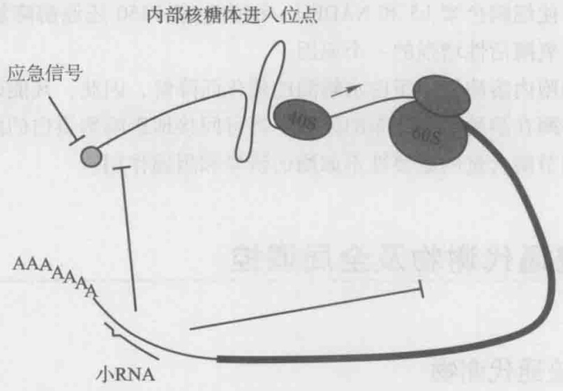

flowchart

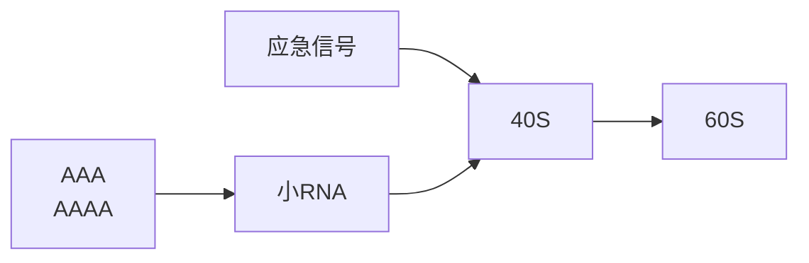

图2-19 真核生物中调节翻译的元件（Spriggs et al. 2010）

图中显示了5'端非翻译区内部核糖体进入位点和小RNA结合位点的对翻译的调节

在真核生物中，一些应急响应蛋白的 mRNA 的 5'端含有 1 至数个短的上游开放阅读框（upstream open reading frames, uORF），这些阅读框和下游基因的编码区发生重叠，对其翻译起着调节作用。一个典型的例子是哺乳动物细胞中编码一种应急响应转录因子的 ATF4 基因的表达（Spriggs et al, 2010）。该基因 mRNA 的上游存在两个短的开放阅读框，其中第 2 个阅读框和 ATF4 的编码区重叠，并且两者在重叠区域的密码子阅读框不同。一般情况下，在完成第 1 个阅读框的翻译后，核糖体的 60S 亚基解离，40S 亚基继续向下游滑动，遇到第 2 个阅读框的起始密码子后重新组装成完整的核糖体再次进行翻译。由于编码区的重叠，ATF4 的起始密码子不能被核糖体有效识别，因此其翻译受到抑制。在应急条件下，翻译起始因子 eIF2 被磷酸化，导致三元复合物浓度降低，40S 亚基在遇到第 2 个阅读框的起始密码子时和三元复合物结合的概率很低，从而无法组装成核糖体进行翻译。在这种情况下，40S 亚基继续向下游滑动，在遇到 ATF4 的起始密码子时三元复合物结合的概率较高，从而组装成核糖体进行 ATF4 的翻译（图 2-20）。

## 2.4.6 酶分子降解的调节

细胞内酶的含量也可通过改变酶分子的降解速度来调节。饥饿情况下，精氨酸酶

---

46

2 细胞代谢反应和调节方式

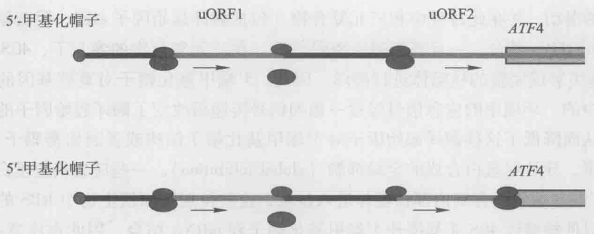

flowchart

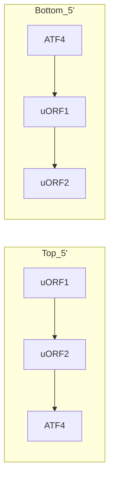

图2-20 哺乳动物细胞中ATF4基因表达的翻译调节（Spriggs et al. 2010）

的活性增加，主要是由于酶蛋白降解的速度减慢所致。饥饿也可使乙酰辅酶 A 羧化酶浓度降低，这除了与酶蛋白合成减少有关外，还与酶分子的降解速度加强有关。苯巴比妥等药物可使细胞色素 b5 和 NADPH - 细胞色素 P450 还原酶降解减少，这也是这类药物使单加氧酶活性增强的一个原因。

酶蛋白受细胞内溶酶体中蛋白水解酶的催化而降解，因此，凡能改变蛋白水解酶活性或蛋白水解酶在溶酶体内分布的因素，都可间接地影响酶蛋白的降解速度。一般通过酶降解以调节酶含量的重要性不如酶的诱导和阻遏作用。

## 2.5 流通代谢物及全局调控

## 2.5.1 流通代谢物

细胞在生长时能够非常协调地进行合成代谢与分解代谢，其中流通代谢物（currency metabolites）充当了重要的调节信号。流通代谢物主要是指可在细胞全局范围内流通的代谢物，这些代谢物参与细胞内的许多反应，可以传递能量或还原力。能量货币ATP和以代谢物形式出现的还原力NADH和NADPH。它们的作用主要在于协调细胞的代谢通量和反应方向，使受它们控制的途径成为代谢网络整体的一部分。流通代谢物的调节信号主要有能荷（energy charge）、分解代谢还原荷（catabolic reduction charge）及合成代谢还原荷（anabolic reduction charge），见式2-44\~2-46。

$$
\mathrm{能荷} E _ {\mathrm{c}} = \frac {[ \mathrm{ATP} ] + 0 . 5 [ \mathrm{ADP} ]}{[ \mathrm{ATP} ] + [ \mathrm{ADP} ] + [ \mathrm{AMP} ]} \tag {2-44}
$$

$$
\mathrm{分解代谢还原荷} = \frac {\left[ \mathrm{NADH} \right]}{\left[ \mathrm{NADH} \right] + \left[ \mathrm{NAD} ^ {+} \right]} \tag {2-45}
$$

$$
\text {合成代谢还原荷} = \frac {[ \mathrm{NADPH} ]}{[ \mathrm{NADPH} ] + [ \mathrm{NADP} ^ {+} ]} \tag {2-46}
$$

在能荷的定义式中，分子中 ADP 前的系数为 0.5，这是因为它含有的高能磷酸键数只有 ATP 的 1/2，即 1 个高能磷酸键。细胞内腺苷酸库中 AMP，ADP 和 ATP 的含量很少，如果 ADP 转化成 ATP 的过称被终止，生物合成反应与聚合反应仅仅数秒钟就消耗完细胞内的 ATP。因此，在细胞代谢活跃时，AMP 或 ADP 转换成 ATP 的速度必须非常快，而且转换速度通过与代谢反应相耦联的方式进行调节。对于 NADH/

---

2.5 流通代谢物及全局调控

47

$NAD^{+}$ 及 NADPH/NADP $^{+}$ ，存在着类似的情况。

在主要的分解代谢途径中，有一些关键酶的活性受到上述信号的反馈调节，通过对反应速度的控制来实现合成代谢与分解代谢的平衡。EMP途径和PP途径的主要控制位点处于这两条途径的分支点处，即磷酸果糖激酶和6-磷酸葡萄糖脱氢酶。其中6-磷酸葡萄糖脱氢酶的活性在合成代谢还原荷较高时受到抑制。磷酸果糖激酶是一种非常复杂的别构酶，它有数种效应物。在酿酒酵母中，该酶受效应物AMP、氨、磷酸以及2,6-二磷酸果糖激活，而被效应物ATP所抑制。该酶与ATP结合后会导致对6-磷酸果糖亲和力的降低，而与2,6-二磷酸果糖结合后会极大增强这种亲和力。因此在酿酒酵母中，2,6-二磷酸果糖对于EMP途径上的通量具有促进作用，而ATP（或高能荷值）具有抑制作用。由于6-磷酸果糖的浓度的增加会导致2,6-二磷酸果糖浓度的提高，这种调节能增加磷酸果糖激酶的活性以适应底物浓度的增加；在高能荷水平下（即ATP的相对浓度较高时），由于磷酸果糖激酶活性被抑制而使ATP的生成被阻断，从而使能荷水平逐渐降低。TCA循环的主要调节点在柠檬酸合成酶、异柠檬酸脱氢酶和α-酮戊二酸脱氢酶。这三种酶的活性都偏爱低水平的分解代谢还原荷，其中异柠檬酸脱氢酶的活性受其影响更大。在酵母中，异柠檬酸脱氢酶还在低能荷水平下被激活，在高能荷水平下被抑制。

$$
\mathrm{NADH} + \mathrm{NADP} ^ {+} - \mathrm{NAD} ^ {+} - \mathrm{NADPH} = 0 \tag {2-47}
$$

在稳定的生长环境中，细胞的能荷一般维持在0.65\~0.9。已有研究表明，能荷值受生长速率变化的影响很小，而腺苷酸的浓度受生长速率变化的影响更大一些（随生长速率的加快而增加）。在细胞代谢中，辅助因子NADH和NADPH用于两种不同的目的。在好氧微生物中，NADH主要涉及通过氧化磷酸化反应生成吉布斯自由能，而NADPH为生物量合成提供还原力。对于快速生长的细菌，分解代谢还原荷的数值通常为0.03\~0.08，而合成代谢还原荷的数值为0.7\~1.0。对于快速生长的酵母，这两个比值分别为0.25\~0.30和0.58\~0.75。显然，快速生长的细胞必须同时维持较高的分解代谢与合成代谢速度，因此分别作为分解代谢底物的 $NAD^{+}$ 和作为合成代谢底物的NADPH的浓度必定处于较高水平。在一些细菌和哺乳动物细胞中存在转氢酶，能够实现氢在 $NAD^{+}$ 和 $NADP^{+}$ 之间的转移，其反应式见式2-47。通常在正常生长条件下，这种酶在细胞代谢中可能不会起到重要的作用，但可能对细胞的氧化还原力水平或能量供应的失衡提供一种保护性的补偿作用。

## 2.5.2 全局调控

大约30年前，乳糖操纵子作为一个基因调控详例的阐明激起了人们研究其他操纵子的强烈兴趣。这些努力导致很多新操纵子的发现。对这些操纵子系统的研究和分析得出共识:这些操纵子不是独立起作用，而是作为一个更高水平的调控网络的成员之一发挥作用。这种更高水平的调控也称为全局调控，它是生物体性能构成整体所必需的部分。例如，细胞通过全局调控来适应各种环境变化，包括:从富营养培养基变换到基本培养基、改变碳源、氨基酸限制，好氧和厌氧环境间的变换（仅对兼性微生物），热休克，以及磷酸盐、氮源和碳源极度匮乏等。

全局控制是指细胞利用调控信号控制细胞多种生理状态的能力，这些生理状态产生于前一段所提到的对任何一种环境变化的协调响应。这样的调控网络包括功能明显

---

48

2 细胞代谢反应和调节方式

知识拓展2-5细菌的多基因调节系统

无关而且在染色体图上的物理位置也不连续的多套操纵子和多套调节子。在一个总体调控网络中，各组操纵子都被统一协调控制，尽管它们在物理上分布于整个细菌基因组并且有时表现出完全不同的功能。总体调节子定义为在一个总体调节网络中处于一个共同调节蛋白控制下的一个操纵子网络。然而，即使简单的环境变化通常都会诱导几个调节子。因此，刺激子用以指响应于单一环境刺激的全部调节子。全局调控网络的存在至少有两个原因（Stephanopoulos et al. 1998）。第一，某些细胞过程所涉及的基因多于一个单个操纵子所能容纳的基因，以细菌的翻译机器为例，这是一组涉及至少150个基因产物的系统，包括:rRNA，核糖体蛋白，起始、延长及终止因子，氨酰基-tRNA合成酶和tRNAs。如此为数众多的相互关联组分的协调控制对细胞生长的总效率是很重要的，然而将所有这些基因包含在一个操纵子内几乎是不可能的。第二，尽管有些基因需要被独立调控，但有更高级的协调控制系统也是至关重要的。这些情况的例子常见于编码分解代谢酶的基因中，而这些酶参与碳源和能源的利用。葡萄糖是大多数细菌的最优底物，当存在于生长培养基时，它总是抑制次优底物代谢所需酶的表达（分解代谢抑制）。然而当缺乏最优底物时，每个操纵子都必须有在其相关底物存在时的独立诱导能力。这些例子表明需要一个调控组织机构替代单个操纵子的独立调控。据估计，细菌细胞已演化形成了几百个多基因调节系统，只有极少数系统被深入研究。

多基因系统的一个重要特点是常通过蛋白质-蛋白质相互作用来处理信息，细菌对环境刺激响应的遗传及生化分析表明，响应于这种刺激的信号转导常常是通过两类蛋白质对之间的通讯而发生的，这类系统也称为二组分调节系统。每对蛋白都由传感器蛋白和调节器蛋白组成，传感器蛋白能够检测环境的变化进而将信号传送到与其合作的调节器蛋白。随后受感应的调节蛋白将上调或下调某些操纵子组的转录水平。每类信号转导蛋白成员之间已观察到相当大的同源性。典型双组分系统的传感器蛋白是一种组氨酸激酶，通常是由两个单体组成的同源二聚体膜蛋白，每个单体的N端含有一个可变的传感器结构域（也称为配体结合结构域），C端含有一个保守的传递器结构域（也称为激酶结构域）。位于周质空间一侧的传感器结构域能感应环境中某种信号因子的浓度变化，从而激发位于细胞质一侧的传递器结构域发生自磷酸化，随后，自磷酸化的组氨酸激酶进一步将磷酸基团传递到调节器蛋白N端的接受器结构域（一般传递到天冬氨酸残基上），通过磷酸化激活调节器蛋白对基因表达的调控作用。除了接受器结构域外，大多调节器蛋白还含有1到数个DNA接合结构域，以便和DNA结合后作为转录调控因子参与转录调控。在有些情况下，调节器蛋白并不直接参与基因表达的调控，而是将磷酸基团继续传递到其他调控蛋白，激活后者来进行基因表达的调控。

## 思考题

1. 细胞的代谢反应有哪些基本类型？其主要功能是什么？
2. 影响酶动力学的抑制剂有哪几类，其动力学的主要特点是什么？
3. 原核生物中影响基因表达的主要调节方式有哪些？各有何特点？
4. 核糖核酸开关的一般结构和主要调控机制是什么？
5. 什么是流通代谢物？其在细胞代谢中的主要作用是什么？

---

推荐阅读

49

## 推荐阅读

1. Nielsen J, Villadsen J, Liden G. Bioreaction Engineering Principles. 2nd edition. 英文影印版. 北京:化学工业出版社，2004.
2. Dambach M D, Winkler W C. Expanding roles for metabolite - sensing regulatory RNAs. Curr Opin Microbiol, 2009, 12 (2): 161-169.
系统介绍了核糖核酸开关的类型、生物作用和应用。
3. Kozak M. Regulation of translation via mRNA structure in prokaryotes and eukaryotes. Gene, 2005, 361: 13–37.
详细介绍了原核生物和真核生物通过 mRNA 调节翻译的各种方式。
