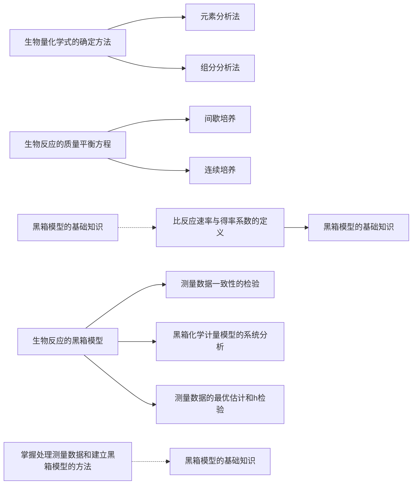
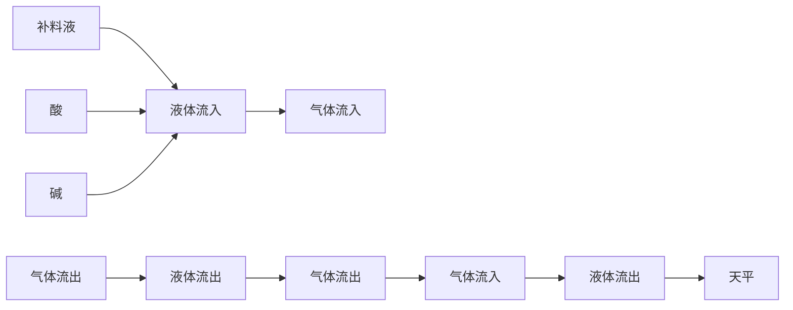
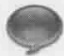

# 3 生化反应质量平衡与模型

原始 PDF 第 70–90 页。

## 3

natural_image

Abstract illustration of interconnected nodes forming a chain-like structure (no text or symbols)

# 生化反应质量平衡与模型

## 【本章学习要点】

1. 生物量化学式的主要确定方法
2. 生物反应质量平衡方程的建立
3. 测量数据一致性的检验方法
4. 黑箱模型的系统分析方法

在对细胞内的生物反应过程有了初步的理性认识之后，往往需要对细胞内的代谢反应进行定量处理，即确定这些反应的速率，从而了解细胞内各反应参与细胞代谢的活跃程度，这对生物培养过程的设计与优化至关重要。反应速率测量值往往受到测量误差的干扰，因此对测量数据质量的评估就显得尤为重要。对实验数据进行评估的重要依据是参与反应的各物质是否符合质量平衡，因此必须考虑到参与反应的主要底物和产物，否则会导致建立错误的质量平衡方程。在测量数据具有较高冗余度的情况下，可以采用系统的方法来评估测量数据的质量，甚至可以鉴别在建立质量平衡方程时是否遗漏了重要的代谢物。

---

3.1 生物量化学式

51

## 知识导图

flowchart

## 3.1 生物量化学式

生物量中含有许多元素，其中主要元素有 C、H、O、N、S、P；其他元素如 Ca、Mg、Na、Fe、Co 等为微量元素，在生物量中的含量很少。一般在生物量化学式中只考虑主要元素，并以含 1 mol C 元素作为基准，这种化学式也称为碳-摩尔化学式（C-mole chemical formula），如式 3-1 所示。

$$
X = \mathrm{CH} _ {a} \mathrm{O} _ {b} \mathrm{N} _ {c} \mathrm{S} _ {d} \mathrm{P} _ {e} \dots \tag {3-1}
$$

确定某种微生物的生物量化学式的方法主要有两种:元素分析法和组分分析法。元素分析法需要将收集的湿菌体烘干，然后灼烧确定重量的干生物量样品，并分析燃烧产物。燃烧的剩余产物称为灰分，它由无机化合物组成，大多数为金属氧化物。生物量中所含有的灰分通常占干重的4%\~8%。由于通过元素分析法确定的生物量化学式并不包括灰分，因此在处理生物量干重数据时，必须结合灰分的含量进行校正，否则就会引入一个较大的误差（例3-1）。另外需要注意的是，烘干菌体的过程并不能把细胞内的结晶水完全除去，干细胞内残留的结晶水的含量约为0.1 mol结晶水/mol碳原子，这些结晶水可以被看作生物量的组成部分。表3-1列出了通过元素分析法确定的几种主要微生物的生物量化学式。

例3-1 通过元素分析法确定酿酒酵母的生物量化学式为: $X = \mathrm{CH}_{1.8}\mathrm{O}_{0.6}\mathrm{N}_{0.18}$，灰分占细胞干重的 $9\%$，求 $60\mathrm{g}$ 干细胞的摩尔量 $n$。

根据化学计量式得酿酒酵母细胞相对分子质量: $M_{x}=25.92\ g\cdot mol^{-1}$  生物量，

---

52

3 生化反应质量平衡与模型

表 3-1 几种主要微生物的生物量化学式 (Nielsen et al. 2004)

<table><tr><td>微生物种类</td><td>生物量化学式</td><td>灰分/%</td><td>培养条件</td></tr><tr><td rowspan="4">Candida utilis</td><td> $CH_{1.83}O_{0.46}N_{0.19}$ </td><td>7.0</td><td>葡萄糖为限制性底物, $D=0.05\ h^{-1}$ </td></tr><tr><td> $CH_{1.87}O_{0.56}N_{0.20}$ </td><td>7.0</td><td>葡萄糖为限制性底物, $D=0.45\ h^{-1}$ </td></tr><tr><td> $CH_{1.83}O_{0.54}N_{0.10}$ </td><td>7.0</td><td>氨为限制性底物, $D=0.05\ h^{-1}$ </td></tr><tr><td> $CH_{1.87}O_{0.56}N_{0.20}$ </td><td>7.0</td><td>氨为限制性底物, $D=0.45\ h^{-1}$ </td></tr><tr><td rowspan="4">Klebsiella aerogenes</td><td> $CH_{1.75}O_{0.43}N_{0.22}$ </td><td>3.6</td><td>甘油为限制性底物, $D=0.10\ h^{-1}$ </td></tr><tr><td> $CH_{1.73}O_{0.43}N_{0.24}$ </td><td>3.6</td><td>甘油为限制性底物, $D=0.85\ h^{-1}$ </td></tr><tr><td> $CH_{1.75}O_{0.47}N_{0.17}$ </td><td>3.6</td><td>氨为限制性底物, $D=0.05\ h^{-1}$ </td></tr><tr><td> $CH_{1.73}O_{0.43}N_{0.24}$ </td><td>3.6</td><td>氨为限制性底物, $D=0.05\ h^{-1}$ </td></tr><tr><td rowspan="2">Saccharomyces cerevisiae</td><td> $CH_{1.82}O_{0.58}N_{0.16}$ </td><td>7.3</td><td>葡萄糖为限制性底物, $D=0.080\ h^{-1}$ </td></tr><tr><td> $CH_{1.78}O_{0.60}N_{0.19}$ </td><td>9.7</td><td>葡萄糖为限制性底物, $D=0.255\ h^{-1}$ </td></tr><tr><td rowspan="4">Escherichia coli</td><td> $CH_{1.94}O_{0.52}N_{0.25}P_{0.025}$ </td><td>5.5</td><td>非限制培养</td></tr><tr><td> $CH_{1.77}O_{0.49}N_{0.24}P_{0.017}$ </td><td>5.5</td><td>非限制培养</td></tr><tr><td> $CH_{1.83}O_{0.50}N_{0.22}P_{0.021}$ </td><td>5.5</td><td>非限制培养</td></tr><tr><td> $CH_{1.96}O_{0.55}N_{0.25}P_{0.022}$ </td><td>5.5</td><td>非限制培养</td></tr><tr><td>Pseudomonas fluorescens</td><td> $CH_{1.93}O_{0.55}N_{0.25}P_{0.021}$ </td><td>5.5</td><td>非限制培养</td></tr><tr><td>Aerobacter aerogenes</td><td> $CH_{1.83}O_{0.55}N_{0.26}P_{0.024}$ </td><td>5.5</td><td>非限制培养</td></tr><tr><td>Penicillium chrysogenum</td><td> $CH_{1.64}O_{0.52}N_{0.16}$ </td><td>7.9</td><td>非限制培养</td></tr><tr><td>Aspergillus niger</td><td> $CH_{1.72}O_{0.55}N_{0.17}$ </td><td>7.5</td><td>非限制培养</td></tr></table>

则 60 g 干细胞的摩尔量: $n=\frac{60\times(1-9\%)}{M_{x}}=\frac{54.6}{25.92}=2.11\ mol$

组分分析法需要首先确定微生物细胞中蛋白质、RNA、DNA、磷脂等各种大分子的化学式，然后分别测定这些大分子在细胞中的含量，进而可以确定生物量的化学式。不同生物的生物量化学式是不同的，而且细胞中各种大分子的含量随着生长环境或生理状态的不同也有很大的变化。因此，即使对同一种生物而言，生物量化学式也可能会有很大的不同（见表3-1）。通过组分分析法得到的酿酒酵母的生物量化学式为:

$$
X = \mathrm{CH} _ {1. 6} \mathrm{O} _ {0. 5} \mathrm{N} _ {0. 2 2} \tag {3-2}
$$

上式并没有考虑到结晶水的存在，因此还需加上0.1 mol的 $H_{2}O$ ，此时和元素分析法得到的分子式非常接近。

表 3-1 中微生物生物量各元素的平均组成为:

$$
X = \mathrm{CH} _ {1. 8} \mathrm{O} _ {0. 5} \mathrm{N} _ {0. 2} \tag {3-3}
$$

与其相对应的相对分子质量为  $M_{x}=24.6\ g/mol$  生物量，本书使用上式作为生物量的标准化学式。但是，上式通常只用于碳源作为限制性底物的培养物，如果存在氮源限制或磷源限制，一些微生物细胞会在体内储存碳源物质，因此随着胞内这些储存物含量的增加（原核生物中，这些物质的含量可高达70%\~80%），细胞的元素组成会逐渐趋向于这些储存物的元素组成。例如真养雷氏菌（Ralstonia europha）在缺乏氮源、磷酸盐和其他合成活性细胞的必要营养物质时，会在胞内积累大量聚羟基丁酸（polyhydroxybutate，PHB）。在这种极端的情况下，生物量组成为  $CH_{1.5}O_{0.5}$ ，非常接近

---

3.2 生物反应的质量平衡方程

53

于 PHB 的分子式（Lee et al. 2001）。

## 3.2 生物反应的质量平衡方程

在生物反应过程中，每一种代谢物都满足质量平衡。通常，在搅拌罐式反应器中进行的生物反应过程的质量平衡方程可以用一阶微分方程表示。

$$
\frac {\mathrm{d} M _ {i}}{\mathrm{d} t} = \frac {\mathrm{d} (V c _ {i})}{\mathrm{d} t} = V (q _ {i} ^ {t} + q _ {i}) + v _ {f} c _ {i, f} - v _ {e} c _ {i, e} \tag {3-4}
$$

式中， $M_{i}$  是 i 物质在液相中的质量， $c_{i}$  是 i 物质在液相中的浓度，i 物质可以是底物（s）、代谢产物（p）或生物量（x）。 $c_{f}$  是该物质在流入反应器的液体中的浓度（如补料培养基）， $c_{e}$  是该物质在流出反应器的液体中的浓度。V 是反应器中培养物的体积，也称为工作体积。 $v_{f}$  和  $v_{e}$  分别是流体流入或流出反应器的速率。 $q_{i}^{t}$  是该物质在气液两相间的体积传质速率，如果是从液相传递到气相，则取负值；反之，则取正值。 $q_{i}$  是该物质的体积反应速率（volumetric reaction rate）（微生物细胞产生或消耗 i 物质的速率），即单位体积培养液中的细胞在单位时间内产生或消耗的物质的量，其量纲通常为  $g/(L \cdot h)$  或  $\mathrm{mol}/(\mathrm{L} \cdot \mathrm{h})$ 。

对于生物量 x，其体积反应速率  $q_{x}$  是指单位体积的培养液中的细胞在单位时间内繁殖的细胞质量，结合比生长速率（specific growth rate）的定义式 2-2 有:

$$
q _ {x} = \mu x \tag {3-5}
$$

严格来讲，式3-4中的 $Vc_{i}$ 并不能代表培养液中 $i$ 物质的质量，因为 $c_{i}$ 是 $i$ 物质在上清液中的浓度，其在细胞中的浓度不一定等于 $c_{i}$，因此，通常只有在下列情况下可以用 $Vc_{i}$ 计算培养液中 $i$ 物质的质量:①湿菌体的体积很小，此时细胞中 $i$ 物质的质量可以忽略，其在培养液和上清液中的质量很接近。②湿菌体的体积较大，但 $i$ 物质在上清液中和细胞中的浓度很接近。在其他情况下需要用式3-6计算培养液中 $i$ 物质的质量变化，否则会导致较大的误差，尤其在高密度细胞培养时，误差可高达$20\%$ 以上（Smolke 2009）。

$$
\frac {\mathrm{d} M _ {i}}{\mathrm{d} t} = \frac {\mathrm{d} (M _ {x} c _ {i , x})}{\mathrm{d} t} + \frac {\mathrm{d} (V _ {\sup} c _ {i , \sup})}{\mathrm{d} t} \tag {3-6}
$$

式中， $M_{x}$  为反应器中的细胞干重，量纲通常为 g。 $c_{i,x}$  为 i 物质在细胞中的含量，量纲通常为 mmol·g $^{-1}$  干细胞。 $V_{sup}$  和  $c_{i,sup}$  分别是反应器中上清液的体积和上清液中 i 物质浓度，常用的量纲为 L 和 mmol·L $^{-1}$ 。

培养基中的大部分底物和产物，例如葡萄糖、乳酸等都只存在于液相中，因此不需要考虑体积传质速率，但对于同时存在于气液两相中的物质，例如  $O_{2}$  或  $CO_{2}$ ，则必须考虑  $q_{i}^{\prime}$ ，其计算公式如式 3-7 所示:

$$
q _ {i} ^ {t} = k _ {l} a (c _ {i} ^ {*} - c _ {i}) \tag {3-7}
$$

式中， $k_{l}a$  为体积传质系数，常用的量纲为  $h^{-1}$ 。 $c_{i}^{*}$  为 i 物质在相应气相分压下的液相饱和浓度，可通过式 3-8 计算。

$$
c _ {i} ^ {*} = \pi_ {i} / H _ {i}; \tag {3-8}
$$

$\pi_{i}$  是 i 物质在气相中的分压， $H_{i}$  是 i 物质的亨利系数，它和培养基和操作条件有

---

54

3 生化反应质量平衡与模型

关，其常用的量纲是 mol（L·atm） $^{-1}$ 。

## 3.2.1 间歇培养

间歇培养（batch cultivation）方式是生物反应过程中经常采用的一种培养方式，培养基一次性加入生物反应器中，在整个培养过程中没有培养液进入或流出反应器，并且在理想状态下培养液体积保持不变，因此式3-4可以简化成:

$$
\frac {\mathrm{d} c _ {i}}{\mathrm{d} t} = q _ {i} ^ {t} + q _ {i} \tag {3-9}
$$

如果 i 物质只存在于液相中，则可进一步简化成

$$
\frac {\mathrm{d} c _ {i}}{\mathrm{d} t} = q _ {i} \tag {3-10}
$$

即对于间歇培养，可以通过作该物质浓度  $c_{i}$  - 发酵时间 t 的曲线图，然后通过求曲线的斜率来得到体积反应速率 q。然而在实际的间歇培养过程中，由于可能连续的通入气体或蒸发的原因会造成培养液体积不断变小，此时需用式 3-11 计算体积反应速率，或者用例 3-2 的方法进行近似处理（Smolke 2009）。

$$
q _ {i} = \frac {\mathrm{d} c _ {i}}{\mathrm{d} t} + \frac {c _ {i}}{V} \cdot \frac {\mathrm{d} V}{\mathrm{d} t} \tag {3-11}
$$

例3-2 通过下表中间歇培养的实验数据求葡萄糖的体积消耗速率。

| 培养时间 t/h | 培养液体积 V/L | 葡萄糖浓度 $c_s$/(mmol·L-1) |
| --- | --- | --- |
| 0 | 100 | 100.000 |
| 1 | 98 | 100.296 |
| 2 | 96 | 100.510 |
| 4 | 92 | 100.674 |
| 8 | 84 | 99.536 |
| 16 | 68 | 86.985 |

通过上表的实验数据可以计算出 t 时刻培养液中葡萄糖的含量，见下表:

| 培养时间/h | 培养基中葡萄糖量$M_s$/mol($M_s = Vc_s$) |
| --- | --- |
| 0 | 10.000 |
| 1 | 9.929 |
| 2 | 9.649 |
| 4 | 9.262 |
| 8 | 8.361 |
| 16 | 5.915 |

由于间歇培养过程中的培养液体积随培养时间延长而不断变小，因此可以利用上表数据计算各时间区间的葡萄糖体积消耗速率的平均值:

---

3.2 生物反应的质量平衡方程

55

| 时间区间$t_i/h$$(t_i=t_2-t_1)$ | 平均体积$V_a/L$$[V_a=(V_1-V_2)/2]$ | 平均体积消耗速率$q_s/(mmol·h^{-1}·L^{-1})$$[q_s=(M_2-M_1)/(V_a t_i)]$ |
| --- | --- | --- |
| 0~1 h,$t_i=1$ | 99 | -1.727 |
| 1~2 h,$t_i=1$ | 97 | -1.856 |
| 2~4 h,$t_i=2$ | 94 | -2.059 |
| 4~8 h,$t_i=4$ | 88 | -2.557 |
| 8~16 h,$t_i=8$ | 76 | -4.026 |

## 3.2.2 连续培养

连续培养（continuous cultivation）是分析生物反应过程中反应速率的一种非常有效的培养方式。在连续培养过程中，通过进料口和进气口分别输入液体（例如葡萄糖溶液）和气体（例如空气）。在反应器中的培养液里含有菌体、底物和代谢产物，培养液通过出料口输出反应器，而气体产物（例如  $CO_{2}$ ）则从出气口输出反应器（图3-1）。如果控制液体输入速率 v、气体输入速率  $v_{g}$ 、培养液体积 V 以及进入反应器的液体和气体中各物质的浓度恒定，则经过一段时间的培养后，反应器中及出料口的培养液里的生物量、底物、产物的浓度，以及输出气体中代谢产物的浓度也都保持恒定值，此时这个生物培养过程就达到了连续的稳态。在连续培养方式中，v/V，即液体流速与反应器中培养基体积的比值是一个重要的输入变量，这个比值被称为稀释率（dilution rate）（D），其量纲是时间量纲的倒数，通常是  $h^{-1}$ 。

$$
\mathrm{稀释率} D = \frac {v}{V} \tag {3-12}
$$

D 的倒数被称为保留时间。

flowchart

图3-1 连续罐式搅拌反应器（Nielsen et al. 2004）

一般可以选择控制稀释率 $D$ 、生物量浓度 $x$ 、代谢产物浓度 $p$ 或 $\mathrm{pH}$ 等变量保持恒定来达到某一特定的稳态，其对应的操作模式也被称为恒化器、恒浊器、产物恒定器及 $\mathrm{pH}$ 恒定器模式。通常选择对稳态变化更加敏感的变量进行控制可以更快地达到稳态。另外测量误差对能否快速达到稳态也非常重要，例如我们很难通过控制限制性底物的浓度来达到低比生长速率生长（或低稀释率）的稳态，这是因为此时限制性底物的浓度非常低，测量的相对误差非常大。在这种情况下选择控制稀释率:即控制液

---

56

3 生化反应质量平衡与模型

体的输入和输出速率 v 来保持 V 处于稳定值更加方便。通常，在一个搅拌釜式连续反应器中达到稳定状态，或者实现从一个稳态到另一个稳态的转变大概需要 5 倍的保留时间，即  $5 \cdot D^{-1}$  (Nielsen et al. 2004)。

根据在稳态连续生物反应器中测量的进料和出料液浓度，可以通过质量平衡方程3-4计算出各反应的反应速率。对于只存在于液相中代谢物i，式3-4可以简化为:

$$
\frac {\mathrm{d} M _ {i}}{\mathrm{d} t} = 0 = V q _ {i} + v _ {f} c _ {i, f} - v _ {e} c _ {i, e} \tag {3-13}
$$

如果 i 分别是底物、生物量和产物， $q_{i}=(v_{f}c_{i,f}-v_{e}c_{i,e})/V$  则有式 3-14～式 3-16:

$$
q _ {s _ {i}} V + v (s _ {i, f} - s _ {i}) = 0 \tag {3-14}
$$

$$
q _ {x} V + v (x _ {f} - x) = 0 \tag {3-15}
$$

$$
q _ {p _ {i}} V + v (p _ {i, f} - p _ {i}) = 0 \tag {3-16}
$$

由于一般进料液中不含有产物和生物量，因此式3-15和式3-16可以进一步化简为:

$$
q _ {x} = D x \tag {3-17}
$$

$$
q _ {p _ {i}} = D p _ {i} \tag {3-18}
$$

结合式3-5和式3-17，可以得出在连续稳态培养中: $D=\mu$ 。

对于气体底物或产物，从式3-4可以得到:

$$
V (q _ {s _ {i}} ^ {t} + q _ {s _ {i}}) + v (s _ {i, f} - s _ {i}) = 0 \tag {3-19}
$$

$$
V (q _ {p _ {i}} ^ {t} + q _ {p _ {i}}) + v (p _ {i, f} - p _ {i}) = 0 \tag {3-20}
$$

我们可以从整个系统的气相质量平衡中得到下式:

$$
\frac {1}{R T} (\pi_ {s _ {i}, \mathrm{in}} v _ {g, \mathrm{in}} - \pi_ {s _ {i}, \mathrm{out}} v _ {g, \mathrm{out}}) = k _ {l} a (s _ {i} ^ {*} - s _ {i}) V = q _ {i} ^ {t} V \tag {3-21}
$$

$v_{g,in}$  和  $v_{g,out}$  分别是进气和出气的体积流速。 $\pi_{s_{i,in}}$  和  $\pi_{s_{i,out}}$  分别是 i 物质在进气和出气中的气相分压。如果气体产物的体积产生速率与气体底物的消耗速率不同，或者有液相中的成分（通常是水）从培养基中蒸发，则  $v_{g,in}$  与  $v_{g,out}$  就会不相等。上式左边表示代谢物 i 在气相中的增加或减少的速度（mol·h $^{-1}$ ），右边表示 i 物质从液相传递到气相或从气相传递到液相的速度（mol·h $^{-1}$ ）。

从式3-17和式3-18可以看出，在连续稳态培养中，可以非常方便地通过测量变量的浓度来计算反应速率。

## 3.3 比反应速率与得率系数

除了体积产生速率之外，生物反应中还经常使用比反应速率，其定义为每单位质量的干细胞在单位时间内产生或消耗的第i种化合物的质量，可用式3-22表示

$$
r _ {i} = \frac {q _ {i}}{x} \tag {3-22}
$$

如果 i 是生物量，结合式 3-5 可以看出  $r_{x}$  即为比生长速率:

$$
r _ {x} = \frac {q _ {x}}{x} = \mu \tag {3-23}
$$

---

3.4 生物反应的黑箱模型

57

$r_{i}$  表征的是单个细胞（或单位质量细胞）生产或利用某种物质的性能，即细胞的代谢通量。而  $q_{i}$  表征整个培养体系生产或利用某种物质的性能，它的大小不仅和单细胞的生产性能有关，还和细胞生长情况即菌体浓度 x 有关。

任何一种速率，无论是 $q_{i}$ 还是 $r_i$ ，与另一个速率 $q_{j}$ 或 $r_j$ 相比时，我们就得到得率系数（yield coefficient）$Y_{ji}$。

$$
Y _ {j i} = \left| \frac {r _ {i}}{r _ {j}} \right| = \left| \frac {q _ {i}}{q _ {j}} \right| \tag {3-24}
$$

在本书中，所有底物的反应速率都是负值，产物的反应速率为正值，在式3-24中使用了绝对值以保证得率系数都是正值。在得率系数的定义中，第一个下标 $j$ 通常是指对照速率，而且进行比较的两种速率必须采用相同单位，例如，$\mathrm{g}$（乳酸）$\cdot \mathrm{g}^{-1}$（葡萄糖）或者 $\mathrm{mol}$（乳酸）$\cdot \mathrm{mol}^{-1}$（葡萄糖），一般可以省略括号中的物质。对于生物加工过程的设计而言，无论是菌种改进还是发酵过程优化，得率系数均代表了一组非常重要的设计参数，尤其是产物相对于底物的得率系数，该参数直接决定生物加工过程的底物转化为产物的效率。另外，呼吸熵 $RQ$ 是 $\mathrm{CO}_{2}$ 对 $\mathrm{O}_{2}$ 的得率系数，即 $Y_{oc}$，该参数是对发酵过程进行在线控制的一个常用参数。

## 3.4 生物反应的黑箱模型

对于一个生物反应过程而言，我们可以将细胞看成一个不可观察的黑箱，不必了解细胞内部的反应情况，只需测定在某一时刻输入细胞的反应速率（所有底物的消耗速率）和输出细胞的反应速率（所有产物的合成速率），根据质量守恒原理，就可以用一个总的化学方程式表示该时刻的生物反应过程，该方程式表示所有的底物通过细胞被转化为代谢产物和新的生物量，被称为黑箱模型（black box model）。例如，式3-25就是一个黑箱模型。在黑箱模型中，所有含碳化合物的化学式均采用碳-摩尔化学式。每一种物质前面的系数是该物质的比反应速率 $r$ 或体积反应速率 $q$ 。大多数生物反应过程的底物都包括葡萄糖和氨气，产物包括 $\mathrm{CO}_{2}$ 和水。显然式3-25可以转化成式3-26的形式，此时，葡萄糖的系数为-1，所有其他物质的系数为该底物相对于葡萄糖的得率系数，底物的系数取负值，产物和生物量的系数取正值。

$$
\begin{array}{l} - r _ {s} \mathrm{CH} _ {2} \mathrm{O} - r _ {o} \mathrm{O} _ {2} - r _ {n} \mathrm{NH} _ {3} - r _ {s _ {1}} S _ {1} - \dots + r _ {x} X + r _ {c} \mathrm{CO} _ {2} + r _ {p _ {1}} P _ {1} + \dots + r _ {w} \mathrm{H} _ {2} \mathrm{O} = 0 (3-25) \\ - \mathrm{CH} _ {2} \mathrm{O} - Y _ {s o} \mathrm{O} _ {2} - Y _ {s n} \mathrm{NH} _ {3} - Y _ {s s _ {1}} S _ {1} - \dots + Y _ {s x} X + Y _ {s c} \mathrm{CO} _ {2} + Y _ {s p _ {1}} P _ {1} + \dots + Y _ {s w} \mathrm{H} _ {2} \mathrm{O} = 0 (3-26) \\ \end{array}
$$

通过黑箱模型，我们可以非常方便地了解微生物细胞在特定环境中以某种比生长速率生长时的代谢特点。培养环境（培养基成分、温度、pH等）以及细胞生长速度对黑箱模型中的代谢物种类及反应速率都有很大的影响，因此，通常采用连续稳态培养来建立黑箱模型。在连续培养达到稳态时，细胞在不同比生长速率下的反应速率是不同的，但得率系数有可能在特定的比生长速率范围内保持不变。在一些情况下，代谢物的种类会随着生长状态的改变而发生变化。

例3-3 在酿酒酵母的连续稳态厌氧发酵中，碳源为葡萄糖，氮源为 $\mathrm{NH}_3$ ，反应器的工作体积 $V$ 为 $1.35\mathrm{L}$ ，流加培养基中含有 $s_f = 20\mathrm{g}\cdot \mathrm{L}^{-1}$ 的葡萄糖，在稀释率为

---

58

3 生化反应质量平衡与模型

0.05 h $^{-1}$ 的稳态培养状态下，测定反应器培养液中葡萄糖浓度  $s \approx 0$ ，乙醇的浓度  $p_{e} = 4.6 g \cdot L^{-1}$ ，甘油的浓度  $p_{g} = 1.58 g \cdot L^{-1}$ ，生物量浓度  $x = 2.43 g \cdot L^{-1}$ 。另外输入氮气来保持厌氧发酵状态，气体输入和输出速度为  $6 L \cdot h^{-1}$ ，输出气体中乙醇浓度  $p_{e,out}$  为  $1.58 mmol \cdot L^{-1}$ ， $CO_{2}$  浓度  $p_{c,out}$  为  $2.06 mmol \cdot L^{-1}$ （摩尔浓度均以碳-摩尔化学式为基准）。生物量组成由元素分析实验确定: $X = CH_{1.74}O_{0.60}N_{0.12}$ ，灰分占细胞干重的 5%。

（1）求在该稳态培养条件下乙醇（e）、 $CO_{2}$ （c）、生物量（x）和甘油（g）相对于葡萄糖（s）的得率系数。

(2) 写出该过程的黑箱模型。

对于葡萄糖，其碳-摩尔化学式为  $CH_{2}O$ ，相对分子质量为  $30\ g\cdot mol^{-1}$ ，则根据式 3-14 有:

$$
q _ {s} = - \frac {v}{V} (s _ {f} - s) = - 0. 0 5 \mathrm{h} ^ {- 1} \times \frac {(2 0 - 0) \mathrm{g} \cdot \mathrm{L} ^ {- 1}}{3 0 \mathrm{g} \cdot \mathrm{mol} ^ {- 1}} = - 3 3. 3 3 \mathrm{mmol} \cdot \mathrm{L} ^ {- 1} \cdot \mathrm{h} ^ {- 1}
$$

对于乙醇，其碳-摩尔化学式为  $CH_{3}O_{0.5}$ ，相对分子质量为  $23\ g\cdot mol^{-1}$ ，其在气相和液相中均存在，并作为细胞产物从液相传递到气相，因此根据式 3-21 得到乙醇的体积传质速率为:

$$
q ^ {t} = - \frac {(v _ {g , \mathrm{out}} p _ {e , \mathrm{out}} - v _ {g , \mathrm{in}} p _ {e , \mathrm{in}})}{V} = - \frac {(6 \times 1 . 5 8 - 6 \times 0)}{1 . 3 5} = - 7 \mathrm{mmol} \cdot \mathrm{L} ^ {- 1} \cdot \mathrm{h} ^ {- 1}
$$

根据式3-20有:

$$
\begin{array}{l} q _ {e} = - \frac {v}{V} (p _ {e, f} - p _ {e}) - q _ {e} ^ {t} \\ = - 0. 0 5 \mathrm{h} ^ {- 1} \cdot \frac {(0 - 4 . 6) \mathrm{g} \cdot \mathrm{h} ^ {- 1}}{2 3 \mathrm{g} \cdot \mathrm{mol} ^ {- 1}} + 0. 0 0 7 \mathrm{mol} \cdot \mathrm{L} ^ {- 1} \cdot \mathrm{h} ^ {- 1} \\ = 1 7 \mathrm{mmol} \cdot \mathrm{L} ^ {- 1} \cdot \mathrm{h} ^ {- 1} \\ \end{array}
$$

对于  $CO_{2}$ ，其碳-摩尔化学式为  $CO_{2}$ ，相对分子质量为  $44\ g\cdot mol^{-1}$ ，其在气相和液相中均存在，并作为细胞产物从液相传递到气相，因此:

$$
q _ {c} ^ {t} = - \frac {(v _ {g , \mathrm{out}} p _ {c , \mathrm{out}} - v _ {g , \mathrm{in}} p _ {c , \mathrm{in}})}{V} = - \frac {(6 \times 2 . 0 6 - 6 \times 0)}{1 . 3 5} = - 9. 1 6 \mathrm{mmol} \cdot \mathrm{L} ^ {- 1} \cdot \mathrm{h} ^ {- 1}
$$

$CO_{2}$  在补料液及培养液中的浓度均可以看作近似为 0，根据式 3-19 有:

$$
q _ {c} = - \frac {v}{V} (p _ {c, f} - p _ {c}) - q _ {c} ^ {t} = - q _ {c} ^ {t} = 9. 1 6 \mathrm{mmol} \cdot \mathrm{L} ^ {- 1} \cdot \mathrm{h} ^ {- 1}
$$

对于生物量，其碳-摩尔化学式为  $CH_{1.74}O_{0.60}N_{0.12}$ ，相对分子质量为 25.02 g·mol $^{-1}$ ，根据式 3-17 有:

$$
q _ {x} = D x = 0. 0 5 \mathrm{h} ^ {- 1} \times \frac {(1 - 6 \%) \cdot (2 . 4 3) \mathrm{g} \cdot \mathrm{L} ^ {- 1}}{2 5 . 0 2 \mathrm{g} \cdot \mathrm{mol} ^ {- 1}} = 4. 5 7 \mathrm{mmol} \cdot \mathrm{L} ^ {- 1} \cdot \mathrm{h} ^ {- 1}
$$

对于甘油，其碳-摩尔化学式为  $CH_{8/3}O$ ，相对分子质量为  $30.67\ g\cdot mol^{-1}$ ，则根据式 3-18 有:

$$
q _ {g} = D p _ {g} = 0. 0 5 \mathrm{h} ^ {- 1} \times \frac {(1 . 5 8) \mathrm{g} \cdot \mathrm{L} ^ {- 1}}{3 0 . 6 7 \mathrm{g} \cdot \mathrm{mol} ^ {- 1}} = 2. 5 7 \mathrm{mmol} \cdot \mathrm{L} ^ {- 1} \cdot \mathrm{h} ^ {- 1}
$$

根据各物质的体积反应速率，可以计算出各物质相对于葡萄糖的得率系数（单位为 C-mole/C-mole 葡萄糖）:

$$
Y _ {s e} = \left| \frac {q _ {e}}{- q _ {s}} \right| = 0. 5 1 0; Y _ {s c} = 0. 2 7 5; Y _ {s x} = 0. 1 3 7; Y _ {s g} = 0. 0 7 7
$$

---

3.4 生物反应的黑箱模型

59

因此，黑箱模型的化学方程式为:

$$
- 3 3. 3 \mathrm{CH} _ {2} \mathrm{O} - q _ {s n} \mathrm{NH} _ {3} + 1 7 \mathrm{CH} _ {3} \mathrm{O} _ {1 / 2} + 9. 1 6 \mathrm{CO} _ {2} + 4. 5 7 X + 2. 5 7 \mathrm{CH} _ {8 / 3} \mathrm{O} = 0 \tag {1}
$$

或者:

$$
- \mathrm{CH} _ {2} \mathrm{O} - Y _ {s n} \mathrm{NH} _ {3} + 0. 5 1 0 \mathrm{CH} _ {3} \mathrm{O} _ {1 / 2} + 0. 2 7 5 \mathrm{CO} _ {2} + 0. 1 3 7 X + 0. 0 7 7 \mathrm{CH} _ {8 / 3} \mathrm{O} = 0 \tag {2}
$$

## 3.4.1 黑箱模型的元素平衡和还原度平衡

一个完整、准确的黑箱模型应该满足元素平衡（elemental balance）和还原度平衡（degree of reduction balance），一般黑箱模型中的代谢物只考虑 C、H、O、N 四种元素，根据黑箱模型的化学方程式可以建立四个元素平衡方程。因此一旦根据实验数据初步建立黑箱模型后，就应该通过元素平衡和还原度平衡的检测来确定模型的准确性。反之，也可以通过这些平衡关系来求得率系数。

例3-4 根据元素平衡求出例3-3中 $\mathrm{NH}_3$ 的体积消耗速率 $q_{n}$，以及得率系数$Y_{sn}$，并检测模型的准确性。

根据例3-3中的公式2，对于N元素应该满足: $-Y_{sn}\times1+Y_{sx}\times0.12=0$ ，将 $Y_{sx}=0.137$ 代人后求得 $Y_{sn}=0.0164$ ，则 $q_{n}=q_{s}Y_{sn}=-0.547\ mmol\cdot L^{-1}\cdot h^{-1}$

对于碳元素应该满足: $-1 + Y_{se} + Y_{sc} + Y_{sx} + Y_{sg} = 0$ ，可以看出该等式左边等于-0.001，这说明几乎所有的主要含碳化合物都被包含在黑箱模型中，只有约0.1%的碳被遗漏，这个数据已经在测量误差范围之内，该模型能够很好地满足碳平衡。

对于氢元素应该满足: $-2-3Y_{sn}+3Y_{se}+1.74Y_{sx}+2.67Y_{sg}=0$ ，可以看出该式左边等于-0.07562，对于氧元素应该满足: $-1+0.5Y_{se}+2Y_{sc}+0.6Y_{sx}+Y_{sg}=0$ ，等式左边等于-0.0358，即还有含氢元素和氧元素的物质被遗漏而没有包括在黑箱模型中，由于上述模型已经满足碳平衡和氮平衡，因此该物质不可能含有C、N两种元素，遗漏的物质也不可能是氢气和氧气，我们有理由推断该物质是 $H_{2}O$ ，其得率系数 $Y_{sw}$ 根据氢元素平衡计算为0.0378 mol/C-mol葡萄糖，根据氧元素平衡计算为0.0358 mol/C-mol葡萄糖。这两个数据非常接近，其差别是由于合理的实验测量误差引起的，因此水的得率系数可以取平均值为0.0368 mol/C-mol葡萄糖，水的体积反应速率 $q_{w}=q_{s}Y_{sw}=1.23\ mmol\cdot L^{-1}\cdot h^{-1}$ 。

因此根据元素平衡分析，例3-3的黑箱模型修正为:

$$
- \mathrm{CH} _ {2} \mathrm{O} - 0. 0 1 6 4 \mathrm{NH} _ {3} + 0. 5 1 0 \mathrm{CH} _ {3} \mathrm{O} _ {1 / 2} + 0. 2 7 5 \mathrm{CO} _ {2} + 0. 1 3 7 X + 0. 0 7 7 \mathrm{CH} _ {8 / 3} \mathrm{O} + 0. 0 3 6 8 \mathrm{H} _ {2} \mathrm{O} = 0 \tag {1}
$$

从这个例子可以看出，生物反应过程中产生的水非常少， $30\ g\cdot L^{-1}$ 葡萄糖（1个碳-摩尔）被完全代谢后产生的水为0.0368 mol，仅相当于在1 L培养液中增加0.66 mL水，这对代谢物浓度的影响很小。另外，由于生物反应过程中水的生成速率无法检测，在一些复杂的生物培养过程中很难利用氧元素平衡和H元素平衡来检查黑箱模型的准确度，因此可以通过检验还原度是否平衡来获取额外的信息。

还原度平衡的实质是氧化还原平衡，即在稳态培养条件下，一些底物被氧化，同时必定有另一些底物来接受被氧化底物所释放的还原力而被还原，因此黑箱模型方程式中所有底物的总还原度和所有产物的总还原度相等。我们定义H元素的还原度为1，并为每一种元素定义一种还原度为0的中性化合物。O、C、N、S和P的中性化

---

60

3 生化反应质量平衡与模型

合物分别为  $H_{2}O$ 、 $CO_{2}$ 、 $NH_{3}$ 、 $H_{2}SO_{4}$  和  $H_{3}PO_{4}$ 。这样可以计算出以上五种元素的还原度水平:

$$
O = - 2, C = 4, N = - 3, S = 6, P = 5 \tag {3-27}
$$

根据各元素的还原度，可以计算生化反应中的任何一种化合物的还原度。以碳-摩尔化学式为基准，一些化合物的还原度  $\kappa$  见表 3-2。

表 3-2 生物培养过程中常用化合物的还原度 (Nielsen et al. 2004)

| 化合物 | 化学式 | 还原度κ | 化合物 | 化学式 | 还原度κ |
| --- | --- | --- | --- | --- | --- |
| 甲酸 | $CH_2O_2$ | 2 | 丙氨酸 | $C_3H_7NO_2$ | 4 |
| 乙酸 | $C_2H_4O_2$ | 4 | 精氨酸 | $C_6H_{14}N_4O_2$ | 3.67 |
| 丙酸 | $C_3H_6O_2$ | 4.67 | 天冬酰胺 | $C_4H_8N_2O_3$ | 3 |
| 丁酸 | $C_4H_8O_2$ | 5.00 | 天冬氨酸 | $C_4H_7NO_4$ | 3 |
| 戊酸 | $C_5H_{10}O_2$ | 5.20 | 半胱氨酸 | $C_3H_7O_2NS$ | 6 |
| 棕榈酸 | $C_{16}H_{32}O_2$ | 5.75 | 谷氨酸 | $C_5H_9NO_4$ | 3.60 |
| 乳酸 | $C_3H_6O_3$ | 4 | 谷氨酰胺 | $C_5H_{10}N_2O_3$ | 3.60 |
| 葡糖酸 | $C_6H_{12}O_7$ | 3.67 | 甘氨酸 | $C_2H_5NO_2$ | 3 |
| 丙酮酸 | $C_3H_4O_3$ | 3.33 | 亮氨酸 | $C_6H_{13}NO_2$ | 5 |
| 草酸 | $C_2H_2O_4$ | 1 | 异亮氨酸 | $C_6H_{13}NO_2$ | 5 |
| 琥珀酸 | $C_4H_6O_4$ | 3.50 | 赖氨酸 | $C_6H_{14}N_2O_2$ | 4.67 |
| 延胡索酸 | $C_4H_4O_4$ | 3 | 组氨酸 | $C_6H_9N_3O_2$ | 3.33 |
| 苹果酸 | $C_4H_6O_5$ | 3 | 苯丙氨酸 | $C_9H_{11}NO_2$ | 4.44 |
| 柠檬酸 | $C_6H_8O_7$ | 3 | 脯氨酸 | $C_5H_9NO_2$ | 4.40 |
| 己糖 | $C_6H_{12}O_6$ | 4 | 丝氨酸 | $C_3H_7NO_3$ | 3.33 |
| 双糖 | $C_{12}H_{22}O_{11}$ | 4 | 苏氨酸 | $C_4H_9NO_3$ | 4 |
| 甲烷 | $CH_4$ | 8 | 色氨酸 | $C_{11}H_{12}N_2O_2$ | 4.18 |
| 乙烷 | $C_2H_6$ | 7 | 酪氨酸 | $C_9H_{11}NO_3$ | 4.22 |
| 丙烷 | $C_3H_8$ | 6.67 | 缬氨酸 | $C_5H_{11}NO_2$ | 4.80 |
| 甲醇 | $CH_4O$ | 6 | 甲硫氨酸 | $C_5H_{11}O_2NS$ | 6 |
| 乙醇 | $C_2H_6O$ | 6 | 尿素 | $CH_4ON_2$ | 0 |
| 异丙醇 | $C_3H_8O$ | 6 |  |  |  |
| 正丁醇 | $C_4H_{10}O$ | 6 |  |  |  |
| 甘油 | $C_3H_8O_3$ | 4.67 |  |  |  |
| 丙酮 | $C_3H_6O$ | 5.33 |  |  |  |
| 甲醛 | $CH_2O$ | 4 |  |  |  |
| 乙醛 | $C_2H_4O$ | 5 |  |  |  |

例 3-5 计算下列物质的还原度: $CH_{2}O$ （葡萄糖和其他己糖、醋酸、乳酸和甲醛）， $CH_{3}O_{0.5}$ （乙醇）， $CH_{4}ON_{2}$ （尿素）， $CH_{1.8}O_{0.5}N_{0.2}$ （标准生物量）。

$$
\mathrm{CH} _ {2} \mathrm{O}: \kappa = 4 \times 1 + 1 \times 2 + (- 2) \times 1 = 4
$$

$$
\mathrm{CH} _ {3} \mathrm{O} _ {0. 5}: \kappa = 4 \times 1 + 1 \times 3 + (- 2) \times 0. 5 = 6
$$

---

3.4 生物反应的黑箱模型

61

$$
\begin{array}{l} \mathrm{CH} _ {4} \mathrm{ON} _ {2}: \kappa = 4 \times 1 + 1 \times 4 + (- 2) \times 1 + (- 3) \times 2 = 0 \\ \mathrm{CH} _ {1. 8} \mathrm{O} _ {0. 5} \mathrm{N} _ {0. 2}: \kappa = 4 \times 1 + 1 \times 1. 8 + (- 2) \times 0. 5 + (- 3) \times 0. 2 = 4. 2 \\ \end{array}
$$

细胞中还含有一些传递还原力的辅因子对:NADH（$\mathrm{NAD^{+}}$），NADPH（$\mathrm{NADP^{+}}$）以及 $\mathrm{FADH_{2}}$（FAD），它们的还原度并不需要通过化学式进行计算，而是直接规定NADH，NADPH和 $\mathrm{FADH_{2}}$ 的还原度等价于 $\mathrm{H_{2}}$，即还原形式的辅因子的还原度均等于2，而氧化形式辅因子的还原度为0。这是因为辅因子总是成对出现在化学反应方程中，如果氧化形式辅因子是反应物，则其对应的还原形式辅因子必定是产物，而且两者的化学计量系数必定数值相同，符号相反，因此只需知道辅因子对之间的还原度差即可进行还原度平衡的检验。对于上述三种传递还原力的辅因子对，还原度的差值正好都是2。细胞中传递自由能的辅因子对ATP（ADP）存在类似情况，但它们的还原度差值为0，因此在还原度平衡计算时不用考虑。通常在化学计量方程中只列出辅因子对中的一种形式（其原因将在后续章节中介绍），而且不考虑水的生成，因此在元素衡算和还原度衡算时要特别注意。

例如，对于从葡萄糖生成丙酮酸的 EMP 途径，通常用下列方程式表示:

$$
- \mathrm{CH} _ {2} \mathrm{O} + \mathrm{CH} _ {4 / 3} \mathrm{O} + \frac {1}{3} \mathrm{NADH} + \frac {1}{3} \mathrm{ATP} = 0 \tag {3-28}
$$

其相应的完整的化学计量方程为:

$$
- \mathrm{CH} _ {2} \mathrm{O} - \frac {1}{3} \mathrm{NAD} ^ {+} - \frac {1}{3} (\mathrm{ADP} + \mathrm{Pi}) + \mathrm{CH} _ {4 / 3} \mathrm{O} + \frac {1}{3} (\mathrm{NADH} + \mathrm{H} ^ {+}) + \frac {1}{3} \mathrm{ATP} = 0 \tag {3-29}
$$

例3-6 根据还原度平衡检测例3-3中黑箱模型的准确性。

在例3-3中的公式2中，$\mathrm{NH}_{3}$、$\mathrm{CO}_{2}$ 和 $\mathrm{H}_{2} \mathrm{O}$ 为还原度为0的中性物质，在总还原度计算中不用考虑，葡萄糖、乙醇、甘油和生物量（化学式为 $\mathrm{CH}_{1.74} \mathrm{O}_{0.60} \mathrm{~N}_{0.12}$）的还原度分别为4, 6, 4.67和4.18，因此:

底物的总还原度为: $q_{s}\kappa_{s}=33.33\times4=133.32$

产物的总还原度: $q_{e}\kappa_{e}+q_{x}\kappa_{x}+q_{g}\kappa_{g}=17\times6+4.57\times4.18+2.57\times4.67=133.1$

两者之差为0.22，只约占总还原度的0.17%，即模型可以很好地满足还原度平衡，结合碳平衡的分析结果，可以认为没有重要的物质被遗漏，并且所有物质的测量误差都非常小，黑箱模型能够准确反映例3-3中酿酒酵母的厌氧培养状态。

## 3.4.2 黑箱模型测量数据一致性的检验

由于黑箱模型化学方程式中的系数是通过实验确定的，因此实验误差对系数的准确性有很大影响，如果模型中除水之外的所有物质的反应速率都能通过测量数据确定，则可以进行测量数据一致性检验，分析重大误差的来源。实际上，在例3-4中已经进行了数据一致性检验，其结果表明测量数据的误差非常小，即数据具有很好的一致性。而在更普遍的情况下，测量数据并不具有很好的一致性，我们需要找出测量误差较大的数据进行修正，或者找出遗漏的重要代谢物。除了测量仪器的系统误差之外，以下情况也会导致黑箱模型的计量系数具有较大的误差:部分具有较强挥发性的底物或产物在气相中，如果只根据液相中的含量进行计算，就会导致该物质的生成速率偏小。另外，由于培养条件或环境的变化，可能有新的产物形成，导致黑箱模型的

---

62

3 生化反应质量平衡与模型

代谢物种类并不完整。例如，在非正常发酵条件下，柠檬酸发酵中会产生大量副产物草酸，我们可以通过数据一致性的检验推断出该物质的生成。

例3-7 在厌氧条件下恒化培养酿酒酵母，培养液体积 $V = 1 \mathrm{~L}$，达到稳态时液体流加速度 $v = 0.1 \mathrm{~L} \cdot \mathrm{h}^{-1}$。流加液中含 $128 \mathrm{mmol} \cdot \mathrm{L}^{-1}$ 的葡萄糖和 $58.8 \mathrm{mmol} \cdot \mathrm{L}^{-1}$ 的 $\mathrm{NH}_{3}$，生物量的分子式为 $\mathrm{CH}_{1.76} \mathrm{O}_{0.56} \mathrm{N}_{0.17}$。流出液中检测到的各种物质的浓度如下:葡萄糖0.27，$\mathrm{NH}_{3} 42.8$，生物量94，乙醇192.4，甘油26（单位均为 $\mathrm{mmol} \cdot \mathrm{L}^{-1}$）。进气和出气速度均为 $15 \mathrm{~L} \cdot \mathrm{h}^{-1}$，气压 $1 \mathrm{atm}$，温度 $30^{\circ} \mathrm{C}$，尾气含 $\mathrm{CO}_{2} 2.88 \%$（体积比，进气中 $\mathrm{CO}_{2}$ 含量忽略不计）。建立上述稳态培养过程的黑箱计量学模型，进行测量数据的一致性检验，并推测误差来源。（注:这个例子已经考虑了乙醇的挥发性，即乙醇测量数据已经根据挥发量做了校正）

稀释率: $D = \frac{v}{V} = \frac{0.1}{1} = 0.1\mathrm{h}^{-1}$ ； $\kappa_{x} = 4.13$ ； $\mathrm{M}_x = 25.10\mathrm{g}\cdot \mathrm{C - mole}^{-1}$

对于葡萄糖  $CH_{2}O$ :

$$
q _ {s} = - D (s _ {f} - s) = - 0. 1 \mathrm{h} ^ {- 1} \cdot (1 2 8 - 0. 2 7) \cdot 6 = - 7 6. 6 \mathrm{mmol} \cdot \mathrm{L} ^ {- 1} \cdot \mathrm{h} ^ {- 1}
$$

对于乙醇  $CH_{3}O_{0.5}$ :

$$
q _ {e} = - D (p _ {e, f} - p _ {e}) = - 0. 1 \cdot (0 - 1 9 2. 4) \cdot 2 = 3 8. 5 \mathrm{mmol} \cdot \mathrm{L} ^ {- 1} \cdot \mathrm{h} ^ {- 1}
$$

对于  $CO_{2}$ ，其在补料液及培养液中的浓度均可以看作近似为0，进气中气相分压为0，出气中气相分压为0.0288 atm，则有:

$$
\begin{array}{l} q _ {c} = - \frac {v}{V} (p _ {c, f} - p _ {c}) - q _ {c} ^ {t} = - q _ {c} ^ {t} = - \frac {1}{V R T} (\pi_ {s _ {i}, \mathrm{in}} v _ {g, \mathrm{in}} - \pi_ {s _ {i}, \mathrm{out}} v _ {g, \mathrm{out}}) \\ = - \frac {1 5 \cdot (0 - 0 . 0 2 8 8)}{1 \cdot 0 . 0 8 2 \cdot 3 0 3} = 1 7. 4 \mathrm{mmol} \cdot \mathrm{L} ^ {- 1} \cdot \mathrm{h} ^ {- 1} \\ \end{array}
$$

对于生物量  $CH_{1.76}O_{0.56}N_{0.17}$ :

$$
q _ {x} = D x = 0. 1 \cdot 9 4 = 9. 4 \mathrm{mmol} \cdot \mathrm{L} ^ {- 1} \cdot \mathrm{h} ^ {- 1}
$$

对于甘油  $CH_{8/3}O$ :

$$
q _ {g} = D p _ {g} = 0. 1 \cdot 2 6 \cdot 3 = 7. 8 \mathrm{mmol} \cdot \mathrm{L} ^ {- 1} \cdot \mathrm{h} ^ {- 1}
$$

对于  $NH_{3}$ :

$$
q _ {n} = - D (p _ {e, f} - p _ {e}) = - 0. 1 \cdot (5 8. 8 - 4 2. 8) = - 1. 6 \mathrm{mmol} \cdot \mathrm{L} ^ {- 1} \cdot \mathrm{h} ^ {- 1}
$$

各物质相对于葡萄糖的得率系数为:

$$
Y _ {s s} = 0. 1 2 2 7; Y _ {s e} = 0. 5 0 2 6; Y _ {s g} = 0. 1 0 1 8; Y _ {s c} = 0. 2 2 7 1; Y _ {s n} = 0. 0 2 0 8 9
$$

黑箱计量学模型为:

$$
- \mathrm{CH} _ {2} \mathrm{O} - 0. 0 2 0 9 \mathrm{NH} _ {3} + 0. 5 0 2 6 \mathrm{CH} _ {3} \mathrm{O} _ {1 / 2} + 0. 2 2 7 1 \mathrm{CO} _ {2} + 0. 1 2 2 7 \mathrm{X} + 0. 1 0 1 8 \mathrm{CH} _ {8 / 3} \mathrm{O} = 0
$$

对于碳平衡: $-1+0.5026+0.2271+0.1227+0.1018=-0.0458$

即模型遗漏了某种含碳化合物 i，其含碳量占总碳的 4.58%。

对于氮平衡: $-0.02089 + 0.1227 \cdot 0.17 = -0.00003$

表明输入的氮元素几乎都用于合成生物量，模型中遗漏的氮仅占总氮的0.00003/0.02089=0.14%，模型很好地满足氮平衡。

将 i 物质加入黑箱模型中，然后考虑还原度平衡:

$$
- 4 + 0. 1 2 2 7 \cdot 4. 1 3 + 0. 5 0 2 6 \cdot 6 + 0. 1 0 1 8 \cdot 4 \frac {2}{3} + 0. 2 2 7 1 \cdot 0 + \kappa_ {i} \cdot 0. 0 4 5 8 = 0
$$

---

3.4 生物反应的黑箱模型

63

求解得: $\kappa_{i}\approx0$

这表明遗漏的含碳化合物很可能是  $CO_{2}$ ，即  $CO_{2}$  的实际得率应该是 0.2271 + 0.0458 = 0.2729。对修正后的模型进行 H 衡算得到水的得率系数为 0.0337，通过氧衡算得到水的得率系数为 0.0324，这两个数据非常接近，也间接证明了遗漏的物质就是  $CO_{2}$ 。

修正后的黑箱模型为:

$$
\begin{array}{l} - \mathrm{CH} _ {2} \mathrm{O} - 0. 0 2 0 9 \mathrm{NH} _ {3} + 0. 5 0 2 6 \mathrm{CH} _ {3} \mathrm{O} _ {1 / 2} + 0. 2 7 2 9 \mathrm{CO} _ {2} + 0. 1 2 2 7 \mathrm{X} \\ + 0. 1 0 1 8 \mathrm{CH} _ {8 / 3} \mathrm{O} + 0. 0 3 2 9 \mathrm{H} _ {2} \mathrm{O} = 0 \\ \end{array}
$$

$CO_{2}$  的数据测量涉及气体分析仪和气体流量计两种仪器，由于气体分析仪通常具有很高的精确度，而在气体流速较低的情况下，气体流量计的精确度较差，因此推测误差可能是由于气体流量计造成的。这个例子代表了实验中一个常见的问题:当气体流速较低时，例如  $0.1 \sim 0.5 L \cdot min^{-1}$ ，对流量计的校准是十分困难的，会带来相对较大的系统误差（Nielsen et al. 2004）。

显然，在例3-3中，如果测定产物时忽视了气相中的乙醇，也可以通过数据的一致性检验发现黑箱模型中遗漏了一部分含C物质，且该物质的还原度为6，即遗漏了一部分乙醇。

## 3.4.3 黑箱化学计量模型的系统分析

前例中黑箱模型涉及的底物和产物的种类都比较少，例如，都只有一种碳源葡萄糖，或一种氮源  $NH_{3}$ ，得率系数很容易通过碳平衡和还原度平衡的简单计算得出。但是在更一般情况下，可能有 N 种底物和包括生物量在内的 M 种代谢产物，这时就需要有一种确定黑箱化学方程式的系统方法。

通常，化学方程式可以写成:

$$
- \mathrm{CH} _ {a 1} \mathrm{O} _ {b 1} \mathrm{N} _ {c 1} - Y _ {s _ {1} o} \mathrm{O} _ {2} - \sum_ {j = 3} ^ {N} Y _ {s _ {1} s _ {j}} S _ {j} + Y _ {s _ {1} x} X + Y _ {s _ {1} c} \mathrm{CO} _ {2} + Y _ {s _ {1} w} \mathrm{H} _ {2} \mathrm{O} + \sum_ {j = 4} ^ {M} Y _ {s _ {1} p _ {j}} P _ {j} = 0 \tag {3-30}
$$

上式必须满足四种元素平衡，一般可以写为:

$$
\sum_ {j = 1} ^ {N} y _ {s _ {j}} q _ {s _ {j}} + \sum_ {j = 1} ^ {M} y _ {p _ {j}} p _ {p _ {j}} = 0 \tag {3-31}
$$

系数 y 是化合物碳-摩尔化学式中元素的下标，例如对于葡萄糖  $CH_{2}O$ ，碳元素的 y 为 1，氢元素的 y 为 2，氧元素的 y 为 1。对于标准生物量  $CH_{0.18}O_{0.5}N_{0.2}$ ，碳的 y 为 1，氢的 y 为 0.18，氧的 y 为 0.5，氮的 y 为 0.2。如果该化合物中没有出现某种元素，则这种元素的 y 值为 0，例如水中碳的 y 为 0。式 3-31 是 M+N 种反应速率之间的一个关系，对应于 C、H、O 和 N 四种元素守恒，存在四个方程组成的方程组，可以用下式表示:

$$
E q = 0 \tag {3-32}
$$

E 是  $4 \times (N + M)$  矩阵，其行分别对应于四种元素，列分别对应于  $N + M$  种底物和产物，在每一列中写出该列所代表的化合物的元素组成，即对应于不同元素的 y 值。q 是  $N + M$  个体积反应速率的列向量。式 3-32 提供了  $N + M$  个速率之间的四种限制条件，如果通过实验测定了  $N + M - 4$  个速率，我们就可以计算出其余的 4 个未测量速率。

---

64

3 生化反应质量平衡与模型

将 $N + M - 4$ 个已测定的速率放在列向量 $q$ 的前 $N + M - 4$ 行，并定义为 $q_{m}$，其余4行为 $q_{c}$。这样，式3-32就可以写成:

$$
E _ {m} q _ {m} + E _ {c} q _ {c} = 0 \tag {3-33}
$$

$E_{c}$ 是一个 $4 \times 4$ 的方阵，$E_{m}$ 则有4行 $N + M - 4$ 列。设 $\operatorname{det}(E_c) \neq 0$，则对式3-33进行代数变换得:

$$
q _ {c} = - \left(E _ {c}\right) ^ {- 1} E _ {m} q _ {m} \tag {3-34}
$$

$(E_{c})^{-1}$ 是 $E_{c}$ 的逆矩阵，即未测量速率可以通过上式计算得到。

例3-8 在例3-3的酿酒酵母厌氧发酵的黑箱模型中，包括水在内共有7种物质，如果仅仅通过实验测量了葡萄糖、生物量和甘油的体积反应速率: $q_{s} = -33.33\mathrm{mmol}\cdot$ $\mathrm{L}^{-1}\cdot \mathrm{h}^{-1},q_{x} = 4.57\mathrm{mmol}\cdot \mathrm{L}^{-1}\cdot \mathrm{h}^{-1},q_{g} = 2.57\mathrm{mmol}\cdot \mathrm{L}^{-1}\cdot \mathrm{h}^{-1}$ ，求其余物质的体积反应速率。

测量速率向量为  $q_{m}=(q_{s},q_{x},q_{g})$ ，需要计算的速率向量为  $q_{c}=(q_{c},q_{n},q_{e},q_{w})$ ，根据式3-33:

$$
\begin{array}{c c c c} \text {s} & x & g \\ \mathrm{C} \left( \begin{array}{c c c} 1 & 1 & 1 \\ 2 & 1. 7 4 & 8 / 3 \\ 1 & 0. 6 & 1 \\ 0 & 0. 1 2 & 0 \end{array} \right) \cdot \left( \begin{array}{c} q _ {s} \\ q _ {x} \\ q _ {g} \end{array} \right) + \left( \begin{array}{c c c c} 1 & 0 & 1 & 0 \\ 0 & 3 & 3 & 2 \\ 2 & 0 & 0. 5 & 1 \\ 0 & 1 & 0 & 0 \end{array} \right) \cdot \left( \begin{array}{c} q _ {c} \\ q _ {n} \\ q _ {e} \\ q _ {w} \end{array} \right) = \left[ \begin{array}{c} 0 \\ 0 \\ 0 \\ 0 \end{array} \right] \\ E _ {m} & q _ {m} & E _ {c} & q _ {c} \end{array}
$$

根据式3-34:

$$
\begin{array}{l} \left[ \begin{array}{c} q _ {c} \\ q _ {n} \\ q _ {e} \\ q _ {w} \end{array} \right] = - (E _ {c}) ^ {- 1} E _ {m} q _ {m} = \left( \begin{array}{c c c} - 0. 3 3 3 3 & - 0. 3 0 3 3 & - 0. 2 2 2 3 \\ 0 & - 0. 1 2 & 0 \\ - 0. 6 6 6 7 & - 0. 6 9 6 7 & - 0. 7 7 7 7 \\ 0 & 0. 3 5 5 & - 0. 1 6 6 5 \end{array} \right) \cdot \left( \begin{array}{c} - 3 3. 3 3 \\ 4. 5 7 \\ 2. 5 7 \end{array} \right) \\ = \left( \begin{array}{c} 9. 1 5 \\ - 0. 5 5 \\ 1 7. 0 4 \\ 1. 2 0 \end{array} \right) \mathrm{mmol} \cdot \mathrm{L} ^ {- 1} \cdot \mathrm{h} ^ {- 1} \\ \end{array}
$$

应用式3-37进行计算的结果与例3-3中根据测量数据计算得到的 $q_{c}$ 、 $q_{e}$ 非常接近，也和例3-4中通过元素平衡计算得到的 $q_{n}$ 和 $q_{w}$ 非常接近，这表明葡萄糖、生物量和甘油的测量误差很小。

应用这种系统方法进行计算的前提条件是方阵  $E_{c}$  的行列式值不等于 0，如果在例 3-6 中测定的是葡萄糖、生物量和氨的体积反应速率，则  $E_{c}$  为:

$$
E _ {c} = \left( \begin{array}{c c c c} 1 & 1 & 1 & 0 \\ 0 & 2. 6 6 7 & 3 & 2 \\ 2 & 1 & 0. 5 & 1 \\ 0 & 0 & 0 & 0 \end{array} \right)
$$

显然其行列式值为0，这是由于测定物质中的生物量和氨是仅有的两种含氮化合物，此时氮元素平衡的限制关系只与测量的两个体积反应速率有关，而和其他4个未

---

3.4 生物反应的黑箱模型

65

测定的体积反应速率无关，因此只有 C、H、O 平衡的三种限制关系是有用的，系统的自由度为  $N + M - 3 = 4$ 。在这种情况下，共需要测定四种体积反应速率才能求解。

## 3.4.4 测量数据的最优估计和 h 检验

当测量数据的数目 L 等于黑箱模型的自由度  $N + M - 4$  时，所计算数据的准确性依赖于测量数据的准确性。显然，如果在例 3-8 中的 3 个测量数据存在很大的误差，虽然整个黑箱模型也满足所有的元素平衡和还原度平衡，但模型和实际情况之间会存在很大的偏差。因此，通常在实验过程中测量的数据个数要大于黑箱模型的自由度  $N + M - 4$ ，以便对测量数据的准确性进行检验，并根据速率的测量值和标准差对速率的真实值进行最优估计。

## 3.4.4.1 超定系统的计算

当测量数据的数目 L 大于黑箱模型的自由度时，系统为超定系统（overdetermined system），式 3-33 为矛盾方程组， $E_{c}$  不再是  $4 \times 4$  的方阵，不能直接用解方程组的方法求解，此时需要采用最小二乘拟合的方法进行处理，即:将式 3-34 等号两边同时乘以  $E_{c}$  的转置矩阵  $E_{c}^{T}$ ，得到:

$$
E _ {c} ^ {T} (E _ {m} q _ {m} + E _ {c} q _ {c}) = E _ {c} ^ {T} E _ {c} q _ {c} + E _ {c} ^ {T} E _ {m} q _ {m} = 0 \tag {3-35}
$$

其中  $E_{c}^{T}E_{c}$  是  $(N+M-L)\times(N+M-L)$  的方阵。

则: $q_{c} = -\left[E_{c}^{T}E_{c}\right]^{-1}\left[E_{c}^{T}E_{m}\right]q_{m}$ (3-36）

在上式中， $E_{c}^{T}E_{c}$  的行列式不能等于0，即其必须是满秩的， $R(\text{秩}) = N + M - L$ 。

## 3.4.4.2 超定系统中测量数据的估计

将式3-39代入式3-36，消去 $q_{\mathrm{c}}$ 得到:

$$
[ E _ {m} - E _ {c} (E _ {c} ^ {T} E _ {c}) ^ {- 1} E _ {c} ^ {T} E _ {m} ] q _ {m} = 0 \tag {3-37}
$$

这个公式代表所有 L 个测量速率必须满足的 4 个限制关系，其中定义冗余矩阵 R (Heijden et al. 1994a, b):

$$
R = E _ {m} - E _ {c} (E _ {c} ^ {T} E _ {c}) ^ {- 1} E _ {c} ^ {T} E _ {m} \tag {3-38}
$$

显然，冗余矩阵 R 的秩代表了式 3-37 中独立方程的数目。如果 R 不是满秩的，去掉线性相关的方程后可以得到化简了的冗余矩阵  $R_{r}$ ，其秩为 Q（在本章中， $1 \leqslant Q < 4$ ），这些相互独立的方程可以用下式表示:

$$
R _ {r} q _ {m} = 0 \tag {3-39}
$$

任意测量值 $\bar{q}_{m_{i}}$ 和其真实值 $q_{m_{i}}$ 之间都存在随机测量误差 $\delta_{i}$ ，即:

$$
\overline {{q}} _ {m _ {i}} = q _ {m _ {i}} + \delta_ {i} \quad (i = 1, 2, \dots , L) \tag {3-40}
$$

定义  $\delta$  为测量误差向量，其元素是 L 个测量值的误差  $\delta_{i}$ 。通常，随机测量误差  $\delta_{i}$  服从正态分布  $N(0, s_{i}^{2})$ ，即其数学期望  $E(\delta_{i}) = 0$ ，标准误差为  $s_{i}$ 。

式3-40表示的方程组可以写成矩阵的形式:

$$
\overline {{q}} _ {m} - q _ {m} = \delta \tag {3-41}
$$

在这种情况下，可以采用加权最小二乘拟合的方法求测量速率真实值 $q_{m_i}$ 的估计值 $\tilde{q}_{m_i}$ （即加权最小二乘估计），使测量误差的加权平方和具有最小值，其中权重因子

---

66

3 生化反应质量平衡与模型

为测量误差方差的倒数，即为:

$$
\left. \begin{array}{l} {\underset {q _ {m}} {\mathrm{Min}}  \sum_ {i = 1} ^ {L} \frac {(\overline {{q}} _ {m _ {i}} - \widetilde {q} _ {m _ {i}}) ^ {2}}{s _ {i} ^ {2}} \text {或写成矩阵形式} \underset {\delta} {\mathrm{Min}} (\delta^ {T} F ^ {- 1} \delta)} \\ {\text {限制条件为：} R _ {r} \widetilde {q} _ {\mathrm{m}} = 0} \end{array} \right\} \tag {3-42}
$$

式3-42中的 $F$ 为测量误差向量 $\delta$ 的协方差矩阵，矩阵中的元素为:

$$
\operatorname{cov} \left(\delta_ {i}, \delta_ {j}\right) = E \left(\delta_ {i} \delta_ {j}\right) - E \left(\delta_ {i}\right) E \left(\delta_ {j}\right) = E \left(\delta_ {i} \delta_ {j}\right) (i = 1, 2, \dots , L; j = 1, 2, \dots , L) 。
$$

这里，我们做一个简化处理，假设所有 L 个测量数据之间没有相关性，即测量误差向量的元素  $\delta_{i}$  是独立的，则:

当 $i \neq j$ 时:$E(\delta_i \delta_j) = E(\delta_i)E(\delta_j) = 0$

当 $i = j$ 时: $E(\delta_i\delta_i) = E(\delta_i^2) = s_i^2$ (3-43)

因此:

$$
F = \left( \begin{array}{c c c c c} E (\delta_ {1} \delta_ {1}) & E (\delta_ {1} \delta_ {2}) & \dots & \dots & E (\delta_ {1} \delta_ {L}) \\ E (\delta_ {2} \delta_ {1}) & E (\delta_ {2} \delta_ {2}) & \dots & \dots & E (\delta_ {2} \delta_ {L}) \\ \vdots & \vdots & & & \vdots \\ \vdots & \vdots & & & \vdots \\ E (\delta_ {L} \delta_ {1}) & E (\delta_ {L} \delta_ {2}) & \dots & \dots & E (\delta_ {L} \delta_ {L}) \end{array} \right) = E (\delta \delta^ {T}) = \left( \begin{array}{c c c c c} s _ {1} & 0 & \dots & \dots & 0 \\ 0 & s _ {2} & \dots & \dots & 0 \\ \vdots & \vdots & & & \vdots \\ \vdots & \vdots & & & \vdots \\ 0 & 0 & \dots & \dots & s _ {L} ^ {2} \end{array} \right) \tag {3-44}
$$

即 F 为对角矩阵，其对角线上的元素为各测量数据的方差。

如果测量值与真实值存在误差，将测量值 $\bar{q}_{m}$ 代入方程3-39中，等式右边不可能等于0，即:

$$
R _ {r} \overline {{q}} _ {m} = R _ {r} q _ {m} + R _ {r} \delta = R _ {r} \delta = \varepsilon \tag {3-45}
$$

上式中的  $\varepsilon$  为残差向量，其数学期望  $E(\varepsilon)=R_{\mathrm{r}}E(\delta)=0,\varepsilon$  的协方差矩阵为:

$$
P = E (\varepsilon \varepsilon^ {T}) = R _ {r} E (\varepsilon \varepsilon^ {T}) R _ {r} ^ {T} = R _ {r} F R _ {r} ^ {T} \tag {3-46}
$$

知识拓展3-1 拉格朗日乘数法求解测量数据的估计值

知识拓展3-2测量数据估计值误差的协方差矩阵

式3-42所表示的数学最优化问题是受一个或多个条件所限制的多元函数的极值求解问题，可采用拉格朗日乘数法求解得到真实值 $q_{m}$ 的估计值 $\tilde{q}_m$ :

$$
\widetilde {q} _ {m} = (I - F R _ {r} ^ {T} P ^ {- 1} R _ {r}) \overline {{q}} _ {m} \tag {3-47}
$$

其中 I 为单位阵。相应的，测量误差的估计值:

$$
\delta = \overline {{q}} _ {m} - \widetilde {q} _ {m} = F R _ {r} ^ {T} P ^ {- 1} R _ {r} \overline {{q}} _ {m} \tag {3-48}
$$

需要注意的是，由于  $\delta$  服从正态分布，式 3-48 所表示的加权最小二乘估计也是最大似然估计，如果  $\delta$  不服从正态分布，则式 3-48 仅仅是不再满足最大似然估计。估计值  $\tilde{q}_{m}$  的方差比测量值  $\bar{q}_{m}$  的方差要小，因此估计值比测量值更加可信。

由于假定测量值之间是无关的，因此测量误差的协方差矩阵 F 是对角矩阵。然而，实际上有些测量数据之间并不是独立或无关的，而是间接相关的，因此真实的协方差矩阵 F 并不是对角矩阵，而且很难被确定。例如，氧气的消耗速率和二氧化碳的生成速率都是在测量气体流速和气体分压的基础上计算得到的。显然气体流速测量值的误差将同时影响以上两种气体的反应速率。在稳态培养中，许多物质的体积反应速率也是通过液体流速 v 的测量值和浓度测量值计算得到的，因此液体流速 v 的测量误差也将会同时影响到这些物质的体积反应速率。上述的这些直接被测量的相互独立的变量被称为基础变量，一种近似计算真实协方差矩阵的方法是将所有的测量数据变为

---

3.4 生物反应的黑箱模型

. 67

基础变量的函数，然后通过基础变量的误差信息来求协方差矩阵 F。通常，即使我们知道测量误差之间有一定的相关性，依然会进行无关性的简化处理，因为简化后得到的对角矩阵 F 使计算更为简单。另外，通常我们仅仅知道测量误差大小的数量级，而其精确值很难确定。因此在某些情况下，当所有测量数据的方差为同一数量级时，可以近似认为这些方差相等，协方差矩阵 F 可以进一步简化为:

$$
F = c I \tag {3-49}
$$

式中，I 是单位矩阵，c 为测量误差的方差。将式 3-49 代入式 3-47 得:

$$
\widetilde {q} _ {m} = (I - R _ {r} ^ {T} (R _ {r} R _ {r} ^ {T}) ^ {- 1} R _ {r}) \overline {{q}} _ {m} \tag {3-50}
$$

式3-50是经典的最小二乘法估计，在许多情况下可以应用它进行粗略的估计。

## 3.4.4.3 测量数据的 $h$ 检验

在超定系统中，如果残差向量  $\varepsilon$  中的元素与 0 相差很大，则表明至少有一种物质反应速率的测定值存在较大的过失误差或系统误差，或者黑箱模型是错误的。为了量化残差向量与 0 的差距，我们引入了检验函数 h，其定义为残差向量的加权平方和:

$$
h = \varepsilon^ {T} P ^ {- 1} \varepsilon \tag {3-51}
$$

当测量值之间不相关时，检验函数服从 $\chi^2$ （卡方）分布的自由度等于矩阵 $P$ 或矩阵 $R$ 的秩（Wang et al. 1983, Heijden et al. 1994b）。将 $h$ 的计算值与特定自由度 $\chi^2$ 分布值相比较，如果 $h$ 值大于高置信度水平（通常情况下的高置信度水平至少为$95\%$）下的 $\chi^2$ 分布值，那么数据或者模型就有错误。在多数情况下，我们会怀疑某个测量数据有错误。如果将该测量数据排除不用，而用剩余的 $L - 1$ 个测量数据重新进行 $h$ 检验得到的 $h$ 值远小于 $\chi^2$ 分布值，那么我们就有理由认为这个测量值确实含有系统误差或过失误差，因此可以用上述的排除法来识别误差。由于事先不知道哪个测量数据存在错误，因此需要对所有测量数据逐个排除后重新进行 $h$ 检验。由于 $h$ 检验只能应用于超定系统，因此上述识别误差的系统方法有一个重要的应用前提:排除一个测量数据后系统仍然是超定的，即系统至少存在两个测量数据的冗余，或 $R$ 矩阵的秩大于或等于2。表3-3是置信度 $50\% \sim 95\%$ 的 $\chi^2$ 分布值。

表3-3 $\chi^2$ 分布值

<table><tr><td rowspan="2">自由度</td><td colspan="4">置信度水平</td></tr><tr><td>0.75</td><td>0.90</td><td>0.95</td><td>0.99</td></tr><tr><td>1</td><td>1.32</td><td>2.71</td><td>3.84</td><td>6.63</td></tr><tr><td>2</td><td>2.77</td><td>4.61</td><td>5.99</td><td>9.21</td></tr><tr><td>3</td><td>4.11</td><td>6.25</td><td>7.81</td><td>11.3</td></tr></table>

例3-9 如果在例3-7中测定了葡萄糖（s）、$\mathrm{CO}_{2}$（c）、生物量（x）、甘油（g）和乙醇（e）5种物质的体积反应速率分别为:$q_{s} = -76.6 \mathrm{mmol} \cdot \mathrm{L}^{-1} \cdot \mathrm{h}^{-1}$，$q_{c} = 17.4 \mathrm{mmol} \cdot \mathrm{L}^{-1} \cdot \mathrm{h}^{-1}$，$q_{x} = 9.4 \mathrm{mmol} \cdot \mathrm{L}^{-1} \cdot \mathrm{h}^{-1}$，$q_{g} = 7.8 \mathrm{mmol} \cdot \mathrm{L}^{-1} \cdot \mathrm{h}^{-1}$，$q_{e} = 38.5 \mathrm{mmol} \cdot \mathrm{L}^{-1} \cdot \mathrm{h}^{-1}$，测量数据的标准误差均为测量值的 $5\%$。①利用 $h$ 检验确定上列测量数据是否存在较大的系统误差。②对测量数据进行最优估计，并计算其他物质的体积反应速率。

知识拓展3-3由基础变量的误差信息求协方差矩阵 $F$

---

68

3 生化反应质量平衡与模型

解:（1）整个反应总共有7种化合物，4种元素平衡，自由度为 $F = 3$ ，而且测量了5种体积反应速率，系统是超定的。因此:

$$
E _ {m} = \left( \begin{array}{c c c c c} 1 & 1 & 1 & 1 & 1 \\ 2 & 0 & 1. 7 6 & 2. 6 6 7 & 3 \\ 1 & 2 & 0. 5 6 & 1 & 0. 5 \\ 0 & 0 & 0. 1 7 & 0 & 0 \end{array} \right) \quad E _ {c} = \left( \begin{array}{c c} 0 & 0 \\ 3 & 2 \\ 0 & 1 \\ 1 & 0 \end{array} \right)
$$

根据式3-41得冗余矩阵为:

$$
R = \left( \begin{array}{c c c c c} 1 & 1 & 1 & 1 & 1 \\ 0 & - 0. 2 8 5 7 & 0. 0 0 9 3 & 0. 0 4 7 6 & 0. 1 4 2 8 \\ 0 & 0. 5 7 1 4 & - 0. 0 1 8 6 & - 0. 0 9 5 2 & - 0. 2 8 5 6 \\ 0 & 0. 8 5 7 1 & - 0. 0 2 7 9 & - 0. 1 4 2 8 & - 0. 4 2 8 4 \end{array} \right)
$$

R 矩阵的后三行之间线性相关，因此最后两行可以去掉得到化简了的冗余矩阵  $R_{r}$

$$
R _ {r} = \left( \begin{array}{c c c c c} 1 & 1 & 1 & 1 & 1 \\ 0 & - 0. 2 8 5 7 & 0. 0 0 9 3 & 0. 0 4 7 6 & 0. 1 4 2 8 \end{array} \right)
$$

残差向量为:

$$
\varepsilon = R _ {r} \bar {q} _ {m} = \left( \begin{array}{c c c c c} 1 & 1 & 1 & 1 & 1 \\ 0 & - 0. 2 8 5 7 & 0. 0 0 9 3 & 0. 0 4 7 6 & 0. 1 4 2 8 \end{array} \right) \left( \begin{array}{c} - 7 6. 6 \\ 1 7. 4 \\ 9. 4 \\ 7. 8 \\ 3 8. 5 \end{array} \right) = \binom{- 3. 5 0 0}{0. 9 8 6}
$$

由于 5 个测量速率的相对误差均为 5%，则测量误差向量  $\delta$  的协方差矩阵:

$$
F = \left( \begin{array}{c c c c c} (0. 0 5 \cdot 7 6. 6) ^ {2} & 0 & 0 & 0 & 0 \\ 0 & (0. 0 5 \cdot 1 7. 4) ^ {2} & 0 & 0 & 0 \\ 0 & 0 & (0. 0 5 \cdot 9. 4) ^ {2} & 0 & 0 \\ 0 & 0 & 0 & (0. 0 5 \cdot 7. 8) ^ {2} & 0 \\ 0 & 0 & 0 & 0 & (0. 0 5 \cdot 3 8. 5) ^ {2} \end{array} \right)
$$

残差向量  $\varepsilon$  的协方差矩阵为:

$$
P = R _ {r} F R _ {r} = \left( \begin{array}{l l} 1 9. 5 0 6 & 0. 3 2 2 \\ 0. 3 2 2 & 0. 1 3 8 \end{array} \right) \quad P ^ {- 1} = \left( \begin{array}{l l} 0. 0 5 3 & - 0. 1 2 4 \\ - 0. 1 2 4 & 7. 5 3 7 \end{array} \right)
$$

则 $h = \varepsilon^T P^{-1}\varepsilon = 8.84$ ， $h$ 值大于自由度为2、置信度水平为 $95\%$ 的 $\chi^2$ 分布值(5.99)，表明这组测量数据中很可能含有较大的系统误差或过失误差。因为 $R$ 矩阵的秩为2，所以去掉一个测量值后系统仍然是超定的。我们可以去掉一个测量值后再计算 $h$ 值，得到的结果如下:

| 去掉的测量值 | h值 |
| --- | --- |
| 葡萄糖 | 7.08 |
| 二氧化碳 | $8.2 \times 10^{-5}$ |
| 生物量 | 7.80 |
| 甘油 | 8.80 |
| 乙醇 | 4.97 |

---

3.4 生物反应的黑箱模型

69

当分析中去掉一个测量值时，R 的秩为 1，检验函数要与置信度水平为 95%、自由度为 1 的  $\chi^{2}$  分布值（3.84）相比较。可以发现去掉二氧化碳的测量值以后，h 值变得远小于卡方分布值，而其他四种情况 h 值仍然大于卡方分布值，因此可以确信二氧化碳的测量值中有较大的系统误差。

（2）去掉二氧化碳的测量数据后，对葡萄糖、生物量、甘油和乙醇的体积反应速率测定值进行最优估计，此时:

$$
E _ {m} = \left( \begin{array}{c c c c} 1 & 1 & 1 & 1 \\ 2 & 1. 7 6 & 2. 6 6 7 & 3 \\ 1 & 0. 5 6 & 1 & 0. 5 \\ 0 & 0. 1 7 & 0 & 0 \end{array} \right) \quad E _ {c} = \left( \begin{array}{c c c} 0 & 0 & 1 \\ 3 & 2 & 0 \\ 0 & 1 & 2 \\ 1 & 0 & 0 \end{array} \right)
$$

冗余矩阵为:

$$
R = \left( \begin{array}{c c c c} 0. 5 3 3 & 0. 5 5 1 & 0. 6 2 2 & 0. 8 0 0 \\ 0. 1 3 3 & 0. 1 3 8 & 0. 1 5 6 & 0. 2 0 0 \\ - 0. 2 6 6 & - 0. 2 7 5 & - 0. 3 1 1 & - 0. 4 0 0 \\ - 0. 4 0 0 & - 0. 4 1 3 & - 0. 4 6 7 & - 0. 6 0 0 \end{array} \right)
$$

R 矩阵的四行之间线性相关，因此后三行可以去掉得到化简了的冗余矩阵  $R_{r}$ :

$$
R _ {r} = (0. 5 3 3 \quad 0. 5 5 1 \quad 0. 6 2 2 \quad 0. 8 0 0)
$$

F 矩阵为:

$$
F = \left( \begin{array}{c c c c} (0. 0 5 \cdot 7 6. 6) ^ {2} & 0 & 0 & 0 \\ 0 & (0. 0 5 \cdot 9. 4) ^ {2} & 0 & 0 \\ 0 & 0 & (0. 0 5 \cdot 7. 8) ^ {2} & 0 \\ 0 & 0 & 0 & (0. 0 5 \cdot 3 8. 5) ^ {2} \end{array} \right)
$$

残差向量  $\varepsilon$  的协方差矩阵为:

$$
P = R _ {r} F R _ {r} = 6. 6 7 0 \quad P ^ {- 1} = 0. 1 5 0
$$

由式3-48计算测量误差向量的估计值为:

$$
\delta = F R _ {r} ^ {T} P ^ {- 1} R _ {r} \bar {q} _ {m} = 1 0 ^ {- 3} \left( \begin{array}{c} - 2 7. 4 7 \\ - 0. 4 0 \\ - 0. 2 9 \\ - 1 0. 4 2 \end{array} \right)
$$

测量速率的估计值就为:

$$
\widetilde {q} _ {m} = \overline {{q}} _ {m} - \widetilde {\delta} = \left( \begin{array}{c} - 7 6. 5 7 3 \\ 9. 4 0 4 \\ 7. 8 0 3 \\ 3 8. 5 1 0 \end{array} \right) \mathrm{mmol} \cdot \mathrm{L} ^ {- 1} \cdot \mathrm{h} ^ {- 1}
$$

结果表明这四个测量值都是十分准确的，因为估计值与测量值之间相差甚微。在这种情况下用测量值和估计值计算的结果差别不大，但严格来讲，用估计值计算得到的结果更为可信。

将测量值代入式3-36得:

---

70

3 生化反应质量平衡与模型

$$
\begin{array}{l} q _ {c} = \left( \begin{array}{l} q _ {\mathrm{NH} _ {3}} \\ q _ {\mathrm{H} _ {2} \mathrm{O}} \\ q _ {\mathrm{CO} _ {2}} \end{array} \right) - \left[ E _ {c} ^ {T} E _ {c} \right] ^ {- 1} \left[ E _ {c} ^ {T} E _ {m} \right] q _ {m} = - \left( \begin{array}{c c c c} 0. 4 0 0 & 0. 5 8 3 & 0. 4 6 7 & 0. 6 0 0 \\ 0. 3 3 3 & - 0. 0 6 3 & 0. 5 5 6 & 0. 5 0 0 \\ 0. 4 6 7 & 0. 4 4 9 & 0. 3 7 8 & 0. 2 0 0 \end{array} \right) \left( \begin{array}{l} - 7 6. 6 \\ 9. 4 \\ 7. 8 \\ 3 8. 5 \end{array} \right) \\ = \left( \begin{array}{c} - 1. 5 8 \\ 2. 5 4 \\ 2 0. 8 8 \end{array} \right) \mathrm{mmol} \cdot \mathrm{L} ^ {- 1} \cdot \mathrm{h} ^ {- 1} \\ \end{array}
$$

将估计值代入式3-36得:

$$
q _ {c} = - \left[ E _ {c} ^ {T} E _ {c} \right] ^ {- 1} \left[ E _ {c} ^ {T} E _ {m} \right] q _ {m} = \left( \begin{array}{c} - 1. 6 0 \\ 2. 5 3 \\ 2 0. 8 6 \end{array} \right) \mathrm{mmol} \cdot \mathrm{L} ^ {- 1} \cdot \mathrm{h} ^ {- 1}
$$

## 思考题

1. 简述生物量化学式的主要确定方法。
2. 什么是还原度平衡？简述黑箱化学计量模型的系统分析方法。
3. 以葡萄糖为碳源、 $NH_{3}$  为氮源，好氧培养谷氨酸棒杆菌生产赖氨酸，副产物为乙酸，生物量化学式采用标准式，这一过程的黑箱模型可用下式表示:

$$
- \mathrm{CH} _ {2} \mathrm{O} - Y _ {s n} \mathrm{NH} _ {3} - Y _ {s o} \mathrm{O} _ {2} + Y _ {s x} \mathrm{CH} _ {1. 8} \mathrm{O} _ {0. 5} \mathrm{N} _ {0. 2} + Y _ {s p _ {1}} \mathrm{CH} _ {7 / 3} \mathrm{O} _ {1 / 3} \mathrm{N} _ {1 / 3} + Y _ {s p _ {2}} \mathrm{CH} _ {2} \mathrm{O} + Y _ {s c} \mathrm{CO} _ {2} + Y _ {s w} \mathrm{H} _ {2} \mathrm{O} = 0
$$

模型中共有8个体积反应速率和4种元素平衡的限制条件，如果测定了葡萄糖、赖氨酸、乙酸和氧气的体积反应速率，求其他物质的体积反应速率，并根据该模型估计赖氨酸得率的最大值 $Y_{spl}^{\max}$ 。

## 推荐阅读

1. Nielsen J, Villadsen J, Liden G. Bioreaction Engineering Principles. 2nd edition. 英文影印版. 北京:化学工业出版社，2004.
2. Wang N S, Stephanopoulos G. Application of macroscopic balances to the identification of gross measurement errors. Biotechnology and Bioengineering, 1983, 25: 2177–2208.

详细介绍了确定是否存在总测量误差及误差来源的系统方法。
