# 4 代谢通量分析

原始 PDF 第 91–115 页。

natural_image

Abstract illustration of DNA double helix structure (no text or symbols)

## 4

# 代谢通量分析

## 【本章学习要点】

1. 代谢通量分析的基本假定:代谢物守恒
2. 考虑细胞生长和不考虑细胞生长时的代谢通量分析方法
3. 代谢通量分析中的三种系统及分析方法
4. 基元模式分析的原理及应用

代谢通量分析是细胞生理和代谢工程研究中的一种重要方法。通常在细胞培养达到稳态时进行代谢通量分析:利用主要胞内反应的化学计量模型、胞内代谢物的质量平衡关系以及胞外通量（通常是底物的比吸收速率和代谢物的比生成速率）的测量数据，可以计算出胞内各反应的稳态通量。通量计算的最后结果是一幅代谢通量图，图中非常直观地显示流经每一生化反应或途径的稳态通量值，以及代谢通量在整个生化反应网络的分布情况。可以对细胞施加某种遗传的或环境的扰动，然后得到扰动后的代谢通量分布。通过扰动前、后代谢通量图的比较，可以评估遗传修饰或环境变化对细胞生理变化的影响，并准确描述胞内特定途径及反应对某种生理表型（例如高产某种代谢物）的重要性。此外，通过代谢通量分析可以识别生化反应网络中的重要分支点、鉴定新的或替代途径、计算最大理论得率和相应的最优通量分布、为代谢控制分析提供必需的通量信息等。总之，它可以加深我们对细胞代谢反应的总体认识，并为通过基因工程技术合理改良细胞性状提供指导。

---

72

4 代谢通量分析

## 知识导图

flowchart

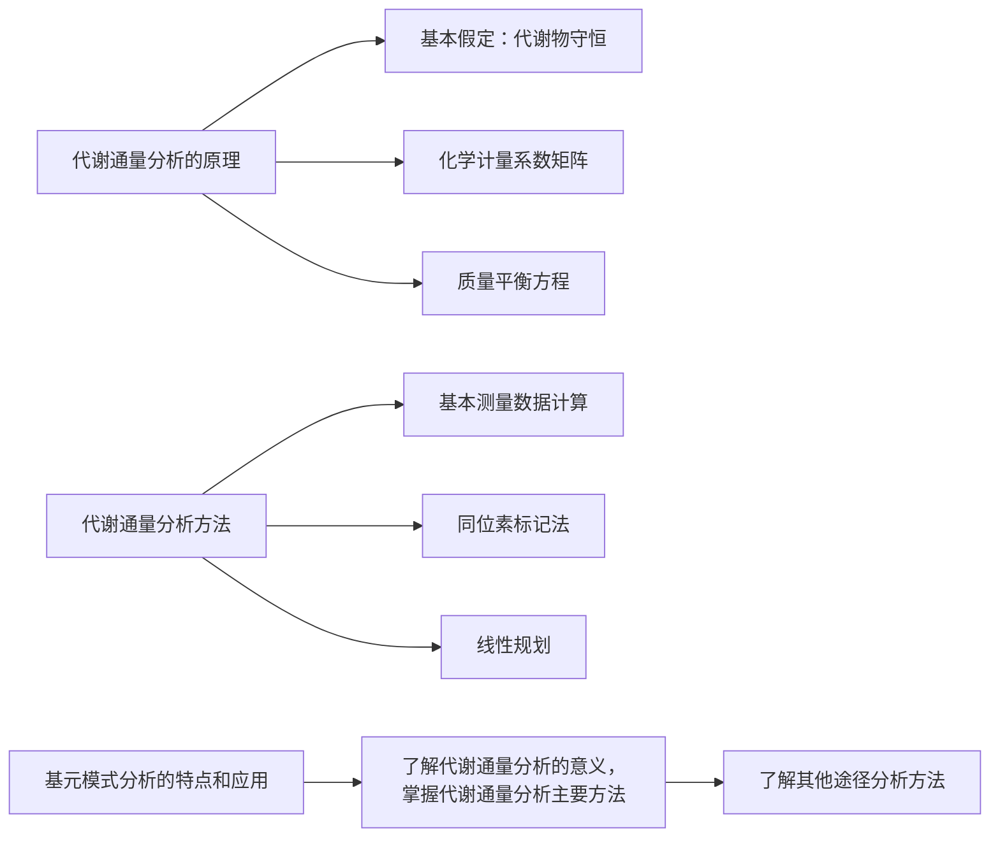

## 4.1 代谢通量分析的原理

代谢途径（metabolic pathway）及其通量是代谢工程的核心，代谢通量（metabolic flux）是指某步细胞反应的比速率，它是代谢途径中最重要的参数。代谢途径是一连串可以进行的、并可观测的生物化学反应步骤，这些反应步骤被指定的一组输入和输出代谢物所连结。各种代谢途径进一步组合成细胞反应网络，网络中代谢通量的确定被称为代谢通量分析（metabolic flux analysis, MFA）。

代谢通量分析的一个基本假定是代谢物守恒（metabolite balancing），即当细胞处于稳态培养状态时，其胞内代谢物的总消耗速率和总生成速率相等，代谢物在细胞内的浓度恒定或者净积累速度为0，即:

$$
\frac {\mathrm{d} c _ {i}}{\mathrm{d} t} = r _ {i} = 0 \tag {4-1}
$$

式中， $r_{i}$ 是细胞中某种代谢物 i 净积累的比速率，常用的量纲为 mmol·g $^{-1}$ （CDW）·h $^{-1}$ 。 $c_{i}$ 是该代谢物在细胞内的浓度，常用量纲为 mmol·g $^{-1}$ （CDW）。

细胞内绝大多数的代谢物有着非常高的周转速率，因此，在细胞的培养环境受到扰动之后，胞内的各种代谢物的浓度会迅速调整到新的水平。甚至在扰动非常剧烈的情况下，胞内代谢物也能快速达到新的平衡状态。因此，胞内代谢物处于拟稳定状态的假定是合理的。如果细胞内代谢物浓度非常高，这种情况下需要考虑由于细胞生长体积变大而引起的稀释效应，则有:

$$
\frac {\mathrm{d} c _ {i}}{\mathrm{d} t} = r _ {i} - \mu c _ {i} \tag {4-2}
$$

对于一个含有 $K$ 种胞内代谢物（这些代谢物没有输出细胞或由胞外输入的通量，

知识拓展4-1
胞内代谢物的稀释效应

---

4.1 代谢通量分析的原理

7B

即不存在运输通量），J个胞内反应（或胞内通量），N种底物和M种代谢产物（这些代谢物既是胞内代谢物，也是胞外代谢物，即存在进出细胞的运输通量）的代谢网络（图4-1），总共存在J个胞内通量和 $N+M$ 种运输通量。另外，如果考虑菌体生长，则还存在一个生物量合成通量，这个通量就是菌体的比生长速率 $\mu$ 。在稳态条件下，每种胞内代谢物的浓度都保持恒定。

flowchart

This diagram illustrates a biological process flow within an oval, showing the movement of variables (S, M, P) and their interactions with a substance labeled '生物量'.

图4-1 一个典型的细胞代谢网络图

## 4.1.1 无细胞生长时的代谢通量分析

对于具有运输通量的胞内代谢物（即底物和产物），存在下列  $N + M$  个质量平衡方程:

$$
r _ {j, \mathrm{trans}} = \sum_ {i = 1} ^ {J} \alpha_ {j, i} v _ {i}, \quad j = 1, 2, \dots , N + M \tag {4-3}
$$

$r_{j,\mathrm{trans}}$ 是第 j 种代谢物（底物或产物）的运输通量， $\alpha_{j,i}$ 为该代谢物在第 i 个胞内反应中的化学计量系数， $v_{i}$ 为第 i 个胞内通量。

对于无运输通量的胞内代谢物，存在下列 K 个质量平衡方程:

$$
0 = \sum_ {i = 1} ^ {J} \alpha_ {j, i} v _ {i}, \quad j = 1, 2, \dots , K \tag {4-4}
$$

这样，由式4-3和式4-4组成的方程组可以合在一起写成矩阵的形式:

$$
\binom {r} {0} = T v \tag {4-5}
$$

式中，r 为  $N + M$  个运输通量构成的列向量，0 为 K 个 0 元素构成的列向量，v 为 J 个胞内通量构成的列向量。T 为代谢网络的化学计量系数矩阵（stoichiometric matrix），其行列数为  $(N + M + K) \times J$ ，矩阵的行对应于  $N + M + K$  种代谢物，列对应于 J 个胞内反应。矩阵中第 i 行元素为该行所代表的代谢物参与 J 个胞内反应的化学计量系数（共 J 个）。在计量系数矩阵中，代谢物可以用这样的方式排列:前 N 行是底物的化学计量系数，从第  $N + 1$  行到  $N + M$  行是代谢产物的化学计量系数，从第  $N + M + 1$  行到  $M + M + K$  行是 K 个胞内代谢物的化学计量系数。

在上述代谢网络中，总共有  $N + M + J$  个通量和  $N + M + K$  个平衡方程，系统的自由度 F = J - K，其中底物和代谢产物进出细胞的运输通量是可以直接测量的，总共有  $N + M$  个可测量通量，因此当测量通量的个数大于或等于 F，就能计算出所有胞内通量和其他未测定的通量。

---

74

4 代谢通量分析

例4-1 对图4-2所示简单代谢网络进行通量分析

解:图4-2所示的简单代谢网络中，有1种底物，3种产物，3种无运输通量的胞内代谢物，6个胞内反应，不用考虑生物量的合成，因此有4个运输通量和6个胞内通量。

flowchart

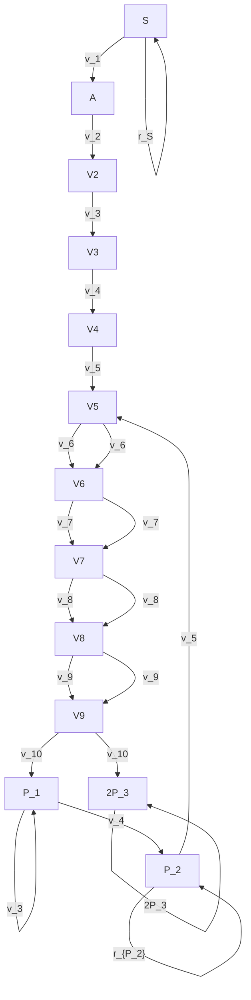

图4-2 一个简单代谢网络的示意图

6个胞内反应为:

$$
\begin{array}{l} v _ {1} \quad A - S = 0 \\ v _ {2} \quad B - 0. 5 A = 0 \\ v _ {3} \quad P _ {1} - 2 B = 0 \\ v _ {4} \quad C - 0. 6 6 7 B = 0 \\ v _ {5} \quad P _ {2} - 3 C = 0 \\ v _ {6} \quad P _ {3} - 1. 5 C = 0 \\ \end{array}
$$

在上面6个反应中，均以反应式中产物的比生成速率作为反应的通量。

对于底物 S，存在下列平衡方程:

$$
r _ {s} = - 1 \cdot v _ {1} + 0 \cdot v _ {2} + 0 \cdot v _ {3} + 0 \cdot v _ {4} + 0 \cdot v _ {5} + 0 \cdot v _ {6}
$$

即 S 只作为底物参与胞内反应 1，因此  $v_{1}$  的化学计量系数为 -1，其余 5 个胞内通量的化学计量系数全部为 0。

同理，对于3种产物，平衡方程为:

$$
r _ {P _ {1}} = 0 \cdot v _ {1} + 0 \cdot v _ {2} + 1 \cdot v _ {3} + 0 \cdot v _ {4} + 0 \cdot v _ {5} + 0 \cdot v _ {6}
$$

$$
r _ {P _ {2}} = 0 \cdot v _ {1} + 0 \cdot v _ {2} + 0 \cdot v _ {3} + 0 \cdot v _ {4} + 1 \cdot v _ {5} + 0 \cdot v _ {6}
$$

$$
r _ {P _ {3}} = 0 \cdot v _ {1} + 0 \cdot v _ {2} + 0 \cdot v _ {3} + 0 \cdot v _ {4} + 0 \cdot v _ {5} + 1 \cdot v _ {6}
$$

对于3种无运输通量的胞内代谢物A、B和C，平衡方程为:

$$
A: 0 = 1 \cdot v _ {1} + (- 0. 5) \cdot v _ {2} + 0 \cdot v _ {3} + 0 \cdot v _ {4} + 0 \cdot v _ {5} + 0 \cdot v _ {6}
$$

$$
B: 0 = 0 \cdot v _ {1} + 1 \cdot v _ {2} + (- 2) \cdot v _ {3} + (- 0. 6 6 7) \cdot v _ {4} + 0 \cdot v _ {5} + 0 \cdot v _ {6}
$$

$$
C: 0 = 0 \cdot v _ {1} + 0 \cdot v _ {2} + 0 \cdot v _ {3} + 1 \cdot v _ {4} + (- 3) \cdot v _ {5} + (- 1. 5) \cdot v _ {6}
$$

即:

$$
\left( \begin{array}{c} r _ {S} \\ r _ {P _ {1}} \\ r _ {P _ {2}} \\ r _ {P _ {3}} \\ 0 \\ 0 \\ 0 \end{array} \right) = \left( \begin{array}{c c c c c c} - 1 & 0 & 0 & 0 & 0 & 0 \\ 0 & 0 & 1 & 0 & 0 & 0 \\ 0 & 0 & 0 & 0 & 1 & 0 \\ 0 & 0 & 0 & 0 & 0 & 1 \\ 1 & - 0. 5 & 0 & 0 & 0 & 0 \\ 0 & 1 & - 2 & - 0. 6 6 7 & 0 & 0 \\ 0 & 0 & 0 & 1 & - 3 & - 1. 5 \end{array} \right) \left( \begin{array}{c} v _ {1} \\ v _ {2} \\ v _ {3} \\ v _ {4} \\ v _ {5} \\ v _ {6} \end{array} \right) = \left( \begin{array}{c} - v _ {1} \\ v _ {3} \\ v _ {5} \\ v _ {6} \\ v _ {1} - 0. 5 v _ {2} \\ v _ {2} - 2 v _ {3} - 0. 6 6 7 v _ {4} \\ v _ {4} - 3 v _ {5} - 1. 5 v _ {6} \end{array} \right)
$$

可以看出，自由度 $F = J - K = 3$ ，只需在四个可测量的运输通量（$r_{S}, r_{P_1}, r_{P_2}$ 和 $r_{P_3}$）中测量3个就可以计算出所有的通量。

代谢网络中的线性途径可以合并成一个反应，例如图4-2中胞内反应1和2可以合并成1个反应: $S \rightarrow 2B$ 。虽然合并后少了胞内代谢物A的质量平衡方程，但胞内通量的数目也减少了1个，因此合并后对系统的自由度没有任何影响。线性途径合并

---

4.1 代谢通量分析的原理

.75

的优点是可以降低代谢网络的复杂度，减小计量系数矩阵的规模，从而有利于计算。另外对于所研究的系统，可以根据实际情况将分支途径简化成线性途径，如果某个分支途径的通量远小于另一个分支途径的通量，就可以进行简化。例如，在细胞处于稳定期时或细胞在含有大量结构单元的丰富培养基中生长时，EMP途径中的前体代谢物流向生物量的通量非常小，可以将3-磷酸甘油醛到丙酮酸的途径看成一条线性途径，并合并成一个反应，即不考虑3-磷酸甘油酸、磷酸烯醇式丙酮酸等参与生物量合成的分支通量。在进行途径简化时一定要谨慎，需要有足够的实验数据作为依据。

## 4.1.2 有细胞生长时的代谢通量分析

如果考虑菌体生长，则必须增加一个生物量合成反应:

$$
B i o m a s s = \sum_ {i = 1} ^ {N + M + K} \beta_ {i} m _ {i} \tag {4-6}
$$

该反应的通量为  $\mu$ ， $m_{i}$  为代谢物（有  $N + M + K$  种）， $\beta_{i}$  为代谢物 i 的在生物量合成反应中的化学计量系数。一种常用的简化处理方法是:仅考虑 NADH、NADPH、ATP 以及 12 种前体代谢物（见第 2 章）参与生物量合成，即除了这些代谢物之外，式 4-6 中其他代谢物的化学计量系数  $\beta$  均为 0。参与生物量合成反应代谢物的化学计量系数可以通过生物量组分分析实验测定，如表 2-2、表 2-4 中的数据即是这些化学计量系数。

在存在菌体生长的情况下，我们可以把生物量当成一种特殊的产物:即假设新的生物量在细胞内通过式4-6所示的反应合成，其通量为 $\mu$ ，然后再通过生物量的运输反应输出细胞，其通量为 $r_{x}$ 。即在不考虑菌体生长的基础上增加了两个通量，而且在稳态条件下这两个通量相等，即生物量也提供了一个质量平衡方程:

$$
r _ {x} = \mu \tag {4-7}
$$

根据这一假设，需要在式4-5的胞内通量向量v中加入式4-6所示生物量合成反应的通量 $\mu$ ，例如可以作为最后一个元素加入，即 $v=(v_{1},v_{2},\cdots,v_{J},\mu)^{T}$ ；运输通量向量r中也需要添加一个新的生物量运输通量 $r_{x}$ ，例如可以作为第一个元素加入，即 $r=(r_{x},r_{1},r_{2},\cdots,r_{N+M})^{T}$ 。相应地，化学计量系数矩阵T需要新加入和生物量对应的1行作为第一行，以及新加入和胞内通量 $\mu$ 对应的1列作为最后一列。新加入行中的元素为 $(0,0,\cdots,0,1)$ ，新加入列中的元素为 $(1,\beta_{1},\beta_{2},\cdots,\beta_{N+M+K})$ 。上述假设仅仅只是为了在考虑细胞生长的情况下，式4-5在形式上和不考虑细胞生长时一样，而没有任何其他的意义。

当存在菌体生长时，总共有  $N + M + J + 2$  个通量和  $N + M + K + 1$  个平衡方程，系统的自由度  $F = J - K + 1$ 。和不存在菌体生长的系统相比，自由度增加了 1，但此时也多了 1 个可以测量的运输通量  $r_{x}$ ，因此对于系统的求解没有影响。

同样是基于代谢物守恒的假定，所有质量平衡方程也可以用下列式表示:

$$
0 = S \cdot v \tag {4-8}
$$

在上式中，通量向量 v 中的元素包括所有的胞内通量和运输通量，即其为  $(N + M + J) \times 1$  的列向量。S 也是化学计量系数矩阵，其行数为系统中全部平衡方程的数目，列数为  $N + M + J$ 。若存在生物量合成通量，则通量向量 v 中要加入  $\mu$ ，同时 S 矩阵也要加入新的 1 列元素，列中的元素为式 4-6 中的计量系数  $\beta_{i}$ 。

知识拓展4-2代谢网络模型中生物量合成的反应式

---

76

4 代谢通量分析

例4-2 图4-3是一个简化的酿酒酵母（Saccharomyces cerevisiae）无氧生长时的代谢反应网络。

反应 1 为乙醛合成反应:

$$
- 1. 5 \mathrm{CH} _ {2} \mathrm{O} + \mathrm{CH} _ {2} \mathrm{O} _ {0. 5} + 0. 5 \mathrm{CO} _ {2} + 0. 5 \mathrm{NADH} + 0. 5 \mathrm{ATP} = 0 \tag {1}
$$

反应 2 为乙醇合成反应:

$$
- \mathrm{CH} _ {2} \mathrm{O} _ {0. 5} + \mathrm{CH} _ {3} \mathrm{O} _ {0. 5} - 0. 5 \mathrm{NADH} = 0 \tag {2}
$$

反应 3 为甘油合成反应:

$$
- \mathrm{CH} _ {2} \mathrm{O} + \mathrm{CH} _ {8 / 3} \mathrm{O} - 0. 3 3 3 \mathrm{NADH} - 0. 3 3 3 \mathrm{ATP} = 0 \tag {3}
$$

反应 4 为生物量合成反应:

$$
- 1. 1 2 \mathrm{CH} _ {2} \mathrm{O} + \mathrm{CH} _ {1. 7 4} \mathrm{O} _ {0. 6} \mathrm{N} _ {0. 1 2} + 0. 1 2 \mathrm{CO} _ {2} + 0. 1 5 \mathrm{NADH} - 2. 4 2 \mathrm{ATP} = 0 \tag {4}
$$

生物量、乙醇和甘油由葡萄糖直接合成，即在以葡萄糖为碳源的无氧培养条件下，这些物质的合成途径都被简化成线性途径并分别用1个反应表示。对上述简化代谢网络进行通量分析。

flowchart

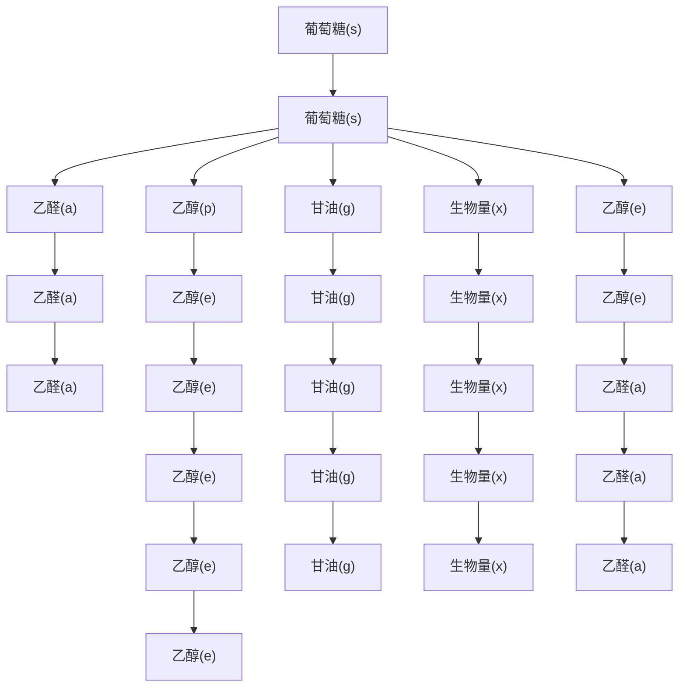

图4-3 酿酒酵母无氧生长时的代谢反应网络

解:根据本节中的假设，可以把生物量合成反应当成胞内反应处理。因此上述网络中，包括1种底物:葡萄糖（s），5种产物:生物量（x）、甘油（g）、乙醇（e）、乙醛（a）和 $CO_{2}$ （c）和2种无运输通量的胞内代谢物:NADH和ATP。反应网络共有4个胞内反应（通量）和6个运输反应（通量）。根据式4-5，可以得到该模型的矩阵表达式:

$$
\left( \begin{array}{l} r _ {x} \\ r _ {s} \\ r _ {a} \\ r _ {e} \\ r _ {c} \\ r _ {g} \\ 0 \\ 0 \end{array} \right) = \left( \begin{array}{c c c c} 0 & 0 & 0 & 1 \\ - 1. 5 & 0 & - 1 & - 1. 1 2 \\ 1 & - 1 & 0 & 0 \\ 0 & 1 & 0 & 0 \\ 0. 5 & 0 & 0 & 0. 1 2 \\ 0 & 0 & 1 & 0 \\ 0. 5 & - 0. 5 & - 0. 3 3 3 & 0. 1 5 \\ 0. 5 & 0 & - 0. 3 3 3 & - 2. 4 2 \end{array} \right) \left( \begin{array}{l} v _ {1} \\ v _ {2} \\ v _ {3} \\ \mu \end{array} \right) \tag {5}
$$

其中 $v_{1}, v_{2}, v_{3}$ 和 $\mu$ 是反应（1），（2），（3）和（4）的通量。因为系统有10个

---

4.2 基于测量数据的代谢通量分析

77

通量，以及8个质量平衡方程，系统的自由度 $F = 2$ ，因此需要从6个运输通量中选取2个测量即可求解。

## 4.2 基于测量数据的代谢通量分析

## 4.2.1 正定系统

对于规模较小的代谢网络，在很多情况下可测量通量的数目 $N + M + 1$ 不小于系统的自由度 $F = J - K + 1$ ，因此可以基于测量数据进行代谢通量分析。如果刚好有 $F$ 个通量被测量，则为正定系统（determined system）。为了便于计算，可以对式4-5中的运输通量向量 $r$ 和计量系数矩阵 $T$ 做如下分割:将 $r$ 分割成两个列向量 $r_m$ 和 $r_c$ ，$r_m$ 中的元素为所有被测量的 $F$ 个运输通量，$r_c$ 中的元素为剩余的 $N + M + 1 - F$ 个运输通量，即所有未测量的运输通量。相应地，$T$ 矩阵分为 $T_1$ 和 $T_2$ 两个矩阵，$T_1$ 为 $T$ 矩阵的前 $N + M + 1 - F$ 行，分别和 $F$ 个运输通量被测量的代谢物相对应，$T$ 矩阵中其余的 $F + K = J + 1$ 行组成 $T_2$ 矩阵，$T_2$ 是 $(J + 1) \times (J + 1)$ 的方阵。即:

$$
\left( \begin{array}{l} r _ {c} \\ r _ {m} \\ 0 \end{array} \right) = \binom{T _ {1}}{T _ {2}} v \tag {4-9}
$$

式4-9可分为两个方程组:

$$
r _ {c} = T _ {1} v \tag {4-10}
$$

及

$$
\binom {r _ {m}} {0} = T _ {2} v \tag {4-11}
$$

将测量的运输通量代入式4-11中可以计算胞内通量:

$$
v = T _ {2} ^ {- 1} \binom{r _ {m}}{0} \tag {4-12}
$$

再将计算得到的 v 代入式 4-10 可以计算其余未测量的运输通量的大小。

使用式4-12的前提是矩阵 $T_{2}$ 是非奇异的，即其行列式的值不等于零。造成 $T_{2}$ 奇异的原因有三种:

（1）在计量系数矩阵 T 中出现了线性相关的列。计量系数矩阵 T 的列和模型中的胞内反应（或胞内通量）相对应，如果由于某种原因一个或者多个胞内反应线性相关，那么这种相关性也会转移到矩阵  $T_{2}$  中，因此使  $T_{2}$  变得奇异。线性相关的反应很少在简单反应网络中出现，不过它们经常出现在较大的反应网络中。

例如，如果图4-2所示网络中还存在一个反应7， $A \rightarrow P_{1}$ ，其通量为 $v_{7}$ ，则从A到 $P_{1}$ 存在两条并行途径:一条途径由反应7单独组成，另一条途径由反应2和反应3组成。此时存在下列关系式:

知识拓展4-3反应计量学中的线性相关现象

---

78

4 代谢通量分析

$$
\left( \begin{array}{c} r _ {S} \\ r _ {P _ {1}} \\ r _ {P _ {2}} \\ r _ {P _ {3}} \\ 0 \\ 0 \\ 0 \end{array} \right) = \left( \begin{array}{c c c c c c c} - 1 & 0 & 0 & 0 & 0 & 0 & 0 \\ 0 & 0 & 1 & 0 & 0 & 0 & 1 \\ 0 & 0 & 0 & 0 & 1 & 0 & 0 \\ 0 & 0 & 0 & 0 & 0 & 1 & 0 \\ 1 & - 0. 5 & 0 & 0 & 0 & 0 & - 1 \\ 0 & 1 & - 2 & - 0. 6 6 7 & 0 & 0 & 0 \\ 0 & 0 & 0 & 1 & - 3 & - 1. 5 & 0 \end{array} \right) \left( \begin{array}{c} v _ {1} \\ v _ {2} \\ v _ {3} \\ v _ {4} \\ v _ {5} \\ v _ {6} \\ v _ {7} \end{array} \right)
$$

$$
= \left( \begin{array}{c} - v _ {1} \\ v _ {3} + v _ {7} \\ v _ {5} \\ v _ {6} \\ v _ {1} - 0. 5 v _ {2} - v _ {7} \\ v _ {2} - 2 v _ {3} - 0. 6 6 7 v _ {4} \\ v _ {4} - 3 v _ {5} - 1. 5 v _ {6} \end{array} \right)
$$

很容易看出，T 矩阵的第 2、3 和 7 列线性相关: $2 \times$  列 $_{2}$  + 列 $_{3}$  = 列 $_{7}$ ，会造成  $T_{2}$  奇异。

(2) 在计量系数矩阵 $T$ 中出现了线性相关的行。计量系数矩阵 $T$ 的行和模型中的代谢物相对应, 如果某些化合物的计量系数一致或者线性相关即可造成行向量的线性相关。对于绝大多数代谢物, 通常不会发生这种情况, 但是如果模型中包含了诸如 $\mathrm{NADH} / \mathrm{NAD}^{+}$, $\mathrm{NADPH} / \mathrm{NADP}^{+}$ 或者 ATP/ADP 的辅因子对时, 辅因子对中的两种代谢物必定会同时参与某一反应, 并且在该反应中的化学计量系数大小相同, 正负号相反, 这样就造成计量系数矩阵 $T$ 中和这两种代谢物对应的行线性相关。解决这个问题的简单方法是在反应中只列出每对辅因子中的一种代谢物。对于上述三种辅因子对, 通常我们分别保留 NADH, NADPH 和 ATP。注意到如果无运输通量的胞内代谢物的计量系数线性相关, 那么这种线性相关性会转移到矩阵 $T_{2}$ 中, 因为 $T_{2}$ 总是包含了和这些代谢物相对应的行。

（3）系统对于所选择的被测量的运输通量是非确定的。发生这种情况的一个原因是某个质量平衡方程中的所有变量都被选择为测量的运输通量，这导致该平衡方程对未知通量没有限制作用而无法确定系统。对于大规模代谢网络，通常识别出导致矩阵奇异或非奇异的一组测量通量是很困难的，当矩阵奇异时，唯一可行的办法更换一组运输通量进行测量，并检查矩阵 $T_{2}$ 是否是非奇异的。

例4-3 如果例4-2中分别选取 $(r_s, r_x)$ 和 $(r_x, r_e)$ 作为被测量的运输通量，求系统中其他通量值。

如果选取  $r_{s}$  和  $r_{x}$  作为测量的运输通量，则例 4-2 中式（5）重排后变为:

---

4.2 基于测量数据的代谢通量分析

79

$$
\left( \begin{array}{l} r _ {c} \\ r _ {g} \\ r _ {a} \\ r _ {e} \\ r _ {x} \\ r _ {s} \\ 0 \\ 0 \end{array} \right) = \left( \begin{array}{c c c c} 0. 5 & 0 & 0 & 0. 1 2 \\ 0 & 0 & 1 & 0 \\ 1 & - 1 & 0 & 0 \\ 0 & 1 & 0 & 0 \\ 0 & 0 & 0 & 1 \\ - 1. 5 & 0 & - 1 & - 1. 1 2 \\ 0. 5 & - 0. 5 & - 0. 3 3 3 & 0. 1 5 \\ 0. 5 & 0 & - 0. 3 3 3 & - 2. 4 2 \end{array} \right) \left( \begin{array}{l} v _ {1} \\ v _ {2} \\ v _ {3} \\ \mu \end{array} \right) \tag {1}
$$

根据式4-12，胞内通量为:

$$
\left( \begin{array}{c} v _ {1} \\ v _ {2} \\ v _ {3} \\ \mu \end{array} \right) = \left( \begin{array}{c c c c} 0 & 0 & 0 & 1 \\ - 1. 5 & 0 & - 1 & - 1. 1 2 \\ 0. 5 & - 0. 5 & - 0. 3 3 3 & 0. 1 5 \\ 0. 5 & 0 & - 0. 3 3 3 & - 2. 4 2 \end{array} \right) ^ {- 1} \left( \begin{array}{c} r _ {x} \\ r _ {s} \\ 0 \\ 0 \end{array} \right) = \left( \begin{array}{c} 2. 0 4 8 r _ {x} - 0. 3 3 3 r _ {s} \\ 5. 1 4 r _ {x} \\ - 4. 1 9 r _ {x} - 0. 5 r _ {s} \\ r _ {x} \end{array} \right) \tag {2}
$$

根据式4-10，其他未测量的运输通量为:

$$
\begin{array}{l} \left( \begin{array}{c} r _ {e} \\ r _ {g} \\ r _ {a} \\ r _ {e} \end{array} \right) = \left( \begin{array}{c c c c} 0. 5 & 0 & 0 & 0. 1 2 \\ 0 & 0 & 1 & 0 \\ 1 & - 1 & 0 & 0 \\ 0 & 1 & 0 & 0 \end{array} \right) \left( \begin{array}{c} v _ {1} \\ v _ {2} \\ v _ {3} \\ \mu \end{array} \right) = \left( \begin{array}{c c c c} 0. 5 & 0 & 0 & 0. 1 2 \\ 0 & 0 & 1 & 0 \\ 1 & - 1 & 0 & 0 \\ 0 & 1 & 0 & 0 \end{array} \right) \left( \begin{array}{c c} 2. 0 4 8 & - 0. 3 3 3 \\ 5. 1 4 & 0 \\ - 4. 1 9 & - 0. 5 \\ 1 & 0 \end{array} \right) \binom {r _ {x}} {r _ {s}} \\ = \left( \begin{array}{c} 1. 1 4 3 r _ {x} - 0. 1 6 7 r _ {s} \\ - 4. 1 9 r _ {x} - 0. 5 r _ {s} \\ - 3. 0 9 3 r _ {x} - 0. 3 3 3 r _ {s} \\ 5. 1 4 r _ {x} \end{array} \right) \tag {3} \\ \end{array}
$$

如果选择 $r_x$ 和 $r_e$ 作为被测量的运输通量则例4-2中式（5）重排后变为:

$$
\left( \begin{array}{c} r _ {e} \\ r _ {g} \\ r _ {a} \\ r _ {s} \\ r _ {x} \\ r _ {e} \\ 0 \\ 0 \end{array} \right) = \left( \begin{array}{c c c c} 0. 5 & 0 & 0 & 0. 1 2 \\ 0 & 0 & 1 & 0 \\ 1 & - 1 & 0 & 0 \\ - 1. 5 & 0 & - 1 & - 1. 1 2 \\ 0 & 0 & 0 & 1 \\ 0 & 1 & 0 & 0 \\ 0. 5 & - 0. 5 & - 0. 3 3 3 & 0. 1 5 \\ 0. 5 & 0 & - 0. 3 3 3 & - 2. 4 2 \end{array} \right) \left( \begin{array}{c} v _ {1} \\ v _ {2} \\ v _ {3} \\ \mu \end{array} \right) \tag {4}
$$

很容易看出  $T_{2}$  矩阵的行列式为 0，是一个奇异矩阵，显然选择  $r_{x}$  和  $r_{e}$  作为测量的运输通量无法确定系统，其原因可以从式（3）的结果中看出， $r_{e}$  和  $r_{x}$  是成比例的，即存在线性相关性。 $r_{e}$  和  $r_{x}$  导致通量分析无法进行的问题在分析之前很难被识别出来，一般只有通过分析不同的每组测量速率的矩阵才能确定哪些测量组能够确定出整个系统的通量。

如果采用式4-8进行代谢通量分析，可以采用第3章中的方法将 $F$ 个已测定的

---

80

4 代谢通量分析

运输通量放在列向量 v 的前 F 行，并定义为  $v_{m}$ ，其余行为  $v_{c}$ 。这样，式 4-8 就可以写成与式 3-33 一样的形式:

$$
S _ {m} v _ {m} + S _ {c} v _ {c} = 0 \tag {4-13}
$$

若系统共有 $P$ 个平衡方程，则 $S_{c}$ 是一个 $P \times P$ 的方阵，$S_{m}$ 则有 $P$ 行 $N + M + J - P$ 列。设 $\det(S_{c}) \neq 0$，则可通过下式求解未知通量:

$$
v _ {c} = - \left(S _ {c}\right) ^ {- 1} S _ {m} v _ {m} \tag {4-14}
$$

## 4.2.2 超定系统

代谢通量分析是在黑箱模型基础上的进一步扩展，仍然需要基于黑箱模型进行测量数据的一致性检验，以保证细胞内通量计算的准确性。如果测量的运输通量的个数大于系统自由度 $F$ ，则是超定系统（overdetermined system），这时可以对测量通量和计算所得出的通量进行比较，即进行数据一致性的检验。如果在实验误差所允许的范围内测量数据和计算数据的一致性很好，则表明代谢网络很好地描述了在实验操作条件下微生物生理状态。超定系统的矩阵 $T_{2}$ 不是方阵，因此不能直接求逆。一般用两种方法解决该问题:其一是使用测量速率向量的一个子向量，即舍弃多余的测量数据，使系统成为正定系统，使用式4-12和式4-10来分别计算胞内通量和未测的运输通量。通过对计算出的运输通量和没有参与通量计算的测量数据（即舍弃的测量数据）进行对比来检验模型的正确性，如果模型具有正确的结构，那么计算的数据应该和测量的数据之间具有很好的一致性。另外一种更好的方法是使用统计学的方法从整套测量数据中获取通量向量 $\pmb{v}$ 的很好的估计值，并对测量速率也获得新的估计值。通常对通量向量进行最小二乘法估计，即在式4-11的等号两边同时乘以 $T_{2}$ 的转置矩阵，则:

$$
v = \left(T _ {2} T _ {2}\right) ^ {- 1} T _ {2} \binom{r _ {m}}{0} \tag {4-15}
$$

式中， $(T_{2}T_{2})^{-1}T_{2}$  也称为  $T_{2}$  的拟-逆矩阵，矩阵  $T_{2}^{T}T_{2}$  是一个方阵。如果  $T_{2}$  满秩，那么  $T_{2}^{T}T_{2}$  非奇异，并且该矩阵可逆。 $T_{2}$  满秩的要求等同于  $T_{2}$  非奇异的要求，因此使用式 4-15 的前提和式 4-12 是相同的。

同样，式4-14的最小二乘估计为:

$$
v _ {c} = - \left[ S _ {c} ^ {T} S _ {c} \right] ^ {- 1} \left[ S _ {c} ^ {T} S _ {m} \right] v _ {m} \tag {4-16}
$$

而且可以采用第3章介绍的方法对测量的运输通量进行估计和h检验。

使用矩阵求逆的方法计算代谢通量时必须分析化学计量矩阵对测量数据的敏感性，即检查矩阵是否是病态的。对于病态矩阵，在矩阵运算时会将测量数据的微小扰动或误差放大，结果导致胞内通量计算的严重错误。可以通过一个简单的矩阵来说明这个问题:

$$
r = \left( \begin{array}{c c} 1 & 1 \\ 1 & 1. 0 0 0 1 \end{array} \right) \binom {v _ {1}} {v _ {2}} \tag {4-17}
$$

如果 $r$ 的测量值为 $(2, 2)^{T}$，则方程组的解是 $v_{1} = 2$ 和 $v_{2} = 0$，如果 $r$ 的测量值为 $(2, 2.0001)^{T}$，方程组的解变 $v_{1} = 1$ 和 $v_{2} = 1$。测量数据小于 $0.1\%$ 的变化导致通量向量的显著改变。在实际中这就意味着即使是很小的测量误差也会放大成为估算通量值

---

4.2 基于测量数据的代谢通量分析

81

的大偏差。如果计量系数矩阵是病态的，就必须重新修正模型，例如去掉特定的反应，或者选取另外一组测量速率进行通量估算。

一种检验矩阵的是否病态的方法是计算矩阵的条件数（Stephanopoulos et al. 1998）:

$$
\text {条件数} = \parallel T _ {2} ^ {T} \parallel \parallel (T _ {2} ^ {T}) ^ {\#} \parallel \tag {4-18}
$$

$\| \|$ 表示矩阵范数，$(T_2^T)^{\#}$ 是 $T_2^T$ 的拟-逆矩阵。$T_2^T$ 的范数等于矩阵 $T_2 T_2^T$ 的最大特征值 $\lambda_{\max}$ 的平方根，也等于 $T_2^T$ 的奇异值:

$$
\| T _ {2} ^ {T} \| = \sqrt {\lambda_ {\max} (T _ {2} T _ {2} ^ {T})} \tag {4-19}
$$

一般认为条件数大于100的矩阵是病态的。式4-17中的矩阵的条件数是 $10^{4}$ ，显然该矩阵是病态的。

另外一种更简便的检验方法是计算通量对测量速率的敏感度:

$$
\frac {\partial v}{\partial r _ {m}} = - T _ {2} ^ {- 1} \tag {4-20}
$$

上式中的偏微分表示得是通量向量的所有元素对单个测量速率的敏感程度，即第j行i列的元素表示了第j个通量对第i个测量速率变化的敏感程度。即通过矩阵 $T_{2}$ 的逆矩阵可以大致评估矩阵是否是病态的，该矩阵也被称为敏感矩阵。式4-17中的矩阵的敏感矩阵是:

$$
1 0 ^ {4} \left( \begin{array}{c c} 1. 0 0 0 1 & - 1 \\ - 1 & 1 \end{array} \right) \tag {4-21}
$$

矩阵的所有元素都很大，很明显，这两个通量对测量速率的变化都非常敏感。

对于较大的代谢网络，人工求解代数方程组是很费力的，而使用 Mathematica 或 Matlab 进行计算机求解则非常方便。

例4-4 大肠杆菌的厌氧发酵是混合酸发酵，主要产物包括乙酸、乳酸、琥珀酸。乙醇以及甲酸，经过代谢工程改造的大肠杆菌可在厌氧条件下高效生产琥珀酸，Lin等（2005）采用分批培养方式厌氧培养一株产琥珀酸大肠杆菌，在菌体生长的稳定期测定下列胞外代谢物的比速率（单位为 $\mathrm{mmol} \cdot \mathrm{g}^{-1}(\mathrm{CDW}) \cdot \mathrm{h}^{-1}$）:葡萄糖 $v_{1} = 2.13$，乙酸 $v_{9} = 0.14$，乳酸 $v_{6} = 0$，琥珀酸 $v_{15} = 3.41$，乙醇 $v_{10} = 0$，甲酸 $v_{14} = 0.99$。图4-4是该菌株一个简化的代谢网络，包括的反应见表4-1。其中工程菌株中的乙醛酸循环途径被激活，因此添加了反应11，反应3,4,9,10,11,12分别由数个线性反应合并而来，丙酮酸和磷酸烯醇式丙酮酸被认为是同一种代谢物而不加区分，因此回补反应I和II变为并行反应而合并成反应5。根据该网络和测量的实验数据确定其他未知通量。

解:网络中共有15个通量（8个运输通量和7个胞内通量）和9个平衡方程，系统的自由度为6（如果考虑 $CO_{2}$ ，则有16个通量和10个平衡方程，并不会改变系统的性质），由于测定了包括比生长速率在内的7个运输通量，因此该系统是超定系统。

---

82

4 代谢通量分析

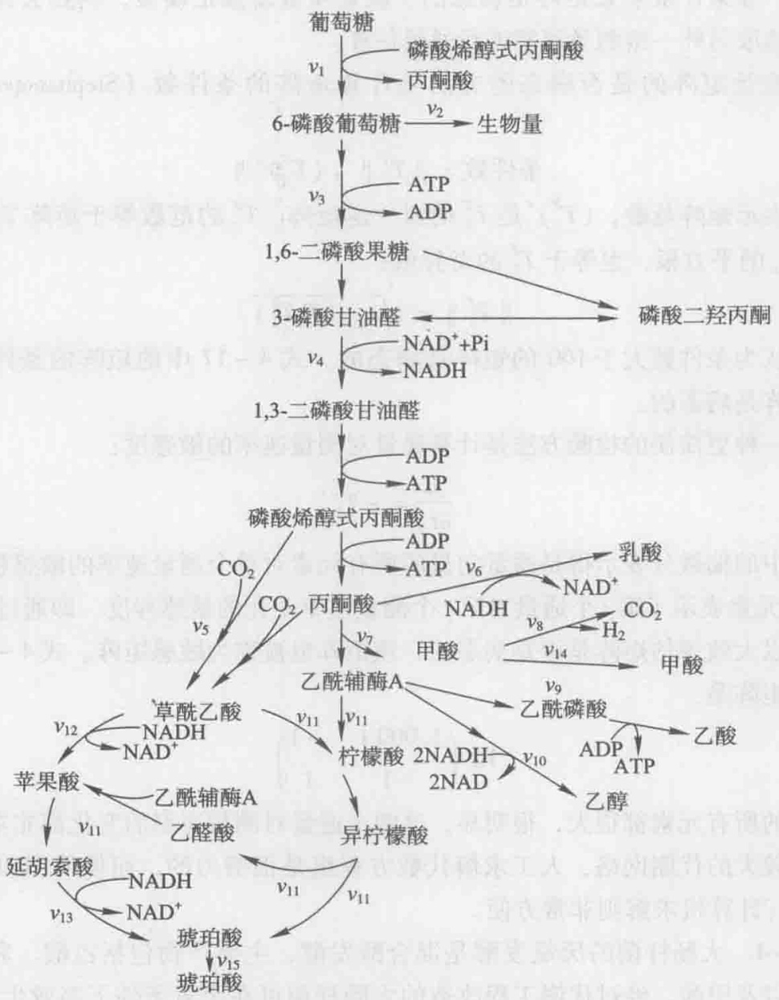

flowchart

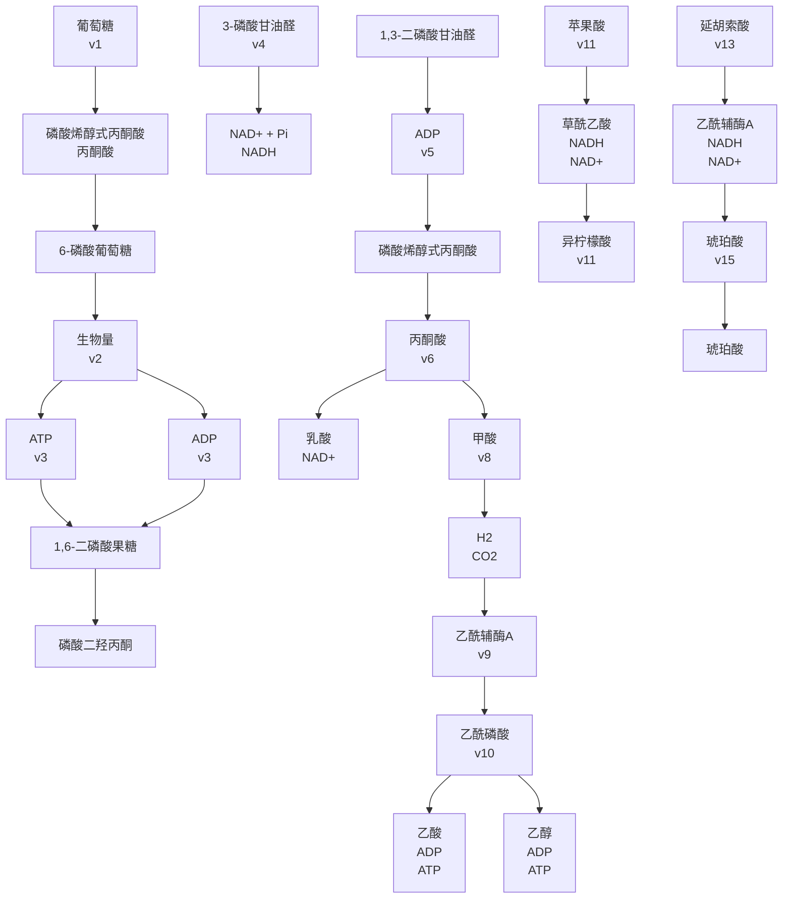

图4-4 大肠杆菌厌氧发酵生产琥珀酸的代谢网络

表 4-1 反应列表

<table><tr><td></td><td>反应</td><td>酶</td></tr><tr><td>1</td><td>葡萄糖 + 磷酸烯醇式丙酮酸  $\rightleftharpoons$  6 - 磷酸葡萄糖 + 丙酮酸</td><td>运输葡萄糖的 PTS 酶类;酶 I , HPr, II $^{Glc}$ , III $^{Glc}$ </td></tr><tr><td>2</td><td>6 - 磷酸葡萄糖  $\rightleftharpoons$  生物量</td><td></td></tr><tr><td rowspan="5">3</td><td>6 - 磷酸葡萄糖 + ATP  $\rightleftharpoons$  3 - 磷酸甘油醛 + ADP</td><td></td></tr><tr><td>a. 6 - 磷酸葡萄糖  $\rightleftharpoons$  6 - 磷酸果糖</td><td>6 - 磷酸葡萄糖异构酶</td></tr><tr><td>b. 6 - 磷酸果糖 + ATP  $\rightleftharpoons$  1, 6 - 二磷酸果糖 + ADP</td><td>磷酸果糖激酶</td></tr><tr><td>c. 1, 6 - 二磷酸果糖  $\rightleftharpoons$  磷酸二羟丙酮 + 3 - 磷酸甘油醛</td><td>二磷酸果糖醛缩酶</td></tr><tr><td>d. 磷酸二羟丙酮  $\rightleftharpoons$  3 - 磷酸甘油醛</td><td>磷酸丙糖异构酶</td></tr><tr><td rowspan="3">4</td><td>3 - 磷酸甘油醛 + NAD $^{+}$  + Pi + 2ADP  $\rightleftharpoons$  丙酮酸 + H $_{2}$ O + NADH + H $^{+}$  + 2ATP</td><td></td></tr><tr><td>a. 3 - 磷酸甘油醛 + NAD $^{+}$  + Pi  $\rightleftharpoons$  1, 3 - 二磷酸甘油酸 + NADH + H $^{+}$ </td><td>3 - 磷酸甘油醛脱氢酶</td></tr><tr><td>b. 1, 3 - 二磷酸甘油酸 + ADP  $\rightleftharpoons$  3 - 磷酸甘油酸 + ATP</td><td>3 - 磷酸甘油酸激酶</td></tr></table>

---

4.2 基于测量数据的代谢通量分析

83

续表

<table><tr><td colspan="2">反应</td><td>酶</td></tr><tr><td colspan="2">c. 3-磷酸甘油酸⇌2-磷酸甘油酸</td><td>磷酸甘油酸变位酶</td></tr><tr><td colspan="2">d. 2-磷酸甘油酸⇌磷酸烯醇式丙酮酸+ $H_{2}O$ </td><td>烯醇酶</td></tr><tr><td colspan="2">e. 磷酸烯醇式丙酮酸+ADP⇌丙酮酸+ATP</td><td>丙酮酸激酶</td></tr><tr><td colspan="2">5 I. 磷酸烯醇式丙酮酸+ $CO_{2}$ ⇌草酰乙酸+Pi</td><td>磷酸烯醇式丙酮酸羧化酶</td></tr><tr><td colspan="2">II. 丙酮酸+ATP+ $CO_{2}$ ⇌草酰乙酸+Pi</td><td>丙酮酸羧化酶</td></tr><tr><td colspan="2">6 丙酮酸+NADH+ $H^{+}$ ⇌乳酸+ $NAD^{+}$ </td><td>乳酸脱氢酶</td></tr><tr><td colspan="2">7 丙酮酸+辅酶A⇌甲酸+乙酰辅酶A</td><td>丙酮酸甲酸裂解酶</td></tr><tr><td colspan="2">8 甲酸⇌ $CO_{2}$ + $H_{2}$ </td><td>甲酸脱氢酶</td></tr><tr><td colspan="2">9 乙酰辅酶A+Pi+ADP⇌乙酸+辅酶A+ATP</td><td></td></tr><tr><td colspan="2">a. 乙酰辅酶A+Pi⇌乙酰磷酸+辅酶A</td><td>乙酸磷酸转移酶</td></tr><tr><td colspan="2">b. 乙酰磷酸+ADP⇌乙酸+ATP</td><td>乙酸激酶或者化学水解</td></tr><tr><td colspan="2">10 乙酰辅酶A+2NADH+2 $H^{+}$ ⇌乙醇+辅酶A+2 $NAD^{+}$ </td><td></td></tr><tr><td colspan="2">a. 乙酰辅酶A+NADH+ $H^{+}$ ⇌乙醛+辅酶A+ $NAD^{+}$ </td><td>乙醛脱氢酶</td></tr><tr><td colspan="2">b. 乙醛+NADH+ $H^{+}$ ⇌乙醇+ $NAD^{+}$ </td><td>乙醇脱氢酶</td></tr><tr><td colspan="2">11 2乙酰辅酶A+ $H_{2}O$ +草酰乙酸⇌苹果酸+琥珀酸辅酶A+辅酶A</td><td></td></tr><tr><td colspan="2">a. 乙酰辅酶A+ $H_{2}O$ +草酰乙酸⇌柠檬酸+辅酶A</td><td>柠檬酸合成酶</td></tr><tr><td colspan="2">b. 柠檬酸⇌异柠檬酸</td><td>顺乌头酸水合酶</td></tr><tr><td colspan="2">c. 异柠檬酸⇌乙醛酸+琥珀酸</td><td>异柠檬酸裂解酶</td></tr><tr><td colspan="2">d. 乙醛酸+乙酰辅酶A⇌苹果酸+辅酶A</td><td>苹果酸合成酶</td></tr><tr><td colspan="2">12 草酰乙酸+NADH⇌延胡索酸+ $NAD^{+}$ + $H_{2}O$ </td><td></td></tr><tr><td colspan="2">a. 草酰乙酸+NADH+ $H^{+}$ ⇌苹果酸+ $NAD^{+}$ </td><td>苹果酸脱氢酶</td></tr><tr><td colspan="2">b. 苹果酸⇌延胡索酸+ $H_{2}O$ </td><td>延胡索酸酶C</td></tr><tr><td colspan="2">13 延胡索酸+NADH+ $H^{+}$ +Pi+ADP⇌琥珀酸+ $NAD^{+}$ +ATP</td><td>延胡索酸还原酶</td></tr></table>

根据图4-4和表4-1中的反应，有9种代谢物可以提供平衡方程:

(1) 6-磷酸葡萄糖: $v_{1}-v_{2}-v_{3}=0$
(2) 3 - 磷酸甘油醛:  $2v_{3}-v_{4}=0$
(3) 丙酮酸: $v_{4}-v_{5}-v_{6}-v_{7}=0$
(4) 乙酰辅酶 A:  $v_{7}-v_{9}-v_{10}-2v_{11}=0$
(5) 草酰乙酸:  $v_{5}-v_{11}-v_{12}=0$
(6) 苹果酸: $v_{11} + v_{12} - v_{13} = 0$
(7) NADH:  $v_{4}-v_{6}-2v_{10}-v_{12}-v_{13}=0$
(8) 琥珀酸:  $v_{11} + v_{13} - v_{15} = 0$
(9) 甲酸:  $v_{7}-v_{8}-v_{14}=0$

系统的化学计量系数矩阵 S 为:

---

84

4 代谢通量分析

$$
S = \left( \begin{array}{c c c c c c c c c c c c c c c} v _ {1} & v _ {2} & v _ {6} & v _ {9} & v _ {1 0} & v _ {1 4} & v _ {1 5} & v _ {3} & v _ {4} & v _ {5} & v _ {7} & v _ {8} & v _ {1 1} & v _ {1 2} & v _ {1 3} \\ 1 & - 1 & 0 & 0 & 0 & 0 & 0 & - 1 & 0 & 0 & 0 & 0 & 0 & 0 & 0 \\ 0 & 0 & 0 & 0 & 0 & 0 & 0 & 2 & - 1 & 0 & 0 & 0 & 0 & 0 & 0 \\ 0 & 0 & - 1 & 0 & 0 & 0 & 0 & 0 & 1 & - 1 & - 1 & 0 & 0 & 0 & 0 \\ 0 & 0 & 0 & - 1 & - 1 & 0 & 0 & 0 & 0 & 0 & 1 & 0 & - 2 & 0 & 0 \\ 0 & 0 & 0 & 0 & 0 & 0 & 0 & 0 & 0 & 1 & 0 & 0 & - 1 & - 1 & 0 \\ 0 & 0 & 0 & 0 & 0 & 0 & 0 & 0 & 0 & 0 & 0 & 0 & 1 & 1 & - 1 \\ 0 & 0 & - 1 & 0 & - 2 & 0 & 0 & 0 & 1 & 0 & 0 & 0 & 0 & - 1 & - 1 \\ 0 & 0 & 0 & 0 & 0 & 0 & - 1 & 0 & 0 & 0 & 0 & 0 & 1 & 0 & 1 \\ 0 & 0 & 0 & 0 & 0 & - 1 & 0 \end{array} \right) \text {6 - 磷酸葡萄糖}
$$

矩阵 S 的前 7 列对应于已测定的通量，这 7 列元素组成  $S_{m}$  矩阵，后 8 列对应于未知通量，其元素组成  $S_{c}$  矩阵。根据式 4-16 得:

$$
v _ {c} = \left( \begin{array}{l} v _ {3} \\ v _ {4} \\ v _ {5} \\ v _ {7} \\ v _ {8} \\ v _ {1 1} \\ v _ {1 2} \\ v _ {1 3} \end{array} \right) = - \left[ S _ {c} ^ {T} S _ {c} \right] ^ {- 1} \left[ S _ {c} ^ {T} S _ {m} \right] v _ {m} = - \left( \begin{array}{c c c c c c c} - 0. 5 7 0 & 0. 5 7 0 & - 0. 2 1 5 & - 0. 1 6 1 & - 0. 2 6 8 & 0 & - 0. 2 6 8 \\ - 0. 9 2 6 & 0. 9 2 6 & - 0. 5 3 7 & - 0. 4 0 3 & - 0. 6 7 1 & 0 & - 0. 6 7 1 \\ - 0. 6 8 5 & 0. 6 8 5 & 0. 3 4 2 & 0. 0 0 7 & 0. 6 7 8 & 0 & - 0. 3 2 2 \\ - 0. 0 8 1 & 0. 0 8 1 & 0. 0 4 0 & - 0. 4 7 0 & - 1. 4 5 0 & 0 & - 0. 4 5 \\ - 0. 0 8 1 & 0. 0 8 1 & 0. 0 4 0 & - 0. 4 7 0 & - 1. 4 5 0 & 1 & - 0. 4 5 \\ 0. 0 4 0 & - 0. 0 4 0 & - 0. 0 2 0 & 0. 2 3 5 & - 0. 2 7 5 & 0 & - 0. 2 7 5 \\ - 0. 5 6 4 & 0. 5 6 4 & 0. 2 8 2 & - 0. 2 8 9 & 0. 8 5 2 & 0 & - 0. 1 4 8 \\ - 0. 3 0 9 & 0. 3 0 9 & 0. 1 5 4 & - 0. 1 3 4 & 0. 4 4 3 & 0 & - 0. 5 5 7 \end{array} \right)
$$

$$
\left( \begin{array}{c} 2. 1 3 \\ 0 \\ 0 \\ 0. 1 3 8 \\ 0 \\ 0. 9 9 \\ 3. 4 1 \end{array} \right) = \left( \begin{array}{l} 2. 1 5 \\ 4. 3 2 \\ 2. 5 6 \\ 1. 7 7 \\ 0. 7 8 \\ 0. 8 2 \\ 1. 7 5 \\ 2. 5 8 \end{array} \right)
$$

可以进一步计算出  $CO_{2}$  的输出通量  $v_{16}$ ， $v_{16}=v_{8}-v_{5}=0.78-2.56=-1.78\ mmol\cdot g^{-1}(CDW)\cdot h^{-1}$ ，负号表示该系统吸收  $CO_{2}$ 。

## 4.3 基于线性规划的通量平衡分析

对于较大的代谢网络，特别是基因组尺度的代谢网络，通常无法获得足够的平衡方程，即平衡方程的数目少于未知通量的数目，则系统是不定系统（underdetermined system）。对于不定系统，一般采用基于约束的优化模拟方法求系统的最优解。这些模拟方法中以线性规划为主，其最基本的组成部分为:约束条件、决策变量和目标函数，基于线性规划的算法也称为通量平衡分析（flux balance analysis, FBA）。该算法假设系统处于拟稳态，即中间代谢物的生成速率与消耗速率相同，在这种假设下设置

背景知识4-1 线性规划的基本概念

---

4.3 基于线性规划的通量平衡分析

85

一定的约束条件和目标函数，来研究胞内相应状态下的通量分布情况。其基本算法可以由以下数学表达式来表示:

$$
S v = 0; \alpha_ {i} \leqslant v _ {i} \leqslant \beta_ {i}, i \in \{1, 2, \dots , n \}; Z = c v; \max (Z) \tag {4-22}
$$

式中，$S$ 是系统的化学计量系数矩阵，$v$ 是由系统中 $n$ 个通量组成的通量列向量，$\alpha_{i}$ 和 $\beta_{i}$ 分别是通量 $v_{i}$ 的上下限，$Z$ 是目标函数，它是通量向量中各元素的线性组合，$c$ 是目标函数中各通量系数组成的行向量。目标函数可以是细胞的最大比生长速率，也可以是特定产物的最大得率（见例4-5）。满足代谢平衡限制条件的通量向量 $v$ 的所有解空间由计量系数矩阵 $S$ 的零空间给出。因此，零空间定义了通量向量的可能解空间（图4-5）。零空间的形状是由代谢网络模型中所有反应的计量系数决定的，并且这个由计量系数矩阵 $S$ 代表的网络模型定义了网络所有的可能操作模型。目标函数的最优化可以在解空间中得到唯一的最优解，例如图4-5中凸锥的某个顶点，这种情况下可以得到一个用于指导试验的最优通量分布图。但也有得到无穷个最优解的情况:即目标函数有最优值但是能够得到最优值的通量向量的解却不是唯一的，例如最优解为解空间边界的某条直线或面，这种情况下很多解并不具有实际的生物学意义，一个可行的办法是在模型中引入反应的动力学参数或热力学参数来作为额外的约束条件，以进一步缩小解空间，得到可能的唯一最优解。因此，线性规划的使用并不一定能够得到网络中通量的理想估计值，但是显然线性规划方法的优势在于研究者可以使用代谢模型来预测一个代谢网络可能的操作状态，而以前讨论的方法所进行的分析都是建立在一组实验测量数据的基础上的。线性规划的概念非常适用于评估某个给定代谢网络对一种特定化合物的生产潜力，并且通过线性规划的方法可以很容易地计算出最大理论得率。最大理论得率的计算为实际生产过程提供了参考。不仅如此，还可以

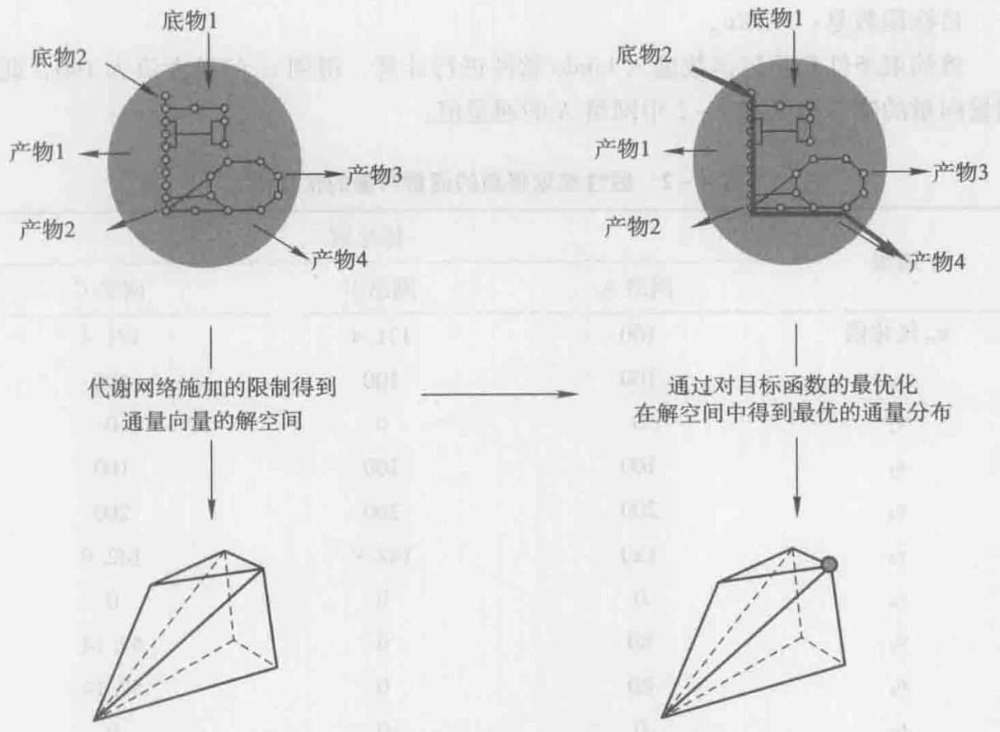

flowchart

This flowchart illustrates a two-stage process for computing the maximum resolution of a 3D geometric structure. The first process involves transmitting data from base objects to produce outputs, while the second process shows that the optimal resolution is achieved by achieving the final 3D structure.

图4-5 代谢通量的解空间和目标函数的优化（Nielsen et al. 2004）

---

86

4 代谢通量分析

通过在网络中插入或者删除反应的办法来模拟分析网络结构对整体得率的影响，以获取更好的操作模式来指导菌株的改造（见例4-5）。利用Lindo，GAMS，Mathematica和Matlab等软件可以非常方便地进行线性规划的模拟。

目前已经使用线性规划的方法对多个基因组规模的代谢网络模型进行了分析，该类模型由遗传信息重建，并结合了来自生物化学反应数据库的信息。基因组规模的模型包含了大量的反应，通过使用这样的模型可以评价特定基因在整体代谢中的作用，并且可以详细地分析菌体在不同培养基上生长时代谢网络行使功能的情况。后续章节将详细介绍这方面的内容。

例4-5 基于例4-4中的代谢网络，利用线性规划分析大肠杆菌厌氧生产琥珀酸的最大理论得率。

利用例4-4的代谢网络，可以得到如下约束条件:

(1) $v_{1} - v_{2} - v_{3} = 0$
(2) $2v_{3}-v_{4}=0$
(3) $v_{4} - v_{5} - v_{6} - v_{7} = 0$
(4) $v_{7} - v_{9} - v_{10} - 2v_{11} = 0$
(5) $v_{5} - v_{11} - v_{12} = 0$
(6) $v_{11} + v_{12} - v_{13} = 0$
(7) $v_{4} - v_{6} - 2v_{10} - v_{12} - v_{13} = 0$
(8) $v_{11} + v_{13} - v_{15} = 0$
(9) $v_{7} - v_{8} - v_{14} = 0$
(10) $v_{5}-v_{8}-v_{16}=0$
(11)  $v_{1}=100$

目标函数是: $MAXv_{15}$

将约束条件和目标函数输入 Lindo 软件进行计算，得到  $v_{15}$  的最大值为 160，此时通量向量的唯一解见表 4-2 中网络 A 的通量值:

表 4-2 线性规划得到的通量向量的优化解

<table><tr><td rowspan="2">通量</td><td colspan="3">优化解</td></tr><tr><td>网络A</td><td>网络B</td><td>网络C</td></tr><tr><td> $v_{15}$ 优化值</td><td>160</td><td>171.4</td><td>171.4</td></tr><tr><td> $v_1$ </td><td>100</td><td>100</td><td>100</td></tr><tr><td> $v_2$ </td><td>0</td><td>0</td><td>0</td></tr><tr><td> $v_3$ </td><td>100</td><td>100</td><td>100</td></tr><tr><td> $v_4$ </td><td>200</td><td>200</td><td>200</td></tr><tr><td> $v_5$ </td><td>120</td><td>142.9</td><td>142.9</td></tr><tr><td> $v_6$ </td><td>0</td><td>0</td><td>0</td></tr><tr><td> $v_7$ </td><td>80</td><td>0</td><td>57.14</td></tr><tr><td> $v_8$ </td><td>80</td><td>0</td><td>57.14</td></tr><tr><td> $v_9$ </td><td>0</td><td>0</td><td>0</td></tr></table>

---

4.3 基于线性规划的通量平衡分析

87

续表

<table><tr><td rowspan="2">通量</td><td colspan="3">优化解</td></tr><tr><td>网络A</td><td>网络B</td><td>网络C</td></tr><tr><td> $v_{10}$ </td><td>0</td><td>0</td><td>0</td></tr><tr><td> $v_{11}$ </td><td>40</td><td>28.6</td><td>28.6</td></tr><tr><td> $v_{12}$ </td><td>80</td><td>114.3</td><td>114.3</td></tr><tr><td> $v_{13}$ </td><td>120</td><td>142.9</td><td>142.9</td></tr><tr><td> $v_{14}$ </td><td>0</td><td>0</td><td>0</td></tr><tr><td> $v_{16}$ </td><td>40</td><td>142.9</td><td>85.7</td></tr><tr><td> $v_{17}$ </td><td>-</td><td>57.1</td><td>-</td></tr><tr><td>琥珀酸理论最大得率 $v_{15}/v_1$ </td><td>1.6</td><td>1.714</td><td>1.714</td></tr></table>

在这个网络中，从丙酮酸产生琥珀酸有两条基本途径，一条基本途径包括反应5，12和13，流经途径的通量是 $v_{12}$ ，其总反应式为:

$$
\text {丙酮酸} + \mathrm{CO} _ {2} + 2 \mathrm{NADH} = \text {琥珀酸} \tag {1}
$$

另一条基本途径包括反应 5, 8, 7, 11 和 13，流经途径的通量是  $v_{11}$ ，其总反应式为:

$$
\text {丙酮酸} - 0. 3 3 3 \mathrm{CO} _ {2} + 0. 3 3 3 \mathrm{NADH} = 0. 6 6 7 \text {琥珀酸} + 0. 6 6 7 \mathrm{H} _ {2} \tag {2}
$$

通过途径（1）合成琥珀酸具有更高的碳转化效率，但需要消耗较多的还原力，途径（2）则正好相反。显然，如果网络中能有其他反应能够提供更多的还原力NADH，途径（1）的通量就能更大，从而进一步提高琥珀酸的得率。

大肠杆菌在厌氧状态下通过丙酮酸甲酸裂解酶生成乙酰辅酶 A，该步反应并不能产生还原力，如果用丙酮酸脱氢酶（ADH）替换该反应，可以提供更多的还原力。此时在网络中增加一步反应 17:丙酮酸 = 乙酰辅酶 A + CO₂ + NADH，则约束条件变为:

(1) $v_{1} - v_{2} - v_{3} = 0$
(2) $2v_{3}-v_{4}=0$
(3) $v_{4} - v_{5} - v_{6} - v_{7} - v_{17} = 0$
(4) $v_{7} + v_{17} - v_{9} - v_{10} - 2v_{11} = 0$
(5) $v_{5} - v_{11} - v_{12} = 0$
(6) $v_{11} + v_{12} - v_{13} = 0$
(7) $v_{4} + v_{17} - v_{6} - 2v_{10} - v_{12} - v_{13} = 0$
(8) $v_{11} + v_{13} - v_{15} = 0$
(9) $v_{7} - v_{8} - v_{14} = 0$
(10) $v_{5} - v_{8} - v_{16} = 0$
(11) $v_{1} = 100$

此时琥珀酸的最大理论得率变为  $1.714 \, mol \cdot mol^{-1}$ ，通量向量的唯一解见表 4-2 中网络 B 对应的通量值。如果不添加反应 17，而用依赖  $NAD^{+}$ 的甲酸脱氢酶（例如丝状酵母中甲酸脱氢酶 FDH1）替换大肠杆菌中甲酸-氢裂解酶，则反应 8 变为:

$$
\mathrm{甲酸} + \mathrm{NAD} ^ {+} = \mathrm{CO} _ {2} + \mathrm{NADH} + \mathrm{H} ^ {+}
$$

---

88

4 代谢通量分析

在这种情况下也可以使琥珀酸的最大理论得率达到  $1.714 \, mol \cdot mol^{-1}$  （表 4-2 中网络 C）。

## 4.4 同位素标记法测定代谢通量简介

从前面的介绍可以看出，仅仅采用胞外代谢物的浓度测量结果来确定代谢网络的通量存在非常大的局限性:根据测量数据无法确定可逆反应、并行途径和代谢循环的通量，因此对网络的分辨率有限而只能提供代谢网络中少数分支点上碳通量分布的信息。如果需要提高生化网络分辨率，则必须采用其他测量方法以获取关于内部通量的额外信息。

获取细胞通量的信息的主要方法有同位素标记实验，通常使用在特定碳位用 $^{13}$ C或 $^{14}$ C标记化合物，可以追踪单个碳原子在反应中的去向，在稳态时就可以建立胞内代谢物的单个碳原子的质量平衡方程，这样得到的平衡方程数目远多于通过胞外速率测量所得到的平衡方程数目。因此，一般同位素标记实验可以得到一个超定系统。由

于有足够多的冗余方程，ATP 和 NADH 这些流通代谢物的平衡方程就可以舍弃不用（因为在有些情况下，我们并不能保证这些平衡方程是正确的，例如在好氧培养条件下，很难精确确定 P/O，从而无法精确确定通过氧化磷酸化生产 ATP 的比速率），可以更准确地确定细胞内的代谢通量分布。另外，通过不同途径生成某种代谢物，所得到的该代谢物的标记模式可能不同，这样就有可能使用同位素标记的方法将这些途径加以区别，从而提高对生化反应网络的分辨率。

在图4-6所示的简单代谢网络中，从代谢物B合成代谢物C存在两条并行途径:一条途径由反应2组成，另一条由反应3和5组成。如果仅测量了

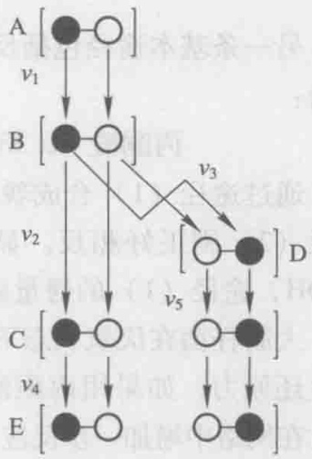

flowchart

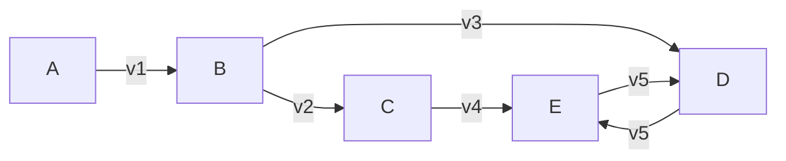

图4-6 利用 ${}^{13}\mathrm{C}$ 标记测定胞内通量的示意图（实心圆表示 ${}^{13}\mathrm{C}$ ）

底物 A 和产物 E 的运输通量  $v_{1}$  和  $v_{4}$ ，将无法确定其他胞内通量。由于这两条并行途径分别合成了具有不同标记模式的代谢物 C，因此使用  ${}^{13}C$  标记的代谢物 A 作为底物，达到稳态时测定各代谢物不同标记模式的富集度，就可以计算所有未知通量。例如，若使用第 1 位 C 原子被标记的 A 作为底物，且该标记模式的富集度为  $[A_{1}]$ ，则可以建立碳原子的生成速率和消耗速率相等的平衡方程:

B代谢物的第1位碳原子: $\left[\mathrm{A}_1\right]v_1 = \left[\mathrm{B}_1\right](v_2 + v_3)$
B代谢物的第2位碳原子: $\left[\mathrm{A}_2\right]v_1 = \left[\mathrm{B}_2\right](v_2 + v_3)$
C代谢物的第1位碳原子: $\left[\mathrm{B}_1\right]v_2 + \left[\mathrm{D}_1\right]v_5 = \left[\mathrm{C}_1\right]v_4$
C代谢物的第2位碳原子: $\left[\mathrm{B}_2\right]v_2 + \left[\mathrm{D}_2\right]v_5 = \left[\mathrm{C}_2\right]v_4$
D代谢物的第1位碳原子: $\left[\mathrm{B}_2\right]v_3 = \left[\mathrm{D}_1\right]v_5$
D代谢物的第2位碳原子: $\left[B_{1}\right]v_{3}=\left[D_{2}\right]v_{5}$

上列方程中， $\left[A_{1}\right]=\left[B_{1}\right]=\left[D_{2}\right]$ ， $\left[A_{2}\right]=\left[B_{2}\right]=\left[D_{1}\right]$ ，因此代谢物 B 的两个

---

4.5 基元模式分析

89

碳原子平衡方程实际上是同一个方程。同样，代谢物 D 的两个碳原子平衡方程也为同一个方程，而代谢物 C 的两个碳原子平衡方程是完全相互独立的不同方程，可以提供  $v_{2}$  与  $v_{5}$  的额外信息，这样结合代谢物标记模式富集度的测量数据和运输通量的测量数据可以求解全部通量。由于很多化合物带有天然标记的  ${}^{13}C$  原子，因此在处理富集度的测量数据时需要对此进行校正。另外在实验中还需注意以下几点（Wiechert 2001）:

（1）拟稳态假设是 MFA 的重要前提。在  ${}^{13}C$  标记实验中，不仅要保证系统处于代谢稳态，而且还要使系统处于同位素平衡状态。
（2）必须慎重选择标记底物的种类和标记模式，标记底物及标记模式的合理使用可以以较低的实验成本获得更多的胞内通量信息。
（3）为降低实验中标记底物用量方面的花费，实验的培养体积应尽量小，但培养体积太小很难使系统达到稳定状态，一般培养液的体积在300\~1000 mL。
（4）在样品处理方面，对不同代谢物应选择合适的样品处理方法以保证化合物结构不被破坏。

通常可以使用气相色谱-质谱联用（GC-MS）来测量代谢物不同标记模式的丰度信息，或者利用核磁共振（NMR）谱分析获得代谢物精细结构的信息用于后续的通量估计。在进行代谢通量的估计时，其主要的算法过程如下（Wiechert et al. 1997, van Winden et al. 2001）:①根据已知的代谢网络建立化学计量平衡方程式，并随机设定一组胞内通量。②根据设定通量值和已知标记底物的同位素标记模式和丰度信息模拟稳态时胞内代谢物的标记模式及丰度。③计算测量值和模拟预测值的差值。④采用优化算法对初始设定的通量进行系统的校正，得出通量的新估计值。⑤用新的通量估计值重复模拟，如此反复迭代，直到模型预测值令人满意地与测量值一致。后续章节将对同位素标记法测定代谢通量的方法进行详细的介绍。

## 4.5 基元模式分析

细胞代谢途径的非线性决定了代谢网络的复杂性，为了分析复杂的代谢网络，除了线性规划的方法之外，研究者还先后开发了多种其他的基于凸分析的代谢途径分析方法。其中较为重要的是基元模式分析（elementary mode analysis, EMA）（Schuster et al. 1994）和极端途径分析（extreme pathway analysis, EPA）（Schilling et al. 2000），这些方法从代谢网络的拓扑结构入手，分析时不需要反应的动力学信息、拟稳态数据和设定目标函数，分析得到的结果是代谢网络中所包含的所有路径信息，这些路径信息可以反映拟稳态条件下该细胞所包含的所有代谢途径信息。本节将主要介绍基元模式分析的原理及应用。

## 4.5.1 基元模式分析与极端途径分析

## 4.5.1.1 基元模式分析

基于热力学和不可分性，基元模式分析能够计算通量空间中所有的解，每一个解

---

90

4 代谢通量分析

代表一个基元模式，并且每个基元模式是独立的。因此，基元模式可以定义为一个独立酶的最小集合，这个酶的集合使得代谢网络能够稳定运行，稳态下的代谢通量分布是网络中所包含基元模式经加权之后的线性组合。对于可逆反应，基元模式分析并不需要将其分解成两个不可逆的反应。

基元模式分析作为一种分析细胞代谢网络的有用工具，能够深入地研究细胞的生理功能、细胞的鲁棒性和细胞调控，还可用于识别代谢途径的关键调控分支点，设计最小细胞，识别关键的靶点酶（Trinh et al. 2009）。基元模式分析用于大尺度网络分析时会面临途径分析中的组合爆炸问题，因此其主要用于小网络或中等规模的网络分析。

## 4.5.1.2 极端途径分析

极端途径与基元模式不同，它具有系统的独立性，即任何一个极端途径都不能用另外两个极端途径来表示。另外，极端途径是基元模式的子集。如果一个代谢网络中所有的反应都是不可逆的，那么极端途径和基元模式的集合是相同的。因此，极端途径的识别依赖于代谢网络的结构。在计算极端途径时，需要把内部的可逆反应分解成两个不可逆的反应，如图4-7b中可逆反应7被分解成两个不可逆反应7f和7b。

## 4.5.1.3 两种方法的比较

在分析存在可逆反应的代谢网络时，极端途径是基元模式的子集。如图4-7所示，通过计算分别得到8个基元模式和6个极端途径。通过比较可以发现，图4-7a中第1、2、4个基元模式在图4-7b中没有对应的极端途径，但是可以用其中两个极端途径组合得到，说明极端途径是基元模式的子集。由于极端途径的数目比基元模式

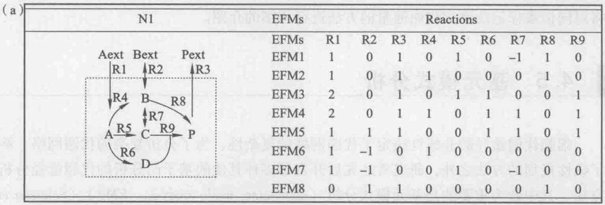

flowchart

This image displays a structural equation model (SEM) for the process of reaction kinetics, showing the relationships between various enzymes and their corresponding reactions.

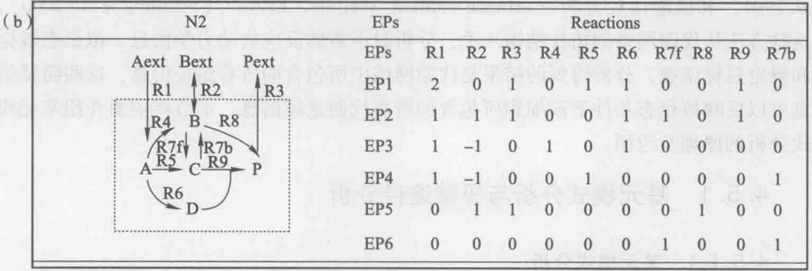

flowchart

This image displays a structural equation model (SEM) for the process of N2, showing the relationships between different reaction pathways (Aext, Bext, Pext) and their corresponding reactions (EPs, Reactions).

图4-7 基元模式分析（a）与极端途径分析（b）（何峰等，2004）

---

4.5 基元模式分析

91

少，因此基元模式的很多功能极端途径是无法实现的。例如基元模式可以用来分析途径长度，由图4-7a可以看出由底物A生成产物P的最短途径和最长途径分别为第2和第4个基元模式，而这两个基元模式都没有对应的极端途径，这说明极端途径对于分析途径的功能有一定的局限性。

## 4.5.1.4 基元模式分析软件

针对 EMA 分析，目前开发了很多的算法和软件。应用较广泛的算法是 META-TOOL 5.0；开发的软件有:CellNetAnalyzer、Optflux 等。CellNetAnalyzer 基于 MAR-LAB 平台，用 C 语言编写，存在用户交互式界面。Optflux 是一款单机软件，用 Java 语言编写，不需要 MATLAB 平台的支持。此外，软件 COPASI 及 YANA 都有基元模式分析的相关嵌合软件包。

## 4.5.2 基元模式分析的应用实例

基元模式分析作为一种广泛使用的代谢途径分析方法，有很多方面的应用，包括计算所有独立途径的得率、计算代谢通量分布、分析代谢网络的性能等。下面以大肠杆菌利用甘油生产琥珀酸的代谢网络实例来具体说明基元模式分析的应用。大肠杆菌在好氧条件和厌氧条件下利用甘油生产琥珀酸的代谢途径是不同的。因此分别对这两种条件下的代谢网络进行基元模式的计算，其中生物量合成反应参照 Trinh 等（2008）的报道，呼吸链生成 ATP 的 P/O 比设定为 2。

## 4.5.2.1 好氧条件下以甘油为底物生产琥珀酸的基元模式分析

首先构建大肠杆菌在好氧条件下以甘油为底物生产琥珀酸的代谢网络模型（图4-8）。该网络模型包括糖酵解途径、TCA循环、磷酸戊糖途径、甘油好氧利用途径、乙醛酸循环、回补途径、生物量合成反应、呼吸链与能量生成反应等，共52个反应，45个胞内代谢物，7个胞外代谢物，18个可逆反应，34个不可逆反应。由于琥珀酸在好氧条件下只是TCA循环的中间代谢物，并不作为终产物积累，因此在好氧条件下生产琥珀酸需要敲除琥珀酸脱氢酶基因。所以该模型不包括由琥珀酸脱氢酶催化的反应。

基于所构建的代谢网络模型，共计算得到1098个基元模式。其中生成生物量的基元模式有866个，生产琥珀酸的基元模式有719个，既生成生物量又生成琥珀酸的基元模式有559个。通过对所有得到的基元模式进行计算，得到琥珀酸的最大得率是 $0.5\mathrm{mol / mol}$ 甘油，生物量的最大得率是 $6.56\times 10^{-5}\mathrm{mol / mol}$ 甘油。对所有559个既生成生物量又生成琥珀酸的基元模式进行计算，得到琥珀酸的最大得率为$0.35\mathrm{mol / mol}$ 甘油。说明只有在不生成生物量的情况下琥珀酸的得率才能达到最大理论得率。

在好氧条件条件下，有两条途径可以生成琥珀酸，一条是 TCA 循环的氧化臂，另外一条是乙醛酸循环。在既生成生物量又生成琥珀酸的 559 个基元模式中，有 301 个只利用 TCA 循环的氧化臂生成琥珀酸，有 257 个只利用乙醛酸循环来生产琥珀酸，只有 1 个基元模式同时利用两条途径来生产琥珀酸。通过计算发现利用这两条途径生成琥珀酸的最大理论得率是相同的，即在理论上，通量在这两条途径中的任意分配都

知识拓展4-4利用METATOOL软件包进行基元模式分析的方法

---

92

4 代谢通量分析

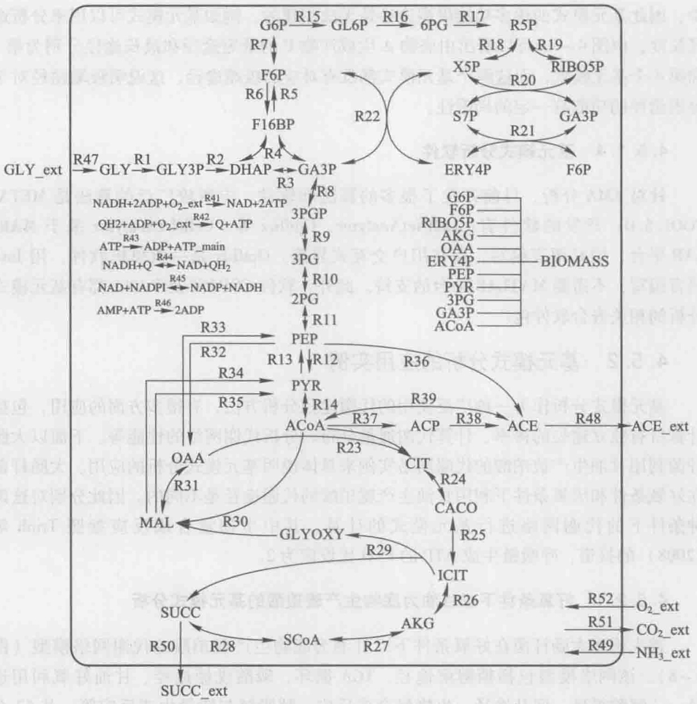

flowchart

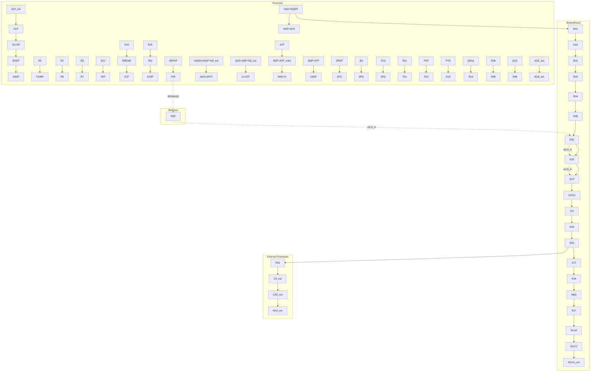

图4-8 好氧条件下大肠杆菌以甘油为底物生产琥珀酸的代谢网络模型

不会减少最大理论得率。

利用基元模式分析的方法还可以预测基因敲除靶点和分析代谢网络的冗余性。基因敲除靶点的预测是通过删除代谢网络模型中的每个反应来完成的，并需要遵循以下原则:①需要计算删除每个反应后剩余的基元模式的数目。②需要计算删除每个反应后剩余的基元模式中产物的最大和最小得率。③循环进行计算，直到基元模式的数目最少并且最大产物得率仍然保持不变为止，与此对应的那些被删除的反应均可被选为基因敲除的靶点（Trinh et al. 2009）。

按照以上原则，对大肠杆菌在好氧条件下利用甘油生产琥珀酸的代谢网络模型进行了基因敲除靶点的预测。如表4-3所示，共计算出5个需要删除的反应，它们分别由基因poxB、ackA-pta、maeB、maeA、pck所编码。随着删除反应的识别，剩余基元模式的数目越来越少，删除5个反应后，只剩余54个基元模式，其中既生成生物量又生成琥珀酸的基元模式还剩28个。另外，这些反应的删除没有降低琥珀酸的最大理论得率，上述基因都可以作为实际实验操作的敲除靶点。

---

4.5 基元模式分析

93

表 4-3 好氧条件下利用甘油生产琥珀酸的代谢网络模型进行基因敲除靶点的预测

| 基因敲除靶点 | 剩余的基元模式 | 生成琥珀酸的基元模式 | 生成生物量的基元模式 | 既生成生物量又生成琥珀酸的基元模式 | 琥珀酸的最大得率 | 琥珀酸的最小得率 | 生物量的最大得率 | 生物量的最小得率 |
| --- | --- | --- | --- | --- | --- | --- | --- | --- |
| 无 | 1098 | 719 | 866 | 599 | 0.5 | 0 | $6.56 \times 10^{-5}$ | 0 |
| ΔpoxB | 420 | 280 | 320 | 216 | 0.5 | 0 | $6.56 \times 10^{-5}$ | 0 |
| ΔpoxB ΔackA-pta | 276 | 224 | 218 | 176 | 0.5 | 0 | $6.56 \times 10^{-5}$ | 0 |
| ΔpoxB ΔackA-ptaΔmaeB | 150 | 112 | 112 | 82 | 0.5 | 0 | $6.56 \times 10^{-5}$ | 0 |
| ΔpoxB ΔackA-ptaΔmaeB Δpck | 116 | 86 | 90 | 66 | 0.5 | 0 | $6.56 \times 10^{-5}$ | 0 |
| ΔpoxB ΔackA-ptaΔmaeB Δpck ΔmaeA | 54 | 36 | 42 | 28 | 0.5 | 0 | $6.56 \times 10^{-5}$ | 0 |

## 4.5.2.2 厌氧条件下以甘油为底物生产琥珀酸的基元模式分析

图4-9是大肠杆菌在厌氧条件下以甘油为底物生产琥珀酸的代谢网络模型。该网络模型包括糖酵解途径、TCA循环的氧化臂和还原臂、磷酸戊糖途径、甘油厌氧利用途径、回补途径、混合酸发酵途径等，共62个反应，53个胞内代谢物，11个胞外代谢物，21个可逆反应，41个不可逆反应。与好氧条件不同的是，TCA循环在厌氧条件下是中断的。厌氧的网络模型还包括在厌氧条件下激活的发酵途径，例如乳酸、乙醇、甲酸等的生成途径。

由于考虑到大肠杆菌主要的羧化酶是磷酸烯醇式丙酮酸（PEP）羧化酶，因此将PEP羧激酶和两个苹果酸酶催化的R33、R34、R35三个反应删掉，首先对此模型进行基元模式分析。通过计算，共得到48个基元模式，生成琥珀酸的基元模式有19个，生成生物量的基元模式有17个，既生成生物量又生成琥珀酸的基元模式有2个。琥珀酸的最大得率为0.5 mol/mol甘油，生物量的最大得率为 $9.41 \times 10^{-6}$  mol/mol甘油。对生成生物量的17个基元模式进行分析，发现所有的基元模式都生成乙醇和1,2-丙二醇，这说明乙醇和1,2-丙二醇的生成与生物量的合成是偶联的，这是由还原力平衡造成的。另外，生成乙醇的途径可以生成能量，因此乙醇合成途径对菌体生长是必需的。Dharmadi等（2006）的研究表明:在厌氧条件下，野生大肠杆菌以甘油为底物时接近90%的发酵产物是乙醇。这个实验现象证实了基元模式分析的结论。对既生成生物量又生成琥珀酸的两个基元模式进行分析，发现其琥珀酸的得率分别为0.033 mol/mol甘油和0.044 mol/mol甘油。上述分析结果说明在甘油为底物厌氧发酵时，琥珀酸并不是野生型大肠杆菌的主要发酵产物，这与文献报道也是一致的（Dharmadi et al. 2006）。

将 PEP 羧激酶和两个苹果酸酶催化的 R33、R34、R35 三个反应放回模型中，再进行基元模式的计算和分析。共得到 681 个基元模式，其中生成琥珀酸的基元模式为 468 个，生成生物量的基元模式为 433 个，既生成琥珀酸又生成生物量的基元模式为

---

94

4 代谢通量分析

flowchart

```mermaid
graph TD
  subgraph Enzymes
  A["GLY_ext"] --> B["R49"]
  B --> C["GLY"]
  C --> D["R1"]
  D --> E["DHA"]
  E --> F["R2"]
  F --> G["DHAP"]
  G --> H["GA3P"]
  I["MG"] --> J["R60"]
  J --> K["ACT"]
  K --> L["R61"]
  L --> M["12PD"]
  M --> N["LAC"]
  O["SLG"] --> P["R58"]
  P --> Q["3PGP"]
  Q --> R["R9"]
  R --> S["3PG"]
  S --> T["R10"]
  T --> U["2PG"]
  U --> V["R11"]
  V --> W["PEP"]
  W --> X["R13"]
  X --> Y["PYR"]
  Y --> Z["R36"]
  AA["OAA"] --> AB["R35"]
  AB --> AC["ACoA"]
  AC --> AD["FOR"]
  AD --> AE["H2"]
  AE --> AF["CO2"]
  AG["MAL"] --> AH["R31"]
  AH --> AI["R34"]
  AI --> AJ["R37"]
  AJ --> AK["ACP"]
  AK --> AL["ACE"]
  AL --> AM["ACA"]
  AM --> ANF["ACA"]
  ANF --> AO["ETOH"]
  AO --> AP["R50"]
  AP --> AQ["ACE_ext"]
  AR["MAL"] --> AS["R28"]
  AS --> AT["R30"]
  AT --> AU["GLYOXY"]
  AU --> AV["CIT"]
  AV --> AW["CACO"]
  AW --> AX["R25"]
  AX --> AY["ICIT"]
  AY --> AZ["AKG"]
  AZ --> BA["R26"]
  BA --> BB["R29"]
  BB --> BC["SUCC"]
  BC --> BD["R52"]
  BD --> BE["SUCC_ext"]
  end

  subgraph Metabolites
  C6P["G6P"] --> FR15["R15"]
  GL6P["GL6P"] --> FR16["R16"]
  6PG["6PG"] --> FR17["R17"]
  R5P["R5P"] --> R18
  R18 --> RX19["R19"]
  RX19 --> XR18
  XR18 --> XR20
  XR20 --> XR21
  XR21 --> XR22
  XR22 --> XR23
  XR23 --> XR24
  XR24 --> XR25
  end

  subgraph Biomass
    G6P["G6P"] -.-> BIOMASS
    RIBO5P["RIBO5P"] -.-> BIOMASS
    S7P["S7P"] -.-> BIOMASS
    GA3P["GA3P"] -.-> BIOMASS
  end

  subgraph External Metabolites
    A6P["GLY_ext"] -.-> BIOMASS
    GLYX["GLY_ext"] -.-> BIOMASS
    GLYX -.-> BIOMASS
    GLYX -.-> BIOMASS
    GLYX -.-> BIOMASS
    GLYX -.-> BIOMASS
  end

  subgraph External Metabolites
    A6P -.-> BIOMASS
    GLYX -.-> BIOMASS
    GLYX -.-> BIOMASS
  end
```

图4-9 厌氧条件下大肠杆菌以甘油为底物生产琥珀酸的代谢网络模型

267 个。对所有的基元模式进行分析，得到琥珀酸的最大得率为 1 mol/mol 甘油，生物量的最大得率为  $1.27 \times 10^{-5}$  mol/mol 甘油。

进一步将丙酮酸甲酸裂解酶催化的反应 R14 从网络模型中删除以后，剩余的基元模式数目为 94 个，其中生成琥珀酸的有 89 个，生成生物量的有 52 个，既生成琥珀酸又生成生物量的也是 52 个。琥珀酸的最大得率仍为 1 mol/mol 甘油。对生成生物量的 52 个基元模式进行分析，发现所有的基元模式都生成琥珀酸，这表明通过敲除丙酮酸甲酸裂解酶基因，琥珀酸的生成已和生物量的生成相偶联；并且所有的基元模式也都生成 1,2-丙二醇，这说明为了达到还原力的平衡，1,2-丙二醇必将伴随着琥珀酸的生产。对副产物乳酸、乙酸和乙醇的生成进行分析，发现所有的基元模式都不生成这些副产物。这说明琥珀酸成为除 1,2-丙二醇以外最主要的发酵产物。另外，通过分析得到由 PEP 羧激酶催化 R33 和两个苹果酸酶催化的 R34、R35 三个反应的通量不能同时为零，这是由于在野生大肠杆菌中利用 PEP 羧化酶作为羧化途径时，生成琥珀酸的途径是不产生能量的，因此如果使琥珀酸作为主要的发酵产物则必须引入这三个羧化途径来使得琥珀酸的生成途径能够产生能量。

---

推荐阅读

95

## 思考题

1. 代谢通量分析的基本假定是什么？
2. 如何确定一个代谢网络的质量平衡方程和化学计量系数矩阵？
3. 对于正定系统和超定系统，如何进行代谢通量分析？

## 推荐阅读

1. Stephanopoulos G, Aristodou A, Nielsen J. Metabolic Engineering: Principles and Methodologies. San Diego: Academic Press, 1998.
2. Nielsen J, Villadsen J, Liden G. Bioreaction Engineering Principles. 2nd edition. 英文影印版. 北京:化学工业出版社，2004.
3. Schilling C H, Letscher D, Palsson B O. Theory for the systemic definition of metabolic pathways and their use in interpreting metabolic function from a pathway-oriented perspective. J Theor Biol 2000, 203 (3): 229–248.

详细介绍了基元模式分析和端途径分析的方法。
