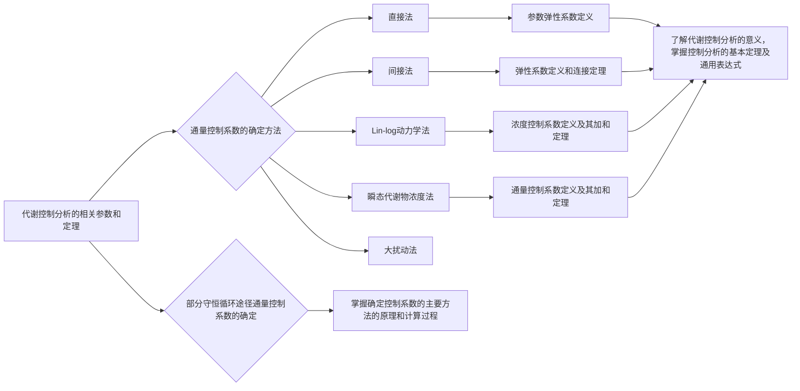
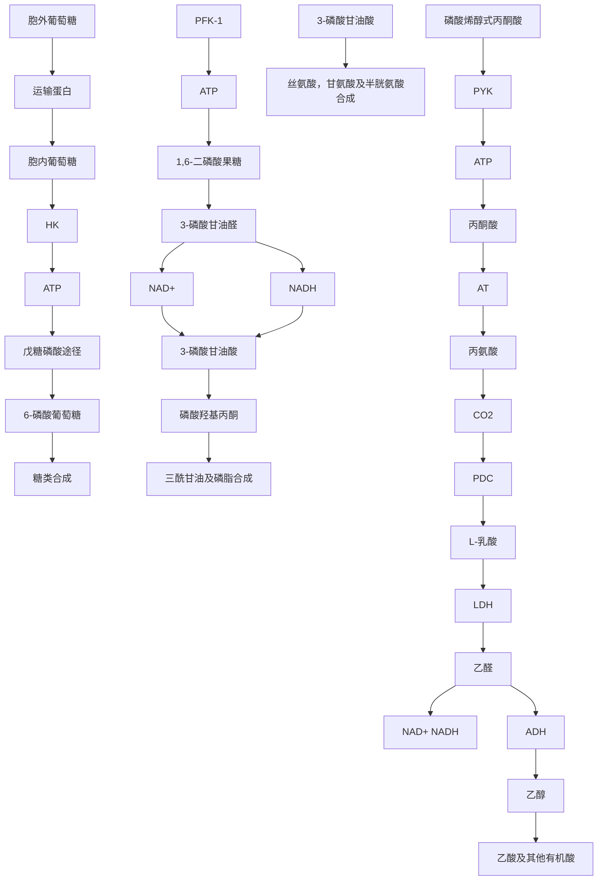
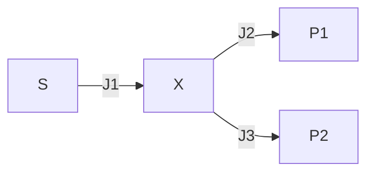
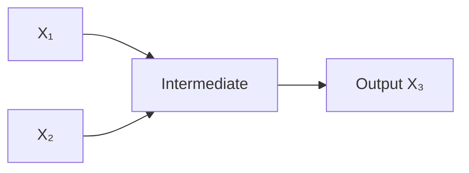
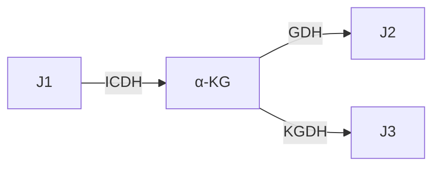
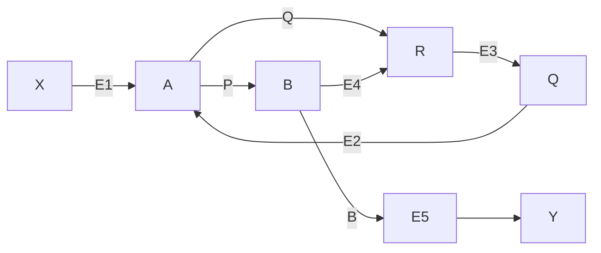

# 5 代谢控制分析

原始 PDF 第 116–147 页。

## 5


<details>
<summary>natural_image</summary>

Abstract illustration of interconnected nodes forming a chain-like structure (no text or symbols)
</details>

# 代谢控制分析

## 【本章学习要点】

1. 代谢控制分析的基本参数及定义
2. 代谢控制分析的加和定理和连接定理
3. 确定通量控制系数的主要方法、原理和应用
4. 部分守恒循环途径通量控制系数的确定方法

前面的章节介绍了如何通过胞内代谢的质量平衡来确定代谢通量。代谢通量分析可以提供不同代谢途径之间相互作用的信息，对代谢分支点周围途径的通量进行量化，进而可以通过通量的比较来确定需要优化的代谢途径或目标通量。然而，代谢通量分析自身并不能向我们提供如何对一条代谢途径的通量进行优化的信息。通常，流经某条代谢途径的通量往往受到许多反应的控制，显然只有得到这些反应对通量的控制信息才能确定通量优化的策略。同样，胞内代谢物的浓度也受到许多反应的控制，这种控制对于代谢物的合成和消耗速率的严格平衡是非常重要的，从而确保在各种外部生长环境下胞内代谢物的浓度不会发生剧烈的上升或下降。代谢工程的一个最重要目的是进行代谢控制分析（metabolic control analysis, MCA）:即全面、深入地分析和了解代谢控制对代谢通量和代谢物浓度的影响，并对表征这些代谢控制的参数进行量化，这对通量的合理调整和优化是很重要的（Stephanopoulos et al. 1998）。

---

5.1 代谢控制分析的基础

97


## 知识导图


<details>
<summary>flowchart</summary>


</details>

## 5.1 代谢控制分析的基础

MCA的概念是Kacser（1973）以及Heinrich（1974）发表的两篇具有里程碑意义的文章提出来的，它们均是对Higgins（1963，1965）关于这方面思想的发展。从本质上说，MCA是代谢网络中非线性的酶动力学问题的一种线性扰动理论。因此，MCA的预测仅在局部范围内适用，对预测结果的适用范围只能进行尝试性的外推或扩展。尽管有上述局限性，MCA在以下几个方面是很有用的:①提供各单个反应代谢通量控制的度量标准；②阐明酶反应网络中速度控制步骤的概念；③描述酶活对于胞内代谢物浓度的影响；④将局部的酶动力学和系统的代谢行为相关联。在20世纪50年代，反馈抑制、协同性、酶的共价修饰作用以及酶的合成控制机制的发现揭示了若干分子机制，这些机制在通量控制中起着重要的作用。由于在通量控制方面存在各种不同的机制，在一条代谢途径的通量是如何被控制的问题上存在许多争论。例如，早期发现一条代谢途径中第一个酶，或者在一个分支点后的第一个酶受到某种类型的反馈调节，这往往导致如下结论:“在一条代谢途径中的第一步反应是限速步骤”，而代谢控制分析的结果表明上述结论不一定是正确的。在许多文献中存在关于限速步骤和关键酶的表述，这经常导致对这些反应步骤在通量控制中实际作用的误解。例如，在许多生物化学书籍中，都将己糖激酶（HK）、1-磷酸果糖激酶（PFK-1），以及丙酮酸激酶（PYK）催化的反应描述成糖酵解途径中的限速步骤（图5-1），这基于以下几个原因（Moreno-Sánchez et al. 2008）:①这三个酶催化的反应远离平衡状态，其 $\Gamma/K_{eq}$ 的比值为 $10^{-3}\sim10^{-4}$ ；②在糖酵解途径中，这三个反应的速度最慢，一般比其他反应速度小一个数量级（即这三个酶的 $v_{max}$ 最小）。③HK受

---

98

5 代谢控制分析


<details>
<summary>flowchart</summary>


</details>

图5-1 糖酵解途径及其主要分支途径（Moreno-Sánchez et al. 2008）

HK，己糖激酶；PFK-1，1-磷酸果糖激酶；PYK，丙酮酸激酶；LDH，乳糖脱氢酶；PDC，丙酮酸脱羧酶；ADH，乙醇脱氢酶；AT，丙氨酸转氨酶

到其产物6-磷酸葡萄糖，以及ADP或AMP的反馈抑制，并且PFK-1和PYK是易受调节的变构酶。因此，基于上述分析结果很容易得出结论:为了显著改变糖酵解途径的通量，必须改变这三个酶的表达水平。然而，大量的研究表明，单独过表达或共同过表达这些酶并不能使糖酵解的通量显著增加（表5-1），在有些情况下，糖酵解通量反而下降。在表5-1所列的研究中，最有效的提高糖酵解途径的实验涉及7个基因的共表达，从葡萄糖到乙醇的通量增加了 $21\%$ 。这表明糖酵解途径的通量控制比较分散，对其通量的控制并不集中在一个或少数几个酶上。值得注意的是，在另一项研究中，同样是上述7个基因过表达，却由于表达量的变化导致从糖酵解到乙醇的通量下降（见表5-1）。这很可能是由于基因之间的表达水平不协调造成的，导致糖酵解中间代谢物的浓度变化过大，从而给细胞生理带来了负面影响。通常细胞在对胞

---

5.1 代谢控制分析的基础

99

内通量进行调节时都会避免胞内代谢物浓度的剧烈波动，例如，现有的研究发现骨骼肌肉中糖酵解通量增加100倍时不会导致中间代谢物浓度的显著变化。因此，任何改变通量的策略还必须考虑到对胞内代谢物浓度的影响，行之有效的策略必须保证不会导致胞内代谢物浓度的剧烈波动。通过代谢控制分析，不仅可以确定影响途径通量的主要控制力，还可以根据细胞可承受的代谢物浓度波动范围设计改变通量的策略。

表 5-1 过表达糖酵解途径中的酶对通量的影响（Moreno-Sánchez et al. 2008）

<table><tr><td>细胞类型</td><td>酶</td><td>酶活过表达倍数</td><td>通量后与改造前的通量比/%</td></tr><tr><td rowspan="8">酿酒酵母</td><td>HK</td><td>13.9</td><td>107</td></tr><tr><td>PFK-1</td><td>3.5, 3.7, 5</td><td>102</td></tr><tr><td>PYK</td><td>8.6</td><td>107</td></tr><tr><td>PDC</td><td>3.7</td><td>85</td></tr><tr><td>ADH</td><td>4.8</td><td>89</td></tr><tr><td>PFK-1+PYK</td><td>5.6+1.3</td><td>107</td></tr><tr><td>GAPDH+PGK+PGAM+ENO+PYK+PDC+ADH</td><td>1.4+1.7+16+4+10.4+1.08+1.4</td><td>121</td></tr><tr><td>GAPDH+PGK+PGAM+ENO+PYK+PDC+ADH</td><td>1.5+1.4+3.4+1.5+2.5+1.1+1.2</td><td>94</td></tr><tr><td rowspan="2">大肠杆菌</td><td>PFK</td><td>8.7</td><td>72</td></tr><tr><td>PYK</td><td>2.9, 4.2</td><td>91, 95</td></tr><tr><td>乳脂乳球菌</td><td>GAPDH</td><td>14-210</td><td>100</td></tr><tr><td rowspan="2">黑曲霉</td><td>PFK</td><td>3</td><td>100</td></tr><tr><td>PYK</td><td>5</td><td>100</td></tr><tr><td>中国仓鼠卵细胞</td><td>PFK</td><td>2.2, 3.4, 3.7</td><td>100</td></tr></table>

对于酿酒酵母和大肠杆菌为乙醇合成通量，对于黑曲霉为柠檬酸合成通量，对于中国仓鼠卵细胞为L-乳酸的合成通量。

HK，己糖激酶；PFK-1，1-磷酸果糖激酶；PYK，丙酮酸激酶；LDH，乳糖脱氢酶；PDC，丙酮酸脱羧酶；ADH，乙醇脱氢酶；GAPDH，3-磷酸甘油醛脱氢酶；PGK，磷酸甘油酸激酶；PGAM，磷酸甘油酸变位酶；ENO，烯醇酶。

代谢控制分析仅能严格地应用于稳态条件（或拟稳态条件）。一个稳定的稳态由一条代谢途径中催化各个单一反应的酶活力所确定。因此，酶活、代谢途径中第一步反应的底物浓度，以及最后一步反应的产物浓度被定义为系统参数。由这些参数值所确定的性质，例如，通过途径的通量或中间代谢物的浓度，被定义为系统变量。当这些参数恒定不变时，系统就达到一个稳态，通过改变这些参数可以对该稳态施加扰动，并最终达到新的稳态。例如，在恒化器中进行稳态连续培养时，达到稳态时底物和最终产物的浓度保持恒定，可以通过改变底物或产物的浓度而达到新的稳态。同样的，通过基因工程技术对细胞内酶的表达量进行调节也能达到不同的稳态。

为了举例说明系统参数和变量的定义，考虑一个简单的两步途径，该途径中底物

知识拓展5-1根据代谢物浓度波动范围设计改变通量的策略

---

100

5 代谢控制分析

S 通过中间产物 X 转变为产物 P:

$$
\mathrm{S} \xrightarrow {\mathrm{E} _ {1}} \mathrm{X} \xrightarrow {\mathrm{E} _ {2}} \mathrm{P} \tag {5-1}
$$

在稳态下，第1步和第2步的反应速度相等，S转变为P的净速率为流经该途径的稳态通量J，稳态通量J也等于这条途径中各反应的反应速率（或速度）。显然，系统稳态由系统参数，即酶 $E_{1}$ 和酶 $E_{2}$ 的活力及底物S和产物P的浓度确定，和系统参数值相对应的稳态可通过中间代谢物浓度x、通量J等系统变量的测量值来表征。代谢物X的浓度是独特的变量，通常假定它们均匀地分布细胞中与酶发生相互作用。如果代谢物X在亚细胞区室中和细胞质中的浓度不同，可以通过添加额外的运输反应来进行代谢控制分析。在这里不考虑同一区室中代谢物浓度的空间分布不均匀的情况，因为这将需要一个复杂的模型来提供不同位置的代谢物浓度信息。

在式5-1所示的简单线性途径中，如果催化第1步和第2步反应的酶动力学方程为:

$$
v _ {1} = \frac {v _ {\max _ {1}} s}{s + K _ {m _ {1}}} \quad v _ {2} = \frac {v _ {\max _ {2}} x}{x + K _ {m _ {2}}} \tag {5-2}
$$

通过简单的分析，我们很容易发现这两个反应对流经该途径的稳态通量有不同的控制力:在初始稳态（此时 $v_{1} = v_{2}$，并等于初始稳态通量 $J_{0}$），如果提高第1个酶的活力对系统施加一个扰动（比如增加酶1的表达量而造成 $v_{\mathrm{max}}$ 增加），使 $v_{1}$ 增加到$v_{1}^{*}$，则扰动后 $v_{1}^{*} > v_{2}$，中间代谢物浓度 $x$ 逐渐增加。由于 $x$ 增加，$v_{2}$ 也会逐渐增加，并最终和 $v_{1}^{*}$ 相等而达到新的稳态（即新稳态时反应1和2的速度 $v_{1}^{\prime}$ 和 $v_{2}^{\prime}$ 都等于 $v_{1}^{*}$，也等于新的稳态通量 $J$，同时 $x$ 增加）。即对第1步反应的扰动将使稳态通量和第2步反应速度发生同样的改变。如果提高第2个酶的活力对系统施加一个扰动（比如增加酶2的表达量而造成 $v_{\mathrm{max}}$ 增加），使 $v_{2}$ 增加到 $v_{2}^{*}$，则扰动后 $v_{1} < v_{2}^{*}$，中间代谢物浓度$x$ 逐渐下降。从式5-2的动力学方程可以看出，$x$ 不会影响反应1的速度，但是反应2的速度会随 $x$ 的下降而下降。这样，达到新稳态时，第2步反应的速度会从 $v_{2}^{*}$ 逐渐降低到和 $v_{1}$ 相等（即新稳态时反应1和2的速度 $v_{1}^{\prime}$ 和 $v_{2}^{\prime}$ 等于 $v_{1}$ 和 $v_{2}$，扰动前后的稳态通量相等，$J^{\prime} = J_{0}$，但在新稳态时 $x$ 变小），即对第2步反应的扰动并不能改变稳态通量。

在上面这个极端的例子中，反应1对流经该线性途径的通量有绝对的控制力，而反应2对流经该线性途径的通量没有任何控制力。也可以说反应1是限速步骤，如果要提高该途径的通量，仅仅增加酶1的表达水平即可。显然，进行代谢控制分析首先需要将系统参数对系统变量的影响进行量化，因此引入了一系列起量化作用的系数，主要包括通量控制系数、浓度控制系数、弹性系数等。

## 5.1.1 通量控制系数及其加和定理

代谢控制分析的一个目的是将代谢系统的变量同参数联系起来，以确定某一系统变量（如通量）对某一系统参数（即酶活）的敏感性。这些敏感性代表了通量控制的基本特性，因为它们表示一条代谢途径中某个酶的活性（系统参数）影响系统通量（系统变量）的程度。类似地，我们也能确定作为系统变量的胞内代谢物的浓度对于酶活、效应物浓度等系统参数的敏感性。这些敏感性可由一组系数概括地描述，

---

5.1 代谢控制分析的基础

· 101

其中最重要的是通量控制系数（flux control coefficients，FCCs）。它的定义可由式5-3表示:由代谢途径中一个酶活的无穷小变化所引起的通量的相对变化与这个酶活的相对变化之比（Stephanopoulos et al. 1998）。由于酶活是一个独立的系统参数，因此它的变化将直接影响通量，或通过引起其他系统变量的变化而间接影响通量。

$$
C ^ {J} = \frac {\mathrm{d} J / J}{\mathrm{d} E / E} = \frac {E \mathrm{d} J}{J \mathrm{d} E} = \frac {\mathrm{dln} J}{\mathrm{dln} E} \tag {5-3}
$$

FCCs 是用相对通量和相对酶活的形式定义的，因此它们是无因次的，其大小与所采用的通量及酶活的单位无关。对于一个线性代谢途径来说，FCCs 的值介于 0 和 1 之间。在更常见的分支代谢途径中，FCCs 被用来描述每一个酶活（共 L 个）对通过不同反应的每一通量（共 L 个）的影响:

$$
C _ {i} ^ {J _ {k}} = \frac {E _ {i}}{J _ {k}} \frac {\mathrm{d} J _ {k}}{\mathrm{d} E _ {i}} = \frac {\mathrm{d} \ln J _ {k}}{\mathrm{d} \ln E _ {i}} \quad i, k \in \{1, 2, \dots , L \} \tag {5-4}
$$

式中， $J_{k}$  是代谢途径中通过第 k 个反应的稳态通量， $E_{i}$  是第 i 个酶的活力，FCCs 可以是任何正值或负值。

在 FCCs 的定义式中，酶活被用作描述胞内酶促反应速率的系统参数，在这里酶活被解释为酶的  $v_{max}$  。在大多数情况下，酶促反应速率同酶活成正比，因此可以用酶活替代反应速率作为系统参数。然而，由于可能存在异构调节，胞内酶促反应速度可能同它的  $v_{max}$  完全不同。另外在多酶体系中存在代谢物的通道效应（channelling effect），代谢物按顺序被直接从一个酶运输到下一个酶，在这种情况下， $v_{max}$  也不能代表胞内酶促反应速度。一个更普遍的 FCCs 定义是基于第 i 个反应速率而不是酶活:

$$
C _ {i} ^ {J _ {k}} = \frac {v _ {i}}{J _ {k}} \frac {\mathrm{d} J _ {k}}{\mathrm{d} v _ {i}} = \frac {\mathrm{d} \ln J _ {k}}{\mathrm{d} \ln v _ {i}} \quad i, k \in \{1, 2, \dots , L \} \tag {5-5}
$$

Heinrich 等（1997）将这个定义进一步表示为:

$$
C _ {i} ^ {J _ {k}} = \frac {v _ {i}}{J _ {K}} \frac {\mathrm{d} J _ {k}}{\mathrm{d} p} \left(\frac {\partial v _ {k}}{\partial p}\right) ^ {- 1} \quad i, k \in \{1, 2, \dots , L \} \tag {5-6}
$$

式中，p 可以是专门作用于第 i 个反应速率的任何参数。如果酶活被选为参数 p，倘若反应速率同酶活成正比，则式 5-6 可化简为式 5-4。FCCs 的定义式 5-5 和式 5-6 考虑到了对酶-效应物、酶-酶相互作用这些特殊情况的处理。

从 FCCs 的定义中明显可以看出，具有最大通量控制系数的酶对特定稳态下的通量施加最大的控制，当这个酶的活力增大时，将导致整个通量最大程度地上升。显然，这样的酶基因是需要优先改造的目标基因。一般情况下，如果一个酶对目的产物合成通量的控制系数是一个非常大的正值，则表明该酶基因需要过表达；反之，如果一个酶对目的产物合成通量的控制系数是一个非常大的负值，则表明该酶基因需要被敲除或下调表达其表达水平，这样的酶一般存在于与目的产物合成途径相竞争的其他分支途径中。

通量控制系数满足加和定理（summation theorem）:对于系统中任意一条途径中的通量 $J_{k}$ ，系统中每步反应的酶活对该通量的控制系数之和必为1（Kacser et al. 1973）。

$$
\sum_ {i = 1} ^ {L} C _ {i} ^ {J _ {x}} = 1 \quad k \in \{1, 2, \dots , L \} \tag {5-7}
$$

该式表明通量控制具有系统性或全局性，即某个特定途径的通量和系统中通过代

背景知识5-1
通量控制系数加和定理的证明

---

102

5 代谢控制分析

谢物联系在一起的所有反应都有关。对于一个复杂的系统或代谢途径来说，大多数FCCs的值都比较小，但如果某个步骤的FCC值比其他FCC值大得多，则说明该反应步骤对目标通量施加着显著的控制。在有些情况下，所有反应对某个通量的控制系数可能都很小，这表明该通量受到的控制非常分散，这将给菌株的代谢工程改造带来额外的困难，因为这可能意味着很多反应的酶基因都需要改造才能显著的改变目标通量。这也解释了为什么为了提高菌株的代谢物产量（如氨基酸和抗生素），需要很多轮的连续诱变和筛选步骤。

## 5.1.2 浓度控制系数及其加和定理

同 FCCs 类似，系统参数对胞内代谢物浓度影响的敏感性被称为浓度控制系数（concentration control coefficients, CCCs），其中，受酶活  $E_{i}$  影响的变量是代谢物  $X_{j}$  的浓度  $C_{j}$ :

$$
C _ {i} ^ {X _ {j}} = \frac {E _ {i}}{C _ {j}} \frac {\mathrm{d} c _ {j}}{\mathrm{d} E _ {i}} = \frac {\mathrm{d} \ln c _ {j}}{\mathrm{d} \ln E _ {i}} \quad i \in \{1, 2, \dots , L \}, j \in \{1, 2, \dots , K \} \tag {5-8}
$$

或者，更一般地有:

$$
C _ {i} ^ {X _ {j}} = \frac {v _ {i}}{c _ {j}} \frac {\mathrm{d} c _ {j}}{\mathrm{d} v _ {i}} = \frac {\mathrm{d} \ln c _ {j}}{\mathrm{d} \ln v _ {i}} \quad i \in \{1, 2, \dots , L \}, j \in \{1, 2, \dots , K \} \tag {5-9}
$$

这些系数说明了当第 i 个酶活性无穷小变化所引起的第 j 个中间代谢物浓度的相对变化与酶活相对变化之比。由于当所有的酶活同等程度地发生变化时，任何中间代谢物浓度水平保持不变，因此，CCCs 遵从以下关系:对 K 个代谢物中的每一个来说，系统中每步反应的酶活对该代谢物浓度的控制系数之和必为 0（Stephanopoulos et al. 1998）。

$$
\sum_ {i = 1} ^ {L} C _ {i} ^ {X _ {j}} = 0 \qquad j \in \{1, 2, \dots , K \} \tag {5-10}
$$

背景知识5-2
浓度控制系数的加和定理

上式为浓度控制系数的加和定理，该定理表明对每一个代谢物而言，至少存在一种起负控制作用的酶，即当该酶活水平上升时，代谢物浓度却下降了。这样，在式5-1所示的简单两步反应途径中浓度控制系数 $C_{2}^{X}$ 通常是负值，因为代谢物浓度 $c_{x}$ 将随着第二个酶活的上升而下降。显然，同通量控制一样，该式表明浓度控制也具有系统性或全局性。

## 5.1.3 弹性系数和连接定理

MCA 中另一个重要的概念是弹性系数（elasticity coefficients），最常见的弹性系数是反应速率对代谢物浓度的敏感性（或弹性）。和控制系数的情况一样，弹性系数也相对于反应速度及代谢物浓度而归一化。因此，第 i 个反应速度对于代谢物  $X_{j}$  的浓度的弹性被定义为:在假定所有其他系统变量保持稳态值不变的条件下，由代谢物浓度的无穷小变化所引起的反应速率相对变化与代谢物浓度相对变化之比（Stephanopoulos et al. 1998）:

$$
\varepsilon_ {X _ {j}} ^ {i} = \frac {c _ {j}}{v _ {i}} \frac {\partial v _ {i}}{\partial c _ {i}} = \frac {\partial \ln v _ {i}}{\partial \ln c _ {j}} \quad i \in \{1, 2, \dots , L \}, j \in \{1, 2, \dots , K \} \tag {5-11}
$$

因为弹性系数表示对相应的系统变量求导，因此用了偏导数以表示所有其他变量必须保持恒定。同描述整个代谢体系系统性质的控制系数有所不同，弹性系数是代谢

---

5.1 代谢控制分析的基础

103

网络中各个单个酶的局部性质:即某个特定反应的速度只对部分代谢物敏感，这些代谢物一般是催化该反应酶的底物、产物、激活剂或抑制剂。或者，反过来说:只有系统中的部分代谢物才能影响某个特定反应的速度，这些代谢物都会出现在酶的动力学方程中。如果第i步反应对第j种代谢物的弹性系数为正值，这表明该代谢物浓度的升高会促进第i步反应的进行，例如该代谢物可能是一种底物或一种激活剂；而负值则表明该代谢物浓度的会减慢第i步反应的进行，例如该代谢物可能是一种产物或一种抑制剂。

由于外部效应物可以通过影响酶活而间接影响代谢通量，Kacser 等（1973）引入了另一组通量控制系数，称为响应系数（response coefficients），用于量化代谢通量对于外部效应物的敏感性:

$$
R _ {X _ {j}} ^ {J _ {k}} = \frac {c _ {j}}{J _ {k}} \frac {\mathrm{d} J _ {k}}{\mathrm{d} c _ {j}} \quad j \in \{1, 2, \dots , K \}, k \in \{1, 2, \dots , L \} \tag {5-12}
$$

从上式很容易发现，一种外部效应物 $X_{i}$ 对某个代谢通量 $J_{K}$ 的响应系数是一个受该效应物影响的酶 $j$ 的通量控制系数与该酶对外部效应物 $X_{i}$ 弹性系数的乘积。

$$
\begin{array}{l} R _ {X _ {j}} ^ {J _ {k}} = \frac {c _ {j} \mathrm{d} J _ {k}}{J _ {k} \mathrm{d} c _ {j}} \\ = \left(\frac {\mathrm{d} J _ {k} E _ {i}}{J _ {k} \mathrm{d} E _ {i}}\right) \left(\frac {\mathrm{d} E _ {i} c _ {j}}{E _ {i} \mathrm{d} c _ {j}}\right) \quad i, k \in \{1, 2, \dots , L \}, j \in \{1, 2, \dots , K \} \tag {5-13} \\ = C _ {i} ^ {J _ {s}} \cdot \varepsilon_ {X _ {j}} ^ {i} \\ \end{array}
$$

在上述情况下，弹性系数被应用于非代谢中间产物的外部效应物，这样，式5-11中的 $X_{j}$ 可被更广义地解释为影响第i个反应速度（或第i个酶）的任何化合物。

如果一个代谢物或一个效应物同时作用于 M 种酶，则总响应系数是每个受影响的酶的响应系数之和（Stephanopoulos et al. 1998）:

$$
R _ {X _ {j}} ^ {J _ {k}} = \sum_ {i = 1} ^ {M} C _ {i} ^ {J _ {k}} \cdot \varepsilon_ {X _ {j}} ^ {i} \quad i \in \{1, 2, \dots , M \}, j \in \{1, 2, \dots , K \} \tag {5-14}
$$

通过式5-13可以看出:即使一个酶对某种化合物的弹性比较大，该化合物浓度对通量的控制程度（即响应系数）也仅仅在该酶的通量控制系数不为零时才是重要的。

通常，具有较小通量控制系数的反应具有较大弹性系数。反之，具有较大通量控制系数的反应具有较小的弹性系数。这是因为:具有较大通量控制系数的反应的速率变化将使其他反应的速率（显然，这些其他反应具有相对较小的通量控制系数）也发生较大的变化而达到新的稳态。这种反应速率变化是通过代谢浓度的变化进行传递的，即其他反应具有较高的弹性系数。相反地，具有较小通量控制系数的反应的速率变化只能使其他反应速率（这些其他反应具有相对较大的通量控制系数）发生较小的变化而达到新的稳态。即代谢物浓度变化不能使其他反应速率发生较大的变化，它们具有较低的弹性系数。

FCCs 与弹性系数的关系可由 Kacser 等（1973）导出的通量控制的连接定理（connectivity theorem）来表达（Stephanopoulos et al. 1998）:

$$
\sum_ {i = 1} ^ {L} C _ {i} ^ {J _ {\kappa}} \varepsilon_ {X _ {j}} ^ {i} = 0 \quad i \in \{1, 2, \dots , L \}, j \in \{1, 2, \dots , K \} \tag {5-15}
$$

连接定理通常被认为是最重要的 MCA 定理，因为它将局部的单个酶反应的动力

---

104.

5 代谢控制分析

学性质与整个反应网络的全局性质通过共同的中间代谢物 X 关联在一起。作为进一步的说明，考虑式 5-1 所示简单两步途径。对这个途径，由连接定理得到:

$$
C _ {1} ^ {J} \varepsilon_ {X} ^ {1} + C _ {2} ^ {J} \varepsilon_ {X} ^ {2} = 0 \tag {5-16}
$$

或

$$
\frac {C _ {1} ^ {J}}{C _ {2} ^ {J}} = \frac {\varepsilon_ {X} ^ {2}}{\varepsilon_ {X} ^ {1}} \tag {5-17}
$$

从式5-17也可以看出:如果 $C_1^J > C_2^J$ ，则 $\varepsilon_X^1$ 必然小于 $\varepsilon_X^2$ ，反之亦然（实际上，这里是指绝对值的大小）。在接近热力学平衡条件下进行的反应通常对代谢物浓度的变化是非常敏感的，即它们的弹性很大，这也表示这些反应的通量控制系数通常将很小。

如同 FCCs 的情况一样，浓度控制系数与弹性系数的关系可由浓度控制的连接定理来表示:当浓度控制系数和弹性系数涉及不同的代谢物时，连接定理有如下的形式:

$$
\sum_ {i = l} ^ {L} C _ {i} ^ {X _ {i}} \varepsilon_ {X _ {j}} ^ {i} = 0 \quad j, l \in \{1, 2, \dots , K \}, j \neq l \tag {5-18}
$$

而涉及相同代谢物时，连接定理的形式为:

$$
\sum_ {i = l} ^ {L} C _ {i} ^ {X _ {i}} \varepsilon_ {X _ {i}} ^ {j} = - 1 \quad j \in \{1, 2, \dots , K \} \tag {5-19}
$$

## 5.1.4 参数弹性系数及 MCA 理论的通用表达式

参数弹性系数（parameter elasticity coefficients）是酶促反应速度对其他参数（例如酶活或抑制剂，后者不是所研究途径中的代谢物）变化的敏感性的度量标准。对于一个一般的参数 $p_{l}$ ，以下式来定义参数弹性系数（Stephanopoulos et al. 1998）:

$$
\pi_ {p l} ^ {i} = \frac {p _ {l} \partial v _ {i}}{v _ {i} \partial p _ {l}} = \frac {\partial \ln (v _ {i})}{\partial \ln (p _ {l})} \quad i \in \{1, 2, \dots , L \} \tag {5-20}
$$

如果酶活被选为该参数，则当i等于l时，参数弹性系数通常等于1；而当i不等于l时，参数弹性系数通常等于0。即在一般情况下，第i个反应速度和第i个酶的活力之间存在着直接的比例关系，而第i个酶对途径中的其他反应速度没有影响（如果存在酶-酶之间的相互作用，则会有影响）。

酶活的变化将对途径中的通量产生直接的影响，也能通过代谢物浓度的变化对其产生间接影响，因此稳态通量是系统参数（包括酶活）和代谢物浓度的函数，即 $J_{i}(p_{l}, c_{j})$ 。则 FCCs 可以用式 5-3 的扩展形式来定义:

$$
C _ {i} ^ {J _ {k}} = \frac {E _ {i}}{J _ {k}} \left(\sum_ {l} \frac {\partial J _ {k}}{\partial p _ {l}} \frac {\mathrm{d} p _ {l}}{\mathrm{d} E _ {i}} + \sum_ {j = 1} ^ {k} \frac {\partial J _ {k}}{\partial c _ {j}} \frac {\mathrm{d} c _ {j}}{\mathrm{d} E _ {i}}\right) \quad i, k \in \{1, 2, \dots , L \} \tag {5-21}
$$

通常不同参数之间没有关联，所以一个参数的变化不会改变其他的参数，因此有:

$$
\frac {\mathrm{d} p _ {l}}{\mathrm{d} E _ {i}} = \left\{ \begin{array}{l l} 0; & p _ {l} \neq E _ {i} \\ 1; & p _ {l} = E _ {i} \end{array} \right. \tag {5-22}
$$

则式5-21可以整理为:

$$
C _ {i} ^ {J _ {k}} = \frac {E _ {i}}{J _ {k}} \frac {\partial J _ {k}}{\partial E _ {i}} + \sum_ {j = 1} ^ {k} \frac {\partial J _ {k}}{\partial c _ {j}} \frac {c _ {j}}{J _ {k}} \frac {\mathrm{d} c _ {j}}{\mathrm{d} E _ {i}} \frac {E _ {i}}{c _ {j}} \quad i, k \in \{1, 2, \dots , L \} \tag {5-23}
$$

---

5.2 通量控制系数的确定方法

105

在稳态条件下，第 k 个反应的速率  $(v_{k})$  等于稳态通量  $J_{k}$ ，因此上式等号右边的第一项是参数弹性系数（参数是酶活），第二项中包含弹性系数和浓度控制系数，即:

$$
C _ {i} ^ {J _ {k}} = \pi_ {i} ^ {k} + \sum_ {j = 1} ^ {K} \varepsilon_ {X _ {j}} ^ {k} C _ {i} ^ {X _ {j}} \quad i, k \in \{1, 2, \dots , L \} \tag {5-24}
$$

或者进一步简化为:

$$
\left\{ \begin{array}{l l} C _ {i} ^ {J _ {k}} = 1 + \sum_ {j = 1} ^ {K} \varepsilon_ {X _ {j}} ^ {i} C _ {i} ^ {X _ {j}} & i \in \{1, 2, \dots , L \} i = k \\ C _ {i} ^ {J _ {k}} = \sum_ {j = 1} ^ {K} \varepsilon_ {X _ {j}} ^ {k} C _ {i} ^ {X _ {j}} & i, k \in \{1, 2, \dots , L \}, i \neq k \end{array} \right. \tag {5-25}
$$

上式表明了 FCCs 和弹性系数与浓度控制系数的关系。当一个酶活变化时，由酶活调节所产生的直接影响与由代谢物浓度变化产生的间接影响造成总通量的变化。式 5-24 总共有 $L^{2}$ 个方程式，可以利用矩阵将其写成一个更简洁的形式:

$$
\left( \begin{array}{c c c c c} C _ {1} ^ {J _ {1}} & C _ {2} ^ {J _ {1}} & \dots & \dots & C _ {L} ^ {J _ {1}} \\ C _ {1} ^ {J _ {2}} & C _ {2} ^ {J _ {2}} & \dots & \dots & C _ {L} ^ {J _ {2}} \\ \vdots & \vdots & \dots & \dots & \vdots \\ C _ {1} ^ {J _ {L}} & C _ {2} ^ {J _ {L}} & \dots & \dots & C _ {L} ^ {J _ {L}} \end{array} \right) = \left( \begin{array}{c c c c c} \pi_ {E _ {1}} ^ {1} & \pi_ {E _ {2}} ^ {1} & \dots & \dots & \pi_ {E _ {L}} ^ {1} \\ \pi_ {E _ {1}} ^ {2} & \pi_ {E _ {2}} ^ {2} & \dots & \dots & \pi_ {E _ {L}} ^ {2} \\ \vdots & \vdots & \dots & \dots & \vdots \\ \pi_ {E _ {1}} ^ {L} & \pi_ {E _ {2}} ^ {L} & \dots & \dots & \pi_ {E _ {L}} ^ {L} \end{array} \right) +
$$

$$
\left( \begin{array}{c c c c c} \varepsilon_ {X _ {1}} ^ {1} & \varepsilon_ {X _ {2}} ^ {1} & \dots & \dots & \varepsilon_ {X _ {k}} ^ {1} \\ \varepsilon_ {X _ {1}} ^ {2} & \varepsilon_ {X _ {2}} ^ {2} & \dots & \dots & \varepsilon_ {X _ {k}} ^ {2} \\ \vdots & \vdots & \dots & \dots & \vdots \\ \varepsilon_ {X _ {1}} ^ {L} & \varepsilon_ {X _ {2}} ^ {L} & \dots & \dots & \varepsilon_ {X _ {k}} ^ {L} \end{array} \right) \times \left( \begin{array}{c c c c c} C _ {1} ^ {X _ {1}} & C _ {2} ^ {X _ {1}} & \dots & \dots & C _ {L} ^ {X _ {1}} \\ C _ {1} ^ {X _ {2}} & C _ {2} ^ {X _ {2}} & \dots & \dots & C _ {L} ^ {X _ {2}} \\ \vdots & \vdots & \dots & \dots & \vdots \\ C _ {1} ^ {X _ {k}} & C _ {2} ^ {X _ {k}} & \dots & \dots & C _ {L} ^ {X _ {k}} \end{array} \right) \tag {5-26}
$$

或者

$$
C ^ {J} = P + E \cdot C ^ {X} \tag {5-27}
$$

$C^{J}$ ，P，E 和  $C^{X}$  分别为通量控制系数矩阵、参数弹性系数矩阵、弹性系数矩阵和浓度控制系数矩阵。在大多数情况下，参数弹性系数矩阵 P 是一个单位矩阵，即一个所有对角元素为 1 的对角矩阵。式 5-27 是包括了 MCA 加和定理和连接定理的一个完整和通用的公式。

## 5.2 通量控制系数的确定方法

FCCs 是通量控制的一个重要度量标准，显然，通过 FCCs 可以确定代谢网络的通量控制结构，进而可以确定最有效的通量优化方案。目前有许多实验方法可以确定控制系数和弹性系数，这些方法主要有直接法、间接法、Lin-log 动力学法，瞬态代谢物浓度法及大扰动法。

## 5.2.1 直接法

确定 FCCs 最直接的方法是在保持所有其他系统参数不变时，观察代谢途径中某个酶活变化对通量的影响。这需要做足够多的实验来首先确立酶活和通量之间的基本关系，对大量实验数据点进行拟合后得到一个类似于图 5-2 的酶活-通量曲线图，

---

106

5 代谢控制分析

然后从图中某个酶活对应的曲线切线的斜率来确定 FCCs（通常，FCCs 并不是恒定不变的，不同酶活对应的 FCCs 值并不相等），这种方法可以非常精确地确定 FCCs。它的主要缺点是需要大量的实验来建立通量-酶活关系曲线。另外一种策略是用酶活的微小变化来近似替代 FCCs 中的无穷小变化，即通过两个相距很近的数据点之间直线的斜率来替代某个酶活对应的酶活-通量曲线切线的斜率进行 FCCs 的计算。这种方法仅需要做少量的酶活扰动实验，但存在一个矛盾的地方:如果酶活扰动过大，则扰动前后的数据点相距较远，连接两个数据点的直线的斜率就会和真实斜率（扰动前数据点对应的酶活-通量曲线的切线斜率）相差太大。如果酶活扰动过小，则测量的相对误差就会很大，从而影响 FCCs 计算的准确度（Stephanopoulos et al. 1998）。


<details>
<summary>line</summary>

| 酶活 (E) | 通量 (J) |
| --- | --- |
| 0 | 0 |
| ~0.15 | ~0.5 |
| ~0.4 | ~0.6 |
| ~0.8 | ~0.82 |
</details>

图5-2 稳态途径通量 $J$ 与途径中一个酶活力的函数关系图

该酶在特定酶活时的通量控制系数等于曲线中该酶活处切线的斜率（dJ/dE）用相应的通量与酶活比（J/E）归一化

## 5.2.1.1 基因工程方法

扰动酶活最直接的方法是利用基因工程技术构建一系列目标酶的表达水平不同的工程菌株，或者用一个诱导型启动子控制目标酶基因的表达水平。这种方法使我们可以研究细胞内酶活改变后对通量的影响效果，其缺点在于不能对酶活进行精细的调节，不适合用酶活的微小变化来替代无穷小变化。另外，可能需要构建许多酶活表达水平不同的工程菌株，因而工作量很大。通过在目标酶基因前插入诱导型启动子是进行酶活扰动实验是一种较好的策略，这样可以避免构建大量的工程菌株。仅仅通过控制培养基中诱导物的浓度，就可以实现酶活的上调节或下调节。例如 Flint 等（1981）利用增加有效基因拷贝数的方法进行了丝状真菌粗糙脉孢菌的精氨酸生物合成途径的通量控制分析；Niederberger 等（1992）研究酿酒酵母的四倍体菌株中色氨酸生物合成途径的五种酶的活性对代谢通量的影响；Ruyter 等（1991）研究了大肠杆菌中葡萄糖代谢途径酶Ⅱ $^{Glc}$ 的基因控制。通过对 tac 启动子表达效率的调节，改变酶Ⅱ $^{Glc}$ 的表达量，引起葡萄糖代谢的通量变化。

## 5.2.1.2 纯化酶和抑制剂滴定法

纯化酶滴定法是用所研究代谢途径中的某种纯化酶来滴定细胞抽提物，途径中的其他酶均被过量供给，因此途径的通量只取决于纯化酶的滴定量，从而可以直接确定该纯化酶的体外通量控制系数。通过这种方法可以确定途径中所有酶的体外通量控制

---

5.2 通量控制系数的确定方法

107

系数。通常体外 FCCs 与体内的 FCCs 成比例，但前者稍大，因此可以推断出通量控制在这些酶之间的相对分布。应用纯化酶滴定法的一个前提是所有的反馈和前馈调节回路都被限定在所研究的途径区段内，并且酶的饱和度在滴定过程中不会发生变化。这种方法的缺点是实验结果对实验误差的敏感性很大，另外只能应用于有商品化纯化酶可用的系统中。

抑制剂滴定法是通过酶的特异性抑制剂的滴定来扰动细胞内的酶活，当扰动前后的通量被测量之后，就能估算通量相对于该抑制剂的响应系数。如果知道酶相对于抑制剂的弹性系数，就可以通过式5-13算出通量控制系数。由于最终是要确定无抑制剂存在时的FCCs，因此要计算抑制剂浓度为零时的响应系数（Stephanopoulos et al. 1998）:

$$
R _ {X _ {i}} ^ {J} = \frac {c _ {I}}{J} \left. \frac {\mathrm{d} J}{\mathrm{d} c _ {I}} \right| _ {c _ {i} = 0} = C _ {i} ^ {J} \varepsilon_ {I} ^ {i} = C _ {i} ^ {J} \frac {c _ {I}}{v _ {i}} \left. \frac {\partial v _ {i}}{\partial c _ {I}} \right| _ {c _ {i} = 0} \tag {5-28}
$$

则

$$
C _ {i} ^ {J} = \frac {1}{J} \left. \frac {\mathrm{d} J}{\mathrm{d} c _ {I}} \right| _ {c _ {i} = 0} \left(\left. \frac {1}{v _ {i}} \frac {\partial v _ {i}}{\partial c _ {I}} \right| _ {c _ {i} = 0}\right) ^ {- 1} \tag {5-29}
$$

对于不可逆抑制剂，酶活随抑制剂浓度线性减小，式5-29括号中的数值等于酶活被完全控制时的抑制剂浓度的负值（ $-c_{I,\max}$ ），因此FCCs为:

$$
C _ {i} ^ {J} = - \frac {c _ {I , \max}}{J} \left. \frac {\mathrm{d} J}{\mathrm{d} c _ {I}} \right| _ {c _ {j} = 0} \tag {5-30}
$$

通过求通量-抑制曲线在抑制剂浓度为0时切线的斜率，可以得到FCCs。对于可逆抑制剂，情况要复杂一些，但是如果抑制剂对反应速度的影响已知，很容易通过式5-29计算FCCs。

应用抑制剂滴定法的前提是抑制剂必须是特异性的，它对系统的其他酶不应该有任何影响，而这一点通常非常难于满足。另外通量-抑制曲线的初始斜率必须外推至 $c_{l}$ 为零才能确定。如果进行线性外推，可能由于抑制剂对通量的影响是高度非线性的而造成较大的偏差，通常进行非线性外推得到的估计值更精确（如拟合成多项式函数）。

例 5-1 在鼠肝细胞中色氨酸代谢途径由细胞吸收色氨酸（ $v_{1}$ ）和色氨酸2，3-加双氧酶分解色氨酸（ $v_{2}$ ）两步反应组成，通过直接测定色氨酸2，3-加双氧酶的酶活和色氨酸的代谢通量得到一系列数据，见表5-2（Salter et al. 1986）。

表 5-2 色氨酸 2,3-加双氧酶的酶活与色氨酸代谢通量

|  | 酶活 $E_2$(标准差)/nmol·h-1·mg-1DCW' | 通量 J(标准差)/nmol·h-1·mg-1DCW' |
| --- | --- | --- |
| 1 | 12.5 (2.25) | 2.4 (0.38) |
| 2 | 13.7 (0.52) | 2.6 (0.29) |
| 3 | 21.8 (0.69) | 3.5 (0.17) |
| 4 | 30 (0.05) | 4.6 (0.35) |
| 5 | 58 (3.81) | 5.7 (0.35) |
| 6 | 101 (12.0) | 7.8 (0.19) |
| 7 | 110 (10.9) | 7.9 (0.52) |

---

108

5 代谢控制分析

根据测定数据确定色氨酸2,3-加双氧酶的酶活为 $30\ nmol.\ h^{-1}.mg^{-1}DCW$ 时的通量控制系数。

解:根据原点及表中的7个数据点，可以用双曲线方程拟合酶活-通量曲线（见图5-3），得到方程:

$$
J = \frac {1 1 . 5 8 E _ {2}}{4 8 . 1 6 + E _ {2}} \tag {1}
$$

酶活为  $30 \, nmol \cdot h^{-1} \cdot mg^{-1}DCW$  时，通过式（1）求出相应的 J 值为 4.44，且式（1）求导后得到该点的切线斜率为 0.0913，因此通量控制系数为:

$$
C _ {2} ^ {J} = \frac {E _ {i}}{J} \frac {\mathrm{d} J}{\mathrm{d} E _ {2}} = \frac {3 0}{4 . 4 4} \times 0. 0 9 1 3 = 0. 6 2
$$

根据通量控制系数的加和定理，此时  $C_{1}^{J}=1-0.62=0.38$ ，即第二步反应是主要的通量控制步骤。


<details>
<summary>line</summary>

| 酶活 \((nmol \cdot h^{-1} \cdot mg^{-1}DCW)\) | 通量 \((nmol \cdot h^{-1} \cdot mg^{-1}DCW)\) |
| --- | --- |
| ~12 | ~2.5 |
| ~13 | ~2.6 |
| ~22 | ~3.5 |
| ~30 | ~4.6 |
| ~58 | ~6.7 |
| ~100 | ~7.8 |
| ~110 | ~8.0 |
</details>

图5-3 实验数据的拟合

通过上述方法求控制系数的缺点是采用何种方程进行数据的拟合对控制系数的求解影响较大，一般需要找到拟合程度较高且合理的方程进行拟合计算。

## 5.2.2 间接法

间接法是利用 MCA 定理，通过弹性系数来计算 FCCs 的方法，因此这类方法的关键是确定系统的弹性系数，其应用有两个前提:①代谢系统的所有反应及有关的相互作用都需要被考虑和描述；②系统处于稳态，初始底物和最后产物的浓度是定值。最常用的间接法包括双调法（double modulation）、自上而下法和动力学模型法等:

## 5.2.2.1 双调法

考虑任意一个反应:

$$
\dots A \xrightarrow {v} B \longrightarrow \dots \tag {5-31}
$$

该反应的速度仅依赖于所示的化合物的浓度，即  $v = f(c_{A}, c_{B})$ ，在稳态下，该反应速率等于稳态通量 J，因此有:

---

5.2 通量控制系数的确定方法

109

$$
\begin{array}{l} \mathrm{d} J = \frac {\partial v}{\partial c _ {A}} \mathrm{d} c _ {A} + \frac {\partial v}{\partial c _ {B}} \mathrm{d} c _ {B} = \frac {\partial v / v}{\partial C _ {A} / c _ {A}} \times \frac {v}{c _ {A}} \mathrm{d} c _ {A} + \frac {\partial v / v}{\partial c _ {B} / c _ {B}} \times \frac {v}{c _ {B}} \mathrm{d} c _ {B} \\ = v \left(\varepsilon_ {A} ^ {r} \mathrm{dln} c _ {A} + \varepsilon_ {B} ^ {r} \mathrm{dln} c _ {B}\right) = J \left(\varepsilon_ {A} ^ {r} \mathrm{dln} c _ {A} + \varepsilon_ {B} ^ {r} \mathrm{dln} c _ {B}\right) \tag {5-32} \\ \end{array}
$$

在一个调节或扰动实验中，可以测量扰动前后两种代谢物的浓度和稳态通量。例如，恒化培养时改变细胞外葡萄糖的浓度，可以产生一组新的通量和代谢物浓度的稳态测量值。通过有限差分来近似替代式5-32中的微分，这个扰动实验就产生一个方程。由于在式5-31所示的简单系统中存在两个弹性系数，因此还需要进行第二次扰动实验，通过另一组稳态通量和代谢物浓度的数据的测量可以得到第二个方程，结合这两个方程可以计算出两个弹性系数。显然，两个扰动实验分别产生的两个方程必须线性无关。为了保证扰动实验之间是相互独立的，在设计扰动实验时可以分别在目标系统的上游和下游进行扰动（例如两个扰动实验可以分别轻微扰动底物和产物的浓度）。这种方法的缺点是需要尽可能小的扰动，否则用有限差分替代微分会产生较大的误差。在大多数情况下，酶反应除了反应物和产物之外，还存在辅因子和抑制剂等其他效应物，因此反应速度是 $n$ 个变量的函数，因此有必要进行 $n$ 次以上的扰动实验来产生线性无关的方程组求解弹性系数。即使知道系统的一个弹性系数，其他的弹性系数仍可通过小扰动实验获得。这种方法的优点是可以应用几个类型相同的但扰动幅度不同的实验来作图，精确确定式5-32中的微分项（Kacser et al. 1979, Stephanopoulos et al. 1998）。

## 5.2.2.2 自上而下法

在许多情况下，并不需要知道系统中所有酶促反应的 FCCs 值，最重要的是知道哪个或哪些反应具有最大的控制系数。此时，可以先将研究的代谢途径分割成几个组，每个组中的反应可以合并成一个反应，如式 5-33 所示，然后计算组通量控制系数（group FCCs）。确定组通量控制系数最大的一组，这表明该组中的某个或某些反应的 FCCs 可能很重要。重复进行分组过程，这样可以逐渐确定通量控制系数最大的反应，这种方法被称为自上而下法（top-down approach）。

$$
S \xrightarrow {\text {组} 1} X \xrightarrow {\text {组} 2} P \tag {5-33}
$$

上式中两个反应组的组 FCCs 应该等于该组中各步反应的 FCCs 之和，而组 FCCs 服从加和定理（Brown et al. 1990）:

$$
C _ {\text {组} 1} ^ {J} + C _ {\text {组} 2} ^ {J} = 1 \tag {5-34}
$$

另外可以用中间代谢物的弹性系数来描述其对该组反应速度的影响。

$$
\varepsilon_ {X} ^ {\text {Group} _ {i}} = \frac {c _ {X}}{v _ {\text {Group} _ {i}}} \frac {\partial v _ {\text {Group} _ {i}}}{\partial c _ {X}} \quad i \in \{1, 2 \} \tag {5-35}
$$

类似于连接定理，组弹性系数和组通量控制系数有以下关系:

$$
C _ {\text {组} 1} ^ {J} \varepsilon_ {X} ^ {\text {组} 1} + C _ {\text {组} 2} ^ {J} \varepsilon_ {X} ^ {\text {组} 2} = 0 \tag {5-36}
$$

对于组浓度控制系数，加和定理和连接定理也成立（Brown et al. 1990）。当代谢途径被分割之后，可以通过小扰动法确定弹性系数。根据式5-34和式5-36可以算出组FCCs。原则上，可在任意位置对途径进行分割，这样就可以逐渐得到具有最大组FCC的一组单个反应。然而，应用小扰动法确定弹性系数的前提是:各反应组之间除了通过中间产物 $X$ 之外，相互之间不能发生其他任何作用（例如，不允许组2

---

110

5 代谢控制分析

中的代谢物对组1中的某个反应有反馈抑制作用)。这也是这种方法的一个主要缺点，因为在许多情况下，除了通过共同的中间产物X外，两个反应组之间经常发生其他相互作用。自上而下法在复杂反应网络的分析中非常有用，通过反应分组可以将复杂系统分割成更为简单的子系统进行分析。

## 5.2.2.3 自下而上法

自下而上法（bottom-up approach）是通过动力学模型计算出弹性系数，再利用代谢控制分析原理获得控制系数。如果某个酶促反应的动力学表达式已知，则弹性系数很容易直接用其定义式来计算（见例5-2）。这些动力学方程不一定是机制模型，经验模型也可以应用，只要它能正确地描述不同效应物的动力学影响即可。但这种方法也有缺点:①体外酶动力学不一定能正确描述体内酶的功能；②大多数酶动力学研究是基于初始反应速度的测量，此时没有反应产物存在，显然这种实验条件在体内是不存在的。幸运的是， $v_{max}$ 值在弹性系数的计算中被消除了，这样问题就简化成为对亲和性（或 $K_{m}$ 值）的计算（Stephanopoulos et al. 1998）。由于这种方法需要识别模型中很多动力学参数，很多情况下难以获得动力学参数，这限制了其实际应用。

## 5.2.2.4 间接法在线性途径中的应用

对一个由 $L$ 个反应组成的线性代谢途径来说，中间代谢物的个数是 $L - 1$ ，即代谢物数比酶促反应数少1。在这种情况下只有一个通量，它等于稳态下所有反应的反应速度。通量控制系数有 $L$ 个，每一个系数表示代谢途径中每一反应对整个代谢途径通量的影响。对于 $L - 1$ 个中间代谢物，通量控制-连接定理可以提供 $L - 1$ 个方程，另外通量控制的加和定理还可以提供1个方程，这样恰好有 $L$ 个方程，使得我们可以从弹性系数计算出 $L$ 个通量控制系数。类似地，$L \times (L - 1)$ 个浓度控制系数也能从相应的连接定理和加和定理来确定。其中浓度控制-连接定理可以提供 $(L - 1)^{2}$ 个方程，通量控制的加和定理还可以提供 $L - 1$ 个方程。这样对于通量和浓度控制系数，总共有 $L^{2}$ 个方程，这些方程能以矩阵形式方便地概括为下式(Fell et al. 1985):

$$
\left( \begin{array}{c c c c} 1 & 1 & \dots & 1 \\ \boldsymbol {\varepsilon} _ {X _ {1}} ^ {1} & \boldsymbol {\varepsilon} _ {X _ {1}} ^ {2} & \dots & \boldsymbol {\varepsilon} _ {X _ {1}} ^ {L} \\ . & . & \dots & . \\ \boldsymbol {\varepsilon} _ {X _ {L - 1}} ^ {1} & \boldsymbol {\varepsilon} _ {X _ {L - 1}} ^ {2} & \dots & \boldsymbol {\varepsilon} _ {X _ {L - 1}} ^ {L} \end{array} \right) \left( \begin{array}{c c c c} C _ {1} ^ {J} & - C _ {1} ^ {X _ {1}} & \dots & - C _ {1} ^ {X _ {L - 1}} \\ C _ {2} ^ {J} & - C _ {2} ^ {X _ {1}} & \dots & - C _ {L} ^ {X _ {L - 1}} \\ . & . & \dots & . \\ C _ {L} ^ {J} & - C _ {L} ^ {X _ {1}} & \dots & - C _ {L} ^ {X _ {L - 1}} \end{array} \right) = \left( \begin{array}{c c c c} 1 & 0 & \dots & 0 \\ 0 & 1 & \dots & 0 \\ . & . & \dots & . \\ 0 & 0 & \dots & 1 \end{array} \right) (5 - 3 7)
$$

上式可以写成更简洁的形式:

$$
E C ^ {*} = I \tag {5-38}
$$

式中，E 为弹性系数矩阵（其第1行的元素全部为1，第2\~L行的元素为系统的弹性系数。 $C^{*}$  为控制系数矩阵，其第1列的元素为通量控制系数，第2\~L列的元素为浓度控制系数的负值。I 为单位矩阵。如果弹性系数矩阵是非奇异的，则可以通过矩阵求逆来计算控制系数式5-39。以这种方法，由控制系数所表示的系统性质与在弹性系数中所反映的局部酶动力学就被联系起来。

$$
C ^ {*} = E ^ {- 1} \tag {5-39}
$$

---

5.2 通量控制系数的确定方法

111

对于式5-1所示的简单线性途径，根据式5-37有:

$$
\left( \begin{array}{c c} 1 & 1 \\ \varepsilon_ {X} ^ {1} & \varepsilon_ {X} ^ {2} \end{array} \right) \left( \begin{array}{c c} C _ {1} ^ {J} & - C _ {1} ^ {X} \\ C _ {2} ^ {J} & - C _ {2} ^ {X} \end{array} \right) = \left( \begin{array}{c c} 1 & 0 \\ 0 & 1 \end{array} \right) \tag {5-40}
$$

其解为:

$$
\left( \begin{array}{c c} C _ {1} ^ {J} & C _ {1} ^ {X} \\ C _ {2} ^ {J} & C _ {2} ^ {X} \end{array} \right) = \left( \begin{array}{c c} \frac {\varepsilon_ {X} ^ {2}}{\varepsilon_ {X} ^ {2} - \varepsilon_ {X} ^ {1}} & \frac {1}{\varepsilon_ {X} ^ {2} - \varepsilon_ {X} ^ {1}} \\ \frac {\varepsilon_ {X} ^ {1}}{\varepsilon_ {X} ^ {1} - \varepsilon_ {X} ^ {2}} & \frac {1}{\varepsilon_ {X} ^ {1} - \varepsilon_ {X} ^ {2}} \end{array} \right) \tag {5-41}
$$

通常，一个反应的弹性对其产物为负值，而对其底物为正值。这样，$\varepsilon_{X}^{1}$ 是负值，$\varepsilon_{X}^{2}$ 是正值，这就使两个FCCs的值均为正的。通量控制的分布取决于相应的弹性系数值:大弹性系数与小的FCC值相联系，反之亦然。如果两个反应的动力学方程如式5-2所示，则 $\varepsilon_{X}^{1}=0$ 。这样第1步反应的FCC等于1，第2步反应的FCC等于0，在这种情况下就产生一个真正的限速步骤。注意到下述情况是很有趣的:如果一条线性代谢途径中的所有反应都用不可逆的Michaelis-Menten动力学来描述，则相应于反应产物的弹性为零，而且除了第1步外的所有FCCs都等于零，第1步的FCC等于1。实际上，具有瓶颈效应的反应是不存在的:如果第1步反应的酶活急剧上升，中间代谢物的浓度将上升，最终催化第2步反应的酶将被这种代谢物所饱和。这将使第2步反应相应于代谢物的弹性非常低，因而具有非常高的通量控制系数。这样，第2步反应的酶活的微小提高将对通量产生重要影响，因为很容易将积累的代谢中间物催化耗尽。另外需要注意的是:在这种情况下将产生一个病态方程组，从矩阵求逆中得到的解对于可利用的代谢物浓度数据可能是非常敏感的。

式5-37完全等同于式5-27对线性途径的一般化形式，式5-27中参数弹性矩阵 $P$ 等于单位矩阵。对于上面的例子，根据式5-27有（Stephanopoulos et al. 1998）:

$$
\left( \begin{array}{l l} C _ {1} ^ {J} & C _ {2} ^ {J} \\ C _ {1} ^ {J} & C _ {2} ^ {J} \end{array} \right) = \left( \begin{array}{l l} 1 & 0 \\ 0 & 1 \end{array} \right) + \left( \begin{array}{l} \varepsilon_ {X} ^ {1} \\ \varepsilon_ {X} ^ {2} \end{array} \right) (C _ {1} ^ {X} \quad C _ {2} ^ {X}) \tag {5-42}
$$

其解与式5-41相同。

例5-2 由弹性系数计算控制系数:

在下列含有三个反应的线型途径中，

$$
S \xrightarrow {v _ {1}} S _ {1} \xrightarrow {v _ {2}} S _ {2} \xrightarrow {v _ {3}} P
$$

S 是胞外底物，P 是胞外产物， $S_{1}$ 、 $S_{2}$ 是胞内代谢物，三种酶的动力学均符合米氏动力学方程:

$$
v _ {1} = \frac {v _ {1 , \max} s}{s + K _ {m _ {1}}}, v _ {2} = \frac {v _ {2 , \max} s _ {1}}{s _ {1} + K _ {m _ {2}}}, v _ {3} = \frac {v _ {3 , \max} s _ {2}}{s _ {2} + K _ {m _ {3}}}
$$

（1）根据弹性系数的定义求 $S_{1}$ 对各反应的弹性系数 $\varepsilon_1^1$ 、 $\varepsilon_1^2$ 和 $\varepsilon_1^3$ ， $S_{2}$ 对各反应的弹性系数 $\varepsilon_2^1$ 、 $\varepsilon_2^2$ 和 $\varepsilon_2^3$ 。
（2）根据弹性系数求出三个通量控制系数（ $C_{1}^{J}$ 、 $C_{2}^{J}$  和  $C_{3}^{J}$ ）和六个浓度控制系数（ $C_{1}^{1}$ 、 $C_{1}^{2}$ 、 $C_{2}^{1}$ 、 $C_{2}^{2}$ 、 $C_{3}^{1}$  和  $C_{3}^{2}$ ）。

解:（1）根据弹性系数的定义有:

---

112

5 代谢控制分析

$$
\varepsilon_ {1} ^ {1} = \frac {\partial v _ {1} / v _ {1}}{\partial s _ {1} / s _ {1}} = 0; \varepsilon_ {1} ^ {2} = \frac {\partial v _ {2} / v _ {2}}{\partial s _ {1} / s _ {1}} = \frac {K _ {m _ {2}}}{K _ {m _ {2}} + s _ {1}}; \varepsilon_ {1} ^ {3} = \frac {\partial v _ {3} / v _ {3}}{\partial s _ {1} / s _ {1}} = 0
$$

$$
\varepsilon_ {2} ^ {1} = \frac {\partial v _ {1} / v _ {1}}{\partial s _ {2} / s _ {2}} = 0; \varepsilon_ {2} ^ {2} = \frac {\partial v _ {2} / v _ {2}}{\partial s _ {2} / s _ {2}} = 0; \varepsilon_ {2} ^ {3} = \frac {\partial v _ {3} / v _ {3}}{\partial s _ {2} / s _ {2}} = \frac {K _ {m _ {3}}}{K _ {m _ {3}} + s _ {2}}
$$

(2) 由式5-38得:

$$
\left( \begin{array}{c c c} 1 & 1 & 1 \\ \varepsilon_ {1} ^ {1} & \varepsilon_ {1} ^ {2} & \varepsilon_ {1} ^ {3} \\ \varepsilon_ {2} ^ {1} & \varepsilon_ {2} ^ {2} & \varepsilon_ {2} ^ {3} \end{array} \right) \left( \begin{array}{c c c} C _ {1} ^ {J} & - C _ {1} ^ {1} & - C _ {2} ^ {1} \\ C _ {2} ^ {J} & - C _ {2} ^ {1} & - C _ {2} ^ {2} \\ C _ {3} ^ {J} & - C _ {3} ^ {1} & - C _ {3} ^ {2} \end{array} \right) = \left( \begin{array}{c c c} 1 & 0 & 0 \\ 0 & 1 & 0 \\ 0 & 0 & 1 \end{array} \right)
$$

将六个弹性系数代入上式得该途径的通量控制系数:

$$
C _ {1} ^ {J} = 1; C _ {2} ^ {J} = 0; C _ {3} ^ {J} = 0
$$

浓度控制系数为:

$$
C _ {1} ^ {1} = (K _ {m _ {2}} + s _ {1}) / K _ {m _ {2}}; C _ {2} ^ {1} = - (K _ {m _ {2}} + s _ {1}) / K _ {m _ {2}}; C _ {3} ^ {1} = 0
$$

$$
C _ {1} ^ {2} = (K _ {m _ {1}} + s _ {2}) / K _ {m _ {1}}; C _ {2} ^ {2} = 0; C _ {3} ^ {2} = - (K _ {m _ {1}} + s _ {2}) / K _ {m _ {1}}
$$

## 5.2.2.5 间接法在分支途径中的应用

同线性途径相比，分支代谢途径的代谢控制分析更为复杂。首先，分支途径中的稳态通量一般不少于三个，而线性途径中只有一个稳态通量。分支途径中的每一个通量都可能受到代谢网络中任何酶促反应的影响，这就需要一个能够对通量控制进行完整描述的通量控制系数矩阵。其次，如果分支代谢途径中的反应数为 $L$ ，则中间代谢物的数目少于 $L - 1$ 。因此，如果从弹性系数计算控制系数，连接定理和加和定理并不能提供足够数目的方程。但是，在分支途径中，通量并不是独立的，通量之间的守衡将产生附加的限制。这些限制被称为结构关系，它们由网络中反应的化学计量学所确定。结果恰好有足够的结构关系来提供额外的方程，从而可以根据弹性系数计算控制系数（Stephanopoulos et al. 1998）。

我们首先讨论如图5-4所示的简单分支途径，三个通量 $J_{1}$ 、 $J_{2}$ 和 $J_{3}$ 在稳态条件下并不是独立的，因为它们通过中间代谢物 $X$ 的质量平衡而被关联起来，即合成 $X$ 的通量和消耗 $X$ 的通量相等:

$$
J _ {1} = J _ {2} + J _ {3} \tag {5-43}
$$

或

$$
1 = f _ {1 2} + f _ {1 3} \tag {5-44}
$$

其中 $f_{1k} = \frac{J_K}{J_1}$ $k\in \{2,3\}$ (5-45)

$f_{1k}$ 是下游分支途径的通量与上游分支通量的比值，也称为通量分数，即:


<details>
<summary>flowchart</summary>


</details>

图5-4 含有一个分支点代谢物 $X$ ，一种底物 $S$ ，两种代谢产物 $P_{1}$ 和 $P_{2}$ 的简单分支途径

---

5.2 通量控制系数的确定方法

113

如果向该系统施加一个扰动，使得  $J_{2}$  发生改变而  $J_{1}$  保持不变，那么从式 5-43 可知  $J_{3}$  也必须变化。这就对通量控制系数加入了一个限制:

$$
- f _ {1 2} C _ {3} ^ {J _ {1}} + f _ {1 3} C _ {2} ^ {J _ {1}} = 0 \tag {5-46}
$$

式5-46表示的结构关系结合连接定理和加和定理，就可以从弹性系数和通过分支途径之一的通量分数来计算FCCs:

$$
\left( \begin{array}{c} C _ {1} ^ {J _ {1}} \\ C _ {2} ^ {J _ {1}} \\ C _ {3} ^ {J _ {1}} \end{array} \right) = \frac {1}{\varepsilon_ {X} ^ {1} - f _ {1 2} \varepsilon_ {X} ^ {2} - (1 - f _ {1 2}) \varepsilon_ {X} ^ {3}} \left( \begin{array}{c} - f _ {1 2} \varepsilon_ {X} ^ {2} - (1 - f _ {1 2}) \varepsilon_ {X} ^ {3} \\ f _ {1 2} \varepsilon_ {X} ^ {1} \\ (1 - f _ {1 2}) \varepsilon_ {X} ^ {1} \end{array} \right) \tag {5-47}
$$

式5-46中的通量为 $J_{1}$ ，对途径中其他两个通量也存在类似的结构关系:

$$
\left(1 - f _ {1 2}\right) C _ {1} ^ {J _ {2}} + C _ {3} ^ {J _ {3}} = 0 \tag {5-48}
$$

$$
f _ {1 2} C _ {1} ^ {J _ {3}} + C _ {2} ^ {J _ {3}} = 0 \tag {5-49}
$$

它们与加和定理和连接定理结合，可以得到计算  $J_{2}$  和  $J_{3}$  的 FCCs 的类似表达式:

$$
\left( \begin{array}{c} C _ {1} ^ {J _ {2}} \\ C _ {2} ^ {J _ {2}} \\ C _ {3} ^ {J _ {2}} \end{array} \right) = \frac {1}{f _ {3 1} \varepsilon_ {X} ^ {1} - f _ {3 2} \varepsilon_ {X} ^ {2} - \varepsilon_ {X} ^ {3}} \left( \begin{array}{c} - f _ {3 1} \varepsilon_ {X} ^ {2} \\ f _ {3 1} \varepsilon_ {X} ^ {1} - \varepsilon_ {X} ^ {3} \\ \varepsilon_ {X} ^ {2} \end{array} \right) \tag {5-50}
$$

$$
\left( \begin{array}{l} C _ {1} ^ {J _ {3}} \\ C _ {2} ^ {J _ {3}} \\ C _ {3} ^ {J _ {3}} \end{array} \right) = \frac {1}{f _ {3 1} \varepsilon_ {X} ^ {1} - f _ {3 2} \varepsilon_ {X} ^ {2} - \varepsilon_ {X} ^ {3}} \left( \begin{array}{c} - f _ {3 1} \varepsilon_ {X} ^ {3} \\ f _ {3 2} \varepsilon_ {X} ^ {3} \\ f _ {3 1} \varepsilon_ {X} ^ {1} - f _ {3 2} \varepsilon_ {X} ^ {2} \end{array} \right) \tag {5-51}
$$

同时也能计算出浓度控制系数:

$$
\left( \begin{array}{l} C _ {1} ^ {X} \\ C _ {2} ^ {X} \\ C _ {3} ^ {X} \end{array} \right) = \frac {1}{f _ {3 1} \varepsilon_ {X} ^ {1} - f _ {3 2} \varepsilon_ {X} ^ {2} - \varepsilon_ {X} ^ {3}} \left( \begin{array}{c} - f _ {3 1} \\ f _ {3 2} \\ 1 \end{array} \right) \tag {5-52}
$$

在更复杂的分支途径中，可以推导出类似的方程。Fell 等（1985）通过关联生成和消耗同一个分支点代谢物  $X_{j}$  的不同分支途径的 FCCs 推导出式 5-53，生成代谢物的通量取为  $J_{i}$ ，通过第 k 个分支的通量为  $J_{k}$ ，其通量分数是  $f_{ik}$ 。

$$
- f _ {1 k} \sum_ {\mathrm{分支} k} C _ {k} ^ {J _ {i}} + (1 - f _ {i k}) \sum_ {\mathrm{分支} m} C _ {m} ^ {J _ {i}} = 0 \tag {5-53}
$$

通过运用反应分组和自上而下 MCA 的概念，式 5-53 中的几个加和只不过是参加在相应分支反应的组 FCC。因此，上述方程是式 5-46 的类似方程。

## 5.2.3 Lin-log 动力学法

Visser 等（2003）提出用经验的 Lin-log 动力学（Lin-log kinetics）模型来描述酶反应速率，在图 5-5 所示的一个由底物 $X_{1}$ 生成产物 $X_{2}$ 的反应中，酶的活性受到代谢物 $X_{3}$ 的激活，则该反应的动力学可以用 Lin-log 动力学方程近似表示:

$$
v = E (a + b \ln x _ {1} + c \ln x _ {2} + d \ln x _ {3}) \tag {5-54}
$$

式中，E 为催化该反应的酶的酶活， $x_{1}$ ， $x_{2}$ ， $x_{3}$  分别是 3 种代谢物的浓度，a，b，c，d 为常数，即反应速率与酶活成比例关系，同时代谢物水平对反应速率的影响用代谢

---

114

5 代谢控制分析

物浓度对数的线性加和表示，因此称为 Lin-log 动力学（Lin-log 为 linear 和 logarithmic 的缩写）。Lin-log 动力学的基础是反应速率与其热力学驱动力（thermodynamic driving force）线性相关。严格地讲，Lin-log 动力学只适用于接近平衡状态的反应，对于远离平衡状态的反应不一定适用，但最近的研究发现在非平衡状态下，Lin-log 动力学也适用于细胞的许多代谢过程，该动力学方程可能能够反映酶促反应的一般性质。该方法不仅适用于线性途径，也适用于复杂的分支代谢途径，在一定程度上解决了由于机理动力学方程难于获得而无法计算控制系数的问题。


<details>
<summary>flowchart</summary>


</details>

图5-5 反应示例

根据式5-54，对于和 $j$ 种代谢物浓度有关的反应 $i$

$$
v _ {i} = E _ {i} (a _ {i} + \sum b _ {i j} \ln x _ {j}) \tag {5-55}
$$

在稳态条件下，有:

$$
v _ {i} ^ {0} = E _ {i} ^ {0} (a _ {i} + \sum b _ {i j} \ln x _ {j} ^ {0}) \tag {5-56}
$$

$v_{i}^{0}$ ， $E_{i}^{0}$  和  $x_{j}^{0}$  分别是稳态时的反应速度、酶活及代谢物浓度。基于弹性系数的定义式，可以通过上式求出稳态时的弹性系数  $\varepsilon_{j}^{i,0}$ :

$$
\varepsilon_ {j} ^ {i, 0} = \frac {E _ {i} ^ {0} b _ {i j}}{v _ {i} ^ {0}} \tag {5-57}
$$

扰动后状态的弹性系数可以根据式5-57得到:

$$
\varepsilon_ {j} ^ {i} = \frac {E _ {i} b _ {i j}}{v _ {i}} = \varepsilon_ {j} ^ {i, 0} \frac {v _ {i} ^ {0} / E _ {i} ^ {0}}{v _ {i} / E _ {i}} \tag {5-58}
$$

根据 Lin-log 动力学（式 5-55），在其他代谢物浓度不变时，代谢物 $j$ 浓度的增加将导致单位酶活所具有的反应速度 $(v_{i} / E_{i})$ 增加，根据式 5-58 可以看出这将导致弹性系数变小，这和酶反应的饱和动力学特点是相一致的:即随着代谢物 $j$ 浓度的升高，弹性系数趋近于 0。由公式 5-57 可以得到 $b_{ij}$，由公式 5-56 可以得到 $a_{i}$，将它们代入公式 5-55，得到:

$$
\frac {v _ {i}}{v _ {i} ^ {0}} = \frac {E _ {i}}{E _ {i} ^ {0}} \left(1 + \sum \varepsilon_ {j} ^ {i, 0} \ln \frac {x _ {j}}{x _ {j} ^ {0}}\right) \tag {5-59}
$$

对于图5-4所示的分支途径，在稳态时根据式5-59有:

$$
\frac {J _ {1}}{J _ {1} ^ {0}} = \frac {E _ {1}}{E _ {1} ^ {0}} \left(1 + \varepsilon_ {X} ^ {1, 0} \ln \frac {x}{x ^ {0}}\right) \tag {5-60}
$$

$$
\frac {J _ {2}}{J _ {2} ^ {0}} = \frac {E _ {2}}{E _ {2} ^ {0}} \bigg (1 + \varepsilon_ {X} ^ {2, 0} \ln \frac {x}{x ^ {0}} \bigg) \tag {5-61}
$$

$$
\frac {J _ {3}}{J _ {3} ^ {0}} = \frac {E _ {3}}{E _ {3} ^ {0}} \left(1 + \varepsilon_ {X} ^ {3, 0} \ln \frac {x}{x ^ {0}}\right) \tag {5-62}
$$

对于任一扰动后的稳态有:

$$
J _ {1} = J _ {2} + J _ {3} \tag {5-63}
$$

上式可以重写为:

$$
\frac {J _ {1}}{J _ {1} ^ {0}} = f _ {1 2} ^ {0} \frac {J _ {2}}{J _ {2} ^ {0}} + (1 - f _ {1 2} ^ {0}) \frac {J _ {3}}{J _ {3} ^ {0}} \tag {5-64}
$$

---

5.2 通量控制系数的确定方法

115

式中， $f_{12}^{0}$ 是初始稳态时的通量分数，即等于 $J_{2}^{0}/J_{1}^{0}$ 。将式5-60\~5-62代入式5-64得:

$$
\ln \frac {x}{x ^ {0}} = \frac {f _ {1 2} ^ {0} (E _ {2} / E _ {2} ^ {0}) + (1 - f _ {1 2} ^ {0}) (E _ {3} / E _ {3} ^ {0}) - (E _ {1} / E _ {1} ^ {0})}{(E _ {1} / E _ {1} ^ {0}) \varepsilon_ {X} ^ {1 , 0} - f _ {1 2} ^ {0} (E _ {2} / E _ {2} ^ {0}) \varepsilon_ {X} ^ {2 , 0} - (1 - f _ {1 2} ^ {0}) (E _ {3} / E _ {3} ^ {0}) \varepsilon_ {X} ^ {3 , 0}} \tag {5-65}
$$

将上式分别代入式5-60和式5-61得:

$$
\frac {J _ {2}}{J _ {2} ^ {0}} \frac {E _ {2} ^ {0}}{E _ {2}} = \frac {(1 - f _ {1 2} ^ {0}) (E _ {3} / E _ {3} ^ {0}) [ (\varepsilon_ {X} ^ {3 , 0} / \varepsilon_ {X} ^ {1 , 0}) - (\varepsilon_ {X} ^ {2 , 0} / \varepsilon_ {X} ^ {1 , 0}) ] + (E _ {1} / E _ {1} ^ {0}) [ (\varepsilon_ {X} ^ {2 , 0} / \varepsilon_ {X} ^ {1 , 0}) - 1) ]}{f _ {1 2} ^ {0} (E _ {2} / E _ {2} ^ {0}) (\varepsilon_ {X} ^ {2 , 0} / \varepsilon_ {X} ^ {1 , 0}) + (1 - f _ {1 2} ^ {0}) (E _ {3} / E _ {3} ^ {0}) (\varepsilon_ {X} ^ {3 , 0} / \varepsilon_ {X} ^ {1 , 0}) - (E _ {1} / E _ {1} ^ {0})} \tag {5-66}
$$

$$
\frac {J _ {3}}{J _ {3} ^ {0}} \frac {E _ {3} ^ {0}}{E _ {3}} = \frac {\left(E _ {1} / E _ {1} ^ {0}\right) \left[ \left(\varepsilon_ {X} ^ {3 , 0} / \varepsilon_ {X} ^ {1 , 0} - 1\right) \right] + f _ {1 2} ^ {0} \left(E _ {2} / E _ {2} ^ {0}\right) \left(\varepsilon_ {X} ^ {3 , 0} / \varepsilon_ {X} ^ {1 , 0} - \varepsilon_ {X} ^ {3 , 0} / \varepsilon_ {X} ^ {1 , 0}\right)}{f _ {1 2} ^ {0} \left(E _ {2} / E _ {2} ^ {0}\right) \left(\varepsilon_ {X} ^ {2 , 0} / \varepsilon_ {X} ^ {1 , 0}\right) + \left(1 - f _ {1 2} ^ {0}\right) \left(E _ {3} / E _ {3} ^ {0}\right) \left(\varepsilon_ {X} ^ {3 , 0} / \varepsilon_ {X} ^ {1 , 0}\right) - \left(E _ {1} / E _ {1} ^ {0}\right)} \tag {5-67}
$$

将式5-66和式5-67代入式5-64得:

$$
\frac {J _ {1}}{J _ {1} ^ {0}} \frac {E _ {1} ^ {0}}{E _ {1}} = \frac {(1 - f _ {1 2} ^ {0}) (E _ {3} / E _ {3} ^ {0}) [ (\varepsilon_ {X} ^ {3 , 0} / \varepsilon_ {X} ^ {1 , 0}) - 1 ] + f _ {1 2} ^ {0} (E _ {2} / E _ {2} ^ {0}) [ (\varepsilon_ {X} ^ {2 , 0} / \varepsilon_ {X} ^ {1 , 0}) - 1) ]}{f _ {1 2} ^ {0} (E _ {2} / E _ {2} ^ {0}) (\varepsilon_ {X} ^ {2 , 0} / \varepsilon_ {X} ^ {1 , 0}) + (1 - f _ {1 2} ^ {0}) (E _ {3} / E _ {3} ^ {0}) (\varepsilon_ {X} ^ {3 , 0} / \varepsilon_ {X} ^ {1 , 0}) - (E _ {1} / E _ {1} ^ {0})} \tag {5-68}
$$

根据通量控制系数的定义式及式 5-66\~5-68 可以直接推导出初始稳态时的 9 个通量控制系数为（Heijnen et al. 2004）:

$$
\begin{array}{l} C _ {1} ^ {J _ {1}} = [ f _ {1 2} ^ {0} (\varepsilon_ {X} ^ {2, 0} / \varepsilon_ {X} ^ {1, 0}) + (1 - f _ {1 2} ^ {0}) (\varepsilon_ {X} ^ {3, 0} / \varepsilon_ {X} ^ {1, 0}) ] / D \\ C _ {2} ^ {J _ {1}} = - f _ {1 2} ^ {0} / D \\ C _ {3} ^ {J _ {1}} = - (1 - f _ {1 2} ^ {0}) / D \\ C _ {1} ^ {J _ {2}} = (\varepsilon_ {X} ^ {2, 0} / \varepsilon_ {X} ^ {1, 0}) / D \\ C _ {2} ^ {J _ {2}} = [ (1 - f _ {1 2} ^ {0}) (\varepsilon_ {X} ^ {3, 0} / \varepsilon_ {X} ^ {1, 0}) - 1 ] / D \tag {5-69} \\ C _ {3} ^ {J _ {2}} = - \left(1 - f _ {1 2} ^ {0}\right) \left(\varepsilon_ {X} ^ {2, 0} / \varepsilon_ {X} ^ {1, 0}\right) / D \\ C _ {1} ^ {J _ {3}} = (\varepsilon_ {X} ^ {3, 0} / \varepsilon_ {X} ^ {1, 0}) / D \\ C _ {2} ^ {J _ {3}} = - f _ {1 2} ^ {0} (\varepsilon_ {X} ^ {3, 0} / \varepsilon_ {X} ^ {1, 0}) / D \\ C _ {3} ^ {J _ {3}} = [ f _ {1 2} ^ {0} (\varepsilon_ {X} ^ {2, 0} / \varepsilon_ {X} ^ {1, 0}) - 1 ] / D \\ \end{array}
$$

其中:

$$
D = f _ {1 2} ^ {0} \left(\varepsilon_ {X} ^ {2, 0} / \varepsilon_ {X} ^ {1, 0}\right) + \left(1 - f _ {1 2} ^ {0}\right) \left(\varepsilon_ {X} ^ {3, 0} / \varepsilon_ {X} ^ {1, 0}\right) - 1 \tag {5-70}
$$

对于分支途径的通量控制系数，存在7个相互独立的方程，分别为3个由加和定理得到的方程:

$$
\begin{array}{l} C _ {1} ^ {J _ {1}} + C _ {2} ^ {J _ {1}} + C _ {3} ^ {J _ {1}} = 1 \\ C _ {1} ^ {J _ {2}} + C _ {2} ^ {J _ {2}} + C _ {3} ^ {J _ {2}} = 1 \tag {5-71} \\ C _ {1} ^ {J _ {3}} + C _ {2} ^ {J _ {3}} + C _ {3} ^ {J _ {3}} = 1 \\ \end{array}
$$

2个由质量平衡推导出的方程:

$$
C _ {1} ^ {J _ {1}} = f _ {1 2} C _ {1} ^ {J _ {2}} + (1 - f _ {1 2}) C _ {1} ^ {J _ {3}} \tag {5-72}
$$

$$
C _ {2} ^ {J _ {1}} = f _ {1 2} C _ {2} ^ {J _ {2}} + (1 - f _ {1 2}) C _ {2} ^ {J _ {3}}
$$

以及 2 个分支点的限制关系:

$$
(1 - f _ {1 2}) C _ {2} ^ {J _ {1}} - f _ {1 2} C _ {3} ^ {J _ {1}} = 0
$$

---

116

5 代谢控制分析

$$
(1 - f _ {1 2}) C _ {1} ^ {J _ {2}} + C _ {3} ^ {J _ {2}} = 0 \tag {5-73}
$$

可以看出由 Lin-log 动力学方程推导出的通量控制系数完全满足上述 7 个独立方程。这样，仅仅需要知道初始稳态的两个弹性系数的比值  $\varepsilon_{X}^{3,0}/\varepsilon_{X}^{1,0}$  和  $\varepsilon_{X}^{2,0}/\varepsilon_{X}^{1,0}$ ，以及初始稳态的通量分数  $f_{12}^{0}$ ，就可以确定所有的通量控制系数。通过在各个分支途径进行扰动实验，测定扰动前后的酶活和通量值就可以非常方便地获得这些比值。

Heijinen 等（2004）通过 Lin-log 动力学方法确定了谷氨酸棒杆菌中  $\alpha-$  酮戊二酸分支点处的通量控制系数。该分支点处的反应如图 5-6 所示。分别对三个分支途径的反应施加扰动实验，扰动前后的稳态通量值及酶活值见表 5-3。通过式 5-60～5-62 可以得到:

$$
\frac {\varepsilon_ {X} ^ {2 , 0}}{\varepsilon_ {X} ^ {1 , 0}} = \frac {(J _ {2} / J _ {2} ^ {0}) (E _ {2} ^ {0} / E _ {2}) - 1}{(J _ {1} / J _ {1} ^ {0}) (E _ {1} ^ {0} / E _ {1}) - 1}
$$

$$
\frac {\varepsilon_ {X} ^ {3 , 0}}{\varepsilon_ {X} ^ {1 , 0}} = \frac {(J _ {3} / J _ {3} ^ {0}) (E _ {3} ^ {0} / E _ {3}) - 1}{(J _ {1} / J _ {1} ^ {0}) (E _ {1} ^ {0} / E _ {1}) - 1} \tag {5-74}
$$

这样，根据表5-3中任何一次扰动后稳态和初始稳态的实验数据都可以求出两个弹性系数的比值 $\left(\varepsilon_{X}^{2,0}/\varepsilon_{X}^{1,0}\right)$ 和 $\left(\varepsilon_{X}^{3,0}/\varepsilon_{X}^{1,0}\right)$ 。例如，通过扰动实验1得到 $\left(\varepsilon_{X}^{2,0}/\varepsilon_{X}^{1,0}\right)=-2.46$ 和 $\left(\varepsilon_{X}^{3,0}/\varepsilon_{X}^{1,0}\right)=-0.12$ 。多余的扰动实验是非常必要的，它们可用于实验数据的误差检验和最优拟合。经过最优拟合后， $\left(\varepsilon_{X}^{2,0}/\varepsilon_{X}^{1,0}\right)$ 和 $\left(\varepsilon_{X}^{3,0}/\varepsilon_{X}^{1,0}\right)$ 的优化值分别为-2.74和0，将其与 $f_{12}^{0}=0.1523$ 代入式5-69后可以得到9个通量控制系数（表5-4）。


<details>
<summary>flowchart</summary>


</details>

图5-6 $\alpha$ -酮戊二酸分支点

ICDH:异柠檬酸脱氢酶， $\alpha-KG:\alpha-$ 酮戊二酸，GDH:谷氨酸脱氢酶，KGDH: $\alpha-$ 酮戊二酸脱氢酶

表 5-3 α-酮戊二酸分支点周围的通量和酶活

| 实验 | 扰动的酶 | $J_1$ | $J_2$ | $J_3$ | $E_1$ | $E_2$ | $E_3$ |
| --- | --- | --- | --- | --- | --- | --- | --- |
| 初始稳态 | 无扰动 | 0.729 | 0.111 | 0.618 | 1 | 1 | 1 |
| 扰动实验1 | $E_1 (ICDH)$ | 0.927 | 0.267 | 0.660 | 2.96 | 1 | 1 |
| 扰动实验2 | $E_2 (GDH)$ | 0.826 | 0.113 | 0.713 | 1 | 3.21 | 1 |
| 绕动实验3 | $E_3 (KGDH)$ | 0.677 | 0.530 | 0.147 | 1 | 1 | 0.52 |

酶活采用相对酶活的形式，规定初始稳态的酶活为1。

通过构建分别过表达 ICDH 和 GDH 的两株基因工程菌扰动反应 1 和反应 2 的酶活，通过使用不含生物素的培养基扰动反应 3 的酶活。

---

5.2 通量控制系数的确定方法

117

表 5-4 初始稳态的通量控制系数

|  | ICDH | GDH | KGDH |
| --- | --- | --- | --- |
| $J_1$ | 0.2944 | 0.1075 | 0.5981 |
| $J_2$ | 1.9333 | 0.7055 | -1.6388 |
| $J_3$ | 0 | 0 | 1 |

该分支点处的通量控制分析表明:3个分支途径均对 $J_{1}$ 有影响，其中最重要的影响来自分支途径3。谷氨酸合成通量 $J_{2}$ 主要受到另外两个分支途径的影响，分支途径2对 $J_{2}$ 的影响较小。$J_{3}$ 只受分支途径3的影响，另外两个分支途径对其几乎没有任何影响力，即中间代谢物 $\alpha-$ 酮戊二酸浓度的变化对 $J_{3}$ 没有影响，因此只能通过减少KGDH的表达量来降低 $J_{3}$ 。上述结果与Shimizu等（2003）人采用其他方法进行代谢控制分析得到的结论类似。

前面介绍的分支途径中的每个分支只有1个反应，因此某个反应的酶活变化就代表了其所在分支途径的酶活变化。在这种情况下，对反应酶活扰动是一种特征化扰动（characterized perturbations）。通常分支途径包含有多个反应。按照自上而下的方法，这些同一个分支中的反应被合并成一个反应组，一个反应组的总活性依赖于该组中所有反应的动力学，在这种情况下，对反应组中某个反应酶活的扰动并不能代表整个分支的酶活变化，此时的扰动也称为非特征化扰动（uncharacterized perturbations）。一般来讲，对于含有3个分支的分支途径，通过Lin-log动力学方法只需要实施两次非特征化扰动就能确定两个弹性系数的比值 $\left(\varepsilon_{X}^{2,0}/\varepsilon_{X}^{1,0}\right)$ 和 $\left(\varepsilon_{X}^{3,0}/\varepsilon_{X}^{1,0}\right)$ ，从而确定所有9个组通量控制系数。

例5-3 在谷氨酸棒杆菌中，磷酸烯醇式丙酮酸和丙酮酸（PEP/PYR）节点处的反应可以分成3个反应组:分支1为上游反应组，代表底物吸收后进入EMP途径；分支2为PEP/PYR进入TCA循环的下游反应组；分支3为PEP/PYR进入赖氨酸合成途径的下游反应组。对于各反应组共实施了6次非特征化扰动，实验数据见表5-5，初始稳态的 $f_{12}^{0} = 0.544$ ，确定该分支点周围的组通量控制系数（Heijnen et al. 2004）。

表 5-5 PEP/PYR 分支点周围的非特征扰动实验

| 实验 | 扰动的分支 | 扰动方法 | $J_1/J_1^0$ | $J_2/J_2^0$ | $J_3/J_3^0$ |
| --- | --- | --- | --- | --- | --- |
| 1 | 1 | 降低底物浓度 | 1.09 | 1.21 | 0.97 |
| 2 | 1 | 构建5-磷酸葡萄糖异构酶(GPI)突变株,降低GPI活性 | 1.34 | 1.49 | 1.20 |
| 3 | 1 | 用葡糖酸作为单一碳源 | 1.31 | 1.56 | 1.07 |
| 4 | 2 | 使用完全培养基 | 1.36 | 1.91 | 0.84 |
| 5 | 2 | 抑制丙酮酸激酶活性 | 1.22 | 1.55 | 0.91 |
| 6 | 3 | 抑制天冬氨酸激酶活性 | 0.65 | 1.33 | 0.01 |

解:对于扰动实验6，分支1和分支2的酶活都没有发生变化，因此根据式5-74有:

$$
\frac {\varepsilon_ {X} ^ {2 , 0}}{\varepsilon_ {X} ^ {1 , 0}} = \frac {(J _ {2} / J _ {2} ^ {0}) (E _ {2} ^ {0} / E _ {2}) - 1}{(J _ {1} / J _ {1} ^ {0}) (E _ {1} ^ {0} / E _ {1}) - 1} = \frac {1 . 3 3 \times 1 - 1}{0 . 6 5 \times 1 - 1} = - 0. 9 4 3 \tag {1}
$$

---

118

5 代谢控制分析

由于无法确定反应组3的总酶活，因此无法通过扰动实验6的数据和式5-74计算 $\varepsilon_X^{3,0} / \varepsilon_X^{1,0}$，但根据任意一个分支2的扰动实验数据都可以计算该值:

根据实验5得到: $\frac{\varepsilon_X^{3,0}}{\varepsilon_X^{1,0}} = \frac{(J_3 / J_3^0)(E_3^0 / E_3) - 1}{(J_1 / J_1^0)(E_1^0 / E_1) - 1} = \frac{0.91\times 1 - 1}{1.22\times 1 - 1} = -0.409$ (2)

根据实验4得到: $\frac{\varepsilon_{X}^{3,0}}{\varepsilon_{X}^{1,0}}=\frac{(J_{3}/J_{3}^{0})(E_{3}^{0}/E_{3})-1}{(J_{1}/J_{1}^{0})(E_{1}^{0}/E_{1})-1}=\frac{0.84\times1-1}{1.36\times1-1}=-0.444$  (3)

表 5-6 由扰动实验数据计算的弹性系数比值

| 实验 | $\varepsilon_{X}^{3,0}/\varepsilon_{X}^{2,0}$ | $\varepsilon_{X}^{3,0}/\varepsilon_{X}^{1,0}$ | $\varepsilon_{X}^{2,0}/\varepsilon_{X}^{1,0}$ |
| --- | --- | --- | --- |
| 1 | -0.143 |  |  |
| 2 | 0.408 |  |  |
| 3 | 0.125 |  |  |
| 4 |  | -0.444 |  |
| 5 |  | -0.409 |  |
| 6 |  |  | -0.943 |

同样，通过分支1的扰动实验数据可以计算 $\varepsilon_X^{3,0} / \varepsilon_X^{2,0}$，所有计算的弹性系数比值如表5-6所示。显然，分支2的两次扰动的实验数据一致性较好，而分支1的三次扰动的实验数据一致性较差。根据实验4和5得到 $\varepsilon_X^{3,0} / \varepsilon_X^{1,0}$ 的平均值为-0.427，结合实验6确定的 $\varepsilon_X^{2,0} / \varepsilon_X^{1,0}$ 值，可以算出 $\varepsilon_X^{3,0} / \varepsilon_X^{2,0} = 0.453$，这和根据实验2的数据计算出的 $\varepsilon_X^{3,0} / \varepsilon_X^{2,0}$ 值很接近。将上列数据代入式5-69和式5-70得:

$$
\left( \begin{array}{c c c} C _ {1} ^ {J _ {1}} & C _ {2} ^ {J _ {1}} & C _ {3} ^ {J _ {1}} \\ C _ {1} ^ {J _ {2}} & C _ {2} ^ {J _ {2}} & C _ {3} ^ {J _ {2}} \\ C _ {1} ^ {J _ {3}} & C _ {2} ^ {J _ {3}} & C _ {3} ^ {J _ {3}} \end{array} \right) = \left( \begin{array}{c c c} 0. 4 1 4 & 0. 3 1 9 & 0. 2 6 7 \\ 0. 5 5 2 & 0. 7 0 0 & - 0. 2 5 2 \\ 0. 2 5 0 & - 0. 1 3 6 & 0. 8 8 6 \end{array} \right) \tag {4}
$$

## 5.2.4 瞬态代谢物浓度法

Delgado 等（1992a，b）提出可通过直接测定代谢物的瞬态浓度来确定 FCCs 的方法。该方法提出四个假设:

（1）胞外代谢物库的动态变化对代谢途径动力学描述没有影响，或它们的浓度被控制在一个稳定的水平。
（2）在稳定点附近酶动力学的线性近似在一个较宽的代谢物浓度范围内是有效的。此限制条件在推导中可以被放宽。
（3）从代谢物浓度的测量来确定通过途径中每一个反应的瞬时通量在理论上是可行的。
(4) 代谢物在体系中分布均匀。

基于上述假设，他们提出了酶反应速度的线性动力学模型，反应速度只和系统中的代谢物浓度有关:

$$
v _ {i} = \sum_ {j = 1} ^ {K} a _ {j i} c _ {j} + b _ {i} \quad i = 1, \dots , L \tag {5-75}
$$

背景知识5-3

式5-76的推导

利用弹性系数定义和连接定理，根据上式可进一步推导出:

---

5.2 通量控制系数的确定方法

119

$$
\sum_ {i = 1} ^ {L} C _ {i} ^ {J} \left[ \frac {v _ {i} (t)}{J _ {i}} \right] = 1 \tag {5-76}
$$

$\nu_{i}$  表示第 i 个反应的瞬时通量， $J_{i}$  表示稳态通量。瞬时通量可由代谢物浓度的测量估算出，稳态通量  $J_{i}$  也可以测定，因此式 5-76 可用来计算途径的 FCCs。然而，从代谢物测量浓度来精确估计瞬时通量是一个很难进行并容易出错的过程，因此 Delgado 等（1992a）提出了另一种替代方法，这种方法基于式 5-76 的积分形式:

$$
\sum_ {j = 1} ^ {K} \alpha_ {j} [ c _ {j} (t) - c _ {j} (0) ] = t \tag {5-77}
$$

可通过利用式5-77，以瞬态代谢物浓度 $c_{j}(t)$ 为回归量，t为非独立变量，确定一组系数 $\alpha_{j}$ 。

在线性途径中:

$$
\left(C _ {1} ^ {J} \quad C _ {2} ^ {J} \quad \dots \quad C _ {\mathrm{L}} ^ {J}\right) = \left(\alpha_ {1} \quad \alpha_ {2} \quad \dots \quad \alpha_ {K}\right) G ^ {*} J \tag {5-78}
$$

式中，J 是流经途径的稳态通量， $G^{*}$  是途径的化学计量矩阵。式 5-78 中的化学计量矩阵包括途径中底物和代谢产物的化学计量系数（分别置于矩阵中的第一列和最后一列中）。

对于一个分支途径，等价于式5-78的FCCs计算式为:

$$
C ^ {J} = \left(\alpha_ {1} \quad \alpha_ {2} \quad \dots \quad \alpha_ {K}\right) G ^ {*} J \tag {5-79}
$$

式中， $C^{I}$ 是包含所有 FCCs 的矩阵（见式 5-26）， $(\alpha_{1} \quad \alpha_{2} \quad \cdots \quad \alpha_{K})$ 为系数矩阵，其行数与分支途径的分支数相等。J 是对角线上元素值为各分支通量的对角矩阵。

应用上述方法的一个要求是各种代谢物浓度之间是相互独立的。由于各种代谢物浓度的变化满足质量平衡方程，对式5-77的最小平方拟合是不可能的，因此可以去掉一种代谢物的测定数据来保证其他代谢物数据的独立性。相应的，化学计量系数矩阵也要去掉和该代谢物对应的行。即使没有化学计量学上的限制，由于动力学的原因，一些代谢物之间可能仍然是线性相关的。例如，如果一个反应速度大大快于其他的反应，这个反应在发生扰动之后可以很快达到准平衡状态，结果其底物和产物的浓度将与平衡常数相关联。一个解决办法是将这些受平衡反应约束的代谢物一起归并进一个共同代谢库中。

基于瞬时代谢物测量的方法也可以用来确定 CCCs。这里的分析类似于式 5-76 的一个方程式:

$$
\sum_ {i = 1} ^ {L} C _ {i} ^ {X _ {j}} \left(\frac {v _ {i} (t)}{J _ {i}}\right) = 1 - \frac {c _ {j} (t)}{c _ {j , s s}} \tag {5-80}
$$

式中， $C_{j,ss}$ 是稳态代谢物浓度。上式的积分形式可以用来确定浓度控制系数，对代谢物测量值进行线性函数的最小二乘回归，接着就可以计算 CCCs。

Delgado 等（1993）用这一方法确定了一个体外重建的糖酵解途径中己糖激酶和磷酸果糖激酶的 FCCs。同时也用酶滴定法测定了相同的 FCCs，两种方法所得结果非常吻合。Sun 等（2002）利用该方法对嗜吡啶红球菌（Rhodococcus pyridinovorans）降解联苯的线性途径进行了代谢控制分析，结果发现由联苯双加氧酶催化的第一步反应对该降解途径的通量控制系数最大（0.48），为主要的控制步骤。该方法中的另一个缺点是所确定的控制系数对测量误差有很高的敏感性，这是各个代谢物浓度之间存在高度相关性的结果。因此，在实验中应对大量数据进行优化，尽可能减少测量误差带

---

120

5 代谢控制分析

来的不利影响。

## 5.2.5 大扰动法

在前述的直接法中，我们讨论过通量-酶活扰动实验中存在的一个矛盾:如果酶活扰动过大，则扰动前后的数据点相距较远，连接两个数据点的直线的斜率就会和真实斜率（扰动前数据点对应的酶活-通量曲线的切线斜率）相差太大，见图5-7。如果酶活扰动过小，则测量的相对误差就会很大，从而影响FCCs计算的准确度。实际上，只有当一个系统变量的变化处于可测量阈之上时，才能通过小的扰动实验对这种变化进行定量测量。由于扰动越大，实验的相对误差越小，因此通过大的系统扰动来估计控制系数是有利的。Small等（1993a，b）提出的大扰动理论（large-perturbation theory）可以利用大扰动实验计算控制系数，解决了这个看似矛盾的问题。


<details>
<summary>line</summary>

| 酶活 (E) | 扰动前 (J) | 扰动后 (J) |
| --- | --- | --- |
| 0 | 0 | — |
| 0.5 | ~0.58 | ~0.58 |
| 1.1 | — | 0.8 |
</details>

图5-7 酶活大扰动的举例

注意斜率  $\Delta J/\Delta E$  与原始点处的 dJ/dE 不同，因此用  $\Delta J/\Delta E$  来直接代替 dJ/dE 来计算通量控制系数就会导致不正确的结果

## 5.2.5.1 大扰动理论的基础

$$
E + X _ {i} = \frac {k _ {1}}{k _ {- 1}} E X _ {i} \frac {k _ {2}}{k _ {- 2}} E + X _ {j} \tag {5-81}
$$

对于一个式5-81所示的将 $X_{i}$ 转化为 $X_{j}$ 的可逆酶催化反应，正反应速率 $\pmb{v}$ 的计算式如下:

$$
v = \frac {v _ {\max} ^ {F} c _ {i} / K _ {m} ^ {F} - v _ {\max} ^ {R} c _ {j} / K _ {m} ^ {R}}{1 + c _ {i} / K _ {m} ^ {F} + c _ {j} / K _ {m} ^ {R}} \tag {5-82}
$$

其中 $v_{\mathrm{max}}^{F}$ 和 $v_{\mathrm{max}}^{R}$ 分别为正、逆反应的最大反应速度，$K_{\mathrm{m}}^{F}$ 和 $K_{\mathrm{m}}^{R}$ 分别为正、逆反应的米氏常数，它们的定义式如下:

$$
K _ {\mathrm{m}} ^ {F} = \frac {k _ {- 1} + k _ {2}}{k _ {1}}; K _ {\mathrm{m}} ^ {R} = \frac {K _ {- 1} + k _ {2}}{k _ {- 2}}; v _ {\max} ^ {F} = k _ {2} E _ {0}; v _ {\max} ^ {R} = k _ {- 1} E _ {0} \tag {5-83}
$$

$E_{0}$ 是总酶浓度。可以将上式近似简化成一个反应速率与酶活的线性关系式:

$$
v = e \left(c _ {i} - \frac {c _ {j}}{K}\right) \tag {5-84}
$$

其中

---

5.2 通量控制系数的确定方法

121

$$
e = \frac {v _ {\mathrm{max}} ^ {F}}{K _ {\mathrm{m}} ^ {F} k _ {S}}; K = 1 / \left(\frac {v _ {\mathrm{max}} ^ {R}}{K _ {\mathrm{m}} ^ {R}} \cdot \frac {K _ {\mathrm{m}} ^ {F}}{v _ {\mathrm{max}} ^ {F}}\right) \tag {5-85}
$$

式中， $k_{s}$  为饱和函数:

$$
k _ {S} = 1 + c _ {i} / K _ {\mathrm{m}} ^ {F} + c _ {j} / K _ {\mathrm{m}} ^ {R} \tag {5-86}
$$

在下列条件下， $k_{s}$  可认为是常数:①当  $c_{i} \ll K_{m}^{F}$ ， $c_{j} \ll K_{m}^{R}$  时， $k_{s} \approx 1$ （此时是非饱和系统）。②当施加大的扰动使通量发生变化而酶的饱和度并不发生显著改变时，此时  $k_{s} \neq 1$ ，但可当做常数并入 e 中。通过大扰动理论在许多系统中的应用表明，上述简化在很大范围内都是有效的。如果式 5-84 中的常数被进一步组合，就等价于一个可逆的一级反应:

$$
v = k c _ {i} - k _ {- 1} c _ {j} \tag {5-87}
$$

## 5.2.5.2 大扰动理论在线性途径中的应用

现在考虑一个将底物  $X_{0}$  转变为产物  $X_{n}$  的线性途径:

$$
X _ {0} \xleftarrow {E _ {1}} X _ {1} \xleftarrow {E _ {2}} X _ {2} \xleftarrow {E _ {3}} X _ {3} \Lambda X _ {n - 1} \xleftarrow {E _ {n}} X _ {n} \tag {5-88}
$$

这条途径中的每步反应的速率可用类似于式5-84的方程表示，其中第i步反应的酶活为 $E_{i}$ ，平衡常数为 $K_{i}$ ，则通过该线性途径的稳态通量J为:

$$
J = \frac {c _ {0} - \frac {c _ {n}}{K _ {1 : n}}}{\frac {1}{E _ {1}} + \frac {1}{E _ {2} K _ {1}} + \frac {1}{E _ {3} K _ {1 : 2}} + \cdots + \frac {1}{E _ {n} K _ {1 : n - 1}}} \tag {5-89}
$$

其中

$$
K _ {1: n} = \prod_ {i = 1} ^ {n} K _ {i} \tag {5-90}
$$

当除了第 i 个酶活之外的其他酶活都保持不变时，式 5-89 可被重新整理为:

$$
J = \frac {c _ {0} - c _ {n} / K _ {1 : n}}{1 / E _ {i} K _ {1 : i - 1} + C} = \frac {(c _ {0} - c _ {n} / K _ {1 : n}) K _ {1 : i - 1} E _ {i}}{1 + C K _ {1 : i - 1} E _ {i}} \tag {5-91}
$$

外部代谢物 $c_{0}$ 和 $c_{n}$ 保持不变，因此式5-91中的常数可以合并为两个参数 $\chi_{1,i}$ 和$\chi_{2,i}$，得到稳态通量和酶活 $E_{i}$ 的双曲线关系式:

$$
J = \frac {E _ {i} \cdot \chi_ {1 , i}}{1 + E _ {i} \cdot \chi_ {2 , i}} \tag {5-92}
$$

上式中的参数 $\chi_{1,i}$ 和 $\chi_{2,i}$ 对于每种酶来说都是不同的，如果所有其他酶的活性保持不变，式5-92就会产生一个像图5-2所示那样形状的通量-酶活关系曲线。在例5-1中用式5-92所示的双曲线方程进行数据拟合得到令人满意的数据拟合度，这也说明了大扰动理论在大多数情况下是合理的。

将式5-92代入通量控制系数的定义式5-3中，以得到第 $i$ 个酶活对通量 $J$ 的控制系数的表达式:

$$
C _ {i} ^ {J} = \frac {1}{1 + E _ {i} ^ {0} \cdot \chi_ {2 , i}} \tag {5-93}
$$

式中， $E_{i}^{0}$  是扰动前的稳态酶活，现在以  $E_{i}^{r}$  表示扰动后的稳态酶活，以酶活变化因子 r 表示酶活变化的倍数，即  $r = E_{i}^{r} / E_{i}^{0}$ 。以  $J^{0}$  和  $J^{r}$  分别表示初始稳态通量和扰动后的稳

---

122

5 代谢控制分析

态通量。根据式5-92，初始稳态通量:

$$
J ^ {0} = \frac {E _ {i} ^ {0} \cdot \chi_ {1 , i}}{1 + E _ {i} ^ {0} \cdot \chi_ {2 , i}} \tag {5-94}
$$

扰动后的稳态通量  $J'$ :

$$
J ^ {r} = \frac {r \cdot E _ {i} ^ {0} \cdot \chi_ {1 , i}}{1 + r \cdot E _ {i} ^ {0} \cdot \chi_ {2 , i}} \tag {5-95}
$$

在图5-7中，对系统施加一个大的扰动，初始稳态和扰动后稳态的数据点之间连线的斜率为:

$$
\frac {\Delta J}{\Delta E} = \frac {J ^ {r} - J ^ {0}}{E _ {i} ^ {r} - E ^ {0}} = \frac {\chi_ {1 , i}}{\left(1 + r \cdot E _ {i} ^ {0} \cdot \chi_ {2 , i}\right) \left(1 + E _ {i} ^ {0} \cdot \chi_ {2 , i}\right)} \tag {5-96}
$$

根据式5-95，扰动后的酶活和通量比值为:

$$
\frac {E _ {i} ^ {r}}{J ^ {r}} = \frac {1 + r \cdot E _ {i} ^ {0} \cdot \chi_ {2 , i}}{\chi_ {1 , i}} \tag {5-97}
$$

如果用扰动后的通量和酶活值对式 5-96 进行归一化处理，则产生一个归一化的斜率表达式，它等同于通量控制系数的表达式 5-93:

$$
\frac {\Delta J}{\Delta E} \cdot \frac {E _ {i} ^ {r}}{J ^ {r}} = \frac {\chi_ {1 , i}}{(1 + r \cdot E _ {i} ^ {0} \cdot \chi_ {2 , i}) (1 + E _ {i} ^ {0} \cdot \chi_ {2 , i})} \frac {1 + r \cdot E _ {i} ^ {0} \cdot \chi_ {2 , i}}{\chi_ {1 , i}} = \frac {1}{(1 + E _ {i} ^ {0} \cdot \chi_ {2 , i})} \tag {5-98}
$$

为了与通量控制系数相区别，上述归一化的斜率用  $D_{i}^{J}$  表示，称为偏差指数（deviation index），对于任何满足上述所讨论条件的线性途径，偏差指数和相应通量控制系数相等，即:

$$
D _ {i} ^ {J} = \frac {\Delta J}{\Delta E} \frac {E _ {i} ^ {r}}{J ^ {r}} = \frac {\mathrm{d} J}{\mathrm{d} E} \frac {E _ {i} ^ {0}}{J ^ {0}} = C _ {i} ^ {J} \tag {5-99}
$$

这就允许使用图5-7中两个数据点连线的斜率来精确确定通量控制系数。式5-92对一条线性途径中的任何酶都是通用的，因此式5-99适用于计算线性途径中任何一个酶的通量控制系数。另外，偏差指数的大小同酶活的变化因子 $r$ 没有任何关系，因此可以对同一个初始稳态施加若干次不同程度的扰动，每次扰动得到的偏差指数都等于初始稳态的通量控制系数。多次扰动实验的结果可以为FCC测定的有效性进行数据的一致性检验（Stephanopoulos et al. 1998）。

同通量控制系数一样，一条线性途径中所有酶的偏差指数之和应为1，一个反应分组中所有酶的偏差指数之和应等于该反应分组的组偏差指数。当有限小的变化  $\Delta J/\Delta E$  接近于无限小的变化时，偏差指数的定义就收敛于通量控制系数的定义。

需要注意的是:初始稳态和扰动后稳态是相对的，因此任何一个扰动实验的数据都可以用来计算初始稳态的通量控制系数，也可以用来计算扰动后稳态的通量控制系数（显然，此时将扰动后的稳态定义为初始稳态，而初始稳态定义为扰动后的稳态即可）。

例 5-4 在例 5-1 的实验中，通过诱导表达色氨酸 2,3-加双氧酶对系统施加扰动，当色氨酸 2,3-加双氧酶的活性（ $v_{2,\max}$ ）从初始稳态的 21.8 上升至 110 μmol（g DW·h） $^{-1}$ 时，初始稳态通量由 3.5 上升到 7.9 μmol（g DW·h） $^{-1}$ 。根据大扰动理论计算第 2 步反应的通量控制系数（Small et al. 1993a）。

---

5.2 通量控制系数的确定方法

123

解:根据式5-98:

$$
C _ {2} ^ {J} = D _ {2} ^ {J} = \frac {\Delta J}{\Delta E} \frac {E _ {2} ^ {r}}{J ^ {r}} = \frac {7 . 9 - 3 . 5}{(1 1 0 - 2 1 . 8)} \frac {1 1 0}{7 . 9} = 0. 6 9 \tag {1}
$$

根据加和定理， $C_{1}^{J}=0.31$ ，即当色氨酸2，3-加双氧酶的活性为21.8  $\mu$ mol（g DW·h） $^{-1}$ 时，第2步反应是控制通量的主要因素。

如果交换在先前的计算中用到的初始稳态和扰动后稳态的定义，可以计算诱导状态时的通量控制系数:

$$
C _ {2} ^ {J} = D _ {2} ^ {J} = \frac {\Delta J}{\Delta E} \frac {E _ {2} ^ {r}}{J ^ {r}} = \frac {3 . 5 - 7 . 9}{2 1 . 8 - 1 1 0} \cdot \frac {2 1 . 8}{3 . 5} = 0. 3 1 \tag {2}
$$

这表明当色氨酸2,3-加双氧酶的表达量增加后，系统的主要通量控制步骤从第2步反应转移到第1步反应。

如果用酶活扩增因子 $r_{i}$ 表示酶活 $E_{i}$ 变化的程度:

$$
r _ {i} = \frac {E _ {i} ^ {r}}{E _ {i} ^ {0}} \tag {5-100}
$$

用通量扩增因子f表示扰动后的通量与初始通量的比值:

$$
f = \frac {J ^ {\prime}}{J _ {0}} \tag {5-101}
$$

如果知道了某步反应的 FCCs 值，根据大扰动理论可以估计通量随该步反应酶活的变化而发生改变的程度，将式 5-99 重排后得到:

$$
\frac {\Delta J}{J ^ {r}} = C _ {i} ^ {J} \frac {\Delta E}{E _ {i} ^ {r}} \tag {5-102}
$$

式5-101可以整理为下面的形式:

$$
f = \frac {1}{1 - C _ {i} ^ {J} \left(\frac {r _ {i} - 1}{r _ {i}}\right)} \tag {5-103}
$$

或

$$
\frac {f - 1}{f} = C _ {i} ^ {J} \left(\frac {r _ {i} - 1}{r _ {i}}\right) \tag {5-104}
$$

在上面的讨论中，只考虑了单个酶活发生扰动的情况，大扰动理论也适用于多个酶活同时被扰动的情况，此时有:

$$
\frac {f - 1}{f} = \sum_ {i = 1} ^ {n} \left[ C _ {i} ^ {J} \left(\frac {r _ {i} - 1}{r _ {i}}\right) \right] \tag {5-105}
$$

式5-104是更为通用的式5-105的一个特例，此时式5-105等号右边的加和式只有一项不为零，其余的 $n - 1$ 项都为零。

## 5.2.5.3 大扰动理论在分支途径中的应用

在分支途径中，大扰动理论同样假定了任何反应的动力学都具有式5-84那样的线性化的形式。在图5-8所示的分支途径中，每个分支途径都能用一个一级可逆的动力学表达式:

$$
v _ {A} = E _ {A} \left(c _ {A} - \frac {c _ {S}}{K _ {A}}\right)
$$

---

124

5 代谢控制分析

$$
v _ {B} = E _ {B} \left(c _ {S} - \frac {c _ {B}}{K _ {B}}\right) \tag {5-106}
$$

$$
v _ {c} = E _ {c} \bigg (  c _ {s} - \frac {c _ {c}}{K _ {A}} \bigg)
$$

类似地，通过任何子分支途径的通量也必定具有和式5-89一样的形式。在图5-8中，每个分支途径用一个总的虚拟反应来代替，各步单个反应的动力学常数和中间代谢物的浓度被组合进式5-106中的常数中。


<details>
<summary>flowchart</summary>

```mermaid
graph TD
  X_A["X_A"] --> J^A["J^A"]
  JA["J^A"] --> E_A["E_A"]
  E_A --> S["S"]
  S --> J^B["J^B"]
  S --> E_B["E_B"]
  S --> f^C["f^C"]
  S --> E_C["E_C"]
  S --> X_B["X_B"]
  S --> X_C["X_C"]
```
</details>

图5-8 一个简单的分支网络

每一个分支途径由一个简单的步骤、一系列未分支步骤或一簇子分支所组成。每一个分支途径在动力学上可用一个总的虚拟反应来表示，催化这个虚拟反应的酶活为 $E_{i}$，通过这个分支反应的通量为 $J_{i}$

对于分支点代谢物 S，其合成通量与消耗通量相等:

$$
J _ {A} = J _ {B} + J _ {C} \tag {5-107}
$$

Small 等（1993b）用类似于前节介绍的方法从这些表达式中推导出偏差指数与通量控制系数之间的关系，与线性途径的分析结果不同的是:在一个分支途径中，偏差指数不一定等于相应的通量控制系数，如果一个酶活  $E_{i}$  提高了  $r_{i}$  倍，通量  $J_{k}$  的偏差指数和控制系数有如下关系:

$$
D _ {i} ^ {J _ {\kappa}} \equiv C _ {i} ^ {J _ {\kappa}} \cdot F _ {i} ^ {k} \quad i, k \in \{A, B, C \} \tag {5-108}
$$

其中

$$
F _ {i} ^ {k} = \frac {1}{1 - (C _ {i} ^ {J _ {i}} - C _ {i} ^ {J _ {k}}) \frac {r _ {i} - 1}{r _ {i}}} \quad i, k \in \{A, B, C \} \tag {5-109}
$$

这样，偏差指数与其相应的FCC不同（相差一个因子 $F_{i}^{k}$），$F_{i}^{k}$ 不仅与通量放大因子有关，还同两个通量控制系数有关。如果 $i = k$（即测定分支途径的活性变化对其自身通量的影响时），$F_{i}^{k} = 1$，此时偏差指数等同于通量控制系数。因此有:

$$
D _ {i} ^ {J _ {i}} \equiv C _ {i} ^ {J _ {i}} \qquad i \in \{A, B, C \} \tag {5-110}
$$

因为分支途径 i 本身可以被想象为一个单个反应步骤或者是一条线性途径，在此情况下酶活扰动和通量测量二者都发生在同一个线性途径中。偏差指数还可以用通量扩增因子和酶活扩增因子来表示:

$$
D _ {i} ^ {J _ {k}} \equiv \frac {\Delta J _ {k}}{\Delta E _ {i}} \frac {E _ {i} ^ {r}}{J _ {k} ^ {r}} = \frac {f _ {i} ^ {k} - 1}{r _ {i} - 1} \tag {5-111}
$$

所以式5-108中的偏差指数可以用式5-111来代替，整理后得到一个更为简单直观的关系式:

---

5.3 部分守恒循环途径通量控制系数的确定

125

$$
K _ {i} = \frac {C _ {i} ^ {J _ {A}}}{f _ {i} ^ {A} - 1} = \frac {C _ {i} ^ {J _ {B}}}{f _ {i} ^ {B} - 1} = \frac {C _ {i} ^ {J _ {C}}}{f _ {i} ^ {C} - 1} \quad i \in \{A, B, C \} \tag {5-112}
$$

其中

$$
K _ {i} = \frac {r _ {i}}{f _ {i} ^ {i} (r _ {i} - 1)} \quad i \in \{A, B, C \} \tag {5-113}
$$

式5-112揭示了分支途径 $i$ 的活性变化所引起的通量 $J_{k}$ 的分数变化，$f_{i}^{k} - 1$，其与相应的控制系数 $C_{i}^{J_{k}}$ 成比例；此外，同样的比例性也适用于所有三个分支途径中的通量变化。这个比例被称为扰动常数 $K_{i}$，可从受扰动途径的 $r_{i}$ 和 $f$ 来计算。这个常数仅仅反映了在一条分支途径中发生特定扰动的结果，在不同分支途径中的扰动将产生不同的扰动常数。

一旦知道了围绕分支点代谢物的一条或多条途径的通量控制系数，就能预测某种扰动对系统所产生的影响。如果某个分支途径 i 的酶活发生变化（用一个酶活扩增因子  $r_{i}$  来表征这种变化），这种变化对所有三个分支通量的影响可以根据 f 值确定:

$$
f _ {i} ^ {k} = \frac {1}{1 - C _ {i} ^ {J _ {k}} \left(\frac {r _ {i} - 1}{r _ {i}}\right)} \quad k \in \{A, B, C \} \tag {5-114}
$$

或

$$
\frac {f _ {i} ^ {k} - 1}{f _ {i} ^ {k}} = C _ {i} ^ {J _ {k}} \left(\frac {r _ {i} - 1}{r _ {i}}\right) \quad k \in \{A, B, C \} \tag {5-115}
$$

这些结果与线性途径严格类似，同样的，对于多个分支的酶活同时发生扰动的情况（分别由 $r_{A}$ ， $r_{B}$ 和 $r_{C}$ 表示酶活的变化倍数），其扰动表达式同式5-105严格类似:

$$
\frac {f _ {A B C} ^ {k} - 1}{f _ {A B C} ^ {k}} = \sum_ {i} C _ {i} ^ {J _ {k}} \left(\frac {r _ {i} - 1}{r _ {i}}\right) \quad i, k \in \{A, B, C \} \tag {5-116}
$$

大扰动理论也可以用来确定浓度控制系数，或者利用浓度控制系数来预测一个特定酶活扰动所引起的某种代谢物的浓度变化，具体推导过程可以参考 Small 等（1993b）的文献。

## 5.3 部分守恒循环途径通量控制系数的确定

细胞代谢中的一个重要特征是存在大量的部分守恒循环（moiety-conserved cycles）途径，在这些循环途径中的代谢物主要起着传递某种基团的作用。例如，ATP—ADP—AMP之间的循环，其中腺苷酸部分被保留在循环途径中，而磷酸基团通

过该途径被传递给其他代谢物。由于参与循环的中间代谢物之间的相互转换速度非常迅速，而其自身的合成和降解速度非常缓慢，因此这些中间代谢物的总浓度近似恒定不变（Hofmeyr et al. 1986）。

图5-9是一个部分守恒循环途径的示意


<details>
<summary>flowchart</summary>


</details>

图5-9 部分守恒循环示意图

知识拓展5-2用大扰动理论确定浓度控制系数

---

126

5 代谢控制分析

图，对于该途径，通量控制系数的加和定理仍然成立:

$$
C _ {1} ^ {J} + C _ {2} ^ {J} + C _ {3} ^ {J} + C _ {4} ^ {J} + C _ {5} ^ {J} = 1 \tag {5-117}
$$

通量控制的连接定理不再具有式5-15的形式，而具有如下形式:

$$
C _ {1} ^ {J} \varepsilon_ {A} ^ {1} + C _ {2} ^ {J} \varepsilon_ {A} ^ {2} = 0 \tag {5-118}
$$

$$
C _ {2} ^ {J} \varepsilon_ {Q} ^ {2} + C _ {3} ^ {J} \left(\varepsilon_ {Q} ^ {3} - \varepsilon_ {R} ^ {3} \frac {C _ {Q}}{C _ {R}}\right) - C _ {4} ^ {J} \varepsilon_ {R} ^ {4} \frac {C _ {Q}}{C _ {R}} = 0 \tag {5-119}
$$

$$
C _ {3} ^ {J} \varepsilon_ {R} ^ {3} + C _ {4} ^ {J} \bigg (\varepsilon_ {R} ^ {4} - \varepsilon_ {P} ^ {4} \frac {C _ {R}}{C _ {P}} \bigg) - C _ {2} ^ {J} \varepsilon_ {P} ^ {2} \frac {C _ {R}}{C _ {P}} = 0 \tag {5-120}
$$

$$
C _ {4} ^ {J} \varepsilon_ {B} ^ {4} + C _ {5} ^ {J} \varepsilon_ {B} ^ {5} = 0 \tag {5-121}
$$

式 5-118\~5-121 的具体推导过程可以参考 Hofmeyr 等（1986）发表的文献，将其写成矩阵的形式:

$$
\left( \begin{array}{c c c c c} 1 & 1 & 1 & 1 & 1 \\ \varepsilon_ {A} ^ {1} & \varepsilon_ {A} ^ {2} & 0 & 0 & 0 \\ 0 & \varepsilon_ {Q} ^ {2} & \left(\varepsilon_ {Q} ^ {3} - \varepsilon_ {R} ^ {3} \frac {C _ {Q}}{C _ {R}}\right) & - \varepsilon_ {R} ^ {4} \frac {C _ {Q}}{C _ {R}} & 0 \\ 0 & - \varepsilon_ {P} ^ {2} \frac {C _ {R}}{C _ {P}} & \varepsilon_ {R} ^ {3} & \left(\varepsilon_ {R} ^ {4} - \varepsilon_ {P} ^ {4} \frac {C _ {R}}{C _ {P}}\right) & 0 \\ 0 & 0 & 0 & \varepsilon_ {B} ^ {4} & \varepsilon_ {B} ^ {5} \end{array} \right) \cdot \left( \begin{array}{c} C _ {1} ^ {J} \\ C _ {2} ^ {J} \\ C _ {3} ^ {J} \\ C _ {4} ^ {J} \\ C _ {5} ^ {J} \end{array} \right) = \left( \begin{array}{c} 1 \\ 0 \\ 0 \\ 0 \\ 0 \end{array} \right) \tag {5-122}
$$

或简写为: $M\cdot C = R$ (5-123)

式中，M 为系数矩阵，C 为通量控制系数组成的列向量，R 为行向量  $(10000)^{T}$ ，则控制系数可以通过下式求出:

$$
C = M ^ {- 1} \cdot R \tag {5-124}
$$

大肠杆菌利用甘油合成乙醇的途径是一个典型的部分守恒循环途径，Cintolesi等（2012）利用上述方法确定了这条途径的通量控制系数，计算结果表明甘油脱氢酶和二羟基丙酮激酶催化的反应为主要的通量控制步骤，随后对上述两个酶基因的过表达显著提高了乙醇的合成通量。


## 思考题

1. 什么是通量控制系数、浓度控制系数和连接系数？
2. 什么是代谢控制分析的加和定理和连接定理？
3. 如何用 Lin-log 动力学近似表示生化反应的动力学方程?
4. 大扰动法测定通量控制系数的原理是什么？


## 推荐阅读

1. Stephanopoulos G, Aristodou A, Nielsen J. Metabolic Engineering. Principles and Methodologies. San Diego: Academic Press, 1998.
2. Visser D, Heijnen J J. Dynamic simulation and metabolic re-design of a branched pathway using linlog kinetics. Metabolic Engineering, 2003, 5 (3): 164–176.

技术应用5-1
大肠杆菌中利用甘油生产乙醇代谢途径的代谢控制分析

---

推荐阅读

127

- 详细介绍了 Lin-log 动力学方法计算控制系数的原理和方法。
- 3. Cintolesi A, Clomburg J M, Rigou V, et al. Quantitative analysis of the fermentative metabolism of glycerol in Escherichia coli. Biotechnology and Bioengineering, 2012, 109 (1): 187–198.
- 详细介绍了如何确定部分守恒循环途径的通量控制系数，是一个通量控制分析指导菌株改进的研究范例。
