# 6 基于13C同位素标记信息的代谢通量分析

原始 PDF 第 148–179 页。

## 6

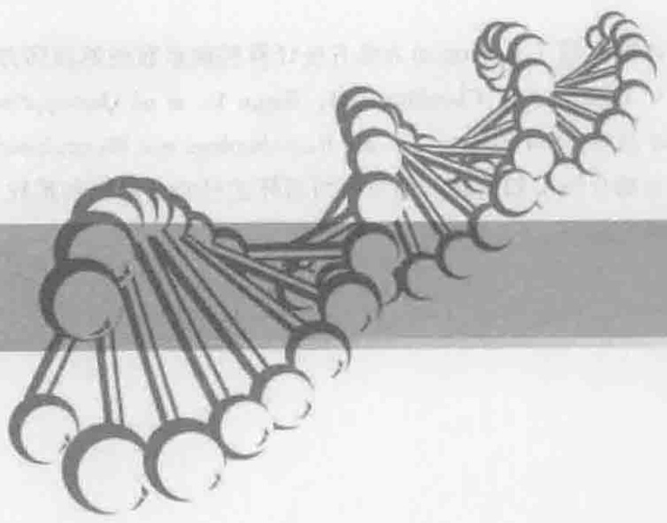

<details>
<summary>natural_image</summary>

Abstract illustration of interconnected nodes forming a chain-like structure (no text or symbols)
</details>

# 基于 $^{13}$ C 同位素标记 信息的代谢通量分析

## 【本章学习要点】

1. 基于 $^{13}$ C 同位素标记信息代谢通量分析的原理
2. 基于 $^{13}$ C 同位素标记信息进行代谢通量分析的方法
3. 基于 $^{13}$ C 同位素标记信息代谢通量分析的应用

基于 $^{13}$ C 同位素标记信息的代谢通量分析方法，利用与代谢反应活性直接相关的重要信息作为通量分析的约束条件，因此比传统的通量分析方法更为准确可靠。 $^{13}$ C 代谢通量分析已经被广泛地应用于多种生物体系中，该法能够很好地揭示细胞代谢反应对遗传操作或环境条件扰动的响应规律，因而已经逐步成为解析代谢调控规律，指导代谢工程设计、改造和优化环境条件的重要工具之一。同时代谢通量组代表了基因—蛋白质—代谢物之间复杂的相互作用对代谢网络的综合效应，该信息已成为系统生物学研究中不可或缺的一部分。

---

6.1  ${}^{13}$ C代谢通量分析的发展

129


## 知识导图

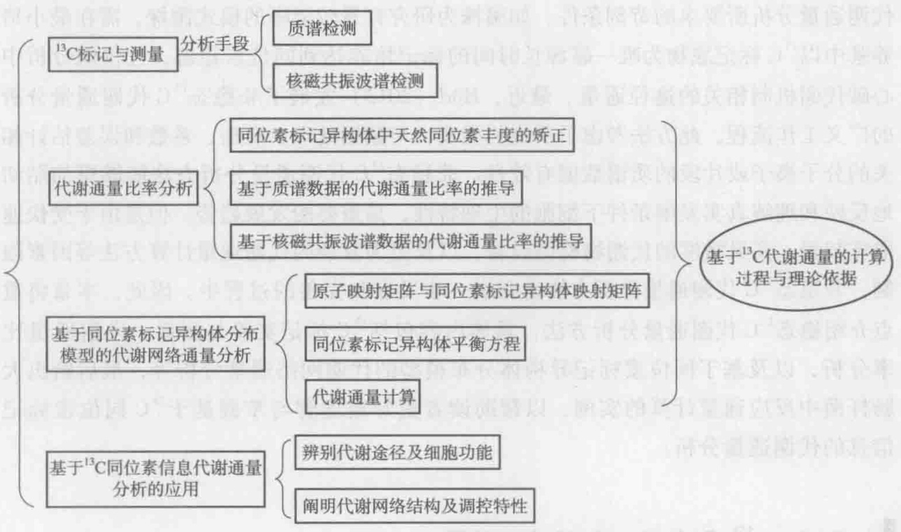

<details>
<summary>flowchart</summary>

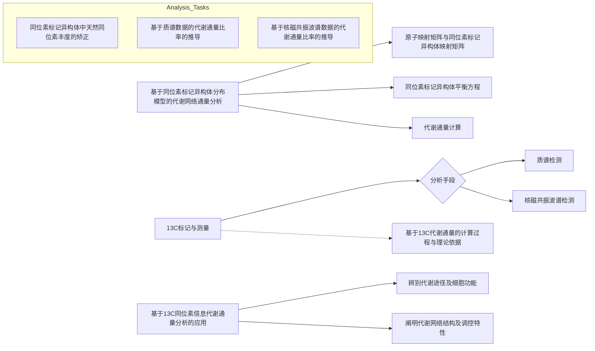
</details>

## 6.1  $^{13}$ C代谢通量分析的发展

代谢通量分析是代谢工程的一个重要工具。它旨在准确定量细胞代谢网络中各个反应的通量，即胞内反应速率，这样可以得到一个通量图，表示代谢网络中各个代谢途径的通量分布。通量图可以用于识别代谢通路，并且通过分析遗传操作和不同环境条件对通量图的影响，可以判断可能的遗传操作靶点、解析代谢调控规律、指导环境条件的优化。传统的代谢通量分析方法是基于代谢网络中各个生化反应的化学计量学和各个代谢物的平衡来进行的（Varma and Palsson 1994）。然而，这种方法对于平行代谢途径、代谢循环、可逆反应等复杂代谢途径的通量分析往往无能为力。因此，对于复杂代谢网络的通量分布解析，往往需要引入假设，例如代谢网络的氧化还原平衡、能量平衡、氧化磷酸化的P/O比值或胞内某些特定酶的活性等，这些任意假设的正确性往往会严重影响通量数据计算的可靠性。为了提高通量分析的可靠性和准确性，研究者们发展了基于 $^{13}$ C同位素标记信息的代谢通量分析（简称 $^{13}$ C代谢通量分析）方法，即通过 $^{13}$ C标记实验并结合核磁共振波谱（NMR）和质谱（MS）技术来分析细胞内中间代谢物的 $^{13}$ C标记状态，在此基础上系统地定量细胞内的代谢通量分布（Wiechert 2001）。这种方法利用了与代谢反应活性直接相关的重要信息作为通量分析的约束条件，因此比传统的通量分析方法更为准确可靠。

目前 $^{13}$ C代谢通量分析主要适用于稳态条件，在细胞的连续培养或者分批培养过

---

◆ 科技视野6-1
非稳态 $^{13}$ C 代谢通量分析

130

6 基于 $^{13}$ C 同位素标记信息的代谢通量分析

程中进行 $^{13}$ C 标记实验（见 6.2），近年也逐步出现了一些非稳态 $^{13}$ C 代谢通量分析方法（Noh et al. 2007, Maier et al. 2008）。非稳态 $^{13}$ C 代谢通量分析方法克服了稳态 $^{13}$ C 代谢通量分析所要求的苛刻条件，如菌株为研究背景较清晰的模式菌株，需在最小培养基中以 $^{13}$ C 标记底物为唯一碳源长时间的标记培养达到同位素稳态，且仅能分析中心碳代谢机制相关的途径通量。最近，Hörl（2013）发展了非稳态 $^{13}$ C 代谢通量分析的广义工作流程，此方法考虑了反应的类型，与数据处理、模型、系数和误差估计相关的分子离子或片段的质谱数据有效性。非稳态 $^{13}$ C 代谢通量分析方法能够更加贴切地反映和理解真实发酵条件下细胞的生理特性，是重要的发展趋势。但是由于受快速取样装置、高灵敏度的代谢物检测设备，以及更为复杂的代谢通量计算方法等因素限制，非稳态 $^{13}$ C 代谢通量分析方法尚在进一步发展和完善的过程中。因此，本章将重点介绍稳态 $^{13}$ C 代谢通量分析方法，具体内容包括 $^{13}$ C 标记实验与测量、代谢通量比率分析，以及基于同位素标记异构体分布模型的代谢网络通量分析等，最后给出大肠杆菌中反应通量计算的实例，以帮助读者更好地理解与掌握基于 $^{13}$ C 同位素标记信息的代谢通量分析。

## 6.2  $^{13}$ C 标记实验与测量

## 6.2.1 标记实验

在 $^{13}$ C 标记实验中，标记底物必须根据研究的代谢途径仔细选择，以使标记实验能够最大程度地提供用于代谢途径分析的信息。目前，可供选择的 $^{13}$ C 标记底物有以下 3 种:

（1）单碳标记底物:即一个指定碳原子被标记的底物，例如第一位碳原子被标记的葡萄糖（ $[1-^{13}C]$  glucose）。
（2）多碳标记底物:即多个指定碳原子被标记的底物，例如第一位和第二位碳原子被标记的葡萄糖（ $[1, 2-^{13}C_{2}]$  glucose）。
（3）全碳标记底物:即全部碳原子都被标记的底物，例如六个碳原子都被标记的葡萄糖（ $U-^{13}C$  glucose）。

上述这些标记底物根据需要可以混合使用，例如  $\left[1-^{13}C\right]$  glucose、 $\left[U-^{13}C\right]$  glucose 和非标记葡萄糖一起使用。

$^{13}$ C 标记底物进入细胞代谢后， $^{13}$ C 原子分布到各个代谢物中，导致同一种代谢物存在不同的同位素标记异构体（isotopomer）。如果代谢物有 n 个碳原子，则该代谢物具有  $2^{n}$  个不同的同位素标记异构体。例如，丙氨酸有 8 个同位素标记异构体，可以用二进制数来表示它们，如  $000_{bin}$  表示所有碳原子均不被标记， $100_{bin}$  表示第一位碳原子被  ${}^{13}$ C 标记，以此类推。这些同位素标记异构体的摩尔组成用同位素标记异构体分布向量（isotopomer distribution vector，IDV）来表示，排序按照二进制数从小到大的方式。以丙氨酸为例，其同位素标记异构体分布向量如式 6-1 所示。

---

6.2  ${}^{13}$ C 标记实验与测量

131

$$
I _ {\mathrm{Ala}} = \left[ \begin{array}{l l} I _ {\mathrm{Ala}} & (0) \\ I _ {\mathrm{Ala}} & (1) \\ I _ {\mathrm{Ala}} & (2) \\ I _ {\mathrm{Ala}} & (3) \\ I _ {\mathrm{Ala}} & (4) \\ I _ {\mathrm{Ala}} & (5) \\ I _ {\mathrm{Ala}} & (6) \\ I _ {\mathrm{Ala}} & (7) \end{array} \right] = \left[ \begin{array}{l l} I _ {\mathrm{Ala}} & (0 0 0 _ {\mathrm{bin}}) \\ I _ {\mathrm{Ala}} & (0 0 1 _ {\mathrm{bin}}) \\ I _ {\mathrm{Ala}} & (0 1 0 _ {\mathrm{bin}}) \\ I _ {\mathrm{Ala}} & (0 1 1 _ {\mathrm{bin}}) \\ I _ {\mathrm{Ala}} & (1 0 0 _ {\mathrm{bin}}) \\ I _ {\mathrm{Ala}} & (1 0 1 _ {\mathrm{bin}}) \\ I _ {\mathrm{Ala}} & (1 1 0 _ {\mathrm{bin}}) \\ I _ {\mathrm{Ala}} & (1 1 1 _ {\mathrm{bin}}) \end{array} \right] \tag {6-1}
$$

$^{13}$ C 标记实验可以在细胞的恒化培养或者分批培养过程中进行。在恒化培养过程中，细胞内处于代谢稳态，当含有 $^{13}$ C 标记底物的培养基开始补入以后，根据培养对象的不同经过若干个保留时间，细胞内所有代谢物的同位素标记异构体分布逐步达到稳定状态，此时方可进行取样分析。在分批培养过程中的指数生长期，细胞处于快速生长阶段，研究表明在这个时期代谢物的同位素标记异构体分布也可认为处于拟稳态（Sauer et al. 1999）。

## 6.2.2 质谱检测

通过检测 $^{13}$ C标记实验中细胞内代谢物的同位素标记异构体分布，可以为代谢途径分析提供大量有用的信息。然而，细胞内大多数中间代谢物的浓度很低，它们的同位素标记异构体分布难以检测。为了避免这个问题，往往检测由生物质组成大分子水解而来的物质，包括由蛋白质水解来的氨基酸、由核酸水解来的核苷酸、由糖原水解来的葡萄糖，以及由脂质水解来的甘油。由于这些大分子在细胞内大量存在（例如蛋白质占细胞干重约50%），因此由它们水解得到的物质浓度高并且容易检测。同时，在代谢稳态或拟稳态条件下，水解后所得小分子物质的碳原子对应于其前体代谢物相应位置上的碳原子。例如根据已知的氨基酸合成途径，前体碳架物质有8种（图6-1、图6-2）:3-磷酸甘油醛、磷酸烯醇式丙酮酸、丙酮酸、乙酰辅酶A、5-磷酸核糖、4-磷酸赤藓糖、α-酮戊二酸，以及草酰乙酸。这些前体中间代谢物分布于糖酵解途径、磷酸戊糖途径及三羧酸循环等各个中心碳代谢途径，因此通过检测蛋白质水解由来的氨基酸的同位素标记异构体分布，可为中心碳代谢途径的解析提供丰富的信息。

代谢物的 $^{13}$ C 同位素标记异构体分布可以利用质谱或者核磁共振波谱来检测。气质联用是最为常用的一种检测方法，即在对样品进行衍生化处理后，样品中的各种化合物通过气相色谱柱得以分离，并在其后的质谱仪中被离子化，同时化合物分子断裂成各种离子化碎片，按照质荷比的不同进行分离、产生信号，因此各种碎片离子的质谱图反映了丰富的分子结构信息。例如，氨基酸可以用叔丁基二甲基硅烷化合物（TBDMS）进行衍生化处理，所得的氨基酸衍生物能够在气相色谱柱上得到很好的分离，并在其后的质谱仪中被离子化成带有不同碳骨架片段的氨基酸碎片，获得的质谱数据反映了各种氨基酸碎片的质量分布信息。图 6-3 表示氨基酸 TBDMS 衍生物在气

---

132

6 基于 $^{13}$ C 同位素标记信息的代谢通量分析

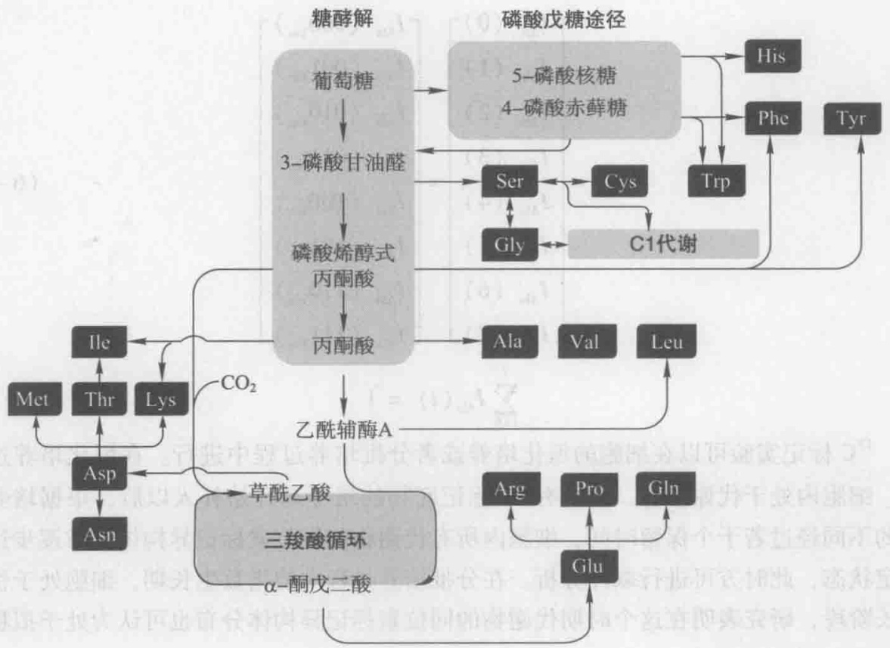

<details>
<summary>flowchart</summary>

```mermaid
graph TD
  subgraph sg["\"糖酵解\""]
  A["葡萄糖"] --> B["3-磷酸甘油醛"]
  B --> C["磷酸烯醇式丙酮酸"]
  C --> D["丙酮酸"]
  E["Ile"] --> F["Met"]
  E --> G["Thr"]
  E --> H["Lys"]
  I["Asp"] --> J["Asn"]
  K["草酰乙酸"] --> L["α-酮戊二酸"]
  M["三羧酸循环"] --> N["α-酮戊二酸"]
  O["CO2"] --> P["Ala"]
  Q["Gly"] --> R["Val"]
  S["Ser"] --> T["Cys"]
  U["5-磷酸核糖\n4-磷酸赤藓糖"] --> V["His"]
  W["Trp"] --> X["Phe"]
  Y["Tyr"] --> Z["Gln"]
  AA["Arg"] --> AB["Pro"]
  AC["Glu"] --> AD["Arg"]
  AE["Gly"] --> AF["Leu"]
  AG["C1代谢"] --> AH["Ser"]
  AI["Trp"] --> AJ["Phe"]
  end

  D --> K
  D --> M
  D --> O
  D --> P
  D --> Q
  D --> R
  D --> S
  D --> AA
  D --> AC
  D --> AF
  D --> AG
  D --> AH
  D --> AI
  D --> AJ
  D --> AK
  D --> AL
  D --> AM
  D --> AN
  D --> AO
  D --> AP
  D --> AQ
  D --> AR
  D --> AS
  D --> AT
  D --> AU
  D --> AV
  D --> AW
  D --> AX
  D --> AY
  D --> AZ
  D --> BA
  D --> BB
  D --> BC
  D --> BD
  D --> BE
  D --> BF
  D --> BG
  D --> BH
  D --> BI
  D --> BJ
  D --> BK
  D --> BL
  D --> BM
  D --> BN
  D --> BO
  D --> BP
  D --> BR
  D --> BC
  D --> BD
  D --> BE
  D --> BF
  D --> BG
  D --> BH
  D --> BI
  D --> BJ
  D --> BK
  D --> BL
  D --> BM
  D --> BN
  D --> BO
  D --> BP
  D --> BG
  D --> BH
  D --> BI
  D --> BJ
  D --> BK
  D --> BL
  D --> BM
  D --> BN
  D --> BO
  D --> BP
  D --> BG
  D --> BH
  D --> BI
  D --> BJ
  D --> BK
  D --> BL
  D --> BM
  D --> BN
  D --> BO
  D --> BG
  D --> BH
  D --> BI
  D --> BJ
  D --> BK
  D --> BL
  D --> BM
  D --> BN
  D --> BO
  D --> BG
  D --> BH
  D --> BI
  D --> BJ
  D --> BK
  D --> BL
  D --> BM
```
</details>

图6-1 氨基酸及其前体中间代谢物

A

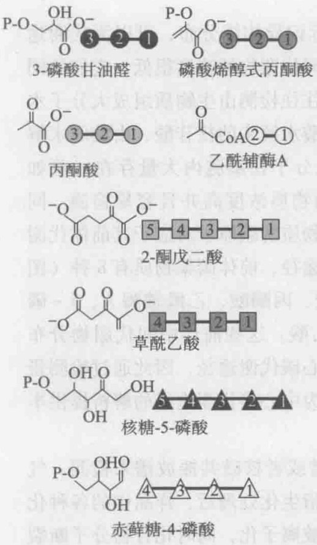

<details>
<summary>chemical</summary>

Structural formulas of various phosphate compounds including phospholipids, fatty acids, and glycerol derivatives
</details>

B

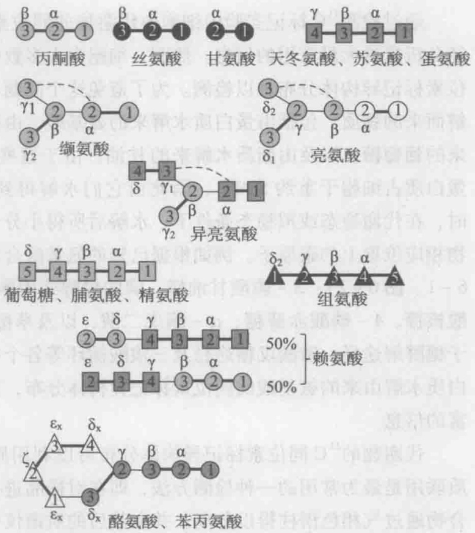

<details>
<summary>flowchart</summary>

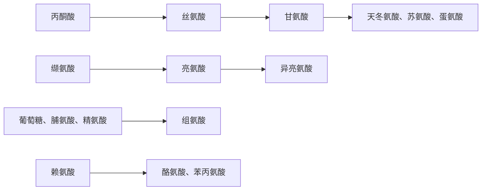
</details>

图6-2 氨基酸碳骨架的来源

糖酵解途径、三羧酸循环、磷酸戊糖途径上前体中间代谢物的碳骨架分别用深浅不同的○、□、△表示，粗线表示来自一个前体分子的完整片段中的碳-碳键，细线表示来自不同前体分子的片段之间的碳-碳连接，虚线表示片段来自一个前体分子、但是在氨基酸碳骨架上并不直接连接

---

6.2  ${}^{13}$ C 标记实验与测量

133

相色谱中的分离，以及丙氨酸衍生物的质谱图。图6-4表示检测到的氨基酸TBDMS衍生物的各种碎片，包括 $(M-15)^{+}$ 、 $(M-57)^{+}$ 、 $(M-85)^{+}$ 、 $(M-159)^{+}$ 等，它们分别包含不同的氨基酸碳原子。每一种碎片的同位素标记异构体中最轻的质量数，以及该碎片所包含的氨基酸碳原子的个数在表6-1中列出，但在实际研究中需注意并不是该表中出现的所有氨基酸碎片的质量分布数据都能够精确确定。

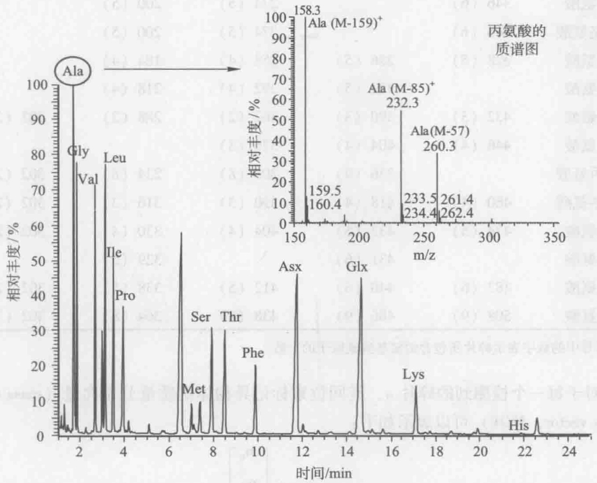

<details>
<summary>spectrogram</summary>

| 化合物 | m/z (相对丰度%) |
| --- | --- |
| Ala | 158.3 |
| Ala (M-159)+ | 160.4 |
| Ala (M-85)+ | 232.3 |
| Ala (M-57) | 260.3 |
| Glx | 233.5 |
| Lys | 234.4 |
| His | 261.4 |
| Pro | ~38 |
| Leu | ~78 |
| Gly | ~78 |
| Val | ~72 |
| Ser | ~31 |
| Thr | ~30 |
| Asx | ~46 |
| Phe | ~20 |
</details>

图6-3 氨基酸TBDMS衍生物在气相色谱中的分离及丙氨酸衍生物的质谱图例

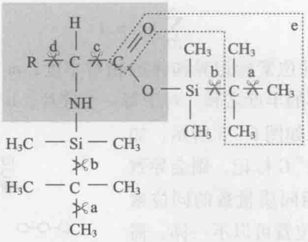

<details>
<summary>chemical</summary>

Chemical structure diagram showing a silane-based polymer with labeled atoms and functional groups
</details>

图6-4 GC-MS检测到的氨基酸TBDMS衍生物的各种碎片

氨基酸结构式用背景色表示，R为可变基团。在所显示的位置上发生断裂，形成以下各种碎片:（a） $(M-15)^{+}$ 和甲基基团；（b） $(M-57)^{+}$ 和叔丁基基团；（c） $(M-159)^{+}$ 和C（O）O-TBDMS离子；（d）f302（氨基酸的双甲硅烷基化 $C_{1}-C_{2}$ 片段）和包含R的侧链；（e） $(M-85)^{+}$ 和氨基酸的羰基及叔丁基基团（虚线表示）

---

134.

6 基于 $^{13}$ C 同位素标记信息的代谢通量分析

表 6-1 氨基酸 TBDMS 衍生物各种碎片的最轻同位素标记异构体的质量数

| 氨基酸 | $(M-15)^+$ | $(M-57)^+$ | $(M-85)^+$ | $(M-159)^+$ | $(f302)^+$ |
| --- | --- | --- | --- | --- | --- |
| 丙氨酸 |  | 260 (3) | 232 (2) |  |  |
| 甘氨酸 | 288 (2) | 246 (2) | 218 (1) | 144 (1) |  |
| 缬氨酸 |  | 288 (5) | 260 (4) |  | 302 (2) |
| 亮氨酸 | 346 (6) |  | 274 (5) | 200 (5) |  |
| 异亮氨酸 | 346 (6) |  | 274 (5) | 200 (5) |  |
| 脯氨酸 | 328 (5) | 286 (5) | 258 (4) | 184 (4) |  |
| 蛋氨酸 |  | 320 (5) | 292 (4) | 218 (4) |  |
| 丝氨酸 | 432 (3) | 390 (3) | 362 (2) | 288 (2) | 302 (2) |
| 苏氨酸 | 446 (4) | 404 (4) | 376 (3) |  |  |
| 苯丙氨酸 |  | 336 (9) | 308 (8) | 234 (8) | 302 (2) |
| 天冬氨酸 | 460 (4) | 418 (4) | 390 (3) | 316 (3) | 302 (2) |
| 谷氨酸 | 474 (5) | 432 (5) | 404 (4) | 330 (4) | 302 (2) |
| 赖氨酸 |  | 431 (6) |  | 329 (5) |  |
| 组氨酸 | 482 (6) | 440 (6) | 412 (5) | 338 (5) | 302 (2) |
| 酪氨酸 | 508 (9) | 466 (9) | 438 (8) | 364 (8) | 302 (2) |

括号中的数字表示碎片所包含的氨基酸碳原子的个数。

对于每一个检测到的碎片 a，其同位素标记异构体的质量分布向量（mass distribution vector, MDV）可以表示如下:

$$
M D V _ {a} = \left[ \begin{array}{c} m _ {0} \\ m _ {1} \\ \vdots \\ m _ {n} \end{array} \right] \tag {6-2}
$$

$$
\sum_ {i = 0} ^ {n} m _ {i} = 1
$$

$m_{0}$  表示最小质量数同位素标记异构体的相对丰度； $m_{i>0}$  表示具有相同的较高质量数的同位素标记异构体的丰度之和。对于每一个碎片，n 大于或者等于碎片中所包

含的氨基酸碳原子个数。如图6-5所示，如果氨基酸的任一碳原子被 $^{13}$ C标记，则会导致较高的质量数，而具有相同质量数的同位素标记异构体中 $^{13}$ C的标记位置可以不一样。需要指出的是，除了氨基酸的碳原子，碎片中所有其他原子（包括衍生化基团上的原子）由于天然稳定同位素的存在（比如自然界中 $^{13}$ C约占全部碳原子质量的1.1%），也会造成较高的质量数，因此在利用质谱数据解析细胞代谢之前，需要对这些原子的天然丰度进行校正（详见下一节内容）。

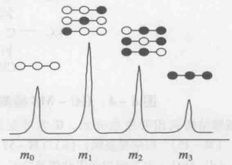

<details>
<summary>chemical</summary>

Molecular structure diagram showing repeating units with labeled m0 to m3 and molecular arrangement of atoms
</details>

图6-5 同位素标记异构体及其质量分布（以丙氨酸为例）

黑色圆圈表示碳原子被 $^{13}$ C标记，白色圆圈表示碳原子没有被标记

---

6.2  ${}^{13}$ C 标记实验与测量

135

## 6.2.3 核磁共振波谱检测

核磁共振波谱（NMR）也常被用于检测代谢物的 $^{13}$ C 同位素标记异构体分布，常见的有一维氢谱、碳谱，以及二维碳氢相关谱等（Szyperski 1998）。一维氢谱检测的灵敏度高，但是它不能直接分析复杂的混合物样品，需要事先对样品中的各个代谢物进行分离提纯。通过解析一维氢谱中主峰和其两侧的 $^{13}$ C 卫星峰的比例，或者比较分析一维氢谱与 $^{13}$ C 去耦的一维氢谱，可以获得代谢物各个碳原子的 $^{13}$ C 标记丰度的信息，它表示某个碳原子被 $^{13}$ C 标记的所有同位素标记异构体所占的比例。因此对于一个具有 n 个碳原子的代谢物，则最多只能获得 n 个不同碳原子 $^{13}$ C 标记丰度的数据。碳原子 $^{13}$ C 标记丰度的信息也可以通过检测一维碳谱获得，即比较代谢物样品和标准品的碳谱强度，如果标准品是不带 $^{13}$ C 标记的，则其碳原子的 $^{13}$ C 天然丰度为 1.1%，这样在另外测得样品中代谢物浓度的基础上，就可以计算得到样品中代谢物某个碳原子的 $^{13}$ C 标记丰度。

通过质子去耦的一维碳谱检测，在除去碳-氢一级耦合相互作用的基础上，解析碳键直接连接的相邻 $^{13}$ C核的自旋-自旋耦合（J耦合），可以获得丰富的代谢物同位素标记异构体分布的信息。如图6-6a所示，对于一个末端碳原子（如甲基基团），如果相邻碳原子没有被 $^{13}$ C标记，可以观察到一个单重峰；如果相邻碳原子被 $^{13}$ C标记，由于自旋裂分的作用则可以观察到左右两个等同的信号，即耦合常数为 $^{1}J_{cc}$ 的双重峰。对于一个三碳片段的中间碳原子，如果与它相邻的两个碳原子属于不同的基团，即它的两个J耦合常数不相同（用 $^{1}J_{cc}$ 和 $^{1}J_{cc*}$ 表示），根据相邻碳原子是否被 $^{13}$ C标记的不同情况，可以观察到四种信号:单重峰、耦合常数为 $^{1}J_{cc}$ 的双重峰、耦合常数为 $^{1}J_{cc*}$ 的双重峰，以及双双重峰（图6-6b）。这种情况适用于氨基酸的α-碳原

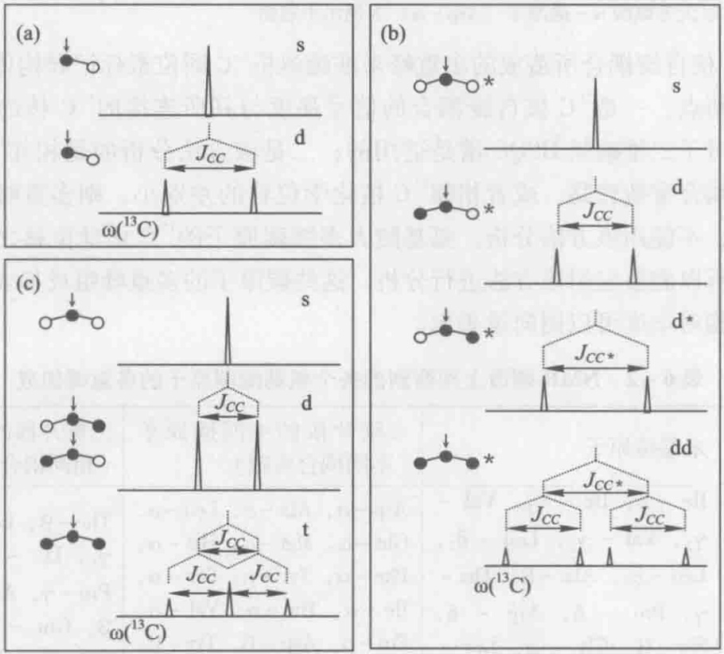

图6-6 $^{13}\mathrm{C}$ 同位素标记异构体与NMR碳谱上观察到的多重峰的关系

黑色圆圈表示碳原子被 $^{13}$ C标记，白色圆圈表示碳原子没有被标记。箭头表示所观测的碳原子。s表示单重峰，d表示双重峰，dd表示双双重峰，t表示三重峰。 $J_{CC}$ 和 $J_{CC*}$ 是一级耦合常数（ $J_{CC*} > J_{CC}$ ）

---

136

6 基于 $^{13}$ C 同位素标记信息的代谢通量分析

子，相邻的羧基碳原子与其发生耦合的常数约为 $60\mathrm{Hz}$，明显大于脂肪链碳原子间的耦合常数（约 $35\mathrm{Hz}$）。如果三碳片段的中间碳原子的两个 $J$ 耦合常数相同，则两个双重峰重叠，可以观察到三种信号:单重峰、耦合常数为 ${}^{1}J_{CC}$ 的双重峰，以及三重峰（图6-6c）。因此通过解析碳谱上由于相邻 ${}^{13}\mathrm{C}$ 核自旋耦合所造成的多重峰的组成与比例，可以获得 ${}^{13}\mathrm{C}$ 同位素标记异构体分布的信息。

$^{13}$ C 核自旋耦合也可以通过二维碳氢异核相关谱（HSQC）来检测（图 6-7），它比一维碳谱要灵敏得多，而且由于避免了一维碳谱上不同碳原子信号的重叠，谱峰的分辨能力更强，可以用于直接分析复杂的混合物样品。对 HSQC 谱上各个交叉峰取 $^{13}$ C 截面图，则可以获得对应碳原子的多重峰组分的信息（见图 6-7）。

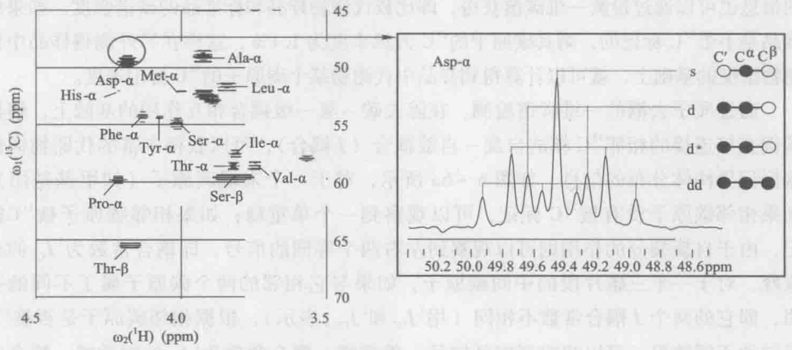

<details>
<summary>spectrogram</summary>

| Residue | \(\omega2(1H) (\)ppm) | \(\omega1(13C) (\)ppm) |
| --- | --- | --- |
| Asp-α | ~4.95 | ~50.5 |
| His-α | ~4.85 | ~54.5 |
| Phe-α | ~4.75 | ~56.0 |
| Tyr-α | ~4.70 | ~56.5 |
| Ser-α | ~4.65 | ~57.0 |
| Thr-α | ~4.60 | ~59.0 |
| Val-α | ~4.55 | ~60.0 |
| Pro-α | ~4.45 | ~63.0 |
| Thr-β | ~4.35 | ~66.0 |
</details>

图6-7 利用二维碳氢HSQC谱检测相邻 ${}^{13}\mathrm{C}$ 核的自旋耦合

左图的 HSQC 谱中显示了一些氨基酸碳原子的交叉峰，对其取  ${}^{13}C$  截面图可获得碳原子的多重峰组分的信息，以天冬氨酸  $\alpha-$  碳原子（Asp- $\alpha$ ）为例示于右图

利用 $^{13}$ C 核自旋耦合所造成的多重峰来准确解析 $^{13}$ C 同位素标记异构体分布时，需要注意以下两点:一是 $^{13}$ C 核自旋耦合的信号强度与其所连接的 $^{13}$ C 核的数目是无关的，这一点对于二维碳氢 HSQC 谱是适用的；二是该方法分析的是相邻 $^{13}$ C 核的自旋耦合，如果耦合常数较高，或者相邻 $^{13}$ C 核化学位移的差别小，则多重峰的情况将变得非常复杂，不能用该方法分析。氨基酸大多数碳原子的 $^{13}$ C 化学位移之差都远大于耦合常数，所以能够应用该方法进行分析。这些碳原子的多重峰组成如表 6-2 所示，这些组成的相对丰度可以用向量表示。

表 6-2 NMR 碳谱上观察到的各个氨基酸碳原子的多重峰组成

<table><tr><td rowspan="2">氨基酸碳原子</td><td>末端碳原子</td><td>三碳片段的中间碳原子(不同耦合常数)</td><td>三碳片段的中间碳原子(相同耦合常数)</td></tr><tr><td>Ile - δ, Ile -  $\gamma_{2}$ , Val -  $\gamma_{2}$ , Val -  $\gamma_{1}$ , Leu -  $\delta_{2}$ ,Leu -  $\delta_{1}$ , Ala - β, Thr - γ, Pro - δ, Arg - δ,Ser - β, Gly - α, Lys - ε, His -  $\delta_{2}$ </td><td>Asp - α, Ala - α, Leu - α,Glu - α, Met - α, His - α,Phe - α, Tyr - α, Ser - α,Ile - α, Thr - α, Val - α,Pro - α, Asp - β, Tyr - β,Phe - β, Glu - γ, His - β</td><td>Thr - β, Leu - β, Ile -  $\gamma_{1}$ , Lys - γ, Lys - δ,Pro - γ, Arg - β, Lys - β, Glu - β, Pro - β,Tyr -  $\delta_{X}$ , Tyr -  $\varepsilon_{X}$ </td></tr><tr><td>多重峰组成</td><td>s, d</td><td>s, d, d*, dd</td><td>s, d, t</td></tr></table>

s 表示单重峰，d 表示双重峰，dd 表示双双重峰，t 表示三重峰。

---

6.3 代谢通量比率分析

137

## 6.3 代谢通量比率分析

通过 $^{13}$ C 标记实验并结合 NMR 和质谱技术，可以获得大量的细胞内代谢物同位素标记异构体分布的数据。如何利用这些数据解析碳代谢途径网络，目前主要有两种方法:一种是代谢通量比率分析方法，另一种是基于同位素标记异构体模型拟合的代谢网络通量分析（见 6.4）。代谢通量比率分析是直接利用测量得到的质谱或 NMR 数据来推导代谢途径的通量比率，即不同途径对某一代谢物的相对贡献。得到的代谢通量比率数据可以单独或结合其他测量用于细胞代谢特性的解析，也可以作为重要约束条件用于代谢网络整体通量分布的计算。瑞士联邦理工学院的 Sauer 研究小组率先开发了相关分析方法，并较早地在多种细胞体系中进行了基于通量比率的代谢调控特性分析（Nanchen et al. 2007, Zamboni et al. 2009）。

代谢通量比率分析的主要思路是合理选用代谢物同位素标记异构体分布的测量值，解析不同代谢反应或途径在合成某一关键代谢物时所导致的不同 $^{13}$ C 标记模式，由此推导出这些代谢途径的相对贡献。由于代谢通量比率是在分析代谢反应中碳原子转移特征等基础上决定的，因此通量比率的推导较为复杂，需要对代谢反应的生物化学基础有清晰的理解。由质谱或 NMR 数据直接推导得到的代谢通量比率可作为附加的限定条件，和代谢物的质量平衡方程一起用于计算细胞代谢网络的通量分布（Fischer et al. 2004）。本节将依次对质谱数据的天然同位素丰度矫正、基于质谱以及 NMR 数据推导代谢通量比率等进行介绍，读者可以结合相关文章（花强等，2009）进一步理解和掌握代谢通量比率分析方法。

## 6.3.1 同位素标记异构体中天然同位素丰度的矫正

通过质谱分析可以获得代谢物同位素标记异构体的质量分布数据，除了代谢物中的碳原子被 $^{13}$ C标记，所有其他原子（包括衍生化基团上的原子）由于天然稳定同位素的存在，也会造成较高的质量数。例如，测量得到的质量数为 $m_{1}$ 的同位素标记异构体丰度，是检测碎片中的一个C原子被 $^{13}$ C标记，或者一个H原子是 $^{2}$ H标记，或者一个O原子是 $^{17}$ O标记等所有可能情况的丰度总和。然而，只有代谢物基本碳骨架的同位素标记信息才能用于解析细胞代谢。因此需要对原始的质谱数据进行矫正以去除其他因素的影响，获得代谢物同位素标记异构体的真实质量分布向量。首先需要排除自然界天然存在的稳定同位素（表6-3）对MDV的影响，这需要矫正衍生基团上的碳、氢、氧、氮、硫、硅等元素和氨基酸碳骨架片段上除碳以外的其他元素的天然丰度，这一步矫正可通过式6-3实现。

表 6-3 相关元素的天然稳定同位素丰度

| 元素 | 原子量 | $m_0$ | $m_1$ | $m_2$ | $m_4$ |
| --- | --- | --- | --- | --- | --- |
| H | 1 | 0.999885 | 0.000115 |  |  |
| C | 12 | 0.9893 | 0.0107 |  |  |
| N | 14 | 0.99636 | 0.00364 |  |  |

---

138

6 基于 $^{13}$ C 同位素标记信息的代谢通量分析

续表

| 元素 | 原子量 | $m_0$ | $m_1$ | $m_2$ | $m_4$ |
| --- | --- | --- | --- | --- | --- |
| O | 16 | 0.99757 | 0.00038 | 0.00205 |  |
| Si | 28 | 0.92223 | 0.04685 | 0.03092 |  |
| S | 32 | 0.9499 | 0.0075 | 0.0425 | 0.0001 |

$m_{0}$  表示最小质量数的同位素的相对丰度； $m_{i>0}$  表示具有较高质量数的同位素的丰度。数据来源:Böhlke et al. Isotopic compositions of the elements, 2001. J. Phys. Chem. Ref. Data, 2005, 34: 57-67。

$$
M D V _ {a} ^ {*} = C _ {\mathrm{corr,CHONSSi}} ^ {- 1} \cdot M D V _ {a} \tag {6-3}
$$

式中， $MDV_{a}$ 是同位素标记异构体质量分布向量的原始测量值， $C_{corr,CHONSSi}$ 是天然稳定同位素丰度的矫正矩阵，该矩阵可以由式6-4计算得到。

$$
C _ {\mathrm{corr,CHONSSi}} = C _ {\mathrm{corr,C}} \cdot C _ {\mathrm{corr,H}} \cdot C _ {\mathrm{corr,O}} \cdot C _ {\mathrm{corr,N}} \cdot C _ {\mathrm{corr,S}} \cdot C _ {\mathrm{corr,Si}} \tag {6-4}
$$

该式中的  $C_{corr,C}$ 、 $C_{corr,H}$ 、 $C_{corr,O}$ 、 $C_{corr,N}$ 、 $C_{corr,S}$ 、 $C_{corr,Si}$  分别为碳、氢、氧、氮、硫和硅原子相对应的矫正矩阵，这些矩阵的作用是根据质谱所检测到碎片中每种原子的个数及其同位素丰度对 MDV 的原始测量数据进行矫正。这些矫正矩阵具有较复杂但又有规律的形式，以代谢物中存在两个氧原子需要矫正的情况为例，可以得到如下氧原子的矫正矩阵  $C_{corr,0}$ :

$$
C _ {\mathrm{corr}, 0} = \left( \begin{array}{c c c c} ^ {1 6} O & 0 & 0 & 0 \\ ^ {1 6} O ^ {1 7} O & ^ {1 6} O & 0 & 0 \\ ^ {1 7} O _ {2} + ^ {1 6} O ^ {1 8} O & ^ {1 6} O ^ {1 7} O & ^ {1 6} O _ {2} & 0 \\ ^ {1 7} O ^ {1 8} O & ^ {1 7} O _ {2} + ^ {1 6} O ^ {1 8} O & ^ {1 6} O ^ {1 7} O & ^ {1 6} O _ {2} \\ ^ {1 8} O _ {2} & ^ {1 7} O ^ {1 8} O & ^ {1 7} O _ {2} + ^ {1 6} O ^ {1 8} O & ^ {1 6} O ^ {1 7} O \\ 0 & ^ {1 8} O _ {2} & ^ {1 7} O ^ {1 8} O & ^ {1 7} O _ {2} + ^ {1 6} O ^ {1 8} O \\ 0 & 0 & ^ {1 8} O _ {2} & ^ {1 7} O ^ {1 8} O \\ 0 & 0 & 0 & ^ {1 8} O _ {2} \end{array} \right) (6 - 5)
$$

上述矩阵中 $^{16}O_{2},^{17}O_{2},^{16}O^{18}O$ 等符号代表代谢物中氧的各种同位素组合的丰度，可由式6-6计算得到（van Winden et al. 2002）。

$$
a b u n d a n c e = \left(\sum_ {i = 1} ^ {N} f [ I (i) ]\right)! \cdot \prod_ {i = 1} ^ {N} \left(\frac {p [ I (i) ] ^ {f [ I (i) ]}}{f [ I (i) ] !}\right) \tag {6-6}
$$

式中，N 表示氧原子的天然同位素有 N 种  $[I(1), I(2), \cdots, I(N)]$ ， $f[I(i)]$  为某种同位素出现的次数， $p[I(i)]$  为该同位素的天然丰度。

其次，由于接种等原因带入的未标记菌体对目标代谢物 MDV 测量值的影响也需通过式 6-7 进行矫正去除。

$$
MDV_{AA} = \frac{MDV_{a}^{*} - f_{\text{unlabeled}} \cdot MDV_{\text{unlabeled},n}}{1 - f_{\text{unlabeled}}} \tag{6 - 7}
$$

式中， $f_{unlabeled}$  为接种等带来的未标记菌体所占的比率； $MDV_{unlabeled,n}$  是含有 n 个碳原子的未标记代谢物的质量分布向量，该向量的各个组分可以由式 6-8 计算得到（Fischer et al. 2003）。

$$
M D V _ {\mathrm{unlabeled}, n (i)} = c _ {0} ^ {n - i} c _ {1} ^ {i} \binom {n} {i} \tag {6-8}
$$

---

6.3 代谢通量比率分析

139

式中， $c_{0}$  和  $c_{1}$  分别是  ${}^{12}C$  和  ${}^{13}C$  同位素的天然丰度， $\binom{n}{i}$  是二项式系数。

## 6.3.2 基于质谱数据的代谢通量比率的推导

一些代谢网络中间代谢物的合成可以来自于不同的代谢途径，${ }^{13} \mathrm{C}$ 标记通过不同的途径可能会给同一中间代谢物带来不同形式的同位素标记异构体，因而可以此解析不同代谢反应途径的相对贡献。然而，细胞内大多数中间代谢物的浓度很低或者不稳定，它们的同位素标记异构体分布难以检测。因此，质谱分析往往检测的是生物质组成大分子水解而来的物质，包括蛋白质水解而来的氨基酸、核酸水解而来的核苷酸、糖原水解而来的葡萄糖，以及脂质水解而来的甘油。为了解析中心代谢网络的代谢通量比率，需要将实验测得的这些代谢物的 $MDV$ 推导并获得其前体中间代谢物的 $MDV$。其中前体代谢物包括磷酸烯醇式丙酮酸、丙酮酸、乙酰辅酶A、5-磷酸核糖、4-磷酸赤藓糖、$\alpha-$ 酮戊二酸、草酰乙酸等，分布于糖酵解途径、磷酸戊糖途径及三羧酸循环等各个中心碳代谢途径上（见图6-2）。如果氨基酸碳骨架片段直接来源于某一个中间代谢物，则测量得到的氨基酸各个片段的 $MDV$ 即等同于中间代谢物片段的 $MDV$（如 $\mathrm{PYR}_{1\sim 3} = \mathrm{Ala}_{1\sim 3}, \mathrm{OAA}_{1\sim 4} = \mathrm{Asp}_{1\sim 4}, \mathrm{OGA}_{2\sim 5} = \mathrm{Glu}_{2\sim 5}$ 等）。还有一些氨基酸碳骨架片段是来源于两种或两种以上中间代谢物的片段，例如苯丙氨酸 C1-C9 九碳片段来源于磷酸烯醇式丙酮酸 C1-C2-C3 和 C2-C3 碳片段，以及 4-磷酸赤藓糖的 C1-C2-C3-C4 碳片段。假设某一氨基酸的碳骨架来自两个中间代谢物 M1 和 M2，则测量得到的氨基酸片段的 $MDV$ 与 M1 和 M2 的 $MDV$ 的关系可以用式 6-9 表示，这样通过最小二乘法拟合可以得到每个中间代谢物的 $MDV$。

$$
MDV_{AA}(i) = \sum_{j = 0}^{i}MDV_{\mathrm{M1}}(i - j)\cdot MDV_{\mathrm{M2}}(j)\tag{6 - 9}
$$

表6-4中总结了基于质谱数据进行代谢通量比率推导时一些常用到的代谢物片段同位素标记异构体的质量分布向量。

表 6-4 代谢通量比率推导中常用的代谢物片段的质量分布向量

| 代谢物 |  | MDV |  |
| --- | --- | --- | --- |
| 磷酸烯醇式丙酮酸 | $PEP_{1\sim3}$ | $PEP_{2\sim3}$ | $PEP_{1\sim2}$ |
| 丙酮酸 | $PYR_{1\sim3}$ | $PYR_{2\sim3}$ | $PYR_{1\sim2}$ |
| 草酰乙酸 | $OAA_{1\sim4}$ | $OAA_{2\sim4}$ | $OAA_{1\sim2}$ |
| $\alpha$-酮戊二酸 | $OGA_{1\sim5}$ | $OGA_{2\sim5}$ | $OGA_{1\sim2}$ |
| 4-磷酸赤藓糖 | $E4P_{1\sim4}$ |  |  |
| 5-磷酸核糖 | $P5P_{1\sim5}$ | $P5P_{1\sim4}$ | $P5P_{4\sim5}$ |
| 丝氨酸 | $Ser_{1\sim3}$ | $Ser_{2\sim3}$ | $Ser_{1\sim2}$ |

每个代谢物片段中包含的碳原子表示在下标中。

代谢通量比率推导的基本思路是首先选取目标代谢物的特定碳骨架片段，不同的来源途径会造成该片段同位素标记异构体质量分布的显著不同；然后将测得的目标代谢物片段的质量分布信息与其在各个来源途径中的标记情况进行比较计算，从而得到

---

140

6 基于 $^{13}$ C 同位素标记信息的代谢通量分析

不同代谢反应途径在合成目标代谢物时的相对贡献。如图6-8a所示，当目标代谢物经由两条代谢途径分别来源于代谢物1和代谢物2时，它们的MDV满足式6-10中的关系:

$$
M D V _ {\mathrm{P}} = f \cdot M D V _ {1} + (1 - f) \cdot M D V _ {2} \tag {6-10}
$$

式中，f 表示代谢物 1 经由途径 1 对目标代谢物合成的贡献，可以用代谢通量表示成  $v_{1}/(v_{1}+v_{2})$ ，代谢途径 2 的贡献为 1-f。这样 f 可以通过式 6-11 计算得到。

$$
f = \frac {M D V _ {\mathrm{P}} - M D V _ {2}}{M D V _ {1} - M D V _ {2}} \tag {6-11}
$$

由于 MDV 是质量分布向量，不是单个数值，因此得到的 f 数值实际上是式 6-11 的最小二乘解。

同样，如果目标代谢物经由三条代谢途径分别来源于三个代谢物1、2及3（图6-8b），则它们的MDV关系满足式6-12:

$$
MDV _ {\mathrm{p}} = f _ {1} \cdot M D V _ {1} + f _ {2} \cdot M D V _ {2} + (1 - f _ {1} - f _ {2}) \cdot M D V _ {3} \tag {6-12}
$$

式中， $f_{1}$  和  $f_{2}$  分别表示代谢途径 1 和 2 对目标代谢物合成的贡献，可以通过求解式 6-13 的最小二乘解计算得到  $f_{1}$  和  $f_{2}$ :

$$
\left[ \begin{array}{l} f _ {1} \\ f _ {2} \end{array} \right] = \frac {M D V _ {\mathrm{p}} - M D V _ {3}}{\left[ \begin{array}{l l} M D V _ {1} - M D V _ {3} & M D V _ {2} - M D V _ {3} \end{array} \right]} \tag {6-13}
$$

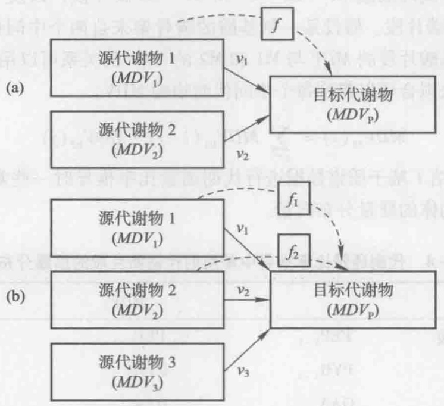

图6-8 目标代谢物的不同来源情况及代谢通量比率示意图

（a）目标代谢物由两个不同来源途径合成；（b）目标代谢物由三个不同来源途径合成

以大肠杆菌在全碳标记与不标记葡萄糖的混合物上生长时来源于磷酸烯醇式丙酮酸的草酰乙酸的比率计算为例，说明如何利用质量分布数据推导代谢通量比率。该比率体现了中心代谢中的两个重要途径——磷酸烯醇式丙酮酸羧化这一回补反应和TCA循环的相对通量大小，以下是该比率的具体推导过程。草酰乙酸可以在磷酸烯醇式丙酮酸羧化酶的作用下由磷酸烯醇式丙酮酸和 $CO_{2}$ 生成，也可通过三羧酸循环获得。为了计算草酰乙酸来自于磷酸烯醇式丙酮酸的比例，需要用到草酰乙酸、 $\alpha-$ 酮戊二酸，以及磷酸烯醇式丙酮酸中相应片段同位素标记异构体的质量分布向量，即

---

6.3 代谢通量比率分析

141

$OAA_{1-4}$ 、 $OGA_{2-5}$ 和 $PEP_{1-3}$ 。前二者可分别由 $Asp_{1-4}$ 、 $Glu_{2-5}$ 直接获得，后者则需由 $Phe_{1-9}$ 拟合求得，此处不作赘述。由于 $CO_{2}$ 的标记丰度是未知的，所以将其作为另外一个未知变量。这些代谢物的质量分布向量的关系满足式6-14。

$$
\mathrm{OAA} _ {1 \sim 4} = \mathrm{PEP} _ {1 \sim 3} \times \mathrm{CO} _ {2} \cdot f + \mathrm{OGA} _ {2 \sim 5} \cdot (1 - f) \tag {6-14}
$$

f为草酰乙酸来自磷酸烯醇式丙酮酸的比率。假设 $CO_{2}$ 的标记丰度为 $l_{CO_{2}}$ ， $PEP_{1\sim3}\times CO_{2}$ 可用式6-15计算:

$$
\begin{array}{l} \mathrm{PEP} _ {1 \sim 3} \times \mathrm{CO} _ {2} = \left[ \begin{array}{c} \mathrm{PEP} _ {1 \sim 3} (1) \cdot (1 - l _ {\mathrm{CO} _ {2}}) \\ \mathrm{PEP} _ {1 \sim 3} (2) \cdot (1 - l _ {\mathrm{CO} _ {2}}) + \mathrm{PEP} _ {1 \sim 3} (1) \cdot l _ {\mathrm{CO} _ {2}} \\ \mathrm{PEP} _ {1 \sim 3} (3) \cdot (1 - l _ {\mathrm{CO} _ {2}}) + \mathrm{PEP} _ {1 \sim 3} (2) \cdot l _ {\mathrm{CO} _ {2}} \\ \mathrm{PEP} _ {1 \sim 3} (4) \cdot (1 - l _ {\mathrm{CO} _ {2}}) + \mathrm{PEP} _ {1 \sim 3} (3) \cdot l _ {\mathrm{CO} _ {2}} \\ \mathrm{PEP} _ {1 \sim 3} (4) \cdot l _ {\mathrm{CO} _ {2}} \end{array} \right] \\ = \left[ \begin{array}{c} \mathrm{PEP} _ {1 \sim 3} \\ 0 \end{array} \right] \cdot (1 - l _ {\mathrm{CO} _ {2}}) + \left[ \begin{array}{c} 0 \\ \mathrm{PEP} _ {1 \sim 3} \end{array} \right] \cdot l _ {\mathrm{CO} _ {2}} \tag {6-15} \\ \end{array}
$$

式中， $PEP_{1\sim3}(i)$  代表  $PEP_{1\sim3}$  质量分布向量的第 i 个元素。将式 6-15 代入式 6-14 并简化后可得到:

$$
\mathrm{OAA} _ {1 \sim 4} - \mathrm{OGA} _ {2 \sim 5} = f \cdot \left(\left[ \begin{array}{c} \mathrm{PEP} _ {1 \sim 3} \\ 0 \end{array} \right] - \mathrm{OGA} _ {2 \sim 5}\right) + f \cdot l _ {\mathrm{CO} _ {2}} \cdot \left(\left[ \begin{array}{c} 0 \\ \mathrm{PEP} _ {1 \sim 3} \end{array} \right] - \left[ \begin{array}{c} \mathrm{PEP} _ {1 \sim 3} \\ 0 \end{array} \right]\right) \tag {6-16}
$$

这样可以通过式6-17计算得到草酰乙酸来自磷酸烯醇式丙酮酸的比率f和 $CO_{2}$ 的标记丰度 $l_{CO_{2}}$ 。由于是向量运算，因此获得的f和 $l_{CO_{2}}$ 是式6-17的最小二乘解。

$$
\left[ \begin{array}{c} f \\ f \cdot l _ {\mathrm{CO} _ {2}} \end{array} \right] = \frac {\mathrm{OAA} _ {1 \sim 4} - \mathrm{OGA} _ {2 \sim 5}}{\left[ \left[ \begin{array}{c} \mathrm{PEP} _ {1 \sim 3} \\ 0 \end{array} \right] - \mathrm{OGA} _ {2 \sim 5} \quad \left[ \begin{array}{c} 0 \\ \mathrm{PEP} _ {1 \sim 3} \end{array} \right] - \left[ \begin{array}{c} \mathrm{PEP} _ {1 \sim 3} \\ 0 \end{array} \right] \right]} \tag {6-17}
$$

表6-5中总结了利用GC-MS数据可分析的常用代谢通量比率以及相应的标记实验。由于代谢通量比率计算的原理各不相同，读者可在参考上述实例及本章文献的基础上深入理解并推导。

表6-5 常用的代谢通量比率及相应的标记实验

| 代谢通量比率 | 标记实验 |
| --- | --- |
| 磷酸烯醇式丙酮酸来自磷酸戊糖途径(最大值) | U |
| 磷酸烯醇式丙酮酸来自草酰乙酸 | U |
| 丙酮酸来自苹果酸(最大值) | U |
| 丙酮酸来自苹果酸(最小值) | U |
| 草酰乙酸来自磷酸烯醇式丙酮酸 | U |
| 草酰乙酸来自乙醛酸途径 | U |
| 丝氨酸来自甘氨酸 | U |
| 甘氨酸来自丝氨酸 | U |
| 5-磷酸核糖来自6-磷酸葡萄糖(最小值) | U |

---

142

6 基于 $^{13}$ C 同位素标记信息的代谢通量分析

续表

| 代谢通量比率 | 标记实验 |
| --- | --- |
| 4-磷酸赤藓糖来自5-磷酸核糖 | U |
| 丝氨酸来自糖酵解途径 | 1 |
| 丙酮酸来自ED途径 | 1 |

U 表示全碳标记与不标记葡萄糖的混合物；1 表示第一位碳原子被标记的葡萄糖。

## 6.3.3 基于 NMR 数据的代谢通量比率的推导

在使用全碳标记与不标记底物的混合物时，利用一维碳谱或二维碳氢HSQC谱获得代谢物各个碳原子的多重峰组成和比例，在此基础上可以计算得到一些关键中间代谢物中完整碳片段的相对丰度，即被检测碳原子和相邻碳原子来自同一个底物分子的相对比例（Szyperski 1995）。具体而言，对于一个末端碳原子（如甲基基团），它与相邻碳原子来自同一底物分子上完整二碳片段的比例用 $f^{2}$ 表示，而它们来自不同底物分子的比例用 $f^{1}$ 表示，考虑到完整二碳片段中的碳原子或者都被 $^{13}C$ 标记，或者含有天然丰度的 $^{13}C$，则该碳原子的多重峰组分与 $f^{1}$ 和 $f^{2}$ 的关系如式6-18所示。

$$
\left[ \begin{array}{c} S \\ D \end{array} \right] = K \cdot \left[ \begin{array}{c} f ^ {1} \\ f ^ {2} \end{array} \right]
$$

$$
K = \left[ \begin{array}{l l} K _ {S} ^ {1} & K _ {S} ^ {2} \\ K _ {D} ^ {1} & K _ {D} ^ {2} \end{array} \right] = \left[ \begin{array}{c c} 1 - P _ {1} & c _ {1} (1 - c _ {1}) (1 - P _ {f}) / P _ {1} \\ P _ {1} & (c _ {1} ^ {2} (1 - P _ {f}) + P _ {f}) / P _ {1} \end{array} \right] \tag {6-18}
$$

式中，S 和 D 为单重峰和双重峰的相对丰度， $c_{1}$  为  ${}^{13}C$  同位素的天然丰度（0.0107）， $P_{1}$  为  ${}^{13}C$  的总标记丰度， $P_{f}$  为全碳标记底物占总底物的比例。它们之间满足  $P_{1}=P_{f}+(1-P_{f})c_{1}$  的关系。同样，对于一个三碳片段的中间碳原子，如果它与相邻碳原子的两个 J 耦合常数不相同，则会有四种情况（图 6-9）:三个碳原子来自同一底物分子上完整三碳片段的比例用  $f^{3}$  表示，中间碳原子与较小耦合常数的碳原子来自同一底物分子的比例用  $f^{2}$  表示，中间碳原子与较大耦合常数的碳原子来自同一底物分子的比例用  $f^{2*}$  表示，三个碳原子各自来自不同底物分子的比例用  $f^{1}$  表示。中间碳原子的多重峰组分与  $f^{1}$ 、 $f^{2}$ 、 $f^{2*}$  和  $f^{3}$  的关系如式 6-19 所示。

$$
\left[ \begin{array}{c} S \\ D \\ D * \\ D D \end{array} \right] = K \cdot \left[ \begin{array}{c} f ^ {1} \\ f ^ {2} \\ f ^ {2 *} \\ f ^ {3} \end{array} \right] \quad K = \left[ \begin{array}{c c c c} K _ {S} ^ {1} & K _ {S} ^ {2} & K _ {S} ^ {2 *} & K _ {S} ^ {3} \\ K _ {D} ^ {1} & K _ {D} ^ {2} & K _ {D} ^ {2 *} & K _ {D} ^ {3} \\ K _ {D *} ^ {1} & K _ {D *} ^ {2} & K _ {D *} ^ {2 *} & K _ {D *} ^ {3} \\ K _ {D D} ^ {1} & K _ {D D} ^ {2} & K _ {D D} ^ {2 *} & K _ {D D} ^ {3} \end{array} \right]
$$

$$
K _ {S} ^ {1} = \left(1 - P _ {1}\right) ^ {2} \quad K _ {D} ^ {1} = K _ {D *} ^ {1} = P _ {1} \left(1 - P _ {1}\right) \quad K _ {D D} ^ {1} = P _ {1} ^ {2}
$$

$$
K _ {S} ^ {2} = K _ {S} ^ {2 *} = c _ {1} (1 - c _ {1}) (1 - P _ {1}) (1 - P _ {f}) / P _ {1}
$$

$$
K _ {D} ^ {2} = K _ {D *} ^ {2 *} = (c _ {1} (1 - P _ {1}) (1 - P _ {f}) + P _ {f} (1 - P _ {1})) / P _ {1} \tag {6-19}
$$

$$
K _ {D *} ^ {2} = K _ {D} ^ {2 *} = c _ {1} (1 - c _ {1}) (1 - P _ {f})
$$

$$
K _ {D D} ^ {2} = K _ {D D} ^ {2 *} = c _ {1} ^ {2} (1 - P _ {f}) + P _ {f}
$$

---

6.3 代谢通量比率分析

143

$$
K _ {s} ^ {3} = c _ {1} (1 - c _ {1}) ^ {2} (1 - P _ {f}) / P _ {1}
$$

$$
K _ {D} ^ {3} = K _ {D *} ^ {3} = c _ {1} ^ {2} (1 - c _ {1}) (1 - P _ {f}) / P _ {1}
$$

$$
K _ {D D} ^ {3} = (c _ {1} ^ {3} (1 - P _ {f}) + P _ {f}) / P _ {1}
$$

这样利用 NMR 测量到的代谢物各个碳原子的多重峰组分，可以计算得到相邻碳原子来自同一底物分子上完整碳片段的相对比例。也就是说，由于  ${}^{13}C$  核自旋耦合的作用，不同的完整碳片段都会形成各自的多重峰比例，这样根据测量得到的多重峰组分，就可以分析得到各种完整碳片段的相对丰度（图 6-9）。因此，这种方法追踪的是碳片段在代谢网络中的走向，可以用于解析不同代谢途径的通量比率。


<details>
<summary>spectrogram</summary>

| Spectrum | Chemical Shift (ppm) |
| --- | --- |
| \(C\beta-C\alpha-COO-\) | ~49.85, ~49.75, ~49.65, ~49.55, ~49.45, ~49.35, ~49.25, ~49.15, ~49.05, ~48.95, ~48.85, ~48.75, ~48.65 |
| \(C\beta-C\alpha-COO-\) | ~49.75, ~49.65, ~49.55, ~49.45, ~49.35, ~49.25, ~49.15, ~49.05, ~48.95, ~48.85, ~48.75 |
| \(C\beta-C\alpha-COO-\) | ~49.75, ~49.65, ~49.55, ~49.45, ~49.35, ~49.25, ~49.15, ~49.05, ~48.95, ~48.85 |
| \(C\beta-C\alpha-COO-\) | ~49.75, ~49.65, ~49.55, ~49.45, ~49.35, ~49.25, ~49.15, ~49.05, ~48.95, ~48.85 |
| \(C\beta-C\alpha-COO-\) | ~50.05, ~49.85, ~49.75, ~49.65, ~49.55, ~49.45, ~49.35, ~49.25, ~49.15, ~49.05, ~48.95 |
| \(C\beta-C\alpha-COO-\) | ~49.75, ~49.65, ~49.55, ~49.45, ~49.35, ~49.25, ~49.15, ~49.05, ~48.95 |
| \(C\beta-C\alpha-COO-\) | ~49.75, ~49.65, ~49.55, ~4 |
</details>

图6-9 利用多重峰组分计算不同完整碳片段的相对比例

以天冬氨酸  $\alpha$  碳原子（Asp- $\alpha$ ）为例，来自同一底物分子的相邻碳原子用黑体表示

代谢网络中间代谢物的合成往往来自不同的代谢途径，这些途径可能造成该代谢物中不同的完整碳片段，由此可以解析得到不同代谢途径对该代谢物的相对贡献（Yang et al. 2003）。例如，草酰乙酸可通过三羧酸循环或者回补途径获得。在使用全碳标记与不标记葡萄糖的混合物时，回补反应会将磷酸烯醇式丙酮酸（对应于苯丙氨酸前3个碳原子）的完整C2-C3和C1-C2-C3碳片段带入草酰乙酸（对应于天冬氨酸），而三羧酸循环所生成的草酰乙酸的C2和C3碳原子分别来自不同的底物分子。因此天冬氨酸α碳原子和苯丙氨酸α碳原子的完整碳片段的丰度信息可被用来计算“来自磷酸烯醇式丙酮酸的草酰乙酸”这一通量比率，如式6-20所示:

$$
f _ {\mathrm{OAA from PEP}} = \frac {f ^ {2} (\mathrm{Asp} - \alpha) + f ^ {3} (\mathrm{Asp} - \alpha)}{f ^ {2} (\mathrm{Phe} - \alpha) + f ^ {3} (\mathrm{Phe} - \alpha)} \tag {6-20}
$$

同样，磷酸烯醇式丙酮酸可能通过糖酵解途径和磷酸戊糖途径获得，以及在磷酸烯醇式丙酮酸羧化激酶的作用下由草酰乙酸生成。在使用全碳标记与不标记的葡萄糖混合物时，只有磷酸烯醇式丙酮酸羧化激酶会生成磷酸烯醇式丙酮酸中完整的 C1-C2 碳片段，即碳原子 1 和 2 来自同一个葡萄糖分子，而它们与碳原子 3 来自不同的葡萄糖

---

144

6 基于 $^{13}$ C 同位素标记信息的代谢通量分析

分子。这样利用式6-21可以计算得到“来自草酰乙酸的磷酸烯醇式丙酮酸”这一通量比率:

$$
f _ {\mathrm{PEPfromOAA}} = \frac {f ^ {2 *} (\mathrm{Phe} - \alpha)}{f ^ {2 *} (\mathrm{Asp} - \alpha)} \tag {6-21}
$$

## 6.4 基于同位素标记异构体分布模型的代谢网络通量分析

基于同位素标记异构体分布模型的代谢通量分析方法是指利用映射矩阵建立代谢网络中每一个代谢物的同位素标记异构体平衡方程，同时结合代谢物的平衡方程建立代谢网络中同位素标记异构体分布的全局模型，进而使用参数迭代拟合的方法计算网络中的代谢通量分布，使得它能够满足所有的测量数据，包括代谢物 $^{13}$ C标记、细胞生长速率和细胞组成，以及胞外底物消耗和产物生成速率等测量数据（Wiechert et al. 2001）。以下将依次介绍该方法中所涉及的原子映射矩阵和同位素标记异构体映射矩阵、同位素标记异构体平衡方程，以及代谢通量的计算。

## 6.4.1 原子映射矩阵和同位素标记异构体映射矩阵

原子映射矩阵（atom mapping matrix，AMM）和同位素标记异构体映射矩阵（isotopomer mapping matrix，IMM）被用于代谢网络中同位素标记异构体分布的建模。原子映射矩阵是描述代谢反应中从反应物到产物的碳原子传递，例如在由丙酮酸脱氢酶所催化的丙酮酸氧化脱羧生成乙酰辅酶A和 $CO_{2}$ 的反应中，丙酮酸的第一位羰基碳原子被脱去生成 $CO_{2}$ ，其第二、三位碳原子分别生成乙酰辅酶A的第一、二位碳原子，则丙酮酸脱氢酶反应的原子映射矩阵可以用式6-22来表示。

$$
A M M _ {\mathrm{Pyr} > \mathrm{AcCoA}} = \left[ \begin{array}{c c c} 0 & 1 & 0 \\ 0 & 0 & 1 \end{array} \right]
$$

$$
A M M _ {\mathrm{Pyr} > \mathrm{CO} _ {2}} = [ 1 \quad 0 \quad 0 ] \tag {6-22}
$$

$AMM_{Pyr > AcCoA}$  和  $AMM_{Pyr > CO_{2}}$  分别是丙酮酸到乙酰辅酶 A、丙酮酸到  $CO_{2}$  的原子映射矩阵，矩阵的列数对应反应物碳原子的个数，行数对应产物碳原子的个数。

同样，同位素标记异构体映射矩阵描述的是代谢反应中从反应物到产物的同位素标记异构体传递。例如，丙酮酸脱氢酶反应的同位素标记异构体映射矩阵可以用式6-23来表示。

$$
I M M _ {\mathrm{Pyr>AcCoA}} = \left[ \begin{array}{c c c c c c c c} 1 & 0 & 0 & 0 & 1 & 0 & 0 & 0 \\ 0 & 1 & 0 & 0 & 0 & 1 & 0 & 0 \\ 0 & 0 & 1 & 0 & 0 & 0 & 1 & 0 \\ 0 & 0 & 0 & 1 & 0 & 0 & 0 & 1 \end{array} \right] \tag {6-23}
$$

$$
I M M _ {\mathrm{Pyr} > \mathrm{CO} _ {2}} = \left[ \begin{array}{c c c c c c c c} 1 & 1 & 1 & 1 & 0 & 0 & 0 & 0 \\ 0 & 0 & 0 & 0 & 1 & 1 & 1 & 1 \end{array} \right]
$$

$IMM_{Pyr > AcCoA}$  和  $IMM_{Pyr > CO2}$  分别是丙酮酸到乙酰辅酶 A、丙酮酸到  $CO_{2}$  的同位素标记异构体映射矩阵，矩阵的列数对应反应物同位素标记异构体的个数，行数对应产物

---

6.4 基于同位素标记异构体分布模型的代谢网络通量分析

145

同位素标记异构体的个数。在同位素标记异构体映射矩阵中，1代表相应反应物到产物的同位素标记异构体传递。例如，丙酮酸不带标记的同位素标记异构体000和只有第一位碳原子带标记的同位素标记异构体100，在丙酮酸脱氢酶反应中都生成乙酰辅酶A不带标记的同位素标记异构体00，所以在 $IMM_{\mathrm{Pyr}>AcCoA}$ 中，第一行的第一列和第五列都为1。

原子映射矩阵和同位素标记异构体映射矩阵都只适用于一个代谢反应中的一对反应物和产物。对于可逆反应  $A \leftrightarrow B$ ，正反应 A 到 B 的映射矩阵与逆反应 B 到 A 的映射矩阵是不同的，两者互为转置矩阵。

## 6.4.2 同位素标记异构体平衡方程

利用原子映射矩阵和同位素标记异构体映射矩阵，代谢反应产物的同位素标记异构体分布可以通过反应物的同位素标记异构体分布来计算。例如对于一般的双反应物双产物的代谢反应:

$$
\mathrm{A+B} \xrightarrow {\mathrm{E}} \mathrm{C+D} \tag {6-24}
$$

原子映射矩阵分别用 $AMM_{A>C}$ 、 $AMM_{B>C}$ 、 $AMM_{A>D}$ 和 $AMM_{B>D}$ 表示，则产物的碳原子标记度向量可以用式6-25来计算:

$$
A M M _ {\mathrm{A>C}} \cdot L _ {\mathrm{A}} + A M M _ {\mathrm{B>C}} \cdot L _ {\mathrm{B}} = L _ {\mathrm{C}} \tag {6-25}
$$

$$
A M M _ {\mathrm{A>D}} \cdot L _ {\mathrm{A}} + A M M _ {\mathrm{B>D}} \cdot L _ {\mathrm{B}} = L _ {\mathrm{D}}
$$

$L_{A}$  和  $L_{B}$  代表反应物的碳原子标记度向量，向量中的第 n 个元素代表第 n 个碳原子的  ${}^{13}C$  丰度。通过与相应的原子映射矩阵相乘，可以计算该反应物对产物的碳原子标记度的贡献，进而将各反应物的贡献相加可以计算得到产物的碳原子标记度向量  $L_{C}$  和  $L_{D}$ 。这样，通过酶 E 反应  ${}^{13}C$  标记进入产物的速率可以用式 6-26 来计算:

$$
\frac {\mathrm{d} L _ {\mathrm{C}}}{\mathrm{d} t} = v _ {\mathrm{E}} \cdot (A M M _ {\mathrm{A>C}} \cdot L _ {\mathrm{A}} + A M M _ {\mathrm{B>C}} \cdot L _ {\mathrm{B}}) \tag {6-26}
$$

$$
\frac {\mathrm{d} L _ {\mathrm{D}}}{\mathrm{d} t} = v _ {\mathrm{E}} \cdot (A M M _ {\mathrm{A>D}} \cdot L _ {\mathrm{A}} + A M M _ {\mathrm{B>D}} \cdot L _ {\mathrm{B}})
$$

$v_{E}$ 是酶 E 反应的速率。以式 6-26 为基础，可以构建代谢物 C 和 D 的同位素平衡方程，即 $^{13}C$ 标记的流入速率等于其流出速率。

同样，利用同位素标记异构体映射矩阵可以由反应物的同位素标记异构体分布向量计算产物的同位素标记异构体分布向量:

$$
(I M M _ {\mathrm{A>C}} \cdot I _ {\mathrm{A}}) \otimes (I M M _ {\mathrm{B>C}} \cdot I _ {\mathrm{B}}) = I _ {\mathrm{C}} \tag {6-27}
$$

$$
(IMM_{\mathrm{A>D}}\cdot I_{\mathrm{A}})\otimes (IMM_{\mathrm{B>D}}\cdot I_{\mathrm{B}}) = I_{\mathrm{D}}
$$

$IMM_{A>C}$ 、 $IMM_{B>C}$ 、 $IMM_{A>D}$ 和 $IMM_{B>D}$ 分别代表酶E反应中A到C、B到C、A到D、B到D的同位素标记异构体映射矩阵。I是代谢物的同位素标记异构体分布向量，描述各同位素标记异构体的相对摩尔含量。 $\otimes$ 表示两个同样长度向量中对应元素相乘。这样，酶E反应中产物同位素标记异构体的生成速率可以用式6-28来计算:

$$
\frac {\mathrm{d} I _ {\mathrm{C}}}{\mathrm{d} t} = v _ {\mathrm{E}} \cdot (I M M _ {\mathrm{A>C}} \cdot I _ {\mathrm{A}}) \otimes (I M M _ {\mathrm{B>C}} \cdot I _ {\mathrm{B}}) \tag {6-28}
$$

$$
\frac {\mathrm{d} I _ {\mathrm{D}}}{\mathrm{d} t} = v _ {\mathrm{E}} \cdot (I M M _ {\mathrm{A>D}} \cdot I _ {\mathrm{A}}) \otimes (I M M _ {\mathrm{B>D}} \cdot I _ {\mathrm{B}})
$$

---

146

6 基于 $^{13}$ C 同位素标记信息的代谢通量分析

以式6-28为基础，可以构建代谢物C和D的同位素标记异构体平衡方程，即将其同位素标记异构体的生成速率相加，使其等于同位素标记异构体的消耗速率。

在同位素标记异构体平衡方程式中，可逆反应的正反应速率和逆反应速率要分别考虑，如式6-29所示:

$$
I _ {\mathrm{C}} = \frac {\sum v _ {\mathrm{i}} ^ {(\leftarrow / \rightarrow)} \cdot I _ {\mathrm{C}} ^ {i}}{\sum v _ {i} ^ {(\leftarrow / \rightarrow)}} \tag {6-29}
$$

$v_{i}^{(\leftarrow/\rightarrow)}$ 是生成代谢物 C 的正反应或者逆反应的通量， $I_{C}^{i}$ 是酶反应 i 生成的产物 C 的同位素标记异构体分布向量。可逆反应也可以用净通量（ $v^{net}$ ）和交换通量（ $v^{exch}$ ）来描述（图 6-10）。净通量表明反应的净方向，交换通量用于量化反应的双向性，交换通量为零说明反应不可逆，交换通量比净通量大得多说明正向和反向的通量相近，用式 6-30 可以对它们进行相互转换:


<details>
<summary>flowchart</summary>

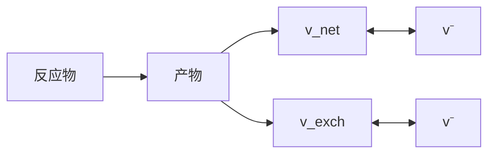
</details>

图6-10 可逆反应的正向和反向通量、净通量和交换通量

$$
v ^ {\mathrm{net}} = v ^ {\rightarrow} - v ^ {\leftarrow} \tag {6-30}
$$

$$
v ^ {\mathrm{exch}} = \min (v ^ {\rightarrow}, v ^ {\leftarrow})
$$

在代谢通量计算过程中，为了计算的方便，可逆反应的交换通量往往利用式6-31转换为一个数值在0到1之间的交换系数（ $v^{exch[0,1]}$ ）:

$$
v ^ {\mathrm{exch[0,1]}} = \frac {v ^ {\mathrm{exch}}}{1 + v ^ {\mathrm{exch}}} \tag {6-31}
$$

如果交换系数为0，则交换通量也为零，说明反应不可逆；如果交换系数为1，则交换通量无穷大，说明反应快速平衡。这样可逆反应也可以用净通量（ $v^{net}$ ）和交换系数（ $v^{exch[0,1]}$ ）来描述。

## 6.4.3 代谢通量计算

基于代谢物及其同位素标记异构体的平衡方程，可以建立代谢网络中同位素标记异构体分布的全局模型，进而计算网络中的代谢通量分布。首先，根据代谢网络中所有中间代谢物的平衡方程，确定自由净通量，即不能用代谢网络的反应计量学所提供的约束条件来确定的净通量，只有当这些净通量的数值被确定后，代谢物的平衡方程组才可解。此外，可逆反应的交换系数也不能通过代谢物的平衡方程来确定，因此和自由净通量一样都需要通过同位素标记异构体平衡方程所提供的其他约束条件来确定。

基于同位素标记异构体分布模型的代谢通量分析使用的是参数迭代拟合的方法，即根据代谢物及其同位素标记异构体的平衡方程，建立代谢通量和同位素标记异构体测量值之间的数学关系，这样代谢通量就可以利用非线性最小二乘拟合的方

---

6.4 基于同位素标记异构体分布模型的代谢网络通量分析

147

法来计算。具体步骤如下（图6-11）:首先，对自由净通量和交换系数赋予任意的初始值，求解代谢物平衡方程组，计算代谢网络中所有反应的净通量，根据式6-30和式6-31将各个反应的净通量和交换系数转换为正向和反向的通量；然后，利用迭代计算的方法求解同位素标记异构体平衡方程组，即从任意的同位素标记异构体分布初始值开始，根据式6-29迭代计算各个代谢物的同位素标记异构体分布，使得它们都收敛到各自的稳态值，计算获得所有代谢物的同位素标记异构体分布向量；模拟计算代谢物同位素标记异构体的NMR或者MS的测量值，例如通过GC-MS检测到的丙氨酸TBDMS衍生物（M-57）碎片包含丙氨酸C1、C2、C3三个碳原子，它的质量分布向量可以用丙氨酸的同位素标记异构体分布向量计算得到（式6-32）；通过NMR碳谱检测到的丙氨酸α碳原子的多重峰组分的相对丰度可以通过式6-33计算。


<details>
<summary>flowchart</summary>

```mermaid
graph TD
  A["&quot;选择自由流量(v_free^net, v_exch[0,1"])"] --> B["解代谢物平衡方程组\n计算所有反应的v_net"]
  B --> C["转换向量((v->, v^-))"]
  C --> D["解同位素标记异构体平衡方程组\n计算各中间代谢物的同位素标记异构体分布向量"]
  D --> E["模拟计算代谢物同位素标记异构体的NMR或MS测量值"]
  E --> F{"与实际测量值\n相差是否最小"}
  F -->|否| G["改变自由流量"]
  G --> B
  F -->|是| H["获得最佳自由流量"]
```
</details>

图6-11 基于代谢物同位素标记异构体数据计算细胞代谢通量分布

$$
M D V _ {\mathrm{Alal-3}} = \left[ \begin{array}{c c c c c c c c} 1 & 0 & 0 & 0 & 0 & 0 & 0 & 0 \\ 0 & 1 & 1 & 0 & 1 & 0 & 0 & 0 \\ 0 & 0 & 0 & 1 & 0 & 1 & 1 & 0 \\ 0 & 0 & 0 & 0 & 0 & 0 & 0 & 1 \end{array} \right] \cdot I _ {\mathrm{Ala}} \tag {6-32}
$$

---

148

6 基于 $^{13}$ C 同位素标记信息的代谢通量分析

$$
\left[ \begin{array}{c} S _ {\mathrm{CO} _ {2} -} ^ {\prime} \\ S _ {\mathrm{C} \alpha} ^ {\prime} \\ S _ {\mathrm{CH} _ {3}} ^ {\prime} \end{array} \right] = \left[ \begin{array}{c c c c c c c c} 0 & 0 & 0 & 0 & 1 & 1 & 0 & 0 \\ 0 & 0 & 1 & 0 & 0 & 0 & 0 & 0 \\ 0 & 1 & 0 & 0 & 0 & 1 & 0 & 0 \end{array} \right] \cdot I _ {\mathrm{Ala}}
$$

$$
\left[ \begin{array}{c} D 1 _ {\mathrm{CO} _ {3} -} ^ {\prime} \\ D 1 _ {\mathrm{C} \alpha} ^ {\prime} \\ D 1 _ {\mathrm{CH} _ {3}} ^ {\prime} \end{array} \right] = \left[ \begin{array}{c c c c c c c c} 0 & 0 & 0 & 0 & 0 & 0 & 0 & 0 \\ 0 & 0 & 0 & 1 & 0 & 0 & 0 & 0 \\ 0 & 0 & 0 & 1 & 0 & 0 & 0 & 1 \end{array} \right] \cdot I _ {\mathrm{Ala}}
$$

$$
\left[ \begin{array}{l} D 2 _ {\mathrm{CO} _ {2} -} ^ {\prime} \\ D 2 _ {\mathrm{C} \alpha} ^ {\prime} \\ D 2 _ {\mathrm{CH} _ {3}} ^ {\prime} \end{array} \right] = \left[ \begin{array}{c c c c c c c c} 0 & 0 & 0 & 0 & 0 & 0 & 1 & 1 \\ 0 & 0 & 0 & 0 & 0 & 0 & 1 & 0 \\ 0 & 0 & 0 & 0 & 0 & 0 & 0 & 0 \end{array} \right] \cdot I _ {\mathrm{Ala}} \tag {6-33}
$$

$$
\left[ \begin{array}{c} D D _ {\mathrm{CO} _ {2} -} ^ {\prime} \\ D D _ {\mathrm{C} \alpha} ^ {\prime} \\ D D _ {\mathrm{CH} _ {3}} ^ {\prime} \end{array} \right] = \left[ \begin{array}{c c c c c c c c} 0 & 0 & 0 & 0 & 0 & 0 & 0 & 0 \\ 0 & 0 & 0 & 0 & 0 & 0 & 0 & 1 \\ 0 & 0 & 0 & 0 & 0 & 0 & 0 & 0 \end{array} \right] \cdot I _ {\mathrm{Ala}}
$$

$$
S _ {\mathrm{C} \alpha} = \frac {S _ {\mathrm{C} \alpha} ^ {\prime}}{S _ {\mathrm{C} \alpha} ^ {\prime} + D 1 _ {\mathrm{C} \alpha} ^ {\prime} + D 2 _ {\mathrm{C} \alpha} ^ {\prime} + D D _ {\mathrm{C} \alpha} ^ {\prime}}
$$

最后，比较代谢物同位素标记异构体以及胞外通量的模拟计算值和实际测量值，利用非线性优化算法进行迭代计算、寻找最优的自由通量使得两者之间差别最小。最小化的目标函数根据实际需要可以有多种表示形式，式6-34是一类常用的最小化目标函数:

$$
F (v) = \sum_ {i = 1} ^ {N} \left(\frac {M _ {i} - S _ {i} (v)}{\delta_ {i}}\right) ^ {2} + \sum_ {j = 1} ^ {L} \left(\frac {E _ {j} - v _ {k}}{\delta_ {j}}\right) ^ {2} \tag {6-34}
$$

式中，v 是参数向量，包括所有反应的净通量和交换系数； $M_{i}$  代表第 i 个同位素标记异构体测量数据（共 N 个）， $S_{i}$  是对应的模拟计算值； $E_{j}$  是第 j 个胞外通量测量值（共 L 个）， $v_{k}$  是 v 中对应于  $E_{j}$  的胞外通量模拟计算值； $\delta_{i}$  和  $\delta_{j}$  分别是第 i 个代谢物同位素标记异构体和第 j 个胞外通量的标准差。为了确保获得的自由通量为全局最优，可以多次改变自由通量初始赋值进行反复计算，同时也可根据情况选用模拟退火算法、遗传算法等全局优化算法。此外，可以利用模型在最优通量处的线性近似，或者 Monte Carlo 仿真来计算通量结果的置信区间，用以分析代谢通量的统计学特点（Dauner et al. 2001, Schmidt et al. 1999）。

## 6.5 基于 $^{13}$ C 同位素标记信息代谢通量分析的应用

细胞内代谢反应通量反映了相关的代谢功能，因而能够被用来阐明复杂的细胞网络特性，这是单纯的蛋白质或代谢物浓度数据所难以做到的。细胞网络的复杂功能和行为只有通过代谢和调控等多个层面中基因、蛋白质以及代谢物的非线性相互作用才能最终实现，而代谢通量被认为反映了代谢网络内多个相互作用的最终结果，因此和系统生物学高度关联。迄今为止，代谢通量数据已经在辨别新型代谢反应或途径、完善代谢网络模型、验证代谢预测正确与否，以及阐明代谢系统特性和代谢设计原理上

---

6.5 基于 $^{13}$ C 同位素标记信息代谢通量分析的应用

149

得到了越来越广泛的应用。本节结合一些代表性实例对基于 $^{13}$ C 同位素标记信息的代谢通量分析的部分应用作简要介绍。

## 6.5.1 辨别代谢途径及细胞功能

目前为止，定量细胞内代谢通量主要是用于特定基因或环境条件改变情况下的代谢网络响应分析，而基于 $^{13}$ C同位素标记信息的代谢通量分析往往能够发现并确认一些其他方法难以获得的代谢反应或代谢途径信息。实例之一是野生型大肠杆菌在葡萄糖培养基上生长时，细胞内磷酸烯醇式丙酮酸羧化激酶（PPCK）所催化的草酰乙酸转变为磷酸烯醇式丙酮酸和二氧化碳反应的存在及其通量的确定（Yang et al. 2003）。大肠杆菌在未标记的葡萄糖合成培养基内恒化培养达到稳态后，以部分 $[U-^{13}C_{6}]$ 标记的葡萄糖替代原培养基中未标记葡萄糖并对细胞体来源的苯丙氨酸及天冬氨酸中碳标记情况进行二维NMR波谱分析（图6-12），结果清晰地表明了大肠杆菌野生株在葡萄糖上生长时PPCK所催化反应具有较明确的代谢活性。进一步通量计算的结果显示在细胞以较慢的速率稳态生长时（比如稀释率为 $0.1h^{-1}$ ），该反应所提供的PEP占所有PEP合成通量的四分之一以上。同时发现苹果酸酶（ME）催化的苹果酸氧化脱羧反应在低生长速率下也具有一定的活性，而上述两种反应的代谢作用都是原有研究方法所难以发现的，因而此前一般认为葡萄糖上生长的大肠杆菌中这两个反应是不激活的。


<details>
<summary>spectrogram</summary>

| Sample | Peak Assignment | Chemical Shift (ppm) |
| --- | --- | --- |
| E.coli野生株 | \(Asp-\alpha\) | ~49.5 |
| E.coli野生株 | \(Asp-\alpha\) | ~49.3 |
| E.coli野生株 | \(Asp-\alpha\) | ~49.1 |
| E.coli野生株 | \(Asp-\alpha\) | ~48.9 |
| E.coli野生株 | \(Asp-\alpha\) | ~49.7 |
| E.coli野生株 | \(Asp-\alpha\) | ~49.5 |
| E.coli野生株 | \(Asp-\alpha\) | ~49.3 |
| E.coli野生株 | \(Asp-\alpha\) | ~49.1 |
| E.coli野生株 | \(Asp-\alpha\) | ~48.9 |
| E.coli野生株 | \(Asp-\alpha\) | ~48.6 |
| E.coli野生株 | \(Asp-\alpha\) | ~48.4 |
| E.coli野生株 | \(Asp-\alpha\) | ~48.2 |
| E.coli野生株 | \(Asp-\alpha\) | ~48.0 |
| E.coli野生株 | \(Asp-\alpha\) | ~47.8 |
| E.coli野生株 | \(Asp-\alpha\) | ~47.6 |
| E.coli野生株 | \(Asp-\alpha\) | ~47.4 |
| E.coli野生株 | \(Asp-\alpha\) | ~47.2 |
| E.coli野生株 | \(Asp-\alpha\) | ~47.0 |
| E.coli野生株 | \(Asp-\alpha\) | ~46.8 |
| E.coli野生株 | \(Asp-\alpha\) | ~46.6 |
| E.coli野生株 | \(Asp-\alpha\) | ~46.4 |
| E.coli野生株 | \(Asp-\alpha\) | ~46.2 |
| E.coli野生株 | \(Asp-\alpha\) | ~46.0 |
| E.coli野生株 | \(Asp-\alpha\) | ~45.8 |
| E.coli野生株 | \(Asp-\alpha\) | ~45.6 |
| E.coli野生株 | \(Asp-\alpha\) | ~45.4 |
| E.coli野生株 | \(Asp-\alpha\) | ~45.2 |
| E.coli野生株 | \(Asp-\alpha\) | ~45.0 |
| E.coli野生株 | \(Asp-\alpha\) | ~44.8 |
| E.coli野生株 | \(Asp-\alpha\) | ~44.6 |
| E.coli野生株 | \(Asp-\alpha\) | ~44.4 |
| E.coli野生株 | \(Asp-\alpha\) | ~44.2 |
| E.coli野生株 | \(Asp-\alpha\) | ~44.0 |
| E.coli野生株 | \(Asp-\alpha\) | ~43.8 |
| E.coli野生株 | \(Asp-\alpha\) | ~43.6 |
| E.coli野生株 | \(Asp-\alpha\) | ~43.4 |
| E.coli野生株 | \(Asp-\alpha\) | ~43.2 |
| E.coli野生株 | \(Asp-\alpha\) | ~43.0 |
| E.coli野生株 | \(Asp-\alpha\) | ~42.8 |
| E.coli野生株 | \(Asp-\alpha\) | ~42.6 |
| E.coli野生株 | \(Asp-\alpha\) | ~42.4 |
| E.coli野生株 | \(Asp-\alpha\) | ~42.2 |
| E.coli野生株 | \(Asp-\alpha\) | ~42.0 |
| E.coli野生株 | \(Asp-\alpha\) | ~41.8 |
| E.coli野生株 | \(Asp-\alpha\) | ~41.6 |
| E.coli野生株 | \(Asp-\alpha\) | ~41.4 |
| E.coli野生株 | \(Asp-\alpha\) | ~41.2 |
| E.coli野生株 | \(Asp-\alpha\) | ~41.0 |
| E.coli野生株 | \(Asp-\alpha\) | ~40.8 |
| E.coli野生株 | \(Asp-\alpha\) | ~40.6 |
| E.coli野生株 | \(Asp-\alpha\) | ~40.4 |
| E.coli野生株 | \(Asp-\alpha\) | ~40.2 |
| E.coli野生株 | \(Asp-\alpha\) | ~40.0 |
| E.coli野生株 | \(Asp-\alpha\) | ~39.8 |
| E.coli野生株 | \(Asp-\alpha\) | ~39.6 |
| E.coli野生株 | \(Asp-\alpha\) | ~39.4 |
| E.coli野生株 | \(Asp-\alpha\) | ~39.2 |
| E.coli野生株 | \(Asp-\alpha\) | ~39.0 |
| E.coli野生株 | \(Asp-\alpha\) | ~38.8 |
| E.coli野生株 | \(Asp-\alpha\) | ~38.6 |
</details>

图6-12 大肠杆菌野生株以及磷酸烯醇式丙酮酸羧化激酶缺失株在恒化培养条件下（$0.1\mathrm{h}^{-1}$）部分氨基酸碳原子的NMR波谱

（a）天冬氨酸  $\alpha$  碳原子；（b）苯丙氨酸  $\alpha$  碳原子。（b）图中虚线圈内峰形的有无能够定性地表征磷酸烯醇式丙酮酸羧化激酶催化活性的有无，该酶反应的实际代谢贡献可计算获得

---

150

6 基于 $^{13}$ C 同位素标记信息的代谢通量分析

基于 $^{13}$ C 同位素标记信息的代谢通量分析在辨别新的细胞代谢途径和生理功能上有较多成功的应用。Sauer 等（2004）借助该法很好地发现了大肠杆菌中两种转氢酶在辅酶转换上的作用。当大肠杆菌在葡萄糖上进行标准的好氧生长时，除了戊糖磷酸途径及异柠檬酸脱氢酶反应各自提供了部分生物合成所需的 NADPH 以外，研究表明转氢酶 PntAB 催化的 NADH 到 NADPH 的转变也提供了 35%\~45% 细胞生长所需还原力 NADPH。基于代谢通量的研究同时发现，当大肠杆菌生长在 NADPH 过量的环境中时（比如以乙酸为碳源进行生长），另一种能量非依赖型的转氢酶 UdhA 则能很好地催化 NADPH 的再氧化。其他应用实例包括基于葡萄糖的 $^{13}$ C 标记和代谢通量分布计算，在多数微生物中（如根癌农杆菌、类球红细菌、运动发酵单胞菌等）中确定了 Entner-Doudoroff 途径是葡萄糖分解代谢的唯一途径（Fuhrer et al. 2005）；利用 $^{13}$ C 标记的乙酸作为碳源，在金属还原地杆菌中辨别出了一类以乙酰辅酶 A 和丙酮酸作为前体物质的不常见的异亮氨酸生物合成途径（Tang et al. 2007）。而笔者等也在研究磷酸葡萄糖异构酶缺失的大肠杆菌时发现，无论是处于碳源限制还是氮源限制，NMR 波谱和代谢通量比率计算都明确表明了 pgi 敲除菌中乙醛酸支路（图 6-13）和 Entner-Doudoroff 途径得到了激活（前者提供了 20%\~30% 的草酰乙酸合成通量，后者则在丙酮酸合成中贡献了 6%\~11% 的通量），而当大肠杆菌野生株生长在葡萄糖培养基中时，这两个途径并没有活性（图 6-14）（Hua et al. 2003）。同样，磷酸烯醇式丙酮酸羧化激酶的缺失也使乙醛酸支路得到了激活，该支路在 PPCK 缺失株中也提供


图6-13 大肠杆菌野生株以及磷酸葡萄糖异构酶缺失株在恒化

培养条件下（葡萄糖限制， $0.1\ h^{-1}$ ）部分氨基酸碳原子的 NMR 波谱

（a）天冬氨酸  $\alpha$  碳原子；（b）天冬氨酸  $\beta$  碳原子。图中虚线圈内峰形的大小能够定性地表征乙醛酸支路的活性大小，该支路的实际大小贡献可计算获得

---

6.5 基于 $^{13}$ C 同位素标记信息代谢通量分析的应用

151

了近20%合成草酰乙酸的通量（Yang et al. 2003）。此外，笔者通过稳定同位素标记实验，以及GC-MS的测量分析，识别了丙酮丁醇梭菌木糖代谢的通路，并且定量解析了各个途径的代谢通量。结果发现了磷酸解酮酶途径的存在，高达40%的木糖分子通过这条途径被分解代谢，而且磷酸解酮酶途径和磷酸戊糖途径的分配比例随着培养基中木糖浓度的不同而发生很大变化（图6-15）。这是首次在梭菌中发现磷酸解酮酶途径的活性。我们纯化了丙酮丁醇梭菌中CAC1343基因所编码的蛋白，证实了它具有5-磷酸木酮糖磷酸解酮酶活性。在丙酮丁醇梭菌中过量表达该酶造成指数生长阶段木糖消耗速率略有增加，以及乙酸的大量积累（Liu et al. 2012）。上面提及的代谢途径一般既存于细胞代谢中，它们或者在正常情况下不被激活，或者用常规的方法不易发现其代谢作用，而基于稳定同位素标记的代谢通量计算能够较好地与其他方法互补，从而有利于深入发现和挖掘一些代谢途径的功能。

(a) 葡萄糖


<details>
<summary>flowchart</summary>

This diagram illustrates a biological signaling pathway involving enzymes (G6P, F6P, T3P, PEP, PYR, ACoA) and their interactions with receptors (6PG, 9, E4P, S7P), mediated by various metabolites such as NADPH, NADH, MAL, ICT, AKG, and SUC.
</details>

(b) 葡萄糖


<details>
<summary>flowchart</summary>

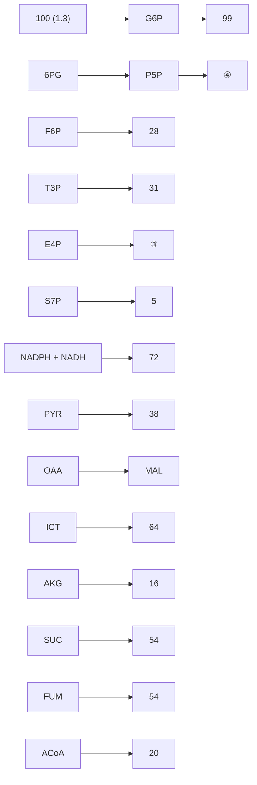
</details>

图6-14 大肠杆菌野生株（a）以及磷酸葡萄糖异构酶缺失株（b）在恒化培养条件下（葡萄糖限制， $0.1\mathrm{h}^{-1}$ ）细胞内代谢通量分布情况（Hua et al. 2003）

图中显示的是相对于各自比葡萄糖消耗速率的相对代谢通量

## 6.5.2 阐明代谢网络结构及调控特性

基于 $^{13}$ C 同位素标记信息的代谢通量分析除了能够用于辨别新的代谢反应和功能之外，还能很好地用于定量阐明代谢网络的结构和调控特性，这些特性对于理解和改造细胞性能很重要，但却往往难以通过各个酶的信息等来简单获得，必须对代谢网络中各个生物化学反应的相互关系进行综合研究。

Fischer 等研究者（Fischer and Sauer，2005）利用 $^{13}$ C 同位素标记实验对 137 株枯草芽胞杆菌基因缺失菌株进行了大规模的代谢通量响应分析，发现了该菌中心代谢网

---

152

6 基于 $^{13}$ C 同位素标记信息的代谢通量分析


图6-15 基于 ${}^{13}\mathrm{C}$ 标记木糖的丙酮丁醇梭菌代谢通量分析及其磷酸解酮酶途径的发现（Liu et al. 2012）

络具有一套刚性控制结构，该结构中大多数代谢物节点周边的代谢通量相对变化不大，只有乙酰辅酶A是唯一易变动的代谢节点，通过它周边通量的再分配即能很好地为细胞网络提供必需的代谢灵活性。因此，即便在多种基因扰动的情况下，该代谢网络仍能够相对稳定地为细胞提供各种必需的物质和能量流。类似地，Blank等（2005）借助 $^{13}$ C标记实验及代谢通量比率推导系统地分析了38个代谢基因单敲除的酿酒酵母菌株细胞内的代谢通量，阐明了大多数菌株的代谢缺陷会通过代谢路径的通量改变来弥补，而 $adh1^{-}$ ， $mdh1^{-}$ ，以及 $zwf1^{-}$ 等一些辅因子依赖型反应的缺失则会引起代谢网络内的稍远部位通量的明显改变。笔者研究了敲除紫色非硫细菌Rhodobacter sphaeroides聚羟基丁酸合成酶基因（ $\Delta phbC$ ），或者吸氢酶基因（ $\Delta hupSL$ 、 $\Delta hupSL\Delta phbC$ ）对于胞内代谢通量分布的影响（图6-16），在此基础上分析还原力NADH的合成和消耗，解析电子流向的变化。研究发现与野生型菌株相比，在产氢效率大幅提高的吸氢酶缺失菌中代谢通量分布发生了显著的改变:Entner-Doudoroff途径对葡萄糖代谢的贡献增加，三羧酸循环的通量也大幅提高，这些代谢途径活性的改变使得NADH的合成大大增加（Tao et al. 2012）。该研究提高了我们对于光合细菌胞内氧化还原平衡及其对产氢影响的认识。油脂微生物是近年来研究的热点，笔者等同样借助 $^{13}$ C标记信息研究了氮源浓度对油脂酵母之一的皮状丝孢酵母细胞内代谢通量分布的影响，在此基础上解析了油脂酵母过量积累油脂的代谢调控机制（Liu et al. 2013）。结果发现与高氮源浓度情况相比，菌体在低氮源浓度下胞内代谢通量发生了明显变化，并得到了细胞液中的苹果酸酶催化的反应提供了该菌株油脂过量积累所需的NADPH，柠檬酸-丙酮酸循环在提供油脂合成前体——乙酰辅酶A的过程中起了关键作用（图6-17）。该研究加深了我们对该油脂酵母代谢特性的认识，为进一步

---

6.5 基于 $^{13}$ C 同位素标记信息代谢通量分析的应用

153

提高油脂含量提供了指导。在另一项研究中，笔者等运用代谢通量分析方法解析了产琥珀酸大肠杆菌细胞内的代谢调控，为进一步认识并提高琥珀酸的生产提供了重要的信息（Liu et al. 2012）。


图6-16 类球红细菌野生型、$\Delta phbC$（a）及 $\Delta hupSL$、$\Delta hupSL\Delta phbC$（b）突变株的胞内代谢通量分布（Tao et al. 2012）


<details>
<summary>flowchart</summary>

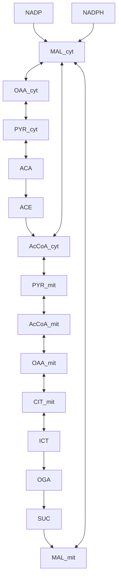
</details>

图6-17 皮状丝孢酵母过量积累油脂过程中的代谢调控机制发现（Liu et al. 2013）

---

154

6 基于 $^{13}$ C 同位素标记信息的代谢通量分析

基于 $^{13}$ C 标记信息的代谢通量数据同样能够较好地用于阐明细胞内的转录调控作用，研究实例之一是利用代谢通量解析若干全局调控基因在葡萄糖分解代谢中所起的作用（Perrenoud and Sauer，2005）。研究发现缺氧型氧化还原控制（Arc）双组分系统中的响应调节子 ArcA 蛋白在一定条件下对好氧以及完全厌氧的三羧酸循环通量具有明显的控制作用，而在这之前普遍认为 Arc 只在微好氧情况下起调控作用。笔者等研究了转录调节因子 iclR 基因在大肠杆菌生理和代谢中的作用。通过代谢途径的通量比率分析我们发现该基因缺失株中乙醛酸支路得到了激活，33% 的异柠檬酸流经了乙醛酸支路，戊糖磷酸途径的通量变小（柳志杰等，2012）。这些基于同位素标记得到的通量信息所揭示的调控特征对于进一步深入阐明细胞网络的代谢调控规律和相关机制具有重要的指导意义。

## 6.6 大肠杆菌代谢通量的计算举例

为了帮助读者更好地掌握基于 $^{13}$ C稳定同位素标记信息的代谢通量分析方法，本节以大肠杆菌细胞内通量计算和解析为例，详细介绍基于代谢通量比率的分析方法。读者可同时结合其他参考资料（柳志杰等，2012）深入理解并推导。

## 6.6.1 大肠杆菌生长期相关生理学参数的测定及计算

（1）菌体比生长速率  $\mu, h^{-1}$  。对于恒化培养，菌体比生长速率等于稀释率 D；对于非恒化培养，菌体比生长速率计算方法为式 6-35，式中 X 为菌体干重， $g \cdot L^{-1}$  。

$$
\mu = \frac {1}{X} \cdot \frac {\mathrm{d} X}{\mathrm{d} t} \tag {6-35}
$$

积分得

$$
\mu = \frac {\ln X}{t} \tag {6-36}
$$

将 X 对时间 t 在半对数坐标上作图并以直线拟合，其斜率即为菌体比生长速率  $\mu$ 。

(2) 底物比消耗速率  $r_{s}$ ，mmol·g $^{-1}$ (DCW)·h $^{-1}$ :

$$
r _ {s} = \frac {1}{X} \cdot \frac {\mathrm{d} S}{\mathrm{d} t} = \frac {1}{X} \cdot \frac {\mathrm{d} X}{\mathrm{d} t} \cdot \frac {\mathrm{d} S}{\mathrm{d} X} = \mu \cdot \frac {\mathrm{d} S}{\mathrm{d} X} \tag {6-37}
$$

式中，S 为底物浓度（mmol·L $^{-1}$ ）。将底物浓度 S 对菌体干重 X 作图并以直线拟合，其斜率再乘以比生长速率  $\mu$  即可得到底物的比消耗速率  $q_{s}$ 。

(3) 产物比生成速率  $r_{p}$ ，mmol·g $^{-1}$ (DCW)·h $^{-1}$ :

$$
r _ {s} = \frac {1}{X} \cdot \frac {\mathrm{d} P}{\mathrm{d} t} = \frac {1}{X} \cdot \frac {\mathrm{d} X}{\mathrm{d} t} \cdot \frac {\mathrm{d} P}{\mathrm{d} X} = \mu \cdot \frac {\mathrm{d} P}{\mathrm{d} X} \tag {6-38}
$$

同上将产物浓度 P 对菌体干重 X 作图并以直线拟合，其斜率再乘以比生长速率  $\mu$  即可得到产物的比生成速率  $q_{p}$ 。

基于上面计算方法，可以得到如表6-6所示的大肠杆菌指数生长期的相关生理学参数。

---

6.6 大肠杆菌代谢通量的计算举例

155

表6-6 大肠杆菌指数生长期的生长特性

| 菌株 | $\mu_{\text{max}}/\text{h}^{-1}$ | $r_{\text{葡萄糖}}/(\text{mmol}\cdot\text{g}^{-1}(\text{DCW})\cdot\text{h}^{-1})$ | $r_{\text{乙酸}}/(\text{mmol}\cdot\text{g}^{-1}(\text{DCW})\cdot\text{h}^{-1})$ | 乙酸得率(mmol/mmol 葡萄糖) | 生物量得率(g/g 葡萄糖) |
| --- | --- | --- | --- | --- | --- |
| BW25113 | 0.61 ± 0.01 | 9.41 ± 0.04 | 3.85 ± 0.01 | 0.41 ± 0.01 | 0.35 ± 0.02 |

## 6.6.2 大肠杆菌代谢模型的建立

为了计算菌体细胞体内的代谢通量，根据大肠杆菌主要中心代谢途径建立其代谢网络模型（图6-18、表6-7），包括29步代谢反应和24个代谢物，该情况下的代谢模型为未定系统。为了使模型可解，可以利用实验测得的代谢物同位素标记异构体分布信息来分析代谢途径的通量比率，进而结合细胞网络中代谢物的平衡式可进行代谢网络反应通量的定量化分析。


<details>
<summary>flowchart</summary>

This flowchart illustrates the metabolic pathways of glucose metabolism, including glucose desorption, endogenous (ED) pathways, and metabolic processes involving enzymes like CO2, PEP, PYR, ACA, OAA, ICT, MAL, SUC, AKG, and 三羧酸循环.
</details>

图6-18 大肠杆菌中心代谢反应网络（其中粗箭头表示形成菌体的通量）

---

156

6 基于 $^{13}$ C 同位素标记信息的代谢通量分析

表6-7 大肠杆菌中心代谢网络化学计量反应式

<table><tr><td colspan="2">反应式</td></tr><tr><td> $v_1$ </td><td>GLC + PEP → G6P + PYR</td></tr><tr><td> $v_2$ </td><td>G6P + NADP → 6PG + NADPH</td></tr><tr><td> $v_3$ </td><td>6PG + NADP → P5P + NADPH + CO2</td></tr><tr><td> $v_4$ </td><td>G6P ← F6P</td></tr><tr><td> $v_5$ </td><td>F6P + ATP → DHAP + GAP + ADP</td></tr><tr><td> $v_6$ </td><td>DHAP ← GAP</td></tr><tr><td> $v_7$ </td><td>P5P + P5P ← S7P + GAP</td></tr><tr><td> $v_8$ </td><td>S7P + GAP ← F6P + E4P</td></tr><tr><td> $v_9$ </td><td>P5P + E4P ← F6P + GAP</td></tr><tr><td> $v_{10}$ </td><td>GAP + NAD + ADP + Pi ← 3PG + NADH + ATP</td></tr><tr><td> $v_{11}$ </td><td>3PG ← PEP</td></tr><tr><td> $v_{12}$ </td><td>PEP + ADP → PYR + ATP</td></tr><tr><td> $v_{13}$ </td><td>PYR + CoA + NAD → ACA + NADH + CO2</td></tr><tr><td> $v_{14}$ </td><td>OAA + ACA → ICT + CoA</td></tr><tr><td> $v_{15}$ </td><td>ICT + NADP → AKG + NADPH + CO2</td></tr><tr><td> $v_{16}$ </td><td>AKG + NAD + GDP + Pi → SUC + NADH + GTP + CO2</td></tr><tr><td> $v_{17}$ </td><td>SUC + FAD (NAD) → MAL + FADH2 (NADH)</td></tr><tr><td> $v_{18}$ </td><td>MAL + NAD ← OAA + NADH</td></tr><tr><td> $v_{19}$ </td><td>MAL + NAD (P) → PYR + NAD (P) H + CO2</td></tr><tr><td> $v_{20}$ </td><td>OAA + ATP → PEP + ADP + CO2</td></tr><tr><td> $v_{21}$ </td><td>PEP + CO2 → OAA + Pi</td></tr><tr><td> $v_{22}$ </td><td>6PG → PYR + GAP</td></tr><tr><td> $v_{23}$ </td><td>ICT + ACA → SUC + MAL + CoA</td></tr><tr><td> $v_{24}$ </td><td>前体物 → 生物量</td></tr><tr><td> $v_{25}$ </td><td>ACA + ADP + Pi → ACE + ATP + CoA</td></tr><tr><td> $v_{26}$ </td><td>PYR + NADH → D_LAC + NAD</td></tr><tr><td> $v_{27}$ </td><td>DHAP → GLYCEROL</td></tr><tr><td> $v_{28}$ </td><td>ACA + ADP + Pi + 2 NADH → ETH + ATP + 2 NAD + CoA</td></tr><tr><td> $v_{29}$ </td><td>PYR + CoA → ACA + FOR</td></tr></table>

表中缩写:G6P:6-磷酸葡萄糖；6PG:6-磷酸葡糖酸；P5P:5-磷酸戊糖；F6P:6-磷酸果糖；E4P:4-磷酸赤藓糖；GAP:3-磷酸甘油醛；Glc:葡萄糖；S7P:7-磷酸景天庚糖；3PG:3-磷酸甘油酸；PEP:磷酸烯醇式丙酮酸；PYR:丙酮酸；ACA:乙酰辅酶A；ICT:异柠檬酸；AKG:α-酮戊二酸；SUC:琥珀酸；MAL:苹果酸；OAA:草酰乙酸；GOX:乙醛酸；FOR:甲酸盐。

## 6.6.3 代谢通量比率的计算

水解得到的氨基酸经过叔丁基二甲基硅烷化合物（TBDMS）衍生化处理，所得到的氨基酸衍生物能够在气相色谱上得到很好的分离，在其后的质谱仪中，衍生化的氨基酸在电子轰击离子化作用下断裂成带有不同碳原子骨架片段的氨基酸碎片，并且

---

6.6 大肠杆菌代谢通量的计算举例

157

这些碎片根据荷质比的不同而得到分离。

对于质谱得到的每个带有不同碳原子骨架片段的氨基酸碎片，其质量分布向量MDV可以根据公式（2）至公式（5）获得并校正。GC-MS分析得到的部分TBDMS衍生化蛋白氨基酸的同位素标记异构体质量分布见表6-8。

表 6-8 大肠杆菌原始菌 TBDMS 衍生化蛋白氨基酸的同位素标记异构体质量分布（已校正）

| $Fragment^a$ | $m_0$ | $m_1$ | $m_2$ | $m_3$ | $m_4$ | $m_5$ | $m_6$ | $m_7$ | $m_8$ | $m_9$ | $Experiment^b$ |
| --- | --- | --- | --- | --- | --- | --- | --- | --- | --- | --- | --- |
| MS_ala_085 | 0.7863 | 0.0295 | 0.1841 |  |  |  |  |  |  |  | U |
| MS_glu_085 | 0.6038 | 0.1154 | 0.2331 | 0.0318 | 0.0159 |  |  |  |  |  | U |
| MS_phe_057 | 0.4168 | 0.1074 | 0.1239 | 0.1630 | 0.0978 | 0.0378 | 0.0285 | 0.0168 | 0.0040 | 0.0039 | U |
| MS_phe_085 | 0.4228 | 0.1068 | 0.2148 | 0.0940 | 0.0933 | 0.0325 | 0.0288 | 0.0037 | 0.0032 |  | U |
| MS_phe_302 | 0.7862 | 0.0488 | 0.1649 |  |  |  |  |  |  |  | U |
| MS_pro_085 | 0.5757 | 0.1234 | 0.2488 | 0.0241 | 0.0279 |  |  |  |  |  | U |
| MS_ser_085 | 0.7593 | 0.1042 | 0.1365 |  |  |  |  |  |  |  | U |
| MS_ser_302 | 0.7853 | 0.0491 | 0.1656 |  |  |  |  |  |  |  | U |
| MS_thr_057 | 0.6211 | 0.1578 | 0.0964 | 0.1004 | 0.0243 |  |  |  |  |  | U |
| MS_ala_057 | 0.8935 | 0.1021 | 0.0041 | 0.0003 |  |  |  |  |  |  | U |
| MS_phe_057 | 0.7682 | 0.2073 | 0.0184 | 0.0056 | 0.0003 | 0.0000 | 0.0001 | 0.0001 | 0.0000 | 0.0000 | 1 |
| MS_phe_085 | 0.7802 | 0.1916 | 0.0229 | 0.0034 | 0.0007 | 0.0011 | 0.0000 | 0.0000 | 0.0000 |  | 1 |
| MS_ser_057 | 0.9024 | 0.0924 | 0.0052 | 0.0000 |  |  |  |  |  |  | 1 |

Fragments $^{a}$ :表示 TBDMS 衍生的蛋白氨基酸片段: $(M-57)^{+}$ ， $(M-85)^{+}$ ， $(f302)^{+}$ 。

Experiment $^{b}$ :U，20%  $[U-^{13}C]$ -葡萄糖和80%未标记葡萄糖的混合物；1，20%  $[1-^{13}C]$ -葡萄糖和80%未标记葡萄糖的混合物。

大肠杆菌中基于标记葡萄糖实验的典型代谢通量比率推导详见式6-14至式6-17及柳志杰等（2012）的式（3）至式（5），其结果见图6-19。所得到的代谢通量比率同时可通过表6-9中的公式和稳态代谢反应速率进行关联并构成通量计算的重要约束条件（包括4个独立的等式和4个不等式约束）（Fischer et al. 2004）。

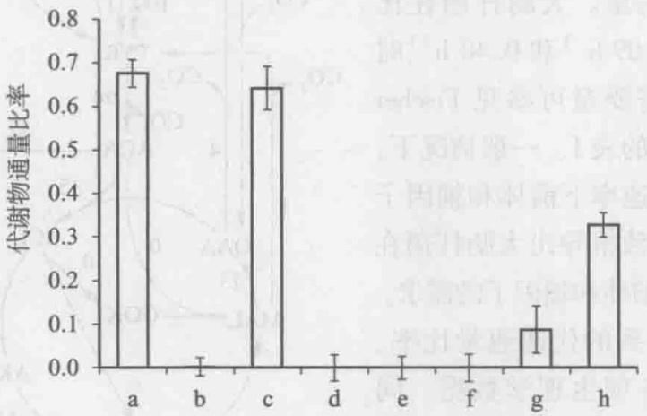

<details>
<summary>bar</summary>

| Category | 代谢物通量比率 |
| --- | --- |
| a | ~0.68 |
| b | 0.0 |
| c | ~0.64 |
| d | 0.0 |
| e | 0.0 |
| f | 0.0 |
| g | ~0.09 |
| h | ~0.33 |
</details>

图6-19 大肠杆菌中部分代谢通量比率值

a:f\_PEP\_from\_glycolysis;b:f\_Pyr\_from\_ED;c:f\_OAA\_from\_PEP;d:f\_PEP\_from\_OAA;e:f\_Pyr\_from\_Mal\_ub;
f:f\_Pyr\_from\_Mal\_lb;g:f\_OAA\_from\_glyoxylate\_ub;h:f\_PEP\_from\_PP\_ub;lb:lower bound;ub:upper bound

---

158

6 基于 $^{13}$ C 同位素标记信息的代谢通量分析

表 6-9 用于大肠杆菌在葡萄糖上好氧生长时 ${}^{13}\mathrm{C}$ 限定型通量分析的通量比率约束公式

| 通量比率 | 公式 |
| --- | --- |
| 来自糖酵解途径的丝氨酸 | $\frac{2(v_5 - v_8 - v_9)}{2v_5 + v_7 + v_9 + v_{22}}$ |
| 来自ED途径的丙酮酸 | $\frac{v_{22}}{v_1 + v_{12} + v_{19} + v_{22}}$ |
| 来自磷酸烯醇式丙酮酸的草酰乙酸 | $\frac{v_{21}}{v_{18} + v_{21}}$ |
| 来自草酰乙酸的磷酸烯醇式丙酮酸 | $\frac{v_{20}}{v_{11} + v_{20}}$ |
| 来自马来酸的丙酮酸(ub, lb)* | $\frac{v_{19}}{v_1 + v_{12} + v_{19} + v_{22}}$ |
| 来自乙醛酸循环的草酰乙酸(ub) | $\frac{v_{23}}{v_{17} - v_{19} + v_{21} + v_{23}}$ |
| 来自PP途径的磷酸烯醇式丙酮酸(ub) | $\frac{v_7 + 2v_8 + 3v_9}{2v_6 + v_7 + v_9 + v_{20} + v_{22}}$ |

\*ub，上限；lb，下限。

## 6.6.4 大肠杆菌净通量的计算

在得到细胞外物质代谢数据和代谢通量比率数值后，代谢通量的计算还需要知道在特定比生长速率下用于菌体形成的中心代谢途径代谢物的量。通过测定细胞菌体组成（蛋白质、糖类、脂质、DNA、RNA等）可以计算得到细胞在特定的比生长速率下需要的前体和辅因子的量。大肠杆菌在比生长速率分别为 $0.09\ h^{-1}$ 和 $0.40\ h^{-1}$ 时前体和辅因子的需要量可参见Fischer等（2004）文献中的表1。一般情况下，通过这两种比生长速率下前体和辅因子的需要量，可以大致推导出大肠杆菌在其他比生长速率下前体和辅因子的需求。

这样，根据得到的代谢通量比率、细胞生长代谢的各项生理学数据、同时结合代谢网络的化学计量模型，即可计算出大肠杆菌代谢稳态时细胞内的代谢反应净通量，以用于各种情况的细胞代谢网络解析（图6-20）。

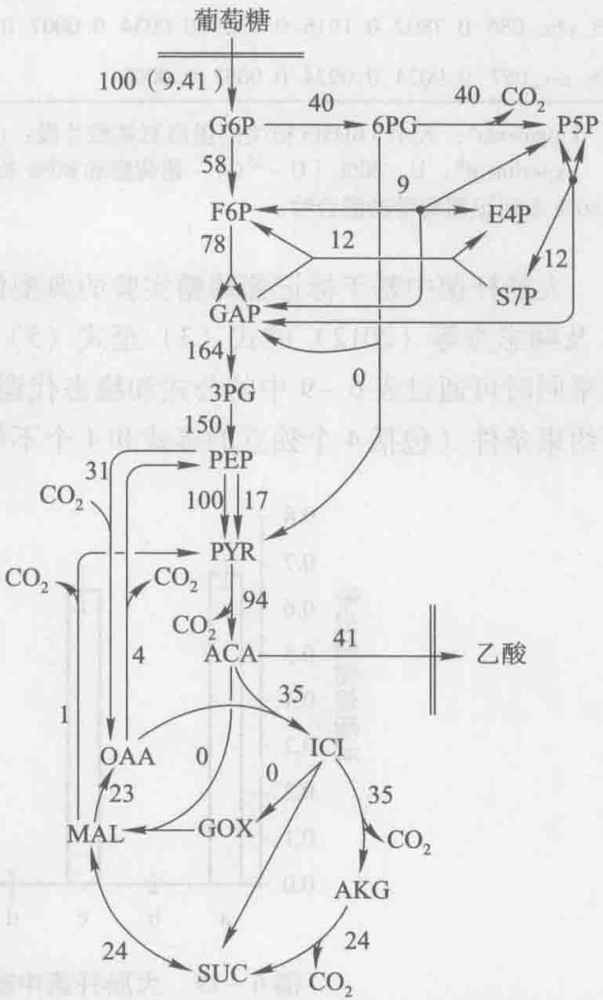

<details>
<summary>flowchart</summary>

```mermaid
graph TD
  A["葡萄糖"] --> B["100 (9.41)"]
  B --> C["G6P"]
  C --> D["40"]
  D --> E["6PG"]
  E --> F["40"]
  F --> G["CO2"]
  G --> H["P5P"]
  H --> I["F6P"]
  I --> J["12"]
  J --> K["E4P"]
  K --> L["S7P"]
  L --> M["GAP"]
  M --> N["164"]
  N --> O["3PG"]
  O --> P["150"]
  P --> Q["PEP"]
  Q --> R["100"]
  R --> S["17"]
  S --> T["PYR"]
  T --> U["4"]
  U --> V["CO2"]
  V --> W["31"]
  W --> X["OAA"]
  X --> Y["MAL"]
  Y --> Z["GOX"]
  Z --> AA["SUC"]
  AA --> AB["SUC"]
  AB --> AC["ACA"]
  AC --> AD["41"]
  AD --> AE["乙酸"]
  AE --> AF["ICI"]
  AF --> AG["35"]
  AG --> AH["CO2"]
  AH --> AI["AKG"]
  AI --> AJ["CO2"]
```
</details>

图6-20 大肠杆菌的稳态代谢通量分布结果数值表示计算得到的净通量，其值以葡萄糖比消耗速率（$\mathrm{mmol} \cdot \mathrm{g}^{-1}(\mathrm{DCW}) \cdot \mathrm{h}^{-1}$）为基准

---

推荐阅读

159

## ? 思考题

1. 对某个代谢节点处代谢通量比率进行分析时，需要哪些实验及计算步骤？
2. 简述 $^{13}$ C代谢通量分析技术在系统生物学和代谢工程研究中的作用。


## 推荐阅读

1. Fischer E, Sauer U. Large-scale in vivo flux analysis shows rigidity and suboptimal performance of Bacillus subtilis metabolism. Nature Genetics, 2005, 37: 636–640.
通过代谢通量分析，揭示生物代谢网络的刚性和鲁棒性。
2. Zamboni N, Fendt S M, Ruhl M, Sauer U.  ${}^{13}$ C-based metabolic flux analysis. Nature Protocols, 2009, 4: 878–892.
以 E. coli 为例，介绍  ${}^{13}$ C 代谢通量分析实验及其通量分析方法。
3. 花强，杨琛.代谢流量比率分析及其在代谢工程中的应用.生物工程学报，2009，25(9):1303-1311.

介绍并讨论了利用代谢物同位素分布信息分析关键代谢节点合成途径的流量比率、基于流量比率的代谢流量解析，以及应用于代谢工程等的相关原理、实验测量、数据分析、使用条件等。
