# 7 基因组学与基因组尺度代谢网络模型

原始 PDF 第 180–209 页。

## 7

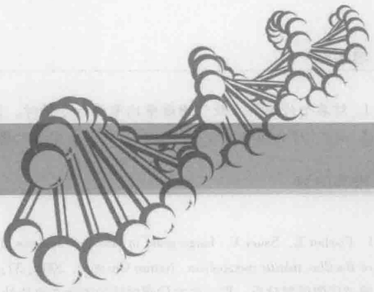

<details>
<summary>natural_image</summary>

Abstract illustration of interconnected nodes forming a chain-like structure (no text or symbols)
</details>

# 基因组学与基因组尺度 代谢网络模型

## 【本章学习要点】

1. 基因组学与基因组尺度代谢网络模型的研究内容
2. 基因组尺度代谢网络模型的重构过程
3. 基因组尺度代谢网络模型重构及分析的常用算法
4. 基因组尺度代谢网络模型的应用

本章介绍基因组学与基因组尺度代谢网络模型的研究内容，包括基因组尺度代谢网络模型重构过程中基因组尺度代谢网络数据库的建立、数学模型的建立、模拟运算方法、基因组尺度代谢网络模型在基因敲除研究、发现药物靶点，以及指导菌体改进和代谢工程方面的应用。重点对通量平衡分析算法，以及利用COBRA工具包进行分析和模拟进行了详细阐述。随着以基因组测序为代表的大规模数据产出，传统的生物学研究方式正在发生改变，在基因组测序和注释所获得的海量数据基础上，基因组尺度的代谢网络重构迅速发展起来。基因组尺度代谢网络已经成为研究生物代谢系统不可缺少的工具，无论在生物体以及生命活动的理论研究上，还是在指导代谢工程进行工程菌改造上，都具有非常重要的理论和实践意义。

---

7.1 基因组学

161


## 知识导图

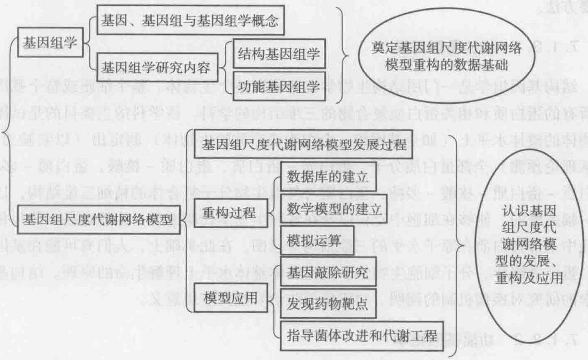

<details>
<summary>flowchart</summary>

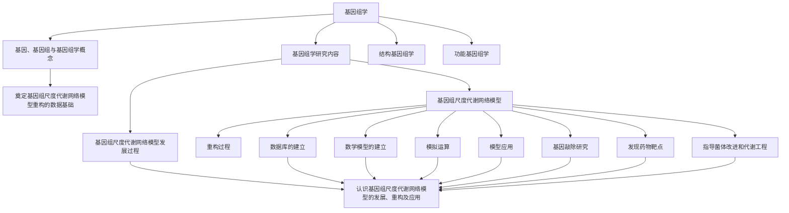
</details>

## 7.1 基因组学

## 7.1.1 基因、基因组与基因组学

基因（gene）:基因一词是1909年由丹麦植物学家Johannsen根据希腊文单词genos创造的。现代分子生物学认为基因是遗传的基本物理和功能单位，其是一段位于特定染色体上特定位点的有序核苷酸序列，编码一个具有特定功能的产物（即蛋白质或RNA分子）。

基因组（genome）:基因组这个词是由德国汉堡大学教授 Winkler 在 1920 年首先使用的，其是将基因（GENes）和染色体（chromosOMEs）这两个词各删去一部分，再组合起来而造成的。基因组是指一个生物体的全套基因和染色体。一般说来，基因组项目主要包括三部分:DNA 测序、序列组装、序列注释与分析。

基因组学（genomics）:基因组学是研究生物基因组和如何利用基因的一门学科，是包括对基因组所有基因进行作图、核苷酸序列分析、基因定位和基因功能分析的一门学科。1986年，美国科学家Roderick首先提出了基因组学的概念，但基因组学的研究是通过人类基因组项目的发展而得到迅速发展的。

## 7.1.2 基因组学研究内容

基因组学包括两个方面的研究内容:以蛋白质及其相关复合物结构测定为目标的

---

162

7 基因组学与基因组尺度代谢网络模型

结构基因组学（structural genomics）和以基因功能鉴定为目标的功能基因组学（functional genomics），后者又被称为后基因组学（post-genomics）研究，是系统生物学的重要方法。

## 7.1.2.1 结构基因组学

结构基因组学是一门用结构生物学方法研究整个生物体、整个细胞或整个基因组中所有的蛋白质和相关蛋白质复合物的三维结构的学科。该学科的主要目的是试图在生物体的整体水平上（如全基因组、全细胞或完整的生物体）测定出（以实验为主、包括理论预测）全部蛋白质分子、蛋白质-蛋白质、蛋白质-核酸、蛋白质-多糖、蛋白质-蛋白质-核酸-多糖、蛋白质与其他生物分子复合体的精细三维结构，以获得一幅完整的、能够在细胞中定位以及在各种生物学代谢途径、生理途径、信号传导途径中全部蛋白质在原子水平的三维结构全息图。在此基础上，人们有可能在基因组学、蛋白质组学、分子细胞生物学以至生物体整体水平上理解生命的原理。结构基因组学的研究对疾病机制的阐明、对疾病的防治有重要应用意义。

## 7.1.2.2 功能基因组学

基因组 DNA 测序是人类对基因组认识的第一步。随着测序的完成，功能基因组学研究成为研究的主流，它从基因组信息与外界环境相互作用的高度，阐明基因组的功能。功能基因组学的主要研究内容包括:基因组信息的识别和鉴定、基因功能信息的提取和鉴定、基因组表达调控的研究、测序和基因多样性分析等。

（1）基因组信息的识别和鉴定:要提取基因组功能信息，识别和鉴定基因序列是必不可少的基础工作。基因识别需采用生物信息学、计算生物学技术和生物学实验手段，并将理论方法和实验结合起来。基于理论的方法主要从已经掌握的大量核酸序列数据入手，发展序列比较、基因组比较及基因预测理论方法。识别基因的生物学手段主要基于以下的原理和思路:根据可表达序列标签（STS）；对染色体特异性cos-mid进行直接的cDNA选择；根据CpG岛；差异显示及相关原理；外显子捕获及相关原理；基因芯片技术；基因组扫描；突变检测体系，等等。
（2）基因功能信息的提取和鉴定:包括基因突变体的系统鉴定；基因表达谱的绘制；“基因改变-功能改变”的鉴定；蛋白质水平、修饰状态和相互作用的检测。
(3) 基因组表达调控的研究: 在全细胞的水平, 识别所有基因组表达产物 mRNA 和蛋白质, 以及两者的相互作用, 阐明基因组表达在发育过程和不同环境压力下的时、空的整体调控网络。
（4）测序和基因多样性分析:基因组测序是指对某个物种基因组核酸序列的测定，最终要确定该物种全基因组核酸的序列。基因多样性代表生物种群之内和种群之间的遗传结构的变异。每一个物种包括由若干个体组成的若干种群。各个种群由于突变、自然选择或其他原因，往往在遗传上不同。因此，某些种群具有在另一些种群中没有的基因突变（等位基因），或者在一个种群中很稀少的等位基因可能在另一个种群中出现很多。这些遗传差别使得有机体能在局部环境中的特定条件下更加成功地繁殖和适应。不仅同一物种的不同种群遗传特征有所不同，即存在种群之间的基因多样性；在同一个种群之内也有基因多样性，在一个种群中某些个体常常具有基因突变。

---

7.2 基因组尺度代谢网络模型

163

以人类为例，人类基因组计划得到的基因组序列虽然具有代表性，但是每个人的基因组并非完全一样，基因组序列存在着差异。基因组的差异反映在表型上就形成个体的差异，如黑人与白人的差异，高个与矮个的差异，健康人与遗传病人的差异，等等。基因多样性提供了栽培植物和家养动物的育种材料，使人们能够选育具有符合人们要求的性状的个体和种群。

在后基因组学时代，功能基因组学研究主要集中在以下主要“组学（omics）”领域:转录组学（transcriptomics）、蛋白质组学（proteomics）、代谢物组学（metabolomics）、表型组学（phenomics）、相互作用组学（interactomics）和通量组学（fluxomics）等。综合各种“组学”的研究在系统代谢工程菌株改进中有重要应用（图7-1），本章主要涉及基因组尺度代谢网络模型及通量组学在代谢工程中的应用，其他各种组学在代谢工程中的应用将在后续章节陆续介绍。

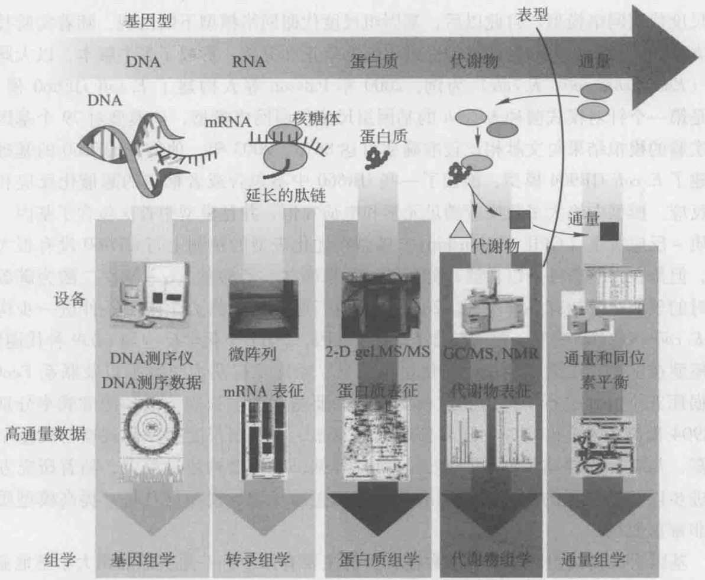

<details>
<summary>flowchart</summary>

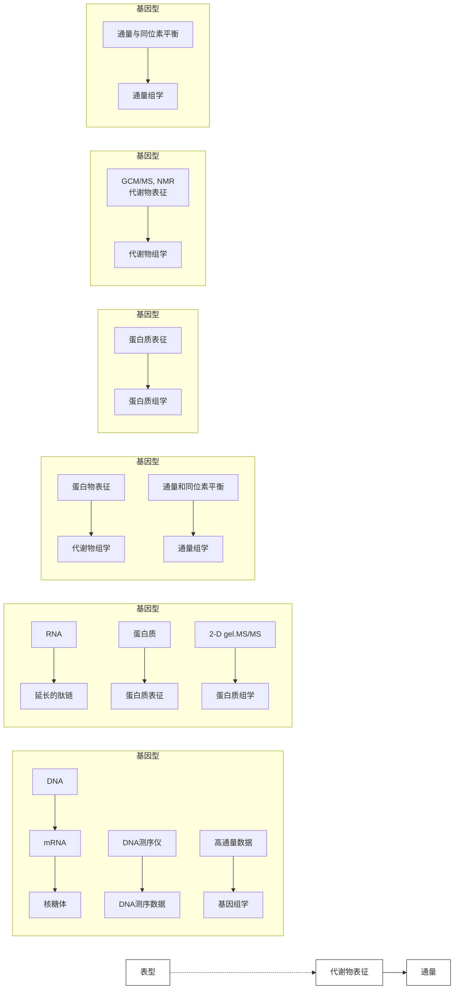
</details>

图7-1 高通量“组学”研究用于代谢工程菌种改进

## 7.2 基因组尺度代谢网络模型

基因组尺度代谢网络模型的产生是后基因组时代各种组学、生物信息学、计算机科学相互结合的必然结果，是目前成熟、有效的从系统角度将生物体内的代谢网络用数学方式表达并进行模拟计算的方法，搭建了生物体生长表型与生物体内各种组分之间的桥梁。

---

164.

7 基因组学与基因组尺度代谢网络模型

代谢网络模型的构建包含有序地收集生物系统内所有基因、蛋白质、生物化学反应的信息的过程，然后通过系统限制条件用数学方程将重构信息表达出来，从而将信息转化为模型。这样构建出的模型可以通过代谢通量的介导用于生物表型的计算机（in silico）计算。可以说，基因组尺度代谢网络模型是基于系统生物学的研究理念和生物信息学的研究方法发展而来，其将生物体看作一个系统，通过网络数据库、基因组注释信息、生物实验数据、书籍以及 in silico 模拟等多种资源和手段广泛地挖掘数据，在海量数据的基础上重构全基因组尺度代谢网络模型并进行分析和应用。反过来说，基因组尺度代谢网络模型从整体上对大规模生物学数据进行全面、系统的分析和整理，通过对生物体代谢特征、生物表型等的研究，在系统生物学和生物信息学的发展中发挥了举足轻重的作用。

第一个构建完成的基因组尺度代谢网络模型是1999年美国加州大学圣地亚哥分校生物工程系Palsson教授的系统生物学研究组构建的Haemophilus influenzae Rd基因组尺度代谢网络模型。自此以后，基因组尺度代谢网络模型不断出现，随着实验技术与方法的改进，一些物种的模型经过不断的修正和完善，形成了多个版本，以大肠杆菌（Escherichia coli, E. coli）为例，2000年Palsson等人构建了E. coli iJE660模型，这是第一个针对模式菌种E. coli的基因组尺度代谢网络模型，该模型对79个基因敲除实验的模拟结果与文献相比较准确率可达 $86\%$ ，2003年，他们在iJE660的基础上构建了E. coli iJR904模型，添加了一些iJR660中不包含或者推定的酶催化反应和运输反应。模型中绝大多数反应满足元素和电荷守恒，并且模型中首次包含了基因-蛋白质-反应关系（GPR relationship）。模型在优化表型的预测上与iJE660没有很大区别，但是在限氧条件下以甘油、葡萄糖、苹果酸盐、乙酸盐、 $\alpha-$ 酮戊二酸为碳源生长时的预测结果却有显著不同。2007年，他们通过加入热力学限制条件进一步构建了E. coli iAF1260模型，模型包含1260个基因，2077个化学反应和1039种代谢物，该模型在规模、亚细胞定位、细化途径信息、添加反应热力学数据以及联系EcoCyc数据库五个方面进行了改进，该模型对于必要基因和生长表型的预测准确率分别比iJR904提高了 $4\%$ 和 $16\%$ 。随着新版本的发布，基因组尺度模型的规模与质量不断提高，与实际实验结果亦更加接近。由此可见，在模型构建过程中，随着研究方法的进步以及新数据的产生，模型的扩展和修正对于增加模型信息量、提高模型质量是非常重要的。

基因组尺度代谢网络模型的数据源目前主要有两个:一是美国加州大学圣地亚哥分校系统生物研究组网站中的 in silico organism 部分（http://gcrg.ucsd.edu/In\_Silico\_Organisms/Other\_Organisms），截至 2012 年 6 月，这部分共有 56 种生物的 90 个模型。二是天津大学系统生物学中心的基因组尺度代谢网络数据库（GSMNDB，http://synbio.tju.edu.cn/GSMNDB/gsmndb.htm）；该数据库每六个月更新一次，截至 2012 年 6 月，已经有 87 种（包括不同亚种和不同菌株）生物的 135 个模型被构建并发表，网站中列有每个模型的相关数据、特点和文献链接，使用非常方便。

理论上来说，有多少物种的全基因组测序完成，就应该存在多少个对应的基因组尺度代谢网络模型。然而目前基因组尺度代谢网络模型的数量远远小于已测序物种的数量（图7-2）。造成这种情况的原因有很多，其中最主要的三个原因如下:首先，由于注释算法不完善等因素，基因组中注释出来的基因有很多是未知功能的基因和非

---

7.3 基因组尺度代谢网络模型的重构过程

165

编码基因；其次，基因组尺度代谢网络重构需要大量的人工校对工作，这个步骤是个非常耗时耗力的工作；最后，我们对很多物种的生理生化机制了解有限，这对基因组尺度代谢网络的数量和质量都产生了很大影响，即使目前研究最为透彻的大肠杆菌，仍然有很多生命活动的机制都是未知的，对于很多研究较少的菌种，更是难以建立高质量的基因组尺度代谢网络模型。

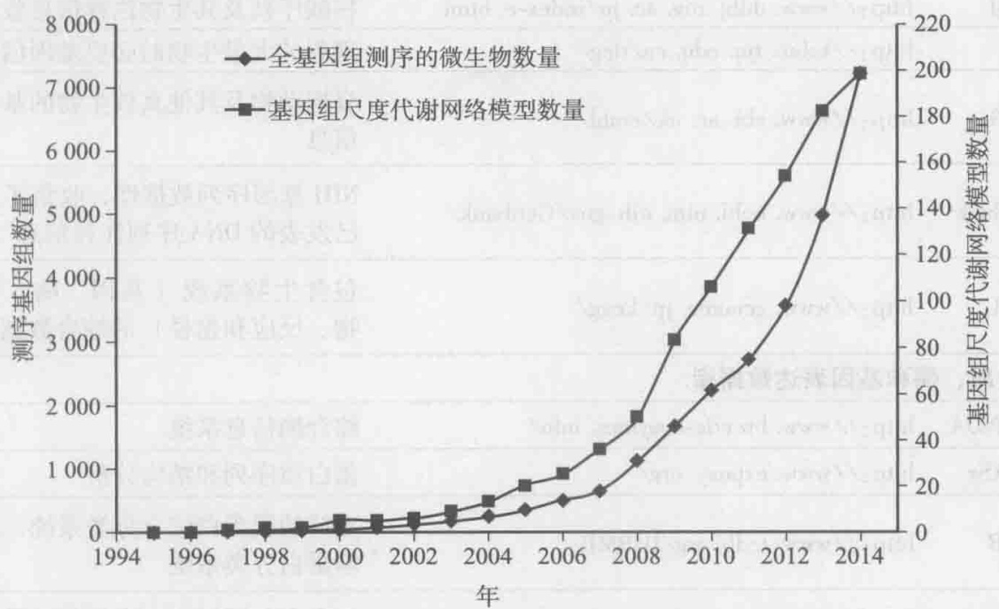

<details>
<summary>line</summary>

| 年 | 全基因组测序的微生物数量 | 基因组尺度代谢网络模型数量 |
| --- | --- | --- |
| 1995 | ~0 | ~0 |
| 1996 | ~0 | ~0 |
| 1997 | ~0 | ~0 |
| 1998 | ~0 | ~0 |
| 1999 | ~0 | ~0 |
| 2000 | ~100 | ~5 |
| 2001 | ~100 | ~5 |
| 2002 | ~150 | ~10 |
| 2003 | ~200 | ~15 |
| 2004 | ~300 | ~25 |
| 2005 | ~400 | ~40 |
| 2006 | ~500 | ~60 |
| 2007 | ~700 | ~100 |
| 2008 | ~1200 | ~150 |
| 2009 | ~1700 | ~300 |
| 2010 | ~2300 | ~450 |
| 2011 | ~2800 | ~650 |
| 2012 | ~3600 | ~850 |
| 2013 | ~5000 | ~1350 |
| 2014 | ~7300 | ~200 |
</details>

图7-2 完成全基因组测序和完成基因组尺度代谢网络模型重构的数量随时间变化图

## 7.3 基因组尺度代谢网络模型的重构过程

基因组尺度代谢网络模型的重构是个循环往复的过程，主要包括3个步骤:代谢网络数据库的建立、数学模型的建立和模拟运算验证模型。通过模拟反复循环验证，当模拟结果的准确率达到一定水平后，网络重构也就完成了，可以进行其他预测等工作。在模型的验证过程中既需要对模型预测的结果进行实验验证，也需要从各个角度验证模型预测的准确度，另外从文献中获取大量的信息也是必不可少的。

## 7.3.1 基因组尺度代谢网络数据库的建立

基因组尺度代谢网络数据库跟通常意义的数据库不一样，建立这样的数据库就是从生物信息数据库和文献中提取出需要的数据，在电脑中进行整理和精炼。建立这样一个数据库通常需要3个步骤:数据收集、关系模型的建立和数据整理。

## 7.3.1.1 数据收集

基因组尺度代谢网络重构的主要数据来自各种生物信息数据库，随着计算机和互联网络的发展，大量的生物学信息可以从各大数据库中免费获得，这些数据库包括基因组数据库、蛋白质数据库以及一些代谢反应数据库，表7-1中列出了一些常用的数据库。

---

166

7 基因组学与基因组尺度代谢网络模型

表 7-1 基因组尺度代谢网络重构常用的数据库

<table><tr><td>数据库</td><td>网址</td><td>描述</td></tr><tr><td colspan="3">基因序列和注释数据库</td></tr><tr><td>CMR</td><td>http://cmr.jcvi.org/tigr-scripts/CMR/Cm-rHomePage.cgi/</td><td>包含所有已发表的、完整的原核生物基因组信息的数据库</td></tr><tr><td>DDBJ</td><td>http://www.ddbj.nig.ac.jp/index-e.html</td><td>核酸序列及其生物注释信息数据库</td></tr><tr><td>DEG</td><td>http://tubic.tju.edu.cn/deg/</td><td>现有的大量生物的必要基因信息</td></tr><tr><td>EMBL</td><td>http://www.ebi.ac.uk/embl/</td><td>脊椎动物及其他真核生物的基因组信息</td></tr><tr><td>GenBank</td><td>http://www.ncbi.nlm.nih.gov/Genbank/</td><td>NIH基因序列数据库,收集了所有已发表的DNA序列注释信息</td></tr><tr><td>KEGG</td><td>http://www.genome.jp/kegg/</td><td>包含生物系统(基因、酶、代谢物、反应和途径)的综合数据库</td></tr><tr><td colspan="3">蛋白质、酶和基因表达数据库</td></tr><tr><td>BRENDA</td><td>http://www.brenda-enzymes.info/</td><td>综合酶信息系统</td></tr><tr><td>ExPASy</td><td>http://www.expasy.org/</td><td>蛋白质序列和结构分析</td></tr><tr><td>TCDB</td><td>http://www.tcdb.org/IUBMB</td><td>支持的膜蛋白综合分类系统,即运输蛋白分类系统</td></tr><tr><td>Trans-portDB</td><td>http://www.membranetransport.org/</td><td>包含全基因组测序生物的胞质膜蛋白和外膜通道信息的综合数据库</td></tr><tr><td>UniProt</td><td>http://www.uniprot.org/</td><td>包含蛋白质序列和功能的高质量综合数据库</td></tr><tr><td colspan="3">代谢数据库</td></tr><tr><td>BioCyc</td><td>http://biocyc.org/</td><td>收集了376个途径/基因组的数据库</td></tr><tr><td>EMP</td><td>http://www.ergo-light.com/EMP/index-xing.html</td><td>酶和代谢途径数据库</td></tr><tr><td>Reactome</td><td>http://www.reactome.org/</td><td>经人工修正的生物途径数据库文献</td></tr><tr><td colspan="3">代谢</td></tr><tr><td>Pubmed</td><td>http://www.ncbi.nlm.nih.gov/entrez/</td><td>包含了来自MEDLINE和其他生命科学期刊的自1948年以来的1800万文献信息</td></tr><tr><td colspan="3">代谢网络</td></tr><tr><td>BiGG</td><td>http://bigg.ucsd.edu/</td><td>包含许多重构代谢网络的数据库</td></tr><tr><td>GSMNDB</td><td>http://synbio.tju.edu.cn/GSMNDB/gs-mndb.htm</td><td>包含所有已发表的基因组尺度代谢网络</td></tr></table>

以上提到的数据库大都提供数据的批量下载，数据下载完毕后通过 VBA 等编程语言，将所需的数据提取出来，对于不提供批量下载的数据库，也可以通过 Python 等语言直接从网页提取数据。提取得到的数据存放在 Excel 表格中，由于 Excel 是专用的表格类数据处理软件，因此将数据放入 Excel 表中进行整理和精炼十分便利。

需要提取和用到的原始数据主要有物种特异的基因、蛋白质、反应和代谢物信

---

7.3 基因组尺度代谢网络模型的重构过程

167

息。然而单一数据库提供的数据往往是有限的，而且各个数据库之间由于注释算法和其他组织结构不同，可能会导致数据的不一致性，因此通常在重构基因组尺度代谢网络的过程中，原始数据都是来自多个数据库的。

另一个原始数据的重要来源是大量的文献和书籍。需要使用文献搜索引擎广泛地搜索来自文献和书籍的信息，为了数据收集的全面，通常要使用几个文献搜索引擎并用进行搜索，同时关键字也要交叉组合进行搜索以确保不会遗漏信息。因为很多近期的文献中可能提供了新基因功能注释等与网络重构密切相关的信息，而这些信息在数据库中收录会比较慢，所以即便通过文献和书籍添加的信息量会比较小，但是这部分信息也是十分重要的，而且可靠性最高。

## 7.3.1.2 关系模型的建立

关系模型就是将上一步提取到的各种数据关联在一起，如基因与蛋白质、蛋白质与反应、反应与代谢物之间的关联。

基因与反应的对应关系是通过酶蛋白进行介导的，即基因通过注释得到基因编码的蛋白质信息，通常与代谢活动密切相关的蛋白质都是酶，酶都会对应一定的酶号，通过酶号关联该酶催化的反应，通过这种方式可以得到基因与反应的对应关系。通过反应的代谢方程式，将代谢物关联在一起从而构成整个代谢网络（图7-3）。基因和反应之间可能存在的关系有:①一对一关系，即单个基因编码单个蛋白质，催化单个反应；②“与”关系:基因编码的蛋白质可能是异构酶复合体，这些蛋白质名称通常为“protein X, catalytic subunit”的形式，说明还有至少另外一个亚基的存在下才能发挥酶的催化能力，在所有亚基共同参与下才能完成对反应的催化，这些亚基对应的基因则存在“与”关系，表示只有这些基因全部存在并表达反应才可能发生；③“或”关系:多个基因编码的不同的酶为同工酶，催化相同的反应，这些基因相对于反应的关系存在“或”关系，表示敲除其中的个别基因不会对反应造成影响，只有全部敲除这些基因反应才不会发生，由此对生物的生长代谢产生影响（见图7-3）。

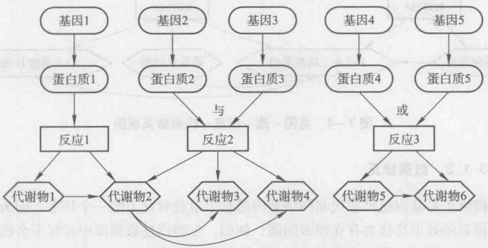

<details>
<summary>flowchart</summary>

```mermaid
graph TD
  A["基因1"] --> B["蛋白质1"]
  C["基因2"] --> D["蛋白质2"]
  E["基因3"] --> F["蛋白质3"]
  G["基因4"] --> H["蛋白质4"]
  I["基因5"] --> J["蛋白质5"]
  
  B --> K["反应1"]
  D --> L["反应2"]
  F --> L
  
  K --> M{"代谢物1"}
  K --> N{"代谢物2"}
  K --> O{"代谢物3"}
  K --> P{"代谢物4"}
  
  L --> Q{"代谢物2"}
  L --> R{"代谢物3"}
  L --> S{"代谢物4"}
  
  H --> T{"代谢物4"}
  J --> U{"代谢物5"}
  
  V["基因5"] --> W["反应3"]
  X["基因5"] --> Y["反应3"]
  
  Z["基因5"] --> AA["代谢物6"]
  AB["基因5"] --> AC["代谢物6"]
  
  L -.->|"与"| AD["反应2"]
  L -.->|"或"| AE["反应3"]
  
  M --> AF{"代谢物2"}
  N --> AG{"代谢物3"}
  O --> AH{"代谢物4"}
  
  AF --> AI{"代谢物2"}
  AG --> AJ{"代谢物3"}
  AH --> AK{"代谢物4"}
  
  AE --> AL{"代谢物5"}
  AJ --> AM{"代谢物6"}
  
  AI --> AN{"代谢物5"}
  AJ --> AO{"代谢物6"}
  
  AL --> AP{"代谢物5"}
  AO --> AQ{"代谢物6"]
  
  AP --> AR{"代谢物5"}
  AQ --> AS{"代谢物6"]
  
  AT["基因1"] -.-> B
  AT -.-> K
  AT -.-> L
  AT -.-> M
  AT -.-> N
  AT -.-> O
  AT -.-> AP
  AT -.-> AQ
  AT -.-> AS
  AT -.-> AU
  AT -.-> AV
```
</details>

图7-3 基因-蛋白质-反应-代谢物之间的对应关系

在绘制代谢网络的过程中，一般只考虑代谢反应中的主代谢物，这些主代谢物构成了主反应方程，而 ATP，ADP， $H_{2}O$ ， $O_{2}$  等流通代谢物通常在网络图绘制和网络计算中被忽略，需要强调的是，上述物质作为主代谢物的情况例外，例如，嘌呤代谢途

---

168.

7 基因组学与基因组尺度代谢网络模型

径的反应 ATP +  $H_{2}O \rightarrow ADP + Orthophosphate$  中，ATP 和 ADP 为主反应物，这种情况下 ATP 和 ADP 不能忽略，该反应的主反应方程式为:ATP → ADP。反应中的主反应物可以从相应的数据库或者人工分析中确定。

例 7-1 表 7-2 为根据 KEGG 数据库得到的枯草芽胞杆菌基因 - 蛋白质、蛋白质 - 反应关系及反应方程式，蛋白质以酶号表示，根据上述关系画出基因 - 蛋白质 - 反应 - 代谢物之间的关系图。

表 7-2 来自 KEGG 数据库的枯草芽胞杆菌信息

<table><tr><td>基因-蛋白质</td><td colspan="2">pfkA—2.7.1.11; fbaA—4.1.2.13</td></tr><tr><td>蛋白质-反应</td><td colspan="2">2.7.1.11—R00756; 4.1.2.13—R01068</td></tr><tr><td rowspan="2">反应方程式</td><td>R00756</td><td>ATP+D-6-磷酸果糖→ADP+D-1, 6-二磷酸果糖</td></tr><tr><td>R01068</td><td>D-1, 6-二磷酸果糖⇔磷酸甘油酮+D-3-磷酸甘油醛</td></tr></table>

解:由上述关系首先得到基因-酶-反应的关系为:pfkA—2.7.1.11—R00756和fbaA—4.1.2.13—R01068，由反应方程式可以看出R00756和R01068有共同的代谢物D-1,6-二磷酸果糖，D-1,6-二磷酸果糖在反应R00756中为产物，而在可逆反应R01068中既可以作为反应物，也可以作为产物。由KEGG数据库的Rpair信息可以得到两个反应的主反应方程式:R00756:D-6-磷酸果糖→D-1,6-二磷酸果糖；R01068:D-1,6-二磷酸果糖⇔磷酸甘油酮+D-3-磷酸甘油醛。根据上述分析，绘制基因-酶-反应-代谢物之间的关系图如图7-4:

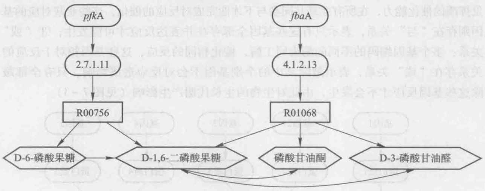

<details>
<summary>flowchart</summary>

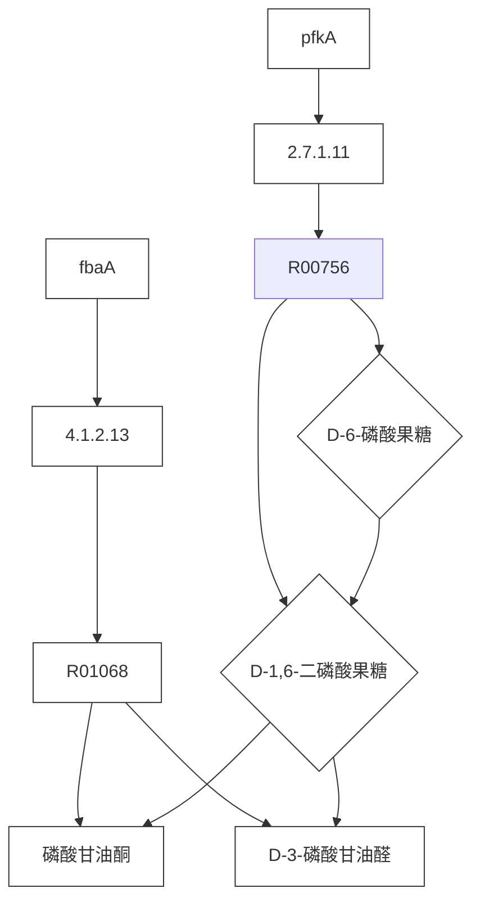
</details>

图7-4 基因-酶-反应-代谢物关系图

## 7.3.1.3 数据修正

数据修正是基因组尺度代谢网络重构过程中最费时费力的一个环节，因为前面步骤提取得到的数据往往会存在很多问题，例如，生物信息数据库中往往不会提供物种特异性的反应信息，即某些代谢反应在特定物种中不会发生，而此类反应在生物信息数据库中往往没有特别标注，这就需要在数据整理中将不会在该物种内发生的反应剔除。另外，原始数据中可能会存在一些错误数据，还需要结合大量文献进行佐证，这些都需要大量的时间来进行人工校正。

一般来说，需要进行校正的有如下几个方面:

---

7.3 基因组尺度代谢网络模型的重构过程

169

（1）不同数据库的信息融合。前面提到用于重构代谢网络的原始数据来源于不同的数据库，因此就要对不同来源的数据进行比对精炼。一般都是通过不同数据库之间的ID匹配或名称匹配，使不同数据库来源的同一基因对应的信息相互关联。对于注释信息如酶号不一致的基因，应该通过查阅文献或参考其他数据库进一步确认。同样，对于不同来源的代谢反应信息（如KEGG和BioCyc），也应该进行比对，以确保反应方程式和反应方向等信息准确。

从数据库得到的原始数据的有效性是不同的，因此对数据进行可靠性分级也是必要的。通常情况下，有确凿的文献和实验验证的数据，是最可靠的；如果多个数据库得到的数据完全一致，这样的数据可靠性较高；单一数据库得到的数据可靠性一般；单纯依靠注释信息得到的基因功能信息，可靠性最低。

(2) 大分子的合成与修饰反应往往需要特别的处理。蛋白质、DNA、RNA、肽聚糖和磷壁酸等大分子的具体合成过程很复杂, 而且种类繁多, 很多合成修饰机制还没有完全了解。因此对于重构基因组尺度代谢网络来说, 通常都是将这些大分子的合成反应按照一定的权重归并到生物量合成反应中。例如, 将蛋白质拆分为氨基酸归并到生物量合成反应中。
(3) 反应数据的修正。涉及反应方程式的确定、反应方向的确定、反应辅酶的确定、反应质量以及电荷配平等。通常数据库中存在大量的冗余反应、反应方向不确定等问题，这些都需要细致的人工校正来进行确认。人工校正工作可以采用多种方法或者多个数据来源来综合评定，例如反应方向性的确定，可以参考文献资料以及相关教科书，也可以参考KEGG pathway和Brenda等数据库，还可以通过热力学以及拓扑结构等来进行确认，如果实在找不到相关依据，往往采用经验规则来进行判定，马红武和曾安平发表的文章中提供了11条判断反应可逆性的经验性原则（Ma and Zeng, 2003）。对于数据库中同时存在总反应和分反应的情况，可以去掉总反应，保留分反应。如果分步骤反应中的中间代谢物不再参与其他的反应则也可以只保留总反应，删除分反应。对于一些数据库中同时存在手性和非手性代谢物的情况，可以参考其他数据库，文献或者根据情况制定标准将网络中代谢物的手性进行统一。再比如对于一些有 $\alpha-$，$\beta-$ 构型区分的糖类代谢物，如D-葡萄糖分为 $\alpha-$ 与 $\beta-$ 构型，有的数据库中则同时存在D-葡萄糖，$\alpha-D-$ 葡萄糖和 $\beta-D-$ 葡萄糖，在构建中需将它们进行统一，要么全都用不包含手性信息的形式（如D-葡萄糖），要么则全用包含手性信息的形式（如 $\alpha-D-$ 葡萄糖和 $\beta-D-$ 葡萄糖）。其他反应信息的确定也可以采用类似的方法，综合多种信息来源来进行最终确认。
（4）分析网络断口（gap）。在代谢网络中会存在一些代谢物只有消耗没有生成，或者只有生成没有消耗的情况，这些代谢物通常称为末端代谢物（dead ends）。末端代谢物可以通过编程进行提取和识别。这类代谢物的产生通常是由于信息量不够，或者我们对物种的了解不足，有些应该存在的反应在我们收集数据的过程中没有找到，这样就需要更广泛的查阅文献，寻找相关的信息对因末端代谢物而产生的网络断口进行填补，如果实在无法找到确凿的信息通过添加代谢反应来修正网络，可以在网络中添加运输反应（transport reaction）和交换反应（exchange reaction）来解决。运输反应和交换反应的添加使末端代谢物人为地达成物质守恒，从而使模型在模拟计算的过程中能够不受其影响。当然，运输反应和交换反应不能随意添加，否则会对模型的质

---

170

7 基因组学与基因组尺度代谢网络模型

量产生很大的影响。例如，如图7-5所示，在人类肝代谢网络的修正过程中，首先将整个肝网络分成若干个互不相连的组件（component），组件内的反应相互关联，而组件之间则没有任何反应相互关联。如图7-5所示，其中两个组件（component I, component II）中存在一些反应，可以看出，代谢物M5在其参与的两个反应中都作为底物消耗，而网络中没有生成M5的反应存在，因此M5是一个末端代谢物，如果在网络中添加反应R4，则这两个组件能够通过R4连接起来，并且R4的添加，使M5能够通过R4生成，不再是末端代谢物。在这个过程中，R4就是添补component I和component II之间断口的反应。由这个过程我们也可以看出，网络断口的修正能够有效地消除网络中的末端代谢物。

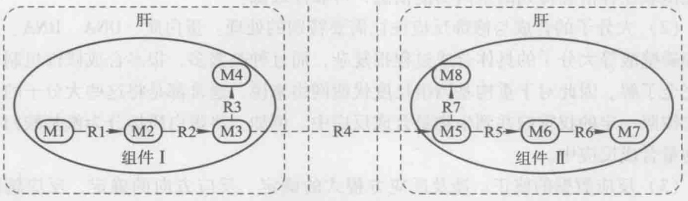

<details>
<summary>flowchart</summary>

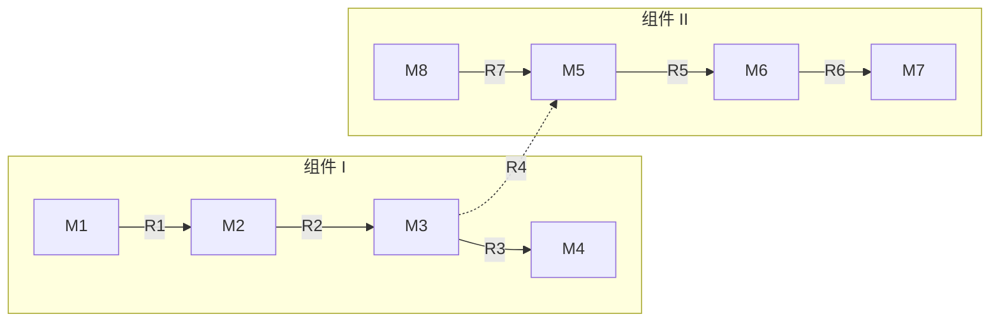
</details>

图7-5 人类肝代谢网络中网络断口添加示意图

（5）对于较为复杂的物种，通常还要设定合适的分室信息，例如真核生物，要将各个主要细胞器例如线粒体、过氧化物酶体、细胞核等作为单独分室进行处理；对于原核生物，则可分为细胞质（cytosol，[c]）和胞外两个分室（extracellular，[e]），更复杂些的还要添加细胞间质（periplasm，[p]）分室。

通过上述提取整理过程后，我们得到的结果是一个反应列表（通常保存在 Excel 表格中），包括了物种的基因-蛋白质-反应对应信息以及反应的详细信息，包括:反应方程式、反应方向、反应所属途径和所属分室等。

## 7.3.2 数学模型的建立

反应列表整理完成后，我们要将其转化为数学模型才可以在计算机上进行相应模拟。基因组尺度代谢网络模型的核心就是计量系数矩阵。

计量系数矩阵是将前面得到的反应列表中各个反应方程式代谢物的系数汇总在一起构成的一个多维矩阵。通常用 S 表示。设 v 为 n 个代谢反应速度构成的向量: $v = (v_{1}, v_{2}, \cdots, v_{n})$ ，x 为 m 个代谢物浓度组成的向量: $x = (x_{1}, x_{2}, \cdots, x_{m})$ ，S 就是一个  $m \times n$  矩阵，它的每一行对应着一个代谢物，每一列对应一个化学反应，如式 7-1 所示。

$$
S = \begin{array}{c} \hline m _ {1} \\ m _ {2} \\ \vdots \\ m _ {m} \end{array} \left[ \begin{array}{c c c c c c} s _ {1, 1} & s _ {1, 2} & \dots & s _ {1, i} & \dots & s _ {1, n} \\ s _ {2, 1} & s _ {2, 2} & \dots & s _ {2, i} & \dots & s _ {2, n} \\ \vdots & \vdots & \ddots & \vdots & \ddots & \vdots \\ \vdots & \vdots & \ddots & \vdots & \ddots & \vdots \\ s _ {m, 1} & s _ {m, 2} & \dots & s _ {m, i} & s _ {m, i + 1} & s _ {m, n} \end{array} \right] \quad v = \left[ \begin{array}{c} v _ {1} \\ v _ {2} \\ \vdots \\ v _ {i} \\ \vdots \\ v _ {n} \end{array} \right] \tag {7-1}
$$

---

7.3 基因组尺度代谢网络模型的重构过程

171

矩阵 S 的第 i 行第 j 列个元素  $s_{i,j}$  等于第 i 个代谢物  $(m_{i})$  在第 j 个反应  $(r_{j})$  中的配平系数，若该代谢物为底物，则  $s_{i,j}<0$ ，若该代谢物为产物，则  $s_{i,j}>0$ ，若该代谢物没有参与反应，则  $s_{i,j}=0$ 。

例7-2 根据下面反应方程式确定计量系数矩阵 $S$ （反应方程式来自BIGG数据库）。

HEX1: GLC + ATP→G6P + ADP + H

PGI: G6P⇔F6P

PFK: ATP + F6P→ADP + FDP + H

FBA: FDP⇔DHAP + G3P

TPI: DHAP⇔G3P

GAPD: G3P + NAD + PI ⇔ 13DPG + H + NADH

PGK: 13DPG + ADP⇔3PG + ATP

PGM: 3PG⇔2PG

ENO:  $2PG \Leftrightarrow H_{2}O + PEP$

PYK: ADP + H + PEP  $\Leftrightarrow$  ATP + PYR

解:例中数据共包含18个代谢物和10个反应，因此能够形成一个 $18 \times 10$ 的计量系数矩阵，其中每行代表一个代谢物，每列代表一个反应，计量系数矩阵中的值由各反应中代谢物的系数确定，底物的系数为负数，产物得系数为正数。根据上述信息，建立计量系数矩阵如下:

|  | HEX1 | PGI | PFK | FBA | TPI | GAPD | PGK | PGM | ENO | PYK |
| --- | --- | --- | --- | --- | --- | --- | --- | --- | --- | --- |
| ATP | -1 | 0 | -1 | 0 | 0 | 0 | 1 | 0 | 0 | 1 |
| GLC | -1 | 0 | 0 | 0 | 0 | 0 | 0 | 0 | 0 | 0 |
| ADP | 1 | 0 | 1 | 0 | 0 | 0 | -1 | 0 | 0 | -1 |
| G6P | 1 | -1 | 0 | 0 | 0 | 0 | 0 | 0 | 0 | 0 |
| H | 1 | 0 | 1 | 0 | 0 | 1 | 0 | 0 | 0 | -1 |
| F6P | 0 | 1 | -1 | 0 | 0 | 0 | 0 | 0 | 0 | 0 |
| FDP | 0 | 0 | 1 | -1 | 0 | 0 | 0 | 0 | 0 | 0 |
| DHPA | 0 | 0 | 0 | 1 | -1 | 0 | 0 | 0 | 0 | 0 |
| G3P | 0 | 0 | 0 | 1 | 1 | -1 | 0 | 0 | 0 | 0 |
| NAD | 0 | 0 | 0 | 0 | 0 | -1 | 0 | 0 | 0 | 0 |
| PI | 0 | 0 | 0 | 0 | 0 | -1 | 0 | 0 | 0 | 0 |
| 13DPG | 0 | 0 | 0 | 0 | 0 | 1 | -1 | 0 | 0 | 0 |
| NADH | 0 | 0 | 0 | 0 | 0 | 1 | 0 | 0 | 0 | 0 |
| 3PG | 0 | 0 | 0 | 0 | 0 | 0 | 1 | -1 | 0 | 0 |
| 2PG | 0 | 0 | 0 | 0 | 0 | 0 | 0 | 1 | -1 | 0 |
| PEP | 0 | 0 | 0 | 0 | 0 | 0 | 0 | 0 | 1 | -1 |
| $H_2O$ | 0 | 0 | 0 | 0 | 0 | 0 | 0 | 0 | 1 | 0 |
| PYR | 0 | 0 | 0 | 0 | 0 | 0 | 0 | 0 | 0 | 1 |

对于完整的基因组尺度代谢网络模型，计量系数矩阵中还包括其他两个主要部分。首先是生物量（biomass）组成。生物量的组成通过文献查找各个组分的含量获得，如果实在找不到物种的确切组成，可以借鉴其他相近的物种，然后根据具体含量定量作为系数，组成生物量合成方程式，并将系数等信息合并入计量系数矩阵。例

---

172

7 基因组学与基因组尺度代谢网络模型

如，枯草芽胞杆菌iYO844模型的生物量合成方程为:408.3 glycine + 266.9 L-alanine + 306.7 L-valine + 346.4 L-leucine + 269.9 L-isoleucine + 216.2 L-serine + 186.3 L-threonine + 175.9 L-phenylalanine + 110.8 L-tyrosine + 54.3 L-tryptophan + 56.7 L-cysteine + 113.3 L-methionine + 323.1 L-lysine + 193.0 L-arginine + 81.7 L-histidine + 148.0 L-aspartate + 260.4 L-glutamate + 148.0 L-asparagine + 260.3 L-glutamine + 160.6 L-proline + 62.7 GTP + 38.9 CTP + 41.5 UTP + 23.0 dATP + 17.4 dGTP + 17.4 dCTP + 22.9 dTTP + 0.085750 monoglucosyldiacylglycerol + 0.110292 diglucosyldiacylglycerol + 0.065833 triglucosyldiacylglycerol + 0.004642 cardiolipin + 0.175859 phosphatidylglycerol + 0.022057 lysylphosphatidylglycerol + 0.559509 phosphatidylethanolmaine + 0.006837 lipoteichoic acid (n = 24, linked, glucose substituted) + 0.006123 lipoteichoic acid (n = 24, linked, N-acetyl-D-glucosamine) + 0.018162 lipoteichoic acid (n = 24, linked, D-alanine substituted) + 0.014676 lipoteichoic acid (n = 24, linked, unsubstituted) + 101.82 peptidoglycan subunit + 3.62 glycerol teichoic acid (n = 45, unlinked, unsubstituted) + 2.35 glycerol teichoic acid (n = 45, unlinked, D-ala substituted) + 1.82 glycerol teichoic acid (n = 45, unlinked, glucose substituted) + 3.11 minor teichoic acid (acetylgalactosamine glucose phosphate, n = 30) + 706.3 K + 101.7 Mg + 3.4 Fe (+3) + 3.2 Ca + 0.9 diphosphate + 0.3 menaquinol 7 + 0.410-formyltetrahydrofolate + 16.2 NAD + 4.7 AMP + 2.6 ADP + 1.0 CMP + 0.9 NADP + 0.5 CTP + 0.5 GMP + 0.4 GTP + 0.3 CDP + 0.2 NADPH + 0.2 GDP + 105053.5 ATP + 105000 H₂O → 104985.6 phosphate + 104997.4 ADP + 105000 H⁺ + 1 g biomass。这个生物量合成方程中包含了组成枯草芽胞杆菌细胞的氨基酸、脂质、核酸、磷脂壁酸、细胞壁、金属离子、辅因子等多种组成成分，这些组成成分是细胞维持生长所必需的物质，其中任何一种物质的缺乏都会导致细胞的死亡。其次是运输反应，根据生物可以利用的底物和分泌的产物添加运输反应，首先可以由基因组注释得到膜运输蛋白，从而可以确定运输反应的存在，另外可以通过查找文献，确定菌体的培养基成分，然后根据培养基成分添加相应的运输反应。同时还需要为胞外代谢物添加交换反应，交换反应可以理解为胞外代谢物与外部环境的物质交换。这些运输反应和交换反应也表示为反应方程式形式，都要汇总进计量系数矩阵中，例如α-D-葡萄糖通过PTS系统的运输反应可以表示为:α-D-葡萄糖[e]+磷酸烯醇式丙酮酸[c]→丙酮酸[c]+α-D-6-磷酸葡萄糖[c]，其中“[e]”表示胞外，“[c]”表示细胞质；水的交换反应可以表示为:H₂O[e] ⇌。

根据计量系数矩阵，可以通过 VBA 等程序语言，直接将 Excel 中的反应方程式转化为 SBML（systems biology markup language）格式，即系统生物学标记语言。它是机器可读的、基于 XML 的置标语言，用于描述生化反应等网络的计算模型。SBML 的数据文件是通用的系统生物学语言格式的文件，可以被大多数生物模拟软件识别并加载。

计量系数矩阵 S 实际上代表的是一个网络，其中代谢物是网络中的节点（node），反应是网络中的边（link），这样表示出来的是一个“反应图”，是一般代谢网络和途径数学分析的常用表示方法。

而对于结构分析来说，矩阵有另外一种表达方式，在结构分析中，有时将代谢反应作为网络中的节点，而代谢物作为网络中的边，这样表示出来的是一个“代谢物

---

7.3 基因组尺度代谢网络模型的重构过程

173

图”，这种图在网络计算中并不常用，但是在拓扑结构上能够更好地反映反应之间的关系。

## 7.3.3 模拟运算

随着代谢网络模型重构的发展，在代谢网络模拟中使用的优化算法也逐步被开发出来，其中最基本的方法是通量平衡分析（flux balance analysis，FBA）算法。在FBA的基础上，通过改变目标函数或约束条件发展出一系列算法。以下简要介绍几种常用的优化分析算法。

## 7.3.3.1 通量平衡分析算法

FBA 是用于分析生物化学网络，特别是基因组尺度代谢网络的一种计算机算法。这些网络中包含一个生物体所有已知代谢反应和编码酶的基因（图 7-6a）。FBA 通过代谢网络计算代谢物的流量，因而能够成为预测生物体生长速率或特定重要代谢物生产速率的工具（Orth et al. 2010）。

FBA 约束条件的第一步是将代谢反应表达为数学形式。即通过计量学矩阵将代谢网络中的反应表示出来。计量学矩阵的系数是代谢网络中代谢物流量的限制条件，也是 FBA 算法约束条件的核心（图 7-6b）。

对于代谢网络模型，约束条件由一组等式和不等式组成，每一个等式（或不等式）表示一个约束，包括物理化学约束和生物自身的调控约束等，其中最为基础的是如下两种约束:

（1）平衡约束（图7-6c）。在计量系数矩阵的基础上，代谢物浓度变化与反应速度满足以下等式:

$$
\mathrm{d} x / \mathrm{d} t = S v \tag {7-2}
$$

因为代谢反应可以在很短的时间内达到平衡，属于短时间尺度的化学反应，所以可以认为代谢网络满足拟稳态假设，即在稳定的环境下，代谢网络会在很短的时间内达到或接近稳定的状态，这时，各代谢物的浓度既不上升也不下降，即:

$$
\mathrm{d} x / \mathrm{d} t = 0 \tag {7-3}
$$

由此，我们得到了一组等式约束，通常称之为平衡约束:

$$
S v = 0 \tag {7-4}
$$

它规定了代谢网络要满足物质守恒定律和拟稳态假设，平衡约束定义了系统的线性方程，由于大规模生物代谢模型中包含的反应往往多于代谢物，因而这些方程的解并不唯一。

（2）边界约束。代谢网络中的大多数反应都是由酶催化的，受到物理化学环境、酶的周转速度以及反应自身动力学性质等因素的制约，反应的发生速度和发生方向也是有限制的。FBA算法用一组不等式来约束代谢反应的速度和方向，称为边界约束:

$$
v _ {i} ^ {\min} \leqslant v _ {i} \leqslant v _ {i} ^ {\max}, i = 1, 2, \dots , n \tag {7-5}
$$

式中， $v_{i}^{\max}$  和  $v_{i}^{\min}$  分别代表第 i 个反应速度的上界和下界。当  $v_{i}^{\min} \geqslant 0$  时，反应 i 不可逆且向正方向进行，当  $v_{i}^{\max} \leqslant 0$  时反应不可逆且向反方向进行，当  $v_{i}^{\min} < 0$  且  $v_{i}^{\max} > 0$  时，反应可逆。反应的正方向为从化学计量系数矩阵 S 规定的底物到产物的方向。

平衡约束和边界约束刻画了代谢系统中，反应与反应的承继关系，较为完整地刻

---

174.

7 基因组学与基因组尺度代谢网络模型

画了代谢网络的拓扑结构。它们共同限制了在代谢网络中允许出现的功能状态。这些状态可以用一个解空间来描述。所有允许出现的稳态都包含在这个解空间中。这种基于约束的模型虽然不能像常微分方程等动态模型那样，描述代谢网络的动态变化，但它不需要提供大量详细的化学热力学参数，因而伸缩性很好，能够对基因组规模的复杂的代谢网络进行建模，这恰恰是动态模型目前无法做到的。

FBA 的第二步是确定目标函数，目标函数是生物网络代谢目标表型的数学表达形式，也是 FBA 需解决的问题（图 7-6d）。在预测生长速率的模拟中，生物网络代谢的目标是生物量合成，即代谢物转化为诸如核酸、蛋白、脂质等生物组分的速率。生物量合成的数学表达形式是添加一个假定的生物量合成反应，即在计量系数矩阵中额外添加一列，这一列包含了生物量合成所需要的前体代谢物的计量系数。生物量合成反应基于生物组分的实验测量值，该反应的通量即为生物体的比生长速率（ $\mu$ ）。生物量添加到模型中之后，通过计算使生物量合成方程通量最大化就可以预测最大生长速率。在其他的模拟中，目标表型可能由一个以上的反应组成，从数学上来讲，“目标函数”用于定性地表征每个反应对于目标表型的贡献。

总之，代谢反应的数学表征和目标函数定义了一个线性方程组。在通量平衡分析中，这些方程用线性规划的方法来求解（图7-6e）。目前线性规划的方法有很多种，它们能快速地确定大规模方程组的优化解。

假设我们要计算大肠杆菌（E. coli）在好氧条件下，以有限的葡萄糖为底物时的最大生长速率。这个计算过程需用到已经发表的 E. coli 代谢网络模型，除了上面提到的代谢反应和生物量合成方程，模型中还应包括表示葡萄糖和氧吸收进细胞的交换反应。这个假设的数学表示是设置葡萄糖的最大吸收速率为一个符合细胞生理特性的值（例如  $18.5 \, mmol \cdot g \, DW^{-1} \cdot h^{-1}$ ，DW 为细胞干重），以及将氧吸收的最大速率设定为最高值，使氧的吸收量不会限制细胞生长。然后，用线性规划来确定通过生物量合成方程的最大通量。如果要计算 E. coli 在厌氧条件下的生长，则需将氧吸收方程的最大速率设为  $0 \, mmol \cdot g \, DW^{-1} \cdot h^{-1}$  并解方程组。

综上可以看出，FBA 可以通过改变模型限制条件进行不同条件下的模拟。通过改变交换反应的上/下限能够改变环境限制条件。对于不需要的底物，可以将其吸收速率限制为  $0 \, mmol \cdot g \, DW^{-1} \cdot h^{-1}$ 。限制条件同样可以用于表示一些物种中的不可逆反应，不可逆反应的下限为  $0 \, mmol \cdot g \, DW^{-1} \cdot h^{-1}$ 。另外，通过对上限的设置能够强制设定反应的最小通量，例如设定“ATP 维持反应”的最小通量，该反应表示与生长无关的能量需求。通过将反应通量设置为  $0 \, mmol \cdot g \, DW^{-1} \cdot h^{-1}$  还可以对基因敲除进行模拟。

FBA 算法不要求动力学参数，并且能够对大规模的网络进行快速运算。这使该方法非常适用于不同扰动的模拟研究，例如不同底物或基因操作。当然，FBA 算法也是有其缺陷的，由于不考虑动力学参数，它不能用于预测代谢物浓度，并且 FBA 只能用于稳态条件下的通量计算，另外，FBA 算法中不包含诸如酶激活、基因表达调控等调控作用。因此，FBA 的预测不都是准确的。

## 7.3.3.2 其他优化算法

(1) 最小化代谢调整算法: 传统的目标函数在野生型的生物体上的模拟结果较

---

7.3 基因组尺度代谢网络模型的重构过程

175

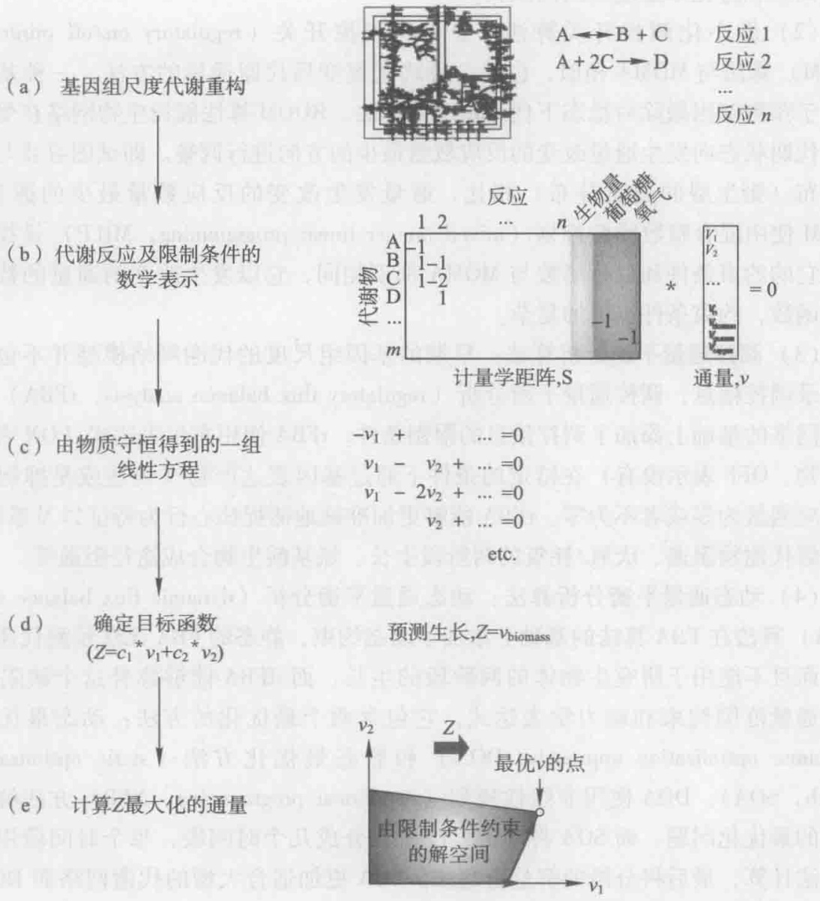

<details>
<summary>flowchart</summary>

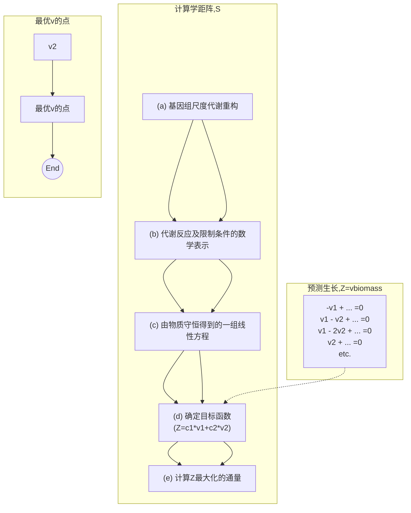
</details>

图7-6 FBA算法的组成

（a）代谢网络重构包含计量系数平衡的化学反应列表；（b）通过计量系数矩阵 $S$ 将重构网络转化为数学模型，其中每行代表一个代谢物，每列代表一个反应，细胞生长通过生物量合成方程的形式添加到重构网络中，该方程表示了合成生物量过程中代谢物的消耗情况。交换反应用于表示代谢物在细胞内外的流通，例如葡萄糖和氧吸收；（c）稳态条件下，每个反应的通量用 $Sv = 0$ 表示，由此定义了系统的线性方程，大规模模型中包含的反应多于代谢物，因而这些方程的解不唯一。（d）通过解方程预测最大生长速率，目标函数需定义为 $Z = c^{T}v$ （$c$ 是向量的权重，表示每个反应 $v$ 对于目标函数的贡献），准确地说，当一个反应，例如生物量合成反应，作为目标函数进行最大化或最小化时，$c$ 是一个在目标反应位置值为1，而在其他位置值为0的向量。在生长最优化的例子中，目标函数是 $Z = v_{\mathrm{biomass}}$ （$c$ 仅在生物量合成反应的位置值为1）；（e）在物质平衡和边界平衡约束的解空间内，目标函数最大化或最小化的通量分布用线性规划来求解。粗箭头表明 $Z$ 增加的方向，优化解尽量位于这个方向上最远的位置，细箭头表示线性规划过程，该过程确定了边上或解空间某一位置上的优化点

好，但突变体则不然。FBA 模拟的是生物拟稳态条件下满足目标函数最优的通量分布，但是它没考虑到在突变或环境条件改变的情况下最优化的目标函数可能改变，因此一个名为最小化代谢调整（minimization of metabolic adjustment, MOMA）的算法产生了。MOMA 算法是假设生物网络在受到扰动时，代谢状态向代谢反应通量改变总量最小的方向进行调整。即调整之后的通量分布与野生型菌株的通量分布之差最小。MOMA 可以提供更为准确的突变菌体的生长表型的预测结果，有助于理解细胞如何

---

176

7 基因组学与基因组尺度代谢网络模型

通过调控和进化来适应基因的缺失。

（2）最小化调控开关算法:最小化调控开关（regulatory on/off minimization, ROOM）算法与 MOMA 相似，也是一种确定突变后代谢通量的方法，一种基于约束的用于预测基因敲除后稳态下代谢情况的算法。ROOM 算法假设生物网络在受到扰动时，代谢状态向发生通量改变的反应数量最少的方向进行调整。即试图寻找与标准通量分布（野生型的通量分布）相比，通量发生改变的反应数量最少的通量分布。ROOM 使用混合整数线性规划（mixed integer linear programming, MILP）寻找通量分布，它的约束条件和目标函数与 MOMA 都不相同，它以发生改变的通量的数量作为目标函数，约束条件也更加复杂。

（3）调控通量平衡分析算法:早期的基因组尺度的代谢网络模型并不包含基因组转录调控信息，调控通量平衡分析（regulatory flux balance analysis, rFBA）算法在代谢网络的基础上添加了调控信息的限制条件，rFBA 使用布尔表达式（ON 表示有基因产物，OFF 表示没有）在给定的条件下通过基因表达产物（表达或是抑制）来约束反应通量为零或者不为零。rFBA 能够更加准确地捕捉核心行为特征以及系统特点，如分解代谢物阻遏、厌氧/耗氧的两阶段生长、氨基酸生物合成途径阻遏等。

（4）动态通量平衡分析算法:动态通量平衡分析（dynamic flux balance analysis, dFBA）算法在 FBA 算法的基础上添加了动态约束，静态的 FBA 无法预测代谢物的浓度，而且不能用于研究生物体的两阶段的生长，而 dFBA 能够弥补这个缺陷。dFBA 包含通量范围约束和动力学表达式，它包含两个最优化的方法:动态最优化方法（dynamic optimization approach, DOA）和静态最优化方法（static optimization approach, SOA）。DOA 使用非线性规划（non-linear programming, NLP）方法解决整个过程的最优化问题，而 SOA 将分批发酵阶段分成几个时间段，每个时间段用线性规划方法计算，最后将分段的解整合起来。SOA 更加适合大型的代谢网络而 DOA 可以帮助设计遗传修饰的代谢网络。

（5）OptKnock 算法:为了更加准确地模拟生物体的代谢表型，提供可靠的预测结果用于生物实验的设计，一些目标函数和约束条件同时优化的算法相继被提出。使用多个目标函数对于研究代谢工程让生物体执行特定功能可能更有价值。OptKnock 算法耦合了生物量合成最大化和代谢产物最大化，因此是一个双目标最优化算法。利用此方法模拟分析导致产物过量合成的基因敲除策略，得到的结果与实验数据非常吻合，对于代谢工程上菌种优化有很好的指导意义。

随着研究者们对于代谢网络的理解逐步深入，更多的参数和约束条件被引入到代谢网络的优化算法中，表7-3中列出了目前应用于代谢网络模型模拟预测的主要算法（Zomorrodi et al. 2012）。

表 7-3 模型预测的优化算法

| 算法 | 功能 |
| --- | --- |
| FBA | 计算物种的代谢能力 |
| rFBA | 将调控扩展到 FBA 中 |
| SR-FBA | 将调控扩展到 FBA 中 |

---

7.3 基因组尺度代谢网络模型的重构过程

177

续表

| 算法 | 功能 |
| --- | --- |
| dFBA | 将动力学扩展到FBA中 |
| OptKnock | 双目标最优化算法 |
| GIMME | 确定特定细胞类型在特定环境中无活性的反应 |
| PROM | 融合转录调控网络和基于约束的模型 |
| MOMA | 计算基因扰动的通量响应 |
| ROOM | 计算基因扰动的通量响应 |
| ObjFind | 确定与实验通量测量一致的假定目标函数 |
| BOSS | 确定与实验通量测量一致的假定目标函数 |
| FVA | 确定网络中每个反应的最大和最小通量值 |
| fastFVA | 确定网络中每个反应的最大和最小通量值 |
| FCF | 确定反应网络中的通量耦合集 |
| FFCA | 确定反应网络中的通量耦合集 |
| F2C2 | 确定反应网络中的通量耦合集 |
| SL Finder | 确定基因组尺度模型中的合成致死基因 |
| OptMeas | 确定满足通量解释的检测方法集 |
| 13C-FLUX | 代谢通量分析(metabolic flux analysis, MFA)计算 |

美国加州大学圣地亚哥分校的 Palsson 教授课题组提出了基于约束的重构和分析框架，其英文全称为 Constraint Based Reconstruction and Analysis，简称 COBRA（Feist, et al. 2009）。该实验组在该框架的基础上开发了以 matlab 软件为运行环境的 COBRA 工具包（Becker et al. 2007, Schellenberger et al. 2011），COBRA 工具包包含了 FBA、MOMA 等常用算法，可以用于最优化分析、基因必需性预测、通量可变性分析等。COBRA 模型用逻辑表达式来表示基因-蛋白质-反应之间的复杂联系。COBRA 工具包的模型结构包含如下信息:

## 基本信息

rxns:反应名称的简写或反应 ID；顺序与 S 矩阵对应；

mets:代谢物名称的简写或代谢物 ID；顺序与 S 矩阵对应；

S: 计量学矩阵的稀疏表示;

rev:数组，“true”表示可逆反应，“false”表示不可逆反应；

lb:相应反应的通量下限；

ub:相应反应的通量上限；

c: 相应反应的目标系数;

metCharge: 相应代谢物的电荷值;

metFormulas: 代谢物的化学式;

rules: 相应反应的布尔规则，反映了基因-反应关系；

genes: 模型中所有基因的列表;

rxnGeneMat:以行表示反应，以列表示基因的矩阵；

grRules:包含每个反应基因 - 蛋白质 - 反应信息；

---

178

7 基因组学与基因组尺度代谢网络模型

subSystems:包含每个反应的子系统信息；

description:描述模型信息的字符串，例如，模型名称。

## 附加信息

rxnNames: 相应反应的全称;

rxnReferences:包含每个反应对应应文献信息的元胞数组；

rxnECNumbers:催化反应的酶对应的 EC 编号；

rxnNotes:包含附加反应信息的元胞数组；

confidenceScores: 每个反应的可信分数;

proteins: 每个反应对应的蛋白质;

metNames: 相应代谢物的全称;

metChEBIID: 相应代谢物的 ChEBI ID;

metKeggID: 相应代谢物的 KEGG ID;

metPubChemID: 相应代谢物的 Pub Chem ID;

metInChIString: 相应代谢物的 InChI String。

目前 COBRA 框架已被用于为数十种微生物建立大规模的代谢网络模型，并在模拟和分析中提供了很有价值的信息。利用 COBRA 中的 FBA 算法能够进行生长速率计算、替代底物计算、辅因子和生物合成前体计算、替代优化解计算、鲁棒性分析、表象相平面分析、基因敲除模拟、合成生物量前体的必需基因预测等。例 7-3\~7-10 分别举例介绍了利用 COBRA 工具包进行的几种分析和计算。

通过将模拟的结果和实验结果相比对，我们可以完善得到的模型。对于结果不一致的，一方面可能是模型不够完善导致的结果差异；另一方面，模拟的结果可能揭示了一些我们尚未研究到的内容。因此模拟验证、修正模型、修正后再模拟验证是个循环往复的过程，直到模拟结果的准确率满足要求后，一个物种的基因组尺度代谢网络模型才算最终构建完成。

例 7-3 利用大肠杆菌核心模型分别计算大肠杆菌在好氧和厌氧条件下以葡萄糖为唯一碳源时的最大生长速率。大肠杆菌对葡萄糖的最大吸收速率是 $18.5 \mathrm{mmol} \cdot \mathrm{g} \mathrm{DW}^{-1} \cdot \mathrm{h}^{-1}$，采用 FBA 算法。

解:模拟采用的工具是 COBRA 工具包，大肠杆菌核心模型的 SBML 文件下载于 http://gcrg.ucsd.edu/Downloads/EcoliCore，文件名称为 ecoli\_core\_model.xml，核心模型默认的设置是以生物量合成为目标函数，葡萄糖为唯一碳源。

首先，读入模型（本例之后的例题中读入模型步骤省略），在 matlab 中输入:

model = readCbModel('C:\ecoli\_core\_model.xml',1000,'SBML');% 模型存储于 C 盘根目录下;

之后，设置葡萄糖最大吸收速率为  $18.5 \, mmol \cdot g \, DW^{-1} \cdot h^{-1}$ ，在 matlab 中输入:

model = changeRxnBounds(model,'EX\_glc(e)', -18.5,'l'); % 该语句将葡萄糖吸收速率的下限 ('l') 设置为 -18.5，葡萄糖交换反应的名称为 EX\_glc(e);

## (1) 好氧条件下

氧吸收速率设为最大值，在 matlab 中输入:

model = changeRxnBounds(model,'EX\_o2(e)', -1000,'l'); % 该值将氧吸收速率设定得足够大，因而不会因氧供应而限制细胞生长；

---

7.3 基因组尺度代谢网络模型的重构过程

179

设置目标函数，在 matlab 中输入:

model = changeObjective(model,'Biomass\_Ecoli\_core\_w\_GAM');% 生物量合成反应的名称为:Biomass\_Ecoli\_core\_w\_GAM;

利用 FBA 求解生物量合成方程最大化问题，在 matlab 中输入:

FBAsolution = optimizeCbModel (model, 'max');

在计算结果中，FBAsolution.f给出目标函数的值为1.6531，这表明模型预测的最大生长速率为 $1.6531\ h^{-1}$ ，最优解时的通量分布由FBAsolution.x给出，由该分布可以看出糖酵解途径、磷酸戊糖途径、TCA循环和氧化磷酸化途径的通量值较高，而有机副产物则没有合成（图7-7a）。

(a) 葡萄糖吸收

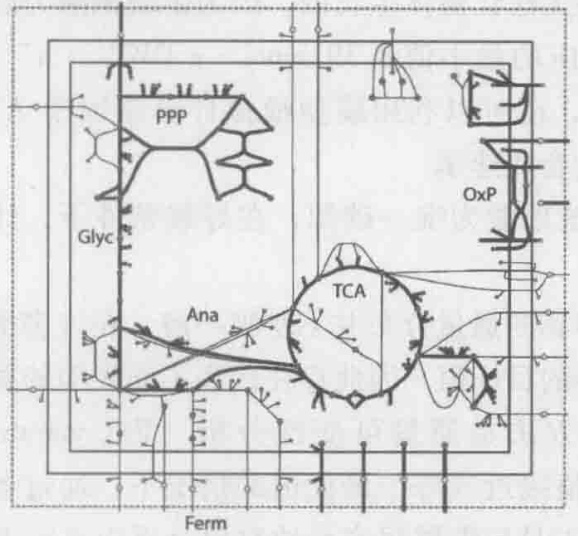

<details>
<summary>chemical</summary>

Diagram of a chemical reaction system showing enzymatic steps including PPP, Glyc, Ana, TCA, and OxP with labeled components
</details>

(b) 葡萄糖吸收

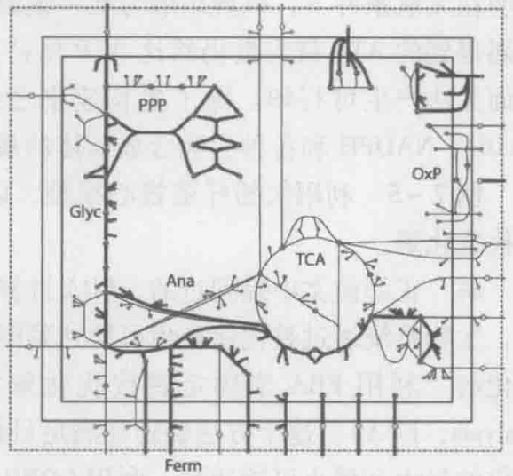

<details>
<summary>chemical</summary>

Molecular structure diagram of a lipid bilayer with labeled components: PPP, Glyc, Ana, TCA, and OxP, showing lipid backbone and membrane connections.
</details>

图7-7 FBA计算得到的通量分布图（彩图见插页）

在两个条件下，粗箭头表示反应具有通量，细箭头表示没有通量的反应。（a）E.coli核心模型在好氧条件下以最大化生长速率为目标函数的通量分布图；（b）E.coli核心模型在厌氧条件下以最大化生长速率为目标函数的通量分布图。Glyc:Glycolysis；PPP:pentose phosphate pathway；TCA:TCA cycle；OxP:oxidative phosphorylation；Ana:anaplerotic reactions；Ferm:fermentation pathways

## (2) 厌氧条件下

计算厌氧条件下的最大生长速率，只需将氧吸收速率限定为  $0 \, mmol \cdot g \, DW^{-1} \cdot h^{-1}$  即可，其他程序与好氧条件下相同。修改氧吸收速率的 matlab 程序如下:

$$
\text {model} = \text {changeRxnBounds} (\text {model}, ^ {\prime} \mathrm{EX} _ {-} \mathrm{o2} (\mathrm{e}) ^ {\prime}, 0, ^ {\prime} 1 ^ {\prime});
$$

氧交换反应的下限设为0，因此氧不再进入代谢系统中，同样执行optimizeCbModel函数，得到的结果是 $0.4706\ h^{-1}$ ，比好氧条件下小得多。通量分布表明在厌氧条件下氧化磷酸化途径没有被利用，而副产物乙酸、甲酸和乙醇被合成出来（图7-7b）。

例 7-4 利用大肠杆菌核心模型分别计算大肠杆菌在好氧和厌氧条件下以琥珀酸为唯一碳源时的最大生长速率。大肠杆菌对琥珀酸的最大吸收速率是  $20 \, mmol \cdot g \, DW^{-1} \cdot h^{-1}$ ，采用 FBA 算法。

## (1) 好氧条件下

首先在上述好氧条件模型的基础上，需将碳源由葡萄糖改为琥珀酸，即将葡萄糖交换反应的下限设置为0，将琥珀酸交换反应（'EX\_ succ (e) '）的下限设置为-20，之后用optimizeCbModel函数进行计算。Matlab程序如下:

---

180

7 基因组学与基因组尺度代谢网络模型

```matlab
model = changeRxnBounds(model,'EX_glc(e)',0,'1');
model = changeRxnBounds(model,'EX_succ(e)', -20,'1');
FBAsolution = optimizeCbModel(model,'max');
```

计算得到的结果为  $0.8401 \, h^{-1}$ 。

## (2) 厌氧条件下

在厌氧条件下，需将氧交换反应的下限设为  $0 \, mmol \cdot g \, DW^{-1} \cdot h^{-1}$ ，并用 optimizeCbModel 函数进行计算，在上面模型的基础上，在 matlab 中输入:

```txt
model = changeRxnBounds(model,'EX_o2(e)',0,'1');
```

```matlab
FBAsolution = optimizeCbModel(model,'max');
```

计算结果为0，FBAsolution.x为空集，即没有可行解。在这种情况下，FBA预测表明在无氧条件下，以琥珀酸为唯一碳源是无法让菌体生长的。因为由琥珀酸为底物代谢得到的ATP最大量仍然比ATP维持反应的最小值 $8.39\mathrm{mmol}\cdot \mathrm{g}\mathrm{DW}^{-1}\cdot \mathrm{h}^{-1}$ 小，因而无法产生可行解。除了生长速率之外，还可以利用模型模拟计算辅因子ATP，NADH，NADPH和各种生物合成前体的最大合成速率。

例7-5 利用大肠杆菌核心模型，以琥珀酸为唯一碳源，在好氧条件下，计算替代优化解。

解:正如前文中提到过的，FBA 计算得到的通量分布并不是唯一解，在许多情况下，生物系统通过替代途径也可能达到同样的目标值，因此存在代表不同表型的替代优化解。利用 FBA 来确定替代优化解的方法是通量可变性分析（flux variability analysis, FVA）。这个方法确定在满足目标值接近或等于最优值的情况下，通过各个反应的最大和最小可能通量。利用 COBRA 工具包能够很容易地对单个反应进行 FVA 计算。首先，用 changeRxnBounds 函数、changeObjective 函数和 optimizeCbModel 函数按照例 7-4 中的方法进行 FBA 计算。得到目标函数的最优值（FBAsolution.f），之后将目标函数的上下限都设定为最优值，再将要考察的反应设为目标函数，用 FBA 分别对这个新的目标函数进行最大化和最小化计算。结果将得到该反应在达到最优目标函数值的情况下的最小和最大可能通量。

以苹果酸脱氢酶反应（ME1）为例，计算得到该反应的最小可能通量为0 mmol·g DW $^{-1}$ ·h $^{-1}$ ，最大可能通量为6.49 mmol·g DW $^{-1}$ ·h $^{-1}$ ，在一个替代优化解中，ME1反应是被利用的，而在另一个中，该反应根本不使用。对ME1反应进行FVA分析的代码如下:

```matlab
model = changeRxnBounds(model,'EX_glc(e)',0,'l');
model = changeRxnBounds(model,'EX_succ(e)', -20,'l');
FBAsolution = optimizeCbModel(model,'max');
model = changeRxnBounds(model,'Biomass_Ecoli_core_w_GAM',FBAsolution.f,'b');
model = changeObjective(model,'ME1');
FBAsolutionMin = optimizeCbModel(model,'min');
FBAsolutionMax = optimizeCbModel(model,'max');
```

COBRA 工具包包含一个叫做 fluxVariability 的函数，该函数能够用于对模型中的任意反应进行 FVA 计算。当在琥珀酸为唯一碳源的条件下，对 E. coli 核心模型中的每个反应都进行 FVA 计算后，发现有 8 个反应的最大和最小通量是不同的，即这些

技术应用7-1
大肠杆菌辅因子和各种生物合成前体合成速率的模拟计算

---

7.3 基因组尺度代谢网络模型的重构过程

181

反应的通量是可以变化的（表7-4）。对可变反应的深入分析表明将L-苹果酸（matate）转化为丙酮酸（pyruvate）可以通过几条不同的途径来实现，每个途径都能够达成相同的最大生长速率。用这些途径的组合得到的通量分布也是可行解。其中两个替代优化解如图7-8所示。

表 7-4 好氧条件下以琥珀酸为唯一碳源（吸收速率 = 20 mmol · g DW $^{-1}$ · h $^{-1}$ ）
生物量合成为目标函数得到的可变反应\*

| 反应 | 最小通量/(mmol·g $DW^{-1} \cdot h^{-1}$) | 最大通量/(mmol·g $DW^{-1} \cdot h^{-1}$) |
| --- | --- | --- |
| FRD7 | 0 | 972.77 |
| MDH | 13.56 | 20.06 |
| ME1 | 0 | 6.49 |
| ME2 | 7.17 | 13.67 |
| NADTRHD | 0 | 6.49 |
| PPCK | 3.93 | 10.42 |
| PYK | 0 | 6.49 |
| SUCDi | 27.23 | 1000 |

\* 每个反应的最大和最小可能通量都在最大生长速率的前提下计算，表中仅列出了通量有变化的反应。FRD7（fumarate reductase）和SUCDi（succinate dehydrogenase）在模型中总是具有很高的通量值，因为他们形成了一个循环，因而能够承载任何通量，从生理上来讲，这些通量值是没有意义的。其他可变反应是:MDH（malate dehydrogenase），ME1（malic enzyme（NAD）），ME2（malic enzyme（NADP）），NADTRHD（NAD transhydrogenase），PPCK（phosphoenolpyruvate carboxykinase）和PYK（pyruvate kinase）。

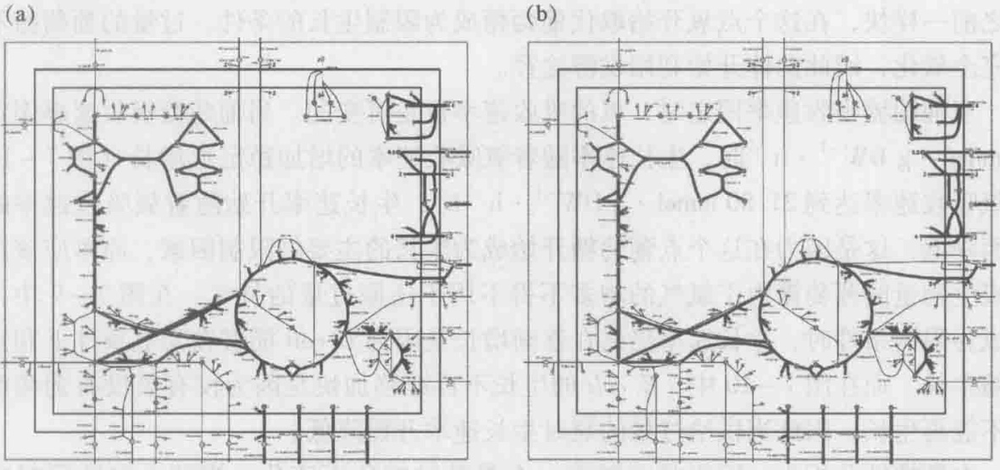

图7-8 好氧条件下以琥珀酸为唯一碳源达到生长最大化的两个替代解通量图（彩图见插页）

（a）将 L-苹果酸转化为琥珀酸使用的是反应 ME1；（b）将 L-苹果酸转化为琥珀酸使用的不是 ME1，而是反应 PYK，两条替代途径用红色表示

例7-6 利用大肠杆菌核心模型，以葡萄糖为唯一碳源，分别进行生长速率对葡萄糖吸收速率以及氧吸收速率的鲁棒性分析。

解:FBA算法可用于鲁棒性分析，在这个分析中，通过反应的通量是可变的，随着该反应通量的改变，计算最优目标函数值的变化。计算结果表明目标函数对特定反

---

182

7 基因组学与基因组尺度代谢网络模型

应的敏感性大小。利用鲁棒性分析能够对多种反应和目标函数的组合进行研究。本题中涉及的底物吸收对生长速率影响的分析是其中之一。

为了确定不同葡萄糖吸收速率对生长的影响，首先用 changeRxnBounds 函数将氧吸收速率（EX\_o2（e））设定为适当的值，本例中设定为  $-17\ mmol \cdot g\ DW^{-1} \cdot h^{-1}$ ，然后用一个 for 循环将葡萄糖交换反应的上下限分别设定为从 0 变动到  $-20\ mmol \cdot g\ DW^{-1} \cdot h^{-1}$ ，并用 optimizeCbModel 函数通过 FBA 算法对每个吸收速率计算对应的生长速率。并将计算得到的生长速率存储在 Mtalab 中。COBRA 工具包包含一个名为 robustnessAnalysis 的函数，可以用于鲁棒性分析，进行鲁棒性分析的代码如下:

```matlab
model = changeRxnBounds(model,'EX_o2(e)', -17,'b');
growthRates = zeros(21,1);
for i = 0:20
    model = changeRxnBounds(model,'EX_glc(e)', -i,'b');
    FBAsolution = optimizeCbModel(model,'max');
    growthRates(i + 1) = FBAsolution.f;
end
```

将计算结果绘制成图（图7-9）。正如我们所知，当葡萄糖吸收速率为 $0\ mmol\cdot g\ DW^{-1}\cdot h^{-1}$ 时，最大生长速率也为 $0\ h^{-1}$ 。生长速率在葡萄糖吸收速率小于 $2.83\ mmol\cdot g\ DW^{-1}\cdot h^{-1}$ 时一直保持 $0\ h^{-1}$ ，因为此时葡萄糖的供给量过小，系统合成的ATP无法满足ATP维持反应（ATPM）的下限 $8.39\ mmol\cdot g\ DW^{-1}\cdot h^{-1}$ 。一旦葡萄糖的供给量足够满足ATP的需要，生长则开始随着葡萄糖吸收速率的增长而快速增加，在葡萄糖吸收速率达到 $7.59\ mmol\cdot g\ DW^{-1}\cdot h^{-1}$ 左右时，生长速率的增长不再像之前一样快，在这个点氧开始取代葡萄糖成为限制生长的条件。过量的葡萄糖不能够完全氧化，因此菌体开始利用发酵途径。

当葡萄糖吸收速率固定时，氧的吸收速率也是可变的。当葡萄糖吸收速率固定在 $10\mathrm{mmol}\cdot \mathrm{g}\mathrm{DW}^{-1}\cdot \mathrm{h}^{-1}$ 时，生长速率随着氧吸收速率的增加稳定地增长（图7-10）。当氧吸收速率达到 $21.80\mathrm{mmol}\cdot \mathrm{g}\mathrm{DW}^{-1}\cdot \mathrm{h}^{-1}$ 时，生长速率开始随着氧吸收速率的增加而降低，这是因为在这个点葡萄糖开始成为生长的主要的限制因素，原本应该用于合成生物量的葡萄糖由于氧气的增多不得不用于还原过量的氧气。在图7-9中，当氧成为限制条件时，生长速率仍然在逐渐增长是因为E.coli能够在无氧条件下利用葡萄糖生长。而在图7-10中，E.coli的生长不再继续加快是因为仅有氧没有葡萄糖细胞不能再生长，因此当供给过量的氧时生长速率开始降低。

在鲁棒性分析中，网络状态随着一个参数的变化而变化。当两个参数同时变化时，也可以计算网络状态的变化，并将结果绘制为表型相平面图。这些图能够以很有趣的方式揭示两个反应之间的联系。表型相平面的计算与鲁棒性分析有相似之处，不同的是表型相平面计算中用两个 for 循环取代了一个 for 循环来表征两个反应的变化。

正如不同环境条件下的生长能够利用 FBA 模拟一样，同样能够通过改变反应的上下限来进行基因敲除的模拟。当模拟一个基因敲除时，它对应的一个或多个反应被设定为不承载任何通量。通过将反应的上下限同时设置为  $0 \, mmol \cdot g \, DW^{-1} \cdot h^{-1}$  来表示反应被彻底敲除，即该反应不再有通量。E. coli 核心模型跟其他基于约束的模型一样，都包含基因-蛋白质-反应关系（GPRs）列表，即一个描述模型中基因与反应

◆ 技术应用 7-2
表型相平面分析

---

7.3 基因组尺度代谢网络模型的重构过程

183

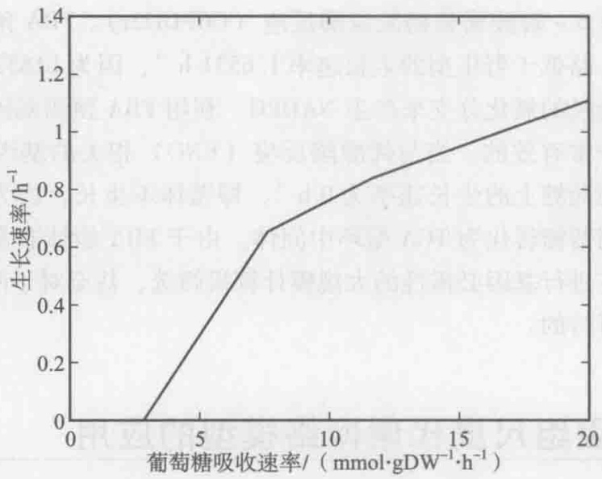

<details>
<summary>line</summary>

| 葡萄糖吸收速率 \((mmol \cdot gDW^{-1} \cdot h^{-1})\) | 生长速率 \((h^{-1})\) |
| --- | --- |
| ~3 | 0 |
| ~7.5 | ~0.65 |
| ~12 | ~0.84 |
| 20 | ~1.1 |
</details>

图7-9 在氧吸收固定为 $17\mathrm{mmol}\cdot \mathrm{gDW}^{-1}\cdot \mathrm{h}^{-1}$ 时最大生长速率随葡萄糖吸收速率变化的鲁棒性分析

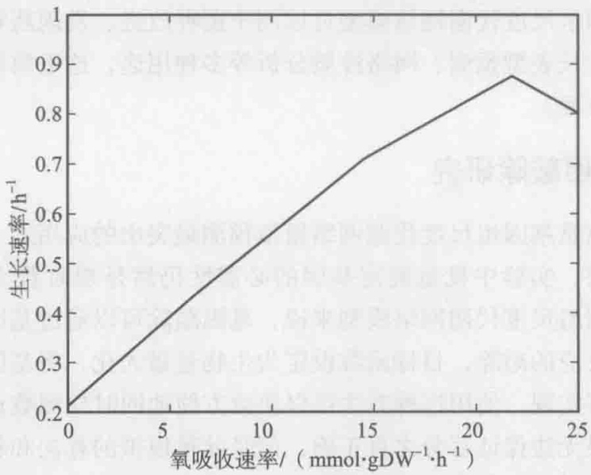

<details>
<summary>line</summary>

| 氧吸收速率 \((mmol \cdot gDW^{-1} \cdot h^{-1})\) | 生长速率 \((h^{-1})\) |
| --- | --- |
| 0 | 0.2 |
| 15 | ~0.71 |
| 22 | ~0.88 |
| 25 | 0.8 |
</details>

图7-10 在葡萄糖吸收固定为 $10\mathrm{mmol}\cdot \mathrm{gDW}^{-1}\cdot \mathrm{h}^{-1}$ 时最大生长速率随氧吸收速率变化的鲁棒性分析

之间联系的布尔规则列表。当一个反应被同工酶（催化相同反应的不同酶）催化时，相关的 GPR 包含 “or” 规则，其中任何一个或几个基因敲除不会影响到反应的进行。例如，磷酸果糖激酶反应（PFK）的 GPR 是 “b1723（pfkB） or b3916（pfkA）”，所以根据布尔规则，如果要限制该反应没有通量则 pfkB 和 pfkA 两个基因必须同时敲除。当一个反应被一个包含多个必需亚基的蛋白催化时，GPR 包含 “and” 规则，只要其中的任何基因被敲除，反应都会被限定为 0 通量。例如琥珀酰辅酶 A 合成酶反应（SUCOAS）的 GPR 为 “b0728（sucC） and b0729（sucD）”，因此敲除其中的任何一个基因都会限制该反应。代谢网络中，有些反应仅由一个基因产物催化，而在一些复杂的关系中，有些反应可能与 10 个甚至更多的基因相关。

COBRA 工具包中包含一个名为 “deleModelGenes” 的函数，该函数用 GPRs 来限制反应，这样就可以用 FBA 来预测基因敲除后模型的表型。例如，在以葡萄糖为底物的好氧生长条件下，可以计算 b1852（zwf）基因敲除时 E. coli 的生长速率，b1852

---

184

7 基因组学与基因组尺度代谢网络模型

技术应用7-3利用大肠杆菌代谢模型模拟预测必需基因及进行双基因敲除模拟

基因对应的反应是6-磷酸葡萄糖脱氢酶反应（G6PDH2r）。FBA预测的菌体生长速率是 $1.6329\mathrm{h}^{-1}$，略低于野生型的生长速率 $1.6531\mathrm{h}^{-1}$，因为b1852敲除后，菌体无法利用磷酸戊糖途径的氧化分支来产生NADPH。利用FBA预测基因敲除的表型对于预测必需基因是非常有效的。当与烯醇酶反应（ENO）相关的基因b2779（eno）被敲除时，菌体在葡萄糖上的生长速率为 $0\mathrm{h}^{-1}$，即菌体不生长，因为没有这个酵解反应，细胞无法将葡萄糖转化为TCA循环中间体。由于FBA能够非常快速地计算细胞表型，因此利用它进行基因必需性的大规模计算机筛选，甚至对于两个或多个基因同时敲除的筛选是可行的。

## 7.4 基因组尺度代谢网络模型的应用

基因组尺度代谢网络模型是代谢工程的重要工具之一，通过结合计算机模型模拟和湿实验，可以从系统角度分析生物系统，更深入地了解生物系统中各个组分间的相互作用机制。基因组尺度代谢网络模型可以用于菌种改进、发现药物靶点、代谢工程操作靶点识别、生长表型预测、网络性质分析等多种用途，这里简单介绍此类模型应用最广泛的几个方面。

## 7.4.1 基因敲除研究

基因敲除研究是基因组尺度代谢网络模拟预测最突出的应用之一。即使现在高通量技术发展得很快，实验中批量确定基因的必需性仍然是费时费力的，而且成本很高。然而对于基因组尺度代谢网络模型来说，基因敲除可以通过基因-蛋白质-反应相互关系转化为反应的敲除，目标函数设定为生物量最大化，将基因对应的反应通量人为设定成0即可实现。使用这种方法可以快捷方便地同时检测数百个基因是否是必需基因，虽然结果无法保证百分之百正确，但是此种模拟的算法和相关技术都已经很成熟，模式生物模型的准确率基本上都可以达到80%以上，因此已经基本上成为重构基因组尺度代谢网络必做的模拟工作。

模拟得到的必需基因结果与实验结果进行比对也是验证模型精确率的一个重要方法，然而由于批量实验验证必需基因难度不小，目前很多物种的必需基因都没有得到实验验证，此类验证模型的方法也无法实施。但是对于一些常用的物种如大肠杆菌、枯草芽胞杆菌、酿酒酵母等有很多必需基因已经通过实验证实（DEG:http://tubic.tju.edu.cn/deg/），对于这些物种来说，此项模拟结果的精确度往往是一个基因组尺度代谢网络模型质量高低的标准。干、湿实验比对结果又可以分为4类:TP（true positive，实验和模拟结果都为正）、TN（true negative，实验和模拟结果都为负）、FP（false positive，实验为必需基因，模拟为非必需基因）和FN（false negative，实验为非必需基因，模拟为必需基因）。其中FP和FN往往能提供模型完善的重要靶点，产生这些差异结果的主要原因有:基因组尺度代谢网络缺乏调控机制，没有考虑物种内的拓扑结构，网络中存在断口，目标函数中的组分不全，培养基组分设定不合理，没有考虑胞内代谢物过量积累的毒素效应，缺乏一些胞内非代谢过程，错误的基因注释，实验数据不准确，等等。这些原因会提供大量改进模型和设计实验的靶点。

---

7.4 基因组尺度代谢网络模型的应用

185

例 7-7 利用大肠杆菌基因组尺度代谢网络模型 iJO1366 确定网络中的必需基因，计算中采用 FBA 算法。

解:COBRA 中必需基因判定的函数为 singleGeneDeletion，iJO1366 的 SBML 文件对于基本培养基、葡萄糖吸收速率及非生长关联维持能都已经进行了设定，因而只需进行单基因敲除的计算即可，在 matlab 中输入如下程序:

model = readCbModel('C:\msb201165 - s3.xml', 1000, 'SBML'); % 读入模型，模型 SBML 文件名称为 msb201165-s3.xml，存在 C 盘根目录下；

[grRatio, grRateKO, grRateWT, hasEffect, delRxns] = singleGeneDeletion(model,'FBA');

%单基因敲除计算，算法为FBA；

其中，grRatio 表示基因敲除菌和野生菌生长速率的比值；grRateKO 表示基因敲除后菌体的生长速率，单位为  $h^{-1}$ ；grRateWT 表示野生菌的生长速率；hasEffect 表示基因删除是否对模型中的反应有所影响，“0”表示没有影响，“1”表示有影响；delRxns 表示基因敲除后删除的相应反应。

确定某基因是否为必需基因的判定标准是该基因敲除后菌体生长速率是否为0，因而需查看的是grRateKO的值，由于iJO1366模型中共包含了1366个基因，因而grRateKO是一个 $1366 \times 1$ 的向量，每个值代表对应基因敲除后的菌体生长速率，而对应基因的列表存储在model.genes中，将二者对应起来，计算使菌体生长速率为0的基因数，即为模型中的必需基因数。需要注意的是，由于计算的误差，结果中可能出现一些趋近于0的极小值，因而需设定一个参数来定义“菌体生长速率为0”的取值范围，本例中设定绝对值小于或等于 $1 \times 10^{-8}$ 的值等同于菌体生长速率为0。

在上面的计算结果中，grRateKO 中共有 207 个零值，即有 207 个必需基因，这些基因的编号如表 7-5 所示。

表 7-5 必需基因模拟结果

| b0003 | b0133 | b0423 | b0914 | b1264 | b2315 | b2746 | b3189 | b3729 | b3990 |
| --- | --- | --- | --- | --- | --- | --- | --- | --- | --- |
| b0004 | b0134 | b0475 | b0915 | b1277 | b2316 | b2747 | b3196 | b3730 | b3991 |
| b0009 | b0142 | b0522 | b0918 | b1281 | b2320 | b2750 | b3198 | b3770 | b3992 |
| b0025 | b0154 | b0523 | b0928 | b1288 | b2323 | b2751 | b3199 | b3771 | b3993 |
| b0029 | b0159 | b0524 | b0954 | b1415 | b2329 | b2752 | b3200 | b3774 | b3994 |
| b0031 | b0166 | b0639 | b1062 | b1662 | b2400 | b2762 | b3201 | b3804 | b3997 |
| b0052 | b0173 | b0720 | b1091 | b1693 | b2472 | b2763 | b3255 | b3805 | b4005 |
| b0071 | b0174 | b0750 | b1092 | b1740 | b2476 | b2764 | b3256 | b3807 | b4006 |
| b0072 | b0175 | b0774 | b1093 | b1812 | b2478 | b2780 | b3359 | b3809 | b4013 |
| b0073 | b0179 | b0775 | b1094 | b2019 | b2499 | b2818 | b3360 | b3843 | b4039 |
| b0074 | b0180 | b0776 | b1096 | b2020 | b2507 | b2827 | b3368 | b3850 | b4040 |
| b0085 | b0181 | b0777 | b1098 | b2021 | b2515 | b2838 | b3389 | b3924 | b4160 |
| b0086 | b0182 | b0778 | b1131 | b2022 | b2530 | b2942 | b3412 | b3939 | b4177 |
| b0087 | b0185 | b0781 | b1136 | b2023 | b2557 | b3018 | b3433 | b3941 | b4214 |
| b0088 | b0369 | b0783 | b1208 | b2024 | b2564 | b3040 | b3607 | b3957 | b4245 |

---

186

7 基因组学与基因组尺度代谢网络模型

续表

| b0090 | b0386 | b0784 | b1210 | b2025 | b2574 | b3041 | b3608 | b3958 | b4261 |
| --- | --- | --- | --- | --- | --- | --- | --- | --- | --- |
| b0091 | b0414 | b0785 | b1215 | b2026 | b2585 | b3058 | b3633 | b3959 | b4262 |
| b0096 | b0415 | b0826 | b1260 | b2103 | b2599 | b3172 | b3634 | b3960 | b4407 |
| b0103 | b0417 | b0827 | b1261 | b2153 | b2600 | b3176 | b3639 | b3967 |  |
| b0109 | b0420 | b0907 | b1262 | b2311 | b2615 | b3177 | b3642 | b3972 |  |
| b0131 | b0421 | b0908 | b1263 | b2312 | b2687 | b3187 | b3648 | b3974 |  |

## 7.4.2 发现药物靶点

基因组尺度代谢网络可以用于药物研发，包括药物靶点识别、抗菌药物的研发和疫苗的改良。其中人类和致病菌的基因组尺度代谢网络尤为重要，因为很多人类疾病都与人的代谢紊乱以及致病菌的代谢机制密切相关。通过使用人类与致病菌的代谢网络模型进行模拟研究，可以深入了解人在疾病状态下的代谢情况，从而可以有针对性地采用一些医疗措施，对药物的研发也有很大帮助。基于约束的通量平衡分析不仅能够反映代谢网络各个组分之间的相互作用关系，同时也能够检验基因或代谢物的必需性以及基因或代谢物敲除对细胞生长的影响。例如，对生物鲁棒性的扰乱和分析是预测药物靶点的重要方法之一，长期的进化使生物系统具有了一定的鲁棒性，而抗菌药必需扰乱病原体的鲁棒性，从而达到有效地抑制其生长的目的，因而，鲁棒性成为预测药物靶点的重要突破点。目前已经有研究表明从代谢物的角度出发，利用基因组尺度代谢网络模型对必需代谢物进行计算机预测，能够为药物靶点的确定提供重要参考，代谢物必需性分析预测了能够使细胞死亡的必需代谢物，而这些代谢物的结构相似物则可能成为重要的药物靶点，通过必需代谢物的预测，能够大幅减少药物靶点筛选的工作量。

## 7.4.3 指导菌体改进和代谢工程

由于生物体中网络的刚性和冗余性，单一基因的改造往往得不到预期的效果。而基因组尺度代谢网络考虑生物体整体代谢，可以从更大范围内了解代谢过程和一些基因操作后的效果，因此对于优良工程菌的构建以及代谢工程操作都具有重大的意义。迄今为止，已经有很多研究通过基因组尺度代谢网络指导进行基因操作和工程菌构建、生产生物能源、生物基化学品及高附加值产品，表7-6给出了部分实例。

表 7-6 应用基因组尺度代谢网络模型改良工程菌

| 产物 | 菌种 | 方法 |
| --- | --- | --- |
| 乳酸 | 大肠杆菌 | OptKnock |
| 琥珀酸 | 大肠杆菌 | FBA |
| 琥珀酸 | 瘤胃细菌 | FBA, MoMA |
| 番茄红素 | 大肠杆菌 | FBA |
| 番茄红素 | 大肠杆菌 | FSEOF |

◆ 技术应用 7-4
应用代谢物必需性分析预测药物靶点

---

7.4 基因组尺度代谢网络模型的应用

187

续表

<table><tr><td>产物</td><td>菌种</td><td>方法</td></tr><tr><td>L-苏氨酸</td><td>大肠杆菌</td><td>MoMA</td></tr><tr><td>L-缬氨酸</td><td>大肠杆菌</td><td>FBA</td></tr><tr><td>乙醇</td><td>酿酒酵母</td><td>FBA</td></tr><tr><td>乙醇</td><td>酿酒酵母</td><td>dynamic flux balance analysis</td></tr><tr><td>乙醇</td><td>热纤梭菌</td><td>FBA</td></tr><tr><td>苹果酸</td><td>酿酒酵母</td><td>FBA</td></tr><tr><td rowspan="2">1,2,4-三氯(代)苯(+)-儿茶酚</td><td>大肠杆菌</td><td>FBA,BNICE</td></tr><tr><td>大肠杆菌</td><td>FBA, MoMA</td></tr><tr><td>无色氰定</td><td>大肠杆菌</td><td>FBA, MoMA</td></tr><tr><td>1,4-丁二醇</td><td>大肠杆菌</td><td>OptKnock</td></tr></table>

需要强调的是，当实验的目标产物并非野生菌自身能够合成的代谢物时，菌种改进的第一步是引入合成目标产物的途径，以2011年发表在Nature Chemical Biology上的一篇文章为例（Yim, et al. 2011），该文利用大肠杆菌全基因组尺度代谢网络模型iJR904，在最小培养基条件下，以葡萄糖为底物，设计了提高1,4-丁二醇（1,4-butanediol, BDO）产量的基因敲除方案。首先需要明确的是，大肠杆菌本身是没有1,4-丁二醇合成途径的，因而解决该问题的第一步是引入1,4-丁二醇合成途径，之后才能够进行优化计算。解决步骤如下:

（1）在不同培养基条件下，从不同底物合成1,4-丁二醇的途径有所不同，并且即使是同一底物，合成途径也可能有很多种，因而首先需确定培养基和底物，之后通过途径的筛选确定最优合成途径，文章中设定培养基为最小培养基，底物为葡萄糖。

（2）利用 Simpheny Biopathway Predictor 软件计算从大肠杆菌中心代谢物开始到 1,4-丁二醇的所有可能路径。Biopathway Predictor 算法是基于已知化学组成的功能团转化来进行计算的。因而，计算过程中不局限于使用的酶，针对特定底物，可以得到已有的酶，也可以得到非天然存在的工程酶。利用该软件得到了 10 000 个包含 4\~6 步反应的路径，这些路径从常用的中心代谢物出发合成 1,4-丁二醇，例如乙酰辅酶 A（acetyl-CoA），α-酮戊二酸（α-ketogultarate），琥珀酰辅酶 A（succinyl-CoA）和谷氨酸盐（glutamate），

（3）路径筛选。筛选路径的依据有1,4-丁二醇的最大理论产量，途径长度，外源步骤数量，新步骤数量以及热力学合理性。筛选的步骤如下:

① 首先根据基团贡献理论计算热力学参数，并去除热力学不合理的路径。

② 根据基于约束的模型计算 1, 4 - 丁二醇的理论得率，去除理论得率降低的路径。

上述两步之后，剩下的路径数为最初的10%。

③ 根据 KEGG、EcoCyc 等数据库确定路径中目前没有记录的酶的数量，之后根据无记录酶数量最少、外源步骤最少、自中心代谢物起合成路径总步骤最少得优先顺序对路径进行筛选。

---

188

7 基因组学与基因组尺度代谢网络模型

最终，通过上述方法，筛选后确定了以4-羟丁酸盐（4-hydroxybutyrate）为中间代谢物的路径为最优先路径。4-羟丁酸盐可以由两种中心代谢物合成:琥珀酸和α-酮戊二酸（图7-11），图7-11中（2）和（7）步为大肠杆菌本身包含的反应，其他灰框标注的反应都由外源基因编码的酶催化。

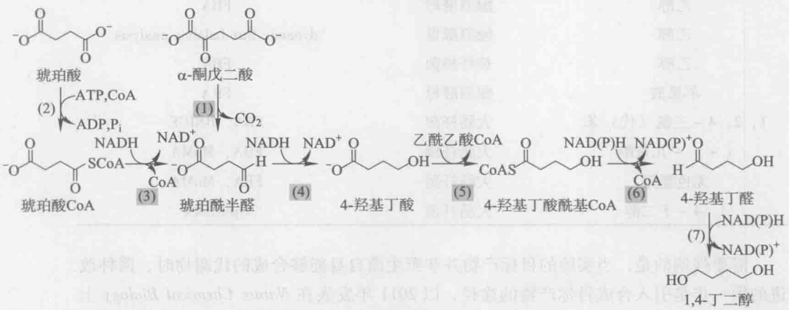

<details>
<summary>chemical</summary>

Reaction pathway of 1,4-dimethylbenzaldehyde showing intermediates and enzymatic reactions with labeled steps (1–7)
</details>

图7-11 引入大肠杆菌的1,4-丁二醇合成途径

催化每个步骤的酶如下:（1）2-酮戊二酸脱羧酶（2-oxoglutarate decarboxylase）；（2）琥珀酰辅酶A合成酶（succinyl-CoA synthetase）；（3）依赖辅酶A的琥珀酸半醛脱氢酶（CoA-dependent succinate semialdehyde dehydrogenase）；（4）4-羟丁酸脱氢酶（4-hydroxybutyrate dehydrogenase）；（5）4-羟丁酰辅酶A转移酶（4-hydroxybutyryl-CoA transferase）；（6）4-羟丁酰辅酶A还原酶（4-hydroxybutyryl-CoA reductase）；（7）乙醇脱氢酶（alcohol dehydrogenase）

(4) 通过网络优化确定基因敲除方案。确定具有 BDO 合成功能的途径只是对菌体进行代谢工程设计的第一步, 之后为了提高 BDO 的产率, 需要对宿主菌的代谢进行优化, 以使碳源和能量更多地用于 BDO 合成。因而接下来可以通过对基因敲除结果的模拟计算提高 BDO 合成量的最优方案。基因敲除对于目标产物产生的影响可以通过 OptKnock 算法进行计算, OptKnock 算法将 1,4-丁二醇产量和菌体生长耦合并计算总体的最大理论产量。OptKnock 的计算结果给出了敲除 4 个基因的最优路径, 这 4 个基因是: 乙醇脱氢酶 (alcohol dehydrogenase, adhE), 丙酮酸甲酸裂解酶 (pyruvate formate lyase, pfl), 乳酸脱氢酶 (lactate dehydrogenase, ldh) 和苹果酸脱氢酶 (malate dehydrogenase, mdh)。根据模型预测, 在厌氧条件下, 保持菌种生长速率最大的前提下, 这 4 个基因敲除后 1,4-丁二醇的得率达到 $0.37 \mathrm{~g} / \mathrm{g}$ 。在这个设计中, 自然发酵条件下的产物乙醇、甲酸、乳酸和琥珀酸合成受阻, 因而迫使 1,4-丁二醇的合成量提高以平衡氧化还原力。

## ? 思考题

1. 各种组学数据是如何融入基因组尺度代谢网络的重构及应用中的？
2. 基因组尺度代谢网络模型重构过程包括哪几个步骤？
3. 基因组尺度代谢网络模型还可以有哪些方面的应用？

---

推荐阅读

189


## 推荐阅读

- 1. Thiele I, Palsson B. A protocol for generating a high-quality genome-scale metabolic reconstruction. Nature Protocols, 2010, 5 (1): 93–121.
- 详细叙述了构建一个高质量基因组尺度代谢网络模型需要的步骤，对每一个步骤的目的和方法进行了详细的解释，并对于原核生物和真核生物在构建过程中的差别进行了叙述。
- 2. Oberhardt M A, Palsson B, Papin J A. Applications of genome-scale metabolic reconstructions. Molecular Systems Biology, 2009, 5: 320.
- 从另一个角度详细介绍了基因组尺度代谢网络模型的应用方向，从融合组学数据、指导代谢工程、科学发现导向、多物种关系分析及网络性质挖掘五个方面出发，对于每种应用，都给出了相应的实例进行叙述和分析。
