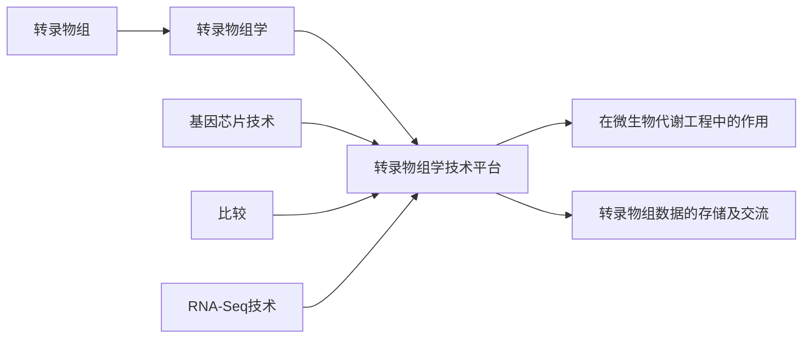
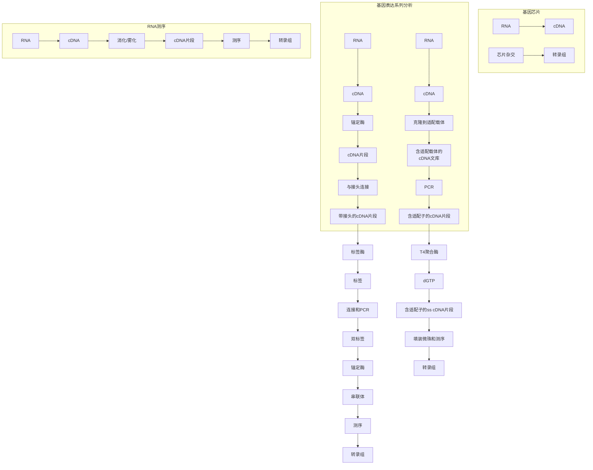
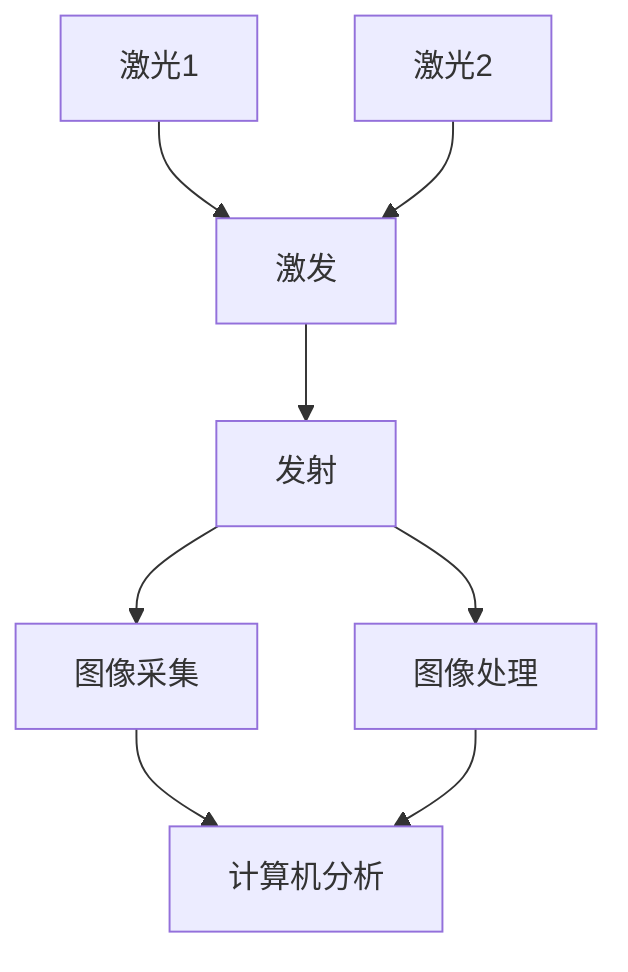
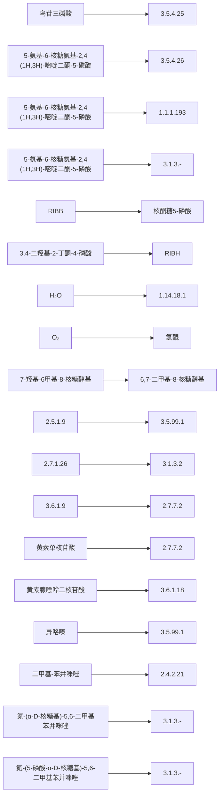
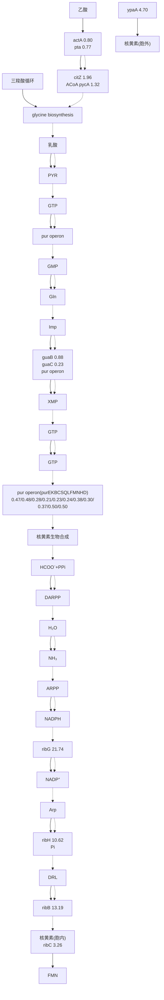
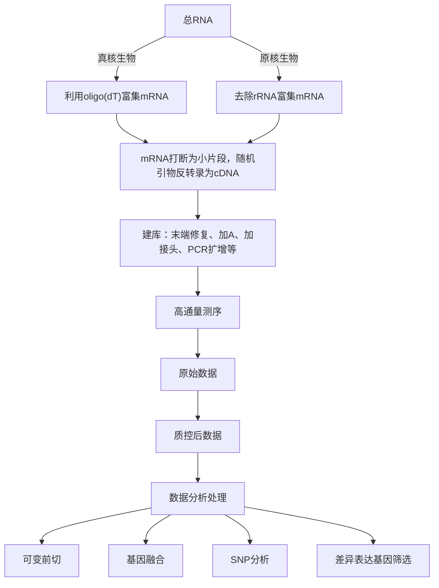

# 8 转录物组学技术与代谢工程

原始 PDF 第 210–235 页。

## 8

natural_image

Abstract illustration of a DNA double helix structure (no text or symbols)

# 转录物组学技术与代谢工程

## 【本章学习要点】

1. 转录物组与转录物组学的概念
2. 几种转录物组学分析平台技术及比较
3. 转录物组学技术在微生物代谢工程中的应用

中心法则中，由 DNA 经由转录过程生成转录物的过程是非常重要的一环，而转录物在 DNA 携带遗传信息与蛋白质行使功能之间，起着重要的承上启下的作用。经过很多年的努力，科学家们已经发展了多种针对转录物及转录物组进行研究的技术手段。

---

8.1 转录物组与转录物组学

191

## 知识导图

flowchart

## 8.1 转录物组与转录物组学

## 8.1.1 转录、转录物组与转录物组学

转录（transcription）:读取基因组上 DNA 的遗传信息而合成 RNA 的过程称为转录过程。RNA 转录产物（transcripts）有 mRNA、rRNA、tRNA 和小分子 RNA，在生命行使功能时起到重要作用（Ganem 1987），其中 mRNA 可被用作蛋白质合成的模板，其他 RNA 也会部分参与蛋白质合成过程。

转录物组（transcriptome）:细胞中所有转录产物的总称，即某一细胞在特定时间的基因表达情况。

转录物组学（transcriptomics）:研究转录物组的产生和调控规律的科学就称为转录物组学。与基因组相比，转录物组是动态的，同一细胞的转录物组在不同的生长时期和生长环境下是不完全相同的。转录物组也常称为转录组，而转录物组学也常称为转录组学。细胞的功能是从基因的表达开始的，转录组可高通量地获得基因表达的有关信息，从而可以揭示基因表达与一些生命现象之间的内在联系。据此我们可以高通量表征细胞生理活动规律，确定细胞代谢特性。尽管利用转录组数据高通量检测基因表达水平仅仅有20余年的历史，但转录组学已广泛应用于细胞生命和代谢过程的研究；用于疾病发生机制、诊断和预测的研究；用于药物筛选、作用机制及抗药性的研究；用于新基因的发现；用于环境毒性物质的监控。

基因转录水平检测技术可追溯到 Southern 印迹杂交技术，即 DNA-DNA 之间通过碱基配对机制形成互补链，随后又发展出 Northern 印迹，RT-PCR，RNase-protection assays, differential display, RDA（representational difference analysis）等。但它们不能

---

192

8 转录物组学技术与代谢工程

应用于高通量分析，只能提供细胞内有限的生理信息，已不能满足当前的需求。

## 8.1.2 转录物组学平台技术

为了高通量并行分析基因的表达情况，各种转录组平台技术得到迅速发展，主要包括:基因芯片技术（microarray）、基因表达系列分析技术（serial analysis of gene expression, SAGE）、大规模平行测序技术（massively parallel signature sequencing, MPSS）以及最新提出的RNA测序技术（RNA sequencing, RNA-Seq）。这些平台技术工作流程如图8-1所示，本章主要介绍基于基因芯片（microarray）的转录组学平台技术及基于RNA测序（RNA-Seq）的转录组学平台技术。

flowchart

图8-1 主要转录组技术平台工作流程示意图（史硕博等2010）

## 8.2 基于基因芯片技术的转录物组分析

基因芯片技术通过杂交过程来检测核酸，是对已用于核酸定性、定量研究数十年的 Southern 印迹杂交技术和 Northern 印迹杂交技术杂交方法的进一步发展。基因芯片就是根据试验目的和要求，将设计好的检测探针固定在固相支持物上（常用的固相支持物有玻璃、尼龙膜、石英片等载体），并与溶液中的互补靶标发生反应而显现杂交印迹，最后，通过扫描及计算机分析即可获得样品中大量的基因序列及表达信息，以达到快速、高效、高通量地分析生物信息的目的。1995 年，斯坦福大学的 Schena 等（1995）在 Science 杂志上发表论文首次报道了利用基因芯片技术检测拟南芥植株不同组织及不同处理后多个基因的表达水平，显示了基因芯片技术在基因转录表达领域的巨大潜力。Schena 等的工作第一次将高精度机械手点样技术、荧光标记技术、双

---

8.2 基于基因芯片技术的转录物组分析

193

通道荧光扫描技术以及数据分析软件结合在一起，标志着基因芯片时代的来临。目前，基因芯片开发制造商 Affymetrix、Agilent 等许多公司推出了多种物种的商业化基因芯片（http://www.affymetrix.com; http://www.genomics.agilent.com），为从分子水平和系统观念研究复杂的生物系统提供了一个新的视野。我国也成立了专门的生物芯片公司致力于生物芯片的研究、开发及产业化（http://www.capitalbio.com）。

按其探针制备方法，目前基因芯片主要有两类，一类是 cDNA 基因芯片（cDNA chip）（图 8-2a），另一类是寡核苷酸基因芯片（oligonucleotides chip）（图 8-2b）。基因芯片制备过程中涉及的一些术语如下:

探针（probe）:基因芯片上的核酸分子，能和溶液中的互补靶标发生反应。

靶标（target）:溶液中的标记核酸分子，能与芯片上的互补探针发生反应。

杂交（hybridization）:两条核酸互补链通过 A—T 和 G—C 碱基配对形成 DNA 双链的过程称为杂交。

图8-2 两类不同基因芯片的制备及应用示意（Schulze et al. 2001）

## 8.2.1 cDNA 基因芯片技术

## 8.2.1.1 探针

cDNA 基因芯片探针通过 PCR 方法扩增，然后用精密机械手点样系统把 PCR 扩增产物精确分配到经过化学修饰（常见的为氨基修饰、醛基修饰、异硫氰基修饰等）

---

194

8 转录物组学技术与代谢工程

的固相支持物上组成 cDNA 基因芯片，多用合成后点样法及电子定位法制备。cDNA 基因芯片探针的长度及通量可以任意选择，灵活性大，可根据需要自行制备，在各个实验室得到普及应用，此外包括 Affymetrix、Agilent、中国的博奥生物等公司出售商品化的 cDNA 基因芯片，可以根据客户需要进行个性化定制。

## 8.2.1.2 靶标

通过反转录制备 cDNA 基因芯片靶标。首先提取两种条件下细胞的两种 mRNA 样本，一种 mRNA 样本（通常为对照样本）反转录成 cDNA 并用绿色荧光素（Cy3）标记，另一种 mRNA 样本（通常为实验样本）反转录成 cDNA 并用红色荧光素（Cy5）标记，这些标记分子可在特定的波长范围内被激发出荧光。这些荧光标记的 cDNA 分子即为 cDNA 基因芯片靶标。

## 8.2.1.3 杂交

如图8-2a所示，将带有不同荧光标记的靶标混合，然后把标记混合物加到cDNA基因芯片上，与探针杂交。杂交反应可根据具体芯片和样本优化其反应条件，如靶标浓度、温度、盐浓度等。根据碱基互补原理，标记的靶标即可与芯片上互补的探针杂交结合。待充分杂交后，清洗芯片，然后通过激光扫描仪用不同波长扫描芯片并获取荧光图像，此后还需图象处理软件处理各杂交点的光密度值、面积、光密度比和各种形式的背景噪声使之变成一个数据阵列。数据阵列中荧光强度值反映了细胞中对应基因的表达水平（图8-3）。通常将两种样本的荧光信号叠加，叠加后，图像为黄色的点表明来自两个样本的基因以相同水平表达；图像为红色的点表明红色荧光素（Cy5）的信号大于绿色荧光素（Cy3）的信号，表明该基因在实验样本中的表达量较高，图像为绿色的点则相反，差异大小可通过目的基因的两种荧光

flowchart

图8-3 cDNA基因芯片荧光信号的产生与叠加（Duggan et al. 1999）（彩图见插页）

强度的比值检测出来。如比较酵母细胞在厌氧与好氧条件下的基因表达差异，基因A在厌氧条件下得到表达（红色荧光信号值为1200个单位），好氧条件下受到抑制（绿色荧光信号值为300个单位），表明基因A在厌氧条件下比好氧条件下的表达提高了 $1200/300=4$ 倍，叠加图像上相应的点为红色。

---

8.2 基于基因芯片技术的转录物组分析

195

## 8.2.2 寡核苷酸基因芯片技术

## 8.2.2.1 探针

如图8-2b所示，寡核苷酸芯片探针其制备方法以直接在固相支持物上进行原位合成（in situ synthesis）为主，每平方厘米的探针密度可达上百万。有几种不同的制备工艺，最主要的是Affymetrix公司的专利技术:光引导化学合成法。光引导化学合成法通过一组光掩模定位，将不同碱基的核苷酸按不同次序化学偶联在相应的位点，可以用很少的步骤合成极其大量的高密度探针阵列（图8-4）。具体方法是在经过处理的基质载体表面涂有一层具有光敏保护基团的连接分子，用掩模保护不需要合成的部位，而暴露合成部位。在光束作用下，暴露的合成部位将失去光敏保护基团，从而被活化，接着引入的核苷酸可结合在活化部位，从而可在预设的合成部位连接核苷酸，而引入的核苷酸也带有光敏保护基团，以便下一步合成。由于光掩模成本较高且有光衍射现象发生，NimbleGen公司芯片制作采用无膜芯片合成技术原位合成寡核苷酸探针（图8-5），该法利用微镜晶片反射光束以替代光掩模，显著降低成本，同时提高了芯片密度。微镜晶片由上百万的微镜片组成，每个微镜片都可受控在投射图像上产生一个亮的或暗的像素，起到掩模让光束通过或不让光束通过的功能。

flowchart

图8-4 光引导化学合成法示意图（Venkatasubbarao 2004）

通过一组光掩模定位，将各种碱基的核苷酸按A、C、G、T的次序化学偶联在相应的位点

寡聚核苷酸探针的长度通常为30\~80 bp，具有较高特异性，与其他基因同源区较小，但是仍有一定的可能性发生非特异性结合。为了避免探针可能具有非特异性交叉杂交，Affymetrix公司提出了匹配/错配（perfect match/mismatch）探针对（图8-6）:每一个探针都由一对探针对组成，其中一个是完全匹配的，另外一个是有一个错配的。与匹配探针相比，错配探针在其中央位置有一个单点突变，将匹配探针与错配探针之间的差值作为信号强度，有助于高灵敏度、高准确性确定特异性杂交信号，保证了多张芯片间比较的有效性和可靠性。此外，寡聚核苷酸探针对应一个基因转录产物的探针并非一个，而是一个探针组，这样可以避免碱基组成对杂交效率的影响。探针组设计可以了解到基因各个部位的信号值情况，真核生物RNA从3'端开始降解，故转录物3'端和转录物5'端信号值比值还可作为判断样品RNA是否降解的指标。

---

196

8 转录物组学技术与代谢工程

flowchart

图8-5 无膜芯片合成技术原位合成示意图（Venkatasubbarao2004）

text_image

5' mRNA 参考序列
3'
间隔的DNA探针对
参考序列
…TGTGATGGTGGGAATGGGTCAGAAGGACTCCTATGTGGGTGACGAGGCC
AATGGGTCAGAAGGACTCCTATGTGGGTG 完全匹配寡核苷酸
AATGGGTCAGAAGGACTCCTATGTGGGTG 错配寡核苷酸
荧光强度图 完全匹配探针
错配探针

图8-6 寡聚核苷酸探针设计（Lipshutz et al. 1999）

## 8.2.2.2 靶标

如图 8-2b 所示，同样通过反转录制备寡聚核苷酸芯片靶标。首先提取两种条件下细胞的两种 mRNA 样本，分别反转录为 cDNA，然后再次分别体外转录合成生物素标记的 cRNA，并将其片段化为 35\~200 个碱基大小的片段，即为寡聚核苷酸芯片靶标。杂交前需将 cRNA 片段化，是获得信号最佳灵敏度的关键步骤。与 cDNA 基因芯片不同的是，寡聚核苷酸芯片靶标的标记物只有一种一生物素。生物素可以与相应的亲合素结合（如结合化学发光底物酶、荧光素等），得到最初的杂交信号。这种方法避免了绿色荧光素（Cy3）或红色荧光素（Cy5）对反转录的抑制能力，可以提高标记效率。

## 8.2.2.3 杂交

如图8-2b所示，将带有生物素的寡聚核苷酸芯片靶标加到寡聚核苷酸芯片上，

---

8.2 基于基因芯片技术的转录物组分析

197

与探针杂交。杂交反应可根据具体芯片和样本优化其反应条件，如靶标浓度、温度、盐浓度等。杂交结束的芯片分别被扫描仪扫描可以得到各自的灰度图，每个点代表一个基因，其信号强度（亮度）反映其对应基因的表达强度。与 cDNA 基因芯片不同的是，杂交实验中与寡核苷酸芯片杂交的是单个样本，而不是 cDNA 基因芯片中测量样本与对照样本的混合物。cDNA 基因芯片的双色法只能比较同一张芯片上两个样本间转录水平差异，确定两个样本间量的差异，芯片间的比较并不可靠，而寡聚核苷酸芯片可以定量确定某一样本的转录水平，可以比较不同芯片间样本的转录水平。

杂交结束的芯片经 Affymetrix 的扫描仪读取数据点后，经图象处理软件处理各杂交点的光密度值、面积和光密度比等数据可使目的芯片阵列图象变成一个数据阵列，再去除图像上的污点以及其他形式的噪声可得到决定相应基因的表达情况的数据。根据每个基因的匹配/错配（perfect match/mismatch）探针组信号值的计算得出各自的显著性 P 值，用来判断样本中有无特定基因的表达，如图 8-7 所示的区间:P 值落在 0\~0.04 被视为存在对应基因的表达（present），落在 0.06\~0.1 被视为不存在（absent），0.04\~0.06 之间的被认为是处于存在与不存在的临界状态（marginal），这些点的可信度将受到质疑，如果对这些点代表的基因感兴趣，需要用其他小通量，高灵敏度的方法独立验证。

scatter

| Category | P-value (range) |
| --- | --- |
| 存在 | 0.005~0.025 |
| 临界状态 | 0.04~0.06 |
| 不存在 | 0.07~0.095 |

图8-7 差异表达基因 $P$ 值示意图

值得注意的是，P 值为 0.04 表明相对于整个基因组来说，存在 4% 的基因为假阳性特异表达。例如，对于酿酒酵母（S. cerevisiae）而言，其基因组约有 6000 个基因，P 值若选为 0.04，则在所有表达差异显著的基因中有 240 个的可信度将受到质疑。因此为避免这类因素所造成的影响，近年来许多文献选择 P 值为 0.01 作为筛选标准。在 P 值的基础上有些文献将基因表达水平的差异（通常用倍数来表示）作为辅助筛选基因特异性表达的依据。其基本依据为如果倍数在 0.7～1.5 之间，则其呈现的特异性表达数据可能是由于背景噪声所导致，因此其可信度将受到质疑，需要进一步分析确认。对于利用倍数来辅助判定的方法还需要进一步验证，目前并未得到普遍的采用。

基因芯片在判定基因的特异性表达方面的作用与可信度已毋庸置疑，但其缺点是:因实验条件的限制，其测定数据和真实的特异性基因的表达水平（倍数）相比偏低。因此，有些文献在系统分析基因芯片数据后，还进一步对筛选出的特异表达基因进行 RT-PCR 验证。

## 8.2.3 芯片数据分析

基因芯片产生了大量的基因表达数据，从这些纷繁的数据中识别所蕴含的生物学意义成为一个新的难题和热点。探针设计和图像扫描分析的软件较成熟，由相应的芯

---

198

8 转录物组学技术与代谢工程

片公司开发。对于深层次的数据分析，其相关报道有很多，除了明确研究目的以及了解必需的生物学背景，还必须结合不同的统计分析软件、程序语言、数学统计模型进行分析，如 R 语言、dChip、Matlab、MultiExperiment Viewer、GeneSpring GX 等。许多软件或程序语言现在已经有了相应的软件包或相应的命令集合来处理基因芯片数据，如 R 语言中用于读取芯片数据和数据可靠性分析的 affy 软件包、用于确定基因特异性表达的 gplots 和 limma 软件包，用于聚类分析的 apcluster 软件包以及用于数据 GO terms 分析的 GOstats 软件包等。

## 8.2.3.1 芯片数据的归一化与可靠性分析

基因芯片实际实验中存在系统误差，造成的原因有很多，包括荧光染料本身的物理和化学差异性、反转录制备靶标时效率的差异、芯片上探针序列及位置的差异等，使直接比较芯片间数据十分困难。为了精确检测到基因表达水平，以及比较芯片间数据，必须尽量减小系统误差的影响，目前大部分采用的方法是对芯片数据进行归一化（normalization）处理。

归一化方法预先选择一组特定的对照基因，这些基因表达水平不变（如看家基因、特定的内标），或者上调和下调的基因具有对称性（如芯片上全部基因），通过调整标准化系数使其平均比值为1，然后将此系数应用于全部的数据以达到归一化芯片上的全部基因。常用的数据归一化包括分位数归一化（quantile normalization），基于探针和探针集信号水平的归一化方法（probelevel and probeset level summarization），百分比平移（percentile shift），依赖信号强度的归一化（intensity dependent，LOWESS normalization）等。执行了数据的归一化以后，可以通过散点图、直方图、柱状坐标图等来比较直观地反映不同批次的样品数据的杂交情况。图8-8a显示对未采取归一化的原始数据作直方图，每个颜色的曲线代表一个芯片数据。从图中可以发现，由于系统误差，即使是针对同一样本，同一批次的不同芯片所呈现的整体表达水平也不尽相同，曲线并不重合。图8-8b显示对已采取归一化的原始数据作图，代表各个芯片数据的曲线基本重合，此时同一组芯片数据总体表达量十分相近，达到分析标准。

图8-8 归一化前后的基因整体表达水平直方图比较

---

8.2 基于基因芯片技术的转录物组分析

199

另外，在芯片设计之初，为了增强测试的准确性和不同批次检测数据的可重复性，芯片上除了包含目标生物的基因探针外，还设计了一些外源基因作为内标，方便多张芯片间有效性、可靠性的比较，也保证了在进行数据归一化处理时能够更好地去除背景噪音以及检测限制所造成的干扰，提高数据的准确性。

在去除背景噪音的影响之后进行具体的数据分析之前，还需分析芯片实验中平行样本之间数据的可靠性分析和每一个芯片数据的可信度，常用分析方法如主成分分析法（principle component analysis）、奇异值分解方法（singular value decomposition）等。如图8-9所示，采用主成分分析法分析一组芯片实验结果，每个点代表一个芯片数据，同一颜色的点代表同一样本，即此实验共有三个样本且每一样本进行了三次重复芯片实验。三个白色点距离较近，每个点所代表的数据可信度较大，其所代表的样本可信度较大；有一个灰色点与其他两个灰色点距离较大，则说明该离散点代表的数据可信度较低，需要将该芯片数据舍弃或替换；而三个黑色点彼此距离较远，所表示的芯片数据和样本可信度很低，需要重新进行实验。

scatter

| Series | 主成分1 (range) | 主成分2 (range) |
| --- | --- | --- |
| Open circles | -0.334~-0.3335 | 0.4~0.5 |
| Solid circles | -0.3345~-0.330 | -0.4~-0.15 |

图8-9 主成分分析法分析一组芯片实验结果

## 8.2.3.2 表达基因的差异分析

基因芯片的主要目的在于发现确定不同样本的基因表达差异。对于 cDNA 芯片，一般用一张芯片上两种荧光染料的比值来衡量基因表达差异；对于寡聚核苷酸芯片，可用不同芯片上的信号比值来衡量基因表达差异。表达差异通常指的是一个基因在两种实验条件下的具有统计学意义的显著性表达改变情况。

当比较两个不同生物样本时，最简单的方法就是根据两个样本的比值来筛选，通常可认为比值在0.5到2之间的基因不存在表达差异，超过该范围的基因则认为表达发生显著改变。不过根据具体实验设计，该筛选标准可以适当调整。比值分析是一种常用的直观的衡量标准，但是该判定比较粗糙，并不能产生最优的结果。有一些基因其表达水平较低，用2倍法比值分析判定容易增大假阳性率；而另一些基因其表达水平较高，用2倍法比值分析判定容易增大假阴性率。

---

200

8 转录物组学技术与代谢工程

另一种分析基因芯片数据和确定差异表达基因的方法基于统计分析中的 $t$ 检验或方差分析。利用多张芯片采用重复实验，采用假设检验，计算表达差异的置信度，来分析两样本是否具有显著性差异。常用的假设检验，包括两个条件下的 $t$ 检验和多个条件下的方差分析以及多元方差分析。通过 $t$ 检验得到的结果中表达差异不显著的基因数目比实际数目较多，趋于保守；方差分析获得的结果较为满意，但是需要细致的芯片实验设计以及繁琐的计算。

目前，除了以上介绍的方法，还有一些其他基于现代统计学而确立的基因差异分析方法（如噪声抽样法、贝叶斯法等）。各种新的方法不断提出，使芯片数据挖掘得到不断进步，然而任何方法都有其特点，只有与生物学意义相结合，才能达到最佳效果。

## 8.2.3.3 表达模式识别

筛选出不同样品中各个基因的差异表达水平后，就需要有相应的方法来对其进行处理以挖掘芯片数据中所包含的巨大生物信息，目前的分析方法主要包括维恩图分析（Venn diagram）、聚类分析（cluster analysis）等。

维恩图分析是一个比较简单而且直观的分析方法，是将在不同表达背景的样本进行两两比对后得到的特异性表达基因做出维恩图，然后选择有生物学意义的子集进行进一步的分析。图8-10为三种表达背景的样本基因表达情况。

donut

| Region | Value |
| --- | --- |
| A | 493 |
| B | 21 |
| C | 348 |
| A & B | 88 |
| A & C | 2028 |
| B & C | 99 |
| A & C & B | 201 |

图8-10 维恩图表示的不同样本中基因表达变化

聚类分析是表达模式识别的有力工具，通过聚类可揭示各种条件下许多功能相关或共表达的基因。聚类分析又称集群分析，它是在没有关于数据的先验知识情况下研究数据分析的一种方法，该法基于样本中各指标之间的相似性。聚类分析就是将性质相似的对象化分到相同的类别，在同一个类别内对象之间具有较高的相似度，不同类别之间的对象差别较大。聚类所说的类不是事先给定的，而是根据数据的相似性和距离来划分，划分前具体到底应分成几类也是不知道的。聚类分析所采用的分类规则是由聚类算法所决定的，其中包括系统聚类法、分解法、自组织作图、神经网络、动态聚类法、模糊聚类法、k-means聚类等（尤元海等，2009）。在基因芯片数据分析中，应用最为广泛的是系统聚类分析法，聚类的对象可以是基因，也可以是不同条件下的生物学样品。

---

8.2 基于基因芯片技术的转录物组分析

201

系统聚类分析法的基本思想是采用类似层层嵌套的形式进行分类，不同的对象根据所使用的距离指标（如相关系数、点积、互信息等）被划分，最相接近的数据点分成一类，然后用同样的方法再计算各类间的距离使之合并成更大的类，较小的类嵌套在较大的类中，形成层层包含的树状形式，树枝的长度可用来评价两组对象的相似程度。常用的距离如皮尔逊相关系数，可计算两个向量的相关性，两个变量之间的相关系数越高，从一个变量去预测另一个变量的精确度就越高，这是因为相关系数越高，就意味着这两个变量的共变部分越多，所以从其中一个变量的变化获知另一个变量的变化的可能性越大。如果两个变量之间的相关系数为1或-1，则完全可由变量X去获知变量Y的值。

系统聚类分析法不仅能够把具有相近的表达模式的基因进行分类，而且可以用图形化的方式表示数据集。如图8-11所示，聚类结果可以用彩色盒图和树状图来直观表示，可便于对表达谱分析结果的理解。从横向的聚类看，是有关基因表达谱的信息，调控类似或功能类似的基因总是聚类很接近，可以找到具有不同表达特征的基因间的相互关系；从纵向上的聚类看，细胞在不同条件下的基因表达谱也是相似地分在一类，能基本反映细胞在不同外部条件下基因表达谱的相似程度，十分有利于研究药物作用机制。值得注意的是，虽然现有的聚类分析法在特定的条件下能提供真实反映数据的结构，但是生物系统的多因素性和非线形性往往被忽视了。此外，样本数也要远远小于基因数，会造成较大的误差，为此一些新的算法仍在不断研究中。

text_image

View Status:
Row: 3129 (B01316587cP_40)
Column: 3 (4-1 vs 108-1)
Value: 0.00852

图8-11 用系统聚类分析法得到的基因芯片数据表达模式（彩图见插页）

聚类分析还可将在不同比对样本中具有相同响应的基因归类。如图8-12a，横坐标代表不同样本，纵坐标与基因的绝对表达水平相关。图中所呈现的不同类别，即为在不同样本中具有相同响应的基因的集合。如在图8-12a聚类1中，相对于参比菌株，在其他菌株中有39个基因表达相对其增加。然后可以对其响应的基因的集合

---

202

8 转录物组学技术与代谢工程

图8-12 用皮尔逊聚类分析法得到的基因芯片数据表达模式

进行重新聚类分析（图8-12b），得到直观的印象。该法可将具有与特定目标基因具有相同变化的类别选出进行具体分析，不仅降低了大规模数据分析的繁琐步骤，同时在揭示基因之间的内部联系方面也起到了很大的作用。

## 8.2.3.4 数据的功能注释与调控

通过基因芯片实验，研究者可以快速得知哪些基因发生了变化。然而，这些差异表达基因的功能，所涉及的分子代谢途径、不同层次多基因表达调控机制的机制，以

---

8.2 基于基因芯片技术的转录物组分析

·203

及所代表的生物学意义，成为研究者所面临的一个关键问题。

目前对单一基因的注释已经开发了很多工具软件，尤其是商业化的芯片生产商提供了相应于其芯片的基因注释信息，如 Affymetrix 公司的 NetAffx、Agilent 公司的 GeneSpring GX 等。提供信息的公司可以把其芯片上对应的基因衔接到众多公开数据库中。目前单一基因的主要功能分析方法基于基因本体论（gene ontology，GO），即一套与基因有关的树状的数据库，其树状分支越细基因的注释也越加详细。通过检索次数据库，用户可一次性获取某个基因的几乎全部已知信息。基因本体论数据库中共有三种分类:分子功能，生物学过程和细胞组分，不同的分类在不同的层次描述相应基因的功能信息。对于已知基因名或蛋白质名的序列，在基因本体论数据库中（http://www.geneontology.org/），只需输入其名称即可检索出该序列的基本信息以及关联图；对于未知基因名或蛋白质名的序列，可以利用基因本体论数据库中 BLAST（basic local alignment search tool）工具进行序列比对而找出拥有近似功能的相关基因。通过基因本体论数据库可以实现功能富集分析，即发现差异表达基因属于哪一个共同的分类，从而分析其如何参与并影响了哪些生物学功能。美国国立卫生研究院（NIH）的研究人员开发的 EASE（expressing analysis systematic explorer）是功能较强大的用于芯片功能分析的工具。EASE 可以发现差异表达基因与哪些 GO 分类相关，提示在某一条件下显著变化的一系列共同作用基因。

对差异基因所涉及的分子代谢途径分析，考虑到生物体内部成分间的整体相互作用，采取系统的观点研究生物，更注重整体，注重各部分间的相互关系。分子代谢途径的重要资源包括京都基因和基因组百科全书（Kyoto encyclopedia of genes and genomes, KEGG）以及 Biocarta 数据库。KEGG 数据库整合当前在代谢网络、分子相互作用、细胞过程等方面的知识，是最为著名的分子代谢途径资源数据库。结合芯片实验数据，研究者可以在 KEGG 数据库中特定的生物学途径中用颜色标记相应的基因，可根据需要绘制途径图，从而直观确定基因芯片中有哪些基因参与了哪些生物学途径。如图 8-13 所示，为 KEGG 数据库中核黄素代谢途径中基因表达变化，灰框标记的为表达水平提高的基因。

flowchart

图8-13 颜色标记的KEGG数据库中核黄素合成途径的基因

---

204

8 转录物组学技术与代谢工程

基因并不只是行使单一的功能，各种基因的表达组合能产生不同的生物学效果。同时，生物代谢调控网络是十分复杂的，分子代谢途径也仅是其中一部分。协同发挥某种特异功能的差异表达基因往往并不局限在某一个途径中，而是分布在不同层次、不同途径的复杂调控网络中。这些往往成为解决、理解生物学现象，增加和获取知识的关键，也受到当前实验手段、数据库、数据分析方法的制约。目前，被多个学术组织共同开发的CytoScape软件是多基因表达调控机制研究的重要工具，可把转录组数据与生物学网络进行整合。用户利用CytoScape软件可以定义特定的亚生物学网络，该亚生物学网络的网络节点描述有哪些基因发生了相互作用。利用MCODE插件，用户可以检索该亚生物学网络在某一条件下是否发生了差异变化，从而发现潜在的基因调控网络。此外，基因芯片表达数据通过结合代谢网络的拓扑结构，以及识别的特征代谢物（reporter metabolites）和特征亚网络（reporter subnetwork），可判断生物调控网络的特征及其中存在的调控关系，揭示不同层次多基因表达、调控和功能的基本规则（Patil et al. 2005）。目前该方法已经建立了在线工具（www.sysbio.se/BioMet/），可以帮助使用者完成简单高效数据功能诠释，如图8-14所示。该在线网络整合了包括特征代谢物、特征亚网络、特征转录因子（reporter factors）、蛋白质间的相助作用以及基因本体论等（Patil et al. 2005, Oliveira et al. 2008）。具体来说，由于细胞在转录水平的上的差异往往与代谢水平上的变化密不可分。能量代谢、辅因子代谢、生物质前体的合成以及胞内的氧化还原水平很大程度上影响了胞内基因水平的表达。特征代谢物分析通过整合和重建基因水平上的代谢网络，提供了一种识别特征代谢物的方法。所谓的特征代谢物，即其能够与变化最为显著的单个或多个基因相作用，从而影响或控制整个细胞对于扰动的响应。特征亚网络即基于蛋白质之间的相互作用，分离出与该扰动相关性很大的代谢子网络。特征亚网络的特征性由 $Z_{\mathrm{score}}$ 来判定，即每个节点的特征变化代表了该条件下整个基因表达水平上最为显著的子网络的集合。特征转录因子分析是将细胞中的所有转录因子其调控蛋白与所有的基因构建成一个完整的网

flowchart

This diagram illustrates the process of a TCA cycle in cell culture, showing how gene expression (FGP), phosphatidylcholine (PFK), and FBP interact with an enzyme to generate a specific transcriptional profile.

图8-14 特征代谢物与特征亚网络示意图（Patil et al. 2005）（彩图见插页）

---

8.2 基于基因芯片技术的转录物组分析

205

络。利用这个网络及芯片数据所得到的特征转录因子，即受其调控的所有基因作为一个整体对于扰动具有较强的响应。基因本体论分析是将特征表达的基因按照其所在的代谢途径，所在区域以及其所具有的功能进行分类，在没有目标基因的情况下找出细胞对该扰动响应最为强烈的代谢途径。

例8-1 利用寡聚核苷酸基因芯片分析产核黄素工程菌的转录组。

高产核黄素工程菌 B. subtilis RH33 是在经过随机诱变菌株基础上构建的工程菌，含有潜在的未知基因突变点。为了揭示 B. subtilis RH33 的高产机制，进一步指导理性代谢工程菌种改进，Shi 等（2009）基于比较转录组分析技术，比较了产核黄素工程菌 B. subtilis RH33 和野生株 B. subtilis 168 转录组水平表达的差异，同时结合基因序列及代谢物分析，利用系统生物学的观点揭示了产核黄素工程菌的特点，在此基础上识别出进一步改良菌种的靶点，并通过实验证实了该靶点对菌株改良的有效性。在产核黄素工程菌 B. subtilis RH33 中核黄素操纵子中所有基因的表达均大幅度上调，这与细胞内核黄素操纵子的剂量较高以及核黄素操纵子表达的反馈调节被解除有直接关系，这些表达提高的核黄素合成基因是核黄素高产的重要原因。与此同时，发现将核黄素转变为 FMN 和 FAD 的编码黄素激酶和 FAD 合成酶的 ribC 基因表达水平也显著提高，似乎这是不利于核黄素积累的因素，为进一步改造的靶点。然而通过随后的基因测序，发现 ribC 基因编码区中的第 596 位碱基由 G 变为了 A，该突变可以导致 RibC 蛋白的黄素激酶活性下降 95%。由于细胞具有鲁棒性，ribC 基因表达增加是对黄素激酶活性显著降低的响应。在工程菌 RH33 中，和硝酸盐利用有关的基因表达几乎全部增强，特别是 narG 操纵子，该操纵子的基因编码硝酸盐还原酶（主要在缺氧状态下表达）。在缺氧状态下，硝酸盐还原为亚硝酸盐，同时可作为无氧呼吸时电子传递链电子受体。nasBC, narGHJI, nasDE 等基因的表达有利于硝酸盐还原反应，从而在一定程度上缓解了厌氧条件下的能量供应。编码硝酸盐还原酶的 nasB 操纵子和亚硝酸盐还原酶的 nasD 操纵子的表达有一定程度的增强，这个结果很好地解释了工程菌 RH33 在核黄素发酵中的最佳无机氮源为硝酸钠的原因。在工程菌 RH33 中，发现包括嘌呤、甘氨酸合成途径相关基因在内的所有 purR 调节子所调节的基因表达均出现明显的下调（图 8-15），相关基因经测序未发现突变，而这些基因主要涉及核黄素前体物合成途径，故其可能成为限制核黄素产量进一步提高的重要原因。研究表明所有受 purR 调节子调控的基因在其 5'端均存在有一段称为 PurR Box 的保守序列，PurR 蛋白可以特异性的和 PurR Box 结合，从而阻遏基因的转录，使转录水平下降。PurR 蛋白上有一个 PRPP 结合位点，当 PRPP 结合 PurR 蛋白后将影响其与 PurR Box 的结合效率，从而在一定程度上解除 PurR 蛋白对目标基因转录的阻遏作用。细胞内 PRPP 的浓度水平对 PurR 蛋白和 DNA 的结合产生重要的影响。继而通过基因修饰，增强工程菌胞内磷酸核糖焦磷酸（PRPP）浓度，解除 PurR 蛋白对其调控基因的抑制作用，增加核黄素前体物的供给，从而使核黄素产量显著提高达 25% 以上。上述研究工作表明通过转录组分析可以发现与表型有关的重要调节子的表达变化，并根据该变化对菌种改造做出相应的合理设计。

---

206

8 转录物组学技术与代谢工程

flowchart

图8-15 核黄素合成及中心碳代谢基因表达情况（Shi et al. 2009）

此图为与野生株 B. subtilis 168 相比，产核黄素工程菌 B. subtilis RH33 的基因表达差异

## 8.3 基于 RNA-Seq 技术的转录物组分析

RNA-Seq 是高通量转录组测序技术的一种，它可以针对 mRNA、小非编码 RNA（small non-coding RNA）以及长非编码 RNA（long non-coding RNA）等，使用高通量测序技术得到它们的序列，进而进行后续的定性和定量分析。RNA-Seq 针对组织或细胞中所有或者某一类 RNA 反转录而成的 cDNA 文库进行测序，可以应用于转录子结构研究（基因边界鉴定、可变剪切研究等），转录子变异研究（如基因融合、编码区 SNP 研究），非编码区域功能研究（non-coding RNA 研究、microRNA 前体研究等），基因表达水平研究以及全新转录子发现，因而使得其在基础研究、临床诊断、疾病机制、代谢调控、分子育种和药物研发等领域得到越来越广泛的应用。

## 8.3.1 RNA-Seq 的原理及实验步骤

将 mRNA 反转录生成 cDNA 后，构建测序文库，通过高通量测序技术对文库进行测序。在获得足够的序列后，将所得序列通过比对（有参考基因组时）或从头组装（de novo assembling）（无参考基因组时）形成全基因组范围的转录谱，进而获得来自不同 mRNA 片段在特定样本中的含量。RNA-Seq 的实验流程如图 8-16 所示，主要包括测序文库的制备、上机测序与测序数据的处理和分析。

## 8.3.1.1 RNA-Seq 测序文库的制备

RNA-Seq 测序最常见的类型是针对 mRNA 的测序实验。以真核生物为例，从提取得到总 RNA 到最终的 cDNA 文库制备，主要步骤有:首先用 oligo（dT）寡聚核苷酸从总 RNA 中富集带有 poly（A）尾巴的 RNA，其中的主要部分就是所需的编码基因所转录的 mRNA；然后将得到的 RNA 片段化，即随机打断为所需大小的片段，再使

---

8.3 基于 RNA-Seq 技术的转录物组分析

207

flowchart

图8-16 RNA-Seq实验流程

用随机引物将 RNA 片段反转录为 cDNA 片段；然后，对得到的 cDNA 片段进行末端修复，并在两端连接上测序接头（adaptor）；一般情况下，接下来还需要切胶回收长度范围在一定范围内（如 200 bp）的 cDNA 片段，再经过 PCR 扩增，最终得到可以用于测序的 cDNA 文库。其他类型的转录子测序中的文库构建过程类似。

## 8.3.1.2 上机测序

自 2005 年以来，以 Roche 公司的 454 技术、Illumina 公司的 Solexa 技术和 Applied Biosystems 公司的 SOLiD 技术为代表的第二代测序技术相继诞生，其主要特点是测序通量高、测序成本及耗时都大幅度下降。目前在几种高通量测序平台中，Illumina/Solexa 平台上的 RNA-Seq 应用最广。Illumina/Solexa 测序技术的基本原理是边合成边测序（sequencing by synthesis, SBS），即测序过程是以 DNA 单链为模板，在生成互补链时，利用带荧光标记的 dNTP 发出不同颜色的荧光来记录待测的碱基。几种常见的高通量平台在测序原理、平均读长、数据量、仪器费用、测序费用、准确率、主要错误类型、运行时间等方面存在各自的不同，具有各自的优、缺点。

## 8.3.1.3 测序数据的处理和分析

高通量的测序数据通常以 FASTQ 格式来记录。原始数据经过质控后，得到质控后数据（clean data），然后需要将所有读段（reads）定位到（mapping）参考基因组上，常用的读段定位软件有 BWA、SOAP 等。根据不同研究目的，接下来需要对数据进行针对性的处理分析，如最常用的差异基因表达筛选中，需要对定位到目标基因上的读段计数，以此来表征目标基因的表达水平。为了实现不同样品的定量可比性，需要保持不同长度的基因以及不同实验批次间基因表达值的可比性，这通常通过归一化处理来实现，常用的方法是计算 RPKM（reads per kilo bases per million reads），即每百万

---

208

8 转录物组学技术与代谢工程

读段中来自于某基因每千碱基长度的读段数，来归一化基因的表达水平。公式为:

$$
\mathrm{RPKM} = \frac {\text {定位到某基因的读段数（transcription reads）}}{\text {基因长度（transcription length）} \times \text {测序深度（total assembly reads in run）}} \times 1 0 ^ {9}
$$

针对其他目的进行的 RNA-Seq，如 SNP 分析、基因融合分析等，需要有针对性的软件进行数据处理分析。

## 8.3.2 RNA-Seq 的技术优势

在高通量测序技术出现之前，不同基因表达水平的高通量测量主要是通过基因芯片，来实现对不同样品的基因表达差异和模式进行分析。RNA-Seq 数据最常见的应用也是检测基因的表达水平，但与基因芯片相比，RNA-Seq 最大的一个优势是:它不一定需要有样品基因组的测序信息，而这是基因芯片所必需的。当没有参考基因组序列时，RNA-Seq 进行的测序称为从头测序（de novo sequencing）。Wang 等（2012）针对尚没有基因组序列的香蕉的一项研究中，从感染的香蕉根部提取 RNA 开始，建立 cDNA 文库，使用 Illumina GAII sequencing 测序平台进行测序，得到超过 2600 万条读段的高质量数据，然后使用 SOAPdenovo 软件进行从头（de novo）组装，间隙填补（gap filling）以及序列数据库比对，共组装得到 25158 个基因序列。研究还对 Foc TR4 感染相对于对照组香蕉样品的基因表达水平进行了对比，发现苯丙氨酸代谢、苯丙生物合成及 α 亚麻酸代谢等途径受到了感染的影响。此外，RNA-Seq 相对于基因芯片还具有其他一些明显的技术优势，如表达信号数字化，灵敏度高，分辨率高至单碱基，基因表达定量范围无饱和区，起始 RNA 用量少，发现新的转录本，并准确地识别可变剪切位点等。

在进行 RNA-Seq 时，一个需要注意的问题是测序的深度问题。细胞中成千上万个转录子，转录子的丰度又存在 $10^{3\sim4}$ 甚至更高的差别，因此决定测序需要的数据量，即深度测序需要测多深对于转录组的覆盖率是很重要的。Haas 等（2012）在 2012 年的一项研究，系统的检查了 RNA-Seq 的读段数（Reads）对单个细菌转录组分析以及样品间基因表达比较的影响。结果显示，使用 Illumina HiSeq 测序仪，一条泳道（lane）产生的数据量，大大地超过了对很多种细菌转录组分析所需的数据。而且，随着测序深度的提高，对那些来自假转录子或基因组 DNA 污染的 cDNA 的检测也会提高。此外，当转录组不是很大时，可以将多个 cDNA 文库分别加上各自的标签（barcode）后混在同一条泳道（lane）测序，这样可以检测到每个样本中的绝大多数 cDNA，对多个样品的混样分析有利于准确鉴定不同样本间的差异表达基因。一般说来，测序过深或过浅都是不好的，应该根据不同的实验目的及物种基因组大小进行合适的选择。

## 8.4 两种转录物组分析平台技术的比较

在功能基因组学的研究中，转录组分析在揭示基因表达调控的复杂性方面总是处于中心位置。经过20多年基因芯片技术的开发与应用，其已经成为一种成熟的技术，提供了极为广泛有用的基因表达信息，超过90多万的基因芯片检测结果储存于基因

---

8.5 转录物组数据的存储及交流

·209

表达数据库供研究者共享。最近，由于新一代测序（next generation sequencing，NGS）技术的迅速发展，转录组研究获得了新的动力。NGS可以进行高通量核酸分子（DNA或RNA）测序，例如DNA-Seq或RNA-Seq。由于RNA-Seq技术的迅速发展，转录组研究的运行成本大大降低。基于杂交的转录组研究主要强调ORF表达的差异，而RNA-Seq能够分析基因组范围的转录，可以提供附加的信息，例如新的转录物smRNA，miRNA以及一些剪切事件。此外，RNA-Seq还可分析已经转录的但是非翻译的区域，这些区域在基因表达中可能是起作用的。为了利用已建立的基因芯片技术平台及其丰富的信息，同时充分发挥RNA-Seq的优势，由Nielsen主导的由多国研究者组成的团队，在国际上首次对基因芯片技术平台及RNA-Seq技术平台进行了全面详细的比较（Nookaew et al. 2012），提供了非常有用的信息。

例8-2 基于RNA-Seq技术与基因芯片技术转录组分析的跨平台比较:以酿酒酵母为例。

微生物初始培养所用的菌株是酿酒酵母 S. cerevisiae CEN. PK-113-7D，其用于 DNA-Seq（Illumina HiSeq 2000 平台）和转录组分析，以减少技术变化及单核苷酸变化（SNVs）。用控制良好的分批培养和恒化培养发酵设备，在两种不同的代谢条件下进行培养。通过三次重复培养，从样品中提取 DNA 和 RNA。所提取的 RNA，平行进行基因芯片技术（Affymetrix 平台）和 RNA-Seq 技术（Illumina HiSeq 2000 平台）转录组分析。DNA-Seq 数据用于识别菌株 S. cerevisiae CEN. PK-113-7D 和参考菌株 S. cerevisiae S288 之间的遗传变化（SNVs 和 indels）。用参考映射法（reference mapping approach）和从头组装法（de novo assembly approach）对 RNA-Seq 数据进行分析。

该研究介绍了通过新一代测序技术得到的转录组数据分析不同方法的综合性对比，也介绍了应用最广泛的两种转录组分析平台技术（RNA-Seq 和基因芯片）之间的横向比较。他们评价了包括在 RNA-Seq 数据分析过程中不同处理步骤的贡献，强调了使用不同的读段-比对器（read-aligners）及不同统计方法的重要性。实验的重复性及不同平台之间结果的一致性都很高。对于在用 RNA-Seq 和基因芯片进行差异基因表达识别中出现不一致的情况，主要是由于在 ORF 上和在基因芯片上发现的遗传变化。

## 8.5 转录物组数据的存储及交流

基因芯片技术必须在精确控制的条件下进行，操作者的素质和水平直接影响着实验结果的精确性。此外，基因芯片初始的实验方案、实验材料、原始扫描图像、图像处理方法和数据归一化方法等信息间的差异妨碍了不同研究人员基因芯片数据间的比较。作为学术论文的补充资料在网上发布了大量的基因芯片数据，对于寡核苷酸芯片数据有的是P/A/M表示，有的是荧光强度值。因为这些数据文件没有包含原始的实验方案、实验材料、原始扫描图像、图像处理方法和数据归一化方法等信息，对于要比较或整合分析来自不同研究小组的基因表达数据是非常困难的。为了解决这个问题，真正实现数据的共享，就必须有一个统一的标准来规范。2001年基因芯片表达数据协会（microarray gene expression data society）提出了基因芯片试验的标准方案，

---

210

8 转录物组学技术与代谢工程

即 MIAME 方案（minimal information about a microarray experiment, www.mged.org/mi-ame），MIAME 方案尝试用最少的信息来描述并建立基因芯片实验数据的标准格式，所有芯片厂家、研究者都采用此标准，促进了基因芯片数据的交流和比较（Brazma et al. 2001）。依照 MIAME 方案进行芯片实验已被全世界的科学工作者、科学期刊及科学团体所广泛认可。

目前因特网上大量转录组学数据主要是利用基因芯片技术产生的，收集、存储基因芯片表达数据的最有影响的三大数据库是 GEO 数据库（gene expression omnibus）、ArrayExpress 数据库和 SMD 数据库（Stanford microArray database）。这三大数据库接受和储存全球研究者根据迈阿密原则提交的基因芯片数据。这三大数据库还包括一些非阵列技术所获取的技术，如基因表达系列分析（SAGE）、RNA 测序（RNA-Seq）技术产生的序列。GEO 数据库是第一个同时也是最重要的微阵列高通量实验数据的公共贮存库，凭着操作简单、数据全面、免费共享等特点，在基因表达、数据挖掘、信息推广等方面发挥着重要作用，尤其是学术机构在发表论文时所用的蕴含着丰富的生物学知识实验数据都可以免费提供给全世界的研究人员下载使用。除了以上 3 个综合性的基因表达数据库外，还有一些专门的基因表达数据库，这些数据库收集的数据往往具有物种特异性。此外一些大型公司也拥有自己的数据库，例如 Celera Genomics（Rockville，MD）和 Incyte Genomics（Palo Alto，CA），但他们只提供有偿服务。

基因芯片技术已成为一项非常稳定可信的实验技术，由美国食品药物管理局（US food and drug administration, FDA）华裔科学家石乐明领导实施的基因芯片质量控制联盟（microArray quality control, MAQC）于2006年发表一套报告（Shi et al. 2006），对基因芯片检测数据的重现性、可靠性进行了为期两年的研究，显示出在不同实验室之间基因芯片技术平台内部的数据具有高度的一致性和重现性以及和其他基因表达方法（如RT-PCR）的高度相关性，肯定了芯片数据的可信性。2010年MAQC计划发布了其第二阶段研究成果（Shi et al. 2010），对建立基于基因芯片的数据模型及其预测能力的关键因素进行探讨，并提出其数据分析指南。当下MAQC计划正在进行其第三阶段研究，致力于评估基于RNA-Seq技术产生的转录组数据。

基于其他转录组测定技术平台的数据相对较少，除了提交到以上三大公共数据库外，也有着其专门的数据库。对于基因表达系列分析技术，确定以 SAGE 标签为代表的特定转录物是 SAGE 实验结果分析的关键，目前主要利用因特网和其他基因数据库资料进行比较分析，获得其对应关系，对数据库及系统软件的帮助依赖较高，其专门的数据库有 SAGExplore、SAGEmap、SAGEnet、Mouse SAGE site 等。受美国国家科学基金会及美国农业部资助建立的植物大规模平行测序技术数据库（http://mpss.udel.edu/，包括拟南芥、葡萄、豆类、水稻及其稻瘟病菌）是最重要的大规模平行测序技术数据库。目前大规模平行测序技术的主要服务商是位于美国加州的 Illumina 公司（Lynex 公司被其合并），Illumina 公司提供 BeadStudio 数据分析软件具有多个模块，集成的数据解决方案有效帮助使用者进行数据获取和数据分析。基于 RNA-Seq 技术的转录组数据尚无专门数据库报道，其数据主要提交到 NCBI 的 GenBank。

---

8.6 转录物组学技术在微生物代谢工程中的应用

211

## 8.6 转录物组学技术在微生物代谢工程中的应用

随着高通量基因表达分析技术的飞速发展，转录组数据大量产生，转录组谱可高通量分析基因组的结构特征和表达信息，并据此推断相应未知基因的功能，揭示特定调节基因的作用机制，为在 RNA 水平上阐明、改造细胞生命活动创造了条件，为代谢工程菌种改进提供了强有力的工具。

## 8.6.1 减少副产物及提高产物耐受性

微生物在其发酵过程会分泌一些胞外代谢物，这些代谢物会造成外部环境的变化，例如 pH、溶氧的变化以及乙醇、乙酸、乳酸等副产物的积累。这些参数的改变会对微生物发酵体系产生不良影响，从而致使微生物生长速率或产品生成速率下降，同时副产物的积累也意味着碳源的浪费，影响最终产物的产量。近年来有研究者通过基因敲除，直接切断乙酸等副产物生物合成途径来降低副产物的生成，但是往往没有达到预期效果。为了解决此问题，Veit 等（2007）恒化培养 E. coli，通过改变葡萄糖流加速率使乙酸生成速率发生变化，分析乙酸生成速率变大时的转录组变化。研究发现 sdhCDAB、sucB、sucC、acnB、lpdA、fumC、mdh 等基因以及 acs-yjcH-actP 操纵子与乙酸形成负相关。将 sdhCDAB-b0725-sucABCD 系列基因自身的启动子  $P_{sdhC}$  更换为强启动子  $P_{tet}$  可加强其表达，进而导致乙酸生成量明显下降，同时其生长速率和葡萄糖消耗速率基本未变。

乙醇是被公认为最有发展前景的可再生清洁能源之一。然而，发酵过程中产生的乙醇对酵母细胞的生长和代谢都具有较强的抑制作用，因此乙醇耐性是选育发酵生产燃料乙醇菌种的重要指标。Hirasawa 等（2007）比较了两株具有不同的乙醇耐性的 S. cerevisiae 在 5% 乙醇存在下的转录组差异。其利用聚类分析方法将差异表达基因分成 29 个类别，并将潜在的影响乙醇耐性的基因缩小到了大约 400 个。研究人员接着将这 400 个基因的单基因缺失菌株在 5% 乙醇存在下进行培养，指出色氨酸合成基因（TRP2、TRP3、TRP4、TRP1、TRP5）的表达水平与乙醇耐性具有紧密关系。研究人员然后利用基因工程技术过量表达相关基因（TRP2、TRP3、TRP4、TRP1、TRP5），最终结果表明，过量表达色氨酸合成基因可以使无乙醇耐性的菌体具有 5% 的乙醇耐性，而且外源添加色氨酸并同时增强表达色氨酸透性酶（TAT2）同样可以增加乙醇耐性。Wang 等（2012）利用 RNA-Seq 技术对光合蓝细菌集胞藻 PCC 6803 与乙醇抗性有关的基因及基因网络进行了分析，针对集胞藻对照组与乙醇处理组的 RNA 样品，采用 RNA-Seq 技术，鉴定得到了一系列差异表达的基因。

## 8.6.2 提高蛋白质的产量

微生物被广泛用来发酵生产蛋白质，如胰岛素、淀粉酶、干扰素。蛋白高产菌株会给菌体带来代谢负担，引起自身压力应激反应而负调控目的蛋白生产。

为了增加蛋白产量，Choi 等（2003）利用基因芯片比较了重组 E. coli 在高密度发酵过程中受 IPTG 诱导生产类胰岛素生长因子 I 的融合蛋白（IGF-If）的转录组与

典型案例8-1 利用RNA-Sep技术对光合蓝细菌集胞藻与乙醇抗性有关的基因及基因网络的分析

---

212

8 转录物组学技术与代谢工程

未产蛋白时的转录组。利用倍数分析发现，经诱导以后（胰岛素生长因子I的生产过程中）共有529个基因的表达水平显著发生改变，大约有200个基因的表达水平下调。结合已有文献经分析后将其缩小至大约50个基因，这些基因与核苷酸代谢、氨基酸代谢、碳代谢、能量代谢密切相关。采取增强表达下调基因prsA（编码磷酸核糖焦磷酸合成酶，核酸和氨基酸合成的关键酶）和下调基因glpF（编码甘油运输蛋白，有利于菌体生长），使IGF-If的生产由 $1.8\mathrm{g}\cdot \mathrm{L}^{-1}$ 提高到 $4.3\mathrm{g}\cdot \mathrm{L}^{-1}$ 。这是一个典型的利用转录组数据表征细胞表型并据此指导遗传修饰，得到优良菌株的例子。

酵母与其他真核生物宿主生产外源蛋白时，产量经常受蛋白质分泌速率的限制。识别、增强表达支持蛋白质折叠的有关酶是解决该问题的一条途径。Gasser等（2007）分析产人类胰蛋白酶P. pastoris工程菌及野生菌的转录组差异，共有524个基因表达水平有明显差异，上调表达基因中13个基因与蛋白分泌、应激反应相关。在P. pastoris中分别扩增S. cerevisiae中与这13个基因同源的相应基因，12个基因都促进了胰蛋白酶的生产。其中新确定的6个基因，Bfr2、Bmh2、Ssa4、Sse1、Cup5、Kin2，显示了明显优势，它们不仅促进比生产速率增加，还促进总产量的增加。常规方法很难找出这6个靶点基因，Gasser等的工作展示了转录组在应用于代谢工程中的强大分析能力。

## 8.6.3 扩大底物利用范围

植物纤维资源是一种巨大丰富的可再生资源，其主要组成部分半纤维素（hemicellulose）是由包括葡萄糖、木糖、阿拉伯糖、半乳糖和甘露糖等在内的几种不同类型的单糖构成的。利用这些碳源进行发酵对降低成本有着重要意义。

Bro 等（2005）利用分析了三株具有不同半乳糖摄取速率的 S. cerevisiae 菌株，通过方差分析找出了其差异表达基因。半乳糖吸收代谢的前期代谢是通过所谓的 Leloir 途径完成，然而其相关基因（Gal2, Gal1, Gal7, Gal10）未有差异表达。在半乳糖摄取速率较高的菌株中 PGM2 基因表达显著性提高，被推断为导致半乳糖利用能力改变的关键，通过增强表达该基因使工程菌半乳糖摄取速率提高了 70%。为了加强木糖利用能力，四株具有不同木糖利用能力的 S. cerevisiae 与正常菌株进行了转录组对比（Bengtsson et al. 2008）。通过类似韦恩图的差异分析手法，发现有 13 个基因在上述四株菌中都发生了变化，这些基因随之在正常菌株中相应过表达或缺失，发现有 5 个基因可有效提高菌株木糖利用能力，最高使其生长加快 173%。

## 8.6.4 提高氨基酸的产量

目前用微生物发酵法每年可生产两百多万吨氨基酸，其采取的菌种主要为 C. glutamicum 和 E. coli。目前已证实利用转录组对工程菌进行表征，进而提出优化设计方案，是一种有效的改良氨基酸发酵菌株方法。

Sindelar 等（2007）研究对比了几株产量不同的经传统诱变得来的产赖氨酸工程菌 C. glutamicum。因为受到诱变，其代谢网络发生未知的调节和变化，进一步改进的难度较大，但是通过韦恩图分析其转录组差异，发现在赖氨酸高产菌中编码转甲基酶的 NCgl0855 基因，以及编码铵吸收系统的 amtA-ocd-soxA 操纵子为影响赖氨酸生产的潜在靶点。扩增其表达水平，可使赖氨酸产量提高 40%。Park 等（2007）将产缬

---

8.6 转录物组学技术在微生物代谢工程中的应用

·213

氨酸 E. coli 工程菌与正常 E. coli 的进行转录组对比，并将其差异变化标记在代谢通路图中。发现在产缬氨酸菌中，糖酵解、戊糖磷酸途径的基因并没有显著变化，大部分参与 TCA 循环途径的基因表达水平降低，造成这些变化的原因被推测是由于表达水平显著提高的乙酰乳酸合成酶（acetohydroxyacidsynthase，AHAS）造成的。乙酰乳酸合成酶可催化丙酮酸脱羧合成乙酰乳酸进而生成缬氨酸，从而较少了进入 TCA 循环的碳代谢流。同时还发现有利于缬氨酸合成基因 ilvIH 的表达的 lrp 基因表达水平下调，随之扩增表达了 lrp 基因，缬氨酸产量增加 21.6%；此外还增强表达了涉及缬氨酸运输的 ygaZH 基因，促使胞内积累的缬氨酸便于向胞外分泌，使缬氨酸产量增加 41.7%；共同扩增 lrp 和 ygaZH 基因时，缬氨酸产量增加 113%。

Lee 等（2003）分析了 E. coli 工程菌在过量生产苏氨酸时转录组的变化，发现在检测的 4290 个基因中，共有 54 个基因表达水平差异显著。在生产苏氨酸时，参与乙醛酸循环、TCA 循环以及氨基酸（L-glutamine, L-leucine, proline, L-threonine）合成途径中相关基因表达量增加，而参与编码核糖体蛋白基因表达减少。工程菌苏氨酸产量提高的原因之一在于表达增加的 thr 操纵子以及分别在 345 位和 97 位发生突变的 thrA 基因和 ilvA 基因。

## 8.6.5 提高抗生素的产量

抗生素是微生物发酵生产的最大宗产品之一，转录组指导的代谢工程在这一领域也有广泛应用。

在添加及未添加青霉素 G 前体物苯乙酸的条件下，van den Berg 等（2008）对青霉素 G 高产菌 P. chrysogenum DS17690 及经过测序的实验室标准菌株 P. chrysogenum Wisconsin54-1255 进行了转录组比较，揭示了以前未知与产青霉素 G 相关的 68 个 β-内酰胺运输蛋白，还发现将近 600 个在青霉素 G 高产菌中差异变化基因。通过聚类分析等转录组数据解析工具，作者分析了差异基因的作用，同时通过敲除部分差异表达基因确定了这些基因对产青霉素 G 的影响，最终获得几株产量获得不同程度提高的工程菌株。通过引入外源基因，Harris 等（2009）构建了一株可产头孢菌素前体物 fad7-ACCCA（adipoyl-7-amino-3-carbamoyloxymethyl -3-cephem -4-carboxylic acid, ad7-ACCCA）的工程菌 P. chrysogenum DS49834，并比较该工程菌与不具有生产 β-内酰胺类物质的基因重组菌 DS50661 的基因表达差异。转录组数据指出头孢菌素生物合成基因以及引入的外源基因表达水平很高，将消耗大量氨甲酰磷酸以供给 fad7-ACCCA 合成过程，故有此推断催化形成氨甲酰磷酸的氨甲酰磷酸合成酶为限制其产量的重要因素。

Lum 等（2004）分析大环内酯类抗生素红霉素生产菌 Saccharopolyspora erythraea 与其野生菌的转录组差异，发现其最大的不同在于红霉素生产菌中红霉素合成的基因表达持续且较稳定；与此同时作者还考查了大环内酯类抗生素析泰乐菌素高产菌株 Streptomyces fradiae 与其野生菌的转录组差异，发现在生产菌中表达水平增加的基因有编码酰辅酶 A 脱氢酶的 aco 基因和编码异丁酰辅酶 A 变位酶的 icmA 基因，增加这两个基因的拷贝数能为泰乐菌素的生产提供更多的脂肪酸前体。

利用基于 Streptomyces coelicolor 的基因芯片，Kang 等（2007）发现在产阿霉素 S. peucetius 工程菌中的基因调控与其产量关系，即转录因子 wblA 会降低阿霉素合成

---

214

8 转录物组学技术与代谢工程

速率。基于此分析，Noh 等（2010）通过基因工程敲除了转录因子 wblA 使抗生素产量提高 70%，同时进一步分析了转录因子 wblA 缺失菌的转录组变化，发现受其调控的靶基因，并进而增加其中一个基因 SCO4967 的表达程度，又使抗生素产量提高 130%。

## 8.6.6 提高大宗化学品的生产能力

微生物生物合成法也是大宗化学品的重要生产方法之一，且无需不可再生的石油等资源的参与。由于天然菌株相应的产量很低，必须运用代谢工程技术对现有的菌种进行改造。

Hirasawa 等（2009）研究了 S. cerevisiae 产乳酸工程菌株与正常菌株的转录组差异，发现共有 388 个基因表达水平明显改变，并利用基因本体论进行了功能分类，据此阐述了乳酸合成与其他生物过程的联系。从转录水平发生差异变化的 388 个基因中，作者从酵母单基因敲除菌库中选取了相应的 289 个单基因缺失菌，同时还随机选取了 56 个单基因缺失菌，并考查了这些单基因缺失菌的乳酸合成能力。结果表明，只有基于转录组结果选取的基因可对乳酸产量发生影响，而随机选取的基因对菌株乳酸产量基本没有作用，这一结果充分说明了利用转录组解释、说明生物过程的强大能力及其合理性。

利用微藻油脂产生物柴油被认为是当今最有开发前途的能源之一，发展富含油脂的微藻是当今一大热点。Rismani-Yazdi等（2011）近来确定了不属于模式生物的微藻Dunaliella tertiolecta的转录组。该微藻脂类含量可达自身干重的 $67\%$ ，是一种重要的油脂来源。由于该微藻的基因组序列未知，也无商业化的基因芯片，研究人员利用RNA-Seq技术一共对1363336个平均长度为400个碱基的转录本片段进行了测序，在确定其转录组的同时，还依据基因本体论和京都基因和基因组百科全书（KEGG）对未知的转录本进行了序列比对和注释，使该微藻绝大部分关于脂类和淀粉代谢的基因及其表达得到确定。基于此功能注释，研究人员发现确定了脂肪酸合成途径、 $\beta$ 氧化途径全部的基因，以及直接用于生物柴油合成的三酰甘油合成途径，阐述了这些途径的代谢、调控机制，可用于设计改造该藻类的代谢工程靶点。

## 思考题

1. 什么是转录物组？什么是转录物组学？
2. 研究转录物组的两种常见的重要技术平台是什么？其主要步骤有哪些？

## 推荐阅读

1. Bro C, Knudsen S, Regenberg B, et al. Improvement of galactose uptake in Saccharomyces cerevisiae through overexpression of phosphoglucomutase: Example of transcript analysis as a tool in inverse metabolic engineering. Appl Environ Microbiol, 2005, 71 (11): 6465–6472.

利用转录组信息进行逆向代谢工程的典型案例。

2. Hirasawa T, Yoshikawa K., Nakakura Y, et al. Identification of target genes conferring etha-

---

推荐阅读

215

- nol stress tolerance to Saccharomyces cerevisiae based on DNA microarray data analysis. J Biotechnol, 2007, 131: 34–44.
- 在比较转录组学研究中，利用 DNA 芯片分析数据来寻找代谢工程靶目标的经典案例。
- 3. Wang J, Chen L, Huang S, et al. RNA-Seq based identification and mutant validation of gene targets related to ethanol resistance in cyanobacterial Synechocystis sp. PCC 6803. Biotechnol Biofuels, 2012, 5: 89.
- 介绍了如何利用基于 RNA 测序的转录组分析进行代谢工程研究。
