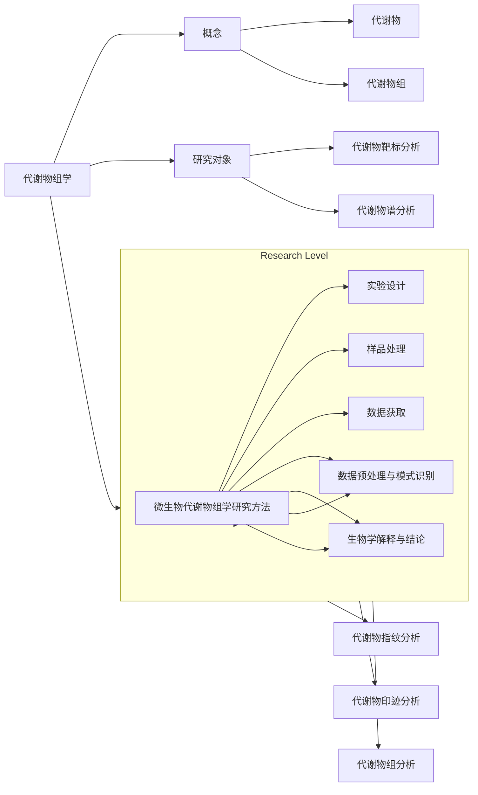
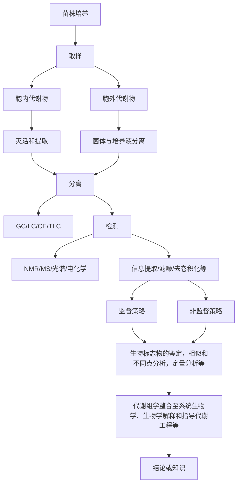
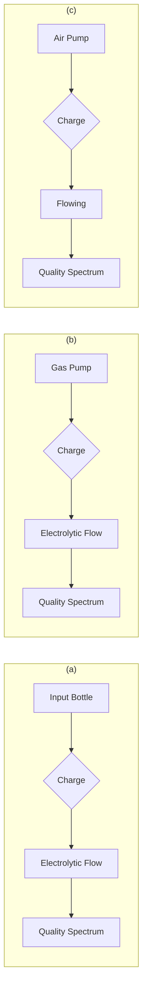
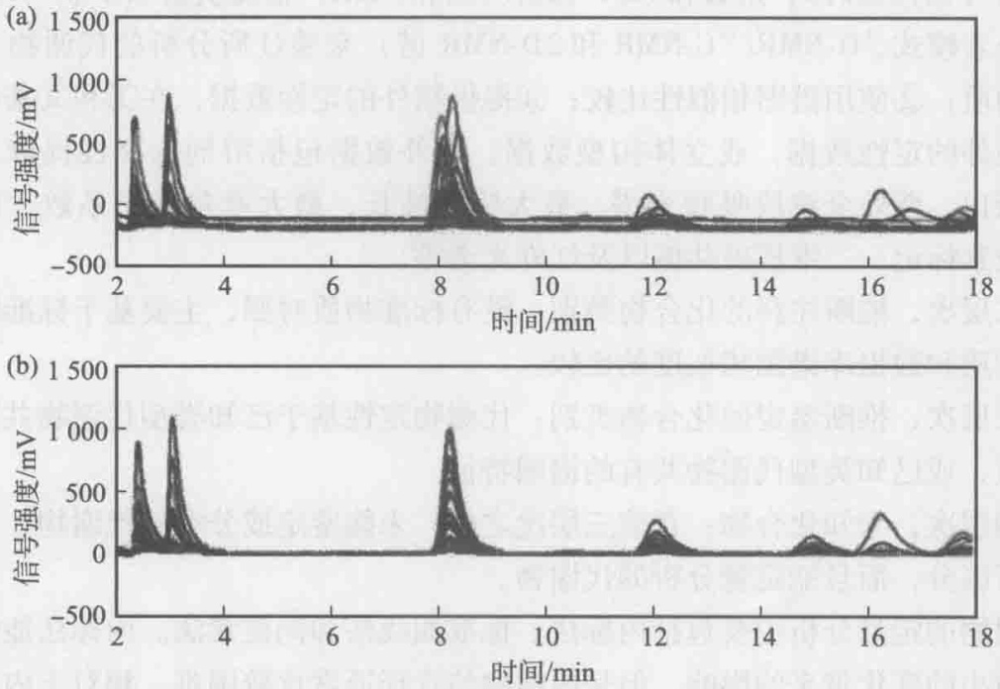
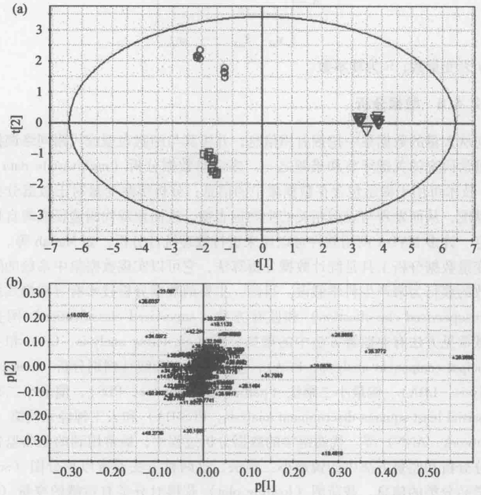
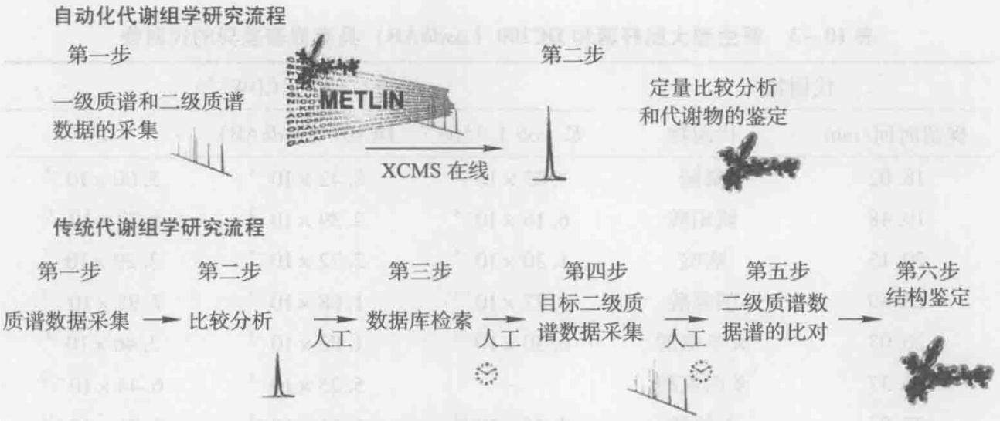
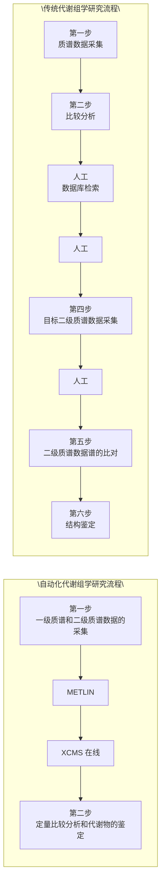
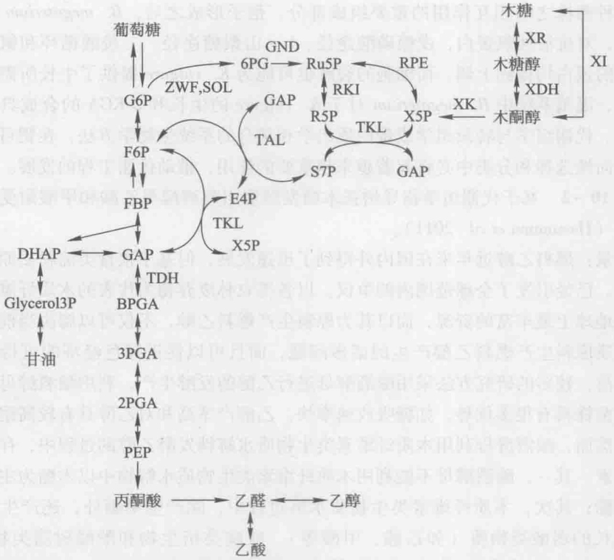
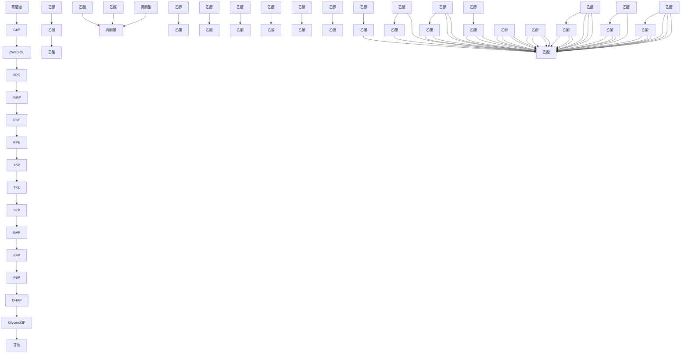
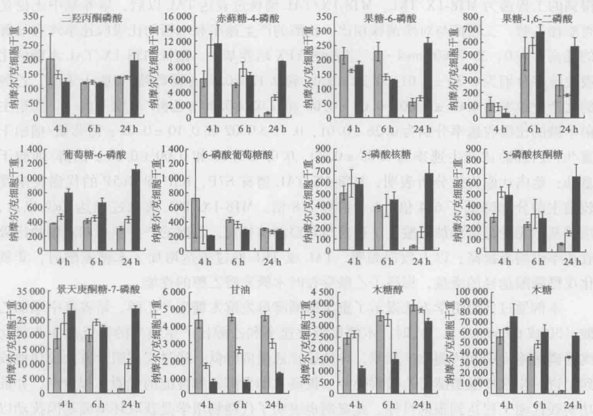

# 10 代谢物组学技术与代谢工程

原始 PDF 第 261–285 页。

natural_image

Abstract illustration of interconnected nodes or spheres forming a network-like structure (no text or symbols)

## 10

# 代谢物组学技术与代谢工程

## 【本章学习要点】

1. 代谢物和代谢物组学的概念
2. 微生物代谢物组学的研究方法
3. 代谢物组学在代谢工程中的应用

随着全基因组测序技术大规模的进行，生命科学领域的研究也随之翻开了崭新的一页。庞大的基因组数据信息源源不断地从一系列新技术中产生，而且未来还会呈指数增长。然而到目前为止，30%\~40%典型开放阅读框的功能我们还不能解释（Hollywood et al. 2006）。即使我们掌握了某一个生物体的所有基因、编码蛋白等信息，我们也不能完全阐释其表型特征。代谢物是细胞调控过程的终端产物，它们的水平可以看作是生物系统对基因和环境变化的终端响应，代表细胞或组织的生物化学表型（biochemical phenotype），在基因功能阐释等方面表现出了巨大的潜力，正日益受到了科学家们的重视。

---

242

10 代谢物组学技术与代谢工程

## 知识导图

flowchart

## 10.1 代谢物组与代谢物组学

代谢物（metabolite）:指参与细胞代谢或维持细胞生长和正常功能所必需、相对分子质量小于1 000的有机化合物。

代谢物组（metabolome）:也称为代谢组，指给定的生物系统在特定条件下合成的所有代谢物，包括所有胞内代谢物和分泌到培养基中的代谢物或胞外分泌物。

代谢物组学（metabolomics）:也称为代谢组学，是对生物系统（细胞、组织或生物体）中代谢物全面的定量分析，揭示代谢物水平对环境或遗传操作扰动引起的响应规律。

根据研究对象和目的的不同，对代谢物及代谢组的分析可以分为五个层次（Fiehn 2002, Villas-Bôas et al. 2005b):

代谢物靶标分析（metabolite target analysis）:对样品中某个或某几个特定代谢物

---

10.2 微生物代谢物组学研究方法

243

的分析。在此层次中，往往需要对样品进行预处理，去除干扰物，提高靶标代谢物的相对浓度或检测信号。

代谢物谱分析（metabolite profiling analysis）:定量分析一系列预定的目标代谢产物。如某一类结构、性质相关的化合物（氨基酸、有机酸、异戊烯类）或某一代谢途径的所有中间代谢物。在此层次中，往往根据分析代谢物的结构和理化性质，设计适合代谢物提取和分析的特定技术来完成。

代谢物指纹分析（metabolite fingerprinting analysis）:对不同环境或不同基因背景下的胞内代谢物进行快速指纹分析。在此层次中，通常采用核磁共振（nuclear magnetic resonance, NMR）或质谱（mass spectrometry, MS）技术进行快速分析，通常不需要定量分析单一代谢物组分，较多用于表型的分类等。

代谢物印迹分析（metabolite footprinting analysis）:对胞外代谢物谱的快速分析。在此层次中，其技术与代谢物指纹分析类似，但分析的是分泌到胞外培养基中的代谢物，底物的生物转化也被认为是代谢物印迹分析的范畴。

代谢组分析（metabolome analysis）:特定条件下生物样品所有代谢物的成分及其动态变化分析。此层次为严格意义上的代谢组学研究，样品的处理和检测技术需满足对所有的代谢组分具有无偏性、高灵敏度和高通量的要求。但是到目前为止，代谢组学的这个研究目标还是不可完成的任务，因为还没有发展出一种真正的代谢组学技术可以涵盖所有的代谢物分子。然而，在代谢组学研究中，科学家们在具体的实验中，正试图解析所有的代谢物组分，因此代谢组学研究的特征也可以表述为设法分析尽可能多的代谢物组分。

代谢组学自出现以来，特别是近几年，随着高通量分析技术的高速发展和化学计量学算法的开发，代谢组学发展迅速，广泛应用于各个领域，如植物代谢组学、微生物代谢组学、营养科学、生态和环境科学、药物的研发、疾病的诊断等。结合本书重点介绍微生物代谢工程和合成生物学的特点，本章将主要讨论微生物代谢组学的研究方法及其在代谢工程方面的应用。

## 10.2 微生物代谢物组学研究方法

微生物代谢组学力求分析生物体系中的所有代谢产物，所以整个过程中都强调尽可能保留和反映总代谢产物信息。精确、灵敏、高通量的平台技术与分析方法是代谢组学研究的基础；从大量分析信号中发现有用信息或特征模式的计算技术是代谢组学研究的重要工具。微生物代谢组学的研究流程如图10-1所示，包括菌株培养、样品处理、数据采集、数据预处理、数据分析、生物学解释和结论等。

## 10.2.1 菌株培养

微生物生长的重复性是进行代谢组学研究的前提，为建立标准的和可重复的培养条件，生物反应器中的温度、pH、培养基组分以及溶解于其中的 $\mathrm{O}_2$ 、 $\mathrm{CO}_{2}$ 等必须确定且易于控制与检测。微生物代谢组学研究中，培养方式主要包括分批培养和连续培养。大多数研究者倾向于应用生物反应器连续培养操作模式。相对而言，恒化培养可

---

244

10 代谢物组学技术与代谢工程

flowchart

图10-1 微生物代谢组学研究流程（王智文等2010）

以为微生物的生长提供恒定的生长条件，是最理想的培养方法，但也存在菌体老化、对灭活方法要求苛刻等缺点。实际操作往往根据研究目的或需要，权衡各种利弊选用合适的培养方式。

## 10.2.2 样品处理

微生物代谢组学研究通常进行胞内代谢物的分析，由于细胞内酶系活跃、代谢物转换迅速，因此取样和样品制备方法会显著影响分析结果的准确性和重复性。样品的处理主要包括快速取样、灭活（淬灭）和代谢物提取等。

## 10.2.2.1 快速取样

由于一些代谢物在微生物体内的转换时间非常短暂（<2 s），因此从反应器中快速收集样品并立即终止细胞代谢是至关重要的，否则会由于取样过程中底物浓度的显著变化使得细胞生理稳定状态受到破坏。对于连续培养模式，通常培养基中底物浓度（如葡萄糖）非常低，使得取样过程中细胞生理状态的变化更加迅速，因此对取样技术的要求很高。而对于分批培养模式，一般由于底物浓度足够高而不会导致细胞的生理状态发生显著改变，因此对取样技术的要求较低，甚至可以采用过滤的方法，如微生物培养液通过0.2  $\mu$ m滤膜快速过滤方法收集菌体。样品制备技术的自动化和机械

---

10.2 微生物代谢物组学研究方法

245

化是今后发展的趋势，能够大大减少实验误差，使数据更具稳定性和重现性。

## 10.2.2.2 灭活

灭活，又称淬灭，即迅速降低细胞内的代谢酶活性，使代谢反应停止，尽量使胞内代谢物保持取样时的状态。对于胞内代谢物，由于取样或脱离培养环境后细胞内的代谢状态迅速改变，胞内代谢物的种类和含量也随之发生变化，为正确反映培养环境中胞内代谢物的真实信息，需要立即灭活细胞以终止胞内反应，细胞与培养液分离后需要在低温中保存以抑制代谢反应。理想的灭活技术应满足两个要求:①酶迅速失去活性；②细胞保持完整性。

传统灭活方式包括瞬间改变样品温度至低温（＜-20℃）或高温（＞80℃），或应用极端pH的高碱（氢氧化钠或氢氧化钾）或高酸（高氯酸、盐酸或三氯乙酸）溶液完成。液氮冷冻或高氯酸灭活技术是植物和动物代谢组学研究中经常使用的灭活方法，然而，这两种方法并不适用于处理微生物细胞，因为它无法将胞内和胞外代谢物分开。对于微生物的灭活，较多采用冷甲醇及其缓冲溶液，如冷却至-40℃的60%甲醇70 mmol·L $^{-1}$ HEPES溶液，取一定体积培养物溶液与灭活剂按照1:3比例迅速混匀，混合后的溶液保持-10℃以下的温度，使胞内酶达到迅速失活的目的。目前这种方法在L. lactis、S. cerevisiae、E. coli、C. glutamicum、A. niger、B. subtilis等微生物中均有应用。

灭活过程中代谢物的泄漏不可避免，代谢物的泄漏取决于细胞壁和膜的结构。与酵母、丝状真菌等真核微生物相比，细菌等原核微生物使用冷甲醇灭活更易引起胞内代谢物的泄露；由于细胞壁结构的不同，革兰氏阴性细菌比革兰氏阳性细菌更容易产生胞内代谢物的泄漏。如何保持细胞的完整性，防止胞内代谢物的泄漏，以正确反映微生物细胞的生理状态，是微生物代谢组学研究的关键环节之一。因此，需要探索引起细胞泄露作用较小的灭活剂及其灭活程序，优化灭活剂的组分，减少后续代谢物的处理。例如，Villas-Bôas 和 Bruheim（2007）利用冷甘油 - NaCl 溶液分别灭活酿酒酵母、链霉菌和荧光假单胞菌，并测定了胞内代谢物的泄漏情况，结果表明冷甘油 - 0.9% NaCl 溶液能够有效地抑制胞内代谢物的泄漏。其次，通过使用定量方法测定胞内代谢物泄漏的程度，便可以估算出细胞内代谢产物的浓度。灭活剂中的盐离子能够维持溶液一定的渗透压，减少微生物在灭活过程中胞内代谢物的泄漏，但是盐离子会干扰后续样品的检测，因此可以选择碳酸铵等可挥发盐类作为灭活剂中的离子强度调节剂，样品在冷冻干燥等过程中碳酸铵可以挥发去除，方便代谢物的进一步分析。

## 10.2.2.3 代谢物提取

为了从整体上分析代谢物，代谢物提取方法应该满足以下几个要求:①能够最大限度地提取代谢物；②无偏向性，不排除具有特殊物理、化学性质的分子；③不破坏或改变代谢物的物理或化学特性。

代谢物提取剂主要有冷甲醇、热乙醇、高氯酸或碱、热甲醇和甲醇-氯仿混合液等。其中酸、碱提取法是传统的代谢物提取方法，通常用于提取对酸或碱稳定的代谢物；高氯酸提取法已广泛用于细菌的代谢物提取，该方法对核苷酸类物质和水溶性代谢物提取效果较好，如 cAMP, ppGpp 和细胞壁的前体物质，并容易实现自动化，缺

---

典型案例 10-1
灭活和代谢物提取同时进行

246

10 代谢物组学技术与代谢工程

点是较低的 pH 使有些代谢物不稳定；甲醇-氯仿法对非极性的代谢物具有较好的提取效果，然而高极性代谢物在甲醇和氯仿中溶解度较小而影响其提取效果，并且该方法还存在费时和氯仿毒性大等缺点；甲醇或乙醇提取法具有简单快速且无盐加入、提取剂易于去除、代谢物易于浓缩以及 pH 变化小等优点，但是利用热甲醇或热乙醇提取时，高温对热不稳定的代谢物有破坏作用。

目前还没有建立通用的胞内代谢物提取方法。由于代谢物性质的多样性，仅采取一种提取方法无法实现胞内代谢物的全部提取。因此要尽可能多地获得胞内代谢物，需要组合不同提取和分析方法。van der Werf 等（2007）利用冷甲醇-水溶液和氯仿分别提取 E. coli 胞内代谢物，并采用 6 种不同的分析方法检测代谢物的组成，一共定性分析了 235 种胞内代谢物，其中首次鉴定出 E. coli 数据库中不存在的代谢物 61 种。

最近研制出了一种利用滤膜培养细胞或微生物，快速收集细胞，灭活和提取程序同时进行的代谢组学研究方法，该方法可用于分析可培养的哺乳动物细胞或微生物。以微生物胞内代谢物分析为例，从菌株的培养到代谢物的提取一共需要4步操作，其基本过程如图10-2所示:

（1）菌株在同位素标记的液体培养基中培养至  $OD_{650} \approx 0.1$ ，取 5 mL 菌液转移到经灭菌处理的尼龙膜上面，快速过滤收集菌体；
（2）将菌体均匀分布的尼龙膜小心转移到固体培养基平板上，在一定的培养条件下进行菌株的培养；
（3）固体培养基平板上，菌株培养至对数中期，迅速将尼龙膜转移到提取剂中，完成灭活和代谢物的提取；
(4) 代谢物溶液的收集和预处理。

flowchart

图10-2 滤膜平板培养菌株、灭活和代谢物提取（Bennett et al. 2008）

该方法的优点是可以准确地对胞内代谢物进行定量分析，排除了灭活效率对代谢机制的干扰和胞内代谢物的泄漏，结合同位素标记技术可以对胞内代谢物进行绝对定量分析，更加真实地反映微生物或细胞的胞内代谢机制。Bennett等（2009）在滤膜平板培养菌株，灭活和代谢物提取同时进行方法的基础上，利用LC-MS/MS平台定量分析了大肠杆菌分别以葡萄糖、甘油和乙酸为唯一碳源，好氧生长至对数期时胞内100多种代谢物的浓度。发现大多数酶的底物浓度高于对应酶的 $K_{m}$ ，然而糖酵解途径中，中间代谢物的浓度与相应酶对该底物的 $K_{m}$ 比较接近，所有反应接近平衡。代谢物的浓度对细胞自由能和代谢反应速率具有重要影响，因此胞内代谢物浓度的绝对定

---

10.2 微生物代谢物组学研究方法

. 247

量对定量分析细胞的代谢机制具有重要意义。

## 10.2.3 代谢物组数据的采集

代谢组学研究的效应很大程度上取决于被鉴定代谢物的数目及其生物学解释相关性，最难的步骤是对这些代谢物进行定性和定量分析。代谢物的分离和检测是微生物代谢组学研究的两个核心组成部分，是获得代谢组学数据的关键。分离技术主要采用各种色谱分离方法，如液相色谱（liquid chromatography, LC）、气相色谱（gas chromatography, GC）和毛细管电泳（capillary electrophoresis, CE）等。而检测技术主要采用质谱（mass spectrometry, MS）和核磁共振（nuclear magnetic resonance, NMR）等。代谢组学分析应对样品中的所有代谢物进行无偏地定性、定量分析。然而，代谢组学受到高速发展分析平台的促进，同时也受到分析平台发展程度的限制。目前还没有一种代谢组学分析平台可以无偏向性地涵盖所有代谢物、代谢物的结构、性质及其浓度，直接影响分析技术和方法的选择。虽然色谱、质谱、核磁共振、红外光谱、紫外吸收、荧光散射、光散射等分离分析手段及其组合都出现在代谢组学的研究中，但代谢组学数据的分析平台主要分为两类，分别是基于质谱和基于核磁共振的分析平台（Wang et al. 2006）。表10-1对比了目前微生物代谢组学研究中最常用的四种分析方法（GC-MS、LC-MS、CE-MS、NMR）的灵敏度、样品特点和特性。具体研究中，需要根据研究目的，样品特点等选择合适的分析平台。

表 10-1 微生物代谢组学的分析方法比较

| 分析方法 | 灵敏度/mol | 样品特性 | 优缺点 |
| --- | --- | --- | --- |
| GC-MSGC×GC-MS | $10^{-12}$ | 样品需要提取、干燥和衍生化,适于分析热稳定性好的代谢物 | 高分离效率,稳定,重现性好;具有大量相关的分析软件和代谢物鉴定数据库;因分析样品需衍生化,操作步骤相对繁琐 |
| LC-MSUPLC-MS | $10^{-15}$ | 样品一般需要提取和浓缩 | 高灵敏度,高选择性;存在离子化抑制效应;代谢物分析数据库少 |
| CE-MSCE-LIF | $10^{-23}$ | 样品一般需要提取和浓缩 | 高通量,高选择性,高灵敏度;没有特定的代谢物组学质谱数据库 |
| NMR | $10^{-6}$ | 需要的样品量少,无破坏性 | 快速,高通量,代谢物鉴定无偏向性,定量准确;灵敏度低,主要用于动物和植物代谢组学研究 |

## 10.2.3.1 直接注入质谱法

质谱（又叫质谱法）是一种与光谱并列的谱学方法，通常意义上是指广泛应用于各个学科领域中通过制备、分离、检测气相离子来鉴定化合物的一种专门技术。在众多的分析测试方法中，质谱学方法被认为是一种同时具备高特异性和高灵敏度且得到了广泛应用的普适性方法。质谱仪器一般由样品导入系统、离子源、质量分析器、检测器、数据处理系统等部分组成。质谱在代谢组学分析中可提供丰富的结构信息，包括代谢物分子离子峰、碎片离子峰等，可以根据分子离子峰质荷比（m/z）和碎片

---

248

10 代谢物组学技术与代谢工程

离子峰的断裂方式与标准代谢物样品的质谱信息比对来推断代谢物的结构，即定性分析；结合总离子流中代谢物的丰度可以对鉴定代谢物进行定量分析。质谱较其他技术具有更高的灵敏度、较快的检测速度和宽广的动态范围，还可以和液相色谱、气相色谱联用，大大提高对复杂基质的分析能力。

近年来，由于 MS 的技术优势和不断完善，样品可以不经过分离而直接进行 MS 分析，在代谢组学研究过程中称之为直接注入质谱法（direct injection mass spectrometry, DIMS），这种方法主要用于代谢物靶标分析、代谢物指纹分析和代谢物印迹分析。

图10-3显示的是利用DIMS法对酿酒酵母不同生长阶段的胞外代谢物印迹分析结果（Allen et al. 2003）。在酿酒酵母的延滞期和对数生长初期，质谱图相对简单，即胞外代谢物较少；从对数期到稳定期，质谱图变得非常复杂，且出现无数的小质谱峰，说明胞外代谢物谱发生了显著变化，这表明细胞开始向培养基中分泌代谢物；从不同生长阶段的胞外代谢物印迹图谱可以清晰看出，直接注入质谱法可以有效、快速地对菌体不同生长阶段进行分类。作者对DIMS方法的稳定性进行了分析，分别考察了不同培养基，不同接种量和不同初始种子等因素，结果表明该方法具有高稳定性和高通量的优势。DIMS法还可以对不同基因的敲除株进行代谢物印迹分析，应用于基因功能的鉴定和表型分类。

spectrogram

| Time | m/z | Relative Abundance (%) |
| --- | --- | --- |
| 0 h | 110 | ~5 |
| 0 h | 112 | ~40 |
| 0 h | 118 | ~5 |
| 0 h | 130 | ~5 |
| 0 h | 133 | ~5 |
| 0 h | 134 | ~5 |
| 0 h | 145 | ~5 |
| 0 h | 156 | ~5 |
| 0 h | 165 | ~5 |
| 0 h | 175 | ~5 |
| 0 h | 180 | ~5 |
| 0 h | 188 | ~5 |
| 0 h | 198 | ~5 |
| 0 h | 203 | ~90 |
| 10 h | 110 | ~5 |
| 10 h | 118 | ~5 |
| 10 h | 130 | ~5 |
| 10 h | 133 | ~5 |
| 10 h | 145 | ~5 |
| 10 h | 156 | ~5 |
| 10 h | 165 | ~5 |
| 10 h | 175 | ~5 |
| 10 h | 180 | ~5 |
| 10 h | 188 | ~5 |
| 10 h | 198 | ~5 |
| 10 h | 203 | ~90 |
| 13 h | 110 | ~5 |
| 13 h | 118 | ~5 |
| 13 h | 133 | ~5 |
| 13 h | 145 | ~5 |
| 13 h | 156 | ~5 |
| 13 h | 165 | ~5 |
| 13 h | 175 | ~5 |
| 13 h | 188 | ~5 |
| 13 h | 198 | ~5 |
| 13 h | 203 | ~90 |
| 20 h | 85 | ~5 |
| 20 h | 99 | ~5 |
| 20 h | 101 | ~5 |
| 20 h | 110 | ~5 |
| 20 h | 113 | ~5 |
| 20 h | 117 | ~5 |
| 20 h | 123 | ~5 |
| 20 h | 133 | ~5 |
| 20 h | 141 | ~5 |
| 20 h | 151 | ~5 |
| 20 h | 156 | ~90 |
| 20 h | 165 | ~90 |
| 20 h | 175 | ~5 |
| 20 h | 181 | ~5 |
| 20 h | 188 | ~5 |
| 20 h | 197 | ~5 |
| 20 h | 206 | ~5 |
| 20 h | 214 | ~5 |
| 20 h | 223 | ~5 |
| 20 h | 232 | ~90 |
| 20 h | 233 | ~5 |
| 20 h | 245 | ~5 |
| 20 h | 263 | ~5 |

图10-3 酿酒酵母不同生长阶段胞外代谢物直接注入质谱图（Allen et al. 2003）

## 10.2.3.2 气相色谱-质谱联用

由于代谢组学分析的对象种类繁多，性质差异很大，浓度范围分布广，而且还存在离子化程度和基质干扰等问题，要对它们进行无偏向的全面分析，单一的分析手段

---

10.2 微生物代谢物组学研究方法

249

难以胜任。色谱-质谱联用技术是代谢组学研究中常用的方法，具有分离效率高和灵敏度好等优点。

在微生物代谢组学分析平台中，GC-MS发展最为成熟，较早地用于了代谢组学研究。GC-MS适合分析低极性、低沸点代谢物或者衍生化后具有挥发性的物质。在GC-MS联用中，GC具有很好的代谢物分离性能，具有高选择性、高灵敏度和高分辨率的特点，可以根据代谢物挥发的温度梯度，高效地将代谢物分离开。随着全二维气相色谱-质谱联用技术（GC×GC-MS）的引入，它的分离性能得到很大提高，传统的GC-TOF-MS能够检测100\~500种化合物，而GC×GC-TOF-MS能够在65min内分析大约1200种化合物。在GC-MS联用中，代谢物的离子化模式包括电子轰击离子化（electron impact ionization，EI）和化学离子化（chemical ionization，CI）。采用EI离子化方式，一般采用标准的电子轰击电离源和标准电压（-70 eV），化合物的碎片离子峰较稳定并具有可比性，国际上已建立了通用的化合物库（如美国国家标准技术研究院质谱数据库，national insitute of standard and technology mass spectral database，http://www.nist.gov/srd/nist1a.cfm），这极大地方便了微生物代谢组学研究中的化合物定性。相对于EI模式，CI更为温和，主要提供分子离子峰的信息，对于检测和确定未知代谢物非常有帮助。随着算法的改进、数据库的不断完善，GC-MS在代谢组学研究中的应用使得捕获更多的生物学相关信息成为可能。GC-MS存在的缺陷是该方法主要用于分析具有挥发性和热稳定性的化合物，难挥发性物质或半挥发性物质需要衍生化处理以后才能进行分析。GC-MS中常用的衍生化方法包括硅烷化（silylation）、酰化（acylation）和烷基化（alkylation）等。

在微生物代谢组学研究中，我们通常关心的化合物是氨基酸、糖和小分子有机酸以及其他极性代谢物，大多数代谢物都处于非挥发的状态。对于含有羧基、羟基和氨基的化合物，可以通过衍生化来增加他们的挥发性。例如，Nielsen课题组优化了一套氯甲酸甲酯（methyl chloroformate，MCF）衍生化方法，可以同时对氨基酸、二羧酸和三羧酸类物质衍生化（Villas-Bôas et al. 2003），并利用该方法分析了酿酒酵母中心碳代谢和氨基酸合成途径中胞内代谢物和胞外代谢物（Villas-Bôas et al. 2005a）。

Koek 等（2006）建立了另一套完整的利用 GC-MS 研究代谢物组的方法，包括代谢物的肟化和硅烷化衍生化反应以及 GC-MS 分析，并对衍生化效率和方法的重现性等进行了分析。该方法对 B. subtilis, P. freudenreichii 和 E. coli 均适用，可以测定包括乙醇、乙醛、氨基酸、胺、脂肪酸、有机酸、糖、糖胺、糖磷酸、嘌呤、嘧啶和芳香族化合物在内的代谢物。

## 10.2.3.3 液相色谱-质谱联用

LC-MS 是微生物代谢组学研究的另一重要分析平台，液相色谱通常以高效液相色谱（high performance liquid chromatography，HPLC）作为主要的分离手段，该技术具有高通量、高检测灵敏度和高分辨率等特点，与质谱（MS）或串联质谱（MS/MS）的联用还可以得到代谢物组分的结构信息。与 GC-MS 相比，HPLC 和 MS 之间的接口相对更为复杂，因此 HPLC-MS 在代谢组学领域中的应用相对较晚，但是目前 HPLC-MS 已经成为了广大生物分析实验室和代谢组学研究领域中广泛应用的工具。在 HPLC-MS 中，梯度洗脱反相高效液相色谱法由于水溶液样品的兼容性好，

典型案例 10-2
基于 GC-MS 分析酿酒酵母中心碳代谢和氨基酸合成途径中胞内代谢物和胞外代谢物

---

250

10 代谢物组学技术与代谢工程

需要样品量少等特点在代谢物学研究中应用最为广泛。质谱作为检测器主要采用电喷雾离子化（electrospray ionisation，ESI）的电离方式，检测采用 + ESI 和 - ESI 相结合的方式。该分析平台具有物质检测分析领域宽、选择性和灵敏度较好、样品制备简单等优势。LC-MS 分析的样品，不需要进行衍生化处理，适用于不稳定、不易衍生化、难挥发和相对分子质量较大的代谢物。

尽管有许多关于 LC-MS 在微生物代谢物组研究中的报道，但该分析平台还存在一些尚未解决的问题，如高密度细胞培养过程中，高盐浓度无疑会抑制 ESI 的离子化效率，还可能阻塞蠕动泵。此外，LC-MS 中的 HPLC 柱的化学物质和三维结构会影响色谱的分离度和敏感性。最常用的反相色谱柱对极性代谢物的保留时间很小，甚至会发生代谢物与流动相的共洗出，这大大减小了数据分析的空间。所以，提高液相色谱的分离能力和鉴定化合物的能力，是液质联用成功应用于微生物代谢组学的关键。

超高效液相色谱（ultra performance liquid chromatography，UPLC）、亲水作用色谱（hydrophilic interaction chromatography，HILIC）和二维液相色谱（2-dimensional liquid chromatography，2D-LC）是近几年发展起来的液相色谱技术，在微生物代谢组学研究中具有重要的应用和发展潜力。UPLC采用低于 $2\mu \mathrm{m}$ 的柱填料颗粒来提高色谱柱的柱效（理论塔板数 $N$），增加仪器的分离度，复杂样品通常能够检测到几百个色谱峰。UPLC与HPLC之间没有原理上的区别，但是能够大大提高液相色谱的分离度、灵敏度和分析速度。目前UPLC和类似产品在液相色谱领域的应用越来越广泛。

亲水作用色谱是一种以极性固定相（如硅胶、氨基键合硅胶等），水和水溶性有机溶剂为流动相的色谱分离模式，与正相色谱相似，极性化合物比非极性化合物在HILIC柱上的保留时间长。亲水作用色谱分析中，一般采用乙腈-水体系作为流动相，初始条件为高比例的有机相，如95%的乙腈，逐步降低到水相。亲水作用色谱物质的保留顺序与反相色谱恰好相反，因此，如果结合反相色谱的结果可以得到更为完整的微生物代谢物信息。中国科学院大连化物所的许国旺课题组发明了一个柱切换二维液相系统，采用两套液相色谱柱（反相色谱柱和亲水作用色谱柱，亲水作用色谱柱和亲水作用色谱柱），通过阀切换实现了一次进样亲水和疏水代谢产物的同时检测，解决了复杂生物样品中亲水和疏水性代谢产物的同时检测问题（Wang et al. 2008a, Wang et al. 2008b）。

## 10.2.3.4 毛细血管电泳-质谱联用

CE-MS 是近几年发展较为迅速的新型分析技术，因其具有分析迅速、高灵敏度、高通量、样品不需要特殊处理和样品需要量少等优点而日益受到代谢组学研究者的重视。

毛细血管电泳是20世纪80年代问世的一种以毛细管为分离通道，以高压直流电场为驱动力的新型液相色谱分离技术，是经典的电泳技术和现代微柱分离技术相结合的产物。1987年，Olivares首次报道了毛细管电泳和质谱的联用技术，随之，该项技术迅速获得认可和欢迎，并出现商品化的仪器。由于CE需要较高的离子强度、挥发性低的缓冲液，而ESI需要相对较低的盐浓度才能获得好的雾化和离子化，因而CE末端与质谱的接口是影响整个检测的关键因素之一。所有CE-ESI-MS接口的目标是为了获得稳定的物雾流和高效的离子化，因此接口技术必须优化，每一种接口选择

---

10.2 微生物代谢物组学研究方法

251

相应的缓冲液。CE-ESI-MS接口共有三种类型:同轴液体鞘流、无鞘接口和液体连接。

与传统的分离方法相比，灵敏度高是 CE-MS 最显著的特点之一；其次，样品需要量少也是 CE-MS 在代谢组学研究中的一大优势，其样品体积仅需要几纳升。CE-MS 对于极性较强，离子化的代谢物具有很好的分析效果。近年来，毛细管电泳在手性化合物的分离、药物分析、DNA 分析、代谢分析和环境分析等领域得到越来越广泛的应用（许国旺 2008）。

在 CE-MS 使用过程中，根据所带电荷不同，可将样品中的离子性代谢物分为阴离子代谢物和阳离子代谢物。据此，可以分别建立阳离子代谢物 CE-MS 分析方法和阴离子代谢物 CE-MS 分析方法。关于 CE-MS 在微生物代谢组学中的应用，Soga 课题组开展了深入研究（Soga et al. 2002, Soga et al. 2003, Soga 2007, Soga et al. 2007, Soga et al. 2009）。他们建立了基于 CE-MS 分析阳离子代谢物、阴离子代谢物、核苷酸和辅酶 Q 类代谢物等多价阴离子代谢物的分析方法（图 10-4）。

flowchart

图10-4 基于CE-MS的代谢物分析原理（Soga et al. 2003）

（a）阳离子代谢物 CE-MS 分析原理；（b）阴离子代谢物 CE-MS 分析原理；（c）核苷酸和辅酶 Q 类代谢物 CE-MS 分析原理

CE-MS 对不同胞内代谢物的分离模式:

（1）阳离子代谢物 CE-MS 检测中，毛细管裸柱中电渗流（electro-osmotic flow, EOF）朝向电极负极，阳离子根据电荷和大小的不同而得到分离。利用低 pH 电解液（1 mol·L $^{-1}$ 甲酸，pH = 1.8），使代谢物带正电荷，可以分离所有的阳离子代谢物，分离后的代谢物通过质谱检测（图 10-4a）。
（2）通过负极模式分离阴离子代谢物，毛细管的入口端为负极，出口端为正极，利用连续多层离子聚合物涂层（successive multiple ionic-polymer，SMIL）-阳离子聚合物涂层毛细管改变EOF的流向，使其朝向正极，阴离子代谢物根据电荷和大小的不同而得到分离，进入质谱进行检测（图10-4b）。
(3) 在负极模式阴离子分离系统中, 多价离子如核苷酸和辅酶 Q 类代谢物存在

---

252

10 代谢物组学技术与代谢工程

典型案例 10-3
基于 CE-MS 分析枯草芽胞杆菌胞内代谢物

严重的吸附现象。通过采用不带电荷多聚物涂层毛细管和在进样口施加一定压力，可以使此类代谢物得到很好的分离和准确定量分析（图10-4c）。

三种毛细管电泳分离模式的组合使用，几乎可以分离样品中所有的离子代谢物。综合利用阳离子代谢物、阴离子代谢物、核苷酸和辅酶Q类代谢物的CE-MS分析方法，共检测到B.subtilis 168提取物中1692种代谢物，并对其中的352中代谢物进行了定性分析；由此建立的方法，灵敏度高，能检测到单个细胞中40 zmol的腺嘌呤和350 amol的葡萄糖，而且迁移时间的相对标准偏差（RSD）小于2.7%。作者利用建立的CE-MS方法，分析了B.subtilis孢子形成之前和形成过程中的胞内代谢物谱情况。在孢子的形成过程中，首次发现L-高瓜氨酸和β-丙氨酰-L-赖氨酸等代谢物的浓度显著升高，而景天庚酮糖-7-磷酸等代谢物浓度急剧降低，推测这些代谢物可能与孢子的形成具有潜在联系。在孢子形成的初期，糖酵解、戊糖磷酸途径和TCA循环的大多数中间代谢物浓度显著下降，特别是果糖-1,6-二磷酸的浓度在孢子的形成过程中下降超过了100倍。广泛的胞内代谢物定性定量分析，有助于深入地认识复杂生物学现象的作用机制。

## 10.2.3.5 核磁共振

核磁共振波谱是一种基于具有自旋性质的原子核在核外磁场作用下，吸收射频辐射而产生能级跃迁的谱学技术。基于核磁共振技术的代谢组学研究，主要是利用生物样品的核磁共振谱图所提供的生物体内全部小分子代谢物的丰富信息，通过对这些信息的多元统计分析和模式识别处理，了解相关生物体在功能基因组学、药理毒理学、病理生理学等方面的状况和动态变化，揭示它们的生物学意义，发现生物标志物，并从分子水平上认识生命运动的规律。生命科学领域中常用的是氢谱（ $^{1}$ H NMR）、碳谱（ $^{13}$ C NMR）及磷谱（ $^{31}$ P NMR）三种，该技术能够对复杂样品中的代谢物同时完成定性和定量分析。

NMR 技术在代谢组学中的应用广泛，通常用于动物体液的代谢过程分析，也可用植物代谢组学和微生物代谢组学。微生物胞内代谢物从小的无机离子到疏水性的脂质及复杂的天然产物，浓度范围跨越 9 个数量级（pmol 至 mmol），而 NMR 的灵敏度较低，因此利用 NMR 技术进行微生物代谢组学研究时，应考虑样品的检测范围。

NMR 技术在微生物代谢组学中的应用，以酿酒酵母的“沉默”基因研究为例。酿酒酵母中大约含有 6000 个基因，然而很大一部分基因的功能是未知的，其中很多基因为“沉默”基因，即该基因敲除以后，菌株的生长速率等表型没有明显变化，常常无法确定该基因的功能。Raamsdonk 等（2001）使用 $^{1}$ H NMR 技术通过比较代谢组学方法建立了鉴定酿酒酵母中沉默基因表型的“酵母共响应功能分析”（functional analysis by co-response in yeast, FANCY）方法。沉默基因突变以后，生长速率没有明显变化，但是胞内代谢物浓度却存在了显著的差异，如酿酒酵母中编码 6-磷酸果糖 -2-激酶的酶基因 PFK26 和 PFK27，两基因分别敲除的突变株与野生型菌株在不同碳源上的生长速率基本相同，然而突变株胞内果糖 -6-磷酸，丙酮酸等代谢物的浓度均有显著提高，ATP/ADP 的比率显著降低，突变株虽没有“生长”表型差异，但是具有不同“代谢物”表型。测量和比较突变株代谢物浓度的相对变化，可以鉴定突变基因在代谢网络上的作用位点，通过比较代谢组学确定基因功能的方法为代谢工

---

10.2 微生物代谢物组学研究方法

253

程进行菌种改良奠定了基础。

## 10.2.3.6 代谢物的定性和定量分析

代谢物的定性指把复杂的仪器输出数据转换为代谢物信息，以更好地阐释生物体代谢变化情况。传统的代谢物结构鉴定一般通过紫外光谱、红外光谱、核磁共振及质谱等技术。而对于全新的结构物质，需要通过上述四谱联用，晶体X线衍射结构鉴定，化学转换或化学合成以及物质理化性质测定等进行结构鉴定。微生物代谢组学研究中，样品常常从 $\mu \mathrm{g}$ 级到 $\mathrm{mg}$ 级，这种传统的代谢物结构鉴定方法不适合微生物代谢组学的研究。以质谱为主要检测手段时，代谢物的定性以与已知化合物数据库比对或与标准物质数据比对为主。2007年，代谢组学标准化计划（metabolomics standards initiative, MSI）将代谢物定性分为四个层次（Sumner et al. 2007，漆小泉等2011）:已鉴定的化合物（identified compounds）、推断注释的化合物类别（putatively annotated compound classes）、推断鉴定的化合物类别（putatively characterized compound classes）和未知化合物（unknown compounds）。

第一层次，已鉴定的化合物:对已知化合物的定性主要采用以下三种标准进行:①获得标准物质并比对定性数据要求在一定实验条件下，以两种相互独立的或正交的鉴定数据（如保留时间/指数和MS，保留时间和NMR，精确质量和串联MS，精确质量和同位素模式， $^{1}$ H-NMR/ $^{13}$ C-NMR和2D-NMR谱）来验证所分析的代谢物是否为相应标准物质；②使用谱图相似性比较；③提供额外的定性数据，在①和②基础上，提供其他额外的定性数据，或立体构型数据。额外数据包括溶剂选择性提取、保留时间、质荷比、紫外全波段吸收光谱、最大吸收波长、最大摩尔吸光系数、化学衍生化、同位素标记、二维核磁共振以及红外光谱等。

第二层次，推断注释的化合物类别:没有标准物质对照，主要基于标准物质的物理化学性质和数据库谱图相似度的比较。

第三层次，推断鉴定的化合物类别:代谢物定性基于已知类型代谢物共有的物理化学性质，或已知类型代谢物共有的谱图特征。

第四层次，未知化合物:在前三层次之外，未能鉴定或分类的代谢物，只能通过谱图进行区分，而且能定量分析的代谢物。

代谢物的定量分析主要包括内标法、标准曲线法和同位素法。内标法能够排除分析系统微小的变化带来的影响，但是内标物的选择通常比较困难。相对于内标法，标准曲线法对色谱条件的一致性要求较为苛刻。同位素法主要是利用稳定同位素标记的代谢物或重同位素（如 $^{13}$ C）培养的微生物提取物作为内标物，从而达到定量分析的目的（Wu et al. 2005, Vielhauer et al. 2011）。

## 10.2.4 数据挖掘

利用不同的分析技术平台（MS 和 NMR）可以得到生物样品大量、多维的分析数据。如何从大量的数据中挖掘潜在有用信息，并将其与所研究的生物学问题相关联，进而了解和发现生物学规律，是代谢组学研究的终极目标。本节以微生物代谢组学研究中的主要分析技术平台——MS 为例，介绍代谢组学的数据挖掘过程，其主要包括数据前处理、数据提取、数据分析和数据转换（生物学解释）四个方面。

---

254

10 代谢物组学技术与代谢工程

## 10.2.4.1 数据前处理

前处理主要用于排除与生物问题无关因素对色谱的影响，并通过校正，对数据集进行标准化或调整处理。主要的数据预处理包括滤噪、基线校准、峰对齐、峰识别和重叠峰解析等。

滤噪是指排除由于样品制备、测量手段和仪器的不完善等引起的测量噪声和随机噪声。针对质谱或色谱数据的滤噪方法主要有匹配滤波、移动窗平均滤波、阈值限制、中值滤波和离散小波变换等方法。很多软件带有该功能，应用较为广泛。

基于 GC-MS 和 LC-MS 的代谢组学研究中，色谱峰会因为保留时间而存在小的迁移和基线漂移现象，色谱条件的微小变化（如流动相、梯度、柱温及其柱表面的状态）常导致保留时间的差异，从而影响了谱峰位置的重现性。因此数据的预处理中，需要进行基线校准和峰对齐。常用的基线校准方法是将同一谱图的所有数据值减去最小值，使基线为零。峰对齐的方法有两类，一类是样品制备时预先人为地加入几个标准组分，峰对齐时，通过识别标准组分的谱峰，分段线性的调整保留时间；另一类是获取数据后完全依赖数学方法进行对准。图 10-5 显示的就是基于色谱分析技术的峰对齐和基线校正。

图10-5 峰对齐（a）和基线校正（b）（Werf et al. 2005）

峰识别即确定峰的起点和终点，一般采用求导的方法（二阶导数为零的拐点）或二阶高斯滤波方法。由于物质的保留时间很接近或峰宽过大，代表多个物质的峰往往会重叠在一起，为了获得准确的结果，必须从重叠峰中分离出各个峰以后再提取峰的相关参数。根据各种分析手段（如色谱、电泳、质谱、核磁等）的特点，研究者们开发出了相应的算法对原始谱图进行预处理，如 MetAlign, MSFACTs, MZmine, XCMS, MET-IDEA 和 MetaboAnalyst 等分析系统（Katajamaa et al. 2007, Xia et al. 2011）。MetAlign、MZmine 和 MET-IDEA 可以对 LC-MS 和 GC-MS 的数据预处理，包括滤噪和峰对齐等，然而 MetAlign 和 MZmine 不能进行重叠峰解析处理，MET-IDE-

---

10.2 微生物代谢物组学研究方法

· 255

A不仅能实现重叠峰的解析，还能从原始数据中提取半定量信息。MSFACTs是一款基于GC-MS数据分析软件，可以实现输入GC-MS原始数据，输出代谢物清单。XCMS应用于LC-MS的数据分析，可以实现LC-MS数据的非线性保留时间对齐、滤噪、峰匹配、统计学分析和代谢物的推断性鉴定等。MetaboAnalyst是最近发展起来的一款基于互联网的分析平台，可以实现代谢组学数据的处理，数据标准化和统计学分析以及生物标志物潜在的生物学机制阐释等。

## 10.2.4.2 数据提取

采用分析仪器产生的谱图信号，经过适当预处理后，可进行数据特征或参数的提取。通过数据提取，可用一组矢量进行表征，主要由一系列保留时间、质荷比和信号强度三维标识的峰组成。根据分析仪器和检测方式的不同，数据的提取方法主要可以分为两类。第一类适用于色谱及其联用技术的分析平台，样品通过保留时间或质量数进行峰匹配，峰的积分结果作为变量，进行提取。第二类方法适用于核磁、红外等波谱处理，也可用于液质联用数据，采用等间距的切片（slice，用于一维谱图）或切块（bin，用于二维谱图）对谱图区间进行拆分，对区间内的信号进行积分作为变量。

提取的数据可以形成一个  $m \times n$  原始数据矩阵:

$$
X = \left[ \begin{array}{c c c c} x _ {1 1} & x _ {1 2} & \dots & x _ {1 m} \\ x _ {2 1} & x _ {2 2} & \dots & x _ {2 m} \\ \vdots & \vdots & \vdots & \vdots \\ x _ {n 1} & x _ {n 2} & \dots & x _ {n m} \end{array} \right]
$$

式中，m 为变量数；n 为样本数。

## 10.2.4.3 数据分析

如何从大量的数据集中挖掘有用信息，并将其与细胞表型或代谢网络调控相关联是代谢组学研究的关键环节和难题之一。多变量数据分析（multivariate data analysis, MVDA）技术可用于揭示包含在数据集中的信息:分析哪些变量对于数据分类有贡献及其贡献度，从而发现与表型相关的生物标志物，进而发现代谢途径或源自代谢物的调控信息。许多MVDA商用软件可以用来进行数理统计分析，如Matlab等。

多变量数据分析工具是统计数据分析算法，它可以实现数据集中系数的降维和可视化系数的簇行为来产生科学假设。目前，主要的数据分析技术有寻找模式的非监督方法（unsupervised classification）和监督方法（supervised classification）两类。应用在此领域常见方法有非监督方法中的聚类分析（clustering analysis, CA）和主成分分析（principal component analysis, PCA），监督方法中的线性判别分析（linear discriminant analysis, LDA）、偏最小二乘法（partial least squares, PLS）、偏最小二乘法判别分析（partial least squares-discriminant analysis, PLS-DA）和人工神经元网络（artificial neural network, ANN）等。代谢组学的数据分析过程中，最常用到的是非监督方法中的主成分分析和监督方法中的偏最小二乘法，这两种方法通常以得分图（score plot）获得对样品分类的信息，载荷图（loading plot）获得对分类有贡献的变量（代谢物）及其贡献大小，从而用于发现可作为生物标记物的变量（代谢物），对不同样品间代谢物的方差分析或 $t$ 检验可以得到其统计显著性差异。

---

256

10 代谢物组学技术与代谢工程

例 10-1 中科院大连化物所许国旺课题组利用 GC-FID（气相色谱-氢火焰离子化检测）和 GC-MS 技术分析三种不同基因型 E. coli 好氧条件下的胞内代谢物，通过多变量数据分析，获得得分图和载荷图，确定与不同基因扰动相关的生物标志物（Tian et al. 2008）。

实验选用的分析对象为敲除了 sdhAB（编码琥珀酸脱氢酶）的突变株 DC100, ackA-pta（ackA 编码乙酸激酶，pta 编码磷酸乙酰转移酶）基因缺失的突变株 DC101，野生型大肠杆菌（E. coli 1.1566）；分析了好氧条件下，菌株对数生长期胞内代谢物的情况，每株菌 9 个重复，共得到 27 个样品；-45 ℃甲醇氯仿水溶液（2:2:1，V/V/V）提取胞内代谢物，0.6 mg·mL⁻¹ 的季戊四醇作为内标物，硅烷化试剂双（三甲基硅烷基）三氟乙酰胺（BSTFA）作为衍生化试剂对提取的胞内代谢物进行衍生化。

胞内代谢物首先通过 GC-FID 分析，选取信噪比大于 10 的峰进一步分析，每个峰峰面积通过与内标物季戊四醇峰面积比对，得到相对定量数据，利用 SIMCA-P 软件进行多变量数据分析（PCA 法），得到代谢物的得分图和载荷图（图 10-6）。从得分图可以看出，三株不同基因型的菌株通过 PCA 分析可以容易地完成分类；而在载荷图中，代谢物（变量）离中心点的距离越远，表明其在表型分类中的贡献度越大，即受基因扰动影响越大，此类代谢物也是作为生物标志物研究的重点对象。利用 GC-MS 进行定性和定量分析，得到这些代谢物的信息（表 10-2 和表 10-3）。

图10-6 得分图（a）和载荷图（b）（Tian et al. 2008）

○:野生型；□:ackA-pta 基因突变株；Δ:sdhAB 基因突变株

---

10.2 微生物代谢物组学研究方法

257

表 10-2 野生型大肠杆菌和 DC101 ( $\Delta ackA-pta$ ) 具有显著差异的代谢物

<table><tr><td colspan="2">代谢物</td><td colspan="3">浓度/(g·g CDW-1)</td></tr><tr><td>保留时间/min</td><td>代谢物</td><td>E. coli 1.1566</td><td>DC101 (ΔackA-pta)</td><td>P</td></tr><tr><td>11.82</td><td>丙氨酸</td><td>-</td><td>5.98×10-4</td><td>1.94×10-6</td></tr><tr><td>18.11</td><td>甘油</td><td>9.24×10-4</td><td>6.28×10-4</td><td>3.48×10-3</td></tr><tr><td>19.48</td><td>琥珀酸</td><td>6.16×10-4</td><td>1.87×10-3</td><td>9.18×10-10</td></tr><tr><td>20.15</td><td>嘧啶</td><td>1.30×10-4</td><td>5.08×10-4</td><td>3.64×10-19</td></tr><tr><td>25.89</td><td>脯氨酸</td><td>5.77×10-4</td><td>3.82×10-4</td><td>3.05×10-10</td></tr><tr><td>26.03</td><td>天冬氨酸</td><td>6.50×10-4</td><td>3.04×10-4</td><td>2.15×10-5</td></tr><tr><td>26.37</td><td>苯丙氨酸</td><td>-</td><td>4.30×10-5</td><td>1.07×10-8</td></tr><tr><td>48.27</td><td>尿嘧啶</td><td>1.98×10-4</td><td>3.97×10-4</td><td>5.24×10-14</td></tr></table>

“-”:未检测到。

表 10-3 野生型大肠杆菌和 DC100（ΔsdhAB）具有显著差异的代谢物

<table><tr><td colspan="2">代谢物</td><td colspan="3">浓度/(g·g CDW-1)</td></tr><tr><td>保留时间/min</td><td>代谢物</td><td>E. coli 1.1566</td><td>DC101 (ΔsdhAB)</td><td>P</td></tr><tr><td>18.02</td><td>磷酸</td><td>1.03×10-3</td><td>8.42×10-4</td><td>5.00×10-3</td></tr><tr><td>19.48</td><td>琥珀酸</td><td>6.16×10-4</td><td>2.39×10-3</td><td>8.39×10-13</td></tr><tr><td>20.15</td><td>嘧啶</td><td>1.30×10-4</td><td>2.72×10-4</td><td>3.29×10-7</td></tr><tr><td>25.89</td><td>脯氨酸</td><td>5.77×10-4</td><td>1.08×10-3</td><td>7.95×10-12</td></tr><tr><td>26.03</td><td>天冬氨酸</td><td>6.50×10-4</td><td>1.03×10-4</td><td>2.46×10-6</td></tr><tr><td>26.37</td><td>苯丙氨酸</td><td>-</td><td>5.25×10-5</td><td>6.44×10-10</td></tr><tr><td>28.97</td><td>谷氨酸</td><td>4.45×10-4</td><td>1.61×10-3</td><td>3.76×10-14</td></tr><tr><td>35.06</td><td>尸胺</td><td>8.00×10-5</td><td>3.83×10-5</td><td>3.45×10-6</td></tr><tr><td>48.27</td><td>尿嘧啶</td><td>1.98×10-4</td><td>1.46×10-4</td><td>2.59×10-6</td></tr></table>

“-”:未检测到。

该研究结果表明，ackA-pta 和 sdhAB 的敲除均能够引起胞内琥珀酸的积累，突变株中琥珀酸和天冬氨酸浓度变化趋势相似，而琥珀酸脱氢酶敲除的突变株中脯氨酸有了显著的积累；然而琥珀酸脱氢酶敲除的 E. coli 突变株胞外未发现过量琥珀酸的产生，大肠杆菌中琥珀酸脱氢酶能够广泛地与 DNA 聚合酶 II，30S 核糖体蛋白 S2 和酪氨酰-tRNA 合成酶以及转录调控因子蛋白 RteR 等存在相互作用，且琥珀酸是三羧酸循环的中间代谢物，因此推测在好氧培养条件下，大肠杆菌琥珀酸的产生受到了严格调控。

以上介绍了传统的代谢物数据的采集及分析过程:首先需要采集每个样品的质谱数据，然后利用生物信息学软件进行比较分析，发现样品之间具有显著差异的质谱峰，研究者再将感兴趣质谱峰的质荷比人工在质谱数据库中搜索，找到推断性的化合物，为了进一步定性代谢物，需要结合商业化标准品化合物的多级质谱数据进行比对分析，最终完成特征代谢物的定性，整个过程需要几天甚至几周的时间（图10-7）。最近，研究者们开发了一种自动化的代谢组学研究流程（图10-7）（Tautenhahn et

---

258

10 代谢物组学技术与代谢工程

al. 2012), 主要借助代谢组学数据在线分析系统 XCMS 和代谢物 - 串联质谱数据库 METLIN 完成 (https://xcmsonline.scripps.edu/)。其中 XCMS 是用于处理基于 LC-MS 数据的在线分析软件, 为非靶标代谢组学分析提供完整的解决方案, 用户只需输入 LC-MS 原始数据和设置仪器参数, 系统会自动完成特征检测, 保留时间校准, 对齐, 数据分析, 注释和数据的可视化等。而且用户可以根据自己的选择, 输出分析结果的统计学信息, 色谱图和通过 METIN 数据库推测代谢物信息。因此这套流程使代谢组学的研究变得更为简单, 仅需要两步, 首先是样品质谱数据的采集, 然后将采集的数据输入 XCMS 在线分析系统, 系统可以自动进行定量比对分析, 并借助 METLIN 数据库对感兴趣的代谢物进行代谢物推断性鉴定, 得到代谢物信息, 如果没有直接的匹配, 那么就会找到结构类似的代谢产物。自动化代谢组学研究的优势在于高效、迅速、得到的代谢物定性信息可靠, 进一步降低了代谢组研究的成本, 相信一定会推动代谢组学在各个领域的发展和应用。

flowchart

图10-7 传统代谢组学研究流程和基于METLIN数据库代谢组学研究流程（Tautenhahn et al. 2012）

## 10.2.4.4 数据转换（生物学解释）

（1）数据库:确定了某些生物标志物以后，根据所研究的问题，考察生物标志物的生物学功能。在此过程中，生物信息学工具和各种数据库是必需的，这些数据库的建立有助于连接代谢组学和其他系统生物学分支平台，主要的数据库有两类，代谢物谱数据库和生物化学数据库。代谢物谱数据库可以作为数据分析和代谢物定性的工具，如Fiehn等创立的BinBase可以自动分析LECO GC-Tofs的质谱数据；人类代谢物组数据库（human metabolome database，HMD），其中HMD3.0中涵盖的代谢物范围更广，超过40 000种代谢物的相关信息，包含了水溶性代谢物和脂溶性代谢物；METLIN中含有超过64 000种代谢物信息和10 000多种分子的串联质谱数据信息；Madison-Qingdao metabolomics consortium database是核磁共振数据解析平台，为采用核磁共振技术进行代谢组学研究提供了很大的便利；ArMET数据库介绍了代谢物数据报告形式和数据贮存。

生物化学数据库主要提供了基因组、基因、酶和代谢途径等信息，如京都基因与基因组百科全书（Kyoto encyclopedia of genes and genomes, KEGG）是系统分析基因功

---

10.2 微生物代谢物组学研究方法

259

能、基因组信息的数据库，其提供的代谢途径查询功能，包括糖类、核苷、氨基酸等的代谢，不仅提供所有可能代谢途径，而且对催化各步反应的酶进行全面注释，是进行生物体内代谢分析和代谢网络研究的强有力工具。生物体中包含的代谢物许多都是相同的，因此，不同的代谢组学数据库可以通用或相互借鉴。表10-4列出了部分生物化学数据库和代谢物谱数据库。

表 10-4 生物化学数据库和代谢物谱数据库

<table><tr><td>数据库</td><td>网址</td><td>数据库</td><td>网址</td></tr><tr><td colspan="2">代谢物谱数据库</td><td colspan="2">生物化学数据库</td></tr><tr><td>BinBase</td><td>sourceforge. net/projects/bin-base/</td><td>KEGG</td><td>www.genome.ad.jp/kegg</td></tr><tr><td>MassBank</td><td>www.massbank.jp/</td><td>EMBL-EBI</td><td>www.ebi.ac.uk/trembl/</td></tr><tr><td>DOME</td><td>Medicago.vbi.vt.edu/dome.html</td><td>PubChemBioassay</td><td>www.ncbi.nlm.nih.gov/sites/entrez?db=pcassay</td></tr><tr><td>MetAlign</td><td>www.metalign.nl</td><td>BioCyc</td><td>biocyc.org</td></tr><tr><td>WILET/NIST</td><td>www.nist.gov/pml/data/asd.cfm</td><td>BRENDA</td><td>www.brenda.uni-koeln.de</td></tr><tr><td>Met-RO</td><td>www.metabolomics.bbsrc.ac.uk/MeT-RO.htm</td><td>The EMP project</td><td>www.empproject.com</td></tr><tr><td>Pubchemcompound</td><td>www.ncbi.nlm.nih.gov/sites/entrez?db=pccompound</td><td>IUBMB enzyme nomenclature</td><td>www.chem.qmul.ac.uk/iubmb/enzyme</td></tr><tr><td>humanmetabolome database(HMDB)</td><td>www.hmdb.ca</td><td>DBGET</td><td>www.genome.ad.jp/db-get/</td></tr><tr><td>Madison-Qingdaometabolomicsconsortiumdatabase</td><td>mmcd.nmrfam.wisc.edu</td><td>UM-BBD</td><td>umbbd.msi.umn.edu/search/</td></tr><tr><td>AMDIS</td><td>Chemdata.nist.gov/mass-spc/amdis</td><td>Brenda</td><td>www.brenda-enzymes.info/</td></tr><tr><td>ArMet</td><td>www.Armet.org</td><td>BioCarta</td><td>www.biocarta.com/genes/allPathways.asp</td></tr><tr><td>chemical translation service</td><td>cts.fiehnlab.ucdavis.edu</td><td>BioSilico</td><td>biosilico.kaist.ac.kr</td></tr><tr><td>METLIN</td><td>metlin.scripps.edu</td><td>Klotho</td><td>www.biocheminfo.org/klotho/</td></tr><tr><td>GMD</td><td>gmd.mpimp-golm.mpg.de</td><td>PathDB</td><td>www.ncgr.org/pathdb/</td></tr></table>

(2) 代谢途径图和代谢网络模型: 数据的可视化可以展示数据集的特性, 帮助科研工作者快速地发现数据集的最重要信息。对于微生物代谢组学研究人员来说, 为了理解生物标志物与代谢表型之间关系, 首先可以通过绘制与生物标志物相关的某一部分代谢途径图或代谢网络, 使数据可视化, 分析代谢途径或酶的调控关系是否可以解释生物标志物浓度的变化。代谢途径最好以生物学家熟悉的形式呈现, 而且在代谢

---

260

10 代谢物组学技术与代谢工程

途径的每一步中最好将相关代谢物、能量、辅因子的需求及消耗情况一并列出，每一途径的反应步骤不宜太多。这种图表反映了连接代谢物的网络，有助于理解代谢物之间的相互关系，也能够与基因表达数据相联系以进行功能基因组学研究。然而要正确解释代谢组学数据，绘制的代谢途径应该完整，即包含代谢物相关的所有反应。传统的代谢途径图，如常用的数据库KEGG，可能不包括所有的平行反应，这增加了代谢组学数据解释的难度。

除了生化反应的代谢途径图外，许多菌株的代谢网络模型也已被构建出来。最近，构建的基于基因组尺度酿酒酵母代谢网络模型 Yeast 4.0 包含了 932 个代谢基因，1865 个生化反应和 1319 个代谢物；重构的大肠杆菌代谢网络模型 iJO1366 包含了 1366 个代谢基因，2251 个生化反应和 1136 个代谢物。这些代谢网络模型也同样适用于代谢组学研究，但是由于分析工具的不同导致建立起来的代谢网络无法偶联或直接进行比较。最近科学家试图利用新的手段解决不同软件构建出来的网络之间缺乏可比性的问题，以便合作开发和资源共享（许国旺 2008）。

## 10.3 代谢物组学在代谢工程菌种改进中的应用

1997 年，Oliver 提出了通过定量分析尽可能多的代谢产物评估酵母基因的遗传功能及其冗余度的必要性，首次将代谢物与生物基因和表型联系起来（Oliver 1997）。目前微生物代谢组学已经成功地应用于微生物表型分类、突变体筛选分类、发酵工艺的监控、微生物降解环境污染物以及肠道微生物与宿主的代谢表型、病理关系等方面。在微生物代谢工程方面，利用代谢组学的方法定性、定量分析胞内代谢物，可以监测胞内某个反应的动力学模型，代谢途径中的反应或总体的调节控制机制，提供代谢工程的靶位点和发现新的调节机制。通过代谢组学的研究还可能发现新的代谢物，以及弄清代谢网络中复杂的相互作用，了解内外环境对细胞的生理效应，甚至可以发现新的代谢途径，从而促进代谢工程的研究。

最近，Iwatani 等（2007）利用 LC-MS-MS 代谢组学方法分析了胞内自由氨基酸和蛋白源氨基酸，成功进行了产赖氨酸 E. coli 补料培养过程中的 $^{13}\mathrm{C}$ 代谢通量分析。Askenazi 等（2003）利用转录组学和代谢物谱分析相结合的方法找到了影响洛伐他汀和地曲霉素等代谢物合成的关键代谢物及基因，并进一步进行代谢工程操作，提高了洛伐他汀的产量。Ma 等（2011）通过代谢组学和蛋白质组学相结合的方法研究了混菌发酵过程中，菌株之间的相互作用及其关系。人工构建的酮古龙酸菌（Ke-togulonicigenium vulgare）和巨大芽胞杆菌（Bacillus megaterium）混菌发酵系统可以工业化生产维生素 C 的前体物 2-酮-古洛糖酸（2-keto-gulonic acid, 2-KGA），在混菌发酵的过程中，可以观测到 B. megaterium 的孢子形成和细胞裂解。为了探讨混菌发酵过程中，两菌如何交互作用和高产 2-KGA，在混菌发酵的不同时间点取样，分别进行了基于 GC-TOF-MS 的代谢组学分析和蛋白质组学分析，共鉴定了大约 100 种代谢物和 258 种蛋白质。主成分分析表明，鉴定的代谢物中谷氨酸、5-氧-脯氨酸、L-山梨糖、2-KGA、2,6-吡啶二羧酸和酪氨酸是区分不同发酵阶段的潜在生物标志物。结合鉴定的几种与孢子形成相关的蛋白质，推测 B. megaterium 的孢子形成过

---

10.3 代谢物组学在代谢工程菌种改进中的应用

·261

程是两种菌株之间相互作用的重要组成部分。孢子形成之后，B. megaterium 细胞开始裂解，对抗活性氧蛋白，戊糖磷酸途径、L-山梨糖途径、三羧酸循环和氨基酸代谢相关的蛋白均得到上调。而细胞的裂解也可能为 K. vulgare 提供了生长所需要的嘌呤底物，混菌系统中 B. megaterium 对于 K. vulgare 的生长和 2-KGA 的合成具有重要的作用。代谢组学与转录组学或蛋白质组学相结合的系统生物学方法，在靶目标基因的无偏向性选择和分类中必将起着越来越重要的作用，推动代谢工程的发展。

例10-2 基于代谢组学指导增强木糖发酵重组酿酒酵母乙酸和甲酸耐受性的代谢工程（Hasunuma et al. 2011）。

背景:燃料乙醇近年来在国内外得到了迅速发展，但基于粮食类淀粉质原料的燃料乙醇，已经引发了全球范围内的争议。以各类农林废弃物为代表的木质纤维素类生物质是地球上最丰富的资源，而以其为原料生产燃料乙醇，不仅可以解决当前以粮食类淀粉质原料生产燃料乙醇产生的诸多问题，而且可以促进绿色经济的可持续性发展。目前，较多的研究方法采用酿酒酵母进行乙醇的发酵生产，利用酿酒酵母作为乙醇发酵菌株具有很多优势，如糖吸收速率快，乙醇产率高和对乙醇具有较高耐受性等特点。然而，酿酒酵母利用木质纤维素类生物质水解糖发酵乙醇的过程中，存在两个不利因素。其一，酿酒酵母不能利用木质纤维素类生物质水解物中以木糖为主要成分的五碳糖；其次，木质纤维素类生物质水解过程中，除产生单糖外，还产生不利于菌体生长的弱酸类物质（如乙酸、甲酸等）、呋喃类衍生物和酚醛树脂类物质等。以乙酸为例，半纤维素水解过程中因生物质类型和处理方法不同，乙酸的浓度介于 $1\sim 10\mathrm{g}\cdot \mathrm{L}^{-1}$ 。酿酒酵母发酵木质纤维素水解液生产乙醇时，不仅需要提高乙醇的发酵性能，还需要改进酿酒酵母对水解液中弱有机酸类物质（如乙酸）的耐受性。

在酿酒酵母利用木质纤维素水解液的主要成分木糖方面，可以通过引入外源木糖还原酶（xylose reductase，XR）和木糖醇脱氢酶（xylitol dehydrogenase，XDH），同时过表达酿酒酵母本身的木酮糖激酶（xylulokinase，XK），实现酿酒酵母发酵生产乙醇（图10-8）。

菌体对乙酸的耐受性是一个复杂的调控过程，通过代谢组学方法无偏向地分析不同浓度的乙酸耐受酿酒酵母胞内代谢物谱，发现与乙酸耐受相关的代谢物或代谢途径，对进一步通过代谢工程提高菌株乙酸耐受性和深入分析乙酸的耐受机制具有重要的意义。

菌株:实验采用的菌株为重组酿酒酵母MN8140X，即在酿酒酵母菌株中表达酶XR，XDH和XK实现对木糖的发酵利用。菌株在YPD培养基（$10\mathrm{g}\cdot \mathrm{L}^{-1}$ 酵母抽提物，$20\mathrm{g}\cdot \mathrm{L}^{-1}$ 蛋白胨，$20\mathrm{g}\cdot \mathrm{L}^{-1}$ 葡萄糖）中，$30^{\circ}\mathrm{C}$ 好氧培养 $48\mathrm{h}$ 获得菌体；发酵液$4^{\circ}\mathrm{C}$ 条件下 $10000\mathrm{g}$ 离心 $5\mathrm{min}$，然后用无菌双蒸水洗涤两次。收集到的菌体接种到$50\mathrm{ml}$ YPX发酵培养基（$10\mathrm{g}\cdot \mathrm{L}^{-1}$ 酵母抽提物，$20\mathrm{g}\cdot \mathrm{L}^{-1}$ 蛋白胨，$40\mathrm{g}\cdot \mathrm{L}^{-1}$ 木糖）中，调节菌体浓度为 $50\mathrm{g}$ 湿菌体·$\mathrm{L}^{-1}$，厌氧发酵利用木糖，培养基中分别添加乙酸浓度为 $0$、$30\mathrm{mmol}\cdot \mathrm{L}^{-1}$、$60\mathrm{mmol}\cdot \mathrm{L}^{-1}$ 三个处理，在发酵的 $4\mathrm{h}$，$6\mathrm{h}$ 和 $24\mathrm{h}$ 取样，分析胞内代谢物情况。

取样和灭活:吸取 5 mL 培养液（<1 s），立刻加入到 7 mL 预冷到 -40℃ 的纯甲醇溶液中，混合液迅速涡旋，然后放到 -40℃ 低温冰箱中，完成胞内代谢机制的灭活。

---

262

10 代谢物组学技术与代谢工程

flowchart

图10-8 酿酒酵母木糖发酵生产乙醇代谢途径图（Hasunuma et al. 2011）

G6P: 6-磷酸果糖, F6P: 果糖-1, 6-二磷酸, DHAP: 二羟丙酮磷酸, GAP: 3-磷酸甘油醛, BPGA: 1, 3-二磷酸甘油酸, 3PGA: 3-磷酸甘油酸, 2PGA: 2-磷酸甘油酸, PEP: 磷酸烯醇式丙酮酸, E4P: 4-磷酸赤藓糖, X5P: 5-磷酸木糖, S7P: 景天庚酮糖-7-磷酸, R5P: 5-磷酸核糖, Ru5P: 5-磷酸核酮糖

胞内代谢物的提取:上述混合液-20℃条件下5000g离心5min，收集菌体，弃废液，加入7.5μL1mmol·L $^{-1}$ 、1,4-哌嗪乙磺酸（PIPES）和7.5μL100mmol·L $^{-1}$ 己二酸（PIPES作为CE-MS定量分析时的内标物，己二酸作为GC-MS定量分析时的内标物）。然后加入95℃75%的乙醇溶液，溶液迅速涡旋混匀，沸水浴中静置3min，提取液经冷冻干燥得到胞内代谢物，-80℃保存。

胞内代谢物的分析检测:胞内代谢物分别通过 GC-MS 和 CE-MS 进行分析检测。利用 GC-MS 分析时，样品首先加入  $50 \mu L 20 mg \cdot L^{-1}$  甲氧胺盐酸盐  $30^{\circ}C$  处理 90 min，再加入  $100 \mu L N-$  甲基-N-三甲基硅基三氟乙酰胺（MTBSTFA） $37^{\circ}C$  处理 30 min，完成代谢物的衍生化。衍生化样品通过 GC-TOFMS 分析，注射器控制在  $230^{\circ}C$ ，载气流速为  $1 mL \cdot min^{-1}$ ，柱温  $80^{\circ}C 2 min$ ，然后以  $15^{\circ}C/min$  速度升至  $330^{\circ}C$  并维持 10 min；离子源设置为标准的 70 eV 离子束，在质荷比 85\~500 之间每秒扫描 20 次，质谱峰的去卷积化、定性和定量分析采用软件 Pegasus ChromaTOF 4.21 完成；商业化的代谢物标准品平行进行衍生化和 GC-TOFMS 分析，以用于代谢物的鉴定；

代谢物的 CE-MS 分析:样品的分析检测采用安捷伦 G6220AA LC/MSD TOF 系统，系统的控制和数据的采集利用安捷伦 ChemStation 软件和 MassHunter 软件完成。样品用 15 μL 超纯水溶解，然后在 50 mbar 条件下注射 10\~30 s，即样品注入量为 10\~30 nL。CE 的电压设置在 30 kV，毛细管温度维持在 20℃，运行 50 min；电喷雾

---

10.3 代谢物组学在代谢工程菌种改进中的应用

263

质谱（ESI-MS）设置为阴离子模式。

离子代谢物，如糖磷酸化化合物二羟丙酮磷酸（dihydroxyacephosphate，DHAP）、E4P、果糖-1,6-二磷酸（fructose-1,6-bisphosphae，FBP）、果糖-6-磷酸（fructose-6-phosphate，F6P）、6-磷酸葡糖酸（6-phosphogluconate，6PG）、R5P、Ru5P和S7P；有机酸，如延胡索酸、酮戊二酸、苹果酸、乳酸、丙酮酸和琥珀酸等。辅酶类代谢物，如辅酶A、乙酰辅酶A、NAD+、NADH、NADP+和NADPH等。上述代谢物是通过CE-MS完成分析检测，而糖和醇类物质是通过GC-MS完成分析检测。重组酿酒酵母MN8140X在培养基中添加不同浓度乙酸（0，30 mmol·L⁻¹和60 mmol·L⁻¹）后，发酵4h，6h和24h后胞内部分代谢物的变化如图10-9所示，

图10-9 不同浓度乙酸对重组酿酒酵母胞内代谢物的影响（Hasunuma et al. 2011）

灰色柱: $0\mathrm{mmol}\cdot \mathrm{L}^{-1}$ 乙酸，白色柱: $30\mathrm{mmol}\cdot \mathrm{L}^{-1}$ 乙酸，黑色柱: $60\mathrm{mmol}\cdot \mathrm{L}^{-1}$ 乙酸

从图 10-9 可以看出，当培养基中不添加乙酸时，非氧化戊糖磷酸途径的代谢物如 S7P、E4P、Ru5P 和 R5P 随着发酵时间的延长，胞内代谢物浓度降低。在开始木糖发酵之前，重组酿酒酵母在 YPD 培养基中好氧培养时，胞内积累大量的 S7P、E4P、Ru5P 和 R5P，可能由于培养基和培养模式的转变引起了胞内代谢物浓度的变化；培养基中添加 $30 \mathrm{mmol} \cdot \mathrm{L}^{-1}$ 的乙酸时，上述胞内代谢物浓度随着发酵的进行也降低，但降低的幅度减少；当培养基中乙酸的浓度增加到 $60 \mathrm{mmol} \cdot \mathrm{L}^{-1}$，发酵到 $24 \mathrm{~h}$ 时，上述胞内代谢物浓度没有降低；图 10-9 也表明，糖酵解的中间代谢物如 DHAP、F6P、FBP 和 G6P 在添加乙酸发酵后，胞内代谢物浓度增加；通过以上胞内代谢物谱分析，可以推测重组酿酒酵母在木糖发酵时，培养基中乙酸的添加抑制了非氧化戊糖磷酸途径的通量。而以纤维素水解液为底物进行发酵时，木糖通过非氧化戊糖磷酸途径进入糖酵解途径，发酵生成乙醇，因此非氧化戊糖磷酸途径是弱有机酸类（如乙酸）物

---

264

10 代谢物组学技术与代谢工程

质存在时，木糖发酵的限制因素。在酿酒酵母中，转醛醇酶（TAL）催化S7P和GAP生成F6P和E4P，转酮酶（TKL）催化X5P和R5P生成S7P和GAP，同时催化E4P和X5P生成F6P和GAP，这两个酶是木糖发酵的限速酶。通过培养基中不同浓度乙酸的添加和重组酿酒酵母胞内代谢物的分析也证实了，弱有机酸存在时TAL和TKL为木糖发酵的限制因素。因此，确定的代谢工程策略是在重组酿酒酵母MN8140X中过表达TAL和TKL，提高非氧化戊糖磷酸途径的通量，改进乙酸存在时木糖发酵乙醇的性能。

在重组酿酒酵母 MN8140X 中以启动子 PGK1 过表达 TAL，整合到宿主菌染色体，得到的工程菌株为 MT8-1X/TAL；以启动子 PGK1 过表达 TKL，整合到宿主菌染色体，得到的工程菌为 MT8-1X/TKL。MT8-1X/TAL 菌株过表达 TAL 以后，培养基中无论是否添加乙酸，工程菌与对照菌株相比，乙醇的产生速率和木糖的比吸收速率均有显著的提高，在 0, 30 和 60 mmol·L $^{-1}$ 乙酸的 YPX 培养基中，菌株 MT8-1X/TAL 木糖的比吸收速率分别为 0.36 ± 0.01, 0.20 ± 0.01 和 0.12 ± 0.01 g 葡萄糖/细胞干重/h，乙醇的比产生速率为 0.04 ± 0.00, 0.09 ± 0.00 和 0.03 ± 0.00 g 乙醇/细胞干重/h；而宿主菌木糖的比吸收速率分别为 0.26 ± 0.01, 0.13 ± 0.02 和 0.10 ± 0.02 g 葡萄糖/细胞干重/h，乙醇的比产生速率为 0.03 ± 0.00, 0.03 ± 0.00 和 0.00 ± 0.00 g 乙醇/细胞干重/h；胞内代谢物组分析表明，MT8-1X/TAL 菌株 S7P、R5P 和 Ru5P 的代谢物浓度较宿主菌分别降低了 6.4 倍、3.1 倍和 1.8 倍。MT8-1X/TKL 菌株过表达 TKL 以后，培养基中无论是否添加乙酸，工程菌与对照菌株相比，乙醇的产生速率和木糖的比吸收速率也均有提高；以上数据表明，TAL 或 TKL 的过表达增加了木糖发酵时，非氧化戊糖磷酸途径的通量，提高了乙酸存在时木糖发酵乙醇的性能。

本例通过代谢组学方法揭示了重组酿酒酵母发酵木糖生产乙醇，培养基中添加乙酸（30或 $60\mathrm{mmol}\cdot \mathrm{L}^{-1}$ ）时，木糖比吸收速率和乙醇比产生速率的降低源于非氧化戊糖磷酸途径中间代谢物的积累，导致途径通量的降低。通过代谢组学方法成功地找到了进一步改良酿酒酵母乙酸耐受性，提高木糖发酵乙醇性能的代谢工程策略，并成功实践代谢工程达到预期目标。此案例也表明了代谢物组学是获取环境或基因扰动以后微生物代谢机制信息变化的强有力手段，和其他的组学一样是代谢工程理性实验设计的有利工具，是系统生物学不可或缺的一部分。

## 思考题

1. 当前的微生物代谢组学研究的分析平台主要有哪些？各有何优缺点？
2. 以胞内代谢物分析为例，如何才能最大限度地进行代谢物组分析？

## 推荐阅读

1. Bennett B D, Yuan J, Kimball E H, et al. Absolute quantitation of intracellular metabolite concentrations by an isotope ratio-based approach. Nature Protocols, 2008, 3 (8): 1299–1311.

开发了一种利用滤膜培养细胞或微生物，快速收集细胞，灭活和提取程序同时进行的代谢组学研究方法，该方法可用于分析可培养的哺乳动物细胞或微生物，几乎可以进行绝对代谢物

---

推荐阅读

265

- 浓度的测量及其相关研究。
- 2. van der Werf M J, Overkamp K M, Muilwijk B, et al. Microbial metabolomics: toward a platform with full metabolome coverage. Analytical Biochemistry, 2007, 370 (1): 17–25.
- 根据代谢物的结构和性质的不同，组合不同的代谢物提取和分析方法，尽可能多地分析代谢物。
- 3. Tautenhahn R, Cho K, Uritboonthai W, et al. An accelerated workflow for untargeted metabolomics using the METLIN database. Nature Biotechnology, 2012, 30 (9): 826–828.
- 开发了一种自动化的代谢组学研究流程，主要借助代谢组学数据在线分析系统 XCMS 和代谢物-串联质谱数据库 METLIN 完成（https://xcmsonline.scripps.edu/）。
