# 12 合成生物学工具与代谢工程

原始 PDF 第 310–333 页。

## 12

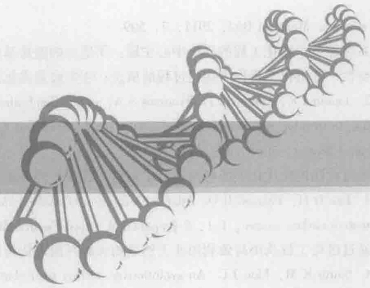

natural_image

Abstract illustration of interconnected nodes forming a chain-like structure (no text or symbols)

# 合成生物学工具与代谢工程

## 【本章学习要点】

1. 合成生物学的研究背景及其定义
2. 合成生物学的研究策略
3. 合成生物学的研究内容及其研究进展
4. 合成生物学与代谢工程的关系及其应用

合成生物学是设计和构建新的生物系统（可以是遗传控制系统、代谢途径、染色体或细胞等）的一门学科，这需要通过用充分表征的、标准化的、可重复使用的生物组分进行组装来进行。十多年来，合成生物学已经在基因线路设计、医药及燃料生产、人工合成基因组等方面取得突破性进展。

---

12.1 合成生物学的研究背景

291

## 知识导图

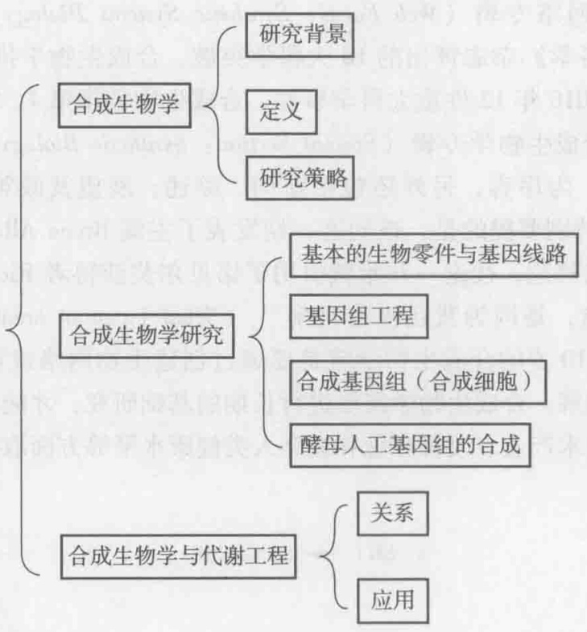

flowchart

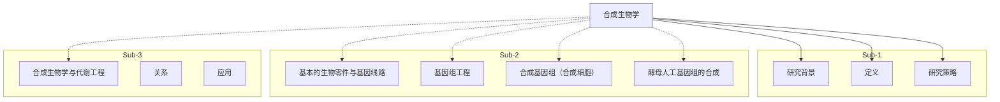

## 12.1 合成生物学的研究背景

合成生物学（synthetic biology）一词最早出现于1911年。随着人类基因组计划的完成，本世纪初合成生物学一词才在学术刊物及互联网上逐渐大量出现（赵学明等2007）。2000年以来发表的合成生物学论文如图12-1所示，从中可以看出合成生物学迅速发展的概况。2004年美国MIT出版的《技术评论》把合成生物学评选为将改变世界的10大技术之一。美国加州大学伯克利分校Keasling教授基于合成生物学和代谢工程技术，利用微生物细胞生产抗疟疾药物青蒿素取得了重大进展，2005年MIT出版的《技术评论》将“细菌工厂”（bacterial factories）作为将影响世界的新出现的10大技术之一。这里的“细菌工厂”也就是人们通常所说的“细胞工厂”（cell factories）。2009年11月，美国国家科学院出版了研究报告《合成生物学:对国家建设的启示》，同年12月《自然生物技术》出版了“Focus on Synthetic Biology”的合成生物学专辑（Nature Biotechnology 2009），包括社论、进展综述、前景展望、产业发展、专利产权、政府监管等16篇论文。社论指出:合成生物学通过计算机设计，用4种化学品（A、G、T和C四种核苷酸）进行基因合成，然后“即插即用”到具有最小化基因组的底盘生物中，可以想象我们在将来能够毫不费力地创造不同形式的生命，这项突破性的技术具有改变生物工程的潜力。2010年1月，《自然》杂志在纪念

---

292

12 合成生物学工具与代谢工程

该刊发表基因线路等合成生物学论文10周年之际，考虑到合成生物学与系统生物学密不可分，把包括社论、新闻、新的研究论文及已发表的相关重要论文汇编为“合成系统生物学”网络专辑（Web Focus: Synthetic Systems Biology）（Nature 2010）。2010年12月，《科学》杂志评出的10大科学突破，合成生物学排第2。同时，《自然》杂志盘点出2010年12件重大科学事件，合成生物学排第4。2011年9月，《科学》杂志出版了合成生物学专辑（Special Section: Synthetic Biology），该专辑以“合成生物学的魅力”为序言，另外还包括新闻、综述、展望及政策论坛等8篇文章（Science 2011）。特别要提的是，该刊这一期发表了主编Bruce Alberts写的题为《生物学的大挑战》的社论，社论一开始就引用了诺贝尔奖获得者Richard Feynman的名言:“我没法创造，是因为我还没有理解”（What I cannot create, I do not understand）。所以年仅10岁的合成生物学就是要通过创建生物网络或重新设计生命系统而加深对生命的理解。合成生物学需要进行长期的基础研究，才能成为强有力的新工具，在促进生物技术产业、改善环境和提高人类健康水平等方面取得突破。

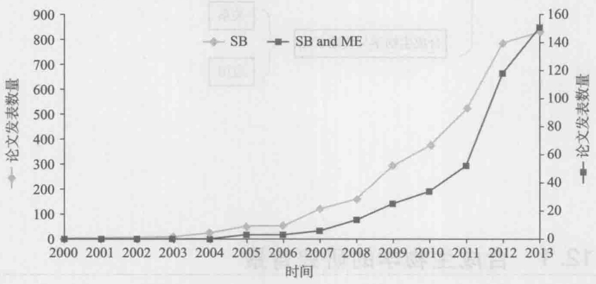

line

| 时间 | SB (论文发表数量) | SB and ME (论文发表数量) |
| --- | --- | --- |
| 2000 | ~5 | ~1 |
| 2001 | ~5 | ~1 |
| 2002 | ~5 | ~1 |
| 2003 | ~10 | ~2 |
| 2004 | ~30 | ~5 |
| 2005 | ~50 | ~15 |
| 2006 | ~55 | ~15 |
| 2007 | ~120 | ~35 |
| 2008 | ~160 | ~80 |
| 2009 | ~300 | ~145 |
| 2010 | ~380 | ~190 |
| 2011 | ~530 | ~300 |
| 2012 | ~790 | ~670 |
| 2013 | ~840 | ~850 |

图12-1 2000年以来合成生物学论文发表情况（Scopus数据库）

SB 代表在论文标题、摘要或关键词中包含 “synthetic biology” 的论文；SB and ME 代表在论文标题、摘要或关键词中同时包含 “synthetic biology” 和 “metabolic engineering” 的论文

## 12.2 合成生物学的定义

合成生物学是一个涉及生物学、工程学、遗传学、化学及计算机科学的交叉学科。来自上述众多学科的人员带着他们广泛的知识和经验积极参与到合成生物学的研究中，因此具有不同学科背景的人会从不同的角度来看合成生物学。2006年《科学家》杂志对从事合成生物学研究的多名学者进行了调查，他们对合成生物学的定义有非常不同的看法（赵学明等2007）。2009年12月，针对定义合成生物学这一难题，《自然生物技术》在其专辑中就合成生物学的定义发表了20位专家的看法。其中哈佛大学遗传学教授George Church说:“基因工程关注个别基因（主要是克隆和表达），基因工程合乎逻辑地延伸到系统水平是基因组工程，介于两者之间的是代谢工程。”合成生物学是建立“标准”的总括，即在生物零件、器件、系统的组装和功能化过

---

12.3 合成生物学的研究策略

293

程中，需要建立模块间相互协调的标准，这种分层次的性质容许在不同水平上进行计算机辅助设计。2010年美国总统生物伦理委员会的报告（www.bioethics.gov）汇总讨论后，将合成生物学定义为:合成生物学是一门科学学科，其依赖于化学合成的DNA，通过标准化和自动化的过程，创造具有全新的或增强了特征或性能的生物体，以满足人类的需要。在2013年6月出版的新书《合成生物学——工具和应用》（Zhao 2013）中说，为了避免可能对读者引起的混淆，合成生物学被定义为:用工程设计原理对改进了的生物系统或全新的生物系统进行设计、建造和表征。

## 12.3 合成生物学的研究策略

## 12.3.1 生物系统的层次结构

2005年，Endy（2005）在《自然》杂志上发表了题为《工程生物学的基础》综述论文，明确提出工程中常用的“标准化”、“复杂系统解藉”、“概念抽象化”做法，并清楚地将合成生物学涉及的生物系统分成DNA、零件、装置、系统这样4个层次。2006年美国普林斯顿大学电子工程系与分子生物学系的Weiss实验室发表了题为《合成生物学:对于一个刚出现学科的新的工程作用》的综述（Andrianantoandro et al. 2006）。通过与计算机工程的层次结构进行类比（图12-2），他们概括了合成生物学新学科的基本性能及与其他工程学科相比的独特性，讨论了从生物装置、模块、细胞到多细胞系统各个层次进行设计和建造工程细胞的方法。从图12-2可以看到二

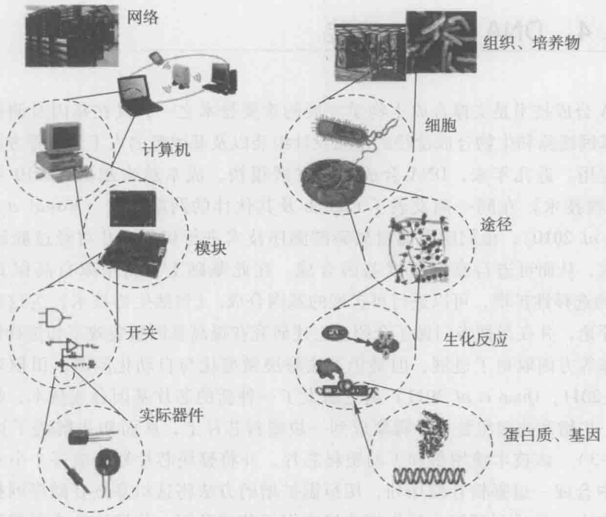

图12-2 由计算机工程所启发的一个可能的合成生物学层次（Andrianantoandro et al. 2006）

---

294

12 合成生物学工具与代谢工程

者的类似性，但是最大的差别是生物系统是一个“活的生命系统”，在“零件”“器件”“模块”及“系统”之间的相互作用非常复杂，这是合成生物学研究面临的最大挑战。

## 12.3.2 合成生物学的研究策略

合成生物学研究策略可分为自上而下法和自下而上法。两种方法可以在某种程度上互相交叉，它们具有共同目标:工程化特定的生物功能，使其具有可预测性及可靠性。将来两种方法可能会融会贯通到一起（赵学明等 2011）。

（1）自上而下法（top-down approach）:人们利用合成生物学对现有生物或基因序列进行重新设计，以去掉不必要的零件，或取代或添加特定的零件。2006年，文特尔研究所（JCVI）进行的生殖支原体最小基因组必需基因的研究，为自上而下法提供了原理的证明。运用自上而下法进行基因组减小已经有许多成功的例子。
(2) 自下而上法（bottom-up approach）:如果人们理解组成生物体的基本原理，能够调控生物体的各种活动，就可利用非生命组分作为原材料来构建生命系统。这就是合成生物学所说的“合成生命”（synthetic life）或“合成细胞”（synthetic cell）。与利用现有生物系统的自上而下法相比，采用该方法开展研究的时间较短，工作挑战性非常大。目前，在合成生物学研究中，许多工作是构建具有各种功能的标准零件、基因调控线路及器件。通过这些研究，一方面可以加深对生物体的理解，为今后设计新生命、创建新生命提供基础，同时也可用于对现有生命系统的改造。虽然目前还没有一个完全真正的人造细胞，但 JCVI 于 2010 年发表的《由一个化学合成基因组所控制的细菌细胞的创建》是合成生物学自下而上法的一个典型示例。

## 12.4 DNA 合成与组装

DNA 合成技术是支撑合成生物学发展的重要技术之一，其在基因及调控元件的合成、基因线路和生物合成途径的重新设计组装以及基因组的人工合成等方面都具有重要的应用。近几年来，DNA 合成技术发展很快，成本越来越低。2010 年 12 月，《自然生物技术》在同一期发表了 Church 及其伙伴的两篇论文（Kosuri et al. 2010, Matzas et al. 2010），他们用高通量焦磷酸测序技术进行识别，并对经过验证的 DNA 进行检索，从而可进行高保真度基因合成。在此基础上，利用取自高保真微阵列 DNA 库的选择性扩增，可以进行可扩展的基因合成。《自然生物技术》为这两篇论文配发了评论，并在封面专门做了介绍。上述研究在提高基因组装效率和选择性扩增寡核苷酸库等方面取得了进展，但是仍无法解决微型化与自动化问题。田敬东实验室（田敬东 2011, Quan et al. 2011）最近研发了一种新的芯片基因合成技术，将寡核苷酸合成、扩增和连接组装等步骤集成到一块塑料芯片上，从而初步解决了这一难题（图 12-3）。该技术使用易加工的塑料芯片，并将整块芯片划分成多个小室，在每一小室中合成一组寡核苷酸序列，用恒温扩增的方法将这组寡核苷酸序列扩增并释放到小室中，最后利用聚合酶拼接法将它们组装成基因。使用该技术可将基因合成时间从 2\~3 周缩短到 2\~3 天，成本从每对碱基 0.5\~1.0 美元降低到 0.5 美分，

---

12.5 基本的生物零件与基因线路

295

同时大大降低了原料用量。

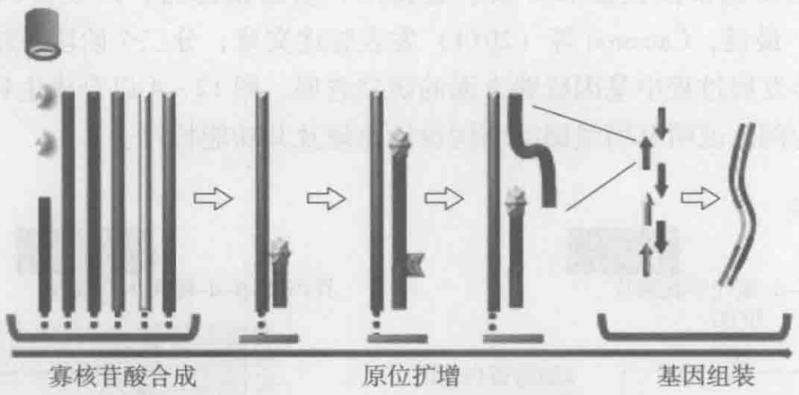

flowchart

图12-3 将寡核苷酸合成、扩增和连接组装集成到一块塑料芯片上的基因合成过程（田敬东2011，Quan et al. 2011）

除上述实验室 DNA 合成研究外，DNA 合成产业化也在迅速发展。位于美国麻省剑桥的 Gen9 公司建立于 2009 年，其基于 MIT 的 Joseph Jacobson、斯坦福大学的 Drew Endy 和哈佛医学院的 George Church 的工作，进行高通量、高精度、自动化、低成本的 DNA 合成新技术平台的建设与产业化。2013 年 4 月，安捷伦公司对 Gen9 进行 2100 万美元巨额股权投资。2013 年 5 月 29 日 Gen9 公司宣布推出 GeneBytes $^{TM}$ 平台技术（http://gen9bio.com/），可以合成长度 1000～3000 bp 的 DNA 片段，预计 2013 年年底长度将可达到 10000 bp。这样，由于可以合成几千碱基对的 DNA 片段，人们就可很方便地研究完整基因、代谢途径、远缘的基因元件、基因组等的特性，这将对合成生物学有巨大推动作用。

## 12.5 基本的生物零件与基因线路

基本的生物零件（basic biological parts）（Cheng and Lu 2012）是更高级的用于构建合成基因线路的基本模块，它们是执行特定功能的实体，这些功能包括:调控转录、调控翻译、结合小分子、结合蛋白质域以及修饰遗传材料等。大部分零件源于自然，合成生物学家增补这些零件并对其工程化，以便在其自然设置之外使用。一个典型的例子是利用天然启动子，如λ噬菌体 $P_{L}$ 和乳糖操纵子启动子，控制原核生物的基因表达。定量控制和调控范围的限制导致工程师来修改激活物和阻遏物结合序列，产生新的启动子，从而能进行更严格的控制和数量级范围更大的调节。

基因线路（gene circuit 或 genetic circuit）就是我们通常所说的细胞中的基因调控网络。Wall 等（2004）将基因线路定义为涉及响应于信号的基因及基因产品的相互作用。在合成生物学中，人们通过对生物体中天然基因线路（natural gene circuit）的理解，运用工程原理，设计构建出合成基因线路（synthetic gene circuit）。因此，合成基因线路的设计与构建已成为合成生物学的重要组成部分。这些研究不仅可更深入地了解生命的构成方式和调控原理，还可设计具有所需功能的基因元件，进而构建合成生物系统。另外，基因线路的研究也是进行生物分子计算的基础。迄今为止，合成生

---

296

12 合成生物学工具与代谢工程

◆ 科技视野 12-1
基因线路的研究进展

物学家通过向自然学习进而进行合成的方法已经创建了多种零件库及具有各种功能的基因线路，主要包括反馈器和开关、逻辑门、基因振荡器、计数器以及通用性的RNA元件等。最近，Cameron等（2014）发表综述文章，分三个阶段总结了十几年来在合成生物学发展过程中基因线路方面的研究进展。图12-4以合成生物学发展初期的基因线路为例，说明基因线路的结构设计原理及其功能特性。

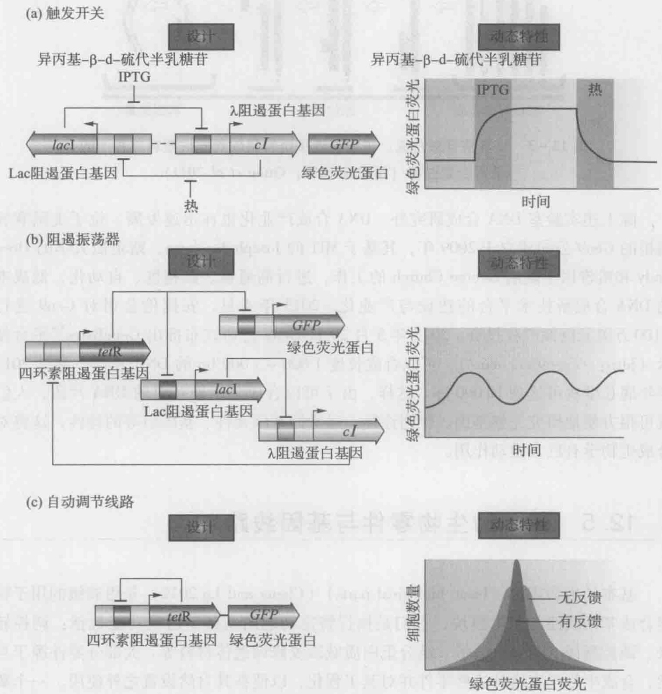

图12-4 合成生物学发展初期的基因线路举例（Cameron et al. 2014）

合成生物学早期创建的基因线路类似于电子线路的功能，因而对这些简单基因线路的动态特性也可用简单的数学模型来描述，这就能用基于模型的设计方法对基因线路的性能进行评价。图12-4左侧是基因线路的结构设计，右侧是这些基因线路对应的动态特性。图12-4a的触发开关中包括一对抑制基因（lacI和cI），以对抗性的相互抑制转录，从而产生一个双稳态基因线路，使得在一个给定的时间两个基因中仅有一个是活跃的。图12-4b是由三个阻遏物-启动子对构成的三重负反馈循环的阻遏振荡基因线路。激活该线路，可导致阻遏蛋白表达有序的、周期的振荡。图12-4c所示的自动调节基因线路中，由TetR介导的其自己转录的负反馈调节产生了一个

---

12.6 基因组工程

297

窄的群体范围的表达分布。

## 12.6 基因组工程

基因组工程（genome engineering）（Carr and Church 2009）是指为了特定目的而对全基因组进行广泛的遗传改造，其包括如下步骤:遗传系统设计、遗传材料的合成、启动所设计的遗传操作系统以使整个基因组运行、调试检查和排除障碍。基因组工程所遇到的一个挑战是由所需要的基因组改变的“尺度”所影响的。为了强调“尺度”的影响，Esvelt 和 Wang（2013）提出了“全基因组工程”（genome-scale engineering），指出对一个基因组至少两个不同的区域进行序列修饰。人们可以利用全基因组工程通过实验探测深层次的生物问题，例如必需性（essentiality）、异位显性（epistasis）、编码方式（encoding）、进化能力（evolvability）、鲁棒性（robustness）以及在代谢工程和医学治疗等方面的应用。同时，通过全基因组工程，还可以构建产生有用的生物体，而这仅仅利用进化是不能得到的。最近，在高通量的 DNA 测序、DNA 合成与组装、基因组尺度代谢网络和调控网络模型、多元自动化基因组工程技术、基因组编辑技术等方面已经取得重大突破，这就为系统生物学和合成生物学进行基因组工程提供了极好的机会。基因组工程的基本工具与方法如图 12-5 所示。

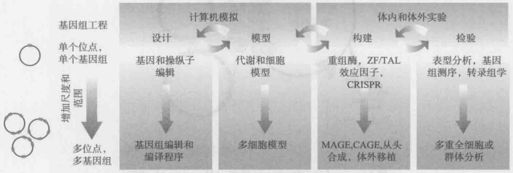

flowchart

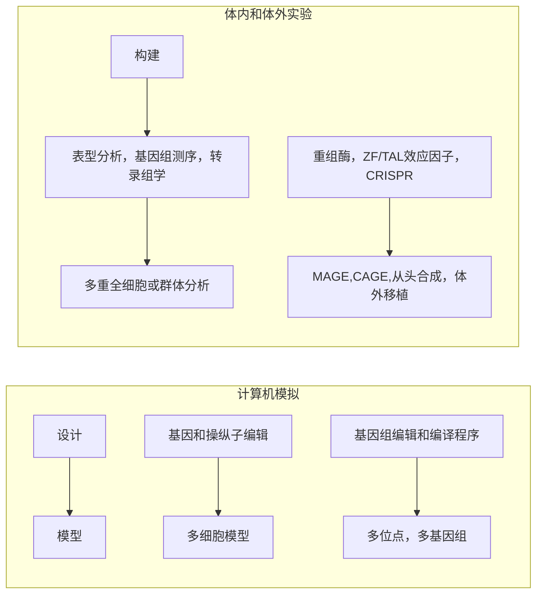

图12-5 基因组工程的基本工具与方法（Esvelt and Wang 2013）

图中列出了基因组工程的设计、模型模拟、构建、检验四个步骤，也包括了从单个基因组的单个位点扩展到很多基因组的很多基因位点的遗传扰动。图中涉及的主要工具后面将介绍

## 12.6.1 多元自动化基因组工程技术

2009 年 Church 研究组（Wang et al. 2009）开发了一种大尺度修改和进化细胞基因组的多元自动化基因组工程（multiplex automated genome engineering，MAGE）技术，其发表以来受到了广泛的关注。该技术将大量人工合成的具有各种突变（包括碱基错配、插入和缺失）的单链 DNA 库导入宿主细胞进行重组，可以快速高效地得到各种突变株。该技术快速高效，使得在全基因尺度上对菌株的基因组序列进行设计和修饰成为可能，可极大地加快细胞优化的进程。2009 年 8 月，《科学》杂志发表评述认为 Church 开发的 MAGE 技术和 JCVI 开发的从酵母到其他物种的基因组高效转移

---

298

12 合成生物学工具与代谢工程

技术具有互补作用，都是合成生物学的重要进展，从中我们可以对合成生物学的含义有更好的理解。以下是 MAGE 技术的原理及应用举例。

MAGE 技术基于 ssDNA 介导的  $\lambda-Red$  重组工程技术（recombineering）。Red 重组系统包含 3 种蛋白质分子 Exo、Beta 和 Gam。然而在 ssDNA 重组过程中只需要 Beta 蛋白，其是一种 ssDNA 结合蛋白。目前 Red 重组的模型认为，在基因组（或者质粒）复制的时候，后随链（lagging strand）会裸露出一段单链区域。Beta 蛋白与 ssDNA 结合，并且促进其与这段单链区域互补配对，从而发生同源重组。ssDNA 在左右两端通常有 30\~45 bp 的同源臂，通过改变中间的序列，可以在基因组内引入错配（mismatch）、插入（insertion）或者删除（deletion）。

ssDNA 同源重组技术自发现以来，其效率被持续地提高。MAGE 正是利用了 ssDNA 同源重组所具有的高效率（或许是在基因组中引入突变的最高效方式），对大肠杆菌的基因组进行多元的循环修饰。它的设计思路是，同时导入大量的 ssDNA 组成的文库，文库中的 ssDNA 与基因组上的不同靶点发生重组，引入事先设计好的或者简并的突变，从而形成一个多样性巨大的基因组库。这个过程可以循环进行，使细胞获得的突变点不断增加，同时使基因组的多样性不断增大。图 12-6 是 MAGE 设计原理图。

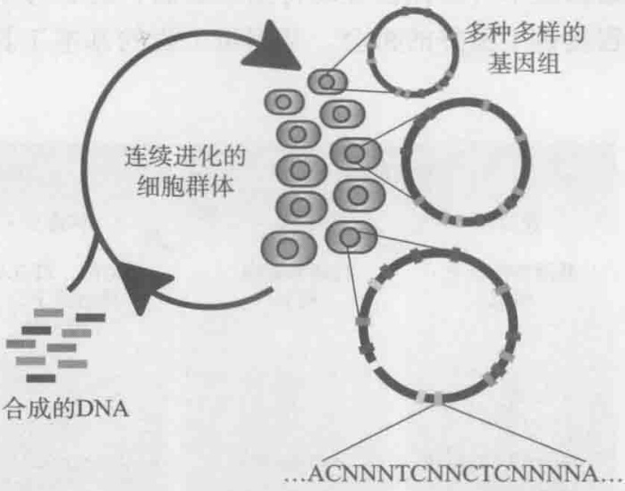

flowchart

图12-6 MAGE设计原理图（Wang et al. 2009）

将大量 ssDNA 循环地转入细胞，不同的 DNA 与基因组不同的位点（彩色的小棒）发生重组，在不同的位点发生突变，或者在相同的位点引入不同的突变，从而形成多样性巨大的基因组库。通过引入简并引物，可以对某个位点的序列进行精细的调节。

MAGE 的操作可以细分为 7 步（图 12-7）:①将细胞培养到对数中期（OD 值 0.4\~0.7）；②42℃的热激 15 min，诱导 Beta 蛋白的表达；③将细胞降温至 4℃；④在 4℃用去离子水洗 3 次细胞，制作电转化的感受态；⑤将 ssDNA 的文库和感受态细胞混合；⑥电转化将 ssDNA 转入细胞，从而发生多元的重组；⑦复苏细胞并进入下一个循环。通过一个自动化装置，每一个 MAGE 循环可以在 2.5 h 内完成。

---

12.6 基因组工程

299

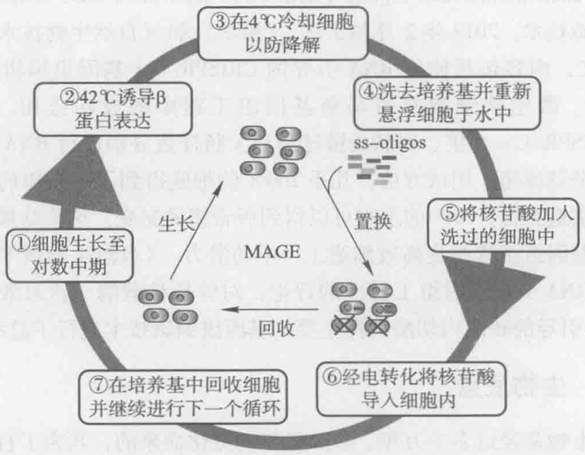

flowchart

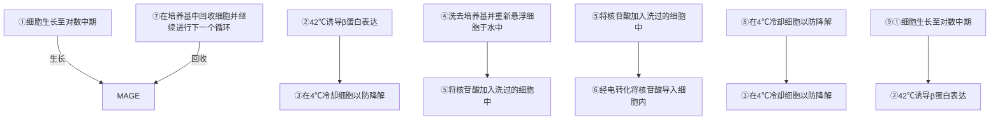

图12-7 MAGE的操作步骤（Wang et al. 2009）

作为这项技术的应用展示，作者对番茄红素生产途径上20个基因的RBS序列同时随机引入各种突变，同时对另外4个基因的开放阅读框内插入终止密码子使它们失活，一天就能得到43亿种突变组合，并从突变库中挑选到番茄红素生产能力提高五倍的菌株。

2012 年，该实验室利用效率更高的 Co-Selection MAGE（CoS-MAGE）技术，在芳香族氨基酸生物合成代谢通路相关的基因和操纵子中插入了 12 个 20 bp 的 T7 启动子，提高靛青生物合成的产量（Wang et al. 2012）。在有 T7 RNA 聚合酶的基因背景下，T7 启动子强度很高而且是与内源的启动子正交的。这 12 个启动子的插入分为 4 个阶段，每个阶段靶向的基因数和产生的最多的突变数。在插入的中间步骤，还可以获得不同组合的启动子插入菌株。他们一共研究了 80 个突变株的产量，其中包含所有的 12 个启动子的单插入菌株，两个完整的双插入菌株和最终 12 个启动子全部插入的菌株，筛选到的最优菌株比进化出发菌株的产量提高了 4 倍多。对这 80 个菌株的产量的研究可以发现不同组合之间有显著的协同效应。比如 aroC 和 trpE 基因单独的强表达对靛青的产量并没有提高，然而他们的组合却能将产量比出发菌株 E47N 提高 42%。再比如，含有除 aroB 和 tktA 之外的 10 个启动子的插入的菌株比 E47N 的产量高 20%，然而继续在 aroB 基因前面插入第 11 个 T7 启动子后产量却比 E47N 降低了 20%。在此基础上再于 tktA 前插入第 12 个启动子，又能将产量提高到 E47N 的 29%。这些都表明基因网络的各部分之间的关系是非常复杂的、非线性的和协同的。

## 12.6.2 基因组编辑技术

2012年1月，《自然方法》杂志把“用工程核酸酶进行基因组编辑”选为2011年最佳方法，并配发了多篇文章加以介绍。2012年底，《科学》杂志在评选出的年度10大科学突破中，“基因组工程”排名第三，其中着重介绍了锌指核酸酶（zinc-finger nucleases，ZFNs）、转录激活因子效应物核酸酶（transcription activatorlike effector nucleases，TALENS）、成簇的规律间隔的短回文重复序列规律[the clustered, regular-

技术应用 12-1
利用 MAGE 技术
改进大肠杆菌合
成番茄红素的能力

---

300

12 合成生物学工具与代谢工程

ly interspaced, short palindromic repeats (CRISPR) -associated Cas, CRISPR/Cas] 三种基因组精密编辑技术。2013年2月和3月，《科学》和《自然生物技术》分别发表了2篇和3篇论文，内容包括使用RNA引导的CRISPR/Cas基因组编辑技术在人类细胞、小鼠细胞、微生物细胞及斑马鱼基因组工程中的成功应用。其中Jiang等（2013）用CRISPR/Cas系统，对肺炎链球菌和大肠杆菌分别进行RNA引导的基因组编辑。对于肺炎链球菌，用该方法，几乎 $100\%$ 的细胞得到了所希望的突变。对于大肠杆菌，结合重组工程，$65\%$ 的细胞可以得到所希望的突变。这些结果显示，基因组编辑在微生物基因组工程构建高效细胞工厂中的潜力。《自然生物技术》在同期还配发一篇题为《RNA引导基因组工程》的评论，对锌指核酸酶、转录激活因子效应物核酸酶和RNA引导的核酸内切酶三种主要的基因组编辑技术进行了总结。

## 12.6.3 生物底盘

自然界的生物是经过多少万年、多少亿年的进化而来的，其为了自身的生存，形成了非常完整的结构和非常复杂精密的调控系统。合成生物学的目标是要改造现有的生物或构建新的生物以便为人类服务（例如生产有用产品燃料、化学品、药物等）。人们首先想到的就是向自然学习，充分利用自然界现有的生物。但是由于自然界生物本身的复杂性，而且主要是为自身的生存，而不是为人类生产产品，因此人们就想对自然界的生物进行适当简化，使其既能很好生存，又能为人类高效、低成本生产有用产品。于是就提出了构建最小基因组（minimal genome）、基因组最小化（genome minimizing）等概念，目的是避免自然界原有生物固有的复杂性，构建简单的、灵活的、可预测的、可编程的及可控制的生物底盘（biological chassis）。在这种生物底盘的基础上，我们可以适当增添扩展一些生物零件、模块及调控线路，构建针对具体应用目标生物系统。Esvelt 和 Wang（2013）概括出几类构建底盘生物的方法（图12-8），并定义生物底盘应该具有如下几种有用的性能:在包含葡萄糖的最小培养基上能快速生长；有发酵能力；适合遗传操作；其足够小，以致于任何更多的基因移除就会对上述三种性能产生负面影响。含有这样一组基因并满足上述条件的细胞被认为有一个核心底盘或最小底盘。

## 12.6.4 基因组简化

基因组小型化实际上也是一种基因组简化，只不过其目标是要达到上述提到的生物底盘的四个标准。这里要讨论的基因组简化（genome streamlining）或基因组减小（genome reduction）是利用合成生物学研究中的自上而下法，从自然界现有生物出发，根据该生物的基因组信息，或根据特定的应用目的，删除基因组中的非必需基因或冗余基因，进而达到基因组简化，减轻细胞负担的目的。利用基因组简化后的细胞，可以更好地为人类生产燃料、化学品及药物，近几年已经取得许多有意义的结果。

2006 年《科学》杂志发表了大肠杆菌基因组减小的研究，依据必需基因及非必需基因等指导原则，对基因组精确删除达 15% 以上，结果导致菌种电转化效率提高、稳定性增强。2008 年日本花王公司发表了枯草芽胞杆菌基因组简化的研究工作:通过合理设计删除了 20% 的基因，结果增强了重组蛋白的生产能力，已应用于工业生产。同年，日本协和发酵公司发表了利用基因组简化的大肠杆菌生产 L-苏氨酸的研

---

12.7 合成基因组（合成细胞）

301

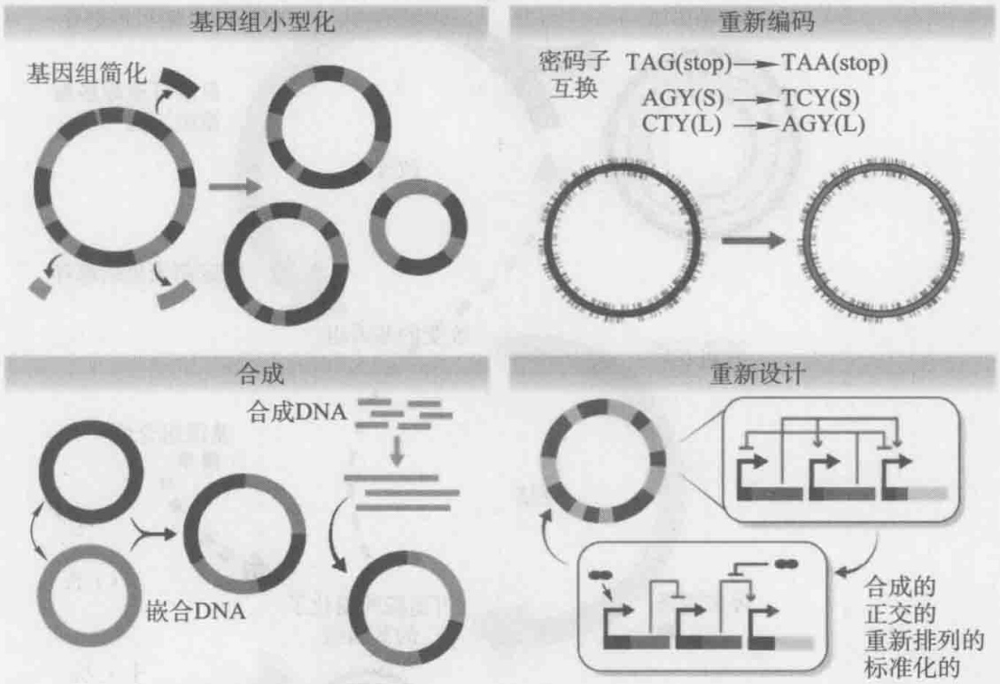

图12-8 几类灵活的可编程的生物底盘构建（Esvelt and Wang 2013）（彩图见插页）

基因组小型化（genome minimization）:减小生物复杂性和冗余性；重新编码（recoding）:整个基因组密码子重新设计（codon remapping）能使正交信息编码和遗传密码扩展；合成（synthesis）:基因组从头合成和从天然基因组重建，能够创建半合成基因组，创建具有新功能及混合功能的嵌合基因组（chimeric genome）；重新设计（redesign）:整个基因组重新设计及调控系统的重新布线，能使新的合成线路易于设计和模型模拟

究工作:与野生大肠杆菌相比，利用基因组敲除约25%的大肠杆菌作为宿主菌使L-苏氨酸的产量增加了2.4倍，菌体最终密度比野生菌高1.5倍，而菌体生长速度无明显变化。最近，Leprince等（2012）发表了题为《简化基因组:为了产生简化的和稳定的微生物系统》的综述，在总结基因组简化已取得成果的基础上，结合“多元自动基因组工程”（MAGE）和“可追踪多重重组工程”（trackable multiplex recombineering，TRMR）等基因组工程技术的突破，进一步对基因组简化过程进行了归纳，如图12-9所示。

## 12.7 合成基因组（合成细胞）

多年来，JCVI一直在进行合成基因组的工作（赵学明等2011）。2003年，由合成的寡核苷酸，通过整个基因组组装，得到一个合成 $\varphi \mathrm{X}174$ 噬菌体基因组。根据此技术，他们提出组装一个最小细胞基因组的设想。2006年，对具有最小基因组的生殖支原体，进行了最小基因组必需基因的研究，为后来对基因组的操作奠定了基础。2007年，将蕈状支原体的整个基因组分离为“裸露”的DNA并将其移植到山羊支原体中，实现了在细菌中的基因组移植:将一种物种变为另一种物种。2008年，在酵母中得到完全的化学合成、组装、克隆的生殖道支原体基因组，这是第一个人工合成的细菌基因组。2009年，为了进一步利用酵母中的细菌基因组来构建活的微生物细胞，实现了基因组从酵母到其他物种的高效转移，打通了人工合成细胞的最后一步。

---

302

12 合成生物学工具与代谢工程

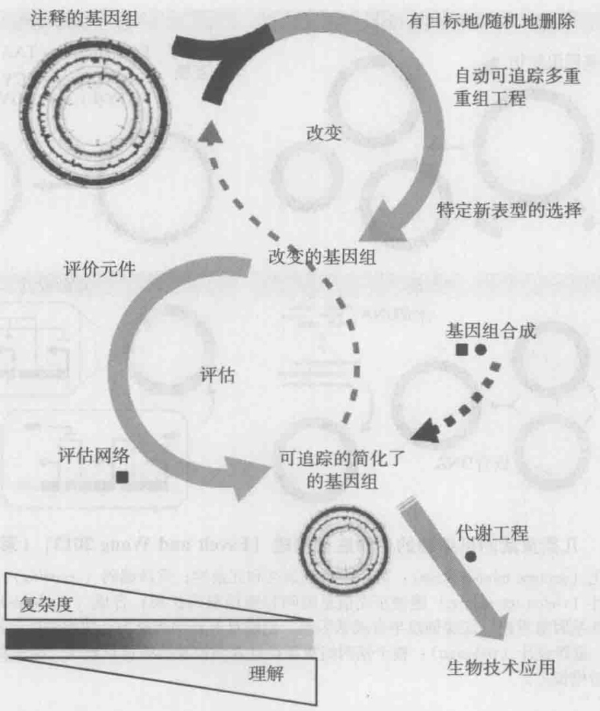

flowchart

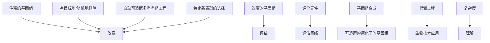

图12-9 基因组简化过程所用的技术及简化结果的应用（Leprince et al. 2012）

2010 年，他们报告了从数字化的基因组信息开始，设计、合成和组装了一个 1.08 Mb 的蕈状支原体基因组，将其移植进一个山羊支原体受体细胞，从而创造了一个仅由合成染色体控制的新的蕈状支原体细胞。新细胞内仅有的 DNA 是所设计合成的 DNA 序列，具有所预期的表型性质，有连续自我复制的能力。JCVI 将新细胞命名为 JCVI-syn 1.0，其构建过程如图 12-10 所示，其中，合成的蕈状支原体基因组在酵母中的组装技术极为关键。

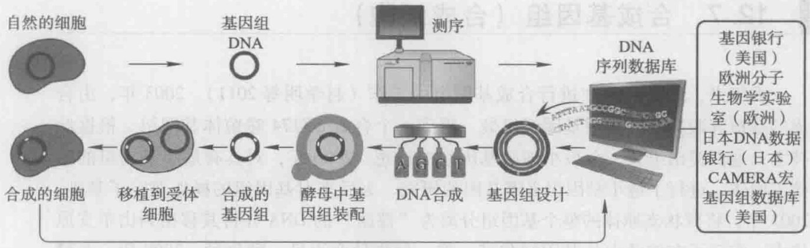

flowchart

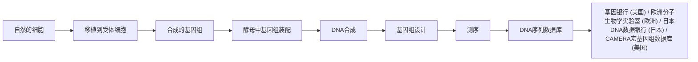

图12-10 JCVI所用合成生物学技术构建合成细胞的流程

---

12.8 酵母人工基因组的合成

303

## 12.8 酵母人工基因组的合成

2011年9月，《自然》杂志发表了合成真核生物酿酒酵母两条染色体臂synIXR和semi-synVIL的论文（Dymond et al. 2011）。根据酵母基因组序列信息，通过计算机设计，从酵母染色体中移除了20个区域，这些区域包括tRNA序列、内含子、转座子、亚端粒序列等。对大于500 bp的所有基因都重新编码，使这些基因含有“水印”以便区别合成基因与天然基因。用合成的染色体对酵母基因组进行修改后，得到了令人震惊的结果:含有部分合成基因组的酵母细胞仍然能存活，有功能，可再生，没有明显不良表型。在上述合成染色体臂的基础上，2014年4月，《科学》杂志发表了全合成酿酒酵母第3号人工染色体SynⅢ的研究（Annaluru et al. 2014）。基于酿酒酵母天然的第3号染色体（含有316617个碱基对），经过in silico设计，全合成的SynⅢ含有272871个碱基对，比原染色体减小了 $13.8\%$ 。装配这条缩短并改进的人工染色体SynⅢ的酵母细胞生长正常，几乎在所有生长条件下与天然酵母细胞没有差别。上述工作为构建更稳定、可工程化、可进化的全新酵母基因组奠定了基础。

上述工作是酵母人工基因组合成计划（Sc.2.0）的第一步。该项目是由美国约翰·霍普金斯大学/美国纽约大学的Jef Boeke院士发起，旨在从头合成酿酒酵母的全基因组，世界上多个国家的研究机构参与了这个项目，如图12-11所示。

酵母染色体的合成采取“自下而上”的策略，可分为SynⅢ的设计、SynⅢ的构建、含SynⅢ酵母菌株的表征与检验三大部分。

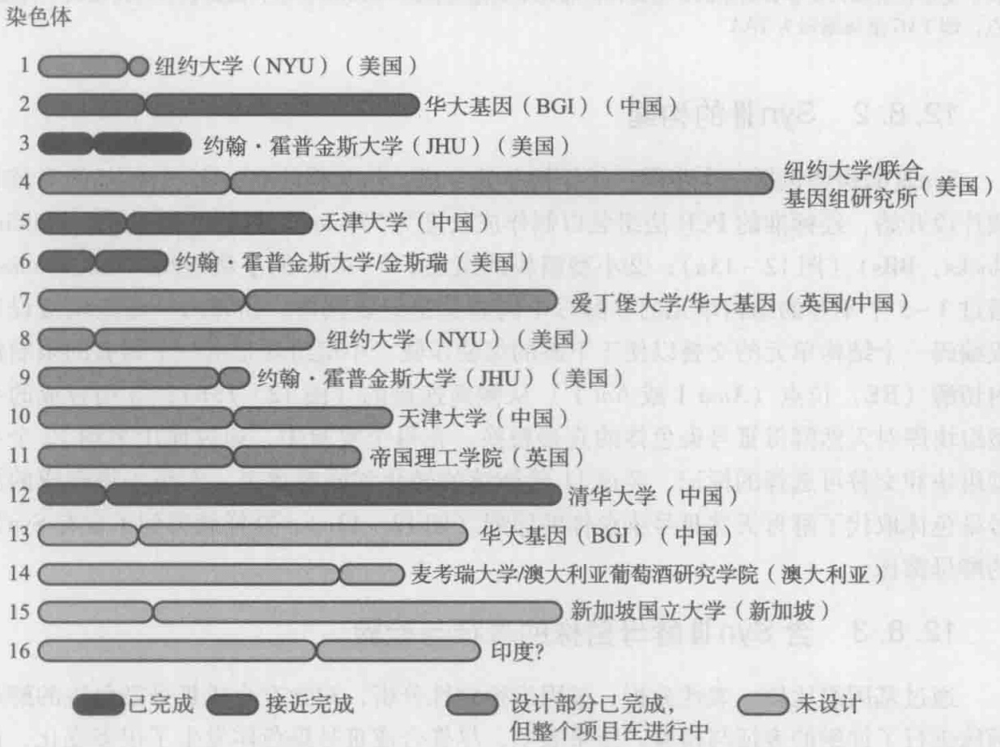

bar

| Rank | University | Status |
| --- | --- | --- |
| 1 | 纽约大学 (NYU) (美国) | 已完成 |
| 2 | 华大基因 (BGI) (中国) | 接近完成 |
| 3 | \(约翰 \cdot 霍普金斯大学\) (JHU) (美国) | 已完成 |
| 4 | 纽约大学/联合基因组研究所 (美国) | 接近完成 |
| 5 | 天津大学 (中国) | 接近完成 |
| 6 | \(约翰 \cdot 霍普金斯大学/金斯瑞\) (美国) | 已完成 |
| 7 | 爱丁堡大学/华大基因 (英国/中国) | 接近完成 |
| 8 | 纽约大学 (NYU) (美国) | 接近完成 |
| 9 | \(约翰 \cdot 霍普金斯大学\) (JHU) (美国) | 接近完成 |
| 10 | 天津大学 (中国) | 接近完成 |
| 11 | 帝国理工学院 (英国) | 接近完成 |
| 12 | 清华大学 (中国) | 已完成 |
| 13 | 华大基因 (BGI) (中国) | 接近完成 |
| 14 | 麦考瑞大学/澳大利亚葡萄酒研究学院 (澳大利亚) | 接近完成 |
| 15 | 新加坡国立大学 (新加坡) | 接近完成 |
| 16 | 印度? | 接近完成 |

图12-11 合成酵母基因组项目（Sc.2.0）承担单位及进展现状（Pennisi 2014）

---

304

12 合成生物学工具与代谢工程

## 12.8.1 SynⅢ的设计

根据菌株健康适合度、基因组稳定性及遗传可行性原则，利用所开发的基因组编辑软件 Biostudio，对酵母的天然染色体序列进行 in silico 编辑。具体的人工编辑包括:在保持原基因顺序和非编码区不变的条件下，删除不利于染色体稳定的元件（如转座子、亚端粒重复序列、内含子）；在保持编码蛋白不变的前提下，利用同义密码子引入酶切位点和 PCR 标签以方便人工染色体片段的组装和检验；将 TAG 终止子替换为 TAA；并引入 loxPsym 位点以增加酵母基因组可操作性，方便后续的科学研究。全合成酵母Ⅲ号人工染色体 SynⅢ 的设计图谱如图 12-12 所示。

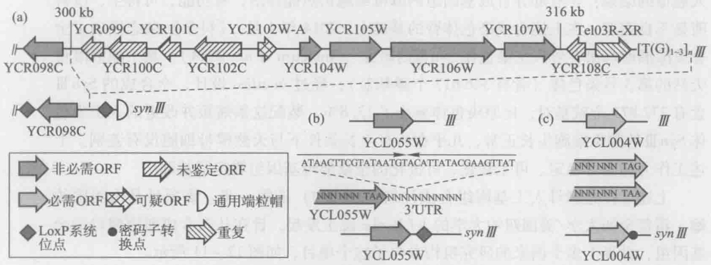

flowchart

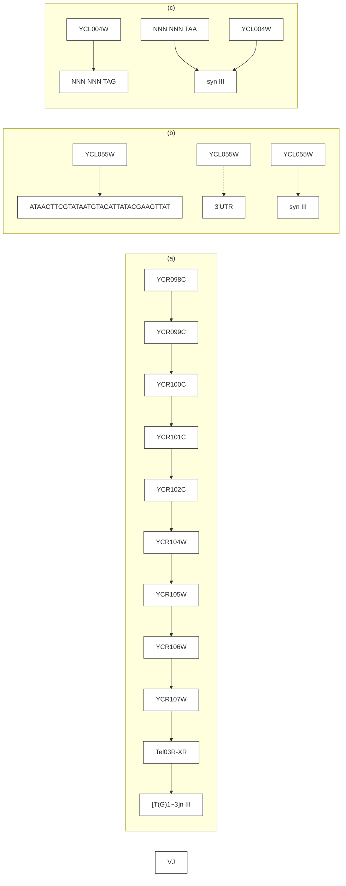

图12-12 synIII的设计图谱（Annaluru et al. 2014）

图中（a）和（b）所示为代表性的插入 loxPsym 位点的 synⅢ片段，C 表示终止密码子 TAG 到 TAA 的编辑。菱形代表插入在非必需基因 3' 非翻译区和几个其他位置的 loxPsym 位点，圆圈表示终止密码子转换点，即 TAG 重新编码为 TAA

## 12.8.2 SynⅢ的构建

SynⅢ的构建包括三个步骤:①结构单元合成。从交叠的60\~79个碱基的寡核苷酸片段开始，经标准的PCR法组装以制作成长度为750 bp左右的结构单元（building blocks，BBs）（图12-13a）；②小型组块的组装。2\~4 kb的小型组块（minichunks）通过3\~5个不等的结构单元的在酵母中同源重组组装获得。相邻的小型组块被设计成编码一个结构单元的交叠以便于下游的组装步骤。小型组块是由一个稀有的限制性内切酶（RE）位点（Xma I或Not I）从侧面连接的（图12-13b）；③用合成的小型组块库对天然酵母Ⅲ号染色体的直接替换。在每个实验中，通过使用平均12个小型组块和交替可选择的标记，经过11轮连续的转化和同源重组，实现了用合成的Ⅲ号染色体取代了酵母天然Ⅲ号染色体的序列（图12-13c）。这样就得到了含有SynⅢ的酵母菌株。

## 12.8.3 含 SynⅢ酵母菌株的表征与检验

通过基因组比较、表性分析、基因组稳定性分析，对含有合成Ⅲ号染色体的酵母菌株进行了详细的表征与检验。结果表明，尽管合成Ⅲ号染色体发生了很多变化，例如内含子缺失、tRNA基因的移出、loxPsym位点和PCRTags的导入等，并没有显著降

---

12.9 合成生物学与代谢工程

305

(a) 从寡核苷酸合成结构单元

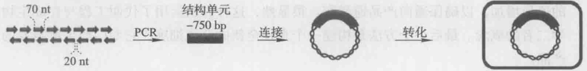

flowchart

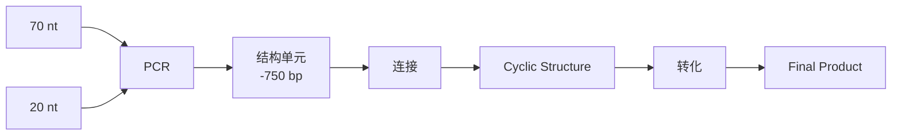

(b) 组装2\~4 kb 小型组块

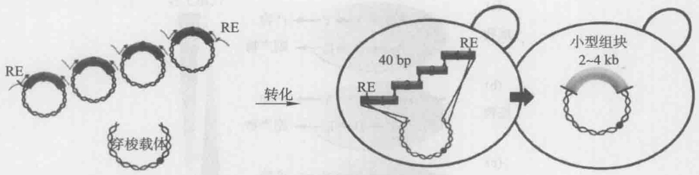

flowchart

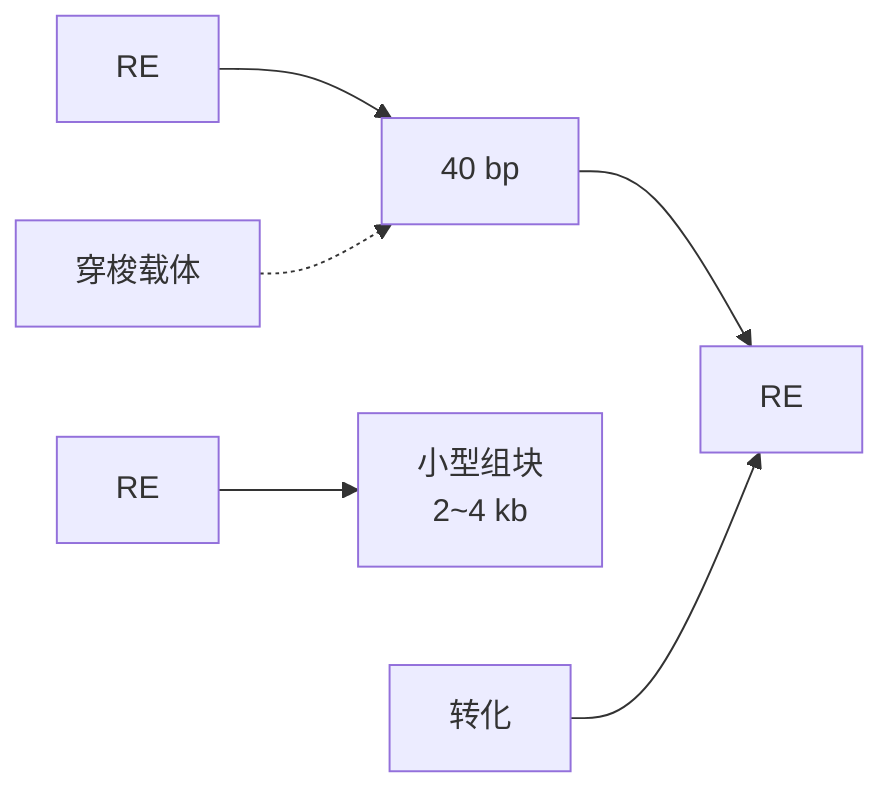

(c) 用合成的小型组块库对天然酵母Ⅲ号染色体的直接替换

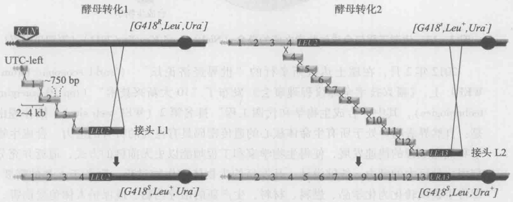

text_image

酵母转化1
[G418R,Leu-,Ura-]
接头 L1
UTC-left
~750 bp
2~4 kb
LEU2
G418S,Leu+,Ura-
[LEU2]
酵母转化2
[G418S,Leu+,Ura-]
接头 L2
LEU3
G418S,Leu+,Ura+]

图12-13 SynIII的构建（Annaluru et al. 2014）

低酵母菌株的不同环境生长能力，没有明显改变菌株的转录组或复制时间。

Sc. 2.0 计划是人类首次合成真核生物的基因组，具有重大的理论研究意义和实际应用价值。“自下而上”的全人工合成方式将进一步加深人们对这一真核生物模式菌种的理解，对于解决我们所面临的人体健康、能源短缺、环境污染等问题有重要意义。Sc. 2.0 计划有望成为合成生物学领域的一个重要里程碑。

## 12.9 合成生物学与代谢工程

代谢工程与合成生物学之间的边界与叠合往往是模糊的，因为许多研究者来源于这两个领域，甚至同时在这两个领域工作，分享共同的工具。Nielsen 和 Keasling（2011）清楚地阐述了二者之间的协同关系，如图 12-14 所示。图中第一种方法是用生物技术中的传统的方法，一个天然的生产菌株被选择作为细胞工厂生产所希望的产品。通常情况下，通向产品的通量自然是低的，但通过使用经典菌株改良或使用定向的遗传修饰（即代谢工程），能够增大产品的通量。在第二种方法中，该平台细胞工厂本身不能自然生产所需的产品。通过在该细胞中插入一条生物合成途径，则可以生

---

306

12 合成生物学工具与代谢工程

产所需产品，但起初生产的量往往很少。然而，通过途径优化，可使通过该合成途径的通量增加，以确保通向产品通量高。很显然，这种方法运用了代谢工程与合成生物学二者的概念。最后一个方法是构建一个真正全新的合成细胞，它专门产生所需要的产品。

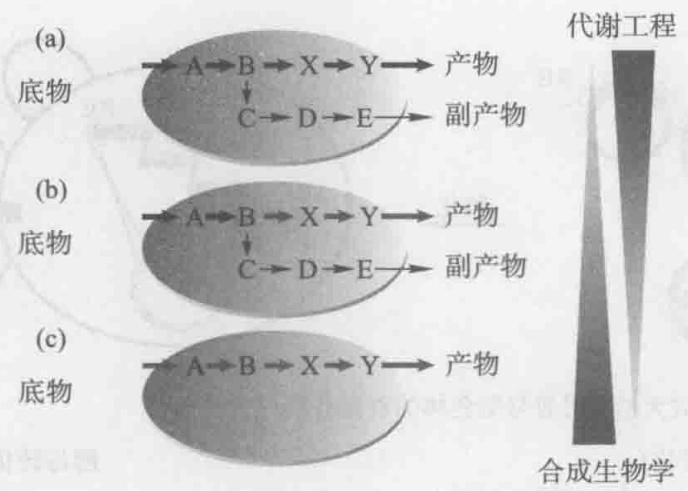

flowchart

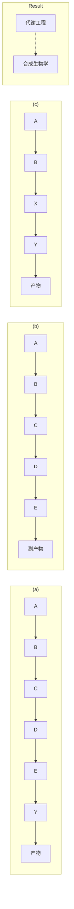

图12-14 代谢工程与合成生物学之间的叠合（Nielsen and Keasling 2011）（彩图见插页）

2012 年 2 月，在瑞士达沃斯举行的“世界经济论坛”（world economic forum, WEF）上，《新兴技术全球议程理事会》发布了“10 大新兴技术”（top 10 emerging technologies），其中“合成生物学和代谢工程”排名第 2（WEF web site）。推荐理由是:自然界表明，处于所有生命体核心的遗传密码具有巨大的特有的潜力。合成生物学和代谢工程的快速发展，使得生物学家和工程师能以史无前例的方式，逼近并充分利用这种巨大的潜力，能够设计、开发新的生物体和生物过程，服务于人类的需要，即将生物质转化为化学品、燃料、材料，生产新的治疗药物，或保护人体免受伤害。

2013年5月，在丹麦举行的一个生物科学会议上，针对代谢工程和合成生物学在细胞工厂与生物可持续发展中的潜在贡献与互补性，会议举行了一次公开讨论。会后，出席会议的7位国际著名代谢工程和合成生物学领域的学者对讨论的结果进行了总结，并以《在生物技术中的工程协同》为题，发表在《自然化学生物学》上（Nielsen et al. 2014）。得到的结论是:代谢工程与合成生物学两个领域的基本目标不同。代谢工程的建立是要能够研究开发药物、化学品、燃料和材料的生物生产。这就是说，代谢工程有非常明确的实际的目标。合成生物学建立的目标是以构建生物零件、模块及系统，以便理解和操作生物系统。这说明，合成生物学聚焦于基本的科学目标。很显然，这两个学科之间存在交叉重叠，但又存在不同之处，如表12-1所示。在图12-1中，我们已经看到，在发表论文的“题目、摘要、或关键词”中同时包括“代谢工程”和“合成生物学”的论文增长很快，而且在论文中占有相当比例。这就说明应充分利用二者的基本原理和方法技术，为生命科学、生物技术及生物产业的发展做出贡献。

未来，合成生物学和代谢工程将在以下几个方面取得重要进展（赵学明等2011）:

（1）会设计构建出更多的合成生物学零件及模块，并会得到表征及标准化；更复杂、更精细的合成基因线路会在原核生物及真核生物中得以应用。

---

12.9 合成生物学与代谢工程

307

表 12-1 代谢工程与合成生物学之间的交叠与区别

<table><tr><td></td><td>代谢工程</td><td>合成生物学</td></tr><tr><td>共同主题</td><td colspan="2">非天然特性</td></tr><tr><td>共同工具</td><td colspan="2">分子生物学,数学模型模拟</td></tr><tr><td>工作领域</td><td>化学、酶、基因、途径、生物网络、细胞</td><td>基因、表达线路、细胞</td></tr><tr><td>独特领域</td><td>化学和生物化学网络</td><td>逻辑零件和范畴</td></tr><tr><td>目标</td><td>细胞表型的工程化</td><td>生物零件的工程化</td></tr><tr><td>专用工具</td><td>通量量化和网络分析</td><td>生物组分的合成</td></tr><tr><td>应用</td><td>工业生物技术</td><td>多种多样</td></tr></table>

（2）在 JCVI 1.0 的基础上，“合成细胞”的创建工作会进一步进行。在原有基因组基础上，通过增加或减少基因组的组成，了解新“合成细胞”的功能，从而获得组成生命的基本知识和设计原理，为将来真正“从下而上”从头设计生命奠定基础。
（3）针对人类面临的资源、环境、健康等问题，采用自上而下法对自然界现有生物进行重新设计、改造及优化。将来可以根据“量体裁衣”的原则，来构建微生物，使其利用特定的原料来生产特定的产品。这包括从零件表征开始，通过CAD软件对细胞代谢途径、酶、遗传控制线路进行设计和优化，编码这些元件的DNA片段在FAB工厂合成，然后整合到“底盘”生物中得到新的生物催化剂（Keasling 2010）（图12-15）。预计这些研究会在全球得到突飞猛进的发展，并加快合成生物学和代谢工程产业化的步伐。

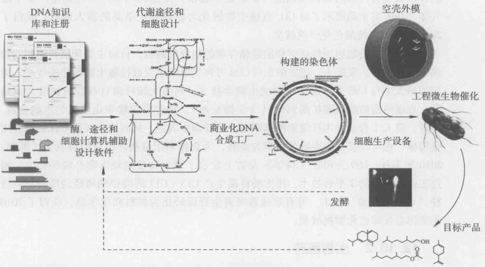

flowchart

图12-15 未来的工程化生物催化剂（Keasling2010）

---

308

12 合成生物学工具与代谢工程

## 12.10 合成生物学与代谢工程应用举例

在基本生物零件和基因线路的设计构建方面取得的进展，一方面可为设计、编程及合成新生命这一远大目标奠定基础，同时可以直接应用于代谢工程对现有微生物菌株进行改造。以下是合成生物学和代谢工程应用实例简介（赵学明等2011）。

## 12.10.1 生物能源

与乙醇相比，作为燃料汽油的高级醇具有更高的能量密度和更低的吸湿性。此外，支链醇还具有更高的辛烷值。但是高级醇不能用经济的办法由自然界生物合成。2008年，Liao研究组在《自然》杂志上，发表了用大肠杆菌的非发酵途径合成支链高级醇及生物燃料的论文。他们充分利用大肠杆菌本身的氨基酸合成途径，在大肠杆菌中引入酿酒酵母、乳酸乳球菌及丙酮丁醇梭菌的关键酶2-酮酸脱羧酶，催化不同种类的底物2-酮酸，进一步通过外源酿酒酵母乙醇脱氢酶催化，合成不同的高级醇；同时采取多种措施协调引入异源途径酶引起的代谢不平衡问题，这一策略导致高产率、高专一性的异丁醇生产（Atsumi et al. 2008）。

2009 年，Liao 研究组在《自然生物技术》杂志上，发表了利用  $CO_{2}$  光合成直接生产异丁醛的论文（Atsumi et al. 2009）。异丁醛是其他化学品合成的前体，可以很容易转化为其他重要化学品。他们通过对细长聚球蓝细菌的基因工程改造增加固定  $CO_{2}$  的 1,5-二磷酸核酮糖羧化酶/加氧酶的表达量，接着用源自乳酸乳球菌、枯草芽胞杆菌及大肠杆菌的相关基因进一步改造工程菌，使之利用  $CO_{2}$  和光能生产异丁醛气体。该研究生动展示了将  $CO_{2}$  直接生物转化为燃料和化学品的诱人前景，获得了 2010 年美国总统绿色化学挑战奖。

脂肪酸是被细胞用作化学和能量储存物的初级代谢物，目前主要从植物油和动物油中分离制备。实际上，脂肪酸也可以从可再生原料出发通过微生物转化法生产。美国加州大学与LS9公司等采用合成生物学技术，利用大肠杆菌自身的脂肪酸合成途径，直接将脂肪酸代谢扩展到燃料（生物柴油）、脂肪醇和蜡等化学品的生物合成。同时，将人工合成的半纤维素酶基因在大肠杆菌中表达，从而使工程菌不仅能够利用葡萄糖，也可直接利用半纤维素作为原料，为直接利用植物纤维素原料奠定了基础。2010年7月，LS9公司在《科学》杂志上发表了微生物法烷烃生物合成的论文，通过工业合成生物学平台技术，用大肠杆菌生产C13～C17的烷烃和烯烃的混合物。这种“可再生石油”技术，可有效地将可再生资源转化为燃料和化学品，获得了2010年美国总统绿色化学挑战奖。

## 12.10.2 生物医药

合成生物学结合代谢工程正在通过重新设计代谢途径，为人类生产新的医药产品或改进现有产品。以下是几个典型例子:

（1）青蒿素生产:青蒿素是治疗疟疾的首选药物。12年前，Keasling实验室发现将苦艾（wormwood）和酵母的基因植入细菌中，可使细菌生成一种可化学转换为青

---

12.10 合成生物学与代谢工程应用举例

· 309

蒿素的化合物，于是他们坚持不懈进行了深入系统的研究。用工程化大肠杆菌生产青蒿素的前体物青蒿酸，进而用化学法转化为青蒿素。从乙酰辅酶A开始，经中间产物甲羟戊酸、法尼基焦磷酸、紫穗槐二烯，最后到青蒿酸，共有分别来自细菌、酵母、植物的11个酶催化的反应。如图12-16所示，从合成生物学角度，将其分为以下几个模块:上游甲羟戊酸途径模块（3个酶）、下游甲羟戊酸途径模块（5个酶）、合酶模块（1个酶）、羟化酶模块（2个酶）。他们通过维持异源甲羟戊酸途径与其他途径的平衡、使用组合工程在操纵子的基因间区协调多基因的表达、设计合成的蛋白质支架构建人工酶复合体来优化代谢通量等方法，协调所有生物合成酶的表达水平，避免了（毒性）物质的积累或中间代谢物的缺乏。对于大肠杆菌，通过发酵过程优化，紫穗槐二烯的产量高达 $27\ g\cdot L^{-1}$ 。

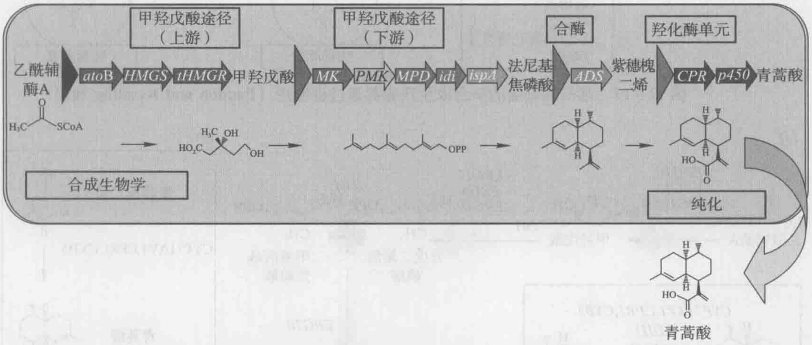

flowchart

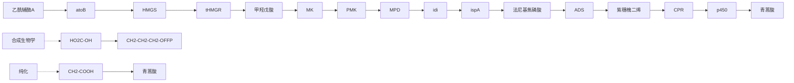

图12-16 微生物生产青蒿素代谢途径模块图（Keasling et al. 2003）

2013 年 4 月，Amyris 公司和 Keasling 研究团队在《自然》杂志上发表了高水平半合成生产抗疟疾药物青蒿素的论文（Paddon et al. 2013），用合成生物学技术研发出高产青蒿酸的酿酒酵母菌株。他们证实了完整的生物合成途径，其中包括一种植物脱氢酶和一个第二细胞色素的发现，这些提供了合成青蒿酸的一条有效生物合成路线，青蒿酸发酵水平达到  $25 \, g \cdot L^{-1}$ 。他们还开发出一种实用的、有效的、易放大的化学过程将青蒿酸转化为青蒿素。这是 Keasling 团队取得的里程碑式的成果，也是合成生物学与代谢工程的一项标志性成果。图 12-17 是基于酵母菌的半合成生产青蒿素过程概述，图 12-18 是酿酒酵母生产青蒿酸的途径及所用菌株的简介。

（2）紫杉醇:紫杉醇是一种强效抗癌药物，化学合成法需要51个步骤。MIT化工系Gregory Stephanopoulos研究组（Ajikumar et al. 2010），利用大肠杆菌合成紫杉醇。他们将紫杉烯代谢途径分成两个模块:一个是大肠杆菌自身的生成异戊烯焦磷酸的上游模块，另一个是异源的下游萜类化合物形成模块。用一种多变量模块化的代谢途径工程方法（图12-19），通过调整模块中各种基因元件的表达水平，减少中间物抑制物吲哚的累积，使得两个模块能很好平衡匹配，结果成功地使紫杉二烯（紫杉醇的前体物）的产量达到 $1\mathrm{g}\cdot \mathrm{L}^{-1}$，与对照菌相比，产量提高了15000倍！这种模块化的途径工程方法，为紫杉醇及萜类天然产物的大规模生产奠定了基础。

---

310

12 合成生物学工具与代谢工程

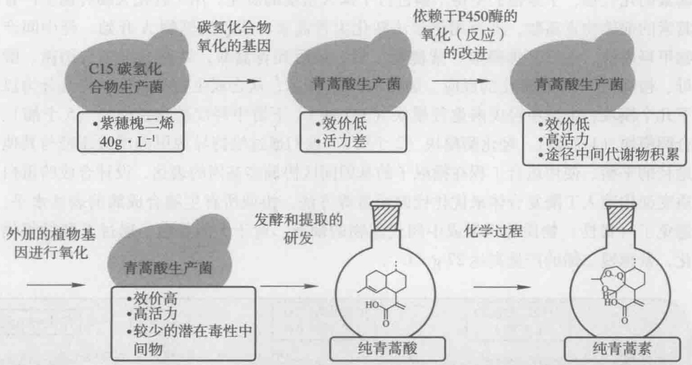

图12-17 基于酵母菌的半合成生产青蒿素过程概述（Paddon and Keasling 2014）

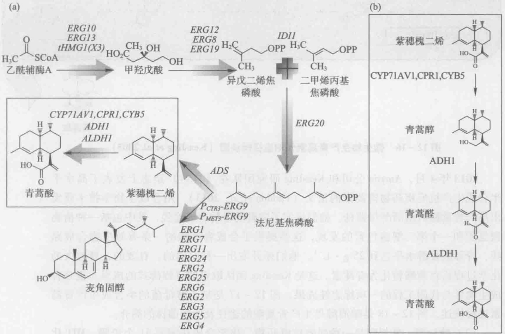

图12-18 酿酒酵母生产青蒿酸的途径及所用菌株的简介（Paddon et al. 2013）

(3) 生松素: 微生物发酵生产可以生产黄酮类化合物前体生松素, 然而发酵过程均需添加昂贵的前体物质。另外, 为了缓解异源途径给菌体带来的代谢负担, 目前采用的发酵方式是将菌体先置于营养丰富的培养基中生长, 待长到一定菌体浓度时将菌体离心重悬于基本培养基中, 而这种发酵方式在大规模工业化生产中是不可行的。Wu 等 (2013) 以生松素的从头合成为研究对象, 即无需在培养基中添加任何昂贵前体物质, 直接用廉价底物葡萄糖即可生成生松素。另外针对较长的异源合成途径会阻遏

---

12.10 合成生物学与代谢工程应用举例

311

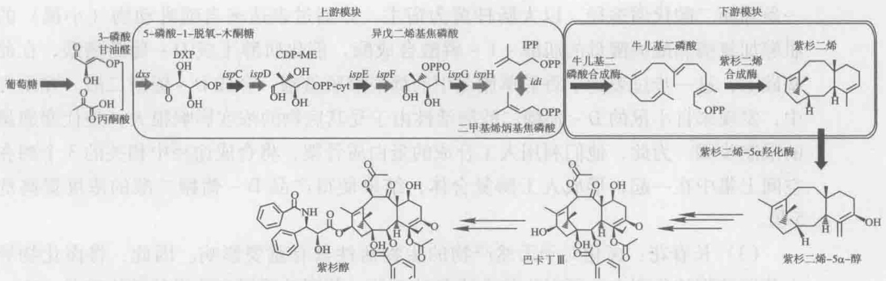

flowchart

图12-19 多变量模块法优化异戊二烯途径（Ajikumar et al. 2010）

代谢流流向终产物，造成中间产物的积累，增加菌体的代谢负担，采用以多模块化综合改造方式对总的合成途径进行平衡（图12-20），使得代谢流最大程度地流向目标产物，减少中间产物的积累，降低了菌体的代谢负担，从而增加了终产物生松素的得率。

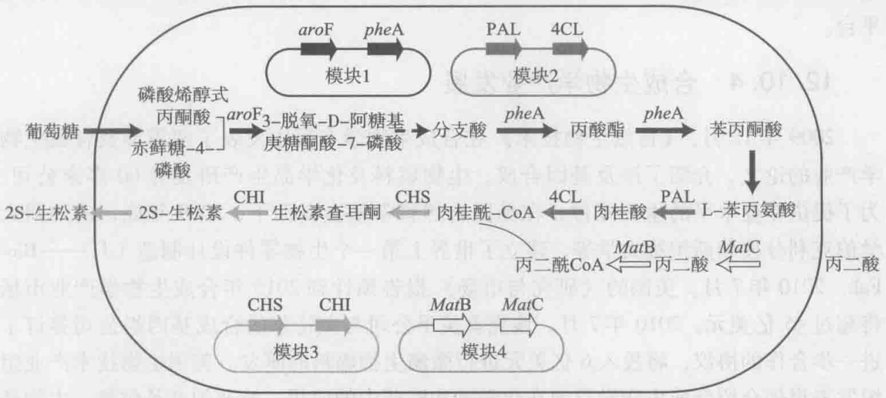

flowchart

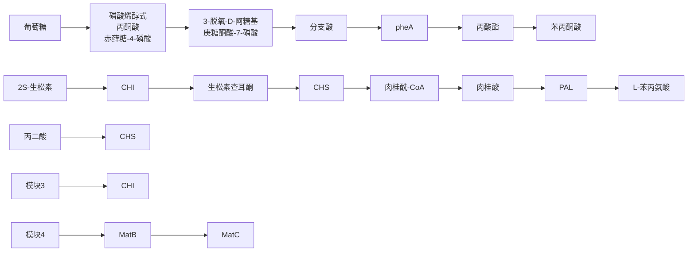

图12-20 大肠杆菌生产生松素总途经的模块化工程示意（Wu et al. 2013）

## 12.10.3 化学品

（1）卤代甲烷:重要化学品及燃料的前体分子。虽然植物及微生物可以生产卤代甲烷，但由于产率非常低而不适合工业生产。单一甲基卤转移酶（MHT）可以将硫腺苷甲硫氨酸（SAM）的甲基转移给卤离子。2009年美国加州旧金山分校的Voigt研究组，从NCBI数据库用生物信息学方法，找到来自植物、真菌、细菌及未知生物的89个MHT基因，然后采用合成宏基因组方法，化学合成这些基因，从中筛选出可表达出最高酶活性的编码基因mht，构建了卤代甲烷产率很高的酿酒酵母工程菌。接着他们用一种纤维素分解菌（Actinotalea fermentans）和酿酒酵母工程菌组成共生混合培养体系，既能直接利用玉米秸秆等纤维素原料，又能高效率生产卤代甲烷。该研究是利用生物信息学工具、数据库和快速基因合成技术，进行高效细胞工厂构建的典型范例（Bayer et al. 2009）。
（2）D-葡糖二酸:来自生物质资源的重要平台化学品，用于生产尼龙、超支链型聚酯等聚合物，也可以用做医药及食品。MIT化工系Prather研究组，设计优化了

---

312

12 合成生物学工具与代谢工程

一条葡糖二酸代谢途径。以大肠杆菌为宿主，分别过表达来自哺乳动物（小鼠）的肌醇加氧酶和酿酒酵母的肌醇-1-磷酸合成酶，催化肌醇生成D-葡糖醛酸，在此基础上，进一步过表达丁香假单胞菌中的糖醛酸脱氢酶，合成D-葡糖二酸。在研究中，发现来自小鼠的D-葡糖二酸酶活性由于受其底物的浓度影响很大，是代谢通量的限制步骤。为此，他们利用人工合成的蛋白质骨架，将合成途径中相关的3个酶在空间上集中在一起，形成人工酶复合体，结果使得产品D-葡糖二酸的浓度提高约5倍。

(3) 长春花: 卤化对于天然产物的生物活性具有重要影响。因此, 将卤化物导入药用植物的代谢中, 可以生物合成各种新的、药理性质得到改进的植物产品。Runguphan 等 (2009) 将土壤菌中的氯化生物合成机器, 成功导入了药用植物长春花中。这些原核生物的卤化酶, 在植物细胞内起作用而产生氯化的色氨酸, 其穿梭于单萜吲哚生物碱的代谢中, 以产生氯化的生物碱。这样, 一个新的功能基团被导入长春花, 而且以一种可预测的和区域选择性的方式结合到植物生物碱产品中。尽管药用植物的遗传和发育的复杂性很高, 该研究结果表明其也可用作合成生物学的一个可行的平台。

## 12.10.4 合成生物学产业发展

2009年12月，《自然生物技术》在合成生物学专辑中发表了两篇涉及合成生物学产业的论文，介绍了涉及基因合成、生物燃料及化学品生产研发等60多家公司。为了提供专业水平的生物零件，在美国自然科学基金资助下，2009年底，由加州大学伯克利分校和斯坦福大学等，建立了世界上第一个生物零件设计制造工厂——Bio-Fab。2010年7月，美国的《研究与市场》报告预计到2015年合成生物学产业市场将超过45亿美元。2010年7月，埃克森美孚公司与文特尔的合成基因组公司签订了进一步合作的协议，将投入6亿美元进行微藻生物燃料的研发。美国生物技术产业组织发表报告介绍合成生物学目前在化学品和医药中的应用，涉及的产品包括:生物柴油、生物异戊二烯、生物丙烯酸、生物表面活性剂、生物己二酸、生物可降解塑料、西他列汀（Ⅱ型糖尿病用药）等，其中多项技术获得2010年美国总统绿色化学挑战奖。合成生物学的基础研究催生了许多研发性的合成生物学公司，为合成生物学产业的发展提供了很好的技术平台，加快了产业化的进程。目前，所研发的产品大都完成中试，有的已在与大公司合作进行工业化。

## 思考题

1. 何为基因组工程，常用的基因组工程技术与方法包括哪些？
2. 未来代谢工程与合成生物学可能取得的重要进展包括哪些方面？

## 推荐阅读

1. 赵学明，陈涛.合成生物学:进展与展望//2011年科学发展报告.北京:科学出版社，2011，13-27.

---

推荐阅读

313

- 讨论了合成生物学的研究背景、定义、研究策略、研究进展以及生物学展望。
- 2. Ajikumar P K, Xiao W H, Tyo K E J, et al. Isoprenoid pathway optimization for taxol precursor overproduction in Escherichia coli. Science, 2010, 330: 70–74.
- 多元模块代谢工程大肠杆菌合成紫杉醇的经典案例。
- 3. Annaluru N, Muller H, Mitchell L, et al. Total synthesis of a functional designer eukaryotic chromosome. Science, 2014, 344: 55–58.
- 全合成酿酒酵母第3号人工染色体SynⅢ的研究。基于酿酒酵母天然的第3号染色体，经过in silico设计，全合成的SynⅢ染色体，比原染色体减小了 $13.8\%$ 。装配这条缩短并改进的人工染色体SynⅢ的酵母细胞生长正常，几乎在所有生长条件下与天然酵母细胞没有差别。为构建更稳定、可工程化、可进化的全新酵母基因组奠定了基础。
- 4. Cameron D, Bashor C J, Collins J. A brief history of synthetic biology. Nature Reviews Microbiology, 2014, 12: 381–390.
- 分三个阶段总结了十几年来在合成生物学发展过程中基因线路方面的研究进展。
- 5. Keasling J D. Manufacturing molecules through metabolic engineering. Science, 2010, 330: 1355–1358.
- 随着代谢工程与合成生物学的发展，可以采用自上而下法对自然界现有生物进行重新设计、改造及优化，解决人类面临的资源、环境、健康等问题，提出了未来工程化生物催化剂的新蓝图。
- 6. Nielsen J, Fussenegger M, Keasling J, et al. Engineering synergy in biotechnology. Nature Chemical Biology, 2014, 10: 319–322.
- 讨论代谢工程与合成生物学两个领域的研究目标等相互逻辑关系。
- 7. Wang H H, Isaacs F J, Carr P A, et al. Programming cells by multiplex genome engineering and accelerated evolution, Nature, 2009, 460: 894–898.
- 开发了一种大尺度修改和进化细胞基因组的新技术，该技术将大量人工合成的具有各种突变（包括碱基错配、插入和缺失）的单链 DNA 库导入宿主细胞进行重组，可以快速高效地得到各种突变株，加速细胞的进化。
