# 索引与附后内容

原始 PDF 第 334–343 页。

## 索引

$^{13}$ C 标记实验 130

$^{13}$ C 代谢通量分析 129

ATP 泄漏 13

cDNA 基因芯片 193

$F_{0}F_{1}-ATP$  合成酶 15

Lin-log 动力学 113

RNA 测序技术 192

TCA 循环 17

## B

靶标 193

靶向蛋白质组学 219

胞内蛋白质组 236

倍半萜紫穗槐 -4, 11 - 二烯 237

比反应速率 56

比生长速率 53

边 172

边界约束 173

变构调节 28

标记法 225

表达平台 40

表型组学 163

不可逆抑制 34

## C

参数弹性系数 104

产黄青霉菌 235

长非编码 RNA 206

超定系统 65,80

超高效液相色谱 250

成簇的规律间隔的短回文重复序列规律 299

初级主动运输 15

串联质谱 220, 221

次级代谢 234

次级主动运输 15

从头测序 221

促进扩散 12

## D

大规模平行测序技术 192

大扰动理论 120

代谢表型 6

代谢工程目标 273

代谢进化 267

代谢控制分析 96

代谢通量 72

代谢通量比率分析 137

代谢途径 72

代谢物 242

代谢物靶标分析 242

代谢物谱分析 243

代谢物守恒 72

代谢物印迹分析 243

代谢物指纹分析 243

代谢物组 242

代谢物组学 242

代谢组分析 243

单核苷酸多态性 269

蛋白质特异性肽段 220, 229

蛋白质组 217

蛋白质组学 163,217

得率系数 57

等量异位标签相对和绝对定量技术 225

电喷雾 222

电喷雾电离 221

电喷雾离子化 250

---

索引

315

电泳分离 221

电子呼吸链 22

定量蛋白质组学 218

定向蛋白质组学 219

定性蛋白质组学 218

动态通量平衡分析 176

动态最优化方法 176

多变量数据分析 255

多元自动化基因组工程 297

多重压力 277

多重自动基因组工程 271

## E

二维凝胶电泳 217, 221

二组分调节系统 48

## F

发酵 26

发酵途径 17

发现蛋白质组学 219

反竞争性抑制 33

反向代谢工程 6

反向运输 16

飞行时间质谱 221

非监督方法 255

非竞争性抑制 32

非特征化扰动 117

非线性规划 176

分解代谢还原荷 46

分子定向进化 267

分子机制 232

## G

高效液相色谱 221

功能基因组学 162

供能反应 12

共价调节酶 28

共进化 272

寡核苷酸基因芯片 193

## H

合成代谢还原荷 46

合成生物学 291

核磁共振波谱 135

核糖核酸开关 40

黑箱模型 57

后基因组学 162

呼吸链 18

化学计量系数矩阵 73

还原度平衡 59

环腺苷酸受体蛋白 37

回补途径 17

## J

基因（gene） 161

基因本体论 203

基因表达系列分析技术 192

基因吞噬 284

基因线路 295

基因芯片技术 192

基因型频率 270

基因组 161

基因组尺度代谢网络模型 163

基因组工程 297

基因组学 161

基因组重排 269

基因组重组 271

基于凝胶的蛋白质组学法 218

基于凝胶的光密度法/荧光法 224

基质辅助激光解吸/电离 221

基质辅助激光解析 222

计量系数矩阵 170

间歇培养 54

监督方法 255

交换反应 169

酵母共响应功能分析 252

节点 172

结构基因 234

结构基因组学 161, 162

---

316 · 索引

解毒作用 232

进化工程 266

进化路径 271

进化生物学 266

进化适应 267

京都基因与基因组百科全书 258

净比生长速率 11

竞争性抑制 31

静态最优化方法 176

局部最大值 268

聚合反应 12

聚类分析 200

绝对定量蛋白质组学 218

菌种 235

## K

孔蛋白 14

## L

离心分离 221

离子化 131

离子交换色谱 222

离子阱质谱 221

理性设计 234

连接定理 103

连续培养 55

流通代谢物 46

## M

酶的转换数 29

酶原 27

免疫共沉淀 221

末端代谢物 169

## N

耐受性 232

内部核糖体进入位点 44

能荷 46

鸟枪蛋白质组学法 218

鸟枪法策略 218

尿黑酸途径 235

浓度控制系数 102

## P

碰撞 - 活化解离技术 223

偏差指数 122

平衡约束 173

## Q

奇异值分解方法 199

前体 234

前体离子-产物离子对 229

亲水作用色谱 250

青霉素 235

全局控制 47

全局抑制 45

## R

热力学驱动力 114

乳糖操纵子 36

弱化作用 38

## S

三重四极杆质谱仪 219, 229

色谱分离 221

上游开放阅读框 45

渗透系数 13

生物底盘 300

生物合成反应 12

生物化学表型 241

生物量 11, 171

生物零件 295

适体 40

适体结构域 40

适应度景观图 268

适应性实验室进化 267

适应性突变固定 272

数据库搜索 221

双调法 108

四极杆质谱仪 221

---

索引·317

肽段 221

探针 193

## T

弹性系数 102

碳分解代谢物阻遏 275

碳-摩尔化学式 51

糖酵解 17

特征代谢物 204

特征化扰动 117

特征亚网络 204

特征转录因子 204

体积反应速率 53

体积排阻色谱 222

调控基因 234

调控通量平衡分析 176

萜类物质 237

通道蛋白 14

通道效应 101

通量可变性分析 180

通量控制系数 101

通量平衡分析 173

通量组学 163

同位素标记异构体 130

同位素标记异构体映射矩阵 144

同位素亲和标签技术 225

同向运输 15

突变谱分析 282

推断鉴定的化合物类别 253

推断注释的化合物类别 253

## W

维恩图分析 200

无标记法 228

无凝胶电泳蛋白质组学法 218

戊糖磷酸途径 17

## X

稀释率 55

细胞目标 273

细胞培养氨基酸稳定同位素标记 225

限速酶 235

限制 - 修饰系统 270

线性规划 174

相对定量蛋白质组学 218

相互作用组学 163

响应级联 4

响应系数 103

小非编码 RNA 206

协同效应 28

锌指核酸酶 299

选择反应检测法 219

## Y

氧化磷酸化 17,22

液相色谱 - 电喷雾离子化 220

液质联用技术 223

遗传多样性 270

乙醛酸循环 25

已鉴定的化合物 253

吲哚羰花青荧光染料 224

元素平衡 59

原子映射矩阵 144

运输反应 12, 169

## Z

杂交 193

增变基因菌株 270

正定系统 77

质量分布向量 134

质子驱动力 23

主成分分析法 199

主动运输 12

转录 191

转录产物 191

转录激活因子效应物核酸酶 299

转录物组 191

转录物组学 191

转录组学 163

装配反应 12

---

318 · 索引

自控微量平板筛选 273

自上而下蛋白质组学 218

自上而下法 109

自下而上蛋白质组学 218

自下而上法 110

自由扩散 12

总体调节子 48

总体最大值 268

组件 170

组通量控制系数 109

最小化代谢调整 175

最小化调控开关 176

最小基因组 300

---

彩插

. 7

(a) 葡萄糖吸收

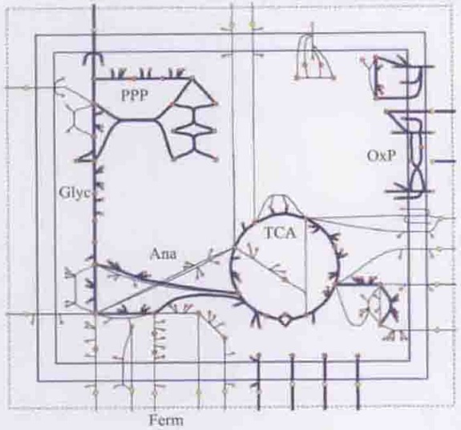

<details>
<summary>chemical</summary>

Diagram of a lipid bilayer structure showing components like PPP, Glyc, TCA, and OxP with labeled functional groups
</details>

(b) 葡萄糖吸收

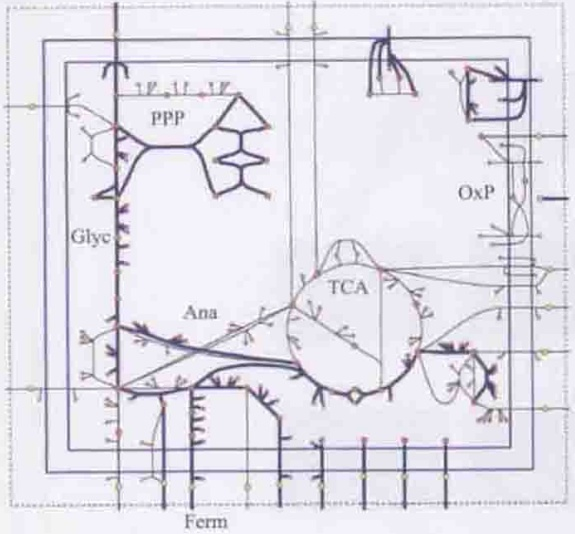

<details>
<summary>chemical</summary>

Diagram of a lipid bilayer structure showing components like PPP, Glyc, Ana, TCA, and OxP with labeled regions and directional arrows indicating flow or movement.
</details>

图7-7 FBA计算得到的通量分布图

在两个条件下，粗箭头表示反应具有通量，细箭头表示没有通量的反应。（a）E.coli核心模型在好氧条件下以最大化生长速率为目标函数的通量分布图；(b)E.coli核心模型在厌氧条件下以最大化生长速率为目标函数的通量分布图。Glyc: Glycolysis; PPP: pentose phosphate pathway; TCA: TCA cycle; OxP: oxidative phosphorylation; Ana: anaplerotic reactions; Ferm: fermentation pathways

(a)

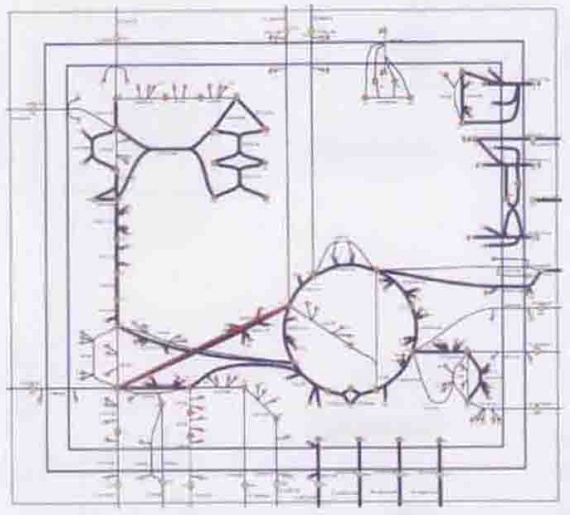

<details>
<summary>text_image</summary>

Hand-drawn technical diagram with labeled components and directional arrows, likely from a technical or engineering document.
</details>

(b)

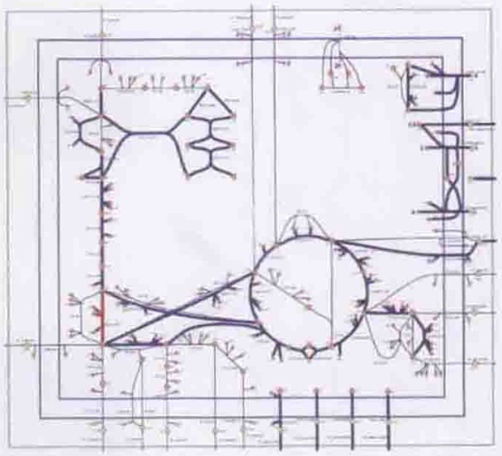

<details>
<summary>chemical</summary>

Chemical structure diagram of a polymer or organic compound with labeled atoms and bonds
</details>

图7-8 好氧条件下以琥珀酸为唯一碳源达到生长最大化的两个替代解通量图

(a) 将 L-苹果酸转化为琥珀酸使用的是反应 ME1；(b) 将 L-苹果酸转化为琥珀酸使用的不是 ME1，而是反应 PYK，两条替代途径用红色表示

---

2

彩插

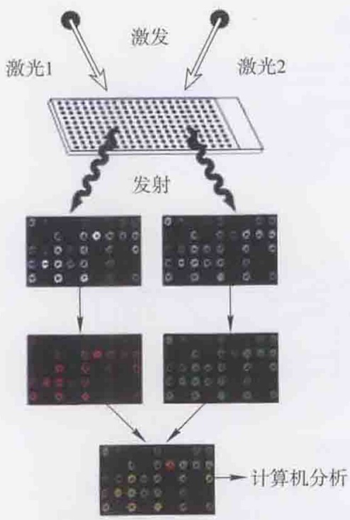

<details>
<summary>flowchart</summary>

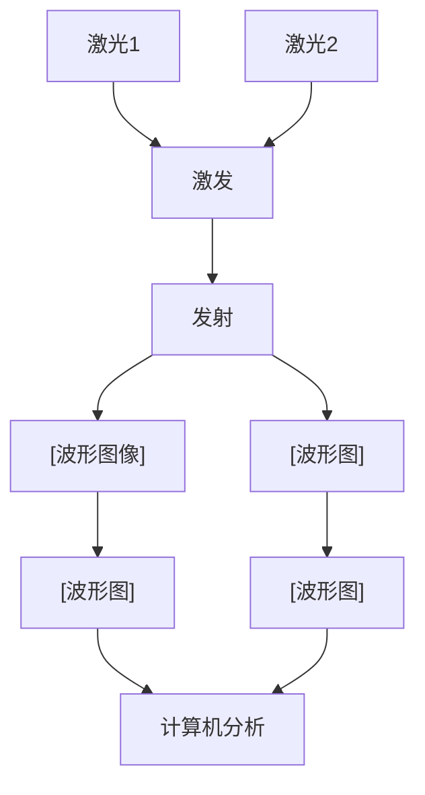
</details>

图8-3 cDNA基因芯片荧光信号的产生与叠加(Duggan et al. 1999)

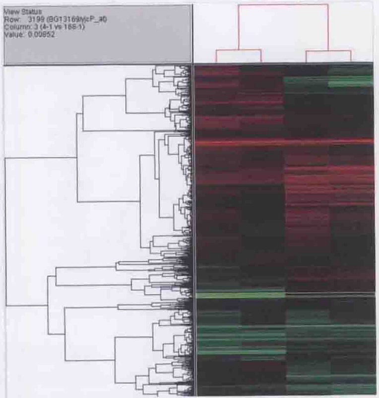

<details>
<summary>dendrogram</summary>

| Metric | Value |
| --- | --- |
| Row | 3199 (BG13169\mcp_40) |
| Column | 3 (4-1 vs 168-1) |
| P-value | 0.00852 |
</details>

图8-11 用系统聚类分析法得到的基因芯片数据表达模式

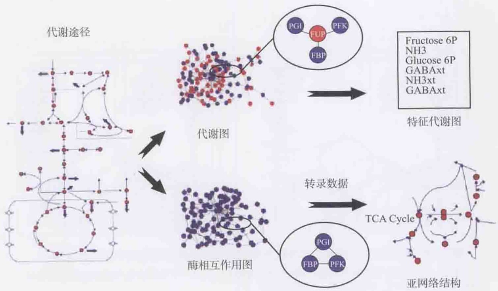

<details>
<summary>flowchart</summary>

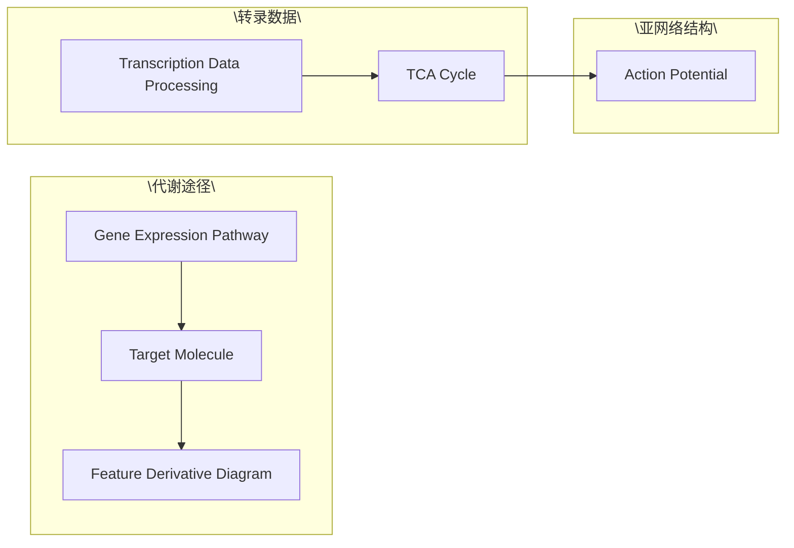
</details>

图8-14 特征代谢物与特征亚网络示意图(Patil et al. 2005)

---

彩插

3

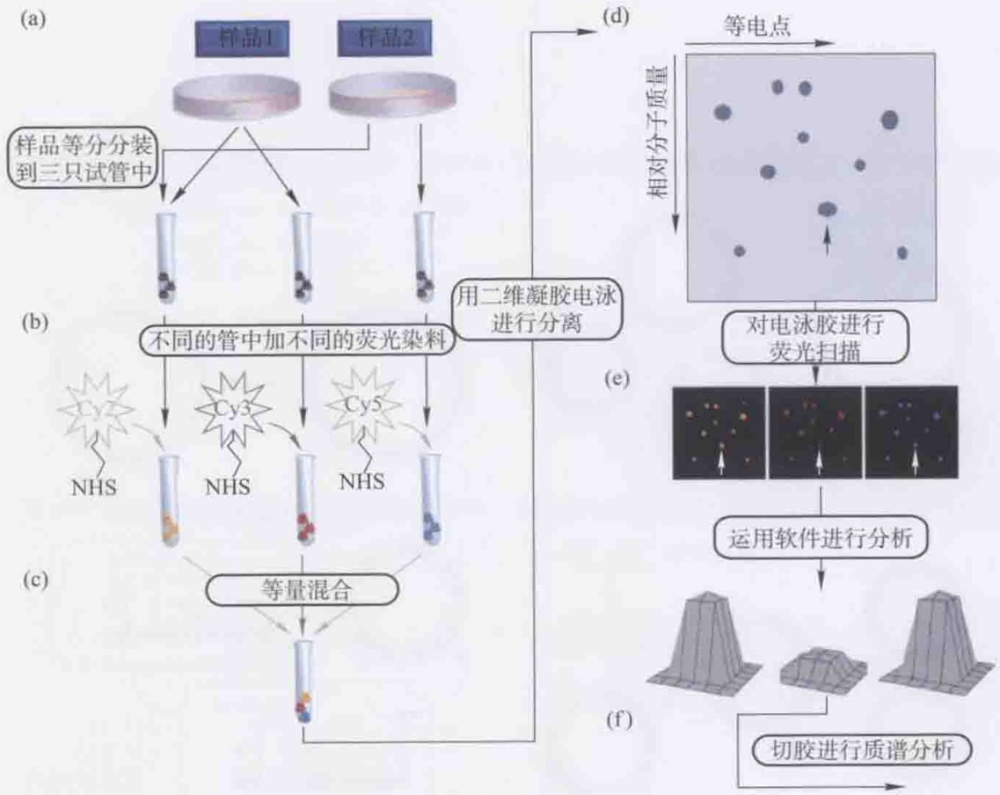

<details>
<summary>flowchart</summary>

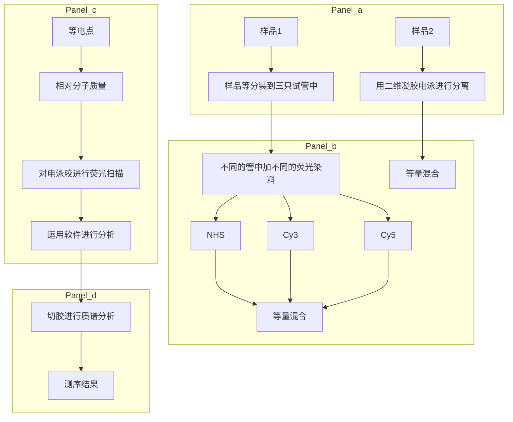
</details>

图9-4 2D-DIGE定量蛋白质实验流程(Coombs2011)

(a) 按图中所示方法将样品分装到三只试管；(b) 在每只试管中加不同的荧光染料；(c) 等量样品混合；(d) 用 2D IEF/SDS-PAGE 分析混合的蛋白质；(e) 对每种荧光染料进行图像分析；(f) 切取蛋白斑点进行 MS 和 MS/MS 分析

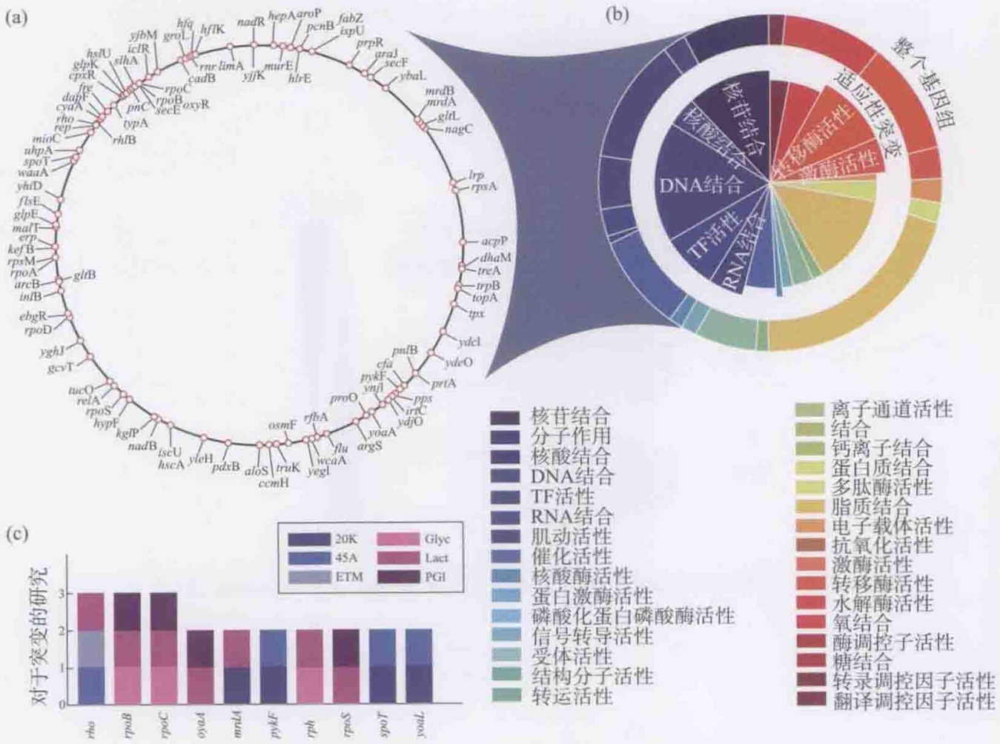

<details>
<summary>donut</summary>

| Category | Value |
| --- | --- |
| rho | 3 |
| rpoB | 3 |
| rpoC | 3 |
| oyoA | 2 |
| mrdA | 2 |
| pykF | 2 |
| rph | 2 |
| rpsS | 2 |
| spoT | 2 |
| ybox | 2 |
</details>

图11-8 大肠杆菌适应性实验室进化菌株鉴定的基因内突变(Conrad et al. 2011)

---

4

彩插

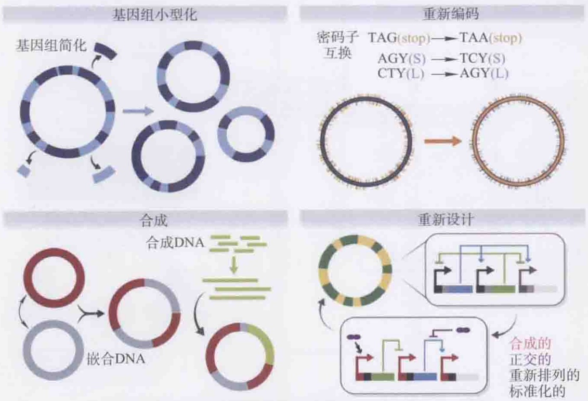

图12-8 几类灵活的可编程的生物底盘构建(Esvelt and Wang 2013)

基因组小型化(genome minimization): 减小生物复杂性和冗余性; 重新编码(recoding): 整个基因组密码子重新设计(codon remapping)能使正交信息编码和遗传密码扩展; 合成(synthesis): 基因组从头合成和从天然基因组重建, 能够创建半合成基因组, 创建具有新功能及混合功能的嵌合基因组(chimeric genome); 重新设计(redesign): 整个基因组重新设计及调控系统的重新布线, 能使新的合成线路易于设计和模型模拟

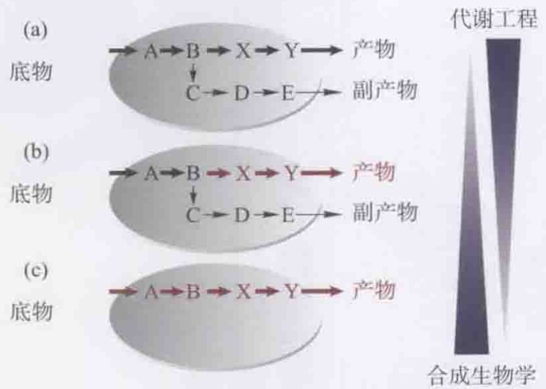

<details>
<summary>flowchart</summary>

```mermaid
graph LR
  subgraph Pathway (a)
  A["A"] --> B["B"]
  B --> C["X"]
  C --> D["Y"]
  D --> E["产物"]
  F["C"] --> G["D"]
  G --> H["E"]
  H --> I["副产物"]
  end

  subgraph Pathway (b)
  A --> J["A"] --> K["B"]
  K --> L["X"]
  L --> M["Y"]
  M --> N["产物"]
  F --> O["C"] --> P["D"]
  P --> Q["E"]
  Q --> R["副产物"]
  end

  subgraph Pathway (c)
  A --> S["A"] --> T["B"]
  T --> U["X"]
  U --> V["Y"]
  V --> W["产物"]
  end

  subgraph Reactor
    X["代谢工程"] -.-> Y["合成生物学"]
  end
```
</details>

图12-14 代谢工程与合成生物学之间的叠合(Nielsen and Keasling 2011)

---

Document generated by Anna's Archive around 2023-2024 as part of the DuXiu collection (https://annas-blog.org/duxiu-exclusive.html).

Images have been losslessly embedded. Information about the original file can be found in PDF attachments. Some stats (more in the PDF attachments):

```json
{
"filename": "5Luj6LCi5bel56iLXzEzNzEwOTUwLnppcA==",
"filename_decoded": "\u4ee3\u8c22\u5de5\u7a0b_13710950.zip",
"filesize": 51437429,
"md5": "6de5c1582a983286f780af11a8df37e9",
"header_md5": "227b42f4d3e5dc6569baf5dc530c644b",
"sha1": "5a37e7bbadb496374d08bda0b2f8e0f8dfd4cbcd",
"sha256": "9033b49fa1f8c4137b309af819622ed8f6709a44a6bf1dc4c3c56d1bad706aa1",
"crc32": 3834578822,
"zip_password": "",
"uncompressed_size": 61038216,
"pdg_dir_name": "\u2524\u00b7\u2568\u2557\u2563\u00f1\u2502\u2560_13710950",
"pdg_main_pages_found": 318,
"pdg_main_pages_max": 318,
"total_pages": 342,
"total_pixels": 1965374136,
"pdf_generation_missing_pages": false
}
```
