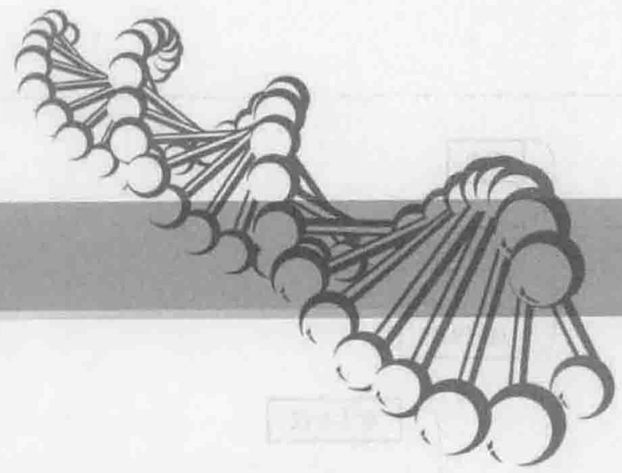
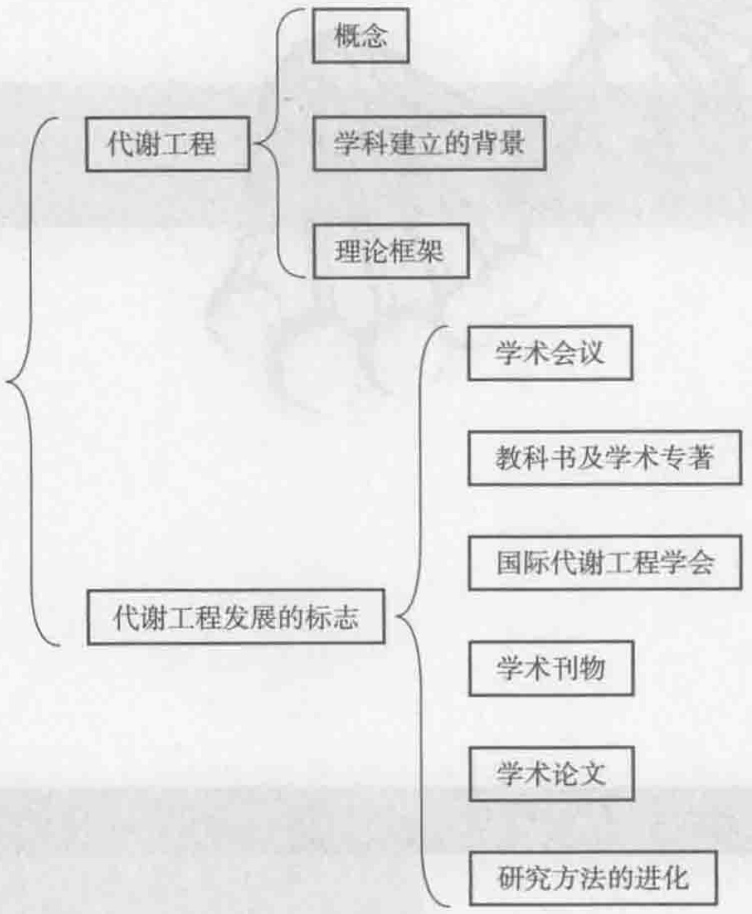
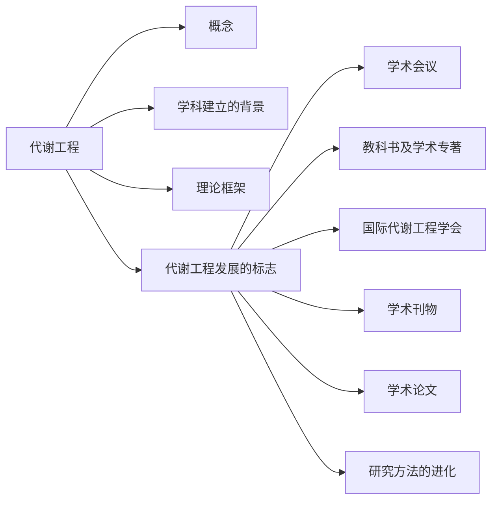
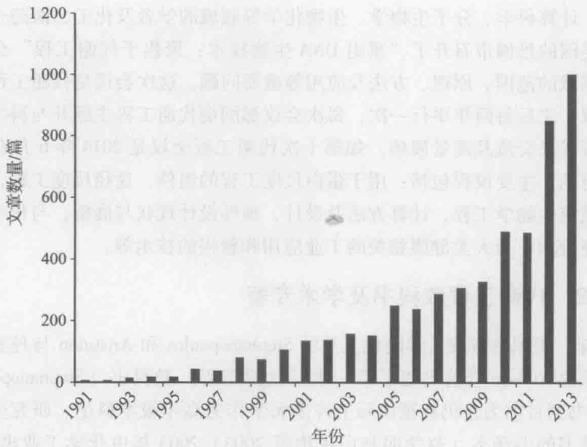
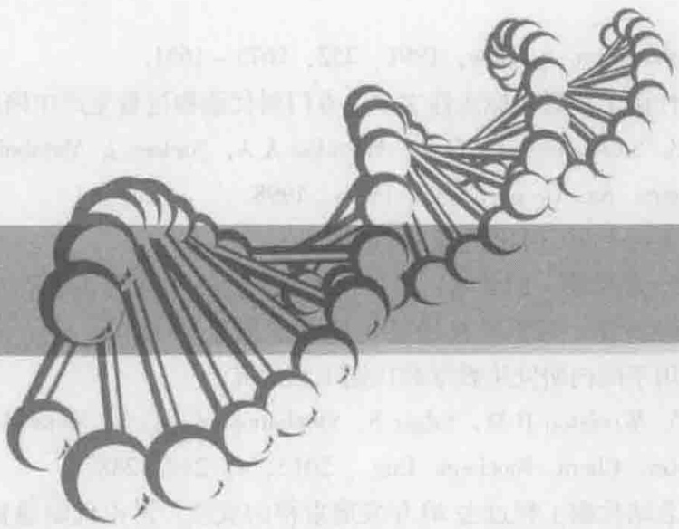
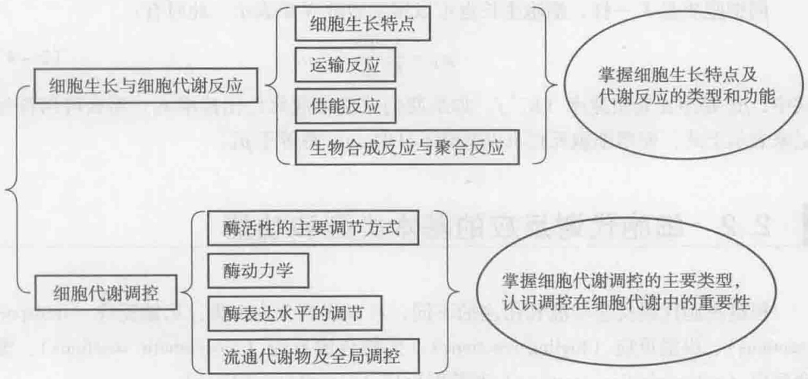
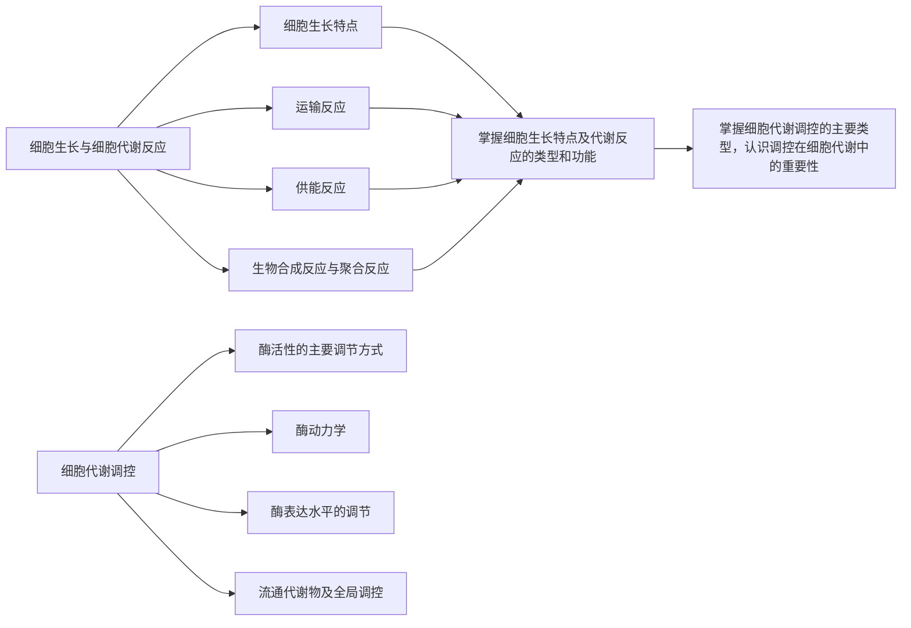

## 4 代谢通量分析

## 4.1 代谢通量分析的原理 / 72

4.1.1 无细胞生长时的代谢通量分析 / 73

4.1.2 有细胞生长时的代谢通量分析 / 75

## 4.2 基于测量数据的代谢通量分析 / 77

4.2.1 正定系统 / 77

4.2.2 超定系统 / 80

## 4.3 基于线性规划的通量平衡分析 / 84

## 4.4 同位素标记法测定代谢通量简介 / 88

## 4.5 基元模式分析 / 89

4.5.1 基元模式分析与极端途径分析 / 89

4.5.2 基元模式分析的应用实例 / 91

## 5 代谢控制分析

## 5.1 代谢控制分析的基础 / 97

5.1.1 通量控制系数及其加和定理 / 100

5.1.2 浓度控制系数及其加和定理 / 102

5.1.3 弹性系数和连接定理 / 102

5.1.4 参数弹性系数及 MCA 理论的通用表达式 / 104

## 5.2 通量控制系数的确定方法 / 105

5.2.1 直接法 / 105

5.2.2 间接法 / 108

5.2.3 Lin-log 动力学法 / 113

5.2.4 瞬态代谢物浓度法 / 118

5.2.5 大扰动法 / 120

## 5.3 部分守恒循环途径通量控制系数的确定 / 125

## 6 基于 $^{13}$ C 同位素标记信息的代谢通量分析

## 6.1  $^{13}$ C代谢通量分析的发展 / 129

## 6.2  ${}^{13}$ C 标记实验和测量 / 130

6.2.1 标记实验 / 130

6.2.2 质谱检测 / 131

6.2.3 核磁共振波谱检测 / 135

## 6.3 代谢通量比率分析 / 137

6.3.1 同位素标记异构体中天然同位素丰度的矫正 / 137

6.3.2 基于质谱数据的代谢通量比率的推导 / 139

6.3.3 基于 NMR 数据的代谢通量比率的推导 / 142

## 6.4 基于同位素标记异构体分布模型的代谢网络通量分析 / 144

6.4.1 原子映射矩阵和同位素标记异构体映射矩阵 / 144

6.4.2 同位素标记异构体平衡方程 / 145

6.4.3 代谢通量计算 / 146

## 6.5 基于 $^{13}$ C 同位素标记信息代谢通量分析的应用 / 148

6.5.1 辨别代谢途径及细胞功能 / 149

6.5.2 阐明代谢网络结构及调控特性 / 151

## 6.6 大肠杆菌代谢通量的计算举例 / 154

6.6.1 大肠杆菌生长期相关生理学参数的测定及计算 / 154

6.6.2 大肠杆菌代谢模型的建立 / 155

6.6.3 代谢通量比率的计算 / 156

6.6.4 大肠杆菌净通量的计算 / 158

## 7 基因组学与基因组尺度代谢网络模型

## 7.1 基因组学 / 161

7.1.1 基因、基因组与基因组学 / 161

7.1.2 基因组学研究内容 / 161

7.2 基因组尺度代谢网络模型 / 163

7.3 基因组尺度代谢网络模型的重构过程 / 165

7.3.1 基因组尺度代谢网络数据库的建立 / 165

7.3.2 数学模型的建立 / 170

7.3.3 模拟运算 / 173

7.4 基因组尺度代谢网络模型的应用 / 184

7.4.1 基因敲除研究 / 184

7.4.2 发现药物靶点 / 186

7.4.3 指导菌体改进和代谢工程 / 186

## 8 转录物组学技术与代谢工程

## 8.1 转录物组与转录物组学 / 191

8.1.1 转录、转录物组与转录物组学 / 191

8.1.2 转录组学平台技术 / 192

8.2 基于基因芯片技术的转录物组分析 / 192

8.2.1 cDNA 基因芯片技术 / 193

8.2.2 寡核苷酸基因芯片技术 / 195

8.2.3 芯片数据分析 / 197

8.3 基于 RNA-Seq 技术的转录物组分析 / 206

8.3.1 RNA-Seq 的原理及实验步骤 / 206

8.3.2 RNA-Seq 的技术优势 / 208

8.4 两种转录物组分析平台技术的比较 / 208

8.5 转录物组数据的存储及交流 / 209

8.6 转录物组学技术在微生物代谢工程中的应用 / 211

8.6.1 减少副产物及提高产物耐受性 / 211

8.6.2 提高蛋白质的产量 / 211

8.6.3 扩大底物利用范围 / 212

8.6.4 提高氨基酸的产量 / 212

8.6.5 提高抗生素的产量 / 213

8.6.6 提高大宗化学品的生产能力 / 214

## 9 蛋白质组学技术与代谢工程

## 9.1 蛋白质组与蛋白质组学 / 217

9.1.1 蛋白质组 / 217

9.1.2 蛋白质组学 / 217

9.1.3 蛋白质组学研究平台技术分类 / 218

9.2 蛋白质组学研究步骤 / 220

9.3 蛋白质组学研究核心技术 / 221

9.3.1 大规模蛋白质分离 / 221

9.3.2 蛋白质组学研究中的质谱分析技术 / 222

9.3.3 基于质谱的定量蛋白质组学技术 / 224

9.3.4 基于选择反应检测的靶向蛋白质组学技术 / 229

9.4 海量蛋白质数据分析处理技术 / 231

9.5 蛋白质组学在微生物学研究中的应用 / 232

9.5.1 蛋白质组学研究工业酵母对胁迫环境的响应 / 232

9.5.2 蛋白质组学研究细菌膜蛋白与多重抗性 / 233

9.5.3 蛋白质组学研究拜耳接合酵母耐酸性机制 / 233

9.6 蛋白质组学在菌种构建中的应用 / 234

9.6.1 提高次级代谢产物的基本策略 / 234
9.6.2 蛋白质组学技术改进青霉素生产菌的应用举例 / 235
9.6.3 靶向蛋白质组学在萜类代谢工程菌种改进中的应用举例 / 237

10 代谢物组学技术与代谢工程

10.1 代谢物组与代谢物组学 / 242

10.2 微生物代谢物组学的研究方法 / 243

10.2.1 菌株培养 / 243
10.2.2 样品处理 / 244
10.2.3 代谢物组数据的采集 / 247
10.2.4 数据挖掘 / 253
10.3 代谢物组学在代谢工程菌种改进中的应用 / 260

11 进化工程技术与代谢工程

11.1 进化工程的定义 / 267

11.2 进化工程的原理与方法 / 268

11.2.1 进化工程的原理与过程 / 268

11.2.2 进化过程中的基因型变异 / 269

11.3 进化工程的步骤与方法 / 270

11.3.1 变异 / 270
11.3.2 选择 / 271
11.3.3 筛选 / 273
11.4 进化工程与代谢工程 / 273

11.5 进化工程的应用 / 275

11.5.1 激活细胞潜在代谢途径，提高底物利用效率 / 275
11.5.2 提高微生物的环境耐受性 / 276
11.5.3 改进细胞的生物基产品合成能力 / 277
11.5.4 创造新型催化活性蛋白酶 / 280

11.6 基于高通量测序技术的进化工程研究和逆向代谢工程 / 281

11.6.1 基因组尺度的进化工程菌株突变规律分析 / 281
11.6.2 基于比较基因组学的逆向代谢工程 / 282

12 合成生物学工具与代谢工程

12.1 合成生物学的研究背景 / 291
12.2 合成生物学的定义 / 292
12.3 合成生物学的研究策略 / 293
12.3.1 生物系统的层次结构 / 293
12.3.2 合成生物学的研究策略 / 294
12.4 DNA 合成与组装 / 294
12.5 基本的生物零件与基因线路 / 295
12.6 基因组工程 / 297
12.6.1 多元自动化基因组工程技术 / 297
12.6.2 基因组编辑技术 / 299
12.6.3 生物底盘 / 300
12.6.4 基因组简化 / 300
12.7 合成基因组（合成细胞） / 301
12.8 酵母人工基因组的合成 / 303
12.8.1 SynⅢ的设计 / 304

12.8.2 SynⅢ的构建 / 304
12.8.3 含 SynⅢ酵母菌株的表征与检验 / 304
12.9 合成生物学与代谢工程 / 305
12.10 合成生物学与代谢工程应用举例 / 308

12.10.1 生物能源 / 308
12.10.2 生物医药 / 308
12.10.3 化学品 / 311
12.10.4 合成生物学产业发展 / 312

## 索引

natural_image

Abstract illustration of DNA double helix structure (no text or symbols)

## 1

## 绪论

## 【本章学习要点】

1. 代谢工程的定义
2. 代谢工程学科建立的背景与过程
3. 代谢工程的理论框架
4. 代谢工程的发展与研究进展

代谢工程是通过对代谢途径的设计、构建与优化，进行燃料、化学品、材料和医药等各种生物基产品的微生物合成。代谢工程学科创建20多年来，已经成为发展可持续生物经济的支撑学科与技术之一。

## 知识导图

flowchart

## 1.1 代谢工程学科的建立

## 1.1.1 背景

1972年11月在夏威夷举办的关于细菌质粒会议上，加州大学旧金山分校的助理教授Herbert W. Boyer谈到的研究成果是使用限制性内切酶将DNA进行特定的切割；而斯坦福大学的Stanley N. Cohen则谈到了他分离的质粒，该质粒上具有抗生素的基因，并可以导入到大肠杆菌体内实现基因的表达。会议期间，在步行寻找一个小吃店的路上，两人又深入交谈了他们正在进行且尚未发表的工作。这次不寻常的海滩步行讨论，促成了他们的合作研究。1973年11月和1974年5月，Boyer与Cohen先后联合在《美国科学院院报》（PNAS）上发表了《具有生物功能的细菌质粒的体外构建》及《真核生物DNA在大肠杆菌中的复制与转录》两篇里程碑式的论文（Cohen et al. 1973, Morrow et al. 1974），标志着重组DNA技术（recombinant DNA technology）正式诞生。由于看到重组DNA技术的巨大潜力，从1974年起，斯坦福大学和加州大学旧金山分校一起就上述发明申请了“生产具有生物功能分子嵌合体过程”的专利，并于

1980年获得美国专利局授权（Cohen and Boyer 1980）。1976年，风险投资家Robert Swanson与重组DNA技术发明人之一的Boyer一起，在美国加州建立了一家生物技术公司——Genentech公司，第二年该公司利用重组DNA技术在细菌中首次克隆了生长激素抑制素。此后，一批生物技术公司纷纷建立，相继生产出人类生长激素抑制素、人胰岛素、生长素、干扰素等基因工程医药产品。2003年2月，《科学》用一整期23篇论文的篇幅，发表了“生物技术”专辑（Abelson 2003），其社论的题目是《新生物技术公司》，对Genentech公司的成功及其他公司的状况进行了总结和分析。Cohen和Boyer的重组DNA技术专利在1997年到期时，已经转让了461个专利许可（Cohen 2013）。1976年Genentech公司的建立被认为是世界现代生物技术产业的诞生（Eugene Russo 2003）。

Cohen 和 Boyer 的重组 DNA 技术可以成功地将外源基因导入菌体细胞，于是人们认为，用这样工程化的细胞作为细胞工厂可以大量生产许多化学品及药物产品。然而他们很快就发现，在大肠杆菌中过量表达单一基因可以生产一种非常复杂的分子（例如胰岛素），但是要生产一种简单的化合物（例如乙醇），却需要对组成乙醇生产途径的很多基因进行协同调节。所以重组 DNA 技术发展初期，医药生物技术是其优先应用领域，然而化学工程领域的研究者，非常敏锐地看到了重组 DNA 技术的应用潜力，迅速将重组 DNA 技术与化学反应工程相结合，在 1980 年的国际化学反应工程会议上发表了题为《生化反应工程与生化反应器》的大会报告（Bailey 1980），对微生物代谢、细胞内酶水平和基因水平的控制、微生物反应器的分层次控制等问题进行了深入分析。此后的 10 年间，对于单细胞蛋白、鸟苷、L-苯丙氨酸、头孢霉素 C 等的生产，利用重组 DNA 技术进行菌种改进，取得了很大进展。特别需要提到的是，Bailey 等对透明颤菌血红蛋白（vitreoscilla hemoglobin，VHb）基因的克隆及其在菌体中的表达，克服了氧限制的瓶颈，大大提高了菌体生长及生产水平，上述研究结果分别发表在《自然》和《自然生物技术》刊物上。1990 年，Bailey 在《纽约科学院会刊》的生物化学工程专辑中，发表了《代谢工程的策略与挑战》的论文（Bailey et al. 1990），举例说明了代谢工程的一些挑战与机遇，对菌种改进从试差方法发展到系统的工程方法提出了建议。这些用重组 DNA 技术进行菌种改进的实践为代谢工程的发展奠定了基础。

## 1.1.2 代谢工程学科的建立

1991年6月，《科学》发表了“生物技术前沿”专辑，包括主编Koshland写的社论（Koshland 1991）和6篇论文。社论首先列出了人们对“纯粹理论研究”及“实际应用研究”两种不同的看法，接着指出这一期《科学》专辑致力于生物技术前沿，任何阅读这一专辑的人都会被理论研究的实际后果和实际研究的理论后果所强烈吸引。社论最后说，该专辑所选的例子表明，“基础研究”与“实际应用研究”相结合所产生的巨大力量。专辑中的6篇论文除了涉及聚合酶链反应、互补DNA测序和人类基因组计划、单克隆抗体诊断和治疗、牛痘病毒研究和疫苗开发四方面内容外，还有两篇涉及代谢工程的论文:Bailey的《走向代谢工程科学》（Bailey 1991）以及Stephanopoulos和Vallino的《网络刚性和代谢物大量生产的代谢工程》（Stephanopoulos and Vallino 1991）。这两篇论文是对20世纪80年代科学工作者在对生物化学反应系统的设计与操作进行研究的总结。正是这两篇论文奠定了代谢工程的科学基础，标志着代谢工程学科的正式诞生。

## 1.1.3 代谢工程的定义

活细胞的代谢活动是通过一个调控的、由高度耦合的上千个酶催化反应组成的网络及选择性膜运输系统进行的。然而，在自然的环境中进化而来的代谢网络，在遗传上对于重要的实际应用目标来说并不是最优的。因此，生物过程的性能可以通过细胞的遗传修饰得到增强。基于这种认识，Bailey在其论文中给出了代谢工程的定义（Bailey 1991）:代谢工程是用重组DNA技术，对细胞的酶催化、运输和调控功能进行操作，进而使细胞的活性得到改进。1998年，Stephanopoulos等在他们编著的《代谢工程》教科书中，进一步给出了代谢工程的定义（Stephanopoulos et al. 1998）:利用重组DNA技术对特定的生化反应进行修饰，或引入新的反应以定向改进产物的生成或细胞的性质。这些定义的基本特征是:定位需要修饰的目标或打算引入具有专一性的特定生化反应。一旦这样的反应目标被确定，那么就要用已建立的分子生物学技术对相应的基因或酶进行扩增、抑制或缺失、转移或解除调控。为了达到上述目的，广义的重组DNA技术已被广泛应用到各个步骤中。需要指出，代谢工程与传统的基因工程不同，其涉及整个代谢系统而不单单是几个基因的过量表达。

## 1.1.4 代谢工程的理论框架

Bailey（1991）及 Stephanopoulos 和 Vallino（1991）的两篇论文总结了代谢工程的基本理论:

（1）为菌种改进获得异源活性:补充不完整的途径以合成新的产品；将编码整条生物合成途径的基因转移到一个异源宿主中，构成杂交代谢网络（hybrid metabolic network），以构建更健壮的工业菌种，提高生产能力，或容许使用低成本的原材料；创造新的产品或可以进一步进行反应的新组分；通过改变营养利用和代谢物流向，进一步完善菌种；转入有用的天然基序（promising natural motifs），例如透明颤菌血红蛋白（VHb），以克服生物加工中氧限制的瓶颈。
（2）改变代谢物的流动方向:通过代谢网络刚性分析及主节点确定，将代谢物引到所希望的分支途径；减少对于有限资源的竞争；修饰代谢调控。
（3）认识代谢工程合理设计的潜力及存在的风险:在代谢工程菌种改进循环过程中，进行遗传修饰之后，要对所带来的代谢结果进行分析，进而选择下一步遗传修饰的目标。在菌种改进过程中要选用适合工业菌种的操作工具，剖析每一步骤的生理响应，运用代谢控制分析理论应对代谢网络的复杂性，最大限度减小响应级联（response cascades）。

虽然这些理论框架在代谢工程学科建立 20 多年中得到进一步发展与完善，但是其基本原理至今仍然在指导着代谢工程学科发展。

## 1.2 代谢工程发展的标志

## 1.2.1 代谢工程学术会议

高水平的学术会议对于促进学术交流及学科发展非常重要。1996年10月，来自化学工程、计算科学、分子生物学、生物化学等领域的学者及化工、医药企业的研发人员，在美国的丹佛市召开了“重组DNA生物技术:聚焦于代谢工程”会议，讨论了这个新领域的范围、原理、方法及应用等重要问题。这次会议是代谢工程发展史上第一次会议，之后每两年举行一次，每次会议都围绕代谢工程主题并与科学前沿紧密结合，进行成果交流及前景展望。如第十次代谢工程会议是2014年6月在加拿大的温哥华举行的，主要议程包括:用于蛋白尺度工程的组件，途径尺度工程，基因组尺度工程，系统生物学工程，计算方法及设计，理性设计现状与展望，与化学品和燃料相关的工业应用，与人类健康相关的工业应用和新兴的技术等。

## 1.2.2 代谢工程教科书及学术专著

1998 年，美国麻省理工学院化工系的 Stephanopoulos 和 Aristidou 与丹麦工业大学生物工程系的 Nielsen 合著出版了第一本《代谢工程》教科书（Stephanopoulos et al. 1998），该书到目前为止仍然被国际上许多大学作为高年级本科生、研究生的主要教学用书。该书的中译本（赵学明和白冬梅等 2003）2003 年由化学工业出版社出版。此外，国际上还出版了一些代谢工程专著（Lee and Papoutsakis 1991，Smolke 2009，Wittmann and Lee 2012，Alper 2013）。这些专著都是由主编邀请代谢工程领域的专家学者分别撰写有关章节，然后作为专著出版。例如，2009 年出版的《代谢途径工程手册》分上、下两册出版，上册共 26 章，有 55 人参加编写；下册共 24 章，有 62 人参加编写。这些书虽然整本书不便作为教材选用，但对于相关研究生及科研工作者具有重要参考价值。

## 1.2.3 国际代谢工程学会

2010 年在法国举行的第九次代谢工程会议上，国际代谢工程学会（International Metabolic Engineering Society，IMES）正式成立。学会的任务是:提高工程师和科学家对代谢工程的兴趣、加深对代谢工程的理解及其在代谢工程中所起作用的认同，促进和发展代谢工程作为生物基材料、医药、食品原料、化学品和燃料生产的支撑学科与技术。

## 1.2.4 代谢工程学术刊物

1999 年，《代谢工程》刊物创刊。1999—2004 年每年 1 卷，为季刊。2005—2012 年每年 1 卷，为双月刊。从 2013 年起，由以前的每年出版 1 卷增加到 6 卷，每卷不再分期，但是每卷的论文数及页码都有不同幅度的增加。期刊的影响因子从 2003 年的 3.397 上升到 2013 年的 8.258，显示了该刊不断提升的影响力。2013 年在 “Biotechnology and Applied Microbiology” 类 165 种刊物中，影响因子排名第 7。若除去前 7 种刊物中的 3 种综述性期刊，则《代谢工程》排名第 4。

## 1.2.5 代谢工程学术论文

1991 年代谢工程学科诞生以来，代谢工程学术论文发表增长迅速。图 1-1 是由 Scopus 数据库检索的，在论文标题、摘要或关键词中包括“代谢工程”的学术论文数目。

bar

| 年份 | 文章数量/篇 |
| --- | --- |
| 1991 | ~5 |
| 1992 | ~5 |
| 1993 | ~15 |
| 1994 | ~20 |
| 1995 | ~20 |
| 1996 | ~45 |
| 1997 | ~40 |
| 1998 | ~85 |
| 1999 | ~80 |
| 2000 | ~110 |
| 2001 | ~135 |
| 2002 | ~135 |
| 2003 | ~155 |
| 2004 | ~150 |
| 2005 | ~250 |
| 2006 | ~240 |
| 2007 | ~285 |
| 2008 | ~305 |
| 2009 | ~325 |
| 2010 | ~485 |
| 2011 | ~480 |
| 2012 | ~850 |
| 2013 | ~1000 |

图1-1 代谢工程学术论文发表情况

Scopus 数据库检索中，以 “metabolic engineering” 为检索词，在 “论文标题、摘要或关键词” 范围内检索，检索不同年份论文的发表情况

## 1.2.6 代谢工程研究方法的进化

## 1.2.6.1 反向代谢工程

代谢工程学科建立24年来，随着科学技术的进步，其研究方法不断与时俱进，发展迅速。由于生物系统的复杂性，在代谢工程学科建立初期，采用经典的代谢工程方法，识别一条途径中的限速步骤，并通过酶的过量表达，减轻或解除瓶颈。虽然进行了许多研究，但实际取得成功的例子并不多。针对这种情况，1996年，Bailey提出了反向代谢工程（inverse metabolic engineering，IME）的概念，其包括三个步骤:首先识别、构建或计算所希望的菌种表型，其次确定赋予该表型的遗传或环境因素，最后通过定向的遗传操作或环境条件的改变，将该表型赋予另外的菌株或生物体。Bailey还列举了IME成功应用的例子。由于IME的重要性，2002年《生物技术和生物工程》刊物在纪念Bailey的专辑中重新发表了这篇论文。2003年，Gill发表了利用基因组学信息进行IME的综述。2004年，《代谢工程》第3期作为IME专辑，全部9篇论文介绍了通过集成基因组学和生物信息学方法、正向和反向遗传技术、定向代谢工程方法，进行IME以改进细胞的特性。目前，IME得到了越来越广泛的应用。

## 1.2.6.2 代谢工程与系统生物学

从代谢工程 1991 年的两篇奠基性论文（Bailey 1991，Stephanopoulos and Vallino 1991）不难看出，代谢工程涉及由上千个生化反应组成的复杂代谢反应网络系统，而 1994 年 Varma 和 Palsson 的代谢反应计量模型可以通过计算机（in silico）进行通量平衡分析，进而确定菌株的代谢表型（Varma and Palsson 1994）。Bailey 于 1999 年在《自然生物技术》的复杂系统专栏发表评论指出，已有 10 年的时间，代谢工程研究了微生物、植物及动物的特定的遗传变化所对应的生理结果，表征了这些系统在基因组范围的响应，创造了数学和计算方法来理解细胞与功能之间的联系（Bailey 1991）。这表明代谢工程识别赋予特定功能的基因这样的目标，与功能基因组学及药物发现的目标，在概念上和方法上都是相同的。所以代谢工程取得的经验可以用于功能基因组学和药物发现的研究。因此可以认为，在代谢工程创建初期的前系统生物学时代（pre-systems biology），代谢工程就已经按系统方法在进行研究。2000年，在人类基因组计划完成的鼓舞下，人类真正进入了“组学”（omics）时代，各种组学技术不断出现。由于代谢工程研究本身的“系统”属性，代谢工程工作者迅速将新的组学技术与代谢工程紧密结合起来。Nielsen等2003年出版了《生物反应工程原理》（第2版）教科书，其第一章的题目是“生物反应工程:从生物过程设计到系统生物学”。他们介绍了生化工程工作者在生物过程设计、代谢工程、功能基因组学及系统生物学等研究领域应起的重要作用，并给出了代谢工程与系统生物学相结合进行菌种改进的流程图（Nielsen et al. 2003）。2004年10月，《自然生物技术》出版了“系统生物学”专辑，发表了包括社论在内的10篇文章。代谢工程的奠基人Stephanopoulos等发表了题为《通过系统生物学方法，开拓利用生物的复杂性进行菌种改进》的综述论文。论文谈到，由于细胞的复杂性，使得人们很难得到对细胞功能完整深透的理解，但若能开拓并利用细胞的复杂性，则可为修饰细胞机器、实现特定的目的提供无限的可能性。要使这种可能性变成现实具有很大的挑战性，这需要对多重细胞功能的协同理解，需要在系统生物学的框架内才能最有效地解决。菌种改进的进展不仅取决于高通量测量技术的发展，但更重要地是开发理论方法，以提高这些测量的信息含量，这样才能促进机制的阐明和遗传靶标的识别，进而对菌株进行修饰。论文首先给出了从系统生物学循环获取系统知识进行菌种改进的框架图，然后详细介绍了用系统生物学进行菌种改进的方法步骤:基因靶标识别的全局模型（基因组尺度代谢网络模型模拟），生物反应网络分析，集成生理的和转录的数据、用代谢物进行表型表征。2005年，Lee在《生物技术趋势》刊物上发表了《菌种改进的系统生物技术》的综述，图文并茂介绍了高通量组学实验技术以及“湿实验”与“干实验”的系统集成。2010年，Nielsen在《生物技术和生物工程》刊物上发表了《工业系统生物学》的综述，为发展工业生物技术，提供了用于构建微生物细胞工厂的工业系统生物学路线图（Otero and Nielsen 2010）。

## 1.2.6.3 代谢工程与合成生物学

在代谢工程学科诞生10年之后，合成生物学开始起步，其主要是借鉴计算机系统的组件、模块、线路的概念，采用对计算机进行编程的方法，对细胞进行编程，以赋予细胞特定的功能，如作为传感器、检测器等。2004年，MIT《技术评论》把合成生物学评选为将改变世界的10大新兴技术之一。加州大学伯克利分校化工系的Keas-ling教授为了开发大规模低成本生产抗疟疾药物青蒿素，利用代谢工程原理，通过将来自不同生物的多个基因集成到一个宿主菌中，创建了一条全新的代谢途径，研究结果发表于2003年《自然生物技术》。2005年，MIT《技术评论》将Keasling教授的研究成果作为“代谢工程的一个例子”进行介绍，并冠以“细菌工厂”（bacterial factories）之名，评选为将影响世界的新兴10大技术之一。2007年，Stephanopoulos实验室在《生物技术趋势》发表了《扩大代谢工程的工具箱——对工程化的更多选择》的综述（Tyo et al. 2007），将合成生物学作为4种主要工具之一，在代谢途径的系统设计、通过所设计的基因线路调控代谢表型等方面发挥作用。2010年，Keasling在《科学》上发表了《通过代谢工程生产生物分子》的综述，以流程图的形式，非常清楚地阐明了结合合成生物学通过代谢工程生产生物分子的方法步骤。为了充分利用合成生物学工具，2012年5月《代谢工程》刊物出版了“合成生物学:在代谢工程中的新方法和应用”专辑。2012年11月，《美国化学会合成生物学》刊物也出版了“合成生物学菌种改进”专辑。这些都表明，充分利用代谢工程原理与方法，密切结合合成生物学新工具，对于实现代谢工程目标非常重要。

## 1.3 代谢工程研究进展

2013 年，Stephanopoulos 和他的同事在《化学与生物分子工程年度评论》刊物上发表了《代谢工程:过去和未来》的长篇综述（Woolston et al. 2013），他们从生产目标产品途经的自动化设计与评价、理解代谢通量和代谢控制、代谢工程的计算方法、理性代谢工程方法、组合代谢工程方法等方面，结合典型应用实例，全面总结了代谢工程的过去与现状。对于代谢工程未来的展望，他们特别强调，在代谢工程代谢通量和网络控制基本原理的指导下，要紧密结合来自分子生物学、生物信息学、系统生物学及合成生物学的新工具，以提高产品的浓度、生产速度和得率 [titer, rate（或 productivity）和 yield，简称 TRY]。这些新工具包括:由接头序列连接而产生的嵌合融合蛋白共定位技术；将途径酶结合于支架上的共定位技术；将途径酶定位于细胞区室或器官的技术；设计新的基因线路进行系统水平的控制；非天然产品合成新方法；途径的从头构建；从头产生新酶等。这些新工具可以理性的或组合的方式在代谢工程中应用，从而可使代谢工程在生物经济中更好发挥支撑技术的作用（Zhang et al. 2012）。

## 思考题

1. 代谢工程与基因工程有何区别？
2. 代谢工程的基本理论主要有哪些?

## 推荐阅读

1. Bailey J E. Toward a science of metabolic engineering. Science, 1991, 252: 1668–1675.

代谢工程诞生标志性文献，Bailey在其论文中给出了代谢工程的定义，指出活细胞的代谢活动是通过一个调控的、高度耦合的上千个酶催化反应组成的网络及选择性膜运输系统进行的。然而，在自然的环境中进化而来的代谢网络，在遗传上对于重要的实际应用目标来说并不是最优的。因此，生物过程的性能可以并需要通过细胞的遗传修饰得到增强。

2. Stephanopoulos G N, Vallino J J. Network rigidity and metabolic engineering in metabolite

- overproduction. Science, 1991, 252: 1675 - 1681.
- 代谢工程诞生标志性文献，专门对代谢物过量生产中网络的刚性进行了论述。
- 3. Stephanopoulos G N, Aristidou A A, Nielsen J. Metabolic Engineering: Principles and Methodologies. San Diego: Acad. Press, 1998.
- 国际上第一本代谢工程教科书。
- 4. 赵学明，白冬梅，等译.代谢工程——原理与方法.北京:化学工业出版社，2003.
- 2003 年，赵学明教授组织翻译了原著 Metabolic Engineering: Principles and Methodologies，主要用于国内研究生教学和代谢工程研究。
- 5. Woolston B M, Edgar S, Stephanopoulos G N. Metabolic engineering: past and future. Annu. Rev. Chem. Biochem. Eng., 2013, 4: 259–288.
- 总结代谢工程过去20年发展取得的成绩；讨论代谢通量分析、代谢控制分析、理性和组合优化方法的概念等；从改进生产指标到拓宽生物基产品方面，展望最新兴起的技术对代谢工程领域的关键应用。

## 2

natural_image

Abstract network of interconnected nodes forming a chain-like structure (no text or symbols)

# 细胞代谢反应和调节方式

## 【本章学习要点】

1. 细胞生长的特点
2. 细胞内的主要反应类型及功能
3. 酶活和酶表达水平的主要调节模式及特点

活细胞体内含有大量不同的化合物和代谢物，其中水是含量最多的组分，约占细胞物质总量的70%。除去水之后的细胞质量称为细胞干重，其主要由高相对分子质量的多聚化合物组成，这些高相对分子质量化合物包括脱氧核糖核酸（DNA）、核糖核酸（RNA）、蛋白质、脂质以及糖类等，除此之外，细胞内还含有低相对分子质量的代谢物（如各种氨基酸、核苷酸、维生素、有机酸、无机盐等）。虽然这些代谢物的质量在细胞干重中所占的比例很小，但其种类繁多，并通过酶促反应相互关联，形成一个复杂的细胞代谢网络。一个活细胞可以被看作是一个非常复杂的微型生物反应器，其中进行着数千个代谢反应。

微生物细胞通过多种多样的代谢调节方式来调控这些代谢反应的速率，以保持细胞代谢的平衡，这些调节方式分为对酶活性的直接调节，以及对酶表达水平的间接调节两大类。在许多情况下，细胞内的特定代谢物可以直接和酶分子结合而抑制或激活酶分子。另外，通过共价修饰也可以调节酶的活性。酶表达水平的调节包括转录水平和翻译水平的控制，以及翻译后酶分子降解的控制等。通常，高等植物或动物的分化细胞由于其特有的性质而很少出现酶表达水平的调节，而细菌等单细胞生物除了酶活性的直接调节外，主要依赖于酶水平的调节来协调不同的反应。

## 知识导图

flowchart

## 2.1 细胞生长

细胞生长是指细胞吸收环境中的营养物质（也称为底物），并将其转化成新的细胞成分即生物量（biomass）的过程。细胞生长导致微生物质量的增加，是细胞长大和繁殖的双重结果。微生物能在各种各样的物理化学环境和营养条件下生长，吸收的营养物质一部分用于产生能量和生物量的合成，一部分用于副产物的生成，其过程可用下式简单描述:

$$
\sum S + X \rightarrow \sum P + n X \tag {2-1}
$$

底物包括碳源、能源、氮源、矿物质和维生素，能源用于提供细胞生长所需要的自由能。通常碳源也是能源物质，常用的碳源和能源物质包括葡萄糖、蔗糖、麦芽糖、糊精和淀粉等糖类。许多微生物还能利用乙酸、乳酸、甘油充当碳源和能源。一些微生物能利用不同的物质分别充当碳源和能源，例如热自养甲烷菌（Methanobacterium thermoautotrophicum）利用  $H_{2}$  作为能源，利用  $CO_{2}$  作为碳源（Schill et al. 1999）。

细胞生长的结果除了导致生物量的增加外，还能够产生各种副产物，例如乙酸、乙醇、乳酸等。一些副产物的生产和细胞生长没有直接的关系，例如抗生素等。

细胞生长是典型的自催化反应。生长速率与细胞质量直接相关，一般用净比生长速率（net specific growth rate）来表征，其定义为:

$$
\mu_ {n e t} = \frac {1}{X} \frac {\mathrm{d} X}{\mathrm{d} t} \tag {2-2}
$$

$$
\mu_ {n e t} = \mu_ {g} - k _ {d} \tag {2-3}
$$

式中， $X$ 是细胞质量（g）， $t$ 是时间（h）， $\mu_{net}$ 是净比生长速率或表观生长速率。净比生长速率是真实比生长速率 $\mu_{g}(h^{-1})$ 和由于细胞死亡或内源代谢引起的细胞质量损失比速率 $k_{d}(h^{-1})$ 之差。在本书中，用 $\mu$ 来代表 $\mu_{net}$ 。

同细胞质量 X 一样，细胞生长也可以用细胞数 N 来表示，此时有:

$$
\mu_ {R} = \frac {1}{N} \frac {\mathrm{d} N}{\mathrm{d} t} \tag {2-4}
$$

式中， $\mu_{R}$  是净比繁殖速率（ $h^{-1}$ ）。如果我们忽略细胞死亡比速率  $k_{d}$ ，那么可用符号  $\mu_{R}^{\prime}$  来表示上式，而当细胞死亡可以忽略不计时， $\mu_{R}$  将等于  $\mu_{R}^{\prime}$ 。

## 2.2 细胞代谢反应的基本类型和功能

根据细胞代谢反应功能和用途的不同，可以将其分为5类:运输反应（transport reactions）、供能反应（fueling reactions）、生物合成反应（biosynthetic reactions）、聚合反应（polymerization reactions）和装配反应（assembly reactions）。

(1) 运输反应: 主要负责底物的输入、代谢产物及酶的输出。
（2）供能反应:属于分解代谢反应，将底物分解、转化为前体代谢物（12种），为生物量的合成提供基本的碳骨架、能量（ATP）和还原力（NADH、NADPH）。
（3）生物合成反应:将前体代谢物进一步转化成构造单元（building block）（氨基酸、核苷酸、磷脂、肽聚糖等）、辅酶及信号分子，属于合成代谢反应。
(4) 聚合反应: 将结构单元聚合成生物大分子 (蛋白质、DNA、RNA 等), 属于合成代谢反应。
（5）装配反应:将生物大分子进一步组装成细胞结构物质（细胞壁、膜、核、鞭毛等）。另外，在细胞内还存在大量的基因表达及调节过程和信号转导过程，它们对细胞功能起着总体控制的功能，属于细胞调节反应。

## 2.2.1 运输反应

微生物为了维持快速生长繁殖，必须快速吸收环境中的营养物，并有效地输出胞内的有毒代谢物，即必须具有高速运输物质的能力。运输反应是不同种类的物质跨越原生质膜输入细胞或输出细胞的过程，主要包括底物的输入、代谢产物和酶的输出。运输反应主要有三种不同的类型:自由扩散（free diffusion）、促进扩散（facilitated diffusion）和主动运输（active transport）。前两种类型是被动的运输过程，原则上不需要吉布斯自由能的供应。在自由扩散和促进扩散中，物质从高浓度区域被运输到低浓度区域，即顺浓度梯度方向运输。这两种运输机制的不同之处在于:自由扩散是在化学势能差的驱动下进行的自发分子扩散过程，而促进扩散是通过特定的跨膜运输蛋白进行运输的过程。主动运输，其允许物质逆浓度梯度方向进行运输，但需要吉布斯自由能的参与。与促进扩散相似，主动运输也需要特定的膜蛋白参与运输过程。细胞中除了蛋白类的运输载体之外，还存在各种非蛋白类的运输载体，参与促进扩散或主动运输。