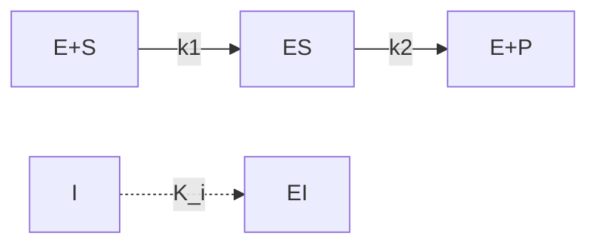
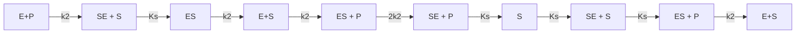
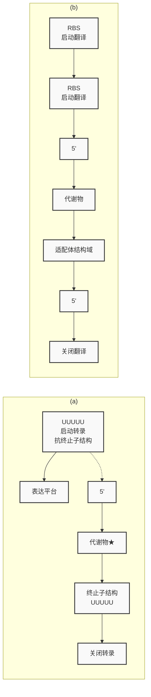

（1）被修饰的酶可以有两种互变形式，即一种为有催化活性的形式，另一种为无催化活性的形式。两种形式的互相转换均需要发生共价修饰反应，并且都将引起酶活性的变化。例如，肌肉中存在一种能催化糖原的合成和分解的酶，即磷酸化酶b。该酶本身无活性，当磷酸化酶b活性中心的丝氨酸残基被磷酸化酶激酶所磷酸化后，即形成高活性磷酸化酶a。磷酸化酶a的去磷酸化则由另一种磷酸酶所催化。
（2）共价修饰调节作用可产生酶的连续激活现象，所以具有信号放大效应。例如，肾上腺素引起糖原分解过程中的一系列磷酸化激活步骤，结果共将激素的信号被逐级放大了约300万倍。另外，共价修饰调节一般是耗能过程。

## 2.3.2 酶动力学

## 2.3.2.1 Michaelis-Menten 动力学

1913 年，Michaelis 和 Menten 最早尝试分析酶促反应动力学，反应速率与底物浓度间的关系如图 2-9a 所示。其数学表达式如下:

$$
v = \frac {v _ {\max} [ \mathrm{S} ]}{K _ {\mathrm{m}} + [ \mathrm{S} ]} \tag {2-15}
$$

上式也称为 Michaelis-Menten 方程，其中  $v_{max}$  和  $K_{m}$  为动力学参数。第一个参数  $v_{max}$  称为最大反应速度，表示在给定的酶量下反应可达的最大速度，即酶被底物饱和时的反应速度。这是酶催化效率的度量，而且直接与酶的转换数相关，酶的转换数定义为每秒钟底物转化成为产物的数目。有些酶的转换数可高达每秒几十万个分子，例如，碳酸酐酶转换数达  $600\,000\,s^{-1}$ 。有些酶的转换数低至每秒少于一个分子，如溶菌酶的转换数为  $0.5\,s^{-1}$ 。第二个动力学参数  $K_{m}$  称为米氏常数，定义为反应速度为  $v_{max}/2$  时的底物浓度。两个参数的一个重要区别是: $v_{max}$  与酶浓度有关，而  $K_{m}$  与酶浓度无关。 $K_{m}$  提供了酶对其底物相对亲合性大小的一个近似度量: $K_{m}$  值越小，表示亲合性越高；反之，表示亲和性越低。当胞内底物浓度远高于  $K_{m}$  时，反应速度会接近于  $v_{max}$，并对底物浓度的变化不敏感。而当细胞内底物浓度远小于  $K_{m}$  时，则  $v < v_{max}$，因此酶的催化活性的大部分会浪费掉。通过研究不同化合物对  $K_{m}$  的影响，还可以发现潜在的变构效应物。一般细胞内的大多数代谢物的浓度均在  $K_{m}$  值附近，这样可以根据代谢物浓度变化快速调节反应速度。通常，对于催化同一反应而来源不同的酶，可以用  $v_{max}/K_{m}$  值来表征酶的性质，该比值越大，表明酶的性状越好。

Michaelis-Menten 方程是一个机制模型，该机制假定酶与底物先形成一个复合物（ES），然后复合物再进一步分解为产物（P）和游离酶（E），另外还假定 ES 转化为产物的速率比 ES 解离成为  $E + S$  的速率要快，那么 E 与 S 混合后不久，将建立一个稳态，这时 ES 的浓度将不随时间而改变，如式 2-16 所示。

$$
\mathrm{E+S} \xrightarrow [ k _ {- 1} ]{k _ {1}} (\mathrm{ES}) \xrightarrow {k _ {2}} \mathrm{E+P} \tag {2-16}
$$

基于稳态假定，可推导出式2-15，反应速率取决于酶-底物复合物ES的浓度:

$$
v = k _ {2} [ \mathrm{ES} ] \tag {2-17}
$$

总酶浓度等于游离酶浓度和酶-底物复合物浓度之和:

$$
\left[ \mathrm{E} _ {0} \right] = \left[ \mathrm{E} \right] + \left[ \mathrm{ES} \right] \tag {2-18}
$$

图2-9 酶促反应速率-底物浓度图

式2-17除以式2-18得:

$$
\frac {v}{[ \mathrm{E} _ {0} ]} = \frac {k _ {2} [ \mathrm{ES} ]}{[ \mathrm{E} ] + [ \mathrm{ES} ]} \tag {2-19}
$$

因为假定酶-底物复合物 ES 处于稳态而不随时间改变，因此其形成速度与分解速度相等:

$$
\frac {\mathrm{d} [ \mathrm{ES} ]}{\mathrm{d} t} = 0 = k _ {- 1} [ \mathrm{ES} ] + k _ {2} [ \mathrm{ES} ] - k _ {1} [ \mathrm{E} _ {0} - \mathrm{ES} ] [ \mathrm{S} ] \tag {2-20}
$$

整理后得:

$$
\left[ \mathrm{ES} \right] = \frac {\left[ \mathrm{E} _ {0} \right] \left[ \mathrm{S} \right]}{K _ {\mathrm{m}} + \left[ \mathrm{S} \right]} \tag {2-21}
$$

其中上式的 $K_{\mathrm{m}} = (k_{-1} + k_2) / k_1 = [\mathrm{E}][\mathrm{S}] / [\mathrm{ES}]$，将上式代入式2-17，注意最大反应速度 $v_{\mathrm{max}} = k_2[\mathrm{E}_0]$，即得式2-15。$K_{\mathrm{m}}$ 的物理意义是当酶反应速度达最大反应速度一半时的底物浓度，即当 $[\mathrm{S}] = K_{\mathrm{m}}$ 时有:

$$
v = \left(\frac {K _ {\mathrm{m}} v _ {\max}}{K _ {\mathrm{m}} + K _ {\mathrm{m}}}\right) = \frac {1}{2} v _ {\max} \tag {2-22}
$$

式2-17可转换为线性形式，以使 $K_{\mathrm{m}}$ 值和 $v_{\mathrm{max}}$ 值能更准确地通过实验确定:

$$
\frac {1}{v} = \frac {1}{v _ {\max}} + \left(\frac {K _ {\mathrm{m}}}{v _ {\max}}\right) \frac {1}{[ \mathrm{S} ]} \tag {2-23}
$$

因此，由 $1 / v$ 对 $1 / [\mathrm{S}]$ 作双倒数图，就可得到一条直线，其斜率为 $K_{\mathrm{m}} / v_{\mathrm{max}}$ ，$Y$ 轴截距为 $1 / v_{\mathrm{max}}$ ，而 $X$ 轴截距为 $-1 / K_{\mathrm{m}}$ （图2-9b）。

当底物浓度过量时（此时 [S] 可以看成常数），式 2-20 很容易采用分离变量法进行积分，得到 [ES] 与时间的函数关系式:

$$
\left[ \mathrm{ES} \right] = (1 - \exp [ - (k _ {1} [ \mathrm{S} ] + k _ {- 1} + k _ {2}) t ]) \tag {2-24}
$$

或者反应速度 v 与时间的函数关系式:

$$
v = \frac {k _ {2} [ \mathrm{E} _ {0} ] [ \mathrm{S} ]}{[ \mathrm{S} ] + K _ {\mathrm{m}}} (1 - \exp [ - (k _ {1} [ \mathrm{S} ] + k _ {- 1} + k _ {2}) t ]) \tag {2-25}
$$

实际上，上述酶促反应的稳态假设只在 $k_{2}$ 、 $k_{-1}$ 和 $k_{1}[\mathrm{S}]$ 的数值比较大时才成立，此时式2-25中的指数函数近似为零（对于普通的酶，这些数值一般在100到$1000\mathrm{s}^{-1}$ 之间，这意味着在 $0.1\sim 0.01\mathrm{s}$ 内，ES的浓度就达到了稳态）。当所有三个速率常数 $k_{1}$ 、 $k_{-1}$ 和 $k_{2}$ 都比较小时，[ES]达到稳定值时将会花费很长时间，此时

Michaelis-Menten 方程并不成立。

Michaelis-Menten 方程的另一个缺陷是假定第二步反应不可逆。由于酶像其他催化剂一样同时促进正反应和逆反应（但促进程度不一样，产物可能与酶的亲合力低），所以多数情况下应考虑可逆反应:

$$
\mathrm{E+S} = \frac {k _ {1}}{k _ {- 1}} \mathrm{ES} \frac {k _ {2}}{k _ {- 2}} \mathrm{E+P} \tag {2-26}
$$

同样采用拟稳态假设，ES 的浓度稳定，可以推导出:

$$
\left[ \mathrm{ES} \right] = \frac {k _ {1} [ \mathrm{S} ] + k _ {- 2} [ \mathrm{P} ]}{k _ {- 1} + k _ {2} + k _ {1} s + k _ {- 2} [ \mathrm{P} ]} \left[ \mathrm{E} _ {0} \right] \tag {2-27}
$$

则反应速度:

$$
r = k _ {2} [ \mathrm{ES} ] - k _ {- 2} [ \mathrm{P} ] ([ \mathrm{E} _ {0} ] - [ \mathrm{ES} ]) = \frac {k _ {1} k _ {2} [ \mathrm{S} ] - k _ {- 1} k _ {- 2} [ \mathrm{P} ]}{k _ {- 1} + k _ {2} + k _ {1} [ \mathrm{S} ] + k _ {- 2} [ \mathrm{P} ]} [ \mathrm{E} _ {0} ] (2 - 2 8)
$$

当  $[P]=0$  时即得到式2-15，体外的酶动力学研究一般是最初反应时没有产物时进行的，但当产物生成后，式2-15仍很准确。当产物参与另外的反应使其酶促反应偏离平衡，则从S生成P在热力学上是可行的。如果没有逆反应的影响  $(k_{-2}, k_{-1} \approx 0)$ ，则几乎所有的S可以转化为P。当通过实验分析反应的酶动力学时，通常可以使用式2-15的动力学模型，但是对于工业生物反应器中底物转化的研究来说，式2-15的动力学模型并不理想。例如，当使用固定葡萄糖异构酶的活塞流反应器将葡萄糖转化为果糖时，需要十分接近平衡状态时才能获取足够糖含量的溶液，如果利用式2-15而不是式2-28，那么计算出所需的催化剂用量将会出现严重偏差。

## 2.3.2.2 抑制剂对酶动力学的影响

（1）竞争性抑制（competitive inhibition）:竞争性抑制剂是一种与底物具有共同的特征，能与该底物竞争酶活性中心的代谢物。反应产物、不可代谢的底物类似物、底物衍生物及替代性底物都可作为竞争性抑制剂。例如，琥珀酸脱氢酶催化琥珀酸氧化反应生成延胡索酸，丙二酸与主要底物琥珀酸的结构具有类似性，是琥珀酸脱氢酶的竞争性抑制剂。由于抑制剂与酶的结合是可逆的，于是在游离酶分子与结合了抑制剂的酶抑制剂复合物分子之间就建立了一个平衡，如图2-10的反应所示:

flowchart

图2-10 竞争性抑制剂的作用机制

根据拟稳态假设，由上面的反应机制可以推导出竞争性抑制反应速率为:

$$
v = \frac {v _ {\mathrm{max}} [ \mathrm{S} ]}{K _ {\mathrm{m}} \left(1 + \frac {[ \mathrm{I} ]}{K _ {i}}\right) + [ \mathrm{S} ]} \tag {2-29}
$$

或写成双倒数的形式:

$$
\frac {1}{v} = \frac {K _ {\mathrm{m}}}{v _ {\max}} \bigg (1 + \frac {[ \mathrm{I} ]}{K _ {i}} \bigg) \frac {1}{[ \mathrm{S} ]} + \frac {1}{v _ {\max}} \tag {2-30}
$$

竞争性抑制剂的浓度越大，通过实验测定的表观米氏常数越大，即 $K_{\mathrm{m,app}} = K_{\mathrm{m}} \left(1 + [\mathrm{I}] / K_{i}\right)$，而 $v_{\max}$ 保持不变。这是因为在竞争性抑制剂的干扰下，需要更高的底物浓度才能获得同样的反应速度，这种干扰作用在底物浓度非常高时变得非常小，即酶遇到抑制剂分子的概率变得非常小了，所以最大反应速率不变。存在竞争性抑制剂时的双倒数图见图2-11a。

图2-11 不同抑制剂类型的酶动力学双倒数图

（a）竞争性抑制剂；（b）非竞争性抑制剂；（c）反竞争性抑制剂；（d）底物为反竞争性抑制剂

(2) 非竞争性抑制（noncompetitive inhibition）:非竞争抑制剂与酶也是非共价的可逆结合，这些抑制剂并不和底物竞争同一个结合位点，而是结合到酶分子的调节位点并触发酶的构象变化，从而影响酶和底物的结合，降低催化效率。这样的抑制在稳态多反应物体系中普遍存在。非竞争性抑制机制如图 2-12 所示，抑制剂 I 能与 E 及 ES 结合，S 能与 E 及 EI 结合。酶与一个配基的结合对另一个的解离常数没有影响，但是所生成的 ESI 复合物是无活性的。

chemical

Chemical reaction pathway diagram showing E+S conversion to ES via K'm and k2, with I and EI+S reactions forming ESI

图2-12 非竞争性抑制剂的作用机制

同样根据拟稳态假设，由上面的反应机制可以推导出非竞争性抑制反应速率为:

$$
v = \frac {v _ {\mathrm{max}} [ \mathrm{S} ]}{\left(1 + \frac {[ \mathrm{I} ]}{K _ {i}}\right) (K _ {\mathrm{m}} + [ \mathrm{S} ])} \tag {2-31}
$$

或写成双倒数的形式:

$$
\frac {1}{v} = \left(\frac {K _ {\mathrm{m}}}{v _ {\mathrm{max}}} \frac {1}{[ \mathrm{S} ]} + \frac {1}{v _ {\mathrm{max}}}\right) \left(1 + \frac {[ \mathrm{I} ]}{K _ {i}}\right) \tag {2-32}
$$

上式表明在通常的 $1 / v$ 对 $1 / [\mathrm{S}]$ 图中直线斜率和在 $Y$ 轴上的截距均为[I]的函数，这是由于非竞争性抑制对底物结合及催化效率二者的双重影响。如图2-11b所示，由于 $Y$ 轴截距和斜率均以相同的因子（$1 + [\mathrm{I}] / K_{i}$）增加，而 $X$ 轴截距保持不变，并等于 $-1 / K_{\mathrm{m}}$。因此，非竞争性抑制剂的唯一影响是减小 $v_{\max}$ 而 $K_{\mathrm{m}}$ 保持不变，ES的稳态浓度由于部分ES转变为非反应的ESI形式而实际上减小了。

因为非竞争性抑制剂通常不类似于任何特定底物，故单一类型的抑制剂往往能够影响范围很广的酶类。例如，螯合剂（如EDTA和氰化物分别结合镁和铁）就属于此类抑制剂。由于含铁蛋白质在氧化还原反应中具重要作用，而对所有含ATP的反应中都需要镁离子，故这类抑制剂可能会产生有害的生理影响。

（3）反竞争性抑制（uncompetitive inhibition）:反竞争性抑制剂可以可逆地结合到酶-底物复合物，并形成一个无活性的ESI复合物。这类抑制普遍存在于多反应物系统，如图2-13所示。

$$
\begin{array}{c} \mathrm{E+S} \xrightarrow {K _ {m} ^ {\prime}} \mathrm{ES} \xrightarrow {k _ {2}} \mathrm{E+P} \\ + \\ \mathrm{I} \\ \parallel K _ {i} \\ \mathrm{ESI} \end{array}
$$

图2-13 反竞争性抑制剂的作用机制

根据拟稳态假设，可得出如下速率方程:

$$
v = \frac {v _ {\mathrm{max}} [ \mathrm{S} ]}{K _ {\mathrm{m}} + \left(1 + \frac {[ \mathrm{I} ]}{K _ {i}}\right) [ \mathrm{S} ]} \tag {2-33}
$$

或写成双倒数的形式:

$$
\frac {1}{v} = \frac {K _ {\mathrm{m}}}{v _ {\mathrm{max}}} \frac {1}{[ \mathrm{S} ]} + \frac {1}{v _ {\mathrm{max}}} \left(1 + \frac {[ \mathrm{I} ]}{K _ {t}}\right) \tag {2-34}
$$

反竞争性抑制剂使  $v_{max}$  和表观  $K_{m}$  都以相同因子降低，反应  $ES + I \rightleftharpoons ESI$  使 ES 浓度降低，引起  $E + S \rightleftharpoons ES$  的平衡向右移动。其双倒数图如图 2-11c 所示，当 [I] 增加时，Y 轴截距也增加，形成一系列平行线。

如果反竞争抑制剂就是底物 S，则反应速率方程为:

$$
v = \frac {v _ {\max} [ \mathrm{S} ]}{K _ {\mathrm{m}} + [ \mathrm{S} ] + \frac {[ \mathrm{S} ] ^ {2}}{K _ {i , s}}} \tag {2-35}
$$

此时双倒数图中的直线变为双曲线，见图2-11d。该双曲函数具有一条垂直和

一条倾斜的渐近线（该线代表不存在抑制作用的情况），这两条渐近线表明:当底物浓度很高时，存在严重的抑制作用，反应速率接近于0；当底物浓度很低时，几乎没有抑制作用，反应速率可用 Michaelis-Menten 方程近似表示。

（4）不可逆抑制（irreversible inhibition）:不可逆抑制剂与酶分子共价结合后永久性地破坏了酶的催化活性。例如非特异性的不可逆抑制剂二异丙基磷酸氟化物（DIPF）可与酶蛋白中丝氨酸残基的羟基结合而使酶失活。有些不可逆抑制剂是具有特异性，如青霉素特异性地抑制参与细胞壁合成的酶。不可逆抑制剂和非竞争性抑制剂都能使 $v_{max}$ 变小，这两种不同的抑制效应可以通过 $v_{max}$ 对 $[E_{0}]$ 作图来区分。如图2-14所示，对于可逆的非竞争性抑制剂来说，其直线比对照的直线斜率要小，且两条

line

| [E0] | 对照 (Vmax) | 非竞争抑制 (Vmax) | 不可逆抑制 (Vmax) |
| --- | --- | --- | --- |
| 0 | 0 | 0 | 0 |
| ~1.5 | ~2.5 | — | — |
| ~3.5 | — | ~4.5 | — |
| ~6.5 | — | ~7.5 | ~2.5 |

图2-14 不可逆抑制与非竞争性抑制的比较 $\left[\mathrm{E}_0\right]$ 代表滴定的总酶浓度

直线都经过原点。不可逆抑制的直线斜率与对照直线斜率相同，与 X 轴相交的数值等于不可逆失活的临界酶浓度  $\left[E_{i}\right]$  （即酶浓度小于该浓度时，酶全部被不可逆性地失活，高于该浓度时，由于几乎所有的不可逆抑制剂分子都已经和酶结合在一起，有一部分酶分子不受抑制剂的影响而具有活性）。

## 2.3.2.3 变构酶的动力学

变构酶通常由多亚基组成，并且由S形速率曲线来表征，这种动力学具有明显的优点:当底物浓度在生理浓度范围内波动时，反应速率的变化幅度比通常情况（米氏方程）更大。这是由变构酶的协同性造成的，在生理上极为重要，这种动力学特点使得细胞可以在低或高底物浓度时来“关闭”或“打开”反应。在中等底物浓度时，S形动力学响应提供了反应速率更加敏感的控制。这种调节的另一个重要性质是存在着一个浓度阈值，低于该阈值就没有催化活性，这种阈值现象在激素响应、神经信号或细胞分化等情况下极为重要。

（1）无协同性的动力学:对于双亚基酶，如果具有两个相同且相互独立的催化位点，如图2-15所示。根据拟稳态假设（这里假设复合物ES和SES均处于稳态），动力学表达式如2-36所示:

flowchart

图2-15 不具有协同作用的双亚基酶的催化机制

二聚体中两个位点是相同的，并且相互独立， $K_{\mathrm{S}}$ 称为本征解离常数

$$
\frac {v}{v _ {\max}} = \frac {\frac {[ \mathrm{S} ]}{K _ {\mathrm{s}}} + \frac {[ \mathrm{S} ] ^ {2}}{K _ {\mathrm{s}} ^ {2}}}{1 + \frac {2 [ \mathrm{S} ]}{K _ {\mathrm{s}}} + \frac {[ \mathrm{S} ] ^ {2}}{K _ {\mathrm{s}} ^ {2}}} = \frac {\frac {[ \mathrm{S} ]}{K _ {\mathrm{s}}} \left(1 + \frac {[ \mathrm{S} ]}{K _ {\mathrm{s}}}\right)}{\left(1 + \frac {[ \mathrm{S} ]}{K _ {\mathrm{s}}}\right) ^ {2}} \tag {2-36}
$$

其中: $K_{\mathrm{S}} = \frac{[\mathrm{S}][\mathrm{E}]}{[\mathrm{ES}]}$ ， $v_{\mathrm{max}} = 2k_2[\mathrm{E}_0]$ 。

通常，对具有 n 个相同且相互独立位点的酶，其动力学方程可表示为:

$$
\frac {v}{v _ {\max}} = \frac {\frac {[ \mathrm{S} ]}{K _ {\mathrm{S}}} \left(1 + \frac {[ \mathrm{S} ]}{K _ {\mathrm{S}}}\right) ^ {n - 1}}{\left(1 + \frac {[ \mathrm{S} ]}{K _ {\mathrm{S}}}\right) ^ {n}} \tag {2-37}
$$

或者进一步化简为:

$$
\frac {v}{v _ {\max}} = \frac {[ \mathrm{S} ]}{K _ {\mathrm{S}} + [ \mathrm{S} ]} \tag {2-38}
$$

从式2-37可以看出， $v$ 对[S]作图总是双曲形，无法由动力学数据来确定 $n$ 或者无法区分具有 $n$ 个相同位点的1mol酶和具有1个位点的 $n\mathrm{mol}$ 酶。

(2) 有协同性的动力学: 如果考虑到协同性, 同样是具有两个位点的双亚基酶酶, 第一个底物分子的结合将影响第二个底物分子与酶的亲和力, 因此, 第二个底物分子和 ES (或 SE) 复合物结合的解离常数变为 $\alpha K_{\mathrm{s}}$, 当 $\alpha < 1$ 时为正协同效应, 而当 $\alpha > 1$ 时为负协同效应。该机制产生的动力学见式 2-39, 其在图形上具有 S 形的特征:

$$
\frac {v}{v _ {\max}} = \frac {\frac {[ \mathrm{S} ]}{K _ {\mathrm{s}}} + \frac {[ \mathrm{S} ] ^ {2}}{\alpha K _ {\mathrm{s}} ^ {2}}}{1 + \frac {2 [ \mathrm{S} ]}{K _ {\mathrm{s}}} + \frac {[ \mathrm{S} ] ^ {2}}{\alpha K _ {\mathrm{s}} ^ {2}}} \tag {2-39}
$$

对于更加复杂的四聚体变构酶，动力学方程为:

$$
\frac {v}{v _ {\max}} = \frac {\frac {[ \mathrm{S} ]}{K _ {\mathrm{S}}} + \frac {3 [ \mathrm{S} ] ^ {2}}{\alpha K _ {\mathrm{S}} ^ {2}} + \frac {3 [ \mathrm{S} ] ^ {3}}{\alpha^ {2} \beta K _ {\mathrm{S}} ^ {3}} + \frac {[ \mathrm{S} ] ^ {4}}{\alpha^ {3} \beta^ {2} \gamma K _ {\mathrm{S}} ^ {4}}}{1 + \frac {4 [ \mathrm{S} ]}{K _ {\mathrm{S}}} + \frac {6 [ \mathrm{S} ] ^ {2}}{\alpha K _ {\mathrm{S}} ^ {2}} + \frac {4 [ \mathrm{S} ] ^ {3}}{\alpha^ {2} \beta K _ {\mathrm{S}} ^ {3}} + \frac {[ \mathrm{S} ] ^ {4}}{\alpha^ {3} \beta^ {2} \gamma K _ {\mathrm{S}} ^ {4}}} \tag {2-40}
$$

与  $\alpha$  类似， $\beta$  是两个底物分子和酶结合后对第三个底物分子与复合物 ESS 亲和力的影响因子， $\gamma$  是三个底物分子和酶结合后对第四个底物分子与复合物 ESSS 亲和力的影响因子，这种亲和力的影响是渐进的和累积的。

（3）变构酶的经验动力学方程:Hill 方程。对于呈现显著协同效应的酶，影响因子  $\alpha$ 、 $\beta$ 、 $\gamma$  等都非常小，因此，动力学方程主要取决于  $[S]^{n}$  项。当  $[S] > K_{s}$  时，通常酶的 n 个位点都和底物结合，因此结合少于 n 个底物分子的酶-底物复合物的浓度将可以忽略不计。这样，式 2-40 可简化为:

$$
\frac {v}{v _ {\mathrm{max}}} = \frac {\frac {[ \mathrm{S} ] ^ {4}}{\alpha^ {3} \beta^ {2} \gamma K _ {\mathrm{s}} ^ {4}}}{1 + \frac {[ \mathrm{S} ] ^ {4}}{\alpha^ {3} \beta^ {2} \gamma K _ {\mathrm{s}} ^ {4}}} = \frac {\frac {[ \mathrm{S} ] ^ {4}}{K ^ {\prime}}}{1 + \frac {[ \mathrm{S} ] ^ {4}}{K ^ {\prime}}} = \frac {[ \mathrm{S} ] ^ {4}}{[ \mathrm{S} ] ^ {4} + K ^ {\prime}} \tag {2-41}
$$

具有 n 个底物结合位点的酶，动力学方程如式 2-42 所示，该方程也称为 Hill 方程:

$$
\frac {v}{v _ {\max}} = \frac {[ \mathrm{S} ] ^ {n}}{K ^ {\prime} + [ \mathrm{S} ] ^ {n}} \tag {2-42}
$$

其中  $K' = \alpha^{n-1} \beta^{n-2} \gamma^{n-3} \cdots K_{S}^{n}$ ，相当于  $v = 0.5 v_{max}$  时底物浓度的 n 次幂。上述方程可以写成对数的形式:

$$
\lg \left(\frac {v}{v _ {\mathrm{max}} - v}\right) = n _ {\mathrm{app}} \lg [ \mathrm{S} ] - \lg K ^ {\prime} \tag {2-43}
$$

根据测定的反应速度和底物浓度等实验数据作  $\lg\left(\frac{v}{v_{\max}-v}\right)-\lg[S]$  图，可以得到一条斜率为  $n_{app}$  的直线，同时可以根据直线在 X 轴上的截距确定  $K'$  值。大量实验证明，Hill 方程中的 n 和底物结合位点的数目并不一致，因此在这里用  $n_{app}$  来替代底物结合位点的个数 n。例如，血红蛋白具有四个氧气结合位点，但是实验表明  $n_{app}=2.7$ 。

## 2.4 酶表达水平的调节

除通过改变酶分子的结构来调节细胞内原有酶的活性外，生物体还可通过改变酶的合成或降解速度以控制酶的绝对含量来调节代谢。酶是基因表达过程的产物，其浓度可以分别在转录和翻译两种水平上进行控制。大多数原核生物是在转录水平上控制酶的表达水平，因为对于细胞来说，控制 mRNA 的量要比控制蛋白质的量在能量消耗上更为经济，另外 mRNA 的半衰期远低于蛋白质的半衰期，因此控制 mRNA 的水平可以更为迅速的调节蛋白质的浓度。除了在转录水平上调节酶蛋白合成的诱导和阻遏过程之外，控制酶降解的速度也是一种重要的调控方式。

## 2.4.1 底物诱导

受酶催化的底物常常可以诱导该酶的合成，这种现象在生物界普遍存在。高等动物体内，因有激素的调节作用，底物诱导作用不如在微生物体内重要，但是，某些代谢途径中的关键酶也受底物的诱导调节。例如，如果将鼠饲料中酪蛋白的含量从8%增至70%，则鼠肝中的精氨酸酶的表达水平也会显著增加。在食物被消化和吸收后，血液中多种氨基酸的浓度会增加，氨基酸浓度的增加又诱导氨基酸分解酶体系中的一些关键酶的表达，如苏氨酸脱水酶和酪氨酸转氨酶等。这种诱导作用对于维持体内游离氨基酸浓度的相对恒定非常重要。

底物诱导中研究得最早和最充分的是乳糖对乳糖操纵子（lactose operon）的诱导作用。乳糖操纵子的调控十分复杂，除了底物诱导的负调控系统之外，还有一个正调控系统。乳糖操纵子带有大肠杆菌利用乳糖时所必需的结构基因，如图2-16所示。乳糖操纵子的启动子和操纵区分别是lacP和lacO。lacI基因编码阻遏蛋白，当缺乏乳糖时，阻遏蛋白与操纵基因（lacO）结合，形成空间位阻而阻碍RNA聚合酶向启动子下游移动。在这种情况下，整个乳糖操纵子的转录水平非常低（也称为本底表达水平），细胞内只有极少量利用乳糖的蛋白（图2-16b）。在乳糖存在的条件下，它可以作为诱导物诱导乳糖操纵子的表达（实际的诱导物为乳糖运入细胞后在β-半乳糖苷酶作用下生成的异乳糖，这些酶具有本底表达量）。异乳糖可以和阻遏蛋白在特定位点结合，引起阻遏蛋白的构象变化，降低了它与操纵基因结合的亲合力。因此，RNA聚合酶就能够向下游移动而转录出多顺反子mRNA，其编码的β-半乳糖苷酶（LacZ）、乳糖透性酶（LacY）和β-半乳糖苷转乙酰基酶（LacA）的表达量提高，从而加快乳糖的利用（图2-16a）。显然，调节基因所编码的调控蛋白和DNA结合后转录水平降低，乳糖操纵子的底物诱导系统是一个负调控系统。

乳糖操纵子的表达还受到一个正调控系统的调节，正调控的信号分子是胞外的葡萄糖。由于葡萄糖是细胞的最适碳源，因此当葡萄糖和乳糖同时存在时，细胞会优先利用葡萄糖，当葡萄糖被细胞代谢而使其浓度变得非常低的时候，乳糖代谢有关的酶才能高效表达。因为大肠杆菌利用葡萄糖的酶是组成型的，所以当葡萄糖与乳糖同时存在时，生产乳糖代谢有关的酶对细胞来说是一种资源浪费。大肠杆菌通过正调控系统来防止过量葡萄糖存在时浪费能量和营养去合成乳糖代谢有关的酶。

图2-16 乳糖操纵子的底物诱导机制

（a）乳糖存在时，允许RNA聚合酶转录编码乳糖操纵子三个酶基因的mRNA；（b）乳糖缺乏时，阻遏蛋白与乳糖操纵子的操纵基因结合，阻碍RNA聚合酶对操纵子的转录

正调控系统中的主要调节蛋白是一种全局调节蛋白:环腺苷酸受体蛋白（cyclic AMP receptor protein, CRP），该蛋白除了能调控乳糖操纵子的表达之外，还能调控许

知识拓展2-4葡萄糖浓度和细胞内cAMP浓度的关联

多与其他碳源代谢有关基因的表达。正调控的机制也已经研究得比较深入，主要调控过程如下:CRP蛋白根据细胞内cAMP浓度调控乳糖操纵子的表达。当细胞内cAMP浓度高时（在这种情况下，葡萄糖浓度较低），CRP蛋白和cAMP结合形成活化的cAMP-CRP，只有被cAMP活化的CRP蛋白才能高效结合在乳糖启动子的上游，促进RNA聚合酶和启动子的结合，并在乳糖的诱导作用下使乳糖操纵子高效表达（即不存在LacI蛋白对RNA聚合酶的空间位阻效应）。反之，当细胞内cAMP浓度低时（在这种情况下，葡萄糖浓度较高），无法形成活化的cAMP-CRP，此时RNA聚合酶和启动子的结合能力较弱，即使存在乳糖的诱导作用，乳糖操纵子也不能高效表达。乳糖操纵子表达的正、负调控机制可以很好地解释以葡萄糖和乳糖为碳源培养大肠杆菌时的二次生长现象。

## 2.4.2 终产物阻遏

代谢反应的终产物不但可通过变构调节直接抑制酶体系中的关键酶或起催化起始反应作用的酶，有时还可阻遏这些酶的合成，这种调控机制被称为终产物阻遏，是一种普遍存在于微生物中的负调控系统。终产物阻遏和底物诱导的机制非常类似，都需要阻遏蛋白结合在操纵基因上阻遏 RNA 聚合酶的转录，其中的主要区别在于:底物诱导的阻遏蛋白可以直接和操纵基因结合（关闭基因表达），而和诱导物结合后的阻遏蛋白无法和操纵基因结合（开启基因表达）；而终产物阻遏系统中的阻遏蛋白自身并不能和操纵基因有效结合（开启基因表达），它只有和终产物（也称为辅阻遏物）结合后才能和操纵基因结合，进而关闭基因的表达。

大肠杆菌中色氨酸阻遏是终产物阻遏的典型例子，当细胞内的色氨酸浓度较高时，色氨酸和阻遏蛋白TrpR结合，改变其构象，使其结合在操纵基因上，关闭色氨酸操纵子的转录。反之，当细胞内色氨酸浓度较低时，色氨酸无法和阻遏蛋白TrpR结合，色氨酸操纵子的转录开启，细胞可以合成色氨酸。

## 2.4.3 基因表达的弱化机制

除了终产物阻遏机制之外，大肠杆菌色氨酸操纵子中还存在一种叫做弱化作用（attenuation）的次级基因表达调控机制。在色氨酸操纵子转录本的5'端至trpE基因起始密码子之间有一段长162 bp的序列，称为前导RNA链。当细胞内色氨酸浓度高时，色氨酸操纵子仅仅被RNA聚合酶转录出前导链，因此色氨酸合成相关的基因不被转录，色氨酸的合成被终止。当细胞内色氨酸浓度低的时候，RNA聚合酶可以转录出包括前导链在内的整个转录本，细胞可以进行色氨酸的合成。

上述调节过程是通过前导 RNA 链形成终止子或抗终止子结构进行的。前导 RNA 链主要有以下特点:①5'端具有核糖体结合位点（RBS）及一个起始密码子，在距离 5'端约 70 个碱基的位置有一个终止密码子，这段序列的翻译产物是由 14 个氨基酸残基组成的短肽，称为前导肽。②在前导肽的编码区中有两个连续的色氨酸密码子。③在前导链中共有四段能相互配对的区域，其中区域 2 和区域 3 配对后形成抗终止子结构，而区域 3 和区域 4 配对后形成终止子结构（图 2-17a）。一旦前导 RNA 链被转录，核糖体就可以结合在 RBS 上启动前导肽的翻译。通常在色氨酸浓度较高时，细胞内的绝大多数色氨酰-tRNA 负载有色氨酸，因此核糖体可以很快通过两个连续的

图2-17 色氨酸操纵子表达的弱化机制

（a）前导 RNA 链结构；（b）色氨酸浓度高时，区域 3 和区域 4 配对形成终止子，转录在色氨酸操纵子第一个结构基因 trpE 上游提前终止，细胞停止合成色氨酸；（c）色氨酸浓度低时，区域 2 和区域 3 配对形成抗终止子，色氨酸操纵子被转录，细胞启动色氨酸的合成

色氨酸密码子，并占据区域1和区域2，因此前导RNA链中的区域3只能和区域4配对形成终止子结构，从而终止色氨酸操纵子的转录（图2-17b）。反之，当在色氨酸浓度较低时，细胞内的绝大多数色氨酰-tRNA处于空载状态，因此核糖体无法快速通过两个连续的色氨酸密码子，此时核糖体只占据前导RNA链的区域1，因此区域2和区域3可以配对形成抗终止子结构（即该结构的形成阻遏了区域3和区域4的配对，能够防止终止子结构的形成），从而使转录沿着DNA模板继续进行，完成整个操纵子的转录（图2-17c）。

基因表达的弱化机制将 RNA 的构象变化和基因表达的调节关联起来，对基因的表达起着严格调控的作用。在色氨酸操纵子中，阻遏作用与衰减机制一起协同控制基因表达，这要比单一的终产物阻遏调控系统更为有效。一方面，当有活性的阻遏物向无活性阻遏物的转变速度很慢时，衰减系统能更为迅速地进行调节，使色氨酸从较高浓度快速下降；另一方面，如果外源色氨酸浓度太低，细菌本身又没有其他的内源性色氨酸合成体系，以致细菌难以支持自身的生长时，就需要通过弱化机制调节，通过不终止 mRNA 的合成来增加色氨酸合成酶类的合成，从而提高内源色氨酸的浓度。弱化机制在控制基因产物的量和产物种类的配比上起着快速灵敏的调节作用，使操纵基因表达更为精密、高效，是一种普遍存在于原核生物的氨基酸、核苷等生物合成途径中的调节方式。

## 2.4.4 核糖核酸开关对基因表达的调控

核糖核酸开关（riboswitchs）是一类 mRNA 顺式作用元件，它能够直接结合小分子代谢物来改变 mRNA 分子的构象，从而起到调控基因的表达作用的，目前发现的核糖核酸开关一般位于 mRNA 的  $5'$ -UTR（untranslated region）或  $3'$ -UTR。2002 年，Breaker 研究小组首先证实了细菌的 mRNA 非编码区中的某些结构元件能够感应特定代谢物的浓度变化来“启动”或“关闭”基因的表达（Nahvi et al. 2002）。他们发现的这种结构元件位于大肠杆菌维生素  $B_{12}$  运输蛋白基因 btuB mRNA 的  $5'$ -UTR，当胞内维生素  $B_{12}$  辅酶腺苷钴胺素的浓度高时，该元件可以结合腺苷钴胺素，并导致 mRNA 构象的变化而阻遏 btuB 的表达。迄今已在细菌、真菌和植物中发现了多种核糖核酸开关，它们参与多种重要代谢途径的调控。核糖核酸开关实际上是一种天然的 RNA 适体（aptamer），目前已经发现细菌中约 3% 的基因受到核糖核酸开关的调控，控制着各种物质代谢的基础途径。对于合成途径，核糖核酸开关可以和途径的下游代谢物结合，对途径中的基因表达起着反馈阻遏的作用。对于降解途径，核糖核酸开关可以和途径的上游代谢物结合，通过前馈启动途径中相关基因的表达。

## 2.4.4.1 核糖核酸开关的结构

核糖核酸开关位于 mRNA 的非编码区，通过与代谢物小分子直接结合进行基因表达的调控。大多数核糖核酸开关都可以分成两个结构域:一个是作为感应器的适体结构域（aptamer domain, AD），另外一个是作为基因表达调节结构域的表达平台（expression platform, EPD）。AD 是一个高度折叠的结构，能感应特定代谢物的浓度，从而选择性地与特定的代谢物结合，这种结合会导致其自身以及表达平台的构象发生变化。表达平台构象的变化可以形成终止子或抗终止子结构，或形成掩蔽或暴露 RBS位点、mRNA剪切位点的结构，从而可以在基因转录、翻译或者mRNA剪切和加工等水平上调节基因的表达（图2-18）。在一些真核生物中，核糖核酸开关也存在于3'-UTR区域，可能形成具有自剪切能力的核酶结构，通过和特定代谢物结合后影响核酶活性来控制mRNA的稳定性，进而调控基因的表达。

flowchart

图2-18 核糖核酸开关的一般结构

图中显示了分别在转录水平（a）和翻译水平上（b）控制基因表达的核糖核酸开关

## 2.4.4.2 核糖核酸开关的种类

目前已经发现多种天然存在的感应特定代谢物浓度的核糖核酸开关，这些代谢物主要是辅酶、氨基酸及嘌呤等。根据代谢物种类的不同，核糖核酸开关主要分为以下几种（Smolke 2009）。

（1）焦磷酸硫胺素（TPP）核糖核酸开关:TPP 是一种由维生素  $B_{1}$  衍生而来的辅酶。TPP 核糖核酸开关是在自然界分布最广的核糖核酸开关，普遍存在于细菌、古细菌、真菌和植物中。这种开关通过控制维生素  $B_{1}$  的合成来调节胞内 TPP 的浓度。大肠杆菌中 thiC 基因的 5' - UTR 区存在此开关，其适体结构域也被称为 “thi 盒子” (thi box)，TPP 和该适体形成的复合物的表观解离常数  $K_{d}$  约为  $100 \, mmol \cdot L^{-1}$ ，而没有焦磷酸基团的前体代谢物和该适体形成的复合物的表观解离常数要比其大三个数量级。TPP 核糖核酸开关的调节基因表达的机制有多种:对于细菌，通常在转录或翻译水平上进行调节；对于真菌，通常在 mRNA 的剪切和拼接环节上进行调节；对于植物细胞，有可能在 mRNA 的加工环节进行调节。
(2) 黄素单核苷酸 (FMN) 核糖核酸开关: FMN 是许多氧化还原酶类的辅酶, 由前体物维生素 $\mathrm{B}_{2}$ 衍生而来。FMN 核糖核酸开关最先在枯草芽胞杆菌中发现, 随后的研究表明这种开关广泛存在于许多细菌中, 其适体结构域也被称为 RFN 元件, 调节维生素 $\mathrm{B}_{2}$ 和 FMN 的合成及运输等相关基因的表达。枯草芽胞杆菌维生素 $\mathrm{B}_{2}$ 操纵子 rib-DEAHT 的 FMN 核糖核酸开关与 FMN 形成的复合物的表观解离常数约为 $5 \mathrm{nmol} \cdot \mathrm{L}^{-1}$, 而与维生素 $\mathrm{B}_{2}$ 形成的复合物的表观解离常数约为 $3 \mu \mathrm{mol} \cdot \mathrm{L}^{-1}$ 。TPP 核糖核酸开关主要在转录水平上 (例如维生素 $\mathrm{B}_{2}$ 操纵子) 和翻译水平上 (例如 ypaA) 调节基因的表达。

(3) S-腺苷甲硫胺酸（SAM）核糖核酸开关:SAM 是一种由甲硫氨酸衍生而来的辅酶，为甲基化酶提供甲基基团。SAM 核糖核酸开关的适体结构域被称为 “S-盒子”，该开关调节与半胱氨酸、甲硫氨酸及 SAM 合成相关基因的表达，常见于革兰氏阳性细菌中。SAM 核糖核酸开关主要在转录水平调节基因的表达，在枯草芽胞杆菌中，SAM 和 “S-盒子” 复合物的表观解离常数约为 $4 \mathrm{nmol} \cdot \mathrm{L}^{-1}$，在高 SAM 浓度时下调相关的合成基因。
（4）腺苷钴胺素（辅酶  $B_{12}$  ）核糖核酸开关:辅酶  $B_{12}$  是维生素  $B_{12}$  的衍生物，辅酶  $B_{12}$  核糖核酸开关存在于多种细菌中，能根据辅酶  $B_{12}$  的浓度分别在转录和翻译水平上调节维生素  $B_{12}$  合成和运输相关基因的表达。
（5）赖氨酸核糖核酸开关:赖氨酸核糖核酸开关能感应细胞内 L-赖氨酸的浓度并调节其生物合成，该开关的适体结构域被称为“L-盒子”，枯草芽胞杆菌 lysC 基因（编码 L-天冬氨酸到 L-赖氨酸合成途径中的第一个酶）的  $5^{\prime}-UTR$  区含有一个赖氨酸核糖核酸开关，其与赖氨酸形成复合物的表观解离常数为  $1 \mu mol \cdot L^{-1}$ ，在 L-赖氨酸浓度较高时下调基因的表达，并显示出很强的专一性，能够区分包括 D-赖氨酸在内的多种 L-赖氨酸的结构类似物。
(6) 甘氨酸核糖核酸开关: 这种核糖核酸开关广泛存在于细菌中。目前发现的大部分核糖核酸开关只含有一个适体结构域, 但在甘氨酸核糖核酸开关中有两个相距很近的适体结构域。枯草芽胞杆菌 $gcvT$ 操纵子负责甘氨酸的分解, 该操纵子的前导区 (或 $5^{\prime}-UTR$) 含有甘氨酸核糖核酸开关, 负责在细胞内甘氨酸浓度过高时启动 $gcvT$ 操纵子的转录, 从而降解甘氨酸。开关中的两个适体结构域都能特异性地和甘氨酸结合, 并且存在协同效应: 第一个适体结构域和甘氨酸结合后会增强第二个适体结构域与甘氨酸的亲和力。这种协同效应类似于变构酶的协同性, 可以在很窄的甘氨酸浓度范围内对基因的表达起着“开关”作用。
（7）鸟嘌呤和腺嘌呤核糖核酸开关:嘌呤核糖核酸开关的适体结构域被称为“G-盒子”，这种开关主要控制嘌呤合成和运输途径相关基因的表达。枯草芽胞杆菌xpt-pbuX操纵子中的嘌呤核糖核酸开关能特异性地和鸟嘌呤及次黄嘌呤结合（复合物的表观解离常数 $K_{d}$ 分别约为5 nmol·L $^{-1}$ 和50 nmol·L $^{-1}$ ），在这些代谢物浓度过高时下调xpt-pbuX操纵子的转录水平。该开关的适体结构域不能有效地和腺嘌呤结合（复合物的 $K_{d}$ 高达300 μmol·L $^{-1}$ ）。在嘌呤输出蛋白编码基因ydhL的上游含有一个腺嘌呤核糖核酸开关，其适体结构域特异性地和腺嘌呤结合（复合物的 $K_{d}$ 约为300 nmol·L $^{-1}$ ），而不能和鸟嘌呤有效结合（复合物的 $K_{d}$ 高达10 μmol·L $^{-1}$ ）。该开关在腺嘌呤浓度过高时上调ydhL的转录。
（8）6-磷酸葡萄糖胺（GlcN6P）核糖核酸开关:6-磷酸葡萄糖胺核糖核酸开关存在于革兰氏阳性细菌glmS基因（该基因编码蛋白催化6-磷酸果糖和谷氨酰胺生成GlcN6P）的5'-UTR，它可以和GlcN6P结合后形成有活性的核酶结构，导致mRNA的5'端发生自剪切，从而下调glmS基因的表达。
(9) SAM-辅酶 $\mathrm{B}_{12}$ 核糖核酸开关:在克劳氏芽胞杆菌 metE 基因的 $5^{\prime} - \mathrm{UTR}$ 中存在一种特殊的核糖核酸开关系统，该系统含有两个串联的核糖核酸开关，其适体结构域分别和 SAM 及辅酶 $\mathrm{B}_{12}$ 结合。这种串联结构的开关形成了双输入的或逻辑门，两种代谢物中的任何一种浓度过高都能使 metE 基因的转录终止。metE 和 metH

编码的酶都能催化同型半胱氨酸合成甲硫氨酸，其中后者的催化效率更高，但需要辅酶  $B_{12}$  的衍生物作为辅因子。这个开关系统可以让细胞在辅酶  $B_{12}$  充足的时候关闭 metE 基因的表达，而表达催化效率更高的 MetH 合成甲硫氨酸，以及其衍生物 SAM。

## 2.4.4.3 核糖核酸开关的生物学意义及应用

核糖核酸开关这种通过感应代谢产物浓度进行基因表达调控的方式具有显著的优点（Dambach et al. 2009）:元件大小在数百碱基之内，构成非常简单；灵敏度高，响应配体时间一般在数分钟之内，反应迅速；由于不需要蛋白因子参与调控，其免疫原性小；核糖开关位于 mRNA 之上，发挥顺式调节作用，可实现紧密调节。与 miRNA 等其他非编码 RNA 一样，核糖核酸开关被认为是原始 RNA 世界遗留下来的分子化石，在基因调控中有着许多不为人知的重要作用。至今，在哺乳动物中尚未发现有核糖核酸开关存在，而该机制究竟是否同样存在于高等真核生物中是科学家们一直感兴趣和探索的问题，如果这一调节机制能在哺乳动物中得到证实，那么人们对非编码序列的功能可能需要重新加以认识和评价。

核糖核酸开关是有适体结构域和表达平台有机的组合，因此可以通过筛选人工适体和表达平台组合在一起，合理设计某种代谢物作为基因表达调控的信号。目前，通过随机突变的方法已经筛选到能与茶碱等代谢物分子特异性结合的人工RNA适体。有的研究者将这种人工筛选的RNA适体与核酶、核糖体结合位点、短发卡RNA（short hairpin RNA, shRNA）或RNA剪接位点等基因表达的调节元件组合在一起构建了人工的核糖核酸开关，通过RNA适体与特定代谢物的结合来改变作为表达平台的核酶的二维或三维构象，从而使调节元件在有活性和无活性形式之间转换，以此达到调节基因表达的目的（Suess et al. 2004, Kim et al. 2005, An et al. 2006, Win et al. 2007）。因此，今后有可能在代谢途径中所有基因的 $5^{\prime}-UTR$ 或 $3^{\prime}-UTR$ 区域加上人工的核糖核酸开关，这些开关可以根据途径中不同代谢物的浓度进行基因表达的调节，以保持代谢物浓度的相对稳定，从而实现整个代谢途径中基因的协调表达和代谢通量的优化。如果用能感应某种代谢物浓度的人工核糖核酸开关来控制报告基因（例如绿色荧光蛋白基因）的表达，则可以实现对该代谢物在胞内浓度的实时监测。已有研究者利用茶碱的人工RNA适体（该适体也能有效地和茶碱的结构类似物黄嘌呤结合）和核酶组而合成的人工核糖核酸开关放置在绿色荧光蛋白基因的 $3^{\prime}-UTR$ 区域，将其作为生物传感器放入酿酒酵母中表达，结果能够很好地检测细胞内黄嘌呤的浓度（Win et al. 2007）。特定代谢物的核糖核酸开关与报告基因组合成的生物传感器也可以导入指示菌株中，用于对该特定代谢物高产菌株的筛选与检验（Fowler et al. 2010）。另外，还可以利用人工的核糖核酸开关设计各种逻辑门，实现生物计算的功能。例如，Smolke研究组（Win et al. 2008）开发了一个通用的由标准元件组装成具有特定逻辑电路功能的RNA元件的技术，这些RNA元件可以将分子输入信号和特定蛋白的表达相关联，不但可以行使各种逻辑门（包括与门、与非门、或门、或非门）和信号过滤器的功能，还可以实现输入信号对输出信号的协同性控制，从而能够对高层次细胞信息进行处理运算。

## 2.4.5 翻译的控制

某些酶的表达调节也能够发生在翻译水平，被称为转录后调节。这种调节机制控制着一个完整的 mRNA 分子被翻译的次数。一般情况下，翻译的调节方式主要有:控制 mRNA 稳定性、通过掩蔽 RBS 位点控制翻译起始概率（图 2-18），以及控制蛋白质的合成速度。

许多编码核糖体蛋白的操纵子都可以在翻译水平上进行调控。通常每个核糖体翻译蛋白质的速度约为每秒钟15个氨基酸（37℃时），细胞生长速度加快时，蛋白质合成速度也加快，因此细胞会相应地合成更多的核糖体。大肠杆菌以 $1.6\ h^{-1}$ 的比生长速率高速生长时，每个细胞含有数万个核糖体，而当比生长速率降为 $0.14\ h^{-1}$ 时，每个细胞只含有数千个核糖体。细胞通过一种翻译抑制的机制确保核糖体蛋白质的合成与核糖体的合成相耦联:rRNA和核糖体蛋白组装成核糖体，当所有的rRNA几乎和核糖体蛋白结合后，有一部分核糖体蛋白会结合在其自身的mRNA上，阻止翻译过多的核糖体蛋白。参与翻译的起始因子IF3的表达调节也发生在翻译水平上，IF3的起始密码子是翻译起始效率较低的AUU密码子，而IF3可以降低核糖体在AUU起始翻译的效率。当IF3浓度较高时，其自身的翻译效率就会降低，而当IF3浓度较低时，在AUU起始的翻译效率会增加，从而增加IF3的表达水平，这是一种典型的自调节。

在原核生物中，可以通过核糖核酸开关对基因的表达进行翻译控制，如图2-18所示，细胞通过感应某种代谢物的浓度而对mRNA结构进行重排，进而掩蔽或暴露核糖体结合位点（RBS位点），实现翻译的关闭或启动。除此之外，也可以通过小RNA来控制翻译。这些小RNA在低温或低铁水平等环境下表达，随后通过和目标mRNA的翻译起始区配对结合而抑制翻译，或者通过诱导目标mRNA结构发生重排暴露出翻译起始位点而激活翻译过程。在某些噬菌体和原核生物中还有一类mRNA特异性的阻遏蛋白，这些蛋白可以直接结合在目标mRNA的RBS位点周围从而妨碍核糖体与RBS的结合。在有些情况下，这些蛋白和mRNA结合后使其发生重新折叠，从而掩蔽或暴露RBS位点（Kozak 2005）。例如，在枯草芽胞杆菌中色氨酸浓度较高时可以激活特异性结合色氨酸操纵子mRNA的弱化蛋白（trp RNA-binding attenuation protein, TRAP），被激活的TRAP可以有效结合在trpE基因的RBS位点上游约100个碱基的位置，造成mRNA的重新折叠，从而掩蔽了trpE基因的RBS位点。TRAP还可以直接结合在trpG和trpP的RBS位点上，阻碍它们的翻译。非常有趣的是，TRAP也是一个控制色氨酸操纵子转录的蛋白，在色氨酸浓度较高的情况下弱化色氨酸操纵子的转录（Du et al. 1998）。

在真核生物中，一种典型的基因表达的翻译控制方式是控制核糖体和 mRNA 的重结合，在 DNA 损伤、营养限制、热刺激和缺氧等应急条件下，细胞会降低总体的蛋白质合成速率，但同时会选择性地增加一些特定应急响应蛋白的合成。mRNA 的 5' 端和 3' 端的非编码区的一些元件参与了核糖体和 mRNA 重结合的调节过程（图 2-19），这些元件包括内部核糖体进入位点（internal ribosome entry sites, IRESs），一些小 RNA 的结合位点以及上游开放阅读框。与原核生物不同，真核生物的翻译起始普遍发生在 mRNA 的 5' 端，核糖体 40S 亚基在翻译起始因子的帮助下从 5' 端进入 mRNA