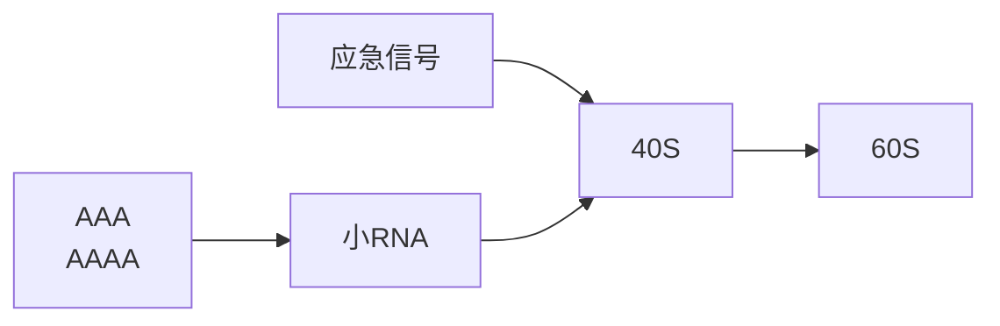
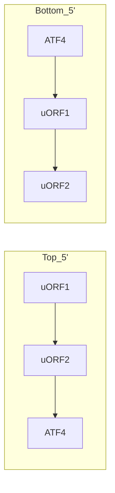
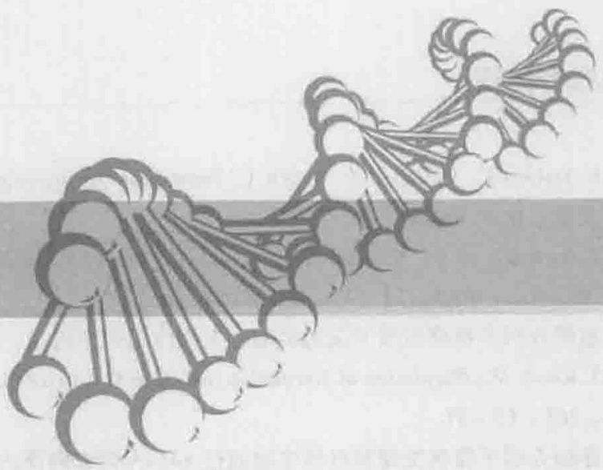
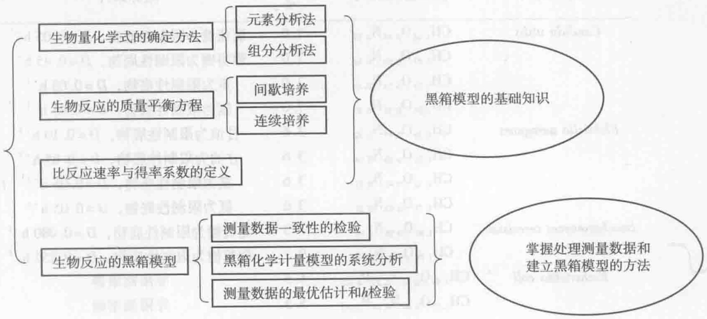
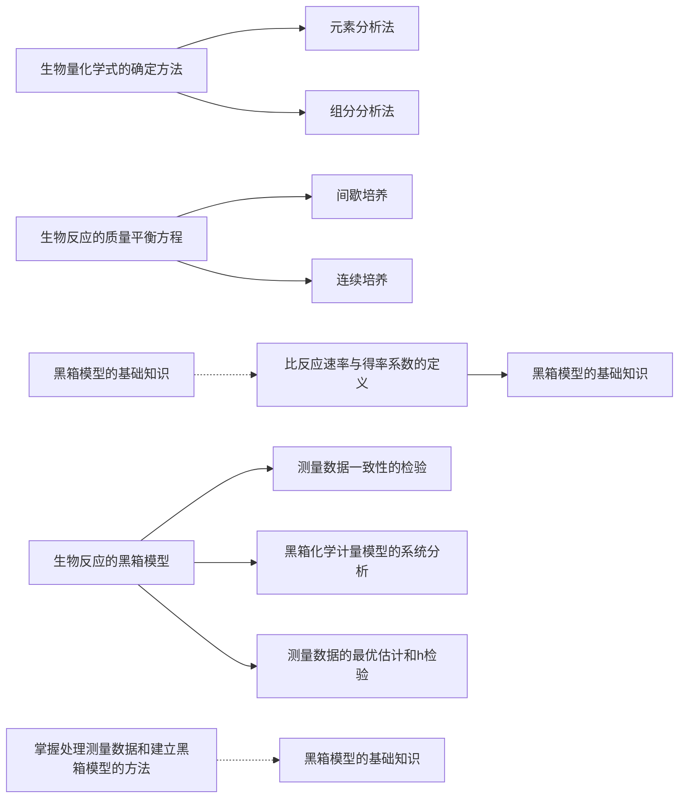
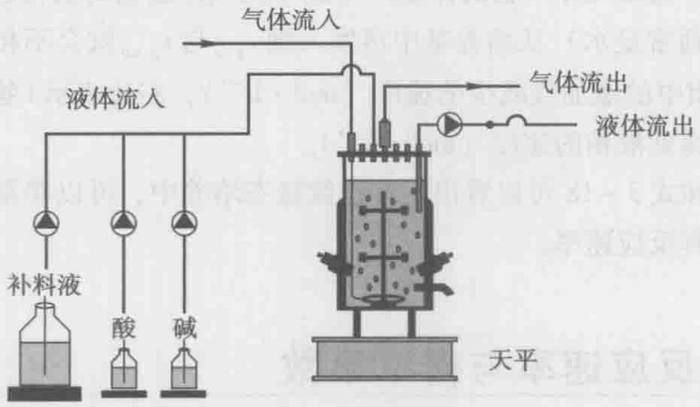
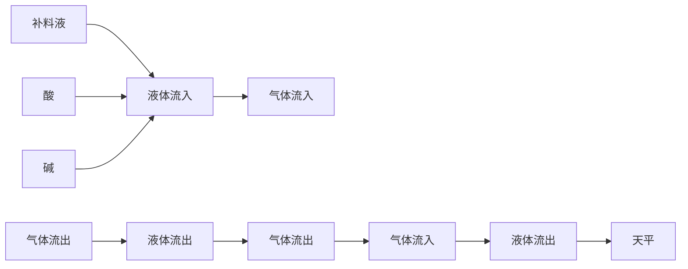

后向下游滑动，并在此过程中和三元复合物（包括翻译起始因子 eIF2、甲硫氨酰基-tRNAi 和 GTP）结合，一旦遇到起始密码子后，在三元复合物的参与下，40S 亚基和 60S 亚基组装成完整的核糖体进行翻译。因此，5'端甲基化帽子对真核基因的翻译是必不可少的。环境中的应急信号经过一系列信号传递后改变了翻译起始因子的磷酸化状态，从而降低了这些翻译起始因子对 5'端甲基化帽子结构或者起始密码子 AUG 的识别效率，导致对蛋白合成的全局抑制（global inhibition）。一些应急响应蛋白的 mRNA 的 5'端非编码区含有内部核糖体进入位点，这些位点和原核生物中 RBS 的作用类似，可以使核糖体 40S 亚基绕开 5'端甲基化帽子和 mRNA 结合，因此在应急条件下，这些响应蛋白的 mRNA 可以更有效地和 40S 亚基结合而提高翻译效率，从而大量表达。小 RNA 主要结合在 mRNA 的 3'端非编码区对基因的表达进行调节，结合后可以降低 mRNA 的稳定性（图 2-19），但其对翻译的抑制作用机制还不清楚。

flowchart

图2-19 真核生物中调节翻译的元件（Spriggs et al. 2010）

图中显示了5'端非翻译区内部核糖体进入位点和小RNA结合位点的对翻译的调节

在真核生物中，一些应急响应蛋白的 mRNA 的 5'端含有 1 至数个短的上游开放阅读框（upstream open reading frames, uORF），这些阅读框和下游基因的编码区发生重叠，对其翻译起着调节作用。一个典型的例子是哺乳动物细胞中编码一种应急响应转录因子的 ATF4 基因的表达（Spriggs et al, 2010）。该基因 mRNA 的上游存在两个短的开放阅读框，其中第 2 个阅读框和 ATF4 的编码区重叠，并且两者在重叠区域的密码子阅读框不同。一般情况下，在完成第 1 个阅读框的翻译后，核糖体的 60S 亚基解离，40S 亚基继续向下游滑动，遇到第 2 个阅读框的起始密码子后重新组装成完整的核糖体再次进行翻译。由于编码区的重叠，ATF4 的起始密码子不能被核糖体有效识别，因此其翻译受到抑制。在应急条件下，翻译起始因子 eIF2 被磷酸化，导致三元复合物浓度降低，40S 亚基在遇到第 2 个阅读框的起始密码子时和三元复合物结合的概率很低，从而无法组装成核糖体进行翻译。在这种情况下，40S 亚基继续向下游滑动，在遇到 ATF4 的起始密码子时三元复合物结合的概率较高，从而组装成核糖体进行 ATF4 的翻译（图 2-20）。

## 2.4.6 酶分子降解的调节

细胞内酶的含量也可通过改变酶分子的降解速度来调节。饥饿情况下，精氨酸酶的活性增加，主要是由于酶蛋白降解的速度减慢所致。饥饿也可使乙酰辅酶 A 羧化酶浓度降低，这除了与酶蛋白合成减少有关外，还与酶分子的降解速度加强有关。苯巴比妥等药物可使细胞色素 b5 和 NADPH - 细胞色素 P450 还原酶降解减少，这也是这类药物使单加氧酶活性增强的一个原因。

flowchart

图2-20 哺乳动物细胞中ATF4基因表达的翻译调节（Spriggs et al. 2010）

酶蛋白受细胞内溶酶体中蛋白水解酶的催化而降解，因此，凡能改变蛋白水解酶活性或蛋白水解酶在溶酶体内分布的因素，都可间接地影响酶蛋白的降解速度。一般通过酶降解以调节酶含量的重要性不如酶的诱导和阻遏作用。

## 2.5 流通代谢物及全局调控

## 2.5.1 流通代谢物

细胞在生长时能够非常协调地进行合成代谢与分解代谢，其中流通代谢物（currency metabolites）充当了重要的调节信号。流通代谢物主要是指可在细胞全局范围内流通的代谢物，这些代谢物参与细胞内的许多反应，可以传递能量或还原力。能量货币ATP和以代谢物形式出现的还原力NADH和NADPH。它们的作用主要在于协调细胞的代谢通量和反应方向，使受它们控制的途径成为代谢网络整体的一部分。流通代谢物的调节信号主要有能荷（energy charge）、分解代谢还原荷（catabolic reduction charge）及合成代谢还原荷（anabolic reduction charge），见式2-44\~2-46。

$$
\mathrm{能荷} E _ {\mathrm{c}} = \frac {[ \mathrm{ATP} ] + 0 . 5 [ \mathrm{ADP} ]}{[ \mathrm{ATP} ] + [ \mathrm{ADP} ] + [ \mathrm{AMP} ]} \tag {2-44}
$$

$$
\mathrm{分解代谢还原荷} = \frac {\left[ \mathrm{NADH} \right]}{\left[ \mathrm{NADH} \right] + \left[ \mathrm{NAD} ^ {+} \right]} \tag {2-45}
$$

$$
\text {合成代谢还原荷} = \frac {[ \mathrm{NADPH} ]}{[ \mathrm{NADPH} ] + [ \mathrm{NADP} ^ {+} ]} \tag {2-46}
$$

在能荷的定义式中，分子中 ADP 前的系数为 0.5，这是因为它含有的高能磷酸键数只有 ATP 的 1/2，即 1 个高能磷酸键。细胞内腺苷酸库中 AMP，ADP 和 ATP 的含量很少，如果 ADP 转化成 ATP 的过称被终止，生物合成反应与聚合反应仅仅数秒钟就消耗完细胞内的 ATP。因此，在细胞代谢活跃时，AMP 或 ADP 转换成 ATP 的速度必须非常快，而且转换速度通过与代谢反应相耦联的方式进行调节。对于 NADH/

$NAD^{+}$ 及 NADPH/NADP $^{+}$ ，存在着类似的情况。

在主要的分解代谢途径中，有一些关键酶的活性受到上述信号的反馈调节，通过对反应速度的控制来实现合成代谢与分解代谢的平衡。EMP途径和PP途径的主要控制位点处于这两条途径的分支点处，即磷酸果糖激酶和6-磷酸葡萄糖脱氢酶。其中6-磷酸葡萄糖脱氢酶的活性在合成代谢还原荷较高时受到抑制。磷酸果糖激酶是一种非常复杂的别构酶，它有数种效应物。在酿酒酵母中，该酶受效应物AMP、氨、磷酸以及2,6-二磷酸果糖激活，而被效应物ATP所抑制。该酶与ATP结合后会导致对6-磷酸果糖亲和力的降低，而与2,6-二磷酸果糖结合后会极大增强这种亲和力。因此在酿酒酵母中，2,6-二磷酸果糖对于EMP途径上的通量具有促进作用，而ATP（或高能荷值）具有抑制作用。由于6-磷酸果糖的浓度的增加会导致2,6-二磷酸果糖浓度的提高，这种调节能增加磷酸果糖激酶的活性以适应底物浓度的增加；在高能荷水平下（即ATP的相对浓度较高时），由于磷酸果糖激酶活性被抑制而使ATP的生成被阻断，从而使能荷水平逐渐降低。TCA循环的主要调节点在柠檬酸合成酶、异柠檬酸脱氢酶和α-酮戊二酸脱氢酶。这三种酶的活性都偏爱低水平的分解代谢还原荷，其中异柠檬酸脱氢酶的活性受其影响更大。在酵母中，异柠檬酸脱氢酶还在低能荷水平下被激活，在高能荷水平下被抑制。

$$
\mathrm{NADH} + \mathrm{NADP} ^ {+} - \mathrm{NAD} ^ {+} - \mathrm{NADPH} = 0 \tag {2-47}
$$

在稳定的生长环境中，细胞的能荷一般维持在0.65\~0.9。已有研究表明，能荷值受生长速率变化的影响很小，而腺苷酸的浓度受生长速率变化的影响更大一些（随生长速率的加快而增加）。在细胞代谢中，辅助因子NADH和NADPH用于两种不同的目的。在好氧微生物中，NADH主要涉及通过氧化磷酸化反应生成吉布斯自由能，而NADPH为生物量合成提供还原力。对于快速生长的细菌，分解代谢还原荷的数值通常为0.03\~0.08，而合成代谢还原荷的数值为0.7\~1.0。对于快速生长的酵母，这两个比值分别为0.25\~0.30和0.58\~0.75。显然，快速生长的细胞必须同时维持较高的分解代谢与合成代谢速度，因此分别作为分解代谢底物的 $NAD^{+}$ 和作为合成代谢底物的NADPH的浓度必定处于较高水平。在一些细菌和哺乳动物细胞中存在转氢酶，能够实现氢在 $NAD^{+}$ 和 $NADP^{+}$ 之间的转移，其反应式见式2-47。通常在正常生长条件下，这种酶在细胞代谢中可能不会起到重要的作用，但可能对细胞的氧化还原力水平或能量供应的失衡提供一种保护性的补偿作用。

## 2.5.2 全局调控

大约30年前，乳糖操纵子作为一个基因调控详例的阐明激起了人们研究其他操纵子的强烈兴趣。这些努力导致很多新操纵子的发现。对这些操纵子系统的研究和分析得出共识:这些操纵子不是独立起作用，而是作为一个更高水平的调控网络的成员之一发挥作用。这种更高水平的调控也称为全局调控，它是生物体性能构成整体所必需的部分。例如，细胞通过全局调控来适应各种环境变化，包括:从富营养培养基变换到基本培养基、改变碳源、氨基酸限制，好氧和厌氧环境间的变换（仅对兼性微生物），热休克，以及磷酸盐、氮源和碳源极度匮乏等。

全局控制是指细胞利用调控信号控制细胞多种生理状态的能力，这些生理状态产生于前一段所提到的对任何一种环境变化的协调响应。这样的调控网络包括功能明显

知识拓展2-5细菌的多基因调节系统

无关而且在染色体图上的物理位置也不连续的多套操纵子和多套调节子。在一个总体调控网络中，各组操纵子都被统一协调控制，尽管它们在物理上分布于整个细菌基因组并且有时表现出完全不同的功能。总体调节子定义为在一个总体调节网络中处于一个共同调节蛋白控制下的一个操纵子网络。然而，即使简单的环境变化通常都会诱导几个调节子。因此，刺激子用以指响应于单一环境刺激的全部调节子。全局调控网络的存在至少有两个原因（Stephanopoulos et al. 1998）。第一，某些细胞过程所涉及的基因多于一个单个操纵子所能容纳的基因，以细菌的翻译机器为例，这是一组涉及至少150个基因产物的系统，包括:rRNA，核糖体蛋白，起始、延长及终止因子，氨酰基-tRNA合成酶和tRNAs。如此为数众多的相互关联组分的协调控制对细胞生长的总效率是很重要的，然而将所有这些基因包含在一个操纵子内几乎是不可能的。第二，尽管有些基因需要被独立调控，但有更高级的协调控制系统也是至关重要的。这些情况的例子常见于编码分解代谢酶的基因中，而这些酶参与碳源和能源的利用。葡萄糖是大多数细菌的最优底物，当存在于生长培养基时，它总是抑制次优底物代谢所需酶的表达（分解代谢抑制）。然而当缺乏最优底物时，每个操纵子都必须有在其相关底物存在时的独立诱导能力。这些例子表明需要一个调控组织机构替代单个操纵子的独立调控。据估计，细菌细胞已演化形成了几百个多基因调节系统，只有极少数系统被深入研究。

多基因系统的一个重要特点是常通过蛋白质-蛋白质相互作用来处理信息，细菌对环境刺激响应的遗传及生化分析表明，响应于这种刺激的信号转导常常是通过两类蛋白质对之间的通讯而发生的，这类系统也称为二组分调节系统。每对蛋白都由传感器蛋白和调节器蛋白组成，传感器蛋白能够检测环境的变化进而将信号传送到与其合作的调节器蛋白。随后受感应的调节蛋白将上调或下调某些操纵子组的转录水平。每类信号转导蛋白成员之间已观察到相当大的同源性。典型双组分系统的传感器蛋白是一种组氨酸激酶，通常是由两个单体组成的同源二聚体膜蛋白，每个单体的N端含有一个可变的传感器结构域（也称为配体结合结构域），C端含有一个保守的传递器结构域（也称为激酶结构域）。位于周质空间一侧的传感器结构域能感应环境中某种信号因子的浓度变化，从而激发位于细胞质一侧的传递器结构域发生自磷酸化，随后，自磷酸化的组氨酸激酶进一步将磷酸基团传递到调节器蛋白N端的接受器结构域（一般传递到天冬氨酸残基上），通过磷酸化激活调节器蛋白对基因表达的调控作用。除了接受器结构域外，大多调节器蛋白还含有1到数个DNA接合结构域，以便和DNA结合后作为转录调控因子参与转录调控。在有些情况下，调节器蛋白并不直接参与基因表达的调控，而是将磷酸基团继续传递到其他调控蛋白，激活后者来进行基因表达的调控。

## 思考题

1. 细胞的代谢反应有哪些基本类型？其主要功能是什么？
2. 影响酶动力学的抑制剂有哪几类，其动力学的主要特点是什么？
3. 原核生物中影响基因表达的主要调节方式有哪些？各有何特点？
4. 核糖核酸开关的一般结构和主要调控机制是什么？
5. 什么是流通代谢物？其在细胞代谢中的主要作用是什么？

## 推荐阅读

1. Nielsen J, Villadsen J, Liden G. Bioreaction Engineering Principles. 2nd edition. 英文影印版. 北京:化学工业出版社，2004.
2. Dambach M D, Winkler W C. Expanding roles for metabolite - sensing regulatory RNAs. Curr Opin Microbiol, 2009, 12 (2): 161-169.
系统介绍了核糖核酸开关的类型、生物作用和应用。
3. Kozak M. Regulation of translation via mRNA structure in prokaryotes and eukaryotes. Gene, 2005, 361: 13–37.
详细介绍了原核生物和真核生物通过 mRNA 调节翻译的各种方式。

## 3

natural_image

Abstract illustration of interconnected nodes forming a chain-like structure (no text or symbols)

# 生化反应质量平衡与模型

## 【本章学习要点】

1. 生物量化学式的主要确定方法
2. 生物反应质量平衡方程的建立
3. 测量数据一致性的检验方法
4. 黑箱模型的系统分析方法

在对细胞内的生物反应过程有了初步的理性认识之后，往往需要对细胞内的代谢反应进行定量处理，即确定这些反应的速率，从而了解细胞内各反应参与细胞代谢的活跃程度，这对生物培养过程的设计与优化至关重要。反应速率测量值往往受到测量误差的干扰，因此对测量数据质量的评估就显得尤为重要。对实验数据进行评估的重要依据是参与反应的各物质是否符合质量平衡，因此必须考虑到参与反应的主要底物和产物，否则会导致建立错误的质量平衡方程。在测量数据具有较高冗余度的情况下，可以采用系统的方法来评估测量数据的质量，甚至可以鉴别在建立质量平衡方程时是否遗漏了重要的代谢物。

## 知识导图

flowchart

## 3.1 生物量化学式

生物量中含有许多元素，其中主要元素有 C、H、O、N、S、P；其他元素如 Ca、Mg、Na、Fe、Co 等为微量元素，在生物量中的含量很少。一般在生物量化学式中只考虑主要元素，并以含 1 mol C 元素作为基准，这种化学式也称为碳-摩尔化学式（C-mole chemical formula），如式 3-1 所示。

$$
X = \mathrm{CH} _ {a} \mathrm{O} _ {b} \mathrm{N} _ {c} \mathrm{S} _ {d} \mathrm{P} _ {e} \dots \tag {3-1}
$$

确定某种微生物的生物量化学式的方法主要有两种:元素分析法和组分分析法。元素分析法需要将收集的湿菌体烘干，然后灼烧确定重量的干生物量样品，并分析燃烧产物。燃烧的剩余产物称为灰分，它由无机化合物组成，大多数为金属氧化物。生物量中所含有的灰分通常占干重的4%\~8%。由于通过元素分析法确定的生物量化学式并不包括灰分，因此在处理生物量干重数据时，必须结合灰分的含量进行校正，否则就会引入一个较大的误差（例3-1）。另外需要注意的是，烘干菌体的过程并不能把细胞内的结晶水完全除去，干细胞内残留的结晶水的含量约为0.1 mol结晶水/mol碳原子，这些结晶水可以被看作生物量的组成部分。表3-1列出了通过元素分析法确定的几种主要微生物的生物量化学式。

例3-1 通过元素分析法确定酿酒酵母的生物量化学式为: $X = \mathrm{CH}_{1.8}\mathrm{O}_{0.6}\mathrm{N}_{0.18}$，灰分占细胞干重的 $9\%$，求 $60\mathrm{g}$ 干细胞的摩尔量 $n$。

根据化学计量式得酿酒酵母细胞相对分子质量: $M_{x}=25.92\ g\cdot mol^{-1}$  生物量，

表 3-1 几种主要微生物的生物量化学式 (Nielsen et al. 2004)

<table><tr><td>微生物种类</td><td>生物量化学式</td><td>灰分/%</td><td>培养条件</td></tr><tr><td rowspan="4">Candida utilis</td><td> $CH_{1.83}O_{0.46}N_{0.19}$ </td><td>7.0</td><td>葡萄糖为限制性底物, $D=0.05\ h^{-1}$ </td></tr><tr><td> $CH_{1.87}O_{0.56}N_{0.20}$ </td><td>7.0</td><td>葡萄糖为限制性底物, $D=0.45\ h^{-1}$ </td></tr><tr><td> $CH_{1.83}O_{0.54}N_{0.10}$ </td><td>7.0</td><td>氨为限制性底物, $D=0.05\ h^{-1}$ </td></tr><tr><td> $CH_{1.87}O_{0.56}N_{0.20}$ </td><td>7.0</td><td>氨为限制性底物, $D=0.45\ h^{-1}$ </td></tr><tr><td rowspan="4">Klebsiella aerogenes</td><td> $CH_{1.75}O_{0.43}N_{0.22}$ </td><td>3.6</td><td>甘油为限制性底物, $D=0.10\ h^{-1}$ </td></tr><tr><td> $CH_{1.73}O_{0.43}N_{0.24}$ </td><td>3.6</td><td>甘油为限制性底物, $D=0.85\ h^{-1}$ </td></tr><tr><td> $CH_{1.75}O_{0.47}N_{0.17}$ </td><td>3.6</td><td>氨为限制性底物, $D=0.05\ h^{-1}$ </td></tr><tr><td> $CH_{1.73}O_{0.43}N_{0.24}$ </td><td>3.6</td><td>氨为限制性底物, $D=0.05\ h^{-1}$ </td></tr><tr><td rowspan="2">Saccharomyces cerevisiae</td><td> $CH_{1.82}O_{0.58}N_{0.16}$ </td><td>7.3</td><td>葡萄糖为限制性底物, $D=0.080\ h^{-1}$ </td></tr><tr><td> $CH_{1.78}O_{0.60}N_{0.19}$ </td><td>9.7</td><td>葡萄糖为限制性底物, $D=0.255\ h^{-1}$ </td></tr><tr><td rowspan="4">Escherichia coli</td><td> $CH_{1.94}O_{0.52}N_{0.25}P_{0.025}$ </td><td>5.5</td><td>非限制培养</td></tr><tr><td> $CH_{1.77}O_{0.49}N_{0.24}P_{0.017}$ </td><td>5.5</td><td>非限制培养</td></tr><tr><td> $CH_{1.83}O_{0.50}N_{0.22}P_{0.021}$ </td><td>5.5</td><td>非限制培养</td></tr><tr><td> $CH_{1.96}O_{0.55}N_{0.25}P_{0.022}$ </td><td>5.5</td><td>非限制培养</td></tr><tr><td>Pseudomonas fluorescens</td><td> $CH_{1.93}O_{0.55}N_{0.25}P_{0.021}$ </td><td>5.5</td><td>非限制培养</td></tr><tr><td>Aerobacter aerogenes</td><td> $CH_{1.83}O_{0.55}N_{0.26}P_{0.024}$ </td><td>5.5</td><td>非限制培养</td></tr><tr><td>Penicillium chrysogenum</td><td> $CH_{1.64}O_{0.52}N_{0.16}$ </td><td>7.9</td><td>非限制培养</td></tr><tr><td>Aspergillus niger</td><td> $CH_{1.72}O_{0.55}N_{0.17}$ </td><td>7.5</td><td>非限制培养</td></tr></table>

则 60 g 干细胞的摩尔量: $n=\frac{60\times(1-9\%)}{M_{x}}=\frac{54.6}{25.92}=2.11\ mol$

组分分析法需要首先确定微生物细胞中蛋白质、RNA、DNA、磷脂等各种大分子的化学式，然后分别测定这些大分子在细胞中的含量，进而可以确定生物量的化学式。不同生物的生物量化学式是不同的，而且细胞中各种大分子的含量随着生长环境或生理状态的不同也有很大的变化。因此，即使对同一种生物而言，生物量化学式也可能会有很大的不同（见表3-1）。通过组分分析法得到的酿酒酵母的生物量化学式为:

$$
X = \mathrm{CH} _ {1. 6} \mathrm{O} _ {0. 5} \mathrm{N} _ {0. 2 2} \tag {3-2}
$$

上式并没有考虑到结晶水的存在，因此还需加上0.1 mol的 $H_{2}O$ ，此时和元素分析法得到的分子式非常接近。

表 3-1 中微生物生物量各元素的平均组成为:

$$
X = \mathrm{CH} _ {1. 8} \mathrm{O} _ {0. 5} \mathrm{N} _ {0. 2} \tag {3-3}
$$

与其相对应的相对分子质量为  $M_{x}=24.6\ g/mol$  生物量，本书使用上式作为生物量的标准化学式。但是，上式通常只用于碳源作为限制性底物的培养物，如果存在氮源限制或磷源限制，一些微生物细胞会在体内储存碳源物质，因此随着胞内这些储存物含量的增加（原核生物中，这些物质的含量可高达70%\~80%），细胞的元素组成会逐渐趋向于这些储存物的元素组成。例如真养雷氏菌（Ralstonia europha）在缺乏氮源、磷酸盐和其他合成活性细胞的必要营养物质时，会在胞内积累大量聚羟基丁酸（polyhydroxybutate，PHB）。在这种极端的情况下，生物量组成为  $CH_{1.5}O_{0.5}$ ，非常接近

于 PHB 的分子式（Lee et al. 2001）。

## 3.2 生物反应的质量平衡方程

在生物反应过程中，每一种代谢物都满足质量平衡。通常，在搅拌罐式反应器中进行的生物反应过程的质量平衡方程可以用一阶微分方程表示。

$$
\frac {\mathrm{d} M _ {i}}{\mathrm{d} t} = \frac {\mathrm{d} (V c _ {i})}{\mathrm{d} t} = V (q _ {i} ^ {t} + q _ {i}) + v _ {f} c _ {i, f} - v _ {e} c _ {i, e} \tag {3-4}
$$

式中， $M_{i}$  是 i 物质在液相中的质量， $c_{i}$  是 i 物质在液相中的浓度，i 物质可以是底物（s）、代谢产物（p）或生物量（x）。 $c_{f}$  是该物质在流入反应器的液体中的浓度（如补料培养基）， $c_{e}$  是该物质在流出反应器的液体中的浓度。V 是反应器中培养物的体积，也称为工作体积。 $v_{f}$  和  $v_{e}$  分别是流体流入或流出反应器的速率。 $q_{i}^{t}$  是该物质在气液两相间的体积传质速率，如果是从液相传递到气相，则取负值；反之，则取正值。 $q_{i}$  是该物质的体积反应速率（volumetric reaction rate）（微生物细胞产生或消耗 i 物质的速率），即单位体积培养液中的细胞在单位时间内产生或消耗的物质的量，其量纲通常为  $g/(L \cdot h)$  或  $\mathrm{mol}/(\mathrm{L} \cdot \mathrm{h})$ 。

对于生物量 x，其体积反应速率  $q_{x}$  是指单位体积的培养液中的细胞在单位时间内繁殖的细胞质量，结合比生长速率（specific growth rate）的定义式 2-2 有:

$$
q _ {x} = \mu x \tag {3-5}
$$

严格来讲，式3-4中的 $Vc_{i}$ 并不能代表培养液中 $i$ 物质的质量，因为 $c_{i}$ 是 $i$ 物质在上清液中的浓度，其在细胞中的浓度不一定等于 $c_{i}$，因此，通常只有在下列情况下可以用 $Vc_{i}$ 计算培养液中 $i$ 物质的质量:①湿菌体的体积很小，此时细胞中 $i$ 物质的质量可以忽略，其在培养液和上清液中的质量很接近。②湿菌体的体积较大，但 $i$ 物质在上清液中和细胞中的浓度很接近。在其他情况下需要用式3-6计算培养液中 $i$ 物质的质量变化，否则会导致较大的误差，尤其在高密度细胞培养时，误差可高达$20\%$ 以上（Smolke 2009）。

$$
\frac {\mathrm{d} M _ {i}}{\mathrm{d} t} = \frac {\mathrm{d} (M _ {x} c _ {i , x})}{\mathrm{d} t} + \frac {\mathrm{d} (V _ {\sup} c _ {i , \sup})}{\mathrm{d} t} \tag {3-6}
$$

式中， $M_{x}$  为反应器中的细胞干重，量纲通常为 g。 $c_{i,x}$  为 i 物质在细胞中的含量，量纲通常为 mmol·g $^{-1}$  干细胞。 $V_{sup}$  和  $c_{i,sup}$  分别是反应器中上清液的体积和上清液中 i 物质浓度，常用的量纲为 L 和 mmol·L $^{-1}$ 。

培养基中的大部分底物和产物，例如葡萄糖、乳酸等都只存在于液相中，因此不需要考虑体积传质速率，但对于同时存在于气液两相中的物质，例如  $O_{2}$  或  $CO_{2}$ ，则必须考虑  $q_{i}^{\prime}$ ，其计算公式如式 3-7 所示:

$$
q _ {i} ^ {t} = k _ {l} a (c _ {i} ^ {*} - c _ {i}) \tag {3-7}
$$

式中， $k_{l}a$  为体积传质系数，常用的量纲为  $h^{-1}$ 。 $c_{i}^{*}$  为 i 物质在相应气相分压下的液相饱和浓度，可通过式 3-8 计算。

$$
c _ {i} ^ {*} = \pi_ {i} / H _ {i}; \tag {3-8}
$$

$\pi_{i}$  是 i 物质在气相中的分压， $H_{i}$  是 i 物质的亨利系数，它和培养基和操作条件有

关，其常用的量纲是 mol（L·atm） $^{-1}$ 。

## 3.2.1 间歇培养

间歇培养（batch cultivation）方式是生物反应过程中经常采用的一种培养方式，培养基一次性加入生物反应器中，在整个培养过程中没有培养液进入或流出反应器，并且在理想状态下培养液体积保持不变，因此式3-4可以简化成:

$$
\frac {\mathrm{d} c _ {i}}{\mathrm{d} t} = q _ {i} ^ {t} + q _ {i} \tag {3-9}
$$

如果 i 物质只存在于液相中，则可进一步简化成

$$
\frac {\mathrm{d} c _ {i}}{\mathrm{d} t} = q _ {i} \tag {3-10}
$$

即对于间歇培养，可以通过作该物质浓度  $c_{i}$  - 发酵时间 t 的曲线图，然后通过求曲线的斜率来得到体积反应速率 q。然而在实际的间歇培养过程中，由于可能连续的通入气体或蒸发的原因会造成培养液体积不断变小，此时需用式 3-11 计算体积反应速率，或者用例 3-2 的方法进行近似处理（Smolke 2009）。

$$
q _ {i} = \frac {\mathrm{d} c _ {i}}{\mathrm{d} t} + \frac {c _ {i}}{V} \cdot \frac {\mathrm{d} V}{\mathrm{d} t} \tag {3-11}
$$

例3-2 通过下表中间歇培养的实验数据求葡萄糖的体积消耗速率。

| 培养时间 t/h | 培养液体积 V/L | 葡萄糖浓度 $c_s$/(mmol·L-1) |
| --- | --- | --- |
| 0 | 100 | 100.000 |
| 1 | 98 | 100.296 |
| 2 | 96 | 100.510 |
| 4 | 92 | 100.674 |
| 8 | 84 | 99.536 |
| 16 | 68 | 86.985 |

通过上表的实验数据可以计算出 t 时刻培养液中葡萄糖的含量，见下表:

| 培养时间/h | 培养基中葡萄糖量$M_s$/mol($M_s = Vc_s$) |
| --- | --- |
| 0 | 10.000 |
| 1 | 9.929 |
| 2 | 9.649 |
| 4 | 9.262 |
| 8 | 8.361 |
| 16 | 5.915 |

由于间歇培养过程中的培养液体积随培养时间延长而不断变小，因此可以利用上表数据计算各时间区间的葡萄糖体积消耗速率的平均值:

| 时间区间$t_i/h$$(t_i=t_2-t_1)$ | 平均体积$V_a/L$$[V_a=(V_1-V_2)/2]$ | 平均体积消耗速率$q_s/(mmol·h^{-1}·L^{-1})$$[q_s=(M_2-M_1)/(V_a t_i)]$ |
| --- | --- | --- |
| 0~1 h,$t_i=1$ | 99 | -1.727 |
| 1~2 h,$t_i=1$ | 97 | -1.856 |
| 2~4 h,$t_i=2$ | 94 | -2.059 |
| 4~8 h,$t_i=4$ | 88 | -2.557 |
| 8~16 h,$t_i=8$ | 76 | -4.026 |

## 3.2.2 连续培养

连续培养（continuous cultivation）是分析生物反应过程中反应速率的一种非常有效的培养方式。在连续培养过程中，通过进料口和进气口分别输入液体（例如葡萄糖溶液）和气体（例如空气）。在反应器中的培养液里含有菌体、底物和代谢产物，培养液通过出料口输出反应器，而气体产物（例如  $CO_{2}$ ）则从出气口输出反应器（图3-1）。如果控制液体输入速率 v、气体输入速率  $v_{g}$ 、培养液体积 V 以及进入反应器的液体和气体中各物质的浓度恒定，则经过一段时间的培养后，反应器中及出料口的培养液里的生物量、底物、产物的浓度，以及输出气体中代谢产物的浓度也都保持恒定值，此时这个生物培养过程就达到了连续的稳态。在连续培养方式中，v/V，即液体流速与反应器中培养基体积的比值是一个重要的输入变量，这个比值被称为稀释率（dilution rate）（D），其量纲是时间量纲的倒数，通常是  $h^{-1}$ 。

$$
\mathrm{稀释率} D = \frac {v}{V} \tag {3-12}
$$

D 的倒数被称为保留时间。

flowchart

图3-1 连续罐式搅拌反应器（Nielsen et al. 2004）

一般可以选择控制稀释率 $D$ 、生物量浓度 $x$ 、代谢产物浓度 $p$ 或 $\mathrm{pH}$ 等变量保持恒定来达到某一特定的稳态，其对应的操作模式也被称为恒化器、恒浊器、产物恒定器及 $\mathrm{pH}$ 恒定器模式。通常选择对稳态变化更加敏感的变量进行控制可以更快地达到稳态。另外测量误差对能否快速达到稳态也非常重要，例如我们很难通过控制限制性底物的浓度来达到低比生长速率生长（或低稀释率）的稳态，这是因为此时限制性底物的浓度非常低，测量的相对误差非常大。在这种情况下选择控制稀释率:即控制液体的输入和输出速率 v 来保持 V 处于稳定值更加方便。通常，在一个搅拌釜式连续反应器中达到稳定状态，或者实现从一个稳态到另一个稳态的转变大概需要 5 倍的保留时间，即  $5 \cdot D^{-1}$  (Nielsen et al. 2004)。

根据在稳态连续生物反应器中测量的进料和出料液浓度，可以通过质量平衡方程3-4计算出各反应的反应速率。对于只存在于液相中代谢物i，式3-4可以简化为:

$$
\frac {\mathrm{d} M _ {i}}{\mathrm{d} t} = 0 = V q _ {i} + v _ {f} c _ {i, f} - v _ {e} c _ {i, e} \tag {3-13}
$$

如果 i 分别是底物、生物量和产物， $q_{i}=(v_{f}c_{i,f}-v_{e}c_{i,e})/V$  则有式 3-14～式 3-16:

$$
q _ {s _ {i}} V + v (s _ {i, f} - s _ {i}) = 0 \tag {3-14}
$$

$$
q _ {x} V + v (x _ {f} - x) = 0 \tag {3-15}
$$

$$
q _ {p _ {i}} V + v (p _ {i, f} - p _ {i}) = 0 \tag {3-16}
$$

由于一般进料液中不含有产物和生物量，因此式3-15和式3-16可以进一步化简为:

$$
q _ {x} = D x \tag {3-17}
$$

$$
q _ {p _ {i}} = D p _ {i} \tag {3-18}
$$

结合式3-5和式3-17，可以得出在连续稳态培养中: $D=\mu$ 。

对于气体底物或产物，从式3-4可以得到:

$$
V (q _ {s _ {i}} ^ {t} + q _ {s _ {i}}) + v (s _ {i, f} - s _ {i}) = 0 \tag {3-19}
$$

$$
V (q _ {p _ {i}} ^ {t} + q _ {p _ {i}}) + v (p _ {i, f} - p _ {i}) = 0 \tag {3-20}
$$

我们可以从整个系统的气相质量平衡中得到下式:

$$
\frac {1}{R T} (\pi_ {s _ {i}, \mathrm{in}} v _ {g, \mathrm{in}} - \pi_ {s _ {i}, \mathrm{out}} v _ {g, \mathrm{out}}) = k _ {l} a (s _ {i} ^ {*} - s _ {i}) V = q _ {i} ^ {t} V \tag {3-21}
$$

$v_{g,in}$  和  $v_{g,out}$  分别是进气和出气的体积流速。 $\pi_{s_{i,in}}$  和  $\pi_{s_{i,out}}$  分别是 i 物质在进气和出气中的气相分压。如果气体产物的体积产生速率与气体底物的消耗速率不同，或者有液相中的成分（通常是水）从培养基中蒸发，则  $v_{g,in}$  与  $v_{g,out}$  就会不相等。上式左边表示代谢物 i 在气相中的增加或减少的速度（mol·h $^{-1}$ ），右边表示 i 物质从液相传递到气相或从气相传递到液相的速度（mol·h $^{-1}$ ）。

从式3-17和式3-18可以看出，在连续稳态培养中，可以非常方便地通过测量变量的浓度来计算反应速率。

## 3.3 比反应速率与得率系数

除了体积产生速率之外，生物反应中还经常使用比反应速率，其定义为每单位质量的干细胞在单位时间内产生或消耗的第i种化合物的质量，可用式3-22表示

$$
r _ {i} = \frac {q _ {i}}{x} \tag {3-22}
$$

如果 i 是生物量，结合式 3-5 可以看出  $r_{x}$  即为比生长速率:

$$
r _ {x} = \frac {q _ {x}}{x} = \mu \tag {3-23}
$$

$r_{i}$  表征的是单个细胞（或单位质量细胞）生产或利用某种物质的性能，即细胞的代谢通量。而  $q_{i}$  表征整个培养体系生产或利用某种物质的性能，它的大小不仅和单细胞的生产性能有关，还和细胞生长情况即菌体浓度 x 有关。

任何一种速率，无论是 $q_{i}$ 还是 $r_i$ ，与另一个速率 $q_{j}$ 或 $r_j$ 相比时，我们就得到得率系数（yield coefficient）$Y_{ji}$。

$$
Y _ {j i} = \left| \frac {r _ {i}}{r _ {j}} \right| = \left| \frac {q _ {i}}{q _ {j}} \right| \tag {3-24}
$$

在本书中，所有底物的反应速率都是负值，产物的反应速率为正值，在式3-24中使用了绝对值以保证得率系数都是正值。在得率系数的定义中，第一个下标 $j$ 通常是指对照速率，而且进行比较的两种速率必须采用相同单位，例如，$\mathrm{g}$（乳酸）$\cdot \mathrm{g}^{-1}$（葡萄糖）或者 $\mathrm{mol}$（乳酸）$\cdot \mathrm{mol}^{-1}$（葡萄糖），一般可以省略括号中的物质。对于生物加工过程的设计而言，无论是菌种改进还是发酵过程优化，得率系数均代表了一组非常重要的设计参数，尤其是产物相对于底物的得率系数，该参数直接决定生物加工过程的底物转化为产物的效率。另外，呼吸熵 $RQ$ 是 $\mathrm{CO}_{2}$ 对 $\mathrm{O}_{2}$ 的得率系数，即 $Y_{oc}$，该参数是对发酵过程进行在线控制的一个常用参数。

## 3.4 生物反应的黑箱模型

对于一个生物反应过程而言，我们可以将细胞看成一个不可观察的黑箱，不必了解细胞内部的反应情况，只需测定在某一时刻输入细胞的反应速率（所有底物的消耗速率）和输出细胞的反应速率（所有产物的合成速率），根据质量守恒原理，就可以用一个总的化学方程式表示该时刻的生物反应过程，该方程式表示所有的底物通过细胞被转化为代谢产物和新的生物量，被称为黑箱模型（black box model）。例如，式3-25就是一个黑箱模型。在黑箱模型中，所有含碳化合物的化学式均采用碳-摩尔化学式。每一种物质前面的系数是该物质的比反应速率 $r$ 或体积反应速率 $q$ 。大多数生物反应过程的底物都包括葡萄糖和氨气，产物包括 $\mathrm{CO}_{2}$ 和水。显然式3-25可以转化成式3-26的形式，此时，葡萄糖的系数为-1，所有其他物质的系数为该底物相对于葡萄糖的得率系数，底物的系数取负值，产物和生物量的系数取正值。

$$
\begin{array}{l} - r _ {s} \mathrm{CH} _ {2} \mathrm{O} - r _ {o} \mathrm{O} _ {2} - r _ {n} \mathrm{NH} _ {3} - r _ {s _ {1}} S _ {1} - \dots + r _ {x} X + r _ {c} \mathrm{CO} _ {2} + r _ {p _ {1}} P _ {1} + \dots + r _ {w} \mathrm{H} _ {2} \mathrm{O} = 0 (3-25) \\ - \mathrm{CH} _ {2} \mathrm{O} - Y _ {s o} \mathrm{O} _ {2} - Y _ {s n} \mathrm{NH} _ {3} - Y _ {s s _ {1}} S _ {1} - \dots + Y _ {s x} X + Y _ {s c} \mathrm{CO} _ {2} + Y _ {s p _ {1}} P _ {1} + \dots + Y _ {s w} \mathrm{H} _ {2} \mathrm{O} = 0 (3-26) \\ \end{array}
$$

通过黑箱模型，我们可以非常方便地了解微生物细胞在特定环境中以某种比生长速率生长时的代谢特点。培养环境（培养基成分、温度、pH等）以及细胞生长速度对黑箱模型中的代谢物种类及反应速率都有很大的影响，因此，通常采用连续稳态培养来建立黑箱模型。在连续培养达到稳态时，细胞在不同比生长速率下的反应速率是不同的，但得率系数有可能在特定的比生长速率范围内保持不变。在一些情况下，代谢物的种类会随着生长状态的改变而发生变化。

例3-3 在酿酒酵母的连续稳态厌氧发酵中，碳源为葡萄糖，氮源为 $\mathrm{NH}_3$ ，反应器的工作体积 $V$ 为 $1.35\mathrm{L}$ ，流加培养基中含有 $s_f = 20\mathrm{g}\cdot \mathrm{L}^{-1}$ 的葡萄糖，在稀释率为

0.05 h $^{-1}$ 的稳态培养状态下，测定反应器培养液中葡萄糖浓度  $s \approx 0$ ，乙醇的浓度  $p_{e} = 4.6 g \cdot L^{-1}$ ，甘油的浓度  $p_{g} = 1.58 g \cdot L^{-1}$ ，生物量浓度  $x = 2.43 g \cdot L^{-1}$ 。另外输入氮气来保持厌氧发酵状态，气体输入和输出速度为  $6 L \cdot h^{-1}$ ，输出气体中乙醇浓度  $p_{e,out}$  为  $1.58 mmol \cdot L^{-1}$ ， $CO_{2}$  浓度  $p_{c,out}$  为  $2.06 mmol \cdot L^{-1}$ （摩尔浓度均以碳-摩尔化学式为基准）。生物量组成由元素分析实验确定: $X = CH_{1.74}O_{0.60}N_{0.12}$ ，灰分占细胞干重的 5%。

（1）求在该稳态培养条件下乙醇（e）、 $CO_{2}$ （c）、生物量（x）和甘油（g）相对于葡萄糖（s）的得率系数。

(2) 写出该过程的黑箱模型。

对于葡萄糖，其碳-摩尔化学式为  $CH_{2}O$ ，相对分子质量为  $30\ g\cdot mol^{-1}$ ，则根据式 3-14 有:

$$
q _ {s} = - \frac {v}{V} (s _ {f} - s) = - 0. 0 5 \mathrm{h} ^ {- 1} \times \frac {(2 0 - 0) \mathrm{g} \cdot \mathrm{L} ^ {- 1}}{3 0 \mathrm{g} \cdot \mathrm{mol} ^ {- 1}} = - 3 3. 3 3 \mathrm{mmol} \cdot \mathrm{L} ^ {- 1} \cdot \mathrm{h} ^ {- 1}
$$

对于乙醇，其碳-摩尔化学式为  $CH_{3}O_{0.5}$ ，相对分子质量为  $23\ g\cdot mol^{-1}$ ，其在气相和液相中均存在，并作为细胞产物从液相传递到气相，因此根据式 3-21 得到乙醇的体积传质速率为:

$$
q ^ {t} = - \frac {(v _ {g , \mathrm{out}} p _ {e , \mathrm{out}} - v _ {g , \mathrm{in}} p _ {e , \mathrm{in}})}{V} = - \frac {(6 \times 1 . 5 8 - 6 \times 0)}{1 . 3 5} = - 7 \mathrm{mmol} \cdot \mathrm{L} ^ {- 1} \cdot \mathrm{h} ^ {- 1}
$$

根据式3-20有:

$$
\begin{array}{l} q _ {e} = - \frac {v}{V} (p _ {e, f} - p _ {e}) - q _ {e} ^ {t} \\ = - 0. 0 5 \mathrm{h} ^ {- 1} \cdot \frac {(0 - 4 . 6) \mathrm{g} \cdot \mathrm{h} ^ {- 1}}{2 3 \mathrm{g} \cdot \mathrm{mol} ^ {- 1}} + 0. 0 0 7 \mathrm{mol} \cdot \mathrm{L} ^ {- 1} \cdot \mathrm{h} ^ {- 1} \\ = 1 7 \mathrm{mmol} \cdot \mathrm{L} ^ {- 1} \cdot \mathrm{h} ^ {- 1} \\ \end{array}
$$

对于  $CO_{2}$ ，其碳-摩尔化学式为  $CO_{2}$ ，相对分子质量为  $44\ g\cdot mol^{-1}$ ，其在气相和液相中均存在，并作为细胞产物从液相传递到气相，因此:

$$
q _ {c} ^ {t} = - \frac {(v _ {g , \mathrm{out}} p _ {c , \mathrm{out}} - v _ {g , \mathrm{in}} p _ {c , \mathrm{in}})}{V} = - \frac {(6 \times 2 . 0 6 - 6 \times 0)}{1 . 3 5} = - 9. 1 6 \mathrm{mmol} \cdot \mathrm{L} ^ {- 1} \cdot \mathrm{h} ^ {- 1}
$$

$CO_{2}$  在补料液及培养液中的浓度均可以看作近似为 0，根据式 3-19 有:

$$
q _ {c} = - \frac {v}{V} (p _ {c, f} - p _ {c}) - q _ {c} ^ {t} = - q _ {c} ^ {t} = 9. 1 6 \mathrm{mmol} \cdot \mathrm{L} ^ {- 1} \cdot \mathrm{h} ^ {- 1}
$$

对于生物量，其碳-摩尔化学式为  $CH_{1.74}O_{0.60}N_{0.12}$ ，相对分子质量为 25.02 g·mol $^{-1}$ ，根据式 3-17 有:

$$
q _ {x} = D x = 0. 0 5 \mathrm{h} ^ {- 1} \times \frac {(1 - 6 \%) \cdot (2 . 4 3) \mathrm{g} \cdot \mathrm{L} ^ {- 1}}{2 5 . 0 2 \mathrm{g} \cdot \mathrm{mol} ^ {- 1}} = 4. 5 7 \mathrm{mmol} \cdot \mathrm{L} ^ {- 1} \cdot \mathrm{h} ^ {- 1}
$$

对于甘油，其碳-摩尔化学式为  $CH_{8/3}O$ ，相对分子质量为  $30.67\ g\cdot mol^{-1}$ ，则根据式 3-18 有:

$$
q _ {g} = D p _ {g} = 0. 0 5 \mathrm{h} ^ {- 1} \times \frac {(1 . 5 8) \mathrm{g} \cdot \mathrm{L} ^ {- 1}}{3 0 . 6 7 \mathrm{g} \cdot \mathrm{mol} ^ {- 1}} = 2. 5 7 \mathrm{mmol} \cdot \mathrm{L} ^ {- 1} \cdot \mathrm{h} ^ {- 1}
$$

根据各物质的体积反应速率，可以计算出各物质相对于葡萄糖的得率系数（单位为 C-mole/C-mole 葡萄糖）:

$$
Y _ {s e} = \left| \frac {q _ {e}}{- q _ {s}} \right| = 0. 5 1 0; Y _ {s c} = 0. 2 7 5; Y _ {s x} = 0. 1 3 7; Y _ {s g} = 0. 0 7 7
$$

因此，黑箱模型的化学方程式为:

$$
- 3 3. 3 \mathrm{CH} _ {2} \mathrm{O} - q _ {s n} \mathrm{NH} _ {3} + 1 7 \mathrm{CH} _ {3} \mathrm{O} _ {1 / 2} + 9. 1 6 \mathrm{CO} _ {2} + 4. 5 7 X + 2. 5 7 \mathrm{CH} _ {8 / 3} \mathrm{O} = 0 \tag {1}
$$

或者:

$$
- \mathrm{CH} _ {2} \mathrm{O} - Y _ {s n} \mathrm{NH} _ {3} + 0. 5 1 0 \mathrm{CH} _ {3} \mathrm{O} _ {1 / 2} + 0. 2 7 5 \mathrm{CO} _ {2} + 0. 1 3 7 X + 0. 0 7 7 \mathrm{CH} _ {8 / 3} \mathrm{O} = 0 \tag {2}
$$

## 3.4.1 黑箱模型的元素平衡和还原度平衡

一个完整、准确的黑箱模型应该满足元素平衡（elemental balance）和还原度平衡（degree of reduction balance），一般黑箱模型中的代谢物只考虑 C、H、O、N 四种元素，根据黑箱模型的化学方程式可以建立四个元素平衡方程。因此一旦根据实验数据初步建立黑箱模型后，就应该通过元素平衡和还原度平衡的检测来确定模型的准确性。反之，也可以通过这些平衡关系来求得率系数。

例3-4 根据元素平衡求出例3-3中 $\mathrm{NH}_3$ 的体积消耗速率 $q_{n}$，以及得率系数$Y_{sn}$，并检测模型的准确性。

根据例3-3中的公式2，对于N元素应该满足: $-Y_{sn}\times1+Y_{sx}\times0.12=0$ ，将 $Y_{sx}=0.137$ 代人后求得 $Y_{sn}=0.0164$ ，则 $q_{n}=q_{s}Y_{sn}=-0.547\ mmol\cdot L^{-1}\cdot h^{-1}$

对于碳元素应该满足: $-1 + Y_{se} + Y_{sc} + Y_{sx} + Y_{sg} = 0$ ，可以看出该等式左边等于-0.001，这说明几乎所有的主要含碳化合物都被包含在黑箱模型中，只有约0.1%的碳被遗漏，这个数据已经在测量误差范围之内，该模型能够很好地满足碳平衡。

对于氢元素应该满足: $-2-3Y_{sn}+3Y_{se}+1.74Y_{sx}+2.67Y_{sg}=0$ ，可以看出该式左边等于-0.07562，对于氧元素应该满足: $-1+0.5Y_{se}+2Y_{sc}+0.6Y_{sx}+Y_{sg}=0$ ，等式左边等于-0.0358，即还有含氢元素和氧元素的物质被遗漏而没有包括在黑箱模型中，由于上述模型已经满足碳平衡和氮平衡，因此该物质不可能含有C、N两种元素，遗漏的物质也不可能是氢气和氧气，我们有理由推断该物质是 $H_{2}O$ ，其得率系数 $Y_{sw}$ 根据氢元素平衡计算为0.0378 mol/C-mol葡萄糖，根据氧元素平衡计算为0.0358 mol/C-mol葡萄糖。这两个数据非常接近，其差别是由于合理的实验测量误差引起的，因此水的得率系数可以取平均值为0.0368 mol/C-mol葡萄糖，水的体积反应速率 $q_{w}=q_{s}Y_{sw}=1.23\ mmol\cdot L^{-1}\cdot h^{-1}$ 。

因此根据元素平衡分析，例3-3的黑箱模型修正为:

$$
- \mathrm{CH} _ {2} \mathrm{O} - 0. 0 1 6 4 \mathrm{NH} _ {3} + 0. 5 1 0 \mathrm{CH} _ {3} \mathrm{O} _ {1 / 2} + 0. 2 7 5 \mathrm{CO} _ {2} + 0. 1 3 7 X + 0. 0 7 7 \mathrm{CH} _ {8 / 3} \mathrm{O} + 0. 0 3 6 8 \mathrm{H} _ {2} \mathrm{O} = 0 \tag {1}
$$

从这个例子可以看出，生物反应过程中产生的水非常少， $30\ g\cdot L^{-1}$ 葡萄糖（1个碳-摩尔）被完全代谢后产生的水为0.0368 mol，仅相当于在1 L培养液中增加0.66 mL水，这对代谢物浓度的影响很小。另外，由于生物反应过程中水的生成速率无法检测，在一些复杂的生物培养过程中很难利用氧元素平衡和H元素平衡来检查黑箱模型的准确度，因此可以通过检验还原度是否平衡来获取额外的信息。

还原度平衡的实质是氧化还原平衡，即在稳态培养条件下，一些底物被氧化，同时必定有另一些底物来接受被氧化底物所释放的还原力而被还原，因此黑箱模型方程式中所有底物的总还原度和所有产物的总还原度相等。我们定义H元素的还原度为1，并为每一种元素定义一种还原度为0的中性化合物。O、C、N、S和P的中性化合物分别为  $H_{2}O$ 、 $CO_{2}$ 、 $NH_{3}$ 、 $H_{2}SO_{4}$  和  $H_{3}PO_{4}$ 。这样可以计算出以上五种元素的还原度水平:

$$
O = - 2, C = 4, N = - 3, S = 6, P = 5 \tag {3-27}
$$

根据各元素的还原度，可以计算生化反应中的任何一种化合物的还原度。以碳-摩尔化学式为基准，一些化合物的还原度  $\kappa$  见表 3-2。

表 3-2 生物培养过程中常用化合物的还原度 (Nielsen et al. 2004)

| 化合物 | 化学式 | 还原度κ | 化合物 | 化学式 | 还原度κ |
| --- | --- | --- | --- | --- | --- |
| 甲酸 | $CH_2O_2$ | 2 | 丙氨酸 | $C_3H_7NO_2$ | 4 |
| 乙酸 | $C_2H_4O_2$ | 4 | 精氨酸 | $C_6H_{14}N_4O_2$ | 3.67 |
| 丙酸 | $C_3H_6O_2$ | 4.67 | 天冬酰胺 | $C_4H_8N_2O_3$ | 3 |
| 丁酸 | $C_4H_8O_2$ | 5.00 | 天冬氨酸 | $C_4H_7NO_4$ | 3 |
| 戊酸 | $C_5H_{10}O_2$ | 5.20 | 半胱氨酸 | $C_3H_7O_2NS$ | 6 |
| 棕榈酸 | $C_{16}H_{32}O_2$ | 5.75 | 谷氨酸 | $C_5H_9NO_4$ | 3.60 |
| 乳酸 | $C_3H_6O_3$ | 4 | 谷氨酰胺 | $C_5H_{10}N_2O_3$ | 3.60 |
| 葡糖酸 | $C_6H_{12}O_7$ | 3.67 | 甘氨酸 | $C_2H_5NO_2$ | 3 |
| 丙酮酸 | $C_3H_4O_3$ | 3.33 | 亮氨酸 | $C_6H_{13}NO_2$ | 5 |
| 草酸 | $C_2H_2O_4$ | 1 | 异亮氨酸 | $C_6H_{13}NO_2$ | 5 |
| 琥珀酸 | $C_4H_6O_4$ | 3.50 | 赖氨酸 | $C_6H_{14}N_2O_2$ | 4.67 |
| 延胡索酸 | $C_4H_4O_4$ | 3 | 组氨酸 | $C_6H_9N_3O_2$ | 3.33 |
| 苹果酸 | $C_4H_6O_5$ | 3 | 苯丙氨酸 | $C_9H_{11}NO_2$ | 4.44 |
| 柠檬酸 | $C_6H_8O_7$ | 3 | 脯氨酸 | $C_5H_9NO_2$ | 4.40 |
| 己糖 | $C_6H_{12}O_6$ | 4 | 丝氨酸 | $C_3H_7NO_3$ | 3.33 |
| 双糖 | $C_{12}H_{22}O_{11}$ | 4 | 苏氨酸 | $C_4H_9NO_3$ | 4 |
| 甲烷 | $CH_4$ | 8 | 色氨酸 | $C_{11}H_{12}N_2O_2$ | 4.18 |
| 乙烷 | $C_2H_6$ | 7 | 酪氨酸 | $C_9H_{11}NO_3$ | 4.22 |
| 丙烷 | $C_3H_8$ | 6.67 | 缬氨酸 | $C_5H_{11}NO_2$ | 4.80 |
| 甲醇 | $CH_4O$ | 6 | 甲硫氨酸 | $C_5H_{11}O_2NS$ | 6 |
| 乙醇 | $C_2H_6O$ | 6 | 尿素 | $CH_4ON_2$ | 0 |
| 异丙醇 | $C_3H_8O$ | 6 |  |  |  |
| 正丁醇 | $C_4H_{10}O$ | 6 |  |  |  |
| 甘油 | $C_3H_8O_3$ | 4.67 |  |  |  |
| 丙酮 | $C_3H_6O$ | 5.33 |  |  |  |
| 甲醛 | $CH_2O$ | 4 |  |  |  |
| 乙醛 | $C_2H_4O$ | 5 |  |  |  |

例 3-5 计算下列物质的还原度: $CH_{2}O$ （葡萄糖和其他己糖、醋酸、乳酸和甲醛）， $CH_{3}O_{0.5}$ （乙醇）， $CH_{4}ON_{2}$ （尿素）， $CH_{1.8}O_{0.5}N_{0.2}$ （标准生物量）。

$$
\mathrm{CH} _ {2} \mathrm{O}: \kappa = 4 \times 1 + 1 \times 2 + (- 2) \times 1 = 4
$$

$$
\mathrm{CH} _ {3} \mathrm{O} _ {0. 5}: \kappa = 4 \times 1 + 1 \times 3 + (- 2) \times 0. 5 = 6
$$