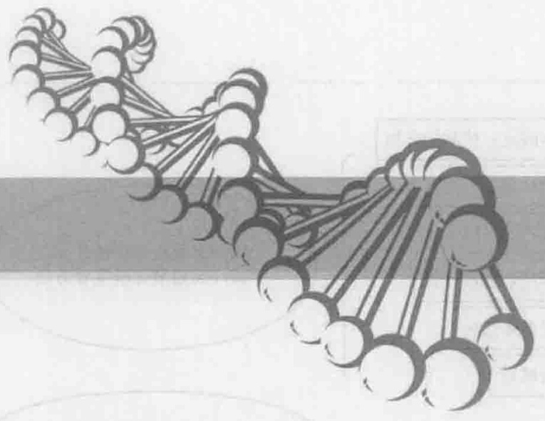
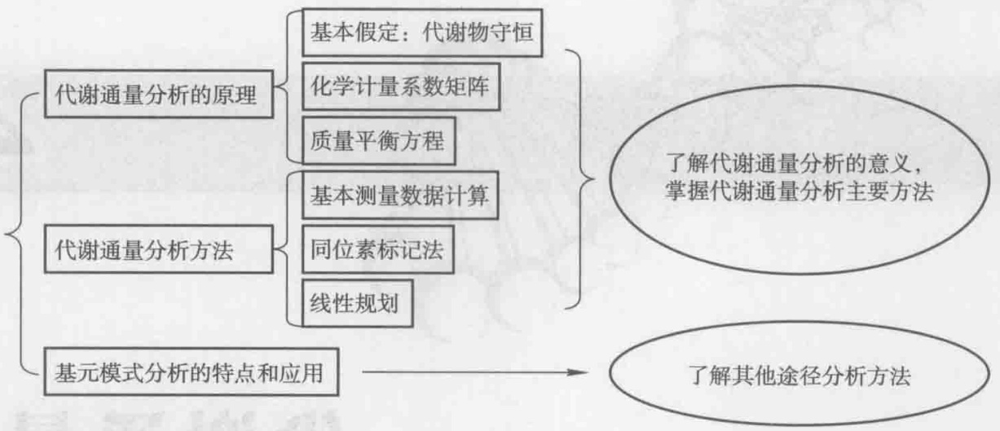
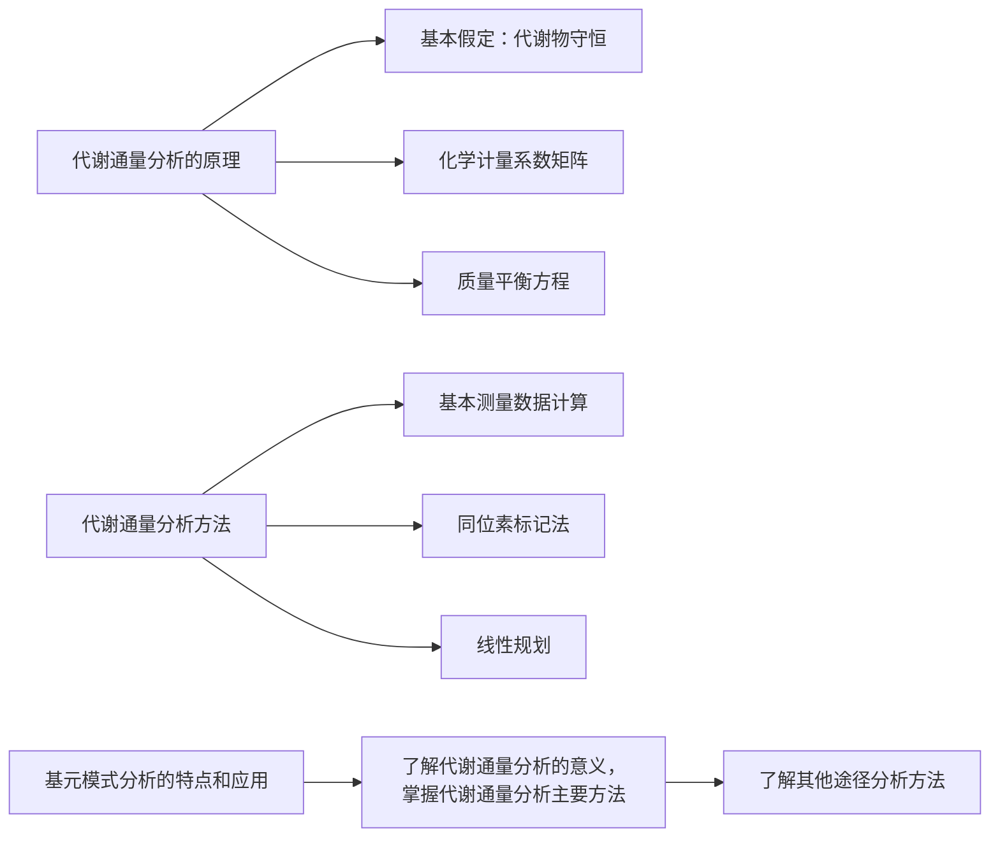
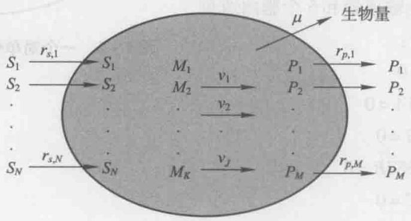
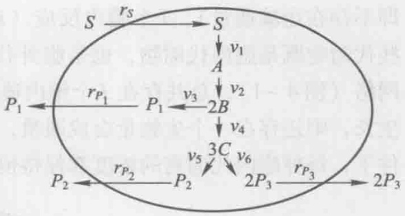
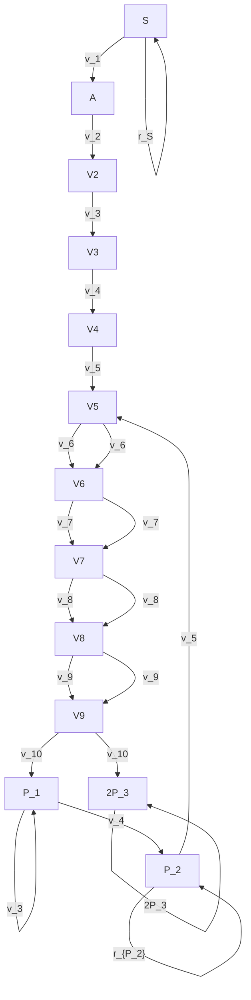
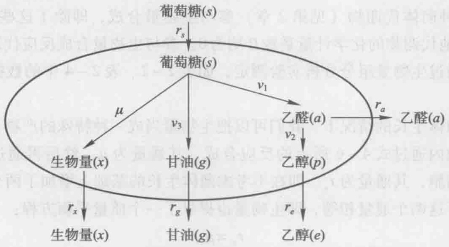
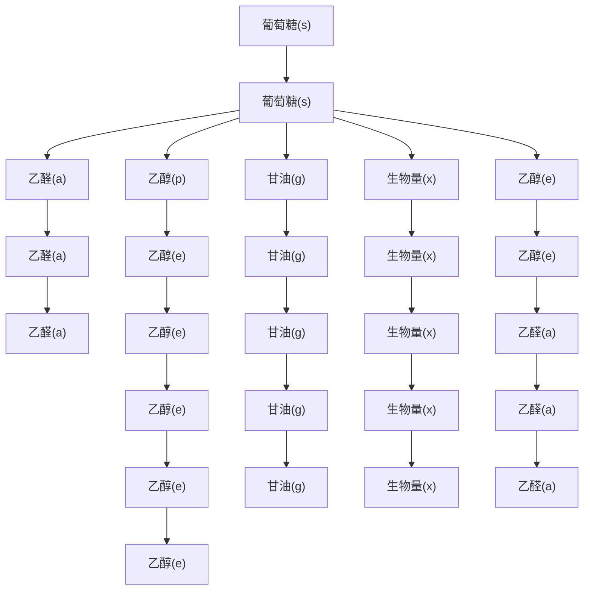

$$
\begin{array}{l} \mathrm{CH} _ {4} \mathrm{ON} _ {2}: \kappa = 4 \times 1 + 1 \times 4 + (- 2) \times 1 + (- 3) \times 2 = 0 \\ \mathrm{CH} _ {1. 8} \mathrm{O} _ {0. 5} \mathrm{N} _ {0. 2}: \kappa = 4 \times 1 + 1 \times 1. 8 + (- 2) \times 0. 5 + (- 3) \times 0. 2 = 4. 2 \\ \end{array}
$$

细胞中还含有一些传递还原力的辅因子对:NADH（$\mathrm{NAD^{+}}$），NADPH（$\mathrm{NADP^{+}}$）以及 $\mathrm{FADH_{2}}$（FAD），它们的还原度并不需要通过化学式进行计算，而是直接规定NADH，NADPH和 $\mathrm{FADH_{2}}$ 的还原度等价于 $\mathrm{H_{2}}$，即还原形式的辅因子的还原度均等于2，而氧化形式辅因子的还原度为0。这是因为辅因子总是成对出现在化学反应方程中，如果氧化形式辅因子是反应物，则其对应的还原形式辅因子必定是产物，而且两者的化学计量系数必定数值相同，符号相反，因此只需知道辅因子对之间的还原度差即可进行还原度平衡的检验。对于上述三种传递还原力的辅因子对，还原度的差值正好都是2。细胞中传递自由能的辅因子对ATP（ADP）存在类似情况，但它们的还原度差值为0，因此在还原度平衡计算时不用考虑。通常在化学计量方程中只列出辅因子对中的一种形式（其原因将在后续章节中介绍），而且不考虑水的生成，因此在元素衡算和还原度衡算时要特别注意。

例如，对于从葡萄糖生成丙酮酸的 EMP 途径，通常用下列方程式表示:

$$
- \mathrm{CH} _ {2} \mathrm{O} + \mathrm{CH} _ {4 / 3} \mathrm{O} + \frac {1}{3} \mathrm{NADH} + \frac {1}{3} \mathrm{ATP} = 0 \tag {3-28}
$$

其相应的完整的化学计量方程为:

$$
- \mathrm{CH} _ {2} \mathrm{O} - \frac {1}{3} \mathrm{NAD} ^ {+} - \frac {1}{3} (\mathrm{ADP} + \mathrm{Pi}) + \mathrm{CH} _ {4 / 3} \mathrm{O} + \frac {1}{3} (\mathrm{NADH} + \mathrm{H} ^ {+}) + \frac {1}{3} \mathrm{ATP} = 0 \tag {3-29}
$$

例3-6 根据还原度平衡检测例3-3中黑箱模型的准确性。

在例3-3中的公式2中，$\mathrm{NH}_{3}$、$\mathrm{CO}_{2}$ 和 $\mathrm{H}_{2} \mathrm{O}$ 为还原度为0的中性物质，在总还原度计算中不用考虑，葡萄糖、乙醇、甘油和生物量（化学式为 $\mathrm{CH}_{1.74} \mathrm{O}_{0.60} \mathrm{~N}_{0.12}$）的还原度分别为4, 6, 4.67和4.18，因此:

底物的总还原度为: $q_{s}\kappa_{s}=33.33\times4=133.32$

产物的总还原度: $q_{e}\kappa_{e}+q_{x}\kappa_{x}+q_{g}\kappa_{g}=17\times6+4.57\times4.18+2.57\times4.67=133.1$

两者之差为0.22，只约占总还原度的0.17%，即模型可以很好地满足还原度平衡，结合碳平衡的分析结果，可以认为没有重要的物质被遗漏，并且所有物质的测量误差都非常小，黑箱模型能够准确反映例3-3中酿酒酵母的厌氧培养状态。

## 3.4.2 黑箱模型测量数据一致性的检验

由于黑箱模型化学方程式中的系数是通过实验确定的，因此实验误差对系数的准确性有很大影响，如果模型中除水之外的所有物质的反应速率都能通过测量数据确定，则可以进行测量数据一致性检验，分析重大误差的来源。实际上，在例3-4中已经进行了数据一致性检验，其结果表明测量数据的误差非常小，即数据具有很好的一致性。而在更普遍的情况下，测量数据并不具有很好的一致性，我们需要找出测量误差较大的数据进行修正，或者找出遗漏的重要代谢物。除了测量仪器的系统误差之外，以下情况也会导致黑箱模型的计量系数具有较大的误差:部分具有较强挥发性的底物或产物在气相中，如果只根据液相中的含量进行计算，就会导致该物质的生成速率偏小。另外，由于培养条件或环境的变化，可能有新的产物形成，导致黑箱模型的代谢物种类并不完整。例如，在非正常发酵条件下，柠檬酸发酵中会产生大量副产物草酸，我们可以通过数据一致性的检验推断出该物质的生成。

例3-7 在厌氧条件下恒化培养酿酒酵母，培养液体积 $V = 1 \mathrm{~L}$，达到稳态时液体流加速度 $v = 0.1 \mathrm{~L} \cdot \mathrm{h}^{-1}$。流加液中含 $128 \mathrm{mmol} \cdot \mathrm{L}^{-1}$ 的葡萄糖和 $58.8 \mathrm{mmol} \cdot \mathrm{L}^{-1}$ 的 $\mathrm{NH}_{3}$，生物量的分子式为 $\mathrm{CH}_{1.76} \mathrm{O}_{0.56} \mathrm{N}_{0.17}$。流出液中检测到的各种物质的浓度如下:葡萄糖0.27，$\mathrm{NH}_{3} 42.8$，生物量94，乙醇192.4，甘油26（单位均为 $\mathrm{mmol} \cdot \mathrm{L}^{-1}$）。进气和出气速度均为 $15 \mathrm{~L} \cdot \mathrm{h}^{-1}$，气压 $1 \mathrm{atm}$，温度 $30^{\circ} \mathrm{C}$，尾气含 $\mathrm{CO}_{2} 2.88 \%$（体积比，进气中 $\mathrm{CO}_{2}$ 含量忽略不计）。建立上述稳态培养过程的黑箱计量学模型，进行测量数据的一致性检验，并推测误差来源。（注:这个例子已经考虑了乙醇的挥发性，即乙醇测量数据已经根据挥发量做了校正）

稀释率: $D = \frac{v}{V} = \frac{0.1}{1} = 0.1\mathrm{h}^{-1}$ ； $\kappa_{x} = 4.13$ ； $\mathrm{M}_x = 25.10\mathrm{g}\cdot \mathrm{C - mole}^{-1}$

对于葡萄糖  $CH_{2}O$ :

$$
q _ {s} = - D (s _ {f} - s) = - 0. 1 \mathrm{h} ^ {- 1} \cdot (1 2 8 - 0. 2 7) \cdot 6 = - 7 6. 6 \mathrm{mmol} \cdot \mathrm{L} ^ {- 1} \cdot \mathrm{h} ^ {- 1}
$$

对于乙醇  $CH_{3}O_{0.5}$ :

$$
q _ {e} = - D (p _ {e, f} - p _ {e}) = - 0. 1 \cdot (0 - 1 9 2. 4) \cdot 2 = 3 8. 5 \mathrm{mmol} \cdot \mathrm{L} ^ {- 1} \cdot \mathrm{h} ^ {- 1}
$$

对于  $CO_{2}$ ，其在补料液及培养液中的浓度均可以看作近似为0，进气中气相分压为0，出气中气相分压为0.0288 atm，则有:

$$
\begin{array}{l} q _ {c} = - \frac {v}{V} (p _ {c, f} - p _ {c}) - q _ {c} ^ {t} = - q _ {c} ^ {t} = - \frac {1}{V R T} (\pi_ {s _ {i}, \mathrm{in}} v _ {g, \mathrm{in}} - \pi_ {s _ {i}, \mathrm{out}} v _ {g, \mathrm{out}}) \\ = - \frac {1 5 \cdot (0 - 0 . 0 2 8 8)}{1 \cdot 0 . 0 8 2 \cdot 3 0 3} = 1 7. 4 \mathrm{mmol} \cdot \mathrm{L} ^ {- 1} \cdot \mathrm{h} ^ {- 1} \\ \end{array}
$$

对于生物量  $CH_{1.76}O_{0.56}N_{0.17}$ :

$$
q _ {x} = D x = 0. 1 \cdot 9 4 = 9. 4 \mathrm{mmol} \cdot \mathrm{L} ^ {- 1} \cdot \mathrm{h} ^ {- 1}
$$

对于甘油  $CH_{8/3}O$ :

$$
q _ {g} = D p _ {g} = 0. 1 \cdot 2 6 \cdot 3 = 7. 8 \mathrm{mmol} \cdot \mathrm{L} ^ {- 1} \cdot \mathrm{h} ^ {- 1}
$$

对于  $NH_{3}$ :

$$
q _ {n} = - D (p _ {e, f} - p _ {e}) = - 0. 1 \cdot (5 8. 8 - 4 2. 8) = - 1. 6 \mathrm{mmol} \cdot \mathrm{L} ^ {- 1} \cdot \mathrm{h} ^ {- 1}
$$

各物质相对于葡萄糖的得率系数为:

$$
Y _ {s s} = 0. 1 2 2 7; Y _ {s e} = 0. 5 0 2 6; Y _ {s g} = 0. 1 0 1 8; Y _ {s c} = 0. 2 2 7 1; Y _ {s n} = 0. 0 2 0 8 9
$$

黑箱计量学模型为:

$$
- \mathrm{CH} _ {2} \mathrm{O} - 0. 0 2 0 9 \mathrm{NH} _ {3} + 0. 5 0 2 6 \mathrm{CH} _ {3} \mathrm{O} _ {1 / 2} + 0. 2 2 7 1 \mathrm{CO} _ {2} + 0. 1 2 2 7 \mathrm{X} + 0. 1 0 1 8 \mathrm{CH} _ {8 / 3} \mathrm{O} = 0
$$

对于碳平衡: $-1+0.5026+0.2271+0.1227+0.1018=-0.0458$

即模型遗漏了某种含碳化合物 i，其含碳量占总碳的 4.58%。

对于氮平衡: $-0.02089 + 0.1227 \cdot 0.17 = -0.00003$

表明输入的氮元素几乎都用于合成生物量，模型中遗漏的氮仅占总氮的0.00003/0.02089=0.14%，模型很好地满足氮平衡。

将 i 物质加入黑箱模型中，然后考虑还原度平衡:

$$
- 4 + 0. 1 2 2 7 \cdot 4. 1 3 + 0. 5 0 2 6 \cdot 6 + 0. 1 0 1 8 \cdot 4 \frac {2}{3} + 0. 2 2 7 1 \cdot 0 + \kappa_ {i} \cdot 0. 0 4 5 8 = 0
$$

求解得: $\kappa_{i}\approx0$

这表明遗漏的含碳化合物很可能是  $CO_{2}$ ，即  $CO_{2}$  的实际得率应该是 0.2271 + 0.0458 = 0.2729。对修正后的模型进行 H 衡算得到水的得率系数为 0.0337，通过氧衡算得到水的得率系数为 0.0324，这两个数据非常接近，也间接证明了遗漏的物质就是  $CO_{2}$ 。

修正后的黑箱模型为:

$$
\begin{array}{l} - \mathrm{CH} _ {2} \mathrm{O} - 0. 0 2 0 9 \mathrm{NH} _ {3} + 0. 5 0 2 6 \mathrm{CH} _ {3} \mathrm{O} _ {1 / 2} + 0. 2 7 2 9 \mathrm{CO} _ {2} + 0. 1 2 2 7 \mathrm{X} \\ + 0. 1 0 1 8 \mathrm{CH} _ {8 / 3} \mathrm{O} + 0. 0 3 2 9 \mathrm{H} _ {2} \mathrm{O} = 0 \\ \end{array}
$$

$CO_{2}$  的数据测量涉及气体分析仪和气体流量计两种仪器，由于气体分析仪通常具有很高的精确度，而在气体流速较低的情况下，气体流量计的精确度较差，因此推测误差可能是由于气体流量计造成的。这个例子代表了实验中一个常见的问题:当气体流速较低时，例如  $0.1 \sim 0.5 L \cdot min^{-1}$ ，对流量计的校准是十分困难的，会带来相对较大的系统误差（Nielsen et al. 2004）。

显然，在例3-3中，如果测定产物时忽视了气相中的乙醇，也可以通过数据的一致性检验发现黑箱模型中遗漏了一部分含C物质，且该物质的还原度为6，即遗漏了一部分乙醇。

## 3.4.3 黑箱化学计量模型的系统分析

前例中黑箱模型涉及的底物和产物的种类都比较少，例如，都只有一种碳源葡萄糖，或一种氮源  $NH_{3}$ ，得率系数很容易通过碳平衡和还原度平衡的简单计算得出。但是在更一般情况下，可能有 N 种底物和包括生物量在内的 M 种代谢产物，这时就需要有一种确定黑箱化学方程式的系统方法。

通常，化学方程式可以写成:

$$
- \mathrm{CH} _ {a 1} \mathrm{O} _ {b 1} \mathrm{N} _ {c 1} - Y _ {s _ {1} o} \mathrm{O} _ {2} - \sum_ {j = 3} ^ {N} Y _ {s _ {1} s _ {j}} S _ {j} + Y _ {s _ {1} x} X + Y _ {s _ {1} c} \mathrm{CO} _ {2} + Y _ {s _ {1} w} \mathrm{H} _ {2} \mathrm{O} + \sum_ {j = 4} ^ {M} Y _ {s _ {1} p _ {j}} P _ {j} = 0 \tag {3-30}
$$

上式必须满足四种元素平衡，一般可以写为:

$$
\sum_ {j = 1} ^ {N} y _ {s _ {j}} q _ {s _ {j}} + \sum_ {j = 1} ^ {M} y _ {p _ {j}} p _ {p _ {j}} = 0 \tag {3-31}
$$

系数 y 是化合物碳-摩尔化学式中元素的下标，例如对于葡萄糖  $CH_{2}O$ ，碳元素的 y 为 1，氢元素的 y 为 2，氧元素的 y 为 1。对于标准生物量  $CH_{0.18}O_{0.5}N_{0.2}$ ，碳的 y 为 1，氢的 y 为 0.18，氧的 y 为 0.5，氮的 y 为 0.2。如果该化合物中没有出现某种元素，则这种元素的 y 值为 0，例如水中碳的 y 为 0。式 3-31 是 M+N 种反应速率之间的一个关系，对应于 C、H、O 和 N 四种元素守恒，存在四个方程组成的方程组，可以用下式表示:

$$
E q = 0 \tag {3-32}
$$

E 是  $4 \times (N + M)$  矩阵，其行分别对应于四种元素，列分别对应于  $N + M$  种底物和产物，在每一列中写出该列所代表的化合物的元素组成，即对应于不同元素的 y 值。q 是  $N + M$  个体积反应速率的列向量。式 3-32 提供了  $N + M$  个速率之间的四种限制条件，如果通过实验测定了  $N + M - 4$  个速率，我们就可以计算出其余的 4 个未测量速率。

将 $N + M - 4$ 个已测定的速率放在列向量 $q$ 的前 $N + M - 4$ 行，并定义为 $q_{m}$，其余4行为 $q_{c}$。这样，式3-32就可以写成:

$$
E _ {m} q _ {m} + E _ {c} q _ {c} = 0 \tag {3-33}
$$

$E_{c}$ 是一个 $4 \times 4$ 的方阵，$E_{m}$ 则有4行 $N + M - 4$ 列。设 $\operatorname{det}(E_c) \neq 0$，则对式3-33进行代数变换得:

$$
q _ {c} = - \left(E _ {c}\right) ^ {- 1} E _ {m} q _ {m} \tag {3-34}
$$

$(E_{c})^{-1}$ 是 $E_{c}$ 的逆矩阵，即未测量速率可以通过上式计算得到。

例3-8 在例3-3的酿酒酵母厌氧发酵的黑箱模型中，包括水在内共有7种物质，如果仅仅通过实验测量了葡萄糖、生物量和甘油的体积反应速率: $q_{s} = -33.33\mathrm{mmol}\cdot$ $\mathrm{L}^{-1}\cdot \mathrm{h}^{-1},q_{x} = 4.57\mathrm{mmol}\cdot \mathrm{L}^{-1}\cdot \mathrm{h}^{-1},q_{g} = 2.57\mathrm{mmol}\cdot \mathrm{L}^{-1}\cdot \mathrm{h}^{-1}$ ，求其余物质的体积反应速率。

测量速率向量为  $q_{m}=(q_{s},q_{x},q_{g})$ ，需要计算的速率向量为  $q_{c}=(q_{c},q_{n},q_{e},q_{w})$ ，根据式3-33:

$$
\begin{array}{c c c c} \text {s} & x & g \\ \mathrm{C} \left( \begin{array}{c c c} 1 & 1 & 1 \\ 2 & 1. 7 4 & 8 / 3 \\ 1 & 0. 6 & 1 \\ 0 & 0. 1 2 & 0 \end{array} \right) \cdot \left( \begin{array}{c} q _ {s} \\ q _ {x} \\ q _ {g} \end{array} \right) + \left( \begin{array}{c c c c} 1 & 0 & 1 & 0 \\ 0 & 3 & 3 & 2 \\ 2 & 0 & 0. 5 & 1 \\ 0 & 1 & 0 & 0 \end{array} \right) \cdot \left( \begin{array}{c} q _ {c} \\ q _ {n} \\ q _ {e} \\ q _ {w} \end{array} \right) = \left[ \begin{array}{c} 0 \\ 0 \\ 0 \\ 0 \end{array} \right] \\ E _ {m} & q _ {m} & E _ {c} & q _ {c} \end{array}
$$

根据式3-34:

$$
\begin{array}{l} \left[ \begin{array}{c} q _ {c} \\ q _ {n} \\ q _ {e} \\ q _ {w} \end{array} \right] = - (E _ {c}) ^ {- 1} E _ {m} q _ {m} = \left( \begin{array}{c c c} - 0. 3 3 3 3 & - 0. 3 0 3 3 & - 0. 2 2 2 3 \\ 0 & - 0. 1 2 & 0 \\ - 0. 6 6 6 7 & - 0. 6 9 6 7 & - 0. 7 7 7 7 \\ 0 & 0. 3 5 5 & - 0. 1 6 6 5 \end{array} \right) \cdot \left( \begin{array}{c} - 3 3. 3 3 \\ 4. 5 7 \\ 2. 5 7 \end{array} \right) \\ = \left( \begin{array}{c} 9. 1 5 \\ - 0. 5 5 \\ 1 7. 0 4 \\ 1. 2 0 \end{array} \right) \mathrm{mmol} \cdot \mathrm{L} ^ {- 1} \cdot \mathrm{h} ^ {- 1} \\ \end{array}
$$

应用式3-37进行计算的结果与例3-3中根据测量数据计算得到的 $q_{c}$ 、 $q_{e}$ 非常接近，也和例3-4中通过元素平衡计算得到的 $q_{n}$ 和 $q_{w}$ 非常接近，这表明葡萄糖、生物量和甘油的测量误差很小。

应用这种系统方法进行计算的前提条件是方阵  $E_{c}$  的行列式值不等于 0，如果在例 3-6 中测定的是葡萄糖、生物量和氨的体积反应速率，则  $E_{c}$  为:

$$
E _ {c} = \left( \begin{array}{c c c c} 1 & 1 & 1 & 0 \\ 0 & 2. 6 6 7 & 3 & 2 \\ 2 & 1 & 0. 5 & 1 \\ 0 & 0 & 0 & 0 \end{array} \right)
$$

显然其行列式值为0，这是由于测定物质中的生物量和氨是仅有的两种含氮化合物，此时氮元素平衡的限制关系只与测量的两个体积反应速率有关，而和其他4个未测定的体积反应速率无关，因此只有 C、H、O 平衡的三种限制关系是有用的，系统的自由度为  $N + M - 3 = 4$ 。在这种情况下，共需要测定四种体积反应速率才能求解。

## 3.4.4 测量数据的最优估计和 h 检验

当测量数据的数目 L 等于黑箱模型的自由度  $N + M - 4$  时，所计算数据的准确性依赖于测量数据的准确性。显然，如果在例 3-8 中的 3 个测量数据存在很大的误差，虽然整个黑箱模型也满足所有的元素平衡和还原度平衡，但模型和实际情况之间会存在很大的偏差。因此，通常在实验过程中测量的数据个数要大于黑箱模型的自由度  $N + M - 4$ ，以便对测量数据的准确性进行检验，并根据速率的测量值和标准差对速率的真实值进行最优估计。

## 3.4.4.1 超定系统的计算

当测量数据的数目 L 大于黑箱模型的自由度时，系统为超定系统（overdetermined system），式 3-33 为矛盾方程组， $E_{c}$  不再是  $4 \times 4$  的方阵，不能直接用解方程组的方法求解，此时需要采用最小二乘拟合的方法进行处理，即:将式 3-34 等号两边同时乘以  $E_{c}$  的转置矩阵  $E_{c}^{T}$ ，得到:

$$
E _ {c} ^ {T} (E _ {m} q _ {m} + E _ {c} q _ {c}) = E _ {c} ^ {T} E _ {c} q _ {c} + E _ {c} ^ {T} E _ {m} q _ {m} = 0 \tag {3-35}
$$

其中  $E_{c}^{T}E_{c}$  是  $(N+M-L)\times(N+M-L)$  的方阵。

则: $q_{c} = -\left[E_{c}^{T}E_{c}\right]^{-1}\left[E_{c}^{T}E_{m}\right]q_{m}$ (3-36）

在上式中， $E_{c}^{T}E_{c}$  的行列式不能等于0，即其必须是满秩的， $R(\text{秩}) = N + M - L$ 。

## 3.4.4.2 超定系统中测量数据的估计

将式3-39代入式3-36，消去 $q_{\mathrm{c}}$ 得到:

$$
[ E _ {m} - E _ {c} (E _ {c} ^ {T} E _ {c}) ^ {- 1} E _ {c} ^ {T} E _ {m} ] q _ {m} = 0 \tag {3-37}
$$

这个公式代表所有 L 个测量速率必须满足的 4 个限制关系，其中定义冗余矩阵 R (Heijden et al. 1994a, b):

$$
R = E _ {m} - E _ {c} (E _ {c} ^ {T} E _ {c}) ^ {- 1} E _ {c} ^ {T} E _ {m} \tag {3-38}
$$

显然，冗余矩阵 R 的秩代表了式 3-37 中独立方程的数目。如果 R 不是满秩的，去掉线性相关的方程后可以得到化简了的冗余矩阵  $R_{r}$ ，其秩为 Q（在本章中， $1 \leqslant Q < 4$ ），这些相互独立的方程可以用下式表示:

$$
R _ {r} q _ {m} = 0 \tag {3-39}
$$

任意测量值 $\bar{q}_{m_{i}}$ 和其真实值 $q_{m_{i}}$ 之间都存在随机测量误差 $\delta_{i}$ ，即:

$$
\overline {{q}} _ {m _ {i}} = q _ {m _ {i}} + \delta_ {i} \quad (i = 1, 2, \dots , L) \tag {3-40}
$$

定义  $\delta$  为测量误差向量，其元素是 L 个测量值的误差  $\delta_{i}$ 。通常，随机测量误差  $\delta_{i}$  服从正态分布  $N(0, s_{i}^{2})$ ，即其数学期望  $E(\delta_{i}) = 0$ ，标准误差为  $s_{i}$ 。

式3-40表示的方程组可以写成矩阵的形式:

$$
\overline {{q}} _ {m} - q _ {m} = \delta \tag {3-41}
$$

在这种情况下，可以采用加权最小二乘拟合的方法求测量速率真实值 $q_{m_i}$ 的估计值 $\tilde{q}_{m_i}$ （即加权最小二乘估计），使测量误差的加权平方和具有最小值，其中权重因子

为测量误差方差的倒数，即为:

$$
\left. \begin{array}{l} {\underset {q _ {m}} {\mathrm{Min}}  \sum_ {i = 1} ^ {L} \frac {(\overline {{q}} _ {m _ {i}} - \widetilde {q} _ {m _ {i}}) ^ {2}}{s _ {i} ^ {2}} \text {或写成矩阵形式} \underset {\delta} {\mathrm{Min}} (\delta^ {T} F ^ {- 1} \delta)} \\ {\text {限制条件为：} R _ {r} \widetilde {q} _ {\mathrm{m}} = 0} \end{array} \right\} \tag {3-42}
$$

式3-42中的 $F$ 为测量误差向量 $\delta$ 的协方差矩阵，矩阵中的元素为:

$$
\operatorname{cov} \left(\delta_ {i}, \delta_ {j}\right) = E \left(\delta_ {i} \delta_ {j}\right) - E \left(\delta_ {i}\right) E \left(\delta_ {j}\right) = E \left(\delta_ {i} \delta_ {j}\right) (i = 1, 2, \dots , L; j = 1, 2, \dots , L) 。
$$

这里，我们做一个简化处理，假设所有 L 个测量数据之间没有相关性，即测量误差向量的元素  $\delta_{i}$  是独立的，则:

当 $i \neq j$ 时:$E(\delta_i \delta_j) = E(\delta_i)E(\delta_j) = 0$

当 $i = j$ 时: $E(\delta_i\delta_i) = E(\delta_i^2) = s_i^2$ (3-43)

因此:

$$
F = \left( \begin{array}{c c c c c} E (\delta_ {1} \delta_ {1}) & E (\delta_ {1} \delta_ {2}) & \dots & \dots & E (\delta_ {1} \delta_ {L}) \\ E (\delta_ {2} \delta_ {1}) & E (\delta_ {2} \delta_ {2}) & \dots & \dots & E (\delta_ {2} \delta_ {L}) \\ \vdots & \vdots & & & \vdots \\ \vdots & \vdots & & & \vdots \\ E (\delta_ {L} \delta_ {1}) & E (\delta_ {L} \delta_ {2}) & \dots & \dots & E (\delta_ {L} \delta_ {L}) \end{array} \right) = E (\delta \delta^ {T}) = \left( \begin{array}{c c c c c} s _ {1} & 0 & \dots & \dots & 0 \\ 0 & s _ {2} & \dots & \dots & 0 \\ \vdots & \vdots & & & \vdots \\ \vdots & \vdots & & & \vdots \\ 0 & 0 & \dots & \dots & s _ {L} ^ {2} \end{array} \right) \tag {3-44}
$$

即 F 为对角矩阵，其对角线上的元素为各测量数据的方差。

如果测量值与真实值存在误差，将测量值 $\bar{q}_{m}$ 代入方程3-39中，等式右边不可能等于0，即:

$$
R _ {r} \overline {{q}} _ {m} = R _ {r} q _ {m} + R _ {r} \delta = R _ {r} \delta = \varepsilon \tag {3-45}
$$

上式中的  $\varepsilon$  为残差向量，其数学期望  $E(\varepsilon)=R_{\mathrm{r}}E(\delta)=0,\varepsilon$  的协方差矩阵为:

$$
P = E (\varepsilon \varepsilon^ {T}) = R _ {r} E (\varepsilon \varepsilon^ {T}) R _ {r} ^ {T} = R _ {r} F R _ {r} ^ {T} \tag {3-46}
$$

式3-42所表示的数学最优化问题是受一个或多个条件所限制的多元函数的极值求解问题，可采用拉格朗日乘数法求解得到真实值 $q_{m}$ 的估计值 $\tilde{q}_m$ :

$$
\widetilde {q} _ {m} = (I - F R _ {r} ^ {T} P ^ {- 1} R _ {r}) \overline {{q}} _ {m} \tag {3-47}
$$

其中 I 为单位阵。相应的，测量误差的估计值:

$$
\delta = \overline {{q}} _ {m} - \widetilde {q} _ {m} = F R _ {r} ^ {T} P ^ {- 1} R _ {r} \overline {{q}} _ {m} \tag {3-48}
$$

需要注意的是，由于  $\delta$  服从正态分布，式 3-48 所表示的加权最小二乘估计也是最大似然估计，如果  $\delta$  不服从正态分布，则式 3-48 仅仅是不再满足最大似然估计。估计值  $\tilde{q}_{m}$  的方差比测量值  $\bar{q}_{m}$  的方差要小，因此估计值比测量值更加可信。

由于假定测量值之间是无关的，因此测量误差的协方差矩阵 F 是对角矩阵。然而，实际上有些测量数据之间并不是独立或无关的，而是间接相关的，因此真实的协方差矩阵 F 并不是对角矩阵，而且很难被确定。例如，氧气的消耗速率和二氧化碳的生成速率都是在测量气体流速和气体分压的基础上计算得到的。显然气体流速测量值的误差将同时影响以上两种气体的反应速率。在稳态培养中，许多物质的体积反应速率也是通过液体流速 v 的测量值和浓度测量值计算得到的，因此液体流速 v 的测量误差也将会同时影响到这些物质的体积反应速率。上述的这些直接被测量的相互独立的变量被称为基础变量，一种近似计算真实协方差矩阵的方法是将所有的测量数据变为基础变量的函数，然后通过基础变量的误差信息来求协方差矩阵 F。通常，即使我们知道测量误差之间有一定的相关性，依然会进行无关性的简化处理，因为简化后得到的对角矩阵 F 使计算更为简单。另外，通常我们仅仅知道测量误差大小的数量级，而其精确值很难确定。因此在某些情况下，当所有测量数据的方差为同一数量级时，可以近似认为这些方差相等，协方差矩阵 F 可以进一步简化为:

$$
F = c I \tag {3-49}
$$

式中，I 是单位矩阵，c 为测量误差的方差。将式 3-49 代入式 3-47 得:

$$
\widetilde {q} _ {m} = (I - R _ {r} ^ {T} (R _ {r} R _ {r} ^ {T}) ^ {- 1} R _ {r}) \overline {{q}} _ {m} \tag {3-50}
$$

式3-50是经典的最小二乘法估计，在许多情况下可以应用它进行粗略的估计。

## 3.4.4.3 测量数据的 $h$ 检验

在超定系统中，如果残差向量  $\varepsilon$  中的元素与 0 相差很大，则表明至少有一种物质反应速率的测定值存在较大的过失误差或系统误差，或者黑箱模型是错误的。为了量化残差向量与 0 的差距，我们引入了检验函数 h，其定义为残差向量的加权平方和:

$$
h = \varepsilon^ {T} P ^ {- 1} \varepsilon \tag {3-51}
$$

当测量值之间不相关时，检验函数服从 $\chi^2$ （卡方）分布的自由度等于矩阵 $P$ 或矩阵 $R$ 的秩（Wang et al. 1983, Heijden et al. 1994b）。将 $h$ 的计算值与特定自由度 $\chi^2$ 分布值相比较，如果 $h$ 值大于高置信度水平（通常情况下的高置信度水平至少为$95\%$）下的 $\chi^2$ 分布值，那么数据或者模型就有错误。在多数情况下，我们会怀疑某个测量数据有错误。如果将该测量数据排除不用，而用剩余的 $L - 1$ 个测量数据重新进行 $h$ 检验得到的 $h$ 值远小于 $\chi^2$ 分布值，那么我们就有理由认为这个测量值确实含有系统误差或过失误差，因此可以用上述的排除法来识别误差。由于事先不知道哪个测量数据存在错误，因此需要对所有测量数据逐个排除后重新进行 $h$ 检验。由于 $h$ 检验只能应用于超定系统，因此上述识别误差的系统方法有一个重要的应用前提:排除一个测量数据后系统仍然是超定的，即系统至少存在两个测量数据的冗余，或 $R$ 矩阵的秩大于或等于2。表3-3是置信度 $50\% \sim 95\%$ 的 $\chi^2$ 分布值。

表3-3 $\chi^2$ 分布值

<table><tr><td rowspan="2">自由度</td><td colspan="4">置信度水平</td></tr><tr><td>0.75</td><td>0.90</td><td>0.95</td><td>0.99</td></tr><tr><td>1</td><td>1.32</td><td>2.71</td><td>3.84</td><td>6.63</td></tr><tr><td>2</td><td>2.77</td><td>4.61</td><td>5.99</td><td>9.21</td></tr><tr><td>3</td><td>4.11</td><td>6.25</td><td>7.81</td><td>11.3</td></tr></table>

例3-9 如果在例3-7中测定了葡萄糖（s）、$\mathrm{CO}_{2}$（c）、生物量（x）、甘油（g）和乙醇（e）5种物质的体积反应速率分别为:$q_{s} = -76.6 \mathrm{mmol} \cdot \mathrm{L}^{-1} \cdot \mathrm{h}^{-1}$，$q_{c} = 17.4 \mathrm{mmol} \cdot \mathrm{L}^{-1} \cdot \mathrm{h}^{-1}$，$q_{x} = 9.4 \mathrm{mmol} \cdot \mathrm{L}^{-1} \cdot \mathrm{h}^{-1}$，$q_{g} = 7.8 \mathrm{mmol} \cdot \mathrm{L}^{-1} \cdot \mathrm{h}^{-1}$，$q_{e} = 38.5 \mathrm{mmol} \cdot \mathrm{L}^{-1} \cdot \mathrm{h}^{-1}$，测量数据的标准误差均为测量值的 $5\%$。①利用 $h$ 检验确定上列测量数据是否存在较大的系统误差。②对测量数据进行最优估计，并计算其他物质的体积反应速率。

解:（1）整个反应总共有7种化合物，4种元素平衡，自由度为 $F = 3$ ，而且测量了5种体积反应速率，系统是超定的。因此:

$$
E _ {m} = \left( \begin{array}{c c c c c} 1 & 1 & 1 & 1 & 1 \\ 2 & 0 & 1. 7 6 & 2. 6 6 7 & 3 \\ 1 & 2 & 0. 5 6 & 1 & 0. 5 \\ 0 & 0 & 0. 1 7 & 0 & 0 \end{array} \right) \quad E _ {c} = \left( \begin{array}{c c} 0 & 0 \\ 3 & 2 \\ 0 & 1 \\ 1 & 0 \end{array} \right)
$$

根据式3-41得冗余矩阵为:

$$
R = \left( \begin{array}{c c c c c} 1 & 1 & 1 & 1 & 1 \\ 0 & - 0. 2 8 5 7 & 0. 0 0 9 3 & 0. 0 4 7 6 & 0. 1 4 2 8 \\ 0 & 0. 5 7 1 4 & - 0. 0 1 8 6 & - 0. 0 9 5 2 & - 0. 2 8 5 6 \\ 0 & 0. 8 5 7 1 & - 0. 0 2 7 9 & - 0. 1 4 2 8 & - 0. 4 2 8 4 \end{array} \right)
$$

R 矩阵的后三行之间线性相关，因此最后两行可以去掉得到化简了的冗余矩阵  $R_{r}$

$$
R _ {r} = \left( \begin{array}{c c c c c} 1 & 1 & 1 & 1 & 1 \\ 0 & - 0. 2 8 5 7 & 0. 0 0 9 3 & 0. 0 4 7 6 & 0. 1 4 2 8 \end{array} \right)
$$

残差向量为:

$$
\varepsilon = R _ {r} \bar {q} _ {m} = \left( \begin{array}{c c c c c} 1 & 1 & 1 & 1 & 1 \\ 0 & - 0. 2 8 5 7 & 0. 0 0 9 3 & 0. 0 4 7 6 & 0. 1 4 2 8 \end{array} \right) \left( \begin{array}{c} - 7 6. 6 \\ 1 7. 4 \\ 9. 4 \\ 7. 8 \\ 3 8. 5 \end{array} \right) = \binom{- 3. 5 0 0}{0. 9 8 6}
$$

由于 5 个测量速率的相对误差均为 5%，则测量误差向量  $\delta$  的协方差矩阵:

$$
F = \left( \begin{array}{c c c c c} (0. 0 5 \cdot 7 6. 6) ^ {2} & 0 & 0 & 0 & 0 \\ 0 & (0. 0 5 \cdot 1 7. 4) ^ {2} & 0 & 0 & 0 \\ 0 & 0 & (0. 0 5 \cdot 9. 4) ^ {2} & 0 & 0 \\ 0 & 0 & 0 & (0. 0 5 \cdot 7. 8) ^ {2} & 0 \\ 0 & 0 & 0 & 0 & (0. 0 5 \cdot 3 8. 5) ^ {2} \end{array} \right)
$$

残差向量  $\varepsilon$  的协方差矩阵为:

$$
P = R _ {r} F R _ {r} = \left( \begin{array}{l l} 1 9. 5 0 6 & 0. 3 2 2 \\ 0. 3 2 2 & 0. 1 3 8 \end{array} \right) \quad P ^ {- 1} = \left( \begin{array}{l l} 0. 0 5 3 & - 0. 1 2 4 \\ - 0. 1 2 4 & 7. 5 3 7 \end{array} \right)
$$

则 $h = \varepsilon^T P^{-1}\varepsilon = 8.84$ ， $h$ 值大于自由度为2、置信度水平为 $95\%$ 的 $\chi^2$ 分布值(5.99)，表明这组测量数据中很可能含有较大的系统误差或过失误差。因为 $R$ 矩阵的秩为2，所以去掉一个测量值后系统仍然是超定的。我们可以去掉一个测量值后再计算 $h$ 值，得到的结果如下:

| 去掉的测量值 | h值 |
| --- | --- |
| 葡萄糖 | 7.08 |
| 二氧化碳 | $8.2 \times 10^{-5}$ |
| 生物量 | 7.80 |
| 甘油 | 8.80 |
| 乙醇 | 4.97 |

当分析中去掉一个测量值时，R 的秩为 1，检验函数要与置信度水平为 95%、自由度为 1 的  $\chi^{2}$  分布值（3.84）相比较。可以发现去掉二氧化碳的测量值以后，h 值变得远小于卡方分布值，而其他四种情况 h 值仍然大于卡方分布值，因此可以确信二氧化碳的测量值中有较大的系统误差。

（2）去掉二氧化碳的测量数据后，对葡萄糖、生物量、甘油和乙醇的体积反应速率测定值进行最优估计，此时:

$$
E _ {m} = \left( \begin{array}{c c c c} 1 & 1 & 1 & 1 \\ 2 & 1. 7 6 & 2. 6 6 7 & 3 \\ 1 & 0. 5 6 & 1 & 0. 5 \\ 0 & 0. 1 7 & 0 & 0 \end{array} \right) \quad E _ {c} = \left( \begin{array}{c c c} 0 & 0 & 1 \\ 3 & 2 & 0 \\ 0 & 1 & 2 \\ 1 & 0 & 0 \end{array} \right)
$$

冗余矩阵为:

$$
R = \left( \begin{array}{c c c c} 0. 5 3 3 & 0. 5 5 1 & 0. 6 2 2 & 0. 8 0 0 \\ 0. 1 3 3 & 0. 1 3 8 & 0. 1 5 6 & 0. 2 0 0 \\ - 0. 2 6 6 & - 0. 2 7 5 & - 0. 3 1 1 & - 0. 4 0 0 \\ - 0. 4 0 0 & - 0. 4 1 3 & - 0. 4 6 7 & - 0. 6 0 0 \end{array} \right)
$$

R 矩阵的四行之间线性相关，因此后三行可以去掉得到化简了的冗余矩阵  $R_{r}$ :

$$
R _ {r} = (0. 5 3 3 \quad 0. 5 5 1 \quad 0. 6 2 2 \quad 0. 8 0 0)
$$

F 矩阵为:

$$
F = \left( \begin{array}{c c c c} (0. 0 5 \cdot 7 6. 6) ^ {2} & 0 & 0 & 0 \\ 0 & (0. 0 5 \cdot 9. 4) ^ {2} & 0 & 0 \\ 0 & 0 & (0. 0 5 \cdot 7. 8) ^ {2} & 0 \\ 0 & 0 & 0 & (0. 0 5 \cdot 3 8. 5) ^ {2} \end{array} \right)
$$

残差向量  $\varepsilon$  的协方差矩阵为:

$$
P = R _ {r} F R _ {r} = 6. 6 7 0 \quad P ^ {- 1} = 0. 1 5 0
$$

由式3-48计算测量误差向量的估计值为:

$$
\delta = F R _ {r} ^ {T} P ^ {- 1} R _ {r} \bar {q} _ {m} = 1 0 ^ {- 3} \left( \begin{array}{c} - 2 7. 4 7 \\ - 0. 4 0 \\ - 0. 2 9 \\ - 1 0. 4 2 \end{array} \right)
$$

测量速率的估计值就为:

$$
\widetilde {q} _ {m} = \overline {{q}} _ {m} - \widetilde {\delta} = \left( \begin{array}{c} - 7 6. 5 7 3 \\ 9. 4 0 4 \\ 7. 8 0 3 \\ 3 8. 5 1 0 \end{array} \right) \mathrm{mmol} \cdot \mathrm{L} ^ {- 1} \cdot \mathrm{h} ^ {- 1}
$$

结果表明这四个测量值都是十分准确的，因为估计值与测量值之间相差甚微。在这种情况下用测量值和估计值计算的结果差别不大，但严格来讲，用估计值计算得到的结果更为可信。

将测量值代入式3-36得:

$$
\begin{array}{l} q _ {c} = \left( \begin{array}{l} q _ {\mathrm{NH} _ {3}} \\ q _ {\mathrm{H} _ {2} \mathrm{O}} \\ q _ {\mathrm{CO} _ {2}} \end{array} \right) - \left[ E _ {c} ^ {T} E _ {c} \right] ^ {- 1} \left[ E _ {c} ^ {T} E _ {m} \right] q _ {m} = - \left( \begin{array}{c c c c} 0. 4 0 0 & 0. 5 8 3 & 0. 4 6 7 & 0. 6 0 0 \\ 0. 3 3 3 & - 0. 0 6 3 & 0. 5 5 6 & 0. 5 0 0 \\ 0. 4 6 7 & 0. 4 4 9 & 0. 3 7 8 & 0. 2 0 0 \end{array} \right) \left( \begin{array}{l} - 7 6. 6 \\ 9. 4 \\ 7. 8 \\ 3 8. 5 \end{array} \right) \\ = \left( \begin{array}{c} - 1. 5 8 \\ 2. 5 4 \\ 2 0. 8 8 \end{array} \right) \mathrm{mmol} \cdot \mathrm{L} ^ {- 1} \cdot \mathrm{h} ^ {- 1} \\ \end{array}
$$

将估计值代入式3-36得:

$$
q _ {c} = - \left[ E _ {c} ^ {T} E _ {c} \right] ^ {- 1} \left[ E _ {c} ^ {T} E _ {m} \right] q _ {m} = \left( \begin{array}{c} - 1. 6 0 \\ 2. 5 3 \\ 2 0. 8 6 \end{array} \right) \mathrm{mmol} \cdot \mathrm{L} ^ {- 1} \cdot \mathrm{h} ^ {- 1}
$$

## 思考题

1. 简述生物量化学式的主要确定方法。
2. 什么是还原度平衡？简述黑箱化学计量模型的系统分析方法。
3. 以葡萄糖为碳源、 $NH_{3}$  为氮源，好氧培养谷氨酸棒杆菌生产赖氨酸，副产物为乙酸，生物量化学式采用标准式，这一过程的黑箱模型可用下式表示:

$$
- \mathrm{CH} _ {2} \mathrm{O} - Y _ {s n} \mathrm{NH} _ {3} - Y _ {s o} \mathrm{O} _ {2} + Y _ {s x} \mathrm{CH} _ {1. 8} \mathrm{O} _ {0. 5} \mathrm{N} _ {0. 2} + Y _ {s p _ {1}} \mathrm{CH} _ {7 / 3} \mathrm{O} _ {1 / 3} \mathrm{N} _ {1 / 3} + Y _ {s p _ {2}} \mathrm{CH} _ {2} \mathrm{O} + Y _ {s c} \mathrm{CO} _ {2} + Y _ {s w} \mathrm{H} _ {2} \mathrm{O} = 0
$$

模型中共有8个体积反应速率和4种元素平衡的限制条件，如果测定了葡萄糖、赖氨酸、乙酸和氧气的体积反应速率，求其他物质的体积反应速率，并根据该模型估计赖氨酸得率的最大值 $Y_{spl}^{\max}$ 。

## 推荐阅读

1. Nielsen J, Villadsen J, Liden G. Bioreaction Engineering Principles. 2nd edition. 英文影印版. 北京:化学工业出版社，2004.
2. Wang N S, Stephanopoulos G. Application of macroscopic balances to the identification of gross measurement errors. Biotechnology and Bioengineering, 1983, 25: 2177–2208.

详细介绍了确定是否存在总测量误差及误差来源的系统方法。

natural_image

Abstract illustration of DNA double helix structure (no text or symbols)

## 4

# 代谢通量分析

## 【本章学习要点】

1. 代谢通量分析的基本假定:代谢物守恒
2. 考虑细胞生长和不考虑细胞生长时的代谢通量分析方法
3. 代谢通量分析中的三种系统及分析方法
4. 基元模式分析的原理及应用

代谢通量分析是细胞生理和代谢工程研究中的一种重要方法。通常在细胞培养达到稳态时进行代谢通量分析:利用主要胞内反应的化学计量模型、胞内代谢物的质量平衡关系以及胞外通量（通常是底物的比吸收速率和代谢物的比生成速率）的测量数据，可以计算出胞内各反应的稳态通量。通量计算的最后结果是一幅代谢通量图，图中非常直观地显示流经每一生化反应或途径的稳态通量值，以及代谢通量在整个生化反应网络的分布情况。可以对细胞施加某种遗传的或环境的扰动，然后得到扰动后的代谢通量分布。通过扰动前、后代谢通量图的比较，可以评估遗传修饰或环境变化对细胞生理变化的影响，并准确描述胞内特定途径及反应对某种生理表型（例如高产某种代谢物）的重要性。此外，通过代谢通量分析可以识别生化反应网络中的重要分支点、鉴定新的或替代途径、计算最大理论得率和相应的最优通量分布、为代谢控制分析提供必需的通量信息等。总之，它可以加深我们对细胞代谢反应的总体认识，并为通过基因工程技术合理改良细胞性状提供指导。

## 知识导图

flowchart

## 4.1 代谢通量分析的原理

代谢途径（metabolic pathway）及其通量是代谢工程的核心，代谢通量（metabolic flux）是指某步细胞反应的比速率，它是代谢途径中最重要的参数。代谢途径是一连串可以进行的、并可观测的生物化学反应步骤，这些反应步骤被指定的一组输入和输出代谢物所连结。各种代谢途径进一步组合成细胞反应网络，网络中代谢通量的确定被称为代谢通量分析（metabolic flux analysis, MFA）。

代谢通量分析的一个基本假定是代谢物守恒（metabolite balancing），即当细胞处于稳态培养状态时，其胞内代谢物的总消耗速率和总生成速率相等，代谢物在细胞内的浓度恒定或者净积累速度为0，即:

$$
\frac {\mathrm{d} c _ {i}}{\mathrm{d} t} = r _ {i} = 0 \tag {4-1}
$$

式中， $r_{i}$ 是细胞中某种代谢物 i 净积累的比速率，常用的量纲为 mmol·g $^{-1}$ （CDW）·h $^{-1}$ 。 $c_{i}$ 是该代谢物在细胞内的浓度，常用量纲为 mmol·g $^{-1}$ （CDW）。

细胞内绝大多数的代谢物有着非常高的周转速率，因此，在细胞的培养环境受到扰动之后，胞内的各种代谢物的浓度会迅速调整到新的水平。甚至在扰动非常剧烈的情况下，胞内代谢物也能快速达到新的平衡状态。因此，胞内代谢物处于拟稳定状态的假定是合理的。如果细胞内代谢物浓度非常高，这种情况下需要考虑由于细胞生长体积变大而引起的稀释效应，则有:

$$
\frac {\mathrm{d} c _ {i}}{\mathrm{d} t} = r _ {i} - \mu c _ {i} \tag {4-2}
$$

对于一个含有 $K$ 种胞内代谢物（这些代谢物没有输出细胞或由胞外输入的通量，

知识拓展4-1
胞内代谢物的稀释效应

即不存在运输通量），J个胞内反应（或胞内通量），N种底物和M种代谢产物（这些代谢物既是胞内代谢物，也是胞外代谢物，即存在进出细胞的运输通量）的代谢网络（图4-1），总共存在J个胞内通量和 $N+M$ 种运输通量。另外，如果考虑菌体生长，则还存在一个生物量合成通量，这个通量就是菌体的比生长速率 $\mu$ 。在稳态条件下，每种胞内代谢物的浓度都保持恒定。

flowchart

This diagram illustrates a biological process flow within an oval, showing the movement of variables (S, M, P) and their interactions with a substance labeled '生物量'.

图4-1 一个典型的细胞代谢网络图

## 4.1.1 无细胞生长时的代谢通量分析

对于具有运输通量的胞内代谢物（即底物和产物），存在下列  $N + M$  个质量平衡方程:

$$
r _ {j, \mathrm{trans}} = \sum_ {i = 1} ^ {J} \alpha_ {j, i} v _ {i}, \quad j = 1, 2, \dots , N + M \tag {4-3}
$$

$r_{j,\mathrm{trans}}$ 是第 j 种代谢物（底物或产物）的运输通量， $\alpha_{j,i}$ 为该代谢物在第 i 个胞内反应中的化学计量系数， $v_{i}$ 为第 i 个胞内通量。

对于无运输通量的胞内代谢物，存在下列 K 个质量平衡方程:

$$
0 = \sum_ {i = 1} ^ {J} \alpha_ {j, i} v _ {i}, \quad j = 1, 2, \dots , K \tag {4-4}
$$

这样，由式4-3和式4-4组成的方程组可以合在一起写成矩阵的形式:

$$
\binom {r} {0} = T v \tag {4-5}
$$

式中，r 为  $N + M$  个运输通量构成的列向量，0 为 K 个 0 元素构成的列向量，v 为 J 个胞内通量构成的列向量。T 为代谢网络的化学计量系数矩阵（stoichiometric matrix），其行列数为  $(N + M + K) \times J$ ，矩阵的行对应于  $N + M + K$  种代谢物，列对应于 J 个胞内反应。矩阵中第 i 行元素为该行所代表的代谢物参与 J 个胞内反应的化学计量系数（共 J 个）。在计量系数矩阵中，代谢物可以用这样的方式排列:前 N 行是底物的化学计量系数，从第  $N + 1$  行到  $N + M$  行是代谢产物的化学计量系数，从第  $N + M + 1$  行到  $M + M + K$  行是 K 个胞内代谢物的化学计量系数。

在上述代谢网络中，总共有  $N + M + J$  个通量和  $N + M + K$  个平衡方程，系统的自由度 F = J - K，其中底物和代谢产物进出细胞的运输通量是可以直接测量的，总共有  $N + M$  个可测量通量，因此当测量通量的个数大于或等于 F，就能计算出所有胞内通量和其他未测定的通量。

例4-1 对图4-2所示简单代谢网络进行通量分析

解:图4-2所示的简单代谢网络中，有1种底物，3种产物，3种无运输通量的胞内代谢物，6个胞内反应，不用考虑生物量的合成，因此有4个运输通量和6个胞内通量。

flowchart

图4-2 一个简单代谢网络的示意图

6个胞内反应为:

$$
\begin{array}{l} v _ {1} \quad A - S = 0 \\ v _ {2} \quad B - 0. 5 A = 0 \\ v _ {3} \quad P _ {1} - 2 B = 0 \\ v _ {4} \quad C - 0. 6 6 7 B = 0 \\ v _ {5} \quad P _ {2} - 3 C = 0 \\ v _ {6} \quad P _ {3} - 1. 5 C = 0 \\ \end{array}
$$

在上面6个反应中，均以反应式中产物的比生成速率作为反应的通量。

对于底物 S，存在下列平衡方程:

$$
r _ {s} = - 1 \cdot v _ {1} + 0 \cdot v _ {2} + 0 \cdot v _ {3} + 0 \cdot v _ {4} + 0 \cdot v _ {5} + 0 \cdot v _ {6}
$$

即 S 只作为底物参与胞内反应 1，因此  $v_{1}$  的化学计量系数为 -1，其余 5 个胞内通量的化学计量系数全部为 0。

同理，对于3种产物，平衡方程为:

$$
r _ {P _ {1}} = 0 \cdot v _ {1} + 0 \cdot v _ {2} + 1 \cdot v _ {3} + 0 \cdot v _ {4} + 0 \cdot v _ {5} + 0 \cdot v _ {6}
$$

$$
r _ {P _ {2}} = 0 \cdot v _ {1} + 0 \cdot v _ {2} + 0 \cdot v _ {3} + 0 \cdot v _ {4} + 1 \cdot v _ {5} + 0 \cdot v _ {6}
$$

$$
r _ {P _ {3}} = 0 \cdot v _ {1} + 0 \cdot v _ {2} + 0 \cdot v _ {3} + 0 \cdot v _ {4} + 0 \cdot v _ {5} + 1 \cdot v _ {6}
$$

对于3种无运输通量的胞内代谢物A、B和C，平衡方程为:

$$
A: 0 = 1 \cdot v _ {1} + (- 0. 5) \cdot v _ {2} + 0 \cdot v _ {3} + 0 \cdot v _ {4} + 0 \cdot v _ {5} + 0 \cdot v _ {6}
$$

$$
B: 0 = 0 \cdot v _ {1} + 1 \cdot v _ {2} + (- 2) \cdot v _ {3} + (- 0. 6 6 7) \cdot v _ {4} + 0 \cdot v _ {5} + 0 \cdot v _ {6}
$$

$$
C: 0 = 0 \cdot v _ {1} + 0 \cdot v _ {2} + 0 \cdot v _ {3} + 1 \cdot v _ {4} + (- 3) \cdot v _ {5} + (- 1. 5) \cdot v _ {6}
$$

即:

$$
\left( \begin{array}{c} r _ {S} \\ r _ {P _ {1}} \\ r _ {P _ {2}} \\ r _ {P _ {3}} \\ 0 \\ 0 \\ 0 \end{array} \right) = \left( \begin{array}{c c c c c c} - 1 & 0 & 0 & 0 & 0 & 0 \\ 0 & 0 & 1 & 0 & 0 & 0 \\ 0 & 0 & 0 & 0 & 1 & 0 \\ 0 & 0 & 0 & 0 & 0 & 1 \\ 1 & - 0. 5 & 0 & 0 & 0 & 0 \\ 0 & 1 & - 2 & - 0. 6 6 7 & 0 & 0 \\ 0 & 0 & 0 & 1 & - 3 & - 1. 5 \end{array} \right) \left( \begin{array}{c} v _ {1} \\ v _ {2} \\ v _ {3} \\ v _ {4} \\ v _ {5} \\ v _ {6} \end{array} \right) = \left( \begin{array}{c} - v _ {1} \\ v _ {3} \\ v _ {5} \\ v _ {6} \\ v _ {1} - 0. 5 v _ {2} \\ v _ {2} - 2 v _ {3} - 0. 6 6 7 v _ {4} \\ v _ {4} - 3 v _ {5} - 1. 5 v _ {6} \end{array} \right)
$$

可以看出，自由度 $F = J - K = 3$ ，只需在四个可测量的运输通量（$r_{S}, r_{P_1}, r_{P_2}$ 和 $r_{P_3}$）中测量3个就可以计算出所有的通量。

代谢网络中的线性途径可以合并成一个反应，例如图4-2中胞内反应1和2可以合并成1个反应: $S \rightarrow 2B$ 。虽然合并后少了胞内代谢物A的质量平衡方程，但胞内通量的数目也减少了1个，因此合并后对系统的自由度没有任何影响。线性途径合并的优点是可以降低代谢网络的复杂度，减小计量系数矩阵的规模，从而有利于计算。另外对于所研究的系统，可以根据实际情况将分支途径简化成线性途径，如果某个分支途径的通量远小于另一个分支途径的通量，就可以进行简化。例如，在细胞处于稳定期时或细胞在含有大量结构单元的丰富培养基中生长时，EMP途径中的前体代谢物流向生物量的通量非常小，可以将3-磷酸甘油醛到丙酮酸的途径看成一条线性途径，并合并成一个反应，即不考虑3-磷酸甘油酸、磷酸烯醇式丙酮酸等参与生物量合成的分支通量。在进行途径简化时一定要谨慎，需要有足够的实验数据作为依据。

## 4.1.2 有细胞生长时的代谢通量分析

如果考虑菌体生长，则必须增加一个生物量合成反应:

$$
B i o m a s s = \sum_ {i = 1} ^ {N + M + K} \beta_ {i} m _ {i} \tag {4-6}
$$

该反应的通量为  $\mu$ ， $m_{i}$  为代谢物（有  $N + M + K$  种）， $\beta_{i}$  为代谢物 i 的在生物量合成反应中的化学计量系数。一种常用的简化处理方法是:仅考虑 NADH、NADPH、ATP 以及 12 种前体代谢物（见第 2 章）参与生物量合成，即除了这些代谢物之外，式 4-6 中其他代谢物的化学计量系数  $\beta$  均为 0。参与生物量合成反应代谢物的化学计量系数可以通过生物量组分分析实验测定，如表 2-2、表 2-4 中的数据即是这些化学计量系数。

在存在菌体生长的情况下，我们可以把生物量当成一种特殊的产物:即假设新的生物量在细胞内通过式4-6所示的反应合成，其通量为 $\mu$ ，然后再通过生物量的运输反应输出细胞，其通量为 $r_{x}$ 。即在不考虑菌体生长的基础上增加了两个通量，而且在稳态条件下这两个通量相等，即生物量也提供了一个质量平衡方程:

$$
r _ {x} = \mu \tag {4-7}
$$

根据这一假设，需要在式4-5的胞内通量向量v中加入式4-6所示生物量合成反应的通量 $\mu$ ，例如可以作为最后一个元素加入，即 $v=(v_{1},v_{2},\cdots,v_{J},\mu)^{T}$ ；运输通量向量r中也需要添加一个新的生物量运输通量 $r_{x}$ ，例如可以作为第一个元素加入，即 $r=(r_{x},r_{1},r_{2},\cdots,r_{N+M})^{T}$ 。相应地，化学计量系数矩阵T需要新加入和生物量对应的1行作为第一行，以及新加入和胞内通量 $\mu$ 对应的1列作为最后一列。新加入行中的元素为 $(0,0,\cdots,0,1)$ ，新加入列中的元素为 $(1,\beta_{1},\beta_{2},\cdots,\beta_{N+M+K})$ 。上述假设仅仅只是为了在考虑细胞生长的情况下，式4-5在形式上和不考虑细胞生长时一样，而没有任何其他的意义。

当存在菌体生长时，总共有  $N + M + J + 2$  个通量和  $N + M + K + 1$  个平衡方程，系统的自由度  $F = J - K + 1$ 。和不存在菌体生长的系统相比，自由度增加了 1，但此时也多了 1 个可以测量的运输通量  $r_{x}$ ，因此对于系统的求解没有影响。

同样是基于代谢物守恒的假定，所有质量平衡方程也可以用下列式表示:

$$
0 = S \cdot v \tag {4-8}
$$

在上式中，通量向量 v 中的元素包括所有的胞内通量和运输通量，即其为  $(N + M + J) \times 1$  的列向量。S 也是化学计量系数矩阵，其行数为系统中全部平衡方程的数目，列数为  $N + M + J$ 。若存在生物量合成通量，则通量向量 v 中要加入  $\mu$ ，同时 S 矩阵也要加入新的 1 列元素，列中的元素为式 4-6 中的计量系数  $\beta_{i}$ 。

例4-2 图4-3是一个简化的酿酒酵母（Saccharomyces cerevisiae）无氧生长时的代谢反应网络。

反应 1 为乙醛合成反应:

$$
- 1. 5 \mathrm{CH} _ {2} \mathrm{O} + \mathrm{CH} _ {2} \mathrm{O} _ {0. 5} + 0. 5 \mathrm{CO} _ {2} + 0. 5 \mathrm{NADH} + 0. 5 \mathrm{ATP} = 0 \tag {1}
$$

反应 2 为乙醇合成反应:

$$
- \mathrm{CH} _ {2} \mathrm{O} _ {0. 5} + \mathrm{CH} _ {3} \mathrm{O} _ {0. 5} - 0. 5 \mathrm{NADH} = 0 \tag {2}
$$

反应 3 为甘油合成反应:

$$
- \mathrm{CH} _ {2} \mathrm{O} + \mathrm{CH} _ {8 / 3} \mathrm{O} - 0. 3 3 3 \mathrm{NADH} - 0. 3 3 3 \mathrm{ATP} = 0 \tag {3}
$$

反应 4 为生物量合成反应:

$$
- 1. 1 2 \mathrm{CH} _ {2} \mathrm{O} + \mathrm{CH} _ {1. 7 4} \mathrm{O} _ {0. 6} \mathrm{N} _ {0. 1 2} + 0. 1 2 \mathrm{CO} _ {2} + 0. 1 5 \mathrm{NADH} - 2. 4 2 \mathrm{ATP} = 0 \tag {4}
$$

生物量、乙醇和甘油由葡萄糖直接合成，即在以葡萄糖为碳源的无氧培养条件下，这些物质的合成途径都被简化成线性途径并分别用1个反应表示。对上述简化代谢网络进行通量分析。

flowchart

图4-3 酿酒酵母无氧生长时的代谢反应网络

解:根据本节中的假设，可以把生物量合成反应当成胞内反应处理。因此上述网络中，包括1种底物:葡萄糖（s），5种产物:生物量（x）、甘油（g）、乙醇（e）、乙醛（a）和 $CO_{2}$ （c）和2种无运输通量的胞内代谢物:NADH和ATP。反应网络共有4个胞内反应（通量）和6个运输反应（通量）。根据式4-5，可以得到该模型的矩阵表达式:

$$
\left( \begin{array}{l} r _ {x} \\ r _ {s} \\ r _ {a} \\ r _ {e} \\ r _ {c} \\ r _ {g} \\ 0 \\ 0 \end{array} \right) = \left( \begin{array}{c c c c} 0 & 0 & 0 & 1 \\ - 1. 5 & 0 & - 1 & - 1. 1 2 \\ 1 & - 1 & 0 & 0 \\ 0 & 1 & 0 & 0 \\ 0. 5 & 0 & 0 & 0. 1 2 \\ 0 & 0 & 1 & 0 \\ 0. 5 & - 0. 5 & - 0. 3 3 3 & 0. 1 5 \\ 0. 5 & 0 & - 0. 3 3 3 & - 2. 4 2 \end{array} \right) \left( \begin{array}{l} v _ {1} \\ v _ {2} \\ v _ {3} \\ \mu \end{array} \right) \tag {5}
$$

其中 $v_{1}, v_{2}, v_{3}$ 和 $\mu$ 是反应（1），（2），（3）和（4）的通量。因为系统有10个