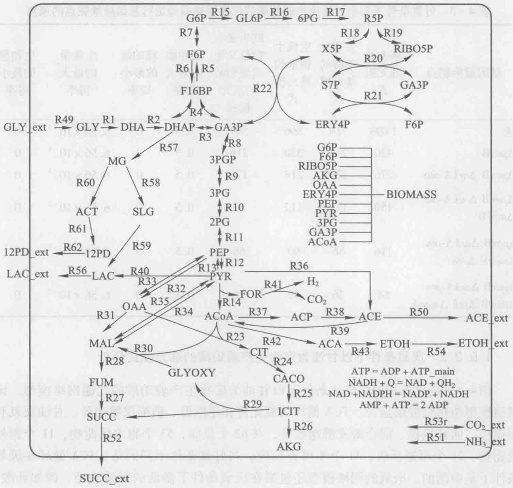
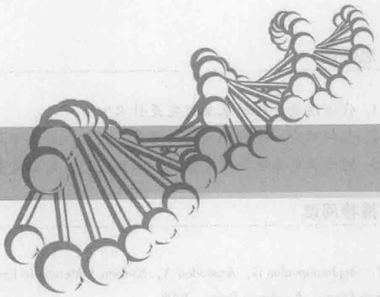
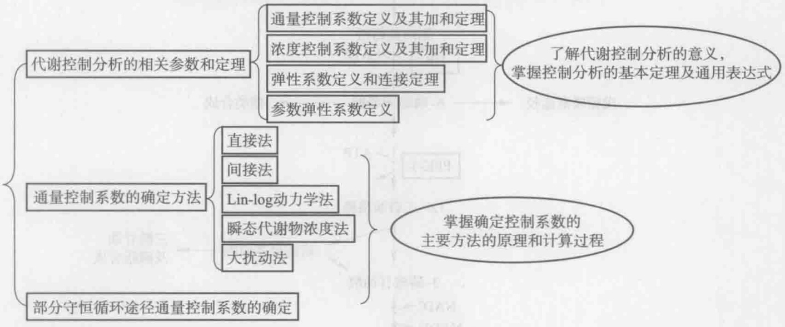
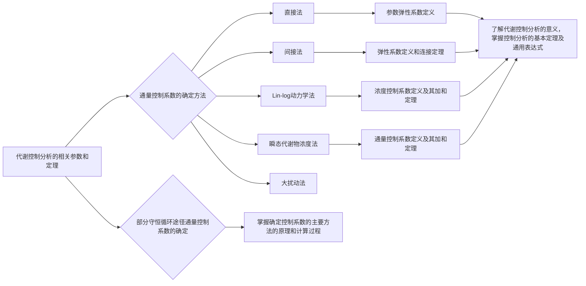
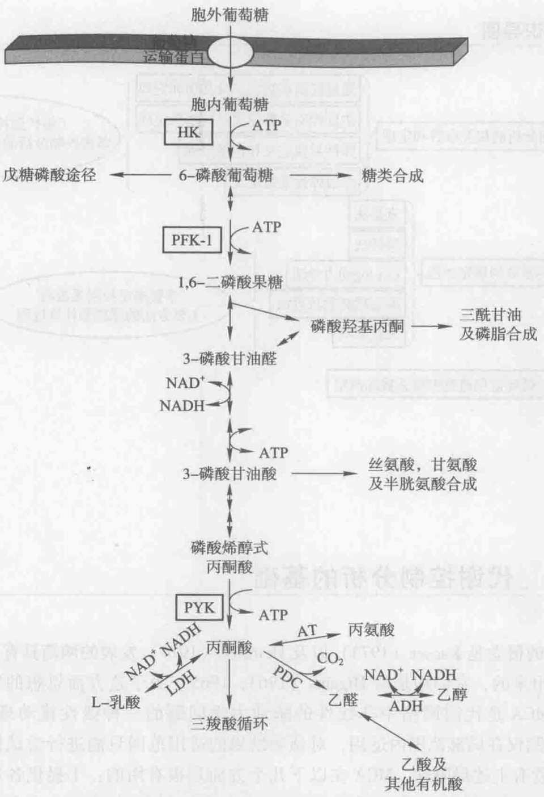
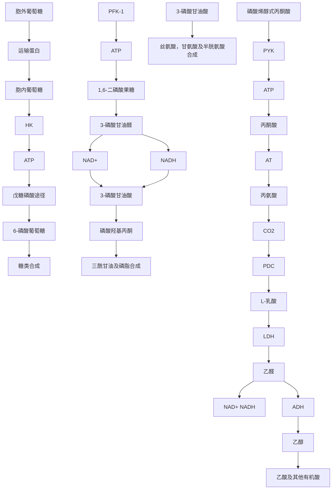
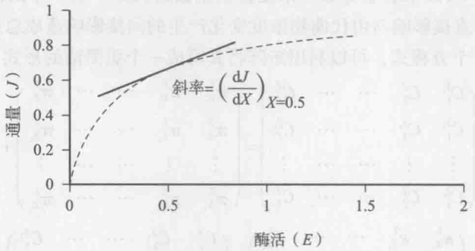
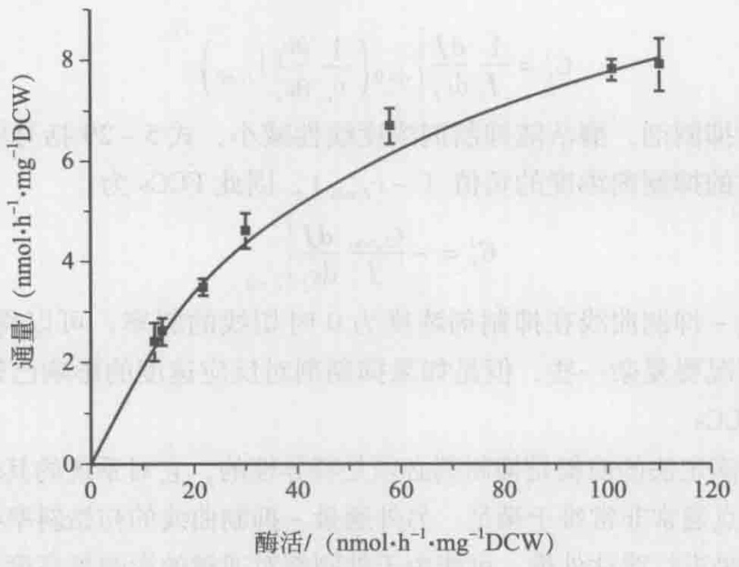

表 4-3 好氧条件下利用甘油生产琥珀酸的代谢网络模型进行基因敲除靶点的预测

| 基因敲除靶点 | 剩余的基元模式 | 生成琥珀酸的基元模式 | 生成生物量的基元模式 | 既生成生物量又生成琥珀酸的基元模式 | 琥珀酸的最大得率 | 琥珀酸的最小得率 | 生物量的最大得率 | 生物量的最小得率 |
| --- | --- | --- | --- | --- | --- | --- | --- | --- |
| 无 | 1098 | 719 | 866 | 599 | 0.5 | 0 | $6.56 \times 10^{-5}$ | 0 |
| ΔpoxB | 420 | 280 | 320 | 216 | 0.5 | 0 | $6.56 \times 10^{-5}$ | 0 |
| ΔpoxB ΔackA-pta | 276 | 224 | 218 | 176 | 0.5 | 0 | $6.56 \times 10^{-5}$ | 0 |
| ΔpoxB ΔackA-ptaΔmaeB | 150 | 112 | 112 | 82 | 0.5 | 0 | $6.56 \times 10^{-5}$ | 0 |
| ΔpoxB ΔackA-ptaΔmaeB Δpck | 116 | 86 | 90 | 66 | 0.5 | 0 | $6.56 \times 10^{-5}$ | 0 |
| ΔpoxB ΔackA-ptaΔmaeB Δpck ΔmaeA | 54 | 36 | 42 | 28 | 0.5 | 0 | $6.56 \times 10^{-5}$ | 0 |

## 4.5.2.2 厌氧条件下以甘油为底物生产琥珀酸的基元模式分析

图4-9是大肠杆菌在厌氧条件下以甘油为底物生产琥珀酸的代谢网络模型。该网络模型包括糖酵解途径、TCA循环的氧化臂和还原臂、磷酸戊糖途径、甘油厌氧利用途径、回补途径、混合酸发酵途径等，共62个反应，53个胞内代谢物，11个胞外代谢物，21个可逆反应，41个不可逆反应。与好氧条件不同的是，TCA循环在厌氧条件下是中断的。厌氧的网络模型还包括在厌氧条件下激活的发酵途径，例如乳酸、乙醇、甲酸等的生成途径。

由于考虑到大肠杆菌主要的羧化酶是磷酸烯醇式丙酮酸（PEP）羧化酶，因此将PEP羧激酶和两个苹果酸酶催化的R33、R34、R35三个反应删掉，首先对此模型进行基元模式分析。通过计算，共得到48个基元模式，生成琥珀酸的基元模式有19个，生成生物量的基元模式有17个，既生成生物量又生成琥珀酸的基元模式有2个。琥珀酸的最大得率为0.5 mol/mol甘油，生物量的最大得率为 $9.41 \times 10^{-6}$  mol/mol甘油。对生成生物量的17个基元模式进行分析，发现所有的基元模式都生成乙醇和1,2-丙二醇，这说明乙醇和1,2-丙二醇的生成与生物量的合成是偶联的，这是由还原力平衡造成的。另外，生成乙醇的途径可以生成能量，因此乙醇合成途径对菌体生长是必需的。Dharmadi等（2006）的研究表明:在厌氧条件下，野生大肠杆菌以甘油为底物时接近90%的发酵产物是乙醇。这个实验现象证实了基元模式分析的结论。对既生成生物量又生成琥珀酸的两个基元模式进行分析，发现其琥珀酸的得率分别为0.033 mol/mol甘油和0.044 mol/mol甘油。上述分析结果说明在甘油为底物厌氧发酵时，琥珀酸并不是野生型大肠杆菌的主要发酵产物，这与文献报道也是一致的（Dharmadi et al. 2006）。

将 PEP 羧激酶和两个苹果酸酶催化的 R33、R34、R35 三个反应放回模型中，再进行基元模式的计算和分析。共得到 681 个基元模式，其中生成琥珀酸的基元模式为 468 个，生成生物量的基元模式为 433 个，既生成琥珀酸又生成生物量的基元模式为

```mermaid
graph TD
  subgraph Enzymes
  A["GLY_ext"] --> B["R49"]
  B --> C["GLY"]
  C --> D["R1"]
  D --> E["DHA"]
  E --> F["R2"]
  F --> G["DHAP"]
  G --> H["GA3P"]
  I["MG"] --> J["R60"]
  J --> K["ACT"]
  K --> L["R61"]
  L --> M["12PD"]
  M --> N["LAC"]
  O["SLG"] --> P["R58"]
  P --> Q["3PGP"]
  Q --> R["R9"]
  R --> S["3PG"]
  S --> T["R10"]
  T --> U["2PG"]
  U --> V["R11"]
  V --> W["PEP"]
  W --> X["R13"]
  X --> Y["PYR"]
  Y --> Z["R36"]
  AA["OAA"] --> AB["R35"]
  AB --> AC["ACoA"]
  AC --> AD["FOR"]
  AD --> AE["H2"]
  AE --> AF["CO2"]
  AG["MAL"] --> AH["R31"]
  AH --> AI["R34"]
  AI --> AJ["R37"]
  AJ --> AK["ACP"]
  AK --> AL["ACE"]
  AL --> AM["ACA"]
  AM --> ANF["ACA"]
  ANF --> AO["ETOH"]
  AO --> AP["R50"]
  AP --> AQ["ACE_ext"]
  AR["MAL"] --> AS["R28"]
  AS --> AT["R30"]
  AT --> AU["GLYOXY"]
  AU --> AV["CIT"]
  AV --> AW["CACO"]
  AW --> AX["R25"]
  AX --> AY["ICIT"]
  AY --> AZ["AKG"]
  AZ --> BA["R26"]
  BA --> BB["R29"]
  BB --> BC["SUCC"]
  BC --> BD["R52"]
  BD --> BE["SUCC_ext"]
  end

  subgraph Metabolites
  C6P["G6P"] --> FR15["R15"]
  GL6P["GL6P"] --> FR16["R16"]
  6PG["6PG"] --> FR17["R17"]
  R5P["R5P"] --> R18
  R18 --> RX19["R19"]
  RX19 --> XR18
  XR18 --> XR20
  XR20 --> XR21
  XR21 --> XR22
  XR22 --> XR23
  XR23 --> XR24
  XR24 --> XR25
  end

  subgraph Biomass
    G6P["G6P"] -.-> BIOMASS
    RIBO5P["RIBO5P"] -.-> BIOMASS
    S7P["S7P"] -.-> BIOMASS
    GA3P["GA3P"] -.-> BIOMASS
  end

  subgraph External Metabolites
    A6P["GLY_ext"] -.-> BIOMASS
    GLYX["GLY_ext"] -.-> BIOMASS
    GLYX -.-> BIOMASS
    GLYX -.-> BIOMASS
    GLYX -.-> BIOMASS
    GLYX -.-> BIOMASS
  end

  subgraph External Metabolites
    A6P -.-> BIOMASS
    GLYX -.-> BIOMASS
    GLYX -.-> BIOMASS
  end
```

flowchart

图4-9 厌氧条件下大肠杆菌以甘油为底物生产琥珀酸的代谢网络模型

267 个。对所有的基元模式进行分析，得到琥珀酸的最大得率为 1 mol/mol 甘油，生物量的最大得率为  $1.27 \times 10^{-5}$  mol/mol 甘油。

进一步将丙酮酸甲酸裂解酶催化的反应 R14 从网络模型中删除以后，剩余的基元模式数目为 94 个，其中生成琥珀酸的有 89 个，生成生物量的有 52 个，既生成琥珀酸又生成生物量的也是 52 个。琥珀酸的最大得率仍为 1 mol/mol 甘油。对生成生物量的 52 个基元模式进行分析，发现所有的基元模式都生成琥珀酸，这表明通过敲除丙酮酸甲酸裂解酶基因，琥珀酸的生成已和生物量的生成相偶联；并且所有的基元模式也都生成 1,2-丙二醇，这说明为了达到还原力的平衡，1,2-丙二醇必将伴随着琥珀酸的生产。对副产物乳酸、乙酸和乙醇的生成进行分析，发现所有的基元模式都不生成这些副产物。这说明琥珀酸成为除 1,2-丙二醇以外最主要的发酵产物。另外，通过分析得到由 PEP 羧激酶催化 R33 和两个苹果酸酶催化的 R34、R35 三个反应的通量不能同时为零，这是由于在野生大肠杆菌中利用 PEP 羧化酶作为羧化途径时，生成琥珀酸的途径是不产生能量的，因此如果使琥珀酸作为主要的发酵产物则必须引入这三个羧化途径来使得琥珀酸的生成途径能够产生能量。

## 思考题

1. 代谢通量分析的基本假定是什么？
2. 如何确定一个代谢网络的质量平衡方程和化学计量系数矩阵？
3. 对于正定系统和超定系统，如何进行代谢通量分析？

## 推荐阅读

1. Stephanopoulos G, Aristodou A, Nielsen J. Metabolic Engineering: Principles and Methodologies. San Diego: Academic Press, 1998.
2. Nielsen J, Villadsen J, Liden G. Bioreaction Engineering Principles. 2nd edition. 英文影印版. 北京:化学工业出版社，2004.
3. Schilling C H, Letscher D, Palsson B O. Theory for the systemic definition of metabolic pathways and their use in interpreting metabolic function from a pathway-oriented perspective. J Theor Biol 2000, 203 (3): 229–248.

详细介绍了基元模式分析和端途径分析的方法。

## 5

natural_image

Abstract illustration of interconnected nodes forming a chain-like structure (no text or symbols)

# 代谢控制分析

## 【本章学习要点】

1. 代谢控制分析的基本参数及定义
2. 代谢控制分析的加和定理和连接定理
3. 确定通量控制系数的主要方法、原理和应用
4. 部分守恒循环途径通量控制系数的确定方法

前面的章节介绍了如何通过胞内代谢的质量平衡来确定代谢通量。代谢通量分析可以提供不同代谢途径之间相互作用的信息，对代谢分支点周围途径的通量进行量化，进而可以通过通量的比较来确定需要优化的代谢途径或目标通量。然而，代谢通量分析自身并不能向我们提供如何对一条代谢途径的通量进行优化的信息。通常，流经某条代谢途径的通量往往受到许多反应的控制，显然只有得到这些反应对通量的控制信息才能确定通量优化的策略。同样，胞内代谢物的浓度也受到许多反应的控制，这种控制对于代谢物的合成和消耗速率的严格平衡是非常重要的，从而确保在各种外部生长环境下胞内代谢物的浓度不会发生剧烈的上升或下降。代谢工程的一个最重要目的是进行代谢控制分析（metabolic control analysis, MCA）:即全面、深入地分析和了解代谢控制对代谢通量和代谢物浓度的影响，并对表征这些代谢控制的参数进行量化，这对通量的合理调整和优化是很重要的（Stephanopoulos et al. 1998）。

## 知识导图

flowchart

## 5.1 代谢控制分析的基础

MCA的概念是Kacser（1973）以及Heinrich（1974）发表的两篇具有里程碑意义的文章提出来的，它们均是对Higgins（1963，1965）关于这方面思想的发展。从本质上说，MCA是代谢网络中非线性的酶动力学问题的一种线性扰动理论。因此，MCA的预测仅在局部范围内适用，对预测结果的适用范围只能进行尝试性的外推或扩展。尽管有上述局限性，MCA在以下几个方面是很有用的:①提供各单个反应代谢通量控制的度量标准；②阐明酶反应网络中速度控制步骤的概念；③描述酶活对于胞内代谢物浓度的影响；④将局部的酶动力学和系统的代谢行为相关联。在20世纪50年代，反馈抑制、协同性、酶的共价修饰作用以及酶的合成控制机制的发现揭示了若干分子机制，这些机制在通量控制中起着重要的作用。由于在通量控制方面存在各种不同的机制，在一条代谢途径的通量是如何被控制的问题上存在许多争论。例如，早期发现一条代谢途径中第一个酶，或者在一个分支点后的第一个酶受到某种类型的反馈调节，这往往导致如下结论:“在一条代谢途径中的第一步反应是限速步骤”，而代谢控制分析的结果表明上述结论不一定是正确的。在许多文献中存在关于限速步骤和关键酶的表述，这经常导致对这些反应步骤在通量控制中实际作用的误解。例如，在许多生物化学书籍中，都将己糖激酶（HK）、1-磷酸果糖激酶（PFK-1），以及丙酮酸激酶（PYK）催化的反应描述成糖酵解途径中的限速步骤（图5-1），这基于以下几个原因（Moreno-Sánchez et al. 2008）:①这三个酶催化的反应远离平衡状态，其 $\Gamma/K_{eq}$ 的比值为 $10^{-3}\sim10^{-4}$ ；②在糖酵解途径中，这三个反应的速度最慢，一般比其他反应速度小一个数量级（即这三个酶的 $v_{max}$ 最小）。③HK受到其产物6-磷酸葡萄糖，以及ADP或AMP的反馈抑制，并且PFK-1和PYK是易受调节的变构酶。因此，基于上述分析结果很容易得出结论:为了显著改变糖酵解途径的通量，必须改变这三个酶的表达水平。然而，大量的研究表明，单独过表达或共同过表达这些酶并不能使糖酵解的通量显著增加（表5-1），在有些情况下，糖酵解通量反而下降。在表5-1所列的研究中，最有效的提高糖酵解途径的实验涉及7个基因的共表达，从葡萄糖到乙醇的通量增加了 $21\%$ 。这表明糖酵解途径的通量控制比较分散，对其通量的控制并不集中在一个或少数几个酶上。值得注意的是，在另一项研究中，同样是上述7个基因过表达，却由于表达量的变化导致从糖酵解到乙醇的通量下降（见表5-1）。这很可能是由于基因之间的表达水平不协调造成的，导致糖酵解中间代谢物的浓度变化过大，从而给细胞生理带来了负面影响。通常细胞在对胞内通量进行调节时都会避免胞内代谢物浓度的剧烈波动，例如，现有的研究发现骨骼肌肉中糖酵解通量增加100倍时不会导致中间代谢物浓度的显著变化。因此，任何改变通量的策略还必须考虑到对胞内代谢物浓度的影响，行之有效的策略必须保证不会导致胞内代谢物浓度的剧烈波动。通过代谢控制分析，不仅可以确定影响途径通量的主要控制力，还可以根据细胞可承受的代谢物浓度波动范围设计改变通量的策略。

flowchart

图5-1 糖酵解途径及其主要分支途径（Moreno-Sánchez et al. 2008）

HK，己糖激酶；PFK-1，1-磷酸果糖激酶；PYK，丙酮酸激酶；LDH，乳糖脱氢酶；PDC，丙酮酸脱羧酶；ADH，乙醇脱氢酶；AT，丙氨酸转氨酶

表 5-1 过表达糖酵解途径中的酶对通量的影响（Moreno-Sánchez et al. 2008）

<table><tr><td>细胞类型</td><td>酶</td><td>酶活过表达倍数</td><td>通量后与改造前的通量比/%</td></tr><tr><td rowspan="8">酿酒酵母</td><td>HK</td><td>13.9</td><td>107</td></tr><tr><td>PFK-1</td><td>3.5, 3.7, 5</td><td>102</td></tr><tr><td>PYK</td><td>8.6</td><td>107</td></tr><tr><td>PDC</td><td>3.7</td><td>85</td></tr><tr><td>ADH</td><td>4.8</td><td>89</td></tr><tr><td>PFK-1+PYK</td><td>5.6+1.3</td><td>107</td></tr><tr><td>GAPDH+PGK+PGAM+ENO+PYK+PDC+ADH</td><td>1.4+1.7+16+4+10.4+1.08+1.4</td><td>121</td></tr><tr><td>GAPDH+PGK+PGAM+ENO+PYK+PDC+ADH</td><td>1.5+1.4+3.4+1.5+2.5+1.1+1.2</td><td>94</td></tr><tr><td rowspan="2">大肠杆菌</td><td>PFK</td><td>8.7</td><td>72</td></tr><tr><td>PYK</td><td>2.9, 4.2</td><td>91, 95</td></tr><tr><td>乳脂乳球菌</td><td>GAPDH</td><td>14-210</td><td>100</td></tr><tr><td rowspan="2">黑曲霉</td><td>PFK</td><td>3</td><td>100</td></tr><tr><td>PYK</td><td>5</td><td>100</td></tr><tr><td>中国仓鼠卵细胞</td><td>PFK</td><td>2.2, 3.4, 3.7</td><td>100</td></tr></table>

对于酿酒酵母和大肠杆菌为乙醇合成通量，对于黑曲霉为柠檬酸合成通量，对于中国仓鼠卵细胞为L-乳酸的合成通量。

HK，己糖激酶；PFK-1，1-磷酸果糖激酶；PYK，丙酮酸激酶；LDH，乳糖脱氢酶；PDC，丙酮酸脱羧酶；ADH，乙醇脱氢酶；GAPDH，3-磷酸甘油醛脱氢酶；PGK，磷酸甘油酸激酶；PGAM，磷酸甘油酸变位酶；ENO，烯醇酶。

代谢控制分析仅能严格地应用于稳态条件（或拟稳态条件）。一个稳定的稳态由一条代谢途径中催化各个单一反应的酶活力所确定。因此，酶活、代谢途径中第一步反应的底物浓度，以及最后一步反应的产物浓度被定义为系统参数。由这些参数值所确定的性质，例如，通过途径的通量或中间代谢物的浓度，被定义为系统变量。当这些参数恒定不变时，系统就达到一个稳态，通过改变这些参数可以对该稳态施加扰动，并最终达到新的稳态。例如，在恒化器中进行稳态连续培养时，达到稳态时底物和最终产物的浓度保持恒定，可以通过改变底物或产物的浓度而达到新的稳态。同样的，通过基因工程技术对细胞内酶的表达量进行调节也能达到不同的稳态。

为了举例说明系统参数和变量的定义，考虑一个简单的两步途径，该途径中底物

S 通过中间产物 X 转变为产物 P:

$$
\mathrm{S} \xrightarrow {\mathrm{E} _ {1}} \mathrm{X} \xrightarrow {\mathrm{E} _ {2}} \mathrm{P} \tag {5-1}
$$

在稳态下，第1步和第2步的反应速度相等，S转变为P的净速率为流经该途径的稳态通量J，稳态通量J也等于这条途径中各反应的反应速率（或速度）。显然，系统稳态由系统参数，即酶 $E_{1}$ 和酶 $E_{2}$ 的活力及底物S和产物P的浓度确定，和系统参数值相对应的稳态可通过中间代谢物浓度x、通量J等系统变量的测量值来表征。代谢物X的浓度是独特的变量，通常假定它们均匀地分布细胞中与酶发生相互作用。如果代谢物X在亚细胞区室中和细胞质中的浓度不同，可以通过添加额外的运输反应来进行代谢控制分析。在这里不考虑同一区室中代谢物浓度的空间分布不均匀的情况，因为这将需要一个复杂的模型来提供不同位置的代谢物浓度信息。

在式5-1所示的简单线性途径中，如果催化第1步和第2步反应的酶动力学方程为:

$$
v _ {1} = \frac {v _ {\max _ {1}} s}{s + K _ {m _ {1}}} \quad v _ {2} = \frac {v _ {\max _ {2}} x}{x + K _ {m _ {2}}} \tag {5-2}
$$

通过简单的分析，我们很容易发现这两个反应对流经该途径的稳态通量有不同的控制力:在初始稳态（此时 $v_{1} = v_{2}$，并等于初始稳态通量 $J_{0}$），如果提高第1个酶的活力对系统施加一个扰动（比如增加酶1的表达量而造成 $v_{\mathrm{max}}$ 增加），使 $v_{1}$ 增加到$v_{1}^{*}$，则扰动后 $v_{1}^{*} > v_{2}$，中间代谢物浓度 $x$ 逐渐增加。由于 $x$ 增加，$v_{2}$ 也会逐渐增加，并最终和 $v_{1}^{*}$ 相等而达到新的稳态（即新稳态时反应1和2的速度 $v_{1}^{\prime}$ 和 $v_{2}^{\prime}$ 都等于 $v_{1}^{*}$，也等于新的稳态通量 $J$，同时 $x$ 增加）。即对第1步反应的扰动将使稳态通量和第2步反应速度发生同样的改变。如果提高第2个酶的活力对系统施加一个扰动（比如增加酶2的表达量而造成 $v_{\mathrm{max}}$ 增加），使 $v_{2}$ 增加到 $v_{2}^{*}$，则扰动后 $v_{1} < v_{2}^{*}$，中间代谢物浓度$x$ 逐渐下降。从式5-2的动力学方程可以看出，$x$ 不会影响反应1的速度，但是反应2的速度会随 $x$ 的下降而下降。这样，达到新稳态时，第2步反应的速度会从 $v_{2}^{*}$ 逐渐降低到和 $v_{1}$ 相等（即新稳态时反应1和2的速度 $v_{1}^{\prime}$ 和 $v_{2}^{\prime}$ 等于 $v_{1}$ 和 $v_{2}$，扰动前后的稳态通量相等，$J^{\prime} = J_{0}$，但在新稳态时 $x$ 变小），即对第2步反应的扰动并不能改变稳态通量。

在上面这个极端的例子中，反应1对流经该线性途径的通量有绝对的控制力，而反应2对流经该线性途径的通量没有任何控制力。也可以说反应1是限速步骤，如果要提高该途径的通量，仅仅增加酶1的表达水平即可。显然，进行代谢控制分析首先需要将系统参数对系统变量的影响进行量化，因此引入了一系列起量化作用的系数，主要包括通量控制系数、浓度控制系数、弹性系数等。

## 5.1.1 通量控制系数及其加和定理

代谢控制分析的一个目的是将代谢系统的变量同参数联系起来，以确定某一系统变量（如通量）对某一系统参数（即酶活）的敏感性。这些敏感性代表了通量控制的基本特性，因为它们表示一条代谢途径中某个酶的活性（系统参数）影响系统通量（系统变量）的程度。类似地，我们也能确定作为系统变量的胞内代谢物的浓度对于酶活、效应物浓度等系统参数的敏感性。这些敏感性可由一组系数概括地描述，其中最重要的是通量控制系数（flux control coefficients，FCCs）。它的定义可由式5-3表示:由代谢途径中一个酶活的无穷小变化所引起的通量的相对变化与这个酶活的相对变化之比（Stephanopoulos et al. 1998）。由于酶活是一个独立的系统参数，因此它的变化将直接影响通量，或通过引起其他系统变量的变化而间接影响通量。

$$
C ^ {J} = \frac {\mathrm{d} J / J}{\mathrm{d} E / E} = \frac {E \mathrm{d} J}{J \mathrm{d} E} = \frac {\mathrm{dln} J}{\mathrm{dln} E} \tag {5-3}
$$

FCCs 是用相对通量和相对酶活的形式定义的，因此它们是无因次的，其大小与所采用的通量及酶活的单位无关。对于一个线性代谢途径来说，FCCs 的值介于 0 和 1 之间。在更常见的分支代谢途径中，FCCs 被用来描述每一个酶活（共 L 个）对通过不同反应的每一通量（共 L 个）的影响:

$$
C _ {i} ^ {J _ {k}} = \frac {E _ {i}}{J _ {k}} \frac {\mathrm{d} J _ {k}}{\mathrm{d} E _ {i}} = \frac {\mathrm{d} \ln J _ {k}}{\mathrm{d} \ln E _ {i}} \quad i, k \in \{1, 2, \dots , L \} \tag {5-4}
$$

式中， $J_{k}$  是代谢途径中通过第 k 个反应的稳态通量， $E_{i}$  是第 i 个酶的活力，FCCs 可以是任何正值或负值。

在 FCCs 的定义式中，酶活被用作描述胞内酶促反应速率的系统参数，在这里酶活被解释为酶的  $v_{max}$  。在大多数情况下，酶促反应速率同酶活成正比，因此可以用酶活替代反应速率作为系统参数。然而，由于可能存在异构调节，胞内酶促反应速度可能同它的  $v_{max}$  完全不同。另外在多酶体系中存在代谢物的通道效应（channelling effect），代谢物按顺序被直接从一个酶运输到下一个酶，在这种情况下， $v_{max}$  也不能代表胞内酶促反应速度。一个更普遍的 FCCs 定义是基于第 i 个反应速率而不是酶活:

$$
C _ {i} ^ {J _ {k}} = \frac {v _ {i}}{J _ {k}} \frac {\mathrm{d} J _ {k}}{\mathrm{d} v _ {i}} = \frac {\mathrm{d} \ln J _ {k}}{\mathrm{d} \ln v _ {i}} \quad i, k \in \{1, 2, \dots , L \} \tag {5-5}
$$

Heinrich 等（1997）将这个定义进一步表示为:

$$
C _ {i} ^ {J _ {k}} = \frac {v _ {i}}{J _ {K}} \frac {\mathrm{d} J _ {k}}{\mathrm{d} p} \left(\frac {\partial v _ {k}}{\partial p}\right) ^ {- 1} \quad i, k \in \{1, 2, \dots , L \} \tag {5-6}
$$

式中，p 可以是专门作用于第 i 个反应速率的任何参数。如果酶活被选为参数 p，倘若反应速率同酶活成正比，则式 5-6 可化简为式 5-4。FCCs 的定义式 5-5 和式 5-6 考虑到了对酶-效应物、酶-酶相互作用这些特殊情况的处理。

从 FCCs 的定义中明显可以看出，具有最大通量控制系数的酶对特定稳态下的通量施加最大的控制，当这个酶的活力增大时，将导致整个通量最大程度地上升。显然，这样的酶基因是需要优先改造的目标基因。一般情况下，如果一个酶对目的产物合成通量的控制系数是一个非常大的正值，则表明该酶基因需要过表达；反之，如果一个酶对目的产物合成通量的控制系数是一个非常大的负值，则表明该酶基因需要被敲除或下调表达其表达水平，这样的酶一般存在于与目的产物合成途径相竞争的其他分支途径中。

通量控制系数满足加和定理（summation theorem）:对于系统中任意一条途径中的通量 $J_{k}$ ，系统中每步反应的酶活对该通量的控制系数之和必为1（Kacser et al. 1973）。

$$
\sum_ {i = 1} ^ {L} C _ {i} ^ {J _ {x}} = 1 \quad k \in \{1, 2, \dots , L \} \tag {5-7}
$$

该式表明通量控制具有系统性或全局性，即某个特定途径的通量和系统中通过代谢物联系在一起的所有反应都有关。对于一个复杂的系统或代谢途径来说，大多数FCCs的值都比较小，但如果某个步骤的FCC值比其他FCC值大得多，则说明该反应步骤对目标通量施加着显著的控制。在有些情况下，所有反应对某个通量的控制系数可能都很小，这表明该通量受到的控制非常分散，这将给菌株的代谢工程改造带来额外的困难，因为这可能意味着很多反应的酶基因都需要改造才能显著的改变目标通量。这也解释了为什么为了提高菌株的代谢物产量（如氨基酸和抗生素），需要很多轮的连续诱变和筛选步骤。

## 5.1.2 浓度控制系数及其加和定理

同 FCCs 类似，系统参数对胞内代谢物浓度影响的敏感性被称为浓度控制系数（concentration control coefficients, CCCs），其中，受酶活  $E_{i}$  影响的变量是代谢物  $X_{j}$  的浓度  $C_{j}$ :

$$
C _ {i} ^ {X _ {j}} = \frac {E _ {i}}{C _ {j}} \frac {\mathrm{d} c _ {j}}{\mathrm{d} E _ {i}} = \frac {\mathrm{d} \ln c _ {j}}{\mathrm{d} \ln E _ {i}} \quad i \in \{1, 2, \dots , L \}, j \in \{1, 2, \dots , K \} \tag {5-8}
$$

或者，更一般地有:

$$
C _ {i} ^ {X _ {j}} = \frac {v _ {i}}{c _ {j}} \frac {\mathrm{d} c _ {j}}{\mathrm{d} v _ {i}} = \frac {\mathrm{d} \ln c _ {j}}{\mathrm{d} \ln v _ {i}} \quad i \in \{1, 2, \dots , L \}, j \in \{1, 2, \dots , K \} \tag {5-9}
$$

这些系数说明了当第 i 个酶活性无穷小变化所引起的第 j 个中间代谢物浓度的相对变化与酶活相对变化之比。由于当所有的酶活同等程度地发生变化时，任何中间代谢物浓度水平保持不变，因此，CCCs 遵从以下关系:对 K 个代谢物中的每一个来说，系统中每步反应的酶活对该代谢物浓度的控制系数之和必为 0（Stephanopoulos et al. 1998）。

$$
\sum_ {i = 1} ^ {L} C _ {i} ^ {X _ {j}} = 0 \qquad j \in \{1, 2, \dots , K \} \tag {5-10}
$$

上式为浓度控制系数的加和定理，该定理表明对每一个代谢物而言，至少存在一种起负控制作用的酶，即当该酶活水平上升时，代谢物浓度却下降了。这样，在式5-1所示的简单两步反应途径中浓度控制系数 $C_{2}^{X}$ 通常是负值，因为代谢物浓度 $c_{x}$ 将随着第二个酶活的上升而下降。显然，同通量控制一样，该式表明浓度控制也具有系统性或全局性。

## 5.1.3 弹性系数和连接定理

MCA 中另一个重要的概念是弹性系数（elasticity coefficients），最常见的弹性系数是反应速率对代谢物浓度的敏感性（或弹性）。和控制系数的情况一样，弹性系数也相对于反应速度及代谢物浓度而归一化。因此，第 i 个反应速度对于代谢物  $X_{j}$  的浓度的弹性被定义为:在假定所有其他系统变量保持稳态值不变的条件下，由代谢物浓度的无穷小变化所引起的反应速率相对变化与代谢物浓度相对变化之比（Stephanopoulos et al. 1998）:

$$
\varepsilon_ {X _ {j}} ^ {i} = \frac {c _ {j}}{v _ {i}} \frac {\partial v _ {i}}{\partial c _ {i}} = \frac {\partial \ln v _ {i}}{\partial \ln c _ {j}} \quad i \in \{1, 2, \dots , L \}, j \in \{1, 2, \dots , K \} \tag {5-11}
$$

因为弹性系数表示对相应的系统变量求导，因此用了偏导数以表示所有其他变量必须保持恒定。同描述整个代谢体系系统性质的控制系数有所不同，弹性系数是代谢网络中各个单个酶的局部性质:即某个特定反应的速度只对部分代谢物敏感，这些代谢物一般是催化该反应酶的底物、产物、激活剂或抑制剂。或者，反过来说:只有系统中的部分代谢物才能影响某个特定反应的速度，这些代谢物都会出现在酶的动力学方程中。如果第i步反应对第j种代谢物的弹性系数为正值，这表明该代谢物浓度的升高会促进第i步反应的进行，例如该代谢物可能是一种底物或一种激活剂；而负值则表明该代谢物浓度的会减慢第i步反应的进行，例如该代谢物可能是一种产物或一种抑制剂。

由于外部效应物可以通过影响酶活而间接影响代谢通量，Kacser 等（1973）引入了另一组通量控制系数，称为响应系数（response coefficients），用于量化代谢通量对于外部效应物的敏感性:

$$
R _ {X _ {j}} ^ {J _ {k}} = \frac {c _ {j}}{J _ {k}} \frac {\mathrm{d} J _ {k}}{\mathrm{d} c _ {j}} \quad j \in \{1, 2, \dots , K \}, k \in \{1, 2, \dots , L \} \tag {5-12}
$$

从上式很容易发现，一种外部效应物 $X_{i}$ 对某个代谢通量 $J_{K}$ 的响应系数是一个受该效应物影响的酶 $j$ 的通量控制系数与该酶对外部效应物 $X_{i}$ 弹性系数的乘积。

$$
\begin{array}{l} R _ {X _ {j}} ^ {J _ {k}} = \frac {c _ {j} \mathrm{d} J _ {k}}{J _ {k} \mathrm{d} c _ {j}} \\ = \left(\frac {\mathrm{d} J _ {k} E _ {i}}{J _ {k} \mathrm{d} E _ {i}}\right) \left(\frac {\mathrm{d} E _ {i} c _ {j}}{E _ {i} \mathrm{d} c _ {j}}\right) \quad i, k \in \{1, 2, \dots , L \}, j \in \{1, 2, \dots , K \} \tag {5-13} \\ = C _ {i} ^ {J _ {s}} \cdot \varepsilon_ {X _ {j}} ^ {i} \\ \end{array}
$$

在上述情况下，弹性系数被应用于非代谢中间产物的外部效应物，这样，式5-11中的 $X_{j}$ 可被更广义地解释为影响第i个反应速度（或第i个酶）的任何化合物。

如果一个代谢物或一个效应物同时作用于 M 种酶，则总响应系数是每个受影响的酶的响应系数之和（Stephanopoulos et al. 1998）:

$$
R _ {X _ {j}} ^ {J _ {k}} = \sum_ {i = 1} ^ {M} C _ {i} ^ {J _ {k}} \cdot \varepsilon_ {X _ {j}} ^ {i} \quad i \in \{1, 2, \dots , M \}, j \in \{1, 2, \dots , K \} \tag {5-14}
$$

通过式5-13可以看出:即使一个酶对某种化合物的弹性比较大，该化合物浓度对通量的控制程度（即响应系数）也仅仅在该酶的通量控制系数不为零时才是重要的。

通常，具有较小通量控制系数的反应具有较大弹性系数。反之，具有较大通量控制系数的反应具有较小的弹性系数。这是因为:具有较大通量控制系数的反应的速率变化将使其他反应的速率（显然，这些其他反应具有相对较小的通量控制系数）也发生较大的变化而达到新的稳态。这种反应速率变化是通过代谢浓度的变化进行传递的，即其他反应具有较高的弹性系数。相反地，具有较小通量控制系数的反应的速率变化只能使其他反应速率（这些其他反应具有相对较大的通量控制系数）发生较小的变化而达到新的稳态。即代谢物浓度变化不能使其他反应速率发生较大的变化，它们具有较低的弹性系数。

FCCs 与弹性系数的关系可由 Kacser 等（1973）导出的通量控制的连接定理（connectivity theorem）来表达（Stephanopoulos et al. 1998）:

$$
\sum_ {i = 1} ^ {L} C _ {i} ^ {J _ {\kappa}} \varepsilon_ {X _ {j}} ^ {i} = 0 \quad i \in \{1, 2, \dots , L \}, j \in \{1, 2, \dots , K \} \tag {5-15}
$$

连接定理通常被认为是最重要的 MCA 定理，因为它将局部的单个酶反应的动力学性质与整个反应网络的全局性质通过共同的中间代谢物 X 关联在一起。作为进一步的说明，考虑式 5-1 所示简单两步途径。对这个途径，由连接定理得到:

$$
C _ {1} ^ {J} \varepsilon_ {X} ^ {1} + C _ {2} ^ {J} \varepsilon_ {X} ^ {2} = 0 \tag {5-16}
$$

或

$$
\frac {C _ {1} ^ {J}}{C _ {2} ^ {J}} = \frac {\varepsilon_ {X} ^ {2}}{\varepsilon_ {X} ^ {1}} \tag {5-17}
$$

从式5-17也可以看出:如果 $C_1^J > C_2^J$ ，则 $\varepsilon_X^1$ 必然小于 $\varepsilon_X^2$ ，反之亦然（实际上，这里是指绝对值的大小）。在接近热力学平衡条件下进行的反应通常对代谢物浓度的变化是非常敏感的，即它们的弹性很大，这也表示这些反应的通量控制系数通常将很小。

如同 FCCs 的情况一样，浓度控制系数与弹性系数的关系可由浓度控制的连接定理来表示:当浓度控制系数和弹性系数涉及不同的代谢物时，连接定理有如下的形式:

$$
\sum_ {i = l} ^ {L} C _ {i} ^ {X _ {i}} \varepsilon_ {X _ {j}} ^ {i} = 0 \quad j, l \in \{1, 2, \dots , K \}, j \neq l \tag {5-18}
$$

而涉及相同代谢物时，连接定理的形式为:

$$
\sum_ {i = l} ^ {L} C _ {i} ^ {X _ {i}} \varepsilon_ {X _ {i}} ^ {j} = - 1 \quad j \in \{1, 2, \dots , K \} \tag {5-19}
$$

## 5.1.4 参数弹性系数及 MCA 理论的通用表达式

参数弹性系数（parameter elasticity coefficients）是酶促反应速度对其他参数（例如酶活或抑制剂，后者不是所研究途径中的代谢物）变化的敏感性的度量标准。对于一个一般的参数 $p_{l}$ ，以下式来定义参数弹性系数（Stephanopoulos et al. 1998）:

$$
\pi_ {p l} ^ {i} = \frac {p _ {l} \partial v _ {i}}{v _ {i} \partial p _ {l}} = \frac {\partial \ln (v _ {i})}{\partial \ln (p _ {l})} \quad i \in \{1, 2, \dots , L \} \tag {5-20}
$$

如果酶活被选为该参数，则当i等于l时，参数弹性系数通常等于1；而当i不等于l时，参数弹性系数通常等于0。即在一般情况下，第i个反应速度和第i个酶的活力之间存在着直接的比例关系，而第i个酶对途径中的其他反应速度没有影响（如果存在酶-酶之间的相互作用，则会有影响）。

酶活的变化将对途径中的通量产生直接的影响，也能通过代谢物浓度的变化对其产生间接影响，因此稳态通量是系统参数（包括酶活）和代谢物浓度的函数，即 $J_{i}(p_{l}, c_{j})$ 。则 FCCs 可以用式 5-3 的扩展形式来定义:

$$
C _ {i} ^ {J _ {k}} = \frac {E _ {i}}{J _ {k}} \left(\sum_ {l} \frac {\partial J _ {k}}{\partial p _ {l}} \frac {\mathrm{d} p _ {l}}{\mathrm{d} E _ {i}} + \sum_ {j = 1} ^ {k} \frac {\partial J _ {k}}{\partial c _ {j}} \frac {\mathrm{d} c _ {j}}{\mathrm{d} E _ {i}}\right) \quad i, k \in \{1, 2, \dots , L \} \tag {5-21}
$$

通常不同参数之间没有关联，所以一个参数的变化不会改变其他的参数，因此有:

$$
\frac {\mathrm{d} p _ {l}}{\mathrm{d} E _ {i}} = \left\{ \begin{array}{l l} 0; & p _ {l} \neq E _ {i} \\ 1; & p _ {l} = E _ {i} \end{array} \right. \tag {5-22}
$$

则式5-21可以整理为:

$$
C _ {i} ^ {J _ {k}} = \frac {E _ {i}}{J _ {k}} \frac {\partial J _ {k}}{\partial E _ {i}} + \sum_ {j = 1} ^ {k} \frac {\partial J _ {k}}{\partial c _ {j}} \frac {c _ {j}}{J _ {k}} \frac {\mathrm{d} c _ {j}}{\mathrm{d} E _ {i}} \frac {E _ {i}}{c _ {j}} \quad i, k \in \{1, 2, \dots , L \} \tag {5-23}
$$

在稳态条件下，第 k 个反应的速率  $(v_{k})$  等于稳态通量  $J_{k}$ ，因此上式等号右边的第一项是参数弹性系数（参数是酶活），第二项中包含弹性系数和浓度控制系数，即:

$$
C _ {i} ^ {J _ {k}} = \pi_ {i} ^ {k} + \sum_ {j = 1} ^ {K} \varepsilon_ {X _ {j}} ^ {k} C _ {i} ^ {X _ {j}} \quad i, k \in \{1, 2, \dots , L \} \tag {5-24}
$$

或者进一步简化为:

$$
\left\{ \begin{array}{l l} C _ {i} ^ {J _ {k}} = 1 + \sum_ {j = 1} ^ {K} \varepsilon_ {X _ {j}} ^ {i} C _ {i} ^ {X _ {j}} & i \in \{1, 2, \dots , L \} i = k \\ C _ {i} ^ {J _ {k}} = \sum_ {j = 1} ^ {K} \varepsilon_ {X _ {j}} ^ {k} C _ {i} ^ {X _ {j}} & i, k \in \{1, 2, \dots , L \}, i \neq k \end{array} \right. \tag {5-25}
$$

上式表明了 FCCs 和弹性系数与浓度控制系数的关系。当一个酶活变化时，由酶活调节所产生的直接影响与由代谢物浓度变化产生的间接影响造成总通量的变化。式 5-24 总共有 $L^{2}$ 个方程式，可以利用矩阵将其写成一个更简洁的形式:

$$
\left( \begin{array}{c c c c c} C _ {1} ^ {J _ {1}} & C _ {2} ^ {J _ {1}} & \dots & \dots & C _ {L} ^ {J _ {1}} \\ C _ {1} ^ {J _ {2}} & C _ {2} ^ {J _ {2}} & \dots & \dots & C _ {L} ^ {J _ {2}} \\ \vdots & \vdots & \dots & \dots & \vdots \\ C _ {1} ^ {J _ {L}} & C _ {2} ^ {J _ {L}} & \dots & \dots & C _ {L} ^ {J _ {L}} \end{array} \right) = \left( \begin{array}{c c c c c} \pi_ {E _ {1}} ^ {1} & \pi_ {E _ {2}} ^ {1} & \dots & \dots & \pi_ {E _ {L}} ^ {1} \\ \pi_ {E _ {1}} ^ {2} & \pi_ {E _ {2}} ^ {2} & \dots & \dots & \pi_ {E _ {L}} ^ {2} \\ \vdots & \vdots & \dots & \dots & \vdots \\ \pi_ {E _ {1}} ^ {L} & \pi_ {E _ {2}} ^ {L} & \dots & \dots & \pi_ {E _ {L}} ^ {L} \end{array} \right) +
$$

$$
\left( \begin{array}{c c c c c} \varepsilon_ {X _ {1}} ^ {1} & \varepsilon_ {X _ {2}} ^ {1} & \dots & \dots & \varepsilon_ {X _ {k}} ^ {1} \\ \varepsilon_ {X _ {1}} ^ {2} & \varepsilon_ {X _ {2}} ^ {2} & \dots & \dots & \varepsilon_ {X _ {k}} ^ {2} \\ \vdots & \vdots & \dots & \dots & \vdots \\ \varepsilon_ {X _ {1}} ^ {L} & \varepsilon_ {X _ {2}} ^ {L} & \dots & \dots & \varepsilon_ {X _ {k}} ^ {L} \end{array} \right) \times \left( \begin{array}{c c c c c} C _ {1} ^ {X _ {1}} & C _ {2} ^ {X _ {1}} & \dots & \dots & C _ {L} ^ {X _ {1}} \\ C _ {1} ^ {X _ {2}} & C _ {2} ^ {X _ {2}} & \dots & \dots & C _ {L} ^ {X _ {2}} \\ \vdots & \vdots & \dots & \dots & \vdots \\ C _ {1} ^ {X _ {k}} & C _ {2} ^ {X _ {k}} & \dots & \dots & C _ {L} ^ {X _ {k}} \end{array} \right) \tag {5-26}
$$

或者

$$
C ^ {J} = P + E \cdot C ^ {X} \tag {5-27}
$$

$C^{J}$ ，P，E 和  $C^{X}$  分别为通量控制系数矩阵、参数弹性系数矩阵、弹性系数矩阵和浓度控制系数矩阵。在大多数情况下，参数弹性系数矩阵 P 是一个单位矩阵，即一个所有对角元素为 1 的对角矩阵。式 5-27 是包括了 MCA 加和定理和连接定理的一个完整和通用的公式。

## 5.2 通量控制系数的确定方法

FCCs 是通量控制的一个重要度量标准，显然，通过 FCCs 可以确定代谢网络的通量控制结构，进而可以确定最有效的通量优化方案。目前有许多实验方法可以确定控制系数和弹性系数，这些方法主要有直接法、间接法、Lin-log 动力学法，瞬态代谢物浓度法及大扰动法。

## 5.2.1 直接法

确定 FCCs 最直接的方法是在保持所有其他系统参数不变时，观察代谢途径中某个酶活变化对通量的影响。这需要做足够多的实验来首先确立酶活和通量之间的基本关系，对大量实验数据点进行拟合后得到一个类似于图 5-2 的酶活-通量曲线图，然后从图中某个酶活对应的曲线切线的斜率来确定 FCCs（通常，FCCs 并不是恒定不变的，不同酶活对应的 FCCs 值并不相等），这种方法可以非常精确地确定 FCCs。它的主要缺点是需要大量的实验来建立通量-酶活关系曲线。另外一种策略是用酶活的微小变化来近似替代 FCCs 中的无穷小变化，即通过两个相距很近的数据点之间直线的斜率来替代某个酶活对应的酶活-通量曲线切线的斜率进行 FCCs 的计算。这种方法仅需要做少量的酶活扰动实验，但存在一个矛盾的地方:如果酶活扰动过大，则扰动前后的数据点相距较远，连接两个数据点的直线的斜率就会和真实斜率（扰动前数据点对应的酶活-通量曲线的切线斜率）相差太大。如果酶活扰动过小，则测量的相对误差就会很大，从而影响 FCCs 计算的准确度（Stephanopoulos et al. 1998）。

line

| 酶活 (E) | 通量 (J) |
| --- | --- |
| 0 | 0 |
| ~0.15 | ~0.5 |
| ~0.4 | ~0.6 |
| ~0.8 | ~0.82 |

图5-2 稳态途径通量 $J$ 与途径中一个酶活力的函数关系图

该酶在特定酶活时的通量控制系数等于曲线中该酶活处切线的斜率（dJ/dE）用相应的通量与酶活比（J/E）归一化

## 5.2.1.1 基因工程方法

扰动酶活最直接的方法是利用基因工程技术构建一系列目标酶的表达水平不同的工程菌株，或者用一个诱导型启动子控制目标酶基因的表达水平。这种方法使我们可以研究细胞内酶活改变后对通量的影响效果，其缺点在于不能对酶活进行精细的调节，不适合用酶活的微小变化来替代无穷小变化。另外，可能需要构建许多酶活表达水平不同的工程菌株，因而工作量很大。通过在目标酶基因前插入诱导型启动子是进行酶活扰动实验是一种较好的策略，这样可以避免构建大量的工程菌株。仅仅通过控制培养基中诱导物的浓度，就可以实现酶活的上调节或下调节。例如 Flint 等（1981）利用增加有效基因拷贝数的方法进行了丝状真菌粗糙脉孢菌的精氨酸生物合成途径的通量控制分析；Niederberger 等（1992）研究酿酒酵母的四倍体菌株中色氨酸生物合成途径的五种酶的活性对代谢通量的影响；Ruyter 等（1991）研究了大肠杆菌中葡萄糖代谢途径酶Ⅱ $^{Glc}$ 的基因控制。通过对 tac 启动子表达效率的调节，改变酶Ⅱ $^{Glc}$ 的表达量，引起葡萄糖代谢的通量变化。

## 5.2.1.2 纯化酶和抑制剂滴定法

纯化酶滴定法是用所研究代谢途径中的某种纯化酶来滴定细胞抽提物，途径中的其他酶均被过量供给，因此途径的通量只取决于纯化酶的滴定量，从而可以直接确定该纯化酶的体外通量控制系数。通过这种方法可以确定途径中所有酶的体外通量控制系数。通常体外 FCCs 与体内的 FCCs 成比例，但前者稍大，因此可以推断出通量控制在这些酶之间的相对分布。应用纯化酶滴定法的一个前提是所有的反馈和前馈调节回路都被限定在所研究的途径区段内，并且酶的饱和度在滴定过程中不会发生变化。这种方法的缺点是实验结果对实验误差的敏感性很大，另外只能应用于有商品化纯化酶可用的系统中。

抑制剂滴定法是通过酶的特异性抑制剂的滴定来扰动细胞内的酶活，当扰动前后的通量被测量之后，就能估算通量相对于该抑制剂的响应系数。如果知道酶相对于抑制剂的弹性系数，就可以通过式5-13算出通量控制系数。由于最终是要确定无抑制剂存在时的FCCs，因此要计算抑制剂浓度为零时的响应系数（Stephanopoulos et al. 1998）:

$$
R _ {X _ {i}} ^ {J} = \frac {c _ {I}}{J} \left. \frac {\mathrm{d} J}{\mathrm{d} c _ {I}} \right| _ {c _ {i} = 0} = C _ {i} ^ {J} \varepsilon_ {I} ^ {i} = C _ {i} ^ {J} \frac {c _ {I}}{v _ {i}} \left. \frac {\partial v _ {i}}{\partial c _ {I}} \right| _ {c _ {i} = 0} \tag {5-28}
$$

则

$$
C _ {i} ^ {J} = \frac {1}{J} \left. \frac {\mathrm{d} J}{\mathrm{d} c _ {I}} \right| _ {c _ {i} = 0} \left(\left. \frac {1}{v _ {i}} \frac {\partial v _ {i}}{\partial c _ {I}} \right| _ {c _ {i} = 0}\right) ^ {- 1} \tag {5-29}
$$

对于不可逆抑制剂，酶活随抑制剂浓度线性减小，式5-29括号中的数值等于酶活被完全控制时的抑制剂浓度的负值（ $-c_{I,\max}$ ），因此FCCs为:

$$
C _ {i} ^ {J} = - \frac {c _ {I , \max}}{J} \left. \frac {\mathrm{d} J}{\mathrm{d} c _ {I}} \right| _ {c _ {j} = 0} \tag {5-30}
$$

通过求通量-抑制曲线在抑制剂浓度为0时切线的斜率，可以得到FCCs。对于可逆抑制剂，情况要复杂一些，但是如果抑制剂对反应速度的影响已知，很容易通过式5-29计算FCCs。

应用抑制剂滴定法的前提是抑制剂必须是特异性的，它对系统的其他酶不应该有任何影响，而这一点通常非常难于满足。另外通量-抑制曲线的初始斜率必须外推至 $c_{l}$ 为零才能确定。如果进行线性外推，可能由于抑制剂对通量的影响是高度非线性的而造成较大的偏差，通常进行非线性外推得到的估计值更精确（如拟合成多项式函数）。

例 5-1 在鼠肝细胞中色氨酸代谢途径由细胞吸收色氨酸（ $v_{1}$ ）和色氨酸2，3-加双氧酶分解色氨酸（ $v_{2}$ ）两步反应组成，通过直接测定色氨酸2，3-加双氧酶的酶活和色氨酸的代谢通量得到一系列数据，见表5-2（Salter et al. 1986）。

表 5-2 色氨酸 2,3-加双氧酶的酶活与色氨酸代谢通量

|  | 酶活 $E_2$(标准差)/nmol·h-1·mg-1DCW' | 通量 J(标准差)/nmol·h-1·mg-1DCW' |
| --- | --- | --- |
| 1 | 12.5 (2.25) | 2.4 (0.38) |
| 2 | 13.7 (0.52) | 2.6 (0.29) |
| 3 | 21.8 (0.69) | 3.5 (0.17) |
| 4 | 30 (0.05) | 4.6 (0.35) |
| 5 | 58 (3.81) | 5.7 (0.35) |
| 6 | 101 (12.0) | 7.8 (0.19) |
| 7 | 110 (10.9) | 7.9 (0.52) |

根据测定数据确定色氨酸2,3-加双氧酶的酶活为 $30\ nmol.\ h^{-1}.mg^{-1}DCW$ 时的通量控制系数。

解:根据原点及表中的7个数据点，可以用双曲线方程拟合酶活-通量曲线（见图5-3），得到方程:

$$
J = \frac {1 1 . 5 8 E _ {2}}{4 8 . 1 6 + E _ {2}} \tag {1}
$$

酶活为  $30 \, nmol \cdot h^{-1} \cdot mg^{-1}DCW$  时，通过式（1）求出相应的 J 值为 4.44，且式（1）求导后得到该点的切线斜率为 0.0913，因此通量控制系数为:

$$
C _ {2} ^ {J} = \frac {E _ {i}}{J} \frac {\mathrm{d} J}{\mathrm{d} E _ {2}} = \frac {3 0}{4 . 4 4} \times 0. 0 9 1 3 = 0. 6 2
$$

根据通量控制系数的加和定理，此时  $C_{1}^{J}=1-0.62=0.38$ ，即第二步反应是主要的通量控制步骤。

line

| 酶活 \((nmol \cdot h^{-1} \cdot mg^{-1}DCW)\) | 通量 \((nmol \cdot h^{-1} \cdot mg^{-1}DCW)\) |
| --- | --- |
| ~12 | ~2.5 |
| ~13 | ~2.6 |
| ~22 | ~3.5 |
| ~30 | ~4.6 |
| ~58 | ~6.7 |
| ~100 | ~7.8 |
| ~110 | ~8.0 |

图5-3 实验数据的拟合

通过上述方法求控制系数的缺点是采用何种方程进行数据的拟合对控制系数的求解影响较大，一般需要找到拟合程度较高且合理的方程进行拟合计算。

## 5.2.2 间接法

间接法是利用 MCA 定理，通过弹性系数来计算 FCCs 的方法，因此这类方法的关键是确定系统的弹性系数，其应用有两个前提:①代谢系统的所有反应及有关的相互作用都需要被考虑和描述；②系统处于稳态，初始底物和最后产物的浓度是定值。最常用的间接法包括双调法（double modulation）、自上而下法和动力学模型法等:

## 5.2.2.1 双调法

考虑任意一个反应:

$$
\dots A \xrightarrow {v} B \longrightarrow \dots \tag {5-31}
$$

该反应的速度仅依赖于所示的化合物的浓度，即  $v = f(c_{A}, c_{B})$ ，在稳态下，该反应速率等于稳态通量 J，因此有: