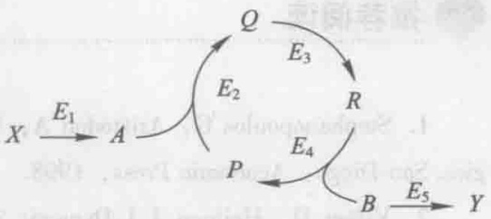
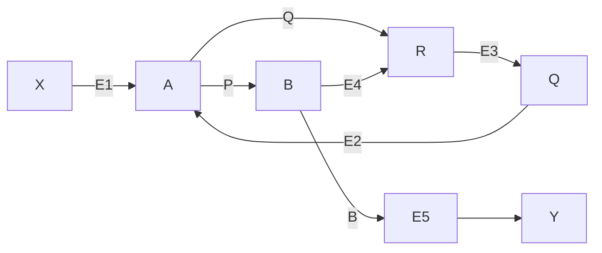
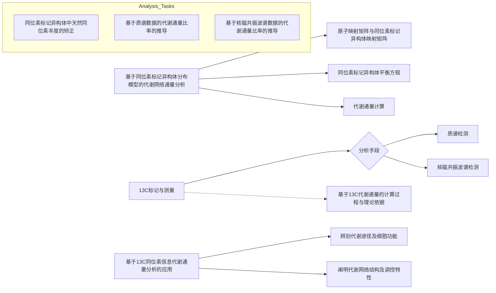
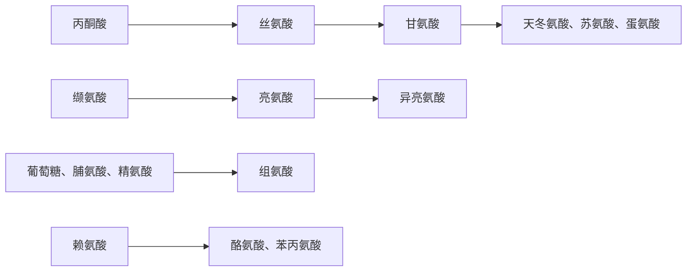

$$
K _ {i} = \frac {C _ {i} ^ {J _ {A}}}{f _ {i} ^ {A} - 1} = \frac {C _ {i} ^ {J _ {B}}}{f _ {i} ^ {B} - 1} = \frac {C _ {i} ^ {J _ {C}}}{f _ {i} ^ {C} - 1} \quad i \in \{A, B, C \} \tag {5-112}
$$

其中

$$
K _ {i} = \frac {r _ {i}}{f _ {i} ^ {i} (r _ {i} - 1)} \quad i \in \{A, B, C \} \tag {5-113}
$$

式5-112揭示了分支途径 $i$ 的活性变化所引起的通量 $J_{k}$ 的分数变化，$f_{i}^{k} - 1$，其与相应的控制系数 $C_{i}^{J_{k}}$ 成比例；此外，同样的比例性也适用于所有三个分支途径中的通量变化。这个比例被称为扰动常数 $K_{i}$，可从受扰动途径的 $r_{i}$ 和 $f$ 来计算。这个常数仅仅反映了在一条分支途径中发生特定扰动的结果，在不同分支途径中的扰动将产生不同的扰动常数。

一旦知道了围绕分支点代谢物的一条或多条途径的通量控制系数，就能预测某种扰动对系统所产生的影响。如果某个分支途径 i 的酶活发生变化（用一个酶活扩增因子  $r_{i}$  来表征这种变化），这种变化对所有三个分支通量的影响可以根据 f 值确定:

$$
f _ {i} ^ {k} = \frac {1}{1 - C _ {i} ^ {J _ {k}} \left(\frac {r _ {i} - 1}{r _ {i}}\right)} \quad k \in \{A, B, C \} \tag {5-114}
$$

或

$$
\frac {f _ {i} ^ {k} - 1}{f _ {i} ^ {k}} = C _ {i} ^ {J _ {k}} \left(\frac {r _ {i} - 1}{r _ {i}}\right) \quad k \in \{A, B, C \} \tag {5-115}
$$

这些结果与线性途径严格类似，同样的，对于多个分支的酶活同时发生扰动的情况（分别由 $r_{A}$ ， $r_{B}$ 和 $r_{C}$ 表示酶活的变化倍数），其扰动表达式同式5-105严格类似:

$$
\frac {f _ {A B C} ^ {k} - 1}{f _ {A B C} ^ {k}} = \sum_ {i} C _ {i} ^ {J _ {k}} \left(\frac {r _ {i} - 1}{r _ {i}}\right) \quad i, k \in \{A, B, C \} \tag {5-116}
$$

大扰动理论也可以用来确定浓度控制系数，或者利用浓度控制系数来预测一个特定酶活扰动所引起的某种代谢物的浓度变化，具体推导过程可以参考 Small 等（1993b）的文献。

## 5.3 部分守恒循环途径通量控制系数的确定

细胞代谢中的一个重要特征是存在大量的部分守恒循环（moiety-conserved cycles）途径，在这些循环途径中的代谢物主要起着传递某种基团的作用。例如，ATP—ADP—AMP之间的循环，其中腺苷酸部分被保留在循环途径中，而磷酸基团通

过该途径被传递给其他代谢物。由于参与循环的中间代谢物之间的相互转换速度非常迅速，而其自身的合成和降解速度非常缓慢，因此这些中间代谢物的总浓度近似恒定不变（Hofmeyr et al. 1986）。

图5-9是一个部分守恒循环途径的示意

flowchart

图5-9 部分守恒循环示意图

图，对于该途径，通量控制系数的加和定理仍然成立:

$$
C _ {1} ^ {J} + C _ {2} ^ {J} + C _ {3} ^ {J} + C _ {4} ^ {J} + C _ {5} ^ {J} = 1 \tag {5-117}
$$

通量控制的连接定理不再具有式5-15的形式，而具有如下形式:

$$
C _ {1} ^ {J} \varepsilon_ {A} ^ {1} + C _ {2} ^ {J} \varepsilon_ {A} ^ {2} = 0 \tag {5-118}
$$

$$
C _ {2} ^ {J} \varepsilon_ {Q} ^ {2} + C _ {3} ^ {J} \left(\varepsilon_ {Q} ^ {3} - \varepsilon_ {R} ^ {3} \frac {C _ {Q}}{C _ {R}}\right) - C _ {4} ^ {J} \varepsilon_ {R} ^ {4} \frac {C _ {Q}}{C _ {R}} = 0 \tag {5-119}
$$

$$
C _ {3} ^ {J} \varepsilon_ {R} ^ {3} + C _ {4} ^ {J} \bigg (\varepsilon_ {R} ^ {4} - \varepsilon_ {P} ^ {4} \frac {C _ {R}}{C _ {P}} \bigg) - C _ {2} ^ {J} \varepsilon_ {P} ^ {2} \frac {C _ {R}}{C _ {P}} = 0 \tag {5-120}
$$

$$
C _ {4} ^ {J} \varepsilon_ {B} ^ {4} + C _ {5} ^ {J} \varepsilon_ {B} ^ {5} = 0 \tag {5-121}
$$

式 5-118\~5-121 的具体推导过程可以参考 Hofmeyr 等（1986）发表的文献，将其写成矩阵的形式:

$$
\left( \begin{array}{c c c c c} 1 & 1 & 1 & 1 & 1 \\ \varepsilon_ {A} ^ {1} & \varepsilon_ {A} ^ {2} & 0 & 0 & 0 \\ 0 & \varepsilon_ {Q} ^ {2} & \left(\varepsilon_ {Q} ^ {3} - \varepsilon_ {R} ^ {3} \frac {C _ {Q}}{C _ {R}}\right) & - \varepsilon_ {R} ^ {4} \frac {C _ {Q}}{C _ {R}} & 0 \\ 0 & - \varepsilon_ {P} ^ {2} \frac {C _ {R}}{C _ {P}} & \varepsilon_ {R} ^ {3} & \left(\varepsilon_ {R} ^ {4} - \varepsilon_ {P} ^ {4} \frac {C _ {R}}{C _ {P}}\right) & 0 \\ 0 & 0 & 0 & \varepsilon_ {B} ^ {4} & \varepsilon_ {B} ^ {5} \end{array} \right) \cdot \left( \begin{array}{c} C _ {1} ^ {J} \\ C _ {2} ^ {J} \\ C _ {3} ^ {J} \\ C _ {4} ^ {J} \\ C _ {5} ^ {J} \end{array} \right) = \left( \begin{array}{c} 1 \\ 0 \\ 0 \\ 0 \\ 0 \end{array} \right) \tag {5-122}
$$

或简写为: $M\cdot C = R$ (5-123)

式中，M 为系数矩阵，C 为通量控制系数组成的列向量，R 为行向量  $(10000)^{T}$ ，则控制系数可以通过下式求出:

$$
C = M ^ {- 1} \cdot R \tag {5-124}
$$

大肠杆菌利用甘油合成乙醇的途径是一个典型的部分守恒循环途径，Cintolesi等（2012）利用上述方法确定了这条途径的通量控制系数，计算结果表明甘油脱氢酶和二羟基丙酮激酶催化的反应为主要的通量控制步骤，随后对上述两个酶基因的过表达显著提高了乙醇的合成通量。

## 思考题

1. 什么是通量控制系数、浓度控制系数和连接系数？
2. 什么是代谢控制分析的加和定理和连接定理？
3. 如何用 Lin-log 动力学近似表示生化反应的动力学方程?
4. 大扰动法测定通量控制系数的原理是什么？

## 推荐阅读

1. Stephanopoulos G, Aristodou A, Nielsen J. Metabolic Engineering. Principles and Methodologies. San Diego: Academic Press, 1998.
2. Visser D, Heijnen J J. Dynamic simulation and metabolic re-design of a branched pathway using linlog kinetics. Metabolic Engineering, 2003, 5 (3): 164–176.

- 详细介绍了 Lin-log 动力学方法计算控制系数的原理和方法。
- 3. Cintolesi A, Clomburg J M, Rigou V, et al. Quantitative analysis of the fermentative metabolism of glycerol in Escherichia coli. Biotechnology and Bioengineering, 2012, 109 (1): 187–198.
- 详细介绍了如何确定部分守恒循环途径的通量控制系数，是一个通量控制分析指导菌株改进的研究范例。

## 6

natural_image

Abstract illustration of interconnected nodes forming a chain-like structure (no text or symbols)

# 基于 $^{13}$ C 同位素标记 信息的代谢通量分析

## 【本章学习要点】

1. 基于 $^{13}$ C 同位素标记信息代谢通量分析的原理
2. 基于 $^{13}$ C 同位素标记信息进行代谢通量分析的方法
3. 基于 $^{13}$ C 同位素标记信息代谢通量分析的应用

基于 $^{13}$ C 同位素标记信息的代谢通量分析方法，利用与代谢反应活性直接相关的重要信息作为通量分析的约束条件，因此比传统的通量分析方法更为准确可靠。 $^{13}$ C 代谢通量分析已经被广泛地应用于多种生物体系中，该法能够很好地揭示细胞代谢反应对遗传操作或环境条件扰动的响应规律，因而已经逐步成为解析代谢调控规律，指导代谢工程设计、改造和优化环境条件的重要工具之一。同时代谢通量组代表了基因—蛋白质—代谢物之间复杂的相互作用对代谢网络的综合效应，该信息已成为系统生物学研究中不可或缺的一部分。

## 知识导图

flowchart

## 6.1  $^{13}$ C代谢通量分析的发展

代谢通量分析是代谢工程的一个重要工具。它旨在准确定量细胞代谢网络中各个反应的通量，即胞内反应速率，这样可以得到一个通量图，表示代谢网络中各个代谢途径的通量分布。通量图可以用于识别代谢通路，并且通过分析遗传操作和不同环境条件对通量图的影响，可以判断可能的遗传操作靶点、解析代谢调控规律、指导环境条件的优化。传统的代谢通量分析方法是基于代谢网络中各个生化反应的化学计量学和各个代谢物的平衡来进行的（Varma and Palsson 1994）。然而，这种方法对于平行代谢途径、代谢循环、可逆反应等复杂代谢途径的通量分析往往无能为力。因此，对于复杂代谢网络的通量分布解析，往往需要引入假设，例如代谢网络的氧化还原平衡、能量平衡、氧化磷酸化的P/O比值或胞内某些特定酶的活性等，这些任意假设的正确性往往会严重影响通量数据计算的可靠性。为了提高通量分析的可靠性和准确性，研究者们发展了基于 $^{13}$ C同位素标记信息的代谢通量分析（简称 $^{13}$ C代谢通量分析）方法，即通过 $^{13}$ C标记实验并结合核磁共振波谱（NMR）和质谱（MS）技术来分析细胞内中间代谢物的 $^{13}$ C标记状态，在此基础上系统地定量细胞内的代谢通量分布（Wiechert 2001）。这种方法利用了与代谢反应活性直接相关的重要信息作为通量分析的约束条件，因此比传统的通量分析方法更为准确可靠。

目前 $^{13}$ C代谢通量分析主要适用于稳态条件，在细胞的连续培养或者分批培养过程中进行 $^{13}$ C 标记实验（见 6.2），近年也逐步出现了一些非稳态 $^{13}$ C 代谢通量分析方法（Noh et al. 2007, Maier et al. 2008）。非稳态 $^{13}$ C 代谢通量分析方法克服了稳态 $^{13}$ C 代谢通量分析所要求的苛刻条件，如菌株为研究背景较清晰的模式菌株，需在最小培养基中以 $^{13}$ C 标记底物为唯一碳源长时间的标记培养达到同位素稳态，且仅能分析中心碳代谢机制相关的途径通量。最近，Hörl（2013）发展了非稳态 $^{13}$ C 代谢通量分析的广义工作流程，此方法考虑了反应的类型，与数据处理、模型、系数和误差估计相关的分子离子或片段的质谱数据有效性。非稳态 $^{13}$ C 代谢通量分析方法能够更加贴切地反映和理解真实发酵条件下细胞的生理特性，是重要的发展趋势。但是由于受快速取样装置、高灵敏度的代谢物检测设备，以及更为复杂的代谢通量计算方法等因素限制，非稳态 $^{13}$ C 代谢通量分析方法尚在进一步发展和完善的过程中。因此，本章将重点介绍稳态 $^{13}$ C 代谢通量分析方法，具体内容包括 $^{13}$ C 标记实验与测量、代谢通量比率分析，以及基于同位素标记异构体分布模型的代谢网络通量分析等，最后给出大肠杆菌中反应通量计算的实例，以帮助读者更好地理解与掌握基于 $^{13}$ C 同位素标记信息的代谢通量分析。

## 6.2  $^{13}$ C 标记实验与测量

## 6.2.1 标记实验

在 $^{13}$ C 标记实验中，标记底物必须根据研究的代谢途径仔细选择，以使标记实验能够最大程度地提供用于代谢途径分析的信息。目前，可供选择的 $^{13}$ C 标记底物有以下 3 种:

（1）单碳标记底物:即一个指定碳原子被标记的底物，例如第一位碳原子被标记的葡萄糖（ $[1-^{13}C]$  glucose）。
（2）多碳标记底物:即多个指定碳原子被标记的底物，例如第一位和第二位碳原子被标记的葡萄糖（ $[1, 2-^{13}C_{2}]$  glucose）。
（3）全碳标记底物:即全部碳原子都被标记的底物，例如六个碳原子都被标记的葡萄糖（ $U-^{13}C$  glucose）。

上述这些标记底物根据需要可以混合使用，例如  $\left[1-^{13}C\right]$  glucose、 $\left[U-^{13}C\right]$  glucose 和非标记葡萄糖一起使用。

$^{13}$ C 标记底物进入细胞代谢后， $^{13}$ C 原子分布到各个代谢物中，导致同一种代谢物存在不同的同位素标记异构体（isotopomer）。如果代谢物有 n 个碳原子，则该代谢物具有  $2^{n}$  个不同的同位素标记异构体。例如，丙氨酸有 8 个同位素标记异构体，可以用二进制数来表示它们，如  $000_{bin}$  表示所有碳原子均不被标记， $100_{bin}$  表示第一位碳原子被  ${}^{13}$ C 标记，以此类推。这些同位素标记异构体的摩尔组成用同位素标记异构体分布向量（isotopomer distribution vector，IDV）来表示，排序按照二进制数从小到大的方式。以丙氨酸为例，其同位素标记异构体分布向量如式 6-1 所示。

$$
I _ {\mathrm{Ala}} = \left[ \begin{array}{l l} I _ {\mathrm{Ala}} & (0) \\ I _ {\mathrm{Ala}} & (1) \\ I _ {\mathrm{Ala}} & (2) \\ I _ {\mathrm{Ala}} & (3) \\ I _ {\mathrm{Ala}} & (4) \\ I _ {\mathrm{Ala}} & (5) \\ I _ {\mathrm{Ala}} & (6) \\ I _ {\mathrm{Ala}} & (7) \end{array} \right] = \left[ \begin{array}{l l} I _ {\mathrm{Ala}} & (0 0 0 _ {\mathrm{bin}}) \\ I _ {\mathrm{Ala}} & (0 0 1 _ {\mathrm{bin}}) \\ I _ {\mathrm{Ala}} & (0 1 0 _ {\mathrm{bin}}) \\ I _ {\mathrm{Ala}} & (0 1 1 _ {\mathrm{bin}}) \\ I _ {\mathrm{Ala}} & (1 0 0 _ {\mathrm{bin}}) \\ I _ {\mathrm{Ala}} & (1 0 1 _ {\mathrm{bin}}) \\ I _ {\mathrm{Ala}} & (1 1 0 _ {\mathrm{bin}}) \\ I _ {\mathrm{Ala}} & (1 1 1 _ {\mathrm{bin}}) \end{array} \right] \tag {6-1}
$$

$^{13}$ C 标记实验可以在细胞的恒化培养或者分批培养过程中进行。在恒化培养过程中，细胞内处于代谢稳态，当含有 $^{13}$ C 标记底物的培养基开始补入以后，根据培养对象的不同经过若干个保留时间，细胞内所有代谢物的同位素标记异构体分布逐步达到稳定状态，此时方可进行取样分析。在分批培养过程中的指数生长期，细胞处于快速生长阶段，研究表明在这个时期代谢物的同位素标记异构体分布也可认为处于拟稳态（Sauer et al. 1999）。

## 6.2.2 质谱检测

通过检测 $^{13}$ C标记实验中细胞内代谢物的同位素标记异构体分布，可以为代谢途径分析提供大量有用的信息。然而，细胞内大多数中间代谢物的浓度很低，它们的同位素标记异构体分布难以检测。为了避免这个问题，往往检测由生物质组成大分子水解而来的物质，包括由蛋白质水解来的氨基酸、由核酸水解来的核苷酸、由糖原水解来的葡萄糖，以及由脂质水解来的甘油。由于这些大分子在细胞内大量存在（例如蛋白质占细胞干重约50%），因此由它们水解得到的物质浓度高并且容易检测。同时，在代谢稳态或拟稳态条件下，水解后所得小分子物质的碳原子对应于其前体代谢物相应位置上的碳原子。例如根据已知的氨基酸合成途径，前体碳架物质有8种（图6-1、图6-2）:3-磷酸甘油醛、磷酸烯醇式丙酮酸、丙酮酸、乙酰辅酶A、5-磷酸核糖、4-磷酸赤藓糖、α-酮戊二酸，以及草酰乙酸。这些前体中间代谢物分布于糖酵解途径、磷酸戊糖途径及三羧酸循环等各个中心碳代谢途径，因此通过检测蛋白质水解由来的氨基酸的同位素标记异构体分布，可为中心碳代谢途径的解析提供丰富的信息。

代谢物的 $^{13}$ C 同位素标记异构体分布可以利用质谱或者核磁共振波谱来检测。气质联用是最为常用的一种检测方法，即在对样品进行衍生化处理后，样品中的各种化合物通过气相色谱柱得以分离，并在其后的质谱仪中被离子化，同时化合物分子断裂成各种离子化碎片，按照质荷比的不同进行分离、产生信号，因此各种碎片离子的质谱图反映了丰富的分子结构信息。例如，氨基酸可以用叔丁基二甲基硅烷化合物（TBDMS）进行衍生化处理，所得的氨基酸衍生物能够在气相色谱柱上得到很好的分离，并在其后的质谱仪中被离子化成带有不同碳骨架片段的氨基酸碎片，获得的质谱数据反映了各种氨基酸碎片的质量分布信息。图 6-3 表示氨基酸 TBDMS 衍生物在气糖酵解途径、三羧酸循环、磷酸戊糖途径上前体中间代谢物的碳骨架分别用深浅不同的○、□、△表示，粗线表示来自一个前体分子的完整片段中的碳-碳键，细线表示来自不同前体分子的片段之间的碳-碳连接，虚线表示片段来自一个前体分子、但是在氨基酸碳骨架上并不直接连接

```mermaid
graph TD
  subgraph sg["\"糖酵解\""]
  A["葡萄糖"] --> B["3-磷酸甘油醛"]
  B --> C["磷酸烯醇式丙酮酸"]
  C --> D["丙酮酸"]
  E["Ile"] --> F["Met"]
  E --> G["Thr"]
  E --> H["Lys"]
  I["Asp"] --> J["Asn"]
  K["草酰乙酸"] --> L["α-酮戊二酸"]
  M["三羧酸循环"] --> N["α-酮戊二酸"]
  O["CO2"] --> P["Ala"]
  Q["Gly"] --> R["Val"]
  S["Ser"] --> T["Cys"]
  U["5-磷酸核糖\n4-磷酸赤藓糖"] --> V["His"]
  W["Trp"] --> X["Phe"]
  Y["Tyr"] --> Z["Gln"]
  AA["Arg"] --> AB["Pro"]
  AC["Glu"] --> AD["Arg"]
  AE["Gly"] --> AF["Leu"]
  AG["C1代谢"] --> AH["Ser"]
  AI["Trp"] --> AJ["Phe"]
  end

  D --> K
  D --> M
  D --> O
  D --> P
  D --> Q
  D --> R
  D --> S
  D --> AA
  D --> AC
  D --> AF
  D --> AG
  D --> AH
  D --> AI
  D --> AJ
  D --> AK
  D --> AL
  D --> AM
  D --> AN
  D --> AO
  D --> AP
  D --> AQ
  D --> AR
  D --> AS
  D --> AT
  D --> AU
  D --> AV
  D --> AW
  D --> AX
  D --> AY
  D --> AZ
  D --> BA
  D --> BB
  D --> BC
  D --> BD
  D --> BE
  D --> BF
  D --> BG
  D --> BH
  D --> BI
  D --> BJ
  D --> BK
  D --> BL
  D --> BM
  D --> BN
  D --> BO
  D --> BP
  D --> BR
  D --> BC
  D --> BD
  D --> BE
  D --> BF
  D --> BG
  D --> BH
  D --> BI
  D --> BJ
  D --> BK
  D --> BL
  D --> BM
  D --> BN
  D --> BO
  D --> BP
  D --> BG
  D --> BH
  D --> BI
  D --> BJ
  D --> BK
  D --> BL
  D --> BM
  D --> BN
  D --> BO
  D --> BP
  D --> BG
  D --> BH
  D --> BI
  D --> BJ
  D --> BK
  D --> BL
  D --> BM
  D --> BN
  D --> BO
  D --> BG
  D --> BH
  D --> BI
  D --> BJ
  D --> BK
  D --> BL
  D --> BM
  D --> BN
  D --> BO
  D --> BG
  D --> BH
  D --> BI
  D --> BJ
  D --> BK
  D --> BL
  D --> BM
```

flowchart

图6-1 氨基酸及其前体中间代谢物

A

chemical

Structural formulas of various phosphate compounds including phospholipids, fatty acids, and glycerol derivatives

B

flowchart

图6-2 氨基酸碳骨架的来源

相色谱中的分离，以及丙氨酸衍生物的质谱图。图6-4表示检测到的氨基酸TBDMS衍生物的各种碎片，包括 $(M-15)^{+}$ 、 $(M-57)^{+}$ 、 $(M-85)^{+}$ 、 $(M-159)^{+}$ 等，它们分别包含不同的氨基酸碳原子。每一种碎片的同位素标记异构体中最轻的质量数，以及该碎片所包含的氨基酸碳原子的个数在表6-1中列出，但在实际研究中需注意并不是该表中出现的所有氨基酸碎片的质量分布数据都能够精确确定。

spectrogram

| 化合物 | m/z (相对丰度%) |
| --- | --- |
| Ala | 158.3 |
| Ala (M-159)+ | 160.4 |
| Ala (M-85)+ | 232.3 |
| Ala (M-57) | 260.3 |
| Glx | 233.5 |
| Lys | 234.4 |
| His | 261.4 |
| Pro | ~38 |
| Leu | ~78 |
| Gly | ~78 |
| Val | ~72 |
| Ser | ~31 |
| Thr | ~30 |
| Asx | ~46 |
| Phe | ~20 |

图6-3 氨基酸TBDMS衍生物在气相色谱中的分离及丙氨酸衍生物的质谱图例

chemical

Chemical structure diagram showing a silane-based polymer with labeled atoms and functional groups

图6-4 GC-MS检测到的氨基酸TBDMS衍生物的各种碎片

氨基酸结构式用背景色表示，R为可变基团。在所显示的位置上发生断裂，形成以下各种碎片:（a） $(M-15)^{+}$ 和甲基基团；（b） $(M-57)^{+}$ 和叔丁基基团；（c） $(M-159)^{+}$ 和C（O）O-TBDMS离子；（d）f302（氨基酸的双甲硅烷基化 $C_{1}-C_{2}$ 片段）和包含R的侧链；（e） $(M-85)^{+}$ 和氨基酸的羰基及叔丁基基团（虚线表示）

表 6-1 氨基酸 TBDMS 衍生物各种碎片的最轻同位素标记异构体的质量数

| 氨基酸 | $(M-15)^+$ | $(M-57)^+$ | $(M-85)^+$ | $(M-159)^+$ | $(f302)^+$ |
| --- | --- | --- | --- | --- | --- |
| 丙氨酸 |  | 260 (3) | 232 (2) |  |  |
| 甘氨酸 | 288 (2) | 246 (2) | 218 (1) | 144 (1) |  |
| 缬氨酸 |  | 288 (5) | 260 (4) |  | 302 (2) |
| 亮氨酸 | 346 (6) |  | 274 (5) | 200 (5) |  |
| 异亮氨酸 | 346 (6) |  | 274 (5) | 200 (5) |  |
| 脯氨酸 | 328 (5) | 286 (5) | 258 (4) | 184 (4) |  |
| 蛋氨酸 |  | 320 (5) | 292 (4) | 218 (4) |  |
| 丝氨酸 | 432 (3) | 390 (3) | 362 (2) | 288 (2) | 302 (2) |
| 苏氨酸 | 446 (4) | 404 (4) | 376 (3) |  |  |
| 苯丙氨酸 |  | 336 (9) | 308 (8) | 234 (8) | 302 (2) |
| 天冬氨酸 | 460 (4) | 418 (4) | 390 (3) | 316 (3) | 302 (2) |
| 谷氨酸 | 474 (5) | 432 (5) | 404 (4) | 330 (4) | 302 (2) |
| 赖氨酸 |  | 431 (6) |  | 329 (5) |  |
| 组氨酸 | 482 (6) | 440 (6) | 412 (5) | 338 (5) | 302 (2) |
| 酪氨酸 | 508 (9) | 466 (9) | 438 (8) | 364 (8) | 302 (2) |

括号中的数字表示碎片所包含的氨基酸碳原子的个数。

对于每一个检测到的碎片 a，其同位素标记异构体的质量分布向量（mass distribution vector, MDV）可以表示如下:

$$
M D V _ {a} = \left[ \begin{array}{c} m _ {0} \\ m _ {1} \\ \vdots \\ m _ {n} \end{array} \right] \tag {6-2}
$$

$$
\sum_ {i = 0} ^ {n} m _ {i} = 1
$$

$m_{0}$  表示最小质量数同位素标记异构体的相对丰度； $m_{i>0}$  表示具有相同的较高质量数的同位素标记异构体的丰度之和。对于每一个碎片，n 大于或者等于碎片中所包

含的氨基酸碳原子个数。如图6-5所示，如果氨基酸的任一碳原子被 $^{13}$ C标记，则会导致较高的质量数，而具有相同质量数的同位素标记异构体中 $^{13}$ C的标记位置可以不一样。需要指出的是，除了氨基酸的碳原子，碎片中所有其他原子（包括衍生化基团上的原子）由于天然稳定同位素的存在（比如自然界中 $^{13}$ C约占全部碳原子质量的1.1%），也会造成较高的质量数，因此在利用质谱数据解析细胞代谢之前，需要对这些原子的天然丰度进行校正（详见下一节内容）。

chemical

Molecular structure diagram showing repeating units with labeled m0 to m3 and molecular arrangement of atoms

图6-5 同位素标记异构体及其质量分布（以丙氨酸为例）

黑色圆圈表示碳原子被 $^{13}$ C标记，白色圆圈表示碳原子没有被标记

## 6.2.3 核磁共振波谱检测

核磁共振波谱（NMR）也常被用于检测代谢物的 $^{13}$ C 同位素标记异构体分布，常见的有一维氢谱、碳谱，以及二维碳氢相关谱等（Szyperski 1998）。一维氢谱检测的灵敏度高，但是它不能直接分析复杂的混合物样品，需要事先对样品中的各个代谢物进行分离提纯。通过解析一维氢谱中主峰和其两侧的 $^{13}$ C 卫星峰的比例，或者比较分析一维氢谱与 $^{13}$ C 去耦的一维氢谱，可以获得代谢物各个碳原子的 $^{13}$ C 标记丰度的信息，它表示某个碳原子被 $^{13}$ C 标记的所有同位素标记异构体所占的比例。因此对于一个具有 n 个碳原子的代谢物，则最多只能获得 n 个不同碳原子 $^{13}$ C 标记丰度的数据。碳原子 $^{13}$ C 标记丰度的信息也可以通过检测一维碳谱获得，即比较代谢物样品和标准品的碳谱强度，如果标准品是不带 $^{13}$ C 标记的，则其碳原子的 $^{13}$ C 天然丰度为 1.1%，这样在另外测得样品中代谢物浓度的基础上，就可以计算得到样品中代谢物某个碳原子的 $^{13}$ C 标记丰度。

通过质子去耦的一维碳谱检测，在除去碳-氢一级耦合相互作用的基础上，解析碳键直接连接的相邻 $^{13}$ C核的自旋-自旋耦合（J耦合），可以获得丰富的代谢物同位素标记异构体分布的信息。如图6-6a所示，对于一个末端碳原子（如甲基基团），如果相邻碳原子没有被 $^{13}$ C标记，可以观察到一个单重峰；如果相邻碳原子被 $^{13}$ C标记，由于自旋裂分的作用则可以观察到左右两个等同的信号，即耦合常数为 $^{1}J_{cc}$ 的双重峰。对于一个三碳片段的中间碳原子，如果与它相邻的两个碳原子属于不同的基团，即它的两个J耦合常数不相同（用 $^{1}J_{cc}$ 和 $^{1}J_{cc*}$ 表示），根据相邻碳原子是否被 $^{13}$ C标记的不同情况，可以观察到四种信号:单重峰、耦合常数为 $^{1}J_{cc}$ 的双重峰、耦合常数为 $^{1}J_{cc*}$ 的双重峰，以及双双重峰（图6-6b）。这种情况适用于氨基酸的α-碳原

图6-6 $^{13}\mathrm{C}$ 同位素标记异构体与NMR碳谱上观察到的多重峰的关系

黑色圆圈表示碳原子被 $^{13}$ C标记，白色圆圈表示碳原子没有被标记。箭头表示所观测的碳原子。s表示单重峰，d表示双重峰，dd表示双双重峰，t表示三重峰。 $J_{CC}$ 和 $J_{CC*}$ 是一级耦合常数（ $J_{CC*} > J_{CC}$ ）

子，相邻的羧基碳原子与其发生耦合的常数约为 $60\mathrm{Hz}$，明显大于脂肪链碳原子间的耦合常数（约 $35\mathrm{Hz}$）。如果三碳片段的中间碳原子的两个 $J$ 耦合常数相同，则两个双重峰重叠，可以观察到三种信号:单重峰、耦合常数为 ${}^{1}J_{CC}$ 的双重峰，以及三重峰（图6-6c）。因此通过解析碳谱上由于相邻 ${}^{13}\mathrm{C}$ 核自旋耦合所造成的多重峰的组成与比例，可以获得 ${}^{13}\mathrm{C}$ 同位素标记异构体分布的信息。

$^{13}$ C 核自旋耦合也可以通过二维碳氢异核相关谱（HSQC）来检测（图 6-7），它比一维碳谱要灵敏得多，而且由于避免了一维碳谱上不同碳原子信号的重叠，谱峰的分辨能力更强，可以用于直接分析复杂的混合物样品。对 HSQC 谱上各个交叉峰取 $^{13}$ C 截面图，则可以获得对应碳原子的多重峰组分的信息（见图 6-7）。

spectrogram

| Residue | \(\omega2(1H) (\)ppm) | \(\omega1(13C) (\)ppm) |
| --- | --- | --- |
| Asp-α | ~4.95 | ~50.5 |
| His-α | ~4.85 | ~54.5 |
| Phe-α | ~4.75 | ~56.0 |
| Tyr-α | ~4.70 | ~56.5 |
| Ser-α | ~4.65 | ~57.0 |
| Thr-α | ~4.60 | ~59.0 |
| Val-α | ~4.55 | ~60.0 |
| Pro-α | ~4.45 | ~63.0 |
| Thr-β | ~4.35 | ~66.0 |

图6-7 利用二维碳氢HSQC谱检测相邻 ${}^{13}\mathrm{C}$ 核的自旋耦合

左图的 HSQC 谱中显示了一些氨基酸碳原子的交叉峰，对其取  ${}^{13}C$  截面图可获得碳原子的多重峰组分的信息，以天冬氨酸  $\alpha-$  碳原子（Asp- $\alpha$ ）为例示于右图

利用 $^{13}$ C 核自旋耦合所造成的多重峰来准确解析 $^{13}$ C 同位素标记异构体分布时，需要注意以下两点:一是 $^{13}$ C 核自旋耦合的信号强度与其所连接的 $^{13}$ C 核的数目是无关的，这一点对于二维碳氢 HSQC 谱是适用的；二是该方法分析的是相邻 $^{13}$ C 核的自旋耦合，如果耦合常数较高，或者相邻 $^{13}$ C 核化学位移的差别小，则多重峰的情况将变得非常复杂，不能用该方法分析。氨基酸大多数碳原子的 $^{13}$ C 化学位移之差都远大于耦合常数，所以能够应用该方法进行分析。这些碳原子的多重峰组成如表 6-2 所示，这些组成的相对丰度可以用向量表示。

表 6-2 NMR 碳谱上观察到的各个氨基酸碳原子的多重峰组成

<table><tr><td rowspan="2">氨基酸碳原子</td><td>末端碳原子</td><td>三碳片段的中间碳原子(不同耦合常数)</td><td>三碳片段的中间碳原子(相同耦合常数)</td></tr><tr><td>Ile - δ, Ile -  $\gamma_{2}$ , Val -  $\gamma_{2}$ , Val -  $\gamma_{1}$ , Leu -  $\delta_{2}$ ,Leu -  $\delta_{1}$ , Ala - β, Thr - γ, Pro - δ, Arg - δ,Ser - β, Gly - α, Lys - ε, His -  $\delta_{2}$ </td><td>Asp - α, Ala - α, Leu - α,Glu - α, Met - α, His - α,Phe - α, Tyr - α, Ser - α,Ile - α, Thr - α, Val - α,Pro - α, Asp - β, Tyr - β,Phe - β, Glu - γ, His - β</td><td>Thr - β, Leu - β, Ile -  $\gamma_{1}$ , Lys - γ, Lys - δ,Pro - γ, Arg - β, Lys - β, Glu - β, Pro - β,Tyr -  $\delta_{X}$ , Tyr -  $\varepsilon_{X}$ </td></tr><tr><td>多重峰组成</td><td>s, d</td><td>s, d, d*, dd</td><td>s, d, t</td></tr></table>

s 表示单重峰，d 表示双重峰，dd 表示双双重峰，t 表示三重峰。

## 6.3 代谢通量比率分析

通过 $^{13}$ C 标记实验并结合 NMR 和质谱技术，可以获得大量的细胞内代谢物同位素标记异构体分布的数据。如何利用这些数据解析碳代谢途径网络，目前主要有两种方法:一种是代谢通量比率分析方法，另一种是基于同位素标记异构体模型拟合的代谢网络通量分析（见 6.4）。代谢通量比率分析是直接利用测量得到的质谱或 NMR 数据来推导代谢途径的通量比率，即不同途径对某一代谢物的相对贡献。得到的代谢通量比率数据可以单独或结合其他测量用于细胞代谢特性的解析，也可以作为重要约束条件用于代谢网络整体通量分布的计算。瑞士联邦理工学院的 Sauer 研究小组率先开发了相关分析方法，并较早地在多种细胞体系中进行了基于通量比率的代谢调控特性分析（Nanchen et al. 2007, Zamboni et al. 2009）。

代谢通量比率分析的主要思路是合理选用代谢物同位素标记异构体分布的测量值，解析不同代谢反应或途径在合成某一关键代谢物时所导致的不同 $^{13}$ C 标记模式，由此推导出这些代谢途径的相对贡献。由于代谢通量比率是在分析代谢反应中碳原子转移特征等基础上决定的，因此通量比率的推导较为复杂，需要对代谢反应的生物化学基础有清晰的理解。由质谱或 NMR 数据直接推导得到的代谢通量比率可作为附加的限定条件，和代谢物的质量平衡方程一起用于计算细胞代谢网络的通量分布（Fischer et al. 2004）。本节将依次对质谱数据的天然同位素丰度矫正、基于质谱以及 NMR 数据推导代谢通量比率等进行介绍，读者可以结合相关文章（花强等，2009）进一步理解和掌握代谢通量比率分析方法。

## 6.3.1 同位素标记异构体中天然同位素丰度的矫正

通过质谱分析可以获得代谢物同位素标记异构体的质量分布数据，除了代谢物中的碳原子被 $^{13}$ C标记，所有其他原子（包括衍生化基团上的原子）由于天然稳定同位素的存在，也会造成较高的质量数。例如，测量得到的质量数为 $m_{1}$ 的同位素标记异构体丰度，是检测碎片中的一个C原子被 $^{13}$ C标记，或者一个H原子是 $^{2}$ H标记，或者一个O原子是 $^{17}$ O标记等所有可能情况的丰度总和。然而，只有代谢物基本碳骨架的同位素标记信息才能用于解析细胞代谢。因此需要对原始的质谱数据进行矫正以去除其他因素的影响，获得代谢物同位素标记异构体的真实质量分布向量。首先需要排除自然界天然存在的稳定同位素（表6-3）对MDV的影响，这需要矫正衍生基团上的碳、氢、氧、氮、硫、硅等元素和氨基酸碳骨架片段上除碳以外的其他元素的天然丰度，这一步矫正可通过式6-3实现。

表 6-3 相关元素的天然稳定同位素丰度

| 元素 | 原子量 | $m_0$ | $m_1$ | $m_2$ | $m_4$ |
| --- | --- | --- | --- | --- | --- |
| H | 1 | 0.999885 | 0.000115 |  |  |
| C | 12 | 0.9893 | 0.0107 |  |  |
| N | 14 | 0.99636 | 0.00364 |  |  |
| O | 16 | 0.99757 | 0.00038 | 0.00205 |  |
| Si | 28 | 0.92223 | 0.04685 | 0.03092 |  |
| S | 32 | 0.9499 | 0.0075 | 0.0425 | 0.0001 |

$m_{0}$  表示最小质量数的同位素的相对丰度； $m_{i>0}$  表示具有较高质量数的同位素的丰度。数据来源:Böhlke et al. Isotopic compositions of the elements, 2001. J. Phys. Chem. Ref. Data, 2005, 34: 57-67。

$$
M D V _ {a} ^ {*} = C _ {\mathrm{corr,CHONSSi}} ^ {- 1} \cdot M D V _ {a} \tag {6-3}
$$

式中， $MDV_{a}$ 是同位素标记异构体质量分布向量的原始测量值， $C_{corr,CHONSSi}$ 是天然稳定同位素丰度的矫正矩阵，该矩阵可以由式6-4计算得到。

$$
C _ {\mathrm{corr,CHONSSi}} = C _ {\mathrm{corr,C}} \cdot C _ {\mathrm{corr,H}} \cdot C _ {\mathrm{corr,O}} \cdot C _ {\mathrm{corr,N}} \cdot C _ {\mathrm{corr,S}} \cdot C _ {\mathrm{corr,Si}} \tag {6-4}
$$

该式中的  $C_{corr,C}$ 、 $C_{corr,H}$ 、 $C_{corr,O}$ 、 $C_{corr,N}$ 、 $C_{corr,S}$ 、 $C_{corr,Si}$  分别为碳、氢、氧、氮、硫和硅原子相对应的矫正矩阵，这些矩阵的作用是根据质谱所检测到碎片中每种原子的个数及其同位素丰度对 MDV 的原始测量数据进行矫正。这些矫正矩阵具有较复杂但又有规律的形式，以代谢物中存在两个氧原子需要矫正的情况为例，可以得到如下氧原子的矫正矩阵  $C_{corr,0}$ :

$$
C _ {\mathrm{corr}, 0} = \left( \begin{array}{c c c c} ^ {1 6} O & 0 & 0 & 0 \\ ^ {1 6} O ^ {1 7} O & ^ {1 6} O & 0 & 0 \\ ^ {1 7} O _ {2} + ^ {1 6} O ^ {1 8} O & ^ {1 6} O ^ {1 7} O & ^ {1 6} O _ {2} & 0 \\ ^ {1 7} O ^ {1 8} O & ^ {1 7} O _ {2} + ^ {1 6} O ^ {1 8} O & ^ {1 6} O ^ {1 7} O & ^ {1 6} O _ {2} \\ ^ {1 8} O _ {2} & ^ {1 7} O ^ {1 8} O & ^ {1 7} O _ {2} + ^ {1 6} O ^ {1 8} O & ^ {1 6} O ^ {1 7} O \\ 0 & ^ {1 8} O _ {2} & ^ {1 7} O ^ {1 8} O & ^ {1 7} O _ {2} + ^ {1 6} O ^ {1 8} O \\ 0 & 0 & ^ {1 8} O _ {2} & ^ {1 7} O ^ {1 8} O \\ 0 & 0 & 0 & ^ {1 8} O _ {2} \end{array} \right) (6 - 5)
$$

上述矩阵中 $^{16}O_{2},^{17}O_{2},^{16}O^{18}O$ 等符号代表代谢物中氧的各种同位素组合的丰度，可由式6-6计算得到（van Winden et al. 2002）。

$$
a b u n d a n c e = \left(\sum_ {i = 1} ^ {N} f [ I (i) ]\right)! \cdot \prod_ {i = 1} ^ {N} \left(\frac {p [ I (i) ] ^ {f [ I (i) ]}}{f [ I (i) ] !}\right) \tag {6-6}
$$

式中，N 表示氧原子的天然同位素有 N 种  $[I(1), I(2), \cdots, I(N)]$ ， $f[I(i)]$  为某种同位素出现的次数， $p[I(i)]$  为该同位素的天然丰度。

其次，由于接种等原因带入的未标记菌体对目标代谢物 MDV 测量值的影响也需通过式 6-7 进行矫正去除。

$$
MDV_{AA} = \frac{MDV_{a}^{*} - f_{\text{unlabeled}} \cdot MDV_{\text{unlabeled},n}}{1 - f_{\text{unlabeled}}} \tag{6 - 7}
$$

式中， $f_{unlabeled}$  为接种等带来的未标记菌体所占的比率； $MDV_{unlabeled,n}$  是含有 n 个碳原子的未标记代谢物的质量分布向量，该向量的各个组分可以由式 6-8 计算得到（Fischer et al. 2003）。

$$
M D V _ {\mathrm{unlabeled}, n (i)} = c _ {0} ^ {n - i} c _ {1} ^ {i} \binom {n} {i} \tag {6-8}
$$

式中， $c_{0}$  和  $c_{1}$  分别是  ${}^{12}C$  和  ${}^{13}C$  同位素的天然丰度， $\binom{n}{i}$  是二项式系数。

## 6.3.2 基于质谱数据的代谢通量比率的推导

一些代谢网络中间代谢物的合成可以来自于不同的代谢途径，${ }^{13} \mathrm{C}$ 标记通过不同的途径可能会给同一中间代谢物带来不同形式的同位素标记异构体，因而可以此解析不同代谢反应途径的相对贡献。然而，细胞内大多数中间代谢物的浓度很低或者不稳定，它们的同位素标记异构体分布难以检测。因此，质谱分析往往检测的是生物质组成大分子水解而来的物质，包括蛋白质水解而来的氨基酸、核酸水解而来的核苷酸、糖原水解而来的葡萄糖，以及脂质水解而来的甘油。为了解析中心代谢网络的代谢通量比率，需要将实验测得的这些代谢物的 $MDV$ 推导并获得其前体中间代谢物的 $MDV$。其中前体代谢物包括磷酸烯醇式丙酮酸、丙酮酸、乙酰辅酶A、5-磷酸核糖、4-磷酸赤藓糖、$\alpha-$ 酮戊二酸、草酰乙酸等，分布于糖酵解途径、磷酸戊糖途径及三羧酸循环等各个中心碳代谢途径上（见图6-2）。如果氨基酸碳骨架片段直接来源于某一个中间代谢物，则测量得到的氨基酸各个片段的 $MDV$ 即等同于中间代谢物片段的 $MDV$（如 $\mathrm{PYR}_{1\sim 3} = \mathrm{Ala}_{1\sim 3}, \mathrm{OAA}_{1\sim 4} = \mathrm{Asp}_{1\sim 4}, \mathrm{OGA}_{2\sim 5} = \mathrm{Glu}_{2\sim 5}$ 等）。还有一些氨基酸碳骨架片段是来源于两种或两种以上中间代谢物的片段，例如苯丙氨酸 C1-C9 九碳片段来源于磷酸烯醇式丙酮酸 C1-C2-C3 和 C2-C3 碳片段，以及 4-磷酸赤藓糖的 C1-C2-C3-C4 碳片段。假设某一氨基酸的碳骨架来自两个中间代谢物 M1 和 M2，则测量得到的氨基酸片段的 $MDV$ 与 M1 和 M2 的 $MDV$ 的关系可以用式 6-9 表示，这样通过最小二乘法拟合可以得到每个中间代谢物的 $MDV$。

$$
MDV_{AA}(i) = \sum_{j = 0}^{i}MDV_{\mathrm{M1}}(i - j)\cdot MDV_{\mathrm{M2}}(j)\tag{6 - 9}
$$

表6-4中总结了基于质谱数据进行代谢通量比率推导时一些常用到的代谢物片段同位素标记异构体的质量分布向量。

表 6-4 代谢通量比率推导中常用的代谢物片段的质量分布向量

| 代谢物 |  | MDV |  |
| --- | --- | --- | --- |
| 磷酸烯醇式丙酮酸 | $PEP_{1\sim3}$ | $PEP_{2\sim3}$ | $PEP_{1\sim2}$ |
| 丙酮酸 | $PYR_{1\sim3}$ | $PYR_{2\sim3}$ | $PYR_{1\sim2}$ |
| 草酰乙酸 | $OAA_{1\sim4}$ | $OAA_{2\sim4}$ | $OAA_{1\sim2}$ |
| $\alpha$-酮戊二酸 | $OGA_{1\sim5}$ | $OGA_{2\sim5}$ | $OGA_{1\sim2}$ |
| 4-磷酸赤藓糖 | $E4P_{1\sim4}$ |  |  |
| 5-磷酸核糖 | $P5P_{1\sim5}$ | $P5P_{1\sim4}$ | $P5P_{4\sim5}$ |
| 丝氨酸 | $Ser_{1\sim3}$ | $Ser_{2\sim3}$ | $Ser_{1\sim2}$ |

每个代谢物片段中包含的碳原子表示在下标中。

代谢通量比率推导的基本思路是首先选取目标代谢物的特定碳骨架片段，不同的来源途径会造成该片段同位素标记异构体质量分布的显著不同；然后将测得的目标代谢物片段的质量分布信息与其在各个来源途径中的标记情况进行比较计算，从而得到不同代谢反应途径在合成目标代谢物时的相对贡献。如图6-8a所示，当目标代谢物经由两条代谢途径分别来源于代谢物1和代谢物2时，它们的MDV满足式6-10中的关系:

$$
M D V _ {\mathrm{P}} = f \cdot M D V _ {1} + (1 - f) \cdot M D V _ {2} \tag {6-10}
$$

式中，f 表示代谢物 1 经由途径 1 对目标代谢物合成的贡献，可以用代谢通量表示成  $v_{1}/(v_{1}+v_{2})$ ，代谢途径 2 的贡献为 1-f。这样 f 可以通过式 6-11 计算得到。

$$
f = \frac {M D V _ {\mathrm{P}} - M D V _ {2}}{M D V _ {1} - M D V _ {2}} \tag {6-11}
$$

由于 MDV 是质量分布向量，不是单个数值，因此得到的 f 数值实际上是式 6-11 的最小二乘解。

同样，如果目标代谢物经由三条代谢途径分别来源于三个代谢物1、2及3（图6-8b），则它们的MDV关系满足式6-12:

$$
MDV _ {\mathrm{p}} = f _ {1} \cdot M D V _ {1} + f _ {2} \cdot M D V _ {2} + (1 - f _ {1} - f _ {2}) \cdot M D V _ {3} \tag {6-12}
$$

式中， $f_{1}$  和  $f_{2}$  分别表示代谢途径 1 和 2 对目标代谢物合成的贡献，可以通过求解式 6-13 的最小二乘解计算得到  $f_{1}$  和  $f_{2}$ :

$$
\left[ \begin{array}{l} f _ {1} \\ f _ {2} \end{array} \right] = \frac {M D V _ {\mathrm{p}} - M D V _ {3}}{\left[ \begin{array}{l l} M D V _ {1} - M D V _ {3} & M D V _ {2} - M D V _ {3} \end{array} \right]} \tag {6-13}
$$

图6-8 目标代谢物的不同来源情况及代谢通量比率示意图

（a）目标代谢物由两个不同来源途径合成；（b）目标代谢物由三个不同来源途径合成

以大肠杆菌在全碳标记与不标记葡萄糖的混合物上生长时来源于磷酸烯醇式丙酮酸的草酰乙酸的比率计算为例，说明如何利用质量分布数据推导代谢通量比率。该比率体现了中心代谢中的两个重要途径——磷酸烯醇式丙酮酸羧化这一回补反应和TCA循环的相对通量大小，以下是该比率的具体推导过程。草酰乙酸可以在磷酸烯醇式丙酮酸羧化酶的作用下由磷酸烯醇式丙酮酸和 $CO_{2}$ 生成，也可通过三羧酸循环获得。为了计算草酰乙酸来自于磷酸烯醇式丙酮酸的比例，需要用到草酰乙酸、 $\alpha-$ 酮戊二酸，以及磷酸烯醇式丙酮酸中相应片段同位素标记异构体的质量分布向量，即