$OAA_{1-4}$ 、 $OGA_{2-5}$ 和 $PEP_{1-3}$ 。前二者可分别由 $Asp_{1-4}$ 、 $Glu_{2-5}$ 直接获得，后者则需由 $Phe_{1-9}$ 拟合求得，此处不作赘述。由于 $CO_{2}$ 的标记丰度是未知的，所以将其作为另外一个未知变量。这些代谢物的质量分布向量的关系满足式6-14。

$$
\mathrm{OAA} _ {1 \sim 4} = \mathrm{PEP} _ {1 \sim 3} \times \mathrm{CO} _ {2} \cdot f + \mathrm{OGA} _ {2 \sim 5} \cdot (1 - f) \tag {6-14}
$$

f为草酰乙酸来自磷酸烯醇式丙酮酸的比率。假设 $CO_{2}$ 的标记丰度为 $l_{CO_{2}}$ ， $PEP_{1\sim3}\times CO_{2}$ 可用式6-15计算:

$$
\begin{array}{l} \mathrm{PEP} _ {1 \sim 3} \times \mathrm{CO} _ {2} = \left[ \begin{array}{c} \mathrm{PEP} _ {1 \sim 3} (1) \cdot (1 - l _ {\mathrm{CO} _ {2}}) \\ \mathrm{PEP} _ {1 \sim 3} (2) \cdot (1 - l _ {\mathrm{CO} _ {2}}) + \mathrm{PEP} _ {1 \sim 3} (1) \cdot l _ {\mathrm{CO} _ {2}} \\ \mathrm{PEP} _ {1 \sim 3} (3) \cdot (1 - l _ {\mathrm{CO} _ {2}}) + \mathrm{PEP} _ {1 \sim 3} (2) \cdot l _ {\mathrm{CO} _ {2}} \\ \mathrm{PEP} _ {1 \sim 3} (4) \cdot (1 - l _ {\mathrm{CO} _ {2}}) + \mathrm{PEP} _ {1 \sim 3} (3) \cdot l _ {\mathrm{CO} _ {2}} \\ \mathrm{PEP} _ {1 \sim 3} (4) \cdot l _ {\mathrm{CO} _ {2}} \end{array} \right] \\ = \left[ \begin{array}{c} \mathrm{PEP} _ {1 \sim 3} \\ 0 \end{array} \right] \cdot (1 - l _ {\mathrm{CO} _ {2}}) + \left[ \begin{array}{c} 0 \\ \mathrm{PEP} _ {1 \sim 3} \end{array} \right] \cdot l _ {\mathrm{CO} _ {2}} \tag {6-15} \\ \end{array}
$$

式中， $PEP_{1\sim3}(i)$  代表  $PEP_{1\sim3}$  质量分布向量的第 i 个元素。将式 6-15 代入式 6-14 并简化后可得到:

$$
\mathrm{OAA} _ {1 \sim 4} - \mathrm{OGA} _ {2 \sim 5} = f \cdot \left(\left[ \begin{array}{c} \mathrm{PEP} _ {1 \sim 3} \\ 0 \end{array} \right] - \mathrm{OGA} _ {2 \sim 5}\right) + f \cdot l _ {\mathrm{CO} _ {2}} \cdot \left(\left[ \begin{array}{c} 0 \\ \mathrm{PEP} _ {1 \sim 3} \end{array} \right] - \left[ \begin{array}{c} \mathrm{PEP} _ {1 \sim 3} \\ 0 \end{array} \right]\right) \tag {6-16}
$$

这样可以通过式6-17计算得到草酰乙酸来自磷酸烯醇式丙酮酸的比率f和 $CO_{2}$ 的标记丰度 $l_{CO_{2}}$ 。由于是向量运算，因此获得的f和 $l_{CO_{2}}$ 是式6-17的最小二乘解。

$$
\left[ \begin{array}{c} f \\ f \cdot l _ {\mathrm{CO} _ {2}} \end{array} \right] = \frac {\mathrm{OAA} _ {1 \sim 4} - \mathrm{OGA} _ {2 \sim 5}}{\left[ \left[ \begin{array}{c} \mathrm{PEP} _ {1 \sim 3} \\ 0 \end{array} \right] - \mathrm{OGA} _ {2 \sim 5} \quad \left[ \begin{array}{c} 0 \\ \mathrm{PEP} _ {1 \sim 3} \end{array} \right] - \left[ \begin{array}{c} \mathrm{PEP} _ {1 \sim 3} \\ 0 \end{array} \right] \right]} \tag {6-17}
$$

表6-5中总结了利用GC-MS数据可分析的常用代谢通量比率以及相应的标记实验。由于代谢通量比率计算的原理各不相同，读者可在参考上述实例及本章文献的基础上深入理解并推导。

表6-5 常用的代谢通量比率及相应的标记实验

| 代谢通量比率 | 标记实验 |
| --- | --- |
| 磷酸烯醇式丙酮酸来自磷酸戊糖途径(最大值) | U |
| 磷酸烯醇式丙酮酸来自草酰乙酸 | U |
| 丙酮酸来自苹果酸(最大值) | U |
| 丙酮酸来自苹果酸(最小值) | U |
| 草酰乙酸来自磷酸烯醇式丙酮酸 | U |
| 草酰乙酸来自乙醛酸途径 | U |
| 丝氨酸来自甘氨酸 | U |
| 甘氨酸来自丝氨酸 | U |
| 5-磷酸核糖来自6-磷酸葡萄糖(最小值) | U |
| 4-磷酸赤藓糖来自5-磷酸核糖 | U |
| 丝氨酸来自糖酵解途径 | 1 |
| 丙酮酸来自ED途径 | 1 |

U 表示全碳标记与不标记葡萄糖的混合物；1 表示第一位碳原子被标记的葡萄糖。

## 6.3.3 基于 NMR 数据的代谢通量比率的推导

在使用全碳标记与不标记底物的混合物时，利用一维碳谱或二维碳氢HSQC谱获得代谢物各个碳原子的多重峰组成和比例，在此基础上可以计算得到一些关键中间代谢物中完整碳片段的相对丰度，即被检测碳原子和相邻碳原子来自同一个底物分子的相对比例（Szyperski 1995）。具体而言，对于一个末端碳原子（如甲基基团），它与相邻碳原子来自同一底物分子上完整二碳片段的比例用 $f^{2}$ 表示，而它们来自不同底物分子的比例用 $f^{1}$ 表示，考虑到完整二碳片段中的碳原子或者都被 $^{13}C$ 标记，或者含有天然丰度的 $^{13}C$，则该碳原子的多重峰组分与 $f^{1}$ 和 $f^{2}$ 的关系如式6-18所示。

$$
\left[ \begin{array}{c} S \\ D \end{array} \right] = K \cdot \left[ \begin{array}{c} f ^ {1} \\ f ^ {2} \end{array} \right]
$$

$$
K = \left[ \begin{array}{l l} K _ {S} ^ {1} & K _ {S} ^ {2} \\ K _ {D} ^ {1} & K _ {D} ^ {2} \end{array} \right] = \left[ \begin{array}{c c} 1 - P _ {1} & c _ {1} (1 - c _ {1}) (1 - P _ {f}) / P _ {1} \\ P _ {1} & (c _ {1} ^ {2} (1 - P _ {f}) + P _ {f}) / P _ {1} \end{array} \right] \tag {6-18}
$$

式中，S 和 D 为单重峰和双重峰的相对丰度， $c_{1}$  为  ${}^{13}C$  同位素的天然丰度（0.0107）， $P_{1}$  为  ${}^{13}C$  的总标记丰度， $P_{f}$  为全碳标记底物占总底物的比例。它们之间满足  $P_{1}=P_{f}+(1-P_{f})c_{1}$  的关系。同样，对于一个三碳片段的中间碳原子，如果它与相邻碳原子的两个 J 耦合常数不相同，则会有四种情况（图 6-9）:三个碳原子来自同一底物分子上完整三碳片段的比例用  $f^{3}$  表示，中间碳原子与较小耦合常数的碳原子来自同一底物分子的比例用  $f^{2}$  表示，中间碳原子与较大耦合常数的碳原子来自同一底物分子的比例用  $f^{2*}$  表示，三个碳原子各自来自不同底物分子的比例用  $f^{1}$  表示。中间碳原子的多重峰组分与  $f^{1}$ 、 $f^{2}$ 、 $f^{2*}$  和  $f^{3}$  的关系如式 6-19 所示。

$$
\left[ \begin{array}{c} S \\ D \\ D * \\ D D \end{array} \right] = K \cdot \left[ \begin{array}{c} f ^ {1} \\ f ^ {2} \\ f ^ {2 *} \\ f ^ {3} \end{array} \right] \quad K = \left[ \begin{array}{c c c c} K _ {S} ^ {1} & K _ {S} ^ {2} & K _ {S} ^ {2 *} & K _ {S} ^ {3} \\ K _ {D} ^ {1} & K _ {D} ^ {2} & K _ {D} ^ {2 *} & K _ {D} ^ {3} \\ K _ {D *} ^ {1} & K _ {D *} ^ {2} & K _ {D *} ^ {2 *} & K _ {D *} ^ {3} \\ K _ {D D} ^ {1} & K _ {D D} ^ {2} & K _ {D D} ^ {2 *} & K _ {D D} ^ {3} \end{array} \right]
$$

$$
K _ {S} ^ {1} = \left(1 - P _ {1}\right) ^ {2} \quad K _ {D} ^ {1} = K _ {D *} ^ {1} = P _ {1} \left(1 - P _ {1}\right) \quad K _ {D D} ^ {1} = P _ {1} ^ {2}
$$

$$
K _ {S} ^ {2} = K _ {S} ^ {2 *} = c _ {1} (1 - c _ {1}) (1 - P _ {1}) (1 - P _ {f}) / P _ {1}
$$

$$
K _ {D} ^ {2} = K _ {D *} ^ {2 *} = (c _ {1} (1 - P _ {1}) (1 - P _ {f}) + P _ {f} (1 - P _ {1})) / P _ {1} \tag {6-19}
$$

$$
K _ {D *} ^ {2} = K _ {D} ^ {2 *} = c _ {1} (1 - c _ {1}) (1 - P _ {f})
$$

$$
K _ {D D} ^ {2} = K _ {D D} ^ {2 *} = c _ {1} ^ {2} (1 - P _ {f}) + P _ {f}
$$

$$
K _ {s} ^ {3} = c _ {1} (1 - c _ {1}) ^ {2} (1 - P _ {f}) / P _ {1}
$$

$$
K _ {D} ^ {3} = K _ {D *} ^ {3} = c _ {1} ^ {2} (1 - c _ {1}) (1 - P _ {f}) / P _ {1}
$$

$$
K _ {D D} ^ {3} = (c _ {1} ^ {3} (1 - P _ {f}) + P _ {f}) / P _ {1}
$$

这样利用 NMR 测量到的代谢物各个碳原子的多重峰组分，可以计算得到相邻碳原子来自同一底物分子上完整碳片段的相对比例。也就是说，由于  ${}^{13}C$  核自旋耦合的作用，不同的完整碳片段都会形成各自的多重峰比例，这样根据测量得到的多重峰组分，就可以分析得到各种完整碳片段的相对丰度（图 6-9）。因此，这种方法追踪的是碳片段在代谢网络中的走向，可以用于解析不同代谢途径的通量比率。

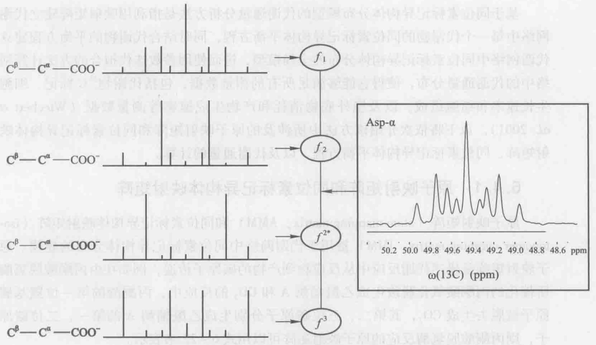

<details>
<summary>spectrogram</summary>

| Spectrum | Chemical Shift (ppm) |
| --- | --- |
| \(C\beta-C\alpha-COO-\) | ~49.85, ~49.75, ~49.65, ~49.55, ~49.45, ~49.35, ~49.25, ~49.15, ~49.05, ~48.95, ~48.85, ~48.75, ~48.65 |
| \(C\beta-C\alpha-COO-\) | ~49.75, ~49.65, ~49.55, ~49.45, ~49.35, ~49.25, ~49.15, ~49.05, ~48.95, ~48.85, ~48.75 |
| \(C\beta-C\alpha-COO-\) | ~49.75, ~49.65, ~49.55, ~49.45, ~49.35, ~49.25, ~49.15, ~49.05, ~48.95, ~48.85 |
| \(C\beta-C\alpha-COO-\) | ~49.75, ~49.65, ~49.55, ~49.45, ~49.35, ~49.25, ~49.15, ~49.05, ~48.95, ~48.85 |
| \(C\beta-C\alpha-COO-\) | ~50.05, ~49.85, ~49.75, ~49.65, ~49.55, ~49.45, ~49.35, ~49.25, ~49.15, ~49.05, ~48.95 |
| \(C\beta-C\alpha-COO-\) | ~49.75, ~49.65, ~49.55, ~49.45, ~49.35, ~49.25, ~49.15, ~49.05, ~48.95 |
| \(C\beta-C\alpha-COO-\) | ~49.75, ~49.65, ~49.55, ~4 |
</details>

图6-9 利用多重峰组分计算不同完整碳片段的相对比例

以天冬氨酸  $\alpha$  碳原子（Asp- $\alpha$ ）为例，来自同一底物分子的相邻碳原子用黑体表示

代谢网络中间代谢物的合成往往来自不同的代谢途径，这些途径可能造成该代谢物中不同的完整碳片段，由此可以解析得到不同代谢途径对该代谢物的相对贡献（Yang et al. 2003）。例如，草酰乙酸可通过三羧酸循环或者回补途径获得。在使用全碳标记与不标记葡萄糖的混合物时，回补反应会将磷酸烯醇式丙酮酸（对应于苯丙氨酸前3个碳原子）的完整C2-C3和C1-C2-C3碳片段带入草酰乙酸（对应于天冬氨酸），而三羧酸循环所生成的草酰乙酸的C2和C3碳原子分别来自不同的底物分子。因此天冬氨酸α碳原子和苯丙氨酸α碳原子的完整碳片段的丰度信息可被用来计算“来自磷酸烯醇式丙酮酸的草酰乙酸”这一通量比率，如式6-20所示:

$$
f _ {\mathrm{OAA from PEP}} = \frac {f ^ {2} (\mathrm{Asp} - \alpha) + f ^ {3} (\mathrm{Asp} - \alpha)}{f ^ {2} (\mathrm{Phe} - \alpha) + f ^ {3} (\mathrm{Phe} - \alpha)} \tag {6-20}
$$

同样，磷酸烯醇式丙酮酸可能通过糖酵解途径和磷酸戊糖途径获得，以及在磷酸烯醇式丙酮酸羧化激酶的作用下由草酰乙酸生成。在使用全碳标记与不标记的葡萄糖混合物时，只有磷酸烯醇式丙酮酸羧化激酶会生成磷酸烯醇式丙酮酸中完整的 C1-C2 碳片段，即碳原子 1 和 2 来自同一个葡萄糖分子，而它们与碳原子 3 来自不同的葡萄糖分子。这样利用式6-21可以计算得到“来自草酰乙酸的磷酸烯醇式丙酮酸”这一通量比率:

$$
f _ {\mathrm{PEPfromOAA}} = \frac {f ^ {2 *} (\mathrm{Phe} - \alpha)}{f ^ {2 *} (\mathrm{Asp} - \alpha)} \tag {6-21}
$$

## 6.4 基于同位素标记异构体分布模型的代谢网络通量分析

基于同位素标记异构体分布模型的代谢通量分析方法是指利用映射矩阵建立代谢网络中每一个代谢物的同位素标记异构体平衡方程，同时结合代谢物的平衡方程建立代谢网络中同位素标记异构体分布的全局模型，进而使用参数迭代拟合的方法计算网络中的代谢通量分布，使得它能够满足所有的测量数据，包括代谢物 $^{13}$ C标记、细胞生长速率和细胞组成，以及胞外底物消耗和产物生成速率等测量数据（Wiechert et al. 2001）。以下将依次介绍该方法中所涉及的原子映射矩阵和同位素标记异构体映射矩阵、同位素标记异构体平衡方程，以及代谢通量的计算。

## 6.4.1 原子映射矩阵和同位素标记异构体映射矩阵

原子映射矩阵（atom mapping matrix，AMM）和同位素标记异构体映射矩阵（isotopomer mapping matrix，IMM）被用于代谢网络中同位素标记异构体分布的建模。原子映射矩阵是描述代谢反应中从反应物到产物的碳原子传递，例如在由丙酮酸脱氢酶所催化的丙酮酸氧化脱羧生成乙酰辅酶A和 $CO_{2}$ 的反应中，丙酮酸的第一位羰基碳原子被脱去生成 $CO_{2}$ ，其第二、三位碳原子分别生成乙酰辅酶A的第一、二位碳原子，则丙酮酸脱氢酶反应的原子映射矩阵可以用式6-22来表示。

$$
A M M _ {\mathrm{Pyr} > \mathrm{AcCoA}} = \left[ \begin{array}{c c c} 0 & 1 & 0 \\ 0 & 0 & 1 \end{array} \right]
$$

$$
A M M _ {\mathrm{Pyr} > \mathrm{CO} _ {2}} = [ 1 \quad 0 \quad 0 ] \tag {6-22}
$$

$AMM_{Pyr > AcCoA}$  和  $AMM_{Pyr > CO_{2}}$  分别是丙酮酸到乙酰辅酶 A、丙酮酸到  $CO_{2}$  的原子映射矩阵，矩阵的列数对应反应物碳原子的个数，行数对应产物碳原子的个数。

同样，同位素标记异构体映射矩阵描述的是代谢反应中从反应物到产物的同位素标记异构体传递。例如，丙酮酸脱氢酶反应的同位素标记异构体映射矩阵可以用式6-23来表示。

$$
I M M _ {\mathrm{Pyr>AcCoA}} = \left[ \begin{array}{c c c c c c c c} 1 & 0 & 0 & 0 & 1 & 0 & 0 & 0 \\ 0 & 1 & 0 & 0 & 0 & 1 & 0 & 0 \\ 0 & 0 & 1 & 0 & 0 & 0 & 1 & 0 \\ 0 & 0 & 0 & 1 & 0 & 0 & 0 & 1 \end{array} \right] \tag {6-23}
$$

$$
I M M _ {\mathrm{Pyr} > \mathrm{CO} _ {2}} = \left[ \begin{array}{c c c c c c c c} 1 & 1 & 1 & 1 & 0 & 0 & 0 & 0 \\ 0 & 0 & 0 & 0 & 1 & 1 & 1 & 1 \end{array} \right]
$$

$IMM_{Pyr > AcCoA}$  和  $IMM_{Pyr > CO2}$  分别是丙酮酸到乙酰辅酶 A、丙酮酸到  $CO_{2}$  的同位素标记异构体映射矩阵，矩阵的列数对应反应物同位素标记异构体的个数，行数对应产物同位素标记异构体的个数。在同位素标记异构体映射矩阵中，1代表相应反应物到产物的同位素标记异构体传递。例如，丙酮酸不带标记的同位素标记异构体000和只有第一位碳原子带标记的同位素标记异构体100，在丙酮酸脱氢酶反应中都生成乙酰辅酶A不带标记的同位素标记异构体00，所以在 $IMM_{\mathrm{Pyr}>AcCoA}$ 中，第一行的第一列和第五列都为1。

原子映射矩阵和同位素标记异构体映射矩阵都只适用于一个代谢反应中的一对反应物和产物。对于可逆反应  $A \leftrightarrow B$ ，正反应 A 到 B 的映射矩阵与逆反应 B 到 A 的映射矩阵是不同的，两者互为转置矩阵。

## 6.4.2 同位素标记异构体平衡方程

利用原子映射矩阵和同位素标记异构体映射矩阵，代谢反应产物的同位素标记异构体分布可以通过反应物的同位素标记异构体分布来计算。例如对于一般的双反应物双产物的代谢反应:

$$
\mathrm{A+B} \xrightarrow {\mathrm{E}} \mathrm{C+D} \tag {6-24}
$$

原子映射矩阵分别用 $AMM_{A>C}$ 、 $AMM_{B>C}$ 、 $AMM_{A>D}$ 和 $AMM_{B>D}$ 表示，则产物的碳原子标记度向量可以用式6-25来计算:

$$
A M M _ {\mathrm{A>C}} \cdot L _ {\mathrm{A}} + A M M _ {\mathrm{B>C}} \cdot L _ {\mathrm{B}} = L _ {\mathrm{C}} \tag {6-25}
$$

$$
A M M _ {\mathrm{A>D}} \cdot L _ {\mathrm{A}} + A M M _ {\mathrm{B>D}} \cdot L _ {\mathrm{B}} = L _ {\mathrm{D}}
$$

$L_{A}$  和  $L_{B}$  代表反应物的碳原子标记度向量，向量中的第 n 个元素代表第 n 个碳原子的  ${}^{13}C$  丰度。通过与相应的原子映射矩阵相乘，可以计算该反应物对产物的碳原子标记度的贡献，进而将各反应物的贡献相加可以计算得到产物的碳原子标记度向量  $L_{C}$  和  $L_{D}$ 。这样，通过酶 E 反应  ${}^{13}C$  标记进入产物的速率可以用式 6-26 来计算:

$$
\frac {\mathrm{d} L _ {\mathrm{C}}}{\mathrm{d} t} = v _ {\mathrm{E}} \cdot (A M M _ {\mathrm{A>C}} \cdot L _ {\mathrm{A}} + A M M _ {\mathrm{B>C}} \cdot L _ {\mathrm{B}}) \tag {6-26}
$$

$$
\frac {\mathrm{d} L _ {\mathrm{D}}}{\mathrm{d} t} = v _ {\mathrm{E}} \cdot (A M M _ {\mathrm{A>D}} \cdot L _ {\mathrm{A}} + A M M _ {\mathrm{B>D}} \cdot L _ {\mathrm{B}})
$$

$v_{E}$ 是酶 E 反应的速率。以式 6-26 为基础，可以构建代谢物 C 和 D 的同位素平衡方程，即 $^{13}C$ 标记的流入速率等于其流出速率。

同样，利用同位素标记异构体映射矩阵可以由反应物的同位素标记异构体分布向量计算产物的同位素标记异构体分布向量:

$$
(I M M _ {\mathrm{A>C}} \cdot I _ {\mathrm{A}}) \otimes (I M M _ {\mathrm{B>C}} \cdot I _ {\mathrm{B}}) = I _ {\mathrm{C}} \tag {6-27}
$$

$$
(IMM_{\mathrm{A>D}}\cdot I_{\mathrm{A}})\otimes (IMM_{\mathrm{B>D}}\cdot I_{\mathrm{B}}) = I_{\mathrm{D}}
$$

$IMM_{A>C}$ 、 $IMM_{B>C}$ 、 $IMM_{A>D}$ 和 $IMM_{B>D}$ 分别代表酶E反应中A到C、B到C、A到D、B到D的同位素标记异构体映射矩阵。I是代谢物的同位素标记异构体分布向量，描述各同位素标记异构体的相对摩尔含量。 $\otimes$ 表示两个同样长度向量中对应元素相乘。这样，酶E反应中产物同位素标记异构体的生成速率可以用式6-28来计算:

$$
\frac {\mathrm{d} I _ {\mathrm{C}}}{\mathrm{d} t} = v _ {\mathrm{E}} \cdot (I M M _ {\mathrm{A>C}} \cdot I _ {\mathrm{A}}) \otimes (I M M _ {\mathrm{B>C}} \cdot I _ {\mathrm{B}}) \tag {6-28}
$$

$$
\frac {\mathrm{d} I _ {\mathrm{D}}}{\mathrm{d} t} = v _ {\mathrm{E}} \cdot (I M M _ {\mathrm{A>D}} \cdot I _ {\mathrm{A}}) \otimes (I M M _ {\mathrm{B>D}} \cdot I _ {\mathrm{B}})
$$

以式6-28为基础，可以构建代谢物C和D的同位素标记异构体平衡方程，即将其同位素标记异构体的生成速率相加，使其等于同位素标记异构体的消耗速率。

在同位素标记异构体平衡方程式中，可逆反应的正反应速率和逆反应速率要分别考虑，如式6-29所示:

$$
I _ {\mathrm{C}} = \frac {\sum v _ {\mathrm{i}} ^ {(\leftarrow / \rightarrow)} \cdot I _ {\mathrm{C}} ^ {i}}{\sum v _ {i} ^ {(\leftarrow / \rightarrow)}} \tag {6-29}
$$

$v_{i}^{(\leftarrow/\rightarrow)}$ 是生成代谢物 C 的正反应或者逆反应的通量， $I_{C}^{i}$ 是酶反应 i 生成的产物 C 的同位素标记异构体分布向量。可逆反应也可以用净通量（ $v^{net}$ ）和交换通量（ $v^{exch}$ ）来描述（图 6-10）。净通量表明反应的净方向，交换通量用于量化反应的双向性，交换通量为零说明反应不可逆，交换通量比净通量大得多说明正向和反向的通量相近，用式 6-30 可以对它们进行相互转换:

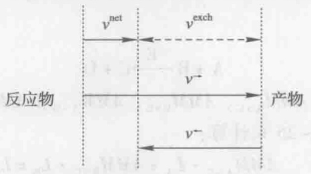

<details>
<summary>flowchart</summary>

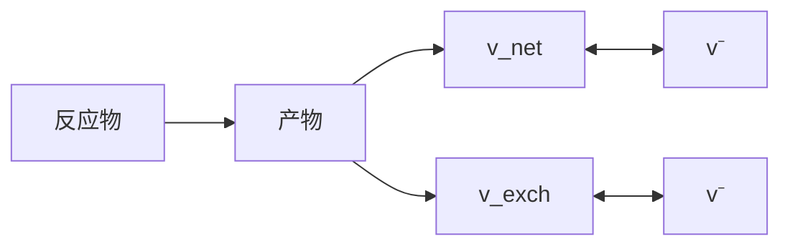
</details>

图6-10 可逆反应的正向和反向通量、净通量和交换通量

$$
v ^ {\mathrm{net}} = v ^ {\rightarrow} - v ^ {\leftarrow} \tag {6-30}
$$

$$
v ^ {\mathrm{exch}} = \min (v ^ {\rightarrow}, v ^ {\leftarrow})
$$

在代谢通量计算过程中，为了计算的方便，可逆反应的交换通量往往利用式6-31转换为一个数值在0到1之间的交换系数（ $v^{exch[0,1]}$ ）:

$$
v ^ {\mathrm{exch[0,1]}} = \frac {v ^ {\mathrm{exch}}}{1 + v ^ {\mathrm{exch}}} \tag {6-31}
$$

如果交换系数为0，则交换通量也为零，说明反应不可逆；如果交换系数为1，则交换通量无穷大，说明反应快速平衡。这样可逆反应也可以用净通量（ $v^{net}$ ）和交换系数（ $v^{exch[0,1]}$ ）来描述。

## 6.4.3 代谢通量计算

基于代谢物及其同位素标记异构体的平衡方程，可以建立代谢网络中同位素标记异构体分布的全局模型，进而计算网络中的代谢通量分布。首先，根据代谢网络中所有中间代谢物的平衡方程，确定自由净通量，即不能用代谢网络的反应计量学所提供的约束条件来确定的净通量，只有当这些净通量的数值被确定后，代谢物的平衡方程组才可解。此外，可逆反应的交换系数也不能通过代谢物的平衡方程来确定，因此和自由净通量一样都需要通过同位素标记异构体平衡方程所提供的其他约束条件来确定。

基于同位素标记异构体分布模型的代谢通量分析使用的是参数迭代拟合的方法，即根据代谢物及其同位素标记异构体的平衡方程，建立代谢通量和同位素标记异构体测量值之间的数学关系，这样代谢通量就可以利用非线性最小二乘拟合的方法来计算。具体步骤如下（图6-11）:首先，对自由净通量和交换系数赋予任意的初始值，求解代谢物平衡方程组，计算代谢网络中所有反应的净通量，根据式6-30和式6-31将各个反应的净通量和交换系数转换为正向和反向的通量；然后，利用迭代计算的方法求解同位素标记异构体平衡方程组，即从任意的同位素标记异构体分布初始值开始，根据式6-29迭代计算各个代谢物的同位素标记异构体分布，使得它们都收敛到各自的稳态值，计算获得所有代谢物的同位素标记异构体分布向量；模拟计算代谢物同位素标记异构体的NMR或者MS的测量值，例如通过GC-MS检测到的丙氨酸TBDMS衍生物（M-57）碎片包含丙氨酸C1、C2、C3三个碳原子，它的质量分布向量可以用丙氨酸的同位素标记异构体分布向量计算得到（式6-32）；通过NMR碳谱检测到的丙氨酸α碳原子的多重峰组分的相对丰度可以通过式6-33计算。

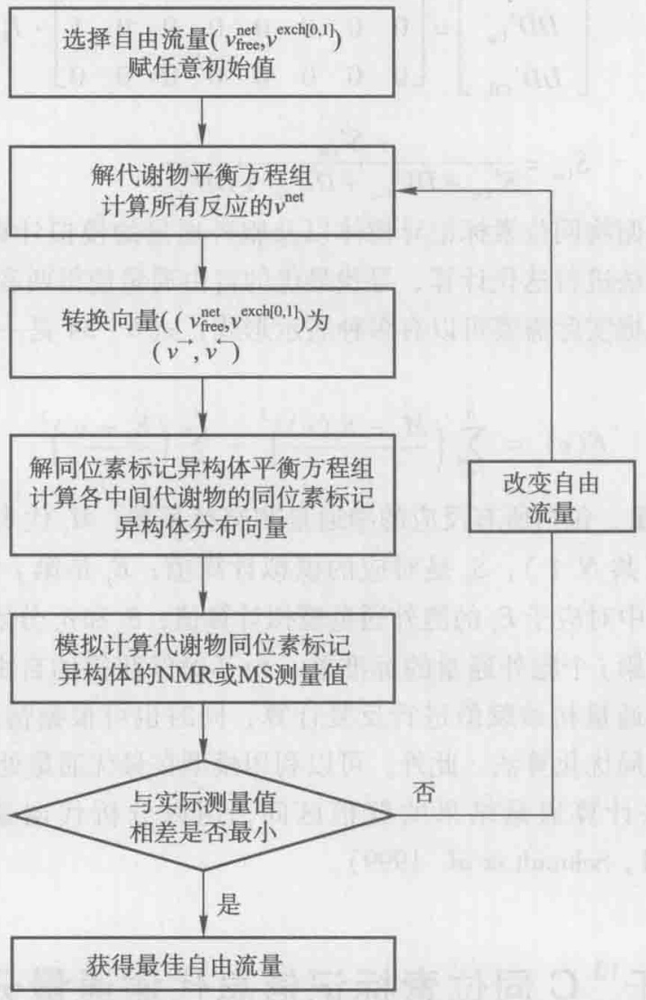

<details>
<summary>flowchart</summary>

```mermaid
graph TD
  A["&quot;选择自由流量(v_free^net, v_exch[0,1"])"] --> B["解代谢物平衡方程组\n计算所有反应的v_net"]
  B --> C["转换向量((v->, v^-))"]
  C --> D["解同位素标记异构体平衡方程组\n计算各中间代谢物的同位素标记异构体分布向量"]
  D --> E["模拟计算代谢物同位素标记异构体的NMR或MS测量值"]
  E --> F{"与实际测量值\n相差是否最小"}
  F -->|否| G["改变自由流量"]
  G --> B
  F -->|是| H["获得最佳自由流量"]
```
</details>

图6-11 基于代谢物同位素标记异构体数据计算细胞代谢通量分布

$$
M D V _ {\mathrm{Alal-3}} = \left[ \begin{array}{c c c c c c c c} 1 & 0 & 0 & 0 & 0 & 0 & 0 & 0 \\ 0 & 1 & 1 & 0 & 1 & 0 & 0 & 0 \\ 0 & 0 & 0 & 1 & 0 & 1 & 1 & 0 \\ 0 & 0 & 0 & 0 & 0 & 0 & 0 & 1 \end{array} \right] \cdot I _ {\mathrm{Ala}} \tag {6-32}
$$

$$
\left[ \begin{array}{c} S _ {\mathrm{CO} _ {2} -} ^ {\prime} \\ S _ {\mathrm{C} \alpha} ^ {\prime} \\ S _ {\mathrm{CH} _ {3}} ^ {\prime} \end{array} \right] = \left[ \begin{array}{c c c c c c c c} 0 & 0 & 0 & 0 & 1 & 1 & 0 & 0 \\ 0 & 0 & 1 & 0 & 0 & 0 & 0 & 0 \\ 0 & 1 & 0 & 0 & 0 & 1 & 0 & 0 \end{array} \right] \cdot I _ {\mathrm{Ala}}
$$

$$
\left[ \begin{array}{c} D 1 _ {\mathrm{CO} _ {3} -} ^ {\prime} \\ D 1 _ {\mathrm{C} \alpha} ^ {\prime} \\ D 1 _ {\mathrm{CH} _ {3}} ^ {\prime} \end{array} \right] = \left[ \begin{array}{c c c c c c c c} 0 & 0 & 0 & 0 & 0 & 0 & 0 & 0 \\ 0 & 0 & 0 & 1 & 0 & 0 & 0 & 0 \\ 0 & 0 & 0 & 1 & 0 & 0 & 0 & 1 \end{array} \right] \cdot I _ {\mathrm{Ala}}
$$

$$
\left[ \begin{array}{l} D 2 _ {\mathrm{CO} _ {2} -} ^ {\prime} \\ D 2 _ {\mathrm{C} \alpha} ^ {\prime} \\ D 2 _ {\mathrm{CH} _ {3}} ^ {\prime} \end{array} \right] = \left[ \begin{array}{c c c c c c c c} 0 & 0 & 0 & 0 & 0 & 0 & 1 & 1 \\ 0 & 0 & 0 & 0 & 0 & 0 & 1 & 0 \\ 0 & 0 & 0 & 0 & 0 & 0 & 0 & 0 \end{array} \right] \cdot I _ {\mathrm{Ala}} \tag {6-33}
$$

$$
\left[ \begin{array}{c} D D _ {\mathrm{CO} _ {2} -} ^ {\prime} \\ D D _ {\mathrm{C} \alpha} ^ {\prime} \\ D D _ {\mathrm{CH} _ {3}} ^ {\prime} \end{array} \right] = \left[ \begin{array}{c c c c c c c c} 0 & 0 & 0 & 0 & 0 & 0 & 0 & 0 \\ 0 & 0 & 0 & 0 & 0 & 0 & 0 & 1 \\ 0 & 0 & 0 & 0 & 0 & 0 & 0 & 0 \end{array} \right] \cdot I _ {\mathrm{Ala}}
$$

$$
S _ {\mathrm{C} \alpha} = \frac {S _ {\mathrm{C} \alpha} ^ {\prime}}{S _ {\mathrm{C} \alpha} ^ {\prime} + D 1 _ {\mathrm{C} \alpha} ^ {\prime} + D 2 _ {\mathrm{C} \alpha} ^ {\prime} + D D _ {\mathrm{C} \alpha} ^ {\prime}}
$$

最后，比较代谢物同位素标记异构体以及胞外通量的模拟计算值和实际测量值，利用非线性优化算法进行迭代计算、寻找最优的自由通量使得两者之间差别最小。最小化的目标函数根据实际需要可以有多种表示形式，式6-34是一类常用的最小化目标函数:

$$
F (v) = \sum_ {i = 1} ^ {N} \left(\frac {M _ {i} - S _ {i} (v)}{\delta_ {i}}\right) ^ {2} + \sum_ {j = 1} ^ {L} \left(\frac {E _ {j} - v _ {k}}{\delta_ {j}}\right) ^ {2} \tag {6-34}
$$

式中，v 是参数向量，包括所有反应的净通量和交换系数； $M_{i}$  代表第 i 个同位素标记异构体测量数据（共 N 个）， $S_{i}$  是对应的模拟计算值； $E_{j}$  是第 j 个胞外通量测量值（共 L 个）， $v_{k}$  是 v 中对应于  $E_{j}$  的胞外通量模拟计算值； $\delta_{i}$  和  $\delta_{j}$  分别是第 i 个代谢物同位素标记异构体和第 j 个胞外通量的标准差。为了确保获得的自由通量为全局最优，可以多次改变自由通量初始赋值进行反复计算，同时也可根据情况选用模拟退火算法、遗传算法等全局优化算法。此外，可以利用模型在最优通量处的线性近似，或者 Monte Carlo 仿真来计算通量结果的置信区间，用以分析代谢通量的统计学特点（Dauner et al. 2001, Schmidt et al. 1999）。

## 6.5 基于 $^{13}$ C 同位素标记信息代谢通量分析的应用

细胞内代谢反应通量反映了相关的代谢功能，因而能够被用来阐明复杂的细胞网络特性，这是单纯的蛋白质或代谢物浓度数据所难以做到的。细胞网络的复杂功能和行为只有通过代谢和调控等多个层面中基因、蛋白质以及代谢物的非线性相互作用才能最终实现，而代谢通量被认为反映了代谢网络内多个相互作用的最终结果，因此和系统生物学高度关联。迄今为止，代谢通量数据已经在辨别新型代谢反应或途径、完善代谢网络模型、验证代谢预测正确与否，以及阐明代谢系统特性和代谢设计原理上得到了越来越广泛的应用。本节结合一些代表性实例对基于 $^{13}$ C 同位素标记信息的代谢通量分析的部分应用作简要介绍。

## 6.5.1 辨别代谢途径及细胞功能

目前为止，定量细胞内代谢通量主要是用于特定基因或环境条件改变情况下的代谢网络响应分析，而基于 $^{13}$ C同位素标记信息的代谢通量分析往往能够发现并确认一些其他方法难以获得的代谢反应或代谢途径信息。实例之一是野生型大肠杆菌在葡萄糖培养基上生长时，细胞内磷酸烯醇式丙酮酸羧化激酶（PPCK）所催化的草酰乙酸转变为磷酸烯醇式丙酮酸和二氧化碳反应的存在及其通量的确定（Yang et al. 2003）。大肠杆菌在未标记的葡萄糖合成培养基内恒化培养达到稳态后，以部分 $[U-^{13}C_{6}]$ 标记的葡萄糖替代原培养基中未标记葡萄糖并对细胞体来源的苯丙氨酸及天冬氨酸中碳标记情况进行二维NMR波谱分析（图6-12），结果清晰地表明了大肠杆菌野生株在葡萄糖上生长时PPCK所催化反应具有较明确的代谢活性。进一步通量计算的结果显示在细胞以较慢的速率稳态生长时（比如稀释率为 $0.1h^{-1}$ ），该反应所提供的PEP占所有PEP合成通量的四分之一以上。同时发现苹果酸酶（ME）催化的苹果酸氧化脱羧反应在低生长速率下也具有一定的活性，而上述两种反应的代谢作用都是原有研究方法所难以发现的，因而此前一般认为葡萄糖上生长的大肠杆菌中这两个反应是不激活的。

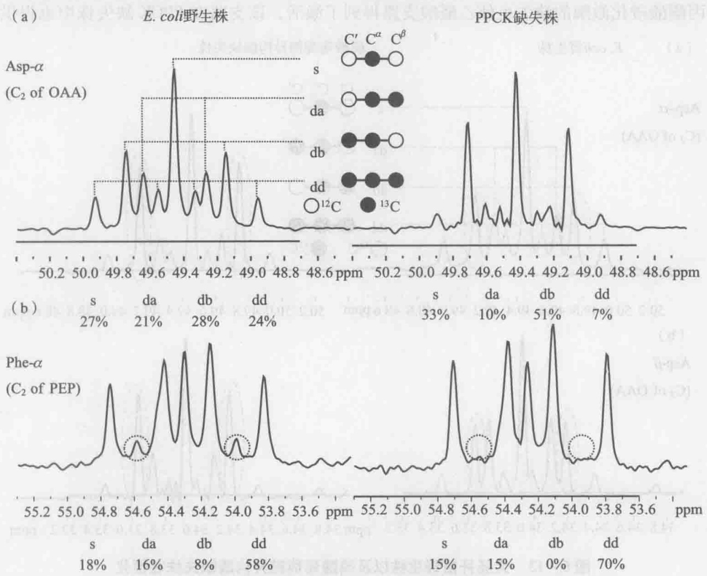

<details>
<summary>spectrogram</summary>

| Sample | Peak Assignment | Chemical Shift (ppm) |
| --- | --- | --- |
| E.coli野生株 | \(Asp-\alpha\) | ~49.5 |
| E.coli野生株 | \(Asp-\alpha\) | ~49.3 |
| E.coli野生株 | \(Asp-\alpha\) | ~49.1 |
| E.coli野生株 | \(Asp-\alpha\) | ~48.9 |
| E.coli野生株 | \(Asp-\alpha\) | ~49.7 |
| E.coli野生株 | \(Asp-\alpha\) | ~49.5 |
| E.coli野生株 | \(Asp-\alpha\) | ~49.3 |
| E.coli野生株 | \(Asp-\alpha\) | ~49.1 |
| E.coli野生株 | \(Asp-\alpha\) | ~48.9 |
| E.coli野生株 | \(Asp-\alpha\) | ~48.6 |
| E.coli野生株 | \(Asp-\alpha\) | ~48.4 |
| E.coli野生株 | \(Asp-\alpha\) | ~48.2 |
| E.coli野生株 | \(Asp-\alpha\) | ~48.0 |
| E.coli野生株 | \(Asp-\alpha\) | ~47.8 |
| E.coli野生株 | \(Asp-\alpha\) | ~47.6 |
| E.coli野生株 | \(Asp-\alpha\) | ~47.4 |
| E.coli野生株 | \(Asp-\alpha\) | ~47.2 |
| E.coli野生株 | \(Asp-\alpha\) | ~47.0 |
| E.coli野生株 | \(Asp-\alpha\) | ~46.8 |
| E.coli野生株 | \(Asp-\alpha\) | ~46.6 |
| E.coli野生株 | \(Asp-\alpha\) | ~46.4 |
| E.coli野生株 | \(Asp-\alpha\) | ~46.2 |
| E.coli野生株 | \(Asp-\alpha\) | ~46.0 |
| E.coli野生株 | \(Asp-\alpha\) | ~45.8 |
| E.coli野生株 | \(Asp-\alpha\) | ~45.6 |
| E.coli野生株 | \(Asp-\alpha\) | ~45.4 |
| E.coli野生株 | \(Asp-\alpha\) | ~45.2 |
| E.coli野生株 | \(Asp-\alpha\) | ~45.0 |
| E.coli野生株 | \(Asp-\alpha\) | ~44.8 |
| E.coli野生株 | \(Asp-\alpha\) | ~44.6 |
| E.coli野生株 | \(Asp-\alpha\) | ~44.4 |
| E.coli野生株 | \(Asp-\alpha\) | ~44.2 |
| E.coli野生株 | \(Asp-\alpha\) | ~44.0 |
| E.coli野生株 | \(Asp-\alpha\) | ~43.8 |
| E.coli野生株 | \(Asp-\alpha\) | ~43.6 |
| E.coli野生株 | \(Asp-\alpha\) | ~43.4 |
| E.coli野生株 | \(Asp-\alpha\) | ~43.2 |
| E.coli野生株 | \(Asp-\alpha\) | ~43.0 |
| E.coli野生株 | \(Asp-\alpha\) | ~42.8 |
| E.coli野生株 | \(Asp-\alpha\) | ~42.6 |
| E.coli野生株 | \(Asp-\alpha\) | ~42.4 |
| E.coli野生株 | \(Asp-\alpha\) | ~42.2 |
| E.coli野生株 | \(Asp-\alpha\) | ~42.0 |
| E.coli野生株 | \(Asp-\alpha\) | ~41.8 |
| E.coli野生株 | \(Asp-\alpha\) | ~41.6 |
| E.coli野生株 | \(Asp-\alpha\) | ~41.4 |
| E.coli野生株 | \(Asp-\alpha\) | ~41.2 |
| E.coli野生株 | \(Asp-\alpha\) | ~41.0 |
| E.coli野生株 | \(Asp-\alpha\) | ~40.8 |
| E.coli野生株 | \(Asp-\alpha\) | ~40.6 |
| E.coli野生株 | \(Asp-\alpha\) | ~40.4 |
| E.coli野生株 | \(Asp-\alpha\) | ~40.2 |
| E.coli野生株 | \(Asp-\alpha\) | ~40.0 |
| E.coli野生株 | \(Asp-\alpha\) | ~39.8 |
| E.coli野生株 | \(Asp-\alpha\) | ~39.6 |
| E.coli野生株 | \(Asp-\alpha\) | ~39.4 |
| E.coli野生株 | \(Asp-\alpha\) | ~39.2 |
| E.coli野生株 | \(Asp-\alpha\) | ~39.0 |
| E.coli野生株 | \(Asp-\alpha\) | ~38.8 |
| E.coli野生株 | \(Asp-\alpha\) | ~38.6 |
</details>

图6-12 大肠杆菌野生株以及磷酸烯醇式丙酮酸羧化激酶缺失株在恒化培养条件下（$0.1\mathrm{h}^{-1}$）部分氨基酸碳原子的NMR波谱

（a）天冬氨酸  $\alpha$  碳原子；（b）苯丙氨酸  $\alpha$  碳原子。（b）图中虚线圈内峰形的有无能够定性地表征磷酸烯醇式丙酮酸羧化激酶催化活性的有无，该酶反应的实际代谢贡献可计算获得

基于 $^{13}$ C 同位素标记信息的代谢通量分析在辨别新的细胞代谢途径和生理功能上有较多成功的应用。Sauer 等（2004）借助该法很好地发现了大肠杆菌中两种转氢酶在辅酶转换上的作用。当大肠杆菌在葡萄糖上进行标准的好氧生长时，除了戊糖磷酸途径及异柠檬酸脱氢酶反应各自提供了部分生物合成所需的 NADPH 以外，研究表明转氢酶 PntAB 催化的 NADH 到 NADPH 的转变也提供了 35%\~45% 细胞生长所需还原力 NADPH。基于代谢通量的研究同时发现，当大肠杆菌生长在 NADPH 过量的环境中时（比如以乙酸为碳源进行生长），另一种能量非依赖型的转氢酶 UdhA 则能很好地催化 NADPH 的再氧化。其他应用实例包括基于葡萄糖的 $^{13}$ C 标记和代谢通量分布计算，在多数微生物中（如根癌农杆菌、类球红细菌、运动发酵单胞菌等）中确定了 Entner-Doudoroff 途径是葡萄糖分解代谢的唯一途径（Fuhrer et al. 2005）；利用 $^{13}$ C 标记的乙酸作为碳源，在金属还原地杆菌中辨别出了一类以乙酰辅酶 A 和丙酮酸作为前体物质的不常见的异亮氨酸生物合成途径（Tang et al. 2007）。而笔者等也在研究磷酸葡萄糖异构酶缺失的大肠杆菌时发现，无论是处于碳源限制还是氮源限制，NMR 波谱和代谢通量比率计算都明确表明了 pgi 敲除菌中乙醛酸支路（图 6-13）和 Entner-Doudoroff 途径得到了激活（前者提供了 20%\~30% 的草酰乙酸合成通量，后者则在丙酮酸合成中贡献了 6%\~11% 的通量），而当大肠杆菌野生株生长在葡萄糖培养基中时，这两个途径并没有活性（图 6-14）（Hua et al. 2003）。同样，磷酸烯醇式丙酮酸羧化激酶的缺失也使乙醛酸支路得到了激活，该支路在 PPCK 缺失株中也提供了近20%合成草酰乙酸的通量（Yang et al. 2003）。此外，笔者通过稳定同位素标记实验，以及GC-MS的测量分析，识别了丙酮丁醇梭菌木糖代谢的通路，并且定量解析了各个途径的代谢通量。结果发现了磷酸解酮酶途径的存在，高达40%的木糖分子通过这条途径被分解代谢，而且磷酸解酮酶途径和磷酸戊糖途径的分配比例随着培养基中木糖浓度的不同而发生很大变化（图6-15）。这是首次在梭菌中发现磷酸解酮酶途径的活性。我们纯化了丙酮丁醇梭菌中CAC1343基因所编码的蛋白，证实了它具有5-磷酸木酮糖磷酸解酮酶活性。在丙酮丁醇梭菌中过量表达该酶造成指数生长阶段木糖消耗速率略有增加，以及乙酸的大量积累（Liu et al. 2012）。上面提及的代谢途径一般既存于细胞代谢中，它们或者在正常情况下不被激活，或者用常规的方法不易发现其代谢作用，而基于稳定同位素标记的代谢通量计算能够较好地与其他方法互补，从而有利于深入发现和挖掘一些代谢途径的功能。

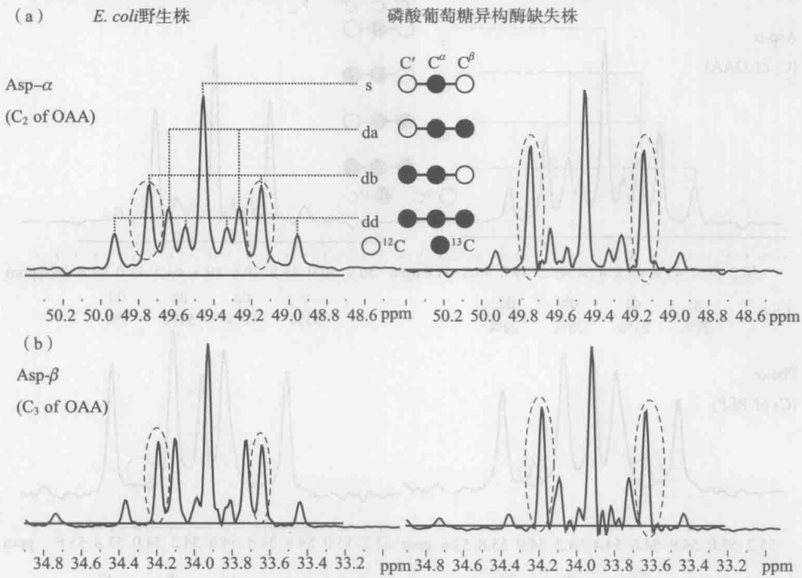

图6-13 大肠杆菌野生株以及磷酸葡萄糖异构酶缺失株在恒化

培养条件下（葡萄糖限制， $0.1\ h^{-1}$ ）部分氨基酸碳原子的 NMR 波谱

（a）天冬氨酸  $\alpha$  碳原子；（b）天冬氨酸  $\beta$  碳原子。图中虚线圈内峰形的大小能够定性地表征乙醛酸支路的活性大小，该支路的实际大小贡献可计算获得

(a) 葡萄糖

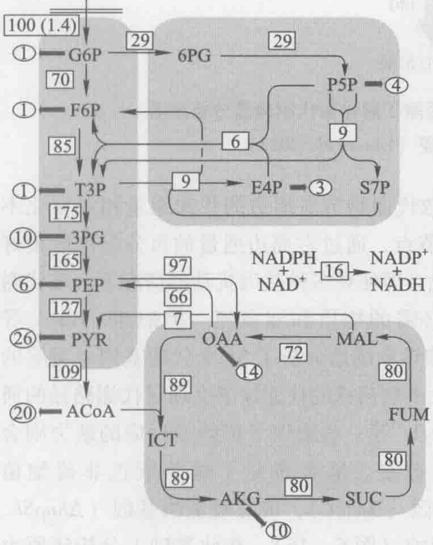

<details>
<summary>flowchart</summary>

This diagram illustrates a biological signaling pathway involving enzymes (G6P, F6P, T3P, PEP, PYR, ACoA) and their interactions with receptors (6PG, 9, E4P, S7P), mediated by various metabolites such as NADPH, NADH, MAL, ICT, AKG, and SUC.
</details>

(b) 葡萄糖

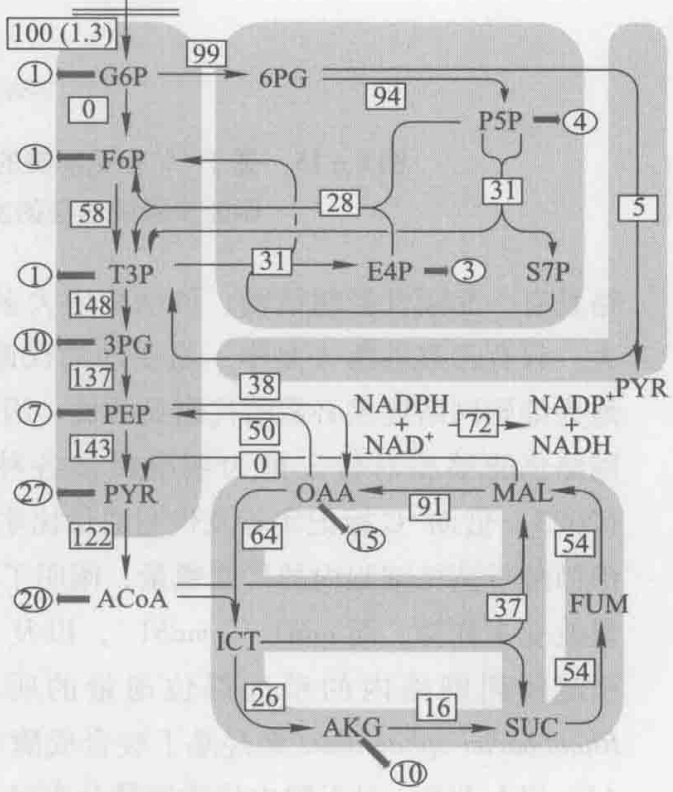

<details>
<summary>flowchart</summary>

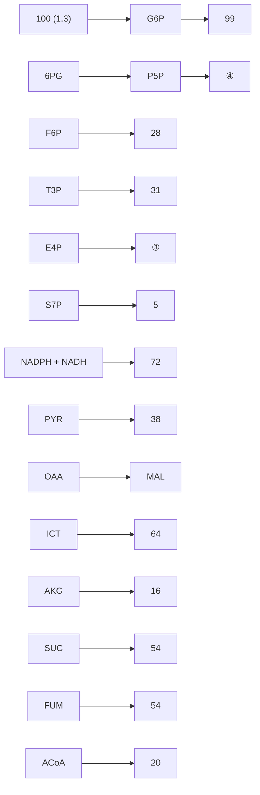
</details>

图6-14 大肠杆菌野生株（a）以及磷酸葡萄糖异构酶缺失株（b）在恒化培养条件下（葡萄糖限制， $0.1\mathrm{h}^{-1}$ ）细胞内代谢通量分布情况（Hua et al. 2003）

图中显示的是相对于各自比葡萄糖消耗速率的相对代谢通量

## 6.5.2 阐明代谢网络结构及调控特性

基于 $^{13}$ C 同位素标记信息的代谢通量分析除了能够用于辨别新的代谢反应和功能之外，还能很好地用于定量阐明代谢网络的结构和调控特性，这些特性对于理解和改造细胞性能很重要，但却往往难以通过各个酶的信息等来简单获得，必须对代谢网络中各个生物化学反应的相互关系进行综合研究。

Fischer 等研究者（Fischer and Sauer，2005）利用 $^{13}$ C 同位素标记实验对 137 株枯草芽胞杆菌基因缺失菌株进行了大规模的代谢通量响应分析，发现了该菌中心代谢网络具有一套刚性控制结构，该结构中大多数代谢物节点周边的代谢通量相对变化不大，只有乙酰辅酶A是唯一易变动的代谢节点，通过它周边通量的再分配即能很好地为细胞网络提供必需的代谢灵活性。因此，即便在多种基因扰动的情况下，该代谢网络仍能够相对稳定地为细胞提供各种必需的物质和能量流。类似地，Blank等（2005）借助 $^{13}$ C标记实验及代谢通量比率推导系统地分析了38个代谢基因单敲除的酿酒酵母菌株细胞内的代谢通量，阐明了大多数菌株的代谢缺陷会通过代谢路径的通量改变来弥补，而 $adh1^{-}$ ， $mdh1^{-}$ ，以及 $zwf1^{-}$ 等一些辅因子依赖型反应的缺失则会引起代谢网络内的稍远部位通量的明显改变。笔者研究了敲除紫色非硫细菌Rhodobacter sphaeroides聚羟基丁酸合成酶基因（ $\Delta phbC$ ），或者吸氢酶基因（ $\Delta hupSL$ 、 $\Delta hupSL\Delta phbC$ ）对于胞内代谢通量分布的影响（图6-16），在此基础上分析还原力NADH的合成和消耗，解析电子流向的变化。研究发现与野生型菌株相比，在产氢效率大幅提高的吸氢酶缺失菌中代谢通量分布发生了显著的改变:Entner-Doudoroff途径对葡萄糖代谢的贡献增加，三羧酸循环的通量也大幅提高，这些代谢途径活性的改变使得NADH的合成大大增加（Tao et al. 2012）。该研究提高了我们对于光合细菌胞内氧化还原平衡及其对产氢影响的认识。油脂微生物是近年来研究的热点，笔者等同样借助 $^{13}$ C标记信息研究了氮源浓度对油脂酵母之一的皮状丝孢酵母细胞内代谢通量分布的影响，在此基础上解析了油脂酵母过量积累油脂的代谢调控机制（Liu et al. 2013）。结果发现与高氮源浓度情况相比，菌体在低氮源浓度下胞内代谢通量发生了明显变化，并得到了细胞液中的苹果酸酶催化的反应提供了该菌株油脂过量积累所需的NADPH，柠檬酸-丙酮酸循环在提供油脂合成前体——乙酰辅酶A的过程中起了关键作用（图6-17）。该研究加深了我们对该油脂酵母代谢特性的认识，为进一步提高油脂含量提供了指导。在另一项研究中，笔者等运用代谢通量分析方法解析了产琥珀酸大肠杆菌细胞内的代谢调控，为进一步认识并提高琥珀酸的生产提供了重要的信息（Liu et al. 2012）。

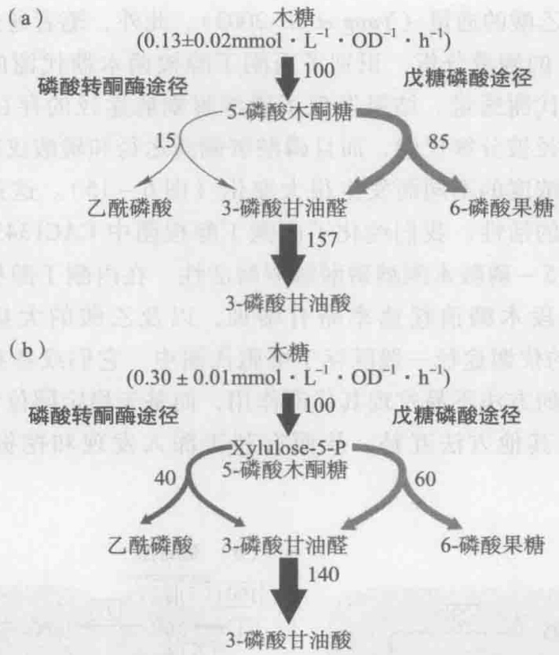

图6-15 基于 ${}^{13}\mathrm{C}$ 标记木糖的丙酮丁醇梭菌代谢通量分析及其磷酸解酮酶途径的发现（Liu et al. 2012）

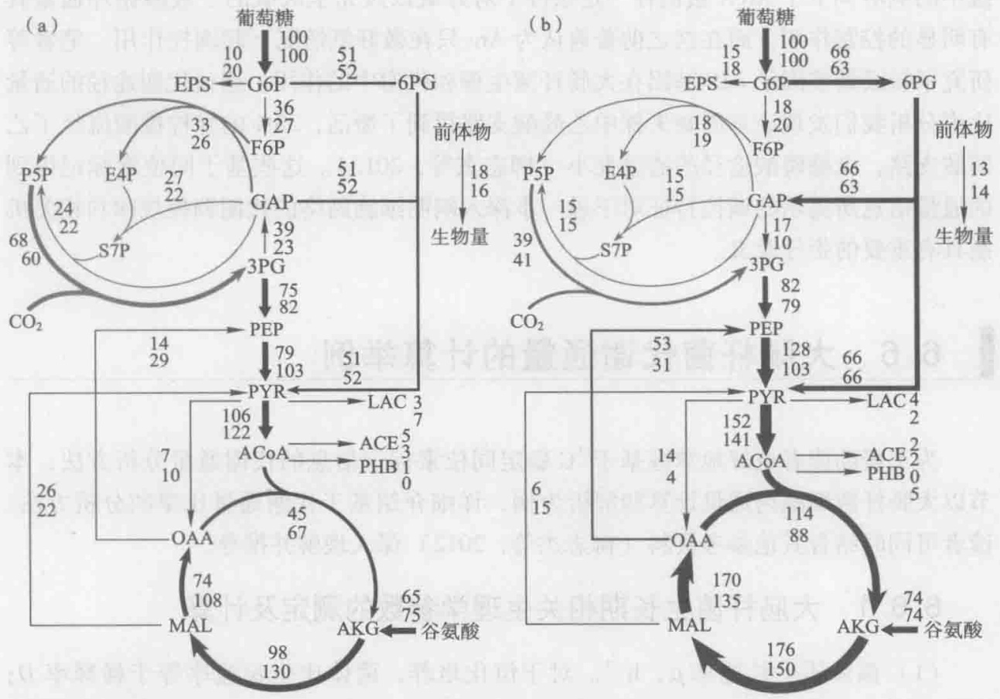

图6-16 类球红细菌野生型、$\Delta phbC$（a）及 $\Delta hupSL$、$\Delta hupSL\Delta phbC$（b）突变株的胞内代谢通量分布（Tao et al. 2012）

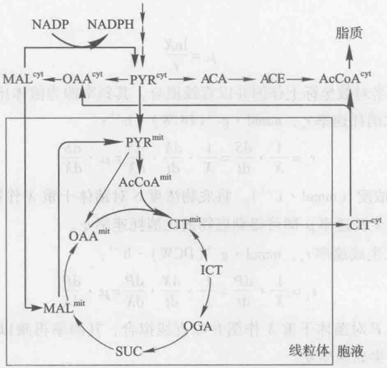

<details>
<summary>flowchart</summary>

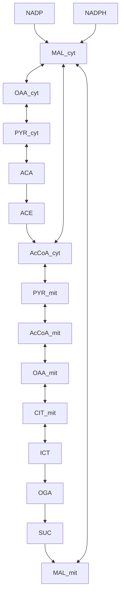
</details>

图6-17 皮状丝孢酵母过量积累油脂过程中的代谢调控机制发现（Liu et al. 2013）

基于 $^{13}$ C 标记信息的代谢通量数据同样能够较好地用于阐明细胞内的转录调控作用，研究实例之一是利用代谢通量解析若干全局调控基因在葡萄糖分解代谢中所起的作用（Perrenoud and Sauer，2005）。研究发现缺氧型氧化还原控制（Arc）双组分系统中的响应调节子 ArcA 蛋白在一定条件下对好氧以及完全厌氧的三羧酸循环通量具有明显的控制作用，而在这之前普遍认为 Arc 只在微好氧情况下起调控作用。笔者等研究了转录调节因子 iclR 基因在大肠杆菌生理和代谢中的作用。通过代谢途径的通量比率分析我们发现该基因缺失株中乙醛酸支路得到了激活，33% 的异柠檬酸流经了乙醛酸支路，戊糖磷酸途径的通量变小（柳志杰等，2012）。这些基于同位素标记得到的通量信息所揭示的调控特征对于进一步深入阐明细胞网络的代谢调控规律和相关机制具有重要的指导意义。

## 6.6 大肠杆菌代谢通量的计算举例

为了帮助读者更好地掌握基于 $^{13}$ C稳定同位素标记信息的代谢通量分析方法，本节以大肠杆菌细胞内通量计算和解析为例，详细介绍基于代谢通量比率的分析方法。读者可同时结合其他参考资料（柳志杰等，2012）深入理解并推导。

## 6.6.1 大肠杆菌生长期相关生理学参数的测定及计算

（1）菌体比生长速率  $\mu, h^{-1}$  。对于恒化培养，菌体比生长速率等于稀释率 D；对于非恒化培养，菌体比生长速率计算方法为式 6-35，式中 X 为菌体干重， $g \cdot L^{-1}$  。

$$
\mu = \frac {1}{X} \cdot \frac {\mathrm{d} X}{\mathrm{d} t} \tag {6-35}
$$

积分得

$$
\mu = \frac {\ln X}{t} \tag {6-36}
$$

将 X 对时间 t 在半对数坐标上作图并以直线拟合，其斜率即为菌体比生长速率  $\mu$ 。

(2) 底物比消耗速率  $r_{s}$ ，mmol·g $^{-1}$ (DCW)·h $^{-1}$ :

$$
r _ {s} = \frac {1}{X} \cdot \frac {\mathrm{d} S}{\mathrm{d} t} = \frac {1}{X} \cdot \frac {\mathrm{d} X}{\mathrm{d} t} \cdot \frac {\mathrm{d} S}{\mathrm{d} X} = \mu \cdot \frac {\mathrm{d} S}{\mathrm{d} X} \tag {6-37}
$$

式中，S 为底物浓度（mmol·L $^{-1}$ ）。将底物浓度 S 对菌体干重 X 作图并以直线拟合，其斜率再乘以比生长速率  $\mu$  即可得到底物的比消耗速率  $q_{s}$ 。

(3) 产物比生成速率  $r_{p}$ ，mmol·g $^{-1}$ (DCW)·h $^{-1}$ :

$$
r _ {s} = \frac {1}{X} \cdot \frac {\mathrm{d} P}{\mathrm{d} t} = \frac {1}{X} \cdot \frac {\mathrm{d} X}{\mathrm{d} t} \cdot \frac {\mathrm{d} P}{\mathrm{d} X} = \mu \cdot \frac {\mathrm{d} P}{\mathrm{d} X} \tag {6-38}
$$

同上将产物浓度 P 对菌体干重 X 作图并以直线拟合，其斜率再乘以比生长速率  $\mu$  即可得到产物的比生成速率  $q_{p}$ 。

基于上面计算方法，可以得到如表6-6所示的大肠杆菌指数生长期的相关生理学参数。

表6-6 大肠杆菌指数生长期的生长特性

| 菌株 | $\mu_{\text{max}}/\text{h}^{-1}$ | $r_{\text{葡萄糖}}/(\text{mmol}\cdot\text{g}^{-1}(\text{DCW})\cdot\text{h}^{-1})$ | $r_{\text{乙酸}}/(\text{mmol}\cdot\text{g}^{-1}(\text{DCW})\cdot\text{h}^{-1})$ | 乙酸得率(mmol/mmol 葡萄糖) | 生物量得率(g/g 葡萄糖) |
| --- | --- | --- | --- | --- | --- |
| BW25113 | 0.61 ± 0.01 | 9.41 ± 0.04 | 3.85 ± 0.01 | 0.41 ± 0.01 | 0.35 ± 0.02 |

## 6.6.2 大肠杆菌代谢模型的建立

为了计算菌体细胞体内的代谢通量，根据大肠杆菌主要中心代谢途径建立其代谢网络模型（图6-18、表6-7），包括29步代谢反应和24个代谢物，该情况下的代谢模型为未定系统。为了使模型可解，可以利用实验测得的代谢物同位素标记异构体分布信息来分析代谢途径的通量比率，进而结合细胞网络中代谢物的平衡式可进行代谢网络反应通量的定量化分析。

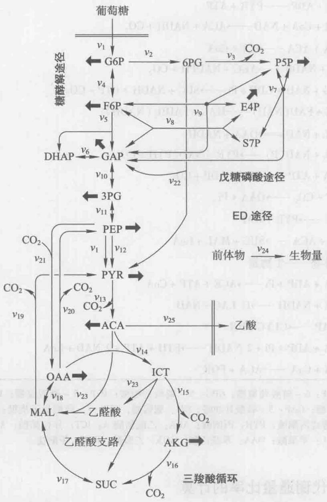

<details>
<summary>flowchart</summary>

This flowchart illustrates the metabolic pathways of glucose metabolism, including glucose desorption, endogenous (ED) pathways, and metabolic processes involving enzymes like CO2, PEP, PYR, ACA, OAA, ICT, MAL, SUC, AKG, and 三羧酸循环.
</details>

图6-18 大肠杆菌中心代谢反应网络（其中粗箭头表示形成菌体的通量）

表6-7 大肠杆菌中心代谢网络化学计量反应式

<table><tr><td colspan="2">反应式</td></tr><tr><td> $v_1$ </td><td>GLC + PEP → G6P + PYR</td></tr><tr><td> $v_2$ </td><td>G6P + NADP → 6PG + NADPH</td></tr><tr><td> $v_3$ </td><td>6PG + NADP → P5P + NADPH + CO2</td></tr><tr><td> $v_4$ </td><td>G6P ← F6P</td></tr><tr><td> $v_5$ </td><td>F6P + ATP → DHAP + GAP + ADP</td></tr><tr><td> $v_6$ </td><td>DHAP ← GAP</td></tr><tr><td> $v_7$ </td><td>P5P + P5P ← S7P + GAP</td></tr><tr><td> $v_8$ </td><td>S7P + GAP ← F6P + E4P</td></tr><tr><td> $v_9$ </td><td>P5P + E4P ← F6P + GAP</td></tr><tr><td> $v_{10}$ </td><td>GAP + NAD + ADP + Pi ← 3PG + NADH + ATP</td></tr><tr><td> $v_{11}$ </td><td>3PG ← PEP</td></tr><tr><td> $v_{12}$ </td><td>PEP + ADP → PYR + ATP</td></tr><tr><td> $v_{13}$ </td><td>PYR + CoA + NAD → ACA + NADH + CO2</td></tr><tr><td> $v_{14}$ </td><td>OAA + ACA → ICT + CoA</td></tr><tr><td> $v_{15}$ </td><td>ICT + NADP → AKG + NADPH + CO2</td></tr><tr><td> $v_{16}$ </td><td>AKG + NAD + GDP + Pi → SUC + NADH + GTP + CO2</td></tr><tr><td> $v_{17}$ </td><td>SUC + FAD (NAD) → MAL + FADH2 (NADH)</td></tr><tr><td> $v_{18}$ </td><td>MAL + NAD ← OAA + NADH</td></tr><tr><td> $v_{19}$ </td><td>MAL + NAD (P) → PYR + NAD (P) H + CO2</td></tr><tr><td> $v_{20}$ </td><td>OAA + ATP → PEP + ADP + CO2</td></tr><tr><td> $v_{21}$ </td><td>PEP + CO2 → OAA + Pi</td></tr><tr><td> $v_{22}$ </td><td>6PG → PYR + GAP</td></tr><tr><td> $v_{23}$ </td><td>ICT + ACA → SUC + MAL + CoA</td></tr><tr><td> $v_{24}$ </td><td>前体物 → 生物量</td></tr><tr><td> $v_{25}$ </td><td>ACA + ADP + Pi → ACE + ATP + CoA</td></tr><tr><td> $v_{26}$ </td><td>PYR + NADH → D_LAC + NAD</td></tr><tr><td> $v_{27}$ </td><td>DHAP → GLYCEROL</td></tr><tr><td> $v_{28}$ </td><td>ACA + ADP + Pi + 2 NADH → ETH + ATP + 2 NAD + CoA</td></tr><tr><td> $v_{29}$ </td><td>PYR + CoA → ACA + FOR</td></tr></table>

表中缩写:G6P:6-磷酸葡萄糖；6PG:6-磷酸葡糖酸；P5P:5-磷酸戊糖；F6P:6-磷酸果糖；E4P:4-磷酸赤藓糖；GAP:3-磷酸甘油醛；Glc:葡萄糖；S7P:7-磷酸景天庚糖；3PG:3-磷酸甘油酸；PEP:磷酸烯醇式丙酮酸；PYR:丙酮酸；ACA:乙酰辅酶A；ICT:异柠檬酸；AKG:α-酮戊二酸；SUC:琥珀酸；MAL:苹果酸；OAA:草酰乙酸；GOX:乙醛酸；FOR:甲酸盐。

## 6.6.3 代谢通量比率的计算

水解得到的氨基酸经过叔丁基二甲基硅烷化合物（TBDMS）衍生化处理，所得到的氨基酸衍生物能够在气相色谱上得到很好的分离，在其后的质谱仪中，衍生化的氨基酸在电子轰击离子化作用下断裂成带有不同碳原子骨架片段的氨基酸碎片，并且