## 推荐阅读

- 1. Thiele I, Palsson B. A protocol for generating a high-quality genome-scale metabolic reconstruction. Nature Protocols, 2010, 5 (1): 93–121.
- 详细叙述了构建一个高质量基因组尺度代谢网络模型需要的步骤，对每一个步骤的目的和方法进行了详细的解释，并对于原核生物和真核生物在构建过程中的差别进行了叙述。
- 2. Oberhardt M A, Palsson B, Papin J A. Applications of genome-scale metabolic reconstructions. Molecular Systems Biology, 2009, 5: 320.
- 从另一个角度详细介绍了基因组尺度代谢网络模型的应用方向，从融合组学数据、指导代谢工程、科学发现导向、多物种关系分析及网络性质挖掘五个方面出发，对于每种应用，都给出了相应的实例进行叙述和分析。

## 8

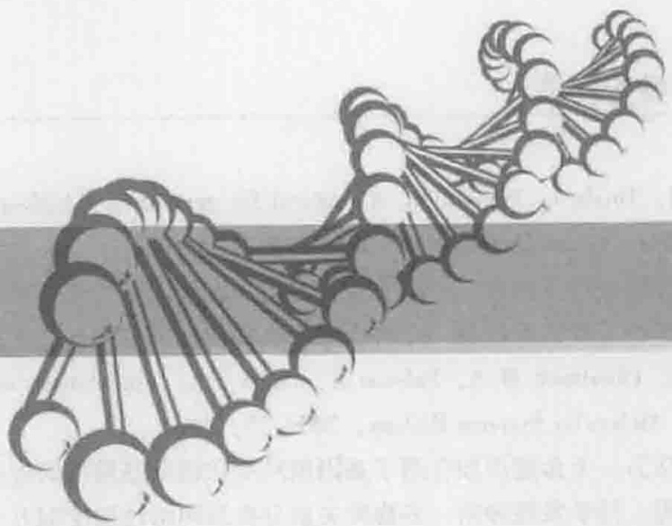

natural_image

Abstract illustration of a DNA double helix structure (no text or symbols)

# 转录物组学技术与代谢工程

## 【本章学习要点】

1. 转录物组与转录物组学的概念
2. 几种转录物组学分析平台技术及比较
3. 转录物组学技术在微生物代谢工程中的应用

中心法则中，由 DNA 经由转录过程生成转录物的过程是非常重要的一环，而转录物在 DNA 携带遗传信息与蛋白质行使功能之间，起着重要的承上启下的作用。经过很多年的努力，科学家们已经发展了多种针对转录物及转录物组进行研究的技术手段。

## 知识导图

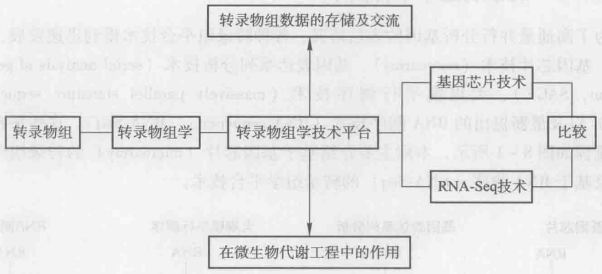

flowchart

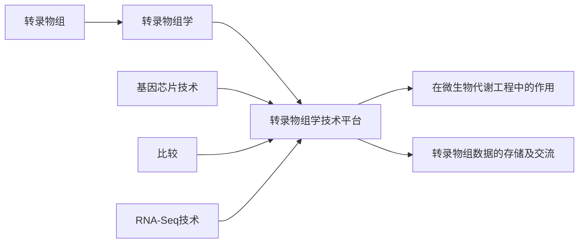

## 8.1 转录物组与转录物组学

## 8.1.1 转录、转录物组与转录物组学

转录（transcription）:读取基因组上 DNA 的遗传信息而合成 RNA 的过程称为转录过程。RNA 转录产物（transcripts）有 mRNA、rRNA、tRNA 和小分子 RNA，在生命行使功能时起到重要作用（Ganem 1987），其中 mRNA 可被用作蛋白质合成的模板，其他 RNA 也会部分参与蛋白质合成过程。

转录物组（transcriptome）:细胞中所有转录产物的总称，即某一细胞在特定时间的基因表达情况。

转录物组学（transcriptomics）:研究转录物组的产生和调控规律的科学就称为转录物组学。与基因组相比，转录物组是动态的，同一细胞的转录物组在不同的生长时期和生长环境下是不完全相同的。转录物组也常称为转录组，而转录物组学也常称为转录组学。细胞的功能是从基因的表达开始的，转录组可高通量地获得基因表达的有关信息，从而可以揭示基因表达与一些生命现象之间的内在联系。据此我们可以高通量表征细胞生理活动规律，确定细胞代谢特性。尽管利用转录组数据高通量检测基因表达水平仅仅有20余年的历史，但转录组学已广泛应用于细胞生命和代谢过程的研究；用于疾病发生机制、诊断和预测的研究；用于药物筛选、作用机制及抗药性的研究；用于新基因的发现；用于环境毒性物质的监控。

基因转录水平检测技术可追溯到 Southern 印迹杂交技术，即 DNA-DNA 之间通过碱基配对机制形成互补链，随后又发展出 Northern 印迹，RT-PCR，RNase-protection assays, differential display, RDA（representational difference analysis）等。但它们不能应用于高通量分析，只能提供细胞内有限的生理信息，已不能满足当前的需求。

## 8.1.2 转录物组学平台技术

为了高通量并行分析基因的表达情况，各种转录组平台技术得到迅速发展，主要包括:基因芯片技术（microarray）、基因表达系列分析技术（serial analysis of gene expression, SAGE）、大规模平行测序技术（massively parallel signature sequencing, MPSS）以及最新提出的RNA测序技术（RNA sequencing, RNA-Seq）。这些平台技术工作流程如图8-1所示，本章主要介绍基于基因芯片（microarray）的转录组学平台技术及基于RNA测序（RNA-Seq）的转录组学平台技术。

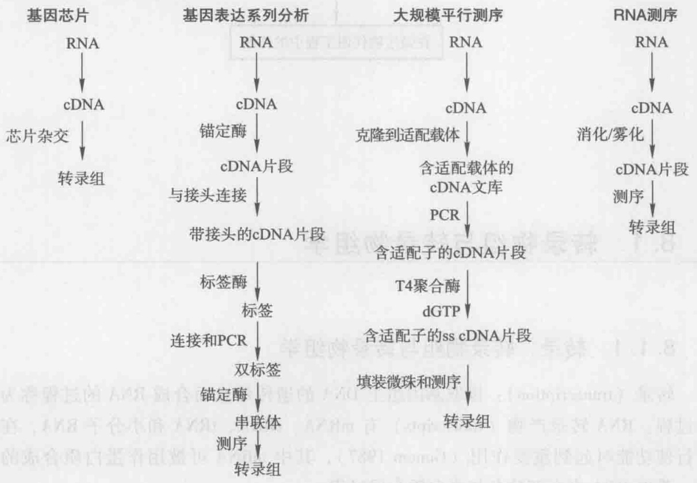

flowchart

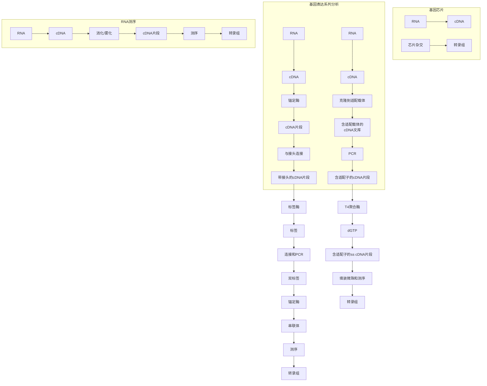

图8-1 主要转录组技术平台工作流程示意图（史硕博等2010）

## 8.2 基于基因芯片技术的转录物组分析

基因芯片技术通过杂交过程来检测核酸，是对已用于核酸定性、定量研究数十年的 Southern 印迹杂交技术和 Northern 印迹杂交技术杂交方法的进一步发展。基因芯片就是根据试验目的和要求，将设计好的检测探针固定在固相支持物上（常用的固相支持物有玻璃、尼龙膜、石英片等载体），并与溶液中的互补靶标发生反应而显现杂交印迹，最后，通过扫描及计算机分析即可获得样品中大量的基因序列及表达信息，以达到快速、高效、高通量地分析生物信息的目的。1995 年，斯坦福大学的 Schena 等（1995）在 Science 杂志上发表论文首次报道了利用基因芯片技术检测拟南芥植株不同组织及不同处理后多个基因的表达水平，显示了基因芯片技术在基因转录表达领域的巨大潜力。Schena 等的工作第一次将高精度机械手点样技术、荧光标记技术、双通道荧光扫描技术以及数据分析软件结合在一起，标志着基因芯片时代的来临。目前，基因芯片开发制造商 Affymetrix、Agilent 等许多公司推出了多种物种的商业化基因芯片（http://www.affymetrix.com; http://www.genomics.agilent.com），为从分子水平和系统观念研究复杂的生物系统提供了一个新的视野。我国也成立了专门的生物芯片公司致力于生物芯片的研究、开发及产业化（http://www.capitalbio.com）。

按其探针制备方法，目前基因芯片主要有两类，一类是 cDNA 基因芯片（cDNA chip）（图 8-2a），另一类是寡核苷酸基因芯片（oligonucleotides chip）（图 8-2b）。基因芯片制备过程中涉及的一些术语如下:

探针（probe）:基因芯片上的核酸分子，能和溶液中的互补靶标发生反应。

靶标（target）:溶液中的标记核酸分子，能与芯片上的互补探针发生反应。

杂交（hybridization）:两条核酸互补链通过 A—T 和 G—C 碱基配对形成 DNA 双链的过程称为杂交。

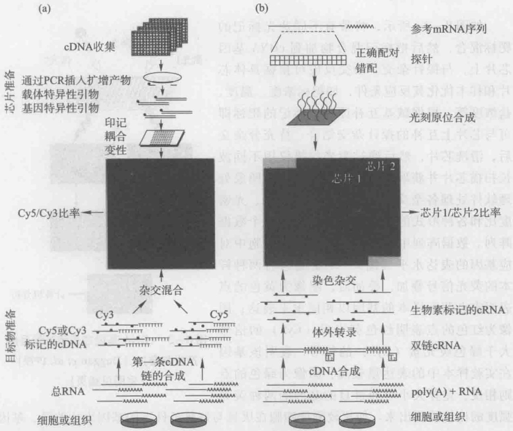

图8-2 两类不同基因芯片的制备及应用示意（Schulze et al. 2001）

## 8.2.1 cDNA 基因芯片技术

## 8.2.1.1 探针

cDNA 基因芯片探针通过 PCR 方法扩增，然后用精密机械手点样系统把 PCR 扩增产物精确分配到经过化学修饰（常见的为氨基修饰、醛基修饰、异硫氰基修饰等）

的固相支持物上组成 cDNA 基因芯片，多用合成后点样法及电子定位法制备。cDNA 基因芯片探针的长度及通量可以任意选择，灵活性大，可根据需要自行制备，在各个实验室得到普及应用，此外包括 Affymetrix、Agilent、中国的博奥生物等公司出售商品化的 cDNA 基因芯片，可以根据客户需要进行个性化定制。

## 8.2.1.2 靶标

通过反转录制备 cDNA 基因芯片靶标。首先提取两种条件下细胞的两种 mRNA 样本，一种 mRNA 样本（通常为对照样本）反转录成 cDNA 并用绿色荧光素（Cy3）标记，另一种 mRNA 样本（通常为实验样本）反转录成 cDNA 并用红色荧光素（Cy5）标记，这些标记分子可在特定的波长范围内被激发出荧光。这些荧光标记的 cDNA 分子即为 cDNA 基因芯片靶标。

## 8.2.1.3 杂交

如图8-2a所示，将带有不同荧光标记的靶标混合，然后把标记混合物加到cDNA基因芯片上，与探针杂交。杂交反应可根据具体芯片和样本优化其反应条件，如靶标浓度、温度、盐浓度等。根据碱基互补原理，标记的靶标即可与芯片上互补的探针杂交结合。待充分杂交后，清洗芯片，然后通过激光扫描仪用不同波长扫描芯片并获取荧光图像，此后还需图象处理软件处理各杂交点的光密度值、面积、光密度比和各种形式的背景噪声使之变成一个数据阵列。数据阵列中荧光强度值反映了细胞中对应基因的表达水平（图8-3）。通常将两种样本的荧光信号叠加，叠加后，图像为黄色的点表明来自两个样本的基因以相同水平表达；图像为红色的点表明红色荧光素（Cy5）的信号大于绿色荧光素（Cy3）的信号，表明该基因在实验样本中的表达量较高，图像为绿色的点则相反，差异大小可通过目的基因的两种荧光

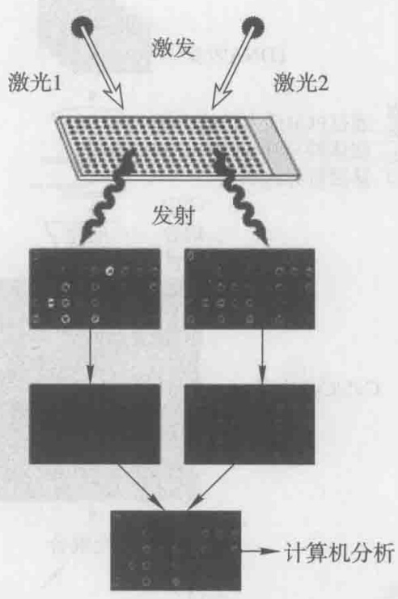

flowchart

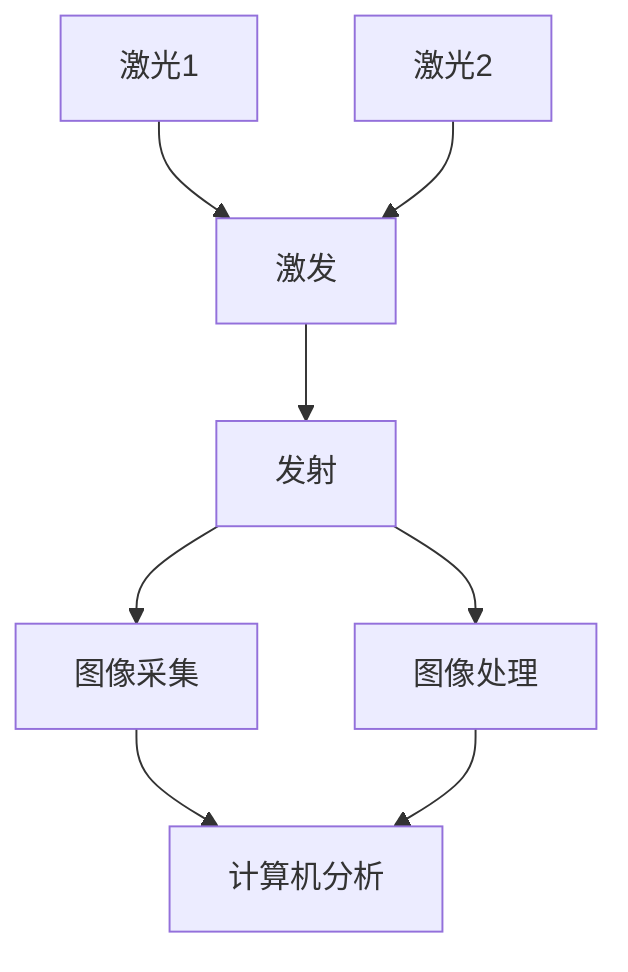

图8-3 cDNA基因芯片荧光信号的产生与叠加（Duggan et al. 1999）（彩图见插页）

强度的比值检测出来。如比较酵母细胞在厌氧与好氧条件下的基因表达差异，基因A在厌氧条件下得到表达（红色荧光信号值为1200个单位），好氧条件下受到抑制（绿色荧光信号值为300个单位），表明基因A在厌氧条件下比好氧条件下的表达提高了 $1200/300=4$ 倍，叠加图像上相应的点为红色。

## 8.2.2 寡核苷酸基因芯片技术

## 8.2.2.1 探针

如图8-2b所示，寡核苷酸芯片探针其制备方法以直接在固相支持物上进行原位合成（in situ synthesis）为主，每平方厘米的探针密度可达上百万。有几种不同的制备工艺，最主要的是Affymetrix公司的专利技术:光引导化学合成法。光引导化学合成法通过一组光掩模定位，将不同碱基的核苷酸按不同次序化学偶联在相应的位点，可以用很少的步骤合成极其大量的高密度探针阵列（图8-4）。具体方法是在经过处理的基质载体表面涂有一层具有光敏保护基团的连接分子，用掩模保护不需要合成的部位，而暴露合成部位。在光束作用下，暴露的合成部位将失去光敏保护基团，从而被活化，接着引入的核苷酸可结合在活化部位，从而可在预设的合成部位连接核苷酸，而引入的核苷酸也带有光敏保护基团，以便下一步合成。由于光掩模成本较高且有光衍射现象发生，NimbleGen公司芯片制作采用无膜芯片合成技术原位合成寡核苷酸探针（图8-5），该法利用微镜晶片反射光束以替代光掩模，显著降低成本，同时提高了芯片密度。微镜晶片由上百万的微镜片组成，每个微镜片都可受控在投射图像上产生一个亮的或暗的像素，起到掩模让光束通过或不让光束通过的功能。

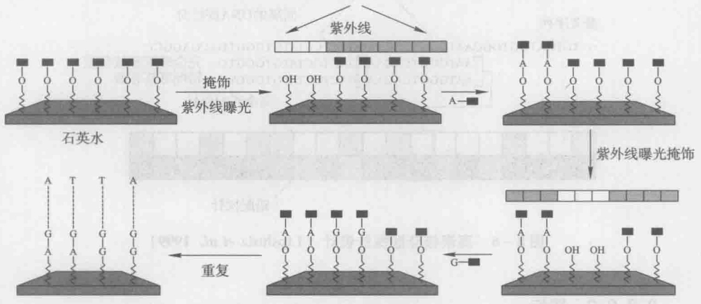

flowchart

图8-4 光引导化学合成法示意图（Venkatasubbarao 2004）

通过一组光掩模定位，将各种碱基的核苷酸按A、C、G、T的次序化学偶联在相应的位点

寡聚核苷酸探针的长度通常为30\~80 bp，具有较高特异性，与其他基因同源区较小，但是仍有一定的可能性发生非特异性结合。为了避免探针可能具有非特异性交叉杂交，Affymetrix公司提出了匹配/错配（perfect match/mismatch）探针对（图8-6）:每一个探针都由一对探针对组成，其中一个是完全匹配的，另外一个是有一个错配的。与匹配探针相比，错配探针在其中央位置有一个单点突变，将匹配探针与错配探针之间的差值作为信号强度，有助于高灵敏度、高准确性确定特异性杂交信号，保证了多张芯片间比较的有效性和可靠性。此外，寡聚核苷酸探针对应一个基因转录产物的探针并非一个，而是一个探针组，这样可以避免碱基组成对杂交效率的影响。探针组设计可以了解到基因各个部位的信号值情况，真核生物RNA从3'端开始降解，故转录物3'端和转录物5'端信号值比值还可作为判断样品RNA是否降解的指标。

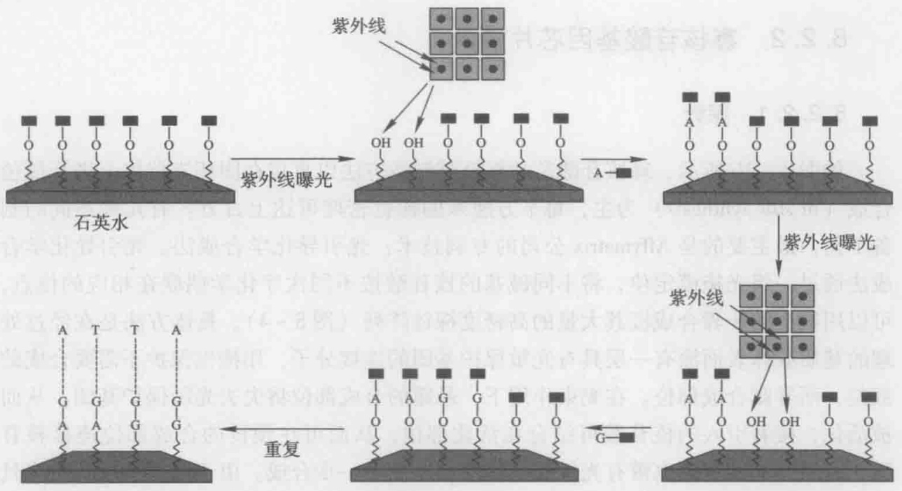

flowchart

图8-5 无膜芯片合成技术原位合成示意图（Venkatasubbarao2004）

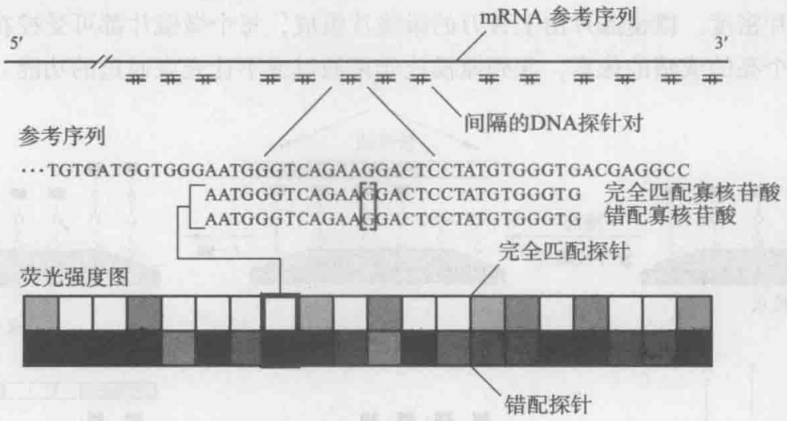

text_image

5' mRNA 参考序列
3'
间隔的DNA探针对
参考序列
…TGTGATGGTGGGAATGGGTCAGAAGGACTCCTATGTGGGTGACGAGGCC
AATGGGTCAGAAGGACTCCTATGTGGGTG 完全匹配寡核苷酸
AATGGGTCAGAAGGACTCCTATGTGGGTG 错配寡核苷酸
荧光强度图 完全匹配探针
错配探针

图8-6 寡聚核苷酸探针设计（Lipshutz et al. 1999）

## 8.2.2.2 靶标

如图 8-2b 所示，同样通过反转录制备寡聚核苷酸芯片靶标。首先提取两种条件下细胞的两种 mRNA 样本，分别反转录为 cDNA，然后再次分别体外转录合成生物素标记的 cRNA，并将其片段化为 35\~200 个碱基大小的片段，即为寡聚核苷酸芯片靶标。杂交前需将 cRNA 片段化，是获得信号最佳灵敏度的关键步骤。与 cDNA 基因芯片不同的是，寡聚核苷酸芯片靶标的标记物只有一种一生物素。生物素可以与相应的亲合素结合（如结合化学发光底物酶、荧光素等），得到最初的杂交信号。这种方法避免了绿色荧光素（Cy3）或红色荧光素（Cy5）对反转录的抑制能力，可以提高标记效率。

## 8.2.2.3 杂交

如图8-2b所示，将带有生物素的寡聚核苷酸芯片靶标加到寡聚核苷酸芯片上，与探针杂交。杂交反应可根据具体芯片和样本优化其反应条件，如靶标浓度、温度、盐浓度等。杂交结束的芯片分别被扫描仪扫描可以得到各自的灰度图，每个点代表一个基因，其信号强度（亮度）反映其对应基因的表达强度。与 cDNA 基因芯片不同的是，杂交实验中与寡核苷酸芯片杂交的是单个样本，而不是 cDNA 基因芯片中测量样本与对照样本的混合物。cDNA 基因芯片的双色法只能比较同一张芯片上两个样本间转录水平差异，确定两个样本间量的差异，芯片间的比较并不可靠，而寡聚核苷酸芯片可以定量确定某一样本的转录水平，可以比较不同芯片间样本的转录水平。

杂交结束的芯片经 Affymetrix 的扫描仪读取数据点后，经图象处理软件处理各杂交点的光密度值、面积和光密度比等数据可使目的芯片阵列图象变成一个数据阵列，再去除图像上的污点以及其他形式的噪声可得到决定相应基因的表达情况的数据。根据每个基因的匹配/错配（perfect match/mismatch）探针组信号值的计算得出各自的显著性 P 值，用来判断样本中有无特定基因的表达，如图 8-7 所示的区间:P 值落在 0\~0.04 被视为存在对应基因的表达（present），落在 0.06\~0.1 被视为不存在（absent），0.04\~0.06 之间的被认为是处于存在与不存在的临界状态（marginal），这些点的可信度将受到质疑，如果对这些点代表的基因感兴趣，需要用其他小通量，高灵敏度的方法独立验证。

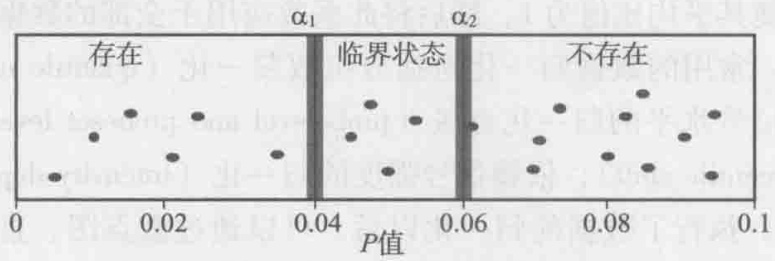

scatter

| Category | P-value (range) |
| --- | --- |
| 存在 | 0.005~0.025 |
| 临界状态 | 0.04~0.06 |
| 不存在 | 0.07~0.095 |

图8-7 差异表达基因 $P$ 值示意图

值得注意的是，P 值为 0.04 表明相对于整个基因组来说，存在 4% 的基因为假阳性特异表达。例如，对于酿酒酵母（S. cerevisiae）而言，其基因组约有 6000 个基因，P 值若选为 0.04，则在所有表达差异显著的基因中有 240 个的可信度将受到质疑。因此为避免这类因素所造成的影响，近年来许多文献选择 P 值为 0.01 作为筛选标准。在 P 值的基础上有些文献将基因表达水平的差异（通常用倍数来表示）作为辅助筛选基因特异性表达的依据。其基本依据为如果倍数在 0.7～1.5 之间，则其呈现的特异性表达数据可能是由于背景噪声所导致，因此其可信度将受到质疑，需要进一步分析确认。对于利用倍数来辅助判定的方法还需要进一步验证，目前并未得到普遍的采用。

基因芯片在判定基因的特异性表达方面的作用与可信度已毋庸置疑，但其缺点是:因实验条件的限制，其测定数据和真实的特异性基因的表达水平（倍数）相比偏低。因此，有些文献在系统分析基因芯片数据后，还进一步对筛选出的特异表达基因进行 RT-PCR 验证。

## 8.2.3 芯片数据分析

基因芯片产生了大量的基因表达数据，从这些纷繁的数据中识别所蕴含的生物学意义成为一个新的难题和热点。探针设计和图像扫描分析的软件较成熟，由相应的芯片公司开发。对于深层次的数据分析，其相关报道有很多，除了明确研究目的以及了解必需的生物学背景，还必须结合不同的统计分析软件、程序语言、数学统计模型进行分析，如 R 语言、dChip、Matlab、MultiExperiment Viewer、GeneSpring GX 等。许多软件或程序语言现在已经有了相应的软件包或相应的命令集合来处理基因芯片数据，如 R 语言中用于读取芯片数据和数据可靠性分析的 affy 软件包、用于确定基因特异性表达的 gplots 和 limma 软件包，用于聚类分析的 apcluster 软件包以及用于数据 GO terms 分析的 GOstats 软件包等。

## 8.2.3.1 芯片数据的归一化与可靠性分析

基因芯片实际实验中存在系统误差，造成的原因有很多，包括荧光染料本身的物理和化学差异性、反转录制备靶标时效率的差异、芯片上探针序列及位置的差异等，使直接比较芯片间数据十分困难。为了精确检测到基因表达水平，以及比较芯片间数据，必须尽量减小系统误差的影响，目前大部分采用的方法是对芯片数据进行归一化（normalization）处理。

归一化方法预先选择一组特定的对照基因，这些基因表达水平不变（如看家基因、特定的内标），或者上调和下调的基因具有对称性（如芯片上全部基因），通过调整标准化系数使其平均比值为1，然后将此系数应用于全部的数据以达到归一化芯片上的全部基因。常用的数据归一化包括分位数归一化（quantile normalization），基于探针和探针集信号水平的归一化方法（probelevel and probeset level summarization），百分比平移（percentile shift），依赖信号强度的归一化（intensity dependent，LOWESS normalization）等。执行了数据的归一化以后，可以通过散点图、直方图、柱状坐标图等来比较直观地反映不同批次的样品数据的杂交情况。图8-8a显示对未采取归一化的原始数据作直方图，每个颜色的曲线代表一个芯片数据。从图中可以发现，由于系统误差，即使是针对同一样本，同一批次的不同芯片所呈现的整体表达水平也不尽相同，曲线并不重合。图8-8b显示对已采取归一化的原始数据作图，代表各个芯片数据的曲线基本重合，此时同一组芯片数据总体表达量十分相近，达到分析标准。

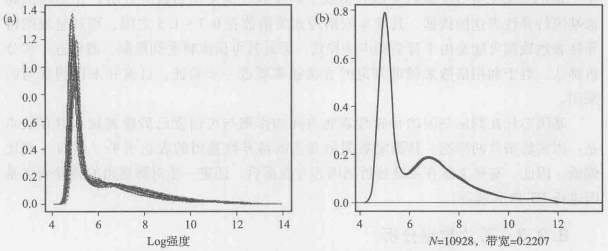

图8-8 归一化前后的基因整体表达水平直方图比较

另外，在芯片设计之初，为了增强测试的准确性和不同批次检测数据的可重复性，芯片上除了包含目标生物的基因探针外，还设计了一些外源基因作为内标，方便多张芯片间有效性、可靠性的比较，也保证了在进行数据归一化处理时能够更好地去除背景噪音以及检测限制所造成的干扰，提高数据的准确性。

在去除背景噪音的影响之后进行具体的数据分析之前，还需分析芯片实验中平行样本之间数据的可靠性分析和每一个芯片数据的可信度，常用分析方法如主成分分析法（principle component analysis）、奇异值分解方法（singular value decomposition）等。如图8-9所示，采用主成分分析法分析一组芯片实验结果，每个点代表一个芯片数据，同一颜色的点代表同一样本，即此实验共有三个样本且每一样本进行了三次重复芯片实验。三个白色点距离较近，每个点所代表的数据可信度较大，其所代表的样本可信度较大；有一个灰色点与其他两个灰色点距离较大，则说明该离散点代表的数据可信度较低，需要将该芯片数据舍弃或替换；而三个黑色点彼此距离较远，所表示的芯片数据和样本可信度很低，需要重新进行实验。

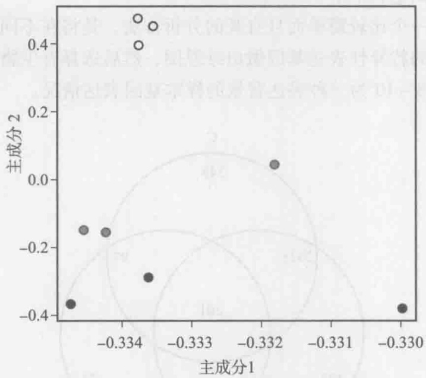

scatter

| Series | 主成分1 (range) | 主成分2 (range) |
| --- | --- | --- |
| Open circles | -0.334~-0.3335 | 0.4~0.5 |
| Solid circles | -0.3345~-0.330 | -0.4~-0.15 |

图8-9 主成分分析法分析一组芯片实验结果

## 8.2.3.2 表达基因的差异分析

基因芯片的主要目的在于发现确定不同样本的基因表达差异。对于 cDNA 芯片，一般用一张芯片上两种荧光染料的比值来衡量基因表达差异；对于寡聚核苷酸芯片，可用不同芯片上的信号比值来衡量基因表达差异。表达差异通常指的是一个基因在两种实验条件下的具有统计学意义的显著性表达改变情况。

当比较两个不同生物样本时，最简单的方法就是根据两个样本的比值来筛选，通常可认为比值在0.5到2之间的基因不存在表达差异，超过该范围的基因则认为表达发生显著改变。不过根据具体实验设计，该筛选标准可以适当调整。比值分析是一种常用的直观的衡量标准，但是该判定比较粗糙，并不能产生最优的结果。有一些基因其表达水平较低，用2倍法比值分析判定容易增大假阳性率；而另一些基因其表达水平较高，用2倍法比值分析判定容易增大假阴性率。

另一种分析基因芯片数据和确定差异表达基因的方法基于统计分析中的 $t$ 检验或方差分析。利用多张芯片采用重复实验，采用假设检验，计算表达差异的置信度，来分析两样本是否具有显著性差异。常用的假设检验，包括两个条件下的 $t$ 检验和多个条件下的方差分析以及多元方差分析。通过 $t$ 检验得到的结果中表达差异不显著的基因数目比实际数目较多，趋于保守；方差分析获得的结果较为满意，但是需要细致的芯片实验设计以及繁琐的计算。

目前，除了以上介绍的方法，还有一些其他基于现代统计学而确立的基因差异分析方法（如噪声抽样法、贝叶斯法等）。各种新的方法不断提出，使芯片数据挖掘得到不断进步，然而任何方法都有其特点，只有与生物学意义相结合，才能达到最佳效果。

## 8.2.3.3 表达模式识别

筛选出不同样品中各个基因的差异表达水平后，就需要有相应的方法来对其进行处理以挖掘芯片数据中所包含的巨大生物信息，目前的分析方法主要包括维恩图分析（Venn diagram）、聚类分析（cluster analysis）等。

维恩图分析是一个比较简单而且直观的分析方法，是将在不同表达背景的样本进行两两比对后得到的特异性表达基因做出维恩图，然后选择有生物学意义的子集进行进一步的分析。图8-10为三种表达背景的样本基因表达情况。

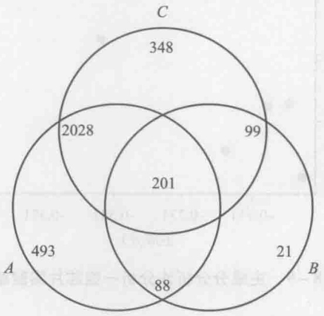

donut

| Region | Value |
| --- | --- |
| A | 493 |
| B | 21 |
| C | 348 |
| A & B | 88 |
| A & C | 2028 |
| B & C | 99 |
| A & C & B | 201 |

图8-10 维恩图表示的不同样本中基因表达变化

聚类分析是表达模式识别的有力工具，通过聚类可揭示各种条件下许多功能相关或共表达的基因。聚类分析又称集群分析，它是在没有关于数据的先验知识情况下研究数据分析的一种方法，该法基于样本中各指标之间的相似性。聚类分析就是将性质相似的对象化分到相同的类别，在同一个类别内对象之间具有较高的相似度，不同类别之间的对象差别较大。聚类所说的类不是事先给定的，而是根据数据的相似性和距离来划分，划分前具体到底应分成几类也是不知道的。聚类分析所采用的分类规则是由聚类算法所决定的，其中包括系统聚类法、分解法、自组织作图、神经网络、动态聚类法、模糊聚类法、k-means聚类等（尤元海等，2009）。在基因芯片数据分析中，应用最为广泛的是系统聚类分析法，聚类的对象可以是基因，也可以是不同条件下的生物学样品。

系统聚类分析法的基本思想是采用类似层层嵌套的形式进行分类，不同的对象根据所使用的距离指标（如相关系数、点积、互信息等）被划分，最相接近的数据点分成一类，然后用同样的方法再计算各类间的距离使之合并成更大的类，较小的类嵌套在较大的类中，形成层层包含的树状形式，树枝的长度可用来评价两组对象的相似程度。常用的距离如皮尔逊相关系数，可计算两个向量的相关性，两个变量之间的相关系数越高，从一个变量去预测另一个变量的精确度就越高，这是因为相关系数越高，就意味着这两个变量的共变部分越多，所以从其中一个变量的变化获知另一个变量的变化的可能性越大。如果两个变量之间的相关系数为1或-1，则完全可由变量X去获知变量Y的值。

系统聚类分析法不仅能够把具有相近的表达模式的基因进行分类，而且可以用图形化的方式表示数据集。如图8-11所示，聚类结果可以用彩色盒图和树状图来直观表示，可便于对表达谱分析结果的理解。从横向的聚类看，是有关基因表达谱的信息，调控类似或功能类似的基因总是聚类很接近，可以找到具有不同表达特征的基因间的相互关系；从纵向上的聚类看，细胞在不同条件下的基因表达谱也是相似地分在一类，能基本反映细胞在不同外部条件下基因表达谱的相似程度，十分有利于研究药物作用机制。值得注意的是，虽然现有的聚类分析法在特定的条件下能提供真实反映数据的结构，但是生物系统的多因素性和非线形性往往被忽视了。此外，样本数也要远远小于基因数，会造成较大的误差，为此一些新的算法仍在不断研究中。

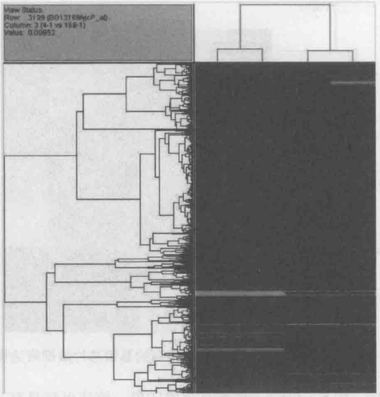

text_image

View Status:
Row: 3129 (B01316587cP_40)
Column: 3 (4-1 vs 108-1)
Value: 0.00852

图8-11 用系统聚类分析法得到的基因芯片数据表达模式（彩图见插页）

聚类分析还可将在不同比对样本中具有相同响应的基因归类。如图8-12a，横坐标代表不同样本，纵坐标与基因的绝对表达水平相关。图中所呈现的不同类别，即为在不同样本中具有相同响应的基因的集合。如在图8-12a聚类1中，相对于参比菌株，在其他菌株中有39个基因表达相对其增加。然后可以对其响应的基因的集合进行重新聚类分析（图8-12b），得到直观的印象。该法可将具有与特定目标基因具有相同变化的类别选出进行具体分析，不仅降低了大规模数据分析的繁琐步骤，同时在揭示基因之间的内部联系方面也起到了很大的作用。

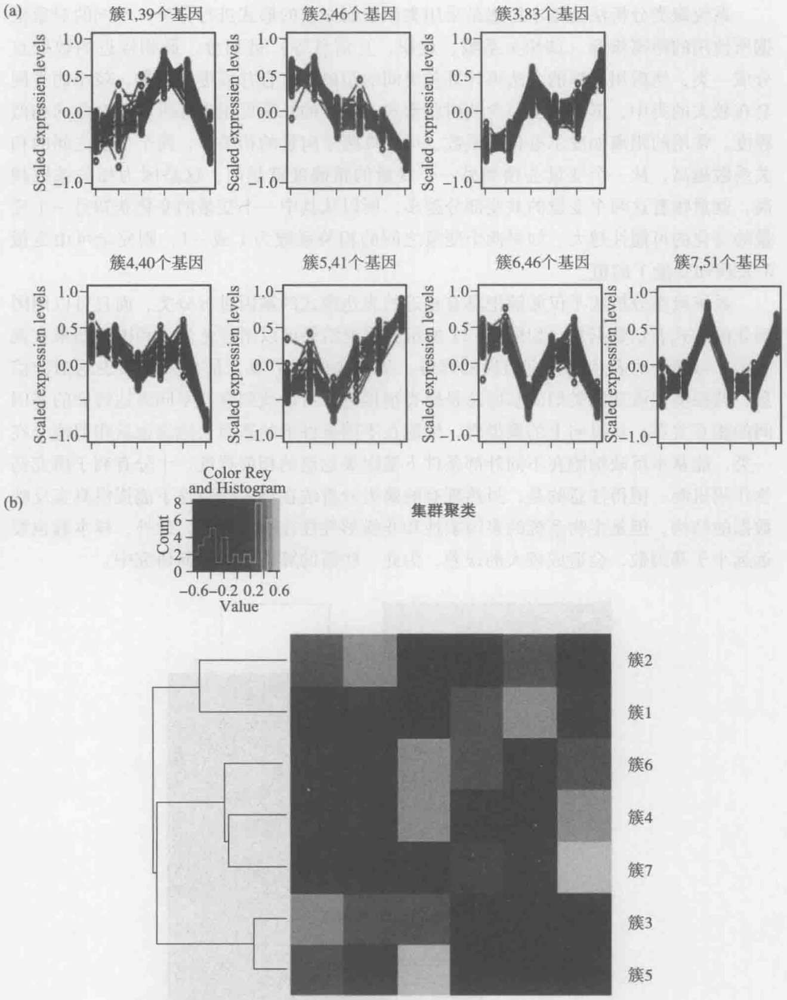

图8-12 用皮尔逊聚类分析法得到的基因芯片数据表达模式

## 8.2.3.4 数据的功能注释与调控

通过基因芯片实验，研究者可以快速得知哪些基因发生了变化。然而，这些差异表达基因的功能，所涉及的分子代谢途径、不同层次多基因表达调控机制的机制，以及所代表的生物学意义，成为研究者所面临的一个关键问题。

目前对单一基因的注释已经开发了很多工具软件，尤其是商业化的芯片生产商提供了相应于其芯片的基因注释信息，如 Affymetrix 公司的 NetAffx、Agilent 公司的 GeneSpring GX 等。提供信息的公司可以把其芯片上对应的基因衔接到众多公开数据库中。目前单一基因的主要功能分析方法基于基因本体论（gene ontology，GO），即一套与基因有关的树状的数据库，其树状分支越细基因的注释也越加详细。通过检索次数据库，用户可一次性获取某个基因的几乎全部已知信息。基因本体论数据库中共有三种分类:分子功能，生物学过程和细胞组分，不同的分类在不同的层次描述相应基因的功能信息。对于已知基因名或蛋白质名的序列，在基因本体论数据库中（http://www.geneontology.org/），只需输入其名称即可检索出该序列的基本信息以及关联图；对于未知基因名或蛋白质名的序列，可以利用基因本体论数据库中 BLAST（basic local alignment search tool）工具进行序列比对而找出拥有近似功能的相关基因。通过基因本体论数据库可以实现功能富集分析，即发现差异表达基因属于哪一个共同的分类，从而分析其如何参与并影响了哪些生物学功能。美国国立卫生研究院（NIH）的研究人员开发的 EASE（expressing analysis systematic explorer）是功能较强大的用于芯片功能分析的工具。EASE 可以发现差异表达基因与哪些 GO 分类相关，提示在某一条件下显著变化的一系列共同作用基因。

对差异基因所涉及的分子代谢途径分析，考虑到生物体内部成分间的整体相互作用，采取系统的观点研究生物，更注重整体，注重各部分间的相互关系。分子代谢途径的重要资源包括京都基因和基因组百科全书（Kyoto encyclopedia of genes and genomes, KEGG）以及 Biocarta 数据库。KEGG 数据库整合当前在代谢网络、分子相互作用、细胞过程等方面的知识，是最为著名的分子代谢途径资源数据库。结合芯片实验数据，研究者可以在 KEGG 数据库中特定的生物学途径中用颜色标记相应的基因，可根据需要绘制途径图，从而直观确定基因芯片中有哪些基因参与了哪些生物学途径。如图 8-13 所示，为 KEGG 数据库中核黄素代谢途径中基因表达变化，灰框标记的为表达水平提高的基因。

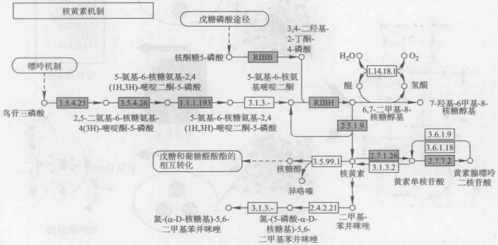

flowchart

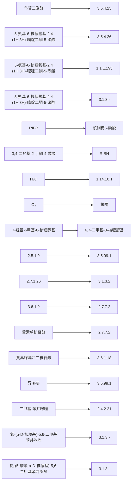

图8-13 颜色标记的KEGG数据库中核黄素合成途径的基因

基因并不只是行使单一的功能，各种基因的表达组合能产生不同的生物学效果。同时，生物代谢调控网络是十分复杂的，分子代谢途径也仅是其中一部分。协同发挥某种特异功能的差异表达基因往往并不局限在某一个途径中，而是分布在不同层次、不同途径的复杂调控网络中。这些往往成为解决、理解生物学现象，增加和获取知识的关键，也受到当前实验手段、数据库、数据分析方法的制约。目前，被多个学术组织共同开发的CytoScape软件是多基因表达调控机制研究的重要工具，可把转录组数据与生物学网络进行整合。用户利用CytoScape软件可以定义特定的亚生物学网络，该亚生物学网络的网络节点描述有哪些基因发生了相互作用。利用MCODE插件，用户可以检索该亚生物学网络在某一条件下是否发生了差异变化，从而发现潜在的基因调控网络。此外，基因芯片表达数据通过结合代谢网络的拓扑结构，以及识别的特征代谢物（reporter metabolites）和特征亚网络（reporter subnetwork），可判断生物调控网络的特征及其中存在的调控关系，揭示不同层次多基因表达、调控和功能的基本规则（Patil et al. 2005）。目前该方法已经建立了在线工具（www.sysbio.se/BioMet/），可以帮助使用者完成简单高效数据功能诠释，如图8-14所示。该在线网络整合了包括特征代谢物、特征亚网络、特征转录因子（reporter factors）、蛋白质间的相助作用以及基因本体论等（Patil et al. 2005, Oliveira et al. 2008）。具体来说，由于细胞在转录水平的上的差异往往与代谢水平上的变化密不可分。能量代谢、辅因子代谢、生物质前体的合成以及胞内的氧化还原水平很大程度上影响了胞内基因水平的表达。特征代谢物分析通过整合和重建基因水平上的代谢网络，提供了一种识别特征代谢物的方法。所谓的特征代谢物，即其能够与变化最为显著的单个或多个基因相作用，从而影响或控制整个细胞对于扰动的响应。特征亚网络即基于蛋白质之间的相互作用，分离出与该扰动相关性很大的代谢子网络。特征亚网络的特征性由 $Z_{\mathrm{score}}$ 来判定，即每个节点的特征变化代表了该条件下整个基因表达水平上最为显著的子网络的集合。特征转录因子分析是将细胞中的所有转录因子其调控蛋白与所有的基因构建成一个完整的网

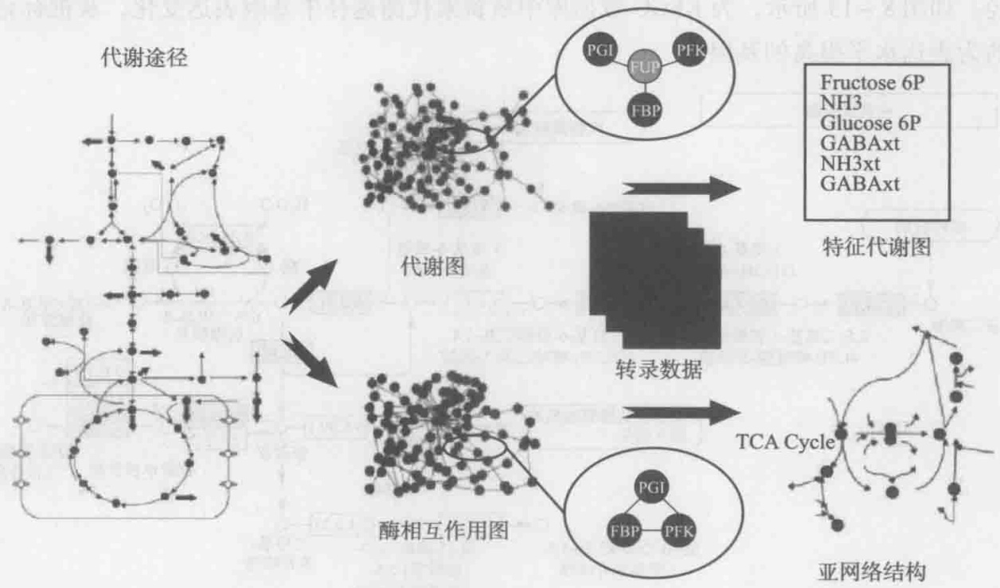

flowchart

This diagram illustrates the process of a TCA cycle in cell culture, showing how gene expression (FGP), phosphatidylcholine (PFK), and FBP interact with an enzyme to generate a specific transcriptional profile.

图8-14 特征代谢物与特征亚网络示意图（Patil et al. 2005）（彩图见插页）