络。利用这个网络及芯片数据所得到的特征转录因子，即受其调控的所有基因作为一个整体对于扰动具有较强的响应。基因本体论分析是将特征表达的基因按照其所在的代谢途径，所在区域以及其所具有的功能进行分类，在没有目标基因的情况下找出细胞对该扰动响应最为强烈的代谢途径。

例8-1 利用寡聚核苷酸基因芯片分析产核黄素工程菌的转录组。

高产核黄素工程菌 B. subtilis RH33 是在经过随机诱变菌株基础上构建的工程菌，含有潜在的未知基因突变点。为了揭示 B. subtilis RH33 的高产机制，进一步指导理性代谢工程菌种改进，Shi 等（2009）基于比较转录组分析技术，比较了产核黄素工程菌 B. subtilis RH33 和野生株 B. subtilis 168 转录组水平表达的差异，同时结合基因序列及代谢物分析，利用系统生物学的观点揭示了产核黄素工程菌的特点，在此基础上识别出进一步改良菌种的靶点，并通过实验证实了该靶点对菌株改良的有效性。在产核黄素工程菌 B. subtilis RH33 中核黄素操纵子中所有基因的表达均大幅度上调，这与细胞内核黄素操纵子的剂量较高以及核黄素操纵子表达的反馈调节被解除有直接关系，这些表达提高的核黄素合成基因是核黄素高产的重要原因。与此同时，发现将核黄素转变为 FMN 和 FAD 的编码黄素激酶和 FAD 合成酶的 ribC 基因表达水平也显著提高，似乎这是不利于核黄素积累的因素，为进一步改造的靶点。然而通过随后的基因测序，发现 ribC 基因编码区中的第 596 位碱基由 G 变为了 A，该突变可以导致 RibC 蛋白的黄素激酶活性下降 95%。由于细胞具有鲁棒性，ribC 基因表达增加是对黄素激酶活性显著降低的响应。在工程菌 RH33 中，和硝酸盐利用有关的基因表达几乎全部增强，特别是 narG 操纵子，该操纵子的基因编码硝酸盐还原酶（主要在缺氧状态下表达）。在缺氧状态下，硝酸盐还原为亚硝酸盐，同时可作为无氧呼吸时电子传递链电子受体。nasBC, narGHJI, nasDE 等基因的表达有利于硝酸盐还原反应，从而在一定程度上缓解了厌氧条件下的能量供应。编码硝酸盐还原酶的 nasB 操纵子和亚硝酸盐还原酶的 nasD 操纵子的表达有一定程度的增强，这个结果很好地解释了工程菌 RH33 在核黄素发酵中的最佳无机氮源为硝酸钠的原因。在工程菌 RH33 中，发现包括嘌呤、甘氨酸合成途径相关基因在内的所有 purR 调节子所调节的基因表达均出现明显的下调（图 8-15），相关基因经测序未发现突变，而这些基因主要涉及核黄素前体物合成途径，故其可能成为限制核黄素产量进一步提高的重要原因。研究表明所有受 purR 调节子调控的基因在其 5'端均存在有一段称为 PurR Box 的保守序列，PurR 蛋白可以特异性的和 PurR Box 结合，从而阻遏基因的转录，使转录水平下降。PurR 蛋白上有一个 PRPP 结合位点，当 PRPP 结合 PurR 蛋白后将影响其与 PurR Box 的结合效率，从而在一定程度上解除 PurR 蛋白对目标基因转录的阻遏作用。细胞内 PRPP 的浓度水平对 PurR 蛋白和 DNA 的结合产生重要的影响。继而通过基因修饰，增强工程菌胞内磷酸核糖焦磷酸（PRPP）浓度，解除 PurR 蛋白对其调控基因的抑制作用，增加核黄素前体物的供给，从而使核黄素产量显著提高达 25% 以上。上述研究工作表明通过转录组分析可以发现与表型有关的重要调节子的表达变化，并根据该变化对菌种改造做出相应的合理设计。

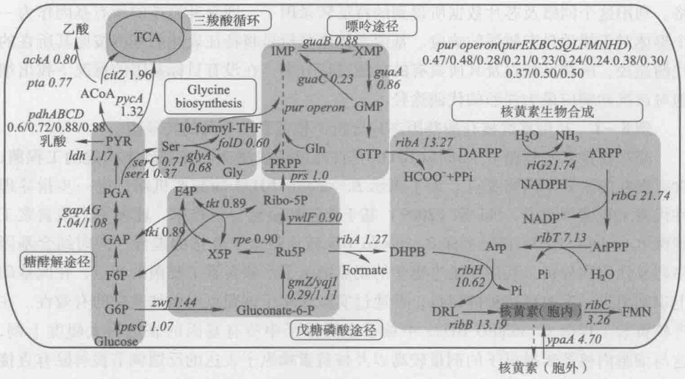

flowchart

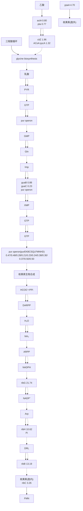

图8-15 核黄素合成及中心碳代谢基因表达情况（Shi et al. 2009）

此图为与野生株 B. subtilis 168 相比，产核黄素工程菌 B. subtilis RH33 的基因表达差异

## 8.3 基于 RNA-Seq 技术的转录物组分析

RNA-Seq 是高通量转录组测序技术的一种，它可以针对 mRNA、小非编码 RNA（small non-coding RNA）以及长非编码 RNA（long non-coding RNA）等，使用高通量测序技术得到它们的序列，进而进行后续的定性和定量分析。RNA-Seq 针对组织或细胞中所有或者某一类 RNA 反转录而成的 cDNA 文库进行测序，可以应用于转录子结构研究（基因边界鉴定、可变剪切研究等），转录子变异研究（如基因融合、编码区 SNP 研究），非编码区域功能研究（non-coding RNA 研究、microRNA 前体研究等），基因表达水平研究以及全新转录子发现，因而使得其在基础研究、临床诊断、疾病机制、代谢调控、分子育种和药物研发等领域得到越来越广泛的应用。

## 8.3.1 RNA-Seq 的原理及实验步骤

将 mRNA 反转录生成 cDNA 后，构建测序文库，通过高通量测序技术对文库进行测序。在获得足够的序列后，将所得序列通过比对（有参考基因组时）或从头组装（de novo assembling）（无参考基因组时）形成全基因组范围的转录谱，进而获得来自不同 mRNA 片段在特定样本中的含量。RNA-Seq 的实验流程如图 8-16 所示，主要包括测序文库的制备、上机测序与测序数据的处理和分析。

## 8.3.1.1 RNA-Seq 测序文库的制备

RNA-Seq 测序最常见的类型是针对 mRNA 的测序实验。以真核生物为例，从提取得到总 RNA 到最终的 cDNA 文库制备，主要步骤有:首先用 oligo（dT）寡聚核苷酸从总 RNA 中富集带有 poly（A）尾巴的 RNA，其中的主要部分就是所需的编码基因所转录的 mRNA；然后将得到的 RNA 片段化，即随机打断为所需大小的片段，再使用随机引物将 RNA 片段反转录为 cDNA 片段；然后，对得到的 cDNA 片段进行末端修复，并在两端连接上测序接头（adaptor）；一般情况下，接下来还需要切胶回收长度范围在一定范围内（如 200 bp）的 cDNA 片段，再经过 PCR 扩增，最终得到可以用于测序的 cDNA 文库。其他类型的转录子测序中的文库构建过程类似。

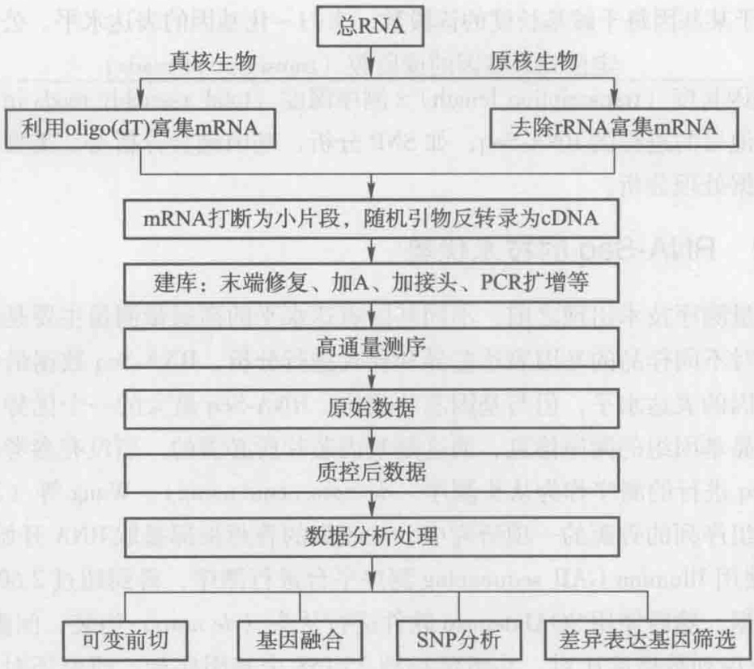

flowchart

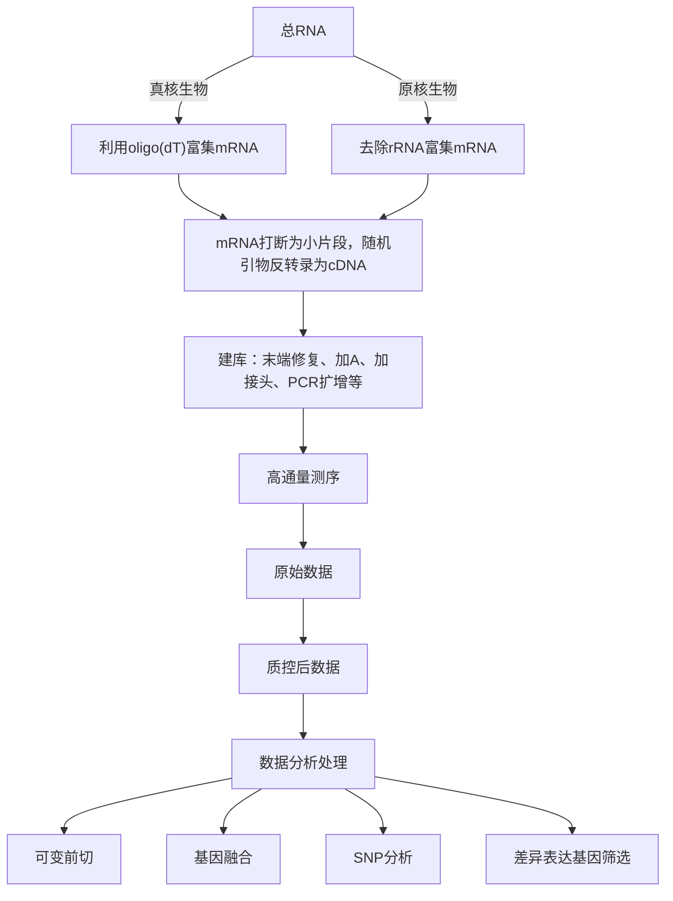

图8-16 RNA-Seq实验流程

## 8.3.1.2 上机测序

自 2005 年以来，以 Roche 公司的 454 技术、Illumina 公司的 Solexa 技术和 Applied Biosystems 公司的 SOLiD 技术为代表的第二代测序技术相继诞生，其主要特点是测序通量高、测序成本及耗时都大幅度下降。目前在几种高通量测序平台中，Illumina/Solexa 平台上的 RNA-Seq 应用最广。Illumina/Solexa 测序技术的基本原理是边合成边测序（sequencing by synthesis, SBS），即测序过程是以 DNA 单链为模板，在生成互补链时，利用带荧光标记的 dNTP 发出不同颜色的荧光来记录待测的碱基。几种常见的高通量平台在测序原理、平均读长、数据量、仪器费用、测序费用、准确率、主要错误类型、运行时间等方面存在各自的不同，具有各自的优、缺点。

## 8.3.1.3 测序数据的处理和分析

高通量的测序数据通常以 FASTQ 格式来记录。原始数据经过质控后，得到质控后数据（clean data），然后需要将所有读段（reads）定位到（mapping）参考基因组上，常用的读段定位软件有 BWA、SOAP 等。根据不同研究目的，接下来需要对数据进行针对性的处理分析，如最常用的差异基因表达筛选中，需要对定位到目标基因上的读段计数，以此来表征目标基因的表达水平。为了实现不同样品的定量可比性，需要保持不同长度的基因以及不同实验批次间基因表达值的可比性，这通常通过归一化处理来实现，常用的方法是计算 RPKM（reads per kilo bases per million reads），即每百万读段中来自于某基因每千碱基长度的读段数，来归一化基因的表达水平。公式为:

$$
\mathrm{RPKM} = \frac {\text {定位到某基因的读段数（transcription reads）}}{\text {基因长度（transcription length）} \times \text {测序深度（total assembly reads in run）}} \times 1 0 ^ {9}
$$

针对其他目的进行的 RNA-Seq，如 SNP 分析、基因融合分析等，需要有针对性的软件进行数据处理分析。

## 8.3.2 RNA-Seq 的技术优势

在高通量测序技术出现之前，不同基因表达水平的高通量测量主要是通过基因芯片，来实现对不同样品的基因表达差异和模式进行分析。RNA-Seq 数据最常见的应用也是检测基因的表达水平，但与基因芯片相比，RNA-Seq 最大的一个优势是:它不一定需要有样品基因组的测序信息，而这是基因芯片所必需的。当没有参考基因组序列时，RNA-Seq 进行的测序称为从头测序（de novo sequencing）。Wang 等（2012）针对尚没有基因组序列的香蕉的一项研究中，从感染的香蕉根部提取 RNA 开始，建立 cDNA 文库，使用 Illumina GAII sequencing 测序平台进行测序，得到超过 2600 万条读段的高质量数据，然后使用 SOAPdenovo 软件进行从头（de novo）组装，间隙填补（gap filling）以及序列数据库比对，共组装得到 25158 个基因序列。研究还对 Foc TR4 感染相对于对照组香蕉样品的基因表达水平进行了对比，发现苯丙氨酸代谢、苯丙生物合成及 α 亚麻酸代谢等途径受到了感染的影响。此外，RNA-Seq 相对于基因芯片还具有其他一些明显的技术优势，如表达信号数字化，灵敏度高，分辨率高至单碱基，基因表达定量范围无饱和区，起始 RNA 用量少，发现新的转录本，并准确地识别可变剪切位点等。

在进行 RNA-Seq 时，一个需要注意的问题是测序的深度问题。细胞中成千上万个转录子，转录子的丰度又存在 $10^{3\sim4}$ 甚至更高的差别，因此决定测序需要的数据量，即深度测序需要测多深对于转录组的覆盖率是很重要的。Haas 等（2012）在 2012 年的一项研究，系统的检查了 RNA-Seq 的读段数（Reads）对单个细菌转录组分析以及样品间基因表达比较的影响。结果显示，使用 Illumina HiSeq 测序仪，一条泳道（lane）产生的数据量，大大地超过了对很多种细菌转录组分析所需的数据。而且，随着测序深度的提高，对那些来自假转录子或基因组 DNA 污染的 cDNA 的检测也会提高。此外，当转录组不是很大时，可以将多个 cDNA 文库分别加上各自的标签（barcode）后混在同一条泳道（lane）测序，这样可以检测到每个样本中的绝大多数 cDNA，对多个样品的混样分析有利于准确鉴定不同样本间的差异表达基因。一般说来，测序过深或过浅都是不好的，应该根据不同的实验目的及物种基因组大小进行合适的选择。

## 8.4 两种转录物组分析平台技术的比较

在功能基因组学的研究中，转录组分析在揭示基因表达调控的复杂性方面总是处于中心位置。经过20多年基因芯片技术的开发与应用，其已经成为一种成熟的技术，提供了极为广泛有用的基因表达信息，超过90多万的基因芯片检测结果储存于基因表达数据库供研究者共享。最近，由于新一代测序（next generation sequencing，NGS）技术的迅速发展，转录组研究获得了新的动力。NGS可以进行高通量核酸分子（DNA或RNA）测序，例如DNA-Seq或RNA-Seq。由于RNA-Seq技术的迅速发展，转录组研究的运行成本大大降低。基于杂交的转录组研究主要强调ORF表达的差异，而RNA-Seq能够分析基因组范围的转录，可以提供附加的信息，例如新的转录物smRNA，miRNA以及一些剪切事件。此外，RNA-Seq还可分析已经转录的但是非翻译的区域，这些区域在基因表达中可能是起作用的。为了利用已建立的基因芯片技术平台及其丰富的信息，同时充分发挥RNA-Seq的优势，由Nielsen主导的由多国研究者组成的团队，在国际上首次对基因芯片技术平台及RNA-Seq技术平台进行了全面详细的比较（Nookaew et al. 2012），提供了非常有用的信息。

例8-2 基于RNA-Seq技术与基因芯片技术转录组分析的跨平台比较:以酿酒酵母为例。

微生物初始培养所用的菌株是酿酒酵母 S. cerevisiae CEN. PK-113-7D，其用于 DNA-Seq（Illumina HiSeq 2000 平台）和转录组分析，以减少技术变化及单核苷酸变化（SNVs）。用控制良好的分批培养和恒化培养发酵设备，在两种不同的代谢条件下进行培养。通过三次重复培养，从样品中提取 DNA 和 RNA。所提取的 RNA，平行进行基因芯片技术（Affymetrix 平台）和 RNA-Seq 技术（Illumina HiSeq 2000 平台）转录组分析。DNA-Seq 数据用于识别菌株 S. cerevisiae CEN. PK-113-7D 和参考菌株 S. cerevisiae S288 之间的遗传变化（SNVs 和 indels）。用参考映射法（reference mapping approach）和从头组装法（de novo assembly approach）对 RNA-Seq 数据进行分析。

该研究介绍了通过新一代测序技术得到的转录组数据分析不同方法的综合性对比，也介绍了应用最广泛的两种转录组分析平台技术（RNA-Seq 和基因芯片）之间的横向比较。他们评价了包括在 RNA-Seq 数据分析过程中不同处理步骤的贡献，强调了使用不同的读段-比对器（read-aligners）及不同统计方法的重要性。实验的重复性及不同平台之间结果的一致性都很高。对于在用 RNA-Seq 和基因芯片进行差异基因表达识别中出现不一致的情况，主要是由于在 ORF 上和在基因芯片上发现的遗传变化。

## 8.5 转录物组数据的存储及交流

基因芯片技术必须在精确控制的条件下进行，操作者的素质和水平直接影响着实验结果的精确性。此外，基因芯片初始的实验方案、实验材料、原始扫描图像、图像处理方法和数据归一化方法等信息间的差异妨碍了不同研究人员基因芯片数据间的比较。作为学术论文的补充资料在网上发布了大量的基因芯片数据，对于寡核苷酸芯片数据有的是P/A/M表示，有的是荧光强度值。因为这些数据文件没有包含原始的实验方案、实验材料、原始扫描图像、图像处理方法和数据归一化方法等信息，对于要比较或整合分析来自不同研究小组的基因表达数据是非常困难的。为了解决这个问题，真正实现数据的共享，就必须有一个统一的标准来规范。2001年基因芯片表达数据协会（microarray gene expression data society）提出了基因芯片试验的标准方案，即 MIAME 方案（minimal information about a microarray experiment, www.mged.org/mi-ame），MIAME 方案尝试用最少的信息来描述并建立基因芯片实验数据的标准格式，所有芯片厂家、研究者都采用此标准，促进了基因芯片数据的交流和比较（Brazma et al. 2001）。依照 MIAME 方案进行芯片实验已被全世界的科学工作者、科学期刊及科学团体所广泛认可。

目前因特网上大量转录组学数据主要是利用基因芯片技术产生的，收集、存储基因芯片表达数据的最有影响的三大数据库是 GEO 数据库（gene expression omnibus）、ArrayExpress 数据库和 SMD 数据库（Stanford microArray database）。这三大数据库接受和储存全球研究者根据迈阿密原则提交的基因芯片数据。这三大数据库还包括一些非阵列技术所获取的技术，如基因表达系列分析（SAGE）、RNA 测序（RNA-Seq）技术产生的序列。GEO 数据库是第一个同时也是最重要的微阵列高通量实验数据的公共贮存库，凭着操作简单、数据全面、免费共享等特点，在基因表达、数据挖掘、信息推广等方面发挥着重要作用，尤其是学术机构在发表论文时所用的蕴含着丰富的生物学知识实验数据都可以免费提供给全世界的研究人员下载使用。除了以上 3 个综合性的基因表达数据库外，还有一些专门的基因表达数据库，这些数据库收集的数据往往具有物种特异性。此外一些大型公司也拥有自己的数据库，例如 Celera Genomics（Rockville，MD）和 Incyte Genomics（Palo Alto，CA），但他们只提供有偿服务。

基因芯片技术已成为一项非常稳定可信的实验技术，由美国食品药物管理局（US food and drug administration, FDA）华裔科学家石乐明领导实施的基因芯片质量控制联盟（microArray quality control, MAQC）于2006年发表一套报告（Shi et al. 2006），对基因芯片检测数据的重现性、可靠性进行了为期两年的研究，显示出在不同实验室之间基因芯片技术平台内部的数据具有高度的一致性和重现性以及和其他基因表达方法（如RT-PCR）的高度相关性，肯定了芯片数据的可信性。2010年MAQC计划发布了其第二阶段研究成果（Shi et al. 2010），对建立基于基因芯片的数据模型及其预测能力的关键因素进行探讨，并提出其数据分析指南。当下MAQC计划正在进行其第三阶段研究，致力于评估基于RNA-Seq技术产生的转录组数据。

基于其他转录组测定技术平台的数据相对较少，除了提交到以上三大公共数据库外，也有着其专门的数据库。对于基因表达系列分析技术，确定以 SAGE 标签为代表的特定转录物是 SAGE 实验结果分析的关键，目前主要利用因特网和其他基因数据库资料进行比较分析，获得其对应关系，对数据库及系统软件的帮助依赖较高，其专门的数据库有 SAGExplore、SAGEmap、SAGEnet、Mouse SAGE site 等。受美国国家科学基金会及美国农业部资助建立的植物大规模平行测序技术数据库（http://mpss.udel.edu/，包括拟南芥、葡萄、豆类、水稻及其稻瘟病菌）是最重要的大规模平行测序技术数据库。目前大规模平行测序技术的主要服务商是位于美国加州的 Illumina 公司（Lynex 公司被其合并），Illumina 公司提供 BeadStudio 数据分析软件具有多个模块，集成的数据解决方案有效帮助使用者进行数据获取和数据分析。基于 RNA-Seq 技术的转录组数据尚无专门数据库报道，其数据主要提交到 NCBI 的 GenBank。

## 8.6 转录物组学技术在微生物代谢工程中的应用

随着高通量基因表达分析技术的飞速发展，转录组数据大量产生，转录组谱可高通量分析基因组的结构特征和表达信息，并据此推断相应未知基因的功能，揭示特定调节基因的作用机制，为在 RNA 水平上阐明、改造细胞生命活动创造了条件，为代谢工程菌种改进提供了强有力的工具。

## 8.6.1 减少副产物及提高产物耐受性

微生物在其发酵过程会分泌一些胞外代谢物，这些代谢物会造成外部环境的变化，例如 pH、溶氧的变化以及乙醇、乙酸、乳酸等副产物的积累。这些参数的改变会对微生物发酵体系产生不良影响，从而致使微生物生长速率或产品生成速率下降，同时副产物的积累也意味着碳源的浪费，影响最终产物的产量。近年来有研究者通过基因敲除，直接切断乙酸等副产物生物合成途径来降低副产物的生成，但是往往没有达到预期效果。为了解决此问题，Veit 等（2007）恒化培养 E. coli，通过改变葡萄糖流加速率使乙酸生成速率发生变化，分析乙酸生成速率变大时的转录组变化。研究发现 sdhCDAB、sucB、sucC、acnB、lpdA、fumC、mdh 等基因以及 acs-yjcH-actP 操纵子与乙酸形成负相关。将 sdhCDAB-b0725-sucABCD 系列基因自身的启动子  $P_{sdhC}$  更换为强启动子  $P_{tet}$  可加强其表达，进而导致乙酸生成量明显下降，同时其生长速率和葡萄糖消耗速率基本未变。

乙醇是被公认为最有发展前景的可再生清洁能源之一。然而，发酵过程中产生的乙醇对酵母细胞的生长和代谢都具有较强的抑制作用，因此乙醇耐性是选育发酵生产燃料乙醇菌种的重要指标。Hirasawa 等（2007）比较了两株具有不同的乙醇耐性的 S. cerevisiae 在 5% 乙醇存在下的转录组差异。其利用聚类分析方法将差异表达基因分成 29 个类别，并将潜在的影响乙醇耐性的基因缩小到了大约 400 个。研究人员接着将这 400 个基因的单基因缺失菌株在 5% 乙醇存在下进行培养，指出色氨酸合成基因（TRP2、TRP3、TRP4、TRP1、TRP5）的表达水平与乙醇耐性具有紧密关系。研究人员然后利用基因工程技术过量表达相关基因（TRP2、TRP3、TRP4、TRP1、TRP5），最终结果表明，过量表达色氨酸合成基因可以使无乙醇耐性的菌体具有 5% 的乙醇耐性，而且外源添加色氨酸并同时增强表达色氨酸透性酶（TAT2）同样可以增加乙醇耐性。Wang 等（2012）利用 RNA-Seq 技术对光合蓝细菌集胞藻 PCC 6803 与乙醇抗性有关的基因及基因网络进行了分析，针对集胞藻对照组与乙醇处理组的 RNA 样品，采用 RNA-Seq 技术，鉴定得到了一系列差异表达的基因。

## 8.6.2 提高蛋白质的产量

微生物被广泛用来发酵生产蛋白质，如胰岛素、淀粉酶、干扰素。蛋白高产菌株会给菌体带来代谢负担，引起自身压力应激反应而负调控目的蛋白生产。

为了增加蛋白产量，Choi 等（2003）利用基因芯片比较了重组 E. coli 在高密度发酵过程中受 IPTG 诱导生产类胰岛素生长因子 I 的融合蛋白（IGF-If）的转录组与未产蛋白时的转录组。利用倍数分析发现，经诱导以后（胰岛素生长因子I的生产过程中）共有529个基因的表达水平显著发生改变，大约有200个基因的表达水平下调。结合已有文献经分析后将其缩小至大约50个基因，这些基因与核苷酸代谢、氨基酸代谢、碳代谢、能量代谢密切相关。采取增强表达下调基因prsA（编码磷酸核糖焦磷酸合成酶，核酸和氨基酸合成的关键酶）和下调基因glpF（编码甘油运输蛋白，有利于菌体生长），使IGF-If的生产由 $1.8\mathrm{g}\cdot \mathrm{L}^{-1}$ 提高到 $4.3\mathrm{g}\cdot \mathrm{L}^{-1}$ 。这是一个典型的利用转录组数据表征细胞表型并据此指导遗传修饰，得到优良菌株的例子。

酵母与其他真核生物宿主生产外源蛋白时，产量经常受蛋白质分泌速率的限制。识别、增强表达支持蛋白质折叠的有关酶是解决该问题的一条途径。Gasser等（2007）分析产人类胰蛋白酶P. pastoris工程菌及野生菌的转录组差异，共有524个基因表达水平有明显差异，上调表达基因中13个基因与蛋白分泌、应激反应相关。在P. pastoris中分别扩增S. cerevisiae中与这13个基因同源的相应基因，12个基因都促进了胰蛋白酶的生产。其中新确定的6个基因，Bfr2、Bmh2、Ssa4、Sse1、Cup5、Kin2，显示了明显优势，它们不仅促进比生产速率增加，还促进总产量的增加。常规方法很难找出这6个靶点基因，Gasser等的工作展示了转录组在应用于代谢工程中的强大分析能力。

## 8.6.3 扩大底物利用范围

植物纤维资源是一种巨大丰富的可再生资源，其主要组成部分半纤维素（hemicellulose）是由包括葡萄糖、木糖、阿拉伯糖、半乳糖和甘露糖等在内的几种不同类型的单糖构成的。利用这些碳源进行发酵对降低成本有着重要意义。

Bro 等（2005）利用分析了三株具有不同半乳糖摄取速率的 S. cerevisiae 菌株，通过方差分析找出了其差异表达基因。半乳糖吸收代谢的前期代谢是通过所谓的 Leloir 途径完成，然而其相关基因（Gal2, Gal1, Gal7, Gal10）未有差异表达。在半乳糖摄取速率较高的菌株中 PGM2 基因表达显著性提高，被推断为导致半乳糖利用能力改变的关键，通过增强表达该基因使工程菌半乳糖摄取速率提高了 70%。为了加强木糖利用能力，四株具有不同木糖利用能力的 S. cerevisiae 与正常菌株进行了转录组对比（Bengtsson et al. 2008）。通过类似韦恩图的差异分析手法，发现有 13 个基因在上述四株菌中都发生了变化，这些基因随之在正常菌株中相应过表达或缺失，发现有 5 个基因可有效提高菌株木糖利用能力，最高使其生长加快 173%。

## 8.6.4 提高氨基酸的产量

目前用微生物发酵法每年可生产两百多万吨氨基酸，其采取的菌种主要为 C. glutamicum 和 E. coli。目前已证实利用转录组对工程菌进行表征，进而提出优化设计方案，是一种有效的改良氨基酸发酵菌株方法。

Sindelar 等（2007）研究对比了几株产量不同的经传统诱变得来的产赖氨酸工程菌 C. glutamicum。因为受到诱变，其代谢网络发生未知的调节和变化，进一步改进的难度较大，但是通过韦恩图分析其转录组差异，发现在赖氨酸高产菌中编码转甲基酶的 NCgl0855 基因，以及编码铵吸收系统的 amtA-ocd-soxA 操纵子为影响赖氨酸生产的潜在靶点。扩增其表达水平，可使赖氨酸产量提高 40%。Park 等（2007）将产缬氨酸 E. coli 工程菌与正常 E. coli 的进行转录组对比，并将其差异变化标记在代谢通路图中。发现在产缬氨酸菌中，糖酵解、戊糖磷酸途径的基因并没有显著变化，大部分参与 TCA 循环途径的基因表达水平降低，造成这些变化的原因被推测是由于表达水平显著提高的乙酰乳酸合成酶（acetohydroxyacidsynthase，AHAS）造成的。乙酰乳酸合成酶可催化丙酮酸脱羧合成乙酰乳酸进而生成缬氨酸，从而较少了进入 TCA 循环的碳代谢流。同时还发现有利于缬氨酸合成基因 ilvIH 的表达的 lrp 基因表达水平下调，随之扩增表达了 lrp 基因，缬氨酸产量增加 21.6%；此外还增强表达了涉及缬氨酸运输的 ygaZH 基因，促使胞内积累的缬氨酸便于向胞外分泌，使缬氨酸产量增加 41.7%；共同扩增 lrp 和 ygaZH 基因时，缬氨酸产量增加 113%。

Lee 等（2003）分析了 E. coli 工程菌在过量生产苏氨酸时转录组的变化，发现在检测的 4290 个基因中，共有 54 个基因表达水平差异显著。在生产苏氨酸时，参与乙醛酸循环、TCA 循环以及氨基酸（L-glutamine, L-leucine, proline, L-threonine）合成途径中相关基因表达量增加，而参与编码核糖体蛋白基因表达减少。工程菌苏氨酸产量提高的原因之一在于表达增加的 thr 操纵子以及分别在 345 位和 97 位发生突变的 thrA 基因和 ilvA 基因。

## 8.6.5 提高抗生素的产量

抗生素是微生物发酵生产的最大宗产品之一，转录组指导的代谢工程在这一领域也有广泛应用。

在添加及未添加青霉素 G 前体物苯乙酸的条件下，van den Berg 等（2008）对青霉素 G 高产菌 P. chrysogenum DS17690 及经过测序的实验室标准菌株 P. chrysogenum Wisconsin54-1255 进行了转录组比较，揭示了以前未知与产青霉素 G 相关的 68 个 β-内酰胺运输蛋白，还发现将近 600 个在青霉素 G 高产菌中差异变化基因。通过聚类分析等转录组数据解析工具，作者分析了差异基因的作用，同时通过敲除部分差异表达基因确定了这些基因对产青霉素 G 的影响，最终获得几株产量获得不同程度提高的工程菌株。通过引入外源基因，Harris 等（2009）构建了一株可产头孢菌素前体物 fad7-ACCCA（adipoyl-7-amino-3-carbamoyloxymethyl -3-cephem -4-carboxylic acid, ad7-ACCCA）的工程菌 P. chrysogenum DS49834，并比较该工程菌与不具有生产 β-内酰胺类物质的基因重组菌 DS50661 的基因表达差异。转录组数据指出头孢菌素生物合成基因以及引入的外源基因表达水平很高，将消耗大量氨甲酰磷酸以供给 fad7-ACCCA 合成过程，故有此推断催化形成氨甲酰磷酸的氨甲酰磷酸合成酶为限制其产量的重要因素。

Lum 等（2004）分析大环内酯类抗生素红霉素生产菌 Saccharopolyspora erythraea 与其野生菌的转录组差异，发现其最大的不同在于红霉素生产菌中红霉素合成的基因表达持续且较稳定；与此同时作者还考查了大环内酯类抗生素析泰乐菌素高产菌株 Streptomyces fradiae 与其野生菌的转录组差异，发现在生产菌中表达水平增加的基因有编码酰辅酶 A 脱氢酶的 aco 基因和编码异丁酰辅酶 A 变位酶的 icmA 基因，增加这两个基因的拷贝数能为泰乐菌素的生产提供更多的脂肪酸前体。

利用基于 Streptomyces coelicolor 的基因芯片，Kang 等（2007）发现在产阿霉素 S. peucetius 工程菌中的基因调控与其产量关系，即转录因子 wblA 会降低阿霉素合成速率。基于此分析，Noh 等（2010）通过基因工程敲除了转录因子 wblA 使抗生素产量提高 70%，同时进一步分析了转录因子 wblA 缺失菌的转录组变化，发现受其调控的靶基因，并进而增加其中一个基因 SCO4967 的表达程度，又使抗生素产量提高 130%。

## 8.6.6 提高大宗化学品的生产能力

微生物生物合成法也是大宗化学品的重要生产方法之一，且无需不可再生的石油等资源的参与。由于天然菌株相应的产量很低，必须运用代谢工程技术对现有的菌种进行改造。

Hirasawa 等（2009）研究了 S. cerevisiae 产乳酸工程菌株与正常菌株的转录组差异，发现共有 388 个基因表达水平明显改变，并利用基因本体论进行了功能分类，据此阐述了乳酸合成与其他生物过程的联系。从转录水平发生差异变化的 388 个基因中，作者从酵母单基因敲除菌库中选取了相应的 289 个单基因缺失菌，同时还随机选取了 56 个单基因缺失菌，并考查了这些单基因缺失菌的乳酸合成能力。结果表明，只有基于转录组结果选取的基因可对乳酸产量发生影响，而随机选取的基因对菌株乳酸产量基本没有作用，这一结果充分说明了利用转录组解释、说明生物过程的强大能力及其合理性。

利用微藻油脂产生物柴油被认为是当今最有开发前途的能源之一，发展富含油脂的微藻是当今一大热点。Rismani-Yazdi等（2011）近来确定了不属于模式生物的微藻Dunaliella tertiolecta的转录组。该微藻脂类含量可达自身干重的 $67\%$ ，是一种重要的油脂来源。由于该微藻的基因组序列未知，也无商业化的基因芯片，研究人员利用RNA-Seq技术一共对1363336个平均长度为400个碱基的转录本片段进行了测序，在确定其转录组的同时，还依据基因本体论和京都基因和基因组百科全书（KEGG）对未知的转录本进行了序列比对和注释，使该微藻绝大部分关于脂类和淀粉代谢的基因及其表达得到确定。基于此功能注释，研究人员发现确定了脂肪酸合成途径、 $\beta$ 氧化途径全部的基因，以及直接用于生物柴油合成的三酰甘油合成途径，阐述了这些途径的代谢、调控机制，可用于设计改造该藻类的代谢工程靶点。

## 思考题

1. 什么是转录物组？什么是转录物组学？
2. 研究转录物组的两种常见的重要技术平台是什么？其主要步骤有哪些？

## 推荐阅读

1. Bro C, Knudsen S, Regenberg B, et al. Improvement of galactose uptake in Saccharomyces cerevisiae through overexpression of phosphoglucomutase: Example of transcript analysis as a tool in inverse metabolic engineering. Appl Environ Microbiol, 2005, 71 (11): 6465–6472.

利用转录组信息进行逆向代谢工程的典型案例。

2. Hirasawa T, Yoshikawa K., Nakakura Y, et al. Identification of target genes conferring etha-

- nol stress tolerance to Saccharomyces cerevisiae based on DNA microarray data analysis. J Biotechnol, 2007, 131: 34–44.
- 在比较转录组学研究中，利用 DNA 芯片分析数据来寻找代谢工程靶目标的经典案例。
- 3. Wang J, Chen L, Huang S, et al. RNA-Seq based identification and mutant validation of gene targets related to ethanol resistance in cyanobacterial Synechocystis sp. PCC 6803. Biotechnol Biofuels, 2012, 5: 89.
- 介绍了如何利用基于 RNA 测序的转录组分析进行代谢工程研究。

## 9

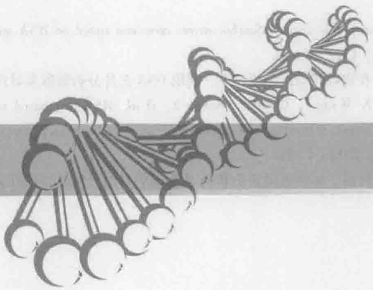

natural_image

Abstract illustration of interconnected nodes forming a chain-like structure (no text or symbols)

# 蛋白质组学技术与代谢工程

## 【本章学习要点】

1. 蛋白质组与蛋白质组学的定义
2. 蛋白质组学的主要研究方法
3. 蛋白质组学研究的核心技术及原理

人类基因组计划完成后，生命科学进入人类的“后基因组时代”。至此，生命科学研究的重心，已从解析生命的全套遗传信息（遗传密码）转移到系统研究这些遗传密码代表的实际意义（生物学功能）上来，即解析基因组表达的全部蛋白质的结构功能。蛋白质组学作为系统生物技术的重要组成部分，得到了迅速的发展。代谢工程是用现代基因工程技术对细胞性质进行改进，其中“组学”技术（如蛋白质组学、代谢物组学、代谢通量组学等）在表型表征中起着极为重要的作用。本章从蛋白质组与蛋白质组学概念出发，详细介绍蛋白质组学研究策略及平台技术分类，进而介绍蛋白质组学研究步骤及核心技术，最后介绍蛋白质组学在代谢工程及其菌种构建中的应用。

## 知识导图

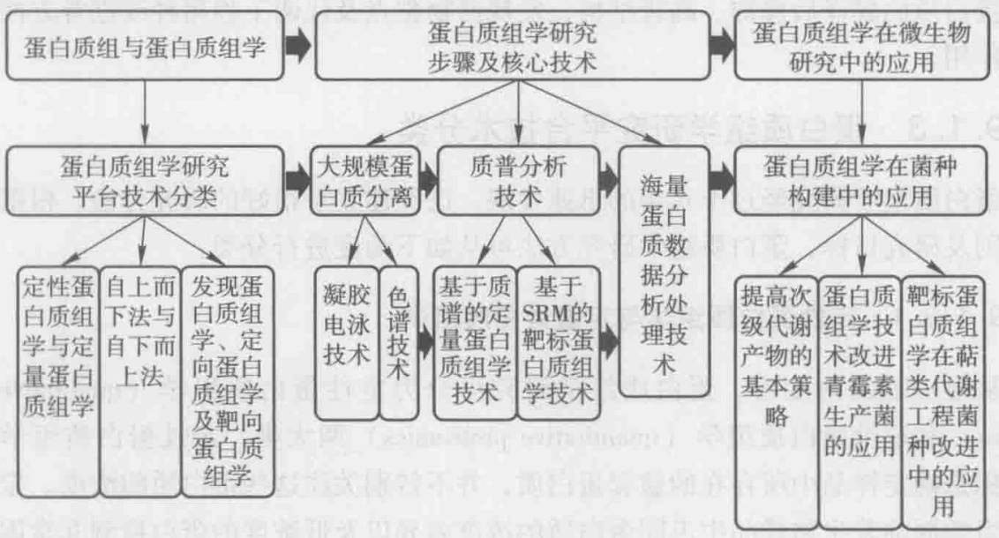

flowchart

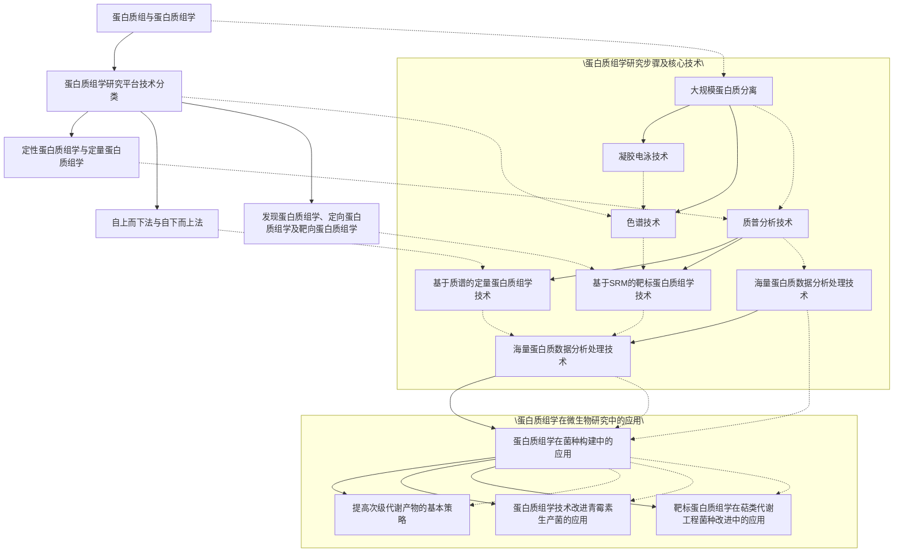

## 9.1 蛋白质组与蛋白质组学

## 9.1.1 蛋白质组

20多年前，美国学者Hochstrasser和澳大利亚学者Williams等开发了蛋白质和蛋白质表达谱的分析技术，特别是二维凝胶电泳（two-dimensional gel electrophoresis，2D-GE）技术的出现，使研究人员几乎可以一次观察到基因组所表达的全部蛋白质。然而，直到1995年，蛋白质组（proteome）的概念才由Wilkins在《自然》杂志的一篇新闻报道中提出。所谓的蛋白质组是指由一个基因组（genome），或一个细胞、组织表达的所有蛋白质（protein）。蛋白质组的概念与基因组的概念有许多差别，它具有动态性，随着生物个体的组织以及所处环境状态的不同而发生改变。某一基因在转录过程中可以以多种mRNA形式进行剪接，同一蛋白质可存在多种翻译后修饰形式，因此一个蛋白质组不是一个基因组的直接产物，蛋白质组中蛋白质的数目有时可能超过基因的数目。

## 9.1.2 蛋白质组学

蛋白质组的概念提出来以后，随后产生了蛋白质组学（proteomics），其以蛋白质组为研究对象，分析细胞内动态变化过程中蛋白质的组成成分、表达水平与修饰状态的改变，通过了解蛋白质之间的相互作用与联系，从而在整体水平上研究蛋白质的组成与调控的活动规律。

蛋白质组研究技术已被应用到各种生命科学领域，在认识某种特定的细胞、组织或器官的蛋白质种类及功能，明确各种蛋白质之间以及与其他分子的相互作用网络，描绘蛋白质的翻译后修饰、高级结构，发现药物靶点及代谢工程菌种改进等方面发挥重要作用。

## 9.1.3 蛋白质组学研究平台技术分类

蛋白质组学研究经过十几年的迅速发展，已经建立了很好的研究方法。根据不同的准则及研究目标，蛋白质组学研究方法可从如下角度进行分类:

## 9.1.3.1 定性蛋白质组学与定量蛋白质组学

从最一般的角度看，蛋白质组学研究可分为定性蛋白质组学（qualitative proteomics）和定量蛋白质组学（quantitative proteomics）两大类。定性蛋白质组学研究的目标是确定样品中所存在的整套蛋白质，并不特别关注这些蛋白质的浓度。定性蛋白质组学面临着生物样品中不同蛋白质的浓度差异以及低浓度的蛋白检测非常困难的问题，因而也增加了确定这些蛋白质的难度。如果要确定生物样品中蛋白质的浓度，就需要对蛋白质进行量化，即采用定量蛋白质组学技术。定量蛋白质组学还可进一步区分为相对定量蛋白质组学（relative quantitative proteomics）和绝对定量蛋白质组学（absolute quantitative proteomics）。相对定量蛋白质组学可以确定两个或多个蛋白质组的差异，例如健康人与病人蛋白质组的差异，高产菌株与低产菌株蛋白质组的差异，这可以用后面将要介绍的二维差异凝胶电泳等技术来确定。绝对定量蛋白质组学就是要确定样品中蛋白质的fmol浓度，其难度更大，需要通过添加已知数量的同位素作为参考标准来进行绝对量化。

## 9.1.3.2 自上而下法与自下而上法

蛋白质组学研究中自上而下法与自下而上法的主要区别在于二者在样品处理中使用不同的策略。自上而下蛋白质组学（top-down proteomics）研究样品中蛋白质的完整序列，这就尽可能避免了样品的改变。自上而下法通常使用二维凝胶电泳技术，所以也常称这种方法为基于凝胶的蛋白质组学法（gel-based proteomics）。自下而上蛋白质组学（bottom-up proteomics）是通常要用胰蛋白酶先对样品进行消化，然后用高通量分析方法对消化后的特定肽片段进行分析。样品中存在的蛋白质是通过对其一个或多个特定的肽片段的检测而推断出来的，这就意味着在完整蛋白质与这些胰蛋白酶片段二者之间存在着对应关系。自下而上蛋白质组学的理念来自基因组DNA序列检测中所用的鸟枪法策略（shotgun strategies），所以也将其称为鸟枪蛋白质组学法（shotgun proteomics）。由于自下而上蛋白质组学法不使用凝胶电泳技术，所以也常称为无凝胶电泳蛋白质组学法（gel-free proteomics）。图9-1是基于凝胶技术的蛋白质组学及无凝胶蛋白质组学实验的典型流程。

## 9.1.3.3 发现蛋白质组学、定向蛋白质组学及靶向蛋白质组学

随着质谱技术的飞速发展，其在蛋白质组学研究中得到了广泛的应用。基于在选择及使用质谱仪器的不同方法，将蛋白质组学区分为发现蛋白质组学、定向蛋白质组（a）从样品中抽提得到的蛋白质混合物，通过二维凝胶电泳进行蛋白质分离（首先经过等电聚焦接着进行SDS-PAGE）。在对蛋白斑点可视化之后，从凝胶中抽提出蛋白质，进行消化，进而通过质谱对蛋白质进行分析。接下去还要通过数据库搜索，对蛋白质进一步进行鉴定。（b）对于无凝胶的方法，从样品中抽提得到的蛋白质混合物直接进行消化成肽的混合物，用多维方法对肽混合物进行分离，然后要通过质谱对肽进行分析。接下去需要从所产生的质谱通过数据库搜索，对蛋白质进一步进行鉴定

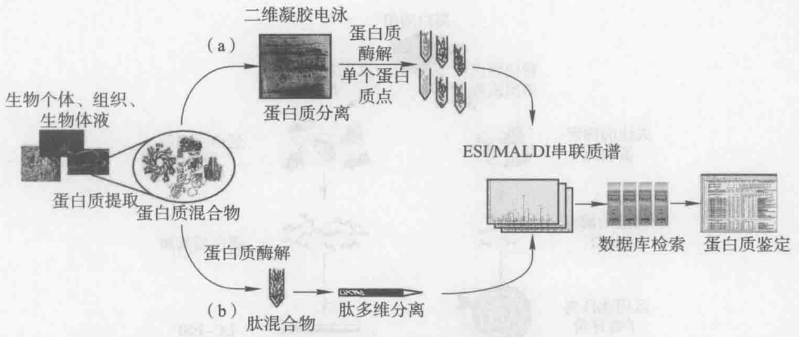

flowchart

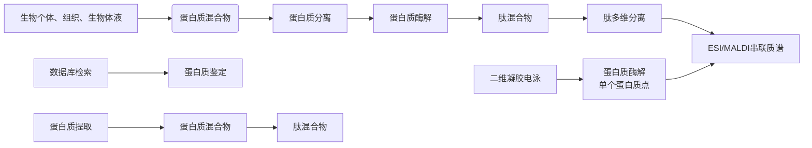

图9-1 基于凝胶技术（a）和无凝胶技术（b）的蛋白质组学研究策略（Fournier et al. 2007）

学及靶向蛋白质组学（Domon et al. 2010, Messana et al. 2013）。

发现蛋白质组学（discovery proteomics），也常常称为鸟枪蛋白质组学。发现蛋白质组学分析过程中，前体离子在一个调查扫描（a survey scan）期间被检测并自动选择，其采用一个简单的启发式算法，通过称为依赖于数据分析（data-dependent analysis, DDA）过程而完成。发现蛋白质组学技术所产生的数据集，可以识别大量蛋白质，并可在样品之间进行定量比较，这可通过用稳定同位素标记法或无标记法来进行量化。鸟枪法不需要样品组成的任何先验知识，因此在所分析的每个样品中的每个蛋白质都是新发现的，这也是该方法称为“发现蛋白质组学”的原因。发现蛋白质组学方法的目标通常是识别尽可能多的蛋白质。

定向蛋白质组学（directed proteomics）是指利用 MS 和 MS/MS 实验针对研究者所选择的一些特定离子而进行的分析。与发现蛋白质组学方法相比，在定向蛋白质组学研究中，由于仅仅聚焦于一个蛋白质组中特定的、预先选择的部分进行鉴别和量化，所以其重复性更好。

靶向蛋白质组学（targeted proteomics）是指在一个样品中，仅仅选择一些预先确定的肽进行检测和量化，实验所用的仪器通常是三重四极杆质谱仪（triple quadrupole mass spectrometers）。靶向蛋白质组法对一个蛋白质组中的预先选择的一小部分（一般只有一百到几百个肽）进行实验，具有很高的检测敏感性和动态范围，能产生高度可重复的、精确的数据集。支撑靶向蛋白质组学的主要质谱方法是选择反应检测法（selected reaction monitoring, SRM）。鉴于靶向蛋白质组学方法的重要性，Nature Methods 2013 年第 1 期发表社论，把靶向蛋白质组学选作其 2012 年的年度技术热点（Methods of the Year 2012）。社论指出，新的方法和工具的发展正在帮助把靶向蛋白质组分析技术带给更广泛的生物学家。该刊同期还发表了 Doerr（2013）写的入门科普文章，详细介绍了发现蛋白质组学与靶向蛋白质组学实验的比较，如图 9-2 所示，图中用箭头射向靶心形象地显示了“靶向”的特点。

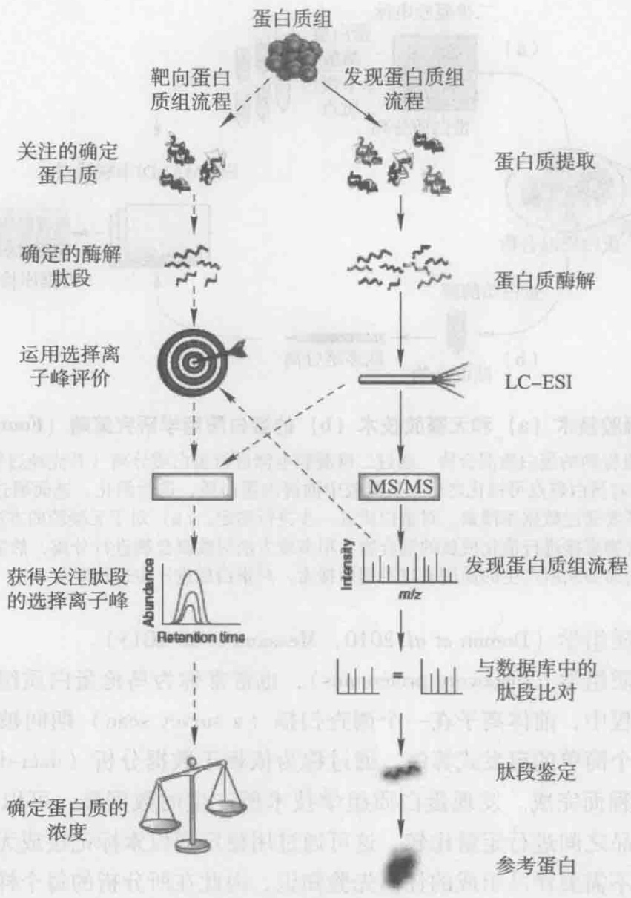

flowchart

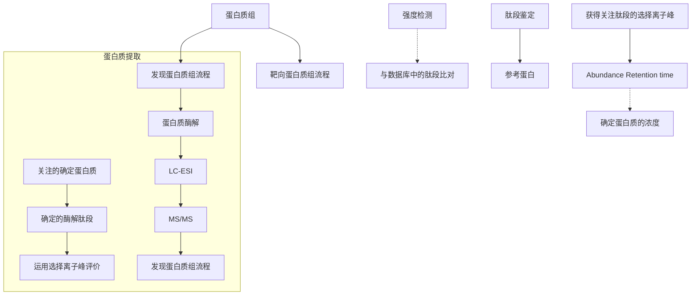

图9-2 基于质谱技术的发现蛋白质组与靶向蛋白质组的工作流程（Doerr 2013）

在图9-2所示的发现蛋白质组学流程包括如下步骤:从蛋白质组样品中抽提蛋白质；将蛋白质消化为肽片段；肽片段经液相色谱-电喷雾离子化（LC-ESI）和串联质谱（MS/MS）得到质谱谱图；将实验得到的质谱谱图与数据库中的质谱谱图进行匹配比对，进而进行肽的鉴定；最后根据鉴定出的肽推断出蛋白质。在图9-2所示的靶向蛋白质组学流程包括如下步骤:研究者首先从蛋白质组样品中确定所感兴趣的蛋白质，进而确定蛋白质特异性肽段（proteotypic peptides），然后开发或应用SRM技术，通过三重四极杆质谱仪进行分析，得到感兴趣肽的SRM谱图，由SRM谱图即可确定蛋白质的浓度。

## 9.2 蛋白质组学研究步骤

根据前面介绍的蛋白质组学研究方法的分类，可将蛋白质组学研究归总为如下六个步骤:样品抽提（sample extraction）、蛋白质分离（protein fractionation）、肽分离（peptide fractionation）、肽的质谱分析（mass spectrometry）、肽和蛋白质的鉴定（pep-