tide and protein identification）、肽或蛋白质的量化（peptide or protein quantification）。上述前三个步骤可概括为大规模蛋白质和肽段的制备和分离:从待分析样品中提取蛋白质，提取之前一般先进行蛋白质预分级处理，以降低蛋白质的复杂性。常用的预分离手段按照分离思路分类，有亚细胞分级、亲和蛋白富集和蛋白质或肽段的物化性质进行分离三种主要思路。按照分离方法分类，可分为离心分离、色谱分离、电泳分离、免疫共沉淀和吸附去除高丰度蛋白质等方法。第四个步骤，肽的质谱分析涉及各种质谱技术，例如，电喷雾电离（electrospray ionization, ESI）、基质辅助激光解吸/电离（matrix-assisted laser desorption/ionization, MALDI）、飞行时间质谱（time-of-flight MS, TOF）、离子阱质谱（ion trap MS）、四极杆质谱仪（quadrupole MS）、串联质谱（tandem mass spectrometry, MSn）等，如何选择与正确使用这些质谱仪极为重要。第五个步骤是肽和蛋白质的鉴定，其基于实验获得的质谱数据（例如，肽质量指纹图谱、精确的质量和时间标签、串联质谱谱图等），通过数据库搜索（database searching）和从头测序（de novo sequencing）进行肽和蛋白质鉴定。数据库搜索是指利用质谱信息（肽质量、碎片质量）在已知蛋白质序列的数据库中识别肽或蛋白质的过程。从头测序是指肽的序列直接从串联质谱的氨基酸序列读出来获得。第六个步骤涉及肽或蛋白质的量化，要用到各种标记技术、无标记技术、绝对量化技术以及选择反应检测技术。上述第五、六两步还要用到许多软件及生物信息学工具。下节将对蛋白质组学研究过程中的核心技术进行重点介绍。

## 9.3 蛋白质组学研究核心技术

## 9.3.1 大规模蛋白质分离

目前用于蛋白质组分离的技术主要有:二维凝胶电泳、高效液相色谱等。

## 9.3.1.1 凝胶电泳技术

二维凝胶电泳（2-DE）是蛋白质组学研究中经典的分离技术，也是目前唯一能将数千种蛋白质同时分离并展示的技术。它是1975年由美国科罗拉多大学的O'Farrerll提出的。双向电泳第一相为等电聚焦，是根据等电点的不同对蛋白质进行分离，第二相是根据蛋白质的相对分子质量，采用十二烷基磺酸钠-聚丙烯酰胺凝胶电泳（SDS-PAGE）方法对不同蛋白质进行分离，2-DE方法可以将蛋白质混合物同时分离成几百乃至几千个蛋白质单独的蛋白质点。1982年，瑞典Amersham Pharmacia Biotech公司推出Immobilines试剂，制成干胶条（immobilized pH gradient, IPG），使得2-DE的重复性和上样量大大改善，不同实验室之间的试验结果可以进行比较，从而使2-DE技术获得了广泛的应用，成为目前蛋白质组研究中的主要技术之一。但是，此类方法还是受以下方面限制:①pH范围，目前商品化的IPG胶条的pH范围通常在3\~10，虽然胶条的pH范围不断扩大（pH 3\~12），但仍不能把所有蛋白质的pH包括在内，蛋白质的pH超出IPG胶条的pH范围时，这部分蛋白质就不能被检测到；②疏水性蛋白质和低丰度蛋白质很难检测到，膜蛋白等一些疏水性蛋白质在常规的提取液中溶解度很低，另外在聚焦过程中疏水性蛋白质易产生浓缩、聚焦，从而使其很难溶解并进入第二相 SDS-APGE 电泳，因而很难被检测到；③动态范围窄，灵敏度低，对低丰度蛋白质很难检测到；④难于自动化，尽管对 2-DE-MS 体系的自动化做了大量的改进，特别是 2-DE 胶上蛋白质的识别与鉴定技术基本实现了高通量和自动化，但 2-DE 分离后的图像分析仍是整个过程中较费时的步骤，成为整个体系高通量自动化的瓶颈；⑤重复性差，同样的操作人员，同样的仪器，几次操作，得到的 2-DE 图谱很难一模一样等。

## 9.3.1.2 色谱技术

近年来，色谱技术的发展为蛋白质和多肽的分离分析提供了新的手段。色谱技术是利用各种物质在固定相和流动相之间不同的分配系数，使其在相对运动着的两相间经反复多次分配，以不同速度移动，从而获得分离的方法。液相色谱法是蛋白质组学非凝胶蛋白分离技术中最常用的方法。通过与质谱技术联用，一维液相色谱分离技术可以比较充分地发挥快速、灵敏、易于自动化的优势，成为目前蛋白质组学研究中的主要方法之一。由于单一的液相分离技术常不能满足复杂蛋白质复合物分离的需要，Opitekc等1997年提出了多维色谱技术，它有效地提高了系统对样本的分辨率和峰容量，具有快速、高通量、自动化、重复性好等优点。

目前报道的主要有以下几种分离模式:①离子交换色谱-反相液相色谱串联，这种组合是迄今为止蛋白质组学研究中应用最广泛的联用技术之一。它是利用蛋白质和多肽表面所带电荷与离子交换色谱带点固定相之间静电作用力的差异来实现对多肽混合物的分离；而反相液相色谱是基于疏水性的差异实现对多肽的分离。②体积排阻色谱-反相液相色谱串联，体积排阻色谱是根据溶质分子体积的大小不同，它们在通过具有体积筛分作用的固定相时的保留程度不同而达到分离的一种色谱模式。这种分离模式可以提供比较高的分辨率，但是由于体积排阻色谱的成本比较高，在一定程度上制约了这种技术的应用。③反相液相色谱-反相液相色谱串联，将尺寸不同的反相柱串联，第二根反相色谱柱快速分离第一相中没有分开或没有完全分开的组分，从而可以得到较理想的分离效果。多维 LC-MS/MS 技术能够弥补 2DE-MS 技术在蛋白质分离过程中的丢失、上样量的限制、较窄的分离范围等缺陷。同时，能无偏向性地分离高丰度和低丰度的蛋白质，实现高度自动化和具有很好的实验重复性。

除了以上主要蛋白质分离技术以外，还有诸如非凝胶电泳技术、双相系统法、酶联反应法、流式细胞法、蛋白质芯片技术、酵母双杂交系统及噬菌体展示技术等主要用于研究蛋白质间相互作用的技术。这些技术作为重要补充，在蛋白质组研究中也起着不容忽视的作用。

## 9.3.2 蛋白质组学研究中的质谱分析技术

质谱仪一般由进样装置、离子源、质量分析器、离子检测器和数据分析系统组成。离子源将液相或固相分子转化为气相离子，生物质谱仪的迅速发展主要得益于基质辅助激光解析（MALDI）和电喷雾（ESI）这两种软电离离子化技术的发明与应用。2002年，Tanaka和Fenn由于分别在MALDI和ESI质谱技术方面的杰出贡献而共同获得诺贝尔化学奖。基质辅助激光解吸质谱灵敏度高、可操作性强，对生物样品中的无机盐和缓冲溶液具有较好的包容性；MALDI-TOF-MS最适合分析多肽及其蛋白质混合物；电喷雾电离质谱选择性好、分析质量范围宽、样品消耗量小、易于与各种色谱联用。ESI-MS解决了极性大、热不稳定的蛋白质与多肽分子的离子化和大相对分子质量、一级结构和共价修饰位点的测定问题，但是样品中的盐类对样品结果影响很大，而且单个分子带电荷不同可形成多种分子离子峰，所以对混合物的图谱解析比较困难，研究者可以根据自己的工作需要和研究对象选择不同的串联质谱（Hernández et al. 2005）。液质联用技术（liquid chromatography-mass spectrometry, LC-MS）具有高效、快速分离效能。LC与灵敏、准确的MS或MS $^{n}$ 的结合，被广泛应用于难挥发性化合物、极性化合物、热不稳定化合物和大分子化合物（包括蛋白质、多肽、多糖、多聚物等）的分析，既可定性，也可定量，是最具前途的蛋白质组学的研究技术之一。图9-3是基于质谱技术的典型蛋白质组研究的实验流程。

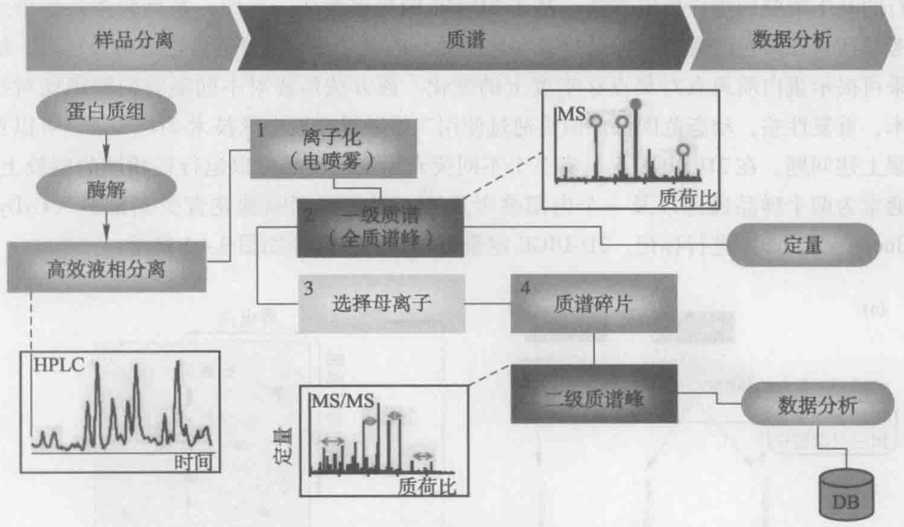

<details>
<summary>flowchart</summary>

```mermaid
graph TD
  A["样品分离"] --> B("蛋白质组")
  B --> C("酶解")
  C --> D["高效液相分离"]
  
  subgraph Step1 [1: 离子化 (电喷雾)]
    D -.-> E["HPLC时间"]
  end
  
  subgraph Step2 [2: 一级质谱 (全质谱峰)]
  D --> F["选择母离子"]
  F --> G["MS/MS质量比"]
  F --> H["二级质谱峰"]
    
    I["MS/MS质量比"] -.-> J["定量"]
  J --> K["数据分析"]
  K --> L["(DB)"]
  end
  
  subgraph Step3 [3: 一级质谱 (全质谱峰)]
  D --> M["一级质谱碎片"]
  M --> N["定量"]
  end
  
  subgraph Step4 [4: 质谱碎片]
  M --> O["二级质谱峰"]
  O --> P["定量"]
  end
```
</details>

图9-3 典型蛋白质组研究流程（Domon et al. 2010）

蛋白质消化后产生一个复杂的肽混合物，用 HPLC 分离后再经由 MS 进行分析。整个过程包括一系列步骤，特别是肽的离子化，整个谱图（调查扫描）的获得，要被粉碎的特定前体离子的选择、粉碎、MS/MS 谱图（产品-离子谱图）的获得，进而进行数据处理，以便量化不同的组分和/或通过一个数据库搜索确定肽氨基酸序列

Domon 等（2010）针对定量蛋白质组学策略提出了很好的建议，他们将蛋白质组学实验中的质谱技术归纳为如图 9-3 中的核心部分。图中的质谱技术五个步骤是:①通常用电喷雾技术，将存在于样品溶液中离子化的肽，转移到气相中。另外，沉积在固体表面上的肽是通过 MALDI 进行离子化的。②测量所产生的肽离子（前体离子）的质荷比（m/z），这就意味着确定了肽的质量。③所选择的前体离子在气相中被依次分离。④所选择的前体离子被打碎，最通常的方法是通过碰撞-活化解离技术（collision-activated dissociation, CAD）。⑤片段-离子质量被分析，并被作为产品-离子图谱而记录。从上述结果，由片段-离子质量的总体推断出肽的序列。肽的量是从前体离子的信号强度来确定的，这通常是通过与具有同样序列的同位素标记的参考肽的信号强度进行比较而完成的。在进行上述质谱步骤之前，要先按照样品制备程序（获取合适的蛋白质样品，将蛋白质消化为肽，肽样品的分离）进行样品准备。在进行上述质谱步骤之后，对采集的质谱数据进行处理和分析。Domon等（2010）还以上述质谱技术的五个步骤为基础，分别对发现蛋白质组学、定向蛋白质组学和靶向蛋白质组学三种蛋白质组学研究策略的原理、具体的质谱仪器、实验流程、数据的获得、数据的处理及应用做了详细介绍，并对三种蛋白质组学研究策略进行了比较。

## 9.3.3 基于质谱的定量蛋白质组学技术

基于 MS 的定量蛋白质组学技术可大致分为三类:基于凝胶的光密度法/荧光法、标记法、无标记法。

基于凝胶的光密度法/荧光法（gel-based densitometry/fluorescence）:二维凝胶电泳（2D-GE）和差异凝胶电泳（differential in-gel electrophoresis，DIGE）是两种最流行的基于凝胶的蛋白质组方法。基于2D-GE的光密度法，采用一系列软件对银染或考马斯量蓝染色的凝胶图像进行数字化比对，进而进行基于光密度法的定量比较，结果可揭示蛋白质斑点对斑点在丰度上的变化。该方法需要对不同凝胶的精确比对技术，重复性差，动态范围低。但是通过使用二维差异凝胶电泳技术2D-DIGE，可以克服上述问题。在2D-DIGE上，有三个不同荧光标记的样品可以运行在相同的凝胶上，通常为两个样品通道以及一个内部参考通道。通常用吲哚羰花青荧光染料（CyDye fluorescent dye）进行标记。2D-DIGE定量蛋白质实验流程如图9-4所示:

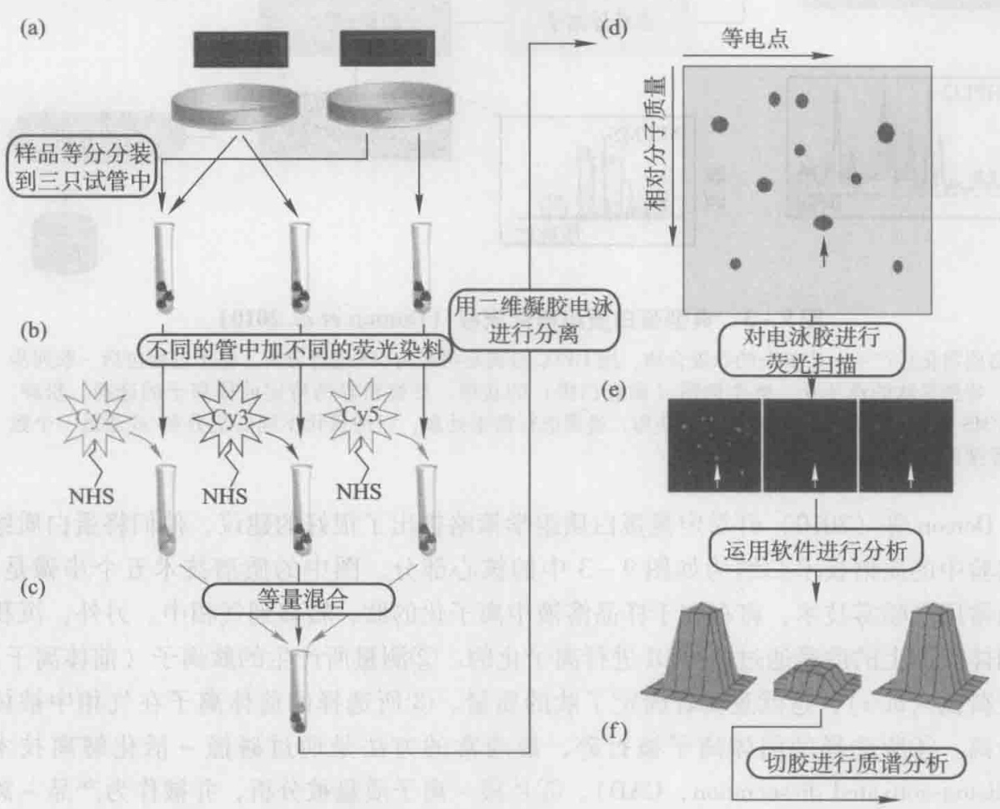

图9-4 2D-DIGE定量蛋白质实验流程（Coombs2011）（彩图见插页）

（a）按图中所示方法将样品分装到三只试管；（b）在每只试管中加不同的荧光染料；（c）等量样品混合；（d）用2D IEF/SDS-PAGE分析混合的蛋白质；（e）对每种荧光染料进行图像分析；（f）切取蛋白斑点进行MS和MS/MS分析

标记法（labeling methods）:常用的标记法有同位素亲和标签技术（isotope-coded affinity tags, ICAT）、细胞培养氨基酸稳定同位素标记（stable isotope labeling of amino acids in cell culture, SILAC）、等量异位标签相对和绝对定量技术（isobaric tags for relative and absolute quantitation, iTRAQ）和 $^{18}$ O 标记法等。

ICAT 技术是在 1999 年由 Gygi 和 Aebersold 提出的，是最早用于蛋白质定量的技术之一。ICAT 试剂的化学结构主要由三部分组成:专一的化学反应基团（能与蛋白质的半胱氨酸残基的一SH 专一反应）；中间的连接子（可以结合稳定的同位素）；亲和反应基团（一种生物素亲和标签，能与生物素结合选择分离 ICAT 标记的多肽）。连接子使用 8 个氢原子或氖原子分别标记，加入不同条件的样本中，试剂特异性地与 Cys 琉基基团反应，取等量蛋白质酶解，亲和层析纯化后肽段直接进入串联质谱分析，可以对不同样本中同一蛋白质的丰度进行比较，其研究流程如图 9-5a 所示。该方法有效地降低了样本的复杂性，可用于体液、细胞或组织等样品，但同位素亲和标签技术（ICAT）无法分析不含半胱氨酸的蛋白质。

细胞培养氨基酸稳定同位素标记（SILAC）技术一般采用含有轻、重同位素型必需氨基酸的培养基进行细胞培养，使细胞内蛋白质被同位素稳定标记，将蛋白质等量混合后进行分离和质谱鉴定，根据一级质谱图中两个同位素型肽段的面积比较进行相对定量。其研究流程如图9-5b所示。SILAC与SDS-PAGE或色谱分离技术相结合，兼容疏水性蛋白质和偏碱性蛋白质，不受蛋白质性质限制；另外，该技术属于稳定的细胞体内（in vivo）标记，其标记效率不受裂解液的影响，不仅适合于进行全细胞蛋白质的分析，还适合于膜蛋白的鉴定和定量。由于培养基存在稳定同位素氨基酸可能会对人和动物的健康产生影响，所以早期 SILAC 多适用于体外培养的细胞或模式生物，不适合于人的组织、血浆和尿液样品等；但是最近人们开发一种称之为“超级 SILAC”方法，即将不同 SILAC 标记的细胞系混合在一起作为动物或人组织定量蛋白质考察的内标。与普通的 SILAC 方法相比，“超级 SILAC”方法第一步将是来源于动物或人组织中蛋白质依据标记的内标进行定量，然后再根据不种组织在第一步中 SILAC 的比例结果来进行不同组织样品间差异的相对比例定量。虽然“超级 SILAC”方法对动物或人的组织样品进行大规模相对定量提供了方便，但是它准备的内标中需要包括待检测样品中所有蛋白质，这是一件非常困难的工作。

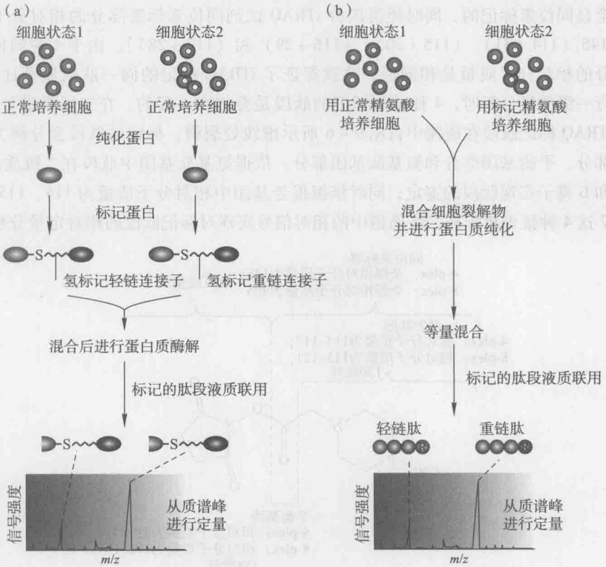

图9-5 ICAT（a）和SILAC（b）标记方法的实验原理图（Steen et al.2004）

iTRAQ 技术是由美国应用生物系统公司（Applied Biosystems Incorporation，ABI 公司）2004 年开发的等量异位标签相对和绝对定量技术（Ross et al. 2004）。这种方法是建立在 iTRAQ 试剂的基础上的，可同时对四种或八种蛋白样品进行绝对和相对定量研究，分析能力显著高于 SILAC 和 ICAT 等其他稳定同位素方法。现以 4-plex 的 iTRAQ 试剂盒为例来说明其标记原理。iTRAQ 是一种小分子同重元素化学物质，包括三部分:一端是报告基团（N-甲基哌嗪），另一端是肽反应基团（N-羟基二酰亚胺），中间部分是平衡基团（羰基基团），具体结构和组成如图 9-6 所示。其中，报告基团的相对分子质量分别为 114、115、116 和 117，因此 iTRAQ 试剂共四种；肽反应基团将报告基团与肽 N 端及赖氨酸侧链连接，几乎可以标记样本中所有蛋白质；在肽反应基团和报告基团之间的平衡基团，其相对分子质量分别为 31、30、29、28，它们全是同位素标记的，同时使得四种 iTRAQ 试剂同位素标签部分的相对分子质量均为 145[(114+31)、(115+30)、(116+29) 和 (117+28)]。由于 4 种同位素标签部分的相对分子质量是相同的，这就保证了 iTRAQ 标记的同一肽段质荷比相同，在进行一级质谱分析时，4 种试剂标记的肽段是叠加在一起的。在二级质谱分析时，4 种 iTRAQ 标记肽段在碰撞中自图 9-6 所示虚线处裂解，标记的肽段会分解为报告基团部分、平衡基团部分和氨基肽基团部分。依据氨基肽基团中肽段在二级质谱中 y 离子和 b 离子实现肽段的鉴定；同时依据报告基团中相对分子质量为 114、115、116 和 117 这 4 种报告离子在二级质谱中的相对信号实现对标记肽段的相对定量分析。通过相关分析软件（Mascot、ProteinPlot 等）整合蛋白质中所有肽段的信息，实现蛋白质的鉴定和定量比较。8-plex 的 iTRAQ 试剂盒标记原理与 4-plex 相同，只不过是 8-plex 的 iTRAQ 试剂共有八种，八种试剂的同位素标签部分的相对分子质量均为 305，其中八种报告基团相对分子质量分别为 113、114、115、116、117、118、119 和 121（由于 120 的报告离子中含有与苯丙氨酸铵根离子结合的位点，因此把 120 除外），平衡基团相对分子质量分别为 192、191、190、189、188、187、186 和 184（Choe et al. 2007, Pierce et al. 2008）。

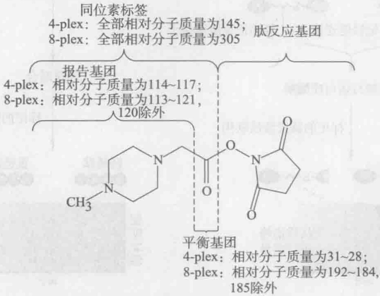

<details>
<summary>flowchart</summary>

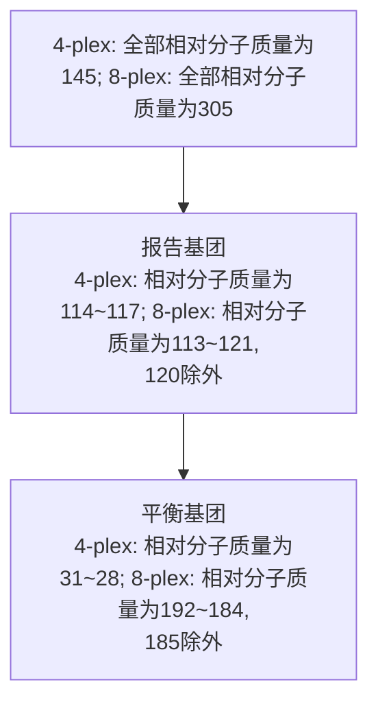
</details>

图9-6 iTRAQ化学标记试剂的结构及组成示意图

iTRAQ 技术标记的一般步骤包括:①细胞的收集、清洗和破壁；②胞内总蛋白的抽提；③确定标记蛋白总浓度（BCA 试剂盒法）；④还原蛋白和半胱氨酸阻断；⑤用胰酶酶切蛋白；⑥丙酮沉淀；⑦iTRAQ 试剂标记蛋白质样品。

例 9-1 iTRAQ LC-MS/MS 定量蛋白质组学揭示蓝细菌对乙醇的抗性。

最近许多研究通过蓝细菌的代谢工程生产生物燃料乙醇，其中蓝细菌对乙醇的耐受性是一个需要解决的重要问题。Qiao等（2012）采用iTRAQ技术标记，研究了蓝细菌Synechocystis sp. PCC6803的定量蛋白质组，图9-7是其具体的标记过程。蓝细菌Synechocystis sp. PCC6803分别在不含乙醇的和含有 $1.5\%$ 乙醇（V/V）的BG11液体培养基中 $30^{\circ}\mathrm{C}$ 下培养，在 $24\mathrm{h}$ 和 $48\mathrm{h}$ 时分别收集菌体，进行洗涤、细胞裂解、测定总蛋白质浓度、丙酮沉淀和胰酶消化等操作，然后按照8-plex的iTRAQ试剂盒说明书（http://www.absciex.com/Documents/Downloads/Literature/mass-spectrometry-4383502C.pdf）分别加入带有同位素标签的试剂进行标记，把标记好的样品按照1:1比例混合在一起，接着取一定量的混合液进行串联色谱分析。根据二级质谱得到的24887肽段数据，应用蛋白质鉴定和定量软件（Mascot 2.3.02）鉴定出1509个蛋白质。以待测样本中的蛋白质与参照样本中的相比上调或下调变化在1.5倍以上且 $P$ 值小于0.05为筛选条件，发现在有 $1.5\%$ 乙醇的胁迫下Synechocystis sp. PCC6803有135和293个蛋白质分别在 $24\mathrm{h}$ 和 $48\mathrm{h}$ 表达量发生变化，具体变化情况如图9-8所示。

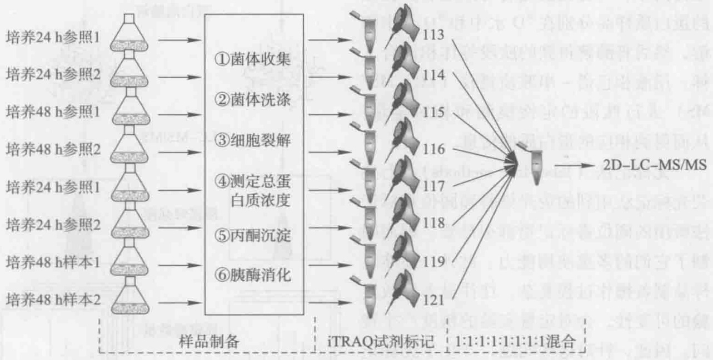

<details>
<summary>flowchart</summary>

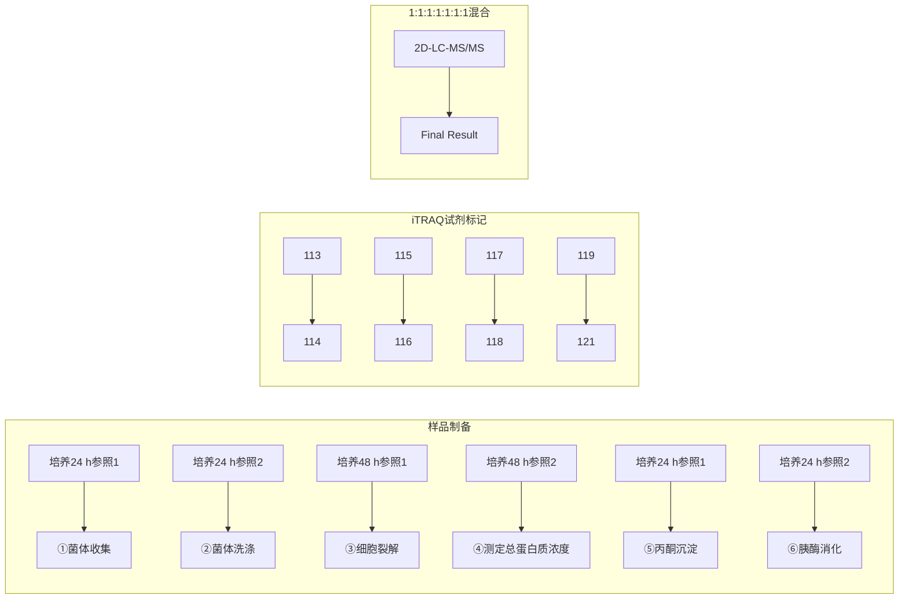
</details>

图9-7 基于iTRAQ定量蛋白质组学技术分析蓝细菌

在 1.5% 乙醇浓度（V/V）30℃下培养 24 h 和 48 h 蛋白质变化

与其他稳定同位素标记技术相比，iTRAQ偶合2D-LC-MS/MS技术具有如下优点（Cutillas et al. 2010）:①可标记所有酶解肽段，包括发生了翻译后修饰的肽段；②不仅可以同时比较和鉴定蛋白质，还可以同时标记2\~8个样本，标记过程更简单，标记效率高、重现性好；③简化了质谱图的复杂程度，同时在同一峰位上的叠加效应可以提高离子的检测丰度；④质谱检测灵敏高且可靠，可对低丰度蛋白质进行检测；⑤所采用的标本来源广泛，除培养生物细胞、组织外，还包括培养液、

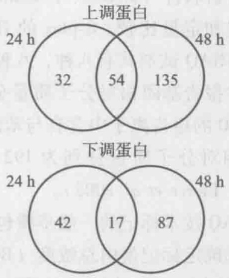

<details>
<summary>donut</summary>

| 蛋白类型 | 时间段 | 数量 |
| --- | --- | --- |
| 上调蛋白 | 24 h | 32 |
| 上调蛋白 | 48 h | 135 |
| 下调蛋白 | 24 h | 42 |
| 下调蛋白 | 48 h | 87 |
| 上调蛋白 & 下调蛋白 | 24 h & 48 h | 54 |
| 下调蛋白 & 上调蛋白 & 下调蛋白 | 24 h & 48 h | 17 |
</details>

图9-8 在 $24\mathrm{h}$ 和 $48\mathrm{h}$ 时不同表达量蛋白质的分布情况（Qiao et al. 2012）

体液和血清（浆）等。鉴于上述优点，iTRAQ 偶合 2D-LC-MS/MS 技术可同时分离和鉴定成百上千种蛋白质，最大程度地得到蛋白质组的“全组信息”，从而具有较好的应用前景。随着 iTRAQ 试剂盒的大规模商品化生产，其价格会大幅度下降，生物学领域普通实验室也能用来开展定量蛋白质组学的研究。

相比前三种标记方法， $^{18}$ O 标记法具有一定优越性。 $^{18}$ O 标记法可以标记所有酶解的肽段，不限制于任何蛋白质；且不会改变肽段的物理性质，从而不会有色谱峰的漂移等问题；并可以标记多种不同类型的样品，如组织、细胞溶解物、血清、尿样等，没有体内稳定同位素对样品类型的局限性；同时肽段在蛋白质水解分裂的同时，在 C

端标记上了，避免了人为的化学稳定同位素的标记，也就避免了ICAT方法中标记的繁琐工作以及实验操作带来的误差。因此，其应用范围越来越广泛。具体操作也较为简单， $^{18}$ O标记法是将对照组和实验组的蛋白质样品分别在 $^{16}$ O水中和 $^{18}$ O水中酶解，然后将酶解得到的肽段等体积混合上样，用液相色谱-串联质谱仪（LC-MS/MS）进行肽段的定性检测和相对定量，从而得到相应的蛋白质的信息。

无标记法（label-free methods）:上述荧光标记法用到的荧光染料和同位素标记法所用的同位素标记物都很昂贵，因而限制了它们的多重使用能力。此外，还涉及样品制备操作过程复杂，往往显著导致实验的可变性，会对定量实验的精度产生疑问。因此，针对这些问题，产生了无标记蛋白质组学技术。Zhu 等（2010）归总了基于质谱的无标记定量蛋白质组学实验的一般流程，如图 9-9 所示。

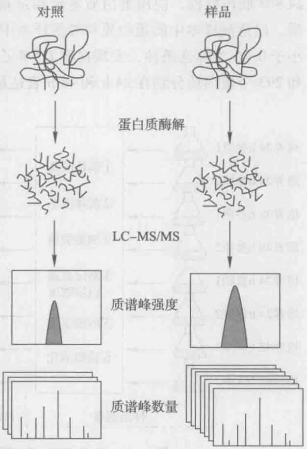

<details>
<summary>flowchart</summary>

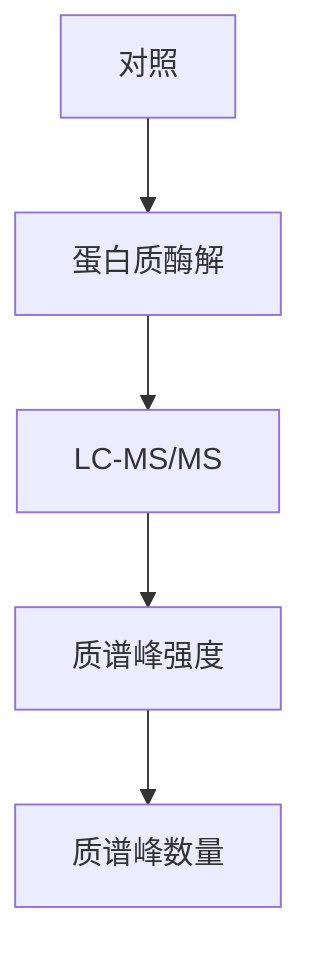
</details>

图9-9 无标记定量蛋白质组学实验步骤（Zhu et al. 2010）

图9-9表明，每个样品被分别制备，然后分别进行LC-MS/MS或LC/LC-MS/MS实验。实验中蛋白质的量化一般可经过两类方法测量:第一类是是离子强度（例如肽信号色谱峰面积或峰高）变化的测量；第二类是基于MS/MS分析后所识别的蛋白质的质谱计数。对于每个LC-MS/MS或LC/LC-MS/MS实验，肽的峰强度或质谱计数被测量，进而通过对不同被分析物直接进行比较，即可计算蛋白质丰度的变化。

## 9.3.4 基于选择反应检测的靶向蛋白质组学技术

选择反应监测（selected reaction monitoring，SRM）技术也属于质谱技术，但是由于其独特的优势，我们这里进行更详细介绍。在30多年以前，人们就开发出了三重四极杆质谱仪（triple quadrupole mass spectrometer，QQQ MS）用于小分子物质的分析。最近，随着系统生物学的发展，要求提供高通量、高灵敏度、重复性好的定量蛋白质组数据，于是促使选择反应监测技术与三重四级杆质谱仪的结合，形成了基于选择反应检测的靶向蛋白质组学技术，其在定量蛋白质组学研究中得到了广泛的应用。

## 9.3.4.1 基于QQQ MS的SRM技术原理（图9-10）

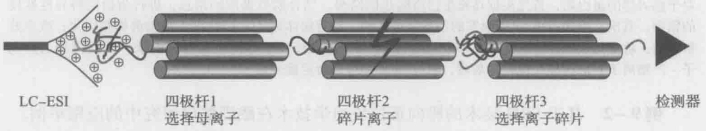

<details>
<summary>flowchart</summary>

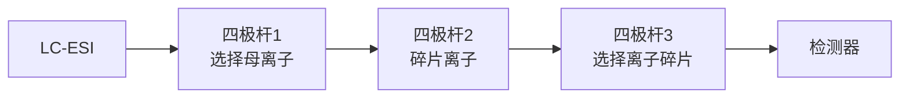
</details>

图9-10 基于QQQ MS的SRM技术原理（Lang et al. 2008）

图中第一、三两个四极杆起过滤器作用，其分别特异性地选择与预先设定 $m / z$ 相同的肽离子和肽碎片离子通过。第二个四极杆起粉碎器作用，将进来的肽离子通过碰撞诱导解离来粉碎肽离子。几种被分析物从色谱系统进行共洗脱。通过第一个四极杆将大多数离子过滤下来而使特别选择的 $m / z$ 离子流出去。然而，由于相同的质量，仍有一种干扰离子（黑色）一起流出去。在第二个四极杆，被分析物被粉碎。在第三个四极杆，通过选择 $m / z$ ，使得所有黑色的被分析物过滤下来，而仅仅使特定的灰色被分析物碎片通过，进入下一步进行检测

与传统的鸟枪蛋白质组学研究相比，SRM 测量是严格针对预定的一组肽的定量分析，并依赖于特定的 SRM 前体离子-产物离子对（precursor ion-product ion pair，其被称为“transition”）。要确定这些前体离子-产物离子对，先前的信息是必需的。需要特别强调，如下三类信息是至关重要的。第一，必须选择组成目标蛋白集（targeted protein set）的一些蛋白质。第二，对于每一个目标蛋白来说，呈现良好的 MS 响应并能唯一地识别目标蛋白的那些肽（或一种特定的异构体）必须被识别。这些肽被称作蛋白质特异性肽段（proteotypic peptides，PTPs）。第三，对于每个 PTP，这些碎片离子必须被识别，这些碎片离子可提供最佳的信号强度，并可从样品中存在的其他物质中鉴别出目标肽。这些优化了的前体离子-产物离子对是 SRM 检测的精髓。对于基于 SRM 实验的出色定量性能来说，建立这些条件所需时间和精力是需要付出的代价。但是，一旦建立了这样的条件，这些检测可以在包括有特定目标蛋白的任何研究中随意使用。基于 SRM 技术的蛋白质组学实验步骤如图 9-11 所示。

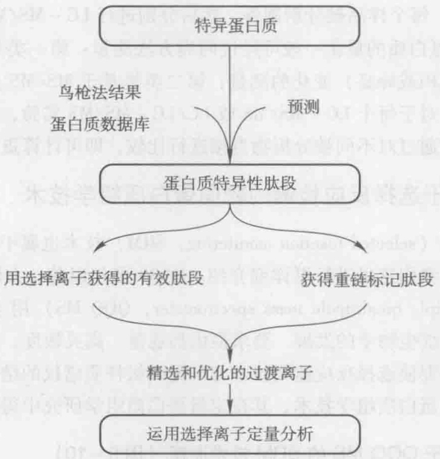

<details>
<summary>flowchart</summary>

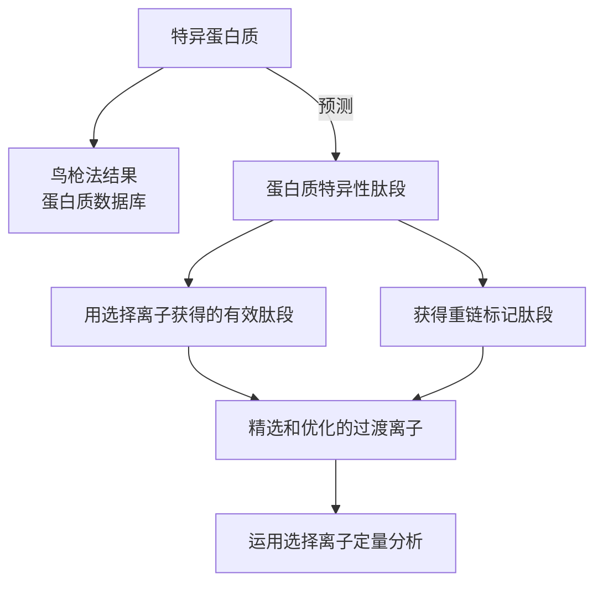
</details>

图9-11 基于SRM技术的蛋白质组学实验步骤（Lang et al. 2008）

对于感兴趣的蛋白质，首先根据鸟枪蛋白质组法的结果，结合肽数据库的信息，进行蛋白质特异性肽段的预测。其次，可通过由SRM触发的串联质谱实验，进行前体离子-产物离子对的选择和优化；或在分析之前，将重同位素标记（${}^{15}\mathrm{N}$ 和 ${}^{13}\mathrm{C}$）掺入到样品中，从而产生重同位素标记的肽，进而进行前体离子-产物离子对的选择和优化。最后，通过SRM即可进行定量分析

例9-2 基于SRM技术的靶向蛋白质组学技术在酿酒酵母研究中的应用举例。

用靶向蛋白质组学技术进行酿酒酵母全动态范围的蛋白质组学分析:Picotti等（2009）利用SRM靶向蛋白质组技术，检测和量化了酿酒酵母全动态范围的蛋白质组。他们应用了基于SRM的靶向蛋白质组技术，检测和量化了在整个酿酒酵母中所表达的蛋白质，蛋白质浓度可低于每个细胞50个拷贝数。检测范围可扩大到每个细胞只有几个拷贝数和传统方法不能检测的低丰度蛋白质。在跨越酿酒酵母不同生长及代谢期整个蛋白质丰度范围内，对酿酒酵母中心碳代谢45个蛋白质的生物蛋白网络进行了一致的、快速的SRM分析。他们的研究证明了基于SRM蛋白质组学的潜力，其可以对酵母中一组感兴趣的目标蛋白进行高通量和高精度的定量分析。

## 9.3.4.2 用靶向蛋白质组学技术进行多种条件下酿酒酵母中心碳代谢和氨基酸代谢的综合定量分析

几十年的生物化学研究已经识别了酿酒酵母中催化代谢反应的大多数酶，然而，当营养条件发生改变时代谢反应的适应确实理解得很差。作为要深刻理解这些的重要一步，基于SRM的靶向蛋白质组技术，Costenoble等（2011）研究了酿酒酵母在5个不同代谢状态下，中心碳代谢与氨基酸代谢网络中228个蛋白质的量化。总体来说，在每个样品中，包括同工酶家族在内的90%的目标蛋白都能被一致地检测与量化，产生的蛋白质组数据集代表了具有高度重复性的营养扰动生物系统。由于检测到了在一个已给条件下所需全部蛋白质的95%\~99%，所以可以认为这个数据集是近乎全面的。进一步通过通量平衡模拟解释，这些数据还表明酿酒酵母保留有在一种特定环境中不一定使用的蛋白质。

## 9.3.4.3 完整的酵母蛋白质组质谱图的建立

生命科学各领域的研究都需要完整的蛋白质组质谱图。Picotti 等（2013）使用了基于高通量肽合成和质谱相结合的策略，产生了一个几乎完整的酿酒酵母蛋白质组参考图，其包含了酿酒酵母基因组所预测的蛋白的 97%。他们产生了两个版本的蛋白质组质谱图，一个可服务于发现驱动的蛋白质组（鸟枪蛋白质组）测定，另一个可服务于假说驱动的蛋白质组（靶向蛋白质组）测定。这两个版本构成了一套完整的蛋白质组学分析，可支持用当代蛋白质组学技术所进行的大部分研究。酵母蛋白质组参考质谱图的产生过程如图 9-12 所示。

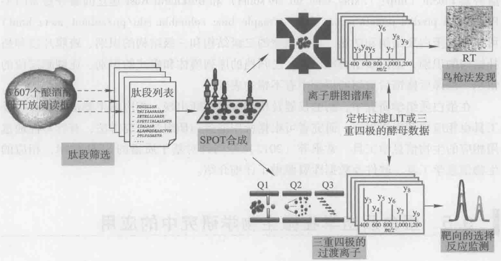

<details>
<summary>flowchart</summary>

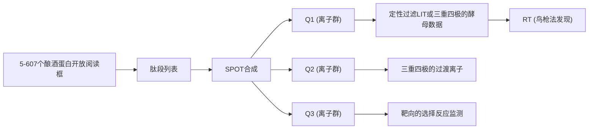
</details>

图9-12 酵母蛋白质组参考质谱图的产生过程（Picotti et al. 2013）

为了创制上述参考值谱图，他们首先从酿酒酵母基因组所预测的6607个蛋白质的序列着手。对于能在蛋白质组学数据库（PeptideAtlas）找到的每一个蛋白质，他们识别出一组高达8个蛋白质特异性肽段，这些肽段具有唯一的序列及优异的质谱性质。对于那些以前还没有检测的蛋白质，他们预测了蛋白质特异性肽段。这样，他们总共汇集并利用Spot synthesis技术，合成达到由28000个蛋白质特异性肽段组成的合成版本，占酵母基因组的97%。然后通过图9-12所示两条路线，分别得到两个版本的蛋白质组质谱图，人们可以通过PeptideAtlas数据库以及登录http://www.srmatlas.org/yeast/网站利用这种重要的蛋白质组资源。

## 9.4 海量蛋白质数据分析处理技术

蛋白质提取后，经过各种手段分离，分离的蛋白质组利用各种分析软件并结合生物信息学的知识，进一步分析处理。在蛋白质组学研究中，生物信息学方法可以用于诠释实验结果，以发现蛋白质的结构、功能及其相互作用（Shen et al. 2007）。应用生物信息学对蛋白质组学研究的大量实验结果进行分析，从而发现未知，是一个极具开发潜力的领域。一个典型的蛋白质组实验，从建模收集样本，到组合使用各种技术将蛋白质分离、识别和量化，以及对实验结果进行解释，都要使用不同的生物信息学分析方法加以评估。从序列或质谱中识别肽段只是初始步骤，蛋白质组学研究中还要应用生物信息学对以下几个方面进行进一步的分析。

利用 FASTA（a searching program for biological sequence databases）、Gapped-BLAST（gapped-basic local alignment tool）及 PSI-BLAST（position-specific iterated-BLAST）3 种软件之一进行序列数据库的查找，可实现从一个肽段或一段短的蛋白质序列中识别出其对应的整个基因及其同源体。Gapped-BLAST 可以最大程度地识别出一个被查询蛋白的近缘同源体，而 PSI-BLAST 只能用于寻找远源同源体。利用 Gerard Klegyt 建立的服务器 ProSal（http://xray.bmc.uu.se/sbnet）和 Burkhardt Rost 建立的服务器 META-PP（META predict protein serve, http://maple.bioc.columbia.edu/pp/submit\_meta.html）可以预测蛋白质结构和功能，如蛋白质的二级结构和三级结构的识别、跨膜片段和拓扑结构的识别、蛋白质结构域识别、已归档的序列模体和模式的识别、亚细胞定位的识别、翻译后修饰后剪切的识别中有不错的表现。

在蛋白质组学研究中，新的仪器及检测方法不断出现，相应的生物信息学算法及工具也相应得到很快发展。研究者可根据所用的蛋白质组学研究方法，有针对性地选用相应的生物信息学工具。常乘等（2012）专门针对基于质谱的SRM技术，相应的生物信息学工具、软件及数据库资源做了详细介绍。

## 9.5 蛋白质组学在微生物学研究中的应用

## 9.5.1 蛋白质组学研究工业酵母对胁迫环境的响应

从功能上讲，蛋白质组学的应用主要包括生物特定性能改进与优化，生物发病机制探索、生物抗逆机制建立、基因功能分析、对生长环境变化的响应机制等，在菌种改进以及发酵过程优化和生长微环境响应方面应用尤为广泛。如在探索产乙醇酿酒酵母在水解木质纤维素过程中表现出的对糠醛、醋酸、苯酚等抑制剂的耐受性和适应的分子机制时，Lin等（2009）分析和比较了正常条件下和抑制剂存在条件下该酵母菌内蛋白质图谱的差异，首先找出了两个过程相关酶的差异，然后分析了相关酶可能参与的代谢途径和生理作用，进而分析酵母菌耐受性的可能分子机制。实验发现，两种情况下的醇脱氢酶表达量，NADH， $NAD^{+}$ 的含量以及参与渗透和盐胁迫、氧化应激等应激反应的蛋白质存在明显差异，说明产乙醇酿酒酵母对糠醛等物质的抗性与中心碳代谢、醇脱氢酶表达水平、氧化还原平衡状态以及细胞对外界的应激机制有一定关系，为糠醛类物质耐受菌的选育和改进提供了理论依据（图9-13）。

另外，Ding 等（2012）运用 2-DE 结合 MALDI-TOF/TOF-MS 方法考察工业酵母对复合抑制剂（糠醛、苯酚和乙酸）的应激响应和解毒作用的机制。结果表明，在耐受菌株中，应激反应和解毒相关的蛋白质（如 Ahp1p 和 Hsp26p）显著上调，大多数氮代谢相关的蛋白质（如 Gdh1p 和 Met1p）的表达也明显增加；另外，与蛋白质折叠、降解和翻译相关蛋白（如 Ssc1p，Ubp14p 和 Efb1p）的表达水平也发生显著变化，特别是与细胞氧化应激相关蛋白（如 Ahp1p 和 Grx1p）的水平显著增加。通过敲除与氧化应激和未折叠蛋白（如 Grx1，Gre2 和 ASC1）的基因后发现，该基因敲除菌株对抑制剂的耐受性显著降低，表明该酵母菌株主要是通过诱导未折叠蛋白参与对抑制剂的胁迫响应。

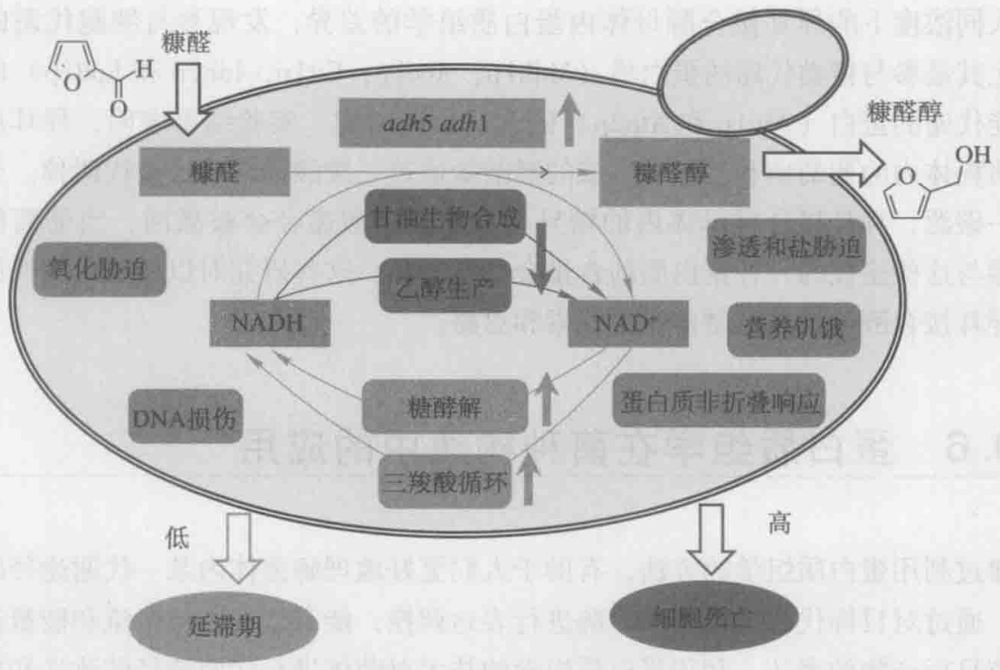

<details>
<summary>flowchart</summary>

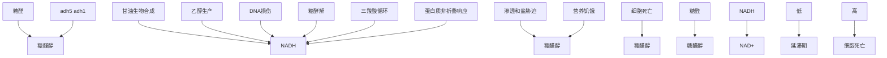
</details>

图9-13 酿酒酵母对糠醛的响应机制（Lin et al. 2009）

## 9.5.2 蛋白质组学研究细菌膜蛋白与多重抗性

由于多重抗药性的细菌菌株很广泛并且数量在稳步增加，寻找广谱性的抗菌活性物质越来越重要。膜蛋白是细胞内一种特别重要的蛋白质，涉及一些重要的反应途径和信号传导，只有在与其他一些蛋白质相互作用后才能发挥特异的生理功能。据报道，细菌的多重抗性与膜蛋白有关，但具体的应激机制还不太清楚，为了探索细菌的多重抗性机制与细胞膜之间的具体关系，Fränzel等从蛋白质组学的角度，利用代谢标记和膜脂分析的方法对多重抗性大肠杆菌细胞膜全蛋白进行定性分析，结果发现767个可鉴定蛋白质，包括185个膜蛋白，其中134个膜蛋白存在差异表达，作者将这些蛋白质引入代谢途径中，从代谢网络角度，发现这些蛋白质可能参与部分必需氨基酸和细胞外被膜的生物合成、抗生素的应激反应，及膜上和膜内的脂蛋白等特殊物质的转运机制，从而增强了该类大肠杆菌的抗性，这些研究为细菌多重抗性的研究提供了一定理论依据。

## 9.5.3 蛋白质组学研究拜耳接合酵母耐酸性机制

拜耳接合酵母（Zygosaccharomyces bailii）是一类对醋酸引起的毒性抗性最强的酵母菌种，能够在国家限制的食品防腐剂剂量下生长，因此，拜耳接合酵母一直是食品安全的一大威胁。为了探索其耐酸性机制，Guerreiro等利用二维凝胶电泳技术和蛋白质定量分析技术分别比较了稳定生长高浓度（抑制但不致命）下拜耳接合酵母和瞬间放入同浓度下的拜耳接合酵母体内蛋白质组学的差异，发现参与细胞代谢的蛋白质，尤其是参与糖类代谢的蛋白质（Mdh1p，Aco1p，Cit1p，Idh2p 和 Lpd1p）的含量和产能代谢的蛋白（Atp1p 和 Atp2p）的含量相应增加，实验结果表明，拜耳接合酵母能消耗体内的葡萄糖和乙酸，生成的醋酸盐通过三羧酸循环途径被代谢掉。当醋酸为唯一碳源，拜耳接合酵母体内的糖异生和戊糖磷酸途径会被激活，当葡萄糖耗尽后，参与这些途径的几种蛋白质的含量会有所增加。这些研究对以后从代谢机制角度理解拜耳接合酵母耐酸机制提供了线索和思路。

## 9.6 蛋白质组学在菌种构建中的应用

通过利用蛋白质组学的方法，有助于人们更好地理解菌体内某一代谢途径的调控机制，通过对目标代谢途径中相应酶进行表达调控，能有效控制代谢流和能量流，从而调节目标产物的表达。利用蛋白质组学的技术对菌体进行代谢途径的改造和构建已有很多成功的案例。

## 9.6.1 提高次级代谢产物的基本策略

为提高微生物次级代谢产物（如青霉素、红霉素等）的产量，人们发展了许多微生物育种技术，主要有如下两种:一种是以随机诱变定向筛选的定向进化技术；另一种是在了解细胞目的代谢产物的代谢途径、调控机制基础上进行的理性设计及优化代谢途径的代谢工程技术。目前，通过代谢工程方法提高次级代谢产物产量所采用的手段如图9-14所示。从图中可以看出，以目标代谢产物产量提高为目标的理性设计思路主要分初级代谢途径和次级代谢途径两部分。次级代谢主要对代谢产物基因合成簇的结构基因和调控基因进行操纵，而初级代谢主要是通过对前体底物分子供应量的积累和核糖体工程来进行。从蛋白质组学的角度来改造菌体，最常见的方法就是对代谢产物合成途径的相关酶进行分析，寻找限速步骤，通过在细胞内过表达限速酶基因提高最终代谢产物的合成效率。

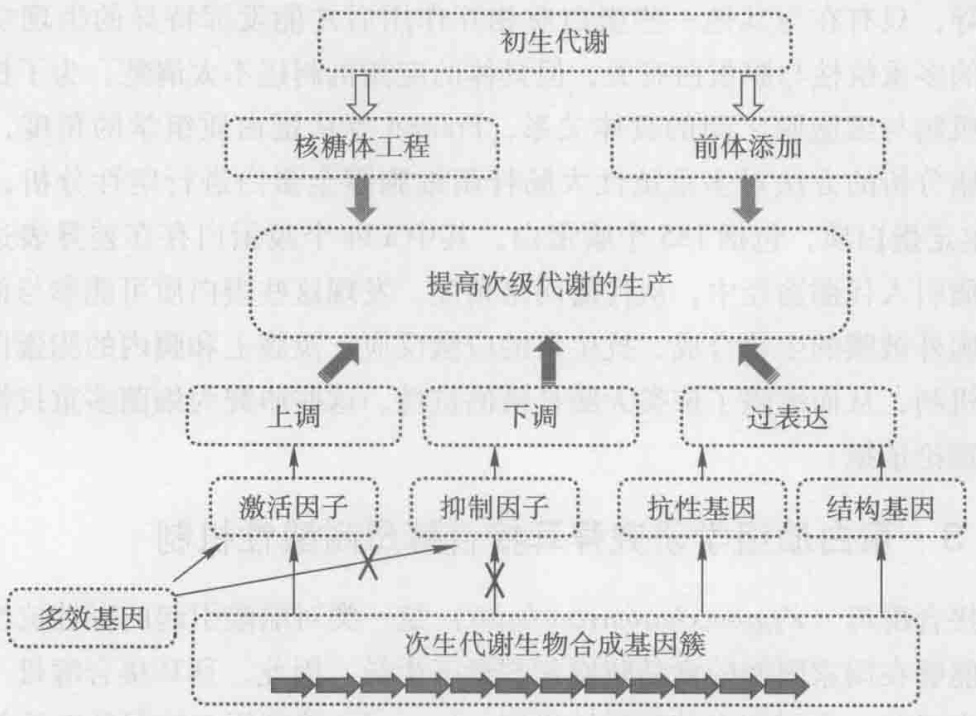

<details>
<summary>flowchart</summary>

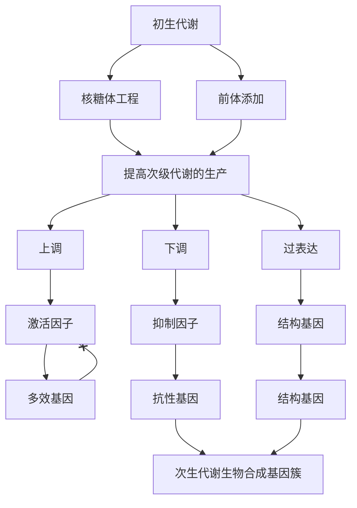
</details>

图9-14 提高次级代谢产物的策略（Olano et al. 2008）

## 9.6.2 蛋白质组学技术改进青霉素生产菌的应用举例

1928 年，Fleming 最初发现的产黄青霉菌（Penicillium chrysogenum）的青霉素产量仅为  $1.2 \mu g \cdot mL^{-1}$ ，之后经过几十年的时间，通过各种途径对菌种改造和筛选，获得的菌种青霉素产量大幅度提高。目前已知的青霉素增产的机制有两种，第一是对代谢途径进行了修饰，主要是切断了尿黑酸途径（homogentisate pathway catabolism）。微生物体内的尿黑酸途径会消耗中间物质苯基乙酸（phenylacetic acid）来合成最终产物尿黑酸（homogentisate），由于苯基乙酸在微粒体细胞色素 P450 单加氧酶（microsomal cytochrome P450 monooxygenase）的催化下，能合成青霉素 G 侧链前体物质，因此，切断黑酸途径能大量积累中间物质苯基乙酸，从而能促进青霉素 G 侧链前体物质的大量合成，进而提高青霉素的产量。第二是对控制合成青霉素的代谢途径中的基因域进行了放大。通过控制关键酶的合成来控制产物的合成。在微生物体内，从中间物质苯基乙酸到合成最终产物青霉素的整个代谢过程中，总共有四个关键酶对代谢进行控制和调节，如图 9-15a 所示，分别为苯乙酰辅酶 A 连接酶（phenylacetyl-CoA ligase），由基因 phl 控制；ACV 合成酶（ACV synthase），由基因 pcbAB 控制；异青霉素 N 合成酶（isopenicillin N synthase），由基因 pcbC 控制；异青霉素 N 酰基转移酶（isopenicillin N acyltransferase）由基因 penDE 控制，通过对这些基因过表达来控制代谢流。

为了从蛋白质（主要是酶）的角度优化产黄青霉菌工业菌株的改良，Barreiro等（2010）从10种通过不同途径诱导（自然筛选、X线处理、氮芥、紫外线照射等）得到不同青霉素产量的菌种（图9-15b），进行了比较蛋白质组学分析，具体步骤如下:

(a)

(b)

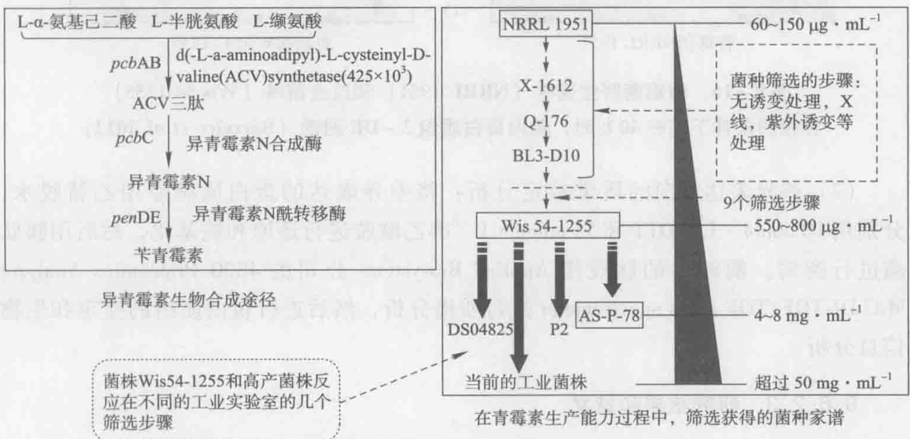

图9-15 青霉素生物合成途径（a）和不同生产能力的产黄青霉工业菌株（b）（Jami et al. 2010）

## 9.6.2.1 实验材料

三种不同生产能力的菌株:野生型青霉菌 NRRL 1951（低产菌），其青霉素产量在  $60 \sim 150 \mu g \cdot mL^{-1}$  之间；菌株 Wis 54-1255（对照菌）青霉素产量在  $300 \mu g \cdot mL^{-1}$  左右；菌株 AS-P-78（高产菌）青霉素产量大于  $50000 \mu g \cdot mL^{-1}$ （图 9-15b）。

## 9.6.2.2 实验方法

（1）胞内蛋白质提取:对培养至稳定期的青霉菌菌丝收集、离心，利用蛋白质提取缓冲液  $\left[10\ mmol\cdot L^{-1}\ potassium\ phosphate\ buffer,\ 0.07\%\ (m/V)\ DTT,\right.$  蛋白质酶抑制剂 CompleteTM（Roche Applied Science）] 提取菌丝体胞内蛋白质。离心收集上清液，用含 0.14%（m/V）DTT 和 20% TCA 丙酮溶液在 -20℃ 条件下沉淀蛋白质 1 h。采用二维电泳分离方法进行蛋白质的分离、染色、凝胶扫描，获得青霉菌胞内蛋白质组图谱（图 9-16），然后进行蛋白质斑点的丰度分析，寻找差异表达的蛋白质点。

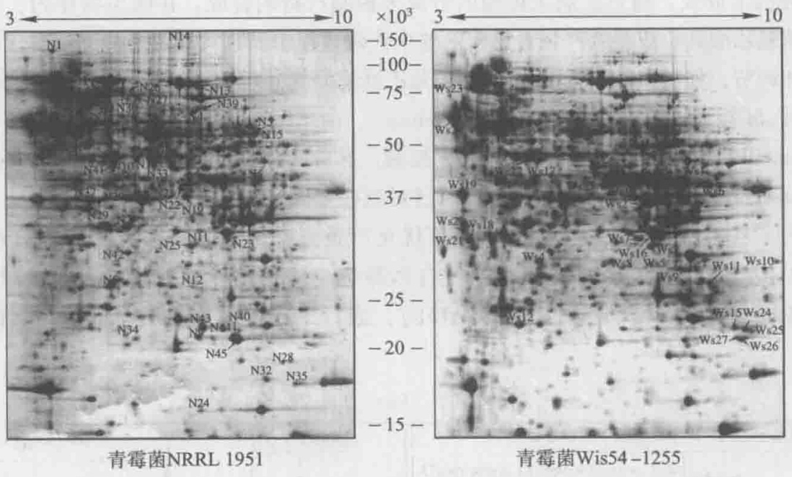

图9-16 青霉菌野生菌株（NRRL 1951）和改良菌株（Wis 54-1255）

在相同条件下培养 40 h 时，胞内蛋白质组 2-DE 图谱（Barreiro et al. 2012）

(2) 差异表达蛋白的质谱鉴定分析: 将差异表达的蛋白质斑点用乙腈脱水, 分别用 $10 \mathrm{mmol} \cdot \mathrm{L}^{-1} \mathrm{DTT}$ 和 $55 \mathrm{mmol} \cdot \mathrm{L}^{-1}$ 碘乙酰胺进行还原和烷基化, 然后用胰肽酶进行酶解。酶解后的肽段用 Applied Biosystems 公司的 4800 Proteomics Analyzer MALDI-TOF/TOF mass spectrometer 进行质谱分析, 然后进行蛋白质组的鉴定和生物信息分析。

## 9.6.2.3 研究结果和意义

利用质谱技术分别比较了三种菌种的菌丝蛋白表达差异，结果表明:

（1）参与糖类代谢和能量供给的蛋白质:发现高产菌内  $\beta-$  葡萄糖苷酶较多，该酶能降解纤维素，为细胞代谢提供碳源；同时在高产菌菌体丝内发现一种 Sou2 蛋白，