该蛋白质能利用山梨醇，为菌种提供碳源。因此，可以利用基因工程手段，过表达菌丝体内β-葡萄糖苷酶，改善菌种在碳源方面的补给，从而促进目标产物的合成。

(2) 参与青霉素前体合成的蛋白质: 高产菌种中参与合成青霉素的三种氨基酸 (L-半胱氨酸、L-α-氨基己二酸和L-缬氨酸) 含量较高, 合成这些氨基酸的酶含量也较高, 如合成 L-半胱氨酸的两种关建酶 L-半胱氨酸合成酶和 L-半胱氨酸脱巯基酶。同时, 参与合成青霉素的三种关键酶 [三肽合成酶 (ACVS)、异青霉素 N 合成酶 (IPNS)、IPN 酰胺裂解酶 (IPNA)] 含量也较高, 这都促进了青霉素产量的提高。低产菌 (野生型 NRRL 1951) 中甲基丙二酸脱氢酶含量较高, 该酶参与缬氨酸分解代谢途径, 降低了菌体中缬氨酸含量, 进而影响了青霉素产量。因此, 在高密度细胞培养过程中, 直接向培养基中添加三种氨基酸, 可提高前体物质的含量, 促进产物积累。另外, 对控制合成青霉素的相关基因进行扩增, 对控制合成该代谢途径中关键酶的基因进行扩增, 通过调节酶的表达来促进产物的表达。
(3) 与毒性及响应机制相关蛋白质: 与高产菌 AS-P-78 对比, 对照菌 (Wis 54-1255) 体内富含 UDP - 半乳糖变位酶的三个亚基, 该酶参与半乳呋喃糖的合成, 而半乳呋喃糖与细胞表层结构和感染周期密切相关, 因此该酶在菌体内含量的多少可能也是影响青霉素的原因之一。
（4）与细胞氧化应激相关蛋白质:与对照菌 Wis 54-1255 和低产菌 NRRL 1951 相比，高产菌 AS-P-78 中明显含有较多的几种与氧化应激相关的蛋白质。包括与谷胱甘肽-S-转移酶相关的蛋白（glutathione S-transferase-like proteins）、谷胱甘肽还原酶（glutathione reductase）、谷胱甘肽脱氢酶（alcohol dehydrogenase）等，这些酶有效地降解了因氧化应激给菌体带来的伤害，保证了菌体在一个较为稳定的环境中进行代谢，减少了其他的次生代谢产物的合成，这也对青霉素高产有一定影响。
(5) 参与细胞膜通透性相关蛋白质: 与对照菌 Wis 54-1255 和低产菌 NRRL 1951 相比, 高产菌 AS-P-78 中 OmpC 和 OmpF 蛋白含量较高。外膜孔道蛋白 OmpC 和 OmpF 能引起细胞膜通透性的改变, 促进产物的顺利排出。修饰 OmpC 和 OmpF 蛋白表达相关的基因, 调控细胞膜通透性, 避免细胞内代谢中间产物库的不足或过量, 促进青霉素的生产。

## 9.6.3 靶向蛋白质组学在萜类代谢工程菌种改进中的应用举例

尽管在高等植物，细菌、真菌和放线菌等菌类以及硅藻等藻类物质中均存在萜类物质（terpene）合成途径，但是在活细胞生命体中，各个基因表达和翻译之间相互作用十分复杂、基因的过表达会使菌体的代谢负担显著增加；另外，单一基因的调节很难使得整体表达水平达到协调。在微生物中，代谢途径成功调控不仅依赖于构建和优化新代谢途径的方法，而且许多其他因素也会影响代谢途径的性能。所以，仅仅考察目标产物的效价不能准确揭示mRNA丰度、蛋白质的丰度或酶的活性的影响。为此，合成生物学家及代谢工程师正在用各种分析手段来确定代谢途径中抑制产物形成的元件。最近，Redding-Johanson等（2011）运用基于选择反应监测质谱技术的靶向蛋白质组方法，考察生产倍半萜紫穗槐-4,11-二烯（sesquiterpene,amorpha-4,11-diene）的大肠杆菌工程菌相关代谢途径中蛋白质的表达水平变化，具体过程如下:

## 9.6.3.1 实验材料

本研究中，大肠杆菌（E. coli DH10B）作为宿主，用于克隆和荧光蛋白检测。大肠杆菌（E. coli DH1）作为生产紫穗槐-4, 11-二烯（amorpha-4, 11-diene）的宿主菌。原始紫穗槐-4, 11-二烯的产生系统由三个质粒 pMevT, pMBIS 和 pADS 组成（Keasling 实验室 2003 年所用菌种）。质粒 pMevT 含有由乙酰辅酶 A 转化到甲羟戊酸的三个基因:乙酰乙酰基辅酶 A 合酶（acetoacetyl-CoA synthase, ATOB）基因来源于大肠杆菌，HMG-CoA 合酶（HMGS）和 HMG-CoA 还原酶（HMGR）基因来自酿酒酵母。质粒 pMBIS 负责将甲羟戊酸转换成 farnesyldiphosphate（FPP）:其中编码 mevalonatekinase（MK）、phosphomevalonatekinase（PMK）和 phosphomevalonatedecarboxylase（PMD）的三个基因来自酿酒酵母，另外两个 isopentenyldiphosphateisomerase（Idi）和 farnesyl diphosphatesynthase（ISPA）酶基因来自大肠杆菌。质粒 pADS 中含有编码紫穗槐-4, 11-dienesynthase（ADS）的基因来自青蒿。在本研究中所用的质粒如表 9-1 所示。

构建了两种菌体，每个菌体中均含有上述9个酶构建的MVA途径，均能合成紫穗槐-4，11-二烯。第一种菌体（P3）中的MVA途径利用三个不同质粒（pMevT，pMBIS和pADS）构建。第二个菌体（P2）利用两个质粒（pBbA5c-MevT-MBIS和pADS）构建，质粒pBbA5c-MevT-MBIS是对质粒pMevT和pMBIS的组合，通过对P3和P2启动子、复制位点以及复制拷贝数进行修饰。

表 9-1 本研究中所有的宿主和质粒

<table><tr><td>菌株和质粒</td><td>描述</td><td>参考文献</td></tr><tr><td colspan="3">菌株</td></tr><tr><td>DH1</td><td> $F^{-}$  endA1 hsdR17 (rk-, mk + ) supE44 thi-1 $\lambda^{-}$  recA1 gyrA96 relA1</td><td>Hanahan 1983</td></tr><tr><td>DH108</td><td> $F^{-}$  mcrA  $\Delta$  (mrr-hsdRMS-mcrBC)  $\phi$ 80lacZΔM15 ΔlacX74 recA1 endA1 amD139  $\Delta$  (ara, leu) 7697 galU galK  $\lambda^{-}$  rpsL nupG</td><td>Invitrogen</td></tr><tr><td> $\Delta$ AcrAB</td><td>DH1 derivative with  $\Delta$ acrA and  $\Delta$ acrB,  $Amp^{r}$ </td><td>Redding-Johanson et al. 2011</td></tr><tr><td colspan="3">质粒</td></tr><tr><td>pBbA1k-RFP</td><td>p15A  $Kan^{r}$ ,  $P_{lac}$ , mRFP</td><td>Redding-Johanson et al. 2011</td></tr><tr><td>pBbA2k-RFP</td><td>p15A  $Kan^{r}$ ,  $P_{lac}$ , mRFP</td><td>Redding-Johanson et al. 2011</td></tr><tr><td>pBbA5k-RFP</td><td>p15A  $Kan^{r}$ ,  $P_{lacUVS}$ , mRFP</td><td>Redding-Johanson et al. 2011</td></tr><tr><td>pBbA8k-RFP</td><td>p15A  $Kan^{r}$ ,  $P_{BAD}$ , mRFP</td><td>Redding-Johanson et al. 2011</td></tr><tr><td>pBbS5k-RFP</td><td>pSC101,  $Kan^{r}$ ,  $P_{lacUVS}$ , mRFP</td><td>Redding-Johanson et al. 2011</td></tr><tr><td>pBbE5k-RFP</td><td>ColE1,  $Kan^{r}$ ,  $P_{lacUVS}$ , mRFP</td><td>Redding-Johanson et al. 2011</td></tr><tr><td>pMevT</td><td>p15A,  $Cm^{r}$ ,  $P_{lac}$ , AtoB-HMGS-HMGR</td><td>Martin et al. 2003</td></tr><tr><td>pMBIS</td><td>pBBR1,  $Tet^{r}$ ,  $P_{lac}$ , MK-PMK-PMD-Idi-1spA</td><td>Martin et al. 2003</td></tr><tr><td>pADS</td><td>pMB1,  $Amp^{r}$ ,  $P_{trc}$ , ADS</td><td>Martin et al. 2003</td></tr><tr><td>pBbASc-MevT-MBIS</td><td>p15A,  $Cm^{r}$ ,  $P_{lacUVS}$ , AtoB-HMGS-HMGR-MK-PMK-PMD-Idi-IspA</td><td>Redding-Johanson et al. 2011</td></tr><tr><td>pBbASc-MevT-MBIS (CO)</td><td>pBbASc-MevT-MBIS derivative containing codon-optimized MK and PMK</td><td>Redding-Johanson et al. 2011</td></tr><tr><td>pBbASc-MevT-T1-MBIS</td><td>p15A,  $Cm^{r}$ ,  $P_{lacUVS}$ -AtoB-HMGS-HMGR-term- $P_{trc}$ -MK-PMK-PMD-Idi-IsPA</td><td>Redding-Johanson et al. 2011</td></tr><tr><td>pBbASc-MevT-T1-MBIS (CO)</td><td>pBbASc-MevT-T1-MBIS derivative containing codon-optimized MK and PMK</td><td>Redding-Johanson et al. 2011</td></tr></table>

## 9.6.3.2 蛋白质组分析样品制备

培养细胞收集后进行离心（8 000 g）5 min，用液氮速冻细胞放置于 -80℃ 备用。将保藏的细胞在冰上解冻，并涡旋该溶液均匀，用氯仿和甲醇溶液进行蛋白质沉淀。

## 9.6.3.3 蛋白质酶解和质谱鉴定分析

将 $50\mu \mathrm{g}$ 蛋白质用 $50\mathrm{mmol}\cdot \mathrm{L}^{-1}$ 的碳酸氢铵溶解至终浓度为 $1\mathrm{mg}\cdot \mathrm{mL}^{-1}$ 。加入$5\mathrm{mmol}\cdot \mathrm{L}^{-1}$ Tris（2-carboxyethyl）phosphine（TCEP）作用30min还原样品中的二硫键。然后，加入 $200\mathrm{mmol}\cdot \mathrm{L}^{-1}$ 碘乙酰胺在黑暗中作用30min以实现蛋白质样品的烷基化。烷基化后，用胰肽酶（$1\mu \mathrm{g}\cdot \mu \mathrm{L}^{-1}$）进行样品酶解。酶解后的肽段用LC-MS/MS以SRM模式进行分析，这一分析系统含有Eksigent TEMPO nanoLC-2D、Applied Biosystems（FosterCity，CA）4000Q-Trap mass spectrometer with AnalystTM 1.5（Applied Biosystems）。并运用软件MultiQuantTM version 1.2 software（Applied Biosystems）进行SRM蛋白质的定量分析。

## 9.6.3.4 研究结果和意义

通过利用选择反应检测质谱技术（SRM）检测分析表明（图9-17），结合分析该代谢途径中9种酶变化趋势与紫穗槐-4，11-二烯合成量之间的关系，发现两种酶的表达量直接影响目标产物的产量:甲羟戊酸激酶MK、磷酸甲羟戊酸激酶PMK，它们是倍半萜（amorpha-4，11-diene）合成的潜在瓶颈。进一步通过密码子优化及启动子强化该途径，过表达甲羟戊酸激酶MK、磷酸甲羟戊酸激酶PMK，最终使得紫穗槐-4，11-二烯的产量也相应增加，产量提高了300%，由于异戊烯基焦磷酸和二甲基烯丙基焦磷酸是所有类异戊二烯物质的通用前体物质，因此这使得各类类异戊二烯类物质的大规模生物合成成为可能，同时为代谢途径的整体代谢过程的优化提供了一种新的途径和方法。

蛋白质组学在生命科学领域的应用确实很广泛，效果也很明显，通过利用蛋白质组学相关技术，我们可以有效地探索各种生命现象的作用机制，了解不同代谢过程之间的关系，从而改进菌种，促进生产。但是，蛋白质组学也不是一把“万能钥匙”，对于生命科学中某些现象，单一利用蛋白质组学技术有时也不能解决问题，因此，配以其他组学技术共同探索就成为一种新的趋势。同时，利用蛋白质组学技术，我们可以对菌体已经表现出来的某一特异性状，从蛋白质差异和功能的角度去分析其原因，但如果当我们直接获得一组蛋白质组数据，让我们去推测其可能存在的性状和特性时，蛋白质组学就显露出不足了，因为蛋白质代谢过程是一个动态的过程，某一特定时刻的实验结果并不能完全反应机体整个生物性状。2012年，Chao和Hansmeier（2012）提出了一种“代谢模型”策略，利用该策略能初步根据提供的蛋白质组数据来预测个体的特征和表型。但该策略也只能部分预测个体最终表型，而不能精确预测整体性状。随着蛋白质组学的不断发展，尤其各种检测手段的完善和新型检测仪器的升级，相信仅仅利用一组蛋白质实验结果就能准确推断该个体的表型和特性的猜想最终也能成为一种现实。

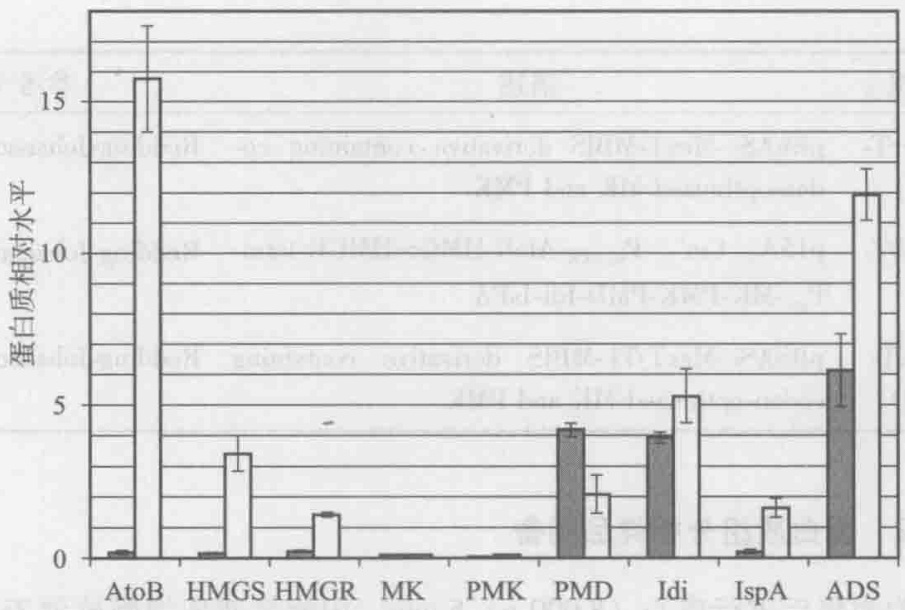

bar

| Category | Dark Gray Bar | White Bar |
| --- | --- | --- |
| AtoB | ~0.2 | ~15.8 |
| HMGS | ~0.2 | ~3.4 |
| HMGR | ~0.3 | ~1.5 |
| MK | ~0.1 | ~0.1 |
| PMK | ~0.1 | ~0.1 |
| PMD | ~4.2 | ~2.1 |
| Idi | ~4.0 | ~5.3 |
| IspA | ~0.3 | ~1.7 |
| ADS | ~6.2 | ~12.0 |

图9-17 参与倍半萜合成代谢途径中蛋白质（酶）的相对水平差异（Redding-Johanson et al. 2011）

菌株3p（■）和菌株2p（□）

## 思考题

1. 蛋白质组学的研究策略有哪些？各有什么特点？
2. 比较分析发现蛋白质组学、定向蛋白质组学及靶向蛋白质组学。
3. 结合代谢工程试述蛋白质组技术在菌种改造中的应用。

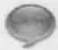

## 推荐阅读

Barreiro C, Martín J F, García-Estrada C. Proteomics shows new faces for the old penicillin producer Penicillium chrysogenum. Journal of Biomedicine and Biotechnology, 2012: 105–109.

Doerr A, Mass spectrometry-based targeted proteomics. Nature methods, 2013, 10 (1): 23.

Lange V, Picotti P, Domon B, et al. Selected reaction monitoring for quantitative proteomics: a tutorial, Molecular Systems Biology, 2008, 4: 222.

Redding-Johanson A M, Keasling J D, Lee T S, et al. Targeted proteomics for metabolic pathway optimization: application to terpene production. Metabolic Engineering, 2011, 13 (2): 194–203.

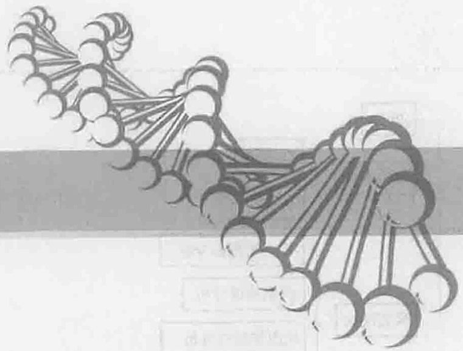

natural_image

Abstract illustration of interconnected nodes or spheres forming a network-like structure (no text or symbols)

## 10

# 代谢物组学技术与代谢工程

## 【本章学习要点】

1. 代谢物和代谢物组学的概念
2. 微生物代谢物组学的研究方法
3. 代谢物组学在代谢工程中的应用

随着全基因组测序技术大规模的进行，生命科学领域的研究也随之翻开了崭新的一页。庞大的基因组数据信息源源不断地从一系列新技术中产生，而且未来还会呈指数增长。然而到目前为止，30%\~40%典型开放阅读框的功能我们还不能解释（Hollywood et al. 2006）。即使我们掌握了某一个生物体的所有基因、编码蛋白等信息，我们也不能完全阐释其表型特征。代谢物是细胞调控过程的终端产物，它们的水平可以看作是生物系统对基因和环境变化的终端响应，代表细胞或组织的生物化学表型（biochemical phenotype），在基因功能阐释等方面表现出了巨大的潜力，正日益受到了科学家们的重视。

## 知识导图

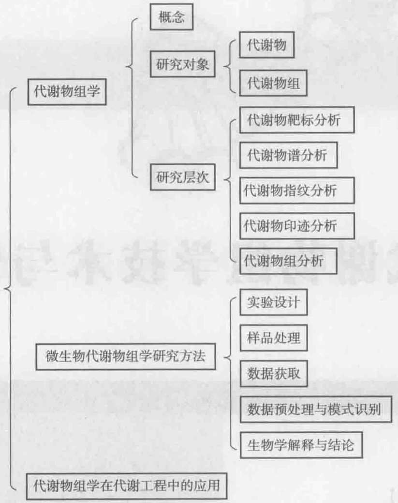

flowchart

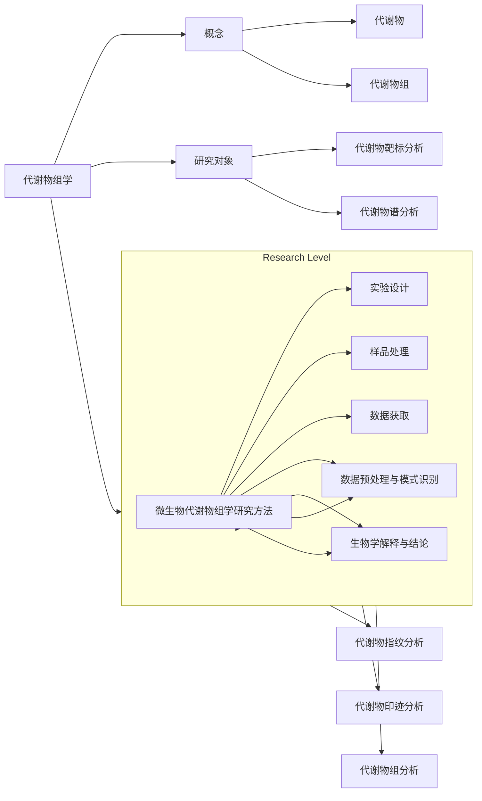

## 10.1 代谢物组与代谢物组学

代谢物（metabolite）:指参与细胞代谢或维持细胞生长和正常功能所必需、相对分子质量小于1 000的有机化合物。

代谢物组（metabolome）:也称为代谢组，指给定的生物系统在特定条件下合成的所有代谢物，包括所有胞内代谢物和分泌到培养基中的代谢物或胞外分泌物。

代谢物组学（metabolomics）:也称为代谢组学，是对生物系统（细胞、组织或生物体）中代谢物全面的定量分析，揭示代谢物水平对环境或遗传操作扰动引起的响应规律。

根据研究对象和目的的不同，对代谢物及代谢组的分析可以分为五个层次（Fiehn 2002, Villas-Bôas et al. 2005b):

代谢物靶标分析（metabolite target analysis）:对样品中某个或某几个特定代谢物的分析。在此层次中，往往需要对样品进行预处理，去除干扰物，提高靶标代谢物的相对浓度或检测信号。

代谢物谱分析（metabolite profiling analysis）:定量分析一系列预定的目标代谢产物。如某一类结构、性质相关的化合物（氨基酸、有机酸、异戊烯类）或某一代谢途径的所有中间代谢物。在此层次中，往往根据分析代谢物的结构和理化性质，设计适合代谢物提取和分析的特定技术来完成。

代谢物指纹分析（metabolite fingerprinting analysis）:对不同环境或不同基因背景下的胞内代谢物进行快速指纹分析。在此层次中，通常采用核磁共振（nuclear magnetic resonance, NMR）或质谱（mass spectrometry, MS）技术进行快速分析，通常不需要定量分析单一代谢物组分，较多用于表型的分类等。

代谢物印迹分析（metabolite footprinting analysis）:对胞外代谢物谱的快速分析。在此层次中，其技术与代谢物指纹分析类似，但分析的是分泌到胞外培养基中的代谢物，底物的生物转化也被认为是代谢物印迹分析的范畴。

代谢组分析（metabolome analysis）:特定条件下生物样品所有代谢物的成分及其动态变化分析。此层次为严格意义上的代谢组学研究，样品的处理和检测技术需满足对所有的代谢组分具有无偏性、高灵敏度和高通量的要求。但是到目前为止，代谢组学的这个研究目标还是不可完成的任务，因为还没有发展出一种真正的代谢组学技术可以涵盖所有的代谢物分子。然而，在代谢组学研究中，科学家们在具体的实验中，正试图解析所有的代谢物组分，因此代谢组学研究的特征也可以表述为设法分析尽可能多的代谢物组分。

代谢组学自出现以来，特别是近几年，随着高通量分析技术的高速发展和化学计量学算法的开发，代谢组学发展迅速，广泛应用于各个领域，如植物代谢组学、微生物代谢组学、营养科学、生态和环境科学、药物的研发、疾病的诊断等。结合本书重点介绍微生物代谢工程和合成生物学的特点，本章将主要讨论微生物代谢组学的研究方法及其在代谢工程方面的应用。

## 10.2 微生物代谢物组学研究方法

微生物代谢组学力求分析生物体系中的所有代谢产物，所以整个过程中都强调尽可能保留和反映总代谢产物信息。精确、灵敏、高通量的平台技术与分析方法是代谢组学研究的基础；从大量分析信号中发现有用信息或特征模式的计算技术是代谢组学研究的重要工具。微生物代谢组学的研究流程如图10-1所示，包括菌株培养、样品处理、数据采集、数据预处理、数据分析、生物学解释和结论等。

## 10.2.1 菌株培养

微生物生长的重复性是进行代谢组学研究的前提，为建立标准的和可重复的培养条件，生物反应器中的温度、pH、培养基组分以及溶解于其中的 $\mathrm{O}_2$ 、 $\mathrm{CO}_{2}$ 等必须确定且易于控制与检测。微生物代谢组学研究中，培养方式主要包括分批培养和连续培养。大多数研究者倾向于应用生物反应器连续培养操作模式。相对而言，恒化培养可以为微生物的生长提供恒定的生长条件，是最理想的培养方法，但也存在菌体老化、对灭活方法要求苛刻等缺点。实际操作往往根据研究目的或需要，权衡各种利弊选用合适的培养方式。

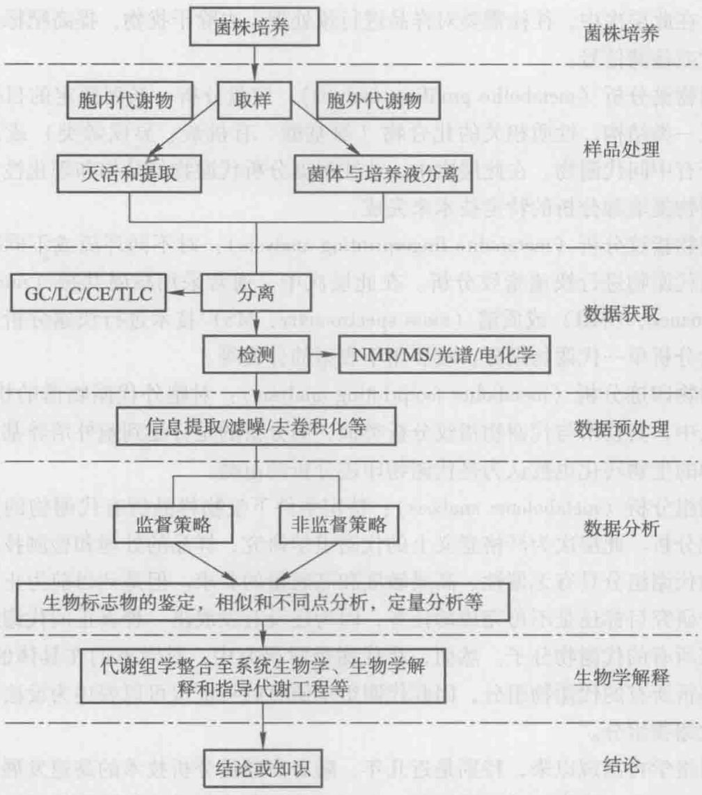

flowchart

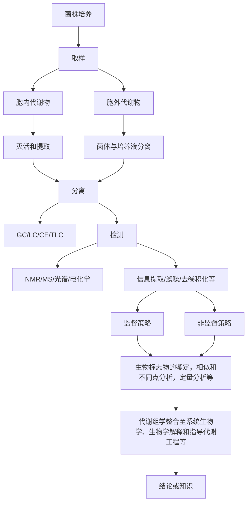

图10-1 微生物代谢组学研究流程（王智文等2010）

## 10.2.2 样品处理

微生物代谢组学研究通常进行胞内代谢物的分析，由于细胞内酶系活跃、代谢物转换迅速，因此取样和样品制备方法会显著影响分析结果的准确性和重复性。样品的处理主要包括快速取样、灭活（淬灭）和代谢物提取等。

## 10.2.2.1 快速取样

由于一些代谢物在微生物体内的转换时间非常短暂（<2 s），因此从反应器中快速收集样品并立即终止细胞代谢是至关重要的，否则会由于取样过程中底物浓度的显著变化使得细胞生理稳定状态受到破坏。对于连续培养模式，通常培养基中底物浓度（如葡萄糖）非常低，使得取样过程中细胞生理状态的变化更加迅速，因此对取样技术的要求很高。而对于分批培养模式，一般由于底物浓度足够高而不会导致细胞的生理状态发生显著改变，因此对取样技术的要求较低，甚至可以采用过滤的方法，如微生物培养液通过0.2  $\mu$ m滤膜快速过滤方法收集菌体。样品制备技术的自动化和机械化是今后发展的趋势，能够大大减少实验误差，使数据更具稳定性和重现性。

## 10.2.2.2 灭活

灭活，又称淬灭，即迅速降低细胞内的代谢酶活性，使代谢反应停止，尽量使胞内代谢物保持取样时的状态。对于胞内代谢物，由于取样或脱离培养环境后细胞内的代谢状态迅速改变，胞内代谢物的种类和含量也随之发生变化，为正确反映培养环境中胞内代谢物的真实信息，需要立即灭活细胞以终止胞内反应，细胞与培养液分离后需要在低温中保存以抑制代谢反应。理想的灭活技术应满足两个要求:①酶迅速失去活性；②细胞保持完整性。

传统灭活方式包括瞬间改变样品温度至低温（＜-20℃）或高温（＞80℃），或应用极端pH的高碱（氢氧化钠或氢氧化钾）或高酸（高氯酸、盐酸或三氯乙酸）溶液完成。液氮冷冻或高氯酸灭活技术是植物和动物代谢组学研究中经常使用的灭活方法，然而，这两种方法并不适用于处理微生物细胞，因为它无法将胞内和胞外代谢物分开。对于微生物的灭活，较多采用冷甲醇及其缓冲溶液，如冷却至-40℃的60%甲醇70 mmol·L $^{-1}$ HEPES溶液，取一定体积培养物溶液与灭活剂按照1:3比例迅速混匀，混合后的溶液保持-10℃以下的温度，使胞内酶达到迅速失活的目的。目前这种方法在L. lactis、S. cerevisiae、E. coli、C. glutamicum、A. niger、B. subtilis等微生物中均有应用。

灭活过程中代谢物的泄漏不可避免，代谢物的泄漏取决于细胞壁和膜的结构。与酵母、丝状真菌等真核微生物相比，细菌等原核微生物使用冷甲醇灭活更易引起胞内代谢物的泄露；由于细胞壁结构的不同，革兰氏阴性细菌比革兰氏阳性细菌更容易产生胞内代谢物的泄漏。如何保持细胞的完整性，防止胞内代谢物的泄漏，以正确反映微生物细胞的生理状态，是微生物代谢组学研究的关键环节之一。因此，需要探索引起细胞泄露作用较小的灭活剂及其灭活程序，优化灭活剂的组分，减少后续代谢物的处理。例如，Villas-Bôas 和 Bruheim（2007）利用冷甘油 - NaCl 溶液分别灭活酿酒酵母、链霉菌和荧光假单胞菌，并测定了胞内代谢物的泄漏情况，结果表明冷甘油 - 0.9% NaCl 溶液能够有效地抑制胞内代谢物的泄漏。其次，通过使用定量方法测定胞内代谢物泄漏的程度，便可以估算出细胞内代谢产物的浓度。灭活剂中的盐离子能够维持溶液一定的渗透压，减少微生物在灭活过程中胞内代谢物的泄漏，但是盐离子会干扰后续样品的检测，因此可以选择碳酸铵等可挥发盐类作为灭活剂中的离子强度调节剂，样品在冷冻干燥等过程中碳酸铵可以挥发去除，方便代谢物的进一步分析。

## 10.2.2.3 代谢物提取

为了从整体上分析代谢物，代谢物提取方法应该满足以下几个要求:①能够最大限度地提取代谢物；②无偏向性，不排除具有特殊物理、化学性质的分子；③不破坏或改变代谢物的物理或化学特性。

代谢物提取剂主要有冷甲醇、热乙醇、高氯酸或碱、热甲醇和甲醇-氯仿混合液等。其中酸、碱提取法是传统的代谢物提取方法，通常用于提取对酸或碱稳定的代谢物；高氯酸提取法已广泛用于细菌的代谢物提取，该方法对核苷酸类物质和水溶性代谢物提取效果较好，如 cAMP, ppGpp 和细胞壁的前体物质，并容易实现自动化，缺点是较低的 pH 使有些代谢物不稳定；甲醇-氯仿法对非极性的代谢物具有较好的提取效果，然而高极性代谢物在甲醇和氯仿中溶解度较小而影响其提取效果，并且该方法还存在费时和氯仿毒性大等缺点；甲醇或乙醇提取法具有简单快速且无盐加入、提取剂易于去除、代谢物易于浓缩以及 pH 变化小等优点，但是利用热甲醇或热乙醇提取时，高温对热不稳定的代谢物有破坏作用。

目前还没有建立通用的胞内代谢物提取方法。由于代谢物性质的多样性，仅采取一种提取方法无法实现胞内代谢物的全部提取。因此要尽可能多地获得胞内代谢物，需要组合不同提取和分析方法。van der Werf 等（2007）利用冷甲醇-水溶液和氯仿分别提取 E. coli 胞内代谢物，并采用 6 种不同的分析方法检测代谢物的组成，一共定性分析了 235 种胞内代谢物，其中首次鉴定出 E. coli 数据库中不存在的代谢物 61 种。

最近研制出了一种利用滤膜培养细胞或微生物，快速收集细胞，灭活和提取程序同时进行的代谢组学研究方法，该方法可用于分析可培养的哺乳动物细胞或微生物。以微生物胞内代谢物分析为例，从菌株的培养到代谢物的提取一共需要4步操作，其基本过程如图10-2所示:

（1）菌株在同位素标记的液体培养基中培养至  $OD_{650} \approx 0.1$ ，取 5 mL 菌液转移到经灭菌处理的尼龙膜上面，快速过滤收集菌体；
（2）将菌体均匀分布的尼龙膜小心转移到固体培养基平板上，在一定的培养条件下进行菌株的培养；
（3）固体培养基平板上，菌株培养至对数中期，迅速将尼龙膜转移到提取剂中，完成灭活和代谢物的提取；
(4) 代谢物溶液的收集和预处理。

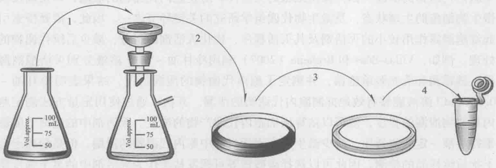

flowchart

图10-2 滤膜平板培养菌株、灭活和代谢物提取（Bennett et al. 2008）

该方法的优点是可以准确地对胞内代谢物进行定量分析，排除了灭活效率对代谢机制的干扰和胞内代谢物的泄漏，结合同位素标记技术可以对胞内代谢物进行绝对定量分析，更加真实地反映微生物或细胞的胞内代谢机制。Bennett等（2009）在滤膜平板培养菌株，灭活和代谢物提取同时进行方法的基础上，利用LC-MS/MS平台定量分析了大肠杆菌分别以葡萄糖、甘油和乙酸为唯一碳源，好氧生长至对数期时胞内100多种代谢物的浓度。发现大多数酶的底物浓度高于对应酶的 $K_{m}$ ，然而糖酵解途径中，中间代谢物的浓度与相应酶对该底物的 $K_{m}$ 比较接近，所有反应接近平衡。代谢物的浓度对细胞自由能和代谢反应速率具有重要影响，因此胞内代谢物浓度的绝对定量对定量分析细胞的代谢机制具有重要意义。

## 10.2.3 代谢物组数据的采集

代谢组学研究的效应很大程度上取决于被鉴定代谢物的数目及其生物学解释相关性，最难的步骤是对这些代谢物进行定性和定量分析。代谢物的分离和检测是微生物代谢组学研究的两个核心组成部分，是获得代谢组学数据的关键。分离技术主要采用各种色谱分离方法，如液相色谱（liquid chromatography, LC）、气相色谱（gas chromatography, GC）和毛细管电泳（capillary electrophoresis, CE）等。而检测技术主要采用质谱（mass spectrometry, MS）和核磁共振（nuclear magnetic resonance, NMR）等。代谢组学分析应对样品中的所有代谢物进行无偏地定性、定量分析。然而，代谢组学受到高速发展分析平台的促进，同时也受到分析平台发展程度的限制。目前还没有一种代谢组学分析平台可以无偏向性地涵盖所有代谢物、代谢物的结构、性质及其浓度，直接影响分析技术和方法的选择。虽然色谱、质谱、核磁共振、红外光谱、紫外吸收、荧光散射、光散射等分离分析手段及其组合都出现在代谢组学的研究中，但代谢组学数据的分析平台主要分为两类，分别是基于质谱和基于核磁共振的分析平台（Wang et al. 2006）。表10-1对比了目前微生物代谢组学研究中最常用的四种分析方法（GC-MS、LC-MS、CE-MS、NMR）的灵敏度、样品特点和特性。具体研究中，需要根据研究目的，样品特点等选择合适的分析平台。

表 10-1 微生物代谢组学的分析方法比较

| 分析方法 | 灵敏度/mol | 样品特性 | 优缺点 |
| --- | --- | --- | --- |
| GC-MSGC×GC-MS | $10^{-12}$ | 样品需要提取、干燥和衍生化,适于分析热稳定性好的代谢物 | 高分离效率,稳定,重现性好;具有大量相关的分析软件和代谢物鉴定数据库;因分析样品需衍生化,操作步骤相对繁琐 |
| LC-MSUPLC-MS | $10^{-15}$ | 样品一般需要提取和浓缩 | 高灵敏度,高选择性;存在离子化抑制效应;代谢物分析数据库少 |
| CE-MSCE-LIF | $10^{-23}$ | 样品一般需要提取和浓缩 | 高通量,高选择性,高灵敏度;没有特定的代谢物组学质谱数据库 |
| NMR | $10^{-6}$ | 需要的样品量少,无破坏性 | 快速,高通量,代谢物鉴定无偏向性,定量准确;灵敏度低,主要用于动物和植物代谢组学研究 |

## 10.2.3.1 直接注入质谱法

质谱（又叫质谱法）是一种与光谱并列的谱学方法，通常意义上是指广泛应用于各个学科领域中通过制备、分离、检测气相离子来鉴定化合物的一种专门技术。在众多的分析测试方法中，质谱学方法被认为是一种同时具备高特异性和高灵敏度且得到了广泛应用的普适性方法。质谱仪器一般由样品导入系统、离子源、质量分析器、检测器、数据处理系统等部分组成。质谱在代谢组学分析中可提供丰富的结构信息，包括代谢物分子离子峰、碎片离子峰等，可以根据分子离子峰质荷比（m/z）和碎片离子峰的断裂方式与标准代谢物样品的质谱信息比对来推断代谢物的结构，即定性分析；结合总离子流中代谢物的丰度可以对鉴定代谢物进行定量分析。质谱较其他技术具有更高的灵敏度、较快的检测速度和宽广的动态范围，还可以和液相色谱、气相色谱联用，大大提高对复杂基质的分析能力。

近年来，由于 MS 的技术优势和不断完善，样品可以不经过分离而直接进行 MS 分析，在代谢组学研究过程中称之为直接注入质谱法（direct injection mass spectrometry, DIMS），这种方法主要用于代谢物靶标分析、代谢物指纹分析和代谢物印迹分析。

图10-3显示的是利用DIMS法对酿酒酵母不同生长阶段的胞外代谢物印迹分析结果（Allen et al. 2003）。在酿酒酵母的延滞期和对数生长初期，质谱图相对简单，即胞外代谢物较少；从对数期到稳定期，质谱图变得非常复杂，且出现无数的小质谱峰，说明胞外代谢物谱发生了显著变化，这表明细胞开始向培养基中分泌代谢物；从不同生长阶段的胞外代谢物印迹图谱可以清晰看出，直接注入质谱法可以有效、快速地对菌体不同生长阶段进行分类。作者对DIMS方法的稳定性进行了分析，分别考察了不同培养基，不同接种量和不同初始种子等因素，结果表明该方法具有高稳定性和高通量的优势。DIMS法还可以对不同基因的敲除株进行代谢物印迹分析，应用于基因功能的鉴定和表型分类。

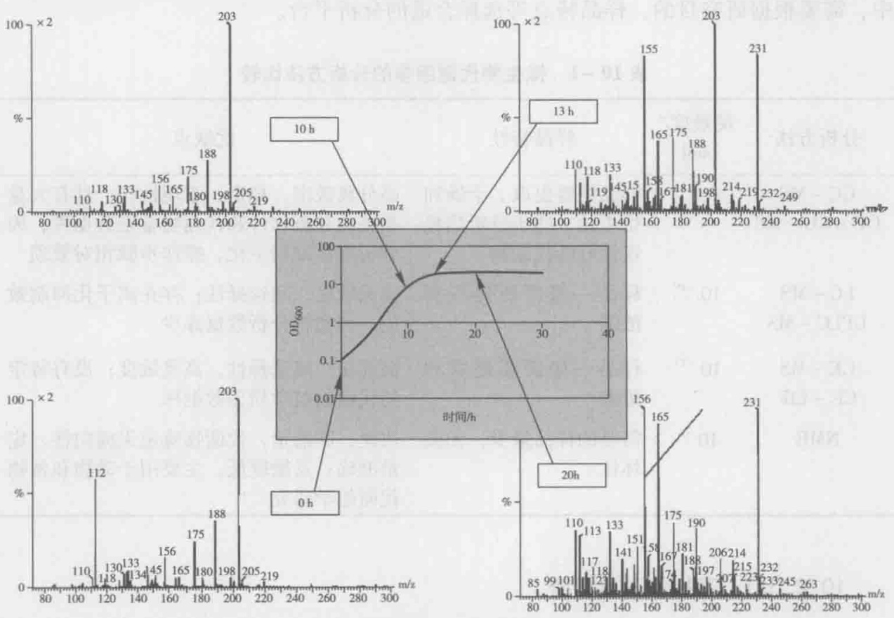

spectrogram

| Time | m/z | Relative Abundance (%) |
| --- | --- | --- |
| 0 h | 110 | ~5 |
| 0 h | 112 | ~40 |
| 0 h | 118 | ~5 |
| 0 h | 130 | ~5 |
| 0 h | 133 | ~5 |
| 0 h | 134 | ~5 |
| 0 h | 145 | ~5 |
| 0 h | 156 | ~5 |
| 0 h | 165 | ~5 |
| 0 h | 175 | ~5 |
| 0 h | 180 | ~5 |
| 0 h | 188 | ~5 |
| 0 h | 198 | ~5 |
| 0 h | 203 | ~90 |
| 10 h | 110 | ~5 |
| 10 h | 118 | ~5 |
| 10 h | 130 | ~5 |
| 10 h | 133 | ~5 |
| 10 h | 145 | ~5 |
| 10 h | 156 | ~5 |
| 10 h | 165 | ~5 |
| 10 h | 175 | ~5 |
| 10 h | 180 | ~5 |
| 10 h | 188 | ~5 |
| 10 h | 198 | ~5 |
| 10 h | 203 | ~90 |
| 13 h | 110 | ~5 |
| 13 h | 118 | ~5 |
| 13 h | 133 | ~5 |
| 13 h | 145 | ~5 |
| 13 h | 156 | ~5 |
| 13 h | 165 | ~5 |
| 13 h | 175 | ~5 |
| 13 h | 188 | ~5 |
| 13 h | 198 | ~5 |
| 13 h | 203 | ~90 |
| 20 h | 85 | ~5 |
| 20 h | 99 | ~5 |
| 20 h | 101 | ~5 |
| 20 h | 110 | ~5 |
| 20 h | 113 | ~5 |
| 20 h | 117 | ~5 |
| 20 h | 123 | ~5 |
| 20 h | 133 | ~5 |
| 20 h | 141 | ~5 |
| 20 h | 151 | ~5 |
| 20 h | 156 | ~90 |
| 20 h | 165 | ~90 |
| 20 h | 175 | ~5 |
| 20 h | 181 | ~5 |
| 20 h | 188 | ~5 |
| 20 h | 197 | ~5 |
| 20 h | 206 | ~5 |
| 20 h | 214 | ~5 |
| 20 h | 223 | ~5 |
| 20 h | 232 | ~90 |
| 20 h | 233 | ~5 |
| 20 h | 245 | ~5 |
| 20 h | 263 | ~5 |

图10-3 酿酒酵母不同生长阶段胞外代谢物直接注入质谱图（Allen et al. 2003）

## 10.2.3.2 气相色谱-质谱联用

由于代谢组学分析的对象种类繁多，性质差异很大，浓度范围分布广，而且还存在离子化程度和基质干扰等问题，要对它们进行无偏向的全面分析，单一的分析手段难以胜任。色谱-质谱联用技术是代谢组学研究中常用的方法，具有分离效率高和灵敏度好等优点。

在微生物代谢组学分析平台中，GC-MS发展最为成熟，较早地用于了代谢组学研究。GC-MS适合分析低极性、低沸点代谢物或者衍生化后具有挥发性的物质。在GC-MS联用中，GC具有很好的代谢物分离性能，具有高选择性、高灵敏度和高分辨率的特点，可以根据代谢物挥发的温度梯度，高效地将代谢物分离开。随着全二维气相色谱-质谱联用技术（GC×GC-MS）的引入，它的分离性能得到很大提高，传统的GC-TOF-MS能够检测100\~500种化合物，而GC×GC-TOF-MS能够在65min内分析大约1200种化合物。在GC-MS联用中，代谢物的离子化模式包括电子轰击离子化（electron impact ionization，EI）和化学离子化（chemical ionization，CI）。采用EI离子化方式，一般采用标准的电子轰击电离源和标准电压（-70 eV），化合物的碎片离子峰较稳定并具有可比性，国际上已建立了通用的化合物库（如美国国家标准技术研究院质谱数据库，national insitute of standard and technology mass spectral database，http://www.nist.gov/srd/nist1a.cfm），这极大地方便了微生物代谢组学研究中的化合物定性。相对于EI模式，CI更为温和，主要提供分子离子峰的信息，对于检测和确定未知代谢物非常有帮助。随着算法的改进、数据库的不断完善，GC-MS在代谢组学研究中的应用使得捕获更多的生物学相关信息成为可能。GC-MS存在的缺陷是该方法主要用于分析具有挥发性和热稳定性的化合物，难挥发性物质或半挥发性物质需要衍生化处理以后才能进行分析。GC-MS中常用的衍生化方法包括硅烷化（silylation）、酰化（acylation）和烷基化（alkylation）等。

在微生物代谢组学研究中，我们通常关心的化合物是氨基酸、糖和小分子有机酸以及其他极性代谢物，大多数代谢物都处于非挥发的状态。对于含有羧基、羟基和氨基的化合物，可以通过衍生化来增加他们的挥发性。例如，Nielsen课题组优化了一套氯甲酸甲酯（methyl chloroformate，MCF）衍生化方法，可以同时对氨基酸、二羧酸和三羧酸类物质衍生化（Villas-Bôas et al. 2003），并利用该方法分析了酿酒酵母中心碳代谢和氨基酸合成途径中胞内代谢物和胞外代谢物（Villas-Bôas et al. 2005a）。

Koek 等（2006）建立了另一套完整的利用 GC-MS 研究代谢物组的方法，包括代谢物的肟化和硅烷化衍生化反应以及 GC-MS 分析，并对衍生化效率和方法的重现性等进行了分析。该方法对 B. subtilis, P. freudenreichii 和 E. coli 均适用，可以测定包括乙醇、乙醛、氨基酸、胺、脂肪酸、有机酸、糖、糖胺、糖磷酸、嘌呤、嘧啶和芳香族化合物在内的代谢物。

## 10.2.3.3 液相色谱-质谱联用

LC-MS 是微生物代谢组学研究的另一重要分析平台，液相色谱通常以高效液相色谱（high performance liquid chromatography，HPLC）作为主要的分离手段，该技术具有高通量、高检测灵敏度和高分辨率等特点，与质谱（MS）或串联质谱（MS/MS）的联用还可以得到代谢物组分的结构信息。与 GC-MS 相比，HPLC 和 MS 之间的接口相对更为复杂，因此 HPLC-MS 在代谢组学领域中的应用相对较晚，但是目前 HPLC-MS 已经成为了广大生物分析实验室和代谢组学研究领域中广泛应用的工具。在 HPLC-MS 中，梯度洗脱反相高效液相色谱法由于水溶液样品的兼容性好，需要样品量少等特点在代谢物学研究中应用最为广泛。质谱作为检测器主要采用电喷雾离子化（electrospray ionisation，ESI）的电离方式，检测采用 + ESI 和 - ESI 相结合的方式。该分析平台具有物质检测分析领域宽、选择性和灵敏度较好、样品制备简单等优势。LC-MS 分析的样品，不需要进行衍生化处理，适用于不稳定、不易衍生化、难挥发和相对分子质量较大的代谢物。

尽管有许多关于 LC-MS 在微生物代谢物组研究中的报道，但该分析平台还存在一些尚未解决的问题，如高密度细胞培养过程中，高盐浓度无疑会抑制 ESI 的离子化效率，还可能阻塞蠕动泵。此外，LC-MS 中的 HPLC 柱的化学物质和三维结构会影响色谱的分离度和敏感性。最常用的反相色谱柱对极性代谢物的保留时间很小，甚至会发生代谢物与流动相的共洗出，这大大减小了数据分析的空间。所以，提高液相色谱的分离能力和鉴定化合物的能力，是液质联用成功应用于微生物代谢组学的关键。

超高效液相色谱（ultra performance liquid chromatography，UPLC）、亲水作用色谱（hydrophilic interaction chromatography，HILIC）和二维液相色谱（2-dimensional liquid chromatography，2D-LC）是近几年发展起来的液相色谱技术，在微生物代谢组学研究中具有重要的应用和发展潜力。UPLC采用低于 $2\mu \mathrm{m}$ 的柱填料颗粒来提高色谱柱的柱效（理论塔板数 $N$），增加仪器的分离度，复杂样品通常能够检测到几百个色谱峰。UPLC与HPLC之间没有原理上的区别，但是能够大大提高液相色谱的分离度、灵敏度和分析速度。目前UPLC和类似产品在液相色谱领域的应用越来越广泛。

亲水作用色谱是一种以极性固定相（如硅胶、氨基键合硅胶等），水和水溶性有机溶剂为流动相的色谱分离模式，与正相色谱相似，极性化合物比非极性化合物在HILIC柱上的保留时间长。亲水作用色谱分析中，一般采用乙腈-水体系作为流动相，初始条件为高比例的有机相，如95%的乙腈，逐步降低到水相。亲水作用色谱物质的保留顺序与反相色谱恰好相反，因此，如果结合反相色谱的结果可以得到更为完整的微生物代谢物信息。中国科学院大连化物所的许国旺课题组发明了一个柱切换二维液相系统，采用两套液相色谱柱（反相色谱柱和亲水作用色谱柱，亲水作用色谱柱和亲水作用色谱柱），通过阀切换实现了一次进样亲水和疏水代谢产物的同时检测，解决了复杂生物样品中亲水和疏水性代谢产物的同时检测问题（Wang et al. 2008a, Wang et al. 2008b）。

## 10.2.3.4 毛细血管电泳-质谱联用

CE-MS 是近几年发展较为迅速的新型分析技术，因其具有分析迅速、高灵敏度、高通量、样品不需要特殊处理和样品需要量少等优点而日益受到代谢组学研究者的重视。

毛细血管电泳是20世纪80年代问世的一种以毛细管为分离通道，以高压直流电场为驱动力的新型液相色谱分离技术，是经典的电泳技术和现代微柱分离技术相结合的产物。1987年，Olivares首次报道了毛细管电泳和质谱的联用技术，随之，该项技术迅速获得认可和欢迎，并出现商品化的仪器。由于CE需要较高的离子强度、挥发性低的缓冲液，而ESI需要相对较低的盐浓度才能获得好的雾化和离子化，因而CE末端与质谱的接口是影响整个检测的关键因素之一。所有CE-ESI-MS接口的目标是为了获得稳定的物雾流和高效的离子化，因此接口技术必须优化，每一种接口选择相应的缓冲液。CE-ESI-MS接口共有三种类型:同轴液体鞘流、无鞘接口和液体连接。

与传统的分离方法相比，灵敏度高是 CE-MS 最显著的特点之一；其次，样品需要量少也是 CE-MS 在代谢组学研究中的一大优势，其样品体积仅需要几纳升。CE-MS 对于极性较强，离子化的代谢物具有很好的分析效果。近年来，毛细管电泳在手性化合物的分离、药物分析、DNA 分析、代谢分析和环境分析等领域得到越来越广泛的应用（许国旺 2008）。

在 CE-MS 使用过程中，根据所带电荷不同，可将样品中的离子性代谢物分为阴离子代谢物和阳离子代谢物。据此，可以分别建立阳离子代谢物 CE-MS 分析方法和阴离子代谢物 CE-MS 分析方法。关于 CE-MS 在微生物代谢组学中的应用，Soga 课题组开展了深入研究（Soga et al. 2002, Soga et al. 2003, Soga 2007, Soga et al. 2007, Soga et al. 2009）。他们建立了基于 CE-MS 分析阳离子代谢物、阴离子代谢物、核苷酸和辅酶 Q 类代谢物等多价阴离子代谢物的分析方法（图 10-4）。

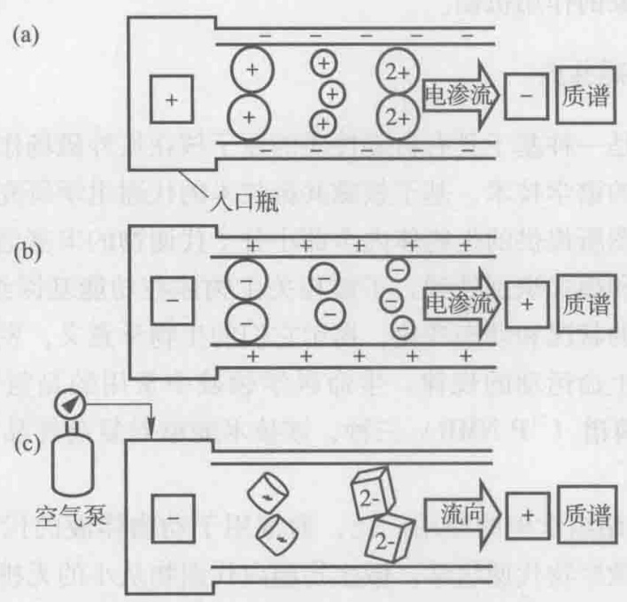

flowchart

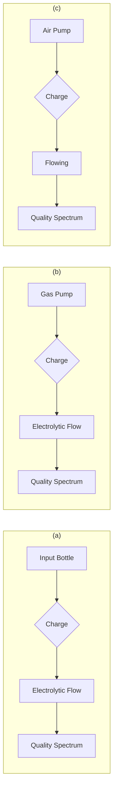

图10-4 基于CE-MS的代谢物分析原理（Soga et al. 2003）

（a）阳离子代谢物 CE-MS 分析原理；（b）阴离子代谢物 CE-MS 分析原理；（c）核苷酸和辅酶 Q 类代谢物 CE-MS 分析原理

CE-MS 对不同胞内代谢物的分离模式:

（1）阳离子代谢物 CE-MS 检测中，毛细管裸柱中电渗流（electro-osmotic flow, EOF）朝向电极负极，阳离子根据电荷和大小的不同而得到分离。利用低 pH 电解液（1 mol·L $^{-1}$ 甲酸，pH = 1.8），使代谢物带正电荷，可以分离所有的阳离子代谢物，分离后的代谢物通过质谱检测（图 10-4a）。
（2）通过负极模式分离阴离子代谢物，毛细管的入口端为负极，出口端为正极，利用连续多层离子聚合物涂层（successive multiple ionic-polymer，SMIL）-阳离子聚合物涂层毛细管改变EOF的流向，使其朝向正极，阴离子代谢物根据电荷和大小的不同而得到分离，进入质谱进行检测（图10-4b）。
(3) 在负极模式阴离子分离系统中, 多价离子如核苷酸和辅酶 Q 类代谢物存在

典型案例 10-3
基于 CE-MS 分析枯草芽胞杆菌胞内代谢物

严重的吸附现象。通过采用不带电荷多聚物涂层毛细管和在进样口施加一定压力，可以使此类代谢物得到很好的分离和准确定量分析（图10-4c）。

三种毛细管电泳分离模式的组合使用，几乎可以分离样品中所有的离子代谢物。综合利用阳离子代谢物、阴离子代谢物、核苷酸和辅酶Q类代谢物的CE-MS分析方法，共检测到B.subtilis 168提取物中1692种代谢物，并对其中的352中代谢物进行了定性分析；由此建立的方法，灵敏度高，能检测到单个细胞中40 zmol的腺嘌呤和350 amol的葡萄糖，而且迁移时间的相对标准偏差（RSD）小于2.7%。作者利用建立的CE-MS方法，分析了B.subtilis孢子形成之前和形成过程中的胞内代谢物谱情况。在孢子的形成过程中，首次发现L-高瓜氨酸和β-丙氨酰-L-赖氨酸等代谢物的浓度显著升高，而景天庚酮糖-7-磷酸等代谢物浓度急剧降低，推测这些代谢物可能与孢子的形成具有潜在联系。在孢子形成的初期，糖酵解、戊糖磷酸途径和TCA循环的大多数中间代谢物浓度显著下降，特别是果糖-1,6-二磷酸的浓度在孢子的形成过程中下降超过了100倍。广泛的胞内代谢物定性定量分析，有助于深入地认识复杂生物学现象的作用机制。

## 10.2.3.5 核磁共振

核磁共振波谱是一种基于具有自旋性质的原子核在核外磁场作用下，吸收射频辐射而产生能级跃迁的谱学技术。基于核磁共振技术的代谢组学研究，主要是利用生物样品的核磁共振谱图所提供的生物体内全部小分子代谢物的丰富信息，通过对这些信息的多元统计分析和模式识别处理，了解相关生物体在功能基因组学、药理毒理学、病理生理学等方面的状况和动态变化，揭示它们的生物学意义，发现生物标志物，并从分子水平上认识生命运动的规律。生命科学领域中常用的是氢谱（ $^{1}$ H NMR）、碳谱（ $^{13}$ C NMR）及磷谱（ $^{31}$ P NMR）三种，该技术能够对复杂样品中的代谢物同时完成定性和定量分析。

NMR 技术在代谢组学中的应用广泛，通常用于动物体液的代谢过程分析，也可用植物代谢组学和微生物代谢组学。微生物胞内代谢物从小的无机离子到疏水性的脂质及复杂的天然产物，浓度范围跨越 9 个数量级（pmol 至 mmol），而 NMR 的灵敏度较低，因此利用 NMR 技术进行微生物代谢组学研究时，应考虑样品的检测范围。

NMR 技术在微生物代谢组学中的应用，以酿酒酵母的“沉默”基因研究为例。酿酒酵母中大约含有 6000 个基因，然而很大一部分基因的功能是未知的，其中很多基因为“沉默”基因，即该基因敲除以后，菌株的生长速率等表型没有明显变化，常常无法确定该基因的功能。Raamsdonk 等（2001）使用 $^{1}$ H NMR 技术通过比较代谢组学方法建立了鉴定酿酒酵母中沉默基因表型的“酵母共响应功能分析”（functional analysis by co-response in yeast, FANCY）方法。沉默基因突变以后，生长速率没有明显变化，但是胞内代谢物浓度却存在了显著的差异，如酿酒酵母中编码 6-磷酸果糖 -2-激酶的酶基因 PFK26 和 PFK27，两基因分别敲除的突变株与野生型菌株在不同碳源上的生长速率基本相同，然而突变株胞内果糖 -6-磷酸，丙酮酸等代谢物的浓度均有显著提高，ATP/ADP 的比率显著降低，突变株虽没有“生长”表型差异，但是具有不同“代谢物”表型。测量和比较突变株代谢物浓度的相对变化，可以鉴定突变基因在代谢网络上的作用位点，通过比较代谢组学确定基因功能的方法为代谢工