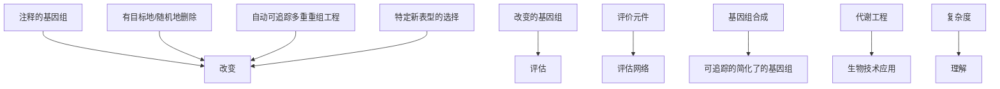
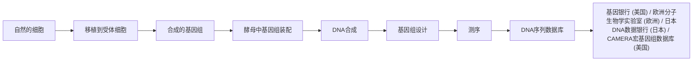
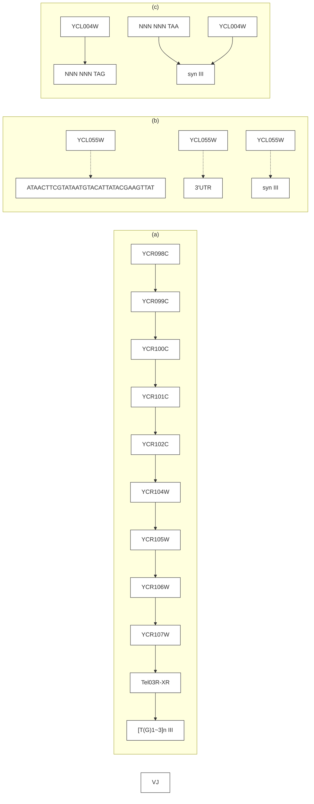
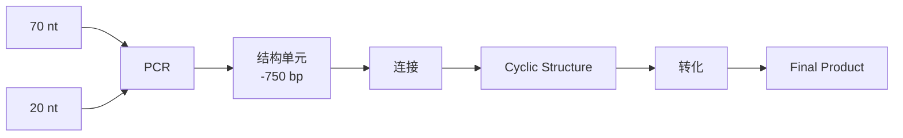
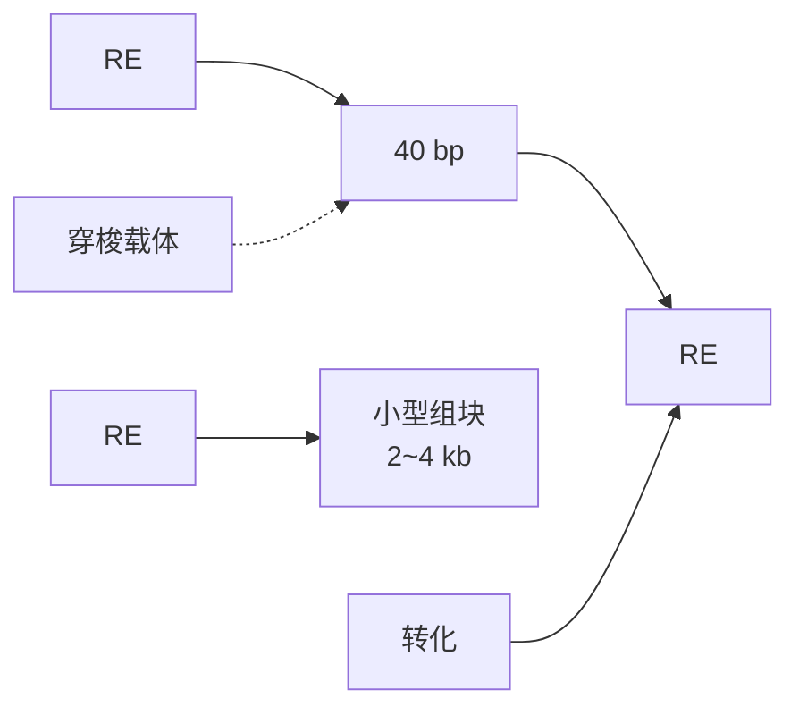
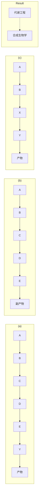
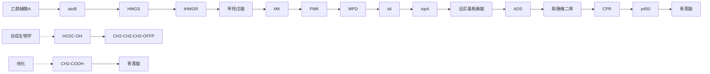
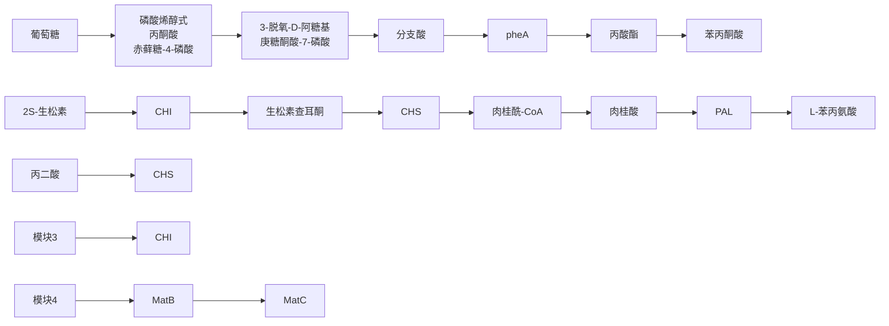

图12-8 几类灵活的可编程的生物底盘构建（Esvelt and Wang 2013）（彩图见插页）

基因组小型化（genome minimization）:减小生物复杂性和冗余性；重新编码（recoding）:整个基因组密码子重新设计（codon remapping）能使正交信息编码和遗传密码扩展；合成（synthesis）:基因组从头合成和从天然基因组重建，能够创建半合成基因组，创建具有新功能及混合功能的嵌合基因组（chimeric genome）；重新设计（redesign）:整个基因组重新设计及调控系统的重新布线，能使新的合成线路易于设计和模型模拟

究工作:与野生大肠杆菌相比，利用基因组敲除约25%的大肠杆菌作为宿主菌使L-苏氨酸的产量增加了2.4倍，菌体最终密度比野生菌高1.5倍，而菌体生长速度无明显变化。最近，Leprince等（2012）发表了题为《简化基因组:为了产生简化的和稳定的微生物系统》的综述，在总结基因组简化已取得成果的基础上，结合“多元自动基因组工程”（MAGE）和“可追踪多重重组工程”（trackable multiplex recombineering，TRMR）等基因组工程技术的突破，进一步对基因组简化过程进行了归纳，如图12-9所示。

## 12.7 合成基因组（合成细胞）

多年来，JCVI一直在进行合成基因组的工作（赵学明等2011）。2003年，由合成的寡核苷酸，通过整个基因组组装，得到一个合成 $\varphi \mathrm{X}174$ 噬菌体基因组。根据此技术，他们提出组装一个最小细胞基因组的设想。2006年，对具有最小基因组的生殖支原体，进行了最小基因组必需基因的研究，为后来对基因组的操作奠定了基础。2007年，将蕈状支原体的整个基因组分离为“裸露”的DNA并将其移植到山羊支原体中，实现了在细菌中的基因组移植:将一种物种变为另一种物种。2008年，在酵母中得到完全的化学合成、组装、克隆的生殖道支原体基因组，这是第一个人工合成的细菌基因组。2009年，为了进一步利用酵母中的细菌基因组来构建活的微生物细胞，实现了基因组从酵母到其他物种的高效转移，打通了人工合成细胞的最后一步。

flowchart

图12-9 基因组简化过程所用的技术及简化结果的应用（Leprince et al. 2012）

2010 年，他们报告了从数字化的基因组信息开始，设计、合成和组装了一个 1.08 Mb 的蕈状支原体基因组，将其移植进一个山羊支原体受体细胞，从而创造了一个仅由合成染色体控制的新的蕈状支原体细胞。新细胞内仅有的 DNA 是所设计合成的 DNA 序列，具有所预期的表型性质，有连续自我复制的能力。JCVI 将新细胞命名为 JCVI-syn 1.0，其构建过程如图 12-10 所示，其中，合成的蕈状支原体基因组在酵母中的组装技术极为关键。

flowchart

图12-10 JCVI所用合成生物学技术构建合成细胞的流程

## 12.8 酵母人工基因组的合成

2011年9月，《自然》杂志发表了合成真核生物酿酒酵母两条染色体臂synIXR和semi-synVIL的论文（Dymond et al. 2011）。根据酵母基因组序列信息，通过计算机设计，从酵母染色体中移除了20个区域，这些区域包括tRNA序列、内含子、转座子、亚端粒序列等。对大于500 bp的所有基因都重新编码，使这些基因含有“水印”以便区别合成基因与天然基因。用合成的染色体对酵母基因组进行修改后，得到了令人震惊的结果:含有部分合成基因组的酵母细胞仍然能存活，有功能，可再生，没有明显不良表型。在上述合成染色体臂的基础上，2014年4月，《科学》杂志发表了全合成酿酒酵母第3号人工染色体SynⅢ的研究（Annaluru et al. 2014）。基于酿酒酵母天然的第3号染色体（含有316617个碱基对），经过in silico设计，全合成的SynⅢ含有272871个碱基对，比原染色体减小了 $13.8\%$ 。装配这条缩短并改进的人工染色体SynⅢ的酵母细胞生长正常，几乎在所有生长条件下与天然酵母细胞没有差别。上述工作为构建更稳定、可工程化、可进化的全新酵母基因组奠定了基础。

上述工作是酵母人工基因组合成计划（Sc.2.0）的第一步。该项目是由美国约翰·霍普金斯大学/美国纽约大学的Jef Boeke院士发起，旨在从头合成酿酒酵母的全基因组，世界上多个国家的研究机构参与了这个项目，如图12-11所示。

酵母染色体的合成采取“自下而上”的策略，可分为SynⅢ的设计、SynⅢ的构建、含SynⅢ酵母菌株的表征与检验三大部分。

bar

| Rank | University | Status |
| --- | --- | --- |
| 1 | 纽约大学 (NYU) (美国) | 已完成 |
| 2 | 华大基因 (BGI) (中国) | 接近完成 |
| 3 | \(约翰 \cdot 霍普金斯大学\) (JHU) (美国) | 已完成 |
| 4 | 纽约大学/联合基因组研究所 (美国) | 接近完成 |
| 5 | 天津大学 (中国) | 接近完成 |
| 6 | \(约翰 \cdot 霍普金斯大学/金斯瑞\) (美国) | 已完成 |
| 7 | 爱丁堡大学/华大基因 (英国/中国) | 接近完成 |
| 8 | 纽约大学 (NYU) (美国) | 接近完成 |
| 9 | \(约翰 \cdot 霍普金斯大学\) (JHU) (美国) | 接近完成 |
| 10 | 天津大学 (中国) | 接近完成 |
| 11 | 帝国理工学院 (英国) | 接近完成 |
| 12 | 清华大学 (中国) | 已完成 |
| 13 | 华大基因 (BGI) (中国) | 接近完成 |
| 14 | 麦考瑞大学/澳大利亚葡萄酒研究学院 (澳大利亚) | 接近完成 |
| 15 | 新加坡国立大学 (新加坡) | 接近完成 |
| 16 | 印度? | 接近完成 |

图12-11 合成酵母基因组项目（Sc.2.0）承担单位及进展现状（Pennisi 2014）

## 12.8.1 SynⅢ的设计

根据菌株健康适合度、基因组稳定性及遗传可行性原则，利用所开发的基因组编辑软件 Biostudio，对酵母的天然染色体序列进行 in silico 编辑。具体的人工编辑包括:在保持原基因顺序和非编码区不变的条件下，删除不利于染色体稳定的元件（如转座子、亚端粒重复序列、内含子）；在保持编码蛋白不变的前提下，利用同义密码子引入酶切位点和 PCR 标签以方便人工染色体片段的组装和检验；将 TAG 终止子替换为 TAA；并引入 loxPsym 位点以增加酵母基因组可操作性，方便后续的科学研究。全合成酵母Ⅲ号人工染色体 SynⅢ 的设计图谱如图 12-12 所示。

flowchart

图12-12 synIII的设计图谱（Annaluru et al. 2014）

图中（a）和（b）所示为代表性的插入 loxPsym 位点的 synⅢ片段，C 表示终止密码子 TAG 到 TAA 的编辑。菱形代表插入在非必需基因 3' 非翻译区和几个其他位置的 loxPsym 位点，圆圈表示终止密码子转换点，即 TAG 重新编码为 TAA

## 12.8.2 SynⅢ的构建

SynⅢ的构建包括三个步骤:①结构单元合成。从交叠的60\~79个碱基的寡核苷酸片段开始，经标准的PCR法组装以制作成长度为750 bp左右的结构单元（building blocks，BBs）（图12-13a）；②小型组块的组装。2\~4 kb的小型组块（minichunks）通过3\~5个不等的结构单元的在酵母中同源重组组装获得。相邻的小型组块被设计成编码一个结构单元的交叠以便于下游的组装步骤。小型组块是由一个稀有的限制性内切酶（RE）位点（Xma I或Not I）从侧面连接的（图12-13b）；③用合成的小型组块库对天然酵母Ⅲ号染色体的直接替换。在每个实验中，通过使用平均12个小型组块和交替可选择的标记，经过11轮连续的转化和同源重组，实现了用合成的Ⅲ号染色体取代了酵母天然Ⅲ号染色体的序列（图12-13c）。这样就得到了含有SynⅢ的酵母菌株。

## 12.8.3 含 SynⅢ酵母菌株的表征与检验

通过基因组比较、表性分析、基因组稳定性分析，对含有合成Ⅲ号染色体的酵母菌株进行了详细的表征与检验。结果表明，尽管合成Ⅲ号染色体发生了很多变化，例如内含子缺失、tRNA基因的移出、loxPsym位点和PCRTags的导入等，并没有显著降低酵母菌株的不同环境生长能力，没有明显改变菌株的转录组或复制时间。

(a) 从寡核苷酸合成结构单元

flowchart

(b) 组装2\~4 kb 小型组块

flowchart

(c) 用合成的小型组块库对天然酵母Ⅲ号染色体的直接替换

text_image

酵母转化1
[G418R,Leu-,Ura-]
接头 L1
UTC-left
~750 bp
2~4 kb
LEU2
G418S,Leu+,Ura-
[LEU2]
酵母转化2
[G418S,Leu+,Ura-]
接头 L2
LEU3
G418S,Leu+,Ura+]

图12-13 SynIII的构建（Annaluru et al. 2014）

Sc. 2.0 计划是人类首次合成真核生物的基因组，具有重大的理论研究意义和实际应用价值。“自下而上”的全人工合成方式将进一步加深人们对这一真核生物模式菌种的理解，对于解决我们所面临的人体健康、能源短缺、环境污染等问题有重要意义。Sc. 2.0 计划有望成为合成生物学领域的一个重要里程碑。

## 12.9 合成生物学与代谢工程

代谢工程与合成生物学之间的边界与叠合往往是模糊的，因为许多研究者来源于这两个领域，甚至同时在这两个领域工作，分享共同的工具。Nielsen 和 Keasling（2011）清楚地阐述了二者之间的协同关系，如图 12-14 所示。图中第一种方法是用生物技术中的传统的方法，一个天然的生产菌株被选择作为细胞工厂生产所希望的产品。通常情况下，通向产品的通量自然是低的，但通过使用经典菌株改良或使用定向的遗传修饰（即代谢工程），能够增大产品的通量。在第二种方法中，该平台细胞工厂本身不能自然生产所需的产品。通过在该细胞中插入一条生物合成途径，则可以生产所需产品，但起初生产的量往往很少。然而，通过途径优化，可使通过该合成途径的通量增加，以确保通向产品通量高。很显然，这种方法运用了代谢工程与合成生物学二者的概念。最后一个方法是构建一个真正全新的合成细胞，它专门产生所需要的产品。

flowchart

图12-14 代谢工程与合成生物学之间的叠合（Nielsen and Keasling 2011）（彩图见插页）

2012 年 2 月，在瑞士达沃斯举行的“世界经济论坛”（world economic forum, WEF）上，《新兴技术全球议程理事会》发布了“10 大新兴技术”（top 10 emerging technologies），其中“合成生物学和代谢工程”排名第 2（WEF web site）。推荐理由是:自然界表明，处于所有生命体核心的遗传密码具有巨大的特有的潜力。合成生物学和代谢工程的快速发展，使得生物学家和工程师能以史无前例的方式，逼近并充分利用这种巨大的潜力，能够设计、开发新的生物体和生物过程，服务于人类的需要，即将生物质转化为化学品、燃料、材料，生产新的治疗药物，或保护人体免受伤害。

2013年5月，在丹麦举行的一个生物科学会议上，针对代谢工程和合成生物学在细胞工厂与生物可持续发展中的潜在贡献与互补性，会议举行了一次公开讨论。会后，出席会议的7位国际著名代谢工程和合成生物学领域的学者对讨论的结果进行了总结，并以《在生物技术中的工程协同》为题，发表在《自然化学生物学》上（Nielsen et al. 2014）。得到的结论是:代谢工程与合成生物学两个领域的基本目标不同。代谢工程的建立是要能够研究开发药物、化学品、燃料和材料的生物生产。这就是说，代谢工程有非常明确的实际的目标。合成生物学建立的目标是以构建生物零件、模块及系统，以便理解和操作生物系统。这说明，合成生物学聚焦于基本的科学目标。很显然，这两个学科之间存在交叉重叠，但又存在不同之处，如表12-1所示。在图12-1中，我们已经看到，在发表论文的“题目、摘要、或关键词”中同时包括“代谢工程”和“合成生物学”的论文增长很快，而且在论文中占有相当比例。这就说明应充分利用二者的基本原理和方法技术，为生命科学、生物技术及生物产业的发展做出贡献。

未来，合成生物学和代谢工程将在以下几个方面取得重要进展（赵学明等2011）:

（1）会设计构建出更多的合成生物学零件及模块，并会得到表征及标准化；更复杂、更精细的合成基因线路会在原核生物及真核生物中得以应用。

表 12-1 代谢工程与合成生物学之间的交叠与区别

<table><tr><td></td><td>代谢工程</td><td>合成生物学</td></tr><tr><td>共同主题</td><td colspan="2">非天然特性</td></tr><tr><td>共同工具</td><td colspan="2">分子生物学,数学模型模拟</td></tr><tr><td>工作领域</td><td>化学、酶、基因、途径、生物网络、细胞</td><td>基因、表达线路、细胞</td></tr><tr><td>独特领域</td><td>化学和生物化学网络</td><td>逻辑零件和范畴</td></tr><tr><td>目标</td><td>细胞表型的工程化</td><td>生物零件的工程化</td></tr><tr><td>专用工具</td><td>通量量化和网络分析</td><td>生物组分的合成</td></tr><tr><td>应用</td><td>工业生物技术</td><td>多种多样</td></tr></table>

（2）在 JCVI 1.0 的基础上，“合成细胞”的创建工作会进一步进行。在原有基因组基础上，通过增加或减少基因组的组成，了解新“合成细胞”的功能，从而获得组成生命的基本知识和设计原理，为将来真正“从下而上”从头设计生命奠定基础。
（3）针对人类面临的资源、环境、健康等问题，采用自上而下法对自然界现有生物进行重新设计、改造及优化。将来可以根据“量体裁衣”的原则，来构建微生物，使其利用特定的原料来生产特定的产品。这包括从零件表征开始，通过CAD软件对细胞代谢途径、酶、遗传控制线路进行设计和优化，编码这些元件的DNA片段在FAB工厂合成，然后整合到“底盘”生物中得到新的生物催化剂（Keasling 2010）（图12-15）。预计这些研究会在全球得到突飞猛进的发展，并加快合成生物学和代谢工程产业化的步伐。

flowchart

图12-15 未来的工程化生物催化剂（Keasling2010）

## 12.10 合成生物学与代谢工程应用举例

在基本生物零件和基因线路的设计构建方面取得的进展，一方面可为设计、编程及合成新生命这一远大目标奠定基础，同时可以直接应用于代谢工程对现有微生物菌株进行改造。以下是合成生物学和代谢工程应用实例简介（赵学明等2011）。

## 12.10.1 生物能源

与乙醇相比，作为燃料汽油的高级醇具有更高的能量密度和更低的吸湿性。此外，支链醇还具有更高的辛烷值。但是高级醇不能用经济的办法由自然界生物合成。2008年，Liao研究组在《自然》杂志上，发表了用大肠杆菌的非发酵途径合成支链高级醇及生物燃料的论文。他们充分利用大肠杆菌本身的氨基酸合成途径，在大肠杆菌中引入酿酒酵母、乳酸乳球菌及丙酮丁醇梭菌的关键酶2-酮酸脱羧酶，催化不同种类的底物2-酮酸，进一步通过外源酿酒酵母乙醇脱氢酶催化，合成不同的高级醇；同时采取多种措施协调引入异源途径酶引起的代谢不平衡问题，这一策略导致高产率、高专一性的异丁醇生产（Atsumi et al. 2008）。

2009 年，Liao 研究组在《自然生物技术》杂志上，发表了利用  $CO_{2}$  光合成直接生产异丁醛的论文（Atsumi et al. 2009）。异丁醛是其他化学品合成的前体，可以很容易转化为其他重要化学品。他们通过对细长聚球蓝细菌的基因工程改造增加固定  $CO_{2}$  的 1,5-二磷酸核酮糖羧化酶/加氧酶的表达量，接着用源自乳酸乳球菌、枯草芽胞杆菌及大肠杆菌的相关基因进一步改造工程菌，使之利用  $CO_{2}$  和光能生产异丁醛气体。该研究生动展示了将  $CO_{2}$  直接生物转化为燃料和化学品的诱人前景，获得了 2010 年美国总统绿色化学挑战奖。

脂肪酸是被细胞用作化学和能量储存物的初级代谢物，目前主要从植物油和动物油中分离制备。实际上，脂肪酸也可以从可再生原料出发通过微生物转化法生产。美国加州大学与LS9公司等采用合成生物学技术，利用大肠杆菌自身的脂肪酸合成途径，直接将脂肪酸代谢扩展到燃料（生物柴油）、脂肪醇和蜡等化学品的生物合成。同时，将人工合成的半纤维素酶基因在大肠杆菌中表达，从而使工程菌不仅能够利用葡萄糖，也可直接利用半纤维素作为原料，为直接利用植物纤维素原料奠定了基础。2010年7月，LS9公司在《科学》杂志上发表了微生物法烷烃生物合成的论文，通过工业合成生物学平台技术，用大肠杆菌生产C13～C17的烷烃和烯烃的混合物。这种“可再生石油”技术，可有效地将可再生资源转化为燃料和化学品，获得了2010年美国总统绿色化学挑战奖。

## 12.10.2 生物医药

合成生物学结合代谢工程正在通过重新设计代谢途径，为人类生产新的医药产品或改进现有产品。以下是几个典型例子:

（1）青蒿素生产:青蒿素是治疗疟疾的首选药物。12年前，Keasling实验室发现将苦艾（wormwood）和酵母的基因植入细菌中，可使细菌生成一种可化学转换为青蒿素的化合物，于是他们坚持不懈进行了深入系统的研究。用工程化大肠杆菌生产青蒿素的前体物青蒿酸，进而用化学法转化为青蒿素。从乙酰辅酶A开始，经中间产物甲羟戊酸、法尼基焦磷酸、紫穗槐二烯，最后到青蒿酸，共有分别来自细菌、酵母、植物的11个酶催化的反应。如图12-16所示，从合成生物学角度，将其分为以下几个模块:上游甲羟戊酸途径模块（3个酶）、下游甲羟戊酸途径模块（5个酶）、合酶模块（1个酶）、羟化酶模块（2个酶）。他们通过维持异源甲羟戊酸途径与其他途径的平衡、使用组合工程在操纵子的基因间区协调多基因的表达、设计合成的蛋白质支架构建人工酶复合体来优化代谢通量等方法，协调所有生物合成酶的表达水平，避免了（毒性）物质的积累或中间代谢物的缺乏。对于大肠杆菌，通过发酵过程优化，紫穗槐二烯的产量高达 $27\ g\cdot L^{-1}$ 。

flowchart

图12-16 微生物生产青蒿素代谢途径模块图（Keasling et al. 2003）

2013 年 4 月，Amyris 公司和 Keasling 研究团队在《自然》杂志上发表了高水平半合成生产抗疟疾药物青蒿素的论文（Paddon et al. 2013），用合成生物学技术研发出高产青蒿酸的酿酒酵母菌株。他们证实了完整的生物合成途径，其中包括一种植物脱氢酶和一个第二细胞色素的发现，这些提供了合成青蒿酸的一条有效生物合成路线，青蒿酸发酵水平达到  $25 \, g \cdot L^{-1}$ 。他们还开发出一种实用的、有效的、易放大的化学过程将青蒿酸转化为青蒿素。这是 Keasling 团队取得的里程碑式的成果，也是合成生物学与代谢工程的一项标志性成果。图 12-17 是基于酵母菌的半合成生产青蒿素过程概述，图 12-18 是酿酒酵母生产青蒿酸的途径及所用菌株的简介。

（2）紫杉醇:紫杉醇是一种强效抗癌药物，化学合成法需要51个步骤。MIT化工系Gregory Stephanopoulos研究组（Ajikumar et al. 2010），利用大肠杆菌合成紫杉醇。他们将紫杉烯代谢途径分成两个模块:一个是大肠杆菌自身的生成异戊烯焦磷酸的上游模块，另一个是异源的下游萜类化合物形成模块。用一种多变量模块化的代谢途径工程方法（图12-19），通过调整模块中各种基因元件的表达水平，减少中间物抑制物吲哚的累积，使得两个模块能很好平衡匹配，结果成功地使紫杉二烯（紫杉醇的前体物）的产量达到 $1\mathrm{g}\cdot \mathrm{L}^{-1}$，与对照菌相比，产量提高了15000倍！这种模块化的途径工程方法，为紫杉醇及萜类天然产物的大规模生产奠定了基础。

图12-17 基于酵母菌的半合成生产青蒿素过程概述（Paddon and Keasling 2014）

图12-18 酿酒酵母生产青蒿酸的途径及所用菌株的简介（Paddon et al. 2013）

(3) 生松素: 微生物发酵生产可以生产黄酮类化合物前体生松素, 然而发酵过程均需添加昂贵的前体物质。另外, 为了缓解异源途径给菌体带来的代谢负担, 目前采用的发酵方式是将菌体先置于营养丰富的培养基中生长, 待长到一定菌体浓度时将菌体离心重悬于基本培养基中, 而这种发酵方式在大规模工业化生产中是不可行的。Wu 等 (2013) 以生松素的从头合成为研究对象, 即无需在培养基中添加任何昂贵前体物质, 直接用廉价底物葡萄糖即可生成生松素。另外针对较长的异源合成途径会阻遏代谢流流向终产物，造成中间产物的积累，增加菌体的代谢负担，采用以多模块化综合改造方式对总的合成途径进行平衡（图12-20），使得代谢流最大程度地流向目标产物，减少中间产物的积累，降低了菌体的代谢负担，从而增加了终产物生松素的得率。

flowchart

图12-19 多变量模块法优化异戊二烯途径（Ajikumar et al. 2010）

flowchart

图12-20 大肠杆菌生产生松素总途经的模块化工程示意（Wu et al. 2013）

## 12.10.3 化学品

（1）卤代甲烷:重要化学品及燃料的前体分子。虽然植物及微生物可以生产卤代甲烷，但由于产率非常低而不适合工业生产。单一甲基卤转移酶（MHT）可以将硫腺苷甲硫氨酸（SAM）的甲基转移给卤离子。2009年美国加州旧金山分校的Voigt研究组，从NCBI数据库用生物信息学方法，找到来自植物、真菌、细菌及未知生物的89个MHT基因，然后采用合成宏基因组方法，化学合成这些基因，从中筛选出可表达出最高酶活性的编码基因mht，构建了卤代甲烷产率很高的酿酒酵母工程菌。接着他们用一种纤维素分解菌（Actinotalea fermentans）和酿酒酵母工程菌组成共生混合培养体系，既能直接利用玉米秸秆等纤维素原料，又能高效率生产卤代甲烷。该研究是利用生物信息学工具、数据库和快速基因合成技术，进行高效细胞工厂构建的典型范例（Bayer et al. 2009）。
（2）D-葡糖二酸:来自生物质资源的重要平台化学品，用于生产尼龙、超支链型聚酯等聚合物，也可以用做医药及食品。MIT化工系Prather研究组，设计优化了

一条葡糖二酸代谢途径。以大肠杆菌为宿主，分别过表达来自哺乳动物（小鼠）的肌醇加氧酶和酿酒酵母的肌醇-1-磷酸合成酶，催化肌醇生成D-葡糖醛酸，在此基础上，进一步过表达丁香假单胞菌中的糖醛酸脱氢酶，合成D-葡糖二酸。在研究中，发现来自小鼠的D-葡糖二酸酶活性由于受其底物的浓度影响很大，是代谢通量的限制步骤。为此，他们利用人工合成的蛋白质骨架，将合成途径中相关的3个酶在空间上集中在一起，形成人工酶复合体，结果使得产品D-葡糖二酸的浓度提高约5倍。

(3) 长春花: 卤化对于天然产物的生物活性具有重要影响。因此, 将卤化物导入药用植物的代谢中, 可以生物合成各种新的、药理性质得到改进的植物产品。Runguphan 等 (2009) 将土壤菌中的氯化生物合成机器, 成功导入了药用植物长春花中。这些原核生物的卤化酶, 在植物细胞内起作用而产生氯化的色氨酸, 其穿梭于单萜吲哚生物碱的代谢中, 以产生氯化的生物碱。这样, 一个新的功能基团被导入长春花, 而且以一种可预测的和区域选择性的方式结合到植物生物碱产品中。尽管药用植物的遗传和发育的复杂性很高, 该研究结果表明其也可用作合成生物学的一个可行的平台。

## 12.10.4 合成生物学产业发展

2009年12月，《自然生物技术》在合成生物学专辑中发表了两篇涉及合成生物学产业的论文，介绍了涉及基因合成、生物燃料及化学品生产研发等60多家公司。为了提供专业水平的生物零件，在美国自然科学基金资助下，2009年底，由加州大学伯克利分校和斯坦福大学等，建立了世界上第一个生物零件设计制造工厂——Bio-Fab。2010年7月，美国的《研究与市场》报告预计到2015年合成生物学产业市场将超过45亿美元。2010年7月，埃克森美孚公司与文特尔的合成基因组公司签订了进一步合作的协议，将投入6亿美元进行微藻生物燃料的研发。美国生物技术产业组织发表报告介绍合成生物学目前在化学品和医药中的应用，涉及的产品包括:生物柴油、生物异戊二烯、生物丙烯酸、生物表面活性剂、生物己二酸、生物可降解塑料、西他列汀（Ⅱ型糖尿病用药）等，其中多项技术获得2010年美国总统绿色化学挑战奖。合成生物学的基础研究催生了许多研发性的合成生物学公司，为合成生物学产业的发展提供了很好的技术平台，加快了产业化的进程。目前，所研发的产品大都完成中试，有的已在与大公司合作进行工业化。

## 思考题

1. 何为基因组工程，常用的基因组工程技术与方法包括哪些？
2. 未来代谢工程与合成生物学可能取得的重要进展包括哪些方面？

## 推荐阅读

1. 赵学明，陈涛.合成生物学:进展与展望//2011年科学发展报告.北京:科学出版社，2011，13-27.

- 讨论了合成生物学的研究背景、定义、研究策略、研究进展以及生物学展望。
- 2. Ajikumar P K, Xiao W H, Tyo K E J, et al. Isoprenoid pathway optimization for taxol precursor overproduction in Escherichia coli. Science, 2010, 330: 70–74.
- 多元模块代谢工程大肠杆菌合成紫杉醇的经典案例。
- 3. Annaluru N, Muller H, Mitchell L, et al. Total synthesis of a functional designer eukaryotic chromosome. Science, 2014, 344: 55–58.
- 全合成酿酒酵母第3号人工染色体SynⅢ的研究。基于酿酒酵母天然的第3号染色体，经过in silico设计，全合成的SynⅢ染色体，比原染色体减小了 $13.8\%$ 。装配这条缩短并改进的人工染色体SynⅢ的酵母细胞生长正常，几乎在所有生长条件下与天然酵母细胞没有差别。为构建更稳定、可工程化、可进化的全新酵母基因组奠定了基础。
- 4. Cameron D, Bashor C J, Collins J. A brief history of synthetic biology. Nature Reviews Microbiology, 2014, 12: 381–390.
- 分三个阶段总结了十几年来在合成生物学发展过程中基因线路方面的研究进展。
- 5. Keasling J D. Manufacturing molecules through metabolic engineering. Science, 2010, 330: 1355–1358.
- 随着代谢工程与合成生物学的发展，可以采用自上而下法对自然界现有生物进行重新设计、改造及优化，解决人类面临的资源、环境、健康等问题，提出了未来工程化生物催化剂的新蓝图。
- 6. Nielsen J, Fussenegger M, Keasling J, et al. Engineering synergy in biotechnology. Nature Chemical Biology, 2014, 10: 319–322.
- 讨论代谢工程与合成生物学两个领域的研究目标等相互逻辑关系。
- 7. Wang H H, Isaacs F J, Carr P A, et al. Programming cells by multiplex genome engineering and accelerated evolution, Nature, 2009, 460: 894–898.
- 开发了一种大尺度修改和进化细胞基因组的新技术，该技术将大量人工合成的具有各种突变（包括碱基错配、插入和缺失）的单链 DNA 库导入宿主细胞进行重组，可以快速高效地得到各种突变株，加速细胞的进化。

## 索引

$^{13}$ C 标记实验 130

$^{13}$ C 代谢通量分析 129

ATP 泄漏 13

cDNA 基因芯片 193

$F_{0}F_{1}-ATP$  合成酶 15

Lin-log 动力学 113

RNA 测序技术 192

TCA 循环 17

## B

靶标 193

靶向蛋白质组学 219

胞内蛋白质组 236

倍半萜紫穗槐 -4, 11 - 二烯 237

比反应速率 56

比生长速率 53

边 172

边界约束 173

变构调节 28

标记法 225

表达平台 40

表型组学 163

不可逆抑制 34

## C

参数弹性系数 104

产黄青霉菌 235

长非编码 RNA 206

超定系统 65,80

超高效液相色谱 250

成簇的规律间隔的短回文重复序列规律 299

初级主动运输 15

串联质谱 220, 221

次级代谢 234

次级主动运输 15

从头测序 221

促进扩散 12

## D

大规模平行测序技术 192

大扰动理论 120

代谢表型 6

代谢工程目标 273

代谢进化 267

代谢控制分析 96

代谢通量 72

代谢通量比率分析 137

代谢途径 72

代谢物 242

代谢物靶标分析 242

代谢物谱分析 243

代谢物守恒 72

代谢物印迹分析 243

代谢物指纹分析 243

代谢物组 242

代谢物组学 242

代谢组分析 243

单核苷酸多态性 269

蛋白质特异性肽段 220, 229

蛋白质组 217

蛋白质组学 163,217

得率系数 57

等量异位标签相对和绝对定量技术 225

电喷雾 222

电喷雾电离 221

电喷雾离子化 250

电泳分离 221

电子呼吸链 22

定量蛋白质组学 218

定向蛋白质组学 219

定性蛋白质组学 218

动态通量平衡分析 176

动态最优化方法 176

多变量数据分析 255

多元自动化基因组工程 297

多重压力 277

多重自动基因组工程 271

## E

二维凝胶电泳 217, 221

二组分调节系统 48

## F

发酵 26

发酵途径 17

发现蛋白质组学 219

反竞争性抑制 33

反向代谢工程 6

反向运输 16

飞行时间质谱 221

非监督方法 255

非竞争性抑制 32

非特征化扰动 117

非线性规划 176

分解代谢还原荷 46

分子定向进化 267

分子机制 232

## G

高效液相色谱 221

功能基因组学 162

供能反应 12

共价调节酶 28

共进化 272

寡核苷酸基因芯片 193

## H

合成代谢还原荷 46

合成生物学 291

核磁共振波谱 135

核糖核酸开关 40

黑箱模型 57

后基因组学 162

呼吸链 18

化学计量系数矩阵 73

还原度平衡 59

环腺苷酸受体蛋白 37

回补途径 17

## J

基因（gene） 161

基因本体论 203

基因表达系列分析技术 192

基因吞噬 284

基因线路 295

基因芯片技术 192

基因型频率 270

基因组 161

基因组尺度代谢网络模型 163

基因组工程 297

基因组学 161

基因组重排 269

基因组重组 271

基于凝胶的蛋白质组学法 218

基于凝胶的光密度法/荧光法 224

基质辅助激光解吸/电离 221

基质辅助激光解析 222

计量系数矩阵 170

间歇培养 54

监督方法 255

交换反应 169

酵母共响应功能分析 252

节点 172

结构基因 234

结构基因组学 161, 162

解毒作用 232

进化工程 266

进化路径 271

进化生物学 266

进化适应 267

京都基因与基因组百科全书 258

净比生长速率 11

竞争性抑制 31

静态最优化方法 176

局部最大值 268

聚合反应 12

聚类分析 200

绝对定量蛋白质组学 218

菌种 235

## K

孔蛋白 14

## L

离心分离 221

离子化 131

离子交换色谱 222

离子阱质谱 221

理性设计 234

连接定理 103

连续培养 55

流通代谢物 46

## M

酶的转换数 29

酶原 27

免疫共沉淀 221

末端代谢物 169

## N

耐受性 232

内部核糖体进入位点 44

能荷 46

鸟枪蛋白质组学法 218

鸟枪法策略 218

尿黑酸途径 235

浓度控制系数 102

## P

碰撞 - 活化解离技术 223

偏差指数 122

平衡约束 173

## Q

奇异值分解方法 199

前体 234

前体离子-产物离子对 229

亲水作用色谱 250

青霉素 235

全局控制 47

全局抑制 45

## R

热力学驱动力 114

乳糖操纵子 36

弱化作用 38

## S

三重四极杆质谱仪 219, 229

色谱分离 221

上游开放阅读框 45

渗透系数 13

生物底盘 300

生物合成反应 12

生物化学表型 241

生物量 11, 171

生物零件 295

适体 40

适体结构域 40

适应度景观图 268

适应性实验室进化 267

适应性突变固定 272

数据库搜索 221

双调法 108

四极杆质谱仪 221