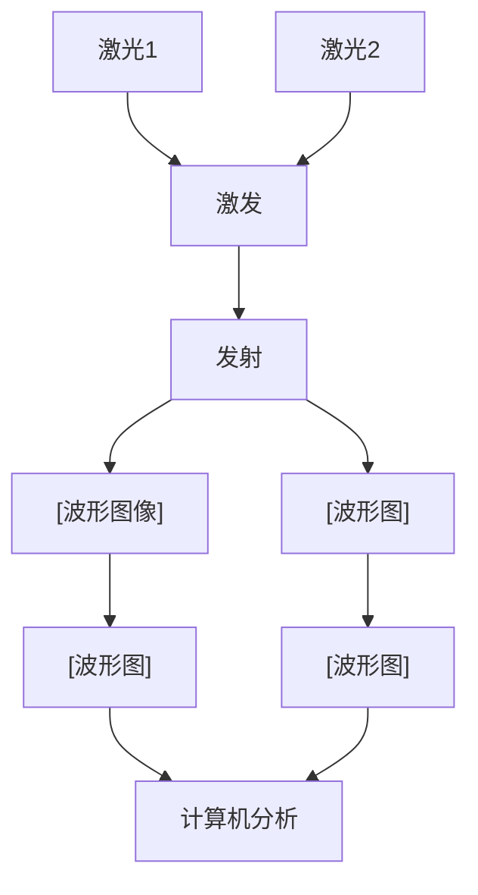
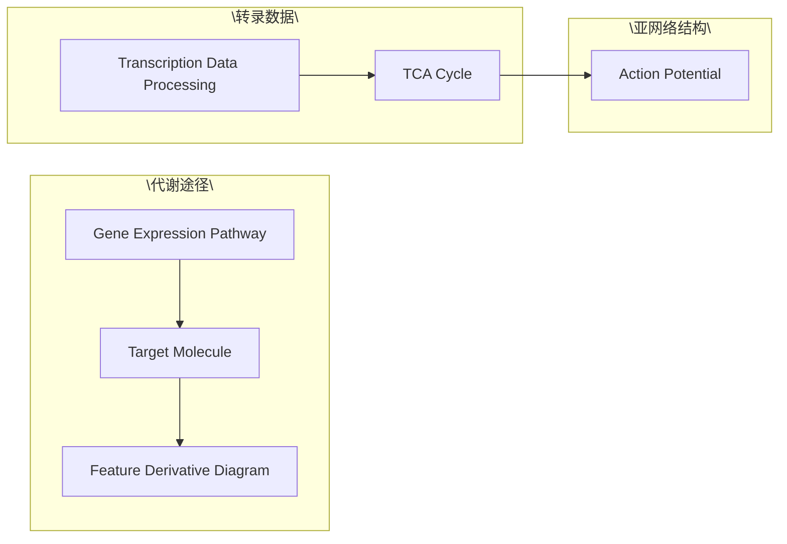
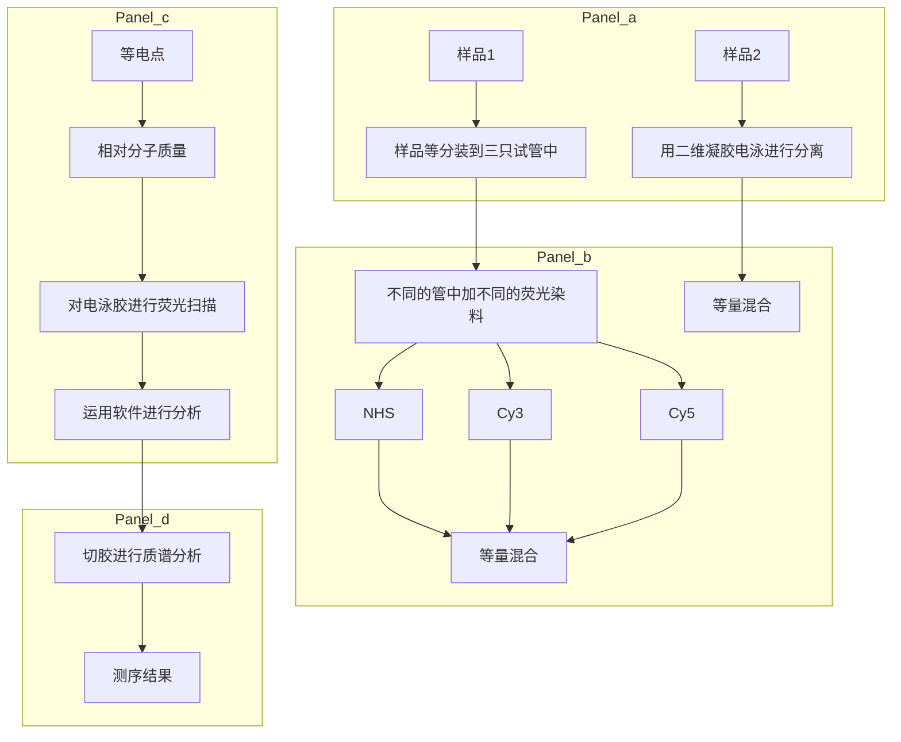

肽段 221

探针 193

## T

弹性系数 102

碳分解代谢物阻遏 275

碳-摩尔化学式 51

糖酵解 17

特征代谢物 204

特征化扰动 117

特征亚网络 204

特征转录因子 204

体积反应速率 53

体积排阻色谱 222

调控基因 234

调控通量平衡分析 176

萜类物质 237

通道蛋白 14

通道效应 101

通量可变性分析 180

通量控制系数 101

通量平衡分析 173

通量组学 163

同位素标记异构体 130

同位素标记异构体映射矩阵 144

同位素亲和标签技术 225

同向运输 15

突变谱分析 282

推断鉴定的化合物类别 253

推断注释的化合物类别 253

## W

维恩图分析 200

无标记法 228

无凝胶电泳蛋白质组学法 218

戊糖磷酸途径 17

## X

稀释率 55

细胞目标 273

细胞培养氨基酸稳定同位素标记 225

限速酶 235

限制 - 修饰系统 270

线性规划 174

相对定量蛋白质组学 218

相互作用组学 163

响应级联 4

响应系数 103

小非编码 RNA 206

协同效应 28

锌指核酸酶 299

选择反应检测法 219

## Y

氧化磷酸化 17,22

液相色谱 - 电喷雾离子化 220

液质联用技术 223

遗传多样性 270

乙醛酸循环 25

已鉴定的化合物 253

吲哚羰花青荧光染料 224

元素平衡 59

原子映射矩阵 144

运输反应 12, 169

## Z

杂交 193

增变基因菌株 270

正定系统 77

质量分布向量 134

质子驱动力 23

主成分分析法 199

主动运输 12

转录 191

转录产物 191

转录激活因子效应物核酸酶 299

转录物组 191

转录物组学 191

转录组学 163

装配反应 12

自控微量平板筛选 273

自上而下蛋白质组学 218

自上而下法 109

自下而上蛋白质组学 218

自下而上法 110

自由扩散 12

总体调节子 48

总体最大值 268

组件 170

组通量控制系数 109

最小化代谢调整 175

最小化调控开关 176

最小基因组 300

(a) 葡萄糖吸收


<details>
<summary>chemical</summary>

Diagram of a lipid bilayer structure showing components like PPP, Glyc, TCA, and OxP with labeled functional groups
</details>

(b) 葡萄糖吸收


<details>
<summary>chemical</summary>

Diagram of a lipid bilayer structure showing components like PPP, Glyc, Ana, TCA, and OxP with labeled regions and directional arrows indicating flow or movement.
</details>

图7-7 FBA计算得到的通量分布图

在两个条件下，粗箭头表示反应具有通量，细箭头表示没有通量的反应。（a）E.coli核心模型在好氧条件下以最大化生长速率为目标函数的通量分布图；(b)E.coli核心模型在厌氧条件下以最大化生长速率为目标函数的通量分布图。Glyc: Glycolysis; PPP: pentose phosphate pathway; TCA: TCA cycle; OxP: oxidative phosphorylation; Ana: anaplerotic reactions; Ferm: fermentation pathways

(a)


<details>
<summary>text_image</summary>

Hand-drawn technical diagram with labeled components and directional arrows, likely from a technical or engineering document.
</details>

(b)


<details>
<summary>chemical</summary>

Chemical structure diagram of a polymer or organic compound with labeled atoms and bonds
</details>

图7-8 好氧条件下以琥珀酸为唯一碳源达到生长最大化的两个替代解通量图

(a) 将 L-苹果酸转化为琥珀酸使用的是反应 ME1；(b) 将 L-苹果酸转化为琥珀酸使用的不是 ME1，而是反应 PYK，两条替代途径用红色表示


<details>
<summary>flowchart</summary>


</details>

图8-3 cDNA基因芯片荧光信号的产生与叠加(Duggan et al. 1999)


<details>
<summary>dendrogram</summary>

| Metric | Value |
| --- | --- |
| Row | 3199 (BG13169\mcp_40) |
| Column | 3 (4-1 vs 168-1) |
| P-value | 0.00852 |
</details>

图8-11 用系统聚类分析法得到的基因芯片数据表达模式


<details>
<summary>flowchart</summary>


</details>

图8-14 特征代谢物与特征亚网络示意图(Patil et al. 2005)


<details>
<summary>flowchart</summary>


</details>

图9-4 2D-DIGE定量蛋白质实验流程(Coombs2011)

(a) 按图中所示方法将样品分装到三只试管；(b) 在每只试管中加不同的荧光染料；(c) 等量样品混合；(d) 用 2D IEF/SDS-PAGE 分析混合的蛋白质；(e) 对每种荧光染料进行图像分析；(f) 切取蛋白斑点进行 MS 和 MS/MS 分析


<details>
<summary>donut</summary>

| Category | Value |
| --- | --- |
| rho | 3 |
| rpoB | 3 |
| rpoC | 3 |
| oyoA | 2 |
| mrdA | 2 |
| pykF | 2 |
| rph | 2 |
| rpsS | 2 |
| spoT | 2 |
| ybox | 2 |
</details>

图11-8 大肠杆菌适应性实验室进化菌株鉴定的基因内突变(Conrad et al. 2011)


图12-8 几类灵活的可编程的生物底盘构建(Esvelt and Wang 2013)

基因组小型化(genome minimization): 减小生物复杂性和冗余性; 重新编码(recoding): 整个基因组密码子重新设计(codon remapping)能使正交信息编码和遗传密码扩展; 合成(synthesis): 基因组从头合成和从天然基因组重建, 能够创建半合成基因组, 创建具有新功能及混合功能的嵌合基因组(chimeric genome); 重新设计(redesign): 整个基因组重新设计及调控系统的重新布线, 能使新的合成线路易于设计和模型模拟


<details>
<summary>flowchart</summary>

```mermaid
graph LR
  subgraph Pathway (a)
  A["A"] --> B["B"]
  B --> C["X"]
  C --> D["Y"]
  D --> E["产物"]
  F["C"] --> G["D"]
  G --> H["E"]
  H --> I["副产物"]
  end

  subgraph Pathway (b)
  A --> J["A"] --> K["B"]
  K --> L["X"]
  L --> M["Y"]
  M --> N["产物"]
  F --> O["C"] --> P["D"]
  P --> Q["E"]
  Q --> R["副产物"]
  end

  subgraph Pathway (c)
  A --> S["A"] --> T["B"]
  T --> U["X"]
  U --> V["Y"]
  V --> W["产物"]
  end

  subgraph Reactor
    X["代谢工程"] -.-> Y["合成生物学"]
  end
```
</details>

图12-14 代谢工程与合成生物学之间的叠合(Nielsen and Keasling 2011)

Document generated by Anna's Archive around 2023-2024 as part of the DuXiu collection (https://annas-blog.org/duxiu-exclusive.html).

Images have been losslessly embedded. Information about the original file can be found in PDF attachments. Some stats (more in the PDF attachments):

```json
{
"filename": "5Luj6LCi5bel56iLXzEzNzEwOTUwLnppcA==",
"filename_decoded": "\u4ee3\u8c22\u5de5\u7a0b_13710950.zip",
"filesize": 51437429,
"md5": "6de5c1582a983286f780af11a8df37e9",
"header_md5": "227b42f4d3e5dc6569baf5dc530c644b",
"sha1": "5a37e7bbadb496374d08bda0b2f8e0f8dfd4cbcd",
"sha256": "9033b49fa1f8c4137b309af819622ed8f6709a44a6bf1dc4c3c56d1bad706aa1",
"crc32": 3834578822,
"zip_password": "",
"uncompressed_size": 61038216,
"pdg_dir_name": "\u2524\u00b7\u2568\u2557\u2563\u00f1\u2502\u2560_13710950",
"pdg_main_pages_found": 318,
"pdg_main_pages_max": 318,
"total_pages": 342,
"total_pixels": 1965374136,
"pdf_generation_missing_pages": false
}
```