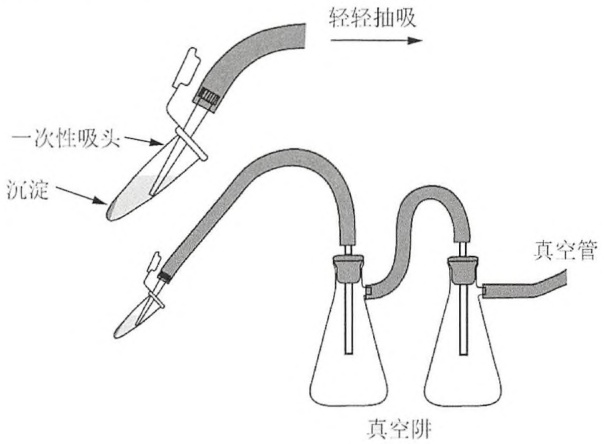
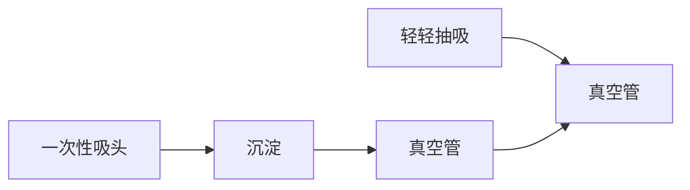
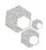
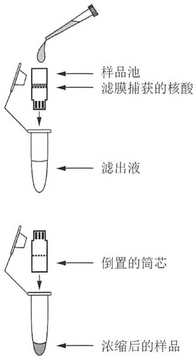
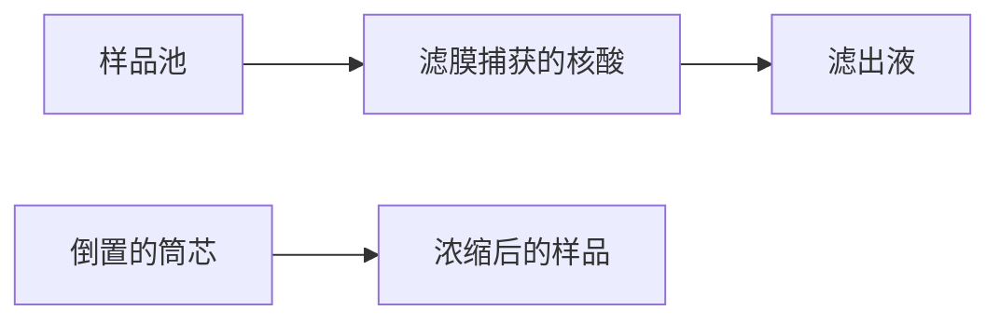
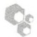
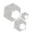
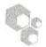
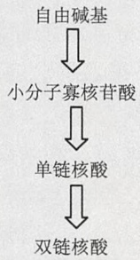
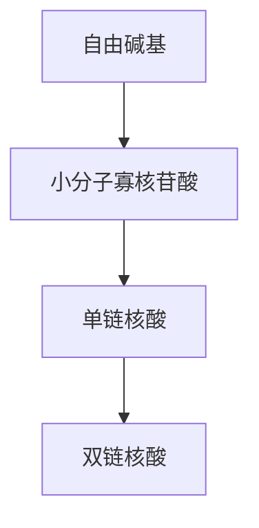

# 第1章 DNA的分离及定量

原始 PDF 第 20–80 页。

## 第 1 章 DNA 的分离及定量

## 导言 | DNA 分离 2

纯化 DNA 的商业试剂盒 3

DNA 定量 5

## 方案 | 1 SDS 碱裂解法制备质粒 DNA: 少量制备 9

2 SDS 碱裂解法制备质粒 DNA:
大量制备 12

3 从革兰氏阴性菌（如 E.coli）中
分离 DNA 15

4 乙醇法沉淀 DNA 17

5 异丙醇法沉淀 DNA 21

6 用微量浓缩机进行核酸的浓缩和脱盐 22

7 丁醇抽提法浓缩核酸 23

8 聚乙二醇沉淀法制备 M13 噬菌体
单链 DNA 24

9 M13 噬菌体铺平板 27

10 M13 噬菌体液体培养 30

11 M13 噬菌体双链（复制型）DNA 的制备 32

12 利用有机溶剂分离纯化高分子质量 DNA 35

13 用蛋白酶 K 和苯酚从哺乳动物细胞中分离高分子质量 DNA 37

14 一步法同时提取细胞或组织中的 DNA、RNA 和蛋白质 43

15 从鼠尾或其他小样本中制备基因组 DNA 46

\- 替代方案 不使用有机溶剂从鼠尾分离DNA 48

\- 替代方案 一管法从鼠尾中分离 DNA 49

16 快速分离酵母 DNA 50

17 微型凝胶电泳后使用溴化乙锭（EB）估算条带中DNA数量 52

18 利用 Hoechst33258 通过荧光分析仪估算 DNA 浓度 53

19 用 PicoGreen 定量溶液中的 DNA 55

## 信息栏 | 从石蜡包埋的甲醛固定组织中提取 DNA 56

聚乙二醇 57

$\alpha$ -互补 58

X-Gal 59

尽量降低对高分子质量 DNA 的损伤 59

分光光度法 60

---

## 导言

双链 DNA 是非常惰性的化学物质。它潜在的反应基团隐藏在中央螺旋部位，并经氢键紧密连接。碱基对外侧受磷酸键和戊糖形成的强大环层的保护，这种保护因内在的碱基堆积力而进一步加强。如此坚固的结构和保护，使得 DNA 在现代犯罪现场和古代墓葬等完全不同的场所中比大多数细胞内其他成分保存时间更长。这样的化学耐久性赋予基因组 DNA 文库的持久性和价值，使得或大或小的遗传工程和测序计划成为可能。

尽管双链 DNA 在化学上是稳定的,但它在物理结构上是易碎的。高分子质量的 DNA 长而弯曲、侧面不稳定,因此更容易受到最柔和的流体剪切力的伤害。双链 DNA 在溶液中随机卷曲,并由于碱基对之间的堆积作用和 DNA 骨架上磷酸基团间的静电排斥力而变得黏稠。因为移液、振荡或搅拌引起的液流,在黏滞的盘绕物上产生的拖拉力,可以切断双链 DNA。DNA 分子越长,破坏其所需的力越小。因此基因组 DNA 很容易变成片段形式,并且随着分子质量增加,分离的难度也相应增加。大于 150kb 的 DNA 分子在常规分离基因组 DNA 过程中易于断裂。


## DNA 分离

DNA 的分离是 DNA 纯化、成功克隆的关键步骤。DNA 制备得越纯，DNA 作为模板或者底物的酶反应效率会越高。在 20 世纪 30～40 年代，科技文献中开始积累了一些从细胞中提取 DNA 并去除能够抑制或者竞争酶催化反应的细胞成分的方法。自此，成千上万种从不同器官、组织和体液中纯化 DNA 的方法被发表。一般来说，这些过程通过 3 个步骤便可快速成功。

1. 裂解宿主细胞，通常使用这些成分:

- 离子去污剂，如 SDS
- 离液剂（如胍盐）
- 与离子去污剂结合的碱

2. 从细胞中释放 DNA，去除与 DNA 结合的蛋白质并快速使胞内核酸酶失活，如:

- 酶水解蛋白和 RNA
- 从层析液中吸收、释放 DNA（例如，玻璃粉末或者阴离子树脂；多种商品化 DNA 纯化试剂盒是基于该技术进行开发的）
- 利用有机溶剂（苯酚和/或氯仿）抽提裂解液以去除 DNA 溶液中的蛋白质

3. 利用乙醇或者异丙醇沉淀 DNA 去除盐离子

由于质粒被广泛应用，因此分离质粒 DNA 十分重要。人们使用碱与 SDS 裂解法从大肠杆菌中分离制备质粒 DNA 已有 30 多年的历史（Birnboim and Doly 1979）。菌液在高 pH 条件下加入强离子去污剂能够破坏细胞壁，使蛋白质与染色体 DNA 变性，并将质粒 DNA 释放到上清液中。

溶菌过程中，菌体蛋白、破碎的细胞壁和变性的染色体 DNA 交织成一个大的复合物，被十二烷基硫酸盐包裹。这些复合物能够通过将钠离子替换成钾离子而被有效沉淀下来（Ish-Horowicz and Burke 1981）。离心去除变性剂后，就可以从上清液中回收复性的质粒。

在 SDS 的存在下，碱裂解法是一种非常灵活、有效的方法，它对 E.coli 的所有菌株都适用，并且其细菌培养物的体积可以从 1mL 到 500mL 以上。但是，实验中的关键是要动作快，因为长时间暴露在变性的条件下会对闭环 DNA 造成不可逆变性（Vinograd and

---

第 1 章 DNA 的分离及定量

3

(Lebowitz 1966)。这种变性的折叠卷曲 DNA 不能被限制酶切割, 它的琼脂糖电泳速率是线性、超螺旋和环状等天然结构 DNA 电泳速率的两倍, 并且不易被嵌入染料染色。碱裂法在制备质粒过程中常会产生不同数量折叠形式的 DNA。

这种方法适用于大小在 15kb 以下的质粒。大于 15kb 的质粒容易在细胞裂解和随后的处理中断裂。利用等渗蔗糖溶液裂解细菌，并用溶菌酶和 EDTA（乙二胺四乙酸）去除细胞壁，可解决受损。产生的原生质球可通过加入去污剂（如 SDS）被裂解。了解更详细的方法，请详见 Godson 和 Vapnek（1973）。


## 纯化 DNA 的商业试剂盒

商业公司将过去 DNA 提取与纯化的技术应用到试剂盒中，然后出售。它是预包装的试剂，具有非常清楚并且简洁的说明，对操作人员的要求简单，使操作人员很容易快速上手，并且结果可多次重复。这些试剂盒可用于纯化不同来源的 DNA 及用于不同实验目的。但现在的文献中缺少对这些试剂盒进行直接的比较。事实上，制造商现在掌握着这些资源。

如何看待这些试剂盒是具有节省时间的优势还是具有破坏性影响，在很大程度上取决于你所处的年代和培训背景。经历过分子克隆早期研究的科学家，可能会认为试剂盒就像快餐食物一样:简单、不用思考、无创造力，是科学的仿制品。可是试剂盒使用起来如此简便，为什么要纠结它们的作用原理呢？或许无知是福吧（Gray 1742）。

试剂盒给我们带来了很多的好处:它们提供了一种高度可靠的、能够与自动化任务相融合的技术。因为仅需要很少的专业知识，所以降低了新研究者进入分子克隆领域的门槛，并且加速了科学发展的进程。例如，我们可以用试剂盒从档案组织中分离其 DNA 从而研究遗传疾病，还可以研究恶性组织中基因表达的异常（详见“从石蜡包埋的甲醛固定组织中提取 DNA”）。此外，若没有试剂盒制备的快速性和重复性，大量的样本要想满足自动DNA测序仪的需求，我们还需要几十年才能实现人类基因组测序计划。

试剂盒就存在于我们的身边，在很多实验室中甚至是不可缺少的，不管你喜不喜欢它，它都会在日新月异的科学领域发挥越来越重要的作用。

许多试剂盒开始利用 DNA 选择性吸附稳定固定相（通常是二氧化硅或者硅酸盐）的特性进行 DNA 纯化。最初的文章（Vogelstein and Gillespie 1979; Marko et al. 1982）描述了硅酸盐粉末（碱石灰玻璃和硼硅酸盐玻璃）如何快速及定量结合 DNA。在高 pH、高盐缓冲液中，DNA 吸附在二氧化硅介质上，在低盐浓度下可被洗脱下来。这种结合不依赖碱基配对或者拓扑学特征，可被离液剂增强，如能够破坏核酸周围水化层的胍基盐。玻璃表面的阳性离子随后可以在 DNA 骨架中磷酸负电基团和硅醇负电基团（Si-OH）之间形成盐桥。结合力的强度与成桥离子类型有关（Romanowski et al. 1991）。一旦被吸附，在溶液中（如 50%乙醇）的 DNA 还可以被吸附在介质上，而与其他的生物多聚物（如 RNA 和糖）分开。然而，当用水溶液对吸附的 DNA 进行水化时，DNA 可被洗脱下来并（大部分）在洗脱液中被回收。得率由 DNA 的大小决定:片段越小，与二氧化硅结合越紧密，得率越低。洗涤缓冲液，尤其含易挥发液体的（如乙醇），应该现用现配。

做二氧化硅试剂盒的制造商不愿意提供他们的树脂结构及特性的详细数据。许多试剂盒用二氧化硅来吸附高密度的阴离子基团来建立盐桥。这些阴离子二氧化硅有着很强的结合能力，但是批次之间的不同成为早期二氧化硅树脂被广泛应用的阻碍，现在问题已经解决了。这种结合不受溶液中的去污剂（Triton X-100）或结构破坏剂（胍基盐、碘化钠或高氯酸钠）的影响。

阴离子二氧化硅介质可存在多种形式，如凝胶状、玻璃粉、微粒状、旋转柱、膜状和多墙平板状。二氧化硅材质经常做成平行设计，因为这样可在芯片制造中将其嵌入卡槽。

---

4

分子克隆实验指南（原书第四版）

依据二氧化硅材质的结构，DNA 可通过重力进行吸附和洗脱，还可通过泵或离心加速该过程。商品化树脂的制造商会根据不同的情况来制订详细的 DNA 纯化方案。因为 DNA 的吸附和洗脱依赖特定树脂的结构和衍生化，制造商一般会提供说明书。

二氧化硅材料直至今日还是高科技产物，所以价格还很昂贵，但它们能够为实验室节省很多时间和精力，进而大大提高了成本利用率。由于还有 $5\% \sim 10\%$ 的DNA依然吸附在介质上，因此二氧化硅柱在用完一次后必须废弃。然而，我们可以将柱上残留的DNA洗去，使之再生后重新使用，这样能够降低成本（如Esser et al.2005,2006）。如果把劳动力成本考虑进去的话，这种节约是否能够提高成本效率并不明确。

不是所有的商业试剂盒都用二氧化硅材质去结合DNA，因为DNA是一个大的多价阴离子物，在低离子强度作用的缓冲液中能够与任何阳离子结合，在高离子强度的缓冲液中被洗脱。强电荷基质能够紧密结合DNA，但是DNA的复性非常慢，尤其是在离心柱上。一些商业化试剂盒用阳离子柱效果也很好，可有效获得高纯度DNA（如Applied Biosystems公司的PrepMan试剂盒）。

选择哪一种试剂盒呢？目前有很多DNA制备试剂盒已经进入市场。就算实验经验匮乏的人也能够使用这些试剂盒从任何你想到的来源中提取和纯化DNA。

生产DNA纯化试剂和试剂盒的公司有Applied Biosystems公司、Brinkmann公司、Clontech公司、Millipore公司、Agilent公司、Life Technologies公司、Promega公司及市场领导者QIAGEN公司。目前并没有对这些公司试剂盒提取DNA的成本、效率、速度及可重复性进行比较。但这个市场竞争十分激烈，劣质产品不会存在太久。我们建议根据自己的目的来比较这些公司产品（产量、速度、花费等），然后选择一个性价比高的产品。现在涌现了很多公司推销可同时纯化多种样本DNA的工作站和自动化仪器。目前，这些仪器的主要使用者是基因组测序工厂、基因检测实验室和分子病理实验室的人。很快它们会像PCR一样普遍。

## 高分子质量 DNA 的分离

试剂盒纯化的基因组 DNA 在大小上（一般为 50～100kb）可作为 Southern 杂交和 PCR 的模板。因此，当 DNA 用于特定用途如构建基因组文库（克隆的 DNA 大小尤为重要）时，商品化的试剂盒用处不大。为使剪切力降到最低，200kb 大小的 DNA 可用去污剂裂解细胞，强蛋白酶（如链霉蛋白酶和蛋白酶 K）处理裂解液，并利用有机溶剂进行多次萃取（一般为水饱和的酚-氯仿溶液）。最后的水相经过广泛透析以去除低分子质量的污染及调整离子浓缩。如果可能，尽量避免用乙醇沉淀 DNA。

此方法的雏形可追溯到60年以前。如果操作足够谨慎和耐心，有机溶剂萃取可产生足够大分子质量的基因组DNA，以用于在某些高容量载体中构建真核基因组DNA文库。

尽管此方法值得尊敬，但与其他实验室常规方法相比，仍是对技术与耐心的巨大挑战，并且也有一些缺点。例如，该过程需使用有毒试剂，并且涉及多次水相与有机相的费力分离；长 DNA 很容易断裂，非常容易被切割成小的片段。成功的关键在于通过使用宽口径的移液器，避免振荡、涡旋和乙醇沉淀，以及避免色谱树脂降低剪切力。高分子质量的 DNA 分离方法无法自动化，并且不适合多个样本的平行操作。

在以下情况下需要更加谨慎以降低剪切力对DNA的影响:利用高容量载体如YAC（酵母人工染色体）或BAC（细菌人工染色体）构建基因组文库时；或DNA样品从常染色体通过脉冲电泳进行分离时。为避免DNA被打断，琼脂中固定的完整细胞用酶处理以破坏其细胞壁并去除细胞蛋白。释放的DNA可在琼脂槽中被固定，并在原位被限制酶水解，这与DNA在溶液中是相同的（了解更详细的分离及分析超高分子质量DNA的方法，详见Birren and Lai 1993）。

---

第 1 章 DNA 的分离及定量

5


## DNA 定量

确定 DNA 的数量对于分子克隆中获得可重复、精确及有效的结果是十分必要的。常规使用 3 种方法进行 DNA 定量:紫外分光光度法、荧光分析法和绝对定量法。

## 紫外分光光度法

紫外分光光度法是利用分光光度计来测定 DNA 溶液的吸收值（见信息栏“分光光度法”）。在水相中，双链 DNA 在 260nm 附近具有最大吸光度，吸光系数约为 50。实际上，双链 DNA 的紫外光谱范围从约 4μg/mL 到约 50μg/mL。然而，分光光度计法定量对多种干扰成分十分敏感，这些成分可以是单链 DNA、RNA、蛋白质、核苷酸、含有苯环的芳香族化合物及溶液中的颗粒等。

通过测定单波长（260nm）下的吸光度来定量核酸浓度实际效果并不好。样品的吸光度可以在多个波长下（230nm、260nm、280nm与320nm）进行测定，因为在这些波长下的吸光度可指示样品制备的纯度。

\- 230nm。胍盐、苯氧基离子、硫氰酸酯及其他经常用于核酸制备的化合物在该波长下具有强吸收。

\- 280nm。芳香族氨基酸色氨酸和酪氨酸在该波长下具有强吸收。多年以来，260nm与280nm的吸光度比值一直用于检测核酸中是否污染了蛋白质。这项测定尽管十分普遍，但却值得怀疑。这个方法需追溯到Warburg和Christian（1942）的研究，他们发现 $OD_{260}/OD_{280}$ 比值是核酸中是否污染蛋白质的很好的指示。但事实上这并不是真的！DNA在260nm的吸收很强，只有在被大量蛋白质污染的条件下才会引起两个波长下吸光度比值的显著变化。

\- 320nm。在高波长下的吸收一般是由光散射造成的，可用于指示核酸制备过程中特定物质引起的浊度。

根据实验经验， $OD_{260}/OD_{280}$  比值在 1.7～2.0，并且在 230nm 和 320nm 处吸收度较小的 DNA 制备物，被认为是纯度足够高，可以作为分子克隆各个过程中的模板和底物。

测定 DNA 溶液的吸光度可以使用传统的分光光度计或针对生物大分子设计的仪器(如 Eppendorf 公司 Biophotometer)。详细信息见信息栏“分光光度法”。

紫外光谱使用的是石英杯，各种形状及大小均可，包括多数实验室测定 DNA 浓度常用的微量杯或超微量杯。当使用超微量石英杯时，应确保其窗口高度与特定分光光度仪的射束高度相匹配。如果窗口高度错误，光束要么完全不能穿过样品，要么需要更大体积的样品才能得到结果。

NanoDrop Technologies 销售的分光光度仪可用于测定微量体积 DNA、RNA 和蛋白质的吸光度。这种分光光度仪利用光束下表面张力仅需要微量液滴（1～2μL），进而避免需要石英杯及其他样本容器。此外，NanoDrop 分光光度仪不需要稀释即可测定高浓度的 DNA 溶液（比标准的石英杯分光光度仪所能测量的浓度要高 50 倍）。

接触样品的表面非常容易并快速地被清洗，因此可在短时间内测定多个样品。为避免问题产生，可进行下列操作。

\- 确保 DNA 溶液在测定前充分混匀。因为样品体积很小（2μL），没有混匀会使取得的样品不具有代表性。

\- 少量体积样品加入到分光光度仪的底座后，会很快挥发，并导致测出的 DNA 浓度比实际的要高。为减少这个问题的影响，可将 NanoDrop 分光光度仪放在温度可控、通风的环境下，并保持样品放置于盖了盖子的管中。操作要快。应该在样品加到分

---

6

分子克隆实验指南（原书第四版）

光光度仪底座后尽快读数。

## 荧光分析法

荧光分析法用特定结合 DNA 的染料来测定双链 DNA 的浓度。常用的 DNA 染料包括溴化乙锭、Hoechst33258、SYBR Green I 和 II、SYBR Gold 及 PicoGreen。

## 溴化乙锭

溴化乙锭含有三环菲啶平面环系统，可嵌入到双链 DNA 碱基之间。嵌入 DNA 双螺旋后，溴化乙锭的菲啶环平面位于与螺旋轴相垂直的位置，并通过范德瓦耳斯力与上下碱基结合。而其平面环系统被埋在底部，其外侧的苯基和乙烷基处于 DNA 双螺旋的大沟内。在高强度离子溶液的饱和状态，大约每 2.5 个碱基对嵌入一分子的溴化乙锭，这与 DNA 的碱基组成无关。溴化乙锭的嵌入一般不会对碱基对的构象及其在螺旋中的位置产生影响，除了会使碱基对沿螺旋轴移位 3.4Å（Waring 1965）。这种移位可造成饱和溴化乙锭的 DNA 分子长度增加 27%（Freifelder 1971）。

溴化乙锭还可以高度可变计量学与 RNA 和热变性或单链 DNA 形成的链间碱基对结合（Waring 1965，1966；Lepecq and Paoletti 1967）。溴化乙锭平面基团的固定位置及其与碱基的密切接近可使结合的染料散发的荧光比游离在溶液中的染料要强 20～25 倍。254nm 的紫外线（UV）照射由 DNA 吸收，并转移至溴化乙锭；302nm 和 366nm 的紫外线照射由溴化乙锭本身吸收。在 590nm 和可见光的红-黄区一小部分（约 0.3）可被重新释放出来（Lepecq and Paoletti 1967；Tuma et al. 1999）。

大多数销售的 UV 光源可发射 302nm 的 UV 光。溴化乙锭-DNA 复合物在此波长产生的荧光明显强于 366nm，但略微低于较短的波长（254nm）。然而，DNA 分子的光漂白和断裂作用在 302nm 要比在 254nm 处低得多（Brunk and Simpson 1977）。

溴化乙锭主要用于检测琼脂糖中的 DNA（Aaij and Borst 1972；Sharp et al. 1973），但这种染料也还可以用于半定量地估算 DNA 溶液的浓度（见方案 17）。

▲在酵母及沙门氏菌中，溴化乙锭本身并不容易诱发突变，但它通过微粒体酶代谢的化合物可中度诱变(Mchler and Bastos 1974；McCann et al. 1975；MacGregor and Johnson 1977；Singer et al. 1999)。多数研究所开发了安全操作及处理含有溴化乙锭溶液及胶的说明。研究者应该根据这些说明来处理溴化乙锭。安全处理溴化乙锭的试剂盒也可通过 Schleicher & Schuell 和 Qbiogene 公司及其他渠道获得。

## Hoechst 33258

Hoechst 33258 是一类双-苯并咪唑荧光染料，可高特异性非插入地结合于 DNA 双链的小沟。结合的染料产生的荧光从 0.01 上升到 0.6（Latt and Wohlleb 1975），因此，Hoechst 33258 用于双链 DNA 溶液的荧光检测及定量。Hoechst 33258 比溴化乙锭更优先使用，因为它具有非常强的区分双链 DNA 与 RNA 及单链 DNA 的能力（Loontiens et al. 1990）。

与其他非嵌入染料类似（Müller and Gautier 1975），Hoechst 33258 可优先结合 DNA 螺旋中的富含 A/T 区（Weisblum and Haenssler 1974），并随着 A+T 含量的增加，荧光强度以 10 的对数增长（Daxhelet et al. 1989）。Hoechst 33258 与双链 DNA 结合产生的荧光比与单链 DNA 结合要强 3 倍左右（Hilwig and Gropp 1975）（见方案 18）。

## SYBR Green I

SYBR Green I（Life Technologies）是一种嵌入型青蓝色染料，在 488nm 蓝色光照射激发后，在 522nm（绿光）具有发射高峰。尽管 SYBR Green I 可加入到凝胶上样缓冲液中，但并不推荐这样使用，因为该染料对 DNA 在凝胶中的迁移影响很大。为得到最好的效果，凝胶应该进行预染处理。由于产生的荧光很强，SYBR Green I 是一种可用于检测少量 DNA

---

第 1 章 DNA 的分离及定量

7

（低拷贝/PCR 产物数量少）的理想染料。少至 20pg 的 DNA 或 250pg 多分散性 DNA 在经过 SYBR Green I 染色后，凝胶可用基于 CCD 的图像记录系统进行检测。

因为 SYBR 染料-DNA 复合物在非极性溶液中可解离，因此可用乙醇沉淀的方法将 SYBR Green I 从 DNA 中去除。

## SYBR Green II

SYBR Green II（Life Technologies）主要用于对电泳后的 RNA 和单链 DNA 进行染色。由于该染料在结合 RNA 后发出非常亮的荧光及其在凝胶中的低背景，SYBR Green II 经常用来对多聚甲醛/琼脂糖或聚丙烯酰胺凝胶中的 RNA 进行染色。

利用肝脏提取物进行 Ames 实验显示 SYBR 染料与溴化乙锭相比致癌性要低(Singer et al. 1999)。但 SYBR Green 在暴露于 UV 的细菌中比溴化乙锭更容易诱发突变(Ohta et al. 2001)。Life Technologies 公司现在销售更安全的 SYBR 染料(SYBR-Safe DNA 凝胶染色)(见 Martineau et al. 2008)。

## SYBR Gold

SYBR Gold(Life Technologies)是检测凝胶中 DNA 和 RNA 高度灵敏的染料,与 300nm 紫外光源和基于 CCD 的图像记录系统联合使用。结合 DNA 后, SYBR Gold 在 495nm 和 300nm 处均有最大激发（最大发射波长 537nm）。

结合核酸后，SYBR Gold 的荧光增强程度是溴化乙锭的 30 多倍。SYBR Gold 染凝胶中 DNA 的灵敏度是 SYBR Green I 的 10 多倍，染乙醛酸化的 RNA 的灵敏度是溴化乙锭的 25 倍以上。

SYBR Glod 也可用于检测甲基敏感的单链构象分析（MS-SSCA）（McKee and Thomson 2004）。然而，由于其成本较高，SYBR Gold 并不是检测凝胶中 DNA 或 DNA 定量的常规选择染料。Ames 实验显示 SYBR Gold 并不具有诱变作用（Kirsanov et al. 2010），并且不像其他菲啶类染料如溴化乙锭，SYBR Gold 可很容易地通过乙醇沉淀法从 DNA 中去除。

## PicoGreen

PicoGreen（Life Technologies）是一种耐光性染料，在 480nm 处有最大激发，在 520nm 处有发射高峰，可特异结合双链 DNA。在检测溶液中双链 DNA 时，其具有最高灵敏度和最大动力性范围。PicoGreen 广泛应用于多孔板 DNA 样品的自动化检测和定量。利用一个染料浓度，可检测 1～1000ng/mL 的 DNA 样品，并可通过手持型荧光分析仪进行精确定量（见方案 19）。

## 将染料从 DNA 中去除

在推荐使用浓度范围内，SYBR Green I 和 SYBR Gold 并不显著抑制限制酶、连接酶及热稳定 DNA 聚合酶的活性。这些染料不像溴化乙锭和其他菲啶类染料，可非常容易通过乙醇沉淀法从 DNA 中去除。

溴化乙锭染 DNA 后可抑制后续酶促反应中 DNA 作为模板或底物的能力。幸运的是，溴化乙锭可通过两次等体积的异丙醇或酚:氯仿（25:1）萃取，非常容易并快速地从 DNA 中去除。去染色的 DNA 可再通过乙醇沉淀回收。

实际上，所有用于纯化 DNA 的商业试剂盒或系统都可有效地将溴化乙锭及其他 DNA 结合染料从 DNA 中去除。

---

8

分子克隆实验指南（原书第四版）

## 绝对定量法

一种基于 TaqMan 系统的商业化产品为 DNA 绝对定量提供了有效方法。

TaqMan RNase P Detection Reagents（Applied Biosystems）系统使用 TaqMan 化学法检测基因组 DNA 的总量，后者可通过特异针对人 RNase P 基因的引物进行扩增。TaqMan 探针包括:①结合到针对 RNase P 基因的非延伸寡核苷酸 3' 端的猝灭分子；②结合到引物 5' 端的报告分子。猝灭分子 [罗丹明、异硫氰酸四甲基罗丹明（TAMRA）] 发射长波长红光光谱，而报告分子（荧光素，FAM）发射短波长的绿光。猝灭分子与报告分子距离很近时，可发生从猝灭分子到报告分子的荧光共振能量转移（FRET），这有效抑制了报告分子的荧光。设计荧光标记的寡核苷酸，用于上下游未标记引物所扩增靶序列的复性。由具有 5'→3' 外切酶活性的热稳定 DNA 聚合酶（如 Taq）催化的 DNA 合成可引起探针的水解以及激光照射后荧光强度增加。

目前已经有商业化试剂盒利用 TaqMan Universal PCR Master Mix 完成 5'核酸酶检测，这类试剂盒中含有预稀释的系列浓度的 DNA 参照品。

## 参考文献

- Aaij C, Borst P. 1972. The gel electrophoresis of DNA. Biochim Biophys Acta 269: 192–200.
- Birnboim HC, Doly J. 1979. A rapid alkaline extraction procedure for screening recombinant plasmid DNA. Nucleic Acids Res 7: 1513–1523.
- Birren B, Lai E. 1993. Preparation of high molecular weight DNA from bacteria. In Pulsed field gel electrophoresis: A practical guide, pp. 3.9.1–3.9.10. Academic, San Diego.
- Brunk CF, Simpson L. 1977. Comparison of various ultraviolet sources for fluorescent detection of ethidium bromide–DNA complexes in polyacrylamide gels. Anal Biochem 82: 455–462.
- Daxhelet GA, Coene MM, Hoet PP, Cocito CG. 1989. Spectrofluorometry of dyes with DNAs of different base composition and conformation. Anal Biochem 179: 401–403.
- Esser K-H, Marx WH, Lisowsky T. 2005. Nucleic acid-free matrix: Regeneration of DNA. BioTechniques 39: 270–271.
- Esser K-H, Marx WH, Lisowsky T. 2006. MaxXbond: First generation system for DNA binding silica matrices. BioTechniques 39: i–ii.
- Freifelder D. 1971. Electron microscopic study of the ethidium bromide-DNA complex. J Mol Biol 60: 401–403.
- Godson GN, Vapnek D. 1973. A simple method of preparing large amounts of $\varphi$X174 RF 1 supercoiled DNA. Biochim Biophys Acta 299: 516-520.
- Gray T. 1742. Ode on a Distant Prospect of Eton College. http://www.thomasgray.org/cgi-bin/display.cgi?text=odec.
- Hilwig I, Gropp A. 1975. pH-dependent fluorescence of DNA and RNA in cytologic staining with "33258" Hoeschst. Exp Cell Res 91: 457–460.
- Ish-Horowicz D, Burke JF. 1981. Rapid and efficient cosmid cloning. Nucleic Acids Res 9: 2989–2998.
- Kirsanov KI, Lesovaya EA, Yakubovskaya MG, Belitsky GA. 2010. SYBR Gold and SYBR Green II are not mutagenic in the Ames test. Mutat Res 699: 1–4.
- Latt SA, Wohlleb JC. 1975. Optical studies of the interaction of 33258 Hoechst with DNA, chromatin, and metaphase chromosomes. Chromosoma 52: 297–316.
- LePecq JB, Paoletti C. 1967. A fluorescent complex between ethidium bromide and nucleic acids. Physical–chemical characterization. J Mol Biol 27: 87–106.
- Loontiens FG, Regenfuss P, Zechel A, Dumortier L, Clegg RM. 1990. Binding characteristics of Hoechst 33258 with calf thymus DNA, poly[d(A-T)], and d(CCGGAATTCCGG): Multiple stoichiometries and determination of tight binding with a wide spectrum of site affinities. Biochemistry 29: 9029–9039.
- MacGregor JT, Johnson IJ. 1977. In vitro metabolic activation of ethidium bromide and other phenanthridinium compounds: Mutagenic activity in Salmonella typhimurium. Mutat Res 48: 103–107.
- Mahler HR, Bastos RN. 1974. Coupling between mitochondrial mutation and energy transduction. Proc Natl Acad Sci 71: 2241–2245.
- Marko MA, Chipperfield R, Birnboim HC. 1982. A procedure for the large-scale isolation of highly purified plasmid DNA using alkaline extraction and binding to glass powder. Anal Biochem 121: 382–387.
- Martineau C, Whyte LG, Greer CW. 2008. Development of a SYBR safe technique for the sensitive detection of DNA in cesium chloride density gradients for stable isotope probing assays. J Microbiol Methods 73:199–202.
- McCann J, Choi E, Yamasaki E, Ames BN. 1975. Detection of carcinogens as mutagens in the Salmonella/microsome test: Assay of 300 chemicals. Proc Natl Acad Sci 72: 5135–5139.
- McKee DR, Thomson MS. 2004. Nucleic acid stain-dependent single strand conformation polymorphisms. BioTechniques 37: 46, 48, 50.
- Müller W, Gautier F. 1975. Interactions of heteroaromatic compounds with nucleic acids. A-T-specific non-intercalating DNA ligands. Eur J Biochem 54: 385–394.
- Ohta T, Tokishita S, Yamagata H. 2001. Ethidium bromide and SYBR Green I enhance the genotoxicity of UV-irradiation and chemical mutagens in E. coli. Mutat Res 492: 91–97.
- Romanowski G, Lorenz MG, Wackernagel W. 1991. Adsorption of plasmid DNA to mineral surfaces and protection against DNase I. Appl Environ Microbiol 57: 1057–1061.
- Sharp PA, Sugden B, Sambrook J. 1973. Detection of two restriction endonuclease activities in Haemophilus parainfluenzae using analytical agarose–ethidium bromide electrophoresis. Biochemistry 12: 3055–3063.
- Singer VL, Lawlor TE, Yue S. 1999. Comparison of SYBR Green I nucleic acid gel stain mutagenicity and ethidium bromide mutagenicity in the Salmonella/mammalian microsome reverse mutation assay (Ames test). Mutat Res 439: 37–47.
- Tuma RS, Beaudet MP, Jin X, Jones LJ, Cheung CY, Yue S, Singer VL. 1999. Characterization of SYBR Gold nucleic acid gel stain: A dye optimized for use with 300-nm ultraviolet transilluminators. Anal Biochem 268: 278–288.
- Vinograd J, Lebowitz J. 1966. Physical and topological properties of circular DNA. J Gen Physiol 49: 103–125.
- Vogelstein B, Gillespie D. 1979. Preparative and analytical purification of DNA from agarose. Proc Natl Acad Sci 76: 615–619.
- Warburg O, Christian W. 1942. Isolierung und Kristallisation des Garungsterments Enolase. Biochem Z 310: 384–421.
- Waring MJ. 1965. Complex formation between ethidium bromide and nucleic acids. J Mol Biol 13: 269–282.
- Waring MJ. 1966. Structural requirements for the binding of ethidium to nucleic acids. Biochim Biophys Acta 114: 234–244.
- Weisblum B, Haenssler E. 1974. Fluorometric properties of the bibenzimidazole derivative Hoechst 33258, a fluorescent probe specific for AT concentration in chromosomal DNA. Chromosoma 46: 255–260.

---

第 1 章 DNA 的分离及定量

9

## 方案 1 SDS 碱裂解法制备质粒 DNA: 少量制备

该实验方案是从少量（1～2mL）细菌培养物中分离质粒 DNA。DNA 产量为 100ng～5μg，这取决于质粒的拷贝数。少量的 DNA 作为体外酶促反应的底物或者模板是足够的，但是，如果质粒 DNA 用于测序则需要进一步纯化。

很多年以来，碱裂解法提取质粒 DNA 一直是标准的方法。如今，人们更倾向于用试剂盒提取。下列方案是早期实验的回顾，已经包含在所有 4 个版本的《分子克隆实验指南》一书中。它一定不会再出现了。


## 材料

为正确使用本方案中的器材和危险试剂，必须查阅相应的材料安全数据表并咨询所在机构的环境卫生和安全办公室。

本方案的专用试剂标注&lt;R&gt;，配方在本方案末提供。常用储备溶液、缓冲液和试剂标注&lt;A&gt;，配方见附录1。储备溶液应稀释至适用浓度后使用。

## 试剂

碱裂解液 I&lt;A&gt;，冰浴

碱裂解液 II&lt;A&gt;

碱裂解液Ⅱ应新鲜制备，于室温下使用。

碱裂解液 III&lt;A&gt;，冰浴

用于筛选质粒的抗生素

精氨酸缓冲液（0.1mol/L，pH 12.4）（可选；见步骤5）

配制该溶液，可用 pH12.4 的 5mol/L NaOH 调整 0.1mol/L L-精氨酸溶液的 pH。更多的细节参见 Cloninger 等（2008）和 Paul 等（2008）。

转化了所需质粒的细菌克隆

乙醇（70%，90%）

酚:氯仿（1:1，V/V）（可选；见步骤8）

培养基（LB、YT 或者 Terrific Broth）&lt;A&gt;

STE&lt;A&gt;，冰浴（可选，见步骤3）

Tris-EDTA(TE)(pH 8.0) &lt;A&gt; 含 20μg/mL RNase A

## 设备

细菌摇床，37℃

KimWipes 纸巾

巴斯德吸管和吸球（可选；见步骤3）

携带式真空吸气器（可选；见步骤3和13）


## 方法

## 细胞的制备

1. 挑转化后的单克隆菌落，接种到 $2 \mathrm{~mL}$ 含有适当抗生素的培养中（LB、YT 或者 Terrific Broth），于 $37^{\circ} \mathrm{C}$ 剧烈振荡过夜。

为确保培养物通气良好:

---

10

分子克隆实验指南（原书第四版）

i. 试管的体积应该至少比细菌培养物的体积大4倍。
ii. 试管盖要盖得松些。
iii. 培养物要在剧烈振荡下过夜培养。

2. 将 $1.5 \mathrm{~mL}$ 培养物倒入微量离心管, 用微量离心机在 $4^{\circ} \mathrm{C}$ 以最大转速离心 $30 \mathrm{~s}$, 将剩余培养物储存在 $4^{\circ} \mathrm{C}$ 。

3. 离心完成后，尽最大可能吸干培养液。

这个步骤可用一个简单的方法进行，用一次性吸头和巴斯德吸管与一个真空管和一个侧臂烧瓶相连（参见图1-1）。轻轻抽吸，并使吸头接触液面。当吸出液体时，要尽量避免接触细菌沉淀，以免沉淀吸到侧臂中。也可以用吸头或者吸球吸去培养液，并用吸头除去管壁上残余的液滴。未从细菌沉淀中除去所有培养液可导致质粒不能被限制性酶切或不能完全切割。这是因为细胞壁成分抑制多种限制酶的活性。这个问题可通过用预冷的STE（菌液体积的0.25倍）重悬细菌沉淀并离心来解决。



<details>
<summary>flowchart</summary>


</details>

图 1-1 吸取上清。将微量离心管打开盖并呈一定角度放置，使沉淀位于上方。使用连接真空管的一次性吸头从离心管中吸去液体。将吸头插入管下方的液面以下。当液体吸除时，沿着管的底部移动吸头。吸取要轻柔以免将沉淀吸入吸头中。勿使吸头尾端接近沉淀团块。最后，真空抽干管壁，以去除挂壁的液滴。

## 细胞的裂解

4. 用 $100 \mu \mathrm{L}$ 预冷的碱裂解液 I 重悬细菌沉淀, 剧烈振荡。

为确保菌液在碱裂解液 I 中完全分散，将两个微量离心管的管底互相接触同时涡旋振荡，这样可以提高细菌沉淀重悬的速度和效率。原方案（Birnboim and Doly 1979）要求用溶菌酶消化细菌细胞壁，如果处理的细菌培养物的体积小于 10mL，这一步可以省略。

5. 加入 $200\mu \mathrm{L}$ 新鲜配制的碱裂解液 II 于每管细菌悬液中，盖紧管口，快速颠倒离心管 5 次，以混合内容物，切勿振荡！将离心管放置在冰上。

▲确保离心管的整个内壁均与碱裂解液Ⅱ接触。

延长超螺旋 DNA 暴露于碱的时间会使其不可逆变性，所产生的环状卷曲 DNA 不能被限制酶切割，而且它在琼脂糖电泳中的迁移率为正常超螺旋 DNA 的 2 倍，难以被溴化乙锭染色。从细菌中用碱裂解法提质粒时可能会看到微量的这种 DNA。这样环状卷曲的 DNA 几乎没有危害。最简单的消除这种 DNA 的方法是严格按照说明制备碱裂解液，或者在步骤 5 中将碱裂解液 II 换成精氨酸缓冲液。

6. 加入  $150 \mu L$  用冰预冷的碱裂解液 III，盖紧管口，反复数次颠倒，使溶液 III 在黏稠的细菌裂解物中分散均匀，之后将管置于冰上 3～5min。

7. 用小离心机于 $4^{\circ} \mathrm{C}$ 以最大转速离心 $5 \mathrm{~min}$, 将上清转移至另一离心管中。

8.（可选）加等量体积的酚:氯仿，振荡混合有机相和水相，然后用小离心机于  $4^{\circ}$ C 以最大转速离心 2min。将上清转移至另一离心管中。

有些研究者认为不必用酚:氯仿抽提。然而，这一步骤的省略可能导致获得不能被限制酶切割的 DNA。用氯

---

第 1 章 DNA 的分离及定量

11

仿抽提的目的是从水相中除去残余的酚。酚在水中微溶，但能被氯仿抽提到有机相中。

## 质粒 DNA 的回收

9. 用 2 倍体积的乙醇于室温沉淀核酸，振荡混合，于室温放置 2min。

10. 用微量离心机于 $4^{\circ} \mathrm{C}$ 以最大转速离心 $5 \mathrm{~min}$, 收集沉淀的核酸。

最好养成总是用同一种方式在离心机中放置离心管的习惯。例如，按顺序放置，将离心管的塑料柄朝外。沉淀总是在离转头中心最远的离心管内壁聚集。知道 DNA 沉淀在什么地方可以容易地找到可见的沉淀，也可以有效地溶解看不见的沉淀。在离心管的侧面和顶部做好标记，这样即使字迹模糊了也能辨识。

11. 按上述步骤 3 吸去上清液，将离心管倒置在纸巾上，以使所有的液体排干，用 KimWipes 纸巾或一次性吸头除去管壁上的液滴。

12. 加 1 mL 70% 的乙醇于沉淀中并将盖紧的试管颠倒数次，用微量离心机在  $4^{\circ}$ C 以最大转速离心 2min，回收 DNA。

13. 再次用步骤 3 所述的方法轻微抽吸除去所有上清。

这一步要小心，因为沉淀有时候并不是紧贴管壁的。

14. 除去管壁上的乙醇液滴，应将开口的试管置于室温挥发乙醇，直至试管内没有可见液体存在（5～10min）。

如果用干燥器或者真空干燥的方法干燥 DNA 沉淀，在某些情况下会使其难以溶解并可能变性。将沉淀在室温下干燥 10～15min 使乙醇挥发就足够，不会引起 DNA 脱水。

15. 用 $50 \mu \mathrm{L}$ 含有去 DNA 酶的 RNase A（胰 RNA 酶）（$20 \mu \mathrm{g} / \mathrm{mL}$）的 TE（pH8.0）重新溶解核酸，温和振荡几秒，储存于 $-20^{\circ} \mathrm{C}$。

见“疑难解答”。


## 疑难解答

在质粒 DNA 的制备过程中遇到的任何问题，在随后的限制性酶切分析中会更加明显。

问题（步骤 15）:在酶切前、后经电泳只见很少或无 DNA。

解决方案: 在乙醇沉淀后, 在步骤 11 中可能将核酸丢失。离心后马上小心地去除乙醇, 如果离心管放置的时间太长, DNA 沉淀会与管壁分离。

问题（步骤 15）:DNA 不能被限制酶切割。

解决方案:DNA 不能切割，可能是没有移去所有液体，在纯化质粒 DNA 的过程中，有些成分阻碍限制酶的功能。可以尝试以下建议:

- 在步骤 3 中移去所有液体。
- 用冰浴的 STE（菌液体积的 0.25 倍）重悬细菌沉淀并重新离心弃去每一滴剩余的 STE，并用碱裂解液 I 重悬细胞，如步骤 4。
- 如步骤 8 所述用酚:氯仿抽提最后所得的 DNA。
- 移去所有的液体，如步骤 11。

还有比较好的方法是，用酚:氯仿抽提最后所得的 DNA，用标准的乙醇沉淀法回收，并用 70% 乙醇洗涤；或者使用大体积酶切体系（100～200μL），用 5 倍以上的酶量，酶切后用标准乙醇沉淀法回收 DNA。

问题（步骤 15）:在消化过程中 DNA 变成了弥散带。

解决方案:DNA 可能被细菌 DNA 酶（如 EndA）污染，这种酶会被酶切缓冲液中的  $Mg^{2+}$  激活。DNA 酶的最可能来源是溶解质粒 DNA 所用的 TE 储液。如果不是十分小心，TE 会被细菌污染。较小的可能性是酶切缓冲液的问题。可以尝试以下方法:

\- 每批 TE 都经高压灭菌，分装于 1mL 无菌离心管中，每天用新鲜的。

---

12

分子克隆实验指南（原书第四版）

- 使用储存液时尽量无菌操作。
- 如果纯化质粒 DNA 含有 DNA 酶，用酚:氯仿抽提，标准乙醇法回收，重悬于新鲜的 TE 中。

## 参考文献

Birnboim HC, Doly J. 1979. A rapid alkaline extraction procedure for screening recombinant plasmid DNA. Nucleic Acids Res 7: 1513–1523.

Cloninger C, Felton M, Paul B, Hirakawa Y, Metzenberg S. 2008. Control of pH during plasmid preparation by alkaline lysis of Escherichia coli. Anal Biochem 378: 224–225.

Paul B, Cloninger C, Felton M, Khachatoorian R, Metzenberg S. 2008. A nonalkaline method for isolating sequencing-ready plasmids. Anal

Biochem 377: 218–222.
Svaren J, Inagami S, Lovegren E, Chalkley R. 1987. DNA denatures upon drying after ethanol precipitation. Nucleic Acids Res 15: 8739–8754.
Vinograd J, Lebowitz J. 1966. Physical and topological properties of circular DNA. J Gen Physiol 49: 103–125.

## 方案 2 SDS 碱裂解法制备质粒 DNA: 大量制备

近些年来，随着 PCR 技术的出现，以及 DNA 克隆和测序方法的发展，对大量质粒载体和重组子的需求也大大减少。因此，本方案曾一度广泛应用，但已经被更为快速和简便的柱纯化方法代替（见本章导言部分的“纯化 DNA 的商业试剂盒”）。在本方案中，通过碱裂解法的放大（Birnboim and Doly 1979），质粒 DNA 可从清亮的细菌裂解物中通过含有溴化乙锭的 CsCl 梯度离心来进行纯化。梯度法非常适用于本书中后续过程的操作，但在其他人看来可能会认为过于古老。

无论是高拷贝数的质粒还是低拷贝数的质粒，通过这种方法可以得到每毫升  $3 \sim 5 \mu g$  的 DNA。重组子的质粒一般产量较少，这取决于克隆的 DNA 片段的大小和特点。



## 材料

为正确使用本方案中的器材和危险试剂，必须查阅相应的材料安全数据表并咨询所在机构的环境卫生和安全办公室。

本方案的专用试剂标注&lt;R&gt;，配方在本方案末提供。常用储备溶液、缓冲液和试剂标注&lt;A&gt;，配方见附录1。储备溶液应稀释至适用浓度后使用。

## 试剂

琼脂糖凝胶（见步骤8和19）

碱裂解液 I&lt;A&gt;

若用柱层析进一步纯化所制备的质粒 DNA（见本章导言中“纯化 DNA 的商业试剂盒”部分），无菌的碱裂解液 I 在使用前可补充适当体积的无 DNA 酶的 RNA 酶（20mg/mL，胰 RNA 酶），使终浓度为 100μg/mL，若用其他方法纯化 DNA，不推荐在此步骤中加 RNA 酶。

碱裂解液 II&lt;A&gt;

现配现用，室温使用。

碱裂解液 III&lt;A&gt;

用于筛选质粒的抗生素

转化了目的质粒的细菌克隆

氯霉素（34mg/mL）（可选；见步骤4）

乙醇

异丙醇

---

第 1 章 DNA 的分离及定量

13

溶菌酶（10mg/mL）

限制性内切核酸酶

培养基（LB、YT 或者 Terrific Broth）&lt;A&gt;，预热到  $37^{\circ}$ C

STE&lt;A&gt;，冰浴

TE (pH8.0) &lt;A&gt;

## 附加试剂

步骤8和步骤19需要第2章方案1中列出的试剂。步骤18需要柱层析所用材料（见本章导言）。

## 设备

有盖的培养瓶（125mL，2L）

摇床，预设到  $37^{\circ}$ C

RC6 Plus 离心机带转头，合适容量（Thermo Scientific）

分光光度计


## 方法

## 细胞制备

1. 挑取转化的细菌单菌落或用 $0.1 \sim 1.0 \mathrm{~mL}$ 单菌落的培养物，接种到 $30 \mathrm{~mL}$ 含有适当抗生素的培养基中（LB、YT或者Terrific Broth）。

为确保培养物通气良好:

- 试管的体积应该至少比细菌培养物的体积大4倍。试管盖要盖得松些。
● 培养物要在剧烈振荡下培养。

2. 在适当的温度和摇速下培养菌液直至对数生长期晚期（$\mathrm{OD}_{600}$ 约为 0.6）。

3. 在含有 500mL 的 LB、YT 或者 Terrific Broth 培养液（预热到  $37^{\circ}$ C）及适当抗生素的烧瓶（2L）中接种 25mL 对数生长期晚期的菌液。将此培养液在  $37^{\circ}$ C 剧烈振荡（300 cycles/min），培养 2.5h。

最后菌液的  $OD_{600}$  应为 0.4。由于不同菌株的生长速度不同，可稍微延长或缩短培养时间，使最终的 OD 值为 0.4。

4. 若质粒为低或中拷贝数的质粒，在培养液中加 $2.5 \mathrm{~mL}$ 浓度为 $34 \mathrm{mg} / \mathrm{mL}$ 的氯霉素，使其终浓度为 $170 \mu \mathrm{g} / \mathrm{mL}$ 。

▲ 对于高拷贝数质粒，不必添加氯霉素。

5. 在  $37^{\circ}$ C 以 300 cycles/min 振荡 12～16h。

6. 取部分菌液（1～2mL）到离心管中，4℃储存。2700g 离心 15min 以收集余下的近 500mL 培养物。弃上清，倒置离心管使残余上清流出。

7. 用 $200 \mathrm{~mL}$ 冰预冷的 STE 重悬细菌沉淀, 按步骤 6 所述重新收集细菌并储存在 $-20^{\circ} \mathrm{C}$ 。

8. 采用方案 1 中的方法或使用商品化试剂盒，从步骤 6 中取出的 1～2mL 菌液中提取质粒，并采用酶切和琼脂糖电泳分析此少量制备的质粒 DNA，以确定大量培养菌液中获得的质粒正确。

设置这种对照可能看上去有点过于谨慎，然而它可以避免发生某些难以挽回的、浪费大量时间的错误。

## 细胞裂解

9. 将步骤 7 中冻存的细菌在室温下放置 5～10min 使其解冻，用 18mL（10mL）碱裂解液 I 重悬。

如果步骤 4 中使用了氯霉素的菌液，则使用括号中的体积数。

---

14

分子克隆实验指南（原书第四版）

10. 加 2mL（1mL）新配制的 10mg/mL 溶菌酶。

11. 加 40mL（20mL）新配制的碱裂解液 II。盖上离心管盖，轻轻颠倒数次，彻底混匀，室温放置 5～10min。

延长超螺旋 DNA 暴露于碱的时间会使其不可逆变性，所产生的环状卷曲 DNA 不能被限制酶切割，而且它在琼脂糖电泳中的迁移率为正常超螺旋 DNA 的 2 倍，难以被溴化乙锭染色。从细菌中用碱裂解法提质粒时可能会看到微量的这种 DNA。

12. 加 20mL（15mL）冰浴冷的碱裂解液 III。盖上离心管盖，轻轻地但完全振荡混匀（此时不应再有两个液相）。将离心管在冰上放置 10min。

在放置过程中会出现由染色体 DNA、高分子质量 RNA、钾离子、SDS、蛋白质、细胞壁复合物一起形成的乳白色沉淀。

在碱裂解液Ⅲ中最好使用乙酸钾而非乙酸钠，因为十二烷基乙酸钾盐比钠盐难溶。

13.  $4^{\circ}$ C用>20 000g离心30min，让转子自动停止，无须制动。将上清轻轻移入量筒中，弃去沉淀。

不能形成紧密沉淀的原因一般是加入碱裂解液Ⅱ时没有充分混匀（步骤11）。如果细菌碎片不能形成紧密的沉淀，以20 000g再次离心15min，将上清移入干净的离心管。转移时可用4层纱布过滤上清，可以除去黏稠的基因组DNA和蛋白质沉淀。

## 质粒 DNA 回收

14. 量取上清体积，将其连同 0.6 倍体积的异丙醇一起移入一支干净离心管中并将其充分混匀，室温下放置 10min。

15. 在室温下以  $12\ 000g$  离心 15min 回收核酸沉淀。

若在  $4^{\circ}$ C 离心会使盐沉淀下来。

16. 小心弃去上清，将离心管敞开盖，倒置于纸巾除去残余上清。在室温下用 $70\%$ 乙醇涮洗管壁，倒掉乙醇，并除去管壁的液滴。将离心管开口倒置于纸巾上使剩余乙醇挥发掉。

如果用干燥器或者真空干燥的方法干燥 DNA 沉淀，在某些情况下会使其难以溶解并可能变性（Svaren et al. 1987）。将沉淀在室温下干燥 10～15min 使乙醇挥发就足够，不会引起 DNA 脱水。

17. 用 $3 \mathrm{~mL}$ 含有 $2.0 \mu \mathrm{g} / \mathrm{mL}$ 无 DNA 酶的 RNase A 的 TE（pH 8.0）溶解 DNA 沉淀。轻柔振荡溶液。将 DNA 保存于 $-20^{\circ} \mathrm{C}$ 。

18. 质粒 DNA 的纯化可用商业树脂进行柱层析（如 QIAGEN 公司的 QIA-prep）。

19. 用 DNA 测序及限制性酶切结合凝胶电泳分析确证质粒结构。

见“疑难解答”。


## 疑难解答

问题（步骤 19）:由于质粒毒性使质粒 DNA 得率低（ $\leqslant$ 1.0 $\mu$ g/mL）。

解决方案:换成低拷贝数的质粒或携带原核生物转录终止信号的载体。

问题（步骤 19）:在酶切前、后经电泳只见很少或无 DNA。

解决方案: 在乙醇沉淀后, 在步骤 16 中可能将核酸丢失。离心后马上小心地去除乙醇, 如果离心管放置的时间太长, DNA 沉淀会与管壁分离。

问题（步骤 19）:DNA 不能被限制酶切割。

解决方案:DNA 不能切割，可能是没有移去所有液体，在纯化质粒 DNA 的过程中，有些成分阻碍限制酶的功能。可以尝试以下建议:

- 在步骤 6 中移去所有液体。
- 在步骤 7 中移去所有 STE。
- 在步骤 16 中移去所有液体。

---

第 1 章 DNA 的分离及定量

15

比较好的方法是，用酚:氯仿抽提最后所得的 DNA，用标准的乙醇沉淀法回收，并用 70% 乙醇洗涤；或者使用大体积酶切体系（100～200μL），用 5 倍以上的酶量，酶切后用标准乙醇沉淀法回收 DNA。

问题:在消化过程中 DNA 变成了弥散带。

解决方案:DNA 可能被细菌 DNA 酶（如 EndA）污染，这种酶会被酶切缓冲液中的  $Mg^{2+}$  激活。DNA 酶的最可能来源是溶解质粒 DNA 所用的 TE 储液。如果不是十分小心，TE 会被细菌污染。较小的可能性是酶切缓冲液的问题。可以尝试以下方法:

- 每批 TE 都经高压灭菌，分装于 1mL 无菌离心管中，每天用新鲜的。
- 使用储存液时尽量无菌操作。
- 如果纯化质粒 DNA 含有 DNA 酶，用酚:氯仿抽提，标准乙醇沉淀法进行回收，重悬于新鲜的 TE 中。

## 参考文献

Birnboim HC, Doly J. 1979. A rapid alkaline extraction procedure for screening recombinant plasmid DNA. Nucleic Acids Res 7: 1513–1523. Svaren J, Inagami S, Lovegren E, Chalkley R. 1987. DNA denatures upon drying after ethanol precipitation. Nucleic Acids Res 15: 8739–8754.

Vinograd J, Lebowitz J. 1966. Physical and topological properties of circular DNA. J Gen Physiol 49: 103–125.

## 方案 3 从革兰氏阴性菌（如 E.coli）中分离 DNA

从细菌中分离 DNA 需要依赖 SDS 和蛋白酶 K 以裂解细胞。高分子质量的 DNA 需要剪切（以减少它的黏性，更适合操作），用酚和氯仿提取，再用异丙醇提纯。该方案可以分离到长度为 30～80kb 的 DNA。


## 材料

为正确使用本方案中的器材和危险试剂，必须查阅相应的材料安全数据表并咨询所在机构的环境卫生和安全办公室。

本方案的专用试剂标注&lt;R&gt;，配方在本方案末提供。常用储备溶液、缓冲液和试剂标注&lt;A&gt;，配方见附录1。储备溶液应稀释至适用浓度后使用。

## 试剂

乙酸铵（5mol/L）

细菌培养基（≥1.5mL）

培养基需要在剧烈振荡中过夜。

氯仿

乙醇（70%，95%）

异丙醇

氯化钠（5mol/L）

酚:氯仿（1:1，V/V）

蛋白酶 K（在 TE 中 20mg/mL，pH7.5）

核糖核酸酶 A（在 TE 中 5m g/mL，pH8.0）

SDS (10%, m/V)

---

16

分子克隆实验指南（原书第四版）

$$
\mathrm{TE(pH8.0)} <   \mathrm{A} >
$$

## 设备

可检测 260nm 波长吸收的小杯

小杯可用一次性可穿透紫外线的丙烯酸甲酯材质或石英材质。石英杯在使用前和使用后要浸泡在盐酸:甲醇（1:1，V/V）中，至少浸泡30min，然后用无菌水充分冲洗。

针管，26G

分光光度计

携带式真空吸气器

水浴锅，预热到  $37^{\circ}$ C


## 方法

1. 将过夜培养的 $1.5 \mathrm{~mL}$ 细菌菌液转移到 $1.5 \mathrm{~mL}$ 的微量离心管中。室温下离心 $30 \mathrm{~s}$ 。用真空吸气器移去上清。

2. 加  $400 \mu L$  TE (pH8.0)，用涡旋器重悬细菌沉淀，2 次，每次 20s。

3. 加 $50\mu \mathrm{L} 10\% \mathrm{SDS}$, $50\mu \mathrm{L}$ 蛋白酶 K（在 TE 中 $20\mathrm{mg/mL}$, pH7.5）。在 $37^{\circ} \mathrm{C}$ 孵育细菌裂解液 $1\mathrm{~h}$。

4. 消化过的菌液很黏稠。用 26G 针管剪切 DNA，尽可能减少泡沫。

5. 加  $500 \mu L$  1:1 混合好的酚:氯仿。

6. 盖上离心管管盖，将两个液相温和混匀。

7. 将上层液相转移到一个新的微量离心管中，重复步骤5和步骤6共2～3次，直到界面接触处没有东西。

8. 用  $500 \mu L$  氯仿提取水相。

9. 将上清转移到一个新的微量离心管中，加入约 $25\mu \mathrm{L}$ 的 $5\mathrm{mol} / \mathrm{LNaCl}$ 和 $1\mathrm{mL}95\%$ 的乙醇。涡旋，在 $4^{\circ}\mathrm{C}$ 离心 $10\mathrm{min}$ 。

10. 轻轻将上清倒出，然后用微量移液器将残余的乙醇吸出。将离心管开口在工作台放置约 $15\mathrm{min}$。

11. 用 $100\mu \mathrm{L}$ 的TE（pH8.0）溶解已经干的细菌沉淀，加 $5\mu \mathrm{L}$ 的RNase A（在TE中$5\mathrm{mg / mL}$，pH8.0）。在 $37^{\circ}C$ 孵育 $30\mathrm{min}$。

12. 加  $40 \mu L$  的 5 mol/L 乙酸铵和  $250 \mu L$  的异丙醇。涡旋，在室温放置 10 min。

13. 在室温将离心 $10\mathrm{min}$，收获DNA。用 $70\%$ 的乙醇将沉淀洗涤2次。在工作台中将离心管开盖晾干约 $15\mathrm{min}$。

14. 用 $100\mu \mathrm{L}$ 的TE（pH8.0）溶解沉淀。在 $260\mathrm{nm}$ 测DNA的浓度，将DNA样本按$1:10$ 稀释。空白对照为用水按 $1:10$ 稀释的TE（pH8.0）。

$$
1 \mathrm{OD} _ {2 6 0} {\approx} 5 0 \mathrm{mg/mL} \text {的 DNA}
$$

15. 储存 DNA。

DNA 可以在 TE 缓冲液（10mmol/L Tris, pH8.0, 1mmol/L EDTA）中储存于 -20℃ 或 4℃。在 -20℃ 和 -80℃ 储存 DNA 是没有差别的，但是 DNA 储存在水中容易被水解。

长期储存 DNA 的离心管应密封好，防止蒸发。

---

第 1 章 DNA 的分离及定量

17

## 方案 4 乙醇法沉淀 DNA

DNA 能够从溶液中沉淀出来，用以去除盐分子或者重悬于另一种缓冲液中。乙醇或者异丙醇都能够达到此目的；但是乙醇为首选（可以参考本方案结尾处的讨论部分和方案 5 的导言）。由盐分子产生的阳离子能够中和暴露的、带负电荷的 DNA 磷酸残基。表 1-1 列举了一些盐溶液的原液及工作浓度。接下来介绍一下在微量离心管中用乙醇沉淀 DNA 的方法。

表 1-1 阳离子在乙醇沉淀 DNA 中的应用

| 盐类 | 原液/(mol/L) | 终浓度/(mol/L) |
| --- | --- | --- |
| 乙酸铵 | 10.00 | 2.0~2.5 |
| 氯化锂 | 8.0 | 0.8 |
| 氯化钠 | 5.0 | 0.2 |
| 乙酸钠(pH=5.2) | 1.0 | 0.3 |

## 历史背景

乙醇沉淀的方法比分子克隆的出现要早大约50年,这种方法最早是J.Lionel Alloway用来浓缩生物活性核酸的。Alloway于20世纪30年代早期在洛克菲勒学院工作，他计划由S型肺炎双球杆菌制备能够在体外转化R型菌株的无细胞提取物。那时转化还只是通过加热灭活的完整细胞来实现的。经过多次挫败之后，他在1932年报道了能够把起转化作用的物质转移到溶液中，其做法是将冻融的S型菌株提取物加热到60℃，通过离心去除颗粒物，再将溶液通过多孔陶瓷滤器过滤（Alloway 1932）。上述最后一步操作目的是为了消除这样一个疑虑，即转化是由提取物过程中偶尔存活的S型菌株所造成的假象。

Alloway 不用加热致死的供体实现了转化，这一成功在走向最终发现 DNA 是转化物质的道路上迈出了一大步（Avery 1944）。然而并不是 Alloway 制备的所有无细胞提取液均有转化作用。即使有转化作用的制备物，转化效率也很低。可能 Alloway 意识到这个问题是由于提取物的浓度太稀的缘故，他开始寻找各种裂解肺炎球菌的途径以及浓缩转化活性物质的方法（Alloway 1933）。MaClyn McCarty（1985）这样描述了 Alloway 发现乙醇沉淀方法的过程:

这时 Alloway 采用了一种新的方法，这个方法从此成为所有有关转化物质研究工作中不可缺少的操作方法。他加入 5 倍体积于提取物体积的纯乙醇时，结果从肺炎球菌释放出来的大部分物质都沉淀下来……沉淀物能重新溶于盐溶液中，并通过转化实验证实其中含有转化活性物质，乙醇沉淀和重新溶解可以任意重复而引起活性丧失。

当然，Alloway 并非使用乙醇沉淀的第一人。这种方法已被几代为 DNA 碱基结构所困惑的有机化学家们在纯化步骤采用。但 Alloway 却是用乙醇沉淀制备能够改变受体细胞表型的第一位科学家。尽管最终证实转化因子是 DNA 还延迟了十多年的时间，但应该公正地承认 Alloway 是今天我们已经习以为常的一项操作技术的发明者。


## 材料

为正确使用本方案中的器材和危险试剂，必须查阅相应的材料安全数据表并咨询所在机构的环境卫生和安全办公室。

本方案的专用试剂标注&lt;R&gt;，配方在本方案末提供。常用储备溶液、缓冲液和试剂标注&lt;A&gt;，配方见附录1。储备溶液应稀释至适用浓度后使用。

---

18

分子克隆实验指南（原书第四版）

## 试剂

载体（酵母 tRNA、糖原和线形聚丙烯酰胺，见表 1-2）（可选；见步骤 3）

DNA 样品

乙醇（95%，冰浴；70%）

异丙醇（可选；见步骤9）

$MgCl_{2}$ （1mol/L）（可选；见步骤3）

盐溶液（10mol/L 乙酸钠、8mol/L LiCl、5mol/L NaCl 和 3mol/L 乙酸钠；见表 1-1）（可选；见步骤 2）

TE (pH 8.0)&lt;A&gt;

表 1-2 载体在乙醇沉淀中的作用

| 载体 | 工作浓度 | 优缺点 |
| --- | --- | --- |
| 酵母 tRNA | 10~20μg/mL | 比较便宜,缺点是沉淀的核酸若用作核苷酸酶或末端转移酶的底物时则不能选用。酵母 tRNA 的末端是这些酶的良好底物,将与目标核酸的末端发生竞争 |
| 糖原 | 50μg/mL | 当用乙酸铵和异丙醇进行沉淀 DNA 时使用。糖原不是核酸,因此不会在以后的反应中与目标核酸竞争。但糖原能够干扰 DNA 与蛋白质之间的相互作用(Gaillard and Strauss 1990) |
| 线形聚丙烯酰胺 | 10~20μg/mL | 线状聚丙烯酰胺是一种有效的中性载体,仅在少量核酸(皮克级)的乙醇沉淀时使用(Strauss and Varshavsky 1984,Gaillard and Strauss 1990) |

## 设备

冰盒

真空吸气器


## 方法

1. 估算 DNA 溶液的体积。

2. 如果 DNA 溶液含有高浓度的盐，可以通过 pH 8.0 的 TE 缓冲液来稀释，或者可以加入适量表 1-1 中列出的其中一种盐溶液。

如果最后的溶液体积为 $400\mu \mathrm{L}$ 或者更少，可以沉淀在一个微量离心管中。体积较大的可以分在几个微量离心管中，或者DNA可以在适合中速或者超速离心机的管中沉淀和离心。

3. 充分混匀溶液。加入 2 倍体积的冰乙醇，混匀后将含有乙醇的溶液静置于冰上，让 DNA 沉淀形成。

通常 15～30min 足矣，但是当 DNA 的片段很小时（<100 个核苷酸）或者当 DNA 的量很少时（<0.1μg/mL），延长时间至少到 1h 并且加入终浓度为 0.01 mol/L 的 MgCl₂。

DNA 能够长期在乙醇溶液中于  $0^{\circ}$ C 或者  $-20^{\circ}$ C 保存。

（可选）加入适当浓度的载体 DNA（见表 1-2）。

4.  $0^{\circ}$ C离心获得DNA。

大部分情况，微型离心机最大转速离心 10min 足矣，但是，正如上面讨论的，当离心低浓度的 DNA（<20ng/mL）或者非常小的片段，需要更长的时间。

5. 小心地用自动微量移液器或者真空移液器除去上清液。注意不能碰到核酸沉淀（可能看不见）。用移液枪吸出沾在管壁上残留的液体。

最好是保存吸出的上清液，除非已经确定得到沉淀的 DNA。

6. 加入一半体积的 70%乙醇，置于微型离心机，于 4℃最大转速离心 2min。

7. 重复步骤 5。

---

第 1 章 DNA 的分离及定量

19

8. 室温下，将敞口的管置于工作台上直到残留的液体挥发完为止。

过去习惯性地将核酸沉淀置于干燥器上烘干。这一步不仅是不必需的，而且还是不利的，因为这样会使小片段的 DNA（<400 核苷酸）变性（Svaren et al. 1987）和减少大片段 DNA 的获取。

9. 通常用一定体积的 $\mathrm{pH}7.6 \sim 8$ 的 TE 缓冲溶液溶解 DNA 沉淀（一般看不见），并用缓冲液冲洗一下管壁。

1 倍体积的异丙醇可以替换 2 倍体积的乙醇用来沉淀 DNA（见方案 5）。异丙醇沉淀的好处是需要离心的液体体积较小。无论怎样，异丙醇比乙醇难挥发，所以很难除去，况且，当用异丙醇时，溶液中一些蔗糖或氯化钠很容易和 DNA 一块沉淀。一般情况，乙醇沉淀为首选，除非是必须保证很少量的溶液体系。


## 讨论

由于暴露出带有负电荷的磷酸残基，DNA 是较强的极性分子。在水溶液中，所带电荷可以攻击水化保护层，后者可以抑制正电荷结合 DNA。乙醇破坏了 DNA 的水化层，并且使未被保护的磷酸基团与溶剂中的阳离子形成离子键。在含有 300mmol/L 的 Na$^{+}$溶液中，当乙醇的浓度接近 70%时，多肽链之间的排斥力减弱到 DNA 出现沉淀以下。因此乙醇沉淀法只有在足够的阳离子去中和磷酸残基上的电荷时才有效。大多数通用的阳离子见表 1-1，下面也加以介绍。

## 乙酸铵

常用于减少多余的杂质（如 dNTP 及多糖）与核酸的共沉淀。例如，在 2 mol/L 乙酸铵存在下，连续两次 DNA 沉淀可从 DNA 制品中除去 >99% 的 dNTP (Okayama and Berg 1982)。在通过琼脂糖酶消化琼脂糖之后沉淀核酸时，使用乙酸铵也是最佳选择。这种阳离子可以减少寡糖消化产物共沉淀的可能性。然而若用沉淀的核酸进行磷酸化时，就不用乙酸铵沉淀核酸，因为铵离子能抑制 T4 噬菌体多核苷酸激酶。

## 氯化锂

常用于高浓度乙醇（>75%，V/V）进行的沉淀（如沉淀 RNA）。LiCl 在乙醇溶液中的溶解度很高，而且不随核酸共沉淀。小分子 RNA（如 tRNA 及 5S RNA）在高离子强度下（没有乙醇）是可溶的，而大分子 RNA 则不溶。可以利用这个差异在高浓度 LiCl(0.8 mol/L) 中纯化大分子 RNA。

## 氯化钠

氯化钠（0.2mol/L）可用于 DNA 样品中存在 SDS 时。这种去污剂在 70%乙醇中仍为可溶。

## 乙酸钠

乙酸钠（0.3 mol/L，pH5.2）在 DNA 和 RNA 的常规沉淀中最为常用。

与通常认为的不同，低温可抑制 DNA 的沉淀生成，室温条件下发生沉淀的效率较大，而不是-20℃或者-80℃（Zeugin and Hartley 1985）。最小反应时间取决于 DNA 的长度和浓度，长度越短、浓度越低的 DNA 分子沉淀需要进行更长的时间。针对小片段和低浓度的 DNA 分子，推荐 4℃过夜反应。为在延长的低温保存期中抑制形成盐沉淀物，最好使用乙酸铵（终浓度 500m mol/L）而不是乙酸钠用于平衡离子（Zeugin and Hartley 1982）。

在  $4^{\circ}$ C 且没有载体存在的情况下，即使浓度低至 20ng/mL 的 DNA 也能形成沉淀，并可在微型离心管中通过离心定量地加以回收。然而在沉淀低浓度的 DNA 为很小的片段（长度 <100 核苷酸）时，则需延长离心时间，使核酸沉淀更紧密地结合在离心管上。在没有载

---

20

分子克隆实验指南（原书第四版）

体存在的情况下，于 100 000g 离心 20～30min 可回收到皮克级的核酸。在处理少量 DNA 时，一种谨慎的做法是留下每一步操作中含乙醇的上清液，直到把所有 DNA 回收回来。在用 70%乙醇洗涤 DNA 沉淀时这种留样的做法尤为重要，因为在洗涤过程中往往使管壁上的 DNA 变松散。

载体（或共沉淀物）是一种可以用于乙醇沉淀过程中提高小分子质量核酸获得量的物质。载体不溶于乙醇，可捕获目的核酸形成沉淀:通过离心，载体可以形成一种可见的沉淀便于目的核酸的操作。有三种物质通常用作载体:酵母tRNA、糖原和线形聚丙烯酰胺。它们各自的优缺点见表1-2。

向 DNA 的乙醇溶液中加入一种载体能够提高 DNA 获得量，而且不会被下游的酶促反应所干扰。糖原的终浓度在沉淀混合体系中的量为 0.05～1mg/mL（Tracy 1981；Hengen 1996）。

## DNA 沉淀的溶解

直到几年之前，回收的 DNA 沉淀在溶解以前还要经过真空干燥。这种做法现已弃用，因为:①干燥的 DNA 溶解缓慢且效率低；②双链小分子 DNA（<400bp)在干燥时会变性，原因可能是在干燥过程中失去了起到稳定作用的结合水分子外层（Svaren et al. 1987）。

目前最好的办法是通过轻轻抽吸移除 DNA 沉淀和离心管边上的乙醇，在实验台上敞口放置约 15min 挥发残留的乙醇，当 DNA 沉淀仍有些潮湿的时候，用适当缓冲液溶解便可溶得快速而且完全。必要时可将重溶了 DNA 的离心管敞口放在 45℃ 加热块上保温 2～3min 挥发残留的乙醇。

固定转头角度离心所得的DNA沉淀不一定都在离心管的底部。例如，在使用微型离心管的情况下，至少 $40\%$ 的DNA沉淀是黏在管壁上的。为了提高DNA的回收率，可用吸头带动溶剂的液滴在管壁适当部位来回滚动数次。如果DNA样品具有放射性，可在移出溶解的DNA之后加以检测，确定检不出残留的放射性。

通常情况下，DNA 沉淀能从溶液中通过乙醇沉淀出来，也能够被一些缓冲液和低离子强度的溶液再次溶解，如 TE（pH 8.0）。有时，当含有  $MgCl_{2}$  或者 >0.1mol/L NaCl 的缓冲液直接加入到 DNA 沉淀时，就难以溶解。因此，首先应用小体积的低离子强度缓冲液去溶解 DNA，接下来调整缓冲液的组分。如果样品不能够溶解在小体积里，就用大体积的缓冲液再次用乙醇沉淀。第二次沉淀可能会帮助消除一些外加的盐分子或者其他一些阻碍 DNA 溶解的复合物。

## 参考文献

- Alloway JL. 1932. The transformation in vitro of R pneumococci into S forms of different specific types by the use of filtered pneumococcus extracts. J Exp Med 55: 91–99.
- Alloway JL. 1933. Further observations on the use of Pneumococcus extracts in effecting transformation of type in vitro. J Exp Med 57:265–278.
- Avery OT, MacLeod CM, McCarty M. 1944. Studies on the chemical nature of the substance inducing transformation of pneumococcal types: Induction of transformation by a desoxyribonucleic acid fraction isolated from Pneumococcus type III. J Exp Med 79: 137–158.
- Gaillard C, Strauss F. 1990. Ethanol precipitation of DNA with linear polyacrylamide as carrier. Nucleic Acids Res 18: 378. doi: 10.1093/nar/18.2.378.
- Hengen PN. 1996. Methods and reagents: Carriers for precipitating nucleic acids. Trends Biochem Sci 21: 224–225.
- McCarty M. 1985. The transforming principle: Discovering that genes are made of DNA. Norton, New York.
- Okayama H, Berg P. 1983. A cDNA cloning vector that permits expression of cDNA inserts in mammalian cells. Mol Cell Biol 3: 280–289.
- Strauss F, Varshavsky A. 1984. A protein binds to a satellite DNA repeat at three specific sites that would be brought into mutual proximity by DNA folding in the nucleosome. Cell 37: 889–901.
- Svaren J, Inagami S, Lovegren E, Chalkley R. 1987. DNA denatures upon drying after ethanol precipitation. Nucleic Acids Res 15: 8739–8754.
- Tracy S. 1981. Improved rapid methodology for the isolation of nucleic acids from agarose gels. Prep Biochem 11: 251–268.
- Zeugin JA, Hartley JL. 1982. DNA precipitation in the presence of ammonium acetate. Focus 4: 12.
- Zeugin JA, Hartley JL. 1985. Ethanol precipitation of DNA. Focus 7: 1–2.

---

第 1 章 DNA 的分离及定量

21

## 方案 5 异丙醇法沉淀 DNA

DNA 在含有异丙醇的溶液中比在含有乙醇的溶液中难溶。乙醇沉淀法需要 2～3 倍体积的乙醇，异丙醇沉淀则需要 0.6～0.7 倍的体积。沉淀大体积溶液中的 DNA 时，异丙醇是比较好的选择。在室温用异丙醇沉淀减少了一些蔗糖或者氯化钠和 DNA 发生共沉淀的现象。但异丙醇还是有一些不足之处:

- 盐在 $35\%$ 的异丙醇溶液中比在 $65\%$ 的乙醇溶液中难溶。
- DNA 沉淀是半透明的，肉眼难以观测，异丙醇较乙醇不宜挥发，因此很难除去。
- 最后，异丙醇沉淀的 DNA 与微量离心管管壁结合较松，在吸取异丙醇或用乙醇洗沉淀的时候容易丢失（见步骤 5）。

通常情况，DNA 乙醇沉淀法为首选，除非有必要使用较小的上清液体积。


## 材料

为正确使用本方案中的器材和危险试剂，必须查阅相应的材料安全数据表并咨询所在机构的环境卫生和安全办公室。

本方案的专用试剂标注&lt;R&gt;，配方在本方案末提供。常用储备溶液、缓冲液和试剂标注&lt;A&gt;，配方见附录1。储备溶液应稀释至适用浓度后使用。

试剂

DNA 样品

乙醇

异丙醇

乙酸钠（3mol/L，pH 5.2）

TE (pH 8.0) &lt;A&gt;

设备

真空吸气器


## 方法

1. 将乙酸钠（3.0mol/L，pH5.2）加入到 DNA 溶液中使其终浓度为 0.3mol/L。
2. 加 0.6\~0.7 倍体积的异丙醇于室温下充分混匀。
3. 在离心管外做好标记使沉淀容易定位，微量离心管的样品于 $4^{\circ} \mathrm{C}$ 离心 $20 \sim 30 \mathrm{~min}$。$4^{\circ} \mathrm{C}$ 离心防止样品过热。

4. 小心地将上清液移入一个新标记的离心管，为避免 DNA 沉淀在此过程中发生丢失，应保存好上清液直至确认 DNA 沉淀已经回收。

5. 用乙醇清洗 DNA 沉淀除去残留的异丙醇。

残留的异丙醇阻碍 DNA 被再次溶解。

6. 在  $4^{\circ}$ C，微量离心管中的样品离心  $20 \sim 30$ min。

7. 小心地除去上清，使 DNA 沉淀干燥。

不能让 DNA 干燥得太彻底，否则，沉淀将会非常难溶解。当步骤 8 加入缓冲液时，沉淀应仍保持湿润。

8. 用适量的 TE（pH 8.0）重新溶解 DNA 沉淀。

---

22

分子克隆实验指南（原书第四版）

## 方案 6 用微量浓缩机进行核酸的浓缩和脱盐

通过微量浓缩机的超滤作用进行浓缩是一个迅速的过程（15min）:①对小体积的DNA或者RNA溶液同时去盐和浓缩；②从琼脂糖凝胶中回收核酸；③纯化PCR产物。微量浓缩器最大的供应商是Millipore Inc.(http://www.millipore.com/)，这个方案的下面将介绍Millicon滤筒的利用。目前有多种配备异质多孔亲水性纤维素膜的微量浓缩器可用。


## 材料

为正确使用本方案中的器材和危险试剂，必须查阅相应的材料安全数据表并咨询所在机构的环境卫生和安全办公室。

试剂

DNA样品

仪器设备

Millicon 滤筒


## 方法 1: 核酸的浓缩与脱盐

1. 选择一种型号的 Microcon，其核苷酸截留值等于或小于待分离核酸的大小（表 1-3）。

表 1-3 微型浓缩器 Microcon 的核苷酸截留值

<table><tr><td rowspan="2">Microcon型号</td><td rowspan="2">颜色标志</td><td colspan="2">核苷酸截留值</td><td rowspan="2">建议最大离心力 (×g)</td><td colspan="2">离心时间/min</td></tr><tr><td>ss</td><td>ds</td><td>4°C</td><td>25°C</td></tr><tr><td>3</td><td>黄</td><td>10</td><td>10</td><td>14 000</td><td>185</td><td>95</td></tr><tr><td>10</td><td>绿</td><td>30</td><td>20</td><td>14 000</td><td>50</td><td>35</td></tr><tr><td>30</td><td>透明</td><td>60</td><td>50</td><td>14 000</td><td>15</td><td>8</td></tr><tr><td>50</td><td>玫瑰红</td><td>125</td><td>100</td><td>14 000</td><td>10</td><td>6</td></tr><tr><td>100</td><td>蓝</td><td>300</td><td>125</td><td>500</td><td>25</td><td>15</td></tr></table>

注:注意单纯超滤是不会改变缓冲液组成的。在 Microcon 中离心浓缩样品的盐浓度与原始样品的盐浓度相同，脱盐时可在浓缩的样品中加入水或缓冲液至原先体积，再重新离心（称为不连续渗透）。这种脱盐的方式与超滤的浓缩系数有关。举例来说，一份含 100mmol/L 盐的 500μL 样品浓缩至 25μL 时（浓缩系数为 20），则样品中 95% 的盐被除去，而样品中的盐浓度仍为 100mmol/L，再将样品稀释至 500μL 时盐的浓度降至 5mmol/L，再将此稀释的样品浓缩至 25μL 可除去原先总量的 99% 的盐，这时浓缩盐浓度为 0.25mmol/L。若欲脱盐更彻底一些，可再进行一次溶解和离心的循环，即可脱去原先 99.9% 的盐量。ss 表示单链；ds 表示双链。

2. 如图 1-2 所示，从提供的两只小管中取出一只，将 Microcon 滤筒插于其中。

3. 浓缩时（不影响盐的浓度），可将最多达  $500 \mu L$  的样品（DNA 或 RNA）加入到样品池中。将小管放于离心机中，盖帽垫朝中心方向。任何可容纳 1.5 mL 具有封盖离心管的固定角度的离心机均可使用。如果使用适合 YM100 滤器的微量浓缩机，需要可变转速离心机。按说明书推荐的时间在  $25^{\circ} C$  离心，转速不要超过表 1-3 列出的离心力。继续步骤 5。

4. 若进行盐的交换，加适量适当的稀释液，使浓缩样品的体积至 $500\mu \mathrm{L}$ 。按说明书推荐的条件离心，转速不要超过表1-3列出的离心力。要使盐的浓度更低，必要时可重复整个步骤，见表1-3的脚注。

▲注意:样品池不要加得太满。

5. 从小管上取下样品池，倒置插入另一个小管中。在分析样品之前要留存滤液。
6. 在一只微型离心管中于 650\~1000g 离心 2min 回收步骤 5 小管中的核酸。
7. 取下样品池，盖紧管盖于  $4^{\circ}$ C 保存样品。

---

第 1 章 DNA 的分离及定量

23



<details>
<summary>flowchart</summary>


</details>

图1-2 使用微量超速离心机对核酸溶液进行浓缩和脱盐。


## 方法 2: 纯化 PCR 产物

选择一种型号的Microcon，其核苷酸截留值等于或小于待分离核酸的大小（见表1-3）。

1. 用一种 Microcon 设备处理每一个 PCR 反应。
2. 向每个 PCR 反应体系中加水至 $500 \mu \mathrm{L}$ 。
3. 12000r/min（约14000g）离心9min。保持样品池中的PCR溶液10μL。如果样品池中有过多的上清，再次离心30s直到维持在10μL的量。如果还是少于10μL，用水调整样品中的体积在10μL。
4. 从管中移去样品池，将样品池移入新的管中。保存滤液直到样品分析完成。
5. 将步骤 4 中的管中的样品在新的微量离心管中于 $650 \sim 1000 \mathrm{~g}$ 的转速下离心 $2 \mathrm{~min}$ 从而再次获得核酸。
6. 移去样品池，将管封好保存在  $4^{\circ}$ C 备用。

## 方案 7 丁醇抽提法浓缩核酸

用仲丁醇（2-丁醇）或正丁醇（1-丁醇）等溶剂萃取水溶液时，部分水分子会进入有机相，而核酸依然留在水相。重复抽提几次后可显著减少核酸溶液的体积。这一浓缩方法可用于减少稀溶液的体积，以使核酸易于通过乙醇沉淀得到回收。


## 材料

为正确使用本方案中的器材和危险试剂，必须查阅相应的材料安全数据表并咨询所在机构的环境卫生和安全办公室。

---

24

分子克隆实验指南（原书第四版）

## 试剂

DNA 样品

异丁醇


## 方法

1. 计算核酸溶液体积，在 $25^{\circ} \mathrm{C}$ 下加入等量的异丙醇。轻微、充分混匀两相。

加入过多的异丙醇可能会导致除去所有水分并使核酸发生沉淀。如果发生这种情况，向有机相中加入水直到水相（其中包含核酸分子）再次形成。

2. 室温下，将溶液置于微量离心机中以最大转速离心 $20\mathrm{s}$，或者用台式离心机在 $1600\mathrm{r / min}$ 下离心。用微量移液器移去上清（异丙醇）。

3. 重复步骤 1 和 2 直到获得想要的水相。

因为异丙醇抽提液不能除去盐分，盐的浓度会伴随体积的减少而增加。核酸可以通过柱层析（见本章导言中“纯化DNA的商业试剂盒”及第13章方案1）或者乙醇沉淀转移到适当的缓冲液中。异丙醇在水中最大的溶解度为20℃溶解5%、30℃溶解7.5%。水在异丙醇中最大的溶解度为20℃溶解5%、30℃溶解17.3%。

## 方案 8 聚乙二醇沉淀法制备 M13 噬菌体单链 DNA

M13 噬菌体单链 DNA 是从感染细胞分泌至周围培养液中的病毒颗粒中制备的。一些方法也适用于纯化多种丝状病毒颗粒。此方案由 Sanger 等（1980）和 Messing（1983）改进，噬菌体颗粒是在高盐条件下利用聚乙二醇沉淀进行浓缩。随后用苯酚萃取释放出单链 DNA，再用乙醇沉淀回收。该方法制备的单链 DNA 纯度足以用于 DNA 测序反应。带有 300～1000 个核苷酸插入序列的重组噬菌体的单链 DNA 得率为 5～10μg/mL 感染细胞。

QIAGEN 的 M13 噬菌体 DNA 的分离和纯化试剂盒可用性较好（如 QIAprep 96 M13 Kit）。


## 材料

为正确使用本方案中的器材和危险试剂，必须查阅相应的材料安全数据表并咨询所在机构的环境卫生和安全办公室。

本方案的专用试剂标注&lt;R&gt;，配方在本方案末提供。常用储备溶液、缓冲液和试剂标注&lt;A&gt;，配方见附录1。储备溶液应稀释至适用浓度后使用。

## 试剂

1.2%的琼脂糖胶，溶解于0.5×的TBE和含0.5μg/mL溴化乙锭（见步骤13）

氯仿（见步骤7中的注意事项）

培养感染和未感染噬菌体 M13 的大肠杆菌

M13 菌斑用灭菌的牙签挑，并且立刻转入 1.5mL 含有大肠杆菌的培养基中。感染的噬菌体在旋转仪上  $37^{\circ}$ C 旋转 4～6h，将未感染的噬菌体设定为对照。

---

第 1 章 DNA 的分离及定量

25

平衡酚

乙醇（冰冷的 70%; 95%）

上样缓冲液 1 和 2 &lt;A&gt;

聚乙二醇 8000（20%PEG 8000）溶于 2.5mol/L NaCl

见信息栏“聚乙二醇”。

M13 噬菌体单链 DNA 载体和重组 DNA

在电泳时用已知浓度的 M13 噬菌体 DNA 作为对照。见步骤 13。

乙酸钠（3mol/L，pH5.2）

TE (pH 8.0) &lt;A&gt;

## 仪器

连接真空装置的一次性微量移液器或配有洗耳球的巴斯德移液管

多管的涡旋仪（可选；见步骤5）


## 方法

## PEG 沉淀噬菌体颗粒

1. 分别将 1mL 感染和未感染培养物加入两个微量离心管，以最大转速室温离心 5min，室温下，将上清分别转入两个微量离心管。如果需要，取 0.1mL 上清作为噬菌体颗粒的原种。
2. 上清中加入  $200 \mu L$  溶于 2.5 mol/L NaCl 的 20% PEG，颠倒离心管数次混合溶液，温和振荡，室温放置 15 min。
务必使所有 PEG/NaCl 溶液与感染细胞培养液混合。见信息栏 “聚乙二醇”。
3. 在微量离心机上，以最大转速 $4^{\circ} \mathrm{C}$ 离心 $5 \mathrm{~min}$，回收噬菌体沉淀。
4. 用连接于真空装置的一次性移液器头或装有洗耳球的长巴斯德吸管小心地吸去所有上清后，再离心 $30\mathrm{s}$，除去所有残存的上清。

在管底应能看见一个微小的、针尖大小的噬菌体颗粒沉淀，而接种未感染大肠杆菌菌苔的阴性对照的离心管中应看不见沉淀。如果结果不是很理想，参考“疑难解答”。对照组管底应该没有沉淀。

见“疑难解答”。

## 酚抽提单链 DNA

5. 用  $100 \mu L$  TE（pH8.0）振荡重悬噬菌体颗粒沉淀。

使沉淀完全重悬的最好方法是用 TE 室温浸泡沉淀 15～30min，接着低速振荡溶解沉淀。使噬菌体颗粒沉淀完全重悬对下一步用酚有效地抽提单链 DNA 非常重要，如果同时提取多个样品，则使用多管振荡器省时又省力。

6. 在沉淀悬液中加入  $100 \mu L$  平衡酚，振荡 30s 充分混合，室温放置 1min，再振荡 30s。

7. 在微量离心机上，以最大转速离心 $3\sim 5\mathrm{min}$ 。在方便的前提下，尽可能多地将上层水相转移至一个新微量离心管。

为了便于分相，加入  $30 \mu L$  硅润滑胶（锁相胶， $5' \rightarrow 3'$ ）。这一步骤有时可以提高产量，但通常是不需要的。不要试图转移全部水相，当约  $5 \mu L$  水相留在界面时，制备的单链 DNA 更干净。

用一次酚抽提制备的模板可用于大多数用途（DNA 测序），一般不需要再进行酚抽提。但是，如果在步骤 3 噬菌体沉淀污染有 PEG/NaCl 上清的组分，则会影响双脱氧测序反应的重要性，并使每个反应测定的可靠长度下降至 300bp 或更少。特别注意，除去微量离心管中的痕量上清可以避免这个问题。另外有些研究者还在步骤 6 离心分相前，在每个离心管中加入 100μL 氯仿，再振荡混合；或者同步骤 7 将水相转移到另一个新的微量离心管，再用 100μL 氯仿抽提水相一次，离心分相，将水相转移至一个新的微量离心管中。

---

26

分子克隆实验指南（原书第四版）

## 乙醇沉淀噬菌体 DNA

8. 存在 $0.3 \mathrm{~mol} / \mathrm{L}$ 乙酸钠的条件下，用标准的乙醇沉淀法回收 M13 DNA。短暂振荡混合后，室温放置 $15 \sim 30 \mathrm{~min}$ 或 $-20^{\circ} \mathrm{C}$ 过夜。

转移至新离心管的酚抽提水相可能会略浑，但加入乙酸钠溶液后应清亮。

沉淀单链 DNA 也可以加入  $300 \mu L$  无水乙醇:3mol/L 乙酸钠（pH5.2）为 25:1 的混合物，然后室温放置 15min。这个方法不需要分别加入乙酸钠和乙醇，因而在许多单链 DNA 样品纯化时，可以加快操作步骤。M13 DNA 可以在乙醇中  $-20^{\circ}C$  存放数月。

9. 在微量离心机上以最大转速  $4^{\circ}$ C 离心 10min 回收单链噬菌体 DNA 沉淀。

10. 轻轻吸取上清，小心不要触动 DNA 沉淀（经常只能在管壁上看到一点模糊痕迹），再离心 15s，除去所有残留的上清。

11. 加  $200 \mu L$  70% 冰乙醇，以最大转速  $4^{\circ}C$  离心 5～10min。立刻轻轻吸取上清。

▲在这一步，沉淀黏在管壁上并不牢固，因而操作务必要尽快且小心，以免 DNA 丢失。

12. 倒置开盖的离心管 10min，使所有残留的乙醇流出和蒸发。用 40μL TE（pH8.0）溶解沉淀，37℃温育 5min 以加速 DNA 溶解。DNA 溶液-20℃保存。

单链 DNA 的产量通常是  $5 \sim 10 \mu g/mL$  原始感染培养物。

13. 数个样品的 DNA 浓度的估计可各取步骤 12 制备的 DNA 溶液 $2\mu \mathrm{L}$, 加入蔗糖凝胶加样缓冲液 $1\mu \mathrm{L}$ 混合后, 加至含 $0.5 \times \mathrm{TBE}$ 和 $0.5\mu \mathrm{g} / \mathrm{mL}$ 溴化乙锭的 $1.2\%$ 琼脂糖凝胶的加样孔。用不同量的已知浓度 M13 DNA 作为对照, $6\mathrm{V} / \mathrm{cm}$ 电泳 $1\mathrm{h}$, 根据荧光光密度的强弱估计 DNA 的量。


## 疑难解答

问题（步骤 4）:没有明显可见的噬菌体沉淀出现。

解决方案:如果看不见噬菌体沉淀，则不大可能获得足够的单链 DNA 进行后续实验。这种情况下，最好的方法是多挑几个噬菌斑，用不同感染复数感染培养物，延长培养时间 6～12h。但是延长培养可能导致克隆的插入片段丢失和重排，要注意挑选的是真正的噬菌斑而不是气泡。

## 参考文献

Messing J. 1983. New M13 vectors for cloning. Methods Enzymol 101:20–78.

Sanger F, Coulson AR, Barrell BG, Smith AJ, Roe BA. 1980. Cloning in single-stranded bacteriophage as an aid to rapid DNA sequencing. J Mol Biol 143: 161–178.

---

第 1 章 DNA 的分离及定量

27

## 方案 9 M13 噬菌体铺平板

M13 噬菌斑是由单个病毒感染单个细菌后形成的。子代病毒颗粒感染邻近细菌，然后又产生下一代病毒颗粒。细菌在半固体培养基（如含有琼脂或琼脂糖）上生长时，子代病毒颗粒的扩散受到一定限制。由于感染了 M13 噬菌体的大肠杆菌并未被杀死，而是倍增时间比未感染的要长，因而在快速生长的细菌层中就出现了慢速生长的噬菌斑。与裂解宿主菌的噬菌体（如 T 噬菌体）不同，M13 噬菌体形成的噬菌斑浑浊甚至有时难以辨认。在 M13 平板上出现的非常清晰的“噬菌斑”很可能是在铺板前软琼脂混合时带入的小气泡，或是污染了裂解性病毒（当然可能性非常小）。

M13 是雄性特异的噬菌体，只感染表达 F 因子编码的性菌毛的大肠杆菌。病毒进入细胞需要性菌毛与病毒少数衣壳蛋白 pIII 的相互作用，3～5 个拷贝的 pIII 位于丝状杆的一端。为保证用于 M13 噬菌体增殖的细菌保持 F' 质粒编码的菌毛结构，可采用下列两种阳性选择方法之一。

- 通常用于增殖雄性特异噬菌体的大肠杆菌中，F'质粒带有编码脯氨酸合成酶的基因（proAB$^{+}$）。因为宿主染色体上这些基因已经缺失，因而只有那些带有 F'质粒的菌株才是脯氨酸原养型，可在不含脯氨酸的培养基（如 M9 基本培养基）上形成克隆。菌株在基本培养基上生长远慢于在丰富培养基中，而且不能在 4℃储存条件下长期存活。因此，必须每隔数天再用 -70℃保存的原种接种 M9 基本培养基琼脂平板，制备新鲜宿主菌（见下文）。
- 有些但不是全部 F'质粒带有抗生素抗性基因，通常是卡那霉素或四环素。只有带 F'质粒的菌才能在含有适当抗生素的培养基中生长。利用该选择方法可避免使用基本培养基，进而加快实验工作。

无论用何种选择方法来维持 F'质粒，用于 M13 扩增和铺板的大肠杆菌原种必须在 -20℃ 含有 15% 甘油的 LB 培养基中保存（详见第 3 章大肠杆菌信息栏）。通常用于 M13 噬菌体的宿主菌株见表 1-4。所有这些作为 M13 载体的宿主携带的 F'质粒，编码一个缺失 11～41

表 1-4 可作为 M13 噬菌体宿主的常用大肠杆菌菌株

| 菌株 | 基因型 | 参考文献 |
| --- | --- | --- |
| JM 101 | glnV44 thi-1 $\Delta(lac-proAB)$ F'[lacIqZΔM15 traD36 proAB+] | Messing 1981 |
| JM 107 | endA1 glnV44 thi-1 relA1 gyrA96 $\Delta(lac-proAB)$ [F' traD36 proAB+lacIq lacZΔM15] hsdR17(RK- mK+) λ- | Yanisch-Perron 等 1985 |
| JM 109 | endA1 glnV44 thi-1 relA1 gyrA96 recA1mcrB+ $\Delta(lac-proAB)$ e14- [F' traD36 proAB+ lacIq lacZΔM15] hsdR17(rK-mK+) | Yanisch-Perron 等 1985 |
| XL1-Blue | recA1, endA1, gyrA96, thi, hsdR17 (rk[+], mk[+]), supE44, relA1, [λ][-], lac, [F', proAB, lacIqZΔM15, Tn10 (tet[R])] | Bullock 等 1987 |
| TG1 | supE thi-1 $\Delta(lac-proAB)$ $\Delta(mcrB-hsdSM)5$ (rK- mK-)[F' traD36 proAB lacIqZΔM15] | TG1与CSH50非常接近,后者是冷泉港实验室在20世纪70、80年代发布的菌株,并且是其开发的大肠杆菌菌株试剂盒的组分 (Miller 1972) |
| NM522 | supE, thi, $\Delta(lac-proAB)$, hsd5 (r-, m-)[F', proAB, lacIqZΔM15] | Gough 和 Murray 1983 |

---

28

分子克隆实验指南（原书第四版）

个氨基酸的β-半乳糖苷酶突变体。这个缺陷多肽可与β-半乳糖苷酶的N端146个氨基酸结合，形成有活性的蛋白质。Joachim Messing及其同事开发的所有mp系列的M13噬菌体载体均表达β-半乳糖苷酶的前146个氨基酸。在含有IPTG（异丙基-β-D-硫代半乳糖苷，β-半乳糖苷酶的诱导物）和X-Gal（5-溴-4-氯-3-吲哚-β-D-半乳糖苷，酶的显色底物）的培养基中，当M13 mp噬菌体铺到含适当F'附加体的宿主时，形成深蓝色噬菌斑（详见信息栏“X-Gal和α-互补”）。外源DNA插入M13 mp载体的lacZ区域往往消除了α互补，使重组体形成淡蓝色或无色噬菌斑（Groneborn and Messing 1978）。

M9 基本培养基琼脂平板对于 M13 噬菌体形成噬菌斑非常有利。这不仅是因为在基本培养基上形成的噬菌斑比在丰富培养基上形成的易于观察，而且从基本培养基上形成的噬菌斑建立的感染培养物含大量雌性细胞的可能性较小。而在丰富培养基（YT 或 LB）上形成的噬菌斑，由于雌性细菌抗 M13 感染，可能会过度生长。幸运的是，这种可能性较小，因为细菌在丰富培养基中培养有限时间内 F'质粒自发丢失的概率很小，不会引起问题。由于在丰富培养基上，噬菌斑的形成较在基本培养基上快，在 M13 原种常规铺板时，我们还是推荐使用 YT 或 LB 培养基。噬菌斑一般在  $37^{\circ}$ C 孵育 4～8h 后即可看到。

## 雄性特异性噬菌体的发现

一项针对纽约城市污水中只生长于雄性（$\mathrm{F}^{+}$和Hfr）大肠杆菌中病毒的研究导致了7种噬菌体（f1～f7）的分离。这些噬菌体大多是以RNA为遗传物质的小球状病毒（Loeb and Zinder 1961）。虽然f1在浮力密度和抗原结构上与其他噬菌体有明显不同，但由于它形成浑浊噬菌斑而难以检测和计数，因而未能立刻被研究。但是，最初的雄性特异性噬菌体研究报告激励了其他研究小组研究其余病毒的宿主特异性范围。在这些工作中发现了雄性特异性M13噬菌体（Munich 13）（Hofschneider 1963）和fd噬菌体（Marvin and Hoffman-Berling 1963）。开始，fd噬菌体的电镜照片显示小球体嵌在缠绕的纤维状物质的基质中，这些纤维状物质起初被认为是从细菌细胞壁上脱落的菌毛。但是，当试图进一步纯化噬菌体制备物时，发现感染性总是与这些柔性的棒状结构有关。以下发现有力地证实了这些丝状物就是噬菌体:①高滴度病毒总是高黏度的；②感染性对剪切力非常敏感。化学分析表明丝状物所含的DNA的碱基组成不符合Waston-Crick碱基配对原则。而且，其DNA表现出异常的流体动力学特征。当时无法理解这一现象，但现在可以容易地解释为:这是环状和线状单链DNA分子造成的结果。


## 材料

为正确使用本方案中的器材和危险试剂，必须查阅相应的材料安全数据表并咨询所在机构的环境卫生和安全办公室。

本方案的专用试剂标注&lt;R&gt;，配方在本方案末提供。常用储备溶液、缓冲液和试剂标注&lt;A&gt;，配方见附录1。储备溶液应稀释至适用浓度后使用。

## 试剂

LB 或 YT 培养基&lt;A&gt;中的 M13 噬菌体原种或悬于 1mL LB 或 YT 培养基中的噬菌斑

充分生长的感染 M13 噬菌体的细菌液体培养物中含有  $10^{10} \sim 10^{12}$ pfu/mL。一个噬菌斑含有  $10^{6} \sim 10^{8}$ pfu。

大肠杆菌 F'菌株

用于扩增 M13 噬菌体的合适大肠杆菌菌株见表 1-4。

IPTG 溶液（20%, m/V）

含有四环素或卡那霉素的 LB 培养基琼脂平板&lt;A&gt;

---

第 1 章 DNA 的分离及定量

29

只有使用四环素抗性大肠杆菌（如 XL1-Blue）或卡那霉素抗性菌株（如 XL1-Blue MRF'Kan）扩增病毒时才使用这些平板。否则，使用下列平板:

LB 或 YT 培养基&lt;A&gt;

含 5mmol/L MgCl₂ 的 LB 或 YT 培养基琼脂平板

含 5mmol/L MgCl₂ 的 LB 或 YT 培养基上层琼脂或琼脂糖

据报道在培养基加入  $Mg^{2+}$ （5mmol/L）可提高低感染复数时 M13 噬菌体的得率。

M9 基本培养基&lt;A&gt;平板

当使用的大肠杆菌染色体带有脯氨酸合成操纵子（$\Delta[\text{lac-proAB}]$）缺陷，而 F'质粒带有互补的 proAB 基因时，使用加富 M9 基本培养基。

X-Gal 溶液（2%, m/V）

## 设备

$47^{\circ} \mathrm{C}$ 加热器或水浴

冰浴

预设到  $37^{\circ}$ C 的孵箱

预设到  $37^{\circ}$ C 的旋转摇床

无菌培养管（20mL）

无菌试管（13 mm×100mm 或 17mm×100mm）


## 方法

1. 取带有 F'质粒的菌株培养物在含有四环素（XL1-Blue）或卡那霉素（XL1-Blue MRF'Kan）的加富 M9 基本培养基或 LB 平板上划线。37℃培养 24～36h。
2. 制备铺板用细菌。挑取步骤 1 制备的平板上分离良好的单菌落，接种于含有 5mL LB 或 YT 培养基的 20 mL 无菌培养管中，37℃旋转摇床培养 6～8h。冰浴冷却 20min，储存于 4℃。这种铺板用细菌可在 4℃保存 1 周以上。

▲不要让细菌生长饱和，因为这将增加 F'质粒编码的菌毛丢失的风险。

3. 准备装有 $3\mathrm{mL}$ 融化的LB或YT培养基的上层琼脂或琼脂糖的无菌试管（$13\mathrm{mm} \times 100\mathrm{mm}$ 或 $17\mathrm{mm} \times 100\mathrm{mm}$），培养基中加入 $5\mathrm{mmol/L}$ $\mathrm{MgCl_2}$，试管在水浴或加热器中 $47^{\circ}\mathrm{C}$ 保温。
4. 根据稀释度及噬菌体原种的量（见步骤 5）标记一系列无菌试管（13mm×100mm 或 17mm×100mm）。取 100μL 步骤 2 制备的菌液加入各试管。
5. 将噬菌体原种用 LB 或 YT 培养基做 10 倍系列稀释（$10^{-6} \sim 10^{-9}$）。分别取 $10\mu \mathrm{L}$ 或 $100\mu \mathrm{L}$ 各个稀释度的噬菌体溶液加入步骤 4 制备的含铺板细菌的无菌试管中。在振荡器中轻柔振荡使噬菌体和细菌混合。

M13 噬菌体吸附细菌很快，因而在加入上层琼脂前不需将噬菌体与铺板细菌温育。

6. 在装有上层琼脂的试管中分别加入 $40\mu \mathrm{L}2\%$ X-Gal和 $4\mu \mathrm{L}20\%$ IPTG。立刻分别将试管中的内容物倒入一支含感染培养物的试管中，用振荡器轻柔振荡3s，将培养物与琼脂糖混匀。将混合物倒入标记好的含 $5\mathrm{mmol / L}\mathrm{MgCl}_2$ 并预先平衡至室温的LB或YT平板中。转动平板以确保菌体和上层琼脂分布均匀。

操作要快，以便使上层琼脂凝固前使其分布于整个琼脂平板。

7. 将步骤5准备的含感染培养物的各试管，重复步骤6加入含X-Gal和IPTG的上层琼脂。
8. 盖上平皿，室温放置 5min，使上层琼脂/琼脂糖凝固。用 KimWipes 纸巾将盖子上

---

30

分子克隆实验指南（原书第四版）

多余的冷凝水擦干，平板倒置放于  $37^{\circ}$ C 培养。

4h 后开始出现淡蓝色噬菌斑。随着噬菌斑扩大，蓝色逐渐加深。培养 8～12h 后噬菌斑的大小和颜色不再变化。但如果将平板在 4℃ 放置数小时或在黄色背景下观察，蓝色可进一步加深。

## 参考文献

- Bullock WO, Fernandez JM, Short JM. 1987. XL-1 Blue: A high efficiency plasmid transforming recA Esherichia coli strain with β-galactosidase selection. BioTechniques 5: 376–379.
- Gough JA, Murray NE. 1983. Sequence diversity among related genes for recognition of specific targets in DNA molecules. J Mol Biol 166:1–19.
- Gronenborn B, Messing J. 1978. Methylation of single-stranded DNA in vitro introduces new restriction endonuclease cleavage sites. Nature 272: 375–377.
- Hofschneider P-H. 1963. Untersuchungen über 'kleine' E. coli K-12 Bacteriophagen M12, M13, und M20. Z Naturforsch 18: 203–205.
- Loeb T. 1960. Isolation of a bacteriophage specific for the F+ and Hfr mating types of Escherichia coli K12. Science 131: 932–933.
- Loeb T, Zinder ND. 1961. A bacteriophage containing RNA. Proc Natl Acad Sci 47: 282–289.
- Marvin DA, Hoffman-Berling H. 1963. Physical and chemical properties of two new small bacteriophages. Nature 197: 517–518.
- Messing J. 1981. M13mp2 and derivatives: A molecular cloning system for DNA sequencing, strand-specific hybridization and in vitro mutagenesis. In Recombinant DNA: Proceedings of the 3rd Cleveland Symposium on Macromolecules (ed Walton AG), pp. 22–36. Elsevier, Amsterdam.
- Miller JH. 1972. Experiments in bacterial genetics. Cold Spring Harbor Laboratory, Cold Spring Harbor, NY.
- Reddy P, McKenney K. 1996. Improved method for the production of M13 phage and single-stranded DNA for DNA sequencing. BioTechniques 20: 854–860.
- Yanisch-Perron C, Vieira J, Messing J. 1985. Improved M13 phage cloning vectors and host strains: Nucleotide sequences of the M13mp18 and pUC19 vectors. Gene 33: 103–119.

## 方案 10 M13 噬菌体液体培养

M13 噬菌体原种通常采用液体培养, 感染后的细胞并不裂解而是缓慢生长形成稀悬液。噬菌体接种几乎总是用一个新鲜挑取的噬菌斑或由单个噬菌斑获得的噬菌体颗粒悬液。感染后的细胞含 200 个拷贝以上的双链复制型 DNA, 每代分泌数百个噬菌体颗粒。因此, $1 \mathrm{~mL}$ 感染细胞的培养物可以制备足够量的双链病毒 DNA ($1 \sim 2 \mu \mathrm{g}^{\text{①}}$) 用于作限制性酶切图谱和回收克隆用 DNA 插入片段, 也可制备足够的单链病毒 DNA ($5 \sim 10 \mu \mathrm{g}$) 用于定点突变、DNA 测序或合成放射性标记探针。感染细胞培养物上清的病毒滴度很高, 因而只需取少量作为原噬菌斑的原种保存。

对于某些重组 M13 噬菌体，外源 DNA 片段的缺失或重组会引起很大问题。插入的片段越大，缺失突变率越高。这个问题可通过不使用连续在液体培养基中生长的感染细胞扩增噬菌体来降低发生的概率，但不能完全消除。正确的做法是，用保存于-70℃的重组噬菌体原种在含有合适抗生素的平板上铺板，从分离良好的单个噬菌斑挑取细菌进行小规模培养。这种培养方法多数情况下可产生足够量的单链 DNA（方案 8）。这种方法培养的时间要尽可能短（通常 5h 为最佳），培养物不要作为再次培养的种子。携带外源 DNA 的片段越大，重组噬菌体生长越慢。这些生长缓慢的重组体培养需要 8h 以上才能产生满意得率的单链 DNA。外源 DNA 序列的缺失会导致一种选择优势，这种优势经常足以导致在数代后细菌不再合成原始重组体了。带有长的单一核苷酸序列的重组噬菌体 [如含 3'poly（A）序列的真核 cDNA 片段或含有多拷贝短重复序列的 DNA 片段] 非常容易发生重排，这些噬菌体培养时间尽可能短（通常 4～6h），不要超过 8h。

对 M13 噬菌体的多数操作，包括病毒原种的制备、单链和双链 DNA 的分离，开始都用小规模液体培养。通常是从琼脂平板挑取一个噬菌斑接种至 1～2mL 含未感染的大肠杆菌的液体培养基中（见信息栏 “噬菌斑挑取”）。经过 4～6h 培养后，培养基中噬菌体的滴

<small><span class="docvortex-page-footnote" data-block-type="page_footnote" style="color:#6b7280">① 译者注:原文为 mg，但根据上下文，应为  $\mu g$ 。</span></small>

---

第 1 章 DNA 的分离及定量

31

度达到约  $10^{12}$ pfu/mL，这足以用于分离病毒 DNA 或作为原种保存。


## 材料

为正确使用本方案中的器材和危险试剂，必须查阅相应的材料安全数据表并咨询所在机构的环境卫生和安全办公室。

本方案的专用试剂标注&lt;R&gt;，配方在本方案末提供。常用储备溶液、缓冲液和试剂标注&lt;A&gt;，配方见附录1。储备溶液应稀释至适用浓度后使用。

## 试剂

铺于琼脂或琼脂糖平板上的 M13 噬菌斑

在上层琼脂或琼脂糖中制备噬菌斑的方法，见方案9。

生长于琼脂平板上的大肠杆菌 F'菌株，克隆分离良好

适合于 M13 增殖的大肠杆菌菌株，请见方案 9 中表 1-4。

取适当菌株的培养物在 M9 基本琼脂平板上划线，对抗生素抗性菌株，则在含合适抗生素的 LB 平板上划线，37℃培养 24～36h。

含四环素或卡那霉素的 LB 培养基&lt;A&gt;

这种培养基只在用四环素抗性大肠杆菌菌株(如 XL-Blue)或卡那霉素抗性大肠杆菌菌株(如 XL-Blue MFR'Kan)进行病毒增殖时才使用。否则，使用下列培养基:

加富 M9 基本培养基

当使用的大肠杆菌染色体带有脯氨酸合成操纵子（ $\Delta$ [lac-proAB]）缺陷，而 F'质粒带有互补的 proAB 基因时，使用加富 M9 基本培养基。

含 5 mmol/L MgCl₂ 的 2×YT 培养基&lt;A&gt;

YT 或 LB 培养基 &lt;A&gt;

## 设备

摇床，预设到  $37^{\circ}$ C

无菌离心管

无菌牙签，接种针，或玻璃毛细管（50μL）

无菌试管（13mm×100mm 或 17mm×100mm）


## 方法

1. 取带有 F'质粒的大肠杆菌的单个新鲜生长的单菌落接种于 5mL 加富培养基（对抗生素抗性菌株则用含合适抗生素的 LB 培养基），37℃ 温和振荡 12h。

不要生长至饱和期，否则会增加 F'质粒编码的菌毛丢失的风险。

2. 取 0.1mL 大肠杆菌培养物接种 5mL 含 5mmol/L MgCl₂ 的 2×YT 培养基。37℃剧烈振荡培养 2h。

3. 将 5mL 培养物用 45mL 含 5mmol/L MgCl₂ 的 2×YT 培养基稀释，每支 1mL 分装无菌试管（13mm×100mm 或 17mm×100mm），按照需要扩增的噬菌斑数量确定试管数。另再分装 2 支作为噬菌体生长的阴性和阳性对照。将这些试管放于一边，供步骤 7 使用。

4. 取 1mL YT 或 LB 培养基分装无菌试管（13mm×100mm 或 17mm×100mm），按照需要扩增的噬菌斑的数量确定试管数，另再分装 2 支作为噬菌体生长的阴性和阳性对照。

5. 用无菌接种针蘸取噬菌斑表面，在 YT 或 LB 培养基中漂洗，制备 M13 噬菌体稀释悬液。挑取一个蓝色噬菌斑作为噬菌体生长的阳性对照，在平板上挑取一处无噬菌斑的大

---

32

分子克隆实验指南（原书第四版）

肠杆菌层，作为阴性对照。

见信息栏“噬菌斑挑取”

6. 悬液室温放置 1\~2h，使噬菌体颗粒从琼脂中扩散出来。

平均一个噬菌斑含  $10^{6} \sim 10^{8}pfu$ 。噬菌体颗粒悬液可于 LB 中在  $4^{\circ}C$  或  $-20^{\circ}C$  长期保存。

7. 取 0.1mL 噬菌体悬液（步骤 6）感染 1mL 大肠杆菌培养物（步骤 3）用于分离病毒 DNA。37℃ 温和振荡 5h。

也可以将一个噬菌斑直接转到大肠杆菌培养物中:

i. 用无菌接种针头蘸取噬菌斑表面，并立刻在 $2 \times \mathrm{YT}$ 培养基中（步骤3）漂洗；

ii. 剧烈振荡试管，使琼脂（或琼脂糖）中的小碎片扩散开来。

▲为减少缺失突变的可能，在获得足够用量的单链 DNA 基础上，应尽量缩短培养时间（通常 4～6h）。

8. 培养液转移到一个无菌微量离心管中，最大转速室温离心 $5\mathrm{min}$，不要搅动细菌沉淀，将上清转移至一个新的微量离心管中。

9. 取 0.1mL 上清置于一个无菌微量离心管中。

10. 这种高滴度的原液可在  $4^{\circ}$ C 或  $-20^{\circ}$ C 长期保存而不丢失感染性。

11. 将剩余的 $10\mathrm{mL}$ 培养上清制备噬菌体单链DNA（方案8）。细菌沉淀用于制备双链复制型（RF）DNA（方案11）。

培养上清可在  $4^{\circ}$ C 保存数月，并不会显著降低病毒滴度。

## 噬菌斑挑取

M13 噬菌体可在上层琼脂中扩散一定距离。为了减少交叉感染的可能，应挑取与邻近噬菌斑分离良好的噬菌斑（理想距离约为 0.5cm）。不要挑取在  $37^{\circ}$ C 生长超过 16h 或  $4^{\circ}$ C 保存过期的噬菌斑。以下是一些可挑取噬菌斑的方法:

- 用接种环或无菌挑菌签。
- 在无菌巴斯德吸管或毛细吸管上装一橡皮球，将尖端插入噬菌斑直至底层琼脂，然后将管尖的琼脂吹入液体培养基中。
- 用一支无菌牙签蘸取噬菌斑表面，然后将牙签投入液体培养基中。这种方法违反了无菌操作规程，因为牙签已经用非无菌的手拿过，但在实际工作中很少出现问题。可能是由于:“脏”的一端通常不接触培养基。这一方法可用于挑取马上使用的噬菌斑（如制备测序用模板），但如果要挑取供长期保存的噬菌斑和制备有价值的重组体的原液，不推荐使用该方法。
- 在一个无菌 $50\mu \mathrm{L}$ 毛细管上装上塞有棉花的吸球，用毛细管在噬菌斑上打孔，从平板上轻轻将管尖的琼脂块吸起，吹入含细菌的 $2\times \mathrm{YT}$ 培养液中。

## 方案 11 M13 噬菌体双链（复制型）DNA 的制备

感染了 M13 噬菌体的细胞内含有高拷贝数的闭合环状双链复制型 DNA，其物理特征与闭合环状质粒 DNA 相同。因此，纯化质粒 DNA 的常用方法——硅胶法（如 QIAGEN 公司）和碱裂解法（Ish-Horowicz and Burke 1981）也可以用于分离 M13 复制型 DNA。

本方案介绍了利用碱裂解法从少量感染的细菌培养物（1～2mL）中分离 M13 复制型 DNA 的方法。DNA 的得率（1～4mg，取决于 M13 克隆大小）对于分子克隆的多数用途是

---

第 1 章 DNA 的分离及定量

33

足够用的。然而，如果需要更多 DNA，该操作流程可以放大。


## 材料

为正确使用本方案中的器材和危险试剂，必须查阅相应的材料安全数据表并咨询所在机构的环境卫生和安全办公室。

本方案的专用试剂标注&lt;R&gt;，配方在本方案末提供。常用储备溶液、缓冲液和试剂标注&lt;A&gt;，配方见附录1。储备溶液应稀释至适用浓度后使用。

## 试剂

琼脂糖凝胶（0.8%）悬于  $0.5 \times TBE$ ，含  $0.5 \mu g/mL$  溴化乙锭（见步骤 13）

碱性裂解液 I < A >，冰浴

碱性裂解液 II&lt;A&gt;，室温

每次使用之前用标准原液新鲜制备；在室温下使用

碱性裂解液 III &lt;A&gt;，冰浴

乙酸铵（7.5 mol/L）（可选；见步骤10）

感染 M13 噬菌体的大肠杆菌培养物（野生型或重组体）

如方案 10 所述制备

乙醇（70%，90%）

溶菌酶（10mg/mL）（可选；见步骤3）

酚:氯仿（1:1，V/V）

限制性内切核酸酶

STE&lt;A&gt; （可选；见步骤3）

TE (pH8.0) &lt;A&gt; 含 20mg/mL 的 RNase A

## 设备

冰盒

便携式抽气真空泵


## 方法

## 感染细胞的裂解

1. 在微量离心机上，将 $1 \mathrm{~mL} \mathrm{M} 13$ 感染细胞培养物以最大转速室温离心 $5 \mathrm{~min}$，从培养液中分离感染细胞。将上清转移至新的微量离心管中，保存于 $4^{\circ} \mathrm{C}$ 。感染细胞沉淀置于冰上。

如果需要，可在随后步骤中从上清的 M13 颗粒中制备单链 DNA。

2. 细胞沉淀在  $4^{\circ}$ C 离心 5s，用自动移液器吸去残余培养基。

3. 加入 $100 \mu \mathrm{L}^{①}$ 预冰冷的碱裂解液 I 悬浮细胞沉淀, 剧烈振荡。

务必使细菌沉淀在碱裂解液 I 中完全分散。同时将两个微量离心管底部接触振荡器进行振荡，可以提高细菌沉淀悬浮的速度和效率。

某些菌株可将细胞壁成分释放到培养液中，这些成分可以抑制限制酶活性。为避免这个问题，可在步骤3前将细菌沉淀先悬于0.5mL STE [0.1mol/L NaCl, 10mmol/L Tris-HCl (pH8.0), 1mmol/L EDTA (pH8.0)]，再离心去除STE，然后再如上所述将沉淀悬于碱性裂解液I。

有些制备 M13 噬菌体复制型 DNA 的方案包含用溶菌酶消化细胞壁的步骤，这个步骤一般情况下并无必要，但也无害。如果包括这个步骤，则是在细菌沉淀中加入 90mL 碱裂解液 I，振荡悬浮细胞，在悬液中加入 10mL 含 10mg/mL

<small><span class="docvortex-page-footnote" data-block-type="page_footnote" style="color:#6b7280">① 译者注:体积应为 $\mu L$ ，原文 mL 错误。</span></small>

---

34

分子克隆实验指南（原书第四版）

新鲜配制的溶菌酶的碱裂解液 I，轻拍管壁使内容物混合，冰浴 5min，继续步骤 4。

4. 在管中加入 $200\mathrm{mL}$ 新配制的碱裂解液 II。盖紧盖子，快速颠倒混合 5 次。不要振荡。混合后置于冰上 $2\mathrm{min}$ 。
5. 在管中加入 $150\mathrm{mL}$ 冰冷的碱裂解液III。盖紧盖子，颠倒混合数次，使碱裂解液III与黏稠的细菌裂解物混合，置于冰上 $3\sim 5\mathrm{min}$ 。
6. 在微量离心机上，将细菌裂解物以最大转速  $4^{\circ}$ C 离心 5min。将上清转移至新的微量离心管中。

## M13 噬菌体复制型 DNA 的纯化

7. 加入等体积酚:氯仿。振荡混合有机相和水相，以最大转速离心 $2 \sim 5\mathrm{min}$ 。将水相（上层）转移至新的微量离心管中。

8. 加入 2 倍体积的乙醇沉淀双链 DNA。振荡混合，室温放置 2min。

9. 微量离心机以最大转速  $4^{\circ}$ C 离心 5min，回收 DNA。

10. 轻轻吸去上清。将离心管倒置于吸水纸上，使管中液体流尽，除去吸附于管壁的所有液滴。

这一步可以方便地使用一次性移液器头连接一个真空泵来完成。采用弱真空，将移液器头接触液滴表面，吸液时，尽可能使移液器头远离核酸沉淀，吸去管壁上所有液滴。

11. 再加一步乙醇沉淀步骤可确保双链 DNA 可以有效地被限制酶切割。

i. 将复制型 DNA 沉淀溶于  $100 \mu L$  TE。
ii. 加入  $50 \mu L$   $7.5 \, mol/L$  乙酸铵（见附录 1），充分混合，再加入  $300 \mu L$  冰浴的乙醇。
iii. 室温放置 15min 或 -20℃ 过夜，在微量离心机上，以最大转速 4℃ 离心 5～10min。小心吸去上清。
iv. 用  $250 \mu L$  冰冷的 70% 乙醇洗涤沉淀，再离心  $2 \sim 3 min$ ，弃上清。
v. 空气中干燥 10min，按照步骤 12 溶解 DNA。

12. 加入 1mL 70%乙醇，4℃离心 2min，按步骤 10 的方法去除上清，核酸沉淀室温干燥 10min。

13. 为了去除微量 RNA，沉淀用  $25 \mu L$  含 RNase 的 TE（pH8.0）重悬，略加振荡。

14. 用适当的限制性内切核酸酶消化双链复制型 DNA，并用琼脂糖凝胶电泳分析。

1mL 感染细菌培养物中复制型 DNA 的得率通常达到几微克，这个量足以用于 5～10 次限制性酶切分析。

## 参考文献

Ish-Horowicz D, Burke JE. 1981. Rapid and efficient cosmid cloning. Nucleic Acids Res 9: 2989–2998.

---

第1章 DNA的分离及定量

35

## 方案 12 利用有机溶剂分离纯化高分子质量 DNA

分子克隆最基础的操作可能就是核酸纯化了。去除蛋白质的关键步骤经常是简单地利用酚:氯仿和氯仿把 DNA 从水相中萃取出来。这种萃取可在进行一步法克隆操作前有效灭活和去除蛋白酶。然而，如果是从复杂分子混合物如细胞裂解液中纯化 DNA 时，则需要更多的检测。在这些情况下，一般是在用有机溶剂萃取前，利用蛋白质水解酶如链霉菌蛋白酶或蛋白酶 K（表 1-5）去除大部分蛋白质，而这两种酶对很多种天然蛋白具有活性。

表 1-5 蛋白质水解酶

<table><tr><td></td><td>母液浓度</td><td>储存温度</td><td>反应浓度</td><td colspan="2">反应缓冲液</td><td>反应温度</td><td>预处理</td></tr><tr><td rowspan="2">链霉菌蛋白酶 $^a$ </td><td rowspan="2">20mg/mL溶于水</td><td rowspan="2">-20°C</td><td rowspan="2">1mg/mL</td><td>0.01mol/L (pH7.8)</td><td>Tris-Cl EDTA</td><td>37°C</td><td>自消化 $^b$ </td></tr><tr><td>0.01mol/L EDTA 0.5%SDS</td><td></td><td></td><td></td></tr><tr><td rowspan="2">蛋白酶K1</td><td rowspan="2">20mg/mL溶于水</td><td rowspan="2">-20°C</td><td rowspan="2">50μg/mL</td><td>0.01mol/L (pH7.8)</td><td>Tris-Cl EDTA</td><td>37~56°C</td><td>不需要</td></tr><tr><td>0.005 mol/L EDTA 0.5%SDS</td><td></td><td></td><td></td></tr></table>

a. 链霉菌蛋白酶是从灰色链霉菌 Streptomyces griseus 中分离的丝氨酸及酸性蛋白酶的混合物。

b. 自消化可去除 DNase 和 RNase 的污染。自消化的链霉菌蛋白酶可通过将酶粉末溶于 10mmol/L Tris-Cl(pH7.5)、10mmol/L NaCl 至最后使用浓度 20mg/mL，并在 37℃ 孵育 1h 来制备。将自消化的链霉菌蛋白酶小量分装，盖紧盖于 -20℃ 保存。

## 利用酚:氯仿萃取

从核酸溶液中去除蛋白质的标准方法是先用酚:氯仿（也可含 $0.1\%$ 羟基喹啉），然后再用氯仿抽提。这个操作方法利用了两个不同有机溶剂比一种有机溶剂更能有效去除蛋白质的优点。此外，尽管酚能有效地使蛋白质变性，但不能完全抑制RNase活性，并且也是具有poly(A)重复RNA分子的溶剂（Brawerman et al. 1972）。所有这些问题可通过使用酚:氯仿:异戊醇（$25:24:1$）避免。随后的氯仿抽提可从制备的核酸中去除所有残留的酚。之前多年的时间里采用乙醚来达到此目的，但目前常规DNA纯化已经不需要或不推荐使用。

## 苯酚（酚）的历史（ $C_{6}H_{6}O$ ，相对分子质量94.11）

直到20世纪50年代中期，纯化DNA的标准方法一直使用去污剂及强离子溶液（如高氯酸盐）从核酸中去除蛋白质，再通过氯仿加入异戊醇经过几次抽提最后除蛋白（Sevag 1934；Sevag et al. 1938）。使用苯酚的第一例报告是由Kirby（1956）发表的，主要致力于如何利用苯酚从水相溶液中抽提蛋白质（Grassmann and Deffner 1953）。在他的最初论文中，Kirby发现用两相的酚-水混合物从匀浆的哺乳动物组织中抽提蛋白时，可引起RNA进入水相，DNA与蛋白质结合在一起释放到两相交界面。Kirby很快意识到用阴离子溶液代替水可使RNA和DNA都能释放到水相（Kirby 1957；综述见Kirby 1964）。尽管使用阴离子盐将蛋白质从DNA中分离的方法很快被放弃，并代替以强阴离子去污剂如SDS，但Kirby最初用酚抽提的描述奠定了至今仍在广泛使用的纯化方法的基础。苯酚的功能可能与蛋白质溶剂类似:它可将通过阴离子盐或去污剂与DNA分离的蛋白质抽提出来。这个过程如此有效，仅仅使用2\~3次苯酚抽提就可以获得高纯度的核酸。

纯的苯酚具有 1.07 的特定引力，因此与水混合时形成下层相。但是，苯酚用于从含高浓度溶质的水相溶液中抽提蛋白质时，有机相与水相会难以分离甚至会颠倒。这个问

---

36

分子克隆实验指南（原书第四版）

题在使用 50:50 的苯酚:氯仿混合物时得以缓解，因为高比重（1.47）的氯仿确保了两相的分离。在两相交界面可收集到变性的蛋白质，脂质部分则有效进入有机相。异戊醇经常会加入到苯酚:氯仿混合物中以减少气泡的产生。

纯的苯酚是白色、清澈如水晶般的物体（m.p.43℃）。在空气及光中暴露后，可逐渐变红，该过程在碱性条件下可加速。碱化的苯酚不推荐使用，它需要在182℃蒸馏以去除如醌类的氧化产物，因为后者会破坏核酸的磷酸二酯键或促进核酸的交联。

很多制造商提供的液化形式苯酚含有约 $8\%$ 的水，可在 $-20^{\circ}\mathrm{C}$ 冻存。液化的苯酚如果无色可以用于分子克隆，并不需要再蒸馏。目前，只有偶尔部分批次的液化苯酚呈粉红色或黄色，这种情况可以拒绝使用并退回给制造商。

在使用之前，苯酚要用水饱和，并用 Tris（>pH7.8）平衡，目的是阻止在酸性 pH 中 DNA 进入有机相。


## 材料

为正确使用本方案中的器材和危险试剂，必须查阅相应的材料安全数据表并咨询所在机构的环境卫生和安全办公室。

本方案的专用试剂标注&lt;R&gt;，配方在本方案末提供。常用储备溶液、缓冲液和试剂标注&lt;A&gt;，配方见附录1。储备溶液应稀释至适用浓度后使用。

## 试剂

氯仿

DNA样品

乙醇（95%，70%）

乙醚（可选；见步骤7）

苯酚:氯仿（1:1，V/V）

盐溶液（10 mol/L 乙酸铵，8mol/L LiCl，5mol/L NaCl，或3mol/L乙酸钠）

详见方案4的讨论苯酚

TE（pH7.8）&lt;A&gt;（可选；见步骤4）

## 设备

聚丙烯管


## 方法

1. 将样品转移至聚丙烯管中，加入等体积的苯酚:氯仿。

如果苯酚未平衡到 $\mathrm{pH}7.8\sim 8.0$ ，DNA会容易进入有机相。

2. 混匀管中内容物直到呈现乳状液形式。

3. 在室温条件下，采用管所能承受的最大转速的 $80\%$ 进行离心混合液。如果有机相和水相未能很好地分开，可再离心较长时间。

正常情况下，水相在上层。但水相如果含有盐（>0.5mol/L）或蔗糖（>10%），比重会变大，因此就会在下层。有机相非常容易辨认，因为在平衡过程中加入了8-羟基喹啉而呈现黄色。

4. 使用移液器将上层水相转移至新鲜管中。如果体积较少（<200μL），使用配有一次性吸头的自动移液器来完成。去除中间相和有机相。

为达到最好的回收效率，有机相和中间相可如下再抽提:在第一次抽提的水相如上转移之后，有机相和中间相中加入等体积的 TE（pH7.8）。充分混匀。按照步骤 3 进行离心使不同相分离。将第二次得到的水相与第一次得到

---

第 1 章 DNA 的分离及定量

37

的混合，继续步骤5。

5. 重复步骤 1\~4 直到在有机相和水相之间的中间界面中未见可见的蛋白质。

6. 加入等体积的氯仿，重复步骤 2～4。

7. 按照标准流程利用乙醇沉淀法回收核酸。

有些情况下，制备高分子质量 DNA 时可用乙醚去除残留的痕量氯仿（见下）。

## 注意事项

在分离小分子 DNA 分子时（<10kb）可用涡旋方法将有机相和水相进行混合。但当分离中 DNA 为 10～30kb 时，应轻柔振荡。当分离大分子质量 DNA（>30kb）时，需要注意以下事项以避免 DNA 被切断。

- 在旋转器上轻柔晃动管（20r/min）使有机相与水相混合。
- 使用大孔的移液器转移 DNA。

## 参考文献

- Brawerman G, Mendecki J, Lee SY. 1972. A procedure for the isolation of mammalian messenger ribonucleic acid. Biochemistry 11: 637–641.
- Grassmann W, Deffner G. 1953. Verteilungschromatographisches Verhalten von Proteinen und Peptiden in phenolhaltigen Lösungsmitteln. Hoppe Zeylers Z Physiol Chem 293: 89–98.
- Kirby KS. 1956. A new method for the isolation of ribonucleic acids from mammalian tissues. Biochem J 64: 405–408.
- Kirby KS. 1957. A new method for the isolation of deoxyribonucleic acids; evidence on the nature of bonds between deoxyribonucleic acid and
- protein. Biochem J 66: 495–504.
- Kirby KS. 1964. Isolation and fractionation of nucleic acids. Prog Nucleic Acids Res Mol Biol 3: 1–31.
- Sevag MG. 1934. Eine neue physikalische EntweiBungs-Methode zur Darstellung biologische wirksamer Substanzen. Biochem Z 213: 419–429.
- Sevag MG, Lackmann DB, Smolens J. 1938. Isolation of components of streptococcal nucleoproteins in serologically active form. J Biol Chem 124: 425–436.

## 方案 13 用蛋白酶 K 和苯酚从哺乳动物细胞中分离高分子质量 DNA

这一方案改自最先由 Daryl Stafford 及其同事描述的方法（Blin and Stanfford 1976）。当需要大量哺乳动物 DNA，如用于 Southern 杂交时（第 2 章，方案 11），应选用这一方法。从  $5 \times 10^{7}$  个培养的非整倍体细胞（如 HeLa 细胞）中可获得大约  $200 \mu g$ 、长度为  $100 \sim 150 kb$  的哺乳动物 DNA。20 mL 正常血的 DNA 产量约为  $250 \mu g$ 。

以下所列材料全是纯化哺乳动物基因组 DNA 所必需的，无论 DNA 取自何种样品。特殊类型样品所需的附加材料罗列在 4 种步骤的小标题下:单层细胞的裂解、悬浮细胞的裂解、组织样品的裂解、新鲜或冻存血细胞的裂解。


## 材料

为正确使用本方案中的器材和危险试剂，必须查阅相应的材料安全数据表并咨询所在机构的环境卫生和安全办公室。

本方案的专用试剂标注&lt;R&gt;，配方在本方案末提供。常用储备溶液、缓冲液和试剂标注&lt;A&gt;，配方见附录1。储备溶液应稀释至适用浓度后使用。

▲灵长类组织和细胞原代培养需要特别谨慎操作。

---

38

分子克隆实验指南（原书第四版）

## 试剂

琼脂糖凝胶（0.6%）

乙酸铵（10mol/L）（可选；见步骤9）

噬菌体 $\lambda$ DNA或商业化的DNA Marker $10\sim 100\mathrm{kb}$ 范围

用于凝胶电泳时标注 DNA 分子大小（见步骤 11）。

透析缓冲液

透析缓冲液应提前配制 4L 储存于  $4^{\circ}$ C（可选；见步骤 9）。

EDTA (10mmol/L, pH8.0)

乙醇（70%，95%室温保存）（可选；见步骤9）

裂解液&lt;R&gt;

不含 DNA 酶的胰 RNA 酶使用前加入到适当体积的混合物中（20μg/mL），在裂解液中加入 RNA 酶可免去在制备的后期从半纯化的 DNA 中取出 RNA 的必要。胰 RNase 在用 0.5%SDS 的情况下活性不高，但如果高浓度加入足以降解大多数细胞的 RNA。

单层或悬浮哺乳细胞，新鲜组织或血液样品

苯酚，用 0.5mol/L Tris-Cl（pH8.0）平衡

▲苯酚的 pH 必须大约为 8，以防止 DNA 陷于有机相和水相的界面。

蛋白酶 K（20mg/mL）

对本方案，我们推荐使用无 DNase 和 RNase 活性的基因组级蛋白酶 K。参见第 6 章 “如何去除 RNase”。

TE (pH8.0) &lt;A&gt;

Tris-Cl (50mmol/L, pH8.0)

## 设备

尖头切断的黄色尖头

尖头切断的黄色尖头可用剪刀或狗指甲剪（例如，Fisher 05-401A）制作，或用一把锋利的剃刀切去末端。使用前必须高压灭菌，或者浸泡在70%乙醇中2min后风干。宽口尖头也可从一些公司购买。

透析袋（可选；见步骤9）

透析管夹（可选；见步骤9）（如 Sepctra/Por closures from Spectrum Laboratories, Houston, TX）

玻璃棒

合适配置的 RC 6 Plus 离心机和转子（Thermo Scientific）

$4^{\circ}$ C振荡平台（可选；见步骤9）

Shepherd 氏钩（可选；见步骤 9）

将巴斯德移液管在本生灯的火焰上封口，并用止血钳将它做成 U 形，即成 Shepherd 氏钩。制作过程中戴上防护眼镜。

分光光度计或荧光分析仪

混悬仪或旋转器

真空抽干仪（可选；见步骤7和9）

$50^{\circ}\mathrm{C}$ 水浴

宽口移液管（开口处直径 0.3cm）

宽口移液管可从多个公司买到，也可用标准玻璃移液管去掉棉塞，高压后反方向甩。


## 方法

以下是 4 种裂解不同类型细胞和组织样品的步骤 1，根据研究材料选用合适的方法裂解后接步骤 2。

---

第 1 章 DNA 的分离及定量

39

## 单层培养细胞的裂解

## 附加材料

足以放置 10\~12 个培养皿的冰浴

锥形烧瓶（50mL 或 100mL）

橡胶刮棒

$4^{\circ}\mathrm{C}$ 离心机

冰冷的Tris-缓冲盐溶液（TBS）

## 1. 单层培养细胞的裂解

最好一次做 10～12 个培养皿，其余的保存在孵箱中，用前取出。

i. 长满单层细胞的一批培养皿从孵箱中取出，迅速吸去培养基，并用冰冷的 TBS 洗 2 次。小心加入 10mL TBS，轻轻旋转数秒，将溶液倒入 2L 烧杯中，加入 10mL 冰冷的 TBS 并置于冰上。重复上述操作将整批细胞处理完。

ii. TBS 溶液倒入 2L 烧杯，并吸去残存的少量溶液。加入 1mL 新鲜的冰冷 TBS，并将培养皿置于冰上。重复此操作将整批细胞处理完。

iii. 用橡胶刮棒将细胞刮入 $1 \mathrm{~mL}$ TBS 中。用巴斯德移液管将细胞悬液转移到冰上的离心管中，用 $0.5 \mathrm{~mL}$ 冰冷的 TBS 冲洗培养皿，并加入离心管中的细胞悬液。重复此操作将整批细胞处理完。

iv. 于  $4^{\circ}$ C 1500g 离心 10min 以收集细胞。

v. 将细胞重悬于 5～10 倍体积的冰冷的 TBS 中并再度离心。用 TE（pH8.0）重悬细胞至  $5 \times 10^{7}$  个/mL，转移至一个锥形烧瓶中。1mL 细胞悬液用 50mL 锥瓶，2mL 细胞悬液用 100mL 锥瓶，余者类推。

单层培养细胞的密度因细胞类型和培养条件而异，仅凭经验而言，长满 90mm 培养皿（如 HeLa 或 BHK 细胞）细胞密度大约为  $1 \times 10^{5} \sim 3 \times 10^{5}$  个/cm²

vi. 每毫升细胞悬液加 10mL 裂解缓冲液，37℃孵育 1h，立即进行步骤 2。

确保加入裂解液时，细胞悬液均匀地分散在锥瓶内表面，以使形成难以处理的 DNA 团块的可能性降到最低。

## 悬浮培养细胞的裂解

## 附加材料

与真空阀连接的抽吸装置

锥形烧瓶（50mL 或 100mL）

橡胶刮棒

$4^{\circ} \mathrm{C}$ 离心机

冰冷的 TE（pH8.0）&lt;A&gt;

冰冷的 Tris-缓冲盐溶液（TBS）&lt;A&gt;

## 1. 悬浮培养细胞的裂解

i. 将细胞转移到离心管或瓶并于  $4^{\circ}$ C 1500g 离心 10min，抽吸去除上清。
ii. 洗涤细胞，用一倍体积的冰冷的 TBS 重悬并再度离心，吸出上清，然后轻轻再次悬浮细胞在冰冷的 TBS 中，离心收集细胞。
iii. 去上清，小心用 TE（pH8.0）重悬细胞至  $5 \times 10^{7}$  个/mL，转移到上清到锥形瓶中。1mL 细胞悬浮液，转移到 50mL 的烧瓶中，2mL 细胞悬浮液转移到 100mL 的烧瓶中，依此类推。

---

40

分子克隆实验指南（原书第四版）

1L 饱和的培养细胞（如 HeLa 或 BHK 细胞）密度大约为  $1 \times 10^{6}$  个/mL。

iv. 每毫升细胞悬液加入 $10 \mathrm{~mL}$ 裂解缓冲液, $37^{\circ} \mathrm{C}$ 孵育 $1 \mathrm{~h}$, 然后立即进行步骤 2。确保加入裂解液时, 细胞悬液均匀的分散在锥形烧瓶内表面, 最大限度地减少形成顽固性团块 DNA。

## 组织样本的裂解

因为组织中通常含有大量的纤维物质，难以提取高产量的基因组 DNA。在裂解之前将组织粉碎可极大地提高抽提效率。大量的新鲜组织（>1g）可以用 Waring 混合器来粉碎。

## 附加材料

烧杯

液氮

聚丙烯离心管（50mL；Falcon 或相当产品）

Waring 混合器配备不锈钢杯或用液氮预冷的研钵和研杵

预冷研钵必须缓慢加入少量液氮，突然将液氮注满研钵或将研杵浸入液氮会发生碎裂。将研钵置于冰上并加入干冰不失为一种在加入液氮前预冷的好办法。研磨人类和灵长类动物的组织时要小心，因为容易产生粉末气溶胶，尤其是当加入液氮时。

1. 粉碎组织。

i. 将 1g 新鲜切除的组织样品置于盛有液氮 Waring 混合器的不锈钢杯中，以最高速度将组织磨成粉末。

小量组织样品可在液氮中快速冷冻，并用液氮预冷的研钵和研杵研磨。

ii. 液氮挥发，将粉末状的组织加入到盛有 10 倍体积的裂解液的烧杯中，使其分散于裂解液表面，然后摇动烧杯将粉末浸没。

iii. 当所有的材料分散在溶液中时，将悬浮液转移到 50mL 的离心管中，37℃孵育 1h，然后进行步骤 2。

## 新鲜抽取或冻存的血细胞的裂解

ACD 是一种抗凝血剂，用于从全血中制备基因组 DNA，保持高分子质量 DNA 效果优于 EDTA（Gustafson et al. 1987）。然而，血样常常被收集于用定量 EDTA 作为抗凝剂的小管中。在大多数美国医院里，收集血样的小管均用颜色标明是否含有抗凝剂，通常是 EDTA 干粉。紫盖小管含有抗凝剂，而黄盖小管则不含。在分子克隆中，紫盖小管用于收集制备基因组 DNA 的血液，而黄盖小管收集的血液通常作为用 Epstein-Barr 病毒永生化淋巴细胞的来源。这种永生细胞作为一种可再生资源，从中可以分离出大量的 DNA 以备后用，如进行遗传学研究。

## 附加材料

酸式柠檬酸盐葡萄糖溶液 B（ACD）&lt;R&gt;（用于新鲜抽取或冻存的血液样本）

与真空阀连接的抽吸装置

离心机和离心管，冷却至  $4^{\circ}$ C，用于新鲜抽取的血样

EDTA

用于替代 ACD，提取新鲜抽取或冻存的血样品。

磷酸盐缓冲液（PBS，用于冻存样品）

室温水浴

1. 从新鲜抽取或冻存的样品中收集血细胞。人类血液需由熟练的采血师在无菌环境下抽取。

---

第 1 章 DNA 的分离及定量

41

## 从新鲜血样中收集细胞

i. 收集 20mL 的新鲜血液于含有 3.5mL 柠檬酸葡萄糖溶液 B（ACD）或 EDTA 的小管中。

血样可于  $0^{\circ}$ C 保存数天或  $-70^{\circ}$ C 无限期保存。血样中不能加肝素，它是聚合酶链反应的抑制物（Behtler et al. 1990）。

ii. 血液转移到离心管中，于  $4^{\circ}$ C 1300g 离心 15min。

iii. 吸去上清，用巴斯德移液管将淡黄色层小心转移至新管中并再次离心，弃去红细胞沉淀。

淡黄色层为密度不均一的白细胞宽带。

iv. 将淡黄色层重悬于 15mL 裂解液中，并于  $37^{\circ}$ C 孵育 1h，然后进行步骤 2。

## 从冻存血样中收集细胞

i. 收集 20mL 的新鲜血液于含有 3.5mL 柠檬酸葡萄糖溶液 B（ACD）或 EDTA 的小管中。

血样可于  $0^{\circ}$ C 保存数天或  $-70^{\circ}$ C 无限期保存。

ii. 室温水浴中解冻血样并转移至离心管，加入等体积 PBS。

iii. 室温下，3500g 离心 15min

iv. 吸去含有裂解红细胞的上清，将沉淀重悬于 15mL 裂解液，并于  $37^{\circ}$ C 孵育 1h，然后进行步骤 2。

## 用蛋白酶 K 和苯酚处理细胞裂解液

2. 将裂解液转移到一个或多个离心管中。裂解液应不超过 1/3 体积。

3. 添加蛋白酶 K（20mg/mL）至终浓度为 100mg/mL 的溶液。用玻璃棒温和地将酶混入黏滞的细胞裂解液中。

4. 将细胞裂解液置于  $50^{\circ}$ C 温育 3h，不时旋转黏稠溶液。

5. 冷却溶液至室温，并加入等体积用 $0.1 \mathrm{~mol} / \mathrm{L}$ Tris-Cl（$\mathrm{pH} 8.0$）平衡过的苯酚。将离心管置于旋转器上，使其缓慢颠倒 $10 \mathrm{~min}$ 以温和地混合两相。如此时两相未能形成乳浊液，则将离心管置于旋转器上 $1 \mathrm{~h}$。

Blin 和 Stafford（1976）曾建议在裂解液中加入 0.5 mol/L 的 EDTA（pH8.0）。然而这样缓冲液的密度几乎与苯酚密度相等，使得分离两相变得非常困难。此处所用裂解液 EDTA 的浓度为 0.1 mol/L，这使得苯酚相和水相很容易分离并在相当程度上保护 DNA 不被核酸酶和重金属酶降解。

6. 室温 5000g 离心 15min 使两相分离。

7. 用大口径的移液管（0.3cm 直径的孔）将黏稠的水相转移到新的离心管中。

转移水相（上层）时，必须非常小心地将 DNA 吸入移液管以防止搅动界面上的物质并使水的剪切力降到最低。如 DNA 太黏而不易吸入宽口移液管，则用一与真空泵相连的长移液管按下面的方法吸去有机相（下层）。

i. 开始之前，确保真空接液瓶是空的、安全的，使苯酚不能进入真空系统。

ii. 关闭真空管，慢慢地将移液管插入有机相的底部。待黏滞的水溶液界面与移液管分开，小心开启真空管并缓慢地将有机相吸去。关掉真空管，迅速从水相撤去移液管，随即打开真空管将残存的苯酚转移至接液瓶。

iii. 室温 5000g 离心 DNA 溶液 20min（Sorvall SS-34 转子，6500r/min）。蛋白质凝块和 DNA 凝块沉淀在试管底部。将 DNA 溶液（上清液）转移到 50mL 的离心管中，蛋白质 DNA 凝块仍留在原管中。

8. 用苯酚再抽提 2 次，收集水相。

9. 用以下两种方法之一分离 DNA。

## 分离大小为150\~200 kb 的DNA

i. 所收集的水相转移到透析袋。用管夹关闭透析袋的顶部，袋中留有是样品体积

---

42

分子克隆实验指南（原书第四版）

增加 1.5\~2 倍体积的空间。

ii. 于  $4^{\circ}$ C 在 4L 透析液中透析，期间更换缓冲液 3 次，每次间隔 6h。

由于 DNA 黏性很高，透析通常要超过 24h 才能完成。

## 分离平均大小为100\~150 kb 的DNA

i. 第三次用苯酚抽提后，汇集的水相转移到一个新的离心管中，加 0.2 倍体积的 10mol/L 乙酸铵和 2 倍体积的乙醇，旋转离心管直至溶液完全混合。

ii. 该 DNA 立即形成沉淀物。用 Shepherd 氏钩将 DNA 沉淀从乙醇溶液中移出，污染的寡核苷酸仍留在其中。

iii. 如果 DNA 沉淀变成碎片，不用 Shepherd 氏钩而在室温 5000g 离心 5min 收集沉淀。

iv. 用 70%乙醇洗涤 DNA 沉淀 2 次，按步骤 9 iii 离心收集 DNA。

v. 尽可能用真空泵吸去残余的乙醇。于室温将 DNA 沉淀置于敞开的管中，直至可见的痕量乙醇挥发完全。

不要使 DNA 沉淀完全干燥，否则 DNA 极难溶解。

vi. 按每 0.1mL 细胞（步骤 1）加入 1mL TE。将其置于摇床上，于 4℃ 温和振摇 12～24h 直至 DNA 完全溶解。将 DNA 溶液置于 4℃。

10. 测量的 DNA 的浓度。用标准方法如 260nm 吸光度很难测定高分子质量 DNA 的浓度，主要是因为 DNA 溶液常常不均一并十分黏滞，无法取出代表性样品进行分析。要解决这些问题，可参照以下方法。

i. 用带尖头切断黄色尖头的自动移液器吸取大体积样品（10～20μL）至一新的离心管中。

ii. 用 0.5mL TE（pH8.0）稀释样品，剧烈振荡 1～2min。

iii. 按标准方法测定稀释后样品在 260nm 和 280nm 的光吸收。

$A_{260}$  为 1 的溶液含有 DNA 50μg/mL。要注意的是，用  $OD_{260}:OD_{280}$  比值估计核酸纯度的做法并不可靠（Glasel 1995）。如果样品中含有苯酚，浓度估计将会变得不准确。用酚饱和的水在 270nm 有典型的吸收峰， $OD_{260}:OD_{280}$  比值为 2（Stulnig and Amberger 1994）。没有酚的核酸样品，其  $OD_{260}:OD_{280}$  比值应为 1.2 左右。请见 DNA 定量章节以获取更多信息。

11. 用常规的 $0.6\%$ 琼脂糖凝胶电泳分析所制备的高分子质量 DNA 的质量。可使用一组商业化的 Marker 作为标记物。


## 配方

为正确使用本方案中的器材和危险试剂，必须查阅相应的材料安全数据表并咨询所在机构的环境卫生和安全办公室。

柠檬酸葡萄糖溶液 B（ACD）

| 试剂 | 终浓度 |
| --- | --- |
| 柠檬酸 | 0.48%(m/V) |
| 柠檬酸钠 | 1.32%(m/V) |
| 葡萄糖 | 1.47%(m/V) |

裂解缓冲液

| 试剂 | 用量(1L) | 终浓度 |
| --- | --- | --- |
| Tris-Cl(1mol/L,pH8.0) | 10mL | 10mmol/L |
| EDTA(0.5mol/L) | 200mL | 0.1mol/L |
| SDS(20%,m/V) | 25mL | 0.5%(m/V) |
| 不含DNase的胰RNase(10mg/mL) | N/A | 20μg/mL |

前三种成分可以预先混合，并在室温下储存。使用前加入适当量 RNase。

---

第 1 章 DNA 的分离及定量

43

## 参考文献

Beutler E, Gelbart T, Kuhl W. 1990. Interference of heparin with the polymerase chain reaction. BioTechniques 9: 166.
Blin N, Stafford DW, 1976. A general method for isolation of high molecular weight DNA from eukaryotes. Nucleic Acids Res 3: 2303–2308.
Glasel JA. 1995. Validity of nucleic acid purities monitored by 260nm/280nm absorbance ratios. BioTechniques 18: 62–63.

Gustafson S, Proper JA, Bowie EJ, Sommer SS. 1987. Parameters affecting the yield of DNA from human blood. Anal Biochem 165: 294–299.
Stulnig TM, Amberger A. 1994. Exposing contaminating phenol in nucleic acid preparations. BioTechniques 16: 402–404.

## 方案 14 一步法同时提取细胞或组织中的 DNA、RNA 和蛋白质

本方案（Chomczynski 1993）可以从部分组织或细胞中同时提取的 RNA、DNA 和蛋白质。像它的前身（Chomczynski and Sacchi 1987）一样，此方法涉及用异硫氰酸胍和苯酚的单相溶液裂解细胞。加入氯仿产生第二（有机）相，从而 DNA 和蛋白质被抽提，而 RNA 留在水相上清中。有机相中 DNA 和蛋白质的分离，通过按顺序用乙醇、异丙醇进行沉淀。从有机相中回收的 DNA 是 20kb 大小、适合进行 PCR 反应的模板。蛋白质由于暴露在胍中，而变性则主要用于免疫反应。用异丙醇从水相中沉淀出的 RNA 可通过色谱法在寡核苷酸-纤维素柱进一步纯化和/或用于 Northern 杂交、反转录或 RT-PCR。

总 RNA 的产率因组织或细胞来源而异，但一般而言，组织的初始产量为  $4 \sim 7 \mu g/mg$ ，细胞为  $5 \sim 10 mg/10^{7}$  个细胞，所提取的 RNA 的  $A_{260}/A_{280}$  比值为  $1.8 \sim 2.0$ 。


## 材料

为正确使用本方案中的器材和危险试剂，必须查阅相应的材料安全数据表并咨询所在机构的环境卫生和安全办公室。

本方案的专用试剂标注&lt;R&gt;，配方在本方案末提供。常用储备溶液、缓冲液和试剂标注&lt;A&gt;，配方见附录1。储备溶液应稀释至适用浓度后使用。

▲准备本方案中的所有试剂均需要用 DEPC 处理的水。

## 试剂

细胞或组织

氯仿

DEPC 处理过的水

十五水柠檬酸二钠（0.8mol/L）

不需调整 pH。

乙醇（75%）

异丙醇

液氮

---

44

分子克隆实验指南（原书第四版）

## 单相裂解试剂

用于同时提取细胞或组织中的 DNA、RNA 和蛋白质的商业化的单相裂解试剂配方尚未公布。但是 Chomczynski 与 Sacchi（1987）及 Weber 等（1998）描述过一种效果很好而且实验室容易配制的试剂。

| 试剂 | 商业供应商 |
| --- | --- |
| Trizol(三唑) | Life Technologies 公司 |
| TRI 试剂 | Molecular Research Center |
| ISOGEN | 日本基因有限公司 |

这些试剂都是单相裂解试剂包含苯酚、胍或硫氰酸铵和增溶剂。当使用商业试剂同时提取细胞或组织中的DNA、RNA和蛋白质时，我们建议遵循制造商的最新指导。但是，本方案同时作出修订以降低RNA中DNA、多糖和蛋白聚糖的污染水平。

氯化钠（1.2 mol/L）

磷酸盐缓冲盐水（PBS），冰冷（可选，见步骤1）

仅适用于重悬和单层细胞生长所需的。

RNA 沉淀溶液

SDS（20%，m/V）（可选，见步骤7）

## 设备

用于测量在 $260\mathrm{nm}$ 处吸光度的比色皿

比色皿应是一次性的 UV 透明丙烯酸甲酯或石英制作。使用前后，浓盐酸:甲醇（1:1，V/V）浸泡石英比色皿至少 30min，然后用大量无菌水冲洗。

组织匀浆器（如 Teledyne TEKMAR 的 Tissumizer 或 Brinkmann 的 Polytron）

低中速离心机和转子

DEPC 处理水清洗过的研钵和杵，预冷

聚丙烯带封盖的管（如 Falcon）

$65^{\circ} \mathrm{C}$ 水浴（可选，见步骤7）


## 方法

1. 准备细胞或组织样品提取 RNA。

## 对于组织样品

处理含有丰富的蛋白质分解酵素的组织如胰腺或肠道时，最好将组织先切成小块（100mg），然后直接放入液氮中。快速冷冻的组织可以被转移到-70℃保存或立即用于提取RNA（如下文所述）。组织可以存储于-70℃数月而不影响RNA的产量或完整性。

冷冻和粉碎并不是必需的。不含有丰富的 RNase 的组织可以被迅速剁碎成小块，并直接转入加有适量溶液 D（步骤 1.iii）的聚丙烯 snap-cap 管中。

i. 分离出所需组织，并立即将它们放置在液氮中。

ii. 将约 $100\mathrm{mg}$ 的冷冻组织转移到含有液氮的研钵中，并用杵粉碎。在粉碎过程中添加液氮以保持组织的冷冻状态。

iii. 转移粉状组织至还有 1mL 冰冷单相裂解试剂的聚丙烯 snap-cap 管中。

iv. 在室温下用 Polytron 匀浆器匀浆组织 15\~30s。

也可以将冷冻的组织放置在一个自制塑料薄膜袋中用钝的工具粉碎来替代研磨（Gramza et al. 1995）。只有某些类型的塑料薄膜足够坚韧能承受低温下的锤击（例如，Write-On Transparency Film from 3M）。

---

第 1 章 DNA 的分离及定量

45

## 对于悬浮培养的哺乳动物细胞

i. 通过 200\~1900g 离心 5\~10min 收获细胞。
ii. 弃培养基，用 1\~2mL 的无菌冰冷 PBS 重悬细胞沉淀。
iii. 通过离心收集细胞，弃去 PBS，按每 $10^{6}$ 个细胞加 $1\mathrm{mL}$ 单相裂解试剂比例加入单相裂解试剂。
iv. 在室温下用 Polytron 匀浆器匀浆组织 15\~30s。

## 对于单层哺乳动物细胞

i. 弃去培养基，并用 5\~10mL 无菌冰冷的 PBS 漂洗细胞一次。
ii. 弃去 PBS，按一个 90mm 培养皿加入 1mL 单相裂解试剂比例加入单相裂解试剂裂解细胞（每 60mm 培养皿 0.7mL）。
iii. 细胞裂解液转移到聚丙烯 snap-cap 管中。
iv. 在室温下用 Polytron 匀浆器匀浆组织 15\~30s。

2. 在室温下孵育 5min，以完全分离核蛋白复合物。

3. 每毫升单相裂解试剂添加 $0.2 \mathrm{~mL}$ 氯仿。剧烈振动或涡旋以混合样品。

4.  $4^{\circ}$ C 以 12 000r/min 离心 15min，分离成两相的混合物。将上层水相转移到新的管中。

DNA 和蛋白质提取到有机相中，RNA 留在水相中。DNA 和蛋白质可能通过顺序用乙醇、异丙醇沉淀，并从有机相中回收。

5. 从水相中沉淀的 RNA: 对于每个初始毫升的单相裂解试剂, 加入 0.25 倍体积的异丙醇和 0.25 倍体积沉淀 RNA 溶液。彻底混合后, 室温下放置 10min。

原来的方案中关于单相裂解试剂（Chomczynski 1993），建议使用0.5倍体积的异丙醇从水相中沉淀RNA。但是，鉴于发现用胍提取RNA可能导致严重的多糖和蛋白多糖污染（Schick and Eras 1995），这一步骤已经被修改。研究报道上述污染可能阻止RNA乙醇沉淀后的溶解、抑制RT-PCR，以及Northern杂交时RNA与膜的结合（Groppe and Morse 1993；Re et al. 1995；Schick and Eras 1995）。改变从水相中沉淀RNA所用的条件（Chomczynski and Sacchi 1995），如步骤5中所描述，可大大降低上面提到的蛋白多糖和多糖的污染程度。

6. 微型离心机  $4^{\circ}$ C 以最大的速度离心 10min 收集沉淀出的 RNA。用 75%乙醇洗涤沉淀两次，再离心。用一次性吸头清除残留的乙醇。敞开放置数分钟使乙醇挥发，不要让沉淀完全干燥。

7. 加入 50\~100mL DEPC 处理过的水，-70℃储存 RNA 溶液。

加入 0.5%SDS，然后加热至  $65^{\circ}$ C 可协助溶解沉淀。

8. 按附录 2 中所描述的方法估计 RNA 的浓度。

纯化的 RNA 重悬于 0.5%SDS 后不再被 RNase 所降解。因此，一些研究者倾向于溶解沉淀的 RNA 在 50～100μL 稳定的甲酰胺中并储存于 -20℃（Chomczynski 1992）。RNA 可以通过用 4 倍体积的乙醇沉淀重新获得。对于存储 RNA 的进一步详情，请参阅第 6 章方案 6。

在酶处理 RNA（如引物延伸、反转录和体外翻译）前，应先通过氯仿抽提和标准乙醇沉淀除去 SDS。重新溶解的 RNA 可用寡聚（dT）-纤维素层析进行 mRNA 纯化或用于标准技术分析，如印迹杂交分析。

从组织中制备 RNA 一般是不会被 DNA 污染的。然而，从细胞系中制备 RNA 由于存在自发或诱发的细胞凋亡，容易被退化的基因组 DNA 片段污染。从转染的细胞制备 RNA 几乎总是被用于转染的 DNA 片段污染。因此，一些研究者用 RNase-free 的 DNA 酶处理最后获得的 RNA 溶液（Grillo and Margolis 1990）。另外，DNA 片段也可被添加 poly（A） $^{+}$ RNA 的寡聚色谱所清除。

---

46

分子克隆实验指南（原书第四版）

## 参考文献

- Chomczynski P. 1992. One-hour downward alkaline capillary transfer for blotting of DNA and RNA. Anal Biochem 201: 134–139.
- Chomczynski P. 1993. A reagent for the single-step simultaneous isolation of RNA, DNA and proteins from cell and tissue samples. BioTechniques 15: 532–537.
- Chomczynski P, Mackey K. 1995. Short technical reports. Modification of the TRI reagent procedure for isolation of RNA from polysaccharide- and proteoglycan-rich sources. BioTechniques 19: 942–945.
- Chomczynski P, Sacchi N. 1987. Single-step method of RNA isolation by acid guanidinium thiocyanate-phenol-chloroform extraction. Anal Biochem 162: 156–159.
- Gramza AW, Lucas JM, Mountain RE, Schuller DE, Lang JC. 1995. Efficient method for preparing normal and tumor tissue for RNA extraction. BioTechniques 18: 228–231.
- Grillo M, Margolis FL. 1990. Use of reverse transcriptase polymerase chain reaction to monitor expression of intronless genes. BioTechniques 9:262–268.
- Groppe JC, Morse DE. 1993. Isolation of full-length RNA templates for reverse transcription from tissues rich in RNase and proteoglycans. Anal Biochem 210: 337–343.
- Re P, Valhmu WB, Vostrejs M, Howell DS, Fischer SG, Ratcliffe A. 1995. Quantitative polymerase chain reaction assay for aggrecan and link protein gene expression in cartilage. Anal Biochem 225: 356–360.
- Schick BP, Eras J. 1995. Proteoglycans partially co-purify with RNA in TRI Reagent and can be transferred to filters by northern blotting. Bio-Techniques 18: 574–578.
- Weber K, Bolander ME, Sarkar G. 1998. PIG-B: A homemade monophasic cocktail for the extraction of RNA. Mol Biotechnol 9: 73–77.

## 方案 15 从鼠尾或其他小样本中制备基因组 DNA

近年来已经发表了许多从鼠尾中提取基因组 DNA 的方法，所有这些方法都是从 1985 年 Richard Palmiter 和 Ralph Brinster 建立的方法衍生而来的（Palmiter et al. 1985）。Palmiter 的实验室在西雅图，Brinster 的实验室及他的成千上万的老鼠远在 3000 英里 $^{①}$ 外的费城。Brinster 将剪下的小鼠尾尖放置在 SDS 和蛋白酶 K 的溶液中，通过美国邮政邮寄给 Palmiter（因为当时还没有联邦快递）。经过 2～3 天环境温度下的行程后，样品经酚:氯仿抽提、乙醇沉淀后即获得基因组 DNA。这种方法幸运地获得成功，并不需要委托美国邮政系统对小鼠尾巴进行半消化，事实上，更好的消化方法是 55℃ 过夜，中间无需运输。每一个小鼠尾尖可以获得 50～100μg DNA。这样获得的 DNA 可用于斑点杂交或狭线杂交，也可以用于 Southern 杂交检测小于 20kb 的 DNA 片段，更可以方便地作为 PCR 反应的模板。这一简单的实验方案在成百上千的实验室中广泛被用于转基因或基因剔除小鼠的基因型鉴定，以及从小量培养的细胞或组织中提取 DNA。

如果需要从大量的样本中提取 DNA，还有两个替代方案是很有用的。Laird 等（1991）的方法省略了酚:氯仿抽提，而 Thomas 等（1989）和 Couse 等（1994）建立的方法使用商业上运用的凝胶屏障管以排除在连续对有机溶剂抽提时枯燥的样品转移工作。这些替代方案作为备选列于本方案之后。


## 材料

为正确使用本方案中的器材和危险试剂，必须查阅相应的材料安全数据表并咨询所在机构的环境卫生和安全办公室。

本方案的专用试剂标注&lt;R&gt;，配方在本方案末提供。常用储备溶液、缓冲液和试剂标注&lt;A&gt;，配方见附录1。储备溶液应稀释至适用浓度后使用。

## 试剂

乙醇（70%）

异丙醇

<small><span class="docvortex-page-footnote" data-block-type="page_footnote" style="color:#6b7280">① 1 英里=1.609km。</span></small>

---

第 1 章 DNA 的分离及定量

47

## 小鼠尾巴或小鼠组织

鼠尾样品一般从10日龄哺乳期动物或在断奶时(约3周龄)获得。前者一般剪去尾巴末端的1/3放入离心管中；后者在麻醉状态下剪下6～10mm尾巴，放入17mm×100mm的Falcon聚丙烯管中。在极少数必须尽快获得结果的情况下可以将新生小鼠的整条尾巴剪下放入离心管中。

从小鼠组织中（指除鼠尾以外的部分）分离 DNA，需将 100mg 新鲜的组织放入  $17mm \times 100mm$  的 Falcon 聚丙烯管中。

在加入 SNET 和蛋白酶 K 前，鼠尾或其他组织可以存储在密闭的管中，于 -70℃ 放置几个星期。但是最好尽快用蛋白酶 K 消化样品（步骤 1 和 2）。在酚:氯仿抽提前，完全消化的溶液可以在 -20℃ 保存一段时间。

所有在实验小鼠上进行的实验，包括剪鼠尾，都需要事先获得人道主义组织的许可。

酚:氯仿:异戊醇（25:24:1，V/V/V）

磷酸盐缓冲盐水（PBS）&lt;A&gt;，冰冷（可选；见步骤1）

蛋白酶 K（20mg/mL）

```txt
SNET<R>
TE (pH8.0) <A>
```

## 设备

低中速离心机和转子

聚丙烯管（17mm×100mm）

室温和  $4^{\circ}$ C 振荡平台

预设为  $55^{\circ}$ C 的振荡平台或振荡孵箱

Shepherd 氏钩

将巴斯德移液管在本生灯的火焰上封口，并用止血钳将它做成 U 形，即成 Shepherd 氏钩。制作过程中戴上防护眼镜。


## 方法

1. 准备适量的裂解缓冲液（表 1-6），即在 SNET 中加入蛋白酶 K 至终浓度为 $400 \mu \mathrm{g} / \mathrm{mL}$ 。向小鼠尾巴或其他组织中加入裂解缓冲液。

此过程还可以用来从单层培养的哺乳动物细胞中分离 DNA。此时，直接向经 PBS 浸洗 2 次的 100mm 单层细胞中加入 1mL 含 400μg/mL 蛋白酶 K 的 SNET 即可。用橡胶刮棒将黏稠的细胞质从培养皿中刮下，转到 17mm×100mm 的 Falcon 聚丙烯管中。

悬浮细胞通过离心收集，用冰冷的磷酸缓冲盐溶液洗涤两次，重悬于 TE（pH8.0），然后用含 400 μg/mL 蛋白酶 K 的 SNET 裂解（每  $10^{9}$  细胞用 1mL）。

表 1-6 SNET 裂解缓冲液的体积

| 小鼠年龄 | 组织量 | 管子种类 | SNET 裂解液体积/mL |
| --- | --- | --- | --- |
| 新生 | 整条尾巴(1cm) | 微量离心管 | 0.5 |
| 10日龄 | 末端 1/3 | 微量离心管 | 0.5 |
| 断乳期(3~4周龄) | 6~10mm | 聚丙烯管(17mm×100mm) | 4.0 |
| 任意年龄 | 10mg 新鲜组织 | 聚丙烯管(17mm×100mm) | 4.0 |

2. 管子水平放置于振荡平台或振动恒温箱中  $55^{\circ}$ C 过夜。

消化过程中样品的充分混合是非常重要的。过夜消化后，应当看不见任何组织或鼠尾，缓冲液呈灰色乳状液。

3. 加入等体积的酚:氯仿:异戊醇，密封管口，室温下振荡 30min。

在方案的不同阶段用到不同的振动速度。有些方案建议轻轻晃动而不是剧烈振荡；有些认为剧烈振荡可以增加20kb以上DNA片段的产量，可用于Southern杂交或斑点和狭线杂交，以及PCR分析。如果需要大分子质量的DNA，

---

48

分子克隆实验指南（原书第四版）

注意尽量减少剪切力。

4. 通过离心分离有机相和水相。$17\mathrm{mm} \times 100\mathrm{mm}$ 的 Falcon 聚丙烯管中的样品室温下 $666\mathrm{g}$ 离心 $5\mathrm{min}$，对于较小体积的样品，样品置于微量离心管中室温下最大转速离心 $5\mathrm{min}$。转移上层水相至新的 Falcon 管或微量离心管中。

5. 加入等体积的异丙醇沉淀 DNA。通过离心（13 000g）收集沉淀的 DNA（15min，4℃）。

6. 小心地除去异丙醇。用 1mL 70%乙醇冲洗 DNA 沉淀。如果沉淀较松散，再次离心样品 5min。除去 70%的乙醇，室温下空气中干燥沉淀 15～20min。

不要让沉淀完全干燥，否则极难溶解。

7. 加入 0.5mL TE, 4℃下轻柔振荡过夜。

8. 将该溶液转移到微量离心管中，并在室温下存储。

一般 1cm（约 100mg）的鼠尾可以获得 100～250μg 基因组 DNA。

加入浓度为  $100 \mu g/mL$  的小牛血清蛋白可以吸收用这种方法制备的基因组 DNA 中残留的 SDS，从而减少限制性内切核酸酶反应不完全消化的可能。如果问题仍然存在，请重新提取样品，再次用酚:氯仿抽提，并用 2 倍体积的乙醇沉淀 DNA。

## 替代方案 不使用有机溶剂从鼠尾分离 DNA

Laird 等（1991）记述了一种不用酚-氯仿抽提的基因组 DNA 提取方案，也可以用于 24 孔板培养的细胞 DNA 的提取。


## 补充材料

为正确使用本方案中的器材和危险试剂，必须查阅相应的材料安全数据表并咨询所在机构的环境卫生和安全办公室。

本方案的专用试剂标注&lt;R&gt;，配方在本方案末提供。常用储备溶液、缓冲液和试剂标注&lt;A&gt;，配方见附录1。储备溶液应稀释至适用浓度后使用。

## 试剂

鼠尾裂解缓冲液 I&lt;R&gt;


## 方法

1. 向离心管中加入鼠尾裂解缓冲液 I，每 1cm 的鼠尾加入 0.5mL 裂解液。

2. 按照方案 15 中步骤 2 所述, $55^{\circ} \mathrm{C}$ 消化组织。

3. 剧烈振荡被消化的样品，室温下以最大速度离心 10min 以沉淀未消化的组织。

4. 室温将上清转移到一个新的含有 $0.5 \mathrm{~mL}$ 异丙醇的离心管中, 颠倒混匀。

5. 用干净的一次性微量移液管尖或 Shepherd 氏钩捞出沉淀的 DNA。将 DNA 暂时置于 Kimwipe 吸水纸以除去多余的乙醇，然后将 DNA 转移到新的离心管中。

6. 打开管口，置于架子上直到剩余的乙醇挥发干净。

7. 将 DNA 溶解于 200\~500μL 的 TE (pH8.0)，4℃轻柔振荡过夜。

DNA 产量可达到  $5 \sim 12 \mu g/mm$  鼠尾。

---

第1章 DNA的分离及定量

49

# 替代方案 一管法从鼠尾中分离 DNA

Couse 等（1994）记述了一种建立在早期 Thomas 等（1989）工作基础上的方法，可用于利用有机溶剂从鼠尾中连续抽提 DNA；对于 24 孔板培养的哺乳动物细胞可采用同样的方法。连续抽提需要将水相转移到新的管中，这是一个费时又枯燥的工作。使用 Becton Dickinson 公司出售的血清分离管（SST）可以克服这一弊端。这种管子由玻璃制成，底部有一内置凝胶栓和一个硅胶塞。离心时，凝胶栓转移到有机相顶部，俘获下面的细胞蛋白和残余的组织，而水相则留在凝胶栓的上层。因为离心时凝胶栓总是移动于有机相和水相之间，因此有机相的抽提可以在同一个 SST 中进行。


## 补充材料

为正确使用本方案中的器材和危险试剂，必须查阅相应的材料安全数据表并咨询所在机构的环境卫生和安全办公室。

本方案的专用试剂标注&lt;R&gt;，配方在本方案末提供。常用储备溶液、缓冲液和试剂标注&lt;A&gt;，配方见附录1。储备溶液应稀释至适用浓度后使用。

试剂

乙醇

氯仿

鼠尾裂解缓冲液 II&lt;R&gt;

乙酸钠（3mol/L，pH6.0）

设备

SST 管（Becton Dickinson）



## 方法

1. 向离心管中加入鼠尾裂解缓冲液 II，每 1cm 的鼠尾加入 0.5mL 裂解液。

2. 按照方案 15 中步骤 2 所述, $55^{\circ} \mathrm{C}$ 消化组织。

3. 向管中加入 1mL 酚:氯仿:异戊醇，轻柔颠倒彻底混匀。

4. 室温 $2000\mathrm{g}$ 在摇摆转子中离心 $10\mathrm{min}$ 。如果水相仍然浑浊或者蛋白层留在凝胶栓上层，则再次离心。

5. 同一试管中，加入 1mL 氯仿，如步骤 4 所述再次离心。

6. 将凝胶栓上部的水相转移至 2 个已经加入 $50 \mu \mathrm{L}$ 乙酸钠（$3 \mathrm{~mol} / \mathrm{L}$，$\mathrm{pH} 6.0$）的微量离心管中，每份 $450 \mu \mathrm{L}$。

使用 pH6.0 而不是 pH5.2 的乙酸钠，这是很少见的。裂解缓冲液中 EDTA 浓度高达 100mmol/L，在很低的 pH 下极易沉淀，避免这一问题的办法在于保持 pH>6.0，并且在进行步骤 6 和 7 时要动作迅速。另外，裂解缓冲液中的 EDTA 浓度可以减至 20mmol/L，但是这样有可能不足以螯合样品中的  $Mg^{2+}$ ，使 DNA 易受到 DNase 的降解。

7. 室温下，每管中加入 2 倍体积的乙醇（0.9mL），迅速颠倒混匀，室温下立即用最大速度离心 5min。

---

50

分子克隆实验指南（原书第四版）

8. 用 $70\%$ 的乙醇洗涤，离心沉淀。抽吸除去乙醇溶液，敞开管口置于架子上直至剩余的乙醇挥发干净。

9. 将 DNA 溶解于  $250 \mu L$  的 TE（pH8.0）， $4^{\circ} C$  轻柔振荡过夜。

DNA 产量通常为  $10 \mu g/mm$  鼠尾。



## 配方

为正确使用本方案中的器材和危险试剂，必须查阅相应的材料安全数据表并咨询所在机构的环境卫生和安全办公室。

鼠尾裂解缓冲液Ⅰ

| 试剂 | 用量(每100mL) | 终浓度 |
| --- | --- | --- |
| Tris-Cl(1mol/L,pH8.5) | 10mL | 100mmol/L |
| EDTA(0.5mol/L) | 1mL | 5mmol/L |
| NaCl(5mol/L) | 4mL | 200mmol/L |
| SDS(20%,m/V) | 1mL | 0.2%(m/V) |
| 蛋白酶K |  | 100μg/mL |

鼠尾裂解缓冲液Ⅱ

| 试剂 | 用量(每100mL) | 终浓度 |
| --- | --- | --- |
| Tris-Cl(1mol/L,pH8.0) | 5mL | 50mmol/L |
| EDTA(0.5mol/L) | 10mL | 50mmol/L |
| SDS(20%,m/V) | 625μL | 0.125%(m/V) |
| 蛋白酶K |  | 800μg/mL |

SNET

| 试剂 | 终浓度 |
| --- | --- |
| Tris-Cl(pH8.0) | 20mmol/L |
| EDTA(pH8.0) | 5mmol/L |
| NaCl | 400mmol/L |
| SDS | 1%(m/V) |

用  $0.45 \mu m$  硝酸纤维素滤膜过滤溶液以灭菌。将无菌的溶液按每份 50 mL 分装，室温下保存。

## 参考文献

Couse JF, Davis VL, Tally WC, Korach KS. 1994. An improved method of genomic DNA extraction for screening transgenic mice. BioTechniques 17: 1030–1032.

Laird PW, Zijderveld A, Linders K, Rudnicki MA, Jaenisch R, Berns A. 1991. Simplified mammalian DNA isolation procedure. Nucleic Acids Res 19: 4293. doi: 10.1093/nar/19.15.4293.

Palmiter RD, Chen HY, Messing A, Brinster RL. 1985. SV40 enhancer and large-T antigen are instrumental in development of choroid plexus tumours in transgenic mice. Nature 316: 457–460.

Thomas SM, Moreno RF, Tilzer LL. 1989. DNA extraction with organic solvents in gel barrier tubes. Nucleic Acids Res 17: 5411. doi:10.1093/nar/17.13.5411.

## 方案 16 快速分离酵母 DNA

此方法用于分离酵母基因组 DNA 或在 E.coli 和 Saccharomyces cerevisiae（酿酒酵母）中均能复制的穿梭质粒。

---

第 1 章 DNA 的分离及定量

51


## 材料

为正确使用本方案中的器材和危险试剂，必须查阅相应的材料安全数据表并咨询所在机构的环境卫生和安全办公室。

本方案的专用试剂标注&lt;R&gt;，配方在本方案末提供。常用储备溶液、缓冲液和试剂标注&lt;A&gt;，配方见附录1。储备溶液应稀释至适用浓度后使用。

## 试剂

乙醇（70%，95%）

酚:氯仿（1:1，V/V）

乙酸钠（3mol/L，pH 5.2）

STES 缓冲液&lt;R&gt;

TE (pH 7.6) &lt;A&gt;

新鲜的琼脂平板培养的克隆或液体的过夜培养的酵母细胞

## 设备

酸洗过的玻璃珠（直径为 0.4mm）

无菌接种环（可选；见步骤1）


## 方法

1. 准备用于裂解的酵母细胞。

## 平板培养的酵母克隆

i. 用无菌接种环将一个或几个大的、新鲜培养的克隆转移到加有 $50\mu \mathrm{L}$ STES缓冲液的微量离心管中。

## 液体培养的酵母

i. 将过夜培养的 1.5mL 酵母细胞转移到离心管。
ii. 室温下在以最大速度离心 1min，收集沉淀下来的细胞。
iii. 吸去培养介质，将细胞重悬于  $50 \mu L$  STES 缓冲液中。

2. 每个离心管中加入 $50 \mu \mathrm{L}$ 酸洗过的玻璃珠。每管加入 $20 \mu \mathrm{L} \mathrm{TE} (\mathrm{pH} 7.6)$ 。
3. 加入 $60 \mu \mathrm{L}$ 的酚:氯仿，紧紧盖上盖子，涡旋 $1 \mathrm{~min}$ 混合有机相和水相。
4. 室温下在以最大速度离心 5min。
5. 上层水相转移至新的微量离心管中。按照标准方法  $0^{\circ}$ C 下用乙醇沉淀 5min 以收集 DNA。
6.  $4^{\circ}$ C下最大转速离心10min收集核酸沉淀。
7. 吸去上清，用  $100 \mu L$  70% 的乙醇洗涤沉淀。用最大转速室温下离心 1 min。
8. 吸去上清，空气中干燥 15min，将沉淀溶于 40μL TE（pH 7.6）。

使用  $1 \sim 10 \mu L$  DNA 溶液作为 PCR 反应的模板。穿梭质粒可通过  $1 \mu L$  DNA 转化 E.coli 的感受态再次获得。


## 配方

为正确使用本方案中的器材和危险试剂，必须查阅相应的材料安全数据表并咨询所在机构的环境卫生和安全办公室。

---

52

分子克隆实验指南（原书第四版）

STES 缓冲液

| 试剂 | 终浓度 |
| --- | --- |
| Tris-Cl(pH7.6) | 0.2mol/L |
| NaCl | 0.5mol/L |
| SDS | 0.1%(m/V) |
| EDTA(pH8.0) | 0.01mol/L |

室温下保存。

## 方案 17 微型凝胶电泳后使用溴化乙锭（EB）估算条带中 DNA 数量

此简便方案概述了一个快速定量 DNA 的方法，并同时分析其物理状态。溴化乙锭染色后，用 UV 灯照射透视法可以发现包含>5ng DNA 的 DNA 条带。CCD 照相机拍下未知样品的影像，然后与一系列已知含量标准品进行强度（灰度）对比，从而估计未知样品中 DNA 的含量。染色凝胶分析是一种快速的同时测量 DNA 的数量并分析其物理状态的方式。

SYBR 染料也可用于染色并大致确定凝胶条带中 DNA 的含量。然而，不同于溴化乙锭，SYBR 染料只能用于电泳后染色。通常情况下，凝胶需浸入含有染料在溶液中至少 1h，这给实验者造成不方便。

有关进一步详情，请参阅本章导言中“DNA 定量”的部分。


## 材料

为正确使用本方案中的器材和危险试剂，必须查阅相应的材料安全数据表并咨询所在机构的环境卫生和安全办公室。

本方案的专用试剂标注&lt;R&gt;，配方在本方案末提供。常用储备溶液、缓冲液和试剂标注&lt;A&gt;，配方见附录1。储备溶液应稀释至适用浓度后使用。

## 试剂

含溴化乙锭（0.5μg/mL）的微型琼脂糖凝胶（0.6%）

DNA 样品

DNA 标准品（见步骤 2）

电泳缓冲液（通常为  $1 \times TAE < A$  或  $0.5 \times TBE < A$ ）

凝胶上样缓冲液 IV&lt;A&gt;

$\mathrm{MgCl_{2}(1.0mol/L)}$

## 设备

琼脂糖凝胶电泳设备（见第2章，方案1）

清洁、干燥的包含梳子和槽的电泳设备

凝胶短波紫外光照射下拍摄设备

能提供 500V/200mA 的电源设备

---

第 1 章 DNA 的分离及定量

53


## 方法

1. 将 $2 \mathrm{~mL}$ DNA 样品与 $0.4 \mathrm{~mL}$ 上样缓冲液 IV 混合，注入含溴化乙锭（$0.5 \mu \mathrm{g} / \mathrm{mL}$）的微型琼脂糖凝胶（$0.6\%$）狭槽中。
2. 将一系列 2 mL DNA 标准品（0、2.5mg/mL、5mg/mL、10mg/mL、20mg/mL、30mg/mL、40mg/mL 和 50mg/mL）与 0.4 mL 上样缓冲液 IV 混合，同样注入凝胶孔中。

此标准品应能在-20℃下稳定保存数月。

3. 进行电泳，直至溴酚蓝迁移 1\~2cm。

4. 凝胶放入含有  $0.01 \, mol/L \, MgCl_{2}$  的电泳缓冲液浸泡 5min 脱色。

5. 在短波紫外光照射下给凝胶拍照。对比标准品的荧光强度估计未知 DNA 的浓度。

DNA 样品中可能存在的污染物可以增强或猝灭荧光。为避免出现问题，DNA 样品和标准品可以被置于含溴化乙锭（0.5mg/mL）或 SYBR Green I 的 1% 板式琼脂糖凝胶上。让凝胶站立数小时从而污染的小分子可以弥散开去。然后拍照，如上所述。

## 方案 18 利用 Hoechst 33258 通过荧光分析仪估算 DNA 浓度

用荧光分析仪测定 DNA 的浓度比用分光光度法更敏感，可检测到纳克级的 DNA。在本方法中，已知浓度和未知浓度的 DNA 样品与荧光染料 Hoechst 33258 温育。通过未知浓度样品的吸收值与已知样品的系列浓度的吸光值比较可以估计待测样品的浓度（Labarca and Paigen 1980；Daxhelet et al. 1989）。以下方案修改自 Held（2001）。

## 关于 Hoechst 33258

- 自由溶液中的 Hoechst 33258 的最大激发波长为 356nm，最大发射波长为 492nm。然而，当与 DNA 结合后，Hoechst 33258 的最大激发波长为 365nm，最大发射波长为 458nm（Cesarone et al. 1979, 1980）。
- 使用 Hoechst 33258 荧光检测无法在极端 pH 环境下进行，并同时受清洁剂和盐的影响（Van Lancker and Gheyssens 1986）。因此，检测通常在标准条件下（0.2 mol/L NaCl, 10mmol/L EDTA, pH7.4）。然而，单链和双链 DNA 及 RNA 要求两个不同的盐浓度以区分开来。用一组一定范围的 DNA（0～20mg/mL）绘制标准曲线从而估计未知样品中 DNA 的浓度，这组 DNA 的基本组成与未知样品的组成相同。DNA 必须是超高分子质量，因为 Hoechst 33258 无法有效结合小片段 DNA。测量必须在一个固定的波长的荧光计中快速进行，以尽量减少光漂白及由于温度变化导致的荧光变化。
- 参与反应的 Hoechst 33258 的浓度应保持在较低水平（$5 \times 10^{-7} \mathrm{~mol/L} \sim 2.5 \times 10^{-6} \mathrm{~mol/L}$），因为当染料与 DNA 的比例高时会发生荧光猝灭（Stokke and Steen 1985）。然而，有时两种浓度的染料又用于扩大检测的动态范围。
- 所有的 DNA 和溶液都不能含有溴化乙锭，因为它将使 Hoechst 33258 的荧光猝灭。但是，由于 Hoechst3 3258 对蛋白质或 rRNA 几乎没有亲和力，测量可以使用细胞裂解物或纯化的 DNA 制剂（Cesarone et al. 1979；Labarca and Paigen 1980）。
- 与溴化乙锭不同，Hoechst 染料是细胞渗透物。

---

54

分子克隆实验指南（原书第四版）


## 材料

为正确使用本方案中的器材和危险试剂，必须查阅相应的材料安全数据表并咨询所在机构的环境卫生和安全办公室。

## 试剂

用于构建标准曲线的已知浓度的 DNA 溶液

因为 Hoechst 33258 荧光染料与 DNA 的结合受基本组成的影响，所以用于构建标准曲线的 DNA 应该与要测试的样品来自同一物种。

荧光缓冲液

2 mol/L NaCl

50mmol/L 磷酸钠（pH7.4）

准备 500mL 溶液并用 0.45μm 过滤器滤过消毒

高分子质量（或基准）的 DNA 溶液（100 mg/mL 溶于 TE，pH 8.0）

Hoechst 33258 荧光染料（1mg/mL，水溶）

染料的浓溶液可在室温下保存于箔包裹的试管中。

待测 DNA 样本

## 设备

低荧光背景，黑色，U形，96孔B显微荧光板（Dynatech Laboratories）

读板器（Dynatech、Tecan、Biotek 公司等）


## 方法

1. 实验前 1h 将荧光计开关打开，使机器预热并稳定。

与高分子质量双链 DNA 结合后，Hoechst 33258 染料的吸光值在 365nm 达到最大，发射光值在 458nm 达到最大。

2. 准备适量的稀释染料溶液（每 1mL 荧光缓冲液加入  $10 \mu L$  染料浓缩液）。DNA 分析中每个孔需加入  $100 \mu L$  稀释的 Hoechst 33258 染料。将  $100 \mu L$  稀释好的 Hoechst 33258 染料加入适当数量的孔中，包括 6 个额外的孔由于空白对照和制作标准曲线。

3. 将一组已知含量的 DNA（例如，0、50ng/孔、100ng/孔、200ng/孔、500ng/孔、1000ng/孔）作为基准 DNA 溶液加入到一组孔中，每孔  $10 \mu L$ ，从而产生一组标准值用于绘制标准曲线。加完最后一孔后立即混匀并在预热的荧光计上读出荧光值。

4. 减去空白，并建立标准曲线，纵坐标为荧光值（y 轴），横坐标为基准 DNA 重量（ng）（x 轴）。轨迹应该随测定的 DNA 的量呈线性增加。

因为剂量-效应的线性相关是基于染料多于 DNA，所以当 DNA 浓度变高时曲线的斜率开始减小，并最终变平。线性范围可以通过增加或减少检测使用的染料的浓度来向上或向下延伸。一个多项式描述的校准曲线的线性部分的回归分析可以被用来确定未知样品的 DNA 浓度。

5. 读取未知（测试）的 DNA 样品的稀释液的吸光度。

i. 10 倍稀释待测 DNA。

ii. 各稀释液各加  $10 \mu L$  至不同的含稀释后染料的孔中，立即读取荧光值。

iii. 利用标准曲线的线性部分估计未知样品中的 DNA 浓度。

iv. 如果未知的基因组 DNA 溶液的读数为超出的标准曲线，则读取更浓缩的样品的荧光，或进行适当的稀释样本并重复检测。

极端 pH、接近或超过临界分子浓度的去垢剂、超过 3mol/L 的盐浓度对与 Hoechst 33258 结合均有不利影响。如果以上条件或试剂用于制备基因组 DNA，则用荧光分析不可能得到结果。可用乙醇沉淀 DNA，用 70% 乙醇漂洗沉淀溶于 TE

---

第 1 章 DNA 的分离及定量

55

后重复上述分析。

如果待测的 DNA 高度黏滞，用标准黄色尖头取样也许不够精确，使得待测 DNA 的稀释度与标准曲线不同。在这种情况下，最好的解决办法是用装备尖头切断的黄色尖头的自动移液器吸取 2 份样品（10～20μL）。每份样品用约 0.5 mL TE 稀释并剧烈振荡 1～2min。不同量的稀释样品可被转移到含有稀释染料溶液的孔中，从两套样品得到的数据应该保持一致。消毒的，大口径的尖头可以从一些商业公司（如 Bio-Rad 公司）购买。

本分析可用于检测分子质量大于 1kb 的 DNA 浓度。Hoechst 33258 与更小分子的 DNA 结合能力较差。

## 参考文献

- Cesarone CF, Bolognesi C, Santi L. 1979. Improved microfluorometric DNA determination in biological material using 33258 Hoechst. Anal Biochem 100: 188–197.
- Cesarone CF, Bolognesi C, Santi L. 1980. Fluorometric DNA assay at nanogram levels in biological material. Boll Soc Ital Biol Sper 56: 1666–1672.
- Daxhelet GA, Coene MM, Hoet PP, Cocito CG. 1989. Spectrofluorometry of dyes with DNAs of different base composition and conformation. Anal Biochem 179: 401–403.

Held PG. 2001. Increasing the DNA quantitation range when using Hoechst dye 33258. BioTek Instruments, Winooski, VT. http://www.biotek.com/resources/articles/dna-hoechst-dye-33258.html.

Labarca C, Paigen K. 1980. A simple, rapid, and sensitive DNA assay procedure. Anal Biochem 102: 344–352.

Stokke T, Steen HB. 1985. Multiple binding modes for Hoechst 33258 to DNA. J Histochem Cytochem 33: 333–338.

Van Lancker M, Gheyssens H. 1986. A comparison of four frequently-used assays for quantitative determination of DNA. Anal Lett 19: 615–623.

## 方案 19 用 PicoGreen 定量溶液中的 DNA

不像基于 Hoechst 染料的分析，仅用单个浓度的 PicoGreen 可在 4 个数量级范围内与 DNA 浓度呈现线性关系，从 1ng/mL 到 1 $\mu$ g/mL。该方法使用手持型荧光计即可完成。


## 材料

为正确使用本方案中的器材和危险试剂，必须查阅相应的材料安全数据表并咨询所在机构的环境卫生和安全办公室。

本方案的专用试剂标注&lt;R&gt;，配方在本方案末提供。常用储备溶液、缓冲液和试剂标注&lt;A&gt;，配方见附录1。储备溶液应稀释至适用浓度后使用。

## 试剂

PicoGreen dsDNA 定量试剂（Life Technologies 公司）

提供的此试剂为溶于无水二甲亚砜（DMSO）的浓溶液，并且必须使用实验当天新鲜稀释液（1:200 稀释于 TE 中，pH 7.5）。用铝箔包裹工作液。

DNA 标准品（如小牛胸腺 DNA），浓度为  $2 \mu g/mL$  溶于 TE（pH7.5）

TE (pH7.5)

待测 DNA 样本

## 设备

甲基丙烯酸酯荧光比色皿（10mm×10mm）

带蓝色荧光装置的 PicoFluometer 荧光计（例如，PicoFluor 手持荧光计；Applied Biosystems）

---

56

分子克隆实验指南（原书第四版）



## 方法

1. 生成的标准曲线，如下所示。稀释 0、1μL、10μL、100μL、500μL、1000μL 的 DNA 标准品至一组甲基丙烯酸酯荧光比色皿中，通过添加适量的 TE，将每个比色皿中的流体的体积调节至 1 mL。
2. 每个皿添加 $1 \mathrm{~mL}$ 水稀释的 PicoGreen 试剂。用手持荧光计依次测量每个样品的荧光。
为了尽量减少漂白效果，样品应暴露在荧光计紫外线下相同时间。
3. 减去空白，并建立标准曲线:纵坐标上绘制荧光（y 轴），横坐标为参考 DNA 重量（ng）（x 轴）。轨迹应该随测定的 DNA 的量呈线性增加。
4. 加入已知体积的待测 DNA 样品，调节总体积至 1 mL。设置一个空白的比色皿，含 1 mL 的 TE，并没有 DNA。重复步骤 2 和 3。
5. 利用标准曲线的线性部分估计未知样品中的 DNA 浓度。

## 信息栏


## 从石蜡包埋的甲醛固定组织中提取 DNA

甲醛固定保存的组织经常被用于人类遗传性疾病和恶性肿瘤突变鉴定的一种 DNA 资源，部分原因是因为组织样品是外科手术中收集经过固定、染色后由病理学家保存的。据估计，美国至少有 4 亿石蜡包埋组织样本，而且这个数字还在以每年超过 2000 万块的速度增长。

不幸的是,病理实验室中使用的常规固定剂(福尔马林)会对从固定组织中回收 DNA 的质量造成不利影响。商业化福尔马林每 1000g 溶液中含有 370\~400g 甲醛。甲醛（福尔马林的活性成分）以单羟甲基形式加合到 DNA 碱基上，通过水解 DNA 的 N-糖苷键在 DNA 上产生嘌呤和吡啶位点，还可缓慢水解磷酸二酯键，产生 DNA 碎片。DNA 暴露于福尔马林（特别是在整个 20 世纪常规使用的无缓冲福尔马林）导致的损伤和断裂是决定提取的 DNA 是否符合要求的主要因素。之前描述了几个基于 PCR 的用于测定提取的 DNA 质量的方法（例如，Siwoski et al. 2002；Swango et al. 2006）。

尽管已经有些发表的文章比较了不同的从石蜡块中提取 DNA 的方法（见 Sepp et al. 1994），然而，根据我们的经验，最好是使用市售试剂盒从石蜡包埋组织提取 DNA。常规脱蜡后用二甲苯或商业产品，例如 QIAamp DNA Mini Kit (QIAGEN)、BiOstic FFPE Tissue DNA Isolation Kit (MO BIO Laboratories)，或 QuickExtract FFPE DNA Extraction Kit (Epicentre Biotechnologies/Illumina)，DNA 可以被提取出来。

使用试剂盒，甚至可以从固定了长达17年的组织中成功提取出DNA。已经有报道其他研究者从更老的石蜡块中分离DNA。但是，提取的DNA往往是高度退化，尤其是当组织在包埋前被非缓冲福尔马林固定了很长一段时间（如 $12\sim 24\mathrm{h}$）。在一般情况下，从石蜡包埋的甲醛固定组织中提取的DNA只能用于PCR模板，而且扩增片段大小少于120碱基。虽然得率低于微克级别，但DNA足以用于基于阵列的分析，例如，Illumina的基于SNP的杂合性丢失分析（Barker et al. 2004; Lips et al. 2005; Oosting et al. 2007），或者用于分析肿瘤细胞中DNA启动子突变的Sequenom's OncoCarta系统（McConnaill et al. 2009）。

---

第 1 章 DNA 的分离及定量

57

## 参考文献

- Barker DL, Hansen MS, Faruqi AF, Giannola D, Irsula OR, Lasken RS, Latterich M, Makarov V, Oliphant A, Pinter JH, et al. 2004. Two methods of whole-genome amplification enable accurate genotyping across a 2320-SNP linkage panel. Genome Res 14: 901–907.
- Lips EH, Dierssen JW, van Eijk R, Oosting J, Eilers PH, Tollenaar RA, de Graaf EJ, van't Slot R, Wijmenga C, Morreau H, et al. 2005. Reliable high-throughput genotyping and loss-of-heterozygosity detection in formalin-fixed, paraffin-embedded tumors using single nucleotide polymorphism arrays. Cancer Res 65: 10188–10191.
- McConnaill LE, Campbell CD, Kehoe SM, Bass AJ, Hatton C, Niu L, Davis M, Yao K, Hanna M, Mondal C, et al. 2009. Profiling critical cancer gene mutations in clinical tumor samples. PLoS ONE 4: e7887. doi:10.1371/journal.pone.0007887.
- Oosting J, Lips EH, van Eijk R, Eilers PH, Szuhai K, Wijmenga C, Morreau H, van Wezel T. 2007. High-resolution copy number analysis of paraffin-embedded archival tissue using SNP BeadArrays. Genome Res 17: 368–376.
- Sepp R, Szabo I, Uda H, Sakamoto H. 1994. Rapid techniques for DNA extraction from routinely processed archival tissue for use in PCR. J Clin Pathol 47: 318–323.
- Siwoski A, Ishkanian A, Garnis C, Zhang L, Rosin M, Lam WL. 2002. An efficient method for the assessment of DNA quality of archival micro-dissected specimens. Mod Pathol 15: 889–892.
- Swango KL, Timken MD, Chong MD, Buoncristiani MR. 2006. A quantitative PCR assay for the assessment of DNA degradation in forensic samples. Forensic Sci Int 158: 14–26.


## 聚乙二醇

聚乙二醇（PEG）是一个简单的重复单元  $\mathrm{H}(\mathrm{OCH}_{2}\mathrm{CH}_{2})_{n}\mathrm{OH}$  的直链聚合物。PEG 有一定范围的分子质量，其名称反映了每个分子的重复单位数（n），如 PEG400， $n=8\sim9$ ；PEG4000，n 为 68～84。

PEG 可诱导水溶液中的大分子的聚集（Zimmerman and Minton 1993），在分子克隆中有很多用途，包括:

- 按分子大小沉淀 DNA。沉淀所需 PEG 浓度与 DNA 片段的大小成反比（Lis and Schleif 1975a, b; Ogata and Gilbert 1977; Lis 1980）。室温下，同时存在 10mmol/L MgCl₂ 时经聚乙二醇（PEG）沉淀 DNA 的效率最高（Paithankar and Prasad 1991）。在这种条件下，PEG 沉淀的效率接近乙醇。长链状和环状 DNA 都能有效沉淀；但是，小于 150bp 的链状 DNA 无法用 PEG/MgCl₂ 量化沉淀。
- 沉淀和纯化噬菌体颗粒。见 Yamamoto 等（1970）。
- 杂交、DNA 分子平端连接和用 T4 多聚核酸激酶进行 DNA 末端标记时，增加互补核酸链的结合效率。见 Zimmerman 和 Minton（1993）。
- 培养细胞原生质与细菌的融合。见 Schaffner(1980)及 Rassoulzadegane 等(1982)。

## 参考文献

- Lis JT. 1980. Fractionation of DNA fragments by polyethylene glycol induced precipitation. Methods Enzymol 65: 347–353.
- Lis JT, Schleif R. 1975a. The regulatory region of the L-arabinose operon: Its isolation on a 1000 base-pair fragment from DNA heteroduplexes. J Mol Biol 95: 409–416.
- Lis JT, Schleif R. 1975b. Size fractionation of double-stranded DNA by precipitation with polyethylene glycol. Nucleic Acids Res 2: 383–389.
- Ogata R, Gilbert W. 1977. Contacts between the lac repressor and the thymines in the lac operator. Proc Natl Acad Sci 74: 4973–4976.
- Paithankar KR, Prasad KS. 1991. Precipitation of DNA by polyethylene glycol and ethanol. Nucleic Acids Res 19: 1346. doi: 10.1093/nar/19.6.1346.
- Rassoulzadegan M, Binetruy B, Cuzin F. 1982. High frequency of gene transfer after fusion between bacteria and eukaryotic cells. Nature 295: 257–259.
- Schaffner W. 1980. Direct transfer of cloned genes from bacteria to mammalian cells. Proc Natl Acad Sci 77: 2163–2167.
- Yamamoto KR, Alberts BM, Benzinger R, Lawhorne L, Treiber G. 1970. Rapid bacteriophage sedimentation in the presence of polyethylene glycol and its application to large-scale virus purification. Virology 40: 734–744.
- Zimmerman SB, Minton AP. 1993. Macromolecular crowding: Biochemical, biophysical, and physiological consequences. Annu Rev Biophys Biomol Struct 22: 27–65.

---

58

分子克隆实验指南（原书第四版）


## α-互补

α-互补是指 E.coli β-半乳糖苷酶的两个无活性片段组合而成一个功能完整的酶的过程。删去 lacZ 基因中编码起始甲硫氨酸的 5' 区，翻译将从下游的甲硫氨酸开始，从而产生酶的 C 端片段（ω或α受体片段）。N 端片段（α供体片段）也可以通过对结构基因进行删除或突变的手段来实现。α供体和ω受体片段都没有酶活性，但两者结合后可形成在细胞和体外都能显示活性的β-半乳糖苷酶（Ullmann et al. 1967）。长度不一的很多α供体片段都可完成α-互补。最小的α供体是 3～41 位氨基酸组成的肽段（Langley et al. 1975；Zabin 1982；Weinstock et al. 1983；Henderson et al. 1986）。

很多质粒载体都含有 $E.coli$ $\beta$-半乳糖苷酶的前146个氨基酸的编码序列及其调控序列。在编码序列中包含着保持读框的多克隆位点，会在酶的N端引入少量不影响酶活性的氨基酸。这类质粒载体通常用于能够表达 $\beta$-半乳糖苷酶C端片段的宿主细胞。大多数用于 $\alpha$-互补的菌种，$\omega$ 片段由缺失突变体lacZΔM15编码，突变体缺失了 $\beta$-半乳糖苷酶基因的 $11\sim 41$ 位密码子（Ullmann and Perrin 1970）。这一突变基因通常由F'质粒携带。

尽管宿主编码和质粒编码的片段本身没有活性，但两者结合后即成为有活性的酶蛋白。此种类型的互补，即lacZ基因操纵子近端区段的缺失突变被含有完整操纵子近端区段的β-半乳糖苷酶阴性突变体所互补，称为α-互补（Ullmann et al. 1967）。来自α-互补的lac⁺菌很容易识别，它们在含有X-Gal的培养基中形成蓝色菌落（Horwitz et al. 1964; Davies and Jacob 1968；请见信息栏“X-Gal”）。但如果外源DNA片段插入到多克隆位点，将无一例外地导致不具有α-互补功能的N端片段的产生带有重组质粒的细菌形成白色菌落。这个简单的颜色实验给重组子的鉴定带来了极大方便。从成百上千的转化克隆中可以很容易地挑出携带重组质粒的白色克隆。这些重组子的结构可以通过限制性酶切或其他方法进一步分析。

用 $\alpha$ -互补筛选尽管十分可靠，但也不是万无一失。

- 外源DNA的插入并非总是造成α-片段的互补活性丧失。如果DNA片段很小(<100bp)，并在插入后不能破坏读码框及α-片段的结构，α-互补就不会受到严重影响。有些这样的例子被报道，但毕竟少见，仅仅对于遇到这类问题的研究者是有意义的。
- 并非所有的白色克隆都带有重组质粒。lac 序列的突变或丢失也会使质粒丧失表达α片段的能力。然而，在实践中这不会成为问题。因为在质粒群体中 lac 突变体的数量总是比连接反应中重组质粒的数量少得多。

α-互补的常用菌株并不产生明显数量的 lac 抑制基因。因此，一般不需要诱导ω和α片段的合成来进行菌落的组织化学分析。如有必要，用 IPTG 可充分诱导两种片段的合成。IPTG 是非发酵性乳糖类似物，具有失活 lacZ 抑制的功能（Barkley and Bourgeois 1978）。

## 参考文献

- Barkley MD, Bourgeois S. 1978. Repressor recognition of operator and effectors. In The operon (ed Reznikoff WS, Miller JH), pp. 177–220. Cold Spring Harbor Laboratory, Cold Spring Harbor, NY.
- Davies J, Jacob F. 1968. Genetic mapping of the regulator and operator genes of the lac operon. J Mol Biol 36: 413–417.
- Henderson DR, Friedman SB, Harris JD, Manning WB, Zoccoli MA. 1986. CEDIA, a new homogeneous immunoassay system. Clin Chem 32:1637–1641.
- Horwitz JP, Chua J, Curby RJ, Tomson AJ, Daroooge MA, Fisher BE, Mauricio J, Klundt I. 1964. Substrates for cytochemical demonstration of enzyme activity. I. Some substituted 3-indolyl-β-D-glycopyranosides. J Med Chem 7: 574–575.
- Langley KE, Villarejo MR, Fowler AV, Zamenhof PJ, Zabin I. 1975. Molecular basis of β-galactosidase α-complementation. Proc Natl Acad Sci

72:1254-1257.

- Ullmann A, Perrin D. 1970. Complementation in β-galactosidase. In The lactose operon (ed Zipser D, Beckwith JR), pp. 143–172. Cold Spring Harbor Laboratory, Cold Spring Harbor, NY.
- Ullmann A, Jacob F, Monod J. 1967. Characterization by in vitro complementation of a peptide corresponding to an operator-proximal segment of the β-galactosidase structural gene of Escherichia coli. J Mol Biol 24: 339–343.
- Weinstock GM, Berman ML, Silhavy TJ. 1983. Chimeric genetics with  $\beta$ -galactosidase. In Expression of cloned genes in prokaryotic and eukaryotic cells (gene amplification and analysis) (ed Papas TS, et al.), pp. 27–64. Elsevier, New York.
- Zabin I. 1982. β-Galactosidase α-complementation. A model of protein-protein interaction. Mol Cell Biochem 49: 87–96.

---

第1章 DNA的分离及定量

59


## X-Gal

E.coli 产生的β-半乳糖苷酶催化二糖乳糖水解为单糖——葡萄糖和半乳糖。该酶活性可以用诸如 X-Gal（5-溴-4-氢-3-吲哚-β-D-半乳糖苷）等显色底物加以检测，β-半乳糖苷酶可将 X-Gal 转变为不溶性的深蓝色沉淀（Horwitz et al. 1964; Davies and Jacob 1968）。

这一发现是在1967年。当时在巴斯德研究所工作的Julian Davies试图寻找一种非损伤性组织化学染料，以帮助他鉴别 $lac^{+}$ 和 $lac^{-}$ 的克隆。这需要找到一种能够被β-半乳糖苷酶特异地水解为有色产物的显色底物，而且是非扩散性和无毒性的。Davies高兴地发现苯基-β-半乳糖苷可以产生满意的显色反应，但不太理想的是其转化物质硝基苯毒性较大，可杀死他要鉴定的所有细胞。可以理解，Davies——一个健谈的威尔士人，发现这种状况后多少有点灰心。他向实验室的参观者Mel Cohn诉说他的沮丧，Mel Cohn幸运地想起曾读到Horwitz及其同事一起撰写的一篇短文，介绍了将二卤代吲哚类化合物用作β-半乳糖苷酶的组织染料（Horwitz et al. 1964）。Davies说服巴斯德研究所的人去买一些X-Gal。在当时，X-Gal尚未商品化，预约合成的费用高达每克1000美元。经过充分讨论后，X-Gal被预约合成，拿到了研究所。除了非常敏感和没有毒性外，X-Gal还被证明是一种绝妙的组织染色剂，可以在所有表达β-半乳糖苷酶的植物和动物组织上产生出漂亮的画面。当Jacques Monod第一次看到由菌落产生的鲜明的蓝色时，他赞叹道这说明E.coli是世界上最有智慧的生物。

## 参考文献

Davies J, Jacob F. 1968. Genetic mapping of the regulator and operator genes of the lac operon. J Mol Biol 36: 413–417.

Horwitz JP, Chua J, Curby RJ, Tomson AJ, Darooge MA, Fisher BE, Mauricio J, Klundt I. 1964. Substrates for cytochemical demonstration of enzyme activity. I. Some substituted 3-indolyl-β-D-glycopyranosides. J Med Chem 7: 574–575.


## 尽量降低对高分子质量 DNA 的损伤

高分子质量的 DNA 分子（>100kb）很容易被机械剪切力所打断。常规抽提和浓缩DNA的方法（如用有机溶剂进行抽提，用乙醇或丁醇进行沉淀）一般得到长度小于100kb的分子。即使是短至50kb（λ噬菌体基因组的长度）的线状DNA分子，也可以被过分快速、长时间的吸取和剧烈振荡所打断。

线状双链 DNA 在水溶液中是以随机卷曲的形式存在的，由于碱基间的相互作用和带有负电荷磷酸基团的静电排斥作用（这些磷酸基团均匀分布在 DNA 双链骨架上）而变得十分黏稠。由于长 DNA 分子的刚性使得其对机械剪切力十分脆弱，容易造成双链的断裂，而这种断裂最常发生在伸张分子的中部。有以下几种情况将产生足够强的速度梯度使 DNA 发生机械性剪切:当 DNA 溶液进行涡旋振荡或剧烈摇晃时；当 DNA 溶液被吸入或吸出吸管时；当长 DNA 分子在乙醇沉淀后进行溶解时。

在转移过程中，降低 DNA 损伤的方法之一是将溶液从一个容器中倾倒入另一个容器。但这种方法并非总是有效，只是一种最有利情况下的冒险行动。因为高分子质量 DNA 溶液十分黏稠，倾倒时总是以一大团的形式运动而不是很好控制的细流状。

宽口吸管提供了一个更为安全的方法。这类吸管可从商业渠道购买，或根据需要可在实验室自行制作:将任意塑料吸管、蓝色移液尖头或巴斯德吸管的尖头端去掉即可制成。但是，由橡皮球或手动移液设备所提供的微量负压将无法使极黏稠的 DNA 溶液保

---

60

分子克隆实验指南（原书第四版）

留在吸管中，所以最好使用电动移液设备（如 PipetteAids）。以下是其他几种将机械剪切力最小化的方法。

- 轻轻晃动 DNA 溶液而不是剧烈振摇。
- 保持高 DNA 浓度。
- 用高离子强度的缓冲液，减少赋予 DNA 大分子黏稠度的静电作用力。
- 加入浓缩剂如精胺或聚赖氨酸。
- 在琼脂糖块中分离和操作 DNA。当所制备的基因组 DNA 用于黏粒和λ噬菌体载体克隆时，不必用该方法。但是，当所制备的高分子质量 DNA 用于 P1 噬菌体载体中克隆时，或用于构建细菌和酵母人工染色体时，这是一种备选方法。


## 分光光度法

由于紫外线光子的能量正好与 DNA 电子结构的两种稳定能量形式之间的差相等，因而 DNA 可有效吸收紫外照射。DNA 分子能够吸收大部分 UV 照射的部分被认为是嘌呤和嘧啶碱基对芳香环。

如 Beer-Lamber 定律所描述，特定波长的能量吸收强度与吸收物质的浓度呈正比。因此 DNA 溶液在 260nm 处的吸收可用于测定 DNA 浓度（见导言中“DNA 定量”部分）。然而，利用 260nm 的吸收度测定核酸浓度只在 DNA 非常纯的时候结果才准确。DNA 中常有苯酚、胍盐、三磷酸核苷酸、RNA 和其他 DNA 的污染，这些物质也在 260nm 处有吸收。Beer-Lamber 定量可以表示为

$$
I = I _ {0} 1 0 ^ {- e d c}
$$

式中，I 代表透射光的强度； $I_{0}$  代表入射光强度；e 为摩尔消光系数（又称为摩尔吸光系数）；d 为光的路径长度（cm）；c 为吸收物质的浓度（mol/L）；e 在数值上等于 1mol/L 溶液在 1cm 路径长度时的吸光度，因此表示为  $M^{-1}cm^{-1}$ 。吸光值可通过分光光度仪获得，并一般记录为吸光值  $[\log(I/I_{0})]$ 。当 d=1cm，A 称为光强度或在特定波长的 OD 值:

$$
\mathrm{OD} _ {1} = e c
$$

因为 DNA（和 RNA）的吸收谱在 260nm 最大，核酸的吸收值几乎常用  $A_{260}$  或  $OD_{260}$  表示。对于双链 DNA， $1OD_{260}$  相当于浓度为 50mg/mL。由于 Beer-Lamber 定律在 OD=2 时还是适用的，因此浓度 <100mg/mL 的 DNA 溶液可通过插值轻松计算出来。在 100mL 比色杯中检测的下限约是 200ngDNA（ $OD_{260}=0.02$ ）。

对于核酸，e 值随着嘌呤和嘧啶环系统在多聚核苷酸链上堆积而降低。因此 e 值会以下列顺序降低:



<details>
<summary>flowchart</summary>


</details>

---

第 1 章 DNA 的分离及定量

61

## Beer-Lamber 定律

Beer-Lamber 定律既不是 August Beer 也不是 Johann Heinrich Lambert 发现的，而是 Bouguer 在 1720 年左右发现的。在 1760 年，物理学家 Lambert 出版了一本关于光反射的书 Photoetria，在这本书里他正面引用了 Brouger 的 “Essai d'Optique surla Gradation de la Lumiere”。一个世纪以后，德国数学家 Beer 延伸了指数吸收定律，包括吸收系数中的溶液浓度。

这意味着单链核酸比双链核酸在 $260\mathrm{nm}$ 具有更高的吸收。举个例子，双链DNA在$260\mathrm{nm}$ 处的摩尔消光系数是6.6，而单链DNA和RNA的摩尔消光系数约为7.4。但是，请注意，核酸的消光系数受到离子强度和溶液 $\mathrm{pH}$ 的影响。只有当 $\mathrm{pH}$ 受到控制并且离子强度非常低（ $<  0.1\mathrm{mol / L}$ ）时，测定的浓度才是准确的。

核酸的消光系数是每个核苷酸组成消光系数的总和。对于大分子，计算所有核苷酸消光系数的总和并不现实也无必要，一般用消光系数的平均值。对于双链 DNA，平均消光系数为  $50(\mathrm{mg/mL})^{-1}\mathrm{cm}^{-1}$ 。对于单链 RNA 或 DNA，平均消光系数为  $38(\mathrm{mg/mL})^{-1}\mathrm{cm}^{-1}$ 。这些值也意味着

$$
1 \mathrm{OD} _ {2 6 0} \text {单位} = 5 0 \mathrm{mg/mL} \text {双链 DNA 或 } 3 8 \mathrm{mg/mL} \text {单链 DNA 或 RNA}
$$

对于小分子核酸如寡核苷酸，最好从其碱基组成计算出其精确的消光系数。因为寡核苷酸浓度经常用 mmol/L 来表示, 因此在 Beer-Lamber 方程式中使用摩尔消光系数(E):

$$
E = A (1 5. 3) + G (1 1. 9) + C (7. 4) + T (9. 3),
$$

式中，A、G、C 和 T 是指寡核苷酸序列中每种核苷酸出现的次数。括号中的数值是每种脱氧核苷酸在 pH7 条件下的摩尔消光系数。

(李长燕 译，宋伦 校)
