# 第3章 质粒载体克隆与转化

原始 PDF 第 141–223 页。

## 第 3 章 质粒载体克隆与转化

导言 | 质粒载体 123

转化 124

方案 | 1 制备和转化感受态大肠杆菌的
Hanahan 方法:高效转化策略 126

2 制备和转化感受态大肠杆菌的 Inoue 方法:“超级感受态”细胞 131
3 大肠杆菌的简单转化:纳米颗粒介导的转化 135
- 替代方案 一步法制备感受态大肠杆菌:在同一溶液中转化和储存细菌细胞 136
4 电穿孔法转化大肠杆菌 138
5 质粒载体克隆:定向克隆 143
6 质粒载体克隆:平末端克隆 145

7 质粒 DNA 的去磷酸化 148
8 向平末端 DNA 添加磷酸化衔接子/接头 150
9 克隆 PCR 产物:向扩增 DNA 的末端添加限制性酶切位点 151
10 克隆 PCR 产物:平末端克隆 154
11 克隆 PCR 产物:制备 T 载体 157
12 克隆 PCR 产物:TA 克隆 159
13 克隆 PCR 产物: TOPO TA 克隆 161
14 使用 X-Gal 和 IPTG 筛选细菌菌落:
α-互补 165

信息栏 | 关照大肠杆菌 167

用 DNA 转化细菌的历史 170

聚合酶链反应产物克隆指南 171

BioBricks 和 DNA 片段的有序组装 176

TOPO 工具:创建带有功能元件的线性表达结构 178

抗生素 179

衔接子 181

接头 183

连接和连接酶 184

缩合剂和聚合剂 188
限制性内切核酸酶的发现 188
限制性内切核酸酶 189
氯霉素 191
ccdB 基因 193
$\lambda$ 噬菌体 193
M13 噬菌体 194
质粒 195
黏粒 201

---

## 导言


## 质粒载体

质粒在分子克隆技术中处于极其重要的地位:最早的重组 DNA 实验就使用了质粒，在四十多年后的今天，它仍然是分子克隆技术的重要工具并推动这项技术不断进步。经过近半个世纪的在设计上的不断改进，现在可用的质粒载体种类繁多，并针对特定目的进行了优化，与早期使用的质粒存在很大差异。关于质粒各种特征的详细讨论，见信息栏“质粒”。

用于分子克隆的质粒是宿主菌染色体之外的 DNA 片段，长度为 1kb 至 >200kb。它们大多是双链、共价闭合的环状分子，可以从细菌细胞中以超螺旋形式分离出来。质粒:

- 在各种各样的细菌种类中被发现。大多数质粒宿主范围较窄，只能存在于亲缘关系很近的少数细菌种类中。
- 是辅助性遗传单位，其复制和遗传独立于细菌染色体之外。
- 已经进化发展出多种机制，以维持其在细菌宿主中稳定的拷贝数，并将质粒分子准确地分配给子代细胞。
- 其复制和转录或多或少地依赖于宿主编码的酶和蛋白质。
- 常常含有一些编码对细菌宿主有利的酶的基因。这些基因可赋予宿主一些迥然不同的特性，其中有许多极具医学和商业价值。由质粒产生的表型包括:对抗生素的抗性，产生抗生素，降解复杂有机化合物，产生大肠杆菌素、肠毒素、限制酶和修饰酶等（见信息栏“用 DNA 转化细菌的历史”）。

## 质粒

“质粒”（plasmid）一词由 Joshua Lederberg 于 1952 年提出，当时定义为一个染色体外的遗传单位。它曾一度被“附加体”（episome）所取代，该词由 Jacob 和 Wollman（1958）提出，用来描述一种辅助性遗传单位，它能在细胞之间传递，在细胞质中或插入细菌染色体中作为其一部分进行增殖。但是，在确定一些染色体外元件是否为质粒时很快遇到了操作困难，因为它们看起来从不插入到宿主染色体，或这些附加体插入到宿主染色体中的频率非常低。因此，Hayes（1969）建议，附加体一词“服役期满、光荣退休”。现实并非如此:现在这两个词都普遍使用，它们之间的区别日渐模糊。然而，大多数在本章中讨论的载体是 Lederberg 所定义的质粒，而不是 Jacob 和 Wollman 所定义的附加体。因此，我们认为，对于追求严谨的读者来说，“质粒”通常比“附加体”更为准确，当然也有例外。

多年来，质粒载体已变得复杂得多，并日益特殊化。早期的质粒载体只不过是用来运送 DNA 进入细菌工厂的工具，现在的许多载体都进行了精确设计以实现特定的任务，诸如基因在原核和真核生物中的表达、PCR 扩增的 DNA 的快速克隆（例如，Topo、TA、TOPO-TA、InFusion；见信息栏“聚合酶链反应产物克隆指南”）、Gateway 和其他重组系统的克隆。商业公司越来越多地构建和销售以特定目的设计的质粒载体，这些载体经常是现成的试剂盒的组分。对这些专门的高效载体的介绍，可以在本手册中推荐商业化试剂盒和商业化系统的内容中找到。毫无疑问，在过去的几年里出现了惊人的技术进步:商业化试剂盒都进行了精心设计，不容错误发生。然而，对质粒的学习和理解来自于犯错误——或许，正如 Albert Camus 写到的:“真正的进步在于学会不断犯错误。”

---

124

分子克隆实验指南（原书第四版）


## 转化

通常使用两种高效的方法将质粒 DNA 转化入大肠杆菌:化学转化和电穿孔。

在化学转化中，使用含有  $Ca^{2+}$  的溶液温育细菌，这个过程被认为是:①在细菌膜上制造孔隙；②遮蔽 DNA 上的负电荷；③促使 DNA 与膜结合。以这种方式处理的细胞称为感受态细胞。热激（42℃）细胞协助建立 DNA 通过膜的通道，产生温度梯度，进而将 DNA 带入细胞内。目前用于细菌转化的化学方法大部分是建立在 Mandel 和 Higa（1970）的工作基础之上，他们开发了一种用  $\lambda$  噬菌体 DNA（见信息栏“ $\lambda$  噬菌体”）转染大肠杆菌的方法。后来，相同的方法被用于将质粒 DNA（Cohen et al. 1972）和大肠杆菌染色体 DNA（Oishi and Cosloy 1972）转化到细菌的实验中。

采用 Mandel 和 Higa 的简单实用的步骤，通常可使每毫克超螺旋质粒 DNA 产生 $10^{5} \sim 10^{6}$ 个大肠杆菌转化菌落。这对于常规任务已经绰绰有余，如扩增质粒或者将质粒从一种大肠杆菌菌株转移到另一种。然而，当可能得到的每一个克隆都非常重要的时候，就需要更高的转化效率，如构建 cDNA 文库或者只有微量的外源 DNA 可用。从 20 世纪 70 年代开始，一直持续到今天，文献中介绍了许多在基本技术上的革新，这些革新的目的都是为了提高质粒转化不同细菌菌株的效率（见信息栏“黏粒”），包括:在不同的缓冲液中使用二价阳离子的复杂混合液，用还原剂处理细胞，调整混合液的成分以适应大肠杆菌特殊菌株的遗传组成，在生长周期的特定阶段收获细胞，在加入化学试剂之前改变培养物生长的温度，优化热激的程度和温度，冷冻和融化细胞，在二价阳离子洗涤后把细胞放到有机溶剂中。通过所有这些或更多处理措施，现在在常规基础上可以使转化效率达到 $10^{6} \sim 10^{9}$ 转化体/μg 超螺旋质粒 DNA（综述见 Hanahan 1987；Hanahan et al. 1995；Hanahan and Bloom 1996；Hengen 1996）。

转化效率的提高归功于强有力的实践经验。同 Mandel 和 Higa 那个时代一样，这些化学试剂和物理处理如何共同诱导细胞为感受态的状态、质粒 DNA 通过何种机制进入感受态大肠杆菌并稳定传代，直到今天依然不清楚。尽管如此，20 世纪 70 年代末期以来，技术方法所取得的进步，已经使转化效率不再是分子克隆中一个潜在的限制因素。

电穿孔时，电流会使细胞产生瞬时的“小窝”，然后在细胞膜上形成瞬时的疏水“孔隙”。一些较大的疏水性孔隙转换为亲水性孔隙，通过附着到下面的细胞骨架成分可使其稳定。目前有两个主要的假说来解释 DNA 如何通过这些亲水孔隙。第一个假说是，在没有与细胞膜的组分有明显相互作用的情况下，DNA 被运送通过大的、稳定的细胞膜孔隙。第二个假说中，推测 DNA 必须和脂质组分形成复合物，在此模型中，电场可能不会使细胞膜产生足以转运 DNA 的大孔隙，相反，它也许会导致膜的结构变化，使得 DNA 转运成为可能（Tieleman 2004）。在这两个模型中，电流切断后孔隙都会很快关闭，使孔内的 DNA 进入细胞内。

电穿孔在  $0^{\circ}$ C 进行，以减少焦耳热对细胞的损伤。成功的关键在于彻底清洗细胞以去除培养基中的盐。最初开发这种方法是用来诱导 DNA 进入真核细胞的，随后又被用于质粒转化大肠杆菌（Dower et al. 1988；Fiedler and Wirth 1988；Taketo 1988）。

- 通过优化参数，如电场强度、电脉冲的波长、DNA 浓度和电穿孔缓冲液的组成，能够获得超过 $10^{10}$ 转化体/μg DNA 的转化效率（Dower et al. 1988）。
- 电穿孔可使培养液中 $80\%$ 以上的细胞转化成氨苄青霉素抗性的细胞，已报道使用此方法的转化效率接近每分子质粒 DNA 可以获得一个转化体的理论最大值（Smith et al. 1990）。
- 对于大小为 $2.6 \sim 85 \mathrm{~kb}$ 的质粒, 转化效率可分别达到 $6 \times 10^{10} \sim 1 \times 10^{7}$ 转化体/μg

---

第 3 章 质粒载体克隆与转化

125

DNA。这比通过化学方法制备的感受态细胞的转化效率高 10\~20 倍。

\- 电穿孔对于实验室最常用的大肠杆菌菌株都适用（Dower et al. 1988; Tung and Chow 1995）。

电穿孔是更快、更有效的转化方法。然而，化学转化更便宜，每微克超螺旋质粒 DNA 的转化效率虽然稍低，但是并不需要购买释放电荷的专用设备和在电穿孔过程中承载细菌悬浮液的专用样品池。高转化效率对于某些应用是至关重要的，但不是所有情况都需要。例如，构建文库就需要尽可能高的转化效率，电穿孔方法将是最好的选择；对于亚克隆等常规应用，导入 DNA 的效率不是一个限制因素，并不需要太多的转化体，更便宜的化学转化可完全满足实验需要。

菌株基因型可极大地影响质粒 DNA 转化大肠杆菌的效率，最近几年进行了大量的工作以寻找获得最大转化效率所需的突变组合。许多电穿孔和化学方法制备的大肠杆菌菌株的感受态细胞可从供应商获得，如 Life Technologies 公司和 Stratagene 公司。除非需要达到最高的转化效率，否则，对于经常进行转化的实验室，购买制备好的感受态大肠杆菌可能性价比并不高。对于这些实验室，更便宜的选择可能是使用方案 1、2 和 3 中方法自行批次制备感受态细胞。此外，还有各种商业化试剂盒可用于制备和转化感受态细胞（表 3-1）。

表 3-1 用于转化大肠杆菌的商业化试剂盒

<table><tr><td>公司</td><td>试剂盒名称</td><td>网站</td></tr><tr><td>Fermentas</td><td>TransformAid Bacterial Transformation kit</td><td>http://www.fermentas.com/en/products/all/molecular-cloning/kits/k271-transformaid</td></tr><tr><td>Sigma</td><td>RapidTransit Transformation kit</td><td>https://www.sigmaaldrich.com/Rapid-transit-transformation</td></tr><tr><td>Zymo</td><td>Z-Competent E. coli</td><td rowspan="2">http://www.zymoresearch.com/product/z-competent-e-coli-transformation-kit-buffer-set-t3001-t3002</td></tr><tr><td>Research</td><td>Transformation Kit</td></tr><tr><td>Lucigen</td><td>UltraClone DNA Ligation &amp; Transformation Kit</td><td>http://lucigen.com/store/_search.php?page=1&amp;q=ultraclone</td></tr><tr><td>Qbiogene</td><td>Transform and Grow Transformation Kit</td><td>http://www.qbiogene.com/products/dna-rna-purification/transgrowbactrankit.shtmL</td></tr></table>

注:用于转化大肠杆菌的试剂盒可从一些商业公司购买。表中显示的是其中一部分。

## 参考文献

- Cohen SN, Chang ACY, Hsu L. 1972. Nonchromosomal antibiotic resistance in bacteria: Genetic transformation of Escherichia coli by R-factor DNA. Proc Natl Acad Sci 69: 2110–2114.
- Dower WJ, Miller JF, Ragsdale CW. 1988. High efficiency transformation of E. coli by high voltage electroporation. Nucleic Acids Res 16: 6127–6145.
- Fiedler S, Wirth R. 1988. Transformation of bacteria with plasmid DNA by electroporation. Anal Biochem 170: 38–44.
- Hanahan D. 1987. Mechanisms of DNA transformation. In Escherichia coli and Salmonella typhimurium: Cellular and molecular biology (ed Neidhardt FC, et al.), Vol. 2, pp. 1177–1183. American Society for Microbiology, Washington, DC.
- Hanahan D, Bloom FR. 1996. Mechanisms of DNA transformation. In Escherichia coli and Salmonella: Cellular and molecular biology, 2nd ed. (ed Neidhardt FC, et al.), Vol. 2, pp. 2449–2459. American Society for Microbiology, Washington, DC.
- Hanahan D, Jessee J, Bloom FR. 1995. Techniques for transformation of E. coli. In DNA cloning: A practical approach, 2nd ed. Core techniques (ed Glover DM, Hames BD), Vol. 1, pp. 1–36. IRL, Oxford.
- Hayes W. 1969. Introduction: What are episomes and plasmids? In Bacterial episomes and plasmids (ed Wolstenholme GEW, O'Connor M), pp. 4–8. Little, Brown, Boston.
- Hengen PN. 1996. Methods and reagents. Preparing ultra-competent Escherichia coli. Trends Biochem Sci 21: 75–76.
- Jacob F, Wollman EL. 1958. Les episomes, elements genetiques ajoutes. CR Acad Sci 247: 154–156.
- Lederberg J. 1952. Cell genetics and hereditary symbiosis. Physiol Rev 32:403–430.
- Mandel M, Higa A. 1970. Calcium-dependent bacteriophage DNA infection. J Mol Biol 53: 159–162.
- Oishi M, Cosloy SD. 1972. The genetic and biochemical basis of the transformability of Escherichia coli K12. Biochem Biophys Res Commun 49:1568–1572.
- Smith M, Jessee J, Landers T, Jordan J. 1990. High efficiency bacterial electroporation  $1 \times 10^{10}$  E. coli transformants per microgram. Focus (Life Technologies) 12: 38–40.
- Taketo A. 1988. Sensitivity of Escherichia coli to viral nucleic acid. 17. DNA transfection of Escherichia coli by electroporation. Biochim Biophys Acta 949: 318–324.
- Tieleman DP. 2004. The molecular basis of electroporation. BMC Biochem 5: 10.
- Tung WL, Chow KC. 1995. A modified medium for efficient electrotransformation of E. coli. Trends Genet 11: 128–129.

---

126

分子克隆实验指南（原书第四版）

# 方案 1 制备和转化感受态大肠杆菌的 Hanahan 方法:高效转化策略

从 20 世纪 70 年代开始，一直持续到今天，文献中报道了许多在细菌转化的基本技术方面的创新，这些技术创新的主要目的是为了提高质粒转化不同大肠杆菌菌株的效率，包括:在不同的缓冲液中使用二价阳离子的复杂混合液，用还原剂处理细胞，调整混合液的成分以适应不同遗传背景的大肠杆菌特殊菌株，在生长周期的特定阶段收获细胞，在加入化学试剂之前改变培养温度，优化热激的程度和温度，冷冻和融化细胞，在用二价阳离子溶液洗涤后在细胞中加入有机溶剂。通过所有这些或更多处理措施，现在在常规基础上的转化效率可以高达 $10^{9}$ 转化体/μg 超螺旋质粒 DNA（综述见 Hanahan 1987；Hanahan et al. 1995；Hanahan and Bloom 1996；Hengen 1996）。

有几个因素会影响转化效率（见信息栏“关照大肠杆菌”）。

- 转化缓冲液中所使用试剂的纯度。使用高纯度的水和二甲亚砜（DMSO）制备感受态细胞是最重要的（Hanahan 1983）。一些试剂，包括细菌培养基组分，会随着存储期的延长而降低效能。无论何时，尽可能使用新购买的试剂和培养基。如果出现问题，每一种单独的试剂［如 DMSO、二硫苏糖醇（DTT）、丙三醇、2-（N-吗啉代）乙磺酸（MES）］应逐一在转化操作中予以替换，以确定某一批次试剂的质量及其对转化效率的影响。
- 细胞的生长状态。由于未知的原因，对-70℃冷冻存储的细菌直接进行培养，可以获得最高的转化效率。不要使用已在实验室中连续传代或存放在4℃或室温下的培养菌做转化。
- 玻璃器皿和塑料制品的清洁度。痕量的洗涤剂或其他化学物质会极大地降低细菌的转化效率，所以最好留出一批玻璃器皿，专门用于制备感受态细菌而不再有别的用途。这些玻璃器皿应用手工洗涤和清洗，充满纯净水（Milli-Q 水或与之相当的水），然后高压灭菌消毒。在玻璃器皿使用前才将水倒掉。注意:许多用于灭菌的塑料制品和滤膜包含洗涤剂，可严重降低转化效率。

Hanahan 方法适用于分子克隆中常用的大肠杆菌 K-12 菌株，包括 DH1、DH5、MM294、JM108/9、DH5α、DH10B、TOP10 和 Mach1。此方案也适用于（虽然没有那么完美）大肠杆菌菌株 B 衍生出的 BL3。但是，其他一些大肠杆菌菌株不能采用此方法。因此，尽量使用已报道过可成功转化的菌株。

洗涤剂和有机污染物是转化反应的强抑制剂。为了避免玻璃器皿中残留洗涤剂所造成的问题，尽可能使用一次性塑料管和器皿来制备和储存转化中所使用的溶液和培养基。

下面的 Hanahan 方案结合了 Hanahan 等（1991）描述的方法和多年来公开的各种专利（美国专利 6709852、6855494 和 6960464）。CCMB80 转化缓冲液（美国专利 6960464）用来代替最初 Hanahan（1983）所述的 TSB 和 FSB 缓冲液。


## 材料

为正确使用本方案中的器材和危险试剂，必须查阅相应的材料安全数据表并咨询所在机构的环境卫生和安全办公室。

本方案的专用试剂标注&lt;R&gt;，配方在本方案末提供。常用储备溶液、缓冲液和试剂标注&lt;A&gt;，配方见附录1。储备溶液应稀释至适用浓度后使用。

---

第 3 章 质粒载体克隆与转化

127

## 试剂

CCMB80 转化缓冲液，冰冷&lt;R&gt;

待转化的大肠杆菌菌株（例如，DH1、DH5、MM294、JM108/9、DH5α、DH10B、TOP10或Mach1）（冰冻储存）

乙醇（可选；见信息栏“使用连接混合物进行转化”，下文）

甘油（无菌）

连接调整缓冲液（5×）&lt;R&gt;（可选；见信息栏“使用连接混合物进行转化”）

质粒 DNA (1μg)

存储一份标准方法制备的质粒 DNA，用来测定此批经化学处理的大肠杆菌感受态活性。通常用于此目的的质粒为 pUC19，可从 New England Biolabs 公司购得。

SOB 琼脂板&lt;A&gt; 含 10mmol/L MgSO₄

SOB 琼脂板&lt;A&gt; 含 10mmol/L MgSO₄ 和适量的抗生素，预热

SOB 培养基&lt;A&gt;

SOC 培养基&lt;A&gt; 或 LB 培养基&lt;A&gt;

TE (pH 7.6) &lt;A&gt;

## 设备

细菌涂布器（例如，一个巴斯德吸管制成的玻璃“曲棍球棒”）

或者，可用无菌的玻璃珠在琼脂平板表面上涂布细菌悬浮液。见本方案的步骤25。

配有适合平底离心瓶的转子的离心机，预冷至  $4^{\circ}$ C

容器盛满冰

冻存管（2.5mL；Nunc 公司）

干冰乙醇浴

冷冻小管（2mL，螺旋盖；如 Nunc 公司冻存管）

直径约 $0.4 \mathrm{~mm}$ 的玻璃珠

玻璃珠应该用酸洗涤，用水冲洗至 pH 为中性，干燥，然后在烤箱  $180^{\circ}$ C 烘烤约 2h。

培养箱 [23℃（可选；见步骤1）和 37℃]

接种环

塑料离心瓶（250mL，平底），在冰中冷却

塑料拉链袋

聚丙烯管（13mm×100mm）（可选；见步骤25）

聚丙烯管（17mm×100mm；Falcon 2059），在冰中冷却

旋转轮，置于温室中（37℃）

转轮应装有夹子，用于容纳 Nunc 公司冻存管。

恒温振荡器（20℃和23℃）

分光光度计

超微比色皿，读取 600nm 波长的 OD 值

水浴（42℃）


## 方法

## 准备转化用的细胞原种

1. 用接种环直接将冻存的大肠杆菌菌种在 SOB 琼脂平板表面划线，在 $23^{\circ} \mathrm{C}$ 下孵育平

---

128

分子克隆实验指南（原书第四版）

板 16h。

没有必要融化冻存的细菌。当接种环在冻存菌种表面上划过时，将附着足量的细胞。一管冻存菌种可以使用很多次。如果培养箱不能设定到  $23^{\circ}$ C，可以在室温下孵育 SOB 平板。

2. 将 4 或 5 个分开的菌落转移到含 $2 \mathrm{~mL}$ SOB 的 $17 \mathrm{~mm} \times 100 \mathrm{~mm}$ 聚丙烯管中。

菌落直径应该不超过 2～3mm。可根据需要设置多个 2mL 培养物。

3. 在振荡培养器中  $23^{\circ}$ C 培养 16h。

4. 在每份培养物中，添加无菌甘油至终浓度为 15% (V/V)。

5. 分装到 $2.5 \mathrm{~mL}$ 冻存管中, 每管 $1 \mathrm{~mL}$ 。将冻存管装入到一个塑料密封袋中, 浸入干冰/乙醇浴中 $5 \mathrm{~min}$ 。

6. 将塑料袋及其内容物转移到-80℃冰箱。

## 感受态细胞的制备

7. 将 $1 \mathrm{~mL}$ 小管里的原种细胞接种到 $250 \mathrm{~mL} \mathrm{SOB}$ 培养基（来自上述步骤 6）。

8. 在振荡培养器中 $20^{\circ}\mathrm{C}$ 孵育约 $16\mathrm{h}$ 。不时地从培养物取一份样品，测定其在 $600\mathrm{nm}$ 的光密度。不要让培养物的 $\mathrm{OD}_{600}$ 大于0.26。

9. 将培养物转移到预冷的平底离心瓶中， $4^{\circ}$ C离心10min。

10. 先倾倒上清，然后通过一个宽口移液管轻轻吸出，去掉尽可能多的上清。

11. 加入 20mL 冰冷的 CCMB80 缓冲液，并旋动离心瓶中的混合物，轻柔地重悬细胞。当沉淀悬浮好后，再次添加 60mL 冰冷的 CCMB80 缓冲液并旋动。如果悬液中依然有块状的细胞，非常轻柔地上下吹打将小块分散开。然后，悬液在冰上孵育 20min。

12. 将悬液  $4^{\circ}$ C 离心 10min，读取 600nm 处的 OD 值。

13. 如前所述去除上清（步骤 10），用 10mL 冰冷的 CCMB80 缓冲液重悬沉淀。

14. 将 $200\mu \mathrm{L}$ SOB 加入到塑料管中。添加 $50\mu \mathrm{L}$ 大肠杆菌悬液，轻轻混匀，避免产生气泡。

15. 计算所需要的 CCMB80 缓冲液的量，以将剩余细菌悬液的 OD 值调整到 1.0～1.5。加入所需冰冷的 CCMB80 的量到悬液中。

16. 在冰上孵育稀释后的悬液 20min。

17. 按每管 $50 \mu \mathrm{L}$ 分装到预冷的 $2 \mathrm{~mL}$ 螺旋盖冷冻管中。如前所述冷冻悬液（步骤 5）。

18. 用如下介绍的方法测定细胞的感受态活性。

## 测定感受态活性

转化效率用于定量化学处理制备的细菌感受态的活性，通常表示为每微克标准制备的质粒 DNA（如 pUC19）得到的转化体数量。要准确地测定转化效率，必须避免使用饱和量的测试质粒。通常情况下，约 10 ng 标准制备的质粒 DNA 能使一份 50μL 化学感受态细菌的转化能力饱和。因此，应使用非饱和量的 DNA（10～50pg 质粒 DNA）来测定转化效率。如果转化效率是 $10^{9}$ 转化体/μg DNA，10 pg 质粒 DNA 应产生共 10 000 个转化体。如果只在平板上涂了 1/10 的转化混合物（见下文步骤 25），每个琼脂平板上应形成约 1000 个转化菌落。

商业化生产的化学感受态细胞，转化效率在  $10^{8} \sim 10^{9}$  转化体/ $\mu g$  pUC19 DNA。通常，自制的转化细胞效率没那么高，很少能超过  $10^{8}$  转化体/ $\mu g$  质粒 DNA。

19. 将水浴的温度调节至  $42^{\circ}$ C。

20. 用 $100\mathrm{mL}$ TE（pH 7.6）稀释 $1\mu \mathrm{g}$ 测试质粒。稀释液中的质粒 DNA 浓度应该是约 $10^{-5}\mu \mathrm{g} / \mu \mathrm{L}$ 。将 DNA 溶液置于冰上待用（步骤 22）。

pUC19 是最常用的测定化学制备感受态细胞活性的质粒。

---

第 3 章 质粒载体克隆与转化

129

21. 按如下方法解冻一份 $50 \mu \mathrm{L}$ 感受态细胞: 将冰盒装上冰置于 $-80^{\circ} \mathrm{C}$ 冰箱处。从冰箱中取出一份感受态细胞后, 用手掌握住小管解冻细胞。待细胞刚刚解冻后, 将小管置于冰上。
22. 将全部解冻的感受态细胞转移到预冷的 Falcon 2059 管中, 加入 $1 \mu \mathrm{L}$ 稀释的 DNA。非常轻柔地摇动小管, 在冰上放置 $30 \mathrm{~min}$ 。

应该丢弃未使用完的、融化的转化细胞。再冷冻将导致转化效率显著下降。

23. 将小管置于  $42^{\circ}$ C 水浴中温育恰好 60s。

热激是至关重要的一步。细胞以适当的速率上升到正确的温度是非常重要的。这里给出的孵育时间和温度，已经用 Falcon 2059 管和约  $50 \mu L$  反应体积检验过。其他类型的管子可能不会产生相同的结果。如果按比例放大，应该对不同孵育时间和反应体积进行实验，测定转化效率。

24. 小管加入  $250 \mu L$  SOC 培养基，在旋转轮上室温（ $37^{\circ}C$ ）培养 60min。

LB 培养基可以取代 SOC 培养基，但将导致近 2 倍的转化效率的损失。

25. 将每份 $25 \mu \mathrm{L}$ 转化混合物铺到预热的、含有适当抗生素的琼脂平板上。为了得到分开的菌落，使用巴斯德吸管制成的传统玻璃曲棍球棒或玻璃珠（用下述方法），将接种物均匀地涂布在一个预热的琼脂平板表面。

i. 使用小漏斗，将玻璃珠转移到一系列的聚丙烯管（13mm×100mm）中，每管4～6个。高压灭菌消毒珠子。
ii. 当接种物转移到琼脂平板后，打开一管无菌的玻璃珠，并将玻璃珠倒到平板上。
iii. 缓慢地来回摇动平板，每隔几秒钟将平板旋转大约  $90^{\circ}$ ，目的是让玻璃珠按平板的直径方向运动，而不是环绕其周边。
iv. 持续摇动 2\~3min。如果平板是叠置的，几个平板可以同时摇动。
v. 平板充分摇动后，将平板倾斜到一侧去除玻璃珠，打开盖子，将玻璃珠倒入含洗涤溶液的烧杯中。
vi. 收集到足够多的脏玻璃珠时，可以用去离子水洗涤，高压灭菌并重复使用。

26. 将平板转移到  $37^{\circ}$ C 培养箱中。

## 使用连接混合物进行转化

连接混合物通常含有高浓度的 DNA，根据插入片段和载体的末端不同，会产生各种连接产物，包括线性和再环化载体、线性插入片段、二聚体、线性和环状的载体:插入片段重组体等。此外，连接混合物的其他组成部分（如 DNA 连接酶、聚乙二醇），可能会干扰 DNA 进入感受态细菌。

一个常见的错误是向感受态细胞添加太多的连接混合物。为了避免出现问题，每个转化实验使用不超过  $1 \mu L$  的标准连接反应产物。如下更好:

\- 用 2 倍体积的乙醇沉淀连接混合物中的 DNA。离心回收 DNA，溶解在 50 μL TE (pH 7.6) 中；

或者

\- 5倍稀释连接混合物。使用 $1\mu \mathrm{L}$ 稀释后的反应混合物进行转化;

或者

\- 在将连接反应产物用于转化前，加入 0.2 倍体积的连接调整缓冲液到连接混合物中，调整连接反应物的缓冲液组成，使其更接近 CCMB80 缓冲液。调整后，连接混合物的 pH 应为 6.3～6.5。

---

130

分子克隆实验指南（原书第四版）

## 细菌转化必要的对照

在每次实验中，应设有阳性对照，以测定转化效率；并设置阴性对照，以排除污染的可能性，以及确定实验失败的潜在原因。

## 阴性对照

转化实验中设置一份感受态细胞不添加 DNA。将此份细胞平铺于一个含有适当抗生素的、用于筛选转化体的琼脂平板上。此平板上应该无菌落长出，没有涂布细菌的选择性平板也应如此。如果有菌落长出，考虑以下可能性。

- 在实验过程中感受态细胞被具有抗生素耐药性的细菌菌株污染。可能转化方案中使用的溶液/试剂被污染。
- 选择性平板有问题。可能是忘记了在平板中添加抗生素或者加入抗生素时琼脂太热。
- 选择性平板被具有抗生素耐药性的细菌菌株污染。在这种情况下，菌落通常同时出现在培养基的表面上和琼脂中。

## 阳性对照

用已知量的、标准制备的环状超螺旋质粒 DNA 转化一份感受态细胞。此对照将测定此次转化的效率，并提供了与以前的转化实验相比较的一个参照。


## 配方

为正确使用本方案中的器材和危险试剂，必须查阅相应的材料安全数据表并咨询所在机构的环境卫生和安全办公室。

CCMB80 转化缓冲液

| 试剂 | 配制1L所需的量 | 终浓度 |
| --- | --- | --- |
| 乙酸钾(1 mol/L,pH 7.0) | 10mL |  |
| $CaCl_2 \cdot 2H_2O$ | 11.8g |  |
| $MnCl_2 \cdot 4H_2O$ | 4.0g |  |
| $MgCl_2 \cdot 6H_2O$ | 2.0g |  |
| 甘油 | 100mL | 10%(V/V) |

洗涤剂和有机污染物是转化反应的强抑制剂。为了避免玻璃器皿残留洗涤剂所造成的问题，尽可能使用一次性塑料管和器皿制备和储存转化中所使用的溶液和培养基。用于配制转化缓冲液的水中存在的有机污染物会降低感受态细菌转化的效率。通常，直接来自工作状态良好的 Milli-Q 过滤系统（Millipore 公司）的水可以得到好的结果。如果出现问题，使用前用活性炭处理去离子水。

如果有必要，用 0.1mol/L HCl 将溶液的 pH 调节至 6.4。这可以防止产生二氧化锰沉淀。溶液通过一次性 Nalgene 过滤器（0.45μm 孔径）过滤除菌。将溶液按每份 40mL 分装到组织培养瓶中（例如，Corning 公司或同等产品），在 4℃储存。在储存过程中，溶液的 pH 会向下漂移，最终值将达到 6.1～6.2，然后稳定。长期存储时，可能会出现微弱的棕褐色沉淀。它虽然难看，但似乎并不影响转化效率。

连接调整缓冲液（5×）

| 试剂 | 配制1L所需的量 | 终浓度 |
| --- | --- | --- |
| 乙酸钾(1mol/L,pH 7.0) | 40mL | 40mmol/L |
| CaCl2(2mol/L) | 200mL | 400mmol/L |
| MnCl2(1 mol/L) | 100mL | 100mmol/L |
| 甘油 | 468mL | 46.8%(V/V) |

加水至 988mL。加入 12.8mL 10%乙酸溶液以调节 pH。

---

第 3 章 质粒载体克隆与转化

131

## 参考文献

- Hanahan D. 1983. Studies on transformation of Escherichia coli with plasmids. J Mol Biol 166: 557–580.
- Hanahan D, Bloom FR. 1996. Mechanisms of DNA transformation. In Escherichia coli and Salmonella: Cellular and molecular biology, 2nd ed. (ed Neidhardt FC, et al.), Vol. 2, pp. 2449–2459. American Society for Microbiology, Washington, DC.
- Hanahan D, Jessee J, Bloom FR. 1991. Plasmid transformation of E. coli and other bacteria. Methods Enzymol 204: 63–113.

Hanahan D, Jessee J, Bloom FR. 1995. Techniques for transformation of E. coli. In DNA cloning: A practical approach, 2nd ed. Core techniques (ed Glover DM, Hames BD), Vol. 1, pp. 1–36. IRL, Oxford.
Hengen PN. 1996. Methods and reagents. Preparing ultra-competent Escherichia coli. Trends Biochem Sci 21: 75–76.

## 方案 2 制备和转化感受态大肠杆菌的 Inoue 方法: “超级感受态” 细胞

Inoue 等（1990）制备感受态大肠杆菌的方法，最好的时候可以挑战 Hanahan 方法（Hanahan 1983；Hanahan et al. 1991；见方案 1）的效率。然而，在标准的实验室条件下，效率通常为 $1 \times 10^{8} \sim 3 \times 10^{8}$ 转化菌落/$\mu$g 质粒 DNA。此方法的优点是，它没有原始的 Hanahan 方法（1983）要求苛刻，并且具有更多可预测性。

此方法与其他方法不同之处在于，该方法中细菌培养生长在  $18^{\circ}$ C 而不是常规的  $37^{\circ}$ C。除此之外，此方法就是个普通的方法，并遵循一个相当标准的过程。细胞在低温生长会影响转化效率的原因不得而知。可能是由于在  $18^{\circ}$ C 时合成的细菌细胞膜的组成或物理特性有利于摄取 DNA，或者可能是有利于高效转化的生长周期阶段被延长了。

在  $18^{\circ}$ C 孵化培养细菌是一个挑战。大多数实验室没有可以在夏季和冬季准确保持温度为  $18^{\circ}$ C 的摇床。一种解决方案是在  $4^{\circ}$ C 冷室放置一个培养箱，通过温控加热培养箱至  $18^{\circ}$ C。另外，如果培养物生长在  $20 \sim 23^{\circ}$ C，几乎没有效率的损失，这个温度是许多实验室的环境温度。在  $18^{\circ}$ C 低温下培养细胞生长缓慢，倍增时间为  $2.5 \sim 4$ h。这可能会令人沮丧，尤其在深更半夜的时候看上去  $OD_{600}$  值永远不会达到想要的 0.6。为了解决这个问题，可以在晚上开始培养，第二天一早收获细菌。该方法对一些大肠杆菌菌株效果良好，尤其是 DH5α 和 XL1-Blue。然而，在这些菌株中可达到的高转化效率换做其他菌株时可能并不容易实现。


## 材料

为正确使用本方案中的器材和危险试剂，必须查阅相应的材料安全数据表并咨询所在机构的环境卫生和安全办公室。

本方案的专用试剂标注&lt;R&gt;，配方在本方案末提供。常用储备溶液、缓冲液和试剂标注&lt;A&gt;，配方见附录1。储备溶液应稀释至适用浓度后使用。

## 试剂

## 二甲基亚砜（DMSO）

DMSO 中的氧化产物，大概是二甲基砜和二甲硫醚，是转化的抑制剂（Hanahan 1983）。为了避免出现问题，应购买最高质量的 DMSO。

大肠杆菌菌株（如 DH5α、XL1-Blue）（冷冻保存）

Inoue 转化缓冲液（ITB）&lt;R&gt;，按下列组分配制（参见步骤 1）:

$$
\mathrm{MnCl} _ {2} \cdot 4 \mathrm{H} _ {2} \mathrm{O}
$$

---

132

分子克隆实验指南（原书第四版）

$$
\mathrm{CaCl} _ {2} \cdot 2 \mathrm{H} _ {2} \mathrm{O}
$$

KCl

1,4-哌嗪二乙磺酸 (PIPES) (0.5mol/L, pH6.7)

LB&lt;A&gt;或者 SOB&lt;A&gt;培养基，用于培养物的初期培养

质粒 DNA

存储一份标准方法制备的质粒 DNA，用来测定此批经化学处理的大肠杆菌感受态活性。通常用于此目的的质粒为 pUC19，可从 New England Biolabs 公司购得。

SOB 琼脂板&lt;A&gt;，含 20mmol/L MgSO₄ 和适当的抗生素

标准的 SOB 琼脂板，含 10mmol/L MgSO$_{4}$。

SOB 培养基&lt;A&gt;，用于准备转化培养物的生长

准备 3 个 1L 烧瓶，每瓶加 250mL 培养基，在接种前将温度平衡到 18～20℃。

SOC 培养基&lt;A&gt;

每个转化反应需要大概 1mL 此培养基。

## 设备

冰水浴

培养箱（37℃）

液氮

聚丙烯管（17mm×100mm；Falcon 2059），在冰中冷却

振荡培养器（18℃和37℃）

Sorvall R-6 离心机和合适的转子

分光光度计

超微比色皿读取 600nm 处 OD 值

水浴（37℃和42℃）


## 方法

▲此方案中各步骤均要求在无菌条件下进行。

## 准备细胞

1. 准备 ITB，使用前冷却到  $0^{\circ}$ C。

用于配制转化缓冲液的水中存在的有机污染物会降低感受态细菌转化的效率。通常，直接从工作状态良好的Milli-Q过滤系统（Millipore公司）获取的水可以获得良好的结果。如果出现问题，使用前用活性炭处理去离子水。

i. 将 15.1g PIPES 溶解到 80mL 纯净水（Milli-Q 系统或同等设备）以制备 0.5mol/L PIPES（pH 6.7）。用 5mol/L KOH 调节溶液至 pH6.7，然后加纯水至终体积为 100mL。将溶液通过一次性预清洗 Nalgene 滤器（0.45μm 孔径）过滤除菌。分成小份冷冻储存在 -20℃。

ii. 将下面列出的所有溶质溶解在 800mL 纯水中，然后添加 20mL 0.5mol/L PIPES (pH 6.7)。用纯水将 ITB 的体积定容至 1L。

| 试剂 | 每升加入的量 | 终浓度 |
| --- | --- | --- |
| $MnCl_2 \cdot 4H_2O$ | 10.88g | 55mmol/L |
| $CaCl_2 \cdot 2H_2O$ | 2.20g | 15mmol/L |
| KCl | 18.65g | 250mmol/L |
| PIPES(0.5mol/L,pH 6.7) | 20mL | 10mmol/L |
| $H_2O$ | 至1L |  |

---

第 3 章 质粒载体克隆与转化

133

iii. 通过预清洗的 $0.45\mu \mathrm{m}$ Nalgene 滤器将 ITB 过滤除菌。分装后储存于 $-20^{\circ}C$ 。

2. 从  $37^{\circ}$ C 已温育 16～20h 的平板中挑取单个菌落（直径 2～3 mm），转移到含有 25mL LB 培养基或 SOB 培养基的 250mL 细颈瓶中。在  $37^{\circ}$ C 剧烈振荡（250～300 r/min）培养 6～8h。

DH5α在 SOB 培养基中 37℃ 生长的倍增时间约为 30min。

3. 在大概下午 6:00, 将起始培养物接种到三个 2L 细颈瓶中, 每个瓶中含 250mL SOB。第一个细颈瓶中加入 10mL 起始培养物, 第二个加入 4mL, 第三个加入 2mL。所有三个细颈瓶在 18\~23℃ 中速振荡培养过夜。

通常的经验是，在广口瓶中生长培养物时，瓶的体积应至少是培养基体积的 10 倍。DH5α 在 SOB 培养基中 20℃ 生长的倍增时间为 150～240min。

4. 第二天早晨，读取所有三种培养物的 $\mathrm{OD}_{600}$ 值。继续每隔 $45\mathrm{min}$ 监测 OD 值。

5. 当一种培养物的 $\mathrm{OD}_{600}$ 值达到 0.55 时，将培养瓶转移到冰水浴 $10\mathrm{min}$ 。丢弃其他两个培养物。

大多数实验室的环境温度昼升夜降。温度变化的度数和从高峰下降到低谷的时间取决于一年中的季节、晚上在实验室工作的人数等。由于这种可变性，很难预计任何一个晚上培养物增长的速度。使用三种不同接种密度进行培养，可以提高培养过夜后获得合适细菌密度的可能。

6. 通过在  $4^{\circ}$ C，2500g 离心 10min 收集细胞。

7. 倒掉培养基，将打开的离心瓶放在一叠纸巾上 2min。使用真空抽吸器去除所有附着在离心瓶瓶壁上或截留在其颈部的剩余培养基液滴。

8. 用 80mL 冰冷 ITB 非常轻柔地重悬细胞。

细胞最好通过旋动重悬，而不是吹打或漩涡振荡。

9. 通过在  $4^{\circ}$ C，2500g 离心 10min 收集细胞。

10. 倒掉培养基，将打开的离心瓶放在一叠纸巾上 2min。使用真空抽吸器去除所有附着在离心瓶瓶壁上或截留在其颈部的剩余培养基液滴。

## 感受态细胞的冷冻

11. 用 $20 \mathrm{~mL}$ 冰冷的 Inoue 转化缓冲液轻轻重悬细胞。

12. 加入 1.5mL DMSO。旋动混合细菌悬液，然后置于冰浴中 10min。

13. 迅速将悬液分到预冷的无菌离心管中。立即将密闭的离心管浸入液氮浴中，急速冷冻感受态细胞。将离心管存储在-80℃待用。

在液氮中冷冻可提高转化效率约 5 倍。对于大多数克隆实验的目的来说，每管分装  $50 \mu L$  细胞悬液将绰绰有余。然而，当要求大量转化菌落时（如构建 cDNA 文库），可能需要更大的分装量。

## 转化

在重要实验里使用准备的感受态细胞前，按方案 1（测定感受态活性）所述方法使用已知量的标准方法制备的质粒测定其转化效率，包括所有适当的阳性和阴性对照（见本方案信息框“细菌转化必要的对照”）。使用诸如 DH5α 的大肠杆菌菌株，Inoue 方案产生的感受态细胞转化效率通常为 $5 \times 10^{7} \sim 3 \times 10^{8}$ 菌落/$\mu$g$^{①}$ pUC19 DNA。

14. 从 $-70^{\circ} \mathrm{C}$ 冰箱中取出一管感受态细胞。用手掌握住小管解冻细胞。待细胞解冻后，将小管转移到冰浴中。将细胞置于冰上 $10 \mathrm{~min}$ 。

15. 使用预冷的无菌吸头将感受态细胞转移到预冷的无菌 $17\mathrm{mm} \times 100\mathrm{mm}$ 聚丙烯管。将细胞置于冰上。

应避免使用玻璃管，因为它们可降低约 10 倍的转化效率。

<small><span class="docvortex-page-footnote" data-block-type="page_footnote" style="color:#6b7280">① 译者注:应为 $\mu g$ ，原文为mg。</span></small>

---

134

分子克隆实验指南（原书第四版）

16. 加入转化 DNA（每  $50 \mu L$  感受态细胞中最多加入 10ng），体积不超过感受态细胞的 5%。轻轻旋转小管多次，混合内含物。每个转化实验中至少设置两个对照管，其中一管感受态细胞转化已知量的、标准制备的超螺旋质粒 DNA，另一管细胞不转化任何质粒 DNA。将管子置于冰上 30min。

17. 将管子置于预热至  $42^{\circ}$ C 循环水浴中的架上，放置恰好 90s，不要摇动管子。

热激是至关重要的一步。细胞以适当的速率上升到正确的温度是非常重要的。这里给出的孵育时间和温度，已经用 Falcon 2059 管和约  $50 \mu L$  反应体积检验过。其他类型的试管可能不会产生相同的结果。如果按比例放大，应该对不同孵育时间和反应体积进行实验，测定转化效率。

18. 迅速地将管子转移到冰浴中。使细胞冷却 1\~2min。

19. 每管加入  $800 \mu L$  SOC 培养基。在水浴中将培养物加热到  $37^{\circ}C$ ，然后将管子转移到振荡培养器中  $37^{\circ}C$  培养 45min，使细菌复苏并表达质粒编码的抗生素抗性基因。

为了最大限度地提高转化效率，在细胞复苏期间可轻轻摇动细胞（小于 225 cycles/min）。如果通过  $\alpha$  互补进行筛选，跳转至方案 14。

20. 将合适体积(至多  $200 \mu L/90 mm$  平皿)的转化感受态细胞转移到含  $20 mmol/L MgSO_{4}$  和合适抗生素的琼脂 SOB 培养基中。

使用四环素抗性筛选时，整个转化混合物可只涂布在一个平板上（或覆盖在顶层琼脂上）。在这种情况下，用微量离心机室温离心20s收集细菌，然后轻叩管的侧面，用100μL预热的SOC培养基轻轻地重悬细胞沉淀。

当采用氨苄青霉素筛选时，转化细胞应以低密度（小于 $10^{4}$ 菌落/90mm平皿）平铺，并且平板在 $37^{\circ}C$ 孵育不应超过20h。氨苄青霉素抗性的转化体产生的 $\beta$-内酰胺酶分泌到培养基中，可以迅速使菌落周围区域的抗生素失活。因此，铺板密度过高或孵育时间过久会导致氨苄青霉素敏感的卫星菌落产生。在选择性培养基中使用羧苄青霉素而不是氨苄青霉素，并且把抗生素浓度从 $60\mu \mathrm{g / mL}$ 提高到 $100\mu \mathrm{g / mL}$，该问题可以得到部分改善，但不能完全消除。氨苄青霉素抗性菌落的数量并不会随着铺板的细胞数目呈线性增加，这也许是由于抗生素杀死的细胞释放出的生长抑制物质造成的。

21. 在室温下放置平板直至液体被吸收。

22. 将平板倒置并在  $37^{\circ}$ C 孵育。转化菌落应该在 12～16h 后出现。

## 细菌转化必要的对照

在每次实验中，应设有阳性对照，以测定转化效率；并设置阴性对照，以排除污染的可能性，鉴定实验失败的潜在原因。

## 阴性对照

转化实验中设置一份感受态细胞不添加 DNA。将此份细胞平铺于一个含有适当抗生素的筛选转化体所用的琼脂平板上。此平板上应该无菌落长出，没有涂布细菌的选择性平板也应如此。如果有菌落长出，考虑以下可能性。

- 在实验过程中感受态细胞被具有抗生素耐药性的细菌菌株污染。可能转化方案中使用的溶液/试剂被污染。
- 选择性平板有问题。可能是忘记了在平板中添加抗生素或者加入抗生素时琼脂太热。
- 选择性平板被具有抗生素耐药性的细菌菌株污染。在这种情况下，菌落通常同时出现在培养基的表面上和琼脂中。

## 阳性对照

用已知量的、标准方法制备的环状超螺旋质粒 DNA 转化一份感受态细胞。此对照将测定此次转化的效率，并提供了与以前的转化实验相比较的一个参照。


## 配方

为正确使用本方案中的器材和危险试剂，必须查阅相应的材料安全数据表并咨询所在机构的环境卫生和安全办公室。

---

第 3 章 质粒载体克隆与转化

135

Inoue 转化缓冲液

| 试剂 | 配制1L所需的量 | 终浓度 |
| --- | --- | --- |
| $MnCl_2 \cdot 4H_2O$ | 10.88g | 55mmol/L |
| $CaCl_2 \cdot 2H_2O$ | 2.20g | 15mmol/L |
| KCl | 18.65g | 250mmol/L |
| PIPES(0.5mol/L,pH 6.7) | 20mL | 10mmol/L |
| $H_2O$ | 800mL |  |

将所有溶质溶解在 800mL 纯水中，然后加入 20mL 0.5mol/L PIPES（pH6.7）。用纯水将缓冲液定容至 1L。通过预清洗的 0.45μm Nalgene 滤器过滤除菌。分装后储存于-20℃。

将 15.1g PIPES 溶解到 80mL 纯净水（Milli-Q 系统或同等设备）以制备 0.5mol/L PIPES（pH6.7）。用 5mol/L KOH 调节该溶液至 pH6.7，然后加纯水至终体积到 100mL。将溶液通过一次性预清洗 Nalgene 滤器（0.45μm 孔径）过滤除菌。分成等份冷冻储存在 -20℃。

用于配制转化缓冲液的水中存在的有机污染物会降低感受态细菌转化的效率。通常，直接来自工作状态良好的 Milli-Q 过滤系统（Millipore 公司）的水可以得到良好的结果。如果出现问题，使用前用活性炭处理去离子水。

## 参考文献

Hanahan D. 1983. Studies on transformation of Escherichia coli with plasmids. J Mol Biol 166: 557–580.

Hanahan D, Jessee J, Bloom FR. 1991. Plasmid transformation of E. coli and other bacteria. Methods Enzymol 204: 63–113.

Inoue H, Nojima H, Okayama H. 1990. High efficiency transformation of Escherichia coli with plasmids. Gene 96: 23–28.

## 方案 3 大肠杆菌的简单转化: 纳米颗粒介导的转化

在过去的 10 年中，宫崎县的 Yoshida 研究组已经发表了一系列论文，确认和扩展了 Appel 等（1988）的观察，即可以通过使用矿物纳米纤维将质粒转化大肠杆菌（Yoshida et al. 2001, 2002, 2007; Yoshida and Sato 2009）。将含有矿物纳米纤维的胶体溶液与大肠杆菌和质粒 DNA 混合，并立即铺到适当的选择性平板上。用聚苯乙烯棒（德国 Sarstedt 公司）在琼脂平板表面涂布时产生的滑动摩擦力，可以使附着 DNA 的矿物纤维穿透进细菌。转化体的数量在暴露于矿物纤维:DNA 复合物中最初的 60s 期间是增加的，然后会到达一个 $1 \times 10^{6} \sim 2 \times 10^{6}$ 转化体/$\mu\mathrm{g}^{\text{①}}$ DNA 的平台。

虽然不很高效，但是该方法非常简单。直到最近，阻碍其更广泛应用的原因是其作为转染试剂的矿物纤维的性质:Appel 等和 Yoshida 研究组都使用温石棉（chrysotile）——石棉的一种。然而，最近，Yoshida 的发现已得到证实（Wilharm et al. 2010），可以使用非致癌纤维（西班牙海泡石）的悬浮液替代 Yoshida 和他的同事使用的有潜在危险的温石棉晶须。

对使用此方法感兴趣的人应该从由 Wilharm 等（2010）概述的基本方案开始，现转载如下。


## 材料

为正确使用本方案中的器材和危险试剂，必须查阅相应的材料安全数据表并咨询所在机构的环境卫生和安全办公室。

本方案的专用试剂标注&lt;R&gt;，配方在本方案末提供。常用储备溶液、缓冲液和试剂标注&lt;A&gt;，配方见附录1。储备溶液应

<small><span class="docvortex-page-footnote" data-block-type="page_footnote" style="color:#6b7280">① 译者注:应为 $\mu g$ ，原文为mg。</span></small>

---

136

分子克隆实验指南（原书第四版）

稀释至适用浓度后使用。

## 试剂

对数生长期的大肠杆菌培养物（如 TOP10 细胞或其他健壮菌株）

$$
\text {HEPES(1mol / L, pH 7.4)} <   \mathrm{R}>
$$

$$
\mathrm{KCl(1mol/L)}
$$

质粒 DNA

存储一份标准方法制备的质粒 DNA，用来测定此批经化学处理的大肠杆菌感受态活性。通常用于此目的的质粒为 pUC19，可从 New England Biolabs 公司购得。

海泡石

西班牙海泡石，纤维平均长度为 2mm，平均直径为 20nm，可从德国 Kremer Pigmente GmbH & Co，KG 公司购得（目录号 58945）。

SOB、SOC 或 LB 琼脂平板&lt;A&gt;（1%～2%），含适当的抗生素

## 设备

培养箱（37℃）

聚苯乙烯棒（可从德国 Sarstedt 公司购得）


## 方法

1. 将 $0.01\%$ 悬浮于 $200\mathrm{mmol / L}$ KCl和 $5\mathrm{mmol / L}$ HEPES（pH7.4）中的海泡石悬浮液高压灭菌。
2. 将 500mL 对数生长期大肠杆菌培养物短暂离心。
3. 将细菌沉淀重悬于 $100 \mathrm{~mL}$ 海泡石悬浮液中, 添加 $50 \mathrm{ng}$ 质粒 DNA。等待 60s, 然后用聚苯乙烯棒将形成的悬浮液涂布在含适当抗生素的 $1 \% \sim 2 \%$ 琼脂平板(至少 2 天前配制)。在液体渗入琼脂后、摩擦阻力增加时, 应持续涂布约 30s。
4.  $37^{\circ}$ C下过夜孵育。

# 替代方案 一步法制备感受态大肠杆菌:在同一溶液中转化和储存细菌细胞

此方法报道的转化效率是约  $5 \times 10^{7}$  转化体/ $\mu g^{①}$  质粒 DNA。

改编自 Chung 和 Miller（1988）以及 Chung 等（1989）。


## 补充材料

为正确使用本方案中的器材和危险试剂，必须查阅相应的材料安全数据表并咨询所在机构的环境卫生和安全办公室。

本方案的专用试剂标注&lt;R&gt;，配方在本方案末提供。常用储备溶液、缓冲液和试剂标注&lt;A&gt;，配方见附录1。储备溶液应稀释至适用浓度后使用。

<small><span class="docvortex-page-footnote" data-block-type="page_footnote" style="color:#6b7280">① 译者注:应为 $\mu g$ ，原文为mg。</span></small>

---

第 3 章 质粒载体克隆与转化

137

## 试剂

培养在指数生长期早期的大肠杆菌

LB 培养基&lt;A&gt;含 20mmol/L 葡萄糖

质粒 DNA（100pg）

存储一份标准方法制备的质粒 DNA，用来测定此批经化学处理的大肠杆菌感受态活性。通常用于此目的的质粒为 pUC19，可从 New England Biolabs 公司购得。

TSS 溶液，冰冷&lt;R&gt;

## 设备

离心机和转子（4℃）

干冰/乙醇浴（可选）

聚丙烯管，冰上冷却

振荡培养器（37℃）


## 方法

1. 将 10mL 指数期早期大肠杆菌培养物在  $4^{\circ}$ C 离心 10min。

2. 将细菌沉淀重悬于 1mL 冰冷的 TSS 溶液。

3. 将 $0.1 \mathrm{~mL}$ 细菌悬浮液转移到一个置于冰上的预冷聚丙烯管。加入 $100 \mathrm{pg}$ 质粒 DNA, 将溶液置于 $4^{\circ} \mathrm{C} 30 \mathrm{~min}$ 。

4. 加入 0.9mL 含 20mmol/L 葡萄糖的 LB 培养基，在振荡培养器上 37℃ 孵育培养 1h (225 r/min)。

5. 将一份细胞涂布于含有适当抗生素的琼脂平板上。

如要长期储存感受态细菌，悬浮在 TSS（步骤 2）中的细胞应立即在-70℃干冰/乙醇浴中冻结。

冷冻的细胞在冰上解冻后应立即用于转化。

## 细菌转化必要的对照

在每次实验中，应设有阳性对照，以测定转化效率；并设置阴性对照，以排除污染的可能性，鉴定实验失败的潜在原因。

## 阴性对照

转化实验中设置一份感受态细胞不添加 DNA。将此份细胞平铺于一个含有适当抗生素的筛选转化体所用的琼脂平板上。此平板上应该无菌落长出，没有涂布细菌的选择性平板也应如此。如果有菌落长出，考虑以下可能性。

- 在实验过程中感受态细胞被具有抗生素耐药性的细菌菌株污染。可能转化方案中使用的溶液/试剂被污染。
- 选择性平板有问题。可能是忘记了在平板中添加抗生素或者加入抗生素时琼脂太热。
- 选择性平板被具有抗生素耐药性的细菌菌株污染。在这种情况下，菌落通常同时出现在培养基的表面上和琼脂中。

## 阳性对照

用已知量的标准方法制备的环状超螺旋质粒 DNA 转化一份感受态细胞。此对照将测定此次转化的效率，并提供了与以前的转化实验相比较的一个参照。

---

138

分子克隆实验指南（原书第四版）


## 配方

为正确使用本方案中的器材和危险试剂，必须查阅相应的材料安全数据表并咨询所在机构的环境卫生和安全办公室。

HEPES (1mol/L, pH 7.4)

将 238.8g HEPES 溶解到 500mL 蒸馏水中。搅拌，同时用 NaOH（每次数粒）调节 pH 至 7.4。添加 Nanopure 超纯水至 1L。过滤除菌后储存于 4℃。

## TSS 溶液

配制 LB 培养基（pH6.1），含有 10% PEG（相对分子质量约 3350）、10mmol/L MgCl₂ 和 10mmol/L MgSO₄。调节最终溶液的 pH 至 6.5 并储存于 4℃。

## 参考文献

- Appel JD, Fasy TM, Kohtz DS, Kohtz JD, Johnson EM. 1988. Asbestos fibers mediate transformation of monkey cells by exogenous plasmid DNA. Proc Natl Acad Sci 85: 7670–7674.
- Chung CT, Miller RH. 1988. A rapid and convenient method for the preparation and storage of competent bacterial cells. Nucleic Acids Res 16:3580.
- Chung CT, Niemela SL, Miller RH. 1989. One-step preparation of competent Escherichia coli: Transformation and storage of bacterial cells in the same solution. Proc Natl Acad Sci 86: 2172–2175.
- Wilharm G, Lepka D, Faber F, Hofmann J, Kerrinnes T, Skiebe E. 2010. A simple and rapid method of bacterial transformation. J Microbiol Methods 80: 215–216.
- Yoshida N, Sato M. 2009. Plasmid uptake by bacteria: A comparison of methods and efficiencies. Appl Microbiol Biotechnol 83: 791–798.
- Yoshida N, Ikeda T, Yoshida T, Sengoku T, Ogawa K. 2001. Chrysotile asbestos fibers mediate transformation of Escherichia coli by exogenous plasmid DNA. FEMS Microbiol Lett 195: 133–137.
- Yoshida N, Kodama K, Nakata K, Yamashita M, Miwa T. 2002. Escherichia coli cells penetrated by chrysotile fibers are transformed to antibiotic resistance by incorporation of exogenous plasmid DNA. Appl Microbiol Biotechnol 60: 461–468.
- Yoshida N, Nakajima-Kambe T, Matsuki K, Shigeno T. 2007. Novel plasmid transformation method mediated by chrysotile, sliding friction, and elastic body exposure. Anal Chem Insights 2: 9–15.

## 方案 4 电穿孔法转化大肠杆菌

制备电穿孔细菌比制备用化学方法转化的细菌容易得多。细菌只需生长到对数中期，冷冻，离心，用冰冷的缓冲液或水充分洗涤以降低细胞悬液的离子强度，然后悬浮在冰冷的含有 $10\%$ 甘油的缓冲液中。通过施加短暂的高压放电（Chassy et al. 1988；Dower et al. 1988；Miller et al. 1988），DNA可以立即导入细菌。或者，可将细胞悬浮液快速冷冻并储存于 $-70^{\circ}\mathrm{C}$，至多6个月内再电穿孔不会损失转化效率。如需更多的信息，见本方案中最后的讨论部分。


## 材料

为正确使用本方案中的器材和危险试剂，必须查阅相应的材料安全数据表并咨询所在机构的环境卫生和安全办公室。

本方案的专用试剂标注&lt;R&gt;，配方在本方案末提供。常用储备溶液、缓冲液和试剂标注&lt;A&gt;，配方见附录1。储备溶液应稀释至适用浓度后使用。

## 试剂

大肠杆菌菌株 [例如, DH5α 或市售衍生物 Electromax DH5α (Life Technologies 公司)、Turbo Electrocompetent E. coli (NEB 公司) 或 Electromax DH10B (Life Technologies 公司)], 在一个新鲜的琼脂平板上以菌落形式生长

甘油（10%，V/V）（分子生物学级），冰冷

GYT 培养基&lt;R&gt;，冰冷

---

第 3 章 质粒载体克隆与转化

139

LB 培养基&lt;A&gt;，预热至  $37^{\circ}$ C

质粒 DNA

在理想的情况下，用于电穿孔的 DNA 应重悬于水（pH8.0）中，浓度为 1～10μg/mL。为获得最高转化效率，连接反应混合物应该通过微型柱纯化（Schlaak et al. 2005）或者 Microcon/Centricon cartridges（Millipore 公司）超滤进行脱盐。然而，对于常规克隆或亚克隆，少量的连接混合物可以用水稀释 2～5 倍后，简单地加入到电穿孔的细胞中。对于构建文库来说，需要高效率的转化，同时要避免共转化体，建议总 DNA 浓度小于 10ng/mL（Dower et al. 1988）。对于用超螺旋质粒常规转化大肠杆菌，10～50pg DNA 就足够了。当亚克隆到质粒时，可以使用最多 25ng 从连接混合物稀释的 DNA。

纯水

Milli-Q 水或相当级别，通过预清洗  $0.45 \mu m$  滤器过滤除菌。存放于  $4^{\circ} C$ 。

SOB琼脂板块&lt;A&gt;，含20mmol/L  $MgSO_{4}$  和适当的抗生素

标准的 SOB，含 10mmol/L MgSO\_{4}。

SOC 培养基&lt;A&gt;

每个转化反应需要大概 1mL 此培养基。

## 设备

离心瓶，无菌，冰上冷却

电穿孔设备和电极间距为 0.1cm 的电击池

冰水浴

液氮

微量离心管（0.5mL），冰上冷却

连接真空管路的巴斯德吸管

聚丙烯管（17mm×100mm 或 15mm×150mm）

旋转轮，置于  $37^{\circ}$ C 温室

振荡培养器（37℃）

Sorvall R-6 离心机和适当的转子，预冷至  $4^{\circ}$ C

分光光度计

在 600nm 处读取 OD 值的超微量比色池


## 方法

▲本方案中的所有步骤应在无菌条件下进行。

## 准备细胞

1. 从一个新鲜的琼脂板上挑取大肠杆菌单菌落接种到含有 $50\mathrm{mL}$ LB培养基的细颈瓶中。$37^{\circ}\mathrm{C}$ 过夜，剧烈振荡培养（摇床 $250\mathrm{r / min}$）。
2. 加入 500mL 预热的 LB 培养基到 2L 摇瓶中，接种 25mL 过夜培养的细菌培养物。摇瓶在 37℃ 振荡培养（摇床 300 r/min）。每隔 20min 测定细菌培养物的  $OD_{600}$ 。

许多研究者将用于电穿孔的培养物生长至  $OD_{600}$  为 0.6～0.8。然而，从我们掌握的情况来看，当  $OD_{600}$  值为 0.35～0.4 时，可以获得最佳的结果（大于  $10^{9}$  转化体/ $\mu$ g 质粒）。这种密度通常是在培养约 2.5h 后达到。为确保培养物不会达到更高的密度，每隔 20min 测量  $OD_{600}$  值。根据数据绘制曲线图，可以比较准确地预计培养物  $OD_{600}$  值接近 0.4 的时间。当  $OD_{600}$  达到 0.35 时，准备收获培养物。

3. 当培养物的 $\mathrm{OD}_{600}$ 值达到 0.4 时，快速地将摇瓶转移到冰水浴中 $15 \sim 30 \mathrm{~min}$ 。不时地旋动培养物以保证均匀冷却。在准备用于下一步骤时，将离心瓶放到冰水浴中。

为了获得最大的转化效率，确保在本方案中任何阶段细菌的温度都不高于 $4^{\circ}$ C是至关重要的。

---

140

分子克隆实验指南（原书第四版）

4. 将培养物转移到冰冷的离心瓶中。 $4^{\circ}$ C，1000g 离心 15min，收集细胞。轻轻倒出上清，用 500mL 冰冷的纯水重悬细胞沉淀，轻轻地上下吹打。

5. 4℃，1000g 离心 20min，收集细胞。轻轻弃去上清，将细胞沉淀重悬于 250mL 冰冷的 10% 甘油中。

6. 4℃，1000g 离心 20min，收集细胞。轻轻弃去上清，将细胞沉淀重悬于 10mL 冰冷的 10% 甘油中。轻轻地上下吹打混合。

弃倒上清时要小心，因为在 10% 甘油中细菌沉淀的附着力会降低。

7. 4℃，1000g 离心 20min，收集细胞。当离心机停止时，马上小心地倒出上清液，用连接到真空管路的巴斯德吸管去除所有剩余的缓冲液液滴。将沉淀重悬于 1mL 冰冷的 GYT 培养基中。

最好的做法是轻轻地旋动，而不是吹吸或漩涡振荡。

8. 测量 1:100 稀释的细胞悬液的 $\mathrm{OD}_{600}$ 值。用冰冷的 GYT 培养基将细胞悬液稀释至浓度为 $2 \times 10^{10} \sim 3 \times 10^{10}$ 细胞/mL（$1.0\mathrm{OD}_{600} \approx 2.5 \times 10^{8}$ 细胞/mL）。

9. 将细胞悬液按 $40 \mu \mathrm{L}$ 分装到冰冷的无菌 $0.5 \mathrm{~mL}$ 微量离心管中, 将其置于液氮浴后, 转移至 $-80^{\circ} \mathrm{C}$ 冰箱。拿出两个微量离心管, 使用 $10 \mathrm{pg}$ 和 $50 \mathrm{pg}$ 的超螺旋质粒 DNA, 按下述方法测定制备感受态细胞的转化效率。如果一切按计划顺利进行, 制备感受态的转化效率应该是约 $10^{9} \text{个菌落} / \mu \mathrm{g}^{①}$ 质粒 DNA, 转化体的数量应该与 DNA 浓度成正比。

闭环超螺旋质粒 DNA 转化大肠杆菌比线性质粒 DNA 更有效率，但是它降解迅速（Conley and Saunders 1984）。

## 电穿孔

10. 从 $-80^{\circ} \mathrm{C}$ 冰箱取出适当数量的、等份的冷冻感受态细胞。将管置于室温，待细菌悬液刚刚解冻后转移至冰浴。

11. 将 $25 \mu \mathrm{L}$ 悬液转移到冰冷的微量离心管中。加入 $1 \mu \mathrm{L}$ 制备的 DNA。

对于构建 cDNA 文库来说，需要高效率的转化，同时要避免共转化体，建议总 DNA 浓度小于 10ng/mL（Dower et al. 1988）。对于用超螺旋质粒常规转化大肠杆菌，10～50pg DNA 是足够的。当亚克隆到质粒时，可以使用最多 25ng 从连接混合物稀释的 DNA。

12. 使用微量移液器，转移 $20\mu \mathrm{L}$ 的细菌/DNA悬液到电穿孔室的支柱之间（$0.1\mathrm{cm}$ 间隙）。实际应用中，可以将电穿孔室放到冰里进行操作。

最好是将移液器吸头沿着一面光滑的比色皿壁插入，将细胞加到电击池槽的一端。轻叩电击池，将悬液移入槽中。确保无气泡，电击池底部的液体在两个电极之间形成一个完整的桥梁。盖上电击池。

包括所有适当的阳性和阴性对照（见信息栏“细菌转化必要的对照”）。

13. 按照制造商的说明，对细胞释放适当的电脉冲。

电穿孔电击池中存在的离子可增加溶液的电导率，导致电流产生电弧或跳过细胞和DNA的溶液。在电脉冲期间，电弧放电通常会在电击池中产生爆裂声。通过电击池电荷的不均匀传输会极大地降低转化效率。电弧放电在较高的温度下增加，并且会在电导大于5mEq（如10mmol/L盐或20mmol/L  $Mg^{2+}$ 溶液）的溶液中发生。如果电弧放电只在DNA存在的情况下发生，而在没有DNA的情况下不发生，按材料中所述方法去除DNA中的离子。

14. 在脉冲之后，尽可能快地取出电穿孔电击池，加入 $1 \mathrm{~mL}$ 室温下的 SOC 培养基。

一些研究者相信，添加室温下的培养基提供了热激，提高了转化效率。

15. 将细胞转移到 $17 \mathrm{~mm} \times 100 \mathrm{~mm}$ 或 $17 \mathrm{~mm} \times 150 \mathrm{~mm}$ 聚丙烯管, 在 $37^{\circ} \mathrm{C}$ 温和旋转培养 $1 \mathrm{~h}$ 。

16. 将不同体积的转化混合物与一份 $200 \mu \mathrm{L}$ 预热的无菌培养基混合。将每个混合物涂到含有 $20 \mathrm{mmol} / \mathrm{L} \mathrm{MgSO}_{4}$ 和含适当抗生素的 SOB 琼脂培养基上。

当用超螺旋质粒转化时，可以预计会形成很多转化体，通过无菌接种环将少量的转化培养物划线接种到含有适当抗生素的琼脂平板（或平板的一部分）。但是，如果预期只会产生少量的转化体，最好在5个平板上各涂布200μL细菌悬液。我们不建议将浓缩后的细菌培养物悬液涂到一个平板上，因为电穿孔产生的大量死细胞可能会抑制本就稀少的转化体的生长。

<small><span class="docvortex-page-footnote" data-block-type="page_footnote" style="color:#6b7280">① 译者注:应为 $\mu g$ ，原文为mg。</span></small>

---

第 3 章 质粒载体克隆与转化

141

17. 将平板置于室温，直至液体被吸收。

18. 将平板倒置在 $37^{\circ}\mathrm{C}$ 温育。转化菌落应该在 $12\sim 16\mathrm{h}$ 后出现。菌落计数，并计算转化效率（转化体数量 $\mu \mathrm{g}^{\text{①}}$ DNA）。

## 细菌转化必要的对照

在每次实验中，应设有阳性对照，以测定转化效率；并设置阴性对照，以排除污染的可能性，鉴定实验失败的潜在原因。

## 阴性对照

转化实验中设置一份感受态细胞不添加 DNA。将此份细胞平铺于一个含有适当的抗生素的筛选转化体所用的琼脂平板上。此平板上应该无菌落长出，没有涂布细菌的选择性平板也应如此。如果有菌落长出，考虑以下可能性。

- 在实验过程中感受态细胞被具有抗生素耐药性的细菌菌株污染。可能转化方案中使用的溶液/试剂被污染。
- 选择性平板有问题。可能是忘记了在平板中添加抗生素或者加入抗生素时琼脂太热。
- 选择性平板被具有抗生素耐药性的细菌菌株污染。在这种情况下，菌落通常同时出现在培养基的表面上和琼脂中。

## 阳性对照

用已知量的、标准方法制备的环状超螺旋质粒 DNA 转化一份感受态细胞。此对照将测定此次转化的效率，并提供了与以前的转化实验相比较的一个参照。


## 讨论

与介导 DNA 进入真核细胞相比，因为大肠杆菌细胞小，它们进行电穿孔需要非常高的场强（12.5～18 kV/cm）（Dower et al. 1988; Smith et al. 1990）。将小体积的稠密菌液（约 $2 \times 10^{10}/mL$ ）加入到特别设计的、电极紧密排列（0.1cm）的电击池中，可以实现最佳转化效率。为了防止电弧放电，溶液的导电性要低。在实际中，这意味着细菌悬液必须充分洗涤以除去盐。要实现最大转化效率（例如，构建 cDNA 文库），用于电穿孔的 DNA 应该通过微型柱纯化（Schlaak et al. 2005）或者利用 Microcon/Centricon cartridges（Millipore 公司）超滤脱盐。然而，对于常规克隆或亚克隆，少量的连接混合物可以用水稀释 2～5 倍后，简单地加入到电穿孔的细胞中。

多种因素会影响转化效率: 大肠杆菌菌株的基因型(Elvin and Bingham 1991; Miller and Nickoloff 1995)，收获时培养物的生长状态，收获和准备细菌细胞过程中的温度，DNA 的拓扑结构（线性或闭合环状），电脉冲的时限、强度和波形等。

大多数用于转化的大肠杆菌菌株缺失了用于同源重组的基因 recA。RecA 蛋白有助于启动单链 DNA 对双链 DNA 的入侵，并导致进一步解旋，进而分支迁移。 $recA^{-}$ 的大肠杆菌菌株对转化有高度的感受态活性（Kurnit 1989），携带重复 DNA 序列的质粒在这些菌株中稳定。这个方案中概述的方法能够在大肠杆菌  $recA^{-}$ 的菌株 DH5α 中获得很好的结果，用市售的其他一些从 DH5α 衍生的菌株（例如，Electromax DH5α-E，Life Technologies 公司；Turbo Electrocompetent E. coli，NEB 公司；Electromax DH10B，Life Technologies 公司）效果甚至更好。如同化学转化的情况，商业化生产的电穿孔细胞比自制的细胞能实现更高的转化效率。然而，高效的电穿孔菌株只在要求苛刻的情况下需要（例如，用于 cDNA 文库的构建），对于大多数日常用途，DH5α 就完全足够了。

<small><span class="docvortex-page-footnote" data-block-type="page_footnote" style="color:#6b7280">① 译者注:应为 $\mu g$ ，原文为mg。</span></small>

---

142

分子克隆实验指南（原书第四版）

实验室用于电穿孔的细胞在培养的对数期早期阶段收获，快速冷冻，按方案所述在0～4℃处理。电穿孔的转化效率取决于温度，最好在0～4℃下进行。在室温下进行电穿孔，转化效率会下降高达100倍。最高的转化效率（菌落数/μg质粒DNA）可在下列情况下获得:加入的DNA浓度高（1～10μg/mL）；DNA是闭环结构；电脉冲的长度和强度使得过程中只有30%～50%的细胞存活下来。在这些条件下，多达80%的存活细胞可以被转化。DNA的浓度低时（约10pg/mL）可以获得更高的转化频率（菌落数/分子DNA），因而大多数的转化体是一个单独的质粒分子导入单个细胞。另一方面，高浓度的DNA有利于形成导入一个以上质粒的转化细胞（Dower et al. 1988）。在某些情况下，这是非常令人不快的，如通过质粒载体产生cDNA文库。

通常用于转化的电穿孔仪产生的波形电脉冲，在电容放电后呈现指数衰减。通过改变电阻可以调整脉冲（时间常数）的长度。施加在样品上的电场强度与脉冲在电击池中通过的间隙长度成反比。因此，如果200V的脉冲施加到0.1cm间隙电击池中，电场强度为2000V/cm。大肠杆菌的有效电穿孔需要的场强为12.5～15kV/cm（Dower et al. 1988）。不同品牌的电穿孔仪转化大肠杆菌的条件都有所不同，但通常为1.8kV、25μF、200Ω。

电极之间的间隙越小，产生电弧的可能性越高。电击池有较大间距时更容易加载，但需要更大体积的电穿孔感受态细菌。大多数研究者使用 0.1cm 间距的电击池。

电穿孔转化效率通常比化学转化高约10倍。使用商业化的电转感受态大肠杆菌，在最佳DNA量时，可以实现大于或等于 $10^{10}$ 转化体/ $\mu g^{①}$ DNA的效率。如同化学转化的情况，据报道，转化效率随着DNA大小的增加会降低（Leonardo and Sedivy 1990；Siguret et al. 1994）。然而，转化效率至少在质粒30 kb大小时仍保持恒定（Donahue and Bloom 1998）。对于所有大小的质粒，电穿孔都比化学转化更有效率。

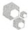

## 配方

为正确使用本方案中的器材和危险试剂，必须查阅相应的材料安全数据表并咨询所在机构的环境卫生和安全办公室。

GYT 培养基

| 试剂 | 配制100mL所需的量 | 终浓度 |
| --- | --- | --- |
| 甘油 | 10mL | 10%(V/V) |
| 酵母提取物 | 0.125g | 0.125%(m/V) |
| 胰蛋白胨 | 0.25g | 0.25%(m/V) |

将培养基通过一个预清洗的  $0.22 \mu m$  滤器过滤除菌。按 2.5mL 分装，储存在  $4^{\circ}C$ 。

## 参考文献

- Chassy BM, Mercenier A, Flickinger JL. 1988. Transformation of bacteria by electroporation. Trends Biotechnol 6: 303–309.
- Conley EC, Saunders JR. 1984. Recombination-dependent recircularization of linearized pBR322 plasmid DNA following transformation of Escherichia coli. Mol Gen Genet 194: 211–218.
- Donahue RA, Bloom FR. 1998. Transformation efficiency of E. coli electroporated with large plasmid DNA. Focus (Life Technologies) 20:77–78.
- Dower WJ, Miller JF, Ragsdale CW. 1988. High efficiency transformation of E. coli by high voltage electroporation. Nucleic Acids Res 16:6127–6145.
- Elvin S, Bingham AH. 1991. Electroporation-induced transformation of Escherichia coli: Evaluation of a square waveform pulse. Lett Appl Microbiol 12: 39–42.
- Kurnit DM. 1989. Escherichia coli recA deletion strains that are highly competent for transformation and for in vivo phage packaging. Gene 82:313–315.
- Leonardo ED, Sedivy JM. 1990. A new vector for cloning large eukaryotic DNA segments in Escherichia coli. Biotechnology 8: 841–844.
- Miller EM, Nickoloff JA. 1995. Escherichia coli electrotransformation. Methods Mol Biol 47: 105–113.
- Miller JF, Dower WJ, Tompkins LS. 1988. High-voltage electroporation of bacteria: Genetic transformation of Campylobacter jejuni with plasmid DNA. Proc Natl Acad Sci 85: 856–860.
- Schlaak C, Hoffmann P, May K, Weimann A. 2005. Desalting minimal amounts of DNA for electroporation in E. coli: A comparison of different physical methods. Biotechnol Lett 27: 1003–1005.
- Siguret V, Ribba AS, Cherel G, Meyer D, Pietu G. 1994. Effect of plasmid size on transformation efficiency by electroporation of Escherichia coli DH5α. BioTechniques 16: 422–426.
- Smith M, Jessee J, Landers T, Jordan J. 1990. High efficiency bacterial electroporation  $1 \times 10^{10}$ E. coli transformants per microgram. Focus (Life Technologies) 12: 38–40.

<small><span class="docvortex-page-footnote" data-block-type="page_footnote" style="color:#6b7280">① 译者注:应为 $\mu g$ ，原文为mg。</span></small>

---

第 3 章 质粒载体克隆与转化

143

## 方案 5 质粒载体克隆:定向克隆

大多数常用的质粒载体中含有多克隆位点，实质上是许多不同的限制性内切核酸酶识别序列的簇。鉴于目前多克隆位点种类繁多（一些多接头含有多达46个独特位点，例如Life Technologies公司的pSE280；更长的多接头也已组装；Brosius，1992），几乎总是可以找到一个携带独特的限制性位点的质粒载体，可以与一个特定外源DNA片段的末端兼容。

定向克隆通常需要线性化载体的两端含有突出末端:①与另一个不一致；②与靶DNA的末端一致。然而，在某些情况下，当靶DNA和质粒DNA两端都携带相同的突出末端时，定向克隆也可以实现。例如，限制性内切核酸酶BamH I和Bgl II识别不同的六核苷酸序列（分别是GGATCC和AGATCT），生成具有相同3'突出末端的限制性酶切片段。如果携带BamH I和Bgl II末端的DNA片段连接到同样用这两种酶切割的载体中，那么外源DNA可以在任一方向插入。然而，如果在连接混合物中包含两种限制性内切核酸酶之一，或者，如果在转化前使用酶消化连接后的DNA，则只有那些BamH I末端被连接到Bgl II末端或反之亦然的连接事件，将在大肠杆菌中产生重组产物。该策略利用的是闭环DNA转化细菌细胞的频率比线性DNA高得多的现象。

有时候会找不到一个适合的载体、靶 DNA、限制性内切核酸酶组合用来定向克隆。此问题的最佳解决方案是用寡核苷酸引物扩增外源 DNA 片段，引物的两个末端添加所需的限制性酶切位点（见方案 9）。

本方案描述标准、老式但可靠的方法，用于克隆含有不相容的突出末端的线性DNA片段。


## 材料

为正确使用本方案中的器材和危险试剂，必须查阅相应的材料安全数据表并咨询所在机构的环境卫生和安全办公室。

本方案的专用试剂标注&lt;R&gt;，配方在本方案末提供。常用储备溶液、缓冲液和试剂标注&lt;A&gt;，配方见附录1。储备溶液应稀释至适用浓度后使用。

## 试剂

琼脂糖凝胶（和第2章方案1中其他所需的试剂和设备）（可选；见步骤1、2和4）

ATP (10mmol/L)

如果连接缓冲液包含 ATP，在步骤 5 中的连接反应省略 ATP。

噬菌体 T4 DNA 连接酶和缓冲液

见信息栏 “连接和连接酶”。一些商业化的连接酶缓冲液含有 ATP；使用这些缓冲液时不必加入 ATP。

乙醇

外源或靶 DNA 片段

连接试剂（本方案步骤7需要本章中方案1、2或3列出的试剂）

酚:氯仿（1:1，V/V）

聚丙烯酰胺凝胶（在第2章方案3所需的试剂及设备）（可选；见步骤2）

限制性内切核酸酶

乙酸钠（3mol/L，pH 5.2）

---

144

分子克隆实验指南（原书第四版）

TE (pH 8.0) &lt;A&gt;

转化感受态大肠杆菌细胞（以及方案1和2中转化大肠杆菌所需的其他试剂和设备）

转化感受态大肠杆菌细胞可以商业购买，或按方案1\~3中方法制备。

载体 DNA（闭合环状质粒）含有多克隆位点（10μg）

## 设备

用于离心柱层析的设备（例如，QIAGEN 公司的 QIAprep；见第 1 章的导言）

水浴（16℃或20℃、45℃和限制性内切核酸酶消化的最适温度）


## 方法

1. 用两种合适的限制性内切核酸酶消化载体（$10 \mu \mathrm{g}$）和外源 DNA。

制备闭合环状质粒载体用于定向克隆，通过两种限制性内切核酸酶在不同序列切割，产生不同的末端。只要可能，尽量避免使用多克隆位点上切割序列相互之间位于12bp以内的两种限制性内切核酸酶，因为在其中一个位点被切割后，第二个位点将太接近线性DNA的末端，从而不利于第二种酶的有效切割。New England Biolabs公司目录（www.neb.com/neb/frame\_tech.htmL）的附录有一张极好的列表，显示了不同限制性内切核酸酶切割靠近DNA分子末端位点的效率。阅读制造商的说明，以确定两种限制性内切核酸酶在相同的酶切缓冲液中是否是最优条件下工作。如果是这样的话，可以用两种酶同时消化载体DNA。如果两种限制性内切核酸酶需要不同的缓冲液，最好分步酶切。在这种情况下，应首先使用盐浓度低的酶。在反应结束时，取一份DNA用凝胶电泳法分析，以确认所有的质粒DNA由环形转变为线性分子。然后适当调整盐浓度，并添加第二种酶。

2. 通过酚:氯仿抽提纯化消化后的外源 DNA，标准乙醇沉淀。

根据实验情况，分离外源 DNA 的目的片段可能是必要或适当的，通过中性琼脂糖或聚丙烯酰胺凝胶电泳，按第 2 章方案 1 和方案 3 中所述进行。这个纯化步骤一般是在限制性酶切外源 DNA 后产生多个可以连接到载体的片段时才进行。与其通过筛选大量转化体寻找所需克隆，许多研究者更愿意在连接反应前富集感兴趣的外源序列（如通过琼脂糖凝胶电泳）。

3. 通过离心柱层析纯化载体 DNA，然后标准乙醇沉淀。

此过程从载体中去除了在多克隆位点上两个接近的限制性酶切位点切割质粒产生的小片段 DNA。

4. 分别复溶 DNA 沉淀于 TE（pH 8.0）中，浓度约 $100\mu \mathrm{g} / \mathrm{mL}$ 。计算 DNA 的浓度（单位:pmol/mL）时，假定 1bp 相当于 660Da。

通过琼脂糖凝胶电泳分析少许样品，确认两种 DNA 的大概浓度。

5. 按如下表格将适量的 DNA 加入到无菌 0.5mL 微量离心管中。

| 管 | DNA |
| --- | --- |
| A 和 D | 载体(30fmol[约100ng]) |
| B | 插入片段(外源)(30fmol[约10ng]) |
| C 和 E | 载体(30fmol)和插入片段(外源)(30fmol) |
| F | 超螺旋载体(3fmol[约10ng]) |

连接反应中质粒载体和插入 DNA 片段的摩尔比应为约 1:1。DNA 终浓度应为约  $10ng/\mu L$ 。

i. 对于管 A、B 和 C，添加:

| 连接缓冲液(10×) | 1.0μL |
| --- | --- |
| 噬菌体T4 DNA连接酶 | 0.1Weiss U |
| ATP(10mmol/L) | 1.0μL |
| $H_2O$ | 至10μL |

ii. 对于管 D 和 E，添加:

---

第 3 章 质粒载体克隆与转化

145

| 连接缓冲液(10×) | 1.0μL |
| --- | --- |
| ATP(10mmol/L) | 1.0μL |
| $H_2O$ | 至10μL |

不添加 DNA 连接酶

DNA 片段可以和水一起加入管中，然后加热至  $45^{\circ}$ C 5min，将片段制备过程中再复性的所有黏性末端熔化。冷却 DNA 溶液到  $0^{\circ}$ C，添加其余的连接试剂。为了达到最大的连接效率，应在尽可能小的体积（ $5 \sim 10 \mu L$ ）中进行反应。添加 ATP 作为  $10 \times$  连接缓冲液的组分可以为载体或外源 DNA 在反应混合物中留出更多的体积。魏斯单位（Weiss units）的定义见信息栏“连接和连接酶”。

6.  $16^{\circ}$ C过夜或 $20^{\circ}$ C 4h孵育反应混合物。

7. 用每个连接反应的稀释液转化感受态大肠杆菌。用已知量的标准方法制备的超螺旋质粒 DNA 作为对照检查转化的效率。

| 管 | DNA | 连接酶 | 预期转化菌落数量 |
| --- | --- | --- | --- |
| A | 载体 | + | 约为0(比F管少约$10^4$倍)$^a$ |
| B | 插入片段 | + | 0 |
| C | 载体和插入片段 | + | 比A管或D管多约10倍 |
| D | 载体 | - | 约为0(比F管少约$10^4$倍) |
| E | 载体和插入片段 | - | 有一些,但比C管少 |
| F | 超螺旋载体 | - | 大于$2\times 10^5$ |

a. 单独的载体 DNA 在连接反应时产生的转化体，可能是由于一种或两种限制性内切核酸酶消化 DNA 不完全，或由于载体同残余的多克隆位点小片段连接所致。

## 参考文献

Brosius J. 1992. Compilation of superlinker vectors. Methods Enzymol 216:469–483.

## 方案 6 质粒载体克隆: 平末端克隆

当克隆平末端目的片段时，为了获得最大量的“正确”连接产物，连接反应的两种成分DNA必须在一个适当的比例。如果质粒载体与靶DNA的摩尔比太高，则连接反应可能会产生不希望的环状空质粒，包括单体和聚合体；如果过低，连接反应将可能会生成多余的，不同大小、方向和成分的线性及环状同聚物和杂聚物。出于这个原因，必须通过限制性内切核酸酶图谱或其他方法，始终对每个重组克隆中外源DNA的方向和插入数进行验证。一般而言，含有等摩尔量的质粒和靶DNA的连接反应，总DNA浓度小于 $100\mu \mathrm{g / mL}$ 获得的单体环状重组体的得率可以接受（Bercovich et al. 1992）。

本方案描述将平末端 DNA 片段克隆到线性质粒载体的方法。方案 7 和 8 概述另外的方法，以有助于获得正确的平末端克隆连接产物。载体去除 5'-磷酸残基（见方案 7）将抑制线性质粒在连接反应期间的再环化。但是注意，对于去磷酸化是否有利还存在争议。一个更有效的方法是使用编码限制性内切核酸酶识别位点的合成接头连接到平末端 DNA 的末端（见方案 8），从而提供定向克隆所需的黏性末端。

---

146

分子克隆实验指南（原书第四版）


## 材料

为正确使用本方案中的器材和危险试剂，必须查阅相应的材料安全数据表并咨询所在机构的环境卫生和安全办公室。

本方案的专用试剂标注&lt;R&gt;，配方在本方案末提供。常用储备溶液、缓冲液和试剂标注&lt;A&gt;，配方见附录1。储备溶液应稀释至适用浓度后使用。

## 试剂

琼脂糖凝胶（以及第2章方案1中其他所需的试剂和设备）（可选；见步骤2和3）

ATP (5mmol/L)

如果连接缓冲液包含 ATP，在步骤 5 中的连接反应省略 ATP。

噬菌体 T4 DNA 连接酶和缓冲液

见信息栏“连接和连接酶”。一些商业化的连接酶缓冲液含有 ATP；使用这些缓冲液时不必加入 ATP。

去磷酸化试剂（本方案步骤4需要方案7中所列的试剂）

乙醇

外源或靶 DNA（平末端片段）

聚乙二醇（30%，m/V；PEG 8000 溶液）

酚:氯仿（1:1，V/V）

聚丙烯酰胺凝胶（在第2章方案3所需试剂及设备）（可选；见步骤2）

限制性内切核酸酶

乙酸钠（3mol/L，pH 5.2）

TE (pH 8.0) &lt;A&gt;

转化用感受态大肠杆菌细胞（和方案1和2中转化大肠杆菌所需的其他试剂和设备）

转化用感受态大肠杆菌细胞可以商业购买，或按方案1\~3中方法制备。

载体 DNA（闭合环状质粒），含有多克隆位点（1～10μg）

## 设备

水浴（16℃或20℃，限制性内切核酸酶消化的最适温度）


## 方法

1. 用适当的限制性内切核酸酶分别消化 $1 \sim 10\mu \mathrm{g}$ 的质粒 DNA 和外源 DNA，生成平末端。

2. 通过酚:氯仿抽提纯化消化后的外源 DNA，标准乙醇沉淀。

根据实验情况，分离外源 DNA 目的片段可能是必要或有利的，可以通过中性琼脂糖或聚丙烯酰胺凝胶电泳，按第 2 章方案 3 中所述进行。当限制性酶切外源 DNA 后产生多个可以连接到载体末端的片段时，分离通常是必要的。与通过筛选大量转化体寻找所需克隆相比，凝胶电泳可用于在连接前富集感兴趣的外源序列。

3. 分别复溶 DNA 沉淀于 TE（pH 8.0）中，浓度约  $100 \mu g/mL$ 。计算 DNA 的浓度（单位:pmol/mL）时，假定 1bp 相当于 660Da。

通过琼脂糖凝胶电泳分析少许样品，确认两种 DNA 的大概浓度。

4. 按方案 7 中所述将质粒载体 DNA 去磷酸化。

5. 按如下表格将适量的 DNA 加入到无菌 0.5mL 微量离心管中:

---

第 3 章 质粒载体克隆与转化

147

| 管 | DNA |
| --- | --- |
| A和E | 载体$^a$(60fmol[约100ng]) |
| B | 外源$DNA^b$(60fmol[约10ng]) |
| C和F | 载体$^a$(60fmol)加外源DNA(60fmol)$^c$ |
| D | 线性化载体(含有5'端磷酸残基)(60fmol) |
| G | 超螺旋载体(6fmol[约10ng]) |

a. 载体 DNA 按方案 7 所述进行去磷酸化。

b. 接头可以连接到外源靶 DNA 上。

c. 连接反应中质粒载体和插入 DNA 片段的摩尔比应为约 1:1。连接反应中的 DNA 总浓度应为约  $10 ng/\mu L$ 。

i. 对于管 A、B 和 C，添加:

| 连接缓冲液(10×) | 1.0μL |
| --- | --- |
| 噬菌体T4 DNA连接酶 | 0.5Weiss U |
| ATP(5mmol/L) | 1.0μL |
| $H_2O$ | 至8.5μL |
| 30% PEG 8000 | 1~1.5μL |

ii. 对于管 D、E 和 F，添加:

| 连接缓冲液(10×) | 1.0μL |
| --- | --- |
| ATP(5mmol/L) | 1.0μL |
| $H_2O$ | 至8.5μL |
| 30% PEG8000 | 1~1.5μL |

不添加 DNA 连接酶

为了达到最大的连接效率，应在尽可能小的体积（5～10μL）进行反应。添加 ATP 作为 10× 连接缓冲液的组分可以为载体或外源 DNA 在反应混合物中留出更多的体积。一些商业化的连接酶缓冲液含有 ATP。使用这些缓冲液时不必加入 ATP。

DNA 片段可以和水一起加入管中，然后加热至  $45^{\circ}$ C，5min，使 DNA 片段制备过程中形成的 DNA 团块解离。将 DNA 溶液冷却到  $0^{\circ}$ C 后再添加其余的连接试剂。重要的是:①加热 PEG 储液（30%）至室温后再加入连接反应；②最后添加这种成分。在 PEG 8000 存在时，DNA 可以在低温下析出。

6. $16^{\circ} \mathrm{C}$ 过夜或 $20^{\circ} \mathrm{C}, 4 \mathrm{~h}$ 孵育反应混合物。
7. 按方案1、2或4中所述的方法，用每个连接反应的稀释液转化感受态大肠杆菌。用已知量的、标准方法制备的超螺旋质粒DNA作为对照检查转化的效率。

| 管 | DNA | 连接酶 | 预期转化菌落数量 |
| --- | --- | --- | --- |
| A | 载体a | + | 约为0c |
| B | 插入片段 | + | 0 |
| C | 载体a和插入片段 | + | 比F管多约5倍 |
| D | 载体a | - | 约为0 |
| E | 载体b | - | 比D管多约50倍 |
| F | 载体a和插入片段 | - | 比D管多约50倍 |
| G | 超螺旋载体 | - | 大于2×106 |

a. 去磷酸化。

b. 未去磷酸化。

c. 单独的去磷酸化载体 DNA 在连接反应后转化产生的转化体是由于用碱性磷酸酶处理时未能去除 5'-磷酸残基。

## 参考文献

Bercovich JA, Grinstein S, Zorzopulos J. 1992. Effect of DNA concentration on recombinant plasmid recovery after blunt-end ligation. BioTechniques 12: 190, 192–193.

---

148

分子克隆实验指南（原书第四版）

## 方案 7 质粒 DNA 的去磷酸化

去除 5'端磷酸基团能够抑制质粒 DNA 的自身连接和环化。在体外连接反应时，只有一个核苷酸带有 5'-磷酸基团且另一个带有 3'-羟基末端时，DNA 连接酶才能催化相邻核苷酸之间形成磷酸二酯键。因此，用碱性磷酸酶去除质粒 DNA 两个末端的 5'-磷酸残基可以将质粒 DNA 的再环化降到最低（Seeburg et al. 1977；Ullrich et al. 1977）。然而，一个含有完整 5'端磷酸残基的外源 DNA 片段可以在体外有效地连接到去磷酸化的质粒 DNA，产生一个包含两个缺口的开放环状分子。由于这些开放环状 DNA 分子转化大肠杆菌的效率比去磷酸化的线性 DNA 高，从理论上讲，大部分转化体应该含有重组质粒。如需进一步信息，见本方案结尾的讨论部分。


## 材料

为正确使用本方案中的器材和危险试剂，必须查阅相应的材料安全数据表并咨询所在机构的环境卫生和安全办公室。

本方案的专用试剂标注&lt;R&gt;，配方在本方案末提供。常用储备溶液、缓冲液和试剂标注&lt;A&gt;，配方见附录1。储备溶液应稀释至适用浓度后使用。

## 试剂

TBE 配制的琼脂糖凝胶（0.7%），含  $0.5 \mu g/mL$  溴化乙锭（所需要的试剂和设备见第 2 章，方案 1）（见步骤 2）

小牛肠碱性磷酸酶（CIP）或虾碱性磷酸酶（SAP）

去磷酸化反应缓冲液，由制造商提供（可选；见步骤6）

EDTA（0.5mol/L，pH8.0）（可选；见步骤6）

EGTA（0.5mol/L，pH8.0）（可选；见步骤6）

乙醇

苯酚

酚:氯仿（1:1，V/V）

蛋白酶 K（10mg/mL）（可选；见步骤 6）

限制性内切核酸酶

SDS（10%，m/V）（可选；见步骤6）

乙酸钠（3mol/L，pH5.2）

TE (pH8.0) &lt;A&gt;

Tris-Cl (10mmol/L, pH8.3)

包含多克隆位点的载体 DNA（闭合环状质粒）（10μg）

## 设备

盛满冰的容器

水浴 [55℃、65℃或 75℃（见步骤 6），限制性内切核酸酶消化的最适温度]


## 方法

1. 用 2\~3 倍过量的限制性内切核酸酶消化适量的闭合环状质粒 DNA（10μg）1h。

---

第 3 章 质粒载体克隆与转化

149

2. 取出一份（0.1μg），通过含有溴化乙锭的 0.7% 琼脂糖凝胶电泳分析消化程度（见第 2 章，方案 1），用未消化的质粒 DNA 作为标记。如果消化不完全，添加更多的限制性内切核酸酶并继续温育。
3. 当消化完全后，用酚:氯仿抽提样品一次，标准乙醇沉淀回收 DNA。将乙醇溶液置于冰上 15min。
4. 在微量离心机上以最大转速  $4^{\circ}$ C 离心 10min 回收 DNA, 溶于  $110 \mu L$  10mmol/L Tris-Cl (pH8.3) 中。

储存  $20 \mu L$  制备的 DNA 供以后作为对照使用（作为随后连接反应的对照使用）。

5. 如表 3-2 中所述，向剩余的 $90 \mu \mathrm{L}$ 线性化质粒 DNA 添加 $10 \mu \mathrm{L}$ 的 $10 \times \mathrm{CIP}$ 或 $10 \times \mathrm{SAP}$ 缓冲液和适量的小牛肠碱性磷酸酶（CIP）或虾碱性磷酸酶（SAP）并温育。

表 3-2 DNA 5'残基去磷酸化的反应条件

<table><tr><td>末端类型</td><td>每摩尔 DNA 末端的酶及用量</td><td>温育温度及时间</td></tr><tr><td rowspan="2">5&#x27;突出末端</td><td>0.01U CIPa</td><td>37°C /30min</td></tr><tr><td>0.1U SAP</td><td>37°C /60min</td></tr><tr><td rowspan="2">3&#x27;突出末端</td><td>0.1~0.5U CIPb</td><td>37°C /15min 然后 55°C /45min</td></tr><tr><td>0.5U SAP</td><td>37°C /60min</td></tr><tr><td rowspan="2">平末端</td><td>0.1~0.5U CIPb</td><td>37°C /15min 然后 55°C /45min</td></tr><tr><td>0.2U SAP</td><td>37°C /60min</td></tr></table>

a. 在第一次 30min 温育后，添加第二份 CIP 酶，继续在  $37^{\circ}$ C 温育 30min。

b. 正好在  $55^{\circ}$ C 温育开始前添加第二份 CIP。

6. 灭活磷酸酶活性。为了在温育结束时灭活 CIP，加入 SDS 和 EDTA（pH 8.0）至终浓度分别为 0.5% 和 5mmol/L。充分混匀，加入蛋白酶 K 至终浓度为 100μg/mL。在 55℃ 温育 30min。

另外，在 5mmol/L EDTA 或 10mmol/L EGTA（均为 pH8.0）的存在下，CIP 也可以通过加热至 65℃，30min（或 75℃，10min）灭活。

或者在去磷酸化缓冲液中，将反应混合物  $65^{\circ}$ C 温育 15min 灭活 SAP。

在去磷酸化反应结束时，至关重要的是在进行连接反应前去除或完全灭活碱性磷酸酶。虽然可以通过上述的加热灭活 CIP 和 SAP，我们还是建议在使用去磷酸化的 DNA 进行连接反应之前，用苯酚/氯仿抽提去磷酸化反应产物。

7. 将反应混合物冷却至室温，然后用酚抽提一次，用酚:氯仿抽提一次。

8. 标准乙醇沉淀回收 DNA。再次混合溶液，并将其置于  $0^{\circ}$ C，15min。

9. 在微量离心机上以最大转速  $4^{\circ}$ C 离心 10min 回收 DNA。在  $4^{\circ}$ C 用 70% 乙醇洗涤沉淀，再次离心。

10. 小心去除上清液，将开盖的管置于实验台上，使乙醇蒸发。

11. 将 DNA 沉淀以  $100 \mu g/mL$  的浓度溶解于 TE（pH 8.0）中。分装 DNA 存储于  $-20^{\circ}C$ 。


## 讨论

尽管去磷酸化在逻辑上具有吸引力，许多研究者还是对它的价值产生怀疑。毫无疑问，去除 5'-磷酸残基抑制了线性质粒 DNA 的再环化，并因此减少了携带“空”质粒转化菌落带来的背景。然而，携带所需重组体的菌落数目也经常出现同样程度的下降。此外，一些研究者认为，5'-羟基基团的存在可能会导致重排或删除克隆的频率增加。由于这些原因，只要有适当的限制性位点可用，定向克隆是质粒克隆的首选方法。对载体去磷酸化现在只在下列情况推荐使用:

\- 可用于克隆的插入 DNA 量很少。在这种情况下，使用超过插入物 10 倍摩尔量的去磷酸化载体将确保所有可用的插入物连接到载体。

---

150

分子克隆实验指南（原书第四版）

\- 通过用限制性内切核酸酶消化少量制备的质粒 DNA 筛选转化体。从十几种小规模细菌培养物制备质粒 DNA 是乏味的，使用去磷酸化载体将确保在小样本转化体中出现所需重组体的频率较高。

\- 克隆平末端 DNA 片段（见方案 6）。

\- 通过用两种不同的酶切割进行制备的载体产生大量的转化菌落。这表明，用于制备载体的两种酶中的其中一种或两者都切割 DNA 不完全，或释放出的多克隆位点的 DNA 小片段并没有从载体制备中去除，反而是连接到载体上。在这两种情况下，载体的去磷酸化是有用的，去除 5'端的磷酸残基可以防止闭合环状质粒 DNA 的重新组成。

然而，当克隆含有互补突出末端重组体的 DNA 片段时，如果通过  $\alpha$ -互补进行筛选或通过菌落杂交鉴定（方案 14），去磷酸化没有必要。因为在一个平板上筛选大量的菌落很容易，即使背景菌落数高，也可以轻易地鉴定和回收到稀少的重组体。

## 参考文献

Seeburg P, Shine J, Martial JA, Baxter JD, Goodman HM. 1977. Nucleotide sequence and amplification in bacteria of structural gene for rat growth hormone. Nature 270: 486–494.

Ullrich A, Shine J, Chirgwin J, Pictet R, Tischer E, Rutter WJ, Goodman HM. 1977. Rat insulin genes: Construction of plasmids containing the coding sequences. Science 196: 1313–1319.

## 方案 8 向平末端 DNA 添加磷酸化衔接子/接头

衔接子和接头连接到 DNA 片段的末端，以便其插入到质粒载体中进行克隆和表达。为使衔接子的连接达到最大效率，靶 DNA 的末端首先用 T4 DNA 聚合酶处理（见信息栏“衔接子和接头”）。


## 材料

为正确使用本方案中的器材和危险试剂，必须查阅相应的材料安全数据表并咨询所在机构的环境卫生和安全办公室。

本方案的专用试剂标注&lt;R&gt;，配方在本方案末提供。常用储备溶液、缓冲液和试剂标注&lt;A&gt;，配方见附录1。储备溶液应稀释至适用浓度后使用。

## 试剂

ATP (10mmol/L)

如果连接缓冲液包含 ATP，在步骤 1 的连接反应中省略 ATP。

噬菌体 T4 DNA 连接酶和缓冲液

见信息栏“连接和连接酶”。一些商业化的连接酶缓冲液含有 ATP；使用这些缓冲液时不必加入 ATP。

乙醇

酚:氯仿（1:1，V/V）

多核苷酸激酶

限制性内切核酸酶

乙酸钠（3mol/L，pH5.2）

---

第 3 章 质粒载体克隆与转化

151

合成接头或衔接子溶解在 TE（pH8.0）中，浓度约  $400 \mu g/mL$ 。

对于六聚体来说，该浓度相当于  $50 \mu mol/L$  溶液。

靶 DNA 片段（100～200ng）

$$
\mathrm{TE} <   \mathrm{A} > (\mathrm{pH8.0})
$$

## 设备

离心柱层析设备（例如，QIAGEN 公司的 QIAprep；见第 1 章导言）

水浴（37℃、65℃和限制性内切核酸酶消化的最适温度）


## 方法

1. 要将磷酸化的衔接子连接到含有互补突出末端的 DNA 片段上, 建立连接反应如下:

| DNA 片段 | 100~200ng |
| --- | --- |
| 磷酸化的衔接子或接头 | 10~20 倍摩尔数过量 |
| 连接缓冲液(10×) | 1.0μL |
| 噬菌体 T4 DNA 连接酶 | 0.1 Weiss U |
| ATP(10mmol/L) | 1.0μL |
| ${\mathrm{H}}_{2}\mathrm{O}$ | 至 10μL |

2. 在 $4^{\circ} \mathrm{C}$ 温育连接混合物 $4 \sim 6 \mathrm{~h}$ 。

为了达到最大的连接效率，在尽可能小的体积（5～10μL）建立反应。添加 ATP 作为 10× 连接缓冲液的组分可以为载体或外源 DNA 在反应混合物中留出更多的体积。一些商业化的连接酶缓冲液含有 ATP。使用这些缓冲液时不必加入 ATP。

NEB 公司销售的快速连接试剂盒的连接酶缓冲液含有聚合剂聚乙二醇（见第 1 章中的信息栏 “聚乙二醇” 和本章结尾的信息栏 “缩合剂和聚合剂”）。含有该缓冲液的连接反应在几分钟之内即可完成。

3. 将反应混合物在 $65^{\circ} \mathrm{C}$ 下温育 $15 \mathrm{~min}$ 使 DNA 连接酶失活。

4. 用 $10\mu \mathrm{L}$ 适当的 $10\times$ 限制性内切核酸酶缓冲液稀释连接反应产物。加入无菌水至终体积为 $100\mu \mathrm{L}$，接着加入 $50\sim 100\mathrm{U}$ 的限制性内切核酸酶。

5.  $37^{\circ}$ C 温育反应 1\~3h。

限制性内切核酸酶催化去除 DNA 片段末端的聚合接头，并创建突出末端。需要大量的限制性内切核酸酶来消化反应中存在的大量衔接子。

6. 通过离心柱（如 QIAprep）纯化 DNA。

7. 通过乙醇沉淀回收 DNA。

现在可以将修饰过的 DNA 片段连接到质粒载体中，这些载体含有突出末端与切割后的衔接子/接头突出末端互补。

## 方案 9 克隆 PCR 产物: 向扩增 DNA 的末端添加限制性酶切位点

如果 PCR 中使用的两个引物携带不同的限制性酶切位点，扩增产生的目的片段可以定向克隆到一个含有匹配末端的载体中（Scharf et al. 1986；Kaufman and Evans 1990）。将纯化的片段和载体分别使用适当的限制性内切核酸酶消化，连接在一起，并转化大肠杆菌。

---

152

分子克隆实验指南（原书第四版）

此方法适用于所有类型的 PCR 产物，包括那些平末端的和 3'端携带非模板核苷酸的 PCR 产物。

许多限制性内切核酸酶难以切割靠近 DNA 分子末端的识别序列，包括由 PCR 产生的序列（例如，见 Jung et al. 1990, 1993；Kaufman and Evans 1990）。为了避免这些问题，在寡核苷酸引物的 5'端设计额外的 6～8 个核苷酸长度的序列。这些序列像夹子一样将扩增 DNA 的末端结合在一起，为限制性内切核酸酶发挥作用提供“支撑”。商品供应商的网站中包含关于限制性内切核酸酶切割末端和近末端位点效率的信息（如 New England Biolabs 公司），见信息栏“限制性内切核酸酶及其发现”。

如果扩增产物的 DNA 序列是已知的，可在引物中引入独特的限制性酶切位点。如果扩增产物的序列是未知的，最好是掺入已知在宿主生物基因组中很少出现的限制性酶切位点。

成功用限制性内切核酸酶消化扩增的 DNA 产物依赖于 PCR 产物的纯度。未纯化的扩增产物将受到未使用的引物和 PCR 过程中产生的引物二聚体的严重污染。此外，扩增产物用限制性内切核酸酶切割后，残余聚合酶和 dNTP 的继续存在可能会导致平末端 DNA 的再生。因此，要想克隆成功，需要在用限制性内切核酸酶切割扩增的 DNA 之前除去残留的聚合酶和竞争性底物。可以将 PCR 产物用酚:氯仿抽提后再用乙醇沉淀扩增的 DNA。然而，许多研究人员倾向于使用商业化纯化试剂盒，如 Wizard SV Gel 和 PCR Clean-Up System（Promega 公司）、PureLink PCR 纯化试剂盒（Life Technologies 公司）或 QIAquik PCR 纯化试剂盒（QIAGEN 公司）。


## 材料

为正确使用本方案中的器材和危险试剂，必须查阅相应的材料安全数据表并咨询所在机构的环境卫生和安全办公室。

本方案的专用试剂标注&lt;R&gt;，配方在本方案末提供。常用储备溶液、缓冲液和试剂标注&lt;A&gt;，配方见附录1。储备溶液应稀释至适用浓度后使用。

## 试剂

琼脂糖凝胶（和第2章方案1中所需的其他试剂和设备）（见步骤1和10）

ATP (10mmol/L)

如果连接缓冲液包含 ATP，在步骤 6 中的连接反应省略 ATP。

噬菌体 T4 DNA 连接酶和缓冲液

见信息栏“连接和连接酶”。一些商业化的连接酶缓冲液含有ATP；使用这些缓冲液时不必加入ATP。

## 乙醇

正向引物（20mmol/L）溶于水，反向引物（20mmol/L）溶于水（和进行聚合酶链反应所需的其他试剂和设备，如第7章方案1所述）

设计携带适当限制性酶切位点的正向和反向引物。各引物的3'端应与在靶DNA选择的约15个连续碱基完全互补。每种引物的5'端包括:①6～8个附加核苷酸，会保持扩增DNA末端在一起，提供限制性内切核酸酶的“着陆地点”；②限制性内切核酸酶的识别序列。两个引物应携带不同的酶切位点。每个引物应该长29～31个核苷酸，包含大约同等数量的4种碱基，G和C分布均衡，不易形成稳定二级结构。

自动 DNA 合成仪合成的寡核苷酸引物通常可以使用于标准 PCR 中，无需进一步纯化。

酚:氯仿（1:1，V/V）

或者可以使用商业化试剂盒纯化 PCR 扩增的 DNA, 如 Wizard SV Gel 和 PCR Clean-Up System (Promega 公司)、PureLink PCR 纯化试剂盒（Life Technologies 公司）或 QIAquik PCR 纯化试剂盒（QIAGEN 公司）（见步骤 2 和 4）。用适当的限制性内切核酸酶切割质粒 DNA，通过凝胶电泳纯化（20 ng）

如果可能，选择一个可用于蓝/白筛选的质粒。

如果携带匹配末端的线性化质粒DNA可以彼此连接，用碱性磷酸酶除去其 $5^{\prime}$ -磷酸基团，抑制载体自连接（见

---

第 3 章 质粒载体克隆与转化

153

方案7)。

限制性内切核酸酶

SOB、SOC 或 LB 琼脂平板 &lt;A&gt; 含有合适的抗生素

如果用于蓝/白筛选, 平板中也应该含有 X-Gal 和 IPTG(见第 1 章的信息栏“X-Gal”和方案 14 的信息栏“IPTG”)

乙酸钠（3mol/L，pH 5.2）

作为 PCR 模板的靶 DNA

TE (pH 7.5) &lt;A&gt;

转化用感受态大肠杆菌细胞(以及方案1和2中转化大肠杆菌需要的其他试剂和设备)

制备好的感受态大肠杆菌细胞可以商业购买，或自己制备（见方案1或2）。在可能的情况下选择可用于蓝/白筛选转化菌落的大肠杆菌菌株。

## 设备

培养箱（37℃）

水浴（预设为  $16^{\circ}$ C 和限制性酶切的最适温度）


## 方法

1. 使用按本方案材料部分概述方法设计的正向和反向引物产生 100～200ng 扩增目的片段。取少量样品（约 25ng）通过琼脂糖凝胶电泳检查扩增产物的大小。
2. 用酚:氯仿抽提和乙醇沉淀，或通过使用商业产品如 Wizard SV Gel 和 PCR Clean-Up System（Promega 公司）、PureLink PCR 纯化试剂盒（Life Technologies 公司）或 QIAquik PCR 纯化试剂盒（QIAGEN），纯化 PCR 扩增的 DNA。纯化的 PCR 产物溶解在 $20\mu \mathrm{L}^{\text{①}}$ TE（pH 7.5）中。
3. 在  $20\mu L^{②}$  反应体积中，用 1.0～2.0U 相关限制性内切核酸酶消化约 50ng 纯化的 PCR 产物。在最适温度温育反应物 1h。
4. 消化结束时，按步骤 2 所概述方法纯化 DNA。
5. 将 DNA 溶解在  $10\mu L^{③}$  水中。
6. 在一个微量离心管中建立以下连接混合物:

| 扩增的靶 DNA($25ng/μL^{4}$) | $5.0μL$ |
| --- | --- |
| 线性质粒 DNA(见上文“材料”) | $20ng$ |
| 连接缓冲液($10×$) | $1.0μL$ |
| T4 DNA 连接酶 | $1U$ |
| $H_{2}O$ | 至 $10μL$ |

如果有必要，添加 ATP 至终浓度为 1mmol/L。

建立对照反应，包含上述列出的所有试剂，除了扩增的靶 DNA。

连接混合物中纯化的靶 DNA 与切割的质粒载体摩尔比应为约 1:1。

7. 在  $16^{\circ}$ C 温育连接混合物 2h。

8. 分别用 $10 \mu \mathrm{L}^{⑤}$ 水稀释 $5 \mu \mathrm{L}^{⑥}$ 两种连接混合物, 转化合适的抗生素耐药性的感受态大肠杆菌菌株。为估计大肠杆菌的转化效率, 设置已知量未切割的质粒 DNA 为阳性对照。

<small><span class="docvortex-page-footnote" data-block-type="page_footnote" style="color:#6b7280">① 译者注:应为 $\mu L$ ，原文为 mL。</span></small>

<small><span class="docvortex-page-footnote" data-block-type="page_footnote" style="color:#6b7280">② 译者注:应为 $\mu L$ ，原文为 mL。</span></small>

<small><span class="docvortex-page-footnote" data-block-type="page_footnote" style="color:#6b7280">③ 译者注:应为 $\mu L$ ，原文为 mL。</span></small>

<small><span class="docvortex-page-footnote" data-block-type="page_footnote" style="color:#6b7280">④ 译者注:应为 $\mu L$ ，原文为 mL。</span></small>

<small><span class="docvortex-page-footnote" data-block-type="page_footnote" style="color:#6b7280">⑤ 译者注:应为 $\mu L$ ，原文为 mL。</span></small>

<small><span class="docvortex-page-footnote" data-block-type="page_footnote" style="color:#6b7280">⑥ 译者注:应为 $\mu L$ ，原文为 mL。</span></small>

---

154

分子克隆实验指南（原书第四版）

用于作为阳性对照的 DNA 通常随着商业化感受态大肠杆菌提供。

将转化培养物涂在含有适当抗生素的培养基上。在  $37^{\circ}$ C 过夜孵育平板。

9. 计算每个连接混合物得到的菌落数量。如果质粒可用于蓝/白筛选，挑选一些从含有靶DNA的连接反应产物转化而得到的白色菌落。在不同的实验中，蓝色:白色菌落的比率在1:5到2:1之间。
10. 分离重组质粒 DNA，并用适当的限制性内切核酸酶消化，确认扩增片段的存在。通过琼脂糖凝胶电泳分级分离限制内切核酸酶酶切的 DNA，使用适当的 DNA 大小标记。
11. 通过 DNA 测序、限制性内切核酸酶图谱或 Southern 杂交确认所克隆的片段正确。

如果没有菌落出现，见“疑难解答”。


## 疑难解答

问题（步骤 11）:分离含有目的 PCR 产物的菌落失败。

解决方案:这可能是由于转化或连接的低效率所致。对于每一个实验，设立一个阳性对照，以监测制备的感受态大肠杆菌的转化效率。通过凝胶电泳分析连接混合物和对照的样本，确认载体和靶DNA片段的浓度是正确的。

## 参考文献

Jung V, Pestka SB, Pestka S. 1990. Efficient cloning of PCR generated DNA containing terminal restriction endonuclease recognition sites. Nucleic Acids Res 18: 6156.
Jung V, Pestka SB, Pestka S. 1993. Cloning of polymerase chain reaction-generated DNA containing terminal restriction endonuclease recognition sites. Methods Enzymol 218: 357–362.

Kaufman DL, Evans GA. 1990. Restriction endonuclease cleavage at the termini of PCR products. BioTechniques 9: 304, 306.
Scharf SJ, Horn GT, Erlich HA. 1986. Direct cloning and sequence analysis of enzymatically amplified genomic sequences. Science 233: 1076–1078.

## 方案 10 克隆 PCR 产物:平末端克隆

下面优雅而简单的用于生成和克隆平末端DNA的方案，改编自Weiner(1993)和Chuang等（1995）的研究，是建立在Liu和Schwartz（1992）的早期工作之上，他们的研究表明在过量的限制性内切核酸酶的存在下温育连接反应，可以显著提高重组质粒的得率。限制性内切核酸酶的作用是在限制位点切割质粒分子自连接产生的环状和线性多联体。该方法需要质粒与靶DNA分子的连接破坏限制性酶切位点，以防止限制性内切核酸酶消化连接反应过程中产生的重组体。单位长度线性载体分子持续再生的净效应，推动连接反应的平衡状态强烈偏向于载体和插入物之间形成重组体。

因为载体 DNA 的再生、连接、所有 PCR 产生的 DNA 片段的末端补平都同时发生在同一反应混合物中，该方法非常高效。


## 材料

为正确使用本方案中的器材和危险试剂，必须查阅相应的材料安全数据表并咨询所在机构的环境卫生和安全办公室。

本方案的专用试剂标注&lt;R&gt;，配方在本方案末提供。常用储备溶液、缓冲液和试剂标注&lt;A&gt;，配方见附录1。储备溶液应稀释至适用浓度后使用。

---

第 3 章 质粒载体克隆与转化

155

## 试剂

琼脂糖凝胶（以及第2章方案1中所需的其他试剂和设备）

ATP (10 mmol/L)

如果连接缓冲液包含 ATP，在连接反应时省略 ATP。

噬菌体 T4 DNA 连接酶和缓冲液

见信息栏“连接和连接酶”。一些商业化的连接酶缓冲液含有 ATP；使用这些缓冲液时不必加入 ATP。

噬菌体 T4 DNA 聚合酶

不要使用大肠杆菌 DNA 聚合酶的 Klenow 片段作为补平酶，因为它含有内源性末端转移酶活性。

闭合环状质粒 DNA（100ng/mL）

选择一个质粒载体，含有单个可产生平末端的限制性内切核酸酶位点（例如，Sma I、SrfI 和 EcoRV）。限制酶位点不应该存在于扩增的 DNA 中，并且目的片段连接到载体不应再生此限制性位点。常用的平末端 PCR 产物克隆的质粒载体是 Bluescript 型质粒和含有缩短的多克隆位点的质粒（例如，Stratagene 公司的 pCR-Script Direct）。质粒载体和细菌宿主如果带有蓝/白筛选系统更好。

dNTP 溶液（2mmol/L），包含所有 4 种 dNTP。

质粒 DNA 用适当的限制性内切核酸酶切割，通过凝胶电泳纯化。

如果线性化的质粒 DNA 含有可以彼此连接的互补末端，用碱性磷酸酶去除 5'-磷酸基团和抑制自连接（参见方案 7）。如果可能的话，选择可用于蓝/白筛选的质粒。

限制性内切核酸酶

选择产生平末端的限制性内切核酸酶，切割载体一次，不要切割扩增的 DNA（见步骤 1）。

SOB、SOC 或 LB 琼脂平板&lt;A&gt;，含有合适的抗生素

如果要使用蓝/白筛选，平板也应该含有X-Gal和IPTG（见第1章的信息栏“X-Gal”和方案14的信息栏“IPTG”；制备含有X-Gal和IPTG的琼脂平板的配方见附录1）。

靶 DNA（25ng/ $\mu$ L $^{①}$ ），通过 PCR 扩增

当 PCR 产生一个或两个以上的 DNA 扩增片段时，通过低熔点琼脂糖电泳纯化目的片段（见第 2 章方案 9）。如果没有通过凝胶电泳纯化，PCR 扩增的 DNA 可以通过用酚:氯仿提取 PCR 产物，然后用乙醇沉淀扩增的 DNA 以用于连接。然而，许多研究人员倾向于使用商业化纯化试剂盒，如 Wizard SV Gel 和 PCR Clean-Up System（Promega 公司）、PureLink PCR 纯化试剂盒（Life Technologies 公司）或 QIAquik PCR 纯化试剂盒（QIAGEN 公司）。

转化用感受态大肠杆菌细胞（以及用于转化大肠杆菌所需的其他试剂和设备）

感受态大肠杆菌细胞可以商业购买或自行制备（见方案 1 或 2）。尽可能选择可用于蓝/白筛选转化菌落的大肠杆菌菌株。

通用 KGB 缓冲液（10×）&lt;R&gt;

## 设备

水浴（16℃、22℃和限制性内切核酸酶消化的最适温度）


## 方法

1. 在微量离心管中, 按所示的顺序混合如下:

闭合环状质粒载体（100ng/ $\mu$ L $^{②}$ ）

$1\mu L^{③}$

扩增的靶 DNA（25ng/μL $^{④}$ ）

8μL$^{⑤}$

<small><span class="docvortex-page-footnote" data-block-type="page_footnote" style="color:#6b7280">① 译者注:应为 $\mu L$ ，原文为 mL。</span></small>

<small><span class="docvortex-page-footnote" data-block-type="page_footnote" style="color:#6b7280">② 译者注:应为 $\mu L$ ，原文为 mL。</span></small>

<small><span class="docvortex-page-footnote" data-block-type="page_footnote" style="color:#6b7280">③ 译者注:应为 $\mu L$ ，原文为 mL。</span></small>

<small><span class="docvortex-page-footnote" data-block-type="page_footnote" style="color:#6b7280">④ 译者注:应为 $\mu L$ ，原文为 mL。</span></small>

<small><span class="docvortex-page-footnote" data-block-type="page_footnote" style="color:#6b7280">⑤ 译者注:应为 $\mu L$ ，原文为 mL。</span></small>

---

156

分子克隆实验指南（原书第四版）

续表

| 通用KGB缓冲液(10×) | $2\mu L^{1}$ |
| --- | --- |
| $H_2O$(见下文附注) | $5\mu L^{2}$ |
| ATP(10mmol/L) | $1\mu L^{3}$ |
| dNTP(2mmol/L) | $1\mu L^{4}$ |
| 限制性内切核酸酶 | 2U |
| T4 DNA聚合酶 | 1U |
| T4 DNA连接酶 | 3U |

调整  $H_{2}O$  的加入量，使最终的反应体积为  $20\mu L^{⑤}$ 。设置对照反应，包含上述列出的所有试剂，除了扩增的靶 DNA。

2. 在  $22^{\circ}$ C 孵育连接混合物 4h。

限制性内切核酸酶切割质粒 DNA；在 dNTP 的存在下，T4 DNA 聚合酶的 3' 外切核酸酶活性补平扩增的 DNA 的末端。

3. 分别用 $10\mu \mathrm{L}^{⑥}$ $\mathrm{H}_2\mathrm{O}$ 稀释 $5\mu \mathrm{L}^{\text{⑦}}$ 两种连接混合物，转化合适的抗生素抗性的感受态大肠杆菌菌株（见信息栏“抗生素”）。根据载体和宿主基因型、IPTG和X-Gal，将转化培养物铺在含有适当抗生素的培养基上（见第1章中信息栏“X-Gal”和方案14的信息栏“IPTG”）。
4. 计算从每个连接混合物得到的菌落数量。如果质粒可用于蓝/白筛选，挑选一些用含有靶 DNA 的连接反应产物转化得到的白色菌落。在不同的实验中，蓝色:白色菌落的比率可以在 1:5 到 2:1 之间变化。
5. 通过分离重组质粒 DNA，并用适当的限制性内切核酸酶消化确认扩增片段的存在。使用适当的 DNA 大小标记，通过琼脂糖凝胶电泳分离限制性酶切后的 DNA。
6. 通过 DNA 测序、限制性酶切图谱或 Southern 杂交确认所克隆片段的正确。


## 配方

为正确使用本方案中的器材和危险试剂，必须查阅相应的材料安全数据表并咨询所在机构的环境卫生和安全办公室。

通用 KGB 缓冲液（10×）

| 试剂 | 配制100mL所需的量 | 终浓度 |
| --- | --- | --- |
| 乙酸钾(3mol/L) | 33.3mL | 1mol/L |
| Tris-乙酸(1mol/L,pH7.6) | 25mL | 250mmol/L |
| 四水合乙酸镁 | 2.14g | 100mmol/L |
| β-巯基乙醇(14.3mol/L) | 35μL | 5mmol/L |
| 牛血清白蛋白 | 10mg | 0.1mg/mL |

分装  $10 \times$  缓冲液，存储在  $-20^{\circ}C$ 。

## 参考文献

Chuang SE, Wang KC, Cheng AL. 1995. Single-step direct cloning of PCR products. Trends Genet 11: 7–8.

Liu ZG, Schwartz LM. 1992. An efficient method for blunt-end ligation of PCR products. BioTechniques 12: 28, 30.

Weiner MP. 1993. Directional cloning of blunt-ended PCR products. Bio-Techniques 15: 502–505.

<small><span class="docvortex-page-footnote" data-block-type="page_footnote" style="color:#6b7280">① 译者注:应为 $\mu L$ ，原文为 mL。</span></small>

<small><span class="docvortex-page-footnote" data-block-type="page_footnote" style="color:#6b7280">② 译者注:应为 $\mu L$ ，原文为 mL。</span></small>

<small><span class="docvortex-page-footnote" data-block-type="page_footnote" style="color:#6b7280">③ 译者注:应为 $\mu L$ ，原文为 mL。</span></small>

<small><span class="docvortex-page-footnote" data-block-type="page_footnote" style="color:#6b7280">④ 译者注:应为 $\mu L$ ，原文为 mL。</span></small>

<small><span class="docvortex-page-footnote" data-block-type="page_footnote" style="color:#6b7280">⑤ 译者注:应为 $\mu L$ ，原文为 mL。</span></small>

<small><span class="docvortex-page-footnote" data-block-type="page_footnote" style="color:#6b7280">⑥ 译者注:应为 $\mu L$ ，原文为 mL。</span></small>

<small><span class="docvortex-page-footnote" data-block-type="page_footnote" style="color:#6b7280">⑦ 译者注:应为 $\mu L$ ，原文为 mL。</span></small>

---

第 3 章 质粒载体克隆与转化

157

## 方案 11 克隆 PCR 产物: 制备 T 载体

T 载体可以由几种不同的方法制成，包括:

- 用限制性内切核酸酶如 $Xcm$ I、$Hph$ I 和 $Mbo$ II 等消化载体，生成 3'端的未成对脱氧胸苷残基（Kovalic et al. 1991；Mead et al. 1991；Chuang et al. 1995；Borovkov and Rivkin 1997）；
- 使用末端转移酶和双脱氧 TTP 在一个线性化载体的 3'端添加一个突出的 T 残基 (Holton and Graham 1991);
- 利用 Taq DNA 聚合酶的、不依赖模板的末端转移酶活性催化添加一个 T 残基到线性化载体的末端 3'-羟基基团（Marchuk et al. 1991）。

此外，现成的 T 载体作为克隆试剂盒的组件可以从许多商业供应商购买（例如，Stratagene 公司的 pCR-Script [SK+]；Life Technologies 公司 TA 克隆试剂盒里的 pCRII；Promega 公司的 pGEM-T）（Hengen 1995）。

此方案概述了两种通常用来产生 T 载体的方法。


## 材料

为正确使用本方案中的器材和危险试剂，必须查阅相应的材料安全数据表并咨询所在机构的环境卫生和安全办公室。

本方案的专用试剂标注&lt;R&gt;，配方在本方案末提供。常用储备溶液、缓冲液和试剂标注&lt;A&gt;，配方见附录1。储备溶液应稀释至适用浓度后使用。

## 试剂

琼脂糖凝胶（1%）（以及第2章方案1中所需的其他试剂和设备）

$CoCl_{2}$  (25mmol/L)

ddTTP（1mmol/L 和 100mmol/L）

EDTA (0.5mol/L)

乙醇（可选；见步骤4）

质粒 DNA（例如，pBluescript）(5μg)

如果质粒载体和细菌宿主携带蓝/白筛选系统则更好。

酚:氯仿（1:1，V/V）（可选；见步骤4）

或者可以使用商业化试剂盒纯化 PCR 扩增的 DNA, 如 Wizard SV Gel 和 PCR Clean-Up System (Promega 公司)、PureLink PCR 纯化试剂盒（Life Technologies 公司）或 QIAquik PCR 纯化试剂盒（QIAGEN 公司）。

限制性内切核酸酶

Taq 聚合酶

TE (pH 7.8) &lt;A&gt;

末端转移酶（25U/ $\mu$ L）和缓冲液

## 设备

商业化 DNA 纯化试剂盒（可选，见第 1 章引言）

水浴（37℃，72℃，以及限制性内切核酸酶消化的最适温度）

---

158

分子克隆实验指南（原书第四版）


## 方法1 使用末端转移酶将双脱氧胸苷残基添加到平末端质粒DNA

## 平末端质粒 DNA 的制备

1. 在  $100 \mu L$  反应体积中，用限制性内切核酸酶（如 EcoR V）完全消化  $5 \mu g$  质粒 DNA（如 pBluescript），在一个位点切割质粒 DNA 并生成末端是 3'-T 残基的平末端线性分子。

进行下一步骤之前，通过凝胶电泳检查样品的消化情况，以确保没有环状质粒 DNA 分子残留。

2. 加入  $2 \mu L$  0.5mmol/L EDTA。
3. 使用商品化试剂盒纯化线性载体，将 DNA 重悬于  $50 \mu L H_{2}O$  中。

## ddT 残基添加到平末端质粒 DNA 的 3' 端

末端脱氧核糖核苷酸转移酶催化 dNTPs 添加到 DNA 分子的 5'端。DNA 聚合酶如大肠杆菌 DNA 聚合酶的 Klenow 片段和 Taq 具有往 DNA 底物添加单个核苷酸的能力，而末端转移酶可以在适当的条件下催化数百个核苷酸的添加。然而，通过使用链终止底物双脱氧胸苷三磷酸(ddTTP)作为底物，3'延伸的长度被限定为一个单核苷酸(Cozzarelli et al. 1969)。以 G:C 碱基对作为末端的平末端 DNA 是较差的底物，而富含 A:T 的平末端则比较宽松，并且修饰起来更迅速和同步。

末端转移酶对离子的要求很奇怪。它被许多反应缓冲液常有的阳离子所抑制，包括铵、氯离子和磷酸根离子（更多详情，见酶的发现者 Fred Bollum 于 1974 年合著的一篇综述）。大多数末端转移酶催化的反应在二甲胂酸（二甲基砷酸）缓冲液中进行（Kato et al. 1967），虽然 100mmol/L 的 Tris-乙酸（pH 7.2）几乎是一样好。使用 dTTP 或其类似物 ddTTP 作为底物的反应在  $Co^{2+}$  的存在下进行。相比之下，如果要添加嘌呤残基， $Mn^{2+}$  是首选的辅因子。

除了它的怪癖，末端转移酶在平末端 DNA 的 3'端添加核苷酸比 Taq DNA 聚合酶更有效。末端转移酶催化的反应结束时，大于 70% 的 DNA 末端将携带 3'-T 延伸，而使用 Taq 酶时只有 30% 的 DNA 末端将被修改。

## 4. 混合:

| 平末端质粒 DNA,按上述准备 | 45.0μL |
| --- | --- |
| 末端转移酶缓冲液(5×) | 6.0μL |
| $CoCl_2$(25mmol/L) | 5.0μL |
| ddTTP 溶液(1mmol/L) | 1.5μL |
| 末端转移酶(25U/μL) | 3.0μL |

轻轻混匀，短暂离心，然后在  $37^{\circ}$ C 孵育反应混合物 1.5h。

5. 通过用酚/氯仿抽提，然后乙醇沉淀，或使用市售的试剂盒，纯化 ddT 尾的 DNA。
6. 溶解纯化的 DNA 于 $30 \mu \mathrm{L} \mathrm{TE}(\mathrm{pH} 7.8)$ 中。取一份 DNA 在 $1 \%$ 琼脂糖凝胶电泳，用已知量的线性质粒 DNA（上面步骤 1）估计纯化的 T 载体的浓度。分装制备的 T 载体，存储于 $-20^{\circ} \mathrm{C}$ 。


## 方法 2 使用 Taq DNA 聚合酶添加 3'-脱氧胸苷残基

Taq 酶添加非模板 dA 残基到线性 DNA 底物的效率较低。在最好的情况下，约 30% 的 3' 端得到一个非模板 dA 残基，而只有 10% 的线性质粒 DNA 两端都含有 T 残基。这对于常规克隆的目的来说是足够多的，但用于克隆极少量的 DNA 时却不尽人意。

---

第 3 章 质粒载体克隆与转化

159

1. 按方法 1 的步骤 1\~3（见上文）准备  $5.0 \mu g$  线性平末端质粒 DNA。
2. 调整制备的线性 DNA 的体积到 $90 \mu \mathrm{L}$ 。
3. 加入  $10 \mu L$  的  $10 \times Taq$  缓冲液（由酶的生产商提供）。
4. 加入  $2 \mu L$  100mmol/L dTTP 溶液和 5U Taq DNA 聚合酶。
5. 在  $72^{\circ}$ C 孵育溶液 2h。
6. 按方法 1 步骤 5 和 6（见上文）纯化和定量 DNA。

## 参考文献

- Bollum FJ, Chang LM, Tsiapalis CM, Dorson JW. 1974. Nucleotide polymerizing enzymes from calf thymus gland. Methods Enzymol 29: 70–81.
- Borovkov AY, Rivkin MI. 1997. Xcml-containing vector for direct cloning of PCR products. BioTechniques 22: 812–814.
- Chuang SE, Wang KC, Cheng AL. 1995. Single-step direct cloning of PCR products. Trends Genet 11: 7–8.
- Cozzarelli NR, Kelly RB, Kornberg A. 1969. Enzymic synthesis of DNA. 33. Hydrolysis of a 5'-triphosphate-terminated polynucleotide in the active center of DNA polymerase. J Mol Biol 45: 513–531.
- Hengen PN. 1995. Methods and reagents. Cloning PCR products using T-vectors. Trends Biochem Sci 20: 85–86.
- Holton TA, Graham MW. 1991. A simple and efficient method for direct cloning of PCR products using ddT-tailed vectors. Nucleic Acids Res 19: 1156.
- Kato KI, Goncalves JM, Houts GE, Bollum FJ. 1967. Deoxynucleotide-polymerizing enzymes of calf thymus gland. II. Properties of the terminal deoxynucleotidyltransferase. J Biol Chem 242: 2780–2789.
- Kovalic D, Kwak JH, Weisblum B. 1991. General method for direct cloning of DNA fragments generated by the polymerase chain reaction. Nucleic Acids Res 19: 4560.
- Marchuk D, Drumm M, Saulino A, Collins FS. 1991. Construction of T-vectors, a rapid and general system for direct cloning of unmodified PCR products. Nucleic Acids Res 19: 1154.
- Mead DA, Pey NK, Herrnstadt C, Marcil RA, Smith LM. 1991. A universal method for the direct cloning of PCR amplified nucleic acid. Biotechnology 9: 657–663.

## 方案 12 克隆 PCR 产物: TA 克隆

Taq 酶等非校对 DNA 聚合酶固有的非模板依赖性末端转移酶活性为克隆 PCR 产物提供了一种高效的方法。这些酶在双链扩增产物的每个 3'端添加一个单一的、未成对的残基，优先是腺苷残基（Clark 1988）。未成对末端（A）残基可以和每个末端含有一个未成对 3'-胸苷残基的线性 T 载体配对(Holton and Graham 1991; Marchuk et al. 1991; 综述见 Trower and Elgar 1994; Zhou and Gomez-Sanchez 2000)。

TA 克隆的两个主要优点是快速和不依赖限制性内切核酸酶；主要缺点是无法定向克隆。鉴于此，需要扩增片段位于特定方向时，挑选和分析多个转化克隆非常重要。

T 载体可以用于克隆任何 A-尾的 DNA 片段，在这个意义上，TA 克隆是万能的。PCR 可能是产生 A-尾的 DNA 分子最常用的方法，但不是唯一的方法。

在含有所有 4 种 dNTP 的反应中，Taq 聚合酶可催化含有平末端或 5' 突出末端的 DNA 片段加上 3'-腺苷尾巴。酶首先补平末端，然后添加多余的 3'-A 残基。

往含有突出 3'尾巴的 DNA 添加未成对 3'-腺苷残基需要一个额外的步骤。在含有所有 4 种 dNTP 并且用 T4 DNA 聚合酶催化的反应中，末端被去除。平末端的分子可以按上述方法被装上 3'-A 尾巴。

T 载体可以在实验室制备（见方案 11）或作为克隆试剂盒的组分从许多商业供应商购买（例如，Stratagene 公司的 pCR-Script [SK+]；Life Technologies 公司 TA 克隆试剂盒里的 pCRII；Promega 公司的 pGEM-T；也见 Hengen 1995）。

---

160

分子克隆实验指南（原书第四版）


## 材料

为正确使用本方案中的器材和危险试剂，必须查阅相应的材料安全数据表并咨询所在机构的环境卫生和安全办公室。

本方案的专用试剂标注&lt;R&gt;，配方在本方案末提供。常用储备溶液、缓冲液和试剂标注&lt;A&gt;，配方见附录1。储备溶液应稀释至适用浓度后使用。

## 试剂

琼脂糖凝胶（以及第2章方案1中所需的其他试剂和设备）（见步骤5）

ATP (10mmol/L)

如果连接缓冲液包含 ATP，在步骤 1 中的连接反应省略 ATP。

噬菌体 T4 DNA 连接酶和缓冲液

见信息栏“连接和连接酶”。一些商业化的连接酶缓冲液含有 ATP；使用这些缓冲液时不必加入 ATP。

SOB、SOC 或 LB 琼脂平板&lt;A&gt;含有合适的抗生素

如果要使用蓝/白筛选, 平板也应该含有 X-Gal 和 IPTG(见第 1 章的信息栏“X-Gal”和方案 14 的信息栏“IPTG”; 制备含有 X-Gal 和 IPTG 的琼脂平板的配方见附录 1)。

靶 DNA（25ng/mL），通过非校对热稳定 DNA 聚合酶催化的 PCR 扩增（如 Taq 酶）

通常，只有约 30% 的扩增产物携带一个未成对的 3'-腺苷残基。为了最大限度地提高 Taq 酶催化添加未成对 A 残基的效率，使用携带 5'-G 残基或 5'-A 残基的引物(Magnuson et al. 1996)。通过在 PCR 扩增循环的末尾编程在 72℃ 温育 10min，可以提高非模板添加反应的效率。

在克隆之前，通过将一份 PCR 产物凝胶电泳以检查大小。当 PCR 产生一个或两个以上的 DNA 扩增片段时，通过低熔点琼脂糖电泳纯化目的片段（见第 2 章，方案 9）。如果没有通过凝胶电泳纯化，PCR 扩增的 DNA 可以通过酚:氯仿提取 PCR 产物，然后乙醇沉淀扩增的 DNA，以用于连接。然而，许多研究人员倾向于使用商业化纯化试剂盒，如 Wizard SV Gel 和 PCR Clean-Up System（Promega 公司）、PureLink PCR 纯化试剂盒（Life Technologies 公司）、Millipore Ultrafree 核酸纯化柱或 QIAquik PCR 纯化试剂盒（QIAGEN 公司）。一些研究人员建议在合成后一两天内使用 PCR 产物以确保不会损失突出 A-残基。长时间在 4℃ 存放和反复冻融都使得 T 载体和靶 DNA 倾向于失去其未成对 3'-残基。

## T 载体

T 载体的合成，见方案 11。

现成的 T 载体作为克隆试剂盒的组分可以从许多商业供应商购买（例如，Stratagene 公司的 pCR-Script [SK+]; Life Technologies 公司 TA 克隆试剂盒里的 pCRII; Promega 公司的 pGEM-T）(Hengen 1995)。

转化用感受态大肠杆菌细胞（以及方案 1 和 2 中其他用于转化大肠杆菌所需的试剂和设备）

转化用感受态大肠杆菌细胞可以商业购买或按方案1\~4自行制备。

## 设备

培养箱（37℃）

水浴（预设为  $14^{\circ}$ C）


## 方法

1. 在微量离心管中建立连接反应。

连接混合物中载体:扩增 DNA 的最佳摩尔比为 3:1。连接反应建议的两种 DNA 的量（如下）是假设载体和扩增 DNA 的大小相等。这种情况很少见。当靶 DNA 的大小已知时，应改变连接反应中两种类型 DNA 的相对量以达到摩尔比为 3:1（载体:扩增 DNA）。

---

第 3 章 质粒载体克隆与转化

161

| 扩增的靶 DNA(25ng/μL) | 1μL |
| --- | --- |
| T 尾质粒(75ng/μL) | 1μL |
| 连接缓冲液(10×) | 1μL |
| 噬菌体 T4 DNA 连接酶 | 3U |
| $H_2O$ | 至 10μL |

如果有必要，添加 ATP 至终浓度为 1mmol/L。建立对照反应，包含上述列出的所有试剂，除了扩增的靶 DNA。

2. 在  $14^{\circ}$ C 孵育连接混合物 4h。
3. 分别用 $10 \mu \mathrm{L}^{①} \mathrm{H}_{2} \mathrm{O}$ 稀释 $5 \mu \mathrm{L}^{②}$ 两种连接混合物, 按方案 $1 \sim 4$ 转化合适的抗生素抗性的感受态大肠杆菌菌株。根据载体和宿主基因型、IPTG 和 X-Gal, 将转化培养物铺在含有适当的抗生素的培养基上 (见第 1 章中信息栏 “X-Gal” 和方案 14 的信息栏 “IPTG”)。
4. 计算从每个连接混合物得到的菌落数量。如果质粒可用于蓝/白筛选，挑选一些用含有靶 DNA 的连接反应产物转化得到的白色菌落。在不同的实验中，蓝色:白色菌落的比率可以在 1:5 到 2:1 之间变化。
5. 通过分离重组质粒 DNA，并用适当的限制性内切核酸酶消化确认扩增片段的存在。使用适当的 DNA 大小标记，通过琼脂糖凝胶电泳分离限制性酶切后的 DNA。

## 参考文献

- Clark JM. 1988. Novel non-templated nucleotide addition reactions catalyzed by procaryotic and eucaryotic DNA polymerases. Nucleic Acids Res 16: 9677–9686.
- Hengen PN. 1995. Methods and reagents. Cloning PCR products using T-vectors. Trends Biochem Sci 20: 85–86.
- Holton TA, Graham MW. 1991. A simple and efficient method for direct cloning of PCR products using ddT-tailed vectors. Nucleic Acids Res 19: 1156.
- Magnuson VL, Ally DS, Nylund SJ, Karanjawala ZE, Rayman JB, Knap JI, Lowe AL, Ghosh S, Collins FS. 1996. Substrate nucleotide-determined
- non-templated addition of adenine by Taq DNA polymerase: Implications for PCR-based genotyping and cloning. BioTechniques 21: 700–709.
- Marchuk D, Drumm M, Saulino A, Collins FS. 1991. Construction of T-vectors, a rapid and general system for direct cloning of unmodified PCR products. Nucleic Acids Res 19: 1154.
- Trower MK, Elgar GS. 1994. PCR cloning using T-vectors. Methods Mol Biol 31: 19–33.
- Zhou MY, Gomez-Sanchez CE. 2000. Universal TA cloning. Curr Issues Mol Biol 2: 1–7.

## 方案 13 克隆 PCR 产物: TOPO TA 克隆

牛痘病毒的拓扑异构酶和其他 IB 型拓扑异构酶一样，通过将双链 DNA 的一条链瞬时断裂和再连使 DNA 超螺旋松弛。拓扑异构酶 274 位酪氨酸的 OH 基团对 DNA 磷酸二酯键的亲核进攻导致双链 DNA 产生切口。靶 DNA 链的裂开高度特异性的发生在五嘧啶片段 5'(C/T)CCTT，形成一个稳定的 3'-磷酸酪氨酸-DNA 中间体（Shuman et al.1989）。由于键能是保守的，该反应很容易可逆，磷酸酪氨酸-DNA 中间体可以:①催化重新形成原来的双链或者②通过与含有和供体复合物互补的 5'-OH 尾的受体 DNA 形成磷酸二酯键，产生重组 DNA（图 3-1）。

<small><span class="docvortex-page-footnote" data-block-type="page_footnote" style="color:#6b7280">① 译者注:应为 $\mu L$ ，原文为 mL。</span></small>

<small><span class="docvortex-page-footnote" data-block-type="page_footnote" style="color:#6b7280">② 译者注:应为 $\mu L$ ，原文为 mL。</span></small>

---

162

分子克隆实验指南（原书第四版）

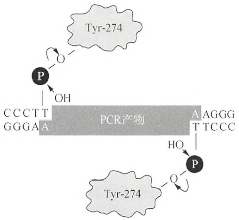

<details>
<summary>flowchart</summary>

```mermaid
graph LR
  A["CCR Construct"] --> B["P"]
  C["CCR Construct"] --> D["OH"]
  E["CCR Construct"] --> F["P"]
  G["CCR Construct"] --> H["HO"]
  I["CCR Construct"] --> J["P"]
  K["CCR Construct"] --> L["HO"]
  M["CCR Construct"] --> N["P"]
  O["CCR Construct"] --> P["O"]
  Q["CCR Construct"] --> R["O"]
  S["CCR Construct"] --> T["O"]
  U["CCR Construct"] --> V["O"]
  W["CCR Construct"] --> X["O"]
  Y["CCR Construct"] --> Z["O"]
  AA["CCR Construct"] --> AB["O"]
  AC["CCR Construct"] --> AD["O"]
  AE["CCR Construct"] --> AF["O"]
  AG["CCR Construct"] --> AH["O"]
  AI["CCR Construct"] --> AJ["O"]
  AK["CCR Construct"] --> AL["O"]
  AM["CCR Construct"] --> AN["O"]
  AO["CCR Construct"] --> AP["O"]
  AQ["CCR Construct"] --> AR["O"]
  AS["CCR Construct"] --> AT["O"]
  AU["CCR Construct"] --> AV["O"]
  AW["CCR Construct"] --> AX["O"]
  AY["CCR Construct"] --> AZ["O"]
  BA["CCR Construct"] --> BZ["O"]
  BC["CCR Construct"] --> BD["O"]
  BE["CCR Construct"] --> BF["O"]
  BG["CCR Construct"] --> BH["O"]
  BI["CCR Construct"] --> BJ["O"]
  BK["CCR Construct"] --> BL["O"]
  BM["CCR Construct"] --> BN["O"]
  BO["CCR Construct"] --> BP["O"]
  BR["CCR Construct"] --> BB["O"]
  BC["CCR Construct"] --> BDZ["O"]
  BBZ["CCR Construct"] --> BZZ["O"]
  BCZ["CCR Construct"] --> BDZZ["O"]
  BZZ["CCR Construct"] --> BDZZZ["O"]
  BZZZ["CCR Construct"] --> BDZZZZ["O"]
  BZZZZ["CCR Construct"] --> BDZZZZZ["O"]
  BDZZZZ["CCR Construct"] --> BDZZZZZZ["O"]
  BDZZZZZ["CCR Construct"] --> BDZZZZZZZ["O"]
  BDZZZZZZ["CCR Construct"] --> BDZZZZZZZZ["O"]
  BDZZZZZZZ["CCR Construct"] --> BDZZZZZZZZ["O"]
  BDZZZZZZZZ["CCR Construct"] --> BDZZZZZZZZZ["O"]
  BDZZZZZZZZZ["CCR Construct"] --> BDZZZZZZZZZZ["O"]
  BDZZZZZZZZZZZ["CCR Construct"] --> BDZZZZZZZZZZZZ["O"]
  BDZZZZZZZZZZZZ<fcel>AAGGGTTCCC
  HO --> P
  P --> B
  BQ --> R
  RQ --> S
  S --> T
  TQ --> U
  UQ --> V
  VQ --> W
  WQ --> X
  XQ --> Y
  YQ --> Z
  ZQ --> AA
  AA --> AB
  ABQ --> AC
  AC --> AD
  ADQ --> AE
  AE --> AF
  AFQ --> AG
  AG --> AH
  AH --> AI
  AI --> AJ
  AJ --> AK
  AK --> AL
  AL --> AM
  AM --> AN
  AN --> AO
  AO --> AP
  AP --> AQ
  AQ --> AR
  AR --> AS
  AS --> AT
  AT --> AU
  AU --> AV
  AV --> AW
  AW --> AX
  AX --> AZ
  AZ --> BA
  BA --> BAQ
  BAQ --> BA1
  BA1 --> BA2
  BA2 --> BA3
  BA3 --> BA4
  BA4 --> BA5
  BA5 --> BA6
  BA6 --> BA7
  BA7 --> BA8
  BA8 --> BA9
  BA9 --> BA10
  BA10 --> BA11
  BA11 --> BA12
  BA12 --> BA13
  BA13 --> BA14
  BA14 --> BA15
  BA15 --> BA16
  BA16 --> BA17
  BA17 --> BA18
  BA18 --> BA19
  BA19 --> BA20
  BA20 --> BA21
  BA21 --> BA22
  BA22 --> BA23
  BA23 --> BA24
  BA24 --> BA25
  BA25 --> BA26
  BA26 --> BA27
  BA27 --> BA28
  BA28 --> BA29
  BA29 --> BA30
  BA30 --> BA31
  BA31 --> BA32
  BA32 --> BA33
  BA33 --> BA34
  BA34 --> BA35
  BA35 --> BA36
  BA36 --> BA37
  BA37 --> BA38
  BA38 --> BA39
  BA39 --> BA40
  BA40 --> BA41
  BA41 --> BA42
  BA42 --> BA43
  BA43 --> BA44
  BA44 --> BA45
  BA45 --> BA46
  BA46 --> BA47
  BA47 --> BA48
  BA48 --> BA49
  BA49 --> BA50
  BA50 --> BA51
  BA51 --> BA52
  BA52 --> BA53
  BA53 --> BA54
  Ba54 --> BQ0000000000000000000000000000000000000000000000000000000000000000000000000000000000000000000000000000
```
</details>

图 3-1 牛痘 Topo。TOPO TA 克隆。Taq 聚合酶的非模板依赖性末端转移酶活性在 PCR 产物的 3'端添加单个 dA。线性 TOPO TA 克隆载体含有突出 3'-dT 残基，是“TOPO 激活的”（即 TOPO 通过 3'-磷酸酪氨酰连接附加上），使其能够有效连接两端都含有 3'-dA 突出的 PCR 产物。PCR 产物每个末端的 5'OH 可以攻击载体 DNA 和 TOPO 之间的磷酸酪氨酰键，导致 TOPO 分子的释放和双切口环状重组分子的产生（未显示）。（转载自 Invitrogen 公司 2002 年，Life Technologies 公司的一部分，©2002。）

TOPO 分裂/连接反应的特异性和通用性带动了 Life Technologies 公司制造并销售的质粒克隆载体的发展，TOPO 磷酸酪氨酸-质粒 DNA 中间体产物可以连接到具有互补末端的 DNA 序列，反应在室温下 5min 内即可完成（见信息栏 “TOPO 工具”）。Life Technologies 公司在市场推出了作为试剂盒组分的预活化载体，设计用于特定的克隆目的。例如，TA 克隆试剂盒包括拓扑异构酶活化的载体、用于克隆 PCR 产生的携带未配对 3'端腺苷残基的 DNA。图 3-2 显示了可从 Life Technologies 公司购得的三个系统所使用连接反应的示意图，分别用于 TA 克隆、平末端克隆和定向平末端克隆。

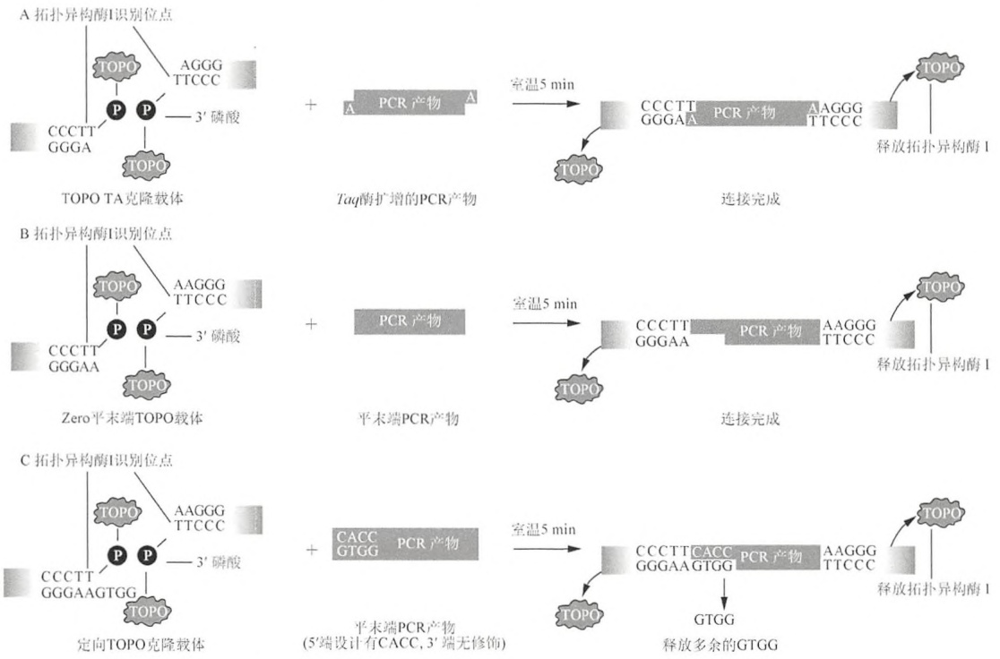

<details>
<summary>flowchart</summary>

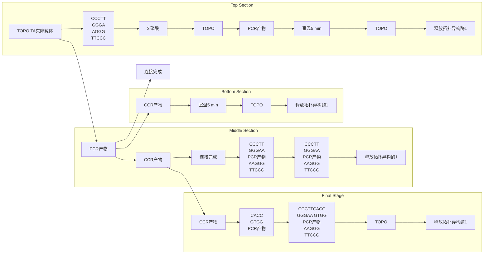
</details>

图 3-2 TOPO 克隆。（A）Taq 酶扩增 DNA 的 TOPO TA 克隆；（B）Zero 平末端 TOPO 克隆:平末端 DNA；（C）定向 TOPO 克隆:平末端 DNA。（转载自 Life Technologies 公司[Invitrogen 公司]。）

---

第 3 章 质粒载体克隆与转化

163

试剂盒也可用于克隆“长”的DNA（大于1kb）和克隆PCR产生的在测序载体和原核及真核表达载体中的DNA。能够从Life Technologies公司购得的载体的完整列表，见Life Technologies/Invitrogen公司网站（www.invitrogen.com/site/us/en/home.html）。其他制造商也出售基于拓扑异构酶的克隆试剂盒，虽然目前在多样性上尚不如Life Technologies公司。例如，Stratagene/Agilent公司销售的Strataclone PCR克隆试剂盒，含有一个由两个分开的臂组成的载体，其中每一个臂在其一端带有拓扑异构酶活化的、修饰的尿嘧啶残基，在其另一端有一个loxP识别位点。连接后，带有（A）突出的PCR产物被两个臂捕获，得到的线性DNA随后用于转化一个表达Cre重组酶的大肠杆菌菌株。loxP位点之间的重组产生一个环状的、善于复制的质粒。这个系统看起来有点笨拙，但是根据Stratagene公司的介绍，已成功地用于克隆长的PCR产物。

Promega 公司出售的 pGEM-T 和 pGEM-T Easy 试剂盒包含线性化高拷贝数载体，在每一末端含有一个单一的突出 3'-胸苷残基。载体都可用于蓝/白筛选，并包含多个限制性酶切位点便于快速释放克隆序列。

克隆试剂盒的制造商提供了很棒的指南，详细解释了要做什么和为什么要这么做。这使得TOPO克隆很容易，但是并非万无一失。在第一次建立TOPO克隆时，使用试剂盒提供的组分，按照下文建立预实验。

## 牛痘病毒

Edward Jenner 在 1796 年采用接种疫苗预防天花，使得 181 年后这种疾病从人群中完全灭绝，毫无疑问是最伟大的医学成就之一。Jenner 的疫苗株来自一个挤牛奶女工手上的脓疱，Jenner 认为是来自于感染牛痘的产奶动物。不过，从病态行为和基因组分析（Gubser et al. 2004），现在看上去该疫苗株似乎更有可能是牛痘和天花病毒之间的杂种，或者是现在已灭绝的马痘，又或者可能本身就是天花的减毒菌株（Baxby 1977, 1981, 1999; Razzell 1998）。不论其来源，牛痘病毒已经找到了新的用途，作为哺乳动物表达载体（见第 16 章）和 DNA 拓扑异构酶的来源，此酶是一种 314 个氨基酸的蛋白质，是一种准确连接 DNA 片段的快速、简便方法（TOPO 克隆）的基石（Shuman 1994）。


## 材料

为正确使用本方案中的器材和危险试剂，必须查阅相应的材料安全数据表并咨询所在机构的环境卫生和安全办公室。

本方案的专用试剂标注&lt;R&gt;，配方在本方案末提供。常用储备溶液、缓冲液和试剂标注&lt;A&gt;，配方见附录1。储备溶液应稀释至适用浓度后使用。

## 试剂

琼脂糖凝胶（以及第2章方案1中所需的其他试剂和设备）

化学感受态 One-Shot TOP10 细菌（Life Technologies 公司）或等效产品

质粒

限制性内切核酸酶

SOB、SOC 或 LB 琼脂平板&lt;A&gt;含有合适的抗生素，预热

SOC 培养基&lt;A&gt;

含有 $1.2 \mathrm{~mol} / \mathrm{L} \mathrm{NaCl}$ 和 $0.06 \mathrm{~mol} / \mathrm{L} \mathrm{MgCl}_{2}$ 的溶液

靶 DNA（25ng/mL），通过 Taq 酶催化的 PCR 扩增

TOPO 活化的 TA 载体（10ng/μL）

---

164

分子克隆实验指南（原书第四版）

## 设备

盛满冰块的容器

振荡培养器（37℃）

水浴（预设为37℃、42℃和限制性内切核酸酶消化的最适温度）


## 方法

1. 根据第 7 章方案 1 的说明, 按照您的实验室最近的实验中成功扩增产生丰富的 250\~750 核苷酸长度扩增产物所使用模板: 引物组合的情况, 建立一个  $50 \mu L$  Taq 酶催化的 PCR 体系。
2. 通过琼脂糖凝胶电泳分析少量（$10\mu \mathrm{L}$）PCR产物，检查扩增反应是否产生单个离散的与预期大小相符的产物。

如果扩增反应产生一种以上 DNA 或其他 PCR 伪迹（如引物二聚体，成片条带），最好用另一块凝胶纯化感兴趣的 DNA，使用如 Millipore 公司的 Montage DNA Gel Extraction 试剂盒或 Sigma 公司的 GenElute 试剂盒。

3. 使用试剂盒制造商提供的溶液，立刻建立一个TOPO克隆试验反应如下。

混合:

| 扩增的DNA | 1.0μL |
| --- | --- |
| NaCl(1.2mol/L)/MgCl2(0.06mol/L) | 1.0μL |
| 无菌水 | 3.0μL |
| TOPO活化的TA载体(10ng/μL) | 1.0μL |

建立对照反应(背景对照), 其中扩增的 DNA 替换为 $1 \mu \mathrm{L}$ 水。建立第三个转化反应(转化对照), 其中用 $10 \sim 20 \mathrm{pg}$ 纯化的具有抗生素抗性标记的质粒替代 TOPO 活化的 TA 载体。

4. 轻轻混合反应物，在室温下孵育 5min。将反应物转移到冰上。

TOPO 克隆反应时间可以短至 30s，或长达 30min。PCR 产物越长，就需要越长的时间以获得最大量的转化体。

5. 转移  $2 \mu L$  各反应物（步骤 3）到含有化学感受态 One-Shot TOP10 细菌（Life Technologies 公司）或同等产品的单独小管中。将转化反应物在冰上孵育 5min。

6. 在 $42^{\circ} \mathrm{C}$ 热激细胞整整 30s, 立即将细胞放回冰上, 添加 $250 \mu \mathrm{L}$ 室温的 SOC 培养基。

7. 封紧小管，然后在  $37^{\circ}$ C 孵育 30min，轻轻摇动。

Life Technologies 公司的标准 TOPO 试剂盒包含制备好的化学转化或电穿孔的 One-Shot TOP10 细菌。然而，这些制备细菌并无特别之处，使用 TOP10 的近亲 DH10B 的化学感受态的效果同样出色。

8. 将一份 $50\mu \mathrm{L}$ 转化的细菌铺到预热的含 $75\sim 100\mu \mathrm{g}$ 氨苄青霉素的琼脂平板上。$37^{\circ}C$ 培养过夜。

在 $37^{\circ}\mathrm{C}$ 过夜孵育后，如果一切都按计划顺利进行，试验反应和阳性对照将有大量转化菌落产生。背景对照的平板则应该只有极少数菌落出现。

9. 从试验反应平板上 6 个分开的菌落建立培养物, 并小量制备质粒 (见第 1 章方案 1\~3)。用质粒中多克隆位点里插入片段两侧位点的限制性内切核酸酶切割 DNA。通过琼脂糖凝胶电泳确认克隆的扩增 DNA 片段大小正确。

---

第 3 章 质粒载体克隆与转化

165

## 参考文献

- Baxby D. 1977. The origins of vaccinia virus. J Infect Dis 136: 453–455.
- Baxby D. 1981. Jenner's smallpox virus: The riddle of vaccinia virus and its origins. Heineman Educational Books, London.
- Baxby D. 1999. The orgins of vaccinia virus—An even shorter rejoinder. Soc Hist Med 12: 139.
- Gubser C, Hue S, Kellam P, Smith GL. 2004. Poxvirus genomes: A phylogenetic analysis. J Gen Virol 85: 105–117.
- Invitrogen. 2002. pENTR directional TOPO cloning kits (version B, July 9, 2002, 25-0434). Invitrogen Life Technologies, Inc., Rockville, MD.
- Razzell P. 1998. The orgins of vaccinia virus—A brief rejoinder. Soc Hist Med 11: 107–108.
- Shuman S. 1994. Novel approach to molecular cloning and polynucleotide synthesis using vaccinia DNA topoisomerase. J Biol Chem 269: 32678–32684.
- Shuman S, Kane EM, Morham SG. 1989. Mapping the active-site tyrosine of vaccinia virus DNA topoisomerase I. Proc Natl Acad Sci 86: 9793–9797.

## 方案 14 使用 X-Gal 和 IPTG 筛选细菌菌落: α-互补

许多质粒载体（如 pUC 系列、Bluescript、pGem，以及它们的衍生物）携带一段短的大肠杆菌 DNA，含有β-半乳糖苷酶的调控序列及其前 146 个氨基酸的编码信息。嵌入编码区的是一个多克隆位点，所包含的读码框在β-半乳糖苷酶氨基末端片段中产生由少量氨基酸组成的无害插入。这种类型的载体用在表达β-半乳糖苷酶羧基端部分的宿主细胞。虽然无论是宿主编码还是质粒编码的β-半乳糖苷酶片段本身都是没有活性的，但是它们可以联合形成具有酶活性的蛋白质。lacZ 基因的近操纵基因片段缺失突变体与具有完整近操纵基因片段的β-半乳糖苷酶阴性突变体之间的互补被称为α-互补（Ullmann et al. 1967）（更多信息，见第 1 章信息栏“α-互补”）。α-互补产生的 lac+细菌很容易识别，因为它们在生色底物 X-Gal 的存在下形成蓝色菌落（Horwitz et al. 1964；Davies and Jacob 1968）。然而，一个外源 DNA 片段插入到质粒的多克隆位点几乎总是导致产生的氨基末端片段不再能够 α-互补。因此，携带重组质粒的细菌形成白色菌落。这个简单色彩试验的发展极大地简化了质粒载体中构建重组体的鉴定。这很容易筛选成千上万的转化菌落，从它们的白色外观识别出那些被认为含有重组质粒的菌落。然后，这些重组体的结构可以通过小量制备载体 DNA，用限制性酶切分析或其他的鉴别标准进行验证。

为筛选细菌菌落，生色底物 X-Gal 和安慰诱导物 IPTG（见信息栏 “IPTG” 和第 1 章中的信息栏 “X-Gal”）混合后用培养基适当稀释，结合熔化的顶层琼脂，然后铺在含有合适抗生素的琼脂平板上。细菌铺在顶层琼脂上的转化效率稍高于铺在琼脂平板表面上。也许转化的细菌更喜欢软琼脂里稍微厌氧的状态或琼脂培养基提供的等渗透压。

## IPTG

IPTG（isopropylthiogalactose）是由 Mel Cohn 在 20 世纪 50 年代初合成的一系列半乳糖类似物之一，当时他在巴斯德研究院 Jaques Monod 的实验室工作。lac 阻遏蛋白特异性结合 lac 操纵子的操纵基因区，负调控大肠杆菌 lac 操纵子的表达。IPTG 结合 lac 阻遏蛋白，改变其构象使其无法结合 lac 操纵基因，从而诱导乳糖操纵子的转录。并不需要高浓度的 IPTG 来解除阻遏，因为硫代半乳糖苷是不可发酵的，不是β-半乳糖苷酶的底物。在蓝/白筛选中，IPTG 与 X-Gal 联合使用以鉴别表达β-半乳糖苷酶的重组细菌菌落或噬菌斑。有关进一步详情，见第 1 章中的信息栏“α-互补”。


## 材料

为正确使用本方案中的器材和危险试剂，必须查阅相应的材料安全数据表并咨询所在机构的环境卫生和安全办公室。

---

166

分子克隆实验指南（原书第四版）

本方案的专用试剂标注&lt;R&gt;，配方在本方案末提供。常用储备溶液、缓冲液和试剂标注&lt;A&gt;，配方见附录1。储备溶液应稀释至适用浓度后使用。

## 试剂

大肠杆菌培养物，用重组质粒转化

IPTG 溶液（20%, m/V）

LB 或 YT 琼脂板&lt;A&gt;含有合适的抗生素

LB 或 YT 顶层琼脂&lt;A&gt;

X-Gal 溶液（2%, m/V）

见第 1 章中的信息栏 “X-Gal”。

## 设备

加热块（45℃）

培养箱（37℃）

无菌黄吸头、木制牙签或接种针

无菌塑料试管（17mm×100mm）


## 方法

1. 将熔化的顶层琼脂分装到 $17\mathrm{mm} \times 100\mathrm{mm}$ 试管中。把试管放入 $45^{\circ}\mathrm{C}$ 的加热块待用。若是 $90\mathrm{mm}$ 平板，分装 $3\mathrm{mL}$；$150\mathrm{mm}$ 平板则分装 $7\mathrm{mL}$。

2. 从加热块取下第一管。迅速加入 $0.1\mathrm{mL}$ 细菌悬液，当使用 $90\mathrm{mm}$ 平板时所含活菌数要小于3000个，$150\mathrm{mm}$ 平板则小于10000个。关闭管盖，翻转几次使细菌在熔化琼脂中分散均匀。

3. 打开试管，如表 3-3 中所示加入适当量的 X-Gal 和 IPTG（如果需要）。关闭管盖，轻轻翻转几次以混合内含物。

4. 将熔化的顶层琼脂快速倒入含适当的抗生素的硬琼脂平板，通过旋动分散溶液。

5. 重复步骤 2～4，直到所有的样品都被铺板。

6. 等软琼脂在室温下硬化，擦掉平板盖子上的凝露，然后将平板倒置在 $37^{\circ}\mathrm{C}$ 孵育 $12\sim 16\mathrm{h}$。

7. 从培养箱中取出平板，将它们在  $4^{\circ}$ C 存放几个小时，使蓝色显现。

表 3-3 顶层琼脂的成分

<table><tr><td rowspan="2">平板大小</td><td colspan="3">试剂用量</td></tr><tr><td>熔化的顶层琼脂</td><td>X-Gal</td><td>IPTG</td></tr><tr><td>90mm</td><td>3mL</td><td>40μL</td><td>7μL</td></tr><tr><td>150mm</td><td>7mL</td><td>100μL</td><td>20μL</td></tr></table>

8. 鉴定携带重组质粒的菌落。

- 携带野生型质粒的菌落含有有活性的β-半乳糖苷酶。这些菌落的中心是淡蓝色，周边是深蓝色。
- 携带重组质粒的菌落不含有有活性的β-半乳糖苷酶。这些菌落是乳白色或蛋壳蓝，有时在中心带着淡淡的蓝色斑点。

在淡黄色背景下查看平板可以增强眼睛分辨蓝色和白色菌落的能力。

9. 选择和培养携带重组质粒的菌落。

蓝色或白色菌落在软琼脂中可以发生在几个不同的方位，通常好像远方倾斜的星系。不管什么方位，它们可以容易地用无菌接种针或无菌牙签刺入薄层软琼脂挑取，将接种物转移到一管含有适当抗生素的培养基中。

---

第 3 章 质粒载体克隆与转化

167

## 参考文献

Davies J, Jacob F. 1968. Genetic mapping of the regulator and operator genes of the lac operon. J Mol Biol 36: 413–417.

Horwitz JP, Chua J, Curby RJ, Tomson AJ, Darooge MA, Fisher BE, Mauricio J, Klundt I. 1964. Substrates for cytochemical demonstration of enzyme activity. I. Some substituted 3-indolyl- $\beta$ -D-glycopyranosides. J Med Chem 7: 574–575.

Ullmann A, Jacob F, Monod J. 1967. Characterization by in vitro complementation of a peptide corresponding to an operator-proximal segment of the β-galactosidase structural gene of Escherichia coli. J Mol Biol 24: 339–343.

## 信息栏


## 关照大肠杆菌

贯穿过去的一个世纪，大肠杆菌 K-12 菌株在生物学，特别是在分子生物学中发挥了无可争辩的重要作用。表 1 给出了一个标志着关键事件和发现的时间表。

表 1 大肠杆菌——大事年表

| 时间 | 人物 | 描述 |
| --- | --- | --- |
| 1885 | Theodore von Escherich(1857~1911) | 大肠杆菌由德国细菌学家 Theodore von Escherich 从健康人的粪便中首次分离,生物名最初为 Bacterium coli,后来改为 Escherichia coli 以纪念它的发现者。大肠杆菌约占成人结肠细菌总数的0.1%。 |
| 1940s | Ed Tatum(1909~1975) | 从20世纪20年代开始,斯坦福大学细菌学系保存大肠杆菌菌种。其中一株,命名为K-12,是从康复白喉患者的粪便中分离得到的。K-12是原养型,在确定成分培养基中生长良好,并且传代时间短。也许是出于这些原因,Ed Tatum 使用K-12进行了一系列关于细菌的营养缺陷突变株的生化研究(Gray and Tatum 1944;Tatum1945)。 |
| 1940s | Joshua Lederberg(1925~2008) | 1945年,Tatum搬到了耶鲁大学,研究生 Joshua Lederberg 请求获取他的菌株。Lederberg提出合作,以确定是否可以在细菌中证明遗传交配,如果是的话,是否可以用来构建遗传图谱。Lederberg 此前使用一株与K-12不同的大肠杆菌菌株的原养型突变体,未能找到任何重组的证据,但使用Tatum的K-12株后,实验立即获得了成功。从1946年4月交配实验开始到研究人员获得重组的证据,它看上去只用了6周时间。结果,7月在冷泉港实验室研讨会上提出时,很多听众根本不相信,认为可以用特殊现象解释,而不是重组。直到几个月后,更详尽的解释出现(Lederberg and Tatum 1946),细菌接合作用即“大肠杆菌性别”的想法才得到承认。回头来看,我们现在知道,成功的关键在于碰巧使用了Tatum的K-12菌株。与大多数大肠杆菌菌株不同,它携带一个$F^{+}$(致育)质粒,能够调动细菌染色体。Lederberg 和Tatum观察到的标记重组发生,是因为用于杂交的一个突变体碰巧携带$F^{+}$因子,而另一个没有。 |
| 1952 | Bill Hayes(1913~1994) | 医学细菌学家 Hayes 从群体遗传学家 Luigi Luca Cavalli-Sforza 获得K-12菌株,使用链霉素抗性作为标记进行交配动力学研究。Hayes 的研究显示,一株K-12菌株能够充当基因供体而另一株充当受体。他提出,在接触时,雄性细胞挤出一个“配子”被雌性细胞接纳(Hayes 1952)。接合过程持续1~2h。 |
| 1997 | Fred Blattner(1940~) | 大肠杆菌最近的历史是丰富的。Hayes的工作发表多年以来,大肠杆菌K-12已被一大群众多学科的科学家使用并已经成为分子克隆的有力工具。1997年,美国威斯康星大学Fred Blattner的研究小组发表了大肠杆菌基因组的完整序列(Blattner et al. 1997),极大地丰富了大肠杆菌的数据积累。细菌基因组由4639221个碱基对组成,其中的88%组成4288个基因,当序列完成时其中约40%功能未知。自1997年以来,一些非K-12的大肠杆菌菌株的基因组已被测序,浮现出的画面是一个高度可变的种群,持续经历广泛的基因型和表型趋异(Woods et al. 2006)。然而,K-12的不同亚株则非常相似。例如,Blattner等测序的K-12株(MG1655)基因组与W3110菌株(Hayashi et al. 2006)基因组相比仅有8个碱基对不同。这个结果是令人欣慰的,但不足为奇。在世界各地的实验室分子克隆所用的大肠杆菌K-12菌株现在在几乎相同的条件下生长。基因组变异的缺乏只是反映出差别选择压力的缺失。Hobman等(2007):大肠杆菌“毫无疑问作为生物学的首要模式生物......可以说对大肠杆菌的了解,特别是K-12株,比任何其他生物都多。”Neidhardt等(1996):“所有细胞生物学家至少有两种感兴趣的细胞:他们正在研究的细胞和大肠杆菌。” |

几乎所有关于大肠杆菌的有用信息都可以在 Cellular and Molecular Biology（在线版）（http://ecosal.org）的大肠杆菌和鼠伤寒沙门氏菌（Escherichia coli and Salmonella typhimurium）部分找到。

通常在分子克隆中使用的大肠杆菌的基因型可以在以下网址获得:openwetware.org/wiki/E.\_coli\_genotypes。

---

168

分子克隆实验指南（原书第四版）

## 当一种新型菌株抵达实验室

大肠杆菌菌株（未转化或转化质粒）通常是以琼脂穿刺培养物的形式通过邮件发送。所有菌株一旦进入实验室，就必须尽快验证，之后才能在实验中使用。

1. 转接一个菌环量的穿刺培养物到 3mL 含适量抗生素和必要添加物的液体培养基中。在适当的温度温育培养基 18～24h，并剧烈振荡。
2. 当液体培养物长好后，用菌液在含适量抗生素和必要添加物的琼脂平板上划线。在适当的温度下过夜孵育平板。
3. 检查平板上所有的菌落外观是否一致，外形和气味是否与大肠杆菌相同。挑取单个菌落到合适的选择性培养基上，以验证该菌株的基因型。将挑选出的菌落进行小规模（3mL）液体培养。如果细菌含有转化质粒，用约2mL培养物小规模制备质粒DNA。用不同的限制性内切核酸酶消化质粒DNA，消化产物通过琼脂糖凝胶电泳分析。根据发送者提供或文献中公布的质粒图谱，比较所观察到的条带大小与预期是否相符。
4. 复印发送菌株附带的所有书面材料，将复印件插入你的实验室笔记本中。
5. 如果没有提供菌株的基因型，可以查询相关文献或在线资源，以确定菌株是否有可能会影响它实用性的瑕疵。许多常用的大肠杆菌菌株的基因型名单可以在此网址在线获取:http://openwetware.org/wiki/E.\_coli\_genotypes。

## 质粒 DNA

1. 如果质粒 DNA 以 70%乙醇中沉淀的形式送达，通过离心分离回收 DNA，以  $100 \mu g/mL$  的浓度溶解在 TE（pH 8.0）中。
2. 用不同的限制性内切核酸酶消化几个小份的 DNA，并通过琼脂糖凝胶电泳进行分析。根据发送者提供或文献中公布的质粒图谱，比较所观察到的条带大小与预期是否相符。
3. 与此同时，将一份质粒 DNA 转化合适的大肠杆菌菌株。
4. 将几个独立的转化体进行小规模（3mL）液体培养。用约 2mL 培养物小规模制备质粒 DNA。
5. 下面几种方法可以用来验证该质粒的结构。

- 限制性内切核酸酶消化。将一份 DNA 样品用一些限制性内切核酸酶消化，并通过琼脂糖凝胶电泳分析酶切产物。根据发送者提供或文献中公布的质粒图谱，比较所观察到的条带大小与预期是否相符。
- 聚合酶链反应。聚合酶链反应用两套引物（见第7章）。一套应该是与邻近克隆DNA两侧的质粒序列互补（引物A和B）。另一套引物（引物1和2）应该是与插入克隆的内部序列互补，这将根据已知插入序列预知产生的扩增产物的大小。使用两对分开的引物组合成6个 $^{①}$ 聚合酶链反应，如下所示:

聚合酶链反应 1. 引物 A 和引物 B
聚合酶链反应 2. 引物 1 和引物 2
聚合酶链反应 3. 引物 1 和引物 A
聚合酶链反应 4. 引物 2 和引物 A
聚合酶链反应 5. 引物 2 和引物 B
聚合酶链反应 6. 引物 1 和引物 B $^{②}$

<small><span class="docvortex-page-footnote" data-block-type="page_footnote" style="color:#6b7280">① 译者注:应为6个，原文为4个。</span></small>

<small><span class="docvortex-page-footnote" data-block-type="page_footnote" style="color:#6b7280">② 译者注:应为 B，原文为 A。</span></small>

---

第 3 章 质粒载体克隆与转化

169

使用适当大小的标志物，用凝胶电泳法估计扩增产物的大小。确认插入片段的大小和它在质粒内的插入方向是否正确。

\- 如果该质粒包含一个突变，而不是野生型的 DNA 插入片段，则:①使用突变型特异和野生型特异的引物进行聚合酶链反应；②测定相关插入片段的序列。

6. 如果该质粒的结构正确，大规模培养其中一个转化体。制备一批质粒 DNA，通过限制性内切核酸酶消化和/或聚合酶链反应验证其正确，然后将其溶解在 TE 中，分成小份存储于-20℃。

如果一切顺利（通常如此），按照方案存储细菌菌株，将细菌液体培养物分成小份放到甘油中于-20℃长期保存。

## 储存细菌菌株

## 大肠杆菌的主培养物最好存储于-20℃

1. 加入 0.15mL 甘油（100%）到 2mL 螺旋盖冷冻管中，高压灭菌消毒。小管的灭菌甘油可以批量制备，并在室温下保存待用。
2. 添加 0.85mL 大肠杆菌对数生长期培养物到每个含 0.15mL 灭菌甘油的小管。
3. 牢固封闭小管的顶部，剧烈振荡混合。
4. 用 Sharpie 笔标记小管和时间。同时在小管的盖子和管身上做标记。
5. 于-20℃冷冻小管。将培养物存储在冻存盒中，放在含有一个或两个冰袋的聚苯乙烯泡沫塑料容器内。以这种方式储存的含甘油培养物可以保持活性多年。为了最大限度地减少活力损失，避免反复冻融甘油菌种。
6. 如果要复苏-20℃存储的大肠杆菌，取出一个存储于-20℃冰箱中的含甘油培养物。取约 50μL 培养物转接至 5mL 预热的 LB 培养基中。迅速将含甘油培养物重新密封放回冰箱。将新接种的培养基放在振荡培养器上 37℃过夜培养。

## 穿刺培养

大肠杆菌菌株在软琼脂中穿刺培养可存储长达1年。穿刺培养可用于在室温下运输或发送菌株给其他实验室。

1. 准备和高压灭菌 0.7% LB 琼脂（在标准 LB 培养基中添加 7g/L 琼脂）。
2. LB 琼脂冷却到低于  $50^{\circ}$ C（你可以舒适地握持时），添加适当的抗生素。当琼脂仍处于液态时，添加 1mL 琼脂到 2mL 螺旋盖小瓶或高压灭菌冷冻管中，等待其凝固。小管琼脂可以分批制备，并在室温下保存待用。
3. 使用无菌直铂丝或无菌牙签从新鲜的生长平板上挑取单个菌落，穿刺到软琼脂中数次。
4. 保持管帽稍微松动，在  $37^{\circ}$ C 孵育小管 8～12 h。
5. 紧紧的密封小管并避光保存，在  $4^{\circ}$ C 更好。
如果存放在  $20^{\circ}$ C，远离直射光，穿刺培养将保持活力至少 12～18 个月。

## 复苏存储的菌株

1. 将一个菌环量的软琼脂或甘油保存菌株在标记过的、含有适当抗生素的 LB 琼脂平板上划线。重新密封穿刺培养物或甘油保存菌株并放回继续存储。
2. 在  $37^{\circ}$ C 下孵育平板过夜。
3. 挑取单个菌落在 $5 \mathrm{~mL}$ 含有相关抗生素的 LB 培养基中培养作为日常存储。用封口膜密封步骤 2 的平板，并将其存储在 $4^{\circ} \mathrm{C}$ 以备进一步使用。

---

170

分子克隆实验指南（原书第四版）

## 参考文献

- Blattner FR, Plunkett G III, Bloch CA, Perna NT, Burland V, Riley M, Collado-Vides J, Glasner JD, Rode CK, Mayhew GF, et al. 1997. The complete genome sequence of Escherichia coli K-12. Science 277:1453–1462.
- Gray CH, Tatum EL. 1944. X-ray induced grwoh factor requirements in bacteria. Proc Natl Acad Sci 30: 404–410.
- Hayashi K, Morooka N, Yamamoto Y, Fujita K, Isono K, Choi S, Ohtsubo E, Baba T, Wanner BL, Mori H, et al. 2006. Highly accurate genome sequences of Escherichia coli K-12 strains MG1655 and W3110. Mol Syst Biol 2: 2006.0007.
- Hayes W. 1952. Recombination in Bact. coli K12: Unidirectional transfer of genetic material. Nature 169: 118–119.
- Hobman JL, Penn CW, Pallen MJ. 2007. Laboratory strains of Escherichia coli: Model citizens or deceitful delinquents growing old gracefully?

Mol Microbiol 64: 881–885.

Lederberg J, Tatum EL. 1946. Gene recombination in Escherichia coli. Nature 158: 558.

Neidhardt FR, Curtis R III, Ingraham JL, Lin ECC, Low KB, Magasanik B, Reznikoff WS, Riley M, Schaechter M, Umbarger E. 1996. Escherichia coli and Salmonella: Cellular and molecular biology, 2nd ed. American Society for Microbiology, Washington, DC.

Tatum EL. 1945. X-ray induced mutant strains of Escherichia coli. Proc Natl Acad Sci 31: 215–219.

Woods R, Schneider D, Winkworth CL, Riley MA, Lenski RE. 2006. Tests of parallel molecular evolution in a long-term experiment with Escherichia coli. Proc Natl Acad Sci 103: 9107–9112.

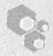

## 用 DNA 转化细菌的历史

细菌转化中，受体细胞从培养基中获得 DNA。导入的 DNA 中的基因可以获得表达，并可能改变受体细胞的表型，使转化细胞获得选择性的优势。

转化最早于将近一个世纪前由 Fred Griffith（Griffith 1928）首先描述，他是一名在伦敦卫生署工作的军医。Griffith 对肺炎球菌的血清学多样性感兴趣，这些肺炎球菌是从不同肺炎患者的痰标本中分离出的。大部分由 Griffith 分离出的致病肺炎球菌菌株在丰富培养基上形成光滑的、反光的菌落（S），而许多非致病性菌株形成粗糙的扁平菌落（粗）菌落。Griffith 注意到，这些表型是不稳定的:将 S 株铺于巧克力琼脂上可以得到减毒粗糙株（R）；S 株可以出现在感染了非致病性 R 菌株的小鼠中。为了调查 S 株和 R 株相互转换的机制，Griffith 将 R 型细胞和加热到 60°C 杀死的有毒 S 型细胞混合后注射小鼠，很高兴地发现，死的 S 型细胞引起 R 型细胞永久转换为 S 型细胞。Griffith 对遗传学一无所知，仅仅用发病机制解释了这种转化。半个世纪后，洛克菲勒研究所指出转化要素是 DNA 的一个团队成员——Maclyn McCarty（1985），写道:

……事情发生了永久的变化。但是细菌学已经发展为一门仿佛同生物学的其余部分无关的科学。相对于其历史而言，期望对实验室中遇到的任何现象作出遗传学解释还为时太早。

Griffith 证实转化后，在 Rockefeller 论文发表（Avery et al. 1944）之前，有大量关于转化要素的物理和化学性质的推测。在教科书 Genetics and the Origin of Species 的第二版中，作者、果蝇遗传学家 Theodosius Dobzhansky（1941）写道:

如果这种转化形容为基因突变——很难不这样描述它，我们正在研究特定处理引起特定突变的真正案例。

病毒学家 Wendell Stanley 认为，病毒引起了转化，而 Tracy Sonneborn 认为对此现象最好的解释是细胞质颗粒。

所有的猜测在 1944 年结束，Oswald Avery 团队的论文发表，决定性地指出转化要素是 DNA。该论文是洛克菲勒研究所一系列化学家多年工作的结晶:Martin Dawson 重复和改良了 Griffith 的实验；J. L. Alloway 设计出了一个骨干纯化的方法，就我们现在知道的而言，使得内源性 DNA 酶失活；Colin MacLeod 开发了一种不稳定但可以定量测定转化的方案；最后，Maclyn McCarty 阐明，高纯度的转化物质对于用 DNA 酶消化敏感，具有高分子质量，在波长 260nm 处有强烈吸收。

Avery 的论文激起了研究 DNA 的强烈兴趣。它促使 Edwin Chargaff 放弃了对脂质代谢和血液凝固的研究，进而发现了 DNA 碱基组成的对称性（见 Chargaff 1979）。它也激发了 Watson 和 Crick 对 DNA 三维结构充满激情的探索（Watson and Crick 1953）。Fred Griffith 死于 1941 年的一场空袭，如果他在世的话也一定会感到惊讶不已。

---

第 3 章 质粒载体克隆与转化

171

## 参考文献

Avery O'T, Macleod CM, McCarty M. 1944. Studies on the chemical nature of the substance inducing transformation of pneumococcal types: Induction of transformation by a desoxyribonucleic acid fraction isolated from pneumococcus type III. J Exp Med 79: 137–158.

Chargaff E. 1979. How genetic got a chemical education. Ann NY Acad Sci 325: 345–360.

Dobzhansky T. 1941. Genetics and the origin of species, 2nd ed. Columbia University Press, New York.

Griffith F. 1928. The significance of pneumococcal types. J Hyg 27: 113–159.
McCarty M. 1985. The transforming principle. Norton, New York.

Watson JD, Crick FH. 1953. Molecular structure of nucleic acids; a structure for deoxyribose nucleic acid. Nature 171: 737–738.


## 聚合酶链反应产物克隆指南

自从 20 世纪 70 年代初克隆论文首次发表以来，已经公开了数以百计的不同方法，描述如何最好地产生和组装日益复杂的 DNA。在发明聚合酶链反应（PCR）技术之前，这些方法必然只是两个酶促反应的排列和修改:限制性酶切和连接。尽管早期研究人员具有丰富的创造力，精密装配复杂的 DNA 结构仍然是一个重大的挑战。这不足为奇，那些早期精心发展的克隆方法，在今天仍普遍使用的只剩一两个了。随着 20 世纪 80 年代后期 PCR 技术成为主流，大多数方法都被扫地出门了。

在 25 年的历程中，内容不断丰富的 PCR 技术已经统治了分子克隆。因为通过 PCR 扩增可以轻松地获得特定末端的扩增 DNA，下面列出的许多方法不再是仅仅利用 PCR 合成 DNA，同时也把它们连接在一起形成为特定目的设计的结构。最近的改进是模块化遗传单位的发展，这些遗传单位可以通过位点特异性重组酶装入目标 DNA，而不是 PCR。

下面的指南概述了目前使用的克隆扩增 DNA 和构建复杂多组分遗传单位的各种方法（标准方法的概述参见表 2）。

表 2 克隆扩增 DNA 的标准方法

| 方法 | 方法概要 | 优点 | 缺点 |
| --- | --- | --- | --- |
| 定向克隆(见方案5) | 1. 在PCR引物的5'近末端序列引入产生黏性末端的限制性酶切位点。正向引物和反向引物采用不同的限制性位点。2. 纯化扩增产物,用适当的限制性内切核酸酶切割,与含有一致的黏性末端的载体连接。 | 简单明了。扩增的DNA片段可以容易地从载体中回收。该方法可用于有校对功能的热稳定DNA聚合酶,也可用于无校对功能的DNA聚合酶,如Taq酶。 | 位于或者靠近DNA末端时,限制性内切核酸酶切割的效率很低,因而引物5'端必须含有保护碱基。理想情况下,它们应富含G和C残基,像夹子一样稳定扩增DNA的末端。事先知道扩增DNA的序列是有用的,因为它使设计的引物可以含有目标DNA中缺少的独特限制性位点。 |
| 非定向克隆(见方案8) | 1. 正向和反向引物的5'近末端序列设计有相同的限制酶位点。2. 扩增产物纯化后,连接到用碱性磷酸酶处理过的含有一致末端的载体。 | 如上 | 如上 |
| 平末端克隆(见方案6) | 1. 使用具有校对能力的热稳定DNA聚合酶产生平末端的PCR产物。2. 纯化后的扩增产物连接到平末端载体。 | 很少,如果有的话 | 必须使用具有校对功能的DNA聚合酶。平末端连接是出了名的低效率,大多是因为质粒的再环化。不过,由线性化载体的再环化导致的高背景“空”克隆,可以通过在制备连接反应的载体时,使用限制性内切核酸酶减少。从克隆载体中精确回收扩增片段通常是不可能的。Stratagene公司销售一种平端PCR片段克隆试剂盒(Straclone Ultra Blunt PCR Cloning Kit)。载体以分开的DNA臂的形式提供,各携带一个loxP位点和结合的拓扑异构酶。载体臂和PCR片段混合后,转化一种表达Cre重组酶的大肠杆菌菌株(Strataclone),催化两个loxP位点之间的重组进而实现环化。 |

---

172

分子克隆实验指南（原书第四版）

续表

| 方法 | 方法概要 | 优点 | 缺点 |
| --- | --- | --- | --- |
| TA 克隆(见方案 12) | 1. 使用不具有校对功能的热稳定 DNA 聚合酶,如 $Taq$,产生的 PCR 产物携带一个未成对 3′端 A 残基。2. 纯化扩增片段,将扩增 DNA 连接到线性的每个末端携带一个未成对 3′-T$^{1}$残基的 T-载体上。 | 高效。由于扩增的 DNA 通常缺乏 5′-磷酸残基,自身连接是不可能的。可以纯化扩增片段,但并非必要。可从许多制造商购得商业化试剂盒。 | T 载体必须自己制备(见方案 11)或商业购买。精确回收扩增的 DNA 一般是不可能的。如果 T 载体两侧携带限制性酶切位点,扩增片段可以被回收,虽然每一端都带有少量额外的核苷酸。 |

## 位点特异性重组方法

在过去的几年里，将 PCR 产物和其他 DNA 克隆、亚克隆到原核载体正经历一场变革。它不再必须依赖于合适末端的连接或复杂的 PCR 方案，取而代之的，通过序列特异性重组酶的作用，如  $\lambda$  噬菌体整合酶，两侧携带适当重组位点的 DNA 片段可以在体外整合到含有合适重组位点的载体中。

与传统的依赖于限制性内切核酸酶和连接酶的克隆方法相比，重组克隆有若干优势。重组克隆:

- 是灵活高效的；
- 能够将 DNA 片段简单和快速地从一个表达载体转移到另一个，只需一个单步过程，而且能保持方向和阅读框；
- 有利于蛋白质的表达和功能分析；
- 能够适应高通量、自动化的模式；
- 产生了大量归档的克隆，携带着 Gateway 克隆系统所产生的哺乳动物可读框，可以通过美国国立卫生研究院（http://mgc.nci.nih.gov/）的 Mammalian Gene Collection 公开获得。

最初为大规模蛋白质组分析开发的重组克隆技术，现在越来越多地用于小规模研究项目和大多数大规模蛋白质组学分析。两种最流行的重组克隆技术是 Gateway 克隆（Life Technologies 公司）和 In-Fusion（Clontech 公司），它们使用不同的序列特异性重组酶，并有不同的长处和缺点，这两种系统都受专利保护。

1. Gateway 克隆（Life Technologies 公司） 使用的是  $\lambda$  噬菌体 DNA 位点特异性重组系统的体外版本，该系统是  $\lambda$  噬菌体 DNA 整合和从大肠杆菌基因组切除时所使用的（Hartley et al. 2000；Walhout et al. 2000；同时可见第 4 章）。这套系统包括三种酶:整合酶（Int）、切割酶（Xis）和整合宿主因子（IHF）。这些酶催化特定 DNA 序列的重组，遗传学上称之为 attB、attP、attL 和 attR 位点。Gateway 系统对这些序列和它们的同源重组酶进行了改良，在不降低重组效率的情况下增加了重组反应的特异性（表 3）。

表 3 Gateway 中修改的 att 位点的属性

| 序列 | 长度 | 携带载体 | 重组位点 |
| --- | --- | --- | --- |
| attB1 和 attB2 | 25 bp | 表达载体 | attP1 和 attP2 |
| attP1 和 attP2 | 200 bp | 供体载体 | attBI 和 attB2 |
| attL1 和 attL2 | 100 bp | Entry 载体 | attR1 和 attR2 |
| attRI 和 attR2 | 125 bp | Destination 载体 | attL1 和 attL2 |

在 Gateway 克隆中, 通过 PCR 制备的 DNA 片段一端携带 attB1 位点, 另一端携带 attB2 位点, 可以克隆到 ccdB 基因两侧分别携带 attP1 和 attP2 重组位点的载体 (供体载体), ccdB 基因是大肠杆菌中的一种致死基因 (关于 ccdB 基因及其蛋白的信息, 见信息栏“ccdB 基因”)。克隆通过由专利的酶 (BP 克隆酶) 驱动的体外重组反应进行, 反应中, 插入 DNA 片段取代了 ccdB 序列。所得重组质粒被称为 Entry 克隆, 其侧翼重组序列被称为 Gateway attL 型。

<small><span class="docvortex-page-footnote" data-block-type="page_footnote" style="color:#6b7280">① 译者注:应为 T，原文为 A。</span></small>

---

第 3 章 质粒载体克隆与转化

173

Entry 克隆携带的 DNA 序列, 然后进行一步由一种专利的酶混合物——LR 克隆酶催化的反应, 可以转移到任何携带 attR 重组序列的目的载体中。Gateway 系统的优势是, 它通过一个高效的单步过程, 就可以将两侧含有合适序列特异性重组位点的 DNA 片段转移到一个目的载体中。已有数以千计的目的载体可用, 可以配备诸多元件如原核生物、哺乳动物和病毒的启动子、信号序列、剪接信号、Shine-Dalgarno 序列、切割序列、poly(A)附加序列, 以及许多其他用以满足: ① 在各种类型细胞中表达; ② 目的蛋白的纯化所需要的元件。关于 Gateway 克隆的进一步详情, 见第 4 章的导言和图 1、2、3。

2. In-Fusion 克隆 采用了一种专利的牛痘病毒编码的 DNA 聚合酶，称为 In-Fusion 酶。此酶具有 3 种催化功能:链置换、核苷酸的核酸外切去除和同源重组（Marsischky and LaBaer 2004；Hamilton et al. 2007）。在反应中含有两条双链线性 DNA 底物，痘病毒 DNA 聚合酶的 3'→5' 校对活性能去除 DNA 片段 3' 端的核苷酸。如果两个分子暴露的单链区域具有序列同源性，它们复性形成一个最适合的混合体，对聚合酶的进一步核酸外切攻击相对更加耐受。在复性的 DNA 按标准转化方案导入大肠杆菌后，任何切口、短突出端和间隙都会被修复。

在 In-Fusion 系统中，同源区域的产生是通过正向和反向 PCR 引物外延 15 个碱基，这些碱基与线性化质粒载体已知序列的末端完全匹配。因此，当任意 DNA 片段通过 PCR 适当 “剪裁” 其末端序列后，In-Fusion 系统可以将其创建成环状重组质粒（Benoit et al. 2006; Zhu et al. 2007）。

Clontech 公司上市了一种质粒载体，可用于创建克隆 DNA 片段两侧是 loxP 位点的 Master 克隆（图 1）。通过 Cre 重组酶催化的体外反应（见第 5 章的信息栏 “Cre-loxP”），

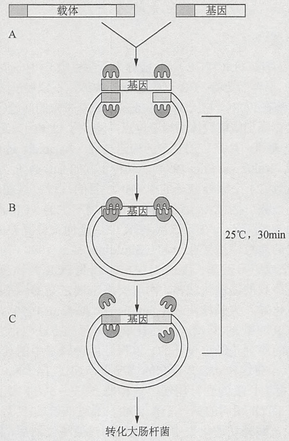

<details>
<summary>flowchart</summary>

```mermaid
graph TD
  A["载体"] --> B["基因"]
  C["基因"] --> D["基因"]
  D --> E["转化大肠杆菌"]
  
  subgraph Process_B [Process B]
    direction TB
    F(("细胞"))
    G(("细胞"))
    H(("细胞"))
    I(("细胞"))
    J(("细胞"))
    K(("细胞"))
    L(("细胞"))
    M(("细胞"))
    N(("细胞"))
    O(("细胞"))
    P(("细胞"))
    Q(("细胞"))
    R(("细胞"))
    S(("细胞"))
    T(("细胞"))
    U(("细胞"))
    V(("细胞"))
    W(("细胞"))
    X(("细胞"))
    Y(("细胞"))
    Z(("细胞"))
    AA(("细胞"))
    AB(("细胞"))
    AC((细胞"))
    AD((细胞"))
    AE((细胞"))
    AF((细胞"))
    AG((细胞"))
    AH((细胞"))
    AI((细胞"))
    AJ((细胞"))
    AK((细胞"))
    AL((细胞"))
    AM((细胞"))
    AN((细胞"))
    AO((细胞"))
    AP((细胞"))
    AQ((细胞"))
    AR((细胞"))
    AS((细胞"))
    AT((细胞"))
    AU((细胞"))
    AV((细胞"))
    AW((细胞"))
    AX((细胞"))
    AZ((细胞"))
    BA((细胞"))
    BB((细胞"))
    BC((细胞"))
    BD((细胞"))
    BE((细胞"))
    BF((细胞"))
    BG((细胞"))
    BH((细胞"))
    BI((细胞"))
    BJ((细胞"))
    BK((细胞"))
    BL((细胞"))
    BM((细胞"))
    BN((细胞"))
    BO((细胞"))
    BP((细胞"))
    BR((细胞"))
    BW((细胞"))
    BX((细胞"))
    BY((细胞"))
    BWB((细胞"))
    BXB((细胞"))
    BXB2((细胞"))
    BXB3((细胞"))
    BXB4((细胞"))
    BXB5((细胞"))
    BXB6((细胞"))
    BXB7((细胞"))
    BXB8((细胞"))
    BXB9((细胞"))
    BXB10((细胞"))
    BXB11((细胞"))]
  end
  
  A --> B
  B --> D
  D --> E
  E --> F
  F --> G
  G --> H
  H --> I
  I --> J
  J --> K
  K --> L
  L --> M
  M --> N
  N --> O
  O --> P
  P --> Q
  Q --> R
  R --> S
  S --> T
  T --> U
  U --> V
  V --> W
  W --> X
  X --> Y
  Y --> Z
  Z --> AA
  AA --> AB
  AB --> AC
  AC --> AD
  AD --> AE
  AE --> AF
  AF --> AG
  AG --> AH
  AH --> AI
  AI --> AJ
  AJ --> AK
  AK --> AL
  AL --> AM
  AM --> AN
  AN --> AO
  AO --> AP
  AP --> AQ
  AQ --> AB
  AB --> AC
  AC --> AD
  AD --> AE
  AE --> AF
  AF --> AG
  AG --> AH
  AH --> AI
  AI --> AJ
  AJ --> AK
  AK --> AL
  AL --> AM
  AM --> AN
  AN --> AO
  AO --> AP
  AP --> AQ
  AQ --> AL
  AL --> AM
  AM --> AN
  AN --> AO
  AO --> AP
  AP --> AQ
  AQ --> AL
  AL --> AM
  AM --> AN
  AN --> AO
  AO --> AP
  AP --> AQ
  AQ --> AL
  AL --> AM
  AM --> AN
  AN --> AO
  AO --> AP
  AP --> AQ
  AQ --> AL
  AL --> AM
  AN --> AO
  AO --> AP
  AP --> AQ
```
</details>

图 1 使用 In-Fusion 的不依赖于连接反应克隆（Clontech 公司）。（A）反应混合物包括选定的经过限制性切割的线性化载体，由含有与线性化载体（基因）同源 15bp 5'端的引物产生的 PCR 产物和专有的 In-Fusion 酶；（B）酶催化 PCR 产物和载体同源末端的排列和链置换，而 3'-外切核酸酶活性去除单链区域；（C）转化大肠杆菌后切口被封闭（转载自 D'Arpa 2009）。

---

174

分子克隆实验指南（原书第四版）

插入 Master 克隆的序列可以转移到任何携带 loxP 位点的受体载体。可以从 Clontech 公司获得工程化的用于在细菌、酵母和哺乳动物细胞中表达蛋白的受体载体。如同 Gateway 的 Destination 载体，In-Fusion 表达载体可以携带各种信号、标签和选择性标记。

综上所述，In-Fusion 系统是简单、高效、快速的，可以适用于高通量项目 [例如，BioBricks 项目（见信息栏 “BioBricks 和 DNA 片段的有序组合”)]。

## 在 Gateway 和 In-Fusion 系统之间进行选择

如果目标是创建单个克隆或质粒文库，In-Fusion 是更好的选择，仅仅因为它可以用于任何序列已知的质粒载体。但是，如果我们的目标是创建 Master 克隆（In-Fusion）或 Entry 克隆（Gateway）文库，在这两个系统之间选择是比较困难的。两者都进行了全面优化，都是标准化的，很容易适应自动化和高通量测序。到目前为止已发表的唯一比较这两个系统优势的论文（Marsischky and LaBaer 2004）中可以获知，这两个系统的效率是相似的，虽然 In-Fusion 能够更好地处理大于 2～3kb 的克隆开放读码框。然而，目前 Gateway 有更全面的目的载体，这些都可以在研究人员之间自由共享。此外，Gateway 系统与其他重组工程技术的组合可以用于分析和修改基因表达模式（Rozwadowski et al. 2008）。另一方面，In-Fusion 通过一项称为基因组装的技术可以同时且有序地将一些 DNA 片段组装成一个单一构造（Sleight et al. 2010）。不幸的是，两套系统都不便宜。所以在开始任何大型项目前，必须找出哪些克隆/库已经可用，并对这两个系统的成本做出比较，然后制定一个令人信服的方案。

## 其他克隆方法

## 不依赖于连接反应克隆

不依赖于连接反应克隆（LIC-PCR）（也被称为无酶克隆）可同时提高克隆 PCR 产物的效率和速度。LIC-PCR 不再需要将 PCR 产物连接到载体，不依赖于限制性位点，同时也避免了热稳定 DNA 聚合酶在 PCR 产物的 3' 端添加多余碱基带来的问题(Clark 1988)。LIC-PCR 通过将 PCR 产物直接克隆到质粒载体的特定位点，避免了载体因缺乏合适克隆位点或缺少用来筛选重组体的遗传基础时所产生的复杂的构建过程（Aslanidis and de Jong 1990；Hsiao 1993；Yang et al. 1993；Kaluz and Flint 1994）。几种不同的 LIC-PCR 方法已经被报道。

- 用 5' 端携带至少 24 个额外碱基的引物扩增目的片段。这些碱基与线性化质粒载体的末端序列一致。因此，通过这些引物扩增产生的 PCR 产物 5' 端序列与受体线性化质粒的 3' 端互补。在第二次 PCR 中，延伸重叠互补序列的 3' 端，将 PCR 产物和线性化的质粒，拼接在一起（Shuldiner et al. 1990）。
- 产生携带12个或更多碱基长度的3'突出末端的PCR产物，通过复性连接到3'端含有互补单链序列的线性化载体。两套突出末端之间的碱基配对创建出的嵌合分子可以通过转化导入大肠杆菌（Aslanidis and de Jong 1990）。

用来在载体和 PCR 产物的 3' 端产生互补单链尾巴的方法包括 3' 端的外切核酸酶切除。载体和 PCR 产物的序列是经过设计的，以保证四种碱基中的其中一种不会出现在 3' 端的前 12 个核苷酸中。在这种 dNTP 存在的情况下，通过 T4 DNA 聚合酶的 3'→5' 外切核酸酶活性可以产生指定长度的互补尾巴。这种酶在 3'→5' 方向切除核苷酸，直到它到达与反应混合物中的 dNTP 相同的第一个核苷酸。通过凹链的 3'-羟基端掺入 dNTP，T4 DNA 聚合酶的进一步核酸外切消化被中和。通过加热使酶失活后，PCR 产物通过复性连接到一个以类似方式产生的含有单链尾巴的载体（Aslanidis and de Jong 1990；Haun et al. 1992；Tachibana et al. 2009）。当嵌合分子被用于转化大肠杆菌后，细菌细胞中的连接酶将单链缺口封闭，产生一个共价闭合环状分子。

在该方法的一个变种中, 重叠序列被设计引入用于扩增靶 DNA 和载体的 PCR 引物。

---

第 3 章 质粒载体克隆与转化

175

通过外切核酸酶 III（Hsiao 1993；Li and Evans 1997）或 T4 DNA 聚合酶的外切核酸酶活性对 PCR 产物和载体进行可控酶切消化产生互补的突出 3' 端。由于外切核酸酶的作用产生的突出端稍微长于互补序列，杂交体形成后将保留一个伸展的单链间隙。这可以在体内（使用外切核酸酶 III 的情况下）或在体外用大肠杆菌 DNA 聚合酶 I 的 Klenow 片段（使用 T4 DNA 聚合酶的情况下）修复。

## Xi 克隆（Genlantis 公司）

Xi 克隆由制造商 Genlantis 公司以试剂盒形式提供，用来将 PCR 产物定向克隆到高水平体外转录和翻译的表达载体。扩增的 DNA 片段是合成的，含有一个 28～32 个核苷酸长度的单链尾巴与一个线性化 Xi-克隆质粒的 5' 和 3' 端同源。当 PCR 片段和线性 Xi 克隆载体混合后转化到含 recA 基因的大肠杆菌菌株，细菌内源性重组系统将两个 DNA 片段连接，产生一个环状质粒。Genlatis 公司提供若干种含有装配元件的线性化载体，例如，用于在哺乳动物细胞中或在体外高水平表达蛋白质。

这个系统的优势在于它的速度和不再依赖于体外酶催化反应，该系统是否能够得到进一步的发展从而同模块化高通量重组系统（如 Gateway 和 In-Fusion）进行有效竞争，目前还不清楚。

## 尿嘧啶 DNA 糖基化酶（UDG）克隆

这种方法（Nisson et al. 1991；Rashtchian 1995）在 PCR 中使用的引物 5' 端区域包含一磷酸脱氧尿苷（dUMP）。PCR 产物通过 UDG 酶切消化后导致脱氧核糖残基和尿嘧啶之间的 N-糖苷键断裂。此裂解产生碱性残基，破坏了 PCR 产物 5' 端序列的碱基配对能力（Duncan 1981；Friedberg et al. 1981）。载体和插入片段都通过含尿嘧啶的引物扩增，然后用 UDG 处理。因此，当插入片段和载体混合时，插入片段只有一条链可用于同载体的互补链复性。一些线性化的载体是可商购的（Life Technologies 公司），携带确定的 12 个核苷酸长度的 3' 突出末端。然而，这种方法仍然只是偶尔使用，从未大量普及，并且已经在很大程度上被 TOPO TA 克隆和 TOPO 工具取代（这些方法的总结和比较，见表 4）。

表 4 不使用连接酶的方法

| TOPO-TA 克隆(见方案 13) | 1. 使用不具有校对功能的热稳定 DNA 聚合酶如 Taq,产生的 PCR 产物每个末端携带一个未成对 3'端(A)残基。2. 附加到一个载体(如 Life Technologies 公司的 pcDNA3.1),载体带有未成对 3'端(T)残基,连接到牛痘病毒拓扑异构酶(TOPO)以催化连接反应。 | 高效。可以很容易地用于平末端或定向克隆。Life Technologies 公司在市场上推出了 TOPO 工具,可以实现 TOPO 介导的在 PCR 产物上添加功能 DNA 元件,如启动子、终止子、表位和标签。 | TOPO 催化的载体再环化降低了克隆效率。为了改善这一问题,Life Technologies 公司提供了 TOPO 克隆载体,扩增的 DNA 插入后会破坏导致大肠杆菌死亡的 ccdB 基因(见信息栏“ccdB 基因”)。 |
| --- | --- | --- | --- |
| TOPO 工具(见信息栏“TOPO 工具”) | TOPO 工具是连接到牛痘病毒拓扑异构酶的功能性核酸序列(启动子、标签、转录终止子等)。拓扑异构酶功能元件可以连接到带有一个未成对 3'-A 残基的任何 PCR 扩增的 DNA。得到的重组体通常进行第二次 PCR 扩增,产生可以克隆或直接用于转染的线性构造。Life Technologies 公司市售品种多样的 TOPO 工具。 | 高效。大大加快了复杂的多组分 DNA 的设计和合成,可以直接用于转染哺乳动物细胞。适应 96 孔或 $384^{1}$孔形式。 |  |
| 尿嘧啶 DNA 糖基化酶(UDG)(见“尿嘧啶 DNA 糖基化酶[UDG]克隆”部分) | 1. 使用 5'端序列包含(U)残基而不是(T)残基的引物。2. 使用尿嘧啶-D-糖苷酶消化扩增产物,去除一磷酸脱氧尿苷(dUMP)的碱基,同时将暴露的单链尾巴与市售载体(pAMP1;Life Technologies 公司)的互补 5'突出端复性。 | 高效。省去了若干其他用于克隆扩增 DNA 方法中必需的步骤(限制性酶切、纯化、连接等)。 | 一个重要的限制因素是市售的载体很少。出于这个原因,UDG 克隆现在很少被使用。 |

<small><span class="docvortex-page-footnote" data-block-type="page_footnote" style="color:#6b7280">① 译者注:应为384孔，原文为396孔。</span></small>

---

176

分子克隆实验指南（原书第四版）

## 参考文献

- Aslanidis C, de Jong PJ. 1990. Ligation-independent cloning of PCR products (LIC-PCR). Nucleic Acids Res 18: 6069–6074.
- Benoit RM, Wilhelm RN, Scherer-Becker D, Ostermeier C. 2006. An improved method for fast, robust, and seamless integration of DNA fragments into multiple plasmids. Protein Expr Purif 45: 66–71.
- Clark JM. 1988. Novel non-templated nucleotide addition reactions catalyzed by procaryotic and eucaryotic DNA polymerases. Nucleic Acids Res 16: 9677–9686.
- D'Arpa P. 2009. Strategies for cloning PCR products. Cold Spring Harb Protoc 10.1101/pdb.ip68.
- Duncan BK. 1981. DNA glycosylases. In The enzymes, 3rd ed. (ed Boyer PD), pp. 565–586. Academic, New York.
- Friedberg EC, Bonurs T, Radany EH, Love JD. 1981. Enzymes that incise damaged DNA. Academic, New York.
- Hamilton MD, Nuara AA, Gammon DB, Buller RM, Evans DH. 2007. Duplex strand joining reactions catalyzed by vaccinia virus DNA polymerase. Nucleic Acids Res 35: 143–151.
- Hartley JL, Temple GF, Brasch MA. 2000. DNA cloning using in vitro site-specific recombination. Genome Res 10: 1788–1795.
- Haun RS, Serventi IM, Moss J. 1992. Rapid, reliable ligation-independent cloning of PCR products using modified plasmid vectors. BioTechniques 13: 515–518.
- Hsiao K. 1993. Exonuclease III induced ligase-free directional subcloning of PCR products. Nucleic Acids Res 21: 5528–5529.
- Kaluz S, Flint AP. 1994. Ligation-independent cloning of PCR products with primers containing nonbase residues. Nucleic Acids Res 22: 4845.
- Li C, Evans RM. 1997. Ligation independent cloning irrespective of restriction site compatibility. Nucleic Acids Res 25: 4165–4166.
- Marsischky G, LaBaer J. 2004. Many paths to many clones: A comparative
- look at high-throughput cloning methods. Genome Res 14: 2020–2028.
- Nisson PE, Rashtchian A, Watkins PC. 1991. Rapid and efficient cloning of Alu-PCR products using uracil DNA glycosylase. PCR Methods Appl 1:120–123.
- Rashtchian A. 1995. Novel methods for cloning and engineering genes using the polymerase chain reaction. Curr Opin Biotechnol 6: 30–36.
- Rozwadowski K, Yang W, Kagale S. 2008. Homologous recombination-mediated cloning and manipulation of genomic DNA regions using Gateway and recombineering systems. BMC Biotechnol 8: 88.
- Shuldiner AR, Scott LA, Roth J. 1990. PCR-induced (ligase-free) subcloning: A rapid reliable method to subclone polymerase chain reaction (PCR) products. Nucleic Acids Res 18: 1920.
- Sleight SC, Bartley BA, Lieviant JA, Sauro HM. 2010. In-Fusion BioBrick assembly and re-engineering. Nucleic Acids Res 38: 2624–2636.
- Tachibana A, Tohiguchi K, Ueno T, Setogawa Y, Harada A, Tanabe T. 2009. Preparation of long sticky ends for universal ligation-independent cloning: Sequential T4 DNA polymerase treatments. J Biosci Bioeng 107: 668–669.
- Walhout AJ, Temple GF, Brasch MA, Hartley JL, Lorson MA, van den Heuvel S, Vidal M. 2000. GATEWAY recombinational cloning: Application to the cloning of large numbers of open reading frames or ORFeomes. Methods Enzymol 328: 575–592.
- Yang YS, Watson WJ, Tucker PW, Capra JD. 1993. Construction of recombinant DNA by exonuclease recession. Nucleic Acids Res 21: 1889–1893.
- Zhu B, Cai G, Hall EO, Freeman GJ. 2007. In-Fusion assembly: Seamless engineering of multidomain fusion proteins, modular vectors, and mutations. BioTechniques 43: 354–359.


## BioBricks 和 DNA 片段的有序组装

将具有确定功能的 DNA 序列 [启动子、核糖体结合位点、编码序列、poly（A）附加位点等] 组装成可以导入细胞的结构是分子克隆实验室一个老生常谈的事情。虽然这些定制的 DNA 结构已经产生了丰富的研究成果，但是它们所使用的组装技术往往是低效和特殊的。建立一套标准化、开放的模块化、乐高积木般的遗传单位的想法，来自于麻省理工学院的工程师（Knight 2003）（http://dspace.mit.edu/handle/1721.1/21168），他们想利用工程原理构建合成系统应用于“生物能源、新材料、治疗和环境治理”（Anderson et al. 2010）。其中，BioBricks 项目的既定目标是发展应用于纳米技术的生物学单位和创造完全合成生物。通过遗传单位的组装实现这些雄心勃勃的目标需要创建一个生物部件的大型文库，这些部件需要符合一套技术标准。人们希望的是，这些标准将促进发展低成本、高通量组装巨大多元遗传单位的自动化方法（Knight 2003；Shetty et al. 2008；Anderson et al. 2010）。

BioBrick 标准的制定是一个开放和持续的过程，它由 BioBricks 基金会（http://www.BioBricks.org）组织。几千件符合当前 BioBrick 标准的部件的序列，可在中央 Registry of Standard Biological Parts（http://www.partsregistry.org）查到，而符合 BioBrick 的实物 DNA 片段保存于资源库中。BioBrick 和 Bio-Bricks 已被注册为商标。

目前，所有 BioBrick DNA 保持在质粒载体中。因此，标准的 BioBrick 组装方案要求限制性内切核酸酶消化进而连接。其结果是，最终结构中的 BioBrick 部件是由 6～8 个核苷酸的限制性酶切位点的残基——BioBrick 术语称之为“疤痕”（scar）分开的。因为这些比较陈旧的存储和组装方法对于 BioBricks 项目的进一步发展是一个巨大障碍，已经提出几种无缝组装（例如，Che 2004；Shetty et al. 2008；http://hdl.handle.net/1721.1/39832）和分层组装（http://2008.igem.org/Team:UC\_Berkeley）的方案。迄今为止最好的似乎是 Sleight 等（2010）描述的一个基于 PCR 的方法，通过使用 Clontech 公司 In-Fusion 系统（见信息栏“聚合酶链反应克隆产品指南”）可以扩增、组装、重新加工保存在 BioBrick 质粒中的 DNA 序列。In-Fusion 系统的使用消除了疤痕，使 BioBricks 装配高效、快速和灵活。

---

第 3 章 质粒载体克隆与转化

177

尽管如此，BioBricks 项目能够实现其宏伟目标之前，还有技术问题要解决:①当前的 In-Fusion 方法对双组件的组装效果很好，对更大的组装成功率下降；②以目前的形式，In-Fusion-BioBrick 组装不能完全标准化，因为它每个组装步骤都需要定制引物。

除了 In-Fusion 以外，已经开发出一些其他的基于 PCR 的技术，以用于无缝地组装 DNA 片段。这些技术包括:

- 重叠延伸（Ho et al. 1989; Horton et al. 1990; Shevchuk et al. 2004）。通过设计引物 5'端的序列，可以使得任何一对 PCR 产物在其一端具有一个共同的序列。在 PCR 反应条件下，共有序列使得两个不同片段的链彼此杂交，形成一个重叠。延长这种重叠产生的重组体，原始的 PCR 产物就被无缝连接在一起。
- USER 融合（Geu-Flores et al. 2007）。该过程需要 PCR 引物在其 5'端附近含有一个单一的脱氧尿苷残基。用市售的脱氧尿苷切除试剂 USER（New England Biolabs 公司）处理 PCR 产物，产生长的 3' 突出末端，可被设计成相互杂交。连接的 DNA 片段作为模板通过另外的 PCR 产生重组体，原始的 PCR 产物进行了无缝连接。
- SLIC（Li and Elledge 2007）。用外切核酸酶生成 DNA 片段的单链突出末端，然后将其通过体外重组组装。
- 寡核苷酸组装。在 Khorana（1979）使用的基因组装的经典方法中，重叠的 5'-磷酸化的 DNA 寡核苷酸进行复性以形成双链，然后通过 T4 DNA 连接酶连接在一起。Smith 等（2003 年）改进了该方法，合成一个 5386 bp 的 fX174 RFI DNA。约 250 个 5'-磷酸化的 42 聚体复性，然后使用 Taq 连接酶在 65℃连接。连接反应产物使用 Stemmer 等（1995）的聚合酶链组装策略进行扩增。Gibson 等（2010）使用了一种更精细的方案，惊人地将约 1000 个长度为 1080 个碱基的重叠寡核苷酸组装成一个具有功能的生殖器支原体（Mycoplasma genitalium）基因组、合成副本。

每个寡核苷酸与它的相邻寡核酸重叠80个核苷酸。通过联合使用酶促方法和在酿酒酵母（S. cerevisiae）体内重组，持续不断地将片段逐渐连接在一起组装成基因组。最终，完整的582970 bp的基因组作为着丝粒在酵母中传代（Benders et al. 2010），然后被插入到生殖器支原体。

## 参考文献

- Anderson JC, Dueber JE, Leguia M, Wu GC, Goler JA, Arkin AP, Keasling JD. 2010. BglBricks: A flexible standard for biological part assembly. J Biol Eng 4: 1.
- Benders GA, Noskov VN, Denisova EA, Lartigue C, Gibson DG, Assad-Garcia N, Chuang RY, Carrera W, Moodie M, Algire MA, et al. 2010. Cloning whole bacterial genomes in yeast. Nucleic Acids Res 38: 2558–2569.
- Che A. 2004. BioBricks++: Simplifying assembly of standard DNA components. MIT Libraries. http://hdl.handle.net/1721.1/39832.
- Geu-Flores F, Nour-Eldin HH, Nielsen MT, Halkier BA. 2007. USER fusion: A rapid and efficient method for simultaneous fusion and cloning of multiple PCR products. Nucleic Acids Res 35: e55.
- Gibson DG, Glass JI, Lartigue C, Noskov VN, Chuang RY, Algire MA, Benders GA, Montague MG, Ma L, Moodie MM, et al. 2010. Creation of a bacterial cell controlled by a chemically synthesized genome. Science 329: 52–56.
- Ho SN, Hunt HD, Horton RM, Pullen JK, Pease LR. 1989. Site-directed mutagenesis by overlap extension using the polymerase chain reaction. Gene 77: 51–59.
- Horton RM, Cai ZL, Ho SN, Pease LR. 1990. Gene splicing by overlap extension: Tailor-made genes using the polymerase chain reaction. BioTechniques 8: 528–535.
- Khorana HG. 1979. Total synthesis of a gene. Science 203: 614–625.
- Knight T. 2003. Idempotent vector design for standard assembly of Biobricks. MIT Artificial Intelligence Laboratory; MIT Synthetic Biology Working Group (http://hdl.handle.net/1721.1/21168).
- Li MZ, Elledge SJ. 2007. Harnessing homologous recombination in vitro to generate recombinant DNA via SLIC. Nat Methods 4: 251–256.
- Shetty RP, Endy D, Knight TF Jr. 2008. Engineering BioBrick vectors from BioBrick parts. J Biol Eng 2: 5.
- Shevchuk NA, Bryksin AV, Nusinovich YA, Cabello FC, Sutherland M, Ladisch S. 2004. Construction of long DNA molecules using long PCR-based fusion of several fragments simultaneously. Nucleic Acids Res 32; e19.
- Sleight SC, Bartley BA, Lieviant JA, Sauro HM. 2010. In-Fusion BioBrick assembly and re-engineering. Nucleic Acids Res 38: 2624–2636.
- Smith HO, Hutchison CA III, Pfannkoch C, Venter JC. 2003. Generating a synthetic genome by whole genome assembly: phiX174 bacteriophage from synthetic oligonucleotides. Proc Natl Acad Sci 100:15440–15445.
- Stemmer WP, Crameri A, Ha KD, Brennan TM, Heyneker HL. 1995. Single-step assembly of a gene and entire plasmid from large numbers of oligodeoxyribonucleotides. Gene 164: 49–53.

---

178

分子克隆实验指南（原书第四版）


## TOPO 工具:创建带有功能元件的线性表达结构

嵌合 DNA 结构仍然是许多分子生物学的工具。表达结构通常包括一系列的功能单元（启动子、可读框、引导蛋白运输至细胞特定位置的信号、报道基因、免疫学标记和终止子）。传统上，这些元件被逐个连接在一起——过程缓慢得令人痛苦——通过联合使用限制性内切核酸酶消化、连接和必要时的定点诱变。第一篇概述了基于 PCR 的线性表达载体组装和使用方法学论文的发表（Sykes and Johnston 1999），为连接牛痘病毒拓扑异构酶的功能 DNA 元件（TOPO 工具，Life Technologies 公司；见信息栏“聚合酶链反应产物克隆指南”的表 3）的发展开辟了道路。在这个巧妙的系统中，首先通过引入牛痘病毒拓扑异构酶识别位点以及编码序列上游和下游辅助序列（见下文）的引物扩增感兴趣的编码序列。TOPO 工具元件是结合拓扑异构酶的功能核酸序列（启动子、融合标签、终止序列等），A-尾的 PCR 产物与 TOPO 工具元件混合，拓扑异构酶催化功能元件在室温下快速反应（5～10min）连接到 PCR 产物。在添加了所需的 5'或 3'元件后，所产生的重组体再次通过 PCR 扩增以产生功能性的线性组件，可以直接用于下游应用中（参见图2）。该技术可以很容易地适用于 96 孔或 384 孔 $^{①}$ 的形式。

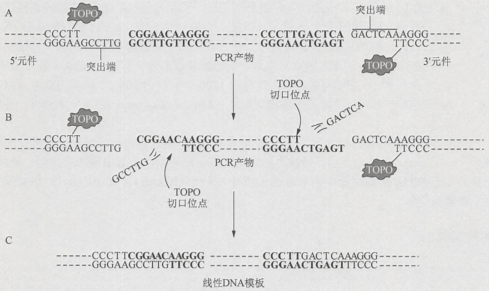

<details>
<summary>flowchart</summary>

This diagram illustrates the structural and regulatory relationships between a DNA sequence (labeled A, B, C) and its corresponding physical components (TOPO, GACTCAA, GGAACTG). It maps specific genetic elements like CCCTT, CGGAACA, and TOPO to their respective transcriptional states and downstream functional domains.
</details>

图 2 用于产生带有确定 5' 和 3' 功能元件的线性 DNA 结构的 TOPO 工具 ( $P_{CMV/TetO}$  5' 元件)。(A) 5' 和 3' 功能元件和要添加它们的 PCR 产物如图所示。通过正向和反向引物，不同的 11bp 的序列（粗体）被添加到 PCR 产物的两端；(B) TOPO 切割 PCR 产物，产生 TOPO-活化的突出端（释放单链 6 聚体），与 TOPO-活化的功能元件突出端互补；(C) 复性突出端，使各自的 5'-OH 并列，攻击另一个的磷酸酪氨酰键，将各功能元件的两条链连接到 PCR 产物的两条链，释放两个 TOPO 分子，并生成一个直接用于体外和体内的线性重组模板。（转载自 Invitrogen 公司 2002 年，Life Technologies 公司的一部分，©2002。）

TOPO 工具技术手册（Invitrogen 公司，2002 年）明确、详细地描述了将用户 PCR 产物与 Life Technologies 公司所出售的 5'-和 3'-TOPO-适应元件连接所需的所有步骤和必要对照。这些信息可以概括如下。

1. 设计 PCR 引物扩增靶序列。这些引物含有 5'-OH 基团，并应包含将 PCR 产物连

<small><span class="docvortex-page-footnote" data-block-type="page_footnote" style="color:#6b7280">① 译者注:应为 384 孔，原文为 393 孔。</span></small>

---

第 3 章 质粒载体克隆与转化

179

接到 TOPO 工具 5' 和 3' 元件所需的 11bp 序列。

2. 使用高保真度的 Taq DNA 聚合酶（如 Platinum Taq，Life Technologies 公司）扩增靶序列，用琼脂糖凝胶电泳确认 PCR 产物的完整性和浓度。
3. 以适当的摩尔比将 PCR 产物与 5'-或 3'-TOPO-适应元件混合来产生一个线性结构。
4. 使用元件特异性引物（由 Life Technologies 公司提供）进行第二轮 PCR，以扩增目标结构及其连接的元件。验证扩增产物的完整性和浓度，如果一切顺利，就可以用于转染或其他下游应用了。

## 参考文献

Invitrogen. 2002. TOPO tools technology. For generating functional constructs containing your PCR products and a choice of TOPO-adapted elements (version B, 072501, 25-0413). Invitrogen Life Technologies, Inc., Rockville, MD.

Sykes KF, Johnston SA. 1999. Linear expression elements: A rapid, in vivo, method to screen for gene functions. Nat Biotechnol 17: 355–359.


## 抗生素

## 氨苄青霉素和羧苄青霉素

## 性质和作用方式

- 氨苄青霉素是一种氨基青霉素；羧苄青霉素是一种半合成羧基青霉素。两种化合物对诸多革兰氏阴性菌如流感嗜血杆菌（Haemophilus influenzae）和大肠杆菌等具有抗菌活性。羧苄青霉素是第一种能够显著对抗假单胞菌属（Pseudomonas）的青霉素，假单胞菌属对氨基青霉素如氨苄青霉素不敏感。
- 青霉素敏感的生物体，部分是由于组成其细胞壁刚性的交联肽聚糖薄层，它只有一到两个分子厚。长的聚糖链完全由氨基糖组成，并且通过含有 $\delta$-氨基酸的肽链交联。青霉素抑制细胞外由转肽酶催化的交联终末期合成（综述见 Donowitz and Mandell 1988）。青霉素在细菌的对数生长期对抗细菌最有效，在静止生长期影响相对较小，此时肽多糖的合成被抑制。
- 除了抑制转肽酶的活性，青霉素还抑制大肠杆菌形成杆状结构和分裂期形成隔膜所需的酶（称为青霉素结合蛋白或PBP）的活性（Tomasz 1986）。

## 氨苄青霉素和羧苄青霉素的耐药机制

- 浆周酶β-内酰胺酶催化β-内酰胺环的环状酰胺键水解，伴随着氨苄青霉素和羧苄青霉素解毒（Abraham and Chain 1940；Bush and Sykes 1984）。
- β-内酰胺酶少量存在于抗生素耐药革兰氏阴性菌野生菌株的周质空间，编码于染色体或质粒上。最普遍的革兰氏阴性菌β-内酰胺酶——TEM β-内酰胺酶，是根据一个雅典女孩姓名首字母的缩写命名，1965年正是从这个女孩身上首次分离出一株表达此酶的大肠杆菌（Datta and Kontomichalou 1965）。TEM β-内酰胺酶被广泛用作分子克隆的选择性标记，是一种由bla基因编码的286残基的蛋白质（Sutcliffe 1978）。新生的内酰胺酶蛋白质的前23个氨基酸作为信号序列，在蛋白质易位到周质的过程中被切掉。
- 当β-内酰胺酶由高拷贝载体表达时，例如在分子克隆中所使用，大量的酶被分泌到培养基中。单个转化菌落可以产生足够的β-内酰胺酶，水解周围培养基中的抗生素，创建一个受保护的区域使得对抗生素敏感的菌落可以生长。这导致未被转化的卫星菌落的出现。对于诸如假单胞菌属和埃希氏菌属等产生的β-内酰胺酶水解，羧苄青霉素比氨苄青霉素更耐受，因此在选择性培养基中使用羧苄青霉素而不是氨苄青霉素，可以改善此问题，但不能完全消除。

---

180

分子克隆实验指南（原书第四版）

## 四环素

## 性质和作用方式

- 所有四环素类抗生素共有一个相同的四环碳环骨架，以支持多种基团。
- 第一种四环素——金霉素，作为生金链霉菌（Streptomyces aureofaciens）合成的一种自然产生的抗生素于1948年被发现，其活性能够对抗广谱的革兰氏阳性和革兰氏阴性菌以及原生动物。到1980年，已分离或合成约1000种四环素衍生物，估计全球产量超过500t（综述见Chopra et al. 1992）。
- 四环素通过外膜孔蛋白通道经被动扩散进入细菌细胞，这些通道由 OmpF 蛋白组成。抗生素转运穿越细胞质膜进入细胞质需要 pH 或电极电位梯度。
- 四环素抑制细菌生长是通过干扰核糖体的密码子-反密码子相互作用,进而阻止蛋白质的合成（综述见 Gale et al. 1981; Chopra et al. 1992）。具体而言，抗生素结合到 30S 核糖体亚基的一个位点，从而阻止氨酰-tRNA 附着到受体位点上。

## 四环素的耐药机制

已知有几种不同的四环素抗性机制:四环素外排、核糖体的保护和四环素修饰。该抗性基因受控于变构阻遏蛋白 TetR（Reichheld et al. 2009）和转座子 Tn10 四环素操纵子的调控元件，打开和关闭其在哺乳动物系统中的表达。TetR 蛋白检测细胞内的四环素水平。与抗生素的结合引起构象变化，减少了 TetR 与元件的结合，从而减少了其对 TetA 转录的抑制，而 TetA 编码一种膜蛋白，将四环素排出细菌细胞（Saenger et al. 2000）。

## 卡那霉素

## 卡那霉素的性质和作用方式

卡那霉素是氨基糖苷类抗生素家族的成员，于1957年在日本国立卫生研究院从卡那霉素链霉菌（Streptomyces kanamyceticus）的培养中首次分离得到（Umezawa et al. 1967），卡那霉素链霉菌合成三种形式的抗生素:卡那霉素A、B和C。主要成分卡那霉素A对多种细菌具有广谱抗菌活性，是多年来用于治疗由革兰氏阴性杆菌引起的严重感染的一种重要抗生素。它的立体化学和绝对构型最初通过化学方法和核磁共振（NMR）获得，后经X射线衍射晶体分析法确认（综述见Hooper 1982）。

氨基糖苷类抗生素是快速扩散通过革兰氏阴性菌外膜孔蛋白通道的多聚阳离子。然而，从周质空间进入细胞质的运输是由内周质膜的负膜电位驱动的，因此，这是一个需能的过程。在细胞质中，这些抗生素与至少三个核糖体蛋白以及更小的核糖体RNA亚基解码区域的特定碱基相互作用，从而抑制蛋白质的合成和增加诱发翻译错误的频率（综述见Noller 1984；Cundliffe 1990）。

在体外，卡那霉素和其他缺少一个胍基基团的氨基糖苷类抗生素（如新霉素和庆大霉素）也可以抑制I类内含子的剪接（von Ahsen et al. 1991, 1992; von Ahsen and Noller 1993）。这一观察结果支持一种见解，即氨基糖苷类抗生素可以识别已在长期进化时间内保守的RNA古老结构（Davies 1990）。

## 卡那霉素的耐药机制

在结构上，卡那霉素与庆大霉素、新霉素、遗传霉素（G418）相似，它们可以被许多相同的细菌氨基磷酸转移酶（APH）灭活（综述见 Davies and Smith，1978；Shaw et al. 1993）。根据底物特异性区分的 APH 的 7 个主要类群中，2 个已被广泛地用作卡那霉素抗性（Kmr）的选择性标记:从转座子 Tn903 分离出的 APH(3')-I 和分离自 Tn5 的

---

第 3 章 质粒载体克隆与转化

181

APH(3')-II。由这些基因编码的 APH 通过将 ATP 的 γ 磷酸根转移到 pseudosaccharide 3' 位置的羟基使卡那霉素失活。

aph(3')-Ia 和 aph(3')-IIa 都已被用作原核表达载体的选择性标记。然而，从文献中确定哪个基因用于构建特定载体并不总是容易的。因为 aph(3')-Ia 和 aph(3')-IIa 的 DNA 序列高度趋异（Shaw et al. 1993），使得这两个基因具有不同的限制性图谱，并在正常的严格条件下不会交叉杂交。aph(3')-II 可以有效地使遗传霉素（G418）失活，用于真核细胞中的优势筛选标记（参见 Jimenez and Davies 1980；Colbè re-Garapin et al. 1981；Southern and Berg 1982；Chen and Fukuhara 1988）。

## 氯霉素

氯霉素抑制蛋白质的合成并且阻碍宿主 DNA 合成，但对松弛型质粒的复制没有影响。因此，在含有药物的细菌培养基温育的过程中，松弛型质粒的拷贝数增加。直到 20 世纪 80 年代初，大量培养时经常使用氯霉素以获得可观的含有野生型 colE1 复制子的质粒。1982 年后，大多数构建的高拷贝数质粒载体携带突变，将质粒 DNA 从拷贝数控制解除。含有这些突变版本的 colE1 起始点的载体维持在每个细胞数百个拷贝，即使不抑制细菌蛋白质的合成也可以得到高产量的质粒 DNA。然而，用氯霉素处理细菌培养物仍具有一定的优势:在药物的存在下，质粒的拷贝数可以进一步增加 2～3 倍，更重要的是，细菌裂解液的体积和黏度都大大降低，因为宿主的复制受到抑制。许多研究者发现，在生长培养中添加氯霉素比处理高黏稠的裂解液方便得多。

## 参考文献

- Abraham EP, Chain E. 1940. An enzyme from bacteria able to destroy penicillin. Nature 146: 837.
- Bush K, Sykes RB. 1984. Interaction of β-lactam antibiotics with β-lactamases as a cause for resistance. In Antimicrobial drug resistance (ed Bryan LE), pp. 1–31. Academic, New York.
- Chen XJ, Fukuhara H. 1988. A gene fusion system using the aminoglycoside 3'-phosphotransferase gene of the kanamycin-resistance transposon Tn903: Use in the yeast Kluyveromyces lactis and Saccharomyces cerevisiae. Gene 69: 181–192.
- Chopra I, Hawkey PM, Hinton M. 1992. Tetracyclines, molecular and clinical aspects. J Antimicrob Chemother 29: 245–277.
- Colbère-Garapin F, Horodniceanu F, Kourilsky P, Garapin AC. 1981. A new dominant hybrid selective marker for higher eukaryotic cells. J Mol Biol 150: 1–14.
- Cundliffe E. 1990. Recognition sites for antibiotics within rRNA. In The ribosome: Structure, function, and evolution (ed Hill WE, et al.), pp. 479–490. American Society for Microbiology, Washington, DC.
- Datta N, Kontomichalou P. 1965. Penicillinase synthesis controlled by infectious R factors in Enterbacteriaceae. Nature 208: 239–241.
- Davies J. 1990. What are antibiotics? Archaic functions for modern activities. Mol Microbiol 4: 1227–1232.
- Davies J, Smith DI. 1978. Plasmid-determined resistance to antimicrobial agents. Annu Rev Microbiol 32: 469–518.
- Donowitz GR, Mandell GL. 1988. β-Lactam antibiotics. N Engl J Med 318:419–426, 490–500.
- Gale EF, Cundliffe E, Reynolds PE, Richmond MH, Waring MJ. 1981. Antibiotic inhibitors of ribosome function. In The molecular basis of antibiotic action, 2nd ed., pp. 402–408. John Wiley, Chichester, UK.
- Hooper IR. 1982. The naturally occurring aminoglycoside antibiotics. In Aminoglycoside antibiotics (ed Umezawa H, Hooper IR), pp. 1–35. Springer-Verlag, Berlin.
- Jimenez A, Davies J. 1980. Expression of a transposable antibiotic resistance element in Saccharomyces. Nature 287: 869–871.
- Noller HF. 1984. Structure of ribosomal RNA. Annu Rev Biochem 53: 119–162.
- Reichheld SE, Yu Z, Davidson AR. 2009. The induction of folding cooperativity by ligand binding drives the allosteric response of tetracycline repressor. Proc Natl Acad Sci 106: 22263–22268.
- Saenger W, Orth P, Kisker C, Hillen W, Hinrichs W. 2000. The tetracycline repressor—A paradigm for a biological switch. Angew Chem Int Ed Engl 39: 2042–2052.
- Shaw KJ, Rather PN, Hare RS, Miller GH. 1993. Molecular genetics of aminoglycoside resistance genes and familial relationships of the aminoglycoside-modifying enzymes. Microbiol Rev 57: 138–163.
- Southern PJ, Berg P. 1982. Transformation of mammalian cells to antibiotic resistance with a bacterial gene under control of the SV40 early region promoter. J Mol Appl Genet 1: 327–341.
- Sutcliffe JG. 1978. Nucleotide sequence of the ampicillin resistance gene of Escherichia coli plasmid pBR322. Proc Natl Acad Sci 75: 3737–3741.
- Tomasz A. 1986. Penicillin-binding proteins and the antibacterial effectiveness of β-lactam antibiotics. Rev Infect Dis (suppl. 3) 8: S260–S278.
- Umezawa H, Okanishi M, Utahara R, Maeda K, Kondo S. 1967. Isolation and structure of kanamycin inactivated by a cell free system of kanamycin-resistant E. coli. J Antibiot 20: 136–141.
- von Ahsen U, Noller HF. 1993. Footprinting the sites of interaction of antibiotics with catalytic group I intron RNA. Science 260: 1500–1503.
- von Ahsen U, Davies J, Schroeder R. 1991. Antibiotic inhibition of group I ribozyme function. Nature 353: 368–370.
- von Ahsen U, Davies J, Schroeder R. 1992. Non-competitive inhibition of group I intron RNA self-splicing by aminoglycoside antibiotics. J Mol Biol 226: 935–941.


## 衔接子

衔接子是短的双链合成寡核苷酸，在一端或两端携带限制性内切核酸酶识别位点和单链尾巴。它们可用于将研究者选择的限制位点添加到一个现有的限制位点上。衔接子的单链尾巴连接到限制性切割靶 DNA 所产生的匹配的突出单链末端。连接后，靶 DNA 的新末端序列可以用适当的限制性内切核酸酶切割，以产生新的突出末端。

---

182

分子克隆实验指南（原书第四版）

衔接子的鼎盛时期在前 PCR 时代。如今，在 DNA 末端添加给定序列的方法是简单地将识别序列掺入到 PCR 寡核苷酸引物 5' 端中（见方案 9）。但是，如果靶 DNA 群体由不同序列组成（如 cDNA 群体或基因组 DNA 片段集合），衔接子是一个有吸引力的选择。

## 磷酸化和非磷酸化的衔接子

市售的衔接子有两种基本设计和各种特异性。一些衔接子由两个不同长度的寡核苷酸之间形成一个局部双链，例如，一个 EcoR I-Not I 衔接子可能具有以下结构:

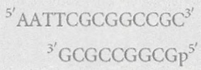

在连接过程中，衔接子的 5' 突出端与靶 DNA 的互补末端接合，恢复一个 EcoR I 位点（GAATTC）。此外，磷酸化平末端的连接使得衔接子形成一个包含内部 Not I 识别位点（GCGGCCGC）的二聚体。不会形成高阶聚合物，因为突出的 5' 端没有磷酸化。

其他一切都是同样的，附加这种类型衔接子的首选方法是使用非磷酸化的衔接子和磷酸化的靶标（见方案8）。如果靶DNA的两端序列是互补的，并且携带5'-磷酸基团，靶DNA将在连接反应过程中环化。为利于衔接子附加到靶DNA的末端，连接反应应采用摩尔数高度过量（至少50倍）的非磷酸化衔接子。

另一类提供的衔接子是非磷酸化的单寡核苷酸，其序列是部分自我互补的。形成双链体后，一个 EcoR I-Pst I 衔接子可能具有以下结构:

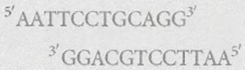

在连接到靶 DNA 的 5'-磷酸化 EcoR I 末端时，衔接子的一条链与靶 DNA 接合，恢复一个完整的 EcoR I 位点。进一步的连接是不可能的，除非该衔接子在研究者的实验室中被磷酸化了，在这种情况下，衔接子可以形成串联排列。磷酸化有时是必要的，因为用第二种限制性内切核酸酶切割衔接子串联阵列的效率高于单个衔接子，在此例中是 Pst I（位点:CTGCAG）。

然而，其他一切都是同样的，附加这种类型衔接子的首选方法是使用非磷酸化的衔接子和磷酸化的靶标。为了抑制靶 DNA 的环化，连接反应中应该使用摩尔数过量很多（约 50 倍）的衔接子。

在建立连接反应前，重要的是从准备的衔接子中消除氢键结合的二聚体，可以将准备的衔接子（溶于 TE，pH 7.5）加热到  $90^{\circ}$ C 5min，待它们冷却至室温后立即添加到连接混合物中。

## 巧妙利用衔接子

也许衔接子最巧妙的使用是在 cDNA 文库构建时将 cDNA 群体连接到载体中（Yang et al. 1986; Elledge et al. 1991）。载体上 Xho I 克隆位点的凹陷的 3'端被部分填补，含有与部分填补 Xho I 位点互补的 3 个碱基的突出末端的磷酸化衔接子被连接到 cDNA 上。载体或 cDNA 分子都不能与它们自己复性，但它们可以互连。由于 Xho I 位点再生，克隆的 cDNA 可以通过用 Xho I 消化恢复。这一策略大大提高了 cDNA 克隆中棘手的连接步骤的效率，并消除了插入到载体中之前对 cDNA 甲基化或限制性酶切消化的需要。

现在衔接子还被用于:

\- 克隆小 RNA 的 cDNA 拷贝（如 miRNA）（见 Elbashir et al. 2001；Lau et al. 2001

---

第 3 章 质粒载体克隆与转化

183

等)。简言之，3'和5'-衔接子寡核苷酸使用T4 RNA连接酶连接到纯化的小RNA。连接产物被反转录，通过PCR扩增并克隆。

- 抑制消减杂交（Rebrikov et al. 2004; Rebrikov 2008）。
- 3'-RACE，使用衔接子-引物将 mRNA 群体转录成 cDNA，衔接子-引物 3'端有 poly(T); 5'端有 30～40 个核苷酸，含有两个或三个限制性内切核酸酶识别位点（见第 7 章，方案 11）。

## 参考文献

Elbashir SM, Lendeckel W, Tuschl T. 2001. RNA interference is mediated by 21- and 22-nucleotide RNAs. Genes Dev 15: 188–200.

Elledge SJ, Mulligan JT, Ramer SW, Spottswood M, Davis RW. 1991. λYES: A multifunctional cDNA expression vector for the isolation of genes by complementation of yeast and Escherichia coli mutations. Proc Natl Acad Sci 88: 1731–1735.

Lau NC, Lim LP, Weinstein EG, Bartel DP. 2001. An abundant class of tiny RNAs with probable regulatory roles in Caenorhabditis elegans. Science 294: 858–862.

Rebrikov DV. 2008. Identification of differential genes by suppression subtractive hybridization: An overview. Cold Spring Harb Protoc 10.1101/pdb.top21.

Rebrikov DV, Desai SM, Siebert PD, Lukyanov SA. 2004. Suppression subtractive hybridization. Methods Mol Biol 258: 107–134.

Yang YC, Ciarletta AB, Temple PA, Chung MP, Kovacic S, Witek-Giannotti JS, Leary AC, Kriz R, Donahue RE, Wong GG, et al. 1986. Human IL-3 (multi-CSF): Identification by expression cloning of a novel hematopoietic growth factor related to murine IL-3. Cell 47: 3–10.


## 接头

合成接头是小的、自我互补的合成 DNA 片段，通常长度为 8～16 个核苷酸，复性形成平末端双链分子，含有一个限制性内切核酸酶识别位点。例如，在复性后，一个携带 EcoRI 识别位点的合成接头可能有如下序列:

$^{5'}$ CCGGAATTCCGG $^{3'}$

$^{3'}$ GGCGTTAAGGCC $^{5'}$

接头曾经用来为DNA的双链平末端装上酶切位点，以助于克隆(Scheller et al. 1977)。供应商提供种类繁多的商业化接头，主要是两种形式:可直接用于连接的5'端含有磷酸残基的接头，以及连接到DNA前需要用多核苷酸激酶和ATP处理的非磷酸化接头。通常，磷酸化的接头以约100倍摩尔过量连接到平末端的靶DNA，此化学计量比使得接头末端-末端连接，同时聚合接头连接到靶DNA的每一端。用适当的限制性内切酶消化除去多余的接头，产生含有黏性突出末端的靶分子，可以连接到含有匹配末端的载体上。

如今，接头是一种濒临灭绝的东西，因为大多数克隆和亚克隆使用已知序列 DNA 进行，通过在用于扩增的 PCR 引物中引入酶切位点，线性 DNA 可以简单方便地装配上选择的末端。

现在的合成接头已为特殊目的而设计。例如:

- 克隆小分子RNA和构建miRNA的cDNA文库(Lau et al. 2001; Bartel 2004)。New England Biolabs公司销售5'-腺苷酸化、3'-阻断的寡核苷酸，可以被RNA连接酶识别，在缺少ATP的情况下将寡核苷酸的“活化的”腺苷化5'端连接到单链miRNA的3'-OH。位于保护基团的接头3'端的氨基基团可以防止自身连接、环化或者接头连接到miRNA的5'端。
- 长接头（80 个核苷酸）分别与载体和靶 DNA 重叠 40bp 片段。用于在酵母体内构建重组体。在构造不能轻易通过 PCR 扩增的复杂结构时，这种特殊技术是有价值的（Raymond et al. 2002）。
- 生物素化的接头。用来捕获和克隆活跃在哺乳动物细胞中的调控元件（Boyle et al. 2008; Song and Crawford 2010）。

---

184

分子克隆实验指南（原书第四版）

## 参考文献

- Bartel DP. 2004. MicroRNAs: Genomics, biogenesis, mechanism, and function. Cell 116: 281–297.
- Boyle AP, Davis S, Shulha HP, Meltzer P, Margulies EH, Weng Z, Furey TS, Crawford GE. 2008. High-resolution mapping and characterization of open chromatin across the genome. Cell 132: 311–322.
- Lau NC, Lim LP, Weinstein EG, Bartel DP. 2001. An abundant class of tiny RNAs with probable regulatory roles in Caenorhabditis elegans. Science 294: 858–862.
- Raymond CK, Sims EH, Olson MV. 2002. Linker-mediated recombinational subcloning of large DNA fragments using yeast. Genome Res
- 12: 190–197.
- Scheller RH, Dickerson RE, Boyer HW, Riggs AD, Itakura K. 1977. Chemical synthesis of restriction enzyme recognition sites useful for cloning. Science 196: 177–180.
- Song L, Crawford GE. 2010. DNase-seq. A high-resolution technique for mapping active gene regulatory elements across the genome from mammalian cells. Cold Spring Harb Protoc 10.1101/pdb.prot.5384.


## 连接和连接酶

## DNA 连接酶

在 20 世纪 60 年代中期发现的 DNA 连接酶对于 70 年代中期分子克隆技术的发展是至关重要的。在一段时间内人们早已明白，应该存在能够封闭双链 DNA 断裂的酶，可以用于封闭 DNA 复制、重组和修复过程中引入的切口。到 1965 年，人们已经开始认真寻找一种可以连接 DNA 分子的酶。1967 年年初研究取得了突破，NIH 的 Marty Gellert 研究表明，大肠杆菌提取物可以将 λ 噬菌体 DNA 氢键环转换为共价闭合环状形式。在短短几个月内，Gellert 和其他几个组独立纯化了酶，其活性能够催化通过 Watson-Crick 配对保持双链结构的一条 DNA 链中的并列 3'-羟基和 5'-磷酸端之间形成磷酸二酯键（综述见 Lehman 1974）。

DNA 的连接是一个三步反应:①形成共价的连接酶-AMP 中间体；②AMP 转移到 DNA 的 5'-磷酸末端；③并列 3'-羟基攻击 AMP-DNA 键，DNA 中的切口被封闭，AMP 被释放（综述见 Pascal 2008）。这三个连续的步骤在连接酶的三个不同域进行，与双链 DNA 接触的各个域环绕 DNA 底物形成反应域。

DNA 连接酶主要用于产生新的核酸分子组合，以及在分子克隆前将其连接到载体上。

用于分子克隆的 DNA 连接酶是细菌来源或者噬菌体编码。所有真细菌，无论是嗜热或嗜温，包含一个单一的连接酶基因，编码  $NAD^{+}$ -依赖型的酶（Olivera and Lehman 1967；Takahashi et al. 1984）。在连接反应的第一步中，使用  $NAD^{+}$ 的二磷酸作为磷酸酐键和腺苷基团转移到 DNA 连接酶赖氨酸残基的  $\varepsilon$ -氨基基团。腺苷酸残基然后转移到 DNA 底物的 5'-磷酰基末端，变得易于受到并列的 3'-羟基基团的亲核攻击。这导致磷酸二酯键的形成，消去 AMP，以及形成 DNA 链的共价连接（综述参见 Pascal 2008 和 Shuman 2009）。

用于分子克隆的 DNA 连接酶在连接非经典底物时能力有所不同，如平末端双链、DNA-RNA 杂交体或单链 DNA。这些以及其他的属性归纳于表 5。分子克隆中最常用的催化体外连接的酶是 T4 噬菌体编码的 DNA 连接酶。

## 噬菌体 T4 DNA 连接酶

- T4 DNA 连接酶，由噬菌体 T4 的基因 30 所编码（Wilson and Murray 1979），是 487 个氨基酸组成的单体蛋白质 ($M_r$ 计算值 = 55230)（Weiss et al. 1968b; Armstrong et al. 1983）。
- 由商业化高产大肠杆菌菌株纯化的 T4 DNA 连接酶（Tait et al. 1980），对于黏性末端 $K_{\mathrm{m}}$ 为 $6 \times 10^{-7} \mathrm{~mol} / \mathrm{L}$ （Sugino et al. 1977），平末端为 $5 \times 10^{-5} \mathrm{~mol} / \mathrm{L}$，切口为 $1.9 \times 10^{-9} \mathrm{~mol} / \mathrm{L}$。酶对 ATP 的 $K_{\mathrm{m}}$ 约为 $5 \times 10^{-5} \mathrm{~mol} / \mathrm{L}$（Weiss et al. 1968b）。

---

第 3 章 质粒载体克隆与转化

185

\- 已报道 T4 RNA 连接酶能刺激 T4 DNA 连接酶的活性（Sugino et al. 1977）。但是，聚乙二醇（Pheiffer and Zimmerman 1983）和氯化六氨合高钴（Rusche and Howard-Flanders 1985）等试剂，可以增加大分子群集，提高连接速率 3 个数量级，而且更便宜（见信息栏“缩合剂和聚合剂”）。

表 5 DNA 连接酶

<table><tr><td rowspan="2">连接酶</td><td colspan="4">底物 $^a$ </td><td rowspan="2">辅因子和激活剂</td><td rowspan="2">温度</td><td rowspan="2">巯基试剂</td></tr><tr><td>黏性末端</td><td>平末端</td><td>DNA-RNA杂交体</td><td>RNA-RNA杂交体</td></tr><tr><td>大肠杆菌连接酶</td><td>是</td><td>是 $^b$ </td><td>否</td><td>否</td><td>DPN $^+$ Mg $^{2+}$ (1~3 mol/L)</td><td>对于黏性末端 10~15°C;对于封闭切口,37°C $^c$ </td><td>不需要 $^d$ </td></tr><tr><td>T4 连接酶</td><td>是</td><td>是 $^b$ </td><td>是 $^e$ </td><td>是 $^e$ </td><td>ATPMg $^{2+}$ (10mmol/L)</td><td>对于黏性末端 4°C $^f$ ;对于平末端 15~25°C $^h$ ;对于封闭切口,37°C $^i$ </td><td>需要二硫苏糖醇 $^g$ </td></tr><tr><td>嗜热细菌的连接酶</td><td>是</td><td>否</td><td>否</td><td>否</td><td>DPN $^{+j}$ Mg $^{2+}$ (10 mmol/L)</td><td>对于黏性末端 24~37°C;对于封闭切口,65~72°C $^{k,l,m}$ </td><td>需要 $^{k,m}$ </td></tr></table>

a. 如果这些 DNA 的末端在连接位点携带以下基团，连接酶将不会连接成对的 DNA:5'-羟基和 3'-羟基；5'-羟基和 3'-磷酸；5'-磷酸和 3'-双脱氧核苷；5'-三磷酸和 3'-羟基

b. 最初报道大肠杆菌 DNA 连接酶（Sugino et al. 1977）是不能连接平末端 DNA 分子的，除了在缩合剂如聚乙二醇或聚蔗糖等（Zimmerman and Pheiffer 1983）以及一价阳离子如  $Na^{+}$ 等（Hayashi et al. 1985a,b）存在的情况下。不过，最近 Barringer 等（1990）阐明，大肠杆菌 DNA 连接酶能够连接平末端和一些单链核酸，动力学依赖于酶和底物的浓度。然而，对于常规连接平末端 DNA，噬菌体 T4 连接酶是值得选择的酶。T4 DNA 连接酶可以连接平末端分子（Ehrlich et al. 1977; Sgaramella and Ehrlich 1978），但反应速率不线性依赖于酶的浓度，只有在高浓度 DNA 和酶时能有效工作。此外，聚合剂如聚乙二醇、聚蔗糖、氯化六氨合高钴等加快 T4 DNA 连接酶平末端连接速率 1000 倍，并可在较低的酶、ATP 和 DNA 浓度（Zimmerman and Pheiffer 1983；Rusche and Howard-Flanders 1985）下反应。平末端连接被高浓度的  $Na^{+}$ （≥50mmol/L）和磷酸盐（≥25mmol/L）抑制（Raae et al. 1975）。

c. Dugaiczyk 等 (1975)。

d. Weiss 和 Richardson (1967)。

e. T4 DNA 连接酶可以将 RNA 分子复性连接到互补的 DNA 或 RNA 模板，虽然效率低（Kleppe et al.1970）。

f. Ferretti Sgaramella (1981).

g. Weiss 等（1968a，b）。

h. Sgaramella 和 Ehrlich (1978)。

i. Pohl 等（1982）。

j. 几乎所有嗜热连接酶都和嗜温真细菌连接酶一样，使用 DPN $^{+}$ 作为辅因子。不过，一种需要 ATP 作为辅因子的热稳定连接酶已被克隆和测序（Kletzin 1992）。这种酶的特性还没有详细研究。

k. Takahashi 等（1984）。

1. Takahashi 和 Uchida (1986)。

m. Barany (1991a, b).

## 克隆中常用 DNA 连接酶的属性

- 如表 5 所示，T4 DNA 连接酶可催化黏性末端（Hedgpeth et al. 1972；Mertz and Davis 1972）、寡脱氧核苷酸、RNA-DNA 杂交体中寡核糖核苷酸（Olivera and Lehman 1968；Kleppe et al. 1970；Fareed et al. 1971）的连接。另外，此酶可以有效地促进具有完全碱基配对末端的两个双链分子末端间的连接（Sgar-amella et al. 1970；Ehrlich et al. 1977）。
- 对于杂交到互补模板并且在双链的3'或5'结合处含有错配碱基的寡核苷酸进行连接反应，T4 DNA 连接酶表现出强烈的排斥（Wiaderkiewicz and Ruiz-Carillo 1987; Landegren et al. 1988; Wu and Wallace 1989），但不是绝对的（Goffin et al. 1987）。这种区分完美和不完美配对末端的能力使寡核苷酸连接和扩增系统得到发展，以检测医学上感兴趣的基因突变。
- 高浓度（>100mmol/L）的一价阳离子如 $\mathrm{Na}^{+}$ 和 $\mathrm{K}^{+}$，抑制T4 DNA连接酶的活性，抑制的程度根据DNA底物的末端序列变化（Hayashi et al. 1985a）。然而，在聚合剂如 $10\%$ 聚乙二醇的存在下，一价阳离子有相反的效果，转而刺激酶的活性。

---

186

分子克隆实验指南（原书第四版）

## 大肠杆菌 DNA 连接酶

- 大肠杆菌 DNA 连接酶由 lig 基因进行编码，位于大肠杆菌基因图谱的 52min (Gottesman et al. 1973; Bachmann 1990)。
- lig 基因（Gottesman 1976）和 $lop11\ lig^{+}$（Cameron et al. 1975），一个过量生产此酶的调控突变体，已被克隆到 $\lambda$ 噬菌体载体，从而有利于大规模纯化此酶（Panasenko et al. 1977, 1978）。lig 基因的核苷酸序列（Ishino et al. 1986）表明，大肠杆菌 DNA 连接酶由 671 个氨基酸组成，相对分子质量为 73690。
- 一些年来，人们认为大肠杆菌 DNA 连接酶不能连接平末端双链 DNA。然而，随着连接酶基因的克隆和表达，获得了高活性的酶制剂，能够以中等效率催化平末端连接（Barringer et al. 1990）。反应混合物含有 10%～15% 聚乙二醇和高浓度的 K$^{+}$时，可以刺激平末端连接提高约 10 倍（Hayashi et al. 1985b）。尽管如此，分子克隆实验中没有广泛使用大肠杆菌 DNA 连接酶，因为 T4 DNA 连接酶能够在没有聚合剂的情况下有效地连接平末端 DNA。
- 不同于 T4 DNA 连接酶, 大肠杆菌 DNA 连接酶无法有效地将 RNA 连接到 DNA, 因此无法将 cDNA 第二链置换合成过程中出现的相邻 RNA 和 DNA 片段连接 (Okayama and Berg 1982)。所以, 此细菌酶可以用于产生被 RNA 片段隔断的长链 cDNA。

## 热稳定 DNA 连接酶

- 来自一些嗜热菌的编码热稳定连接酶的基因已被克隆、测序并在大肠杆菌中高水平表达（例如，见 Takahashi et al. 1984 年；Barany and Gelfand 1991；Lauer et al. 1991；Jónsson et al. 1994）。这些酶可以从商业来源购得。
- 同大肠杆菌的酶一样，几乎所有的热稳定连接酶使用 $\mathrm{NAD}^{+}$作为辅助因子，对双链DNA中的切口更有效。此外，和它们的嗜温同系物一样，热稳定连接酶在聚合剂的存在下可以催化平末端连接，甚至在高温下也可以（Takahashi and Uchida 1986）。
- 由于热稳定连接酶在多轮热循环后仍具有活性，它们广泛用于连接酶扩增反应，以检测哺乳动物 DNA 中的突变。

## 连接酶活性单位

连接酶活性单位的标准化对于生物化学家和分子克隆者是有意义的，但已被证明是一个可望而不可即的目标。在过去的20年中，至少有三个不同的单位已被用来衡量连接酶的活性。

- 一个 Weiss 单位（Weiss et al. 1968b）定义为在  $37^{\circ}$ C 下，20min 内催化将  $1nmol^{32}P$  从无机焦磷酸盐交换到 ATP 所需的连接酶的量。
- Modrich-Lehman 单位（Modrich and Lehman 1971）是基于放射性标记的具有 3'-羟基和 5'-磷酰基末端的 d(A-T)$_n$ 共聚物转换为耐受外切核酸酶 III 消化的形式，现在已很少使用。一个 Modrich-Lehman 单位定义为在标准测定条件下在 30min 内将 100nmol d(A-T)$_n$ 转换为外切核酸酶 III 耐受形式所需的酶量。

---

第 3 章 质粒载体克隆与转化

187

\- 任意单位，基于 DNA 连接酶连接黏性末端的能力，由商业供应商定义。这些单位往往比定量更主观，对重视精度的研究者几乎提供不了什么指导。在缺乏有效信息的情况下，大多数研究者必须通过估测建立连接反应，这意味着不可避免地要使用比实际需要量更多的连接酶，而这正是商业公司所寻求的。作为一个粗略的指南，1Weiss U 约相当于 60 个黏性末端单位（New England Biolabs 公司所定义的）。因此，在 16℃，30min 内，0.015 Weiss U T4 DNA 连接酶应连接 50% 的用 Hind III 消化的 5 μg λ 噬菌体 DNA 所得到的片段。

## T4 RNA 连接酶

T4 RNA 连接酶由 Silber 等（1972）首次报道，催化单链 RNA 或 DNA 连接到寡核糖核苷酸或寡脱氧核苷酸（England et al. 1977；Uhlenbeck and Gumport 1982）。该反应需要具有 5'端磷酸基的供体分子、具有 3'端羟基基团的受体分子和 ATP，除非供体 5'端已处于活化的中间体形式。含有 5'-磷酸基团和 3'-羟基基团的寡核苷酸既可作为受体，也可作为供体，产生环状和/或多聚体产物。

T4 RNA 连接酶可从一些商业供应商买到。NEB 公司销售几种形式的酶，它们催化不同形式的 RNA 和寡脱氧核苷酸模板连接反应的效率不同。

T4 RNA 连接酶已用于标记 RNA 的 3' 端（England and Uhlenbeck 1978a），在准备用于 PCR 扩增的 RNA 5' 端添加寡核糖核苷酸（Schaefer 1995），RNA 和 DNA 的分子间和分子内连接（Romaniuk and Ulhlenbeck 1983；Moore and Sharp 1992），以及酶法合成确定序列的寡核糖核苷酸（England and Uhlenbeck 1978b）。

## 参考文献

- Armstrong J, Brown RS, Tsugita A. 1983. Primary structure and genetic organization of phage T4 DNA ligase. Nucleic Acids Res 11: 7145–7156.
- Bachmann BJ. 1990. Linkage map of Escherichia coli K-12, edition 8. Microbiol Rev 54: 130–197. (Erratum Microbiol Rev [1991] 55: 191.)
- Barany F. 1991a. Genetic disease detection and DNA amplification using cloned thermostable ligase. Proc Natl Acad Sci 88: 189–193.
- Barany F. 1991b. The ligase chain reaction in a PCR world. PCR Methods Appl 1: 5–16. (Erratum PCR Methods Appl [1991] 1: 149.)
- Barany F, Gelfand DH. 1991. Cloning, overexpression and nucleotide sequence of a thermostable DNA ligase-encoding gene. Gene 109: 1–11.
- Barringer KJ, Orgel L, Wahl G, Gingeras TR. 1990. Blunt-end and single-strand ligations by Escherichia coli ligase: Influence on an in vitro amplification scheme. Gene 89: 117–122.
- Cameron JR, Panasenko SM, Lehman IR, Davis RW. 1975. In vitro construction of bacteriophage λ carrying segments of the Escherichia coli chromosome: Selection of hybrids containing the gene for DNA ligase. Proc Natl Acad Sci 72: 3416–3420.
- Dugaiczyk A, Boyer HW, Goodman HM. 1975. Ligation of EcoRI endonuclease-generated DNA fragments into linear and circular structures. J Mol Biol 96: 171–184.
- Ehrlich SD, Sgaramella V, Lederberg J. 1977. T4 ligase joins flush-ended DNA duplexes generated by restriction endonucleases. In Nucleic acid-protein recognition (ed Vogel HJ), pp. 261–268. Academic, New York.
- England TE, Gumport RI, Uhlenbeck OC. 1977. Dinucleoside pyrophosphate are substrates for T4-induced RNA ligase. Proc Natl Acad Sci 74: 4839–4842.
- England TE, Uhlenbeck OC. 1978a. 3'-Terminal labelling of RNA with T4 RNA ligase. Nature 275: 560–561.
- England TE, Uhlenbeck OC. 1978b. Enzymatic oligoribonucleotide synthesis with T4 RNA ligase. Biochemistry 17: 2069–2076.
- Fareed GC, Wilt EM, Richardson CC. 1971. Enzymatic breakage and joining of deoxyribonucleic acid. 8. Hybrids of ribo- and deoxyribonu
- cleotide homopolymers as substrates for polynucleotide ligase of bacteriophage T4. J Biol Chem 246: 925–932.
- Ferretti L, Sgaramella V. 1981. Temperature dependence of the joining by T4 DNA ligase of termini produced by type II restriction endonucleases. Nucleic Acids Res 9: 85–93.
- Goffin C, Bailly V, Verly WG. 1987. Nicks 3' or 5' to AP sites or to mispaired bases, and one-nucleotide gaps can be sealed by T4 DNA ligase. Nucleic Acids Res 15: 8755–8771.
- Gottesman MM. 1976. Isolation and characterization of a λ specialized transducing phage for the Escherichia coli DNA ligase gene. Virology 72: 33–44.
- Gottesman MM, Hicks ML, Gellert M. 1973. Genetics and function of DNA ligase in Escherichia coli. J Mol Biol 77: 531–547.
- Hayashi K, Nakazawa M, Ishizaki Y, Obayashi A. 1985a. Influence of monovalent cations on the activity of T4 DNA ligase in the presence of polyethylene glycol. Nucleic Acids Res 13: 3261–3271.
- Hayashi K, Nakazawa M, Ishizaki Y, Hiraoka N, Obayashi A. 1985b. Stimulation of intermolecular ligation with E. coli DNA ligase by high concentrations of monovalent cations in polyethylene glycol solutions. Nucleic Acids Res 13: 7979–7992.
- Hedgpeth J, Goodman HM, Boyer HW. 1972. DNA nucleotide sequence restricted by the RI endonuclease. Proc Natl Acad Sci 69: 3448–3452.
- Ishino Y, Shinagawa H, Makino K, Tsunasawa S, Sakiyama F, Nakata A. 1986. Nucleotide sequence of the lig gene and primary structure of DNA ligase of Escherichia coli. Mol Gen Genet 204: 1–7.
- Jónsson ZO, Thorbjarnardóttir SH, Eggertsson G, Palsdottir A. 1994. Sequence of the DNA ligase-encoding gene from Thermus scotoductus and conserved motifs in DNA ligases. Gene 151: 177–180.
- Kleppe K, Van de Sande JH, Khorana HG. 1970. Polynucleotide ligase-catalyzed joining of deoxyribo-oligonucleotides on ribopolynucleotide templates and of ribo-oligonucleotides on deoxyribopolynucleotide templates. Proc Natl Acad Sci 67: 68–73.

---

188

分子克隆实验指南（原书第四版）

- Kletzin A. 1992. Molecular characterisation of a DNA ligase gene of the extremely thermophilic archaeon Desulfurolobus ambivalens shows close phylogenetic relationship to eukaryotic ligases. Nucleic Acids Res 20: 5389–5396.
- Landegren U, Kaiser R, Sanders J, Hood L. 1988. A ligase-mediated gene detection technique. Science 241: 1077–1080.
- Lauer G, Rudd EA, McKay DL, Ally A, Ally D, Backman KC. 1991. Cloning, nucleotide sequence, and engineered expression of Thermus thermophilus DNA ligase, a homolog of Escherichia coli DNA ligase. J Bacteriol 173: 5047–5053.
- Lehman IR. 1974. DNA ligase: Structure, mechanism, and function. Science 186: 790–797.
- Mertz JE, Davis RW. 1972. Cleavage of DNA by R₁ restriction endonuclease generates cohesive ends. Proc Natl Acad Sci 69: 3370–3374.
- Modrich P, Lehman IR. 1971. Enzymatic characterization of a mutant of Escherichia coli with an altered DNA ligase. Proc Natl Acad Sci 68:1002–1005.
- Moore MJ, Sharp PA. 1992. Site-specific modification of pre-mRNA: The 2'-hydroxyl groups at the splice sites. Science 256: 992–997.
- Okayama H, Berg P. 1982. High-efficiency cloning of full-length cDNA. Mol Cell Biol 2: 161–170.
- Olivera BM, Lehman IR. 1967. Diphosphopyridine nucleotide: A cofactor for the polynucleotide-joining enzyme from Escherichia coli. Proc Natl Acad Sci 57: 1700–1704.
- Olivera BM, Lehman IR. 1968. Enzymic joining of polynucleotides. 3. The polydeoxyadenylate-polydeoxythymidylate homopolymer pair. J Mol Biol 36: 261–274.
- Panasenko SM, Cameron JR, Davis RW, Lehman IR. 1977. Five hundred-fold overproduction of DNA ligase after induction of a hybrid λ lysogen constructed in vitro. Science 196: 188–189.
- Panasenko SM, Alazard RJ, Lehman IR. 1978. A simple, three-step procedure for the large scale purification of DNA ligase from a hybrid λ lysogen constructed in vitro. J Biol Chem 253: 4590–4592.
- Pascal JM. 2008. DNA and RNA ligases: Structural variations and shared mechanisms. Curr Opin Struct Biol 18: 96–105.
- Pheiffer BH, Zimmerman SB. 1983. Polymer-stimulated ligation: Enhanced blunt- or cohesive-end ligation of DNA or deoxyribooligonucleotides by T4 DNA ligase in polymer solutions. Nucleic Acids Res 11:7853–7871.
- Pohl FM, Thomae R, Karst A. 1982. Temperature dependence of the activity of DNA-modifying enzymes: Endonucleases and DNA ligase. Eur J Biochem 123: 141–152.
- Raae AJ, Kleppe RK, Kleppe K. 1975. Kinetics and effect of salts and polyamines on T4 polynucleotide ligase. Eur J Biochem 60: 437–443.
- Romaniuk PJ, Uhlenbeck OC. 1983. Joining of RNA molecules with RNA ligase. Methods Enzymol 100: 52–59.
- Rusche JR, Howard-Flanders P. 1985. Hexamine cobalt chloride promotes intermolecular ligation of blunt end DNA fragments by T4 DNA ligase. Nucleic Acids Res 13: 1997–2008.
- Schaefer BC. 1995. Revolutions in rapid amplification of cDNA ends: New strategies for polymerase chain reaction cloning of full-length cDNA ends. Anal Biochem 227: 255–273.
- Sgaramella V, Ehrlich SD. 1978. Use of the T4 polynucleotide ligase in the joining of flush-ended DNA segments generated by restriction endonucleases. Eur J Biochem 86: 531–537.
- Sgaramella V, Van de Sande JH, Khorana HG. 1970. Studies on polynucleotides, C. A novel joining reaction catalyzed by the T4-polynucleotide ligase. Proc Natl Acad Sci 67: 1468–1475.
- Shuman S. 2009. DNA ligases: Progress and prospects. J Biol Chem 284:17365–17369.
- Silber R, Malathi VG, Hurwitz J. 1972. Purification and properties of bacteriophage T4-induced RNA ligase. Proc Natl Acad Sci 69: 3009–3013.
- Sugino A, Goodman HM, Heyneker HL, Shine J, Boyer HW, Cozzarelli NR. 1977. Interaction of bacteriophage T4 RNA and DNA ligases in joining of duplex DNA at base-paired ends. J Biol Chem 252: 3987–3994.
- Tait RC, Rodriguez RL, West RWJ. 1980. The rapid purification of T4 DNA ligase from a $\lambda$T4 lig lysogen. J Biol Chem 255: 813-815.
- Takahashi M, Uchida T. 1986. Thermophilic HB8 DNA ligase: Effects of polyethylene glycols and polyamines on blunt-end ligation of DNA. J Biochem 100: 123–131.
- Takahashi M, Yamaguchi E, Uchida T. 1984. Thermophilic DNA ligase. Purification and properties of the enzyme from Thermus thermophilus HB8. J Biol Chem 259: 10041–10047.
- Uhlenbeck O, Gumport RI. 1982. T4 RNA ligase. In The enzymes, 3rd ed. (ed. Boyer PD), Vol. 15, pp. 31–58. Academic, New York.
- Weiss B, Richardson CC. 1967. Enzymatic breakage and joining of deoxyribonucleic acid. III. An enzyme-adenylate intermediate in the polynucleotide ligase reaction. J Biol Chem 242: 4270–4272.
- Weiss B, Thompson A, Richardson CC. 1968a. Ezymatic breakage and joining of deoxyribonucleic acid. VII. Properties of the enzyme-adenylate intermediate in the polynucleotide ligase reaction. J Biol Chem 243: 4556–4563.
- Weiss B, Jacquemin-Sablon A, Live TR, Fareed GC, Richardson CC. 1968b. Enzymatic breakage and joining of deoxyribonucleic acid. VI. Further purification and properties of polynucleotide ligase from Escherichia coli infected with bacteriophage T4. J Biol Chem 243: 4543–4555.
- Wiadkiewicz R, Ruiz-Carillo A. 1987. Mismatch and blunt to protruding-end joining by DNA ligases. Nucleic Acids Res 15: 7831–7848.
- Wilson GG, Murray NE. 1979. Molecular cloning of the DNA ligase gene from bacteriophage T4. I. Characterisation of the recombinants. J Mol Biol 132: 471–491.
- Wu DY, Wallace RB. 1989. The ligation amplification reaction (LAR)—Amplification of specific DNA sequences using sequential rounds of template-dependent ligation. Genomics 4: 560–569.
- Zimmerman SB, Pheiffer BH. 1983. Macromolecular crowding allows blunt-end ligation by DNA ligases from rat liver or Escherichia coli. Proc Natl Acad Sci 80: 5852–5856.


## 缩合剂和聚合剂

缩合剂如氯化六氨合高钴等、聚合剂如聚乙二醇等，对连接反应有两个方面的影响:

- 它们加快平末端 DNA 连接速率 1～3 个数量级。此增加使得连接反应可以以较低浓度的酶和 DNA 进行。
- 它们改变连接产物的分布。分子内连接被抑制，连接产物只发生在分子间。因此，即使在有利于环化的 DNA 浓度，所有的 DNA 产物都是线性多聚体。

不同批次的 PEG 8000 刺激平末端 DNA 连接反应的程度不同。一个好办法是测定几个批次的 PEG 8000，以确定其中刺激连接反应最强的，然后将其专用于连接反应。对连接反应最强的刺激通常会发生在 3%～5% 的 PEG 8000，但是，这个值可以在不同批次之间波动，应根据经验来确定。在添加到连接反应前，应将 PEG 存储液（13%）加热至室温，因为 DNA 在 PEG 8000 存在时可以在低温下析出。此外，重要的是，将 PEG 存储液作为最后的成分添加至连接反应。PEG 8000 对平末端 DNA 连接的刺激高度依赖于镁离子的浓度，应在连接反应中保持 5～10mmol/L 的镁离子。

从我们掌握的情况来看，对于平末端连接的刺激，PEG 比氯化六氨合高钴的重现性更好。


## 限制性内切核酸酶的发现

四十年前，限制性内切核酸酶提供了建立分子克隆的基础:在目前的 DNA 重组技

---

第 3 章 质粒载体克隆与转化

189

术中它们仍然是必不可少的工具。现在可用的丰富的限制性内切核酸酶来自于最初于20世纪50年代报道的现象。四个独立的实验室几乎同时发现称为宿主控制修饰的现象，噬菌体如 $\lambda^{①}$ 在某些大肠杆菌菌株中生长良好，但在一些别的密切相关菌株中生长很差（综述见Arber 1965）。以宿主特异性方式生长不良的噬菌体被认为显示出一个受限的宿主范围。

通过使用复制型的噬菌体 fd DNA，Arber 和 Linn（1969）证实，限制性宿主含有能够降解病毒 DNA 的酶，噬菌体 DNA 如果以前被甲基化修饰，可以避免被降解（Kuhnlein et al. 1969）。在思考这两个对立的细菌防御系统的组成部分时，Arber 有先见之明地表示，感染噬菌体基因组上有限制性的特定位点，这些位点上的甲基化是保护性的。他在 1965 年的综述中写道:

宿主控制的修饰和限制系统为细菌细胞提供了一种独特的防御机制:菌株对外源DNA特异识别和灭活。该系统对于一种最近从外部环境引入的病毒特别有效，一种细菌种群还没有建立针对其免疫力的病毒。

Arber 和 Linn 的工作激发了人们寻找和鉴定其他的限制性内切核酸酶。Hamilton Smith 和 Kent Wilcox（1970）纯化并鉴定了同源的限制和修饰酶，它们来自流感嗜血杆菌（Hemophilus influenzae），一种革兰氏阴性球杆菌。Dan Nathans 和他的同事随后发现，这种限制性内切核酸酶能将 SV40 的 DNA 切割成特定的、电泳可分离的片段，可以映射到病毒基因组（Danna et al. 1973）。1978 年，10 岁的 Sylvia Arber 记载了限制/修饰系统的美丽，就在这一年她的父亲 Werner Arber 和 Hamilton Smith、Dan Nathans 一起被授予诺贝尔奖，在一篇文章中她写道:

当我来到我父亲的实验室，我经常看到桌子上放着一些平板。这些平板中含有细菌菌落。这些菌落让我想起了有很多居民的城市。每个细菌都有一个国王，是长而瘦的。国王有许多仆人，都是粗而短的，像球一样。我的父亲称国王为DNA，称仆人为酶。国王就像是一本书，书上注明了仆人要做的一切工作。对于我们人类，这些国王的指令是一个谜。

我的父亲发现了一个功能像一把剪刀的仆人。如果一个外国国王侵入细菌，这仆人会把它剪成小片段，但他不会对自己的国王造成任何伤害。聪明的人使用剪刀功能的仆人找出国王的秘密。

要做到这一点，他们搜集了大量剪刀功能的仆人，将它们施放到一个国王，把国王切成碎片。用得到的碎片调查秘密会容易得多。基于这个原因，我父亲因为发现剪刀功能的仆人而获得诺贝尔奖。

（发表于 Nature Structural Biology 一篇 News and Views 的文章[Conforti 2000]）。

## 参考文献

Arber W. 1965. Host-controlled modification of bacteriophage. Annu Rev Microbiol 19: 365–378.
Arber W, Linn S. 1969. DNA modification and restriction. Annu Rev Biochem 38: 467–500.
Conforti B. 2000. The servant with the scissors. Nat Struct Biol 7: 99–100.
Danna KJ, Sack GH Jr, Nathans D. 1973. Studies of simian virus 40 DNA.
VII. A cleavage map of the SV40 genome. J Mol Biol 78: 363–376.

Kuhnlein U, Linn S, Arber W. 1969. Host specificity of DNA produced by Escherichia coli. XI. In vitro modification of phage fd replicative form. Proc Natl Acad Sci 63: 556–562.
Smith HO, Wilcox KW. 1970. A restriction enzyme from Hemophilus influenzae. I. Purification and general properties. J Mol Biol 51: 379–391.


## 限制性内切核酸酶

根据域结构、辅因子的要求、识别序列的长度和对称性以及切割位置，将限制性内

<small><span class="docvortex-page-footnote" data-block-type="page_footnote" style="color:#6b7280">① 译者注:应为 $\lambda$ ，原文为1。</span></small>

---

190

分子克隆实验指南（原书第四版）

切核酸酶分为 I、II 和 III 型。从克隆的角度来看，最重要的限制性内切核酸酶属于 II 型。数以百计的商品化的 II 型酶可用于分子克隆的几乎各个方面。II 型酶在各种不同细菌物种中的普遍性和多样性被认为是来自于共同的进化需求，即针对噬菌体基因组和其他入侵 DNA 的强大防御机制。

所有这三种类型的限制性内切核酸酶都有同源 DNA 甲基化酶，识别的 DNA 序列与限制性内切核酸酶相同，催化转移一个甲基基团到识别序列内每条 DNA 链的一个特定碱基上。限制位点的甲基化一般包括胞嘧啶残基，生成 4-甲基胞嘧啶、5-甲基胞嘧啶或 5-羟甲基胞嘧啶。甲基化还可以发生在腺嘌呤残基，生成 6-甲基腺嘌呤。甲基化的识别位点被保护从而免受同源限制性内切核酸酶消化。

细菌编码一个特定的限制性内切核酸酶和它同伴甲基化酶的基因在细菌染色体上是彼此相邻的，但并不一定是在同一方向。严格的物理连锁降低了细菌接合过程中这两个基因被重组分离的机会——这种可能显然是灾难性的。

限制性内切酶的分类及其特点详细介绍如下，见表6中总结。

表 6 总结:主要类型的限制性内切核酸酶

| 酶的类型 | 结构 | 体外辅因子 | DNA识别序列 | 切割位点 |
| --- | --- | --- | --- | --- |
| I | 复合体,有3个不同的亚基(内切核酸酶[hsdR]、甲基转移酶[hsdM]、识别[hsdS]) | SAM、ATP | 不对称而且复杂 | 距识别位点大于1000 bp。研究最多的I型酶(LlaG1)在两个不对称的头对头反向重复的识别位点切割。酶的解旋酶结构域催化识别位点间双链DNA的一维逐步易位(Smith et al. 2009a,b)。综述见Bourniquel和Bickle(2002)。 |
| II | 二聚体。内切核酸酶和甲基化酶活性在不同的分子 | $Mg^{2+}$ | 二重对称 | 在识别位点 |
| III | 复合体,有2个亚基(内切核酸酶和甲基化酶识别) | ATP、$Mg^{2+}$、SAM(某些情况下) |  | III型限制性内切核酸酶通过头对头或尾对尾排列的识别位点之间的远程相互作用切割DNA(van Aelst et al. 2010)。据认为是通过DNA滑动发生沿着DNA的运动(Ramanathan et al. 2009;Szczelkun et al. 2010)。 |

## I型

I型限制性内切核酸酶识别DNA序列是不对称的，由两部分组成，一部分3～4个核苷酸，另一部分4～5个核苷酸，中间由6～8个核苷酸相隔。I型酶不在它们识别序列处切割，而是在离位点至少1kb处切割未保护的DNA（综述见Murray2000）。虽然它们对分子克隆没有用处，生物化学家对I型限制性内切核酸酶的多亚基结构和作为分子马达功能的能力感兴趣（Bourniquel and Bickle 2002; Seidel et al. 2004; Smith et al. 2009a,b）。它们同重组酶如RecBC以及真核生物的染色质重塑因子有很强的功能关联。

## II型

II型限制性内切核酸酶是一个具有广泛属性的不同种类酶的集合。最常见的Ⅱ型酶（如Hind III、EcoR I）是二元修饰/限制系统的组分，系统由一个在特定核苷酸序列切割的限制性内切核酸酶和一个独立的修饰相同识别序列的甲基化酶组成。已分离和鉴定大量而且越来越多的这种类型的限制性内切核酸酶，其中有许多可用于克隆和其他分子操作。

绝大多数Ⅱ型限制性内切核酸酶结合 DNA 形成同二聚体, 识别的特定序列长度为 4、5 或 6 个核苷酸, 表现出双面对称。另外, 一些Ⅱ型酶作为异二聚体结合, 识别更长的

---

第 3 章 质粒载体克隆与转化

191

序列或者简并序列。各种酶的二重对称轴内切割位点的位置也不同:一些恰好在对称轴上切割两条链，产生的 DNA 片段携带平末端，而另一些切割每一条链在对称轴对侧类似的位置，产生携带突出单链末端的 DNA 片段。Ⅱ型限制性内切核酸酶的切割在切口的一端产生 5'-磷酸残基，另一端产生 3'-羟基残基。

许多 II 型酶的 X 射线晶体结构之间的比较表明，其活性位点明显发散，并在许多情况下已经演化出不同的 DNA 结合和切割机制。例如，BamH I 和 Bgl II 识别 6 个碱基，中间 4 个碱基[5'GATC3']相同。令人惊讶的是这两种酶使用完全不同的氨基酸侧链排列与这 4 个中间碱基对接触（Lukacs et al. 2000）。Galburt 和 Stoddard（2000）指出，这两种限制性内切核酸酶的活性部位之间在结构上的整体差异表明其特异性不会轻易因点突变而改变。这种严格的结构特异性具有进化意义:如果由简单的氨基酸置换就引起 II 型酶切割特异性的改变或减弱将产生致命的后果，因为同源的甲基转移酶将无法保护新目标。

一些 II 型酶显示出不同的属性。例如，II B 型限制性内切核酸酶包含多个亚基，需要 S-腺苷甲硫氨酸和  $Mg^{2+}$  以识别不连续的序列（如 5'CGANNNNNNTGC3'），并切割它们识别位点的两侧，释放出一个小片段 DNA。II M 型限制性内切酶，如 Dpn I，只识别和切割甲基化的 DNA；Dpn I 需要其目标序列（GATC）里的腺嘌呤残基甲基化。

## III型

这类酶中的典型成员（EcoP I、EcoP15I、Pst II）识别短的不对称 DNA 序列，非特异性切割距识别位点 3'端 25～28 个核苷酸的 DNA（综述见 Bourniquel and Bickle 2002）。III 型酶可在由 ATP 水解驱动的运动反应中转移 DNA（Meisel et al. 1995）。

## 在线数据库

REBASE 是一个包含所有类型的限制性内切核酸酶和甲基化酶的综合数据库，地址为 http://rebase.neb.com/rebase/rebase.htmL。REBASE 可提供多种格式，包括按字段排列好的 ASCII 文本文件，便于格式化和使用专门的软件程序进行 DNA 分析。

维基百科也维护着一个限制性内切核酸酶数据库，地址为 http://en.wikipedia.org/wiki/List\_of\_restriction\_enzyme\_cutting\_sites。

## 参考文献

- Bourniquel AA, Bickle TA. 2002. Complex restriction enzymes: NTP-driven molecular motors. Biochimie 84: 1047–1059.
- Galburt EA, Stoddard BL. 2000. Restriction endonucleases: One of these things is not like the others. Nat Struct Biol 7: 89–91.
- Lukacs CM, Kucera R, Schildkraut I, Aggarwal AK. 2000. Understanding the immutability of restriction enzymes: Crystal structure of BglII and its DNA substrate at 1.5 A resolution. Nat Struct Biol 7: 134–140.
- Meisel A, Mackeldanz P, Bickle TA, Kruger DH, Schroeder C. 1995. Type III restriction endonucleases translocate DNA in a reaction driven by recognition site-specific ATP hydrolysis. EMBO J 14: 2958–2966.
- Murray NE. 2000. Type I restriction systems: Sophisticated molecular machines (a legacy of Bertani and Weigle). Microbiol Mol Biol Rev 64: 412–434.
- Ramanathan SP, van Aelst K, Sears A, Peakman LJ, Diffin FM, Szczelkun MD, Seidel R. 2009. Type III restriction enzymes communicate in 1D without looping between their target sites. Proc Natl Acad Sci 106: 1748–1753.
- Seidel R, van Noort J, van der Scheer C, Bloom JG, Dekker NH, Dutta CF, Blundell A, Robinson T, Firman K, Dekker C. 2004. Real-time observation of DNA translocation by the type I restriction modification enzyme EcoR124I. Nat Struct Mol Biol 11: 838–843.
- Smith RM, Diffin FM, Savery NJ, Josephsen J, Szczelkun MD. 2009a. DNA cleavage and methylation specificity of the single polypeptide restriction-modification enzyme LlaGI. Nucleic Acids Res 37: 7206–7218.
- Smith RM, Josephsen J, Szczelkun MD. 2009b. The single polypeptide restriction-modification enzyme LlaGI is a self-contained molecular motor that translocates DNA loops. Nucleic Acids Res 37: 7219–7230.
- Szczelkun MD, Friedhoff P, Seidel R. 2010. Maintaining a sense of direction during long-range communication on DNA. Biochem Soc Trans 38: 404–409.
- van Aelst K, Toth J, Ramanathan SP, Schwarz FW, Seidel R, Szczelkun MD. 2010. Type III restriction enzymes cleave DNA by long-range interaction between sites in both head-to-head and tail-to-tail inverted repeat. Proc Natl Acad Sci 107: 9123–9128.


## 氯霉素

氯霉素抑制蛋白质合成并且阻碍宿主 DNA 合成，但对松弛型质粒的复制没有影响。因此，在含有药物的细菌培养基温育的过程中，松弛型质粒的拷贝数增加。松弛型质粒通常在其宿主菌中只复制到中等数量，因而必须通过扩增才能获得高产量的质粒。后代

---

192

分子克隆实验指南（原书第四版）

的质粒（如 pUC 质粒）携带改良过的 colE1 复制子，可以复制到很高的拷贝数使得扩增不再必要。在没有氯霉素的情况下，生长至饱和的细菌培养物，可以从中大量纯化这些高拷贝数质粒。然而，即使对这些质粒，使用氯霉素处理仍然有一定优势，因为它可以阻止细菌复制，细菌裂解液的体积和黏度降低，从而大大简化了质粒的纯化。一般情况下，氯霉素处理的好处胜过在生长的细菌培养物中加入药物的不便。

## 氯霉素的性质和作用方式

- 氯霉素通过降低位于 70S 核糖体上的肽基转移酶的催化速率常数，抑制细菌蛋白质的合成（Drainas et al. 1987）。
- 氯霉素于 1947 年从土壤放线菌首次分离（Ehrlich et al. 1947），到 1950 年，它已可以合成，成为一种广泛使用的广谱抗生素。然而，自那以后其临床使用已被削减，因为药物引起骨髓毒性，而且细菌轻易发展出了氯霉素耐受（综述见 Shaw 1983）。
- 氯霉素抑制细菌蛋白质的合成，所以它可以阻止细菌染色体的复制。然而，许多松弛型质粒，包括几乎所有携带野生型 pMB1（或 colE1）复制子的载体，可在药物存在下继续复制，直到细胞中积累到 2000 或 3000 个拷贝（Clewell 1972）。
- 直到20世纪80年代初，氯霉素通常用于从大量培养中获得较高产量的含有野生型colE1复制子的质粒。1982年后构建的大多数高拷贝数质粒载体携带突变，阻止或破坏了两个小调控RNA（RNAI和RNAII）之间的相互作用，从而解除了质粒DNA的拷贝数控制。含有这些突变的colE1起始点的载体维持在每个细胞有数百个拷贝，所以不抑制细菌蛋白质的合成也可以得到高产量的质粒DNA。然而，用氯霉素处理细菌培养物仍具有一定的优势:在药物的存在下，质粒的拷贝数可以进一步增加2～3倍，更重要的是，因为宿主的复制受到抑制，细菌裂解液的体积和黏度都大大降低，许多研究者发现，在生长培养中添加氯霉素比处理高黏度的裂解液方便得多。
- 多年来一直认为只有当宿主细菌在基本培养基上生长时，氯霉素存在下的质粒扩增才是有效的。然而，通过一种使用丰富培养基和氯霉素的方案，携带含有 pMB1 或 colE1 复制子低拷贝数质粒的大肠杆菌菌株，也可以获得可重现的高得率（每 500mL 培养物≥1mg 质粒 DNA）。
- 用低浓度氯霉素（10～20μg/mL）处理细菌培养物，不会完全抑制宿主蛋白合成，却可以提高pBR322及其衍生物的产量（Frenkel and Bremer 1986）。产生这一结果的原因现在还不得而知，但可以解释为，携带colE1起始点的质粒的复制可能需要不稳定的宿主因子，在蛋白质合成被部分抑制的过程中此因子被持续合成。

## 氯霉素的耐药机制

- 细菌中天然存在的氯霉素抗性是由于氯霉素乙酰转移酶（cat 基因所编码）的活性，催化乙酰基从乙酰辅酶 A（CoA）转移到抗生素的 C3-羟基基团。反应产物 3-乙酰氧基氯霉素既不结合到 70S 核糖体的肽基转移酶中心，也不抑制肽基转移酶。
- 在肠杆菌科分离菌株和其他革兰氏阴性菌中，cat 基因是组成型表达，通常携带在质粒上，从而赋予多重耐药性。
- cat 基因产物的一些变异体已有报道，它们都形成三聚体，由相同的、 $M_{r}$ 约为25 000的亚基组成。I型变异体由1102bp的Tn9转座子片段编码，作为报道基因广泛使用。然而，大多数动力学和结构分析用III型变异体进行，因为它能产生适用于X射线分析的晶体。位于亚基界面的活性位点包含一个组氨酸残基，推测

---

第 3 章 质粒载体克隆与转化

193

作为乙酰化反应的广义碱催化剂（Leslie et al. 1988；Shaw et al. 1988）。两个底物（氯霉素和乙酰辅酶 A）通过位于分子相对两侧的通道接近活性位点。

## 参考文献

- Clewell DB. 1972. Nature of ColE1 plasmid replication in Escherichia coli in the presence of chloramphenicol. J Bacteriol 110: 667–676.
- Drainas D, Kalpaxis DL, Coutsogeorgopoulos C. 1987. Inhibition of ribosomal peptidyltransferase by chloramphenicol. Kinetic studies. Eur J Biochem 164: 53–58.
- Ehrlich J, Bartz QR, Smith RM, Joslyn DA, Burkholder PR. 1947. Chloromycetin, a new antibiotic from a soil actinomycete. Science 106: 417.
- Frenkel L, Bremer H. 1986. Increased amplification of plasmids pBR322 and pBR327 by low concentrations of chlor-amphenicol. DNA 5:539–544.
- Leslie AG, Moody PC, Shaw WV. 1988. Structure of chloramphenicol acetyltransferase at 1.75 Å resolution. Proc Natl Acad Sci 85:4133–4137.
- Shaw WV. 1983. Chloramphenicol acetyltransferase: Enzymology and molecular biology. CRC Crit Rev Biochem 14: 1–46.
- Shaw WV, Day P, Lewendon A, Murray IA. 1988. Tinkering with antibiotic resistance: Chloramphenical acetyltransferase and its substrates. Biochem Soc Trans 16: 939–942.

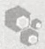

## ccdB 基因

ccdB 基因由大肠杆菌的 F 质粒携带，编码含 101 个氨基酸残基的蛋白质，在没有解毒剂 ccdA 蛋白时对细菌是致命的。虽然这两种蛋白质都是 F 质粒的稳定维持所需的，ccdA 蛋白的半衰期比 ccdB 短。由于该质粒的拷贝数低（每个细胞一到两个拷贝），两个子细胞中的其中一个可能会在分裂时不能继承 F 质粒。ccdA 蛋白的水平降低，F 分离子变得脆弱，被 ccdB 蛋白质杀死，这个过程被称为解离后致死。在自然条件下，ccd 基因座所编码的两种蛋白质共同作用，确保细菌种群中稳定维持 F 质粒。

ccdB 蛋白通过诱导促旋酶的 ATP 依赖的 DNA 切割来杀死细胞, 导致 SOS 系统的激活（Bernard and Couturier 1992; Miki et al. 1992; Bernard et al. 1993）。然而, 这种蛋白质的致死作用在携带 gyrA462 突变的大肠杆菌菌株中被抑制, 从而使携带 ccdB 基因的高拷贝数质粒载体（如 pKIL; Bernard et al. 1994）得以维持, 并生长到高拷贝数。如果通过在 ccdB 基因内的多克隆位点插入外源 DNA 片段使一个 pKIL 载体中的 ccdB 基因失活, 所产生的重组体变成能转化 $\mathrm{gyrA^{+}}$ 大肠杆菌菌株。在 Gateway 克隆系统中, Destination 载体 ccdB 基因两侧是 attR 重组位点。克隆通过体外重组反应进行, 过程中外来 DNA 片段替换有毒的 ccdB 基因, 从而可以在 $\mathrm{gyrA^{+}}$ 细胞中选择性的增殖重组体 (Hartley et al. 2000)。

## 参考文献

- Bernard P, Couturier M. 1992. Cell killing by the F plasmid CcdB protein involves poisoning of DNA-topoisomerase II complexes. J Mol Biol 226: 735–745.
- Bernard P, Kezdy KE, Van Melderen L, Steyaert J, Wyns L, Pato ML, Higgins PN, Couturier M. 1993. The F plasmid CcdB protein induces efficient ATP-dependent DNA cleavage by gyrase. J Mol Biol 234: 534–541.
- Bernard P, Gabant P, Bahassi EM, Couturier M. 1994. Positive-selection vectors using the F plasmid ccdB killer gene. Gene 148: 71–74.

Hartley JL, Temple GF, Brasch MA. 2000. DNA cloning using in vitro site-specific recombination. Genome Res 10: 1788–1795.

Miki T, Park JA, Nagao K, Murayama N, Horiuchi T. 1992. Control of segregation of chromosomal DNA by sex factor F in Escherichia coli. Mutants of DNA gyrase subunit A suppress letD (ccdB) product growth inhibition. J Mol Biol 225: 39–52.


## λ噬菌体

当想到λ噬菌体时，优雅这个词便映入脑海:一种蚀刻到 DNA 的遗传 “电路”，精致优美却又极度经济；互连的调控回路控制着病毒基因表达的顺序、时间以及水平；出入细菌染色体的能力。认识这些现象是一个难题，从 20 世纪 50 年代后期就已经吸引了许多遗传学领域最优秀的人员。他们的研究结果浓缩成一个和谐的基因控制理论，足以匹敌分子生物学任何其他的智力成果。就像一个早期的噬菌体工作人员写到的:“在每…一步，情况都是令人赏心悦目的，大家都为此感到高兴”（Thomas 1993）。

当然，生物化学家也从来不甘落后，到 20 世纪 70 年代初——分子克隆的黎明——

---

194

分子克隆实验指南（原书第四版）

关于λ噬菌体和它的 DNA 了解如此之深，此病毒几乎是自动成为克隆载体一个显而易见的选择。从λ噬菌体 DNA 中去除不方便放置的限制性位点；删除病毒基因组中不必要的片段以使可用于插入外源 DNA 的空间最大化，对噬菌体和大肠杆菌宿主都进行了突变，以满足在整个 20 世纪 70 年代控制 DNA 重组工作的严格规程。

随后的数年，λ噬菌体选作构建哺乳动物基因组和 cDNA 文库的克隆载体。虽然用它工作总是令人高兴的，但它也可能会令人沮丧。NIH 批准的载体先天不足，它们的宿主菌如此孱弱，以至于本应非常容易的事情——例如，生长高滴度储备液——有时会成为一种黑魔法。

但导致λ噬菌体作为载体使用逐渐消亡的不是这类问题，而是人类基因组计划。λ噬菌体重组体可以轻松容纳的外源DNA最长约为25kb。因此，一个全面、重叠、深入的哺乳动物基因组文库将包括数百万个独立克隆。在没有阵列化和自动化的日子，处理这种规模的文库是不容易的。很快，人类基因组测序的尝试明显要求载体具备更高的容量，以与克隆或亚克隆到载体的能力相适应，如可以为测序产生单链DNA模板的M13噬菌体。

到 20 世纪末期，λ噬菌体已经成为博物馆里的东西了。遗传学和生物化学的问题已经解决。已经发展出了更好的载体，也许令人失望的是，噬菌体优雅的“电路”对于理解哺乳动物基因控制的方式几乎没提供什么帮助。然而，λ噬菌体不是一个化石:其基因组的星星点点已纳入重组工程中使用的重组系统，此系统通过在大肠杆菌中重组后产生复杂的、精确确定的克隆，而不是通过体外的限制性酶切和连接。在一些重组工程系统中，由λ噬菌体的 gam 基因编码的蛋白质用来抑制外切核酸酶 V——大肠杆菌 recBCD 系统的组分。抑制宿主的外切核酸酶活性，可以提高λ噬菌体 Red 操纵子介导的体内重组的效率，并抑制外切核酸酶 V 对线性双链 DNA 的降解（综述见 Court et al. 2002; Karlinsey 2007）。

## 参考文献

Court DL, Sawitzke JA, Thomason LC. 2002. Genetic engineering using homologous recombination. Annu Rev Genet 36: 361–388.
Karlinsey JE. 2007. λ-Red genetic engineering in Salmonella enterica serovar Typhimurium. Methods Enzymot 421: 199–209.

Thomas R. 1993. Bacteriophage λ: Transactivation, positive control and other odd findings. BioEssays 15: 285–289.


## M13 噬菌体

- M13 是一个丝状噬菌体家族的一员，含有一个长约 6400 个碱基的单链基因组。
- M13 病毒颗粒只感染雄性细菌，受感染的细胞不裂解。相反，受感染的细胞释放子代病毒颗粒，即便它们继续生长和分裂。
- 在感染过程中，单链病毒基因组转换成双链、环状的复制型（RF）。RF 分子然后通过滚动循环机制生成单链的 (+)-链子代分子。RF 分子也是 11 个病毒基因转录的模板（参见图 3）。
- M13 基因组所有必需的顺式作用元件被隔离在一个 508 bp 的基因间区。
- 由于其基因组往往是不稳定的，丝状噬菌体不用于外源 DNA 片段的克隆和长期增殖。相反，它们主要作为媒介用于产生已插入双链 RF 形式 M13 DNA 基因间隔区的短 DNA 片段（300～500bp）的单链拷贝（Messing et al. 1977; Gronenborn and Messing 1978）。

---

第 3 章 质粒载体克隆与转化

195

\- 今天普遍使用的载体是由 Joachim Messing 和他的同事在 20 世纪 70 年代和 80 年代初发展的（综述见 Messing 1983，1993，1996）。这些载体对于双脱氧 DNA 测序（Sanger et al. 1980）、鸟枪法测序（Messing et al. 1981），以及最终对许多自动化、高通量 DNA 测序方法的发展至关重要。

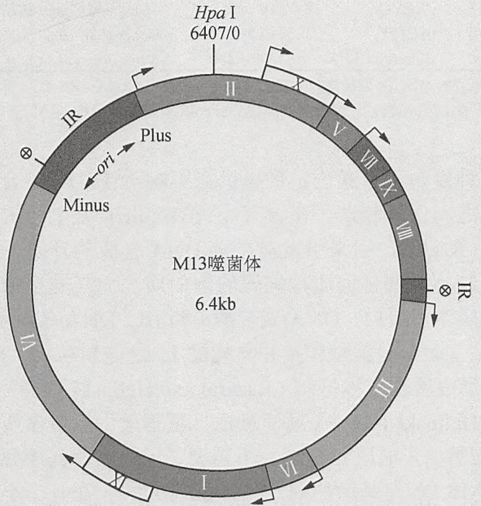

<details>
<summary>text_image</summary>

Hpa I
6407/0
II
V
VII
IX
VIII
III
IX
VI
I
M13噬菌体
6.4kb
Plus
-ori
Minus
IR
IR
</details>

图 3 M13 噬菌体的基因图谱。野生型 M13 是单链环状 DNA 分子，长度 6407 个核苷酸。核苷酸的编号从一个唯一的 Hpa I 位点开始（van Wezenbeek et al. 1980）。图中，基因都是以同一方向“顺时针”定向，编号 I 至 XI，两个基因间隔区标记为 IR，主要启动子用箭头指示，转录终止子被标记为圆圈内一个交叉。按照惯例，病毒 DNA 被称为(+)链，与病毒 mRNA 具有相同的含义。

## 参考文献

- Gronenborn B, Messing J. 1978. Methylation of single-stranded DNA in vitro introduces new restriction endonclease cleavage sites. Nature 272: 375–377.
- Messing J. 1983. New M13 vectors for cloning. Methods Enzymol 101:20–78.
- Messing J. 1993. M13 cloning vehicles. Their contribution to DNA sequencing. Methods Mol Biol 23: 9–22.
- Messing J. 1996. Cloning single-stranded DNA. Mol Biotechnol 5: 39–47.
- Messing J, Crea R, Seeburg PH. 1981. A system for shotgun sequencing. Nucleic Acids Res 9: 309–321.
- Messing J, Gronenborn B, Müller-Hill B, Hofschneider PH. 1977. Filamentous coliphage M13 as a cloning vehicle: Insertion of a HindII fragment of the lac regulatory region in M13 replicative form in vitro. Proc Natl Acad Sci 74: 3642–3646.
- Sanger F, Coulson AR, Barrell BG, Smith AJ, Roe BA. 1980. Cloning in single-stranded bacteriophage as an aid to rapid DNA sequencing. J Mol Biol 143: 161–178.
- van Wezenbeek PMGF, Hulsebos TJM, Schoenmakers JGG. 1980. Nucleotide sequence of the filamentous bacteriophage M13 DNA genome: Comparison with phage fd. Gene 11: 129–148.


## 质粒

## 质粒复制子

复制子是一种遗传单位，长度为几百个碱基对，包含一个 DNA 复制的起始点和相关的控制元件。质粒复制子限定了每个细菌细胞中携带的质粒 DNA 的拷贝数。此数量可以随着细菌培养物中生长条件的变化在一个狭窄的范围内增加或减少。质粒中已经鉴定了超过 30 种不同的复制子。含有原始的 pMB1 复制子（或其近亲属，大肠杆菌素 E1 [colE1]复制子，Balbas et al. 1986）的质粒处于严紧型控制，使用宿主编码的 RepA 蛋白质作为运动调节器，维持每个细菌细胞中 15 至 20 个拷贝的质粒 DNA。几乎所有的通常用于分子克隆的质粒携带来源于 pMB1 的复制子，一种最初从临床标本分离出的质粒（Hershfield et al. 1974）。多年来，pMB1/colE1 复制子已被广泛修改，以增加拷贝数，并由此提高质粒 DNA 产量。各种质粒复制子的特点列于表 7。

---

196

分子克隆实验指南（原书第四版）

表 7 质粒复制子和复制模式

| 复制子 | 复制模式 | 例子 | 拷贝数 | 参考文献 |
| --- | --- | --- | --- | --- |
| pMB1 | 严紧型 | pBR322 | 15~20 | Bolivar et al. 1977b |
| 改良的 pMB1 | 松弛型 | $pUC^a$ | 500~700 | Vieira and Messing 1982; 1987; Messing 1983 |
| p15A | 严紧型 | pACYC | 10~12 | Chang and Cohen 1978 |
| pSC101 | 严紧型 | pSC101 | 约 5 | Stoker et al. 1982 |
| 改良的 colE1 | 松弛型 | Bluescript 载体 | 300~500 | Alting-Mees and Short 1989 |

a. pUC 复制子来源于 pBR322。pUC 系列高拷贝数质粒来自于编码引物 RNA（RNAII）基因的一个点突变（Lin-Chao et al. 1992）。此外，rop 基因（引物的阻抑物）已被删除。pMB1 和 colE 复制子的结构和功能有着广泛的同源性，并且属于相同的不相容组。

不管质粒具有何种复制子，通过定量提供能影响质粒 DNA 合成起始频率的分子，质粒和宿主的复制率之间保持和谐。在含有 pMB1/colE1 复制子的质粒中，这个正调节分子是 anRNA，称为 RNAII，用来引发前导链 DNA 合成的开始。携带 pMB1 复制子或其衍生物的质粒的复制不需要任何质粒编码的蛋白质，而是完全依赖于由宿主提供的长存的酶和蛋白质，包括伴侣蛋白、DNA 聚合酶 I 和 III、DNA 依赖的 RNA 聚合酶、核糖核酸酶 H（RNase H）、DNA 促旋酶和拓扑异构酶 I。这些质粒以“松弛型”的模式复制，直至因氨基酸饥饿，蛋白质合成被抑制（Bazaral and Helinski 1968）或加入氯霉素之类的抗生素（Clewell and Helinski 1969）（见信息栏“氯霉素”）。蛋白质合成对于每一轮宿主 DNA 合成的开始是必需的，但质粒复制并不需要，因此在暴露于氯霉素的细胞中，质粒 DNA 的量相对于染色体 DNA 是增加的（Clewell 1972）。在几个小时的扩增过程中，可能在细胞中积累数千个松弛型质粒拷贝；过程结束时，质粒 DNA 可能占细胞总 DNA 的 50% 或更多。

种类繁多的高拷贝数质粒载体是分子克隆的重要工具，用于小片段重组 DNA（小于 15 kb）的几乎所有日常操作。相比之下，携带 pMB1/colE1 以外来源的复制子的低拷贝数载体都用于特殊用途。包括:

- 克隆不稳定的 DNA 序列以及在高拷贝数质粒中增殖时致死的基因；
- 构建细菌人工染色体（BAC），一种用来增殖大片段（约 100 kb）外源 DNA 的载体，就如同大肠杆菌中的质粒。

## 质粒不相容性和共遗传

当两种质粒携带相同的复制子时，它们在复制和随后分配到子细胞的步骤中相互竞争。这样的质粒在无选择压力时无法共存于细菌培养物中。这种现象被称为不相容性（综述见 Davison 1984；Novick 1987）。

含有相同的复制装置元件的质粒属于相同的不相容群，不能持久地共同保持于同一细菌内。携带不同复制子的质粒属于不同的不相容群，可以稳定地共维持在同一细菌内。例如，与 colE1 型质粒相容的质粒是 p15A、R6K 和 F 等低拷贝数质粒。

低拷贝数质粒通过主动的 ATP 依赖的分离机制分离到子细胞中，此类机制具有类着丝粒位点和作用于这些位点的蛋白质（综述见 Reyes-Lamothe et al. 2008）。高拷贝数质粒与此相反，似乎是通过被动分配传输到子细胞，这是一个不能保证两个不同的高拷贝数质粒共遗传的随机过程（Pogliano et al. 2001；Nordstrom and Gerdes 2003）。例如，较大的质粒比较小的质粒需要更多的时间来复制，在细菌种群的每个细胞中处于选择劣势。因为单个细菌细胞内随机过程产生的起始效率失衡，同样大小的质粒也可能是不相容的。这种机会的转变可以迅速导致两个质粒拷贝数的大幅差异。在某些细胞中，一种质粒可能占主导地位，而在其他细胞，另一种质粒可能会蓬勃发展。在没有选择压力的情况下，

---

第 3 章 质粒载体克隆与转化

197

经过几代的细菌生长过程，“少数派”质粒可以从种群的一些细胞中被完全消除。原始细胞的后代可能包含其中一种质粒或另一种，但很少会两者都有。

正如前面所讨论的，大多数目前使用的载体携带来源于质粒 pMB1 的复制子。这些载体与所有其他携带 colE1 复制子的质粒是不相容的，但是和复制子来源于如 pSC101 及其衍生物的质粒完全相容。表 8 列出了一些众所周知的质粒和参与调节其复制的负调控元件。

表 8 调控复制的控制元件

| 不相容群 | 负调控元件 | 备注 |
| --- | --- | --- |
| colE1, pMB1 | RNA I | 控制前体 RNA II 成引物的过程 |
| IncFII, pT181 | RNA | 控制 RepA 蛋白的合成 |
| P1, F, R6K, pSC101, p15A | 重复子 | 封闭 RepA 蛋白 |

## 选择标记

多年前,质粒用它们的开发者命名。所以,第一个克隆实验使用的质粒 pSC101(Cohen et al. 1973) 是在 Stan Cohen 的实验室设计和构造的。它携带一个抗生素抗性基因（四环素抗性；见信息栏“抗生素”）和一个限制性酶切位点（EcoRI）。

质粒载体中含有遗传标记，在选择性条件下赋予带有质粒的细菌强劲增长的优势。在分子克隆中，这些标记用于:

- 选择带有质粒的细菌克隆。在实验室中，可以通过人工转化过程将质粒 DNA 导入细菌。然而，即使是在最佳条件下，转化通常是低效的，质粒只在一小部分细菌群体中稳定地“安置”下来。质粒携带的选择标记使得挑选这些稀少的转化体变得轻松。这些质粒编码的标记物提供特定的抗生素抗性（即在抗生素存在下生长的能力），如卡那霉素、氨苄青霉素、羧苄青霉素和四环素。这些抗生素的属性和作用方式在信息栏“抗生素”中进行了讨论。
- 保护转化细菌不受它们负担的质粒 DNA 或质粒编码蛋白质所施加的风险。质粒以低拷贝数（小于 20 拷贝/细胞）存在似乎并不过分妨碍其宿主细胞。然而，许多证据表明，高拷贝数质粒和大量的重组蛋白可以严重阻碍转化细胞的生长甚至生存（Murray and Kelley 1979；Beck and Bremer 1980）。为了防止出现质粒被清除的细菌，重要的是任何时候都在培养基中包含合适的抗生素以维持选择压力。

在 20 世纪 70 年代初，选择标记——通常为 Kan$^{r}$、Amp$^{r}$ 或 Tet$^{r}$——被引入含有 pMB1（或 colE1）复制子的质粒（见信息栏“抗生素”）。最先用作克隆载体的质粒——pSC101（Cohen et al. 1973）、colE1（Hershfield et al. 1974）及 pCR1（Covey et al. 1976）——其通用性是有限的:它们要么复制不佳，要么携带不合适的选择标记，并且都不包含两个以上可用于克隆的限制性位点。第一个整合所有当时可用的合适特点的质粒是 pBR313（Bolivar et al. 1977b），以松弛型方式复制，包含两个选择标记（Tet$^{r}$ 和 Amp$^{r}$），并含有一些有用的酶切位点。然而，pBR313 过于臃肿，超过一半的 DNA 对其作为载体是不必要的。质粒载体发展的第一阶段随着 pBR322（Bolivar et al. 1977b）的构建结束，质粒大小为 4.36 kb，大部分不必要的序列都被消除了。pBR322 是当时使用最广泛的克隆载体，许多目前使用的质粒载体是其子孙后代（综述见 Balbas et al. 1986）。

20 世纪 80 年代初，笨重的质粒如 pBR322 进一步发展，载体向尺寸更小、拷贝数更高，能够接受更广泛的限制性内切核酸酶酶切所产生的外源 DNA 片段。可以克隆到质粒中的 DNA 片段的大小没有严格的上限，但是，将质粒载体的尺寸减小到最低限度也有优点。质粒的拷贝数、稳定性和转化效率随着它们 DNA 的尺寸减小而提高。在效率

---

198

分子克隆实验指南（原书第四版）

开始下降之前，较小的质粒可以容纳更大的外源 DNA 片段。另外，由于较小的 colE1 质粒可以复制到更高的拷贝数，外源 DNA 的得率会增加，并且用放射性标记的探针筛选包含克隆的外源 DNA 序列的转化菌落时，其杂交信号会增强。

从 pBR322 改进的衍生载体，解决了不灵活和效率低下的问题。这些质粒缺乏辅助的序列以控制拷贝数和转移。不幸的是，第一代高拷贝数质粒，其中最有名的 pXf3（Hanahan 1983）的主要缺陷是:外源 DNA 序列只能在位于“天然”序列内的有限数量的限制性位点插入以构建质粒。一两年内，这些质粒被一系列革命性的载体（pUC 载体）取代了，在这些载体中，限制性内切核酸酶切割位点的数量扩大了，并且它们在载体内的分布更加合理（Messing 1983；Norrander et al. 1983；Yanisch-Perron et al. 1985；Vieira and Messing 1987）。pUC 载体是第一个包含了一系列紧密排列的合成克隆位点的载体，这些合成位点被称为多接头或多克隆位点，它们组成了限制性内切核酸酶识别序列的库。在大多数情况下，这些限制性位点是唯一的（即，它们不存在于质粒载体中的其他地方）。例如，pUC19 载体的多克隆位点由 13 种限制性内切核酸酶唯一切割位点的串联排列组成。

这样的识别序列排列提供了大量多样的靶点，可以单独使用或与众多种类的限制性内切核酸酶酶切产生的克隆 DNA 片段组合使用。此外，在一个限制位点插入的片段，常常可以通过用在侧翼位点切割的限制性内切核酸酶切割重组质粒而将其切下。因此，将 DNA 片段插入一个多克隆位点相当于在它的末端加上合成接头。这些侧翼位点的可用极大简化了绘制外源 DNA 片段图谱的任务。

将所有克隆位点一起安排到质粒的一个位置，其潜在缺点是无法使用灭活选择标记来筛选重组体。此方法广泛用于第一代质粒，如 pBR322，带有两个或更多不同的选择性标记（例如 Tet $^{r}$  和 Amp $^{r}$ ），每个都包含一个“天然”的限制位点。外源 DNA 序列插入到其中一个位点就可以灭活两个标记之一。含有重组质粒的细菌，因此可以同那些携带空的亲本载体的细菌区别开，因为它们只能在两套选择性条件之一进行生长（见信息栏“抗生素”）。

用 pUC 系载体进行插入失活是不可能的，因为它仅含一种抗生素抗性基因（通常为氨苄青霉素抗性）和一套聚集的克隆位点。然而，通过筛选细菌菌落的颜色，可以很容易区分重组质粒和亲本 pUC 质粒。pUC 载体和许多其衍生物携带一段短的大肠杆菌 DNA 片段，包含 lacZ 基因的调节序列和 β-半乳糖苷酶氨基末端 146 个氨基酸的编码信息。一个多克隆位点嵌入在编码信息中，恰好是起始 ATG 的下游。pUC 载体在转化细菌中表达的 β-半乳糖苷酶氨基末端小片段没有内源性 β-半乳糖苷酶活性。然而，这段被称为 α 片段的氨基末端片段，可以与某些自身无活性的 β-半乳糖苷酶特定突变体结合，形成具有充分催化活性的酶。当 pUC 质粒被引入到一个表达无活性的 β-半乳糖苷酶羧基末端片段（ω 片段）的大肠杆菌菌株时，会发生 α-互补。

当一段外源 DNA 克隆到 pUC 载体的多克隆位点时，编码  $\alpha$  片段的序列被打断了， $\alpha$ -互补被极大地抑制或完全废除。因此，含重组质粒的细菌菌落具有氨苄青霉素抗性，却含有很少的或根本没有  $\beta$ -半乳糖苷酶活性。与此相反，含有空质粒的细菌菌落具有氨苄青霉素抗性，而且能够水解不可发酵显色底物，如 5-溴-4-氯-3-吲哚- $\beta$ -D-半乳糖苷（X-Gal）（Horwitz et al. 1964；Davies and Jacob 1968；见第 1 章信息栏 “X-Gal” 和 “ $\alpha$ -互补”）。因此，可以通过一个简单的、非破坏性的组织化学实验区分这两种类型的菌落（Miller 1972）。当琼脂培养基含有 X-Gal 时，携带亲本非重组质粒的菌落变成深蓝色，而那些含有重组质粒的菌落仍然是普通的乳白色或变成像染了浅蛋壳蓝色（更多详细信息，见第 1 章信息栏 “ $\alpha$ -互补”）。

---

第 3 章 质粒载体克隆与转化

199

现今的质粒载体构建涉及用于多种用途的辅助序列的结合，包括用于 DNA 测序的单链 DNA 模板生成、外源 DNA 序列的体外转录、重组克隆的直接选择和大量外源蛋白的表达。这些特殊功能在这里简要讨论，在后面的章节中有更详细的论述。

## 携带来源于单链噬菌体复制起始点的质粒载体

在 20 世纪 80 年代和 90 年代开发的许多质粒载体携带来自单链丝状噬菌体基因组的 DNA 复制起始点，如 M13 或 f1（见信息栏“M13 噬菌体”）。这样的载体有时被称为噬菌粒，结合了质粒和单链噬菌体载体的最佳特性，优点是具有两种独立的复制模式:作为一个传统的双链 DNA 质粒和作为模板产生噬菌粒一条链的单链拷贝。噬菌粒因此可以以相同的方式作为一个传统的质粒载体使用，或者用于产生含有克隆 DNA 片段单链拷贝的丝状噬菌体颗粒。自 20 世纪 80 年代初推出以来，噬菌粒使得大部分情况下外源 DNA 不再需要从质粒亚克隆到传统的单链噬菌体载体。

携带噬菌粒的细菌感染辅助噬菌体后，诱导产生单链 DNA，辅助噬菌体携带下列所需基因:①从双链模板生成单链 DNA；②将单链 DNA 包装进丝状病毒颗粒。小规模培养的感染后细菌分泌的缺陷丝状病毒颗粒，包含足够的单链 DNA，可用于测序。在大多数情况下，噬菌体复制起始点方向不同的成对质粒载体都可用。起始点的方向决定两条 DNA 链的哪一条会被包被进噬菌体颗粒。按照惯例，一个加号（+）表示质粒和噬菌体颗粒中的起始点是在同一方向。

## 携带噬菌体启动子的质粒载体

许多质粒载体携带来自于噬菌体的启动子 T3、T7 和/或 SP6，与多克隆位点（MCS）相邻。因此，当线性化的重组质粒 DNA 和适当的 DNA 依赖的 RNA 聚合酶以及核糖核苷酸前体一起孵育时，在 MCS 的限制性酶切位点插入的外源 DNA 可以在体外转录。这些启动子是特异性的，例如，SP6 的 RNA 聚合酶不能从位于质粒其他地方的任何其他噬菌体启动子合成 RNA。

许多商业化的载体（如 pGEM 系列载体或 Bluescript 系列载体）在相反的方向上携带两个噬菌体启动子，位于多克隆位点的各一侧（Short et al. 1988）。此结构使得可以根据转录反应中使用的 RNA 聚合酶类型，在体外从外源 DNA 的任一端或任一链合成 RNA。以这种方式产生的 RNA 可作为杂交探针，或可以在无细胞蛋白质合成系统中被翻译。此外，携带 T7 启动子的载体可用于在表达 T7 RNA 聚合酶的细菌中表达克隆 DNA 序列（Tabor and Richardson 1985）。商业公司出售多种此类型载体。

## 阳性选择载体

鉴别插入 DNA 的质粒曾经是令人沮丧和费时的，然而，已经开发了多种克隆载体，只允许携带重组质粒的细菌菌落生长。含亲本空质粒的细菌在这些选择性条件下无法形成菌落。通常情况下，这些系统中使用的质粒表达一种对特定细菌宿主致命的基因产物；外源 DNA 片段克隆到质粒，使这个基因失活，并解除其毒性。表 9 总结了多年来阳性选择载体使用的许多条件致死毒性基因的属性。这些旧系统中许多是非常巧妙的，但是，因为它们在一个特定的实验室被开发用来解决或改善一个特定的问题，不容易适用于其他用途。

---

200

分子克隆实验指南（原书第四版）

表 9 阳性选择系统中使用的毒性基因

| 毒性基因 | 参考文献 |
| --- | --- |
| 四环素抗性 | Bochner et al. 1980; Maloy and Nunn 1981; Craine 1982 |
| $\lambda$噬菌体阻抑物 | Nilsson et al. 1983; Mongolsuk et al. 1994 |
| EcoR I甲基化酶 | Cheng and Modrich 1983 |
| EcoR I限制性内切核酸酶 | Kuhn et al. 1986 |
| 半乳糖激酶 | Ahmed 1984 |
| $\phi$ X174的溶菌基因 | Henrich and Plapp 1986 |
| ccdB | Bernard and Couturier 1992 |
| Kis | Gabant et al. 1997, 2000 |

当前使用得最好的阳性选择系统是基于 F 质粒编码的 ccdB 基因，它表达一种 101 个氨基酸残基的蛋白质，在没有解毒剂 ccdA 蛋白时，对细菌是致命的。这两种蛋白质对于 F 质粒的稳定维持是必需的。然而，ccdA 蛋白的半衰期比 ccdB 短。因为 F 质粒的拷贝数低（每个细胞一到两个拷贝），两个子细胞中的其中一个在分裂时可能无法继承质粒。当 ccdA 蛋白的水平降低，F 分离子对 ccdB 蛋白质的杀伤变得脆弱——一个称为解离后致死的过程。ccd 基因座所编码的两种蛋白质的共同作用确保 F 质粒在细菌群体的稳定维持（Jensen and Gerdes 1995）。

ccdB 蛋白质通过诱导促旋酶的 ATP 依赖的 DNA 切割，导致 SOS 系统的激活，进而杀死细胞（Bernard and Couturier 1992；Miki et al. 1992；Bernard et al. 1993）。这种蛋白质的致死效应在携带 gyrA462 突变体的大肠杆菌中受到抑制，使携带 ccdB 基因的高拷贝数质粒载体（如 pKIL，Bernard et al. 1994）得以维持并生长到高拷贝数。然而，如果 ccdB 基因被插入其内部多克隆位点内的外源 DNA 片段失活，由此产生的重组体能转化 gyrA $^{+}$ 大肠杆菌菌株。该系统是非常有效的:大于 90% 生长于 gyrA $^{+}$ 株上的转化菌落是重组体（Gabant et al. 1997）。已开发出一个类似的系统，使用有毒的 kid 蛋白及其解毒剂 kis，由大肠杆菌的 R1 质粒编码（Gabant et al. 2000）。

在 Gateway 克隆系统中，Destination 载体 ccdB 基因两侧是 attR 重组位点。克隆通过体外重组反应进行，其间一个外来 DNA 片段取代有毒的 ccdB 基因，从而使重组体在 gyrA $^{+}$ 细胞可以选择性增殖（Hartley et al. 2000）（见第 4 章）。

## 低拷贝数质粒载体

传统的高拷贝数质粒载体携带加强版的复制子，与之相比，低拷贝数质粒载体基于诸如 R1 复制子构建，保持非常严格控制的质粒 DNA 合成。

第一代的低拷贝载体——以今天的标准看来相当笨重和粗糙——被设计用来解决特定类型的外源基因和 DNA 序列克隆到质粒载体时所产生的毒性问题。许多编码膜蛋白质和 DNA 结合蛋白的基因属于这一类，某些启动子及调节序列也如此。有时，这些 DNA 序列和基因产物对宿主菌的毒性很强，以至于根本不可能使用高拷贝数载体分离出转化菌株。即使得到转化体，其生长率也常常是令人沮丧的缓慢，而且克隆的外源 DNA 序列往往不稳定。为了解决这些问题，已经开发了多用途的低拷贝数载体，含有进行严格调控且基础表达水平低的原核启动子，如 pET 系列载体，并含有原核转录终止子，以防止外源 DNA 序列从上游的质粒启动子假转录。现在，这些低拷贝数载体带有多克隆位点、单链噬菌体复制起始点、T3 和 T7 启动子，以及其他有价值的、有用的模块化的便利结构。大多数现代的低拷贝数载体还携带 par 基因座，促进质粒分子在细胞分裂过程中精确分配到子细胞。

---

第 3 章 质粒载体克隆与转化

201

## 参考文献

- Ahmed A. 1984. Plasmid vectors for positive galactose-resistance selection of cloned DNA in Escherichia coli. Gene 28: 37–43.
- Alting-Mees MA, Sorge JA, Short JM. 1992. pBluescriptII: Multifunctional cloning and mapping vectors. Methods Enzymol 216: 483–495.
- Balbas P, Soberón X, Merino E, Zurita M, Lomeli H, Valle F, Flores N, Bolivar F. 1986. Plasmid vector pBR322 and its special purpose derivatives—A review. Gene 50: 3–40.
- Bazaral M, Helinski DR. 1968. Circular DNA forms of colicinogenic factors E1, E2 and E3 from Escherichia coli. J Mol Biol 36: 185–194.
- Beck E, Bremer E. 1980. Nucleotide sequence of the gene ompA coding the outer membrane protein II of Escherichia coli K-12. Nucleic Acids Res 8: 3011–3027.
- Bernard P, Couturier M. 1992. Cell killing by the F plasmid CcdB protein involves poisoning of DNA-topoisomerase II complexes. J Mol Biol 226: 735–745.
- Bernard P, Kezdy KE, Van Melderen L, Steyaert J, Wyns L, Pato ML, Higgins PN, Couturier M. 1993. The F plasmid CcdB protein induces efficient ATP-dependent DNA cleavage by gyrase. J Mol Biol 234:534–541.
- Bernard P, Gabant P, Bahassi EM, Couturier M. 1994. Positive-selection vectors using the F plasmid ccdB killer gene. Gene 148: 71–74.
- Bochner B, Huang H, Schiever G, Ames B. 1980. Positive selection for loss of tetracycline resistance. J Bacteriol 143: 926–933.
- Bolivar F, Rodriguez RL, Betlach MC, Boyer HW. 1977a. Construction and characterization of new cloning vehicles. I. Ampicillin-resistant derivatives of the plasmid pMB9. Gene 2: 75–93.
- Bolivar F, Rodriguez RL, Greene PJ, Betlach MC, Heyneker HL, Boyer HW, Crosa JH, Falkow S. 1977b. Construction and characterization of new cloning vehicles. II. A multipurpose cloning system. Gene 2:95–113.
- Chang ACY, Cohen SN. 1978. Construction and characterization of amplifiable multicopy DNA cloning vehicles derived from the p15A cryptic miniplasmid. J Bacteriol 134: 1141–1156.
- Cheng S, Modrich P. 1983. Positive selection cloning vehicle useful for overproduction of hybrid proteins. J Bacteriol 154: 1005–1008.
- Clewell DB. 1972. Nature of ColE1 plasmid replication in Escherichia coli in the presence of chloramphenicol. J Bacteriol 110: 667–676.
- Clewell DB, Helinski DR. 1969. Supercoiled circular DNA-protein complex in Escherichia coli: Purification and induced conversion to an open circular form. Proc Natl Acad Sci 62: 1159–1166.
- Cohen SN, Chang AC, Boyer HW, Helling RB. 1973. Construction of biologically functional bacterial plasmids in vitro. Proc Natl Acad Sci 70:3240–3244.
- Covey C, Richardson D, Carbon J. 1976. A method for the deletion of restriction sites in bacterial plasmid deoxyribonucleic acid. Mol Gen Genet 145: 155–158.
- Craine BL. 1982. Novel selection for tetracycline- or chloramphenicol-sensitive Escherichia coli. J Bacteriol 151: 487–490.
- Davies J, Jacob F. 1968. Genetic mapping of the regulator and operator genes of the lac operon. J Mol Biol 36: 413–417.
- Davison J. 1984. Mechanism of control of DNA replication and incompatibility in ColE1-type plasmids—A review. Gene 28: 1–15.
- Gabant P, Drèze PL, Van Reeth T, Szpirer J, Szpirer C. 1997. Bifunctional lacZ α-ccdB genes for selective cloning of PCR products. BioTechniques 23: 938–941.
- Gabant P, Van Reeth T, Drèze PL, Faelen M, Szpirer C, Szpirer J. 2000. New positive selection system based on the parD (kis/kid) system of the R1 plasmid. BioTechniques 28: 784–788.
- Hanahan D. 1983. Studies on transformation of Escherichia coli with plasmids. J Mol Biol 166: 557–580.
- Hartley JL, Temple GF, Brasch MA. 2000. DNA cloning using in vitro site-specific recombination. Genome Res 10: 1788–1795.
- Henrich B, Plapp R. 1986. Use of the lysis gene of bacteriophage $\phi$X174 for the construction of a positive selection vector. Gene 42:345-349.
- Hershfield V, Boyer HW, Yanofsky C, Lovett MA, Helinski DR. 1974. Plasmid ColE1 as a molecular vehicle for cloning and amplification of DNA. Proc Natl Acad Sci 71: 3455–3459.
- Horwitz JP, Chua J, Curby RJ, Tomson AJ, Darooge MA, Fisher BE, Mauricio J, Klundt I. 1964. Substrates for cytochemical demonstration of enzyme activity. I. Some substituted 3-indolyl-β-D-glycopyranosides. J Med Chem 7: 574–575.
- Jensen RB, Gerdes K. 1995. Programmed cell death in bacteria: Proteic plasmid stabilization systems. Mol Microbiol 17: 205–210.
- Kuhn I, Stephenson FH, Boyer HW, Greene PJ. 1986. Positive selection vectors utilizing lethality and the EcoRI endonuclease. Gene 42:253–263.
- Maloy SR, Nunn WD. 1981. Selection for loss of tetracycline resistance by Escherichia coli. J Bacteriol 145: 1110–1111.
- Messing J. 1983. New M13 vectors for cloning. Methods Enzymol 101: 20–78.
- Miki T, Park JA, Nagao K, Murayama N, Horiuchi T. 1992. Control of segregation of chromosomal DNA by sex factor F in Escherichia coli. Mutants of DNA gyrase subunit A suppress letD (ccdB) product growth inhibition. J Mol Biol 225: 39–52.
- Miller JH. 1972. Experiments in molecular genetics. Cold Spring Harbor Laboratory Press, Cold Spring Harbor, NY.
- Mongolsuk S, Rabibhadana S, Vaatanaviboon P, Loprasert S. 1994. Generalized and mobilizable positive-selection cloning vectors. Gene 143:145–146.
- Murray NE, Kelley WS. 1979. Characterization of the  $\lambda$ polA transducing phages: Effective expression of the E. coli polA gene. Mol Gen Genet 175: 77–87.
- Nilsson B, Uhlen M, Josephson S, Gattenbeck S, Philipson L. 1983. An improved positive selection vector constructed by oligonucleotide-mediated mutagenesis. Nucleic Acids Res 11: 8019–8030.
- Nordstrom K, Gerdes K. 2003. Clustering versus random segregation of plasmids lacking a partitioning function: A plasmid paradox? Plasmid 50: 95–101.
- Norrander J, Kempe T, Messing J. 1983. Construction of improved M13 vectors using oligodeoxynucleotide-directed mutagenesis. Gene 26:101–106.
- Novick RP. 1987. Plasmid incompatibility. Microbiol Rev 51: 381–395.
- Pogliano J, Ho TQ, Zhong Z, Helinski DR. 2001. Multicopy plasmids are clustered and localized in Escherichia coli. Proc Natl Acad Sci 98: 4486–4491.
- Reyes-Lamothe R, Wang X, Sherratt D. 2008. Escherichia coli and its chromosome. Trends Microbiol 16: 238–245. Pogliano J, Ho TQ, Zhong Z, Helinski DR. 2001. Multicopy plasmids are clustered and localized in Escherichia coli. Proc Natl Acad Sci 98: 4486–4491.
- Short JM, Fernandez JM, Sorge JA, Huse WD. 1988. λZAP: A bacteriophage λ expression vector with in vivo excision properties. Nucleic Acids Res 16: 7583–7600.
- Stoker NG, Fairweather NF, Spratt BG. 1982. Versatile low-copy-number plasmid vectors for cloning in Escherichia coli. Gene 18: 335–341.
- Tabor S, Richardson CC. 1985. A bacteriophage T7 RNA polymerase/promoter system for controlled exclusive expression of specific genes. Proc Natl Acad Sci 82: 1074–1078.
- Vieira J, Messing J. 1982. The pUC plasmids, an M13-mp7-derived system for insertion mutagenesis and sequencing with synthetic universal primers. Gene 19: 259–268.
- Vieira C, Messing J. 1987. Production of single-stranded DNA. Methods Enzymol 153: 5–11.
- Yanisch-Perron C, Vieira J, Messing J. 1985. Improved M13 phage cloning vectors and host strains: Nucleotide sequences of the M13mp18 and pUC19 vectors. Gene 33: 103–119.


## 黏粒

在 20 世纪 70 年代后期发展出了黏粒，以满足对可容纳大段基因组 DNA 载体的需求（Collins and Hohn 1978；Hohn and Collins 1988）。黏粒是传统的质粒，包含一个原核 DNA 复制起始点（通常为 colE1 或 pMB1）、一个选择标记和一个或多个用于插入基因组 DNA 片段的限制性位点。黏粒还携带一个，更多的时候两个，λ噬菌体 DNA 的一个小区域——280bp cos 序列（Bates and Swift 1983；Hohn 1983），可以由λ噬菌体编码的末端酶蛋白切割，产生带有 12 个碱基长度互补单链末端的线性分子（Emmons 1974）。携带λ噬菌体末端酶切割的基因组 DNA 片段的重组黏粒，可在体外包装进λ噬菌体颗粒并导入

---

202

分子克隆实验指南（原书第四版）

大肠杆菌（Hohn and Murray 1977；Collins and Hohn 1978；Hohn 1979）。一旦进入细菌，重组黏粒环化，然后作为一个大型的常规质粒复制到每个细胞 $15\sim 20$ 个拷贝数。该体外包装和转导的木马程序被设计用来解决将大型质粒有效地转化进大肠杆菌的难题。

不幸的是，黏粒载体很快出现了一个明显的问题，并且不易解决，即它们的能力根本就不足以有效地处理一个哺乳动物基因组大小的东西。黏粒足以容纳一个典型的原核基因组，却不能容纳一个完整的典型哺乳动物基因组［因为可以包装进一个λ噬菌体颗粒的DNA最大尺寸是约52kb，黏粒载体（一般为约8kb大小）可容纳约31～44kb的外源DNA（Feiss et al. 1977）］在这个尺寸范围之内的基因组DNA片段可以通过用限制性内切核酸酶部分酶切高分子质量的染色体DNA产生，如识别4碱基序列并产生黏性末端的Sau3A，然后通过蔗糖密度梯度离心分离适当大小的DNA片段，并连接到用BamHI消化线性化的黏粒载体。

为了提高黏粒分析大基因组的可用性，开发出一种称为染色体步查的技术，太大的DNA片段不适合一个单一的黏粒，可以用一组重叠的黏粒克隆。这个过程用重组黏粒末端序列生成的探针筛选基因组黏粒文库寻找重叠克隆（Bender et al. 1983；Wahl et al. 1987；Evans et al. 1987, 1989；Choo et al. 1987；Poustka 1993a,b；Fairweather 1997；关于生成末端特异性探针方法的综述，见Arnold and Hodgson 1991；Ogilvie and James 1996）。不幸的是，这种技术虽然巧妙并且相当健壮，却往往需要连续几轮步查，以分离出一组能够完整涵盖哺乳动物基因的克隆，这个过程对时间、人工和材料的要求很高，当有更大容量的载体（BAC 和 YAC）可用时，黏粒迅速失宠。到20世纪90年代初，黏粒作为哺乳动物基因组文库构建和筛选工具的生命已走到了尽头。

## 腺黏粒

黏粒保留了它们的用途，作为克隆载体用于分析较小的基因组，如细菌、大病毒、低等真核生物。此外，在最近几年，黏粒已被用来作为构建复杂重组腺病毒载体的骨架。野生型腺病毒基因组大小为约36kb，而从它衍生出的载体一般要小几千个碱基，尺寸适合于一个标准的黏粒。作为克隆骨架使用时，携带腺病毒载体基因组的重组黏粒首先在大肠杆菌中生长，纯化，然后作为一个质粒通过标准技术组装所需重组体的各段。随后，组装的重组病毒基因组从黏粒释放出来，例如，通过合适的稀有限制性内切核酸酶进行切割，或利用λ噬菌体DNA末端酶/包装系统。腺病毒重组DNA转染到培养的合适品系的哺乳动物细胞，产生重组腺病毒的原种。欲了解更多详细信息和文献引用，见第16章。

## 黏粒资源

一些公司（例如 Stratagene/Agilent 公司和 Epicentre Technologies 公司）以试剂盒形式销售黏粒载体和包装混合物以及细菌菌株。与质粒 DNA 转化大肠杆菌（见方案 1～4）相同的技术可用于转化黏粒。从转化细菌培养物分离和纯化黏粒 DNA 的技术基本上与常规质粒所使用的技术相同:碱裂解从宿主细菌释放出黏粒，然后通过商业化树脂结合和洗脱纯化。纯化质粒所使用的商品化试剂盒也可以用来纯化黏粒（见本章导言的表 3-1）。然而，由于拷贝数的巨大差异，黏粒 DNA 的得率比常规的高拷贝数质粒要低得多。

SuperCos 1 是一种新型的 7.9kb 的黏粒载体，含有噬菌体启动子序列，位于一个唯一的克隆位点两侧（参见图 4）。这种结构使得针对插入 DNA 片段末端的特异性“步查”探针可以快速合成。SuperCos1 载体也设计含有在真核细胞中扩增和表达黏粒克隆的基因。此外，通过用 Not I 消化重组黏粒，大多数基因组插入物可以作为一个单一的大限制性酶切片段被切掉。

---

第 3 章 质粒载体克隆与转化

203

SuperCos 1 载体

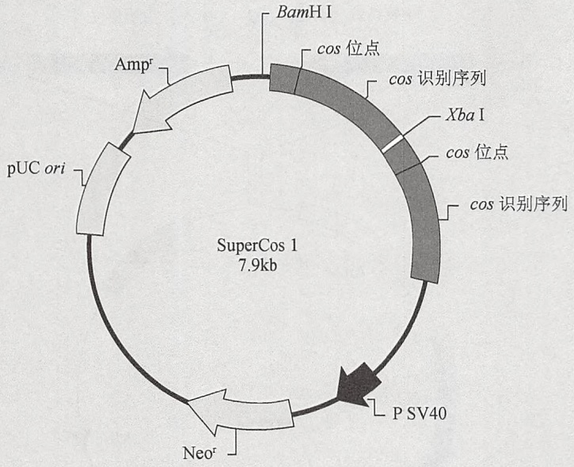

<details>
<summary>flowchart</summary>


</details>

SuperCos1克隆位点区域

(序列 1\~71)

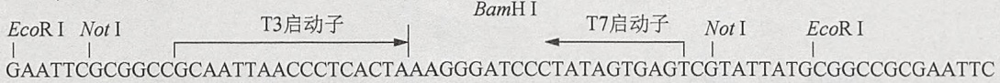

<details>
<summary>flowchart</summary>

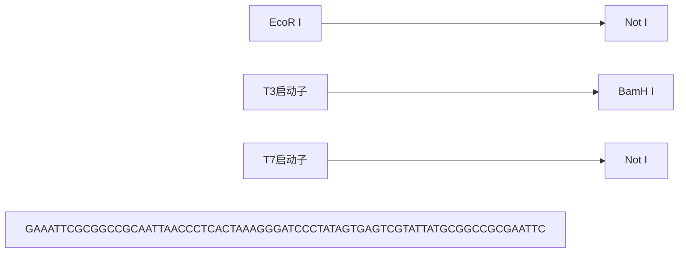
</details>

注意:neo基因赋予大肠杆菌卡那霉素抗性，赋予真核细胞G418抗性

| 特点 | 核苷酸位点 |
| --- | --- |
| T3启动子 | 15~34 |
| BamHI克隆位点 | 33 |
| T7启动子 | 37~56 |
| cos识别序列 | 101~1150 |
| cos位点 | 300~311 |
| XbaI确切位点 | 1173 |
| cos识别序列 | 1183~2237 |
| cos位点 | 1382~1393 |
| SV40启动子 | 3037~3375 |
| 新霉素抗性基因开放读码框 | 3732~4526 |
| pUC复制起始子 | 6049~6727 |
| 氨苄青霉素抗性基因(bla)开放读码框 | 6878~7735 |

图 4 SuperCos1（重绘，经 Agilent Technologies 公司授权许可。©Agilent Technologies 公司）。

## pWEB-TN 载体

Sma I 克隆位点两侧是成对的 BamHI、EcoRI 和 NotI 位点，以帮助进行 DNA 插入片段的切除和作图（参见图 5）。

---

204

分子克隆实验指南（原书第四版）

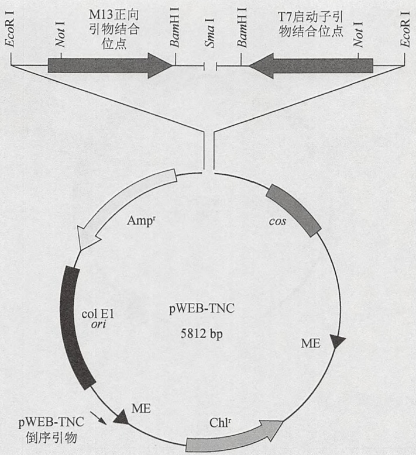

<details>
<summary>flowchart</summary>

```mermaid
graph LR
  EcoRI["EcoR I"] -->|Not I| M13["M13正向引物结合位点"]
  M13 -->|BamHI| BamHI["BamH I"]
  BamHI -->|SmaI| SmaI["Sma I"]
  SmaI -->|BamHI| BamHI["BamH I"]
  BamHI -->|T7启动子引物结合位点| T7["T7启动子引物结合位点"]
  T7 -->|Not I| EcoRI["EcoR I"]
  Ampr["Ampr"] -->|cos| pWEB_TNC(("pWEB-TNC"))
  pWEB_TNC -->|col_E1_ori["col E1 ori"]| pWEB_TNC
  pWEB_TNC -->|ME| pWEB_TNC
  pWEB_TNC -->|Me| Chl_r["Chl_r"]
  Chl_r -->|Me| ME["ME"]
  Me -->|pWEB-TNC 倒序引物| pWEB_TNC
```
</details>

图 5 pWEB-TNC 载体 [重绘，经 Epicentre 公司（一家 Illumina 公司）许可]。

## 参考文献

- Arnold C, Hodgson IJ. 1991. Vectorette PCR: A novel approach to genomic walking. PCR Methods Appl 1: 39–42.
- Bates PF, Swift RA. 1983. Double cos site vectors: Simplified cosmid cloning. Gene 26: 137–146.
- Bender W, Spierer P, Hogness DS. 1983. Chromosomal walking and jumping to isolate DNA from the Ace and rosy loci and the bithorax complex in Drosophila melanogaster. J Mol Biol 168: 17–33.
- Choo KH, Brown R, Webb G, Craig IW, Filby RG. 1987. Genomic organization of human centromeric alpha satellite DNA: Characterization of a chromosome 17 alpha satellite sequence. DNA 6: 297–305.
- Collins J, Hohn B. 1978. Cosmids: A type of plasmid gene-cloning vector that is packageable in vitro in bacteriophage λ heads. Proc Natl Acad Sci 75: 4242–4246.
- Emmons SW. 1974. Bacteriophage λ derivatives carrying two copies of the cohesive end site. J Mol Biol 83: 511–525.
- Evans GA, Wahl GM. 1987. Cosmid vectors for genomic walking and rapid restriction mapping. Methods Enzymol 152: 604–610.
- Evans GA, Lewis K, Rothenberg BE. 1989. High efficiency vectors for cosmid microcloning and genomic analysis. Gene 79: 9–20.
- Fairweather N. 1997. Construction and use of cosmid contigs. Methods Mol Biol 68: 137–148.
- Feiss M, Fisher RA, Crayton MA, Egner C. 1977. Packaging of the bacteriophage λ chromosome: Effect of chromosome length. Virology 77:281–293.
- Hohn B. 1979. In vitro packaging of λ and cosmid DNA. Methods Enzymol 68: 299–309.
- Hohn B. 1983. DNA sequences necessary for packaging of bacteriophage λ DNA. Proc Natl Acad Sci 80: 7456–7460.
- Hohn B, Collins J. 1988. Ten years of cosmids. TibTech 6: 293–298.
- Hohn B, Murray K. 1977. Packaging recombinant DNA molecules into bacteriophage particles in vitro. Proc Natl Acad Sci 74: 3259–3263.
- Ogilvie DJ, James LA. 1996. End rescue from YACs using the vectorette. Methods Mol Biol 54: 131–138.
- Poustka A. 1993a. Construction and use of chromosome jumping libraries. Methods Enzymol 217: 358–378.
- Poustka A. 1993b. Large insert linking-clone libraries: Construction and use. Methods Enzymol 217: 347–358.
- Wahl GM, Lewis KA, Ruiz JC, Rothenberg B, Zhao J, Evans GA. 1987. Cosmid vectors for rapid genomic walking, restriction mapping, and gene transfer. Proc Natl Acad Sci 84: 2160–2164.

(邵勇 胡显文 译, 王建 校)
