# 第5章 细菌人工染色体及其他高容量载体的应用

原始 PDF 第 242–293 页。

## 第5章 细菌人工染色体及其他高容量载体的应用

导言 | 高容量载体的发展:优势和不足 224  
细菌人工染色体的应用 229

方案 | 1 BAC DNA 的小量分离和 PCR 检验 235 9 共合体的检验和重组 BAC 克隆的筛选 253  
2 BAC DNA 的大量制备和线性化 238  
3 通过脉冲电场凝胶电泳检验 BAC DNA 的质量和数量 241 10 一步 BAC 修饰:质粒制备 256  
4 两步 BAC 工程:穿梭载体 DNA 的制备 242 11 A 同源臂（A-Box）的制备 259  
5 A 同源臂（A-Box）和 B 同源臂（B-Box）的制备 244 12 克隆 A 同源臂到报道穿梭载体 260  
6 克隆 A 和 B 同源臂到穿梭载体 247 13 用 RecA 载体转化 BAC 宿主 263  
7 重组穿梭载体的制备和检验 249 14 转移报道载体到 BAC/RecA 细胞以及共合体的筛选 265  
8 通过电穿孔法转化重组穿梭载体到感受态 BAC 宿主细胞 251 15 酿酒酵母（S.cerevisiae）的生长和 DNA 制备 267  
9 通过电穿孔法转化重组BAC 小量制备 269

信息栏 | CRE-loxP 270 同源臂、共合体和重组体的引物
用 EGFP 作为报道分子 273 设计 274

同源臂、共合体和重组体的引物设计 274  
酵母培养基 274

---

## 导言

在现代分子遗传学研究中，最重要的是基因靶向特定的细胞型。表达特定的基因是不同细胞类型的特征，为了促进表达的研究，人们开发了两种方法用于协助遗传信息转移到外源宿主细胞中。第一种方法，通过在胚胎干细胞中同源重组将新的遗传信息整合到内源的基因座，用于产生“基因靶向”的小鼠品系（Capecchi 1989; Thompson et al. 1989; Joyner and Sedivy 2000; Turksen 2006; Nortarianni and Evans 2006）。第二种方法，将人工改造的 DNA 注射入受精卵的前核中，用于产生转基因系，在此转基因系中人工改造的 DNA 被稳定整合到宿主基因组中（Gordon and Ruddle 1981; Gossler et al. 1986）。这些策略已经广泛用于研究基因、细胞和整体动物的复杂生理系统的功能。然而，加工高容量载体的简便方法的发展——尤其是细菌人工染色体（BAC）——用于制备精确表达特定目的基因的转基因品系，使得转基因技术在各种各样的实验系统中得以普遍使用。

## 高容量载体的发展:优势和不足

有时，用来自特定基因构建的小启动子载体可以获得精确的转基因表达。然而，近十年来，人们清楚地认识到，要想获得忠实于内源模式的基因表达，需要构建包含完整转录元件以及来自5'-和3'-两侧外延调控域的大转基因载体。事实上，人类基因组计划注释的蛋白质编码基因的平均大小是27kb（Venter et al. 2001），控制精确表达的调控元件可位于转录单位上游或下游数十乃至数百kb（千碱基）。开发能携带数百kb基因组DNA的高容量载体，使得对精确表达重要的所有调控信息可以用于转基因实验。人们首先报道在遗传拯救实验中采用了野生型基因组DNA的载体，大基因组载体指导精确转基因表达的能力得以展现（Schedl et al. 1993; Antoch et al. 1997）。但是，加工大DNA载体方法的发展，以及通过工程DNA获得精确的转基因表达的示范作用，使得这个方法应用于许多生物学领域（Yang et al. 1997; Heintz 2001; Gong et al. 2002, 2003）（GENSAT计划；http://www.gensat.org）。

高容量载体有四种主要类型:P1噬菌体载体、酵母人工染色体（YAC）、细菌人工染色体（BAC）和P1衍生的人工染色体（PAC）。它们的特点和比较见表5-1。每一种载体都有各自的优缺点。虽然我们在这里为每一种大容量载体类型提供了简短的介绍，但是本章的重点是BAC载体的使用，因为BAC载体现在是大范围的基因组和转基因研究常规使用的载体，这些研究在许多实验和商业上重要的生物体中需要大DNA片段。

表 5-1 基因组克隆采用的高容量载体

| 载体 | 容量/kb | 复制子 | 宿主 | 拷贝数 | 克隆 DNA 的回收 |
| --- | --- | --- | --- | --- | --- |
| P1 | 70~100 | P1 | 大肠杆菌 | 1(可扩增) | 碱提取 |
| YAC | 250~400 | ARS | 酵母 | 1 | 脉冲电场凝胶 |
| PAC | 130~150 | P1 | 大肠杆菌 | 1 | 碱提取 |
| BAC | 120~300 | F | 大肠杆菌 | 1 | 碱提取 |

---

第 5 章 细菌人工染色体及其他高容量载体的应用

225

## P1 噬菌体载体

含有源自 P1 噬菌体的顺式作用元件的 P1 噬菌体载体，能容纳 70～100kb 大小的基因组 DNA 片段（图 5-1）（Sternberg 1990, 1992, 1994）。此系统中，线性的重组分子含有基因组和载体序列，它们在体外被包装到 P1 噬菌体颗粒中，其总容量可达 115kb（包括载体和插入片段）。将载体注射到表达 Cre 重组酶的大肠杆菌中，线性 DNA 分子通过载体上的两个 loxP 位点重组而发生环化（见信息栏 “Cre-loxP”）。另外，这个载体还携带一个通用的选择标记（ $kan^{r}$ ）、一个区分携带外源 DNA 插入片段的阳性选择标记（sacB），以及使每个细胞都含有约一个拷贝环状重组质粒的 P1 质粒复制子。另一个 P1 复制子（P1 裂解性复制子）在可诱导的 lac 启动子的控制下，可用于分离 DNA 前的质粒扩增。为了完成复制，通过转导将 P1 克隆转移入细菌宿主菌株，它在体内保持稳定。

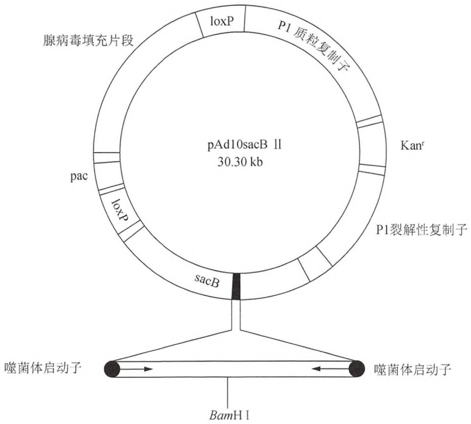

flowchart

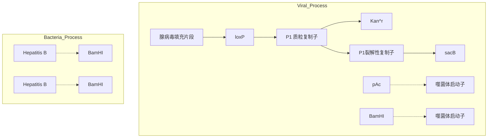

图5-1 pAd10sacBII简图，一种P1噬菌体载体。环状载体的左侧含有两个loxP位点、一个DNA复制质粒起始位点、一个包装进入P1颗粒的最小信号序列（pac），以及一个来源于腺病毒DNA的填充片段。右侧含有一个卡那霉素抗性基因（kanr）；一个来源于P1噬菌体的复制子（P1质粒复制子），该复制子使载体在大肠杆菌中以低拷贝数质粒的方式复制；一个可诱导的复制子（P1裂解性复制子），可用于增加质粒的拷贝数；还有一个选择标记（sacB），该标记包含一个克隆位点（BamHI），其两侧是来源于噬菌体SP6和T7的启动子。

## P1 人工染色体

P1 人工染色体是环状的 DNA 分子，它把 P1 载体和 BAC 的特性结合在一起（见下面介绍），包含阳性筛选标记（sacB）及 P1 噬菌体的质粒和裂解性复制子（图 5-2）。然而，它既不是将连接产物包装到噬菌体颗粒中，同样也不通过 Cre-loxP 位点的位点特异性重组产生质粒分子，而是采用电穿孔的方法将体外连接产生的环状重组 PAC 导入大肠杆菌中，然后维持其单拷贝质粒状态（Ioannou et al. 1994）。基于 PAC 的人类基因组文库插入片段的大小在 60～150kb（Ioannou et al. 1994; Strong et al. 1997）。

---

226

分子克隆实验指南（原书第四版）

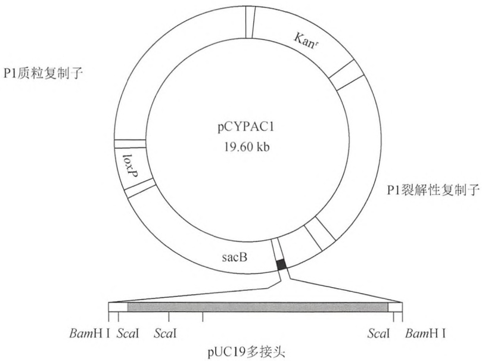

text_image

pCYPAC1
19.60 kb
Kanr
P1裂解性复制子
P1质粒复制子
loxp
sacB
BamH I ScalI ScalI
Scal BamH I
pUC19多接头

图5-2 pCYPAC1简图，一种用于构建P1人工染色体的载体。此载体含有:pAd10sacBII载体（图5-3）的部分遗传元件；一个卡那霉素抗性基因（$kan^r$）；一个loxP位点；一个来源于P1噬菌体的复制子（P1质粒复制子），该复制子使载体在大肠杆菌中以低拷贝数质粒的方式复制；一个可诱导的复制子（P1裂解性复制子），能用于增加质粒的拷贝数；以及包含多个克隆位点的选择标记（sacB）。

## 酵母人工染色体

酵母人工染色体（YAC）的基础理论初次发表于1983年（Murray and Szostak 1983）。但是，直到1987年，随着YAC载体的发展，人们才充分认识到此项技术的重要性。这些载体能够使几百kb的DNA扩增，被用于构建哺乳动物基因组DNA的整体文库（Burke et al. 1987）。

将大片段的基因组 DNA 连接到 YAC 载体的两条 “臂” 上，以产生重组的 YAC，然后将连接混合物通过转化的方法导入酵母。每一条臂都携带一个选择标记，以及按适当方向排列的、起端粒作用的 DNA 序列（Burke et al. 1987）。另外，其中一条臂上还携带着丝粒 DNA 片段和复制起始序列（亦称为 “自主复制序列”，或 ARS）。因此，在重组的 YAC 中，外源基因组 DNA 片段的一侧为着丝粒、复制起始序列及选择标记，另一侧为第二种选择标记。通过在选择性琼脂平板上生长的菌落，可鉴定出接受并稳定保持人工染色体的酵母转化体。

目前使用的大多数 YAC 载体设计为容易区分空载体（也就是没有携带插入 DNA）克隆及含有基因组 DNA 插入片段的载体的克隆（图 5-3）。例如，在一些 YAC 载体的克隆位点插入 DNA 后，打断了一种抑制型 tRNA 基因（SUP4），导致携带赭石型突变的 ade2 基因的酵母形成红色而非白色的菌落（见筛选 YAC 重组体）。由于没有包装约束限制 YAC 的克隆容量，它们插入片段的大小可高达 2Mb。因此，插入片段的平均大小主要取决于制备的基因组 DNA 的质量。大多数 YAC 文库的单个克隆含有 250～400kb 的外源 DNA。然而，单个克隆含有大小超过 1Mb 的哺乳动物基因组 DNA 文库已构建成功。YAC 克隆在酵母细胞中扩增，但是它们在有些情况下不稳定。

---

第 5 章 细菌人工染色体及其他高容量载体的应用

227

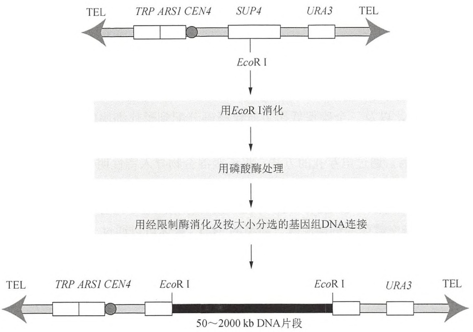

flowchart

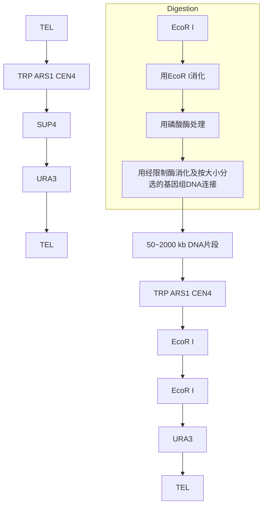

图5-3 YAC载体的克隆。YAC载体的基因组含有两个选择标记（TRP和URA）、一个自主复制序列（ARS1）、一个着丝粒（CEN4）、一个抑制型tRNA基因（SUP4），以及位于末端的端粒序列（TEL）。

## 筛选 YAC 重组体

ade2 等位基因含有一个无义突变。这个突变能够被 YAC 载体（如 pYAC4）携带的 SUP4 抑制。此载体的克隆位点位于 SUP4 基因内部。如果 YAC 载体中没有片段插入，则 SUP4 基因保持完整（有活性），ade2 突变受到限制，携带该亲代载体的转化体在酸水解酪蛋白（AHC）培养基上长成白色菌落；相反，如果 pYAC4 载体中有插入片段存在，则 SUP4 基因失活，ade2 等位基因上的无义突变阻止宿主合成磷酸核糖酰氨基咪唑羧化酶。在无此酶的情况下，磷酸核糖甘氨酰胺在酵母中堆积。取决于这种酶量的累积，菌落长成红色或粉红色。这种简单的颜色筛选法最早是由 Herschel Roman 在 20 世纪 50 年代末期报道（1957 年）。这是玉米和酵母遗传学研究上的一大创举。从此，这一方案被巧妙地用来测定基因重组事件（Fogel et al. 1981）和研究染色体的不稳定性（Hieter et al. 1985; Koshland et al. 1985）。

在 YAC 中构建基因组文库费时、昂贵且又费力。它不仅要求有处理大 DNA 分子的专门技术，而且要求通晓微生物宿主（酿酒酵母）的遗传学和分子生物学。此外，高效储存基因组 YAC 文库还涉及将克隆阵列排布在微量滴定板的孔中。在单个实验室中，这种技巧与资源的组合（包括操作易断裂 DNA 分子、熟悉酵母遗传学知识以及使用自动化仪器）较为罕见。因此，构建新的 YAC 文库最好交由专业人员完成，而筛选已有的 YAC 文库一般通过与各个学术性的基因组中心进行合作，或者越来越多地进行商业化操作。目前，许多物种的基因组 YAC 文库可从这些资源获得（如见 Burke 1991; van Ommen 1992; Foote and Denny 2002; Sanchez and Lanzer 2006）。一旦获得合适的 YAC 克隆，用标准的方法可对插入 DNA 进行修饰。方案 15 和 16 介绍了酿酒酵母的生长和酵母 DNA 的制备方法。

---

228

分子克隆实验指南（原书第四版）

## 细菌人工染色体

细菌人工染色体（BAC）是基于大肠杆菌（E. coli）致育（F）因子的合成载体。这些载体是环状 DNA 分子，它们携带一个抗生素抗性标记、一个来源于大肠杆菌 F 因子（致育因子）的严紧型控制的复制子（Shizuya et al. 1992）、一个有助于 DNA 复制的 ATP 驱动的解旋酶（repE），以及三个确保低拷贝质粒精确分配到子代细胞的基因座（parA、parB 和 parC）。这些特性促进了质粒的维持和稳定。在体外，将外源基因组 DNA 片段连接到 BAC 载体上；然后，通过电穿孔的方法，将连接混合物导入特性明确的大肠杆菌重组缺陷型菌株，在大肠杆菌中成为单拷贝质粒。

第一代的 BAC 载体（Shizuya et al. 1992）没有标记能用于区分携带重组体的抗生素抗性细菌菌落与携带空载体的细菌菌落。新型的 BAC 载体可以通过 α-互补筛选，鉴定含有插入片段的重组体（见第 1 章信息栏“α-互补”），并带有便于克隆 DNA 回收和操作的位点（图 5-4）（Kim et al. 1996; Asakawa et al. 1997）。为了达到各种各样的研究目的，人们设计了 BAC 用于克隆大基因组 DNA 片段（Mozo et al. 1999; Hoskins et al. 2000; Osoegawa et al. 2000; McPherson et al. 2001; Osoegawa and de Jong 2004）。由于没有包装的约束，BAC 载体能用于大 DNA 片段克隆和扩增，其平均插入片段大小为 150kb，最大的插入片段为 700kb（Tunster et al. 2011），此大小通常足以涵盖整个转录单元及其相关的调控元件（Shizuya et al. 1992; Shizuya and Kouros-Mehr 2001）。在体内，通常这些 BAC 克隆是稳定的。基因组和转基因研究在许多实验和商业上重要的生物体中需要大 DNA 片段，BAC 载体现在是此类大范围研究常规使用的载体，因而是本章的重点。

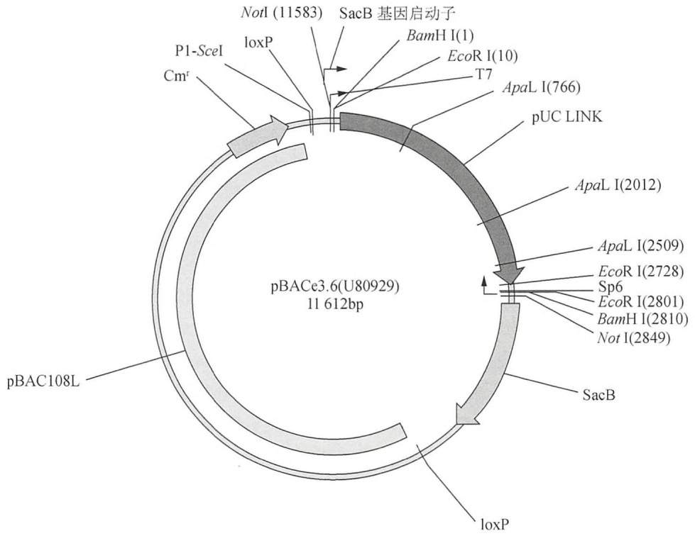

flowchart

```mermaid
graph LR
  A["pBACe3.6(U80929)\n11 612bp"] --> B["pBAC108L"]
  B --> C["P1-SceI\nCmr"]
  C --> D["loxP"]
  D --> E["NotI (11583)"]
  E --> F["SacB 基因启动子"]
  F --> G["BamH I(1)\nEcoR I(10)\nT7"]
  G --> H["ApaL I(766)"]
  H --> I["pUC LINK"]
  I --> J["ApaL I(2012)"]
  J --> K["ApaL I(2509)"]
  K --> L["EcoR I(2728)\nSp6"]
  L --> M["EcoR I(2801)\nBamH I(2810)\nNot I(2849)"]
  M --> N["SacB"]
  N --> O["loxP"]
```

图5-4 pBACe3.6示意图。此环状载体携带loxP位点以便于回收克隆的序列、一个带有氯霉素抗性 $(Cm^{r})$ 的基因，以及用作阳性选择标记有利于重组克隆而不利于无插入的背景菌落的sacB基因（进一步详情，见文中）。此载体同时含有几个限制性位点，能用于克隆大的基因组DNA片段（Frengen et al. 1999）。[奥克兰儿童医院，BACPAC资源中心（BPRC）许可，重新绘制]。

---

第 5 章 细菌人工染色体及其他高容量载体的应用

229

## 细菌人工染色体的应用

在基因组和转基因研究中，最常用的大容量克隆载体是 BAC 文库。多种特性使得这个来源于致育因子 F 的因子成为一种引人注意的基因组 DNA 的高容量载体。在大肠杆菌中，BAC 维持低拷贝数（1～2 个分子/细胞）（Frame and Bishop 1971），它含有 parA 和 parB 基因以确保细胞在分裂时，基于 F 因子的 DNA 分子能精确地分配到子代细胞；parB 同时负责驱除细胞中外来的 F 质粒。低拷贝数加上隔离的环境，限制了细胞内 BAC 分子间的重组。实际上，这使得 BAC 中外源 DNA 的重排和嵌合的程度低于 YAC。如我们所知，BAC 能扩增非常大的 DNA 片段。事实上，自然产生的 F 因子能轻松携带 1/4 的大肠杆菌染色体而不导致其不稳定。进一步，由于 F 因子 DNA 呈闭环结构，所以可以用一些简单的技术将它从大肠杆菌中分离出来，如碱裂解、CsCl-溴化乙锭密度梯度离心、树脂旋转柱层析（Zimmer and Verrinder Gibbins 1997）。通常 5mL 细菌培养物中获得的 BAC DNA 足以用于限制性酶切分析、PCR 扩增和荧光原位杂交。在各种物种中，BAC 文库能容纳非常大的基因组片段 [如人（Shizuya et al. 1992; Woo et al. 1994; Kim et al. 1996）、稻米（Wang et al. 1995）、牛（Cai et al. 1995），以及鸡（Zimmer and Verrinder Gibbins 1997）]，并且能包含超过 300kb 大小的基因组 DNA 片段（Shizuya et al. 1992; Kim et al. 1996; Shizuya and KourosMehr 2001）。BAC DNA 易于纯化并可用作直接末端测序的模板（Kelley et al. 1999）。

## BAC 工程的基本思路

对转基因研究而言，BAC 携带的大基因组 DNA 克隆有很多优势，现在有很多方法能在大肠杆菌中通过同源重组加工 BAC 克隆。各种方法都依靠恢复宿主菌同源重组的能力。Heintz 及其同事首先报道了一种加工 BAC 的技术，此技术通过重新导入大肠杆菌的 recA 基因到 BAC 宿主菌株中以恢复其同源重组的能力（Yang et al. 1997; Heintz 2000, 2001）。随后，人们开发了数种其他方法以恢复宿主同源重组的能力，如通过表达一对噬菌体来源的蛋白质 RecE/RecT，其来源于 Rac 原噬菌体（Zhang et al. 1998）；或者通过来自 λ 噬菌体的 Redα(exo)、Redβ(bet) 和 Redγ(gam) 蛋白（Murphy 1998; Lee et al. 2001; Sharan et al. 2009）。基于 RecA 的 BAC 工程系统已经得到极大的发展（Gong et al. 2002），并成功地应用于大规模的 BAC 工程计划，用于绘制所有在中枢神经系统中表达的基因的图谱（Gong et al. 2003）(GENSAT 计划；http://www.gensat.org)。对于在 BAC 中引入标记基因、插入、缺失或点突变，这种系统非常高效和可靠。从 2002 年以来，洛克菲勒大学的 GENSAT 计划已经修饰了超过 3000 种的 BAC，并产生了超过 1200 种的 BAC 转基因小鼠供科学界使用（Malenka 2002; Marx 2002; Abbott 2003; Geschwind 2004; Hatten and Heintz 2005; Lu 2009; Valjent et al. 2009）。基于 BAC 的 Cre 重组酶家系已经用于控制靶向的遗传灭活或在特定的细胞类型中靶向的遗传激活（Gong et al. 2007）。在体内和固定的组织中，表达荧光蛋白的 BAC 转基因小鼠为方便鉴定特定的神经元类型提供了有价值的资源。例如，基于 BAC 的 EGFP-L10a 家系表达一种大亚基核糖体蛋白（L10）和 EGFP 的融合蛋白，它被用于从特定遗传的细胞群体中分离多聚核糖体的 mRNA（Doyle et al. 2008; Heiman et al. 2008）（见信息栏“用 EGFP 作为报道分子”）。在胚胎干（ES）细胞中，BAC 工程系统也能用于产生敲除、条件性敲除和敲入的等位基因（Chadman et al. 2008）。最后，表达显性抑制基因的 BAC 转基因小鼠已经用于模拟人类疾病、研究疾病机制，以及筛选药物和开发治疗方法。挑选了一些引用

---

230

分子克隆实验指南（原书第四版）

GENSAT 计划或使用 GENSAT BAC 转基因小鼠的文章，见 http://www.gensat.org/gensat\_papers\_report.jsp)。

## 细菌同源重组:穿梭载体的特点

所有的BAC载体都携带一个氯霉素抗性基因，并在一种重组缺陷型的大肠杆菌菌株中得以维持，常用的菌株为DH10B。因而，操作BAC的第一步是恢复宿主的同源重组能力，这通常通过在宿主细胞中引入一种穿梭载体，此载体编码一种酶（通常为RecA）或者能弥补此缺陷的酶。同时，此穿梭载体携带一个氨苄青霉素抗性的基因（用作阳性筛选标记）和一种反向筛选标记（sacB基因）。sacB的基因产物果聚糖蔗糖酶将蔗糖转化为果聚糖，果聚糖对宿主细胞产生毒性（Gay et al. 1985）。因而，在蔗糖存在时，果聚糖的产生增强了从宿主BAC细胞中去除多余载体序列(来自穿梭载体)的能力，使得重组的BAC克隆(Gong et al. 2002）得以选择。

通过向洛克菲勒大学作者的团队索取可以获得穿梭载体。从奥克兰儿童医院研究所可以获得修饰的 BAC（CHORI 的 BACPAC 资源）。通过原核注射修饰 BAC 得到的转基因小鼠可以从突变小鼠区域资源中心获得（NINDS/GENSAT 收集）。

## 修饰盒

穿梭载体携带的另一个元件是修饰盒，它被引入到 BAC 目的基因中或其邻近位置。修饰盒设计为含有任意一种如下的特征:改变基因或附加报道基因、标签序列或有用的标记（Yang and Gong 2005）。例如，从修饰盒表达的功能元件包含多种报道基因，如 EGFP（见信息栏“用 EGFP 作为报道分子”）、β-半乳糖苷酶（LacZ）、胎盘碱性磷酸酶（PLAP）或麦胚凝集素（WGA）标记；重组酶，如 Cre 重组酶（见信息栏“Cre-loxP”）、Flp 重组酶、Cre-ERT2 重组酶、Flp-ERT2 重组酶。其他可能的特征包括:毒素，如白喉毒素 A（DTA）；表位和亲和标签，如 Flag、Myc、血凝素（HA）、蛋白 A、多组氨酸和碱性磷酸酶；等位基因变异体（显性抑制或激活突变），如点突变、核苷酸插入或缺失；以及调控组件，如四环素反式激活因子（tTA）和反向的四环素反式激活因子（rtTA）。

## BAC 工程方案的策略

为了提供一套用于转基因的高通量构建 BAC 载体的系统，人们开发了一种用于高通量研究的简便、高效的方法。通常采用两种策略用于 BAC 工程，称之为两步和一步 BAC 工程。两步完成的方案包括将两个同源臂（与 BAC 载体同源的序列）克隆到穿梭载体中，随之在穿梭载体和 BAC 克隆间进行两步重组。第一步使穿梭载体整合到 BAC 上，形成“共合体”（cointegrate）；第二步，无用的穿梭载体序列被移除，在适当的位置只留下包含突变或报道基因的组件。携带共合体 BAC 的宿主菌株在琼脂和蔗糖上生长的过程中，携带未重组 BAC 的细菌被消除（图 5-5）。因为人们能在修饰盒的 A 或 B 同源臂区域设计突变，此方案能用于精细地改变目的基因，如点突变、插入、缺失、置换或过表达一个显性抑制基因以产生动物模型（图 5-6）。如果穿梭载体采用 pLD53.SC-AEB 质粒，此方案能用于表达报道基因，其表达受到选定的基因启动子的调控。

---

第 5 章 细菌人工染色体及其他高容量载体的应用

231

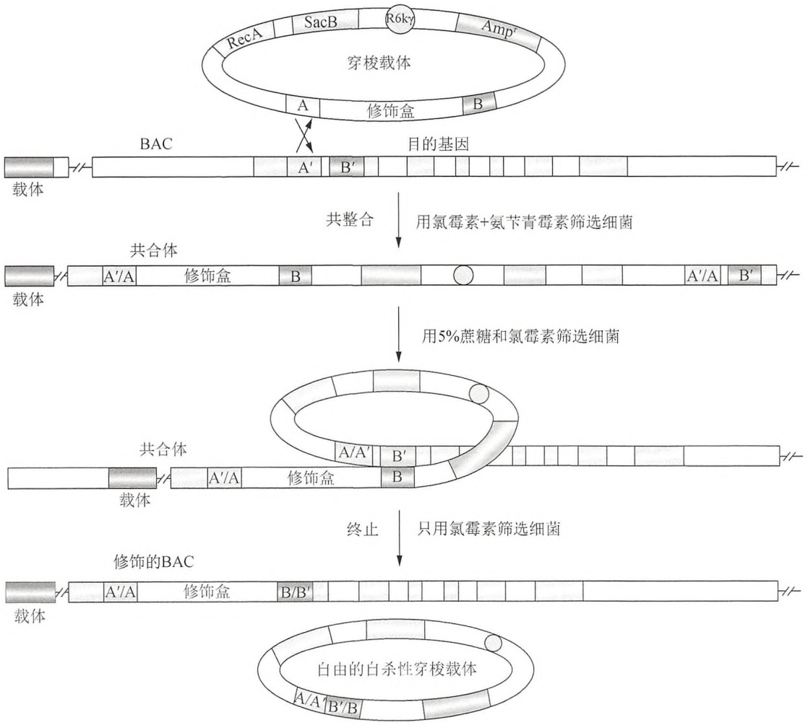

flowchart

This flowchart illustrates the experimental workflow for establishing a single-stranded BAC (Bacteroidin A) viral genome. It details the steps from extracellular RNA editing and complementation to cross-complexing, screening, and final cell division.

图5-5 一种两步BAC修饰的策略。此穿梭载体含有一个recA基因、一个条件复制起点、一个阳性选择标记、一个负选择标记、A和B同源臂（同BAC克隆的A'和B'序列相同），以及一个携带功能元件用于插入BAC克隆的修饰盒。同源重组事件（共整合）在穿梭载体和BAC克隆的其中一个同源臂间发生。第二个同源重组事件（终止）发生在共合体中，使得多余的区域从共合体中去除。此系统用于在BAC克隆中引入插入、缺失和点突变（彩图请扫封底二维码）。

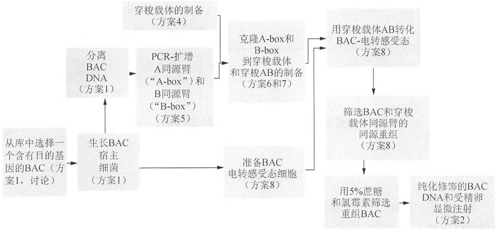

flowchart

图 5-6 两步 BAC 修饰的流程图。

---

232

分子克隆实验指南（原书第四版）

一步完成的方案采用两种质粒，它完全可以在液体培养物中完成，并用在转基因动物中表达报道基因。在此方案中，穿梭载体携带单个的同源臂和修饰盒，另一个载体（一步方案的明显特征）携带 recA 基因（图 5-7）。这个方案包括克隆一个同源臂，接着是一个重组步骤。pSV1.RecA 载体反向提供 RecA 产物，它具有一个温度敏感的复制起点（ts-ori），使其能够在需要的时候被扩增，然后在重组完成后被消除（图 5-8）。

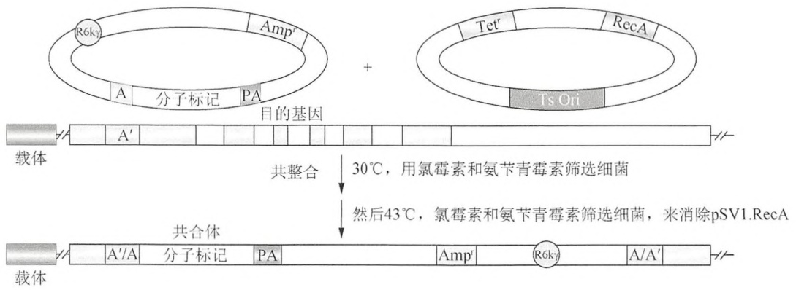

text_image

R6kγ
Amp'
Tet'
RecA
A 分子标记 PA
目的基因
Ts Ori
载体 A' 共整合 30°C，用氯霉素和氨苄青霉素筛选细菌
然后43°C，氯霉素和氨苄青霉素筛选细菌，来消除pSV1.RecA
载体 A'/A 分子标记 PA Amp' R6kγ A/A'

图 5-7 一种一步 BAC 修饰的策略。此穿梭载体含有:一个条件复制起点；一个阳性选择标记；A 同源臂，同 BAC 克隆的 A'序列相同；以及一个携带功能元件用于插入 BAC 克隆的修饰盒。另一个表达 RecA 的质粒有利于穿梭载体和 BAC 克隆的同源臂间发生同源重组。在高温下（43℃）生长时，RecA 质粒不能在宿主中复制，从而从宿主中消除。此系统能用于在 BAC 克隆中引入报道基因（彩图请扫封底二维码）。

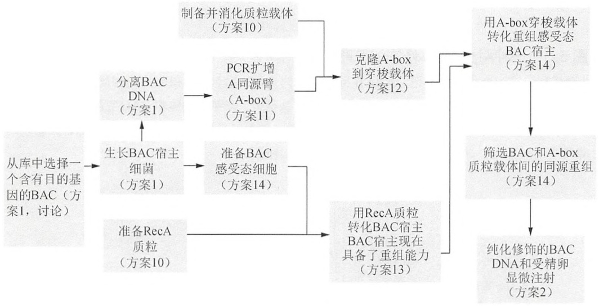

flowchart

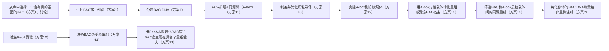

图 5-8 一步 BAC 修饰的流程图。

## 两步 BAC 工程

本方案中，BAC 转基因载体的基本起始要素包括一个 BAC 克隆和一个穿梭载体，在穿梭载体中插入了一个修饰盒和同源臂。方案 1～3 介绍了 BAC 克隆的选择和小量与大量制备的分离方法，及其随后的评估。

---

第 5 章 细菌人工染色体及其他高容量载体的应用

233

一种改进的穿梭载体 pLD53，由于能采用传统的克隆方法，便于其操作，并且它不能在 BAC 宿主细胞中自由复制，被用于 BAC 工程。R6kγ 复制起点保证了此载体只能在表达 π 复制蛋白的大肠杆菌菌株中复制（Metcalf et al. 1996）。因为 BAC 宿主菌（DH10B）不表达此蛋白，pLD53 不能在这些细胞中自由复制。如我们在前面部分的讨论，穿梭载体也携带 recA 基因（用于恢复 BAC 宿主的重组能力）和 sacB 基因（用于穿梭载体的负筛选）。为了使 BAC 克隆和穿梭载体间发生同源重组，BAC 同源臂被克隆到穿梭载体中。选定了一个携带目的基因的 BAC 后，接下来扩增两个约 700bp 的同源臂，并将它们克隆到穿梭载体中（见信息栏“同源臂、共合体和重组体的引物设计”）。然后，携带一个报道基因或目的突变的修饰盒被插入 A 和 B 同源臂之间。在 BAC 修饰后，报道基因或目的突变被引入到选定的 BAC 克隆。

在穿梭载体和 BAC 克隆的首次重组之后, 只有含有目的共合体的载体能在选择条件下生存 (氨苄青霉素和氯霉素中生长)。在第二次重组后, 随后在蔗糖上生长进行筛选, 正确重组的 BAC 失去了携带 sacB 和 recA 的穿梭载体 (图 5-5 和图 5-6)。重组的 BAC 克隆可被进一步筛选以确认 recA 基因的丢失, 丢失 recA 基因导致对紫外线敏感 (Gong et al. 2002)。从蔗糖平板上选择菌落, 划线到只含有氯霉素的两个复制平板上, 用于筛选存在 BAC 的菌落。平板接种后, 立即将一套平板照射紫外线, 两套平板均培养过夜。紫外线敏感的菌落将丢失 recA, 从主平板上挑选这些菌落用于后续分析。这样就通过简单地增加筛选改善了目的重组产物的回收。方案 4\~9 介绍了进行两步 BAC 工程的各个步骤。

## 一步BAC工程

为了使本系统适于实际的高通量应用，需要一个适合于自动化的有力方案。一步BAC方案的第二个修饰过程完全在液体培养物中完成，容易实现自动化的操作（图5-7）。本方案的策略涉及分离功能元件，这些元件是两个质粒的靶向事件所必需的（图5-8）。在多数情况下，在BAC中引入有限量的载体序列不会干扰BAC转基因的表达，尤其是由于这些序列在标记基因盒的多聚腺苷酸[poly(A)]附加基序之后，所以不会包含在成熟的转录物中（Gong et al. 2003）。许多基因捕获实验在插入的标记基因后引入了额外的DNA，但是对捕获的基因的表达影响很小（Friedrich and Soriano 1991; Skarnes et al. 1992; Leighton et al. 2001）。另外，在转基因载体上引入BAC载体序列不影响BAC转基因的表达（Antoch et al. 1997; Yang et al. 1997; Gong et al. 2003, 2007）。方案 $10\sim 14$ 介绍了一步BAC工程的操作方法。

## 致谢

感谢 K. Janssen 对文稿的认真审阅和编辑、C. Wang 和 S. Mehta 对本章所述方案的发展的贡献、S.I. Chiu 对图和文稿的编辑和准备，以及 E. Schmidt 对文稿的认真审阅。同时，感谢 J. Walsh 和 S.I. Chiu 将质粒分发给科学界使用、I. Lee 对图 5-8 的帮助，以及 P. de Jong 提供图 5-4 和 RP23 与 RP24 文库。

---

234

分子克隆实验指南（原书第四版）

## 参考文献

- Abbott A. 2003. Neuroscience: Genomics on the brain. Nature 426: 757.
- Antoch MP, Song EJ, Chang AM, Vitaterna MH, Zhao Y, Wilsbacher LD, Sangoram AM, King DP, Pinto LH, Takahashi JS. 1997. Functional identification of the mouse circadian Clock gene by transgenic BAC rescue. Cell 89: 655–667.
- Asakawa S, Abe I, Kudoh Y, Kishi N, Wang Y, Kubota R, Kudoh J, Kawasaki K, Minoshima S, Shimizu N. 1997. Human BAC library: Construction and rapid screening. Gene 191: 69–79.
- Burke DT. 1991. The role of yeast artificial chromosome clones in generating genome maps. Curr Opin Genet Dev 1: 69–74.
- Burke DT, Carle GF, Olson MV. 1987. Cloning of large segments of exogenous DNA into yeast by means of artificial chromosome vectors. Science 236: 806–812.
- Cai L, Taylor JF, Wing RA, Gallagher DS, Woo SS, Davis SK. 1995. Construction and characterization of a bovine bacterial artificial chromosome library. Genomics 29: 413–425.
- Capecchi MR. 1989. The new mouse genetics: Altering the genome by gene targeting. Trends Genet 5: 70–76.
- Chadman KK, Gong S, Scattoni ML, Boltuck SE, Gandhy SU, Heintz N, Crawley JN. 2008. Minimal aberrant behavioral phenotypes of neuro-ligin-3 R451C knockin mice. Autism Res 1: 147–158.
- Doyle JP, Dougherty JD, Heiman M, Schmidt EF, Stevens TR, Ma G, Bupp S, Shrestha P, Shah RD, Doughty ML, et al. 2008. Application of a translational profiling approach for the comparative analysis of CNS cell types. Cell 135: 749–762.
- Fogel S, Mortimer RK, Lusnak K. 1981. Mechanisms of meiotic gene conversion, or “Wanderings on a foreign strand.” In The molecular biology of the yeast Saccharomyces: Life cycle and inheritance (ed. JN Strathern, et al.), pp. 289–339. Cold Spring Harbor Laboratory Press, Cold Spring Harbor, NY.
- Foote S, Denny C. 2002. Construction of YAC libraries with large inserts. Curr Protoc Hum Genet 5: 5.2.1–5.2.20.
- Frame R, Bishop JO. 1971. The number of sex-factors per chromosome in Escherichia coli. Biochem J 121: 93–103.
- Frengen E, Weichenhan D, Zhao B, Osoegawa K, van Geel M, de Jong PJ. 1999. A modular, positive selection bacterial artificial chromosome vector with multiple cloning sites. Genomics 58: 250–253.
- Friedrich G, Soriano P. 1991. Promoter traps in embryonic stem cells: A genetic screen to identify and mutate developmental genes in mice. Genes Dev 5: 1513–1523.
- Gay P, Le Coq D, Steinmetz M, Berkelman T, Kado Cl. 1985. Positive selection procedure for entrapment of insertion sequence elements in Gram-negative bacteria. J Bacteriol 164: 918–921.
- Geschwind D. 2004. GENSAT: A genomic resource for neuroscience research. Lancet Neurol 3: 82.
- Gong S, Yang XW, Li C, Heintz N. 2002. Highly efficient modification of bacterial artificial chromosomes (BACs) using novel shuttle vectors containing the R6Kγ origin of replication. Genome Res 12: 1992–1998.
- Gong S, Zheng C, Doughty ML, Losos K, Didkovsky N, Schambra UB, Nowak NJ, Joyner A, Leblanc G, Hatten ME, et al. 2003. A gene expression atlas of the central nervous system based on bacterial artificial chromosomes. Nature 425: 917–925.
- Gong S, Doughty M, Harbaugh CR, Cummins A, Hatten ME, Heintz N, Gerfen CR. 2007. Targeting Cre recombinase to specific neuron populations with bacterial artificial chromosome constructs. J Neurosci 27:9817–9823.
- Gordon JW, Ruddle FH. 1981. Integration and stable germ line transmission of genes injected into mouse pronuclei. Science 214: 1244–1246.
- Gossler A, Doetschman T, Korn R, Serfling E, Kemler R. 1986. Transgenesis by means of blastocyst-derived embryonic stem cell lines. Proc Natl Acad Sci 83: 9065–9069.
- Hatten ME, Heintz N. 2005. Large-scale genomic approaches to brain development and circuitry. Annu Rev Neurosci 28: 89–108.
- Heiman M, Schaefer A, Gong S, Peterson JD, Day M, Ramsey KE, Suárez-Fariñas M, Schwarz C, Stephan DA, Surmeier DJ, et al. 2008. A translational profiling approach for the molecular characterization of CNS cell types. Cell 135: 738–748.
- Heintz N, 2000. Analysis of mammalian central nervous system gene expression and function using bacterial artificial chromosome-mediated transgenesis. Hum Mol Genet 9: 937–943.
- Heintz N. 2001. BAC to the future: The use of BAC transgenic mice for neuroscience research. Nat Rev Neurosci 2: 861–870.
- Hieter P, Mann C, Snyder M, Davis RW. 1985. Mitotic stability of yeast chromosomes: A colony color assay that measures nondisjunction and chromosome loss. Cell 40: 381–392.
- Hoskins RA, Nelson CR, Berman BP, Laverty TR, George RA, Ciesiolka L, Naeemuddin M, Arenson AD, Durbin J, David RG, et al. 2000. A BAC-based physical map of the major autosomes of Drosophila melanogaster. Science 287: 2271–2274.
- Ioannou PA, Amemiya CT, Garnes J, Kroisel PM, Shizuya H, Chen C, Batzer MA, de Jong PJ. 1994. A new bacteriophage P1-derived vector for the propagation of large human DNA fragments. Nat Genet 6:84–89.
- Joyner AL, Sedivy JM. 2000. Gene targeting: A practical approach. Oxford University Press, Oxford.
- Kelley JM, Field CE, Craven MB, Bocskai D, Kim UJ, Rounsley SD, Adams MD. 1999. High throughput direct end sequencing of BAC clones. Nucleic Acids Res 27: 1539–1546.
- Kim UJ, Birren BW, Slepak T, Mancino V, Boysen C, Kang HL, Simon MI, Shizuya H. 1996. Construction and characterization of a human bacterial artificial chromosome library. Genomics 34: 213–218.
- Koshland D, Kent JC, Hartwell LH. 1985. Genetic analysis of the mitotic transmission of minichromosomes. Cell 40: 393–403.
- Lee EC, Yu D, Martinez de Velasco J, Tessarollo L, Swing DA, Court DL, Jenkins NA, Copeland NG. 2001. A highly efficient Escherichia coli-based chromosome engineering system adapted for recombinogenic targeting and subcloning of BAC DNA. Genomics 73:56–65.
- Leighton PA, Mitchell KJ, Goodrich LV, Lu X, Pinson K, Scherz P, Skarnes WC, Tessier-Lavigne M. 2001. Defining brain wiring patterns and mechanisms through gene trapping in mice. Nature 410: 174–179.
- Lu XH. 2009. BAC to degeneration bacterial artificial chromosome (BAC)-mediated transgenesis for modeling basal ganglia neurodegenerative disorders. Int Rev Neurobiol 89: 37–56.
- Malenka R. 2002. NIH workshop report: Taming the brain's complexity. Neuron 36: 29–30.
- Marx V. 2002. Beautiful bioimages for the eyes of many beholders. Science 297: 39–40.
- McPherson JD, Marra M, Hillier L, Waterston RH, Chinwalla A, Wallis J, Sekhon M, Wylie K, Mardis ER, Wilson RK, et al. 2001. A physical map of the human genome. Nature 409: 934–941.
- Metcalf WW, Jiang W, Daniels LL, Kim SK, Haldimann A, Wanner BL. 1996. Conditionally replicative and conjugative plasmids carrying lacZα for cloning, mutagenesis, and allele replacement in bacteria. Plasmid 35: 1–13.
- Mozo T, Dewar K, Dunn P, Ecker JR, Fischer S, Kloska S, Lehrach H, Marra M, Martienssen R, Meier-Ewert S, et al. 1999. A complete BAC-based physical map of the Arabidopsis thaliana genome. Nat Genet 22: 271–275.
- Murphy KC. 1998. Use of bacteriophage λ recombination functions to promote gene replacement in Escherichia coli. J Bacteriol 180: 2063–2071.
- Murray AW, Szostak JW. 1983. Construction of artificial chromosomes in yeast. Nature 305: 189–193.
- Notarianni E, Evans MJ. 2006. Embryonic stem cells: A practical approach. Oxford University Press, Oxford.
- Osoegawa K, de Jong PJ. 2004. BAC library construction. Methods Mol Biol 255: 1–46.

---

第 5 章 细菌人工染色体及其他高容量载体的应用

235

- Osoegawa K, Tateno M, Woon PY, Frengen E, Mammoser AG, Catanese JJ, Hayashizaki Y, de Jong PJ. 2000. Bacterial artificial chromosome libraries for mouse sequencing and functional analysis. Genome Res 10:116–128.
- Roman H. 1957. Studies of gene mutation in Saccharomyces. Cold Spring Harb Symp Quant Biol 21: 175–185.
- Sanchez CP, Lanzer M. 2006. Construction of yeast artificial chromosome libraries from pathogens and nonmodel organisms. Methods Mol Biol 349: 13–26.
- Schedl A, Montoliu L, Kelsey G, Schütz G. 1993. A yeast artificial chromosome covering the tyrosinase gene confers copy number-dependent expression in transgenic mice. Nature 362: 258–261.
- Sharan SK, Thomason LC, Kuznetsov SG, Court DL. 2009. Recombineering: A homologous recombination-based method of genetic engineering. Nat Protoc 4: 206–223.
- Shizuya H, Birren B, Kim UJ, Mancino V, Slepak T, Tachiiri Y, Simon M. 1992. Cloning and stable maintenance of 300-kilobase-pair fragments of human DNA in Escherichia coli using an F-factor-based vector. Proc Natl Acad Sci 89: 8794–8797.
- Shizuya H, Kouros-Mehr H. 2001. The development and applications of the bacterial artificial chromosome cloning system. Keio J Med 50:26–30.
- Skarnes WC, Auerbach BA, Joyner AL. 1992. A gene trap approach in mouse embryonic stem cells: The lacZ reported is activated by splicing, reflects endogenous gene expression, and is mutagenic in mice. Genes Dev 6: 903–918.
- Sternberg N. 1990. Bacteriophage P1 cloning system for the isolation, amplification, and recovery of DNA fragments as large as 100 kilobase pairs. Proc Natl Acad Sci 87: 103–107.
- Sternberg N. 1992. Cloning high molecular weight DNA fragments by the bacteriophage P1 system. Trends Genet 8: 11–16.
- Sternberg N. 1994. The P1 cloning system: Past and future. Mamm Genome 5: 397–404.
- Strong SJ, Ohta Y, Litman GW, Amemiya CT. 1997. Marked improvement of PAC and BAC cloning is achieved using electroelution of pulsed-field gel-separated partial digests of genomic DNA. Nucleic Acids Res 25: 3959–3961.
- Thompson S, Clarke AR, Pow AM, Hooper ML, Melton DW. 1989. Germ line transmission and expression of a corrected HPRT gene produced by gene targeting in embryonic stem cells. Cell 56: 313–321.
- Tunster SJ, Van De Pette M, John RM. 2011. BACs as tools for the study of genomic imprinting. J Biomed Biotechnol 2011: 283013.
- Turksen K. 2006. Embryonic stem cell protocols. Humana Press, Totowa, NJ.
- Valjent E, Bertran-Gonzalez J, Hervé D, Fisone G, Girault JA. 2009. Looking BAC at striatal signaling: Cell-specific analysis in new transgenic mice. Trends Neurosci 32: 538–547.
- van Ommen GJ. 1992. First report of the HUGO YAC committee. In Genome priority reports: Chromosome coordinating meeting (ed Cuticchia AJ, et al.), Vol. 1, pp. 885–888. Karger, Basel, Switzerland.
- Venter JC, Adams MD, Myers EW, Li PW, Mural RJ, Sutton GG, Smith HO, Yandell M, Evans CA, Holt RA, et al. 2001. The sequence of the human genome. Science 291: 1304–1351.
- Wang GL, Holsten TE, Song WY, Wang HP, Ronald PC. 1995. Construction of a rice bacterial artificial chromosome library and identification of clones linked to the Xa-21 disease resistance locus. Plant J 7:525–533.
- Woo SS, Jiang J, Gill BS, Paterson AH, Wing RA. 1994. Construction and characterization of a bacterial artificial chromosome library of Sorghum bicolor. Nucleic Acids Res 22: 4922–4931.
- Yang XW, Gong S. 2005. An overview on the generation of BAC transgenic mice for neuroscience research. Curr Protoc Neurosci 5: 5.20.1–5.20.11.
- Yang XW, Model P, Heintz N. 1997. Homologous recombination based modification in Escherichia coli and germline transmission in transgenic mice of a bacterial artificial chromosome. Nat Biotechnol 15:859–865.
- Zhang Y, Buchholz F, Muyrers JP, Stewart AF. 1998. A new logic for DNA engineering using recombination in Escherichia coli. Nat Genet 20:123–128.
- Zimmer R, Verrinder Gibbins AM. 1997. Construction and characterization of a large-fragment chicken bacterial artificial chromosome library. Genomics 42: 217–226.

## 网络资源

突变小鼠区域资源中心 http://www.mmrrc.org/

NINDS GENSAT BAC（洛克菲勒大学）http://www.gensat.org/login.jsp

## 方案 1 BAC DNA 的小量分离和 PCR 检验

从 5mL 转化了 BAC 克隆的大肠杆菌宿主的培养物中，少量制备特定的 BAC DNA。DNA 的分离采用第 1 章方案 1 中的碱裂解法（此外，QIAGEN 公司的质粒小提试剂盒亦可使用）。BAC DNA 的产量为 0.1～0.4μg，并适用于 PCR 分析。克隆选择的注意事项见讨论部分。

▲因为 BAC DNA 对剪切力敏感，应该使用带有宽孔吸头的移液器来转移 DNA。

## 材料

为正确使用本方案中的器材和危险试剂，必须查阅相应的材料安全数据表并咨询所在机构的环境卫生和安全办公室。

本方案的专用试剂标注&lt;R&gt;，配方在本方案末提供。常用储备溶液、缓冲液和试剂标注&lt;A&gt;，配方见附录1。储备溶液应稀释至适用浓度后使用。

## 试剂

用  $1 \times TAE < A>$  配制琼脂糖凝胶（1.5%琼脂糖），含有  $0.1 \mu g/mL$  的溴化乙锭，其他琼脂糖凝胶电泳所需要的试剂和设备（见第 2 章，方案 1）

---

236

分子克隆实验指南（原书第四版）

碱性裂解液 I&lt;A&gt;

碱性裂解液 II&lt;A&gt;

碱性裂解液 III，冰冷&lt;A&gt;

BAC 克隆(CHORI 或 Riken 生物资源中心; Life Technologies 公司), 在大肠杆菌 DH10B 菌株中携带

来自基因组 BAC 文库储藏处的克隆含有超过 100～300kb 的 DNA 插入片段。BAC 克隆资源包括人和小鼠的组织。克隆为甘油保存。更多的注意事项见本方案最后关于选择 BAC 克隆的讨论。

乙醇（100%和70%，V/V）

凝胶加样缓冲液III&lt;A&gt;

LB 琼脂&lt;A&gt;，添加氯霉素（20μg/mL）

LB 培养基&lt;A&gt;，添加氯霉素（20μg/mL）

分子质量标记（2-log DNA 梯形标记；New England Biolabs 公司）

酚:氯仿（1:1，V/V）

Taq PCR Core Kit (QIAGEN 公司)，包括酶、CoralLoad PCR 缓冲液和 Q 溶液

## 设备

离心机（J6-MI Beckman-Coulter，带有 JS-4.2 转子）

微型离心机（Eppendorf 公司冷冻型 5417R）

微量离心管

Vacutainer 血液收集管

## 方法

## DNA 制备

1. 选择一个合适的 BAC 克隆，划线培养物到一个含氯霉素的 LB 琼脂平板上。37℃ 培养过夜。

克隆的选择见讨论部分。

2. 挑选一个单菌落，接种到 $5\mathrm{mL}$ 含氯霉素的LB培养基中。 $37^{\circ}\mathrm{C}$，$300\mathrm{r / min}$ 振荡生长细胞过夜。

3. $4^{\circ}\mathrm{C}$, 4552g 离心 20min 收集细胞。丢弃上清液, 将细菌沉淀重悬于 $200\mu \mathrm{L}$ 碱性裂解液 I 中。

4. 加入  $200 \mu L$  碱性裂解液 II 裂解细菌。轻轻地混合，并在室温温育 5min。

5. 在裂解物中加入  $200 \mu L$  冰冷的碱性裂解液 III 中和混合物。轻轻地混匀。

6. 转移混合物到一个 $1.5 \mathrm{~mL}$ 的微量离心管中，在微型离心机中，$20617 \mathrm{~g} (14000 \mathrm{r} / \mathrm{min})$ $4^{\circ} \mathrm{C}$ 离心 $30 \mathrm{~min}$。

7. 转移上清到一个 Vacutainer 血液收集管，用等体积的酚:氯仿抽提，在一个旋转台上振荡 5min。在 J6-MI 离心机中，4552g，20℃离心 10min。

8. 转移上层水相到一个 $2 \mathrm{~mL}$ 微量离心管中。加入 2 体积的 $100 \%$ 乙醇，轻轻地混匀。在微型离心机中，$20617 \mathrm{~g} (14000 \mathrm{r} / \mathrm{min})$，$4^{\circ} \mathrm{C}$ 离心 $30 \mathrm{~min}$。

9. 丢弃上清，用 70%乙醇洗涤沉淀。室温下风干沉淀 10min。

10. 将沉淀重悬于 $50 \mu \mathrm{L}$ 的 TE 中。$4^{\circ} \mathrm{C}$ 保存 BAC DNA, 避免冻融对 DNA 的剪切。

---

第 5 章 细菌人工染色体及其他高容量载体的应用

237

## PCR 分析

通过PCR确认扩增的BAC正确。根据模板的GC含量，对每个待检测的BAC，试用两个不同的PCR条件。

11. 在一个无菌的 $0.5 \mathrm{~mL}$ 微量离心管中以下列顺序混合:

<table><tr><td rowspan="2">组分</td><td colspan="2">用量</td><td rowspan="2">最终用量/浓度</td></tr><tr><td>非富含 GC</td><td>富含 GC</td></tr><tr><td>CoralLoad PCR 缓冲液(10×)</td><td>2.0μL</td><td>2.0μL</td><td>1×</td></tr><tr><td>A-box 或 B-box 的 5&#x27;引物</td><td>0.5μL</td><td>0.5μL</td><td>0.25μmol/L</td></tr><tr><td>A-box 或 B-box 的 3&#x27;引物</td><td>0.5μL</td><td>0.5μL</td><td>0.25μmol/L</td></tr><tr><td>dNTP (1mmol/L)</td><td>1.0μL</td><td>1.0μL</td><td>0.05mmol/L</td></tr><tr><td>BAC DNA (50ng/μL)</td><td>1.0μL</td><td>1.0μL</td><td>2.5ng/μL</td></tr><tr><td>Taq DNA 聚合酶</td><td>0.1μL</td><td>0.1μL</td><td>0.025U/μL</td></tr><tr><td>无菌 dH2O</td><td>14.9μL</td><td>10.9μL</td><td></td></tr><tr><td>Q溶液(Taq DNA 聚合酶中提供)</td><td></td><td>4.0μL</td><td>1×</td></tr><tr><td>总体积</td><td>20.0μL</td><td>20.0μL</td><td></td></tr></table>

12. 准备一个同步骤 11 一样的对照反应, 但是无模板 DNA。

13. 将 PCR 管放入热循环仪中，使用如下所列的变性、复性和聚合时间与温度进行扩增。

| 循环 | 变性 | 复性 | 聚合 |
| --- | --- | --- | --- |
| 1 | 94°C, 2min | — | — |
| 2~31 | 94°C, 30s | 55°C, 1min | 72°C, 1min |
| 32 | — | — | 72°C, 10min |

14. 在含有 $0.1\mu \mathrm{g / mL}$ 溴化乙锭的 $1.5\% (m / V)$ 琼脂糖凝胶上分析 $10\mu \mathrm{L}$ PCR产物，用一个2-log DNA梯形标记做分子质量标记。通过紫外透射仪观察凝胶。

## 讨论

可从 CHORI（http://bacpac.chori.org）和多个其他网址获得 BAC 克隆。一些基因组数据库提供 BAC 图，如 UCSC 基因组生物信息学 (http://genome.ucsc.edu)、NCBI 克隆资料库 (http://www.ncbi.nlm.nih.gov/genome/clone)，以及 Ensembl 小鼠基因组服务器 (http://uswest.ensembl.org/index.html)，可以鉴定出理想的 BAC 克隆。当导入宿主基因组时，大的 BAC 增加了正确表达的机会。一个理想的克隆在目的基因两侧的 5' 和 3' 端均具有至少 50kb 的基因组序列。只有当一个 BAC 克隆出现在前述的两个以上的数据库中时，才去选择该克隆。BAC 选择的问题是由于 BAC 克隆非常大，除目的基因外，它可能含有其他基因，这些基因也可能在转基因动物中表达，而导致意外的表型。为了达到最佳效率，建议选择含有最大转录调控元件，但很少过客（passenger）基因的 BAC 克隆。

## 网络资源

CHORI（奥克兰儿童医院研究所）的 BACPAC 资源 http://bacpac.chori.org/

Ensembl 小鼠基因组服务器 http://uswest.ensembl.org/index.html

NCBI 克隆资料库 http://www.ncbi.nlm.nih.gov/genome/clone

UCSC 基因组生物信息学 http://genome.ucsc.edu

---

238

分子克隆实验指南（原书第四版）

# 方案 2 BAC DNA 的大量制备和线性化

建立 BAC 转基因生物的关键步骤是生产高质量的 BAC DNA。此处介绍的方法提供了用于进一步操作和修饰的 DNA 资源。而且，此方法也能用于制备一步或两步策略得到的修饰 BAC DNA，将其用于其他用途，如 BAC 转基因。

应用大的 DNA 分子的注意事项的分析，见讨论部分。

## 材料

为正确使用本方案中的器材和危险试剂，必须查阅相应的材料安全数据表并咨询所在机构的环境卫生和安全办公室。

本方案的专用试剂标注&lt;R&gt;，配方在本方案末提供。常用储备溶液、缓冲液和试剂标注&lt;A&gt;，配方见附录1。储备溶液应稀释至适用浓度后使用。

## 试剂

碱性裂解液 II&lt;A&gt;

BAC 克隆(方案 1 中检验的)或修饰 BAC(按照方案 4\~9 或 10\~15 中的介绍来制备)

BAC 注射缓冲液&lt;R&gt;

EDTA (pH 8.0, 10mmol/L)

异丙醇

LB 琼脂&lt;A&gt;，添加氯霉素（20μg/mL）

LB 培养基&lt;A&gt;，添加氯霉素（20μg/mL）

NaCl 饱和的丁醇

加入 20mL 的 3mol/L NaCl 到 100mL 丁醇中，混合均匀。让混合物静置 10min，使其分离。保留上清。

NE 缓冲液（10×）（New England Biolabs 公司）

PI-SceI 限制性内切核酸酶（NEB 公司）

乙酸钾（2mol/L 和 7.5mol/L）&lt;A&gt;

脉冲电场凝胶电泳:试剂和设备（方案3）

TE (pH 8.0) &lt;A&gt;

TE (10:50) &lt;A&gt;

## 设备

离心机（J-25I Beckman Avanti 离心机，JLA-16.250 转子）

离心机（J6-MI Beckman-Coulter 离心机，JS-4.2 转子）

Millipore 公司膜滤器

## 方法

▲因为 BAC DNA 对剪切力敏感，应该使用带有宽孔吸头的移液器来转移 DNA。不要涡旋细菌或 DNA 悬液。

## DNA 制备

1. 划线 BAC 克隆到一个添加氯霉素的 LB 琼脂平板上。37℃培养过夜。
2. 挑选一个单菌落，接种到 3mL 添加氯霉素的 LB 培养基中。37℃，300r/min 振荡生

---

第 5 章 细菌人工染色体及其他高容量载体的应用

239

长细胞 8h。

3. 转移 15～50μL 接种的培养基（体积取决于细胞密度）到一个含有 500mL 添加氯霉素的 LB 培养基的 2L 锥形瓶中，30℃，300r/min 振荡培养 14～16h。

4. 转移细菌培养物到一个 1L 的聚丙烯瓶中，用 J6-MI 离心机， $4^{\circ}$ C，4552g，离心 30min 收集细胞。移除所有残留的上清液。

5. 通过上下吹吸数次将细胞重悬于 $40 \mathrm{~mL}$ 的 $10 \mathrm{mmol} / \mathrm{L}$ 的 EDTA 中（$\mathrm{pH} 8.0$）。

6. 加入 80mL 碱性裂解液 II 到细胞中，轻轻旋转混合。在室温温育 5min。

7. 加入 60mL 冷的 2mol/L 乙酸钾溶液。轻轻旋转混合，在冰上温育 5min。转移混合物到一个 250mL 的广口聚丙烯瓶中，4℃，20369g，离心 30min（J-25I Beckman Avanti 离心机，JLA-16.250 转子）。

8. 转移上清到一个 $500\mathrm{mL}$ 的聚丙烯瓶中，加入 $180\mathrm{mL}$ 异丙醇，并轻轻旋转混匀。$4^{\circ}\mathrm{C}$，$4552\mathrm{g}$，离心 $30\mathrm{min}$（J6-MI Beckman-Coulter 离心机，JS-4.2 转子）。倒出上清液。

9. 将 DNA 沉淀溶解于 18mL 的 TE（10:50）中，转移混合物到一个 30mL 圆底离心管中。加入 9mL 的 7.5 mol/L 乙酸钾，并混匀。在 -80℃ 温育 30min。

10. 融化溶液。4℃，4355g，离心 10min（J-25I Beckman Avanti 离心机，JA-25.50 转子）。

11. 转移上清液到一个 30mL 圆底离心管中，加入 2.5 体积的 100%乙醇。20 369g，4℃离心 30min，用于沉淀 DNA（J-25I Beckman Avanti 离心机，JLA-16.250 转子）。

## 纯化 DNA

12. 倒掉乙醇，轻轻将沉淀（仍然是湿的）重悬于 4.4mL TE 缓冲液中。同时，在一个 50mL Falcon 管中，混合 10.2g CsCl 和 4.4mL TE 缓冲液。转移 4.4mL DNA 溶液到含有 CsCl 溶液的 50mL Falcon 管中，轻轻混合直到 CsCl 溶解。

13. 加入 $0.2\mathrm{mL}$ 溴化乙锭溶液（$10\mathrm{mg/mL}$）到 DNA/CsCl 混合物中，颠倒管子 $2 \sim 3$ 次轻轻混合。$4552\mathrm{g}$，$4^{\circ}\mathrm{C}$ 离心 $10\mathrm{min}$ 去除残渣（JM-4.2 转子）。

14. 移除上清液，并用一个注射器和一个 18G 针头将其转移到 Beckman 快封管中。用热封器（Cordless Tube Topper）仔细密封管子，并放到 NVT65 的转子中。使用此独特的转子非常有必要。341 650g（Optima L-90K 超速离心机），18℃ 离心至少 8h。可过夜离心。

15. 从转子上小心拿开离心管, 注意不要破坏梯度。用 23G 针头在离心管顶部穿孔。用长波紫外线, 用一个斜面向上的 18G 针头小心移除发光的 DNA 条带。通常会有两条带。选择底部的条带。上面的条带是降解的 DNA, 而底下的条带是完整的环状 BAC DNA。被移除的条带的体积大约为 $200 \mu \mathrm{L}$ 。不要取液超过 $200 \mu \mathrm{L}$, 不然你将得到一部分顶部降解的条带。转移 DNA 到一个 $15 \mathrm{~mL}$ 的 Falcon 管, 用 $1 \times \mathrm{TE}$ 缓冲液补足总体积到 $2 \mathrm{~mL}$ 。

16. 加入等体积的 NaCl 饱和丁醇到 DNA 溶液中，轻轻混合。静置混合物 30s，使其分离。移除并丢弃上层。抽提溶液 4～5 次，直到不再有粉红色。

17. 转移 DNA 溶液到一个 30mL 圆底离心管中，加入 1mL dH₂O 到溶液中，接着加入 2.5～3.0 体积的 100% 乙醇。混合并在 -20℃ 温育 30min。16417g，4℃ 离心溶液 30min 以沉淀 DNA（J-25I Beckman Avanti 离心机，JA-25.50 转子）。

18. 倒掉乙醇，重悬 DNA 于 $0.5 \mathrm{~mL}$ 的 $0.3 \mathrm{~mol} / \mathrm{L}$ 乙酸钠中。转移溶液到一个 $1.5 \mathrm{~mL}$ 微量离心管中，加入 $1 \mathrm{~mL} 100 \%$ 乙醇。用微型离心机，$20617 \mathrm{~g}$，$4^{\circ} \mathrm{C}$ 离心溶液 $30 \mathrm{~min}$。

▲因为 BAC DNA 对剪切力敏感，应该使用带有宽孔吸头的移液器来转移 DNA。

19. 丢弃上清液，用 $70\% (V / V)$ 乙醇填充离心管。将离心管室温静置 $5\mathrm{min}$ 。用微型离心机，$20617\mathrm{g}$，$4^{\circ}\mathrm{C}$ 离心溶液 $30\mathrm{min}$ 。

20. 倒掉乙醇，室温风干沉淀 10min。用 20～40μL 的 1×TE 缓冲液轻轻重悬 DNA。

---

240

分子克隆实验指南（原书第四版）

缓冲液的体积取决于沉淀的体积。37℃温育溶液 20min。如方案 3 中所述，用脉冲电场凝胶电泳分析 DNA，以测定其质量和浓度。

现在，来自 BAC 克隆的纯化 DNA 能用作随后 BAC 修饰的方案中的起始材料。如果从修饰的克隆制备 DNA 用于注射入原核，继续到步骤 21，以完成载体线性化。

▲冻融产生的剪切力会损伤 DNA。

## 用内切核酸酶 PI-SceI 线性化 BAC DNA

为了制备修饰的BAC克隆，用于受精卵前核的显微注射，必须通过限制性内切核酸酶消化，使纯化的BAC DNA线性化。

21. 为了用内切核酸酶 PI-SceI 消化线性 BAC DNA，在一个微量离心管中混合如下试剂:

| BAC DNA | 100~200ng |
| --- | --- |
| PI-SceI | 2μL |
| NE 10×缓冲液 | 5μL |
| dH2O | 至总体积 50μL |

轻轻混合，37℃温育至少5\~6h。

22. 移取 20mL BAC 注射液到一个无菌的培养皿中，上面漂浮放置一张 25mm 的 0.025μm 孔径的微孔滤膜，光面向上。将 50μL 来自步骤 21 的线性 BAC DNA 反应液加到滤膜上，用盖子覆盖培养皿。在室温下，使缓冲液透析 4～6 h。

23. 转移滤膜上面含有 DNA 的溶液到一个微量离心管中，然后加入足量的注射缓冲液使溶液恢复到原始体积 $50 \mu \mathrm{L}$ 。在 $4^{\circ} \mathrm{C}$ 保存 DNA。

24. 如方案 3 介绍，通过脉冲电场凝胶电泳分析 DNA，确定其浓度。

透析和显微注射的间隔时间不应超过 7 d。

25. 在注射前，用适当量的 BAC 注射缓冲液稀释 DNA，使其浓度为 $0.2 \sim 1\mathrm{ng} / \mu \mathrm{L}$ 。如方案 3 介绍，通过脉冲电场凝胶电泳分析稀释的 DNA，确定其浓度。

## 讨论

由于 BAC 重组载体非常大，要想成功地进行 BAC 转基因，尤其要注意的是避免在纯化和显微注射时物理剪切 BAC DNA。在转基因动物中，降解的 BAC DNA 不能像内源基因一样，在同样的发育时间和表达模式引导生理水平的基因表达。另外，使用恰当的 BAC DNA 浓度对卵子生存率、出生率和转基因率非常关键。高 DNA 浓度能减少出生率，而极低浓度 DNA 导致高的出生率，但是降低了转基因效率。有数种方法报道了如何制备 BAC DNA 用于显微注射（Chrast et al. 1999; Conner 2004; Gong and Yang 2005; Gong et al. 2010）。为了确保高的出生率和有效的转基因效率，用浓度约为  $0.5ng/\mu L$  的线性 BAC DNA，显微注射小鼠受精卵原核。

## 配方

为正确使用本方案中的器材和危险试剂，必须查阅相应的材料安全数据表并咨询所在机构的环境卫生和安全办公室。

BAC 注射缓冲液

| Tris (pH 7.5) | 10mmol/L |
| --- | --- |
| EDTA | 0.1mmol/L |
| NaCl | 100mmol/L |

调节 pH 到 7.4。然后加水到 1L，使用用于胚胎移植的水（Sigma-Aldrich 公司，产品目录号 W1503）。过滤注射缓冲液（通过 0.2U 滤器），并存放于 4℃。

---

第 5 章 细菌人工染色体及其他高容量载体的应用

241

## 参考文献

Chrast R, Scott HS, Antonarakis SE. 1999. Linearization and purification of BAC DNA for the development of transgenic mice. Transgenic Res 8:147–150.

Conner DA. 2004. Transgenic mouse production by zygote injection. Curr Protoc Mol Biol 23: 23.9.1–23.9.29.

Gong S, Yang XW. 2005. Modification of bacterial artificial chromosomes (BACs) and preparation of intact BAC DNA for generation of transgenic mice. Curr Protoc Neurosci 5: 5.21.1–5.21.13.

Gong S, Kus L, Heintz N. 2010. Rapid bacterial artificial chromosome modification for large-scale mouse transgenesis. Nat Protoc 5: 1678–1696.

## 方案 3 通过脉冲电场凝胶电泳检验 BAC DNA 的质量和数量

脉冲电场凝胶电泳（PFGE）是检测高容量载体插入片段大小的优选方法。DNA 片段用限制酶消化后（如 PI-SceI 或 NotI），通过 1% 琼脂糖凝胶的脉冲电场凝胶电泳进行分离。横向交变凝胶电泳（TAFE）在一个程序中能处理 50～500kb 的 DNA 片段，其转换时间为 7～50s/脉冲，以 9V/cm，15℃，持续 20～24h（Shizuya et al. 1992）。另外，可使用一种钳位均匀电场（CHEF）六边形的阵列系统，其转换时间为 1～150s/脉冲，以 9V/cm，15℃，持续 20h（Zimmer and Verrinder Gibbins 1997）。

## 材料

为正确使用本方案中的器材和危险试剂，必须查阅相应的材料安全数据表并咨询所在机构的环境卫生和安全办公室。

本方案的专用试剂标注&lt;R&gt;，配方在本方案末提供。常用储备溶液、缓冲液和试剂标注&lt;A&gt;，配方见附录1。储备溶液应稀释至适用浓度后使用。

## 试剂

琼脂糖

溴化乙锭（0.5mg/mL）

凝胶上样缓冲液 III&lt;A&gt;

低量程 PFG DNA 梯形标记（New England Biolabs 公司，目录号 NO350S）

TBE (5×) &lt;A&gt;

## 设备

CHEF-DR III（Bio-Rad 公司）系统

数字成像系统

脉冲电场凝胶电泳仪

## 方法

1. 加 $2 \mathrm{~g}$ 琼脂糖到 $180 \mathrm{~mL} \mathrm{dH}_{2} \mathrm{O}$ 中, 旋转混匀。在微波炉中加热溶液 $4 \mathrm{~min}$ 。加入 $20 \mathrm{~mL} 5 \times \mathrm{TBE}$, 再次旋转混匀。将 $1 \% (m / V)$ 琼脂糖溶液倒入一个脉冲电场凝胶模子中, 使其聚合。
2. 在一个孔中插入 $2 \mathrm{~mm}$ 的低量程 PFG DNA 梯形标记凝胶。要确保没有气泡。
3. 加入 2L 0.5×TBE 到凝胶盒子中，通过冷却模块循环使缓冲液冷却到 14℃。

---

242

分子克隆实验指南（原书第四版）

4. 加  $10 \mu L$  样品到其他孔中。在 CHEF-DR III（Bio-Rad 公司）系统中  $14^{\circ}C$ ，6V/cm 运行，起始和最终的转换时间为 5s 和 20s， $120^{\circ}$  角，持续 16h。
5. 从机器中移出凝胶，置于 $0.5 \mathrm{mg} / \mathrm{mL}$ 的溴化乙锭溶液中（$10 \mu \mathrm{L}$ 溴化乙锭储备液加入 $200 \mathrm{~mL}$ 的 $\mathrm{dH}_{2} \mathrm{O}$ 中）。在摇床上轻轻转动 $1 \mathrm{~h}$ 。倒掉溶液，用 $200 \mathrm{~mL} \mathrm{dH}_{2} \mathrm{O}$ 洗涤凝胶 $1 \mathrm{~h}$ 。用数字成像系统为凝胶拍照。

## 参考文献

Shizuya H, Birren B, Kim UJ, Mancino V, Slepak T, Tachiiri Y, Simon M. 1992. Cloning and stable maintenance of 300-kilobase-pair fragments of human DNA in Escherichia coli using an F-factor-based vector. Proc Natl Acad Sci 89: 8794–8797.

Zimmer R, Verrinder Gibbins AM. 1997. Construction and characterization of a large-fragment chicken bacterial artificial chromosome library. Genomics 42: 217–226.

## 方案 4 两步 BAC 工程: 穿梭载体 DNA 的制备

在两步法中，将一个单独的质粒导入携带 BAC 的细胞系中（见本章导言图 5-4 和图 5-5）。穿梭载体 pLD53.SCAB（或 pLD53.SCAEB）（见本章导言图 5-5）携带 recA 基因和 R6Kγ 的起点，其复制需要 π 蛋白。表达 π 蛋白的 PIR2 细胞常被用于载体的扩增和维持供体载体约 15 拷贝/细胞，在此宿主中该载体比较稳定。

## 材料

为正确使用本方案中的器材和危险试剂，必须查阅相应的材料安全数据表并咨询所在机构的环境卫生和安全办公室。

本方案的专用试剂标注&lt;R&gt;，配方在本方案末提供。常用储备溶液、缓冲液和试剂标注&lt;A&gt;，配方见附录1。储备溶液应稀释至适用浓度后使用。

## 试剂

用  $1 \times TAE < A >$  配制的琼脂糖凝胶（1.0% 琼脂糖），含有  $0.1 \mu g/mL$  溴化乙锭，其他琼脂糖凝胶电泳所需要的试剂和设备（见第 2 章，方案 1）

琼脂糖凝胶（1%，m/V；低熔点温度琼脂糖）

碱性裂解液 I&lt;A&gt;

碱性裂解液 II&lt;A&gt;

碱性裂解液 III，冰冷&lt;A&gt;

乙酸铵（7.5 mol/L）

AscI 限制性内切核酸酶（New England Biolabs 公司）

大肠杆菌 PIR2，化学感受态（Life Technologies 公司）

乙醇（100%和70%）

凝胶加样缓冲液 III&lt;A&gt;

异丙醇

LB 琼脂平板&lt;A&gt;，添加氨苄青霉素（30μg/mL）

LB 培养基&lt;A&gt;，添加氨苄青霉素（30μg/mL）

分子质量标记: 2-log DNA 梯形标记和  $\lambda$ -DNA-Hind III 消化产物 (New England Biolabs 公司)

---

第 5 章 细菌人工染色体及其他高容量载体的应用

243

NEBuffer 4 (New England Biolabs 公司)

酚:氯仿（1:1，V/V）

pLD53.SCAB DNA（穿梭载体）

此质粒可从洛克菲勒大学的 Heintz 实验室获得；见方案 7 的讨论部分。

SOC 培养基&lt;A&gt;

TE (pH 8.0) &lt;A&gt;

XmaI 限制性内切核酸酶

## 设备

离心机（J6-MI Beckman-Coulter，JS-4.2 转子）

离心机（J-25I Beckman Avanti 离心机，JLA-16.250 转子）

Chroma Spin+TE-400 离心柱（Clontech 公司）

微型离心机（Eppendorf 公司冷冻型 5417R）

## 方法

## 将穿梭载体转化到 PIR2

1. 在冰上融化一份 $50\mu \mathrm{L}$ 的大肠杆菌PIR2化学感受态细胞，加入 $1.0\mu \mathrm{L}$ pLD53.SCAB DNA（最多 $25\mathrm{ng}$），轻摇管子混匀细菌和质粒，将管子冰浴 $30\mathrm{min}$。
2. 42℃水浴热激管子50s。不要晃动管子。立即将管子放回冰上1min。
3. 在管子中加入 $400\mu \mathrm{L}$ SOC 培养基。$37^{\circ}C$，225r/min 振荡培养 1h，使细菌复苏并表达抗生素抗性标记。
4. 平铺  $5 \mu L$  转化的 PIR2 细胞到添加氨苄青霉素的琼脂平板上。 $37^{\circ}C$  过夜培养平板。菌落将在 12～16h 出现。
5. 从平板上挑取一个单细菌菌落，接种到 $3\mathrm{mL}$ 添加氨苄青霉素的LB培养基中。 $37^{\circ}C$ 温育培养物8h。
6. 转移培养物到一个 2000mL 锥形瓶中，瓶中装有 500mL 含氨苄青霉素 LB 培养基，37℃，300r/min 旋转培养 14～16h。
7. 转移细菌培养物到另一个 1000mL 的聚丙烯瓶中，4℃，4552g（J6-MI Beckman-Coulter）离心 30min，收集细胞。

## 质粒 DNA 的分离

8. 丢弃上清液，在一张纸巾上颠倒放置瓶子 $1 \mathrm{~min}$，使残余的培养基流干。用 $30 \mathrm{~mL}$ 碱性裂解液 I 上下吹吸数次，重悬每份细菌沉淀物。

9. 在混合物中加入 $30 \mathrm{~mL}$ 碱性裂解液 II 裂解细菌。轻轻混合, 室温温育 $5 \mathrm{~min}$ 。

10. 在裂解物中加入 30mL 冰冷的碱性裂解液 III 以中和裂解物。轻轻混合，冰浴 20min。

11. 将混合物以 20369g（J-25I Beckman Avanti 离心机），4℃，离心 30min。转移上清液到一个含有 63mL 异丙醇的 250mL 的广口聚丙烯瓶中，颠倒数次混匀。

12. 将混合物以 4552g, 4℃ 离心 30min (J6-MI Beckman-Coulter 离心机)。丢弃上清液，用 70% (V/V) 乙醇洗涤沉淀。

13. 室温风干沉淀 10min，重悬于 5mL TE 中。

14. 用等体积的酚:氯仿从混合物中抽提 DNA，在旋转台上摇动 5min。

15. 4552g，室温离心 5min（J6-MI Beckman-Coulter 离心机）。转移上面的水相到一个 30mL 圆底离心管中。加入 2 体积的 100%乙醇，颠倒数次混匀。

---

244

分子克隆实验指南（原书第四版）

16. 16417g（J-25I Beckman Avanti 离心机），4℃离心30min，收集DNA。丢弃上清液，用70%（V/V）乙醇洗涤沉淀。室温风干沉淀10min，重悬于400μL TE缓冲液中。

17. 用 Chroma Spin+TE-400 离心柱纯化 DNA:

i. 根据生产商的说明书准备 Chroma Spin+TE-400 离心柱。

ii. 小心加入不超过  $200 \mu L$  的 DNA 到柱子的中心。

纯化  $400 \mu L$  的质粒溶液需要 2 个柱子。不要使任何样品沿着柱子的侧壁流过，否则将导致不能完全将样品纯化。

iii. 将柱子以 700g，4℃ 离心 5min（J6-MI Beckman-Coulter 离心机）。

18. 混合 $1\mu \mathrm{L}$ 纯化DNA、$8\mu \mathrm{L}$ TE和 $1\mu \mathrm{L}$ 凝胶加样缓冲液III。在含有 $0.1\mu \mathrm{g} / \mathrm{mL}$ 溴化乙锭的 $1\% (m / V)$ 琼脂糖凝胶中分析DNA，加入2-log DNA梯形标记和 $\lambda$-DNA-HindIII消化产物作为分子质量标记。

在 $-20^{\circ}C$ 保存质粒 DNA。

## 提纯的穿梭载体 DNA 的消化

19. 建立如下反应来消化提纯的质粒:

| pLD53.SCAB | 10~20μL |
| --- | --- |
| NEBuffer 4 | 20μL |
| AscI | 4μL |
| dH2O | 到总体积200μL |

轻轻混合反应液，37℃水浴温育过夜。

20. 在消化反应液中，加入 $100\mu \mathrm{L}7.5\mathrm{mol / L}$ 乙酸铵和 $750\mu \mathrm{L}100\%$ 乙醇。混合均匀，将管子放到 $-80^{\circ}\mathrm{C}$ 冰箱中 $5\sim 10\mathrm{min}$ 。

21. 在微型离心机中，$20617\mathrm{g}$，$4^{\circ}\mathrm{C}$ 离心 $30\mathrm{min}$（$14000\mathrm{r/min}$）。从沉淀物的对侧缓慢地丢弃上清液。

22. 用 $1.0\mathrm{mL}70\% (V / V)$ 的乙醇洗涤沉淀。在微型离心机中，$4^{\circ}\mathrm{C}$ 离心 $10\mathrm{min}$（14000r/min）。小心倒掉乙醇。室温风干沉淀 $10\mathrm{min}$。

23. 用 $85 \mu \mathrm{L} \mathrm{dH}_{2} \mathrm{O}$ 重悬沉淀，并加入以下试剂

| NEBuffer 4 | 10μL |
| --- | --- |
| BSA (100×) | 1μL |
| XmaI | 4μL |

轻轻混合，37℃水浴温育过夜。

24. 为了测定消化的穿梭载体的背景，用标准的连接反应测试一份 DNA 样品。用 AscI 和 XmaI 持续消化载体 DNA（步骤 19～24）直到背景消失。
25. 通过 $1\% (m / V)$ 低熔点琼脂糖凝胶跑样品来纯化消化的载体。在紫外线下观察条带，从凝胶上切下。将样品等分为 $2\mathrm{mm}$ 小块，放到 $1.5\mathrm{mL}$ 微量离心管中。将消化的载体存放于 $-20^{\circ}\mathrm{C}$ 。

## 方案 5 A 同源臂（A-Box）和 B 同源臂（B-Box）的制备

用纯化的 BAC DNA 为模板，通过 PCR 扩增 700bp 的 A 同源臂（A-Box）和 700bp 的

---

第 5 章 细菌人工染色体及其他高容量载体的应用

245

B 同源臂（B-Box）。扩增反应所用的引物详见信息栏“同源臂、共合体和重组体的引物设计”。在获得的 A-box PCR 产物 5'端含有一个 AscI 位点（5'引物包含一个 AscI 位点，而 3'引物不包含任何限制性位点）。在 B-box PCR 产物 3'端含有一个 Xma I 位点（5'引物不包含任何限制性位点，而 3'引物包含一个 Xma I 位点）。然后用适当的限制性内切核酸酶消化扩增产物，使其适合于克隆到穿梭载体中（见方案 6 介绍）。

## 材料

为正确使用本方案中的器材和危险试剂，必须查阅相应的材料安全数据表并咨询所在机构的环境卫生和安全办公室。

本方案的专用试剂标注&lt;R&gt;，配方在本方案末提供。常用储备溶液、缓冲液和试剂标注&lt;A&gt;，配方见附录1。储备溶液应稀释至适用浓度后使用。

## 试剂

用  $1 \times TAE < A>$  配制的琼脂糖凝胶（1.1% 和 1.5% 琼脂糖），含有  $0.1 \mu g/mL$  溴化乙锭，其他琼脂糖凝胶电泳所需要的设备和仪器（见第 2 章，方案 1）。

乙酸铵（7.5 mol/L）

AscI 限制性内切核酸酶（New England Biolabs 公司）

如果 A-box 带有 AscI 位点，用 MluI 代替 AscI。

BAC DNA（来自方案3）

DNA 聚合酶（高保真）

我们用带Herculase缓冲液的Herculase增强型DNA聚合酶或带Pfu缓冲液的Pfu DNA聚合酶(均来自Stratagene公司)。

含有 4 种 dNTP 的 dNTP 溶液（每种 dNTP 浓度为 1mmol/L，pH 8.0）

乙醇（100%和70%）

凝胶加样缓冲液 III&lt;A&gt;

分子质量标记（2-log DNA 梯形标记和  $\lambda$ -DNA-Hind III 消化产物；New England Biolabs 公司）

引物序列（见表 5-2）

表 5-2 筛选共合体所需的引物

| 引物 | 序列 |
| --- | --- |
| R6kr ori 3S | CAGGTTGAACTGCTGATCTTCAGATCC |
| EGFP 100AT | GCTGAACTTGTGGCCGTTTACGTCG |
| Cre 100AT | GCGAACCTCATCACTCGTTGCATCG |
| 175+50AT(载体) | CTGGTAAGGTAAACGCCATTGTCAGC |
| RecA 1300S | GATACACAAGGGTCGCATCTGCGG |
| EGFP-L10a 100AT | GCTGAACTTGTGGCCGTTTACGTCG |
| 一步法 A-box 5'引物 | 正向 5':每个基因起始密码上游 250~500 bp |
| 一步法 A-box 3'引物 | 反向 3':紧接每个基因起始密码上游 |
| 一步法 5'共合体引物 | 正向 5':A-box 上游 80~100 bp |
| 一步法 3'共合体引物 | 反向 3':A-box 下游 80~100 bp |
| 两步法 A-box 5'引物 | 正向 5':突变区上游 600~700 bp |
| 两步法 A-box 3'引物 | 反向 3':紧接突变区 |
| 两步法 B-box 5'引物 | 正向 5':紧接突变区下游 |
| 两步法 B-box 3'引物 | 反向 3':突变区下游 600~700 bp |
| 两步法 5'A-box 共合体引物 | 正向 5':A-box 上游 80~100 bp |
| 两步法 3'B-box 共合体引物 | 反向 3':B-box 下游 80~100 bp |

两步法的 A-box 和 B-box 引物为突变体设计，它位于 A 同源臂上。

---

246

分子克隆实验指南（原书第四版）

QIAquick PCR 纯化试剂盒（或 DNA 纯化用凝胶柱）

Taq PCR Core Kit (QIAGEN), 包括酶、CoralLoad PCR 缓冲和 Q 溶液

TE (pH 8) &lt;A&gt;

## 设备

Eppendorf 公司冷冻型微型离心机 5417R

## 方法

## BAC DNA 的 A-Box 和 B-Box 臂的扩增

1. 混合以下试剂，用于扩增 A-box，然后将混合物分为  $50 \mu L$  等份的 4 份，将每一份都分配到一个 PCR 管中。同时设立一个没有模板 DNA 的对照反应:

| 成分 | 用量 | 反应终浓度 |
| --- | --- | --- |
| Herculase 反应缓冲液(10×) | 20.0μL | 1× |
| A-box 5'引物 | 5.0μL | 0.25μmol/L |
| A-box 3'引物 | 5.0μL | 0.25μmol/L |
| dNTP 溶液(1mmol/L) | 10.0μL | 0.05mmol/L |
| Herculase 聚合酶 | 2.0μL | 0.05U/μL |
| BAC DNA(50ng/μL) | 4.0μL | 1ng/μL |
| 无菌 dH2O | 154.0μL |  |
| 总体积 | 200.0μL |  |

2. 混合以下试剂, 用于扩增 B-box, 然后将混合物分为 $50 \mu \mathrm{L}$ 等份的 4 份, 将每一份都分配到一个 PCR 管中。同时设立一个没有模板 DNA 的对照反应:

| 成分 | 用量 | 反应终浓度 |
| --- | --- | --- |
| Herculase 反应缓冲液(10×) | 20.0μL | 1× |
| B-box 5'引物 | 5.0μL | 0.25μmol/L |
| B-box 3'引物 | 5.0μL | 0.25μmol/L |
| dNTP 溶液(1mmol/L) | 10.0μL | 0.05mmol/L |
| Herculase 聚合酶 | 2.0μL | 0.05U/μL |
| BAC DNA(50ng/μL) | 4.0μL | 1ng/μL |
| 无菌 dH2O | 154.0μL |  |
| 总体积 | 200.0μL |  |

3. 将 PCR 管子放到热循环仪中进行扩增反应，使用如下所列的变性、复性和聚合时间和温度进行扩增:

| 循环 | 变性 | 复性 | 延伸 |
| --- | --- | --- | --- |
| 1 | 94°C,2min | — | — |
| 2~31 | 94°C,30s | 55°C,1min | 72°C,1min |
| 32 | — | — | 72°C,10min |

4. 收集每次反应的 4 个 PCR 管。将 $2 \mu \mathrm{L}$ 反应终产物与 $7 \mu \mathrm{L} \mathrm{TE}$ 和 $1 \mu \mathrm{L}$ 凝胶加样缓冲液III混合, 分析 PCR 产物。在含有 $0.1 \mu \mathrm{g} / \mathrm{mL}$ 溴化乙锭的 $1.5 \% (m / V)$ 琼脂糖凝胶上分析混合物。用 2-log DNA 梯形标记做分子质量标记。通过紫外透射仪观察凝胶。

---

第 5 章 细菌人工染色体及其他高容量载体的应用

247

## A 和 B 同源臂的消化

5. 在每种 PCR 产物中（A-box 和 B-box），加入  $100 \mu L$  7.5 mol/L 乙酸铵和  $750 \mu L$  100% 乙醇。上下颠倒管子数次混合均匀，将管子置于  $-80^{\circ}C$  冰箱中  $5 \sim 10 min$ 。
6. 用微型离心机, $20617 \mathrm{~g}, 4^{\circ} \mathrm{C}$ 离心 $30 \mathrm{~min}$ (14000r/min)。确保能看到沉淀, 沉淀可能会很微小。从沉淀对侧的管子侧壁缓慢丢弃上清液。
7. 用 $1.0 \mathrm{~mL} 70 \%$ (V/V) 乙醇洗涤沉淀。用微型离心机, $20617 \mathrm{~g}$ (14000r/min), $4^{\circ} \mathrm{C}$ 离心 $10 \mathrm{~min}$, 小心倒掉乙醇。室温彻底风干沉淀物 $10 \mathrm{~min}$ 或更长时间。
8. 将扩增的 A-box DNA 沉淀重悬于  $86 \mu L$  的  $dH_{2}O$  中。加入  $10 \mu L$  的 NEBuffer 4 和  $4 \mu L$  的 AscI 消化 A 同源臂（如果 A-box 带有内部的 AscI 位点，换用 MluI）。
9. 将扩增的 B-box DNA 沉淀重悬于  $85 \mu L$  的  $dH_{2}O$  中。加入  $10 \mu L$  的 NEBuffer 4、 $1 \mu L$  的  $100 \times BSA$  和  $4 \mu L$  的 XmaI 消化 B 同源臂。
10. 混合消化反应物（步骤 8 和 9），37℃水浴温育过夜。用 QIAquick PCR 纯化试剂盒（如果有必要，或采用凝胶洗脱）纯化消化的片段。-20℃保存消化的片段。
11. 将 $1 \mu \mathrm{L}$ 消化的片段、$9 \mu \mathrm{L}$ TE 和 $1 \mu \mathrm{L}$ 凝胶加样缓冲液 III 混合, 用于确定 DNA 的浓度。在含有溴化乙锭的 $1.1 \%$ ($m / V$) 琼脂糖凝胶上分析消化的片段。用 2-log DNA 梯形标记和 $\lambda$-DNA-Hind III 消化产物做分子质量标记。

## 方案 6 克隆 A 和 B 同源臂到穿梭载体

本方案介绍了将穿梭载体导入 BAC 宿主细胞前，穿梭载体的制备。通过连接反应，将方案 5 中制备的同源臂序列引入到消化的穿梭载体 DNA 中，用于提供 BAC 克隆重组反应的位点。用单个细菌转化体的粗裂解物作为 PCR 分析的模板，用于确认重组穿梭载体上存在同源臂。

## 材料

为正确使用本方案中的器材和危险试剂，必须查阅相应的材料安全数据表并咨询所在机构的环境卫生和安全办公室。

本方案的专用试剂标注&lt;R&gt;，配方在本方案末提供。常用储备溶液、缓冲液和试剂标注&lt;A&gt;，配方见附录1。储备溶液应稀释至适用浓度后使用。

## 试剂

用  $1 \times TAE < A >$  配制的琼脂糖凝胶（1.5% 琼脂糖），含有  $0.1 \mu g/mL$  溴化乙锭，其他琼脂糖凝胶电泳所需要的试剂和设备（见第 2 章，方案 1）

大肠杆菌 PIR2 感受态（New England Biolabs 公司）

A 和 B 同源臂（见方案 5 中制备和消化的介绍）

LB 琼脂平板&lt;A&gt;，添加氨苄青霉素（30μg/mL）

---

248

分子克隆实验指南（原书第四版）

pLD53.SCAB（见方案4中用AscI和XmaI消化的介绍）

见方案 7 讨论部分

扩增引物（见方案5表5-2）:

5' RecA 引物

3' A-box 引物

5' B-box 引物

3' P175+50AT 引物

SOC 培养基&lt;A&gt;

T4 DNA 连接酶和反应缓冲液（NEB 公司）

Taq PCR Core Kit (QIAGEN 公司)

设备

预置  $42^{\circ}$ C 的水浴

## 方法

## 将同源臂连接到穿梭载体中

1. 转移 100ng 消化的 A 同源臂和 100ng 消化的 B 同源臂到一个 1.5mL 微量离心管中，加入  $dH_{2}O$  调节体积为 15μL。
2. 用 $65^{\circ} \mathrm{C}$ 水浴加热一份消化的 pLD53.SCAB 10min，用于熔化低熔点琼脂糖中保存的载体 DNA。加入 $2 \mu \mathrm{L}$ 加热过的载体（约 $100 \mathrm{ng}$）到含有同源臂的管子中（步骤 1），室温下使混合物冷却 $5 \mathrm{~min}$。
3. 融化一管 T4 连接酶反应缓冲液，涡旋混匀。加  $2 \mu L$  T4 连接酶反应缓冲液到含有消化同源臂和载体的管子中，然后加入  $1 \mu L$  T4 DNA 连接酶。用手指轻叩管侧壁混匀。要彻底混合，但是动作要轻。用微型离心机短暂离心，用铝箔覆盖管子。
4. 室温温育连接混合物过夜。
5. 在冰上融化一份 PIR2 感受态细菌，加入 $4\mu \mathrm{L}$ 连接混合物。轻轻混匀，冰上温育 $30\mathrm{min}$。
6. 42℃水浴热激管子50s。不要晃动管子。立即将管子放回冰上1min。
7. 在管子中加入 $400\mu \mathrm{L}$ SOC 培养基。$37^{\circ}C$，225r/min 振荡培养 1h，使细菌复苏并表达抗生素抗性标记。
8. 平铺 $10 \mu \mathrm{L}$ 转化的 PIR2 细胞到添加氨苄青霉素的琼脂平板上。平铺 $100 \mu \mathrm{L}$ 转化的 PIR2 细胞到另一个选择平板上。$37^{\circ} \mathrm{C}$ 过夜培养平板（其中一个平板将有更好的菌落分辨率）。转移 $8 \sim 10$ 个分离的菌落到添加氨苄青霉素的主平板上，$37^{\circ} \mathrm{C}$ 培养过夜。

## 用 PCR 分析转化体中的同源臂

通过用 5' RecA 引物和 3' 端 A-box 引物（用于 A-box）扩增；以及 5' B-box 引物和 P175+50AT 引物（用于 B-box）扩增，来确认 A-box 和 B-box 片段正确插入到穿梭载体上。

9. 为了制备用于 PCR 分析的裂解物，用无菌的黄色移液器吸头转移少量细菌单菌落到两个单独的 PCR 管中，每个管含有  $15.9 \mu L$  的  $dH_{2}O$ 。

10. 在步骤 9 中准备的一个管子中，混合以下试剂，用于扩增 A-box。同时设立一个没有模板 DNA 的对照反应:

---

第 5 章 细菌人工染色体及其他高容量载体的应用

249

| 成分 | 用量 | 最终量/浓度 |
| --- | --- | --- |
| CoraILoad PCR 缓冲液(10×) | 2.0 μL | 1× |
| 5' RecA 引物 | 0.5μL | 0.25μmol/L |
| A-box 3'引物 | 0.5μL | 0.25μmol/L |
| dNTP(1mmol/L) | 1.0μL | 0.05mmol/L |
| 菌落裂解物(步骤9) | 15.9μL |  |
| Taq DNA 聚合酶 | 0.1 μL | 0.025U/μL |
| 总体积 | 20.0μL |  |

11. 在步骤9中准备的另一个管子中，混合以下试剂，用于扩增B-box。同时设立一个没有模板DNA的对照反应:

| 成分 | 用量 | 反应终浓度 |
| --- | --- | --- |
| CoraILoad PCR 缓冲液(10×) | 2.0μL | 1× |
| 5' B-box 引物 | 0.5μL | 0.25μmol/L |
| 3' P175+50AT 引物 | 0.5μL | 0.25μmol/L |
| dNTP(1mmol/L) | 1.0μL | 0.05mmol/L |
| 菌落裂解物(步骤9) | 15.9μL |  |
| Taq DNA 聚合酶 | 0.1 μL | 0.025U/μL |
| 总体积 | 20.0μL |  |

12. 将 PCR 管子放到热循环仪中，使用如下程序进行扩增:

| 循环 | 变性 | 复性 | 延伸 |
| --- | --- | --- | --- |
| 1 | 94°C,2min | — | — |
| 2~31 | 94°C,30s | 55°C,1min | 72°C,1min |
| 32 | — | — | 72°C,10min |

13. 在含有 $0.1 \mu \mathrm{g} / \mathrm{mL}$ 溴化乙锭的 $1.5 \% (m / V)$ 琼脂糖凝胶上分析 $10 \mu \mathrm{L}$ 的 PCR 产物。用 2-log DNA 梯形标记做分子质量标记。通过紫外透射仪观察凝胶。

参见“疑难解答”。

## 疑难解答

问题（步骤 13）:PCR 分析表明连接反应遇到困难

解决方案:首先试着将 A 和 B 臂克隆到 pLD53SC2 载体的 AscI-XmaI 位点。用 AscI 和 XmaI 消化重组载体，切下 A 和 B 同源臂盒，然后克隆到 pLD53.SC.AB 载体中。

## 方案 7 重组穿梭载体的制备和检验

用方案 6 中获得的 pLD53.SCAB/A-B 重组穿梭载体制备质粒 DNA。将修饰质粒的酶切消化模式同未修饰的 pLD53.SCAB 比较，用于确定 A-box 和 B-box 臂已成功整合到 pLD53.SCAB。一旦确定穿梭载体携带了正确的序列，就准备好将其转移到 BAC 宿主中（方案 8）。

## 材料

为正确使用本方案中的器材和危险试剂，必须查阅相应的材料安全数据表并咨询所在机构的环境卫生和安全办公室。本方案的专用试剂标注&lt;R&gt;，配方在本方案末提供。常用储备溶液、缓冲液和试剂标注&lt;A&gt;，配方见附录1。储备溶液应

---

250

分子克隆实验指南（原书第四版）

稀释至适用浓度后使用。

## 试剂

用  $1 \times TAE < A >$  配制琼脂糖凝胶（1% 和 1.5% 琼脂糖），含有  $0.1 \mu g/mL$  的溴化乙锭，其他琼脂糖凝胶电泳所需要的试剂和设备（见第 2 章，方案 1）

碱性裂解液 I&lt;A&gt;

碱性裂解液 II&lt;A&gt;

碱性裂解液 III&lt;A&gt;

乙酸铵（7.5mol/L）

AscI 限制性内切核酸酶（New England Biolabs 公司）

乙醇（100%和70%）

凝胶加样缓冲液 III&lt;A&gt;

LB 培养基&lt;A&gt;，添加氨苄青霉素（30μg/mL）

分子质量标记（ $\lambda$ -DNA-Hind III 消化物）

NEBuffer 4 (New England Biolabs 公司)

pLD53.SCAB/A-B 载体，方案 6 所产生（步骤 8）

TE (pH 8.0) &lt;A&gt;

XmaI 限制性内切核酸酶（New England Biolabs 公司）

## 设备

J6-MI Beckman-Coulter 离心机，带有 JS-4.2 转子

Chroma-spin+TE-400 离心柱（Clontech 公司）

微型离心机（Eppendorf 公司冷冻型 5417R）

Vacutainer 血液收集管

## 方法

## 质粒 DNA 的制备

1. 在 PCR 结果的基础上，从主平板上选择一个经过确认的单菌落（方案 6，步骤 8）。接种到 20mL 添加氨苄青霉素的 LB 培养基中。37℃，300r/min 振荡培养过夜。

2. 4℃，4552g，离心15min收集细胞（J6-MI Beckman-Coulter 离心机）。

3. 丢弃上清液，将细菌沉淀重悬于 $500 \mu \mathrm{L}$ 碱性裂解液 I 中。

4. 加入 $500\mu \mathrm{L}$ 碱性裂解液 II 到混合物中裂解细菌。轻轻地混合，并在室温温育混合物 $5\mathrm{min}$。

5. 在裂解物中加入  $500 \mu L$  冰冷的碱性裂解液 III 将其中和。轻轻地混匀。

6. 在微型离心机中, $20617 \mathrm{~g} (14000 \mathrm{r} / \mathrm{min})$, $4^{\circ} \mathrm{C}$, 离心 $30 \mathrm{~min}$ 。

7. 转移上清到一个 Vacutainer 血液收集管，用等体积的酚:氯仿抽提，在一个旋转台上摇动 5min。4552g，20℃离心 10min（J6-MI Beckman-Coulter 离心机，JS-4.2 转子）。

8. 转移上层水相到另一个微量离心管中。加入 2 体积的 100%乙醇，轻轻地混匀。4552g, 4℃离心 30min（J6-MI Beckman-Coulter 离心机，JS-4.2 转子），收集 DNA。

9. 丢弃上清，用 $70\% (V / V)$ 乙醇洗涤沉淀。室温风干沉淀 $10\mathrm{min}$ 。将沉淀重悬于 $200\mu \mathrm{L}$ 的 $1\times \mathrm{TE}$ 缓冲液中。

10. 根据生产商的说明书准备 Chroma Spin+TE-400 离心柱。小心并缓慢加入 DNA 样

---

第 5 章 细菌人工染色体及其他高容量载体的应用

251

品到柱子的中心。不要使样品沿着柱子的侧壁流过。将柱子和管子以 700g，4℃ 离心 5min（J6-MI Beckman-Coulter 离心机，JS-4.2 转子）。

11. 在管中加入 $750 \mu \mathrm{L} 100 \%$ 乙醇和 $100 \mu \mathrm{L} 7.5 \mathrm{~mol} / \mathrm{L}$ 乙酸铵。混合均匀，将管子放到 $-80^{\circ} \mathrm{C}$ 冰箱中 $10 \mathrm{~min}$ 。在微型离心机中，$20617 \mathrm{~g}$（$14000 \mathrm{r} / \mathrm{min}$），$4^{\circ} \mathrm{C}$ 离心 $30 \mathrm{~min}$。
12. 丢弃上清液，用 $70\% (V / V)$ 乙醇洗涤沉淀。室温风干沉淀 $10\mathrm{min}$ 。用 $13\mu \mathrm{L}$ TE缓冲液重悬沉淀。将DNA存放于 $-20^{\circ}\mathrm{C}$ 。
13. 为了确定 DNA 的浓度，将 $1 \mu \mathrm{L}$ 样品、$9 \mu \mathrm{L} 1 \times \mathrm{TE}$ 和 $1 \mu \mathrm{L}$ 凝胶加样缓冲液III混合。在 $1.0 \% (m / V)$ 琼脂糖凝胶上分析样品，用 $\lambda$-DNA-HindIII 消化产物做分子质量标记。

## pLD53.SCAB-AB 臂载体结构的检验

14. 为了确定A-B-box已经成功插入到pLD53.SCAB，将修饰质粒的酶切消化模式同未修饰的pLD53.SCAB进行比较。建立两个反应，一个加修饰的质粒DNA，另一个加未修饰的质粒DNA，如下:

| 质粒 DNA | 2μL |
| --- | --- |
| NEBuffer 4 | 3μL |
| XmaI | 0.5μL |
| AscI | 0.5μL |
| dH2O | 24μL |

轻轻混合，37℃水浴温育过夜。

15. 将全部两种样品（修饰和未修饰质粒）在溴化乙锭染色的 $1.5\% (m / V)$ 琼脂糖凝胶上电泳，用 2-log DNA 梯形标记做分子质量标记。

不同的载体用于在 BAC 克隆上引入修饰。载体的选择取决于目的修饰的类型。成功的载体修饰将呈现两条带。下方的条带是 A-B-box 的大小。上方的条带是未修饰的 pLD53.SCAB。

16. 通过 DNA 测序确认修饰质粒的正确性。

## 讨论

用基于 RecA 的方法修饰 BAC 克隆，可采用不同的载体，载体的选择取决于目的修饰的类型。pLD53.SCAB 载体可用于引入点突变、插入、置换或加工过表达显性抑制基因以产生动物模型。重组盒含有两个小同源臂，同源臂是从相应的 BAC 克隆上 PCR 扩增得到的。可设计整合到 A 同源臂或 B 同源臂的突变。在 BAC 修饰后，通过同源重组，将突变引入 BAC 克隆。另外，pLD53.SC-AEB 载体可将报道基因引入 BAC 克隆，产生小鼠家系。在这种情况下，重组盒含有两个小同源臂，同源臂是从相应的 BAC 克隆和报道基因上 PCR 扩增得到的。在 BAC 修饰后，报道基因被引入 BAC 克隆，随之无用的序列被去除。

## 方案 8 通过电穿孔法转化重组穿梭载体到感受态 BAC 宿主细胞

将 BAC 克隆做成电转感受态，用重组的穿梭载体 pLD53SCAB/AB-box 进行转化。通

---

252

分子克隆实验指南（原书第四版）

过在氯霉素和氨苄青霉素上生长来筛选共合体，以确保穿梭载体重组到 BAC 中（见本章导言，图 5-5）。

## 材料

为正确使用本方案中的器材和危险试剂，必须查阅相应的材料安全数据表并咨询所在机构的环境卫生和安全办公室。

本方案的专用试剂标注&lt;R&gt;，配方在本方案末提供。常用储备溶液、缓冲液和试剂标注&lt;A&gt;，配方见附录1。储备溶液应稀释至适用浓度后使用。

## 试剂

BAC 克隆（方案 1 中选择和检验过的）

甘油（10%，V/V；水溶液；冷的，高压灭菌）

LB 琼脂平板&lt;A&gt;，添加氯霉素（20μg/mL）

LB 培养基&lt;A&gt;，添加氯霉素（20μg/mL）和氨苄青霉素（50μg/mL）

pLD53.SCAB/AB-box DNA (0.5μg/μL) (方案 6 和 7 中制备)

SOC 培养基&lt;A&gt;

## 设备

Bio-Rad Gene Pulser II 电击转化仪

离心机（J6-MI Beckman-Coulter，带有 JS-4.2 转子）

## 方法

## 准备 BAC 宿主细胞电转感受态

1. 划线选定的 BAC 克隆到一个添加氯霉素的 LB 琼脂平板上。37℃培养过夜。

2. 挑选一个单菌落，接种到 $5\mathrm{mL}$ 添加氯霉素的LB培养基中。 $37^{\circ}\mathrm{C}$，$300\mathrm{r / min}$ 振荡过夜。

3. 准备转化用培养物。

i. 转移 1mL 或 2mL 过夜培养物（步骤 2）到一个含有 50mL 添加氯霉素的 LB 培养基的 250mL Corning 离心管中。

ii. 37℃剧烈振荡生长细胞4～5h，使 $OD_{600}$ 达到0.6～0.8（用分光光度计测定细胞浓度）。

iii. 转移细胞到 50mL Falcon 管中。

4. 2560g, 4℃离心10min收集细胞（J6-MI Beckman-Coulter离心机）。

5. 用等体积冷的 $10\%$ 甘油重悬沉淀。$2560\mathrm{g}$，$4^{\circ}\mathrm{C}$ 离心 $10\mathrm{min}$（J6-MI Beckman-Coulter离心机）。此步重复 1 次。

6. 尽可能地将上清液倒出，以移除甘油，用终体积为 $200\mu \mathrm{L}$ 的冷的 $10\%$ 甘油轻轻重悬细胞。

7. 将电转感受态细胞以  $40 \mu L$  小份分装到无菌管中， $-80^{\circ} C$  保存。

## 电击转化 BAC 细胞

8. 在冰上融化 $40\mu \mathrm{L}$ BAC感受态细胞，加入 $2\mu \mathrm{L}$ 的pLD53.SCAB/AB-box DNA $(0.5\mu \mathrm{g} / \mu \mathrm{L})$ 。轻轻混合管子，冰上温育 $1\mathrm{min}$ 。

---

第 5 章 细菌人工染色体及其他高容量载体的应用

253

9. 将样品转移到一个冷的 0.1cm 小杯中，放到 Bio-Rad Gene Pulser II 电击转化仪上。采用脉冲控制器 200Ω，1.8 kV/25μF 参数的电压/电容进行电击转化。

10. 在电击转化后，加入 1mL SOC 培养基到小杯中，将细胞悬液转移到一个 15mL 管子中。37℃，220r/min，振荡培养样品 1h。

## 筛选共合体

11. 为了筛选转化细胞，在细胞悬液中加入 $5\mathrm{mL}$ 添加氯霉素和氨苄青霉素的LB培养基，$37^{\circ}\mathrm{C}$，温育8h。
12. 按 1:1000 稀释过夜培养物到 $5 \mathrm{~mL}$ 添加氯霉素和氨苄青霉素的 LB 培养基中, $37^{\circ} \mathrm{C}$ 生长过夜。
13. 按 1:5000 稀释过夜培养物到添加氯霉素和氨苄青霉素的 LB 培养基中，$37^{\circ} \mathrm{C}$ 生长 $8 \mathrm{~h}$ 或过夜。
14. 连续稀释培养物（稀释培养物到最终 1:5000 较好），置于添加氯霉素和氨苄青霉素的 LB 琼脂平板上。用  $10 \mu L$  的 1:5000 稀释液铺一块平板，用  $100 \mu L$  的 1:5000 稀释液铺另一块平板， $37^{\circ}C$  培养过夜。

其中一块平板比另一块有更好的菌落分辨率。只有含有正确修饰 BAC 的细菌在此条件下被筛选出来。未修饰的 BAC（也就是缺少 pLD53.SCAB/A-B-box 插入）通过暴露于氨苄青霉素中来消除。由于 pLD53.SCAB/AB-box 需要  $\pi$  蛋白来复制，BAC 宿主细胞中  $\pi$  蛋白是缺失的，所以在 BAC 宿主细菌中游离的 pLD53.SCAB/AB-box 将同时被消除。

## 方案 9 共合体的检验和重组 BAC 克隆的筛选

可通过两个独立的 PCR 来确定成功的 BAC 修饰。第一个反应（5'共合体 PCR）用正向 5'共合体引物（A-box 5'端上游的序列）和载体上的反向 3'引物（175PA+50AT）。在合适的情况下，3'引物也可用报道基因或突变区序列。第二个反应（3'共合体 PCR）用 recA 基因（RecA1300S）的正向 5'引物和反向 3'共合体引物（B-box 3'端下游的序列）。进一步，检验 PCR 分析中的阳性菌落对紫外线的敏感性。在重组后，丢失了切除的重组载体（包含 sacB 和 recA 基因）的菌落对紫外线敏感。

## 材料

为正确使用本方案中的器材和危险试剂，必须查阅相应的材料安全数据表并咨询所在机构的环境卫生和安全办公室。

本方案的专用试剂标注&lt;R&gt;，配方在本方案末提供。常用储备溶液、缓冲液和试剂标注&lt;A&gt;，配方见附录1。储备溶液应稀释至适用浓度后使用。

## 试剂

用  $1 \times TAE < A >$  配制琼脂糖凝胶（1.0% 和 1.5% 琼脂糖），含有  $0.1 \mu g/mL$  的溴化乙锭，其他琼脂糖凝胶电泳所需要的试剂和设备（见第 2 章，方案 1）

携带 BAC 共合体的大肠杆菌宿主（方案 8）

Hind III 限制性内切核酸酶

---

254

分子克隆实验指南（原书第四版）

LB 琼脂平板&lt;A&gt;，添加氯霉素（20μg/mL）

LB 琼脂平板&lt;A&gt;，添加氯霉素（20μg/mL）和氨苄青霉素（50μg/mL）

分子质量标记:2-log DNA 梯形标记

引物:

正向 5' 共合体引物（A-box 5' 端上游的序列）

载体上的反向 3' 引物（175PA+50AT）

RecA 基因（RecA1300S）的正向 5' 引物

反向 3' 共合体引物（A-box 3' 端下游的序列）

PFGE 的试剂和设备（见方案 3）

Southern 印迹分析的试剂和设备

见第 2 章，方案 11。

## 设备

热循环仪

紫外透射仪（4个8W，312nm灯泡）

## 方法

1. 转移 20～30 个分开的携带 BAC 共合体的大肠杆菌菌落到 LB 主平板上，LB 琼脂平板含有氯霉素（20μg/mL）和氨苄青霉素（50μg/mL）。37℃生长细胞过夜。

2. 用菌落 PCR 检验含有共合体的 BAC 的菌落。

i. 制备单个细菌菌落的粗裂解物作为模板。用无菌的黄色移液器吸头转移少量细菌单菌落到  $15.9 \mu L$  的  $dH_{2}O$  中。

ii. 依照下表为每份裂解物设立两个独立的反应。第一个反应（5'共合体 PCR）用正向 5'共合体引物和载体的反向 3'引物（175PA+50AT）。第二个反应（3'共合体 PCR）用 RecA 基因的正向 5'引物和反向 3'共合体引物。

iii. 用不同的模板建立三个对照反应: 分别用 BAC DNA, 带 A 和 B 臂的质粒载体, 以及无模板 DNA（空白）。

<table><tr><td rowspan="2">成分</td><td colspan="2">用量</td><td rowspan="2">最终量/浓度</td></tr><tr><td>5&#x27;共合体PCR</td><td>3&#x27;共合体PCR</td></tr><tr><td>CoraILoad PCR 缓冲液(10×)</td><td>2.0μL</td><td>2.0μL</td><td>1×</td></tr><tr><td>正向5&#x27;共合体引物</td><td>0.5μL</td><td></td><td>0.25μmol/L</td></tr><tr><td>载体的反向3&#x27;引物</td><td>0.5μL</td><td></td><td>0.25μmol/L</td></tr><tr><td>RecA基因的正向5&#x27;引物</td><td>—</td><td>0.5μL</td><td>0.25μmol/L</td></tr><tr><td>反向3&#x27;共合体引物</td><td>—</td><td>0.5μL</td><td>0.25μmol/L</td></tr><tr><td>dNTP(1mmol/L)</td><td>1.0μL</td><td>1.0μL</td><td>0.05mmol/L</td></tr><tr><td>菌落裂解物</td><td>15.9μL</td><td>15.9μL</td><td></td></tr><tr><td>Taq DNA 聚合酶</td><td>0.1μL</td><td>0.1μL</td><td>0.025U/μL</td></tr><tr><td>总体积</td><td>20.0μL</td><td>20.0μL</td><td></td></tr></table>

3. 将 PCR 管放到热循环仪中，依照以下程序进行扩增:

| 循环 | 变性 | 复性 | 延伸 |
| --- | --- | --- | --- |
| 1 | 94°C, 2min | — | — |
| 2~31 | 94°C, 30s | 55°C, 1min | 72°C, 1min |
| 32 | — | — | 72°C, 10min |

4. 在含有  $0.1 \mu g/mL$  溴化乙锭的 1.5% (m/V) 琼脂糖凝胶上，分析  $10 \mu L$  PCR 产物。用一个 2-log DNA 梯形标记做分子质量标记。通过紫外透射仪观察凝胶。

参见“疑难解答”。

---

第 5 章 细菌人工染色体及其他高容量载体的应用

255

## 筛选重组 BAC 克隆

5. 从主平板上（步骤1）挑取2～3个菌落，选择那些在两次扩增反应中均为阳性的菌落。接种每个菌落到5mL添加氯霉素和5%蔗糖的LB中，37℃，温育8h。
6. 按 1:5000 稀释培养物到添加氯霉素（20μg/mL）和 5%蔗糖（在 5mL 体积中加 1μL）的 LB 培养基中，37℃培养过夜。按 1:5000 稀释培养物到添加氯霉素和 5%蔗糖的 LB 中，37℃，培养 8 h。
7. 连续稀释培养物（稀释培养物到最终 1:50000 较好），置于添加氯霉素和 4.5% 蔗糖的 LB 琼脂平板上。用  $10 \mu L$  的 1:50000 稀释液铺一块平板，用  $100 \mu L$  的 1:50000 稀释液铺另一块平板， $37^{\circ} C$  培养  $16 \sim 20 h$ 。

在平板上将出现很大和很小的菌落。

## 分析丢失 RecA 的菌落

8. 转移大的和小的菌落（步骤 7）到两个添加氯霉素的 LB 琼脂主平板上。37℃培养一块主平板过夜。

通常，高重组频率的克隆来自小菌落。

9. 将另一块主平板放到紫外线下照射:

i. 去掉第二块主平板的盖子，将平板颠倒放置到紫外透射仪中（4 个 8W，312nm 灯泡），第一次设定 30s。
ii. 从平板上去掉盖子，37℃培养箱中培养过夜。

由于丢失 recA 基因的菌落对紫外线敏感，此筛选有助于筛去假阳性克隆。

10. 为了通过 PCR 方法鉴定紫外线敏感的菌落，准备单细菌菌落的粗裂解物做模板。

i. 在两个 PCR 管中分别加  $15.9 \mu L$  的  $dH_{2}O$ 。
ii. 用两个无菌的黄色移液器吸头转移少量细菌单菌落到两个 PCR 管中。
iii. 依照下表为每份裂解物设立两个独立的反应。第一个反应（5'共合体 PCR）用正向 5' 共合体引物（位于 A-box 5' 端上游的序列）和突变区或报道基因的反向 3' 引物。第二个反应（3' 共合体 PCR）用突变区或报道基因的正向 5' 引物和反向 3' 共合体引物（位于 B-box 3' 端下游的序列）。
iv. 如上，建立三个对照反应:分别用 BAC DNA，带 A 和 B 臂的质粒载体，以及无模板 DNA（空白）。

<table><tr><td rowspan="2">成分</td><td colspan="2">用量</td><td rowspan="2">最终量/浓度</td></tr><tr><td>5&#x27;共合体PCR</td><td>3&#x27;共合体PCR</td></tr><tr><td>CoraILoad PCR 缓冲液(10×)</td><td>2.0μL</td><td>2.0μL</td><td>1×</td></tr><tr><td>正向5&#x27;共合体引物</td><td>0.5μL</td><td></td><td>0.25μmol/L</td></tr><tr><td>突变区的反向3&#x27;引物</td><td>0.5μL</td><td></td><td>0.25μmol/L</td></tr><tr><td>突变区的正向5&#x27;引物</td><td>—</td><td>0.5μL</td><td>0.25μmol/L</td></tr><tr><td>反向3&#x27;共合体引物</td><td>—</td><td>0.5μL</td><td>0.25μmol/L</td></tr><tr><td>dNTP(1mmol/L)</td><td>1.0μL</td><td>1.0μL</td><td>0.05mmol/L</td></tr><tr><td>菌落裂解物</td><td>15.9μL</td><td>15.9μL</td><td></td></tr><tr><td>Taq DNA 聚合酶</td><td>0.1μL</td><td>0.1μL</td><td>0.025U/μL</td></tr><tr><td>总体积</td><td>20.0μL</td><td>20.0μL</td><td></td></tr></table>

11. 将 PCR 管放到热循环仪中，依照以下程序进行扩增:

| 循环 | 变性 | 复性 | 延伸 |
| --- | --- | --- | --- |
| 1 | 94°C, 2min | — | — |
| 2~31 | 94°C, 30s | 55°C, 1min | 72°C, 1min |
| 32 | — | — | 72°C, 10min |

---

256

分子克隆实验指南（原书第四版）

12. 在含有 $0.1\mu \mathrm{g} / \mathrm{mL}$ 溴化乙锭的 $1.5\% (m / V)$ 琼脂糖凝胶上，分析 $10\mu \mathrm{L}$ PCR产物。用一个2-log DNA梯形标记做分子质量标记。通过紫外透射仪观察凝胶。
13. 通过 Southern 印迹分析确认阳性克隆:用方案 1 中介绍的标准小量制备程序从阳性培养物中制备 DNA。用 A-box 序列作为杂交探针。

## 成功重组的 BAC 克隆的确认和分析

14. 用如下分析，确定在修饰过程中，是否产生了重排或缺失:

i. 用 Hind III 消化原始和修饰的 BAC DNA，接着用高分辨率的指纹图谱检测 DNA 片段长度的差异，此差异是由于某个限制性酶切位点的存在或缺少造成的，或者是由于 DNA 片段的插入或缺失造成的。
ii. 通过脉冲电场凝胶电泳分析比较野生型和修饰的 BAC 的限制片段模式（见方案 3）。

修饰 BAC 和原始 BAC 间恰当的限制片段的相关性提示修饰的 BAC 保持了完整的序列。与原始 BAC 的模式比较，插入突变或带有限制酶位点的报道基因序列，将通过修饰 BAC 片段位移到凝胶下部的位置显现出来。

15. 一旦成功鉴定到重组的 BAC 克隆，用无菌的移液器吸头将数个携带这些克隆的菌落转移到一个添加氯霉素的 LB 琼脂主平板上。37℃，培养主平板 8h。
16. 从主平板上挑取经确认的菌落的一小部分，用于接种 $3\mathrm{mL}$ 添加氯霉素的LB培养基。 $37^{\circ}\mathrm{C}$，$300\mathrm{r / min}$ 振荡培养8h。
17. 转移 15～50μL（体积取决于细胞浓度）培养物到一个 2000mL 锥形瓶中，瓶中装有 500mL 添加氯霉素的 LB 培养基，30℃，300r/min 振荡培养 14～16h。

细菌能被立即用于 DNA 显微注射，见方案 2 介绍，或保存备用。加入  $200 \mu L$  100% 甘油到  $800 \mu L$  过夜培养物中保存细菌，混合均匀。将细菌存放于  $-80^{\circ}C$ 。

## 疑难解答

问题（步骤 4）:来自氯霉素/氨苄青霉素抗性的菌落的 DNA，PCR 扩增失败。

解决方案:穿梭载体或感受态细胞可能被未知的氨苄青霉素抗性质粒污染。将其转化到大肠杆菌DH5α感受态细胞中，检测穿梭载体。在含有氨苄青霉素的LB琼脂平板上应该没有任何生长。如果出现菌落，重新构建穿梭载体，重复转化直到在选择平板上无任何菌落出现。用水代替载体电击转化BAC感受态细胞，用于检测感受态细胞。在含有氯霉素（20μg/mL）和氨苄青霉素（50μg/mL）的LB琼脂平板上应该没有任何生长。如果出现菌落，重新制备感受态细胞。

## 方案 10 一步 BAC 修饰: 质粒制备

在一步法中，两个质粒被导入到 BAC 宿主细胞中（见本章导言图 5-7 和图 5-8）。穿梭载体 pLD53.SC2 携带 EGFP 报道序列，其复制需要  $\pi$  蛋白，必须在 PIR1 或 PIR2 感受态大肠杆菌中生长。我们优选 PIR1 用于这些载体，因为此类细胞能使供体载体维持约 250 个拷贝。在 PIR1 中，这种小载体是稳定的。RecA 质粒 pSV1.RecA 带有温度敏感的复制起点，在 30℃ 下在多数感受态细菌中生长；这里我们采用 DH5α 感受态细胞。本方案介绍载体

---

第 5 章 细菌人工染色体及其他高容量载体的应用

257

DNA 的制备，同方案 4 两步法制备穿梭载体 DNA 类似。随之，穿梭报道载体 DNA 被消化后用于导入一个同源臂（通常是 A-box）。

## 材料

为正确使用本方案中的器材和危险试剂，必须查阅相应的材料安全数据表并咨询所在机构的环境卫生和安全办公室。

本方案的专用试剂标注&lt;R&gt;，配方在本方案末提供。常用储备溶液、缓冲液和试剂标注&lt;A&gt;，配方见附录1。储备溶液应稀释至适用浓度后使用。

## 试剂

用  $1 \times TAE < A >$  配制的琼脂糖凝胶（1.0% 普通和 1.0% 低熔点琼脂糖），含有  $0.1 \mu g/mL$  溴化乙锭，其他琼脂糖凝胶电泳所需要的试剂和设备（见第 2 章，方案 1）

乙酸铵（7.5mol/L）

BSA (100×)

大肠杆菌 DH5α，化学感受态细菌（Life Technologies 公司）

大肠杆菌 PIR1，化学感受态细菌（Life Technologies 公司）

乙醇（100%和70%）

凝胶加样缓冲液 III&lt;A&gt;

LB 琼脂平板&lt;A&gt;，添加氨苄青霉素（30μg/mL）

LB 琼脂平板&lt;A&gt;，添加四环素（10μg/mL）

LB 培养基&lt;A&gt;，添加氨苄青霉素（50μg/mL）

LB 培养基&lt;A&gt;，添加四环素（10μg/mL）

NEBuffers 3 和 4

pLD53.SC2 报道质粒

此质粒携带 EGFP 报道序列，可从洛克菲勒大学的 Heintz 实验室获得。

pSV1.RecA 质粒

此质粒可从洛克菲勒大学的 Heintz 实验室获得。

限制性内切核酸酶 AscI 和 SwaI

## 设备

离心机（J6-MI Beckman-Coulter，JS-4.2 转子）

离心机（J-25I Beckman Avanti 离心机）

微型离心机（Eppendorf 公司冷冻型 5417R）

## 方法

## 转化质粒到选定的宿主菌株

平行操作如下的质粒转化:pLD53.SC2 报道载体到大肠杆菌 PIR1（步骤 1），以及 pSV1.RecA 到大肠杆菌 DH5α（步骤 4）。

1. 用标准的转化流程将 pLD53.SC2 穿梭载体转化到大肠杆菌 PIR1 化学感受态细胞中。见方案 4，步骤 1～6 介绍，但是要用 pLD53.SC2 和大肠杆菌 PIR1。

▲在方案 4，步骤 4 中（铺板转化细胞），平铺 5μL 转化的 PIR1 细胞混合物到 LB 氨苄青霉素的平板上，在另一个 LB 氨苄青霉素的平板上平铺 100μL。37℃过夜培养平板。

2. 从平板上挑取一个单细菌菌落, 接种到 $3 \mathrm{~mL}$ 添加氨苄青霉素的 LB 培养基中。$37^{\circ} \mathrm{C}$ 温

---

258

分子克隆实验指南（原书第四版）

育培养物 8h。

3. 转移培养物到一个 $2000\mathrm{mL}$ 锥形瓶中，瓶中装有 $500\mathrm{mL}$ 含氨苄青霉素LB培养基，$37^{\circ}\mathrm{C}$，$300\mathrm{r / min}$ 旋转培养 $14\sim 16\mathrm{h}$。
4. 用标准的转化流程将携带 RecA 的 pSV1.RecA 质粒转化到大肠杆菌 DH5α 感受态细胞中。流程见方案 4，步骤 1～6 介绍，但是要用 pSV1.RecA 和大肠杆菌 DH5α。30℃，在 LB-四环素中筛选转化体。

▲在方案 4，步骤 4 中（铺板转化细胞），平铺  $5 \mu L$  转化的 DH5α 细胞混合物到 LB 四环素的平板上，在另一个 LB 四环素的平板上铺  $100 \mu L$ 。30℃过夜培养平板。

5. 从平板上挑取一个单菌落，接种到 $3\mathrm{mL}$ 含四环素的LB培养基中。 $30^{\circ}\mathrm{C}$ 温育培养物 $8\mathrm{h}$ 。

6. 转移培养物到一个 2000mL 锥形瓶中，瓶中装有 500mL 含四环素的 LB 培养基，30℃，300r/min 旋转培养 14～16h。

## 纯化质粒 DNA

7. 分别转移步骤 3 和 6 的细菌培养物到一个 1000mL 的聚丙烯瓶中，用 J6-MI Beckman-Coulter 离心机，4℃，4552g 离心 30min，收集细胞。

8. 对两份沉淀分别进行质粒 DNA 的标准中量制备，见方案 4，步骤 8～18 介绍。

9. 通过琼脂糖凝胶电泳检验制备质粒正确后，将 DNA 存放于-20℃。

## 报道质粒（pLD53.SC2）DNA 的消化和纯化

用 AscI 和 SwaI 消化纯化的 pLD53.SC2 质粒，用于 A 同源臂的插入。

10. 在一个微量离心管中，混合以下试剂:

| pLD53.SC2 DNA(约 5.0μg) | 10~20μL |
| --- | --- |
| NEBuffer 4 | 20μL |
| AscI | 4μL |
| dH2O | 至 200μL |

轻轻混合，37℃水浴温育过夜。

11. 在消化物中加入 $100\mu \mathrm{L}7.5\mathrm{mol / L}$ 乙酸铵和 $750\mu \mathrm{L}100\%$ 乙醇。混合均匀，将管子放到 $-80^{\circ}\mathrm{C}$ 冰箱中 $5\sim 10\mathrm{min}$ 。
12. 在微型离心机中，$20617\mathrm{g}$（14000r/min），$4^{\circ}\mathrm{C}$ 离心 $30\mathrm{min}$，以回收 DNA。从沉淀物的对侧缓慢地丢弃上清液。
13. 用 $1.0\mathrm{mL}70\%$ 乙醇洗涤沉淀。以 $20617g$ （$14000\mathrm{r / min}$），$4^{\circ}\mathrm{C}$ 离心 $10\mathrm{min}$。小心倒掉乙醇。室温风干沉淀 $10\mathrm{min}$。
14. 用 $85 \mu \mathrm{L} \mathrm{dH}_{2} \mathrm{O}$ 重悬沉淀, 加入以下试剂

| NEBuffer 3 | 10μL |
| --- | --- |
| BSA (100×) | 1μL |
| SwaI | 4μL |

轻轻混合，25℃温育过夜。

15. 为了测定消化的穿梭载体的背景，用标准的连接反应测试一份样品。用 AscI 和 SwaI 持续消化载体 DNA，直到背景消失。
16. 通过 1% 低熔点琼脂糖凝胶来纯化消化的载体。在紫外线下观察条带，从凝胶上切下。将样品等分为 2mm 小块（消化的 pLD53.SC2），放到 1.5mL 离心管中。将消化的载体存放于 -20℃。

---

第 5 章 细菌人工染色体及其他高容量载体的应用

259

## 方案 11 A 同源臂（A-Box）的制备

一步法 BAC 修饰仅需要将一个同源臂克隆到穿梭载体中(本方案的例子,采用 A-box)。在本方案的例子中,同源臂位于 ATG 起始密码子的上游,通过 PCR 来扩增,用纯化的 BAC DNA 作为模板。然后,得到的扩增产物用适当的限制性内切核酸酶进行消化,使其适合于克隆到穿梭载体上(见本章导言图 5-8)。

## 材料

为正确使用本方案中的器材和危险试剂，必须查阅相应的材料安全数据表并咨询所在机构的环境卫生和安全办公室。

本方案的专用试剂标注&lt;R&gt;，配方在本方案末提供。常用储备溶液、缓冲液和试剂标注&lt;A&gt;，配方见附录1。储备溶液应稀释至适用浓度后使用。

## 试剂

用  $1 \times TAE < A>$  配制的琼脂糖凝胶（1.5% 和 1.1% 琼脂糖），含有  $0.1 \mu g/mL$  溴化乙锭，其他琼脂糖凝胶电泳所需要的试剂和设备（见第 2 章，方案 1）。

乙酸铵（7.5mol/L）

AscI 限制性内切核酸酶（New England Biolabs 公司）

如果 A-box 带有 AscI 位点，用 MluI 代替 AscI。

BAC DNA（来自方案3）

DNA 聚合酶（高保真）

我们采用带 Herculase 缓冲液的 Herculase 增强型 DNA 聚合酶或带 Pfu 缓冲液的 Pfu DNA 聚合酶（均来自 Stratagene 公司）。

含有 4 种 dNTP 的 dNTP 溶液（每种 dNTP 浓度为 1mmol/L，pH 8.0）

乙醇（100%和70%）

分子质量标记（2-log DNA 梯形标记和  $\lambda$ -DNA-Hind III 消化产物；New England Biolabs 公司）

引物序列（见方案 5 表 5-2）

QIAquick PCR 纯化试剂盒（或用于 DNA 纯化的凝胶柱）

Taq PCR Core Kit (QIAGEN 公司), 包括酶、CoralLoad PCR 缓冲液和 Q 溶液 TE (pH 8) &lt;A&gt;

## 设备

Eppendorf 公司冷冻微型离心机 5417R

## 方法

1. 混合以下试剂，用于扩增 A 同源臂，然后将混合物分为 $50\mu \mathrm{L}$ 等份的 4 份，将每一份都分装到一个 PCR 管中。同时设立一个没有模板 DNA 的对照反应。需要的引物的介绍，见方案 5 表 5-2。

---

260

分子克隆实验指南（原书第四版）

| 成分 | 用量 | 反应终浓度 |
| --- | --- | --- |
| Herculase 反应缓冲液(10×) | 20.0μL | 1× |
| A-box 或 B-box 5'引物 | 5.0μL | 0.25μmol/L |
| A-box 或 B-box 3'引物 | 5.0μL | 0.25μmol/L |
| dNTP (1mmol/L) | 10.0μL | 0.05mmol/L |
| Herculase 聚合酶 | 2.0μL | 0.05U/μL |
| BAC DNA (50ng/μL) | 4.0μL | 1ng/μL |
| 无菌 dH2O | 154.0μL |  |
| 总体积 | 200.0μL |  |

2. 将 PCR 管子放到热循环仪中，使用如下所列的变性、复性和聚合时间与温度进行扩增:

| 循环 | 变性 | 复性 | 延伸 |
| --- | --- | --- | --- |
| 1 | 94°C, 2min | — | — |
| 2~31 | 94°C, 30s | 55°C, 1min | 72°C, 1min |
| 32 | — | — | 72°C, 10min |

3. 收集每次反应的 4 个 PCR 管。在含有 $0.1 \mu \mathrm{g} / \mathrm{mL}$ 溴化乙锭的 $1.5 \% (m / V)$ 琼脂糖凝胶上分析 PCR 产物。用 2-log DNA 梯形标记做分子质量标记。通过紫外透射仪观察凝胶。

## A 同源臂（A-box）的消化

4. 在 PCR 产物中（大约  $200 \mu L$  体积）加入  $100 \mu L$  7.5 mol/L 乙酸铵和  $750 \mu L$  100% 乙醇。上下颠倒管子数次混合均匀，将管子置于  $-80^{\circ}C$  冰箱中  $5 \sim 10 min$ 。
5. 用微型离心机以 $20617\mathrm{g}$ （14000r/min），$4^{\circ}\mathrm{C}$ 离心30min。确保能看到沉淀，沉淀可能会很微小。从沉淀对侧的管子侧壁缓慢丢弃上清液。
6. 用 $1.0\mathrm{mL}70\% (V / V)$ 乙醇洗涤沉淀。用微型离心机，以 $20617g$ （$14000\mathrm{r / min}$），$4^{\circ}\mathrm{C}$ 离心 $10\mathrm{min}$，小心倒掉乙醇。室温彻底风干沉淀物 $10\mathrm{min}$ 或更长时间。
7. 将沉淀重悬于  $86 \mu L$  的  $dH_{2}O$  中。加入  $10 \mu L$  的 NE Buffer 4 和  $4 \mu L$  的 AscI（如果 A-box 带有内部的 AscI 位点，换用 MluI）。用手指轻叩管子混合， $37^{\circ}C$  水浴温育过夜。
8. 用 QIAquick PCR 纯化试剂盒纯化消化的片段（如果 PCR 产物有多于 1 条带，采用人工的琼脂糖凝胶洗脱方法）。
9. 在含有溴化乙锭的 $1.1\% (m / V)$ 琼脂糖凝胶上分析消化的片段, 用于评估其浓度。用 2-log DNA 梯形标记和 $\lambda$-DNA-Hind III 消化产物做分子质量标记。

## 方案 12 克隆 A 同源臂到报道穿梭载体

用方案 5 中介绍方法制备同源臂序列，通过连接反应引入到携带报道序列的穿梭载体上，以提供 BAC 克隆重组反应的位点（见本章导言图 5-7）。

用单个细菌转化体的粗裂解物作为 PCR 分析的模板，以确认重组穿梭载体上存在同源臂。对修饰质粒和未修饰质粒的酶切消化模式进行比较，进一步确保同源臂成功整合到质粒上。

---

第 5 章 细菌人工染色体及其他高容量载体的应用

261

## 材料

为正确使用本方案中的器材和危险试剂，必须查阅相应的材料安全数据表并咨询所在机构的环境卫生和安全办公室。

本方案的专用试剂标注&lt;R&gt;，配方在本方案末提供。常用储备溶液、缓冲液和试剂标注&lt;A&gt;，配方见附录1。储备溶液应稀释至适用浓度后使用。

## 试剂

用  $1 \times TAE < A >$  配制的琼脂糖凝胶（1.5%），含有  $0.1 \mu g/mL$  溴化乙锭，其他琼脂糖凝胶电泳所需要的试剂和设备（见第 2 章，方案 1）

DNA 测序试剂（见第 11 章，方案 3）

大肠杆菌 PIR1 感受态（New England Biolabs 公司）

A 或 B 同源臂（如方案 11 所述制备和消化）

LB 琼脂平板&lt;A&gt;，添加氨苄青霉素（30μg/mL）

LB 培养基&lt;A&gt;，添加氨苄青霉素（30μg/mL）

分子质量标记（2-log DNA 梯形标记）

pLD53.SC2（如方案 10 所述消化）

扩增引物（步骤 11）:

5' RecA 引物

3' A-box 引物

5' B-box 引物

3' P175+50AT 引物

SOC 培养基&lt;A&gt;

T4 DNA 连接酶和反应缓冲液（NEB 公司）

Taq PCRCore Kit (QIAGEN 公司)

## 设备

预置  $65^{\circ}$ C 和  $42^{\circ}$ C 的水浴

## 方法

## 将同源臂 DNA 连接到穿梭载体中

1. 转移 100ng 消化的同源臂（4～8μL，体积取决于浓度）到一个 1.5mL 微量离心管中，加入 dH₂O 调节体积为 15μL。
2. 用 $65^{\circ} \mathrm{C}$ 水浴加热一份消化的 pLD53.SC2 10min，用于熔化琼脂糖中保存的样品。确保琼脂糖完全熔化。加入 $2 \mu \mathrm{L}$ 加热过的载体（约 $100 \mathrm{ng}$）到含有同源臂的管子中（步骤 1），室温下使混合物冷却 $5 \mathrm{~min}$。

为避免 T4 DNA 连接酶变性，冷却非常必要。

3. 融化一管 T4 连接酶反应缓冲液，涡旋混匀。加  $2 \mu L$  T4 连接酶反应缓冲液到含有消化 A-box 和 pLD53.SC2 的管子中，然后加入  $1 \mu L$  T4 DNA 连接酶。用手指轻叩管侧壁混匀。要彻底混合，但是动作要轻。短暂离心，用铝箔覆盖管子。

4. 室温温育连接混合物至少 2\~3h。如果愿意，可过夜温育。

---

262

分子克隆实验指南（原书第四版）

## 转化重组穿梭载体到 PIR1 中

5. 在冰上融化一份 PIR1 感受态大肠杆菌。在一个新的 1.5mL 微量离心管中，混合 4μL pLD53.SC2/同源臂连接混合物(步骤 4)和 12\~16μL PIR1 细胞。轻轻混匀，冰上温育 30min。
6. 在  $42^{\circ}$ C 水浴中放置 50s，热激 PIR1 细菌。立即将管子放回冰上 1min。
7. 加入  $200 \mu L$  SOC 培养基。 $37^{\circ}C$  水浴温育 1h。
8. 将转化 pLD53.SC2/同源臂载体的 PIR1 细菌平铺到添加氨苄青霉素的 LB 琼脂平板上。一个平板上平铺  $10 \mu L$  细菌培养物，另一平板平铺  $100 \mu L$ 。 $37^{\circ}C$  过夜培养平板。

## 用 PCR 分析转化体中是否携带同源臂

通过扩增确认穿梭载体上正确插入了同源臂片段。在本例中，提供了用于 A-box 插入片段的 PCR 方法。

9. 转移 8～10 个分开的菌落到一个含氨苄青霉素的主平板上，37℃生长过夜。

10. 用菌落 PCR 分析这些菌落中含有修饰的 pLD53.SC2/A-box 载体:

i. 在 8\~10 个 PCR 管（等于待检测菌落的数目）中分别加入  $15.9 \mu L$  的  $dH_{2}O$ 。
ii. 用无菌的黄色移液器吸头转移少量细菌菌落到 PCR 管中，混合均匀制备悬液。

11. 混合以下试剂，以扩增A-box。同时设立一个没有模板DNA的对照反应，详见下文。详细的引物介绍，见方案5表5-2。

| 成分 | 用量 | 反应终浓度 |
| --- | --- | --- |
| CoraILoad PCR 缓冲液(10×) | 2.0μL | 1× |
| 5' RecA 引物 | 0.5μL | 0.25μmol/L |
| A-box 3'引物 | 0.5μL | 0.25μmol/L |
| dNTP (1mmol/L) | 1.0μL | 0.05mmol/L |
| 菌落裂解物 | 15.9μL |  |
| Taq DNA 聚合酶 | 0.1μL | 0.025U/μL |
| 总体积 | 20.0μL |  |

12. 将 PCR 管子放到热循环仪中，使用如下程序进行扩增:

| 循环 | 变性 | 复性 | 延伸 |
| --- | --- | --- | --- |
| 1 | 94°C,2min | — | — |
| 2~31 | 94°C,30s | 55°C,1min | 72°C,1min |
| 32 | — | — | 72°C,10min |

13. 在含有  $0.1 \mu g/mL$  溴化乙锭的  $1.5\% (m/V)$  琼脂糖凝胶上，分析  $10 \mu L$  的 PCR 产物。用 2-log DNA 梯形标记做分子质量标记。通过紫外透射仪观察凝胶。

可通过 DNA 测序和限制性内切核酸酶消化小量制备的质粒进一步分析 PCR 产物。

pLD53SC.reporter/A-box 穿梭载体 DNA 的制备，用于电击转化

14. 穿梭载体 DNA 的制备。

i. 在步骤 13 中 PCR 结果的基础上，从主平板上选择一个经过确认的单菌落（步骤 9）。
ii. 接种到 20mL 含氨苄青霉素的 LB 培养基中。37℃，300r/min 振荡培养过夜。
iii. 制备重组穿梭载体 DNA，见方案 7 介绍。

15. 为了检验 A-box 已经整合到 pLD53.SC2，在微量离心管中，分别建立如下两个反应:一个反应含有未修饰的（亲本）pLD53.SC2 质粒，另一个反应中含有修饰的重组质粒。

---

第 5 章 细菌人工染色体及其他高容量载体的应用

263

| 质粒 DNA | 2μL |
| --- | --- |
| NEBuffer 4 | 3μL |
| AscI | 1μL |
| XmaI | 1μL |
| ${\mathrm{{dH}}}_{2}\mathrm{O}$ | 23μL |

轻轻混合，37℃温育混合物过夜。

16. 在溴化乙锭染色的 $1.5\% (m / V)$ 琼脂糖凝胶上分析两种样品，用 2-log DNA 梯形标记做分子质量标记。

未修饰的质粒将呈现单一条带。成功的修饰质粒将呈现两条带:下方的条带是 A-box 的大小，上方的条带是质粒的大小。

## 方案 13 用 RecA 载体转化 BAC 宿主

本方案概述了将 RecA 质粒导入 BAC 宿主细胞的步骤，及其用于随后转化报道质粒的制备工作。将 BAC 宿主细胞做成化学感受态，用 RecA 质粒进行转化。通过四环素抗性筛选转化体，确保 RecA 标记的存在。

## 材料

为正确使用本方案中的器材和危险试剂，必须查阅相应的材料安全数据表并咨询所在机构的环境卫生和安全办公室。

本方案的专用试剂标注&lt;R&gt;，配方在本方案末提供。常用储备溶液、缓冲液和试剂标注&lt;A&gt;，配方见附录1。储备溶液应稀释至适用浓度后使用。

## 试剂

携带 BAC 克隆的 DH10B（方案 1 中检验过的）

$CaCl_{2}$ （50mmol/L），冰冷

$CaCl_{2}$ /甘油溶液 [50mmol/L  $CaCl_{2}$  和 20% (V/V) 甘油], 冰冷

甘油（10%，V/V；溶于水），冷的，高压灭菌

LB 琼脂平板&lt;A&gt;，添加氯霉素（20μg/mL）

LB 琼脂平板&lt;A&gt;，添加氯霉素（20μg/mL）和四环素（10μg/mL）

LB 培养基&lt;A&gt;，添加氯霉素（20μg/mL）

LB 培养基&lt;A&gt;，添加氯霉素（20μg/mL）和四环素（10μg/mL）

pLD53.SC2/同源臂载体 DNA（方案 12 中制备）

pSV1.RecA DNA（方案 10 中制备）

SOC 培养基&lt;A&gt;

## 设备

Bio-Rad Gene Pulser II 电击转化仪

离心机（J6-MI Beckman-Coulter，JS-4.2 转子）

---

264

分子克隆实验指南（原书第四版）

## 方法

准备化学感受态 BAC 细胞，用 RecA 质粒进行转化

1. 从含氯霉素的 LB 琼脂平板上，选择一个带有选定 BAC 的 DH10B 单菌落。在一个 14mL Falcon 管中，接种到 5mL 含氯霉素的 LB 培养基中。37℃，300r/min 振荡生长细胞过夜。

2. 用含氯霉素的 LB 培养基 1:100（将  $60 \mu L$  培养物加到 6mL 培养基中）稀释过夜培养物， $37^{\circ}C$  培养 3～4h。生长到 600nm 光密度（ $OD_{600}$ ）达到 0.6～0.8（用分光光度计测定细胞浓度）。

3. 2560g, 4℃离心10min收集细胞（J6-MI Beckman-Coulter 离心机）。丢弃上清液。

4. 用 $5 \mathrm{~mL}$ 冰冷的 $50 \mathrm{mmol} / \mathrm{L} \mathrm{CaCl}_{2}$ 重悬细菌沉淀。将管子置于冰上 $15 \mathrm{~min}$ 。$2560 \mathrm{~g}, 4^{\circ} \mathrm{C}$ 离心 $10 \mathrm{~min}$ 沉淀细胞（J6-MI Beckman-Coulter 离心机，JS-4.2 转子）。丢弃上清液，再次重复步骤 4。

5. 用 $300 \mu \mathrm{L}$ 的冰冷的 $\mathrm{CaCl}_{2}$/甘油溶液重悬沉淀。分装 $100 \mu \mathrm{L}$ 等份到三个管子中。

6. 融化一份 pSV1.RecA DNA, 将 2\~5μL 的质粒 DNA 加入到一份 100μL 等份的 BAC 感受态细胞中。轻轻混合均匀，冰上温育 30min。

7. 将管子放到  $42^{\circ}$ C 水浴，50s，热激细菌和质粒混合物。立即将混合物放回冰上 1min。

8. 在混合物中加入 1.0mL SOC 培养基，转移到 1 个 1.5mL 微量离心管中，30℃，220r/min 振荡培养 1h。

9. 准备两个含氯霉素（20μg/mL）和四环素（10μg/mL）的 LB 琼脂平板。一块平板铺 5μL 转化的 BAC 细胞，另一块平板铺 100μL 转化的 BAC 细胞。30℃培养过夜。

## BAC-pSV1.RecA 电转感受态细胞的制备

10. 从步骤 9 中的一块低密度筛选平板上挑取一个单菌落，接种到 5mL 含氯霉素和四环素的 LB 培养基中。30℃，300r/min 振荡培养过夜。

11. 转移 1mL 或 2mL 过夜培养物到一个 250mL Corning 离心管中，此离心管中含有 50mL 添加氯霉素和四环素的 LB 培养基。30℃剧烈振荡生长细胞 4～5h，使  $OD_{600}$  达到 0.6～0.8。

12. 转移细胞到 50mL Falcon 管中。用 J6-MI Beckman-Coulter 离心机，2560g，4℃离心 10min 收集细胞。

13. 丢弃上清液，用等体积的冷的高压灭菌过的 $10\%$ 甘油重悬沉淀。用J6-MI Beckman-Coulter离心机，$2560\mathrm{g}$，$4^{\circ}\mathrm{C}$ 离心 $10\mathrm{min}$ 。此步骤重复1次。

14. 尽可能地将上清液倒出，用终体积为  $200 \mu L$  的冷的 10% (V/V) 甘油水溶液轻轻重悬细胞。将电转感受态细胞分装为  $40 \mu L$  等份到无菌管中。 $-80^{\circ}C$  保存 pSV1.RecA 转化的 BAC 感受态细胞。

---

第 5 章 细菌人工染色体及其他高容量载体的应用

265

# 方案 14 转移报道载体到 BAC/RecA 细胞以及共合体的筛选

RecA 有利于报道载体和 BAC 的重组，进而产生修饰的 BAC。通过氯霉素、氨苄青霉素和四环素中生长筛选重组体。只有含有正确修饰 BAC 和 pSV1.RecA 拷贝的细菌被筛选出来。未修饰的 BAC（也就是缺少 pLD53.SC2/A-box 插入）通过暴露于氨苄青霉素加以消除。在 BAC 宿主细菌中保留的游离的报道质粒也将被消除，因为此载体需要 π 蛋白来完成复制。通过在高温下生长筛选共合体，进而消除 RecA 质粒。分别用扩增反应确认成功的 BAC 修饰（形成共合体）。

## 材料

为正确使用本方案中的器材和危险试剂，必须查阅相应的材料安全数据表并咨询所在机构的环境卫生和安全办公室。

本方案的专用试剂标注&lt;R&gt;，配方在本方案末提供。常用储备溶液、缓冲液和试剂标注&lt;A&gt;，配方见附录1。储备溶液应稀释至适用浓度后使用。

## 试剂

用  $1 \times TAE < A >$  配制琼脂糖凝胶（1.0% 和  $1.5\%^{①}$  琼脂糖），含有  $0.1 \mu g/mL$  的溴化乙锭，其他琼脂糖凝胶电泳所需要的试剂和设备（见第 2 章，方案 1）

转化 RecA 质粒的 BAC 克隆，DH10B 中携带（来自方案 13）

甘油（100%）

Hind III 限制性内切核酸酶

LB 琼脂平板&lt;A&gt;，添加氯霉素（20μg/mL）和氨苄青霉素（50μg/mL）

LB 培养基&lt;A&gt;，添加氯霉素（20μg/mL）和氨苄青霉素（50μg/mL）

LB 培养基&lt;A&gt;，添加氯霉素（20μg/mL）、氨苄青霉素（50μg/mL）和四环素（10μg/mL）
pLD53.SC2/同源臂载体 DNA（方案 12 中制备）

转化 pSV1.RecA 的 BAC 感受态细胞

脉冲电场凝胶电泳的试剂和设备

SOC 培养基

## 设备

Bio-Rad Gene Pulser II 电击转化仪

## 方法

用连接的 pLD53SC 报道载体电击转化 BAC-pSV1.RecA 电转感受态细胞，以及共合体的筛选

1. 在冰上融化一管转化 pSV1.RecA 的 BAC 感受态细胞。
2. 在  $40 \mu L$  转化 pSV1.RecA 的 BAC 感受态细胞中，加入  $2 \mu L$  的 pLD53.SC2/同源臂载体 DNA ( $0.5 \mu g/\mu L$ )。轻轻混合管子，冰上温育 1min。

<small>① 译者注:应为 1.5%，原文为 1.1%。</small>

---

266

分子克隆实验指南（原书第四版）

3. 将样品转移到一个冷的 $0.1 \mathrm{~cm}$ 小杯中, 放到 Bio-Rad Gene Pulser II 电击转化仪上。采用脉冲控制器 $200 \Omega$, $1.8 \mathrm{kV} / 25 \mu \mathrm{F}$ 参数的电压/电容进行电击转化。
4. 在电击转化后，加入 1mL SOC 培养基到小杯中，将细胞悬液转移到一个 15mL 管子中。30℃，220r/min，振荡培养样品 1h。
5. 在培养物中加入 $5 \mathrm{~mL}$ 含氯霉素、氨苄青霉素和四环素的LB培养基，$30^{\circ} \mathrm{C}$，培养过夜。
6. 准备两块含氯霉素和氨苄青霉素的 LB 琼脂平板。用  $20 \mu L$  过夜培养物铺一块平板，用  $100 \mu L$  过夜培养物铺另一块平板， $43^{\circ} C$  培养过夜。

其中一块平板比另一块有更好的菌落分辨率。在 BAC 宿主细菌中，游离的 pSV1.RecA 不能在  $43^{\circ}$ C 复制，将被消除，只有共合体被保留在宿主中。

## 共合体的分析

通过两个扩增反应，用于分析正确形成的修饰 BAC。第一个反应（5'共合体 PCR）用正向 5'共合体引物（A-box 5'端上游的序列）和反向 3'标记引物（EGFP、EGFP-L10、td-Tomato 或 Cre 重组酶）。第二个反应（3'共合体 PCR）用 R6Kγ 起点的正向 5'引物和反向 3'共合体引物（A-box 3'端下游的序列）。

7. 用两套不同的菌落 PCR 反应分析 8～10 个独立的菌落中是否带有成功修饰的 BAC（共合体）。

i. 在 2 个 PCR 管中分别加入  $15.9 \mu L$  的  $dH_{2}O$ 。
ii. 用两个无菌的黄色移液器吸头转移少量细菌菌落分别到两个 PCR 管中，混合均匀制备悬液。
iii. 设立如下详述的两个反应。
iv. 设立含有不同模板的三个对照反应:BAC DNA、带有 A 臂的质粒穿梭载体和无模板 DNA（空白）。

所需引物的介绍见方案 5 的表 5-2，扩增位点的图示见本章导言图 5-7。

<table><tr><td rowspan="2">成分</td><td colspan="2">用量</td><td rowspan="2">最终量/浓度</td></tr><tr><td>5&#x27;共合体 PCR</td><td>3&#x27;共合体 PCR</td></tr><tr><td>CoraILoad PCR 缓冲液(10×)</td><td>2.0μL</td><td>2.0μL</td><td>1×</td></tr><tr><td>正向 5&#x27;共合体引物</td><td>0.5μL</td><td></td><td>0.25μmol/L</td></tr><tr><td>载体的反向 3&#x27;引物</td><td>0.5μL</td><td></td><td>0.25μmol/L</td></tr><tr><td>RecA 基因的正向 5&#x27;引物</td><td>—</td><td>0.5μL</td><td>0.25μmol/L</td></tr><tr><td>反向 3&#x27; 共合体引物</td><td>—</td><td>0.5μL</td><td>0.25μmol/L</td></tr><tr><td>dNTP(1 mmol/L)</td><td>1.0μL</td><td>1.0μL</td><td>0.05mmol/L</td></tr><tr><td>菌落裂解物</td><td>15.9μL</td><td>15.9μL</td><td></td></tr><tr><td>Taq DNA 聚合酶</td><td>0.1μL</td><td>0.1μL</td><td>0.025U/μL</td></tr><tr><td>总体积</td><td>20.0μL</td><td>20.0μL</td><td></td></tr></table>

8. 将 PCR 管放到热循环仪中，依照以下程序进行扩增:

| 循环 | 变性 | 复性 | 延伸 |
| --- | --- | --- | --- |
| 1 | 94°C, 2min | — | — |
| 2~31 | 94°C, 30s | 55°C, 1min | 72°C, 1min |
| 32 | — | — | 72°C, 10min |

9. 在含有  $0.1 \mu g/mL$  溴化乙锭的  $1.5\% (m/V)$  琼脂糖凝胶上，分析  $10 \mu L$  PCR 产物。用 2-log DNA 梯形标记做分子质量标记。通过紫外透射仪观察凝胶。
10. 通过 Southern 印迹分析确认阳性克隆:用方案 1 中介绍的标准小量制备程序从阳性培养物中制备 DNA。用 A-box 序列作为杂交探针。

---

第 5 章 细菌人工染色体及其他高容量载体的应用

267

11. 用如下分析确定在修饰过程中是否产生了重排或缺失:

i. 用方案 1 中介绍的方法小量分离 BAC DNA。
ii. 用 Hind III 消化原始和修饰的 BAC DNA，接着用高分辨率的指纹图谱检测。
iii. 通过脉冲电场凝胶电泳分析比较野生型和修饰的 BAC 的限制片段模式。几乎所有的修饰 BAC 的限制消化模式都类似于野生的 BAC。

12. 一旦鉴定到成功修饰的 BAC 克隆，用无菌的黄色移液器吸头将这些克隆转移到一个含氯霉素和氨苄青霉素的 LB 琼脂主平板上。43℃，培养主平板 8h。

13. 从含氯霉素和氨苄青霉素的 LB 主平板上，挑取经确认的菌落的一小部分，接种 $3\mathrm{mL}$ 含氯霉素和氨苄青霉素的 LB 培养基。$37^{\circ}\mathrm{C}$，$300\mathrm{r/min}$ 振荡培养 $8\mathrm{h}$。

14. 此时为了保存克隆，加入 $200\mu \mathrm{L} 100\%$ 甘油到 $800\mu \mathrm{L}$ 细菌培养物中，混合均匀。将细菌存放于 $-80^{\circ}C$ 。

15. 为了大量制备 DNA 用于进一步的实验操作，转移来自步骤 13 的 15～50μL（体积取决于细胞浓度）细菌培养物到一个 2000mL 锥形瓶中，瓶中装有 500mL 含氯霉素和氨苄青霉素的 LB 培养基，30℃，300r/min 振荡培养 14～16h。如方案 2 所述，进行 BAC DNA 制备。

如方案 2 介绍，可进一步处理得到的 DNA 用于 DNA 显微注射，或保存备用。

## 方案 15 酿酒酵母 (S. cerevisiae) 的生长和 DNA 制备

以下方案介绍从携带重组 YAC 的酿酒酵母中分离总 DNA 的方法。用此方法制备的 DNA 适用于常规琼脂糖凝胶电泳、Southern 印迹、亚克隆、基因组文库构建、PCR 或其他不需要完整高分子质量 DNA 的方法。如果制备的 DNA 要用于 PFGE，请采用方案 3 的方法。小量制备 YAC DNA 的方法在方案 16 中介绍。因为线性 YAC DNA 对剪切力敏感，所以在转移 DNA 时应使用宽孔的吸头。用点滴透析法进行缓冲液的替换。每 10mL 培养物的预计产量为 2～4μg 酵母 DNA。

## 材料

为正确使用本方案中的器材和危险试剂，必须查阅相应的材料安全数据表并咨询所在机构的环境卫生和安全办公室。

本方案的专用试剂标注&lt;R&gt;，配方在本方案末提供。常用储备溶液、缓冲液和试剂标注&lt;A&gt;，配方见附录1。储备溶液应稀释至适用浓度后使用。

## 试剂

乙酸铵（10mol/L）

乙醇

酚:氯仿（1:1，V/V）

TE (pH 8.0) &lt;A&gt;

TE（pH 8.0）&lt;A&gt;，含20μg/mL RNA酶

Triton/SDS 溶液&lt;A&gt;

携带目的 YAC 克隆的酵母菌落

---

268

分子克隆实验指南（原书第四版）

YPD 培养基&lt;A&gt;

参见信息栏“酵母培养基”

## 设备

玻璃珠

应使用酸洗玻璃珠（如 Sigma-Aldrich 公司）。未洗过的玻璃珠不推荐使用。

Sorvall SS-34 转子或同类产品

## 方法

## 细胞生长

1. 将一个含目的 YAC 克隆的酵母菌落接种到 10mL YPD 培养基中，30℃振荡培养过夜。
2. 2000g（Sorvall SS-34 转子，4100r/min）离心 5min 收集细胞。
3. 丢弃培养基，加 1mL 无菌水，轻轻涡旋，重悬细胞。
4. 按步骤 2 的方法离心收集细胞。
5. 去除洗涤液，将细胞重悬于 $0.5 \mathrm{~mL}$ 无菌 $\mathrm{H}_{2} \mathrm{O}$ 中，然后转移到一个 $1.5 \mathrm{~mL}$ 的无菌微量离心管中。
6. 室温下，在微型离心机中，以最大转速离心 5s 收集细胞，去除上清液。

## 提取 DNA

7. 加入 0.2mL Triton/SDS 溶液到细胞中，轻叩管壁，重悬细胞沉淀。
8. 加入 0.2mL 酚:氯仿和 0.3g 玻璃珠到细胞中。室温涡旋细胞悬液 2min。加入 0.2mL TE（pH 8.0），短暂涡旋以混合溶液。
9. 室温下，在微型离心机中以最大转速离心 5min，使有机相和水相分开。将上层水相移入另一个新的微量离心管中。小心操作，避免将两相界面处的物质吸入。

## 分离 DNA

10. 加入 1mL 乙醇到水相溶液中，盖上管盖，轻轻颠倒混匀。
11. 在微型离心机中，以最大转速 $4^{\circ} \mathrm{C}$ 离心 $2 \sim 5 \mathrm{~min}$，收集沉淀的 DNA。用拉长的巴斯德吸管去除上清液。短暂离心管子（2s），去除离心管底部最后残余的乙醇。
12. 用 $0.4 \mathrm{~mL}$ 含 RNA 酶的 TE（pH 8.0）重悬核酸沉淀，$37^{\circ} \mathrm{C}$ 温育溶液 $5 \mathrm{~min}$。
13. 加入等体积的酚:氯仿溶液到溶液中，抽提经 RNA 酶消化后的溶液。颠倒混匀，不要涡旋。室温下，在微型离心机中以最大转速离心 5min，使水相和有机相分离。将水层转移到一个新的微量离心管中。
14. 在水层中加入 $80\mu \mathrm{L} 10\mathrm{mol} / \mathrm{L}$ 乙酸铵和 $1\mathrm{mL}$ 乙醇。轻轻地颠倒混匀溶液。将管子室温放置 $5\mathrm{min}$ 。
15. 在微型离心机中离心 $5\mathrm{min}$，收集沉淀的DNA。轻轻倒出上清液，用 $0.5\mathrm{mL} 70\%$ 乙醇漂洗核酸沉淀。以最大转速离心 $2\mathrm{min}$ 。用拉长的巴斯德吸管去除乙醇漂洗液。短暂离心管子（2s），去除离心管底部最后残余的乙醇。将DNA沉淀在空气中干燥 $5\mathrm{min}$，然后用$50\mu \mathrm{L}$ TE（pH8.0）溶解沉淀。

制备的酵母 DNA 应有 2～4μg。此时，可用 PCR 或 Southern 杂交分析制备的 DNA，也可用于构建亚克隆文库供 DNA 测序或其他用途。

---

第 5 章 细菌人工染色体及其他高容量载体的应用

269

## 方案 16 酵母 DNA 的小量制备

通过消化细胞壁，然后用 SDS 裂解随之产生的原生质体，以制备酵母 DNA。用这种方法可重复制备数微克的酵母 DNA，得到的酵母 DNA 能被限制性内切核酸酶有效切割，也可用作 PCR 的模板。注意，酵母菌落能直接用于 PCR，无需纯化酵母 DNA。在方案 6 步骤 9～12 中，介绍了一种与菌落 PCR 类似的方法。在第 1 章方案 17 中提供了另一种制备酵母 DNA 的方法。

## 材料

为正确使用本方案中的器材和危险试剂，必须查阅相应的材料安全数据表并咨询所在机构的环境卫生和安全办公室。

本方案的专用试剂标注&lt;R&gt;，配方在本方案末提供。常用储备溶液、缓冲液和试剂标注&lt;A&gt;，配方见附录1。储备溶液应稀释至适用浓度后使用。

## 试剂

乙酸钾（5mol/L）&lt;A&gt;

SDS (10%, m/V)

乙酸钠（3mol/L，pH7.0）

山梨糖醇缓冲液（1mol/L 山梨糖醇；0.1mmol/L EDTA，pH7.5）

TE (pH7.4) &lt;A&gt;

TE（pH8.0）&lt;A&gt;，含20μg/mL RNA酶

酵母细胞

酵母重悬缓冲液（50mmol/L Tris-Cl，pH 7.4；20mmol/L EDTA，pH7.5）

YPD 培养基&lt;A&gt;

参见信息栏“酵母培养基”

酵母溶细胞酶 100T

## 设备

Sorvall SS-34 转子或同类产品

预置到  $65^{\circ}$ C 的水浴

## 方法

## 细胞生长及 DNA 提取

1. 用 $10 \mathrm{~mL} \mathrm{YPD}$ 培养基培养酵母。将酵母培养物在 $30^{\circ} \mathrm{C}$ 、中度振荡条件下培养过夜。
2. 转移 5mL 细胞到离心管中。2000g（Sorvall SS-34 转子，4100r/min）离心 5min，收集细胞。将多余的培养物放到 4℃保存。
3. 用 $0.5 \mathrm{~mL}$ 山梨糖醇缓冲液重悬细胞。将细胞悬液转移到一个微量离心管中。
4. 加入  $20 \mu L$  酵母溶细胞酶 100T 的溶液（用山梨糖醇缓冲液配成 2.5mg/mL 浓度）。将细胞悬液在  $37^{\circ}C$  温育 1h。
5. 用微型离心机离心 1min，收集细胞，吸出上清液。

---

270

分子克隆实验指南（原书第四版）

6. 用 0.5mL 酵母重悬缓冲液重悬细胞。

7. 加入 $50\mu \mathrm{L} 10\%$ 的SDS。盖上管盖，快速颠倒离心管数次混匀。将离心管 $65^{\circ}\mathrm{C}$ 温育$30\mathrm{min}$。

8. 加入 0.2mL 5mol/L 的乙酸钾，冰上放置管子 1h。

## 分离 DNA

9. 在微型离心机中，以最大转速  $4^{\circ}$ C 离心 5min，使细胞碎片沉积。

10. 室温下用宽孔吸头转移上清到一个新的微量离心管中。

11. 加入等体积室温的异丙醇，沉淀核酸。将管内容物混匀，室温放置 5min。

▲不要使沉淀反应超过5min。

12. 在微型离心机中以最大转速离心 10s 回收沉淀的核酸。吸出上清液，沉淀在空气中干燥 10min。

13. 用 $300\mu \mathrm{L}$ 含 $20\mu \mathrm{g} / \mathrm{mL}$ 胰RNA酶的TE（pH8.0）溶解沉淀。将消化混合物 $37^{\circ}C$ 温育 $30\mathrm{min}$ 。

14. 加入  $30 \mu L$  3 mol/L 的乙酸钠（pH 7.0）。混匀溶液，然后加入 0.2 mL 异丙醇。再次混匀，在微型离心机中以最大转速离心 20 s，回收沉淀的 DNA。

15. 吸出上清液，在空气中干燥沉淀 10min，用  $150\mu L$  TE（pH 7.4）溶解 DNA。 $4^{\circ}C$  保存 DNA。

## 信息栏

## CRE-loxP

Cre-loxP 重组系统来源于 P1 噬菌体，其基因组是环状排列的，且末端有冗余。但是，噬菌体 DNA 的遗传图谱却是线性的。自从人们发现 P1 噬菌体含有一个重组热点 loxP (locus of crossing-over [×] in P1)，这一矛盾也随之解决。loxP 定义了遗传图谱的终点 (Sternberg et al. 1978, 1983)。在 loxP 位点上的重组仅由一个噬菌体编码蛋白 Cre (cyclization recombination protein) 介导 (Sternberg et al. 1986)。loxP 系统是线性的 P1 DNA 环化所必需的。这种环化过程在噬菌体感染大肠杆菌几分钟内发生（Segev et al. 1980; Segev and Cohen 1981; Hochman et al. 1983）。有趣的是，由于受噬菌体包装过程的限制，每 4～5 个噬菌体颗粒中只有 1 个在其末端冗余区含有 loxP 位点（图 1）。只有这类噬菌体基因组才是 CRE-loxP 系统的底物，也只有这些噬菌体的基因组能发生环化并且在 recA 缺陷型的大肠杆菌中复制（见综述 Yarmolinsky and Sternberg 1988）。loxP 位点长 34 bp，含有 2 个 13 bp 的反向重复序列，中间被 1 个 8bp 的间隔区隔开。

$loxP$ 位点的重组由 $cre$ 基因编码蛋白催化，Cre 蛋白是一个含 343 个氨基酸的 I 型重组酶。每个 $loxP$ 位点都含有 2 个不完全相同的 Cre 结合域。每个 Cre 结合域都是由一个 13 bp 的重复序列和它旁侧的 4 bp 间隔序列组成。修饰反向重复序列最远端的 2 个碱基，不会影响重组的效率；但是如果反向重复序列有较大的缺失，则会引起重组产物的异常的拓扑构象（Abremski and Hoess 1985）。一个完整的 $loxP$ 位点最多可以结合 2 个 Cre 分子（一个反向重复序列结合一个 Cre 分子）。Cre-loxP 复合体与第二个 $loxP$ 位点发生联会。后者可以在同一个 DNA 分子上，也可以在另一个 DNA 分子上。在间隔区，DNA 经不对称切割后，在联会的两个 $loxP$ 位点间会发生链交换（见图 2 和 3）。因为间隔区的不对称

---

第 5 章 细菌人工染色体及其他高容量载体的应用

271

性，所以使得在同一条 DNA 分子的 loxP 位点间进行重组具有了极性。如果发生重组的两个 loxP 位点是同向的，则此两位点间的 DNA 被切割；如果这两个位点是反向的，则会引起两位点间的插入序列倒位。因为单分子和双分子都能发生重组反应，Cre-loxP 系统能被用于转基因的整合和切除 loxP 位点结合序列的分子克隆实验。

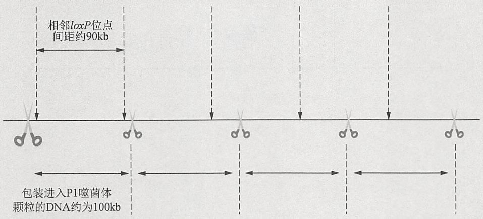

text_image

相邻IoxP位点
间距约90kb
包装进入P1噬菌体
颗粒的DNA约为100kb

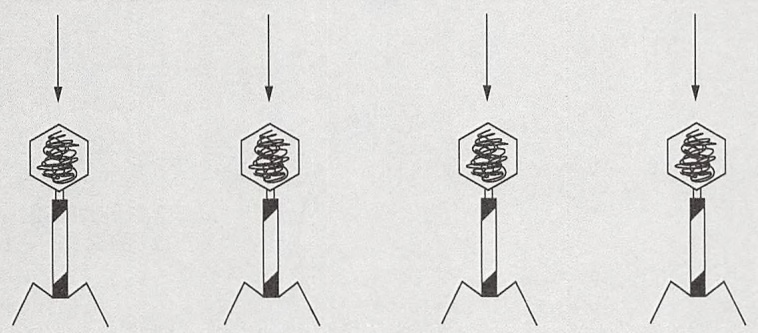

flowchart

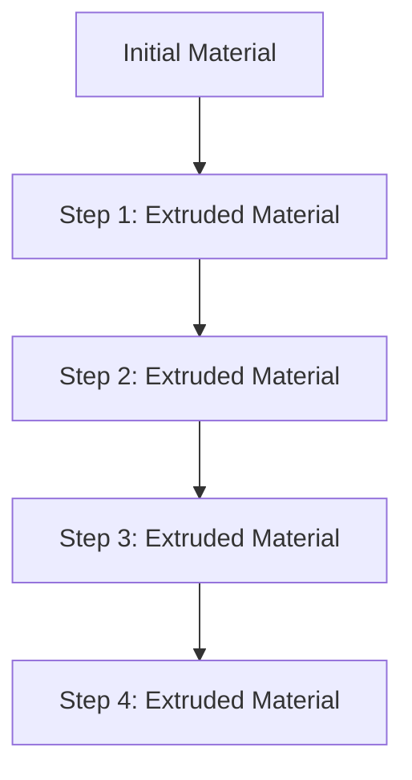

图 1 来自细胞内多联体的 P1 噬菌体 DNA 的包装。包装的底物是线性的多联体 DNA（粗线表示）。在多联体上，每一个 P1 噬菌体基因组头尾相连，串联排布。包装从一处 pac 位点开始（即图示中的大剪刀图标）。此位点与最近的 loxP 位点相距约 5kb。多联体中其他的 pac 位点（小剪刀）都不是包装的起始位点。长 100kb 的 DNA 片段相继以单向前进的“头样”机制被卷入噬菌体的前头部。因为 P1 噬菌体的基因组约为 90kb，而前头部的容量能达约 100kb，所以包装进每个噬菌体颗粒中的 DNA 都有冗余末端。因为有这个冗余末端，使得每个多联体形成的第一个噬菌体颗粒都含有 2 个 loxP 位点。所以该噬菌体 DNA 进入新的细菌胞内后，可在 Cre 重组酶的催化下发生环化。每条多联体大约可以包装 4 个噬菌体。但是，其中只有一个病毒颗粒的末端冗余区含有 loxP 位点。

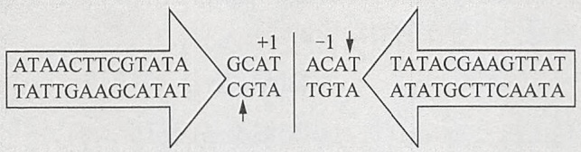

flowchart

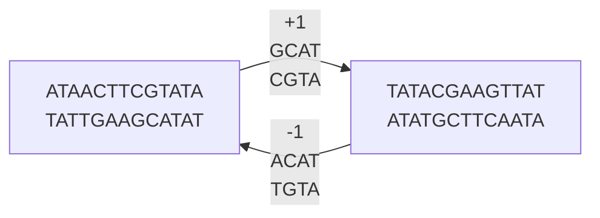

图 2 34bp 的 loxP 位点的结构。34bp 的 loxP 位点有 2 个理想的 13bp 长的反向重复序列（图示箭头内的部分），其中间被一个 8bp 的间隔区隔开。竖箭头标示的是 Cre 蛋白在 DNA 上下两条链的切割位点。为了方便起见，我们把 loxP 位点的核苷酸从间隔中心处（竖线）开始排序。竖线左侧的碱基对向左按正数排序，竖线右侧的碱基对向右按负数排序。

---

272

分子克隆实验指南（原书第四版）

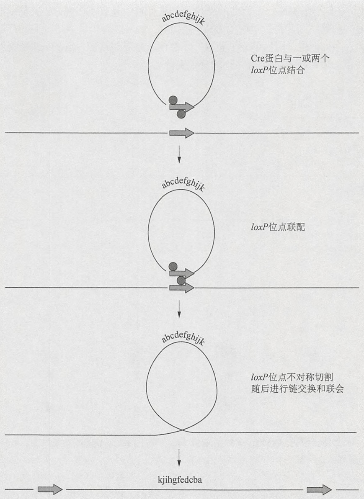

flowchart

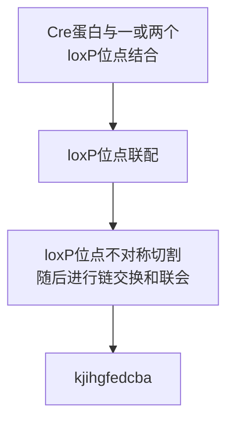

图 3 在 loxP 位点上 Cre 介导的重组。详细内容请参阅正文。

Cre 蛋白催化的重组反应不仅限于大肠杆菌，在酵母、植物和哺乳类动物细胞中都可发生。所以，Cre 重组酶能够:①在真核细胞的染色体上，驱动位点特异性的基因整合（图 3）；②催化两侧具有正向重复 loxP 位点的 DNA 片段的精确切除（此过程被称为 “floxing”）；③增强组织特异的启动子的表达。

## DNA 整合

DNA 整合是质粒上的 loxP 位点和靶细胞基因组引入的另一个 loxP 位点进行重组的结果。Cre 蛋白可以由一个克隆拷贝的 cre 基因临时提供或由整合于宿主细胞基因组的一个基因拷贝提供。如我们所知，酵母和小鼠的细胞的基因组不含有任何真正的 loxP 位点。然而，过表达 Cre 蛋白能导致哺乳动物细胞的染色体重排，据推测其发生在同 loxP 位点有一定序列相似性的位点。但是，通常 cre 基因的表达对真核细胞是无毒性的，受小鼠金属硫蛋白 I 启动子或巨细胞病毒启动子调控的 cre 转基因小鼠的发育、生长或生殖能力不受影响。

---

第 5 章 细菌人工染色体及其他高容量载体的应用

273

## 染色体 DNA 片段的切除

两侧带有正向重复 loxP 位点的染色体 DNA 片段的切除（floxing）效率高于将 loxP 质粒整合到细胞染色体上嵌入的 loxP 位点的效率。将选定的染色体位置中含 loxP 位点的基因工程小鼠与表达 Cre 的转基因动物交配，Cre-loxP 系统可用于产生无效等位基因及以组织特异和发育调控的方式激活基因。其他用途还包括:特定的染色体倒位和缺失、特定细胞系的去除、在预先选定的小鼠组织中产生特定基因的半合子。

## 增强靶基因的表达

通过在靶基因上附加一个强启动子来改造宿主细胞或生物体，可使靶基因的表达增强。在启动子和靶基因之间有数个转录终止序列，转录终止序列两侧是串联排列的 loxP 位点。在有 Cre 蛋白时，发生切除重组，靶基因立即直接受上游强启动子调控。在转基因生物中，仅需要适时、适地地调节 Cre 蛋白的表达，就能以组织特异的方式打开靶基因的表达（注意，在常规使用中，哺乳动物细胞内天然的 cre 基因缺少一个最佳的翻译起始信号。在转染的哺乳动物细胞中，将-3 位核苷酸从 T 转换为 G 能大幅提高其重组能力）。

Cre-loxP 系统是当前最好的哺乳动物和植物基因组的重组系统，但并非独一无二。还有其他一些重组酶/靶序列的组合，它们在特定的时空内在真核生物中介导重组事件。它们包括:①酿酒酵母的 FLP-frt 重组酶，能在哺乳动物细胞和果蝇（Drosophila）中催化重组反应；②鲁氏接合酵母（Zygosaccharomyces rouxii）的 pSR1 重组酶，在酿酒酵母中高效发挥功能。但是，目前这些位点特异性的重组系统的开发均不如 Cre-loxP 系统。

有用的 Cre-loxP 系统的综述，见 Orban 等(1992)、Kuhn 等(1995)、Sauer (1998)、Copeland 等(2001)、Van Duyne (2001)、Branda 和 Dymecki (2004)、Garcia-Otin 和 Guillou (2006)及 Grindley 等(2006)。

## 参考文献

- Abremski K, Hoess R. 1985. Phage P1 Cre-loxP site-specific recombination. Effects of DNA supercoiling on catenation and knotting of recombinant products. J Mol Biol 184: 211–220.
- Branda CS, Dymecki SM. 2004. Talking about a revolution: The impact of site-specific recombinases on genetic analyses in mice. Dev Cell 6: 7–28.
- Copeland NG, Jenkins NA, Court DL. 2001. Recombineering: A powerful new tool for mouse functional genomics. Nat Rev Genet 2: 769–779.
- Garcia-Otin AL, Guillou F. 2006. Mammalian genome targeting using site-specific recombinases. Front Biosci 11: 1108–1136.
- Grindley NDF, Whiteson KL, Rice P. 2006. Mechanisms of site-specific recombination. Annu Rev Biochem 75: 567–605.
- Hochman L, Segev N, Sternberg N, Cohen G. 1983. Site-specific recombinational circularization of bacteriophage P1 DNA. Virology 131: 11–17.
- Kuhn R, Schwenk F, Aguet M, Rajewsky K. 1995. Inducible gene targeting in mice. Science 269: 1427–1429.
- Orban PC, Chui D, Marth JD. 1992. Tissue- and site-specific DNA recombination in transgenic mice. Proc Natl Acad Sci 89: 6861–6865.
- Sauer B. 1998. Inducible gene targeting in mice using the Cre/lox system. Methods 14: 381–392.
- Segev N, Cohen G. 1981. Control of circularization of bacteriophage P1 DNA in Escherichia coli. Virology 114: 333–342.
- Segev N, Laub A, Cohen G. 1980. A circular form of bacteriophage P1 DNA made in lytically infected cells of Escherichia coli. Characterization and kinetics of formation. Virology 101: 261–271.
- Sternberg N, Austin S, Hamilton D, Yarmolinsky M. 1978. Analysis of bacteriophage P1 immunity by using λ-P1 recombinants constructed in vitro. Proc Natl Acad Sci 75: 5594–5598.
- Sternberg N, Hoess R, Abremski K. 1983. The P1 lox-Cre site-specific recombination system: Properties of lox sites and biochemistry of lox-Cre interactions. UCLA Symp Mol Cell Biol New Ser 10:671-684.
- Sternberg N, Sauer B, Hoess R, Abremski K. 1986. Bacteriophage P1 cre gene and its regulatory region. Evidence for multiple promoters and for regulation by DNA methylation. J Mol Biol 187: 197–212.
- Van Duyne GD. 2001. A structural view of Cre-loxP site-specific recombination. Annu Rev Biophys Biomol Struct 30: 87–104.
- Yarmolinsky MB, Sternberg N. 1988. Bacteriophage P1. In The bacteriophages (ed Calendar R), Vol. 1, pp. 291–438. Plenum, New York.

## 用 EGFP 作为报道分子

增强型绿色荧光蛋白（EGFP）是一个含有生色团的、238个氨基酸长的蛋白质，受到激发时，在490nm处发荧光。通过其内在的荧光能直接鉴定EGFP（取决于在细胞中拷贝数），或者通过高特异性的抗体免疫标记放大其信号。

我们已经利用这个特性创造了一种融合蛋白，用于鉴定特定细胞类型的 mRNA（Doyle et al. 2008; Heiman et al. 2008）。通过在大亚基核糖体蛋白（L10）的氨基末端附加

---

274

分子克隆实验指南（原书第四版）

EGFP 来产生 EGFP-RP 融合蛋白。在特定细胞类型中表达 EGFP-RP，通过抗 EGFP 的抗体免疫沉淀核糖体，以纯化相应的 mRNA。基于 BAC 的 EGFP-L10a 细胞系，尤其在翻译图谱中筛选特定群体的 mRNA 时非常有用。通常，EGFP-RP 融合蛋白被引入 BAC 载体，它可以靶向中枢神经系统的许多特定细胞类型，因而极大加速了 DNA 微阵列技术的研究。

## 参考文献

Doyle JP, Dougherty JD, Heiman M, Schmidt EF, Stevens TR, Ma G, Bupp S, Shrestha P, Shah RD, Doughty ML, et al. 2008. Application of a translational profiling approach for the comparative analysis of CNS cell types. Cell 135: 749–762.

Heiman M, Schaefer A, Gong S, Peterson JD, Day M, Ramsey KE, Suárez-Fariñas M, Schwarz C, Stephan DA, Surmeier DJ, et al. 2008. A translational profiling approach for the molecular characterization of CNS cell types. Cell 135: 738–748.

## 同源臂、共合体和重组体的引物设计

BAC 扩增方案中使用的 PCR 引物来自 Bio-Synthesis 公司（(http://www.biosyn.com)。引物的工作浓度为  $10pmol/\mu L$ 。扩增 A 和 B 同源臂的引物长度为 25～30bp。通常，同时进行 2 个扩增反应来鉴定共合体的 BAC 克隆。第一套引物包括一个正向的 5' 共合体引物，此引物位于 A 同源臂的上游；以及位于载体修饰盒上的报道分子（或设计好的突变区）的反向 3' 引物。第二套引物包含一个正向的 5' 引物——R6kγ（用于一步 BAC 修饰）或 RecA（用于两步 BAC 修饰），以及一个位于同源臂下游的反向的 3' 共合体引物（一步 BAC 修饰中，其位于 A 同源臂下游；两步 BAC 修饰中，其位于 B 同源臂的下游）。

在两步 BAC 修饰中，同时进行两个扩增实验鉴定重组的 BAC 克隆。第一套引物包括 5' 共合体引物，此引物位于 A 同源臂的上游；以及报道分子（或设计好的突变区）的反向 3' 引物。第二套引物包含报道分子（或设计好的突变区）的正向的 5' 引物，以及一个位于 B 同源臂下游的反向的 3' 共合体引物。

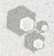

## 酵母培养基

在分离基因组 DNA 前，推荐使用丰富的 YPD 培养基，用于携带 YAC 酵母菌株的增殖。因为 YPD 培养基含有尿嘧啶和色氨酸，对保持 YAC 无选择性。然而，由于培养物只是短时间生长（过夜），并且酵母菌株生长良好，得到丢失 YAC 的变异体的风险不大。当使用生长缓慢的菌株时，它是由于其携带特定的 YAC 或宿主的基因型所导致，最好在尿嘧啶和色氨酸营养缺陷培养基（也被称为 Ura-Trp 营养缺陷培养基，参考缺少尿嘧啶和色氨酸的基本培养基）或酸水解酪蛋白（AHC）培养基中生长酵母，为保持 YAC DNA 施加选择压力。一些携带 YAC 克隆的酵母菌株在 AHC 培养基中生长得更好（Burke and Olson 1991）。它是含有腺嘌呤的完全培养基，能抑制 ade 突变体的回复突变。根据实验情况，加入低浓度（20mg/L）或高浓度（100mg/L）的腺嘌呤。在开始构建 YAC 文库，筛选含有插入片段的 YAC 载体时，使用低浓度腺嘌呤；在生长 YAC 菌株，用于 DNA 分离时，使用高浓度腺嘌呤。

## 参考文献

Burke DT, Olson MV. 1991. Preparation of clone libraries in yeast artificial chromosome libraries. Methods Enzymol 194: 251–270.

(王建译，胡显文校)
