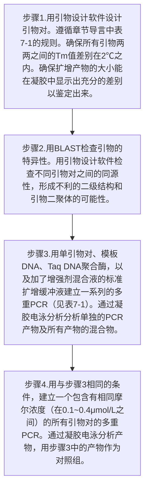
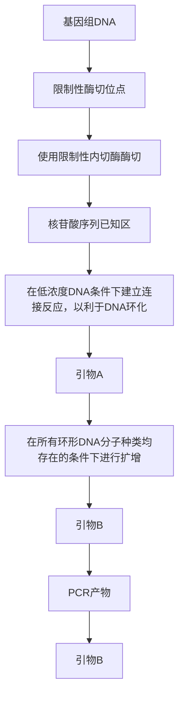
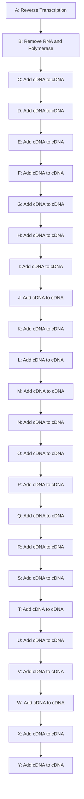
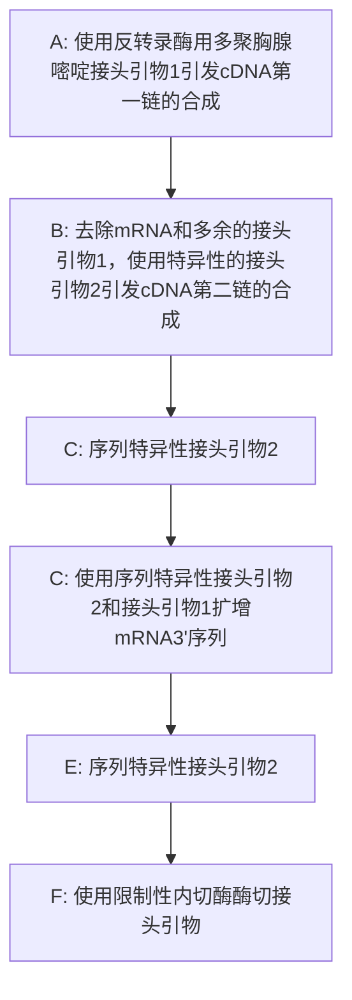

# 第7章 聚合酶链反应

原始 PDF 第 382–449 页。

## 第7章 聚合酶链反应

## 导言 | 基础 PCR 反应 364

基础 PCR 反应中引物的设计 369

mRNA 的检测、分析及定量 371

PCR中的污染 372

## 方案 1 基础 PCR 375

2 热启动 PCR 380
3 降落 PCR 383
4 高 GC 含量模板的 PCR 扩增 385
5 长片段高保真 PCR（LA PCR） 390
6 反向 PCR 393

7 巢式 PCR 397
8 mRNA 反转录产物 cDNA 的扩增:
两步法 RT-PCR 400
9 由 mRNA 的 5' 端进行序列的快速扩增:5'-RACE 409
10 由 mRNA 的 3'端进行序列的快速
扩增:3'-RACE 416
11 使用 PCR 筛选克隆 422

## 信息栏 | Taq DNA 聚合酶 424

PCR理论 426

核糖核酸酶 H 427

大肠杆菌的 dut 和 ung 基因 428
末端转移酶 429

---

## 导言

聚合酶链反应（PCR）几乎是所有现代分子克隆技术的基石。使用 PCR 技术，即使那些在高复杂性及大片段的 DNA 中只出现一次的靶序列（如整个哺乳动物基因组中的靶序列），也可以准指数增长的方式，被快速、特异性地扩增，产生数百万的拷贝。PCR 反应的建立简单、便宜且要求不高，唯一要求的是知道靶序列的一些核苷酸序列。除了操作简单外，PCR 反应还具有强劲、快速、灵活、灵敏的特点。

自20世纪80年代初发展以来（Saiki et al. 1985; Mullis and Faloona 1987; Mullis 1997），基础PCR反应已广泛用于分子克隆的各项用途，包括DNA测序、体外突变、突变检测、cDNA和gDNA的克隆、等位基因分析等。由于用途广泛，因此，以整本杂志或书籍的篇幅描述这一技术也不为过。本章的导言部分先讨论了影响PCR反应的参数，随后的方案部分可用于DNA片段扩增及鉴定的实际操作。

## 基础 PCR 反应

PCR 反应使用温度循环以启动及终止酶催化的 DNA 合成。每一轮循环都包含三个阶段:

- 模板 DNA 的热变性（通常>90°C）。
- 两条合成的引物与变性模板复性。根据模板的已知序列设计并合成引物，长度一般为 $20 \sim 25$ 个核苷酸。两条引物与靶序列的两条链反向互补引物结合位点可能只相隔数个或多达数千个核苷酸，这可按研究者的需要来定。
- 延伸，DNA 合成是从结合的引物 3'端起始。引物的延伸温度在 55～70℃，由热稳定 DNA 聚合酶催化。

这个过程重复 25～35 次，通常在 PCR 仪上进行。PCR 仪是可控制循环反应中每一步的时间和温度的可编程装置。

第一轮循环产生两个子代 DNA 分子，作为下轮循环的模板。产物的长度即是两条引物结合模板位点的 5' 端之间的距离。PCR 反应持续 25 个以上循环，直至引物和 dNTP 的浓度下降到不足以支持循环的进行（Liu and Saint 2002 a,b）。理论上，每次循环靶序列的拷贝数倍增，而实际上，每次循环靶序列的拷贝数增加的倍数都小于 1。之所以与理论模型有出入，影响因素很多，如反应中存在抑制剂、热稳定聚合酶的性质、部分模板降解、部分引物在模板上错配等。

## PCR 反应的必要成分

下述成分是建立 PCR 反应所必需的。

\- 热稳定 DNA 聚合酶。催化模板依赖的 DNA 合成。目前有多种酶可供选择，这些酶在保真度、扩增效率及合成大片段 DNA 的能力方面有所不同。对于常规 PCR 反应来说，最初从栖热水生菌（Thermus aquaticus）中分离获得的 Taq 聚合酶（0.5～2.5U/25～50μL 标准反应体系）仍然是首选的酶。大部分商业化制备的 Taq 酶的比活性约为 80 000U/mg。标准的 PCR 反应体系含有 $2 \times 10^{12} \sim 10 \times 10^{12}$ 个酶分子。使用 Taq 聚合酶扩增的效率大约是 0.70（Gelfand and White 1990; Lubin et al. 1991），据此计算，当产物积累到 $1.4 \times 10^{12} \sim 7 \times 10^{12}$ 个分子后，酶量就不足以支持 PCR 循环的进行了（参见信息栏“Taq DNA 聚合酶”）。

---

第 7 章 聚合酶链反应

365

\- 引物。影响扩增反应的效率和扩增特异性的因素很多，最为关键的是寡核苷酸引物的设计。仔细地设计引物，可获得所需片段的高产量扩增，抑制可能的、非特异性的、不必要的序列扩增，便于扩增产物的后续操作。虽然引物的效率在很大程度上影响到PCR反应的成败，但是，它们的设计准则更多的是基于常识，而不是众所周知的热力学和结构学原理。遵从这些经验性原则不能保证成功，但是，无视它们，很可能导致失败。更多的信息参见表7-1。

表 7-1 引物设计

| 性质 | 最佳设计 |
| --- | --- |
| 碱基组成 | G+C 含量应为 40%~60%,4 种核苷酸在引物上均匀分布(如没有聚嘌呤或聚嘧啶,以及没有双核苷酸重复序列)。如果可能的话,避开富含 GC 区,因为这些区段容易形成二级结构。 |
| 长度 | 引物的长度为 18~30nt,一对引物的长度差别不要大于 3 个碱基。小于 18nt 的引物会与复杂的模板 DNA(如基因组 DNA)非特异性结合,而长度大于 30nt 的引物形成二级结构(如发夹环)的概率增加。 |
| 内部重复及自互补结构 | 确保引物不含有反向重复序列或>3bp 的自互补序列。这类序列容易导致产生发夹结构,抑制引物和模板的结合。 |
| 引物间的互补 | 一条引物的 3'端不能和另外一条引物的任何区域配对。因为 PCR 反应中引物浓度很高,即使引物间有微弱互补,也会形成杂交,并导致引物二聚体的扩增,这些引物二聚体是真正的祸害,因为它们可以竞争 DNA 聚合酶和 dNTP,并抑制真正的目标序列的扩增。通过精心设计引物并借助计算机程序(如 OligoAnalyzer, http://www.itdna.com/analyzer/Applications/OligoAnalyzer)来筛选自互补和交叉互补的引物可减少引物二聚体的形成。引物二聚体的形成也可使用热启动 PCR 或降落 PCR 或专门配制的 DNA 聚合酶(AmpliTaq Gold; Applied Biosystems)来抑制。如果这些努力都失败了,在 PCR 反应体系中尝试加入甲酰胺或二甲基亚砜(DMSO),并通过设置系列含不同浓度 $Mg^{2+}$ 的 PCR 反应来重新优化体系中的镁离子浓度。 |
| 熔解温度($T_m$) | 引物和靶序列形成的二聚物的最佳 $T_m$ 介于 55~60°C,同一 PCR 中的两条引物的 $T_m$ 差距不能超过 2~3°C,大部分引物设计软件采用的方程都是基于最邻热力学理论(nearest-neighbor thermodynamics theory)。大于 25 个碱基的引物的一阶近似融解温度可使用下列 Wallace 方程计算(Wallace et al. 1979):$T_m=2^\circ C (A+T)+4^\circ C (G+C)$A、T、G、C 指每种碱基的数量。 |
| GC 夹 | 最靠近引物 3'端的 5 个碱基中的 G 或 C 可帮助引物牢固结合在模板上,因为 GC 配对中有更强的氢键结合,引物 3'端以 G 结尾有利于提高引物的效率和特异性,但是,最后 5 个碱基中应避免超过 3 个 G 或 C。 |
| 在引物的 5'端添加限制性酶切位点或其他有用的序列错配 | 一些和模板不配对但是有用的序列可以加在引物的 5'端,由于限制性内切核酸酶在切割 DNA 末端的酶切位点时效率很差,因此,一般在酶切位点的外侧还需要加入至少 3 个碱基。NEB 的目录上描述了各类限制性内切核酸酶切割 DNA 末端位点的效率。引物序列需要对靶标序列进行 BLAST 比较,以寻找可能的错配(http://www.ncbi.nlm.nih.gov/BLAST/)。错配导致非特异性扩增水平的提升。 |
| cDNA 特异性引物 | 在反转录 PCR 中,基因组 DNA 的污染会造成许多问题,包括假阳性数量的增加。避免这个问题的最好办法是将引物设计在 mRNA 的跨外显子-外显子交界区,或该交界区的侧翼序列上。 |
| 在线设计软件可辅助引物设计,它们可降低失败率,从而减少试验的成本和时间 | Primer3-Plus(http://www.bioinformatics.nl/cgi-bin/primer3plus/primer3plus.cgi)GeneFisher2 (http://bibiserv.techfak.uni-bielefeld.de/genefisher2/)Primer-Blast (http://www.ncbi.nlm.nih.gov/tools/primer-blast/)参见 Chen 等(2002) |

在某些情况下，需要同时扩增多个片段，这时应使用一种叫做多重 PCR 的扩增反应。反应体系中包含有不止一对引物，更多的信息请参见本章中的多重 PCR 部分。标准反应中可含有无限量的引物，通常每种引物为  $0.1 \sim 0.5 \mu mol/L (6 \times 10^{12} \sim 3 \times 10^{13}$  个分子）。这个量足够 1kb 的 DNA 片段扩增至少 30 个循环，更高浓度的引物会错配，从而导致非特异扩增。

自动 DNA 合成仪合成的引物无需进一步纯化即可用于标准 PCR 反应，如果引物经过市售树脂柱色谱（如 NENSORB; NEN Life Science 公司产品）或变性聚丙烯

---

366

分子克隆实验指南（原书第四版）

酰胺凝胶纯化，单拷贝的哺乳动物基因组模板的扩增效率会更高（参见第2章，方案10）。

\- 脱氧核糖核酸三磷酸盐（dNTP）。标准的 PCR 反应含有等摩尔数的 dATP、dTTP、dCTP 和 dGTP，每种 dNTP 的推荐浓度是 200～250μmol/L，MgCl₂ 的浓度为 1.5mmol/L。在 50μL 反应体系中，这个浓度足以合成 6～6.5μg 的 DNA，即使对于含有 8 对以上引物的多重 PCR 反应来说也是足够的。dNTP 低至 20μmol/L 也能合成 0.5～1.0pmol 的 1kb 的 DNA 分子。但是，过高浓度的 dNTP（大于 4mmol/L）反而会抑制 PCR 反应，可能的原因是对 Mg²⁺ 的猝灭作用。

多家公司（如 Roche、QIAGEN、Boehringer-Ingelheim、GE Healthcare Life Sciences）均出售经过高压液相色谱（HPLC）纯化后的 dNTP，以作为 PCR 反应的底物。这些 dNTP 中不含有能够抑制 PCR 反应的四磷酸盐及焦磷酸盐。储存的 dNTP 对反复冻融敏感，几次冻融后，PCR 效率会下降。解决方法是将 dNTP 分装（2～5μL）在 10mmol/L 的 Tris（pH8.0）中，保存于 -20℃，在第二轮冻融后，就应该丢弃不用了。如果使用纯水溶解保存，容易造成 dNTP 的酸水解。在长期 -20℃ 保存中，水分会蒸发到管壁上，造成 dNTP 浓度的变化，此时应短暂离心。

\- 二价阳离子。二价阳离子通常为 $\mathrm{Mg}^{2+}$，是所有的热稳定 DNA 聚合酶活性所必需的。一些聚合酶在 $\mathrm{Mn}^{2+}$ 存在的情况下，虽然活性略低，但是也能工作。$\mathrm{Ca}^{2+}$ 是完全无效的。镁离子有两个功效:一是和 dNTP 结合成复合物，作为聚合酶的底物；二是稳定引物-模板复合体。一般来说，PCR 产物的产量和镁离子浓度的关系呈钟形，当镁离子浓度过低时，引物复性到模板上的效率差；当镁离子浓度过高时，DNA 二聚体配对强度过高，以至于加热也难以有效解链，由于 dNTP 和核苷酸结合镁离子，故镁离子的摩尔浓度应该超过 dNTP 和引物共同拥有的磷酸基团的摩尔数。因此，各种情况下的最佳镁离子浓度很难确定。虽然 $1.5\mathrm{mmol/L}$ 是最常使用的镁离子浓度，但是据报道，将镁离子浓度增加到 $4.5\mathrm{mmol/L}$ 或 $6\mathrm{mmol/L}$，在某些情况下可减少非特异性引发（参见 Krawetz et al. 1989; Riedel et al. 1992），也可增加非特异性引发（参见 Harris and Jones 1997）。因此，每组引物模板组合的最佳镁离子浓度都必须通过实验来确定。

很多公司（如 Life Technologies、Sigma-Aldrich、Roche Applied Science 和 Alliance Bio）销售 PCR 缓冲液优化试剂盒，其中含有各种缓冲液组分，可供研究者通过实验决定最佳反应条件。一旦条件确立，就可以从这些公司购买最终的缓冲液或自己在实验室里配制。或者，研究者同时进行 10 个 PCR 反应，每个反应中镁离子的浓度从 0.5mmol/L 到 5.0mmol/L 递增，依次增加 0.5mmol/L，有时为了更精确，还得进行第二轮优化，镁离子的浓度递增按 0.2mmol/L 进行。如果可能，制备的模板中不应含有螯合剂（如 EDTA）或阴离子（如磷酸根），这些都会猝灭镁离子。

- 维持 pH 的缓冲液。室温下 pH 调到 8.3～8.8 的 Tris 缓冲液经常用于 PCR 反应，浓度从 10mmol/L 到 66mmol/L 不等，当在 72°C 时（延伸温度），反应缓冲液的 pH 会下降整整一个单位，也就是降到约 7.2。
- 单价阳离子。标准的 PCR 缓冲液含有 50mmol/L 的 KCl，这个浓度对大于 500bp 片段的扩增是很有效的，把 KCl 浓度提升到 70～100mmol/L 可提升短片段产物的产量。
- 模板 DNA。单链或双链形式的包含靶序列的模板 DNA 都可用于 PCR，闭合环状 DNA 的扩增效率要比线性 DNA 扩增效率略低。虽然模板 DNA 的长度并不是很关键，但是，如果扩增片段位于长模板内（大于 10kb），那么使用限制性内切核酸酶先消化模板，可以提高目标片段产物的产量。当然，在目标片段内部必须不含有这种限制性内切核酸酶。

---

第 7 章 聚合酶链反应

367

原则上，只要有一个分子的模板，就可以被 PCR 扩增出来，但是，通常都需要数千拷贝的模板分子来进行 PCR 扩增。对于哺乳动物基因组 DNA 来说，每个反应需要的模板量是  $1 \mu g$ ，这里面含有的常染色体单拷贝基因约为  $3 \times 10^{5}$  拷贝。对于酵母染色体、细菌染色体和质粒等模板的通常用量分别是 10ng、1ng 和 1pg。

## 热稳定 DNA 聚合酶

热稳定 DNA 聚合酶从两类生物中分离获得:嗜热和超嗜热真细菌型古细菌。这些菌中含有的 DNA 聚合酶是嗜热细菌中 DNA 聚合酶 I 的活化石。嗜热古菌中含有的主要 DNA 聚合酶属于栖热水生菌聚合酶α家族，它是嗜热古菌家族的一员（Brock 1995a,b, 1997）。Taq（T. aquaticus；栖热水生菌）DNA 是首先分离及了解最透彻的热稳定 DNA 聚合酶，目前在各个实验室中依然作为 PCR 反应的主力军（参见信息栏“Taq DNA 聚合酶”）。

一个单位 Taq 酶的定义是:74℃、30min 内将 10nmol 的 dNTP 掺入酸沉淀物质中的酶量。因为大部分商业化的 94kDa Taq 酶的比活是 80 000U/mg 蛋白质，1U 的酶量约含有  $8 \times 10^{10}$  个 Taq 酶分子。一般的 PCR 反应使用 1U 的酶，摩尔数远超过模板量，但是当扩增结束的时候，扩增的 DNA 的摩尔数会超过酶分子数的 100 倍。

不幸的是，每个厂家出售的 $Taq$ 酶制剂是不同的，在产量、扩增长度、保真度等方面有差异（参见 Linz et al. 1990）。因此，有必要对每批次的 $Taq$ 酶优化 PCR 条件。

Taq 酶的半衰期在  $97.5^{\circ}$ C 时是 9min，此酶可以在 10s 内合成 9000bp。Taq 酶在合成小片段的时候依然可作为首选，但是，由于其缺乏  $3'\rightarrow5'$  的校对功能（Lawyer et al. 1993），扩增的突变率较高（每 9000 个核苷酸中出现 1 个突变）（Tindall et al. 1988）。从其他嗜热细菌或古菌中分离的热稳定 DNA 聚合酶，如 Pfu DNA 聚合酶，拥有校对功能（Cline et al. 1996），可用于替代 Taq 酶或与之结合使用。特别是在需要确保高保真度扩增的情况下，如扩增超过数 kb 的片段或反转录扩增 mRNA。

对酶的选择得由实验目的来决定，例如，如果需要高保真扩增基因，那么酶就得需要具备校对功能；如果是为了克隆扩增片段，那么以选择产生平头末端的酶为佳。直到最近，研究者对这些选择只能采取折中的方式。然而，使用两种或多种 DNA 聚合酶的混合物可以有效地提升产量，特别是对于长片段 DNA 的扩增（Barnes 1994; Cheng et al. 1994a,b; Cohen 1994）。性能提升的原因是混合物中的一种酶可以补充另外一种酶的缺陷，从而延伸并跨越模板链上可能的障碍。这些障碍包括:①二级结构（Eckert and Kunkel 1993）；②缺口，对于缺口，缺乏末端转移酶功能的聚合酶无法跨越（Hu 1993）；③错配的碱基，错配的碱基会导致无校对功能的聚合酶驻留并从引物-模板上解离下来（Barnes 1994）。目前一些公司销售鸡尾酒式聚合酶组合，以获得所需要的性能。例如，Tbr 和 Taq 的组合，商品名为 DyNAzyme（NEB 和其他供应商），具有高保真性（由 Tbr 的校对功能支持）和高效性（由 Taq 的高效性支持）。类似的，Taq 和 Pfu 的混合酶可高效生产长片段产物（能达到 35kb）。

Taq 酶的产物带有 3' 突出的 A，这对 TA 克隆是有利的，这些克隆载体有一个 3' 突出的 T，可与 PCR 产物 3' 突出的 A 配对，有利于 PCR 产物克隆。

## PCR 反应的程序设计

PCR 反应是一个重复过程，包含三个要素:模板的加热变性；引物与单链模板的复性；复性引物在热稳定 DNA 聚合酶的作用下延伸（图 7-1）。

---

368

分子克隆实验指南（原书第四版）

flowchart

This flowchart illustrates the structural evolution of a chain model, showing how components like double chain modules and variations are transformed into parallel layers with different deformation modes.

图 7-1 PCR 反应中的扩增步骤。本图显示了 PCR 前几轮反应的各个步骤。原始模板（在图的顶部）是双链 DNA，左向和右向引物分别用箭头 “←” 和 “→” 来表示。前几轮扩增反应的产物在大小上是不均一的，但是，在两条引物之间的区域随后会优先扩增，这样的产物也会迅速成为主流。

\- 变性。双链 DNA 模板的变性温度部分是由其 GC 含量决定的，GC 含量越高，解链温度越高。DNA 越长，在解链温度下持续的解链时间就越长。如果变性温度过低或持续时间过短，那么只有富含 AT 区解链，当进入 PCR 反应的其他阶段时，温度降低，这个时候模板 DNA 又会复性成天然状态。

Taq 酶催化的 PCR 反应中，变性温度一般是 94～95℃，这是 Taq 酶能够承受 30 个循环而不发生过度损伤的最高温度。在第一轮 PCR 中，变性时间持续约 5min，以确保长模板 DNA 完全变性，然而，根据我们的经验，对于线性 DNA 模板，这么长的变性时间可能是无用且有害的（Gustafson et al. 1993）。对于线性且 GC 含量不超过 55% 的模板 DNA，在 94～95℃ 变性 45s 即可。

高 GC 含量的模板（GC 含量大于 55%）所需要的变性温度更高，来自于古细消解酶菌的 DNA 聚合酶比 Taq 更耐热，因此更适合高 GC 含量模板的扩增。

\- 引物与模板的复性。复性温度的选择很关键，如果选择高了，那么引物与模板结合困难，导致产物量很少；如果低了，那么就会有非特异性复性的情况发生，导致非特异性片段的扩增。复性温度一般要比熔解温度低 $3\sim 5^{\circ}\mathrm{C}$，熔解温度是指引物从模板上解离下来的温度。有很多公式用于计算理论熔解温度，但是没有一个能够对各种长度和序列的引物的熔解温度进行精确计算。所以，最好是做一系列试验性PCR，以探索比熔解温度低 $2\sim 10^{\circ}\mathrm{C}$ 的各种温度点中哪个温度是最佳的。或者，PCR的前几个循环中复性温度逐渐降低（参见方案3“降落PCR”）（Don et al.1991）。前者得在不同复性温度下进行多个PCR反应，而后者的好处在于，在一个PCR反应中试验不同的复性温度并找到合适的温度。降落PCR解决了每对引物需要试验最佳复性温度的问题，经常用于在常规PCR中获得可靠的产物量（Peterson and Tjian 1993;Hecker and Roux 1996;Roux and Hecker 1997）。

\- 引物的延伸。一般在或接近热稳定 DNA 聚合酶催化 DNA 合成的最佳温度下进行，对 Taq DNA 聚合酶来说就是 72～78℃。在前两轮 PCR 中，从一条引物发起的延伸会超越另外一条引物在模板上的结合位点，而后来的产物长度就是两条引物结合模板位点之间的长度，从第三轮反应开始，两条引物之间长度的产物几何级增长，而超

---

第 7 章 聚合酶链反应

369

过两条引物之间长度的产物则以正比例方式增长（Mullis and Faloona 1987）。作为一个经验法则，每 1kb 产物，延伸时间为 1min。在最后一轮 PCR 中，许多研究者使用的延伸时间一般为前轮循环延伸时间的 3 倍，表面上是为了让所有的扩增产物最终完成延伸。但是，我们的实验显示，延伸时间进行这样的调整不会显著改变 PCR 的结果。

\- 循环数。如在信息栏“PCR理论”中讨论的那样，循环数取决于PCR起始时存在的模板数及引物延伸和扩增的效率。一旦进入指数级增长，反应会进行到PCR组分耗尽而不足以支持循环进行下去时。到这个时候，扩增产物达到最大量，而非特异性扩增几乎看不到。含有 $10^{5}$ 拷贝模板和Taq DNA聚合酶的PCR反应一般30个循环后可达到这个程度（扩增效率约0.7）。以哺乳动物基因组作为模板，扩增单拷贝序列，至少需要进行25个循环，以获得可接受的产物量。

## PCR反应中可选择的成分

一些助溶剂和添加剂可降低错配率及增加富含 GC 模板的扩增效率（吐温-20 和 NP-40）。助溶剂包括有机胺化合物，如甲酰胺（1.25%～10%, V/V）（Sarkar et al. 1990; Varadaraj and Skinner 1994; Chakrabarti and Schutt 2001）、二甲基亚砜（DMSO，最多可到 15%, V/V）（Bookstein et al. 1990）、甘油（1%～10%, V/V）（Lu and Nègre 1993）等。添加剂包括四甲基氯胺（Hung et al. 1990; Chevet et al. 1995）、甜菜碱（Henke et al. 1997）、谷氨酸钾（10～200mmol/L）、硫酸铵、非离子和阳离子去污剂（Bachmann et al. 1990; Pontius and Berg 1991），以及一些特异性强化剂，如 Perfect Match 聚合酶增强子（Agilent 公司产品）和 GC-Melt（Clontech 公司产品）。很多这些助溶剂及添加剂在高浓度下会抑制 PCR 反应，因此，对每个特定的引物及模板，都需要进行试验以确定最佳浓度。在动用这些助溶剂及添加剂之前，我们认为最好先优化 PCR 的常规组分，如镁离子及钾离子的浓度（Krawetz et al. 1989; Riedel et al. 1992）。唯一例外的是 GC-Melt，在我们的工作中发现，它用于对付高 GC 的模板非常有效，可极大地提升扩增效率。

## 抑制剂

任何成分过量都可能成为 PCR 反应的抑制剂。最常见的 PCR 杀手包括:蛋白酶 K（如果有机会，它会降解热稳定 DNA 聚合酶）、酚、EDTA。其他可能引起麻烦的成分还有:离子去污剂（Weyant et al. 1990）、肝素（Beutler et al. 1990）、多聚阴离子如亚精胺（Ahokas and Erkkila 1993）、血色素及上样染料如溴苯酚兰、二甲苯胺等（Hoppe et al. 1992）。很多情况下，扩增产物产量低或产量不稳定的主要原因在于模板的污染（参见下述“PCR 中的污染”部分）。对模板进行纯化，即可解决 PCR 中的很多问题，如对模板进行透析、乙醇沉淀、氯仿抽提及使用合适的树脂进行层析纯化等。

## 基础 PCR 反应中引物的设计

引物设计的主要指标就是特异性，也就是两条引物都能够稳定地结合到模板的特定靶序列上。一个经验法则是:引物越长，特异性越好。下面的方程可用于计算引物在模板上完全配对的概率，这里的模板假设为4种核苷酸完全随机分布。

$$
K = [ g / 2 ] ^ {G + C} \times [ (1 - g) / 2 ] ^ {A + T}
$$

式中，K 是指引物在一条模板上完全配对的概率；g 是指模板上 GC 的相对含量；G、C、A、T 是指引物中 4 种碱基分别的个数。一条双链模板的长度如果为 N（指核苷酸数），那么这个模板上可能的引物结合位点数（n）就是 n=2NK。

按照这个方程进行计算，一条长度为 $15\mathrm{nt}$ 的引物，在哺乳动物基因组（$N$ 约等于 $3\times$

---

370

分子克隆实验指南（原书第四版）

$10^{9}$ ）中的结合位点（指完全匹配）只有一个。对于一个 $16\mathrm{nt}$ 的引物来说，在复杂度为 $10^{7}$ 的哺乳动物cDNA文库中恰好含有能与其完全匹配的序列的概率只有1/10。然而，这个计算方法的前提是:4种碱基在哺乳动物基因组中是随机分布的。这个前提其实不存在，因为哺乳动物具有密码子偏爱性，另外，有相当部分的基因组序列是由重复序列或基因家族组成的。为了降低非特异性结合，引物的长度要比上述方法计算出的长度长一些。由于重复序列的存在，即使引物长度超过20nt，只有不超过 $85\%$ 的哺乳动物基因组序列可以精确地配对。设计引物的时候，要用引物序列比对DNA数据库，以确保引物只和靶基因配对，而不会和载体、其他基因及重复序列配对。

表7-1提供了引物设计中的一些原则，如果认真执行这些标准，那么在很大程度上可以避免失败。

## 选择 PCR 引物

## 下列步骤用于筛选引物:

1. 分析靶基因和引物结合位点，确保不存在多个同种核苷酸的聚集区，没有明显形成二级结构的可能，不会形成自互补，也不会和靶基因的其他部位结合（参见第9章中“实时荧光PCR反应引物、探针设计和反应条件优化”部分）
2. 按照表 7-1 的标准，把可能的正向及反向引物列出来，按照下面列出的方程，计算其熔解温度。
3. 选择匹配良好的正、反向引物，两条引物的 GC 含量要相当。两条引物及扩增产物的 GC 含量最好能够相当，并且最好为 $40\% \sim 60\%$ 。
4. 前后移动引物位置，确保引物的 3'端以 G 或 C 结尾，确保两条引物之间没有互补区域，原则上说，两条引物之间连续三个碱基互补是不允许的。

## 计算机辅助设计引物

使用计算机程序对引物进行设计、筛选及定位可节省时间，减少麻烦。关于这方面的综述，参见 Chen 等（2002）。很多独立的计算机程序可用于选择引物位点，使用者需要设定一些参数，就可以获得没有发夹、二聚体及其他问题结构的引物。这些程序可产生一系列供选择的引物，其熔解温度一般使用最近邻法进行计算，在这种计算方法中，引物和模板的热力学稳定性由相邻碱基相互作用的叠加计算而来。

大部分程序使用绘图工具，界面友好，可根据各参数的权重对引物进行打分排序。有些程序还含有一些功能，如帮助搜索引物非特异性结合的数据库、优化 PCR 反应条件、把氨基酸序列转化成核苷酸序列、排除有二级结构的引物等。所有的这些 DNA 分析包都含有引物设计的先进模块（参见第 8 章中的方案 3；http://www.humgen.nl/primer\_design.html 网站提供有各种程序的链接）。

## 计算引物-靶序列杂交体的熔解温度

有几个方程可用于计算引物-靶序列杂交体的熔解温度，但都不是很完美，因此，对它们的选择主要取决于个人喜好。对于一对引物中的两个成员，在计算熔解温度时，必须使用同一个方程。

\- 一个基于经验且很方便使用的方程，叫做 Wallace 方程（Suggs et al. 1981; Thein and Wallace 1986），可用于计算高离子强度下（如 1mol/L 的氯化钠）15～20nt 长的双链的熔解温度:

$$
T _ {\mathrm{m}} (^ {\circ} \mathrm{C}) = 2 ^ {\circ} \mathrm{C} (A + T) + 4 ^ {\circ} \mathrm{C} (G + C)
$$

式中， $A + T$ 指引物中A和T的总数； $G + C$ 指引物中G和C的总数。

---

第 7 章 聚合酶链反应

371

\- Baldino 等（1989）的方程计算更为精确，14～70nt 的引物长度，在 0.4mol/L 或更低的离子强度下的计算方程为:

$$
T _ {\mathrm{m}} (^ {\circ} \mathrm{C}) = 8 1. 5 ^ {\circ} \mathrm{C} + 1 6. 6 (\log_ {1 0} [ \mathrm{K} ^ {+} ]) + 0. 4 1 (\% [ G + C ]) - (6 7 5 / n)
$$

式中，n 是引物的核苷酸数。这个方程还可用于计算扩增产物的熔解温度，只要扩增产物的长度和序列已知。在标准 PCR 反应中，扩增产物的熔解温度最好不要超过  $85^{\circ}$ C，以确保解链步骤中扩增产物能够完全解链。需要指出的是，PCR 反应中的变性温度定义为“同源分子之间不可逆的分离温度”，不可逆的分离温度比熔解温度要高几度（对于 GC 含量 50% 的 DNA 分子来说，不可逆的分离温度为  $92^{\circ}$ C）

上述的两个方程都没有考虑到碱基序列对熔解温度的影响（考虑到了碱基组成），掺入最邻热力学数据可更精确地计算熔解温度（参见 Rychlik 1995）。但是，Wallace 原则和 Baldino 方程使用起来更方便，对于大多数应用来说也已经足够了。

## mRNA 的检测、分析及定量

多年来, 发展出了多种检测、分析及定量 mRNA 和其他细胞转录物的方法(表 7-2), 按出现的时间排序, 这些方法罗列如下。

\- Northern 杂交（Alwine et al. 1977）。①RNA 成分在变性琼脂糖凝胶中电泳分离；②转移到固相支持介质上（尼龙膜或硝酸纤维素膜）；③与标记探针杂交。比较目标 RNA 和已知大小的对照的迁移率，就可以知道目标 RNA 的大小；而杂交强度就反映了其丰度（参见第 6 章）。

表 7-2 对 mRNA 的检测、分析及定量

| 方法 | 目标RNA的类型 | 同时定量的目标RNA的数量 | 用途 | 缺点 |
| --- | --- | --- | --- | --- |
| Northern杂交 | mRNA | 通常为一个,最多几个。 | 主要用于估测不同组织、细胞中目标mRNA的分子质量,可用于mRNA的粗略定量。 | 需要大量RNA;只可同时检测一个或最多几个mRNA;与PCR方法相比,灵敏度差、耗时。 |
| RNA酶保护 | mRNA | 通常为一个,但是如果使用混合探针,最多可同时检测12种mRNA。 | 主要用于对不同类型细胞或组织中目标mRNA的检测和定量。 | 需要特异性的反义杂交探针(通常带放射性)。RNA酶保护法远比Northern杂交灵敏,但灵敏度还是不如PCR法。 |
| 传统反转录PCR | mRNA | 通常为一个,但是也可努力做到多重检测系统。 | 是检测目标RNA的高灵敏度方法,即使目标RNA在细胞中拷贝数很低也可检测。主要用于检测不同细胞和组织中mRNA的相对丰度。 | 由于反转录PCR取决于反转录步骤和扩增步骤所使用的引物,经常可能出现假阳性结果;反转录步骤变化大;另外,产物量的测定方法有很多缺陷,如低分辨率和低灵敏度。 |
| 实时定量PCR | mRNA及miRNA | 通常为一个,但也可检测多个目标RNA,参见Stanley和Szewczuk (2005)等的研究结果,他们在单个多重反应中同时分析过72个mRNA | 是检测目标RNA的一种高灵敏及高精度的方法。即使目标RNA在细胞中拷贝数极少也适用。实时PCR比其他方法更灵敏、更快、更精确。最近10年内是检测细胞中mRNA相对丰度的主要方法。不仅可用于mRNA的检测,也可用于microRNA的检测(参见Chen et al. 2005; Benes and Castoldi 2010)。 | 市场上销售的几种商业设备采用的检测方法不同。另外,已出版了数百种描述实时定量PCR的方案。实时PCR的每个步骤都缺乏标准,导致可靠性和可重复性的比较即使可能,也很困难(Nolan et al. 2006; Derveaux et al. 2010)。对实时PCR提出了一些合理的建议和标准,规定了实时PCR结果发表所必需的最少信息量,也许会有助于解决目前的困境(Bustin et al. 2009; Bustin 2010)。 |

---

372

分子克隆实验指南（原书第四版）

\- RNA 酶保护（Zinn et al. 1983; Melton et al. 1984）。使用反义标记探针特异性结合 RNA 群体中的目标 RNA。使用 RNA 酶消化水解所有未能杂交的序列。余下的标记探针的量就能够反映起始总 RNA 中目标 RNA 的量。

\- 反转录 PCR（RT-PCR）（Wang et al. 1989）。以 mRNA 群体作为反转录的模板，再用一对目标 RNA 特异性引物，通过传统 PCR 方法扩增目标序列。这两步酶促反应可在一步偶联反应中完成，也可分两步单独完成。在反转录 PCR 的步骤中，反应在产物的指数式增长最大循环数时停止，然后使用凝胶电泳和 Southern 杂交方法检测产物。在反转录 PCR 过程中，反应系统中加入一系列已知量的 mRNA，形成一套标准，以这些标准所生成的 DNA 产物的量来确定目标 RNA 的量。

\- 实时定量 PCR（RT-qPCR）。以 mRNA 群体作为反转录的模板，再以一对目标 RNA 特异性引物，通过传统 PCR 方法扩增目标序列。这两步酶促反应可在一步偶联反应中完成，也可分两步单独完成。PCR 产物的量与能发光的荧光标记分子成正比，可用于检测和定量所研究的 mRNA。荧光强度的测量是实时进行的。

如今，定量细胞 RNA 标准的方法是实时定量反转录 PCR（RT-qPCR）（Van Guilder et al. 2008）。RT-qPCR 在装备有能监测检测分子所发出荧光的系统的热循环仪上进行。有多种不同的技术方法，最常见的有 TaqMan（Applied Biosystems 公司产品）、LightCycler（Roche 公司产品）、LUX（Life Technologies 公司产品）、Molecular Beacons 及 SYBR Green 等。对这些技术方法的详细讨论请参见第 9 章。

其他用于测定 mRNA 5'端和 3'端序列的基于 PCR 的技术有 5'-RACE(方案 9) 和 3'-RACE(方案 10) 等。

## PCR 中的污染

PCR 实验中经常遇到的一个问题是外源 DNA 片段的污染, 这些污染的 DNA 片段可作为模板而扩增得到产物。污染毫无例外的都是由于研究者或其同事的疏忽造成的, 这些粗心大意者把靶 DNA 弄进了仪器、溶液及 PCR 反应中用到的酶里面。麻烦的第一个征兆是在没有模板 DNA 的阴性对照中也总能扩增出目标产物。一旦如此, 所有的扩增出的产物都值得怀疑。根据我们的经验, 这个时候去探寻污染源是毫无意义的, 更简单、代价更小、破坏性更小的做法是把所有的溶液、试剂及其他用到的东西都丢弃掉, 把仪器设备擦干净去掉污染源, 并采取下述的步骤以降低将来发生污染的可能性。

## 实验室

最理想的是，在一个独立的实验室中配制 PCR 反应体系，这个房间得有一套设备和冰箱等，以储备缓冲液和酶。大多数研究者更实际的做法是:在实验室里划定一个特别的区域，用于配制 PCR 反应体系。PCR 反应配制的地方要有层流和紫外灯。层流柜不用的时候，要打开紫外灯。在层流柜中放一台小离心机、一次性手套、试剂和一套移液器，这套移液器只用于配制 PCR 反应体系。由于自动移液器的活塞是污染的一个主要来源，因此，用于吸取 PCR 组分的正排量移液器得配备一次性吸头和活塞。

另外一种方法是为自动气压式移液器配备带滤芯的灭菌一次性吸头（如 ART 气溶胶阻滞吸头，Research Products International 公司产品）。吸头和管子开包就使用，不宜高压灭菌。PCR 仪要放在实验室的特定部位，与配制 PCR 反应体系的层流柜隔绝。

---

第 7 章 聚合酶链反应

373

## 配制和操作 PCR 的原则

下面列出了配制和操作 PCR 的一些原则。打算做 PCR 的研究者必须对这些原则有充分理解并切实遵循。

- 指定配制 PCR 体系的区域尽量减少物品的运入和运出。
- 在此区域工作时戴手套，并经常更换。戴面具和头套，以减少面部皮肤和头发细胞来源的污染。
- 建立起个人单独使用的一套试剂及一次性用品（包括 PCR 管、矿物油、蜡珠等）。使用新的玻璃器皿、塑料器具及移液器，这些用品没有在实验室的 DNA 环境中暴露过，用这些物品配制及储存溶液。缓冲液和酶要分装成小份，放在靠近层流柜的冰箱的特定区域中。使用后剩余的小份试剂丢弃不用，配制 PCR 成分的那些试剂不要用于其他实验。
- 在打开装有 PCR 试剂的离心管前，先用层流柜中的小离心机短暂离心（10s），把液体离心到管底。这样可以减少对手套和移液器的污染。
- 在自己的实验台上稀释 DNA 模板，只把需要使用的稀释液带入 PCR 配制区。
- 在完成 PCR 扩增后，不要把装有扩增产物的管子带入 PCR 配制区，而应该在你自己的实验台上操作后续步骤。
- PCR 级的水是所有 PCR 反应所必需的，不含离子、盐、核酸酶，pH 中性。可从 Ambion 公司和其他供应商购买。

## 去除溶液和设备的污染

对试剂（无 dNTP 的缓冲液和水）采用 254nm 波长的紫外线照射可以灭活其中的污染 DNA。紫外线照射可使双链 DNA 中邻近的嘧啶碱基形成二聚体，从而使得污染 DNA 不再能够成为 PCR 反应的模板。使用商业化的紫外交联仪（如 Stratalinker，Agilent 公司产品），透明的白色离心管内的溶液很容易完成照射处理（200～300mJ/cm² 照射 5～20min）。dNTP 对紫外线照射具有抗性，但是 Taq DNA 聚合酶不具有抗性。引物对紫外照射的敏感性差别很大，无法预测（Ou et al. 1991）。

紫外照射去除小型设备（如架子、移液器等）外露面的污染。工作区、离心机、PCR仪的非金属表面可用弱漂白剂溶液（如10%的次氯酸钠）处理去污染（Prince and Andrus 1992），或使用商业化的产品（如Ambion公司的DNAZap）来处理。

## 阻止来自其他 PCR 产物的污染

尿嘧啶 N-糖基酶（Ung）可用于摧毁本次 PCR 反应中污染的上一次 PCR 反应的产物（Longo et al. 1990；Thornton et al. 1992；综述参见 Hartley and Rashtchian 1993）。DNA 中的 dU 代替 dT 掺入后，尿嘧啶 N-糖基酶就可切开 DNA 中的尿嘧啶-糖苷键，但是这个酶不会切割 RNA 中的 rU 和双链 DNA 中的 dT 残基。防污染程序先是在 PCR 反应中用 dUTP 代替 dTTP，这种替代对 PCR 反应的特异性及 PCR 产物的分析影响极小。但是，PCR 产物的量会略有减少（Persing 1991）。当下次的 PCR 体系用尿嘧啶 N-糖基酶短暂处理后，含有尿嘧啶残基的污染 DNA 就会被摧毁。对于从大批量样本中扩增少数 DNA 片段的 PCR 反应，如基因组筛选，使用 dUTP 和尿嘧啶 N-糖基酶控制污染会非常有效。但需要认识到的是，使用尿嘧啶 N-糖基酶控制污染的效果并不是绝对的（Niederhauser et al. 1994），它只是整个控制污染方法体系中的一个组成部分。

---

374

分子克隆实验指南（原书第四版）

## 参考文献

- Ahokas H, Erkkila MJ. 1993. Interference of PCR amplification by the polyamines, spermine and spermidine. PCR Methods Appl 3: 65–68.
- Alwine JC, Kemp DJ, Stark GR. 1977. Method for detection of specific RNAs in agarose gels by transfer to diazobenzyloxymethyl-paper and hybridization with DNA probes. Proc Natl Acad Sci 74: 5350–5354.
- Bachmann B, Luke W, Hunsmann G. 1990. Improvement of PCR amplified DNA sequencing with the aid of detergents. Nucleic Acids Res 18: 1309. doi: 10.1093/nar/18.5.1309.
- Baldino F Jr, Chesselet MF, Lewis ME. 1989. High-resolution in situ hybridization histochemistry. Methods Enzymol 168: 761–777.
- Barnes WM, 1994. PCR amplification of up to 35-kb DNA with high fidelity and high yield from $\lambda$ bacteriophage templates. Proc Natl Acad Sci 91: 2216-2220.
- Benes V, Castoldi M. 2010. Expression profiling of microRNA using real-time quantitative PCR, how to use it and what is available. Methods 50:244–249.
- Beutler E, Gelbart T, Kuhl W. 1990. Interference of heparin with the polymerase chain reaction. BioTechniques 9: 166.
- Bookstein R, Lai CC, To H, Lee WH. 1990. PCR-based detection of a polymorphic BamHI site in intron 1 of the human retinoblastoma (RB) gene. Nucleic Acids Res 18: 1666. doi: 10.1093/nar/18.6.1666.
- Brock TD. 1995a. The road to Yellowstone—And beyond. Annu Rev Microbiol 49: 1–28.
- Brock TD. 1995b. Photographic supplement to "The road to Yellowstone—And beyond." Available from T.D. Brock, Madison, WI.
- Brock TD. 1997. The value of basic research: Discovery of Thermus aquaticus and other extreme thermophiles. Genetics 146: 1207–1210.
- Bustin SA. 2010. Why the need for qPCR publication guidelines?—The case for MIQE. Methods 50: 217–226.
- Bustin SA, Benes V, Garson JA, Hellemans J, Huggett J, Kubista M, Mueller R, Nolan T, Pfaffl MW, Shipley GL, et al. 2009. The MIQE guidelines: Minimum information for publication of quantitative real-time PCR experiments. Clin Chem 55: 611–622.
- Chakrabarti R, Schutt CE. 2001. The enhancement of PCR amplification by low molecular weight amides. Nucleic Acids Res 29: 2377–2381.
- Chen B-Y, Janes HW, Chen S. 2002. Computer programs for PCR primer design and analysis. Methods Mol Biol 192: 19–29.
- Chen C, Ridzon DA, Broomer AJ, Zhou Z, Lee DH, Nguyen JT, Barbisin M, Xu NLK, Mahuvakar VR, Andersen MR, et al. 2005. Real-time quantification of microRNAs by stem-loop RT-PCR. Nucleic Acids Res 33:e179.
- Cheng S, Chang SY, Gravitt P, Respess R. 1994a. Long PCR. Nature 369:684–685.
- Cheng S, Fockler C, Barnes WM, Higuchi R. 1994b. Effective amplification of long targets from cloned inserts and human genomic DNA. Proc Natl Acad Sci 91: 5695–5699.
- Chevet E, Lemaitre G, Katinka MD. 1995. Low concentrations of tetramethylammonium chloride increase yield and specificity of PCR. Nucleic Acids Res 23: 3343–3344.
- Chien A, Edgar DB, Trela JM. 1976. Deoxyribonucleic acid polymerase from the extreme thermophile Thermus aquaticus. J Bacteriol 127:1550–1557.
- Cline J, Braman JC, Hogrefe HH. 1996. PCR fidelity of pfu DNA polymerase and other thermostable DNA polymerases. Nucleic Acids Res 24:3546–3551.
- Cohen J. 1994. 'Long PCR' leaps into larger DNA sequences. Science 263:1564–1565.
- Derveaux S, Vandesompele J, Hellemans J. 2010. How to do successful gene expression analysis using real-time PCR. Methods 50: 227–230.
- Don RH, Cox PT, Wainwright BJ, Baker K, Mattick JS. 1991. "Touchdown" PCR to circumvent spurious priming during gene amplification. Nucleic Acids Res 19: 4008. doi: 10.1093/nar/19.14.4008.
- Eckert KA, Kunkel TA. 1993. Effect of reaction pH on the fidelity and processivity of exonuclease-deficient Klenow polymerase. J Biol Chem 268: 13462–13471.
- Gelfand DH, White TJ. 1990. Thermostable DNA polymerases. In PCR protocols: A guide to methods and applications (ed Innes MA, et al.), pp. 121–141. Academic, San Diego.
- Gustafson CE, Alm RA, Trust TJ. 1993. Effect of heat denaturation of target DNA on the PCR amplification. Gene 123: 241–244.
- Harris S, Jones DB. 1997. Optimisation of the polymerase chain reaction. Br J Biomed Sci 54: 166–173.
- Hartley JL, Rashtchian A. 1993. Dealing with contamination: Enzymatic control of carryover contamination in PCR. PCR Methods Appl 3: S10–S14.
- Hecker KH, Roux KH. 1996. High and low annealing temperatures increase both specificity and yield in touchdown and stepdown PCR. BioTechniques 20: 478–485.
- Henke W, Herdel K, Jung J, Schnorr D, Loenig SA. 1997. Betaine improves the PCR amplification of GC-rich sequences. Nucleic Acids Res 25:3957–3958.
- Hoppe BL, Conti-Tronconi BM, Horton RM. 1992. Gel-loading dyes compatible with PCR. BioTechniques 12: 679–680.
- Hu G. 1993. DNA polymerase-catalyzed addition of nontemplated extra nucleotides to the 3' end of a DNA fragment. DNA Cell Biol 12:763–770.
- Hung T, Mak K, Fong K. 1990. A specificity enhancer for polymerase chain reaction. Nucleic Acids Res 18: 4953. doi: 10.1093/nar/18.16.4953.
- Krawetz SA, Pon RT, Dixon GH. 1989. Increased efficiency of the Taq polymerase catalyzed polymerase chain reaction. Nucleic Acids Res 17:819. doi: 10.1093/nar/17.2.819.
- Lawyer FC, Stoffel S, Saiki RK, Chang SY, Landre PA, Abramson RD, Gelfand DH. 1993. High-level expression, purification, and enzymatic characterization of full-length Thermus aquaticus DNA polymerase and a truncated form deficient in 5' to 3' exonuclease activity. PCR Methods Appl 2: 275–287.
- Linz U, Delling U, Rubsamen-Waigmann H. 1990. Systematic studies on parameters influencing the performance of the polymerase chain reaction. J Clin Chem Clin Biochem 28: 5–13.
- Liu W, Saint DA. 2002a. A new quantitative method of real time reverse transcription polymerase chain reaction assay based on simulation of polymerase chain reaction kinetics. Anal Biochem 302:52–59.
- Liu W, Saint DA. 2002b. Validation of a quantitative method for real time PCR kinetics. Biochem Biophys Res Commun 294: 347–353.
- Longo MC, Berninger MS, Hartley JL. 1990. Use of uracil DNA glycosylase to control carry-over contamination in polymerase chain reactions. Gene 93: 125–128.
- Lu YH, Nègre S. 1993. Use of glycerol for enhanced efficiency and specificity of PCR amplification. Trends Genet 9: 297.
- Lubin MB, Elashoff JD, Wang SJ, Rotter JI, Toyoda H. 1991. Precise gene dosage determination by polymerase chain reaction: Theory, methodology, and statistical approach. Mol Cell Probes 5: 307–317.
- Melton DA, Krieg PA, Rebagliati MR, Maniatis T, Zinn K, Green MR. 1984. Efficient in vitro synthesis of biologically active RNA and RNA hybridization probes from plasmids containing a bacteriophage SP6 promoter. Nucleic Acids Res 12: 7035–7056.
- Mullis KB. 1997. Nobel Lectures Chemistry 1991–1995 (ed Malstrom BG). World Scientific, Hackensack, NJ.

## 网络资源

- GeneFisher2 software http://bibiserv.techfak.uni-bielefeld.de/genefisher2/
- OligoAnalyzer software www.itdna.com/analyzer/Applications/OligoAnalyzer
- PCR primer design www.humgen.nl/primer\_design.html
- Primer-Blast software www.ncbi.nlm.nih.gov/tools/primer-blast/
- Primer3-Plus software www.bioinformatics.nl/cgi-bin/primer3plus/primer3plus.cgi

---

第 7 章 聚合酶链反应

375

## 方案 1 基础 PCR

本方案概述了普通 PCR 所需的试剂和步骤。

\- 引物。每条引物的长度应该为 20～30 个核苷酸，含有数量大致相同的 4 个碱基，GC 碱基平均分配，不易形成稳定的二级结构。具体细节参见在本章导言中“基础 PCR 反应中的引物设计”。如下面讨论的，限制性位点能够与设计引物合为一体。使用该类型引物扩增产生的 DNA 在两末端带有酶切位点，可方便用于克隆。

自动 DNA 合成仪合成的寡核苷酸引物无需进一步纯化即可用于标准 PCR。如果引物经过市售树脂柱色谱（如 NENSORB; NEN Life Science 公司产品）或变性聚丙烯酰胺凝胶纯化，从哺乳动物基因组模板扩增单拷贝序列的效率会更高（在第 2 章，方案 3 中）。

\- 模板 DNA。模板可以是 DNA 片段、制备的基因组 DNA、重组质粒，或者是任何其他含有 DNA 的样本。模板 DNA 溶解于含有低浓度 EDTA（<0.1mmol/L）的 10mmol/L Tris-Cl(pH7.6)。

\- 耐热的 DNA 聚合酶。Taq DNA 聚合酶是适用于大多数形式的 PCR 扩增阶段的标准的、合适的酶。但是，当 3'端错配引物延伸可疑时，可优先考虑具有 3'→5'校正活性的热稳定 DNA 聚合酶（Chiang et al. 1993）（参见前页“热稳定 DNA 聚合酶”部分和信息栏“Taq DNA 聚合酶”）。

Taq DNA 聚合酶储存于含有 50% 甘油的储存缓冲液中。该溶液相当黏稠，难以用移液器进行准确吸加。最好的办法是用离心机将盛有酶的离心管在  $4^{\circ}$ C 高速离心 10s，然后用正排量移液器吸取所需酶量。

\- 自动移液器。自动微量移液器再配以带滤芯的吸头是 PCR 实验的必备工具。带有隔水屏障的一次性带滤芯的吸头可防止样品液体不小心流入微量移液器，同时减少 PCR 与 DNA 样品在实验过程中存在交叉污染的可能性。带滤芯的吸头可以从几家商业公司购买（例如，ART 带滤芯的吸头可以从 Molecular BioProducts 公司购买）。

\- 正排量移液器。正排量移液器装置内的活塞直接与样品液体接触，用于准确量取高黏度的液体。

\- 微量离心管或微量滴定板。紧贴于 PCR 仪模块的薄壁塑料管被应用于扩增反应。这种薄壁塑料离心管热传导性能好，大大缩短了达到程序设定温度的时间间隔。

\- 热循环仪。能够按照指定扩增程序进行扩增的热循环仪是必需的。由不同商业公司销售的大量可编程热循环仪经 PerkinEler 公司许可被应用于 PCR。这些 PCR 仪的选择取决于研究人员的喜好、经费预算及仪器的使用范围。在购买 PCR 仪之前，我们建议尽可能多地征求意见以发现不同机型的优缺点。

如果有必要的话，通过使用另一对结合到目标 DNA 扩增片段内的序列引物进行第二轮扩增以提高所需产物的产量。在第二轮巢式扩增后，几乎所有含有目标 DNA 片段的产物都可以通过溴化乙锭染色进行检测。也可以参照方案 10 末尾中鉴定和纯化 PCR 扩增产物的那部分内容。

## 材料

为正确使用本方案中的器材和危险试剂，必须查阅相应的材料安全数据表并咨询所在机构的环境卫生和安全办公室。

▲为了减少污染外源 DNA 的概率，要准备和使用 PCR 专用试剂和耗材。所使用的玻璃器皿要在  $150^{\circ}$ C 烘烤 6h，塑料器皿要高压灭菌。至于更多的信息，参看本章介绍中 PCR 污染部分。

---

376

分子克隆实验指南（原书第四版）

## 试剂

含有  $MgCl_{2}$  的扩增缓冲液 (10×)，由 Taq DNA 聚合酶的生产厂商供应

Bystander DNA

参看步骤1中的对照表格

氯仿

含有 4 种 dNTP 的 dNTP 溶液，每种浓度为 20mmol/L（pH8.0）

溴化乙锭或 SYBR Gold

水溶正向引物（20μmol/L）及反向引物（20μmol/L）

参看本章导言中有关引物的讨论

使用以下公式计算寡核苷酸的分子质量:

$$
M _ {\mathrm{r}} = (C \times 2 8 9) + (A \times 3 1 3) + (T \times 3 0 4) + (G \times 3 2 9)
$$

式中，C 代表寡核苷酸内胞嘧啶脱氧核苷的残基数；A 代表寡核苷酸内腺嘌呤脱氧核苷的残基数；T 代表寡核苷酸内胸腺嘧啶脱氧核苷的残基数；G 代表寡核苷酸内胞嘧啶脱氧核苷的残基数；20mer 分子质量大概为 6000Da；100pmol 的寡核苷酸相当于约等于  $0.6\mu g$ 。

PCR 级水

PCR 级水不含离子、盐、核酸酶，具有平衡的 pH。Ambion 公司及其他供应商有商业化供应的 PCR 级水。

聚丙烯酰胺凝胶或琼脂糖胶（参见步骤4）

模板 DNA

在含有低浓度 EDTA（<0.1mmol/L）的 10mmol/L Tris-Cl (pH 7.6) 中按以下浓度进行:

| 哺乳动物基因组 DNA | 100μg/mL |
| --- | --- |
| 酵母基因组 DNA | 1μg/mL |
| 细菌基因组 DNA | 0.1μg/mL |
| 质粒 DNA | 1~5ng/mL |

耐热 DNA 聚合酶（来自 Agilent、Life Technologies、NEB 及其他商业供货商）

## 设备

用于自动移液器的带滤芯的吸头

微量离心管（0.5mL，扩增反应用薄壁管）或者微孔板

聚丙烯酰胺或琼脂糖凝胶电泳装置

正排量移液器

可编程所需扩增程序的热循环仪

如果 PCR 仪没有配置加热盖，在 PCR 过程中，离心管内 PCR 反应混合液的上层应加矿物油或石蜡油防止液体蒸发。石蜡油不仅有防止液体蒸发的作用，还有使 PCR 反应体系内各组分（如引物与模板）在反应液加热变性前的阻隔效应。这种阻隔可防止反应初始阶段引物的非特异结合（参见方案 2）。

## 方法

1. 按照以下次序，将各组分加在 $0.5\mathrm{mL}$ 灭菌管、扩增管或灭菌滴定板的孔内混合:

| 10×扩增缓冲液 | 5μL |
| --- | --- |
| 20mmol/L 4 种 dNTP 混合液(pH8.0) | 1μL |
| 20μmol/L 正向引物 | 2.5μmol/L |
| 20μmol/L 反向引物 | 2.5μmol/L |
| 耐热的 DNA 聚合酶(1~5U/μL) | 1~2U |
| 模板 DNA | 5~10μL |
| 加 ${\mathrm{H}}_{2}\mathrm{O}$ 至终体积为 | 50μL |

---

第 7 章 聚合酶链反应

377

下表提供了 PCR 的标准反应条件

| $Mg^{2+}$ | KCl | dNTP | 引物 | DNA 聚合酶 | 模板 DNA |
| --- | --- | --- | --- | --- | --- |
| 1.5mmol/L | 50mmol/L | 0.4mmol/L | 1μmol/L | 1~5U | 1pg~1μg |

反应缓冲液在  $25^{\circ}C$  测定 pH 应该为 8.3。因为 Tris pK $_{a}$  的高温依赖性，反应缓冲液的 pH 会在  $72^{\circ}C$  降至约 7.2 (Good et al. 1966; Ferguson et al. 1980)。模板 DNA 的复杂性不同，其加入量根据序列的复杂性也会有所不同。至于哺乳动物 DNA，每个反应可使用多达  $1.0\mu g$  模板 DNA 的量，酵母、细菌和质粒 DNA 标准的模板量分别为 10ng、1ng 和 10pg。

每组 PCR 都要设有阴性和阳性对照，具体参见下表。阳性对照用于检测 PCR 的效率，而阴性对照则用于检测是否污染了含有靶序列的 DNA。

<table><tr><td></td><td>Bystander  $DNA^a$ </td><td>模板  $DNA^b$ </td><td>靶  $DNA^c$ </td><td>特异性引物 $^d$ </td></tr><tr><td colspan="5">阳性对照</td></tr><tr><td>1</td><td>+</td><td>—</td><td>+</td><td>+</td></tr><tr><td>2</td><td>—</td><td>—</td><td>+</td><td>+</td></tr><tr><td colspan="5">阴性对照</td></tr><tr><td>3</td><td>—</td><td>—</td><td>—</td><td>+</td></tr><tr><td>4</td><td>+</td><td>—</td><td>—</td><td>+</td></tr></table>

a. Bystander DNA 不含靶序列。它应该和模板 DNA 在复杂度、大小和浓度等各个方面都相似。

b. 模板 DNA 是试验中的 DNA。

c. 含有靶序列的靶 DNA。它可以是重组 DNA 克隆、纯化的 DNA 片段或者是基因组样本。它应该加到阳性对照中，浓度应该和预计的模板 DNA 的浓度相当。常常要建立一系列包含不同含量的靶 DNA 的阳性对照，其范围包括了涵盖预计的模板 DNA 的含预计量。靶序列应该事先进行适当稀释，这些操作应在实验室中的特定区域内完成，这个区域不同于其他 PCR 试剂的区域。这些预防措施降低了 PCR 的特定区域中仪器和塑料器皿被污染的可能性。

d. 特异性引物是与靶 DNA 片段互补的寡核苷酸引物。

2. 如果 PCR 仪没有配置加热盖，应在反应混合液上层加一滴轻矿物油（约 $50 \mu \mathrm{L}$），防止样品在反复的冷热循环中蒸发。如果使用热启动方案，也可以选择在试管中加入一滴石蜡（参见方案 2），然后将试管或微量滴定板放到 PCR 仪上。

3. 按照以下方法进行 PCR 扩增, 变性、复性、聚合反应的时间和温度如下表:

| 循环数 | 变性 | 复性 | 聚合 |
| --- | --- | --- | --- |
| 30个循环 | 94°C, 30s | 55°C, 30s | 72°C, 1min |
| 末轮循环 | 94°C, 1min | 55°C, 30s | 72°C, 1min |

这些时间适用于在 0.5mL 薄壁管中配制，在诸如 PerkinElmer 9600 或 9700、Mastercycler (Eppendorf) 和 PTC-100 (MJ Research) 等 PCR 仪上运行的 50μL 反应体系。时间和温度可以根据其他类型的设备和反应体积进行调节整。

通常，每 1000bp 长 DNA 的聚合反应进行时间为 1min。

大多数 PCR 仪设置的最后一个结束程序是扩增样品温育在  $4^{\circ}$ C 温育直到样品从 PCR 仪上取走。样品可以在该温度保存过夜，但是以后应该储存于  $-20^{\circ}$ C.

4. 从检测的反应混合液及 4 个对照反应中抽取 $5 \sim 10 \mu \mathrm{L}$ 样品, 通过琼脂糖或聚丙烯酰胺凝胶电泳分析扩增结果 (参见第 2 章)。确定使用适合大小的 DNA markers。用溴化乙锭 (EB) 或者 SYBR Gold 染色凝胶来查看 DNA。

一次成功的扩增反应应该产生清晰可见的、预期大小的 DNA 片段，条带可以通过 DNA 测序、Souhern 杂交和 /或限制性内切核酸酶酶切图谱来鉴定。

如果以上这些鉴定都表明扩增产物是正确的,那么含有两个阳性对照样品(管1和管2)及检测的待检模板DNA的凝胶泳道应该出现具有正确分子质量大小的明显DNA条带,而阴性对照应该不出现这条带。相反,如果扩增产物不正确,参见“疑难解答”。

5. 若用矿物油覆盖反应液（步骤 2），可用  $150 \mu L$  氯仿抽提去除矿物油。

水相中含有扩增的 DNA，在接近弯月面处将形成胶束，可以使用自动移液器将其转移到新的离心管中。

---

378

分子克隆实验指南（原书第四版）

许多时候，例如，用 Centricon 微量离心机纯化扩增产物或进一步克隆扩增产物，都需要在操作之前把这种矿物油从样品中去除。

▲不要尝试在微孔板中进行氯仿抽提，因为微孔板的塑料不能耐受有机溶剂的腐蚀。

## 疑难解答

当第一次使用新的模板 DNA、新引物或新的耐热 DNA 聚合酶进行 PCR 时，扩增效果往往不会是最佳的。经常需要微调反应体系以抑制非特异性扩增和/或提高扩增 DNA 的产量。以下步骤列举了一些平常遇到的问题和解决这些问题的一些建议（注意:“疑难解答”部分也适用于本章的后续方案）。

问题（步骤 4）:没有扩增产物。

解决方案:有可能在配制 PCR 体系或编制 PCR 仪程序，或者是检测扩增 DNA 时使用的方法出现错误，尝试按以下一个或多个方法解决。

- 通过设定对照 PCR，用新的模板和试剂检测试剂。使用一个你或他人以前用过的模板和一套引物。
- 使用引物设计软件检测引物的特异性。如果有必要的话，重新设计引物。
- 检测 PCR 仪是否设置了正确的温度和循环次数。
- 确保胶上包含用于分析 PCR 产物的对照 DNA。
- 检测模板 DNA 是否未被降解。

问题（步骤 4）:没有扩增产物——一条或一对引物的靶序列没有出现在模板 DNA 中。

解决方案:检查合成的引物序列是否正确，以及引物是否与模板 DNA 的正确链互补。

问题（步骤 4）:因为复性温度不合适，导致扩增产物的产量很少。

解决方案:设置 PCR 仪的程序，按照  $2^{\circ}$ C 升高的梯度温度进行。

问题（步骤 4）:因为 PCR 反应的循环数不够导致扩增产物的产量很少。

解决方案:额外运行 5 个循环。当使用总的哺乳动物 DNA 作为模板时，有必要建立再扩增反应，即第一轮 PCR 产物作为第二轮的模板。

问题（步骤 4）:因为  $MgCl_{2}$  浓度不正确导致扩增产量很少。

解决方案:使用不含  $MgCl_{2}$  的 10×扩增缓冲液，通过设置含有不同浓度  $\mathrm{Mg}^{2+}(1.5\sim5.0\mathrm{mmol/L})$ ，按照 0.5mmol/L 的增量)的反应体系来优化  $Mg^{2+}$  的浓度。

问题（步骤 4）:因为反应体系中 dNTP 的降解或过量导致扩增产物产量很少。

解决方案:dNTP 溶液对于反复冻融十分敏感。分别使用旧的和新的批次的 dNTP 建立对照反应，过量的 dNTP 可以抑制 PCR。

问题（步骤 4）:因为延伸时间太短导致扩增产物的产量很少。

解决方案:延伸时间应该大约等于扩增片段的长度（每分钟相对于千碱基）。

问题（步骤 4）:因为变性时间不正确或 Taq DNA 聚合酶不足量导致扩增产物的产量很少。

解决方案:确保变性时间为 2min，使用新批次的 Taq DNA 聚合酶。

问题（步骤 4）:因为模板量不够或者模板降解导致扩增产物的产量很少。

解决方案:通过凝胶电泳检测模板 DNA 的浓度及完整性。

问题（步骤 4）:因为样品蒸发导致扩增产物的产量很少。

解决方案:检查反应的离心管盖子是否盖紧、PCR 仪的盖子是否封紧。如果使用板子，在每次运行后检测每孔的水平。确保 PCR 仪的盖子是否拧紧压住板子。使用硬的、特制的板子。

问题（步骤 4）:由于形成引物二聚体导致扩增产物的产量很少。

解决方案:尝试以下的一种或几种方法:

---

第 7 章 聚合酶链反应

379

- 使用引物设计软件检测引物的特异性。如果有必要，重新设计引物。
- 提高复性温度和/或者降低反应中 $\mathrm{Mg}^{2+}$ 的浓度。
- 确保 PCR 所用引物的浓度在 0.1～1μmol/L。

问题（步骤 4）:由于模板 DNA 不纯导致扩增产物的产量很少。

解决方案:进行 PCR 时确保模板 DNA 中没有乙醇。

问题（步骤 4）:由于模板 DNA 中高度的二级结构导致扩增产物的产量很少。

解决方案:使用降落 PCR 或热启动 Taq DNA 聚合酶（参照方案 2 和方案 3）

问题（步骤 4）:由于模板富含 GC 残基导致扩增产物的产量很少。

解决方案:使用降落 PCR 或热启动 Taq DNA 聚合酶，或者添加剂如甜菜碱或二甲基亚砜（DMSO）（参见本章导言，也可参照方案 2 和方案 3）

问题（步骤 4）:由于靶 DNA 与杂 DNA 的比率太高或太低导致扩增产物的产量很少。

解决方案:复杂的 DNA，如哺乳动物基因组 DNA，靶 DNA 与杂 DNA 的比率十分低，大约为  $1:10^{7}$ ，有必要将第一轮的扩增产物作为第二轮扩增的模板。

问题（步骤 4）:因为引物与靶 DNA 的比例欠佳导致扩增产物的产量很低。

解决方案:PCR 所用引物的浓度为  $0.1 \sim 1 \mu mol/L$ 。使用引物的浓度过高会导致引物二聚体的形成。如果扩增片段很小（<100bp），使用低浓度的引物也许量就不够。

问题（步骤 4）:存在很多短的、强的扩增产物，故引物可能会扩增模板 DNA 中的重复序列。

解决方案:用 BLAST 比对引物和模板。若有必要，更换引物。

问题（步骤 4）:存在很多短的、强的扩增产物，故反应条件不是最佳的。

解决方案:多种不足之处都会产生这种结果。以下是一种或几种可能的解决方案。

- 提高复性温度、复性时间、延伸时间或延伸温度
- 降低 PCR 的循环数到最小
- 调整 KCl 的浓度至 70\~100mmol/L，调整 MgCl₂ 的浓度至 1.75mmol/L。
- 降低引物、模板 DNA 或 Taq 聚合酶的总量

问题（步骤 4）:具有不同大小的产物会在胶上形成拖尾，表明引物、Taq 聚合酶或模板的浓度过高。

解决方案: 建立一系列的 PCR 反应体系: 引物浓度逐渐降低和/或 Taq 聚合酶量逐渐减少。

问题（步骤 4）:具有不同大小的产物会在胶上形成拖尾，表明引物的非特异性复性。

解决方案:使用热启动 DNA 聚合酶。

问题（步骤 4）:具有不同大小的产物会在胶上形成拖尾，表明  $Mg^{2+}$  的浓度不是最佳的。

解决方案:按照 0.5mmol/L 的增量在 1.5～5.0mmol/L 之间优化  $Mg^{2+}$  的浓度。

问题（步骤 4）:扩增高 GC 含量模板。

解决方案:参考方案 4，使用添加剂来解决这些困难。有关 PCR 优化和 “疑难解答” 的进一步综合建议，参见 Cha 和 Thilly(1993)、Roux(2003) 和 Radstrom 等(2003)。

## 参考文献

<small>Cha RS, Thilly WG. 1993. Specificity, efficiency, and fidelity of PCR. PCR Methods Appl 3: S18–S29.</small>

<small>Chiang CM, Chow LT, Broker T. 1993. Identification of alternately-spliced mRNAs and localization of 5' ends by polymerase chain reaction amplification. Methods Mol Biol 15: 189–198.</small>

<small>Ferguson WJ, Braunschweiger KI, Braunschweiger WR, Smith JR, McCormick JJ, Wasmann CC, Jarvis NP, Bell DH, Good NE. 1980. Hydrogen ion buffers for biological research. Anal Biochem 104:300–310.</small>

<small>Good NE, Winget GD, Winter W, Connolly TN, Izawa S, Singh RM. 1966. Hydrogen ion buffers for biological research. Biochemistry 5: 467–477. Rådström P, Löfström C, Lövenklev M, Knutssen R, Wolffs P. 2003. Strategies for overcoming PCR inhibition. In PCR primer: A laboratory manual, 2nd ed. (ed Dveksler GS, Dieffenbach CW), pp. 149–161. Cold Spring Harbor Laboratory Press, Cold Spring Harbor, NY. Roux KH. 2003. Optimization and troubleshooting in PCR. In PCR primer: A laboratory manual, 2nd ed. (ed Dveksler GS, Dieffenbach CW), pp. 35–42. Cold Spring Harbor Laboratory Press, Cold Spring Harbor, NY.</small>

---

380

分子克隆实验指南（原书第四版）

## 方案 2 热启动 PCR

在次优的复性温度时出现的引物错配会导致合成非特异性的PCR产物。当用低浓度的诸如哺乳类动物基因组DNA（Chou et al. 1992）等复杂模板进行PCR时，脱靶扩增会成为一个很严重的问题。在这类反应中，错配的可能性会随着引物:模板DNA的比率升高而增加。

热启动 PCR 的目的是优化所需 PCR 反应扩增产物的产率，同时抑制非特异性扩增和引物二聚体的形成。这可以通过后加 PCR 中的一个必需组分来实现——例如，DNA 聚合酶或者引物，直到反应温度加热到可以抑制引物之间或引物与模板的非特异区域结合时再加入。

在热启动 PCR 最初的描述中(D'Aquila et al. 1991; Erlich et al. 1991; Ruano et al. 1992)，模板 DNA 和引物混合在一起并保持在引物与模板链非特异性结合阈值以上的温度，然后加入除了耐热 DNA 聚合酶以外 PCR 延伸所需的所有组分。向预热的反应体系中加入聚合酶启动热循环。在 PCR 的第一个循环之前消除预热过程会减少寡核苷酸引物非特异性复性的机会，而不加 DNA 聚合酶可以防止错配引物的延伸。

在最开始，热启动的方法是很困难的，因为反应混合物需在管内配制，而管的温度要在加热块上才能保持。现在有更好的方法可以实现热启动，比如在反应体系成分间制造一个物理屏障（Chou et al. 1992；Tanzer et al. 1999）。引物、$\mathrm{Mg}^{2+}$、dNTP及缓冲液可以在室温下于反应管底部混合，之后用融化的石蜡覆盖（例如，AmpliWax PCR Gem 50 or 100，可从Applied Biosystems, Life Technologies或其他供应商获取），商品化的石蜡可在 $53\sim 55^{\circ}\mathrm{C}$ 下融化，或者可以选择在反应离心管中预加入一滴石蜡（Molecular BioProducts）。融化后，蜡在预混合的反应混合物上形成一层固相的保护封印，而剩下的成分加入到石蜡封印上面。PCR中第一个循环的变性阶段，石蜡溶解，使得石蜡封印上、下部分混合到一起。这时，石蜡漂浮在反应体系的顶部，这为扩增过程及之后的PCR产物提供了一个均一的水汽屏障。一些商家售卖的石蜡珠包含PCR反应的重要成分，如TaqBead热启动聚合酶（Promega）。除了隐藏在石蜡球中的组分，PCR扩增反应体系其他组分可以混合在一起。在热启动程序第一个变性循环中，当反应体系的温度上升到石蜡的熔点时石蜡球融化，隐藏的试剂便被释放出来。

用于热启动 PCR 的其他方法也得到了发展，主要是由供应商提供。常用方法如下:

1. 在 PCR 配制和预热阶段，利用中和单克隆抗体阻止 DNA 聚合酶活性（Chou et al. 1992）。许多生产商售卖的以这种方式修饰的酶都有一个可爱的名字，如 GoTaq 热启动聚合酶（Promega）、PfuUltra 热启动 DNA 聚合酶（Agilent）。
2. 一种化学修饰的耐热 DNA 聚合酶（AmpliTaq Gold 360；Applied Biosystems）在室温下无活性，而当 DNA 模板完全变性、引物无法结合时才能被激活（Birch et al. 1996; Moretti et al. 1998）。
3. 在低温下，具热稳定保护 4-氧代-十四烷基基团（OXT）的引物（CleanAmp; TriLink）具有空间位阻，可阻止 DNA 聚合酶掺入核苷酸。在 PCR 第一个循环时温度上升，位阻解除。在固相合成时，该保护基团被合成到定制的寡核苷酸引物上（Lebedev et al. 2008）。

对于只含一对精心设计的寡核苷酸引物和简单DNA模板的优化PCR体系来说，热启动PCR是没有必要的。然而，当反应体系中的模板DNA量在 $10^{4}$ 拷贝以下，模板DNA高度复杂（如哺乳类动物基因组DNA），或者当PCR反应包含几对寡核苷酸引物的时候，热启动PCR便是需要的。在所有这些情况下，热启动PCR是首选方法，并且最好和“降落”

---

第 7 章 聚合酶链反应

381

程序联合使用（见方案3）。

## 材料

为正确使用本方案中的器材和危险试剂，必须查阅相应的材料安全数据表并咨询所在机构的环境卫生和安全办公室。

本方案的专用试剂标注&lt;R&gt;，配方在本方案末提供。常用储备溶液、缓冲液和试剂标注&lt;A&gt;，配方见附录1。储备溶液应稀释至适用浓度后使用。

## 试剂

含有  $MgCl_{2}$  的扩增缓冲液（10×），由生产 Taq DNA 聚合酶的厂商提供

Bystander DNA（见步骤1中的对照表）

含有所有 4 种 dNTP 的 dNTP 溶液，每种浓度为 20mmol/L（pH 8.0）

溴化乙锭（EB）或 SYBR Gold

水溶正向引物（20μmol/L）和反向引物（20μmol/L）

见本章导言中有关引物的讨论

聚丙烯酰胺或琼脂糖凝胶（见步骤4）

利用下面的公式计算寡核苷酸的分子质量:

$$
M _ {\mathrm{r}} = (C \times 2 8 9) + (A \times 3 1 3) + (T \times 3 0 4) + (G \times 3 2 9),
$$

式中，C 是寡核苷酸中 C 残基的数目；A 是 A 残基数目；T 是 T 残基数目；G 是 G 残基数目。20mer 的分子质量约为 6000Da；100 pmol 的寡核苷酸大约相当于 0.6μg。

Taq DNA 聚合酶（来自 Agilent、Life Technologies、NEB 以及其他商家）

模板 DNA

用含有低浓度的 EDTA（＜0.1mmol/L）的 10 mmol/L 浓度的 Tris-Cl（pH 7.6）溶解模板 DNA 至以下浓度:

| 哺乳类动物基因组 DNA | 100μg/mL |
| --- | --- |
| 酵母基因组 DNA | 1μg/mL |
| 细菌基因组 DNA | 0.1μg/mL |
| 质粒 DNA | 1~5ng/mL |

## 设备

AmpliWax PCR Gem 50 beads (来自 Applied Biosystems, Life Technologies 或其他商家) 用于自动移液器的带滤芯的吸头

微量离心管（0.5mL，壁薄以利于扩增反应）

聚丙烯酰胺或琼脂糖凝胶电泳设备

正排量移液管

可编程所需扩增程序的热循环仪

## 方法

1. 将以下试剂混合。下面给出了单个热启动反应所需的试剂的体积。充分混合以适用于实验的所有样品和对照品。

<table><tr><td rowspan="2">扩增缓冲液(10×),商家售卖耐热 DNA 聚合酶时提供4 种 dNTP 溶液(pH 8.0),每种浓度为 20 mmol/L</td><td>5μL</td></tr><tr><td>1μL</td></tr><tr><td>正向引物(20μmol/L)</td><td>2.5μL</td></tr><tr><td>反向引物(20μmol/L)</td><td>2.5μL</td></tr><tr><td> $H_2O$ </td><td>加至总体积 46μL</td></tr></table>

---

382

分子克隆实验指南（原书第四版）

## 正、反向引物对靶 DNA 片段是特异的

每组 PCR 都需设置阳性和阴性对照，详细见下表。阳性对照用来检测 PCR 的效率，而阴性对照用来检测包含在靶序列中的 DNA 污染。

<table><tr><td></td><td>Bystander  $DNA^a$ </td><td>模板  $DNA^b$ </td><td>靶  $DNA^c$ </td><td>特异性引物 $^d$ </td></tr><tr><td colspan="5">阳性对照</td></tr><tr><td>1</td><td>+</td><td>-</td><td>+</td><td>+</td></tr><tr><td>2</td><td>-</td><td>-</td><td>+</td><td>+</td></tr><tr><td colspan="5">阴性对照</td></tr><tr><td>3</td><td>-</td><td>-</td><td>-</td><td>+</td></tr><tr><td>4</td><td>+</td><td>-</td><td>-</td><td>+</td></tr></table>

a. Bystander DNA 不包含靶序列，其在其他方面与模板 DNA 相似，如复杂性、大小及浓度。

b. 模板 DNA 是待测试的 DNA。

c. 靶 DNA 包含靶序列。它可以是重组 DNA 克隆、一段纯化的 DNA 片段，或者是基因组 DNA 样品。它应该被添加到阳性对照中，其浓度要求和模板 DNA 中预期的一样。往往需要建立包含一系列不同的跨预期模板 DNA 的靶 DNA 的阳性对照。在准备 PCR 所需的其他试剂之前，需要准备好合适稀释度的靶序列。这种预防减少了 PCR 周围区域的设备和塑料制品的污染。

d. 特异性引物是可高度特异结合靶序列的寡核苷酸，可引发与靶 DNA 互补的 DNA 的合成。

2. 向每个薄壁 PCR 管中分配  $46 \mu L$  下层混合液。向每个管中加入一颗 AmpliWax PCR Gem 50 珠子。

3. 盖上离心管的盖子并将其放入热循环仪，设置  $80^{\circ}$ C，5min。

4. 取出离心管，将其在  $20^{\circ}$ C 放置 5～10min。

5. 与此同时准备上层混合液。对每个反应，混合液如下:

| Taq DNA 聚合酶 | 1~2U |
| --- | --- |
| 模板 DNA | 5μL |

6. 将离心管放入热循环仪，运行程序如下表所示:

| 循环数 | 变性 | 复性 | 延伸 |
| --- | --- | --- | --- |
| 1 | 94°C, 1 min |  |  |
| 30个循环 | 94°C, 45 s | 55°C, 30 s | 72°C, 1 min |
| 末循环 |  |  | 72°C, 7 min |

这些时间适用于在 0.5mL 薄壁管中配制，在诸如 PerkinElmer 9600 或 9700、Mastercycler (Eppendorf) 和 PTC-100 (MJ Research) 等 PCR 仪上运行的 50μL 反应体系。时间和温度可以根据其他类型的设备和反应体积进行调整。

大多数 PCR 仪的结束程序是扩增样品在  $4^{\circ}$ C 温育直到样品从 PCR 仪上取走。样品可以在该温度保存过夜，但是随后应该在  $-20^{\circ}$ C 保存.

7. 从反应体系以及对照组体系中取出 $5 \sim 10 \mu \mathrm{L}$ 样品用聚丙烯酰胺或琼脂糖凝胶电泳进行分析。使用合适的 DNA markers。用 EB 或 SYBR Gold 染色使得 DNA 可见。

一个成功的扩增反应会产出预期大小的、清晰可见的 DNA 片段。条带可以通过 DNA 序列、Southern 杂交或限制性内切核酸酶图谱来鉴别。

## 参考文献

- Birch DE, Kolmodin L, Laird WJ, McKinney N, Wong J, Young KKY, Zangenberg GA, Zoccoli MA. 1996. Simplified hot start PCR. Nature 381:445–446.
- Chou Q, Russell M, Birch DE, Raymond J, Bloch W. 1992. Prevention of pre-PCR mis-priming and primer dimerization improves low-copy-number amplifications. Nucleic Acids Res 20: 1717–1723.
- D'Aquila RT, Bechtel LJ, Videler JA, Eron JJ, Gorczyca P, Kaplan JC. 1991. Maximizing sensitivity and specificity of PCR by pre-amplification heating. Nucleic Acids Res 19: 3749. doi: 10.1093/nar/19.13.3749.
- Erlich HA, Gelfand D, Sninsky JJ. 1991. Recent advances in the polymerase chain reaction. Science 252: 1643–1651.
- Lebedev AV, Paul N, Yee J, Timoshchuk VA, Shum J, Miyagi K, Kellum J, Hogrefe RI, Zon G. 2008. Hot start PCR with heat-activatable primers:
- A novel approach for improved PCR performance. Nucleic Acids Res 36: e131. doi: 10.1093/nar/gkn575.
- Moretti T, Koons B, Budowle B. 1998. Enhancement of PCR amplification yield and specificity using AmpliTaq Gold DNA polymerase. BioTechniques 25: 716–722.
- Ruano G, Pagliaro EM, Schwartz TR, Lamy K, Messina D, Gaensslen RE, Lee HC. 1992. Heat-soaked PCR: An efficient method for DNA amplification with applications to forensic analysis. BioTechniques 13: 266–274.
- Tanzer LR, Hu Y, Cripe L, Moore RE. 1999. A hot-start reverse transcription-polymerase chain reaction protocol that initiates multiple analyses simultaneously. Anal Biochem 273: 307–310.

---

第 7 章 聚合酶链反应

383

## 方案 3 降落 PCR

常规 PCR 的特异性随着模板 DNA 复杂性增加而降低。模板复杂性越高，引物与预期靶序列以外的序列杂乱地结合的概率就越大。通过优化 PCR 各成分的浓度可以减少错配的发生，尤其是其中的  $Mg^{2+}$  、引物、dNTP 及模板的浓度。使用严格的复性条件可以使脱靶扩增最小化，该条件可使寡核苷酸引物与靶序列高效并特异地复性。

最佳复性温度的近似值可以通过 Wallace 方程计算引物之间形成完美双链的  $T_{m}$  值得到 (Suggs et al. 1981; Thein and Wallace, 1986):

$$
T _ {\mathrm{m}} (^ {\circ} \mathrm{C}) = 2 ^ {\circ} \mathrm{C} (A + T) + 4 ^ {\circ} \mathrm{C} (G + C)
$$

式中， $A+T$ 是寡核苷酸中 A 和 T 残基的总和； $G+C$ 是寡核苷酸中 G 和 C 残基的总和。 $T_{m}$ 被定义为“半数靶序列和它们同源的寡核苷酸形成完美杂交的温度”。Wallace 方程适用于高离子强度溶剂中（如 1 mol/L NaCl）长度为 15～20nt 的正确的双链。

当核苷酸长度为 14～70nt，离子浓度为 0.4mol/L 或者更低时，更倾向于使用 Baldino 等（1989）方程来预测合适的熔解温度。

$$
T _ {\mathrm{m}} (^ {\circ} \mathrm{C}) = 8 1. 5 ^ {\circ} \mathrm{C} + 1 6. 6 (\log_ {1 0} [ \mathrm{K} ^ {+} ]) + 0. 4 1 (\% [ G + C ]) - (6 7 5 / n)
$$

式中，n 表示寡核苷酸中碱基对数。

然而，基于这些或者其他方程（Sharrocks 1994）计算的熔解温度值只是近似值，它既不能准确也不能精确地作为实际 PCR 操作中的复性温度。

这类问题的解决可使用“降落 PCR”，它最初的开发是为了测定寡核苷酸引物的最佳复性温度（Don et al. 1991）。但其价值逐渐转变为降低脱靶启动从而提高 PCR 反应的特异性（Korbie and Mattick 2008）。在降落 PCR 中，复性温度的起始设置比引物计算的  $T_{m}$  值高 5～10℃。在高度严格的条件下的复性有利于形成完善的引物-模板杂交体。在此后的循环中，复性温度以小数量逐步递减，这样至 PCR 循环结束时，复性温度会比引物计算所得的  $T_{m}$  低 2～5℃。到那时候，靶序列已经历几个循环的几何级扩增，并且成为占据主导地位的 PCR 扩增产物。在 PCR 早期为了使错配最小化，降落 PCR 最好使用热启动方案联合应用（见方案 2）。

当引物序列与靶序列不十分匹配时，降落 PCR 的使用就十分必需。例如，如果引物序列是由氨基酸序列推导出的，模板 DNA 或许包含一些密切相关的目标时，或者靶 DNA 是来自不同物种设计引物的。

当今大多数的热循环仪可以进行编程,在连续循环的PCR中的特定阶段可以自动降温。例如,如果计算所得的  $T_{m}$  值是  $60^{\circ}C$ , 那么编程时的循环复性温度每个周期或间隔一个周期可设置为  $1^{\circ}C$ , 从  $66^{\circ}C$  到  $55^{\circ}C$  之后, 再额外在  $55^{\circ}C$  设  $15 \sim 20$  个循环。

## 材料

为正确使用本方案中的器材和危险试剂，必须查阅相应的材料安全数据表并咨询所在机构的环境卫生和安全办公室。

本方案的专用试剂标注&lt;R&gt;，配方在本方案末提供。常用储备溶液、缓冲液和试剂标注&lt;A&gt;，配方见附录1。储备溶液应稀释至适用浓度后使用。

## 试剂

含有  $MgCl_{2}$  的扩增用缓冲液（10×），Taq DNA 聚合酶

Bystander DNA（见步骤1中的对照表）

---

384

分子克隆实验指南（原书第四版）

含有所有 4 种 dNTP 的 dNTP 溶液，每种浓度在 20mmol/L（pH 8.0）

溴化乙锭（EB）或者 SYBR Gold

正向引物（20μmol/L）和反向引物（20μmol/L）

见本章导言中有关引物的讨论

利用下面的公式计算寡核苷酸的分子质量:

$$
M _ {\mathrm{r}} = (C \times 2 8 9) + (A \times 3 1 3) + (T \times 3 0 4) + (G \times 3 2 9)
$$

式中，C 是寡核苷酸中 C 残基的数目；A 是 A 残基数目；T 是 T 残基数目；G 是 G 残基数目；20mer 的分子质量约为 6000Da；100pmol 的寡核苷酸大约相当于  $0.6\mu g$ 。

聚丙烯酰胺或琼脂糖凝胶（见步骤4）

Taq DNA 聚合酶（来自 Agilent、Life Technologies、NEB 及其他商家）

模板 DNA

用含有低浓度的 EDTA（<0.1mmol/L）的 10mmol/L Tris-Cl（pH7.6）溶解模板 DNA 至以下浓度:

| 哺乳类动物基因组 DNA | 100μg/mL |
| --- | --- |
| 酵母基因组 DNA | 1μg/mL |
| 细菌基因组 DNA | 0.1μg/mL |
| 质粒 DNA | 1~5ng/mL |

## 设备

AmpliWax PCR Gem 50 珠子（来自 Applied Biosystems 公司，Life Technologies 公司或其他厂商）

自动微量移液器用的带滤芯的吸头

微量离心管（0.5 mL，壁薄以利于扩增反应）

聚丙烯酰胺或琼脂糖凝胶电泳设备

正排量移液器

可编程所需扩增程序的热循环仪

## 方法

1. 设置热循环仪程序。下面的时间表适用于所计算的 $T_{\mathrm{m}}$ 值为 $60^{\circ}\mathrm{C}$ 的情况。

| 循环号 | 变性 | 复性 | 延伸 |
| --- | --- | --- | --- |
| 1 | 94°C, 1min | 66°C, 30s | 72°C, 1min |
| 2 | 94°C, 1min | 65°C, 30s | 72°C, 1min |
| 3 | 94°C, 1min | 64°C, 30s | 72°C, 1min |
| 4 | 94°C, 1min | 63°C, 30s | 72°C, 1min |
| 5 | 94°C, 1min | 62°C, 30s | 72°C, 1min |
| 6 | 94°C, 1min | 61°C, 30s | 72°C, 1min |
| 7 | 94°C, 1min | 60°C, 30s | 72°C, 1min |
| 8 | 94°C, 1min | 59°C, 30s | 72°C, 1min |
| 9 | 94°C, 1min | 58°C, 30s | 72°C, 1min |
| 10 | 94°C, 1min | 57°C, 30s | 72°C, 1min |
| 11 | 94°C, 1min | 56°C, 30s | 72°C, 1min |
| 12~27 | 94°C, 1min | 55°C, 30s | 72°C, 1min |
| 最后一个循环 |  |  | 72°C, 7min |

2. 建立一个方案 2 中描述的热启动 PCR。在方案 2 中的步骤 6，执行上面的时间表进行扩增反应。注意总循环数不要超过 30～35，否则会出现非特异性产物和/或引物二聚体。

---

第 7 章 聚合酶链反应

385

## 参考文献

- Baldino F Jr, Chesselet MF, Lewis ME. 1989. High-resolution in situ hybridization histochemistry. Methods Enzymol 168: 761–777.
- Don RH, Cox PT, Wainwright BJ, Baker K, Mattick JS. 1991. 'Touchdown' PCR to circumvent spurious priming during gene amplification. Nucleic Acids Res 19: 4008. doi: 10.1093/nar/19.14.4008.
- Korbie DJ, Mattick JS. 2008. Touchdown PCR for increased specificity and sensitivity in PCR amplification. Nat Protoc 3: 1452–1456.
- Sharrocks AD. 1994. The design of primers for PCR. In PCR technology: Current innovations (ed Griffin AM, Griffin HG), pp. 5–11. CRC, Boca Raton, FL.
- Suggs SV, Wallace RB, Hirose T, Kawashima EH, Itakura K. 1981. Use of synthetic oligonucleotides as hybridization probes: Isolation of cloned cDNA sequences for human β2-microglobulin. Proc Natl Acad Sci 78:6613–6617.
- Thein SL, Wallace RB. 1986. The use of synthetic oligonucleotides as specific hybridization probes in the diagnosis of genetic disorders. In Human genetic diseases: A practical approach (ed Davies KE), pp. 33–50. IRL, Oxford.

## 方案 4 高 GC 含量模板的 PCR 扩增

PCR 扩增的效率受到核苷酸组成及模板 DNA 序列的影响。问题模板包括长均聚区、反向重复序列，或者是富含 GC 区，如那些在哺乳类动物基因调控区的 GC 含量高于 60% 的序列。模板富含 GC 残基集中区域容易折叠形成复杂的二级结构，从而使得在 PCR 循环复性阶段不熔解。此外，扩增高 GC 区的引物具有很高的形成自身或者交叉二聚体的能力，并具有折叠成茎环结构的强烈倾向，这会使得 DNA 聚合酶沿着模板分子的进展受到阻碍。可以预见的是，全长模板 DNA 的扩增效率低，并且由于 DNA 聚合酶被阻碍，会导致反应产物包含较多的短片段。

改变引物设计并且联合使用热启动和降落 PCR 有时会改善扩增效率。更多的时候，多管齐下的方法是必要的，比如在扩增反应中使用增强剂、调整循环程序，并且在需要时重新设计引物。

- 引物设计。当设计富含 GC 序列引物时，用一个寡核苷酸设计程序来检查以下两种的 Gibbs 自由能值（$\Delta G$）:①引物与靶位点结合形成的双链；②每个寡核苷酸预测的二级结构。选择具有最高匹配得分和最低熵值（约-4kcal/mol 的最小化 $\Delta G$）的成对引物（Hube et al. 2005）。如果这些寡核苷酸在热启动 PCR 中效率低下，可在扩增反应中使用下述增强剂。如果都失败了，那么可以考虑通过向寡核苷酸的富含 GC 中心区域引入无义突变来降低寡核苷酸的熵值（Sahdev et al. 2007）。
- 增强剂。已报道的很多添加剂可以增强高 GC 含量的模板或引物的 PCR 反应(表 7-3)。其效应是不可预测的，并且不管是单独还是综合使用它们，都不能保证改善具有大量二级或三级结构的 DNA 扩增的有效性。正如此方案中描述的一样，如果一些增强剂同时使用，那么成功的机会就会增加(Musso et al. 2006; Ralser et al. 2006; Zhang et al. 2009)。此外，从商家可以购买含有添加剂的试剂盒。大多数试剂盒中除了其他未说明的添加剂，都默认含有甜菜碱添加剂。
- 改变 PCR 循环条件。如果联合了降落 PCR、热启动 PCR 及添加剂混合物都不能改善高 GC 模板的扩增，那么改变循环条件可能会解决这个问题。例如，Frey 等（2008）描述了一种联合使用缓慢的升温速率（2.5°C/s）和缓慢的冷却速率（1.5°C/s）的方法来处理复性温度。“缓慢降落” PCR 技术的一个基本组分是包含在反应混合物中的 7-脱氮-2'-脱氧鸟苷。

在以下的方案中，使用了4种添加剂混合物——甜菜碱、二硫苏糖醇（DTT）、二甲基亚砜（DMSO）及牛血清白蛋白（BSA），该方案改编自Ralser等（2006）出版的关于使用Taq DNA聚合酶方法。当使用添加剂混合液时，要优化反应中模板DNA的量和 $Mg^{2+}$ 浓度。有报道指出，高浓度的模板DNA会抑制高GC序列的扩增（Ralser et al. 2006）。

---

386

分子克隆实验指南（原书第四版）

表 7-3 常被用来改善高 GC 模板的扩增效率的增强剂

| 增强剂 | 作用模式 | 参考文献 |
| --- | --- | --- |
| 甜菜碱(N,N,N-trimethylglycine) (0.5~1mol/L)7-脱氮-2'-脱氧鸟苷 | 通过降低高 GC 区 $T_{\text{m}}$ 来减少二级结构的形成消除 Hoogsteen 键的形成,但不损害 Watson-Crick 碱基配对 | Rees et al. 1993; Henke et al. 1997McConlogue et al. 1988 |
| DMSO 以及低分子质量砜类(1%~10%) | 结合到模板 DNA 大小沟中使双链不稳定 | Winship 1989;Pomp and Medrano 1991;Varadaraj and Skinner 1994;Chakrabarti and Schutt 2001 |
| 甲酰胺(1%~5%)聚乙二醇(5%~15%)乙二醇和 1,2-丙二醇 | 干扰 DNA 两条链之间的氢键形成一个浓缩剂,可能破坏具高 $T_{\text{m}}$ DNA 的稳定性通过一种和甜菜碱不同的未知机制来降低 DNA 熔解温度 | Sarkar et al. 1990Zhang et al. 2009 |
| 甘油(5%~20%),牛血清白蛋白(BSA)(0.1 mg/mL),或明胶(0.1%~1.0%) | 一般的酶稳定剂 | Giambernardi et al. 1998 |
| 非离子化去污剂Triton X-100 (0.1%~0.5%),Nonidet P-40 润湿剂 (0.1%~0.5%) | 在准备模板时置换痕量的离子型去污剂 | Gelfand and White 1990 |

## 材料

为正确使用本方案中的器材和危险试剂，必须查阅相应的材料安全数据表并咨询所在机构的环境卫生和安全办公室。

本方案专用试剂的配方以&lt;R&gt;表示，在本方案末尾提供。附录1给出了常用储备溶液、缓冲液和试剂的配方，标记为&lt;A&gt;。使用时稀释储备溶液到合适浓度。

▲ 为了降低外源 DNA 污染的概率，使用的一套试剂和溶液应为 PCR 专用，玻璃器皿 150℃ 干烤 6h，所有塑料物品高压灭菌。更多信息请参见本章导言中的 “PCR 中的污染” 部分。

## 试剂

添加剂溶液（5×）&lt;R&gt;

氯仿

含有所有 4 种 dNTP 的 dNTP 溶液，每种浓度为 20mmol/L（pH 8.0）

溴化乙锭（EB）或者 SYBR Gold

正向引物（20μmol/L）和反向引物（20μmol/L）

见本章导言中有关引物的讨论

利用下面的公式计算寡核苷酸的分子质量:

$$
M _ {\mathrm{r}} = (C \times 2 8 9) + (A \times 3 1 3) + (T \times 3 0 4) + (G \times 3 2 9),
$$

式中，C 是寡核苷酸中 C 残基的数目；A 是 A 残基数目；T 是 T 残基数目；G 是 G 残基数目。20mer 的分子质量约为 6000Da；100pmol 的寡核苷酸大约相当于  $0.6\mu g$ 。

富含 GC 的扩增缓冲液（10×）&lt;R&gt;

该缓冲液中  $MgCl_{2}$  浓度为 30mmol/L；然而，最优  $Mg^{2+}$  浓度应在一系列不同  $Mg^{2+}$  浓度下（0.5～5.0mmol/L）进行试点反应所得。

Taq DNA 聚合酶（来自 Agilent 公司、Life Technologies 公司、NEB 公司及其他厂商）模板 DNA（100～500ng/mL，溶解于 pH 7.6、浓度 10mmol/L 的 Tris-Cl 中）

## 设备

自动微量移液器用的带滤芯的吸头

微量离心管（0.5mL，壁薄以利于扩增反应）或微孔板

聚丙烯酰胺或琼脂糖凝胶电泳设备

正排量移液管

---

第 7 章 聚合酶链反应

387

可编程所需扩增程序的热循环仪

热循环仪如果没有配备热盖，那么在 PCR 循环中可以用矿物油或石蜡来防止反应混合液中液体的蒸发。石蜡不仅可以防止蒸发，在混合液加热前，它还可以隔离混合液中的成分（如引物和模板）。这种分离阻止了引物在最初阶段的非特异结合（见方案 2）。

## 方法

1. 在一个无菌的 0.5mL 微量离心管或者充分灭菌的微孔板中混合以下成分:

| 高GC扩增缓冲液(10×) | 5μL |
| --- | --- |
| 4种dNTP溶液(pH 8.0),每种浓度为20mmol/L | 1μL |
| 正向引物(20μmol/L) | 2.5μL |
| 反向引物(20μmol/L) | 2.5μL |
| 耐热DNA聚合酶 | 1~2U |
| 模板DNA | 5~10μL |
| 添加剂溶液(5×) | 5μL |
| $H_2O$ | 加至总体积50μL |

此外，像方案 2 中提及的一样，设置一系列包含合适阴阳性对照 DNA 的反应。

2. 如果热循环仪没有配备热盖，那么可以在反应混合液上滴加一滴（约 $50\mu \mathrm{L}$ ）轻质矿物油，以防止样品在反复加热冷却的循环中蒸发。而使用热启动方案时可以滴加一滴石蜡（见方案2）。将离心管或微孔板放入热循环仪中。

3. 通过变性、复性、延伸来扩增核酸，时间和温度如下表所列:

| 循环数 | 变性 | 复性 | 延伸 |
| --- | --- | --- | --- |
| 30个循环 | 94°C, 30 s | 55°C, 30 s | 72°C, 1 min |
| 末循环 | 94°C, 1min | 55°C, 30 s | 72°C, 1 min |

这些时间适用于在 0.5mL 薄壁管中配制 50μL 反应体系，并在诸如 PerkinElmer 9600 或 9700、Mastercycler (Eppendorf 公司) 和 PTC-100 (MJ Research 公司) 等 PCR 仪上孵育的。时间和温度可以根据设备类型以及反应体积做适当调整。

通常，每 1kb 靶 DNA 延伸所需时间为 1min。

许多热循环仪的结束程序是扩增样品保持在 $4^{\circ} \mathrm{C}$ 直至被取出。样品可以在此温度下放过夜，但随后需放在 $-20^{\circ} \mathrm{C}$ 保存。

4. 从样品反应体系以及对照组体系中取出 $5 \sim 10 \mu \mathrm{L}$ 样品用聚丙烯酰胺或琼脂糖凝胶电泳进行分析。使用合适的 DNA markers。用 EB 或 SYBR Gold 染色使得 DNA 可见。

5. 如果反应用了矿物油覆盖（步骤 2），可用  $150 \mu L$  氯仿萃取以去除样品中的矿物油。

含有扩增 DNA 的水相，在近弯液面处形成胶束。用自动微量吸管可将其转移到新的离心管中。

对于许多用途，如纯化扩增产物或者克隆扩增产物，在开始之前都是需要将样品中的矿物油成分去除的。

▲因微孔板的材料是不耐有机溶剂的，因此不要试图在微孔板中进行氯仿萃取。

## 多重PCR

“多重 PCR”是指同一 PCR 中用 N 对引物同时扩增 N 个靶序列，N>1。作为从人类基因组 DNA 中筛选 Duchenne 型肌营养不良症（Chamberlin et al. 1988）不同突变位点的一种有效方法，多重 PCR 现已被用于各种用途。例如，在病理学样品中筛选和识别多种细菌和病毒病原体（Elnifro et al. 2000）；从人基因组 DNA 中筛选临床上显著的突变、基因组重排以及多态性（Beggs et al. 1990；Schuber et al. 1993；Peter et al. 2001）；从更商业化的层面上来说，可以用来测量不同品牌 PCR 仪器控制温度的精确性（Schoder et al. 2003；Yang et al. 2005）。

一旦优化了一组特定的引物-模板 DNA，那么多重 PCR 不仅可以节省时间和金钱，还能从一个有价值的模板 DNA 中有效地提取大量的信息。然而，优化是一个漫长且充满挫折的过程，尤其是当所需靶序列很多或者模板 DNA 很复杂时。

---

必须非常小心确保反应体系中所有引物具有如下特征:

- 具有大致相同的熔解温度
- 对目标基因座特异
- 不能与自身或其他序列有显著的同源性
- 扩增产物的大小大致相同，但可以通过凝胶电泳区分彼此

N 的值越大，扩增产物的产率越低。一般来说，在扩增产物的产率降低到不能在琼脂糖凝胶上看见的点之前，可以同时使用的引物多达 8 对。而当 N>8 时，杂乱的扩增产物（如引物二聚体）的数量就会很明显。这些产物的形成主要是由于扩增反应早期循环中出现了高浓度的引物所致。而通过仔细设计引物（见表 7-1）可以阻止这类问题，并且在某种程度上可以通过调整 PCR 中引物:模板比得到缓和。

一些靶序列会优先扩增是常见的问题。多重 PCR 本质上是不同靶序列之间的竞争扩增。在这样的竞争环境中，PCR 早期阶段的随机效应会导致扩增效率的差异，特别是当模板 DNA 浓度很低的时候。优先扩增同样可以由靶序列本身具有的差异造成。例如，靶内富含 GC 区的位置，以及靶序列和模板 DNA 的其他区域形成二级结构或瞬态双链的倾向。这些问题可以通过仔细选择靶序列以及使用降落 PCR（见方案 3）得到缓和。

如此多的变量影响多重 PCR 的效率和特异性, 导致其不能通过现成方案很好地运行。成功的关键是反应中每个步骤、每种成分的系统优化（图 1）。这是一个相当大量的工作, 除非多重 PCR 方案多次被使用, 将不会符合成本效益的。

1997年, Henegariu等发表了一个有用的逐步流程图说明如何避免、判断及解决多重PCR中常出现的问题。图1是一个修改和升级版的流程图。Markoulatis等（2002）的文章也是建立，以及优化多重PCR的有用的参考资料（同样，见第9章中有关多重PCR的模块信息）。

多重 PCR: 一步一步优化

flowchart

---

第 7 章 聚合酶链反应

389

## 存在的问题和可能的解决方案

## 所有产物的弱扩增:

1. 因为  $Mg^{2+}$  的核酸结合，多重 PCR 中高浓度的寡核苷酸可能使得游离的  $Mg^{2+}$  浓度降低到不理想的水平。可建立一系列包含不同浓度  $Mg^{2+}$  （0.1\~0.5mmol/L，每次增加 0.05mmol/L）的多重降落 PCR。
2. 建立一系列包含最适浓度  $Mg^{2+}$  的多重降落 PCR，并增加 Taq DNA 聚合酶量。
3. 建立一系列渐进增加延伸时间的多重降落 PCR。

## 较短产物的弱扩增:

1. 建立一系列复性和延伸温度按  $1^{\circ}$ C 逐步递减的多重降落 PCR。
2. 增加微弱扩增产物的引物浓度。

## 较长片段的弱扩增:

1. 增加降落 PCR 的延伸时间。
2. 以递增 $1^{\circ}\mathrm{C}$ 的方式，增加复性和延伸温度。
3. 增加弱扩增产物的引物浓度。

## 非特异性扩增强度难以接受:

1. 以每次增加  $1^{\circ}$ C 的方式，增加降落 PCR 的复性温度
2. 降低模板 DNA 和 DNA 聚合酶的使用量
3. 如果出现引物二聚体的问题, 那么可以将复性温度设高 $1^{\circ} \mathrm{C}$ 并将 $\mathrm{Mg}^{2+}$ 浓度降低一些。建立一系列不含特异性引物的多重 PCR 去鉴别哪些引物可能会形成二聚体结构。重新设计造成这个问题引物。

## 图 1 多重 RCR 优化。

## 配方

为正确使用本方案中的器材和危险试剂，必须查阅相应的材料安全数据表并咨询所在机构的环境卫生和安全办公室。

添加剂溶液（5×）

| 试剂 | 用量(配制10mL的量) | 终浓度 |
| --- | --- | --- |
| 甜菜碱(5mol/L) | 5.4mL | 2.7mol/L |
| DTT(1mol/L) | 67μL | 6.7mmol/L |
| DMSO | 670μL | 6.7%(V/V) |
| BSA(2mg/mL) | 275μL | 55μg/mL |

添加剂溶液应在  $4^{\circ}$ C 保存并且不超过 1 周。

---

390

分子克隆实验指南（原书第四版）

高 GC 扩增缓冲液（10×）

| 试剂 | 用量(共10mL) | 终浓度 |
| --- | --- | --- |
| Tris-HCl (1mol/L, pH 8.5) | 6.6mL | 0.66mol/L |
| 硫酸铵(1mol/L) | 1.66mL | 166mmol/L |
| MgCl2 (1mol/L) | 300μL | 30mmol/L |
| 吐温-20 | 10μL | 0.1% (V/V) |

保存在  $4^{\circ}$ C。

## 参考文献

- Beggs AH, Koenig M, Boyce FM, Kunkel LM. 1990. Detection of 98% of DMD/BMD gene deletions by polymerase chain reactions. Hum Genet 86: 45–48.
- Chamberlin JS, Gibbs RA, Ranier JE, Nguyen PN, Caskey CT. 1988. Deletion screening of the Duchenne muscular dystrophy locus via multiplex DNA amplification. Nucleic Acids Res 16: 11141–11156.
- Chakrabarti R, Schutt CE. 2001. The enhancement of PCR amplification by low molecular weight amides. Nucleic Acids Res 29: 2377–2381.
- Elnifro EM, Ashshi AM, Cooper RJ, Klapper PE. 2000. Multiplex PCR: Optimization and application in diagnostic virology. Clin Microbiol Rev 13: 559–570.
- Frey UH, Bachmann HS, Pewters J, Siffert W. 2008. PCR-amplification of GC-rich regions: 'Slowdown PCR.' Nat Protoc 3: 1312–1317.
- Giambernardi TA, Rodeck U, Klebe RJ. 1998. Bovine serum albumin reverses inhibition of RT-PCR by melanin. BioTechniques 25: 564–566.
- Gelfand DH, White TJ. 1990. Thermostable DNA polymerases. In PCR protocols: A guide to methods and applications (ed Innes MA, et al.), pp. 121–141. Academic Press, San Diego.
- Henegariu O, Heerems NA, Cloughy SR, Vance GH, Vogt PH. 1997. Multiplex PCR: Critical parameters and step-by-step protocol. Bio-Techniques 23: 504–511.
- Henke W, Herdel K, Jung J, Schnorr D, Loenig SA. 1997. Betaine improves the PCR amplification of GC-rich sequences. Nucleic Acids Res 25:3957–3958.
- Hubé F, Reverdiau P, Iochmann S, Gruel Y. 2005. Improved PCR method for amplification of GC-rich DNA sequences. Mol Biotechnol 31:81–84.
- Markoulatis P, Siafakis N, Moncany M. 2002. Multiplex polymerase chain reaction: A practical approach. J Clin Lab Med 16: 47–51.
- McConlogue L, Brow MA, Innis MA. 1988. Structure-independent DNA amplification by PCR using 7-deaza-2'-deoxyguanosine. Nucleic Acids Res 16: 9869. doi: 10.1093/nar/16.20.9869.
- Musso M, Bocciardi R, Parodi S, Ravalazzo R, Ceccherini I. 2006. Betaine, DMSO, and 7-deaza-dGTP, a powerful mixture for amplification of GC-rich sequences. J Mol Diagn 8: 544–550.
- Peter M, Gilbert E, Delattre O. 2001. A multiplex real time assay for the detection of gene fusions observed in solid tumors. Lab Invest 81: 905–912.
- Pomp D, Medrano JF. 1991. Organic solvents as facilitators of polymerase chain reaction. BioTechniques 10: 58–59.
- Ralser M, Querfurth R, Warnath HJ, Lehrach H, Yaspo ML. 2006. An efficient and common enhancer mix for PCR. Biochem Biophys Res Commun 347: 747–751.
- Rees WA, Yager TD, Korte J, von Hippel PH. 1993. Betaine can eliminate the base pair composition dependence of DNA melting. Biochemistry 32: 137–144.
- Sahdev S, Saini S, Tiwari P, Saxena S, Singh Saini K. 2007. Amplification of GC-rich genes by following a combination strategy of primer design, enhancers and modified PCR cycle conditions. Mol Cell Probes 21:303–307.
- Sarkar G, Kapelner S, Sommer SS. 1990. Formamide can dramatically improve the specificity of PCR. Nucleic Acids Res 18: 7465. doi:10.1093/nar/18.24.7465.
- Schoder D, Schmalwieser A, Schauberger G, Kuhn M, Hoorfar J, Wagner M. 2003. Physical characteristics of six new thermocyclers. Clin Chem 49: 960–963.
- Schuber AP, Skoletsky J, Stern R, Handelin BL. 1993. Efficient 12-mutation testing in the CFTR gene: A general model for complex mutational analysis. Hum Mol Genet 2: 153–158.
- Varadaraj K, Skinner DM. 1994. Denaturants or cosolvents improve the specificity of PCR amplification of a G+C-rich DNA using genetically engineered DNA polymerases. Gene 140: 1–5.
- Winship PR. 1989. An improved method for directly sequencing PCR amplified material using dimethyl sulphoxide. Nucleic Acids Res 17:1266. doi: 10.1093/nar/17.3.1266.
- Yang I, Kim Y-H, Byun J-Y, Park S-R. 2005. Use of multiplex polymerase chain reactions to indicate the accuracy of the annealing temperature of therm cycling. Anal Biochem 338: 192–200.
- Zhang Z, Yang Y, Meng L, Liu F, Shen C, Yang W. 2009. Enhanced amplification of GC-rich DNA with two organic solvents. BioTechniques 47:775–779.

## 方案 5 长片段高保真 PCR（LA PCR）

标准 PCR 很容易扩增出长度小于 3000bp 的 DNA 片段，该长度能满足大部分的用途，但是不足以去扩增整个哺乳动物基因甚至是平均长度的 cDNA。与全长产物不同，较长模板的标准 PCR 扩增会产生不同长度的片段，从而在凝胶上呈现不同的条带。而关于普通 PCR 扩增长模板失败的解释有:

- 当缓冲液暴露在高温下，不能维持其 $\mathrm{pH}$ 的稳定从而损坏模板和产物 DNA
- 一些散在二价阳离子（最首要的当属 $\mathrm{Mn}^{2+}$）在高温时会促进DNA链的裂开
- 在 PCR 循环的加热阶段，长 DNA 分子变性存在困难
- 耐热聚合酶如 Taq 由于缺乏剪辑功能，从而导致高概率地掺入错误碱基（在延伸链 3'端掺入错误碱基会造成酶的停顿，从而会限制 PCR 产物的大小）

这些潜在问题中的前三个问题通过简单调整反应条件（参见 1994 年 Foord and Rose 的综述）即可解决（至少部分地解决），然而第四个则需要更原创性的思路。Wayne Barnes

---

第 7 章 聚合酶链反应

391

（1994）发现，通过两种不同耐热 DNA 聚合酶混合液催化扩增反应可以消除 3'端错配造成的障碍。其中一种聚合酶高效但易产生错配（如 Taq），而第二种用量非常少的酶能提供 3'→5'外切核酸酶校验功能从而切除错配的 3'端（如 Pfu 或 Deep VentR；NEB 公司）。这种改善在混合液中得以体现，许多商家售卖的这种混合液能够实现高产率和长模板的精准复制，如 TaqPlus 长片段 PCR 系统（Agilent 公司）、Expand 长模板 PCR 系统（Roche Applied Science 公司）、Advantage HF 2 PCR 试剂盒（Clontech 公司）。

LA PCR 的进一步改进包括以下内容。

\- 用耐热的尿苷三磷酸酶（UTPase），与 $Pfu$ DNA 聚合酶一起扩增可以改善产物的产率（Hogrefe et al. 2002; Arezi et al. 2003）。在 PCR 过程中，dCTP 水解脱氨生成 dUTP，而掺入引物、模板 DNA 或者 PCR 产物中的胞嘧啶残基脱氨会转化成 dU。和大多数其他类型的 DNA 聚合酶不同，古细菌 DNA 聚合酶如 $Pfu$、Vent 及 Deep Vent，可紧密结合含 dU 的 DNA 且被其强烈抑制（Lasken et al. 1996; Greagg et al. 1999）。

\- 向 LA PCR 中加入高浓度的甜菜碱（终浓度是 1.3mol/L）（Cheng et al. 1994a,b），会使 LA PCR 变性阶段的温度从 94℃ 降为 91～93℃（Barnes 2003）。

\- 将延伸时间增加至 2min/kb（Barnes 2003）。

以下方案改编自 Barnes（2003）。

## 材料

为正确使用本方案中的器材和危险试剂，必须查阅相应的材料安全数据表并咨询所在机构的环境卫生和安全办公室。

本方案的专用试剂标注&lt;R&gt;，配方在本方案末提供。常用储备溶液、缓冲液和试剂标注&lt;A&gt;，配方见附录1。储备溶液应稀释至适用浓度后使用。

## 试剂

## 琼脂糖凝胶

扩增缓冲液（与耐热 DNA 聚合酶一起提供）（10×）

这种缓冲液含有高浓度的 Tris，用来在扩增长模板必需的长时间延伸阶段维持正确的 pH(Ohler and Rose 1992)，母液 pH 也很高(室温时为 9.0)，可以补偿当 Tris 缓冲液加热时造成的  $pK_{a}$  下移(Good et al. 1966; Ferguson et al. 1980)。此外，Tris 可以用三甲基甘氨酸（Tricine）（室温时 pH 8.4，终浓度为 30mmol/L）代替（Ponce and Micol 1991）。甘氨酸缓冲液的  $pK_{a}$  值对温度的依赖性远小于 Tris（Good and Izawa 1972）。

在  $10 \times$  缓冲液中，硫酸铵可以用 KCl（100mmol/L）代替，并且可以终浓度为 0.01% 的明胶代替 BSA。

甜菜碱（5mol/L）

甜菜碱溶液用  $0.22 \mu m$  滤膜过滤除菌，室温放置。

氯仿（见步骤3）

dNTP 溶液（1.0mmol/L）:所有 4 种 dNTP 溶于 40mmol/L MgCl₂

溴化乙锭（EB）或者 SYBR Gold

溶于水的正向引物（10μmol/L）和反向引物（10μmol/L）（10pmol/μL）

需严格遵守引物设计规则（见本章导言表7-1）。然而，用于长片段PCR的引物比用于普通PCR的引物一般略长（25～30个核苷酸）。尤其重要的是，要争取使两个引物有相同的熔解温度。如果熔解温度的差异超过 $1^{\circ}\mathrm{C}$，那么可能会出现错配和优先扩增一条链的问题。

模板 DNA（10μg/mL，溶于含 100μg/mL BSA 的 TEN 缓冲液中&lt;R&gt;）

各种模板，包括重组 P1 衍生的人工染色体（PAC）、细菌人工染色体（BAC）、黏粒、 $\lambda$  噬菌体克隆，以及高分子质量的基因组 DNA 的长 PCR 效果很好。然而 DNA 的质量是最重要的。DNA 模板的平均长度（通过凝胶成像或脉冲场凝胶电泳分析）至少应为所需 PCR 产物长度 3 倍以上。DNA 也应该广泛纯化以减少抑制剂的浓度。

---

392

分子克隆实验指南（原书第四版）

在使用之前, 按 1:1000 的比例将 DNA 用含  $100 \mu g/mL$  BSA 的 TEN 缓冲液稀释, 使最终 DNA 浓度为  $10 pmol/\mu L$ 。

含  $100 \mu g/mL$  BSA 的 TEN 缓冲液 &lt;A&gt;

适合 LA PCR 的耐热 DNA 聚合酶（TaqPlus Long PCR System [Agilent 公司]，Expand Long Template PCR System [Roche 公司]，Advantage HF 2 PCR 试剂盒 [Clontech 公司]，或者 KlenTaq LA [Clontech 公司]）

使用供应商提供的  $10 \times$  扩增缓冲液，检查  $10 \times$  缓冲液是否含有  $Mg^{2+}$ 。如果不含，准备 15mmol/L 的  $Mg^{2+}$ ，并向反应体系中加入适当的量。反应体系中  $Mg^{2+}$  最终浓度约为 1.5mmol/L。

## 其他试剂

本方案步骤 4 所需试剂列于第 2 章，方案 3。

## 设备

自动微量移液器用的带滤芯的吸头

微量离心管（0.5mL，壁薄以利于扩增反应）

Southern 杂交所用的尼龙或硝酸纤维素滤膜（见步骤 4）

聚丙烯酰胺或琼脂糖凝胶电泳设备

正排量移液管

可编程所需扩增程序的热循环仪

热循环仪如果没有配备热盖，那么在 PCR 循环中可以用矿物油或石蜡来防止反应混合液中液体的蒸发。

在编写循环程序之前，测量从  $68^{\circ}$ C 加热到  $92^{\circ}$ C 所需的时间。

## 方法

1. 在一个无菌的薄壁离心管中混合以下成分:

| 扩增缓冲液(10×) | 5μL |
| --- | --- |
| 4种dNTP溶液(10mmol/L) | 5μL |
| 正向引物(10pmol/μL) | 1μL |
| 反向引物(10pmol/μL) | 1μL |
| 耐热DNA聚合酶(见生产说明书) | 2~3μL |
| 模板DNA | 100pg至2μg |
| H2O | 至总体积50μL |

从构建在 $\lambda$ 噬菌体、粘粒、细菌噬菌体P1、PAC及BAC载体上的单个重组克隆中纯化得到的模板，其使用量范围为 $50\mathrm{pg}$ 到 $300\mathrm{ng}$ 。全基因组DNA的用量较大，通常每个反应需要 $50\mathrm{ng}$ 到 $1\mu \mathrm{g}$ 。在长PCR中，反应中模板使用量的灵活性很小:太少会导致没有产物，太多会造成强的非特异性扩增。对于每一种新制备的DNA，模板的最佳用量及引物/模板的最佳比例应该通过经验来确定。

2. 将热循环仪预热至 $68^{\circ} \mathrm{C}$ 。如果热循环仪没有安装热盖，向反应混合体系中加入一滴（约 $50 \mu \mathrm{L}$ ）液态轻质石蜡覆盖。或者可以用热启动PCR加一滴固体石蜡取而代之。将离心管或者微孔板放入热循环仪。利用下表所列的变性、复性及延伸时间来扩增核苷酸:

| 循环数 | 变性 | 复性以及延伸 |
| --- | --- | --- |
| $1^a$ | 92°C,5s |  |
| $2\sim35^a$ | 92°C,5s | 63°C,10min |

a. 循环仪应编程为所需时间的总和，要求是从  $68^{\circ}$ C 加热至  $92^{\circ}$ C 的时间加上 5s。

这些时间适用于配制在 0.5mL 薄壁管中，在诸如 PerkinElmer 9600 或 9700、Mastercycler (Eppendorf 公司) 和 PTC-100 (MJ Research 公司) 等 PCR 仪上孵育的 50μL 反应体系。时间和温度可以根据设备类型及反应体积做适当调整。

---

第 7 章 聚合酶链反应

393

每 1kb 靶 DNA 延伸时间应为 2min。

3. 如果用矿物油覆盖反应液（步骤2），可用 $150\mu \mathrm{L}$ 氯仿萃取将其从样品中去除。

含扩增 DNA 的水相，在近弯液面处形成胶束。用自动微量吸管可将其转移到新的离心管中。

▲因微孔板的材料是不耐受有机溶剂的，因此不要试图在微孔板中进行氯仿萃取。

4. 使用合适大小的 DNA marker，用琼脂糖凝胶电泳分析一份水相样本。用 EB 或 SYBR Gold 对 DNA 进行染色，或者转移到尼龙或硝酸纤维素滤膜后用探针进行 Southern 杂交（见第 2 章）。

虽然长 PCR 比普通 PCR 要求更加苛刻，但其本质是相同的。长 PCR 和普通 PCR 存在的问题是相似的，往往都是涉及特异性和产率。在绝大多数情况下，这些问题都可以通过仔细优化 PCR 的各个阶段得以解决。

## 配方

为正确使用本方案中的器材和危险试剂，必须查阅相应的材料安全数据表并咨询所在机构的环境卫生和安全办公室。

TEN 缓冲液（配方）

| 试剂 | 量(总量为10mL) | 终浓度 |
| --- | --- | --- |
| Tris-Cl (1mol/L, pH 7.9) | 100μL | 10mmol/L |
| NaCl (1mol/L) | 100μL | 10mmol/L |
| EDTA (0.5mol/L) | 2μL | 0.1mmol/L |

保存在-20℃。

## 参考文献

- Arezi B, Xing W, Sorge JA, Hogrefe HH. 2003. Amplification efficiency of thermostable DNA polymerases. Anal Biochem 321: 226–235.
- Barnes WM. 1994. PCR amplification of up to 35-kb DNA with high fidelity and high yield from $\lambda$ bacteriophage templates. Proc Natl Acad Sci 91: 2216-2220.
- Barnes WM. 2003. Tips for long and accurate PCR. In PCR primer: A laboratory manual, 2nd ed. (ed Dveksler GS, Dieffenbach CW), pp. 53–60. Cold Spring Harbor Laboratory Press, Cold Spring Harbor, NY.
- Cheng S, Chang SY, Gravitt P, Respess R. 1994a. Long PCR. Nature 369:684–685.
- Cheng S, Fockler C, Barnes WM, Higuchi R. 1994b. Effective amplification of long targets from cloned inserts and human genomic DNA. Proc Natl Acad Sci 91: 5695–5699.
- Ferguson WJ, Braunschweiger KI, Braunschweiger WR, Smith JR, McCormick JJ, Wasmann CC, Jarvis NP, Bell DH, Good NE. 1980. Hydrogen ion buffers for biological research. Anal Biochem 104: 300–310.
- Foord OS, Rose EA. 1994. Long-distance PCR. PCR Methods Appl 3: S149–S161.
- Good NE, Izawa S. 1972. Hydrogen ion buffers. Methods Enzymol 24: 53–68.
- Good NE, Winget GD, Winter W, Connolly TN, Izawa S, Singh RM. 1966. Hydrogen ion buffers for biological research. Biochemistry 5: 467–477.
- Greagg MA, Fogg MJ, Panayotou G, Evans SJ, Connolly BA, Pearl LH. 1999. A read-ahead function in archaeal DNA polymerases detects promutagenic template-strand uracil. Proc Natl Acad Sci 96: 9045-9050.
- Hogrefe HH, Hansen CJ, Scott BR, Nielson KB. 2002. Archaeal dUTPase enhances PCR amplifications with archaeal DNA polymerases by preventing dUTP incorporation. Proc Natl Acad Sci 99: 596–601.
- Lasken RS, Schuster DM, Rashtchian A. 1996. Archaebacterial DNA polymerases tightly bind uracil-containing DNA. J Biol Chem 271: 17692–17696.
- Ohler LD, Rose EA. 1992. Optimization of long-distance PCR using a transposon-based model system. PCR Methods Appl 2: 51–59.
- Ponce MR, Micol JL. 1991. PCR amplification of long DNA fragments. Nucleic Acids Res 20: 623. doi: 10.1093/nar/20.3.623.

## 方案 6 反向 PCR

标准 PCR 用来扩增位于两条引物内侧的 DNA 片段，与此相反，反向 PCR 技术（也被称为倒置或者向外 PCR）是用于扩增一段已知 DNA 序列旁侧的 DNA 序列，这些序列中没有可以用于扩增的引物。在快速高效的 DNA 测序出现之前，这项技术在几个独立课题组内都得到很好的发展（Ochman et al. 1988; Triglia et al. 1988; Silver and Keerikatte 1989）。目前，在多数情况下，测序已成为确定未知 DNA 片段的主要选择手段。然而，反向 PCR 仍旧被广泛应用于快速的等位基因分型，以及确定整合到基因组中的反转录病毒、转基因、

---

394

分子克隆实验指南（原书第四版）

转座子的定位。

反向 PCR 要用到一种限制性内切核酸酶对大分子 DNA 酶切消化，制备一个包含已知序列及其侧翼区域的 DNA 片段（图 7-2）。个别限制性酶切片段（哺乳动物的基因组 DNA 可能产生成千上万条片段）通过自身分子环化连接，然后这种包含已知序列的环化 DNA 可以被用来作为 PCR 模板。未知序列通过与已知序列特异结合的引物反方向扩增获得。

flowchart

图 7-2 反向 PCR 示意图。反向 PCR 用来扩增与已知序列（浅色区）相邻的未知序列（深色区）。基因组 DNA 被酶消化产生携带已知基因（及其他）的 DNA 片段，并通过 Southern 印迹杂交测定。这些 DNA 片段通过连接环化，然后从已知序列中设计反向延伸的特异引物来扩增已知序列间的未知序列。

扩增产物是一条线性 DNA 片段，其中包含有最初用于消化 DNA 的限制性酶切位点。这个位点是以前克隆的已知序列与其侧翼未知序列的交界。扩增片段大小依赖于已知序列和侧翼区域中限制性酶切位点的分布。用不同限制性酶切位点得到的 DNA 为模板，通过反向 PCR 可获得 4kb 大小的 DNA 侧翼序列（Jones and Winistorfer 1993）。无论已知序列的上游还是下游侧翼区，只通过一个已知序列内不存在的限制性酶切位点的切割反应，进行一次反向 PCR 就能获得。

以下方案由 Dennis McKearin 提供（University of Texas Southwestern Medical Center, Dallas）。

---

第 7 章 聚合酶链反应

395

## 材料

为正确使用本方案中的器材和危险试剂，必须查阅相应的材料安全数据表并咨询所在机构的环境卫生和安全办公室。

本方案的专用试剂标注&lt;R&gt;，配方在本方案末提供。常用储备溶液、缓冲液和试剂标注&lt;A&gt;，配方见附录1。储备溶液应稀释至适用浓度后使用。

## 试剂

琼脂糖或聚丙烯酰胺凝胶（见步骤7）

含  $MgCl_{2}$  的扩增缓冲液（与耐热 DNA 聚合酶一起提供）（10×）

ATP (10mmol/L)

噬菌体 T4 连接酶（1U/ $\mu$ L）

氯仿

含有所有 4 种 dNTP（pH 8.0）的 dNTP 溶液（20mmol/L）

乙醇

溴化乙锭（EB）或者 SYBR Gold

连接酶缓冲液（10×）（和 T4 连接酶一起提供）

溶于水的正向引物（20μmol/L）和反向引物（20μmol/L）

除了在模板分子上的位置不同之外（见图 7-2），反向 PCR 引物并没有其他特别之处，因此提供的是一般引物设计的规则。每个引物应该长 20～30 个核苷酸，并且其中 4 种碱基的数量大约相等，G 和 C 的分布要均衡，形成稳定二级结构的倾向低。限制性内切核酸酶酶切位点可以添加到引物 5' 端，以便扩增产物的克隆和操作。

酚:氯仿（1:1，V/V）

限制性内切核酸酶

乙酸钠（3mol/L）

TE 缓冲液（pH 8.0）

10mmol/L Tris-Cl (pH 8.0)

1mmol/L EDTA

用含少于 0.1mmol/L EDTA 的 10mmol/L Tris-Cl（pH 7.6）溶解的模板 DNA

反向 PCR 需要一个环状的 DNA 作为模板，此方案中，步骤 1～4 描述的是如何将传统方法制备的线性 DNA 转反为环形 DNA，这些线性 DNA 可为纯化的 DNA 片段，也可为总基因组 DNA，或其一定大小的组分； $\lambda$ 噬菌体 cDNA 文库；一份黏性质粒或噬菌体 P1 基因组文库；或  $\sim10^{9}$ bp 以下的 DNA 序列。线性 DNA 的使用量至少在 1 $\mu$ g 以上以便环化，并在几个浓度下进行 PCR。

耐热 DNA 聚合酶

Tris-Cl (10mmol/L, pH 7.6)

## 其他试剂

此方案步骤 7 中所需的试剂已在第 2 章，方案 1 和方案 13。

## 设备

自动微量移液器使用的带滤芯的吸头

微量离心管（0.5mL，壁薄以利于扩增反应）或微孔板

正排量移液管

可编程所需扩增程序的热循环仪

如果没有配备热盖，那么在 PCR 循环中可以用矿物油或石蜡来防止反应混合液中液体的蒸发。

$16^{\circ} \mathrm{C}$ 的水浴

---

396

分子克隆实验指南（原书第四版）

## 方法

1. 基于已知 DNA 序列，设计并合成寡聚核苷酸引物 1 和引物 2。

2. 用合适的限制性内切核酸酶（见以下注释）消化 $2 \sim 5 \mu \mathrm{g}$ DNA 模板（序列 $< 10^{9} \mathrm{bp}$）。用酚:氯仿提取消化后的 DNA，再用氯仿单独抽提。加 0.1 倍体积的 $3 \mathrm{~mol} / \mathrm{L}$ 乙酸钠和 2.5 倍体积的乙醇使 DNA 沉淀，离心回收沉淀，用 TE 缓冲液 (pH 8.0) 溶解使浓度为 $100 \mathrm{mg} / \mathrm{mL}$。

选做步骤，DNA 消化后置  $65^{\circ}$ C 加热 15～20min 使酶失活。

用 Southern 印迹杂交（第 2 章，方案 13）实验来选择可以把片段切成适当大小（1～4kb）的限制性内切核酸酶。为提高模板 DNA 连接时自身环化效率，尽量选择能够产生黏性末端的酶。若只能选择平端酶，则需要在连接缓冲液中加入聚乙二醇。

3. 在 $0.5 \mathrm{~mL}$ 的无菌微量离心管、PCR 管或灭菌的微孔板中，设定一系列连接反应，其中切割模板 DNA 的浓度范围为 $0.1 \sim 1 \mathrm{mg} / \mathrm{mL}$。

| 模板 DNA | 10~100ng |
| --- | --- |
| 连接缓冲液(10×) | 10μL |
| 噬菌体 T4 DNA 连接酶(1U/μL) | 4μL |
| 三磷酸腺苷(10mmol/L) | 10μL |
| 水 | 加至 100μL |

反应体系置  $16^{\circ}$ C 孵育 12～16h。

某些商品化的连接缓冲液包含 ATP。若使用此类缓冲液，不需要在连接体系中额外添加 ATP。

理论上，利于连接过程中形成单分子环的条件很好找（Collins and Weissman 1984），但在实际中很难做到。为避免分子间的串联，更好地形成分子内环化，DNA末端的摩尔浓度必须降低。然而，在大小不同的DNA分子的分布，以及末端被损坏的分子比例未知的情况下，很难推算出合适的DNA浓度，最好的办法就是用浓度范围为1～10μg/mL的DNA进行一系列连接反应，然后把这一系列连接反应的产物用于以下步骤。

4. 连接 DNA 用酚:氯仿提取后，再用氯仿单独抽提。加 0.1 倍体积的 3mol/L 乙酸钠和 2.5 倍体积的乙醇使 DNA 沉淀，离心回收沉淀并重溶于 10mmol/L Tris-Cl(pH7.6) 或水中，浓度为 100μg/mL。

5. 在灭菌的 0.5mL 薄壁扩增管中加入下列试剂并混匀:

| 扩增缓冲液(10×) | 5μL |
| --- | --- |
| 4种dNTP溶液(pH 8.0),每种浓度在20mmol/L | 1μL |
| 寡核苷酸引物1(20μmol/L) | 2.5μL |
| 寡核苷酸引物2(20μmol/L) | 2.5μL |
| 耐热DNA聚合酶(1~5U/μL) | 1.0μL |
| 水 | 28~33μL |
| 连接后的模板DNA | 5~10μL |
| 总体积 | 至50μL |

线性 DNA 模板有时比环状 DNA 更有益于反向 PCR 的扩增效率。我们可以在两条引物 5' 端之间的已知序列区域寻找一个限制性酶切位点，把环化的 DNA 分子线性化。最好这个酶不能对未知序列进行切割。或者在制备扩增反应体系之前，将模板加热至 100°C、15min，也可以使环状分子线性化，不过效率比较低（Triglia et al. 1988; Ochman et al. 1993）。

i. 设置两个对照反应。其中一个反应包含除 DNA 模板以外的上述所有试剂。另一个反应中，用一个携带已知片段大小的质粒取代 DNA 模板，此质粒包含用于设计寡核苷酸引物的 DNA 片段。

第一个对照确保任何可见产物都与外源 DNA 无关。第二个反应测试 PCR 各试剂的保真性。

---

第 7 章 聚合酶链反应

397

ii. 每一个对照反应都进行所有的后续操作步骤。

6. 如果热循环仪没有配备热盖，可在反应混合物中加一滴（约 $50 \mu \mathrm{L}$ ）轻质矿物油。这样可以避免样品在重复冷热循环中蒸发。另外，在使用热启动 PCR 时可在管中加一粒石蜡。将反应管或微孔板放入热循环仪。利用下表列出的变性、复性和延伸时间及温度扩增核苷酸:

| 循环数 | 变性 | 复性 | 延伸 |
| --- | --- | --- | --- |
| 30个循环 | 94°C, 30s | 55°C, 30s | 72°C, 2.5min |
| 末循环 | 94°C, 30s | 55°C, 30s | 72°C, 10min |

这些时间适用于配制在 0.5mL 薄壁管中，在诸如 PerkinElmer 9600 或 9700、Mastercycler（Eppendorf 公司）和 PTC-100（MJ Research 公司）等 PCR 仪上孵育的 50μL 反应体系。时间和温度可以根据设备类型及反应体积做适当调整。

许多热循环仪的结束程序是扩增样品保持在  $4^{\circ}$ C 直至被取出。样品可以在此温度下放置过夜，但随后需放在  $-20^{\circ}$ C 保存。

在一个特定的 PCR 反应中，引物对的具体复性温度得靠经验估计。若靶 DNA 较长（大于 4kb），应当尝试延长延伸时间（每个循环延长到 10min）。另外，使用突变的、缺乏外切核酸酶活性的耐热 DNA 聚合酶可以获得较长的扩增片段。

7. 从反应体系以及对照组体系中取出 $5 \sim 10 \mu \mathrm{L}$ 样品, 通过琼脂糖或聚丙烯酰胺凝胶电泳进行分析。使用合适的 DNA marker。用溴化乙锭或 SYBR Gold 进行凝胶染色。

成功的扩增反应应该产生一条清晰可见的 DNA 条带，条带可以通过 DNA 测序、限制性酶切图谱分析，或者使用与已知 DNA 序列同源的探针进行 Southern 杂交来进一步鉴定。

## 参考文献

- Collins FS, Weissman SM. 1984. Directional cloning of DNA fragments at a large distance from an initial probe: A circularization method. Proc Natl Acad Sci 81: 6812–6816.
- Jones DH, Winistorfer SC. 1993. A method for the amplification of unknown flanking DNA: Targeted inverted repeat amplification. Bio-Techniques 15: 894–904.
- Ochman H, Gerber AS, Hartl DL. 1988. Genetic applications of an inverse polymerase chain reaction. Genetics 120: 621–623.
- Ochman H, Ayala FJ, Hartl DL. 1993. Use of polymerase chain reaction to amplify segments outside boundaries of known sequences. Methods
- Enzymol 218: 309–321.
- Silver J, Keerikatte V. 1989. Novel use of polymerase chain reaction to amplify cellular DNA adjacent to an integrated provirus. J Virol 63:1924–1928.
- Triglia T, Peterson MG, Kemp DJ. 1988. A procedure for in vitro amplification of DNA segments that lie outside the boundaries of known sequences. Nucleic Acids Res 16: 8186. doi: 10.1093/nar/16.16.8186.

## 方案 7 巢式 PCR

巢式 PCR 一般适用于一些有必要增加灵敏度和/或特异性的 PCR 反应，例如，扩增一个特定的多态基因家族成员，或者扩增一种 mRNA 丰度极低的临床标本的 cDNA 副本，并且这个标本含有几种不同的细胞类型（混合细胞群体）。

巢式 PCR 通常涉及两个连续的扩增反应，每个反应使用一对不同的引物（Smit et al. 1988; Kemp et al. 1989）。第一次扩增反应的产物被用作第二次 PCR 的模板，而第二次反应的寡核苷酸引物对位于第一对引物内侧（图 7-3）。先后使用两对引物可使循环数倍增，从而提高了 PCR 的灵敏度。反应特异性的提高源于和相同模板结合的两套独立的引物。巢氏 PCR 对于扩增长模板片段是一种有效的方法，但是需要知道靶基因的序列。

在 “半-巢氏 PCR” 中，第二次扩增使用的一条引物与第一次 PCR 中两条外引物的其中一条完全相同（Zhang and Ehrlich 1994）。半-巢氏 PCR 的特异性可能较常规的巢氏 PCR

---

398

分子克隆实验指南（原书第四版）

稍差，但是两种技术在灵敏度上相近。

text_image

A 5' ...GCAT...TTGG... / / ...GCGC...ATAT...3'
3' ...CGTA...AACC/ / ...CGCG...TATA...5'
B 5' ...GCAT...TTGG... / ...GCGC...ATAT...3'
tata
3' ...CGTA...AACC/ / ...CGCG...TATA...5'
C 5' GCAT...TTGG... / / ...GCGC...ATAT 3'
3' CGTA...AACC/ / ...CGCG...TATA 5'
D 5' GCAT...TTGG... / ...GCGC...ATAT 3'
cgcg
ttgg
3' CGTA...AACC/ / ...CGCG...TATA 5'
E 5' TTGG... / / ...GCGC 3'
3' AACC/ / ...CGCG 5'

图 7-3 巢式 PCR 策略。此处使用两对引物。（A～C）第一对引物进行常规 PCR 反应。（D）第二对套嵌引物结合首次 PCR 产物。套嵌引物结合处位于第一对引物结合位点内部。（E）第二轮 PCR 后，PCR 终产物的长度由内部引物结合位点的位置来确定。（方案由 A. Malcolm Campbell, Davidson College and James G. Martin Genomics 提供。）

## 材料

为正确使用本方案中的器材和危险试剂，必须查阅相应的材料安全数据表并咨询所在机构的环境卫生和安全办公室。

本方案的专用试剂标注&lt;R&gt;，配方在本方案末提供。常用储备溶液、缓冲液和试剂标注&lt;A&gt;，配方见附录1。储备溶液应稀释至适用浓度后使用。

## 试剂

琼脂糖或聚丙烯酰胺凝胶（见步骤7）

含  $MgCl_{2}$  的扩增缓冲液（与耐热 DNA 聚合酶一起提供）（10×）

ATP (10mmol/L)

氯仿

含有所有 4 种 dNTP（pH 8.0）的 dNTP 溶液（20mmol/L）

乙醇

溴化乙锭（EB）或者 SYBR Gold

酚:氯仿（1:1，V/V）

引物 [溶于水的外部核苷酸引物 1（20μmol/L）和引物 2（20μmol/L）；溶于水的内部寡核苷酸引物 1（20μmol/L）和引物 2（20μmol/L）]

除了在模板分子上的位置不同之外，巢氏 PCR 引物并没有其他特别之处。此处提供一般引物设计的规则。每个引物应长 20～30 个核苷酸，并且其中 4 种碱基的数量大约相等，G 和 C 的分布要均衡，形成稳定二级结构的倾向低。引物 5'端可以添加限制性内切核酸酶酶切位点，以利于扩增产物随后的克隆和操作。

乙酸钠（3mol/L）

Taq DNA 聚合酶（来自 Agilent 公司、Life Technologies 公司、NEB 公司及其他厂商）

---

第 7 章 聚合酶链反应

399

TE 缓冲液（pH 8.0）

10mmol/L Tris-Cl (pH 8.0)

1mmol/L EDTA

溶于 10mmol/L Tris-Cl（pH 7.6）的模板 DNA，含少于 0.1mmol/L EDTA

Tris-Cl (10mmol/L, pH 7.6)

## 其他试剂

此方案步骤 7 中所需的试剂已在第 2 章的方案 1 和 2，或者方案 3 和 4，以及方案 13 中列出。

## 设备

微量自动移液器用的带滤芯的吸头

微量离心管（0.5mL，壁薄以利于扩增反应）或微孔板

正排量移液管

可编程所需扩增程序的热循环仪

热循环仪如果没有配备热盖，那么在 PCR 循环中可以用矿物油或石蜡来防止 PCR 过程中反应混合液液体的蒸发。

## 方法

1. 基于已知 DNA 序列，设计并合成一对内部寡聚核苷酸引物对和外部寡核甘酸引物对。
2. 在灭菌的 0.5mL 薄壁扩增管中加入下列试剂并混匀:

| 扩增缓冲液(10×) | 5μL |
| --- | --- |
| 4种dNTP溶液(pH 8.0),每种浓度在20mmol/L | 1μL |
| 外部寡核苷酸引物1(20μmol/L) | 2.5μL |
| 外部寡核苷酸引物2(20μmol/L) | 2.5μL |
| 热稳定DNA聚合酶(1~5U/μL) | 1.0μL |
| 水 | 28~33μL |
| DNA模板(0.1~1.0μg) | 5~10μL |
| 总体积 | 50μL |

3. 如果热循环仪没有配备热盖，可在反应混合物中加一滴（约 $50\mu \mathrm{L}$ ）轻质矿物油。这样可以避免样品在重复冷热循环中蒸发。另外，在使用热启动PCR时可在管中加一滴石蜡。将反应管或微孔板放入热循环仪。下表列出第一轮扩增的变性、复性、延伸时间及温度:

| 循环数 | 变性 | 复性 | 延伸 |
| --- | --- | --- | --- |
| 30个循环 | 94°C, 30s | 60°C, 30s | 72°C, 2.5min |
| 末循环 | 94°C, 30s | 60°C, 30s | 72°C, 10min |

这些时间适用于配制在 0.5mL 簿壁管中，在诸如 PerkinElmer 9600 或 9700、Mastercycler（Eppendorf 公司）和 PTC-100（MJ Research 公司）等 PCR 仪中反应的 50μL 反应体系。时间和温度可以根据设备类型及反应体积做适当调整。

许多热循环仪的结束程序是扩增样品放置在  $4^{\circ}$ C 直至被取出。样品可以在此温度下放置过夜，但随后需放在  $-20^{\circ}$ C 保存。

通过经验确定既定扩增反应中引物对的确切复性温度。若靶 DNA 较长（大于 4kb），应当尝试延长延伸时间（每个循环延长到 10min）。

4. 从反应体系中取出 $5 \sim 10 \mu \mathrm{L}$ 样品放置在 $4^{\circ} \mathrm{C}$, 如果对第二次扩增后的 DNA 产量不满意, 可以把保存的这些巢氏 PCR 首轮扩增产物通过琼脂糖或聚丙烯酰胺凝胶电泳进行分析。使用合适的 DNA marker。用溴化乙锭或 SYBR Gold 进行凝胶染色。

---

400

分子克隆实验指南（原书第四版）

5. 以 $5\mu \mathrm{L}$ 首次扩增产物为模板进行第二次扩增。在无菌的 $0.5\mathrm{mL}$ 薄壁扩增管中加入下列试剂并混匀:

| 扩增缓冲液(10×) | 5μL |
| --- | --- |
| 4种dNTP溶液(pH 8.0),每种浓度在20mmol/L | 1μL |
| 内部寡核苷酸引物1(20μmol/L) | 1.5μL |
| 内部寡核苷酸引物2(20μmol/L) | 1.5μL |
| 耐热DNA聚合酶(1~5U/μL) | 1.0μL |
| 水 | 28~33μL |
| DNA模板(0.1~1.0μg) | 5μL |
| 总体积 | 至50μL |

6. 如果热循环仪没有配备热盖，可在反应混合物中加一滴（约  $50 \mu L$ ）轻质矿物油。这样可以避免样品在重复冷热循环中蒸发。另外，在使用热启动 PCR 时可在管中加一粒石蜡。将反应管或微孔板放入热循环仪。下表列出第一轮扩增的变性、复性和延伸时间以及温度:

| 循环数 | 变性 | 复性 | 延伸 |
| --- | --- | --- | --- |
| 30个循环 | 94°C,30s | 60°C,30s | 72°C,2.5min |
| 终止循环 | 94°C,30s | 60°C,30s | 72°C,10min |

这些时间适用于配制在 0.5mL 薄壁管中，在诸如 PerkinElmer 9600 或 9700、Mastercycler（Eppendorf 公司）和 PTC-100（MJ Research 公司）等 PCR 仪中反应的 50μL 反应体系。时间和温度可以根据设备类型及反应体积做适当调整。

许多热循环仪的结束程序是扩增样品放置在  $4^{\circ}$ C 直至被取出。样品可以在此温度下放置过夜，但随后需放在  $-20^{\circ}$ C 保存。

通过实验确定既定扩增反应中引物对的确切复性温度。

7. 从二次反应体系中取出 $5 \sim 10 \mu \mathrm{L}$ 样品，通过琼脂糖或聚丙烯酰胺凝胶电泳对这些样品以及保存的首轮反应产物进行分析。使用合适的 DNA marker。用溴化乙锭或 SYBR Gold 进行凝胶染色。

成功的扩增反应应该产生一条清晰可见的 DNA 条带，条带可以通过 DNA 测序、限制性酶切图谱分析，或者使用与已知 DNA 序列同源的探针进行 Southern 杂交来进一步鉴定。

## 方案 8 mRNA 反转录产物 cDNA 的扩增:两步法 RT-PCR

RT-PCR 是从低拷贝 mRNA 中合成和检测 cDNA 的有效方法。该方法需要两种酶:反转录酶和热启动 DNA 聚合酶。mRNA 在反转录酶作用下生成单链 cDNA 拷贝，该扩增产物随后可作为模板，通过热启动 DNA 聚合酶进行扩增反应。本方案描述了传统 RT-PCR，即两步合成反应按顺序分开进行。所以，该方法也叫两步法 RT-PCR（two-step RT-PCR）。

## 第一链合成的引物

依据实验目的，针对 cDNA 第一链合成的引物可依据靶基因设计，该引物可与靶基因特异结合；也可用 oligo（dT）或随机引物，该引物可结合所有 mRNA。

\- oligo (dT)，能与哺乳动物 mRNA 的内源 poly（A）尾相结合，作为通用引物用于

---

第 7 章 聚合酶链反应

401

第一链 cDNA 的合成。后续 PCR 扩增可用一条或多条基因特异性引物与 oligo (dT) 配对来产生一种特异的 mRNA 3'端序列的拷贝（3'-RACE，参见方案 10）

\- cDNA 合成可用一种合成的反义寡核苷酸引物来引发, 该引物可选择与特殊靶 RNA 或 mRNA 家族序列的某个区域杂交。特异 cDNA 片段能通过 PCR 扩增来获得, 而正义和反义寡核苷酸引物可根据 cDNA 具体序列来设计。为了达到最大的特异性, 反义引物应该设置在引发 cDNA 合成的寡核苷酸的上游。

寡核苷酸引物设计尽可能根据靶 RNA 的不同外显子的序列结构来设置结合位点，并应用正义与反义引物来扩增 cDNA 产物。用这种方法，极易区分来自 cDNA 与污染的基因组 DNA 的扩增产物。然而，无内含子基因的转录物不易与污染的基因组 DNA 区别开。在这种情况下，RNA 样品最好用没有 RNase 的 DNase 来处理（Grillo and Margolis 1990）。

\- 随机六寡核苷酸引物可沿着 RNA 模板的许多位点引导 cDNA 合成，并产生多个 RNA 分子总体的拷贝。尤其在靶 RNA 序列很长或包含很多二级结构，使用 oligo（dT）或合成的寡核苷酸引物不能有效引导 cDNA 合成时，应用随机六寡核苷酸引物是非常有用的（Lee and Caskey 1990）。因为所有的 mRNA 都能够作为模板，再结合针对特异性 cDNA 序列设计的正义和反义引物进行 PCR 扩增，可得到基因特异性的扩增产物。

cDNA 的扩增方法不同，其扩增效率也不一样（Lekanne et al. 2002；Stahlberg et al. 2004a, b）。在许多情况下，研究者的目标在于产生的第一链 cDNA 应该尽可能长，并且包含高比例的、与靶 RNA 互补的分子。因此，设计与靶 mRNA 的 3'非翻译区相结合的基因特异性寡核苷酸作为引物是一种很好的选择。oligo (dT)作为合成第一链 cDNA 的引物是最佳选择，当其他引导方法都不能令人满意时，产物没有特异性要求且允许产生长短不一的 cDNA 分子，可考虑应用随机六寡核苷酸作为引物。

当使用随机六寡核苷酸或 oligo（dT）作为 cDNA 第一链合成的引物时，最好在室温下配制反应体系，在  $25^{\circ}$ C 孵育 10min 后再置于  $37^{\circ}$ C。低温孵育有助于反转录酶引导衍生反应，并可以阻止引物-RNA 复合物的过早解链。

## 对照

在设置 RT-PCR 时应始终包括阳性与阴性对照。阴性对照指样品在 RT-PCR 实验中不加反转录所必需的成分。然而，阳性对照则需要更多技巧，因为它们要求有能反转录成 cDNA 的标准靶 RNA 样品，并与实验管样品扩增靶序列平行进行。理想的阳性对照是由已定量的 RNA 组成，该 RNA 应该是来自靶 DNA 突变体克隆的转录物。这种精确的靶 RNA 标准样品最好与实验管的靶 RNA 样品仅存在一个或两个碱基差异，这样 RT-PCR 扩增样品能产生一至多个新的限制性酶切位点。靶 RNA 与标准 RNA 样品二者应该能用同一对引物进行 PCR 扩增(Becker-Andre and Hahlbrock 1989; Wang et al. 1989; Giiand et al. 1990; Siebert and Larrick 1992)。扩增后，两种 PCR 产物能用限制性内切核酸酶消化，再通过琼脂糖凝胶电泳鉴别（Becker-Andre 1993）。

一个完美的对照需要详细的规划和大量的工作。因此，大多数研究者退而求其次，使用一种不够完美的内标。例如，用 cDNA 克隆片段按照不同浓度加入到 RNA 模板中，或者用与靶 RNA 完全无关的内源 RNA 样品作为模板，它需要用专门的引物才能进行 PCR 扩增。如此不完美的对照，对于严谨的研究者来说是难以令人满意的，他们往往倾向于根本不设这样的对照。但这至少提供了一种测定反转录与扩增总体效率的方法，另外也提供了 RNA 制备质量的一些信息。

---

402

分子克隆实验指南（原书第四版）

## RNA 制备

用离液剂从细胞中抽提出的总RNA，通常是RT-PCR扩增中丰度到高丰度mRNA的首选模板（Liedtke et al. 1994）。对于低丰度靶mRNA的样品，最好选择poly(A) $^{+}$ RNA作模板进行RT-PCR。而如果细胞数量非常少，作为RT-PCR的RNA可以通过以下方法制备:

1. 在离心管中  $4^{\circ}$ C 下离心 5s，收集细胞（10～1000 个）。
2. 吸弃上清。加 $10 \sim 20 \mu \mathrm{L}$ 冰冷的裂解液[0.5% Nonidet P40 (NP-40), 10mmol/L Tris-Cl (pH8.0), 10mmol/L NaCl, 3mmol/L MgCl]。非常轻微地振荡离心管，使细胞分散于裂解液中。
3. 离心管在冰上放置 5min，然后在  $4^{\circ}$ C 高速离心 2min，在作为 PCR 模板使用前，通过加入无 RNA 酶的 DNA 酶处理以去除污染的细胞 DNA。

注意:裂解液中 NP-40 的最佳浓度的确定可能需要进行预实验。在此推荐 0.5% 的 NP-40 浓度对于裂解淋巴细胞效果很好。但对于其他类型哺乳动物细胞，可能要求适当提高 NP-40 的浓度。只有当制备出的 RNA 没有核糖核酸酶和基因组 DNA 的污染时，RT-PCR 才能成功。不幸的是，几乎所有的真核 mRNA 制备都含有少量的基因组 DNA 片段污染，这种情况可以通过添加无 RNA 酶的 DNA 酶 I 处理去除（Rio et al. 2010）（见本方案结尾部分“从 RNA 制备溶液中去除 DNA”）。

在开始工作前，所有设备都需要喷洒 RNaseZap（或其他商品化的去除 RNA 酶试剂）。缓冲液和其他溶液也要用焦碳酸二乙酯（diethyl pyrocarbonate, DEPC）或其他商业化去除 RNA 酶的试剂处理（如 Ambion 公司的 RNaseZap 或类似产品）。

整个试验过程中必须戴手套操作以防止来自人的 RNase 的污染。接触到实验室公共物体（门把手、冰箱门等）后要更换手套。RNA 操作要单独配备自动移液器，要使用带滤芯的吸头。

## 两步法 RT-PCR 中使用的反转录酶

1970 年，DNA 依赖的 RNA 聚合酶的发现解开了一个长期困扰人们心头的困惑——反转录病毒的 RNA 基因组是如何在被感染或被转化细胞中复制成 DNA 的（Baltimore 1970; Temin and Mizutani 1970）。反转录酶这个名字起源于 John Tooze 近乎玩笑似的杜撰，他匿名在 Nature 上的“新闻评论”专栏文章中首次使用了反转录酶这个名字。出乎意料的是，用词考究者的愤怒和 Tooze 本人的快乐都无关大局，反转录酶这个名字很快成为了约定俗成的专业名词。

有几种类型的 RNA 依赖的 DNA 聚合酶现在也用于体外催化与 RNA 模板互补的 DNA 的合成。

\- 禽成髓细胞瘤病毒（AMV）反转录酶（avian myeloblastosis virus，AMV）与莫洛尼鼠白血病病毒（Moloney strain）来源的中温酶，这两种酶要求以 RNA 或 DNA 为模板，并且要求具有带 3'羟基基团的 RNA 或 DNA 引物。由于缺乏 3'→5'外切核酸酶活性，故这两种酶在聚合过程中易发生错误。此外，这两种酶的 dNTP 底物的 $K_m$ 值是很高的，在毫摩尔级，因此，为了保证 RNA 模板完全转录，在反应体系中维持高浓度的 dNTP 是必需的。AMV 来源的反转录酶具有较高的 RNase H 活性，因而能消化反转录过程 RNA-DNA 杂交链中的 RNA 链部分；如果反转录酶的 DNA 合成过程终止，也能消化延伸 DNA 链的 3'端附近的 RNA 模板（Kotewicz et al. 1988）。因此，这种高活性 RNase H 趋向于抑制 cDNA 的产生及限制其合成长度（进一步的信息参见信息栏“核糖核酸酶 H”）。

中温反转录酶在催化 cDNA 第一链合成过程中很容易受到 RNA 模板二级结构的阻碍。此外，这类酶的 RNase H 活性也会对全长 cDNA 合成产生干扰。Mo-MLV 反转录酶由于其 RNase H 活性相对较弱（Gerard et al. 1997），因此该酶比禽类反转录酶更适合 RT-PCR。然而，Mo-MLV 反转录酶催化反应的最适温度为  $37^{\circ}$ C，较

---

第 7 章 聚合酶链反应

403

AMV 反转录酶的  $42^{\circ}$ C 低，因而对于具有高度二级结构的 RNA 模板可能会有稍微不利的影响。缺失 RNase H 活性的 Mo-MLV 反转录酶突变体也有商业化销售（如 Life Technologies 公司和 Invitrogen 公司的 SuperScript 酶，以及 Agilent 公司的 StrataScript 酶）。与野生型酶相比，改造后的反转录酶能转录出更大比例的模板分子，而且可合成较长的 cDNA 分子（Gerard et al. 1988，1997；Kotewicz et al. 1988；Telesnitsky and Goff 1993）。此外，还能在更高的温度下合成 cDNA，这对于易折叠成二级结构的 RNA 模板更为有利。

耐高温(60℃)的反转录酶改构体也可在 Life Technologies 公司(SuperScript III, ThermoScript)和 Agilent 公司(AffinityScript)购买。这些酶较中温反转录酶能够产生更长的 cDNA，现在已广泛用于一步法和两步法 RT-PCR。

\- 嗜热 Tth DNA 聚合酶，是一种由嗜热真细菌（栖热菌属）来源的、在 Mn$^{2+}$条件下显示反转录酶活性的高温酶（Myers and Gelfand 1991）。这种酶用在 RT-PCR 中的主要优点在于，它能在反转录与扩增两个阶段均起作用，实验可在同一支反应管内进行（Myers et al. 1994）。但是，Tth DNA 聚合酶不能应用于以 Oligo (dT)或随机六寡核苷酸作为引物的反应，因为在嗜热 DNA 聚合酶催化反应的最适温度（60～70°C）下，这两种引物不能与 RNA 模板形成稳定的杂合体。有几家公司销售该酶的增强体，它能有效地将 RNA 拷贝成 cDNA。这些酶主要用于一步法 RT-PCR（详见本方案结尾处信息栏“mRNA 反转录产物 cDNA 的扩增:一步法 RT-PCR”）

关于 RT-PCR 不同反转录酶效能的更多信息，参见 Stahlberg 等（2004b）。

## 材料

为正确使用本方案中的器材和危险试剂，必须查阅相应的材料安全数据表并咨询所在机构的环境卫生和安全办公室。

本方案的专用试剂标注&lt;R&gt;，配方在本方案末提供。常用储备溶液、缓冲液和试剂标注&lt;A&gt;，配方见附录1。储备溶液应稀释至适用浓度后使用。

## 试剂

琼脂糖和聚丙烯酰胺凝胶（见步骤8）

含有  $Mg^{2+}$  的  $10\times$  扩增缓冲液（由热稳定 DNA 聚合酶厂家提供）

氯仿

4 种 dNTP 的储存液(20mmol/L, pH8.0)

乙醇

溴化乙锭或 SYBR Gold

外源性的 RNA 对照（见步骤 2）

基因特异性的寡核苷酸（20μmol/L溶于水，终浓度为20pmol/μL）

基因特异性的寡核苷酸应该是已知靶 mRNA 序列的互补序列。

$MgCl_{2}$  (50mmol/L)

Oligo (dT) $_{12\sim18}$ (100μg/mL, 溶于 TE, pH8.0)

合成 cDNA 的寡核苷酸引物

根据试验的需要，oligo (dT) $_{12\sim18}$ 、随机六寡核苷酸或基因特异性反义寡核苷酸能够用于第一链 cDNA 的合成(参见本方案的导言)。正义与反义寡核苷酸引物用于 cDNA 的 PCR 扩增。

酚:氯仿(1:1，V/V)

胎盘 RNase 抑制剂(20U/μL)

参见第 6 章信息栏 “RNase 的抑制剂”。

---

404

分子克隆实验指南（原书第四版）

随机六寡核苷酸（1mg/mL，溶于 TE，pH8.0）

当使用随机六寡核苷酸或 oligo（dT）作为 cDNA 第一链合成的引物时，最好在室温下配置反应体系，在  $25^{\circ}$ C 孵育 10min 后再置于  $37^{\circ}$ C。低温孵育有助于反转录酶引导衍生反应，并可以阻止引物-RNA 复合物的过早解链。

反转录酶（RNA 依赖的 DNA 聚合酶）

参见本方案导言部分的“两步法 RT-PCR 中使用的反转录酶”。

用于 cDNA 扩增的正义和反义寡核苷酸引物

用于合成 cDNA 的引物在标准 RT-PCR 扩增阶段也可用作反义引物。而且，用反义引物结合到第一链 cDNA 的上游序列还能改善扩增的特异性。正义和反义引物都是基因特异性化学合成的寡核苷酸，其长度在 20～30bp，内含的 4 种碱基数基本相等，G 与 C 碱基平衡分布，且引物具有较低的自发形成二级结构的倾向。如果可能，应当使用与靶 RNA 的不同外显子序列相结合的特异性寡核苷酸作为正义和反义引物来扩增 cDNA 产物。用这种方法，极易区分来自 cDNA 与污染的基因组 DNA 的扩增产物。进一步的细节请参见本方案的导言及本章导言中关于设计基本 PCR 的寡核苷酸引物的部分。

在正义与反义引物的 5'端可插入限制性内切核酸酶酶切位点用于 PCR 扩增, 这样可大大便于扩增产物的进一步克隆。

寡核苷酸引物用自动 DNA 合成仪合成，用于标准 RT-PCR 的引物一般不需进一步纯化。然而，如果寡核苷酸引物经商品化的树脂进行柱层析纯化（如 NEN life Science 公司的产品 NENSORB），或者经变性的聚丙烯酰胺凝胶电泳纯化，纯化后的引物用于扩增低丰度的 mRNA 时常常会更有效。

使用下列公式计算多聚核苷酸分子质量:

$$
M _ {\mathrm{r}} = (C \times 2 8 9) + (A \times 3 1 3) + (T \times 3 0 4) + (G \times 3 2 9)
$$

此处 C 是多聚核苷酸中胞嘧啶的数目，A 是腺嘌呤的数目，T 是胸腺嘧啶的数目。G 是鸟嘌呤的数目；20 碱基长度的多聚核苷酸的大致分子质量为 6000，100pmol 的这类多聚核苷酸约为  $0.6\mu g$ 。

热稳定的 DNA 依赖的 DNA 聚合酶

Taq DNA 聚合酶是大多数 RT-PCR 扩增阶段的标准的最佳聚合酶。然而，当引物 3' 端不完全配对时也可能产生衍生扩增，因此可以选择具有 3'→5' 校对活性的热稳定 DNA 聚合酶（参见表 7-4 和表 7-5）。

总 RNA（100μg/mL 水溶液）和带 polyA 的 RNA（10μg/mL 水溶液）

表 7-4 热稳定 DNA 聚合酶特性

|  | 厂家 | 聚合酶混合物 | $3' \rightarrow 5'$外切核酸酶 | $5' \rightarrow 3'$外切核酸酶 | 3'端修饰 | 推荐靶基因长度(基因组) | 尿嘧啶敏感性b | 出错率($\times 10^6$) |
| --- | --- | --- | --- | --- | --- | --- | --- | --- |
| PfuUltra II | Agilent | $无^a$ | 强 | 无 | 平端 | $\leqslant 19kb$ | 是 | 0.4 |
| Herculase II | Agilent | $无^a$ | 强 | 无 | 平端 | $\leqslant 23kb$ | 是 | 1.3 |
| Phusion | NEB, Finnzymes | 无 | 强 | 无 | 平端 | $\leqslant 7.5kb$ | 是 | 1.3 |
| PicoMaxx | Agilent | $Taq+Pfu^a$ | 弱 | 是 | 多为加A | $\leqslant 10kb$ | 弱 | 4.0 |
| Easy-A | Agilent | $Taq+exonuclease^a$ | 强 | 是 | 加A | $\leqslant 5kb$ | 弱 | 1.3 |
| Platinum Taq High Fidelity | Life Technologies | $Taq+Deep\ Vent$ | 弱 | 是 | 多为加A | $\leqslant 15kb$ | 弱 | 5.8 |
| Expand High Fidelity | Roche | $Taq+Tgo$ | 弱 | 是 | 多为加A | $\leqslant 5 \sim 9kb$ | 弱 | 3.3 |
| Expand Long | Roche | $Taq+Tgo$ | 弱 | 是 | 多为加A | $\leqslant 20 \sim 27kb$ | 弱 | 7.4 |
| PfuTurbo | Agilent | $无^a$ | 强 | 无 | 平端 | $\leqslant 19kb$ | 是 | 1.3 |
| PfuTurbo Cx | Agilent | 无 | 强 | 无 | 平端 | $\leqslant 10kb$ | 无 | 1.3 |
| Vent | NEB | 无 | 强 | 无 | 平端 | $\leqslant 2kb$ | 是 | 2.8 |
| Platinum Pfx | Life Technologies | 无 | 强 | 无 | 平端 | $\leqslant 12kb$ | 是 | 3.5 |
| Taq | Multiple | 无 | 无 | 是 | 加A | $\leqslant 1 \sim 4kb$ | 无 | 8.6 |

本表由 Agilent 技术公司 Holly Hogrefe 和 Michael Brons 提供。

a. 本酶含有 dUTP 酶活性，可以将 dCTP 转变为 dUTP，从而消除尿嘧啶敏感性（Hogrefe et al. 2002）。

b. PCR 被 dU 引物或含有 dUTP 的核苷酸混合物（dATP、dCTP、dGTP、dUTP）抑制。

---

第 7 章 聚合酶链反应

405

表 7-5 热稳定 DNA 聚合酶应用

| 类型 | 举例 | 常规PCR | 高保真PCR | 快速PCR | 长距离PCR | 富含GC模板 | cDNA模板 | TA克隆 | dUTP/Ung方法 |
| --- | --- | --- | --- | --- | --- | --- | --- | --- | --- |
| 融合(校正) | PfuUltra II$^a$,Herculase II, Phusion$^a$ | ++ | +++ | +++ | ++/+++ | +++ | ++ | 无 | 无 |
| 混合 | PicoMaxx$^a$ EasyA$^a$Platinum Taq High Fidelity$^a$, Expand High Fidelity | ++ | +(+++,EasyA) | + | ++/+++ | ++ | +++ | ++/+++ | + |
| 校正 | PfuTurbo,$^a$, PfuTurbo Cx$^a$, Vent, Platinum Pfx$^a$ | + | +++ | 无 | +/++ | ++ | + | 无 | 无( +++ ,PfuTurbo Cx) |
| 无校正 | Taq$^a$, Tth | +++ | 无 | 无 | 无 | + | ++( RNA 模板,含有Mg$^{2+}$的 Tth) | +++ | +++ |

本表由 Agilent 技术公司 Holly Hogrefe 和 Michael Brons 提供。

应用相对表现按照+号多少，由弱到强排列。

a. 热启动系列。

## 其他试剂

本方案的步骤8所需要的试剂列于第2章的方案1、2，或方案3、4，以及第2章的方案13。

## 设备

自动微量移液器用的带滤芯的吸头

盛有冰的容器

微量离心管（0.5mL 薄壁管，用于扩增）或微孔板

聚丙烯酰胺或琼脂糖电泳设备

正排量移液器

可编程所需扩增程序的热循环仪

预先设定在  $37^{\circ}C$ 、 $75^{\circ}C$ 、 $95^{\circ}C$  的水浴或金属浴

## 方法

1. 转移 1pg～100ng 的 poly(A)+ mRNA 或 10pg～1μg 的总 RNA 到一新的离心管。用水调整体积至 10μL。将 RNA 样品在 75℃ 变性 5 min，将离心管迅速插入冰中冷却。
2. 在变性 RNA 样品中加入如下试剂:

| 10×扩增缓冲液 | 2μL |
| --- | --- |
| 20 mmol/L 4 种 dNTP 混合液(pH8.0) | 1μL |
| 引物(最优化,见下) | 1μL |
| 约 20U/μL 胎盘 RNase 抑制剂 | 1μL |
| 50 mmol/L MgCl2 | 1μL |
| 100~200U/μL 反转录酶 | 1μL |
| H2O 补足 | 至 20μL |

i.  $37^{\circ}$ C 孵育 60 min。

$MgCl_{2}$  为反转录酶作用所必需。

引物与模板的最佳比例对于每一批制备的 RNA 样品是应该通过预实验来确定的, 我们推荐在  $20 \mu L$  反应体系中加入一定范围的引物量来筛选:

---

406

分子克隆实验指南（原书第四版）

| 与靶 RNA 互补的寡核苷酸 | 5~20 pmol/L |
| --- | --- |
| oligo (dT)12-18 | 0.1~0.5μg |
| 随机六寡核苷酸 | 1~5μg |

cDNA 合成通过测定放射性物质的掺入量比例来确定，因为在反转录反应中加入  $10 \sim 20\mu Ci$  的  $[^{32}P]$  dCTP 放射性底物(放射性比活度为 3000Ci/mmol)。第一链 cDNA 分子的大小能通过碱性琼脂糖凝胶电泳来鉴定（参见第 2 章，方案 6）。

ii. 设置 3 个阴性对照。第 1 阴性对照中加入合成第一链 cDNA 反应所需要的所有试剂，但不加模板 RNA。第 2 阴性对照加入除了反转录酶外的所有试剂。第 3 阴性对照加入除了引物外的所有试剂。

这些对照进行所有后续的实验步骤。设置这些对照能保证 cDNA 产物不是由于污染或由 RNA 的自身引导所致。

尽可能设置阳性对照。阴性对照用外源参考 RNA 作模板，而它的引物结合位点最好与靶 RNA 模板的结合位点是相同的(Wang et al. 1989)。有时，依据一种外源 DNA 序列的正义和反义引物结合位点而扩增产生的序列，常常能产生一种合适的参考模板。然后，这种重组克隆能体外转录出 RNA 模板，而后者可作为 RT-PCR 的阳性对照。

见“疑难解答”。

3. 95℃加热 5 min，使反转录酶失活和模板-cDNA 复合物变性。

样品反转录后，反应液中的反转录酶必须使之失活，才能使RT-PCR的扩增阶段能更有效地合成产物(Sellner et al. 1992; Chumakov 1994)。有时，反转录酶仅用加热法使之失活是不够的。在PCR扩增前，对第一链cDNA用酚:氯仿抽提、乙醇沉淀等步骤予以纯化。人们推测，反转录酶的污染会导致扩增反应效率的降低。

4. 调整反应混合液体积使正义和反义引物浓度为 20pmol/L。

反义寡核苷酸引物(20 pmol/L)用于引导第一链 cDNA 的合成。过量的寡核苷酸引物能导致非特异性序列的扩增，而寡核苷酸引物的不足又能造成扩增效率的降低。可从 cDNA 制备的样品中除去过量的寡核苷酸和随机六寡核苷酸引物，然后再调整正义和反义引物的最佳浓度进一步进行 PCR 扩增反应。

5. 反应体系中加入如下反应试剂:

| 1×扩增缓冲液 | 77μL(或调整反应体积至99μL) |
| --- | --- |
| 1~2U热稳定DNA聚合酶 | 1μL |

6. 将离心管或微量滴定板置于热循环仪上并盖上加热盖。

7. 扩增反应有变性、复性和聚合（延伸反应）。相应的循环条件与温度列表如下:

| 循环数 | 变性 | 复性 | 延伸 |
| --- | --- | --- | --- |
| 35个循环 | 94°C,45s | 55°C,45s | 72°C,1min15s |
| 末循环 | 94°C,1min | 55°C,45s | 72°C,1min15s |

这些时间适用于配制在 0.5mL 薄壁管中，在诸如 PerkinElmer 9600 或 9700、Mastercycler (Eppendorf 公司) 和 PTC-100 (MJ Research 公司) 等 PCR 仪上孵育的 100μL 反应体系。时间和温度可以根据设备类型及反应体积做适当调整。

每 1kb 靶 DNA 延伸时间应为 1min。

许多热循环仪的结束程序是扩增样品保持在  $4^{\circ}$ C 直至被取出。样品可以在此温度下放置过夜，但随后需放在  $-20^{\circ}$ C 保存。

8. 从每个扩增体系（包括 4 种对照样本）中各取 5～10μL 进行琼脂凝胶或聚丙烯酰胺凝胶电泳分析扩增结果，用 DNA marker 来判断扩增片段的大小。凝胶一般用 EB 或 SYBR Gold 染色来观察扩增的量与片段大小。

一次成功的扩增反应应该产生清晰可见的、与我们预期大小一致的 DNA 片段。扩增条带可用 DNA 序列分析鉴定。

若扩增 30 个循环后看不到产物，则加入新的 Taq 聚合酶并继续扩增 15～20 个循环。

见“疑难解答”。

9. 用  $150 \mu L$  氯仿抽提反应液。

含扩增 DNA 片段的水相在弯月状界面处会形成胶束。可用自动微量移液器小心吸取微胶粒胶束转移到一个新的离心管内。

10. 把扩增产物克隆到已经制备好的相应的载体上（参见第3章，方案9～13）。

---

第 7 章 聚合酶链反应

407

## 疑难解答

总体来讲，要确保在实验中加入所有适当的阴性对照（无 RNA、无反转录酶、无热稳定 DNA 聚合酶）和阳性对照（阳性 RNA 对照，如果有可能）。

问题（步骤 2）:第一链 cDNA 产量少，原因是 RNA 发生降解。

解决方案:通过变性琼脂糖凝胶电泳（第2章，方案1）检测mRNA制备的完整性和浓度。如果RNA降解，要重新制备。

问题（步骤 2）:第一链 cDNA 产量少。RNA 样本中含有抑制反转录酶的成分，如 SDS 或胍盐。

解决方案:用乙醇重新沉淀 RNA。

问题（步骤 2）:第一链 cDNA 产量少。当反转录反应各组分比例不佳时，PCR 过程中会出现假引发扩增。

解决方案:尝试以下一种或多种解决方案。

\- 通过琼脂糖凝胶电泳检测扩增产物大小。错误的引发扩增通常会导致短cDNA合成，会有弥散条带在琼脂糖凝胶中迁移。如果是这一情况，要系统优化反转录反应的模板引物比例、$\mathrm{Mg}^{2+}$浓度和复性温度。

\- 改变引物 [如将 oligo（dT）换成随机引物]。

\- 增加反转录反应温度至 $42^{\circ} \mathrm{C}$ 或更高。

问题（步骤 8）:扩增反应低效。

解决方案:可能是第一链 cDNA 太少。可通过以下方法解决该问题。

\- 增加扩增反应中 cDNA 含量。

\- 通过改变第一链 cDNA 与引物的浓度，使用新 dNTP 来优化 PCR。如果结果仍不满意，考虑重新设计引物。

\- 用 2U 的 RNase H 处理第一链反应产物（37°C 放置 20min），以去除单链 DNA 产物中的 RNA 模板。

问题（步骤 8）:扩增产物大于或小于预期片段。

解决方案: 可能有基因组 DNA 污染。在添加或无反转录酶情况下进行两步法 RT-PCR。若有必要，用 DNase I 处理 RNA 样本。必要情况下重新设计引物，这样它们可与 DNA 序列的不同外显子复性，这会极大降低污染基因组 DNA 有效扩增的可能性。

## 从 RNA 制备溶液中去除 DNA

1. 用无 RNA 酶的水溶液溶解 RNA 至终浓度为  $1 \mu g/\mu L$ 。

2. 混合以下溶液:

| RNA 溶液 | 25μL |
| --- | --- |
| 10×DNase I 缓冲液(DNase 厂家提供) | 10μL |
| RNasin | 4000U |
| DNase I | 1000U |
| $H_2O$ | 至总体积 100μL |

3.  $37^{\circ}$ C孵育反应液30min。

4. 加入  $100 \mu L$   $2 \times DNase I$  失活缓冲液（由 DNase 生产厂家提供）。

5. 加入  $20 \mu L$  3mol/L 乙酸钠（pH5.2）。

6. 酚抽提溶液，用 2.5 倍体积乙醇沉淀 RNA。

7. 用  $20 \mu L$  无菌 DEPC 水溶解半干的 RNA 沉淀。

8. 测定 RNA 浓度（参见第 6 章）。

---

408

分子克隆实验指南（原书第四版）

## mRNA 反转录产物 cDNA 的扩增:一步法 RT-PCR

在一步法 RT-PCR 中，所有涉及反转录和扩增过程的试剂及酶都放在同一试管中。两个反应会按顺序进行而不需要额外添加试剂。相反，在较早的传统两步法 RT-PCR 中，cDNA 合成是单独的反应，该反应物会作为传统 PCR 的模板进行后续反应。在反转录反应中合成的 cDNA 可作为模板进行多个不同的扩增反应，这是其有利之处。然而，两步法 PCR 也有一些缺陷，例如，用来催化第一链 cDNA 合成的嗜温反转录酶很容易受 RNA 模板二级结构的影响。这些问题在一步法 RT-PCR 中就可以避免，因为联合反转录和扩增反应两者都能被热稳定酶催化，这些酶在提高温度后仍然有很高的活性。结果是启动第一链 cDNA 反应更特异，而两步法反应也更快速、更易建立和优化。然而，由于扩增反应需要基因特异性的引物，因此必须要为每一对引物设立单独的一步法 RT-PCR。一步法 RT-PCR 中所需的反转录酶和热稳定 DNA 聚合酶可从许多厂商购买，然后可以自己配制反应液并进行优化以适用于特殊的模板 RNA。然而，一步法 RT-PCR 利用试剂盒进行试验更有效，是少有的购买试剂盒进行实验更有效的几个方案之一。对于大多数实验室，这个方法在一个特定的项目上只使用几次，所以购买一个 50 次反应的试剂盒在时间和成本上都更为划算。

有许多商家提供一步法 RT-PCR 试剂盒（表 7-6）。这些试剂盒中提供的酶各不相同，但没有用系列模板平行比较这些酶的效率和易用性的文献报道。一般来讲，解决这一问题最好的方法就是向公司销售人员索取购买过该试剂盒的研究人员名单，来听听他们的意见。

表 7-6 一步法反转录 PCR 的商业化试剂盒

| 厂商 | 试剂盒名字 | 反转录酶 | 第一链 cDNA 反应条件 | 耐热 DNA 聚合酶 | 备注 |
| --- | --- | --- | --- | --- | --- |
| Clontech | Titanium One-Step | M-MLV-RT | 55°C, 1h | Titanium Taq and Taq Start antibody | 试剂盒提供一种热稳定试剂(可能是甜菜碱或海藻糖)和 GC-Melt;要求使用基因特异性引物。 |
| Affymetrix | One-Step RT-PCR | M-MLV-RT | 42~50°C, 30min | Taq DNA polymerase | 基础试剂盒。提供聚合酶是传统的 Taq 酶而不是热稳定聚合酶。如果 RT 反应是 42°C,可以使用 oligo(dT)或随机九聚体引物。 |
| QIAGEN | OneStep RT-PCR Kit | Omniscript and Sensiscript |  | HotStarTaq DNA polymerase | 含有两种 RT 聚合酶,能保证高丰度和低丰度 mRNA 都能有效拷贝,要求使用基因特异性引物。 |
| Agilent | AffinityScript One-Step RT-PCR Kit | Thermostable version of M-MLV-RT | 42~55°C, 15~30min | Herculase II fusion DNA polymerase, Pfu DNA 聚合酶的升级版 | DNA 聚合酶含有高亲和力的双链 DNA 结合结构域;如果 RT 反应是在 42°C反应 10min 后再移入 50~55°C,可以使用随机九聚体引物或 oligo(dT)引物。 |

这些手册中列出的试剂盒只是其中的一部分示例。作者可以不采纳这些试剂盒，其他公司也有很好的试剂盒。

事实上所有的商业化试剂盒都提供有使用手册，也包括问题疑难解答，所有试验步骤都可以在线查阅，Clontech 公司的手册尤其不错。

需要说明的是，Ung/dUT 系统可用于控制 PCR 过程污染，这在诊断和法医实验室是一个非常重要的问题。然而，Ung/dUT 系统却不能用于一步法 RT-PCR 系统中，除非有能在反转录和 DNA 扩增过程都可以使用的 rTth DNA 聚合酶（如 TaqMan 公司的 Real-Time EZ RT-PCR 试剂盒）。

Ung/dUT 系统可以用来控制 PCR 扩增中的 DNA 污染，在诊断和法医实验室这是一个很重要的问题（见信息栏“大肠杆菌的 dut 和 ung 基因”）。然而，Ung/dUT 系统却不能用在一步法 RT-PCR 系统中，除非有能在反转录和 DNA 扩增过程都可以使用 rTth DNA 聚合酶（如 TaqMan 公司的 Real-Time EZ RT-PCR 试剂盒）

## 需要避免的问题

\- 在预试验中，要通过设置不同温度的反转录反应来选择可以产生最佳产物的最低温度。尽量避免高温反应，因为高温可以抑制依赖于金属离子的 RNA 杂交过程

---

第 7 章 聚合酶链反应

409

(Brown 1974)。

- 一旦选定最佳反应温度，要再做一系列预试验以确定 $\mathrm{Mg}^{2+}$ 的最佳浓度。
- 如遇到非特异 PCR 产物问题，可以添加促溶剂，如甜菜碱、DMSO，或商业化的试剂（如 Agilent Stratagene 公司的 Perfect Match 聚合酶增强子）。更多关于促溶剂的信息，参见本章导言。
- 可以考虑使用 Ung/dUT 系统来减少 DNA 扩增过程有 RNA 的污染（Longo et al. 1990; Park and Lee 2003）（见信息栏“大肠杆菌的 dut 和 ung 基因”）。然而，要牢记 dUTP 会抑制一些 DNA 聚合酶（如 Pfu, Deep Vent）的 3'端外切核酸酶活性（Barnes 1994; Cheng et al. 1994b; Lasken et al. 1996）

## 参考文献

- Arezi B, Hogrefe H. 2009. Novel mutations in Moloney Murine Leukemia Virus reverse transcriptase increase thermostability through tighter binding to template-primer. Nucleic Acids Res 37: 473–481.
- Baltimore D. 1970. RNA-dependent DNA polymerase in virions of RNA tumour viruses. Nature 226: 1209–1211.
- Barnes WM. 1994. PCR amplification of up to 35-kb DNA with high fidelity and high yield from $\lambda$ bacteriophage templates. Proc Natl Acad Sci 91: 2216-2220.
- Becker-André M. 1993. Absolute levels of mRNA by polymerase chain reaction-aided transcript titration assay. Methods Enzymol 218:420–445.
- Becker-André M, Hahlbrock K. 1989. Absolute mRNA quantification using the polymerase chain reaction (PCR). A novel approach by a PCR aided transcript titration assay (PATTY). Nucleic Acids Res 17:9437–9446.
- Brown DM. 1974. Chemical reactions of polynucleotides and nucleic acids. In Basic principles in nucleic acid chemistry (ed T'so POP), pp. 43–44. Academic, New York.
- Cheng S, Fockler C, Barnes WM, Higuchi R. 1994b. Effective amplification of long targets from cloned inserts and human genomic DNA. Proc Natl Acad Sci 91: 5695–5699.
- Chumakov KM. 1994. Reverse transcriptase can inhibit PCR and stimulate primer–dimer formation. PCR Methods Appl 4: 62–64.
- Gerard GF, Fox DK, Nathan M, D'Alessio JM. 1997. Reverse transcriptase. The use of cloned Moloney leukemia virus reverse transcriptase to synthesize DNA from RNA. Mol Biotechnol 8: 61–77.
- Gerard GF, Schmidt BJ, Kotewicz ML, Campbell JH. 1988. cDNA synthesis by Moloney murine leukemia virus RNase H-minus reverse transcriptase possessing full DNA polymerase activity. Focus 14:91–93.
- Gilliland G, Perrin S, Blanchard K, Bunn HF. 1990. Analysis of cytokine mRNA and DNA: Detection and quantitation by competitive polymerase chain reaction. Proc Natl Acad Sci 87: 2725–2729.
- Grillo M, Margolis FL. 1990. Use of reverse transcriptase polymerase chain reaction to monitor expression of intronless genes. BioTechniques 9:262–268.
- Hogrefe HH, Hansen CJ, Scott BR, Nielson KB. 2002. Archaeal dUTPase enhances PCR amplifications with archaeal DNA polymerases by preventing dUTP incorporation. Proc Natl Acad Sci 99: 596–601.
- Kotewicz ML, Sampson CM, D'Alessio JM, Gerard GF. 1988. Isolation of a cloned Moloney murine leukemia virus reverse transcriptase lacking ribonuclease H activity. Nucleic Acids Res 16: 265–277.
- Lasken RS, Schuster DM, Rashtchian A. 1996. Archaebacterial DNA poly-
- merases tightly bind uracil-containing DNA. J Biol Chem 271: 17692–17696.
- Lee CC, Caskey CT. 1990. cDNA cloning using degenerate primers. In PCR protocols: A guide to methods and applications (ed Innis MA, et al.), pp. 46–53. Academic, San Diego.
- Lekanne Deprez RH, Fijnvandraat AC, Ruijter JM, Moorman AF. 2002. Sensitivity and accuracy of quantitative real-time polymerase chain reaction using SYBR Green I depends on cDNA synthesis conditions. Anal Biochem 307: 63–69.
- Liedtke W, Battistini L, Brosnan CF, Raine CS. 1994. A comparison of methods for RNA extraction from lymphocytes for RT-PCR. PCR Methods Appl 4: 185–187.
- Longo MC, Berninger MS, Hartley JL. 1990. Use of uracil DNA glycosylase to control carry-over contamination in polymerase chain reactions. Gene 93: 125–128.
- Myers TW, Gelfand DH. 1991. Reverse transcription and DNA amplification by a Thermus thermophilus DNA polymerase. Biochemistry 30:7661–7666.
- Myers TW, Sigua CL, Gelfand DH. 1994. High temperature reverse transcriptase and PCR with a Thermus thermophilus DNA polymerase. Nucleic Acids Symp Ser 30: 87.
- Park K, Lee J. 2003. Dealing with carryover contamination in PCR: An enzymatic strategy. In PCR primer: A laboratory manual (ed Dveksler GS, Dieffenbach CW), pp. 15–20. Cold Spring Harbor Laboratory Press, Cold Spring Harbor, NY.
- Rio DC, Ares M, Hannon G, Nilsen TW. 2010. Removal of DNA from RNA. Cold Spring Harb Protoc doi: 101101/pdbprot5443.
- Sellner LN, Coelen RJ, Mackenzie JS. 1992. Reverse transcriptase inhibits Taq polymerase activity. Nucleic Acids Res 20: 1487–1490.
- Siebert PD, Larrick JW. 1992. Competitive PCR. Nature 359: 557–558.
- Stahlberg A, Hakansson J, Xian X, Semb H, Kubista M. 2004a. Properties of the reverse transcription reaction in mRNA quantification. Clin Chem 50: 509–515.
- Stahlberg A, Kubista M, Pfaffl M. 2004b. Comparison of reverse transcriptases in gene expression analysis. Clin Chem 50: 1678–1680.
- Telesnitsky A, Goff SP. 1993. RNase H domain mutations affect the interaction between Moloney murine leukemia virus reverse transcriptase and its primer-template. Proc Natl Acad Sci 90: 1276–1280.
- Temin HM, Mizutani S. 1970. RNA-dependent DNA polymerase in virions of Rous sarcoma virus. Nature 226: 1211–1213.
- Wang AM, Doyle MV, Mark DF. 1989. Quantitation of mRNA by the polymerase chain reaction. Proc Natl Acad Sci 86: 9717–9721.

## 方案 9 由 mRNA 的 5' 端进行序列的快速扩增: 5'-RACE

对于分离全长 cDNA 克隆，首先必须明确整个 mRNA 的蛋白质编码序列，并且要求 mRNA 的 5'端在基因组 DNA 上有精确定位。不幸的是，cDNA 文库中的一些克隆会缺失相应的 mRNA 5'端序列。出现这些截短体是由于反转录酶不能够沿全长 mRNA 模板衍生出

---

410

分子克隆实验指南（原书第四版）

cDNA 第一链。起始 mRNA 模板越长，模板二级结构含量越高，反转录合成不完整 cDNA 克隆的可能性就越大。在 PCR 技术出现以前，研究者们最大的愿望在于通过调整实验条件反复筛选 cDNA 文库来获得全长 cDNA 克隆。然而，在许多情况下，这种做法的结果常常更令人失望和充满挫败感。往往不得不重新构建并筛选新的 cDNA 文库。在 20 世纪 80 年代后期，Frohman 等（1988）发现一种更好的方法，即用传统的 PCR 方法扩增 cDNA 的 5' 端序列。这一方法不同于传统的 PCR，它只需要知道靶 RNA 或 cDNA 上的一部分序列（图 7-4）。5'-RACE 可分为三个步骤。步骤 A，引物通过反转录延伸获得与 mRNA 5' 端互补的序列。步骤 B，在 cDNA 的 3' 端加入一个同聚尾或引物接头，这样在靶 mRNA 的 5' 端未知序列区会产生一个引物结合位点。步骤 C，使用基因特异引物和上游引物合成 cDNA 的第二链并扩增出双链 cDNA。步骤 C 产生的双链 DNA 可纯化并克隆入载体，进行测序分析和后续实验。

flowchart

图 7-4 5'-RACE 实验确定 mRNA 的 5' 端序列。(A)与已知序列特定区域互补的序列特异性引物 1 与 RNA 样品复性。用反转录酶和 dNTP 通过酶促反应获得 cDNA 第一链。(B)利用旋转透析从反应产物中去除多余的引物。第一链 DNA 的 3' 端用末端转移酶催化并进行同聚物加尾，典型方法是通过 dATP 来产生 poly (dA) 尾，然而，一些研究者更喜欢用 dCTP 产生 poly (dC) 尾，尤其对 RNA 末端已经存在多个 A 更是如此。(C) 用 (dT) $_{17}$ 接头引物来引导合成 cDNA 的第二链，通过扩增反应产生足够的产量用于克隆到质粒载体和后续的序列分析。

---

第 7 章 聚合酶链反应

411

5'-RACE不像听起来那样既简单又有效。脊椎动物的5'端非翻译区常富含G和C残基，这将降低反转录酶复制和PCR扩增的效率，更致命的问题在于不能选择性地扩增mRNA 5'端相应序列，同聚尾和引物接头会加入到所有cDNA当中，不管它们是否是全长序列，结果是所有的cDNA第一链都得到扩增，不管它们是否含有mRNA的5'端序列。最后，由于PCR偏向于扩增较小的模板，因此5'-RACE通常产生扩增产物的异源分子群，当琼脂糖凝胶电泳检测时会出现弥散条带，实际上在扩增出的DNA产物中只有一小部分分子含有真正的5'端序列。

这一技术现在已有许多改进，其中一些问题已得到解决（更多信息见Frohman 1993, 1995；Schaefer 1995；Chen 1996；Scotto-Lavino et al. 2006）。另外，专门用于5'-RACE的试剂盒也有销售，其中一些试剂盒（Ambion 公司和 Clontech 公司）使用的是二代 RACE 技术，如 RNA 连接酶介导的 RACE（Ambion 公司）或链转换反转录酶（Clontech 公司）。不过，我们推荐使用商业化试剂盒，特别是刚开始做这类试验，除非贵实验室的一些人已掌握5'-RACE方法或已有更先进的方法。为了让实验更为简便，许多类型的人类组织mRNA相对应的cDNA文库也可以通过商业化途径购买（如 Clontech 和 OriGene 公司）

以下 5'-RACE 方法是基于 W.J.Chen（Glaxo-Wellcome）实验方案修改后的经典方案（Scotto-Lavino et al. 2006），而 W.J.Chen 实验方案是在 Frohman 等（1988）实验方案基础上修改的。

## 材料

为正确使用本方案中的器材和危险试剂，必须查阅相应的材料安全数据表并咨询所在机构的环境卫生和安全办公室。

本方案的专用试剂标注&lt;R&gt;，配方在本方案末提供。常用储备溶液、缓冲液和试剂标注&lt;A&gt;，配方见附录1。储备溶液应稀释至适用浓度后使用。

## 试剂

琼脂糖或聚丙烯酰胺凝胶（见步骤9）

10mol/L 乙酸铵（可选，见步骤3）

含有  $MgCl_{2}$  的  $10\times$  扩增缓冲液，Taq DNA 聚合酶厂家提供

氯仿（可选，见步骤10）

dATP (1mmol/L, 二钠盐)

含有 4 种 dNTP 的溶液(20mmol/L, pH8.0)

(dT) $_{17}$ 接头引物(10μmol/L) (5'-GACTCGAGTCGACATCGA(T) $_{17}$ -3')溶于水中(10pmol/μL)

(dT) $_{17}$ 接头引物与通过末端转移酶加入到 cDNA 的 5'端的 poly(A) $^{+}$ 相结合。在本方案的一些实例中，扩增 DNA 末端已接入一些限制性内切核酸酶识别位点，如 Xho I、Sal I、Acc I，Hinc II 和 Cla I 等。

乙醇（可选，见步骤3）

EB 或 SYBR Gold 染料

基因特异性反义寡核苷酸引物(10μmol)溶于水(10pmol/μL)

基因特异性反义寡核苷酸引物应该与靶 mRNA 的已知序列互补，长度为 20～30 核苷酸，内含的 4 种碱基数量基本相等，G 与 C 碱基平衡分布,且引物具有较低的自发形成稳定二级结构的倾向。进一步的细节请参见本章导言部分“基础 PCR 反应中的引物设计”的内容。基因特异性引物 1 用于步骤 2 的反转录酶反应过程，以启动基因特异的第一链 cDNA 的合成。基因特异性引物 2 和目标 mRNA 序列，位于引物 1 的 5'端，在扩增反应阶段使用。限制性酶切位点常会设计在接头引物处。当然，它们也可以放在基因特异性寡核苷酸序列中，设计内切酶位点有助于扩增 cDNA 的进一步克隆。

胎盘 RNase 抑制剂（20U/μL）

参见第 6 章信息栏 “RNase 的抑制剂”

---

412

分子克隆实验指南（原书第四版）

随机六寡核苷酸（溶于 TE，浓度为 1mg/mL，pH8.0）（可选）

在一些紧急情况下，随机六寡核苷酸可替代基因特异性反义寡核苷酸引物用于引发cDNA合成的引导(Harvey and Darlison 1991)。随后用基因特异性正向引物在5'-RACE反应的PCR阶段扩增目的基因(Harvey and Darlison 1991; Apte and Siebert 1993)。随机六寡核苷酸通常不作为5'-RACE的第一选择，因为它不能识别靶mRNA与其他mRNA之间的差别，但在缺乏基因特异性反义核苷酸时，用随机六寡核苷酸引物引发提供了一种跳过cDNA合成障碍这一步骤的方法；同时也应该看到，这一步骤也延迟了5'-RACE方案中的关键性选择步骤。当用六寡核苷酸用于引发RACE中cDNA合成时，由于通过随机引物获得的cDNA只有一小部分含有基因特异性正向引物的结合位点，因此扩增产物的量通常是非常低的。

反转录酶（RNA 依赖的 DNA 聚合酶）

不同的供应厂商常提供不同的反转录酶，已有文章报道了同类产品的性能比较数据有关这些酶显著特性的比较数据资料较少（Stahlberg et al. 2004a, b）。此外，一些供应厂商也会通过提供一些已发表的实验数据，来证实它们扩增长片段和高 GC 含量 mRNA 的能力。

5×反转录缓冲液。

TE 缓冲液（pH7.6）&lt;A&gt;

10mmol/L Tris-HCl (pH7.6)

1mmol/L EDTA

末端脱氧核苷转移酶（末端转移酶）

参见信息栏“末端转移酶”

5×末端转移酶缓冲液（厂家提供）

热稳定 DNA 聚合酶

在 RACE 中使用热启动 DNA 聚合酶是为了减少非特异扩增，但这也增加了由 3' 端引物错配引发错误延伸的可能，因此可选择具有 3'→5' 校正活性的热稳定 DNA 聚合酶（Chiang et al. 1993）。

总 RNA（100μg/mL，溶于水）或 poly(A) $^{+}$ RNA（10μg/mL，溶于水）

总 RNA 一般用促溶剂从细胞中抽提出的总 RNA，通常是 RT-PCR 扩增中丰度到高丰度 mRNA 的首选模板 (Liedtke et al. 1994)。选择总 RNA 作模板一般适用于中丰度到高丰度 mRNA 中通过 RT-PCR 克隆靶基因。对于低丰度靶 mRNA 的样品，最好选择 poly(A) $^{+}$ RNA 作模板进行 RT-PCR。

上游引物（10μmol/L）（5'-GACTCGAGTCGACATCG-3'）溶于水（10pmol/μL）

接头引物可以与基因特异性正向引物联合在一起用于扩增特异性靶 cDNA。第一步 PCR 扩增后，PCR 目的产物可能仅占总 DNA 产物的 1%，也可能多至占总 DNA 产物的 100%。如果必要，可用第一轮 PCR 产物作模板进行第二轮嵌套式 PCR，改善目的产物的产率，该轮 PCR 的引物为接头引物和另一个基因特异性正向引物。在第二轮嵌套式 PCR 扩增后，几乎所有的扩增产物在 EB 染色下呈现了与靶 mRNA 的 5' 区域序列相一致的条带。

RT-PCR 的引物用自动 DNA 合成仪合成，用于标准 RT-PCR 的引物一般不需要进一步纯化。然而，如果寡核苷酸引物经商品化的树脂进行柱层析纯化(如 NEN Life Science 公司产品 NENSORB)，或者经变性的聚丙烯酰胺凝胶电泳纯化，纯化后的引物用于扩增低丰度的 mRNA 常常会更有效(参见第 2 章，方案 10)。

## 设备

自动微量移液器用的带滤芯的吸头

盛有冰的容器

微量离心管（0.5mL，薄壁扩增反应专用离心管）或微量滴定板

PCR 纯化试剂盒(如 QIAGEN 公司的 DNA Cleanup 或 Promega 公司的 Wizard SV Gel 和 PCR Clean-Up)

正排量移液器

旋转真空蒸发器（如 Savant Inc 公司的 SpeedVac）（可选；见步骤 3）

离心柱（如 QIAGEN 公司的 Spin-20 或 QIAquick）

可编程所需扩增程序的热循环仪。

如果热循环仪器没有配备加热盖，在 PCR 过程中需要在反应液加入矿物油或石蜡油以防止液体蒸发。

水浴箱，温度要预先设定在  $37^{\circ}C$ 、 $75^{\circ}C$  和  $95^{\circ}C$

---

第 7 章 聚合酶链反应

413

## 方法

## 反转录

在该实验开始时，就决定了 5'-RACE 成功或失败。如果反转录步骤是有效的，那么分离到含有靶 mRNA 的 5'端序列的克隆的概率是较高的。另一方面，如果反转录步骤是无效的，那么本方案的后续步骤是无法补偿的。因此，对于反转录反应条件是值得花时间优化的，如最佳的引物与模板比例、反应体系的  $Mg^{2+}$  浓度。

1. 转移 $1\mathrm{pg} \sim 100\mathrm{ng}$ 的 $\mathrm{poly(A)}^{+}$ mRNA 或 $10\mathrm{pg} \sim 1\mu \mathrm{g}$ 总 RNA 到一只新的离心管。用水调整体积至 $10\mu \mathrm{L}$ 。将 RNA 样品在 $75^{\circ}\mathrm{C}$ 变性 $5\mathrm{min}$，将离心管插入冰中冷却。

2. 向变性 RNA 样品中加入如下试剂:

| 5×反转录酶缓冲液 | 4μL |
| --- | --- |
| 20 mmol/L 4 种 dNTP 混合液(pH8.0) | 1μL |
| 10μmol/L 基因特异性反义引物 1 | 4μL |
| 约 20U/μL 胎盘 RNase 抑制剂 | 1μL |
| 100~200U/μL 反转录酶 | 1μL |
| $H_2O$ | 至 20μL |

i. 在  $37^{\circ}$ C 孵育 60min。

ii. 设置 3 个阴性对照。第 1 个阴性对照中加入合成第一链 cDNA 反应所需的所有试剂，但不加模板 RNA；第 2 个阴性对照加入除了反转录酶外的所有试剂；第 3 个阴性对照中加入除引物外的所有试剂。这些对照进行所有的后续步骤。

设置这些对照管能保证 cDNA 产物不是由于基因组 DNA 与寡核苷酸片段的污染或者由 RNA 模板分子的自身扩增所致。

总 cDNA 的合成量通过测定用三氯乙酸（TCA）沉淀的反转录产物中放射性物质的掺入量比活来确定，因而在反转录反应中加入了含  $10 \sim 20\mu Ci$  的  $[^{32}P]$  dCTP 放射性底物（放射性比活度为 3000Ci/mmol）。实验要注意离心管内肯定不含有寡核苷酸引物；而 RNA 分子自身引导的产物没有放射性活性。第一链 cDNA 分子的大小能通过碱性琼脂糖凝胶电泳（参见第 2 章，方案 6）及放射自显影来鉴定。

为了检测基因特异性 DNA 合成的效率，建立了一种引物延伸反应的实验方法，该方法是将基因特异性反义寡核苷酸引物的 5'端用噬菌体 T4 多核苷酸激酶和  $[\gamma-^{32}P]$  ATP 通过酶促催化反应使引物的 5'端带有放射性标记（参见第 6 章，方案 18）。反转录反应的产物长度通常是不均一的，应该通过碱性琼脂糖凝胶电泳（参见第 2 章，方案 6）及放射自显影来分析鉴定。对于与低丰度 mRNA 互补的引物延伸产物，放射自显影压片时间可能要大于 24h。

## 反转录产物纯化

反转录反应完成后，多余的 dNTP 和引物必须从反应液中去除。否则，dNTP 可能在末端转移酶作用下不适当地加入到 cDNA 的 3' 端，这会干扰 3' 端作为引物结合位点的能力，另外，多余的引物存在也会造成不利的影响，因为引物的 3' 端会与 cDNA 的加尾反应相竞争。

3. 去除过剩的寡核苷酸或随机六寡核苷酸引物可用 QIAGEN Spin-20 或 Qiaquick 离心柱处理。

还可选择用 2 倍体积的 2.5mol/L 乙酸钠和 3 倍体积的乙醇沉淀。连续两次用 2.5mol/L 乙酸钠沉淀 DNA 可去除 DNA 样品中 99% 以上的 dNTP 与寡核苷酸引物 (Okayama and Berg 1983)。

4. 在 $10 \mu \mathrm{L} \mathrm{cDNA}$ 样品中加入如下试剂:

| 5×末端转移酶缓冲液 | 4μL |
| --- | --- |
| 1mmol/L dATP | 4μL |
| 末端转移酶 | 10~25U |

---

414

分子克隆实验指南（原书第四版）

在  $37^{\circ}$ C 水浴中孵育 15min。

加尾反应可通过模拟反应来优化。在模拟反应液内加入 50ng、长度为 100～200bp 的对照 DNA 片段，加尾反应结束后，DNA 片段的大小应该增加 20～100 个核苷酸，用 1% 中性琼脂糖凝胶电泳鉴定。更精确地估计碱基 3' 端加尾反应可建立对照反应管，管内加约 10ng 的长度约为 30 个碱基的合成寡核苷酸，并在它的 5' 端用  ${}^{32}$ P 标记。这种加尾反应的产物可用 10% 聚丙烯酰胺测序凝胶电泳来分离，结合放射自显影来分析结果。加尾反应产物在放射自显影底片上呈现阶梯状带型，每相差一个核苷酸就呈现不同的条带。理想的同聚物尾平均长度应为约 20 个寡核苷酸，结合在大多数 cDNA 底物上。

5. 在 $80^{\circ} \mathrm{C}$ 放置 $3 \mathrm{~min}$ 使末端转移酶灭活。用的 TE（pH7.6）稀释带 dA 尾的 cDNA 至为 $1 \mathrm{~mL}$ 。

## 扩增

6. 按以下次序，将各成分加入在一只 $0.5\mathrm{mL}$ 灭菌离心管、扩增管或灭菌微量滴定板的孔内，建立一系列PCR反应体系:

| 已稀释 cDNA | 0~20μL |
| --- | --- |
| 10×扩增缓冲液 | 5μL |
| 20 mmol/L 4 种 dNTP 混合液 | 5μL |
| 10μmol/L (dT)17接头引物(16pmol) | 1.6μL |
| 10μmol/L 接头引物(32pmol) | 3.2μL |
| 10μmol/L 基因特异性引物 2 (32pmol) | 3.2μL |
| 1~2U 热稳定 DNA 聚合酶 | 1μL |
| $H_2O$ | 至 50μL |

如果实验必要，可设计一系列的扩增反应，用于筛选 cDNA 加尾模板产生最大量的扩增 5'端。对照管加入以上除了 cDNA 模板之外的所有试剂。

7. 如果 PCR 仪没有配置加热盖，在反应混合液的上层应加一滴矿物油（约 $50 \mu \mathrm{L}$），防止样品在 PCR 反应多个加热与冷却的循环过程中蒸发。如果应用热启动 PCR 程序，在反应混合液上层加一滴石蜡油，放置离心管或微量滴定板在热循环仪上。

8. 根据试剂制造厂家的条件推荐，热启动 DNA 聚合酶要经历变性、复性和聚合（延伸反应）过程；相应的循环条件与温度列表如下:

| 循环数 | 变性 | 复性 | 聚合 |
| --- | --- | --- | --- |
| 首轮循环 | 94°C,5min | 50~58°C,5min | 72°C,40min |
| 后续循环(30个) | 94°C,40s | 50~58°C,1min | 72°C,3min |
| 未循环 | 94°C,40s | 50~58°C,1min | 72°C,15min |

这些时间适用于配制在 0.5mL 薄壁管中，在诸如 PerkinElmer 9600 或 9700、Mastercycler (Eppendorf 公司) 和 PTC-100 (MJ Research 公司) 等 PCR 仪上孵育的 50μL 反应体系。时间和温度可以根据设备类型及反应体积做适当调整。

在首轮循环中，应用了一个延长的聚合反应(40min)，目的在于保证热稳定 DNA 聚合酶催化的长链 cDNA 的合成。

寡核苷酸引物的最佳复性温度应由经验来确定。通常从  $50^{\circ}$ C 开始，逐步提高，到产生最大量的特异性产物的温度为最高复性温度。

9. 从每个反应中各抽取扩增样品 $5 \sim 10 \mu \mathrm{L}$, 用琼脂凝胶电泳或聚丙烯酰胺凝胶电泳来分析扩增结果, 用 DNA marker 来判断扩增片段的大小。凝胶一般用 EB 或 SYBR Gold 染色来观察 DNA。

一次成功的扩增反应应该产生与我们预期大小一致的 DNA 片段。扩增条带可用 DNA 测序、Southern 杂交和/或限制性内切核酸酶酶切图谱予以鉴定。

如果经过 30 个扩增循环后仍然没有明显的特异性产物条带，可加入新的 Taq DNA 聚合酶，进一步在 PCR 仪上进行 15～20 个循环的扩增反应。

如果加尾的 cDNA 扩增样品在凝胶电泳上呈现不清晰的成片电泳条带谱型，应从制备性琼脂糖凝胶上回收最长的扩增产物。然后以它作为模板，进一步在 PCR 仪上进行 15～20 个循环的扩增反应。

---

第 7 章 聚合酶链反应

415

参见“疑难解答”。

10. 若用矿物油覆盖在微量离心管内样品液体的上层(步骤 7)，反应结束后可用  $150 \mu L$  氯仿抽提去除。

在 PCR 管内，包含扩增 DNA 片段的水相与上层矿物油的界面形成弯月面，在弯月面下面的水相还有胶束，可用自动移液器小心吸取水相液体转移到一个新的离心管内。

注意，如用微量滴定板作为 PCR 的反应管，就不能用氯仿抽提的方法来去除矿物油，因为这种塑料制品不能接触耐有机溶剂。

11. 通过使用 QIAGEN 公司的 DNA Cleanup 或 Promega 公司的 Wizard SV 凝胶或 PCR Clean-Up 方法，从扩增的 DNA 产物中分离去除残留的热稳定 DNA 聚合酶和 dNTP。

DNA 片段现在可以连接到一种平末端载体或 T 载体, 或者用限制性内切核酸酶进行酶切, 再连接到具有相应末端的载体上。

## 疑难解答

问题（步骤9）:全长克隆少。

解决方案:克隆数量少的很多情况是由于反转录过程的效率低下。如果 RNA 发生降解或 mRNA 的 5'端富含 G 和 C 残基，反转录酶就很难穿过稳定的二级结构区。克隆产量问题可以通过以下方法解决。

- 在高温下进行反转录反应（用鼠反转录酶可升至  $55^{\circ}$ C），或使用热稳定反转录酶（如 Tth 聚合酶，Retrotherm）。
- 在加同聚尾或扩增前使用琼脂糖或聚丙烯酰胺电泳把 cDNA 产物各片段分开。
- 将修饰的碱基如 7-deaza-dGTP 掺入 cDNA 的第一链，可以防止后者形成二级结构（MConlogue et al. 1988）。请记住把 7-deaza-dGTP 掺入 cDNA 第一链还可以提高扩增阶段的效率，但是它也会妨碍一些限制性内切核酸酶对 DNA 扩增片段进行酶切，这些酶包括 Alu I、Dde I、Hinf I、Sau3A I、Ace I、BamH I、EcoR I、Pst I、Sal I 和 Sma I。然而，经 7-deaza-dGTP 修饰的 DNA 可用 Mae I、Hind III 和 Xba I 有效酶切。
- 在加 d(T)接头引物之前，用基因特异的引物对带有 d(A)尾的 cDNA 进行 5 轮线性扩增。
- 用琼脂糖或聚丙烯酰胺凝胶电泳纯化这种加尾的 DNA 扩增片段。然后，将最长的分子从凝胶上回收并作为模板，再用接头引物和基因特异性的引物进行第二轮扩增。

## 参考文献

- Ammerschläger M, Kioschis P, Vincent E, Briganti J, Schagat T. 2010. Lining up the scripts: Reverse transcriptase comparison study. http://www.promega.com/pubs/tpub\_029.htm.
- Apte AN, Siebert PD. 1993. Anchor-ligated cDNA libraries: A technique for generating a cDNA library for the immediate cloning of the 5' ends of mRNAs. BioTechniques 15: 890–893.
- Chen Z. 1996. Simple modifications to increase specificity of the 5' RACE procedure. Trends Genet 12: 87–88.
- Chiang CM, Chow LT, Broker T. 1993. Identification of alternately-spliced mRNAs and localization of 5' ends by polymerase chain reaction amplification. Methods Mol Biol 15: 189–198.
- Frohman MA. 1993. Rapid amplification of complementary DNA ends for generation of full-length complementary DNAs: Thermal RACE. Methods Enzymol 218: 340–356.
- Frohman MA. 1995. Rapid amplification of cDNA ends. In PCR primer: A laboratory manual (ed Dveksler GS, Dieffenbach CW), pp. 381–409. Cold Spring Harbor Laboratory Press, Cold Spring Harbor, NY.
- Frohman MA, Dush MK, Martin GR. 1988. Rapid production of full-length cDNAs from rare transcripts: Amplification using a single gene-specific oligonucleotide primer. Proc Natl Acad Sci 85: 8998–9002.
- Harvey RJ, Darlison MG. 1991. Random-primed cDNA synthesis facilitates the isolation of multiple 5'-cDNA ends by RACE. Nucleic Acids Res 19:4002. doi: 10.1093/nar/19.14.4002.
- Liedtke W, Battistini L, Brosnan CF, Raine CS. 1994. A comparison of methods for RNA extraction from lymphocytes for RT-PCR. PCR Methods Appl 4: 185–187.
- McConlogue L, Brow MA, Innis MA. 1988. Structure-independent DNA amplification by PCR using 7-deaza-2'-deoxyguanosine. Nucleic Acids Res 16: 9869. doi: 10.1093/nar/16.20.9869.
- Okayama H, Berg P. 1983. A cDNA cloning vector that permits expression of cDNA inserts in mammalian cells. Mol Cell Biol 3: 280–289.
- Schaefer BC. 1995. Revolutions in rapid amplification of cDNA ends: New strategies for polymerase chain reaction cloning of full-length cDNA ends. Anal Biochem 227: 255–273.
- Scotto-Lavino E, Du G, Frohman MA. 2006. 5' End cDNA amplification using classic RACE. Nat Protoc 1: 2555–2562.
- Stahlberg A, Hakansson J, Xian X, Semb II, Kubista M. 2004a. Properties of the reverse transcription reaction in mRNA quantification. Clin Chem 50: 509–515.
- Stahlberg A, Kubista M, Pfaffl M. 2004b. Comparison of reverse transcriptases in gene expression analysis. Clin Chem 50: 1678–1680.

---

416

分子克隆实验指南（原书第四版）

# 方案 10 由 mRNA 的 3' 端进行序列的快速扩增: 3'-RACE

用 oligo（dT）引导合成的第一链 cDNA 常含有 RNA 的 3' 序列，然而，用内部基因特异性引物产生的 cDNA 常缺失 mRNA 的一端或两端序列。另外，选择性剪切或内部富 A 区域产生的 cDNA 克隆也常缺乏 3' 端序列。这些问题可以通过 3'-RACE 来解决（Frohman 1993; Scotto-Lavino 2006b），该方法也可以对由选择性聚腺苷酸化产生的 mRNA 家族各成员的 3' 端定位。

3'-RACE 像它更著名的同胞兄弟 5'-RACE 一样，也要求知道靶 RNA 或 cDNA 的部分克隆的少量序列（图 7-5）。

flowchart

图 7-5 使用 3'-RACE 确定 mRNA 的 3'端。该策略命名为 3'-RACE 是因为可用此方法分离获得 mRNA 3'端的未知序列。(A) (dT) $_{17}$ 接头引物（以黑色箭头代指）与 mRNA 复性。使用反转录酶和 dNTP 实现第一链的合成 [由 (dT) $_{17}$ 接头引物引发]。(B) 第二链的合成由一条特异性引物引发。(C) 扩增由序列特异性引物和人工接头互补引物执行，产生足够量的产物，然后克隆到克隆载体中并测序。

\- 用 3'端的 poly (T) 接头引物和它的 5'端长 30～40bp 的核酸序列作为引物，把 mRNA 总体反转录为 cDNA，该 5'端核酸序列可含有 2～3 个限制性内切核酸酶识别位点。

---

第 7 章 聚合酶链反应

417

\- 反转录后通常伴随着两步连续的 PCR。第一步 PCR 用基因特异性正向寡核苷酸引物与反向 poly (dT)接头引物引导。如果必要，可用第一步 PCR 产物作为模板进行第二步嵌套式 PCR，该步 PCR 的引物 1 为第一步 PCR 正向引物的内部序列，引物 2 与第一步 PCR 反向 poly (dT)接头引物中间区域的序列相一致。

第二步 PCR 产物可进行电泳分离、酶切、克隆和鉴定等。

\- 以下 3'-RACE 方法是基于 W.J.Chen （Glaxo-Wellcome）实验方案修改后的方案（Frohman 1993，Schaefer 1995，Scotto-Lavino 2006），而 W.J.Chen 实验方案是在 Frohman 等（1988）实验方案的基础上修改的。不过，我们推荐使用商业化的试剂盒，特别是刚开始做这类试验，除非贵实验室的一些人已掌握 3'-RACE 方法或已有更先进的方法。Ambion 公司的试剂盒使用的是 RNA 连接酶介导的 RACE，而 Clontech 公司采用的是链转换反转录酶（更多信息请看后面的信息栏 “RACE 商业化试剂盒”）。

## 材料

为正确使用本方案中的器材和危险试剂，必须查阅相应的材料安全数据表并咨询所在机构的环境卫生和安全办公室。

本方案的专用试剂标注&lt;R&gt;，配方在本方案末提供。常用储备溶液、缓冲液和试剂标注&lt;A&gt;，配方见附录1。储备溶液应稀释至适用浓度后使用。

## 试剂

水溶接头引物(10μmol)（5'-GACTCGAGTCGACATCG-3') (10pmol/μL)

接头引物与基因特异性正向引物联合在一起用于扩增特异性靶 cDNA。第一步 PCR 扩增后，PCR 目的产物可能仅占总 DNA 产物的 1%，也可能多至占总 DNA 产物的 100%。如果必要，可用第一轮 PCR 产物作模板进行第二轮嵌套式 PCR，改善目的产物的产率，该轮 PCR 的引物为接头引物与另一个基因特异性正向引物。在第二轮嵌套式 PCR 扩增后，几乎所有的扩增产物在 EB 染色下呈现了与靶 mRNA 的 3' 区域序列相一致的条带。

凝胶电泳检测到的几乎所有的产物都含有所要的 mRNA 的 3'区

琼脂糖或聚丙烯酰胺凝胶（见步骤6）

含有  $MgCl_{2}$  的  $10\times$  扩增缓冲液，Taq DNA 聚合酶厂家提供

氯仿（可选；见步骤8）

含有 4 种 dNTP 的溶液(20mmol/L, pH8.0)

(dT) $_{17}$ 接头引物(10μmol/L)(5'-GACTCGAGTCGACATCGA(T)17-3')溶于水中(10 pmol/μL)

(dT) $_{17}$ 接头反义引物的 oligo（dT）与第一链 cDNA 3'端的 poly(A) $^{+}$ 相结合，留下一个未配对的接头序列。在扩增过程中，接头序列会转化成双链 cDNA，在本方案的一些实例中，扩增 DNA 序列会插入一些限制性内切核酸酶的识别位点，如 Xho I、Sal I、Acc I、Hinc II 和 Cla I 等。

EB 或 SYBR Gold 染料

基因特异性正义寡核苷酸引物(10μmol/L)溶于水(10pmol/μL)

基因特异性正义寡核苷酸引物应该是 mRNA 的已知序列，长度为 20～30 核苷酸，内含的 4 种碱基数量基本相等，G 与 C 碱基平衡分布，且引物具有较低的自发形成稳定二级结构的倾向。进一步的细节请参见本章导言部分“基础 PCR 反应中的引物设计”。以下讨论的有关限制性内切核酸酶酶切位点总是设计在接头引物内，然而，有时它们也被设计在基因特异性寡核苷酸引物内部。这种两端带有限制性内切核酸酶酶切位点的扩增 cDNA 便于进一步克隆。

热启动耐热 DNA 聚合酶

在 RACE 中使用热启动 DNA 聚合酶是为了减少非特异扩增，但这也增加了由 3' 端引物错配引发错误延伸的可能，因此可选择具有 3'→5' 校正活性的热稳定 DNA 聚合酶（Chiang et al. 1993）。

胎盘 RNase 抑制剂（20U/ $\mu$ L）

---

418

分子克隆实验指南（原书第四版）

(参见第六章信息栏 DNA 酶抑制剂)

反转录酶（RNA 依赖的 DNA 聚合酶）

不同的供应厂商常提供不同的反转录酶，有关这些酶特性的比较数据资料较少（Stahlberg et al. 2004a，b）。此外，一些供应厂商也会通过提供一些已发表的实验数据，来证实它们扩增长片段和高 GC 含量 mRNA 的能力。

5×反转录缓冲液（厂家提供）。

TE 缓冲液（pH7.6）

10mmol/L Tris-HCl (pH7.6)

1mmol/L EDTA

总 RNA（100μg/mL，溶于水）或 poly(A) $^{+}$ RNA（10μg/mL，溶于水）

总 RNA 一般用促溶剂从细胞中抽提，选择总 RNA 作模板一般适用于中丰度到高丰度 mRNA 中通过 RT-PCR 克隆靶基因（Liedtke 1994）。对于低丰度靶 mRNA 的样品，最好选择 poly(A) $^{+}$ RNA 作模板进行 RT-PCR。

## 设备

自动微量移液器用的带滤芯的吸头

微量离心管(0.5mL，薄壁扩增反应专用离心管)或微量滴定板

PCR 纯化试剂盒(如 QIAGEN 公司的 DNA Cleanup 或 Promega 公司的 Wizard SV Gel 和 PCR Clean-Up)

正排量移液器

可编程的热循环扩增仪

如果热循环仪器没有配备加热盖，在 PCR 过程中需要在反应液加入矿物油或石蜡油以防止液体蒸发。

水浴箱或加热模块，温度要预先设定在  $37^{\circ}$ C 和  $75^{\circ}$ C。

## 方法

## 反转录

在实验开始时，首先要确定 3'-RACE 是否成功。如果反转录步骤是有效的，那么分离到含有靶 mRNA 的 3'端序列的克隆的概率是较高的。相反，如果反转录步骤是无效的，那么本方案的后续步骤是无法补偿的。因此，对于反转录反应条件是值得花时间优化的，如最佳的引物与模板比例、反应体系  $Mg^{2+}$  浓度和反应体系中反转录酶的量。

1. 转移  $1 \, pg \sim 100 \, ng$  的  $poly(A)^{+}$  mRNA 或  $10 \, pg \sim 1 \, \mu g$  总 RNA 到一只新的离心管。用水调整体积至  $10 \, \mu L$ 。将 RNA 样品在  $75^{\circ}C$  变性 5min，将离心管插入冰中冷却。

2. 向变性 RNA 样品中加入如下试剂:

| 5×反转录酶缓冲液 | 10μL |
| --- | --- |
| 20 mmol/L 4 种 dNTP 混合液 | 1.5μL |
| 10μmol/L (dT)17接头引物(80pmol) | 8.0μL |
| 约 20U/μL 胎盘 RNase 抑制剂 | 1μL |
| 100~200U/μL 的反转录酶 | 1μL |
| $H_2O$ | 至 50μL |

i.  $37^{\circ}$ C 孵育 60min。

ii. 设置 3 个阴性对照。第 1 个阴性对照中加入合成第一链 cDNA 反应所需的所有试剂，但不加模板 RNA；第 2 个阴性对照中加入除了反转录酶外的所有试剂；第 3 个阴性对照中加入除引物外的所有试剂。这些对照进行所有的后续步骤。

设置这些对照能保证 cDNA 产物不是由于基因组 DNA、寡核苷酸片段的污染或者由 RNA 模板分子的自身扩增所致。

---

第 7 章 聚合酶链反应

419

总 cDNA 的合成量通过测定用三氯乙酸(TCA)沉淀的反转录产物中放射性物质的掺入量比活来确定，因而在反转录反应中加入了含  $10 \sim 20 \mu C i$  的  $[^{32}P] dCTP$  的放射性底物(放射性比活度为 3000Ci/mmol)。实验要注意对照管内肯定不含有寡核苷酸引物；而 RNA 分子自身引导的产物没有放射性活性。第一链 cDNA 分子的大小能通过碱性琼脂糖凝胶电泳(参见第 2 章，方案 6)及放射自显影来鉴定。

3. 用 TE (pH 7.6) 将反转录反应产物 (cDNA) 稀释至终体积为 $1 \mathrm{~mL}$ 。

从反转录产物 cDNA 样品中去除过剩的寡核苷酸或随机六寡核苷酸引物常是必要的。然后，进一步优化扩增反应中正义与反义引物的浓度。

## 扩增

4. 将以下各成分加入到一只 0.5mL 灭菌离心管、扩增管或灭菌微量滴定板孔内，建立系列 PCR 反应体系:

| 已稀释 cDNA | 0~20μL |
| --- | --- |
| 10×扩增缓冲液 | 5μL |
| 20 mmol/L 4 种 dNTP 混合液 | 5μL |
| 10μmol/L (dT)17接头引物(16pmol) | 1.6μL |
| 10μmol/L 接头引物(32 pmol) | 3.2μL |
| 10μmol/L 基因特异性正义寡聚核苷酸引物(32pmol) | 3.2μL |
| 1~2U 热启动 DNA 聚合酶 | 1μL |
| ${\mathrm{H}}_{2}\mathrm{O}$ | 至 50μL |

如果必要，可建立一系列的扩增试验管，以确定最佳 cDNA 的量，产生最大量的 5' 端扩增。对照管加入以上除 cDNA 模板之外的所有试剂，以鉴别模板有无污染。

5. 根据热启动DNA聚合酶制造厂家的推荐，使用如下的变性、复性和聚合（延伸反应）时间:

| 循环数 | 变性 | 复性 | 聚合 |
| --- | --- | --- | --- |
| 首轮循环 | 94°C,5min | 50~58°C,5min | 72°C,40min |
| 后续循环(30个) | 94°C,40s | 50~58°C,1min | 72°C,3min |
| 未轮循环 | 94°C,40s | 50~58°C,1min | 72°C,15min |

这些时间适用于配制在 0.5mL 薄壁管中，在诸如 PerkinElmer 9600 或 9700、Mastercycler (Eppendorf) 和 PTC-100 (MJ Research) 等 PCR 仪上孵育的 50μL 反应体系。时间和温度可以根据设备类型及反应体积做适当调整。

在首轮循环中，应用了一个延长的聚合反应(40min)，目的在于保证热稳定 DNA 聚合酶催化的长链 cDNA 的合成。

6. 从每个反应中各抽取扩增样品 $5 \sim 10 \mu \mathrm{L}$, 用琼脂糖或聚丙烯酰胺凝胶电泳来分析扩增结果, 用 DNA marker 来判断扩增片段的大小。凝胶一般用 EB 或 SYBR Gold 染色来观察 DNA。

一次成功的扩增反应应该产生与我们预期大小一致的 DNA 片段。扩增条带可用 DNA 测序、Southern 印迹杂交和/或限制性内切核酸酶酶切图谱予以鉴定。

如果经过 30 个扩增循环后仍然没有明显的特异性产物条带，可加入新的 Taq DNA 聚合酶，在 PCR 仪上再运行 15～20 个循环的扩增反应。

如果加尾的 cDNA 扩增样品在凝胶电泳上呈现不清晰的拖尾条带，应从制备性琼脂糖凝胶上回收最长的扩增产物。然后以它作为模板，在 PCR 仪上再进行 15～20 个循环的扩增反应。

7. 若用矿物油覆盖在微量离心管内样品液体的上层（步骤 7），反应结束后可用  $150 \mu L$  氯仿抽提去除。

在 PCR 反应管内，包含扩增 DNA 片段的水相与上层矿物油的界面形成弯月面，在弯月面下面的水相还有微胶粒。可用自动移液器小心吸取水相液体转移到一个新的离心管内。

▲注意，如用微量滴定板作为 PCR 的反应管，就不能用氯仿抽提的方法来去除矿物油，因为这种塑料制品不能接触有机溶剂。

---

420

分子克隆实验指南（原书第四版）

8. 通过使用 QIAGEN DNA Cleanup 或 Promega Wizard SV 凝胶或 PCR Clean-up 方法从扩增的 DNA 产物中分离去除残留的热稳定 DNA 聚合酶和 dNTP。

DNA 片段现在可以连接到一种平末端载体或 T 载体，或者用限制性内切核酸酶进行酶切，再连接到具有相应末端的载体上。

## RACE 商业化试剂盒

## RNA 连接酶介导的 RACE（RLM-RACE）

RNA 连接酶介导的 RACE（RNA-ligase-mediated，RLM-RACE）（Fromont-Racine et al. 1993；Liu and Gorovsky 1993）是扩增 mRNA 5'端的第二代方法。Ambion 公司提供有 RLM-RACE 试剂盒（FirstChoice RLM-RACE Kit）。Clontech 公司的 SMARTer RACR Kit 在 RACR PCR 中是直接使用第一链 cDNA。两个试剂盒都可以用于 mRNA 的 3'端区域的抓捕和克隆测序（3'-RACE；见方案 10）。RLM-RACE 操作简述如下。

1. Poly(A) $^{+}$ RNA 制备产物首先使用小牛肠磷酸酶去除污染 rRNA、tRNA 和 RNA 片段 5'端磷酸残基。脱磷酸化的 RNA 在后续 RNA 连接酶作用下不能进行连接反应。
2. 用酚-氯仿抽提法去除磷酸酶，RNA产物再用烟草酸焦磷酸酶处理，其目的是水解帽子结构区三磷酸键桥上的磷酸酐键并暴露出一个5'端磷酸残基。这样脱帽后的mRNA就变成噬菌体T4编码的RNA连接酶的底物。
3. 因为化学合成的寡聚核苷酸在 5' 端含有一个 5' 羟基，可使用 T4 编码的 RNA 连接酶把寡聚核苷酸（通常为 30～40 个核苷酸）连接到 mRNA 脱帽后暴露出来的 5' 磷酸基团上，连接上的寡聚核苷酸可作为下一步 PCR 的接头。
4. 寡聚核苷酸-RNA 嵌合体作为模板合成第一链 cDNA，引物可以使用随机八聚体或十聚体引物。
5. 延伸至嵌合 RNA 5'端的第一链 cDNA 会携带一个和它 3'端寡核苷酸互补的序列。在热启动 PCR 中, 第一链 cDNA 会作为模板, 通过基因特异性引物和接头引物得以扩增。只有在其 5'端含有接头序列的 cDNA 才能被扩增。
6. 通过树脂吸附和洗脱方法纯化扩增产物(如 Promega 公司的 Wizard PCR 试剂盒), 而后克隆入质粒载体。

## SMARTer RACE

Clontech 公司的 SMARTer RACE 试剂盒避免了接头连接反应，虽然不是很有效，但是在 RACR PCR 中是直接使用第一链 cDNA 进行 PCR。步骤简述如下。

1. 第一链 cDNA 是通过改良的锁-坞 oligo（dT）引物来启动的，在其 3' 端有两个降解的核苷酸。该核苷酸位于 mRNA poly(A) $^{+}$ 尾的起始处，这样可以消除传统 oligo（dT）引导合成产物的 3' 端不均一性（Borson et al. 1992）。
2. 第一链 cDNA 合成是在 Clontech 公司的 SMARTScribe 反转录酶作用下进行的，该酶是 MMLV 反转录酶的突变体。在到达 RNA 模板尾部时，该聚合酶会表现出末端转移酶活性，在第一链 cDNA 的 3' 端加入 3\~5 个核苷酸。
3. 试剂盒提供的 SMARTer 寡核苷酸末端延伸出一些修饰碱基，可与第一链 cDNA 延伸 3' 端发生复性结合。SMARTScribe 反转录酶能够将 mRNA 模板转换为第一链 cDNA，SMARTer 寡核苷酸引物和 RNA 一端结合后，可以合成完整的双链 cDNA 拷贝。由于反转录酶只有到达 mRNA 模板末端后才发生模板转换，因此 SMARTer 序列通常只能渗入全长的单链 cDNA。

---

第 7 章 聚合酶链反应

421

4. 扩增反应是使用通用引物 A Mix（试剂盒提供）和基因特异性引物来执行的。

## PCR 扩增产物的鉴定和纯化

如果整个 PCR 过程进展顺利，所有反应体系中的 dNTP 和引物最后都应该会渗入扩增产物中。在理想状态下，把 PCR 产物作为模板（如测序反应）是不需要进行纯化的。将 PCR 产物稀释 10～20 倍就可以完全去除残留引物和 dNTP 的影响。然而，为了增加测序反应的成功率，最好去除残留的引物、dNTP、单链 DNA 和 Taq 聚合酶，并且检测测序样本的正确性。

## 鉴定 PCR 扩增产物

1. 通过琼脂糖凝胶电泳分析 DNA 扩增样本。理想状态下，染色后只呈现一条 DNA 条带。如果出现多条带现象，可选用以下方法。

i. 通过梯度复性和热启动方法重新进行 PCR（见方案 2 和方案 3）。如果不成功，可增加模板的复性温度直到获得单一 PCR 产物。
ii. 单独切下 DNA 条带并进行凝胶回收，使用嵌套引物再次扩增（见方案 7）。回收 DNA 进行再次扩增的一个简单方法是先用 Whatman 3MM 滤纸擦干凝胶表面，用一皮下针刺入 DNA 条带，取出后快速浸入新的 PCR 反应液中并做搅动，这样的 DNA 模板量虽然很少，但是作为另一轮 PCR 反应的模板是足够的（Bjourson and Cooper 1992）。

如果仍有多条带，回收最大条带并测序验证。

iii. 如果上述方法均不起作用，另一解决办法就是回收所有条带并分别进行克隆（如 TA 载体）（参见本文后和第 3 章方案 12）

## PCR 扩增产物的纯化

有文献报道 Taq DNA 聚合酶在 PCR 产物经酚-氯仿抽提、乙醇沉淀和其他商业化的试剂盒纯化后仍然会有残留（Crowe et al. 1991; Barnes 1992）。然而，多数商业化产品可以有效去除未消耗完的 dNTP、单链 DNA 和引物等，处理后的扩增产物可用于克隆和 DNA 测序。PCR 纯化用商业试剂盒价格便宜，是多数实验室最经济的选择。

以下列举了一些不同原理的纯化试剂盒。

1. DNA 被结合到树脂表面，漂洗后再洗脱。常用试剂盒有 QIAGEN 公司的 QIAquick DNA 纯化试剂盒、Agilent 公司的 StrataPrep PCR 纯化试剂盒和 Sigma-Aldrich 公司的 GenElute PCR Clean-Up。
2. DNA 通过阴离子捕获结合至磁珠表面，如 Life Technologies 公司的 ChargeSwitch-Pro PCR Clean-Up。
3. DNA 通过安装在微量加样器吸头内的离心柱进行纯化，该离心柱填充有阴离子硅酸盐 TopTIP charged with PolyWAX LP（GlySci, Glygen 公司产品）。

## 参考文献

Ammerschläger M, Kioschis P, Vincent E, Briganti J, Schagat T. 2010. Lining up the scripts: Reverse transcriptase comparison study. http://www.promega.com/pubs/tpub\_029.htm.

Barnes WM. 1992. The fidelity of Taq polymerase catalyzing PCR is improved by an N-terminal deletion. Gene 112: 29–35.

Bjourson AJ, Cooper JE. 1992. Band-stab PCR: A simple technique for the purification of individual PCR products. Nucleic Acids Res 20: 4675. doi: 10.1093/nar/20.17.4675.

Borson ND, Salo WL, Drewes LR. 1992. A lock-docking oligo(dT) primer for 5' and 3' RACE PCR. PCR Methods Appl 2: 144–148.

---

422

分子克隆实验指南（原书第四版）

- Chiang CM, Chow LT, Broker T. 1993. Identification of alternately-spliced mRNAs and localization of 5' ends by polymerase chain reaction amplification. Methods Mol Biol 15: 189–198.
- Crowe JS, Cooper HJ, Smith MA, Sims MJ, Parker D, Gewert D. 1991. Improved cloning efficiency of polymerase chain reaction (PCR) products after proteinase K digestion. Nucleic Acids Res 19: 184. doi:10.1093/nar/19.1.184.
- Frohman MA. 1993. Rapid amplification of complementary DNA ends for generation of full-length complementary DNAs: Thermal RACE. Methods Enzymol 218: 340–356.
- Frohman MA, Dush MK, Martin GR. 1988. Rapid production of full-length cDNAs from rare transcripts: Amplification using a single gene-specific oligonucleotide primer. Proc Natl Acad Sci 85: 8998–9002.
- Fromont-Racine M, Bertrand E, Pictet R, Grange T. 1993. A highly sensitive method for mapping the 5' termini of mRNAs. Nucleic Acids Res 21: 1683–1684.
- Liedtke W, Battistini L, Brosnan CF, Raine CS. 1994. A comparison of methods for RNA extraction from lymphocytes for RT-PCR. PCR Methods Appl 4: 185–187.
- Liu X, Gorovsky MA. 1993. Mapping the 5' and 3' ends of Tetrahymena thermophila mRNAs using RNA ligase mediated amplification of cDNA ends (RLM-RACE). Nucleic Acids Res 21: 4954–4960.
- Schaefer BC. 1995. Revolutions in rapid amplification of cDNA ends: New strategies for polymerase chain reaction cloning of full-length cDNA ends. Anal Biochem 227: 255–273.
- Scotto-Lavino E, Du G, Frohman MA. 2006. 3' End cDNA amplification using classic RACE. Nat Protoc 1: 2742–2745.
- Stahlberg A, Hakansson J, Xian X, Semb H, Kubista M. 2004a. Properties of the reverse transcription reaction in mRNA quantification. Clin Chem 50: 509–515.
- Stahlberg A, Kubista M, Pfaffl M. 2004b. Comparison of reverse transcriptases in gene expression analysis. Clin Chem 50: 1678–1680.

## 方案 11 使用 PCR 筛选克隆

PCR 常代替费力的小量提取质粒的方法,用于筛选靶序列的重组质粒的大肠杆菌克隆。当初用于扩增 DNA 片段的那对引物同时也可用于克隆筛选。为了区分克隆片段的方向,可使用第三条引物,该引物位于插入位点相邻的质粒序列上,并指向插入序列。此方法也可用于筛选文库获得感兴趣的克隆（Israel 2006）。

## 材料

为正确使用本方案中的器材和危险试剂，必须查阅相应的材料安全数据表并咨询所在机构的环境卫生和安全办公室。

## 试剂

琼脂糖或聚丙烯酰胺凝胶

含有氯化镁的  $10 \times$  扩增缓冲液，由 Taq DNA 聚合酶的制造商提供

转化有感兴趣的重组质粒的细菌克隆和作为对照用的非转化细菌克隆

氯仿

合适大小的 DNA 分子质量标记

含有 4 种 dNTP 的混合液，每种浓度为 20mmol/L（pH8.0）

溶于水的正向和反向引物（20μmol/L）

参见本方案的导言。

使用下述公式计算多聚核苷酸的分子质量

$$
M _ {\mathrm{r}} = (C \times 2 8 9) + (A \times 3 1 3) + (T \times 3 0 4) + (G \times 3 2 9),
$$

式中，C、A、T、G 分别指 C、A、T、G4 种碱基的数量；20bp 长度多聚核苷酸的分子质量约为 6000Da；100pmol 的多聚核苷酸约等于 0.6μg。

上样缓冲液

灭菌的去离子水

热稳定 DNA 聚合酶（来自 Agilent、Life Technologies、NEB 及其他供应商）

---

第 7 章 聚合酶链反应

423

## 设备

自动微量移液器用的带滤芯的吸头

微量离心管（0.5mL，薄壁扩增反应专用离心管）或微孔板

正排量移液器

可编程所需扩增程序的热循环仪

如果热循环仪没有加热盖，使用矿物油或石蜡油封住液面，防止 PCR 过程中液体的蒸发。石蜡油不仅能防止蒸发，还可用于隔绝体系中的组分（如把引物和模板隔开），直到体系受热而混合。这种隔绝可阻止反应开始前引物的非特异性结合（参见方案 2）。

## 方法

1. 在灭菌离心管中，按下述准备工作液:按所示顺序加入组分，离心管一直放置在冰上。将需要筛选的克隆数乘以体系的体积可得到总体积，如需要筛选 10 个转化体和 2 个非转化体对照，就乘以 12。振荡离心管，以混合工作液中的各组分，尽量避免产生气泡。

| 水 | 38μL |
| --- | --- |
| 扩增缓冲液(10×) | 5 μL |
| dNTP溶液(20mmol/L;pH8.0) | 1 μL |
| 正向引物(20μmol/L) | 1.0 μL |
| 反向引物(20μmol/L) | 1.0 μL |
| 热稳定DNA聚合酶(1~5U/μL) | 1~2U |

2. 将  $50 \mu L$  的工作液加入到所需数量的 PCR 管中（冰上放置）。

3. 向每个有工作液的冷 PCR 管中, 加入少量转化细菌克隆。方法是用灭菌的黄吸头的尖端触碰细菌克隆, 然后尖端浸入工作液中, 上下轻轻吹打几次, 避免产生气泡。

4. 使用下表所列的变性、复性、聚合时间和温度来扩增产物。

| 循环数 | 变性 | 复性 | 聚合 |
| --- | --- | --- | --- |
| 1 | 94°C, 4min | 55°C, 2min | 72°C, 2min |
| 30个循环 | 94°C, 1min | 55°C, 2min | 72°C, 1min |
| 末循环 |  |  | 72°C, 10min |

5. $5\mu \mathrm{L}$ 的PCR产物和 $5\mu \mathrm{L}$ 水及 $2.5\mu \mathrm{L}$ 上样缓冲液混合，使用合适的分子质量标准进行电泳。

为了确定片段插入的方向，可使用质粒特异引物分别与插入片段的两条特异引物组合来重复 PCR 反应。根据产物片段的大小可推测出插入的方向。

## 参考文献

Israel DI. 2006. PCR-based method for screening libraries. Cold Spring Harb Protoc doi: 10.1101/pdb.prot4129.

---

424

分子克隆实验指南（原书第四版）

## 信息栏

## Taq DNA 聚合酶

Taq 酶是一种热稳定的 DNA 依赖的 DNA 聚合酶，于 1976 年首次从嗜热真菌栖热水生菌中分离获得（图 1）（Chien et al. 1976; Kaledin et al. 1980）。数年后，这个酶由于其在 PCR 中的应用而闻名（Saiki et al. 1988），在 1989 年被选为年度明星分子（Koshland 1989），可见该酶的分量和价值。Fore 等（2006）发表了一篇优秀的综述，总结描述了由 Taq 酶催化的 PCR 反应所导致的专利和商业化等繁杂的法律纠纷。PCR 技术的发明者 Kary Mullis（1990）对 Taq 酶非同寻常的起源做了更加浪漫的描述。虽然 PCR 的原始专利在 2005～2006 年就到期了，但依然还存在很多 PCR 相关的技术专利，在这些案例中，只要从专利所有者那里购买试剂，就获得了专利使用许可。

natural_image

Black-and-white photo of a hot pool in a forested area with trees and mist, no visible text or symbols

图 1 Brock 的探险。Thomas D. Brock，麦迪逊市威斯康星大学的微生物生态学家，在图中站在黄石国家公园的蘑菇泉旁边，时间是 1967 年 6 月 23 日。Tom Brock 和他的研究生 Hudson Freeze 在前一年从喷口里采集的样本中分离出了栖热水生菌种 YT-1。Tom Brock 在其回忆性自传（Brock 1995a,b, 1997）中优雅且自豪地描述了他们的工作。Madigan 和 Marrs 总结了这种极端微生物对生物技术产业的后续影响(1997)(在征得 Brock 的同意后再版，1995b)。

\- Taq 酶基因（Lawyer et al. 1989）编码一个 832 个氨基酸残基的双结构域蛋白（分子质量为 93.9kDa），拥有三种不同的酶活性。

1. N 端区域（1～290 残基）的序列和结构与 DNA 聚合酶 I 家族成员（包括大肠杆菌 DNA 聚合酶 I 和相关的噬菌体编码的聚合酶）的  $5'\rightarrow3'$  外切酶结构域类似。一些商业化制备的 Taq 酶缺乏  $5'\rightarrow3'$  外切酶活性。这些产品包括 Stoffel 片段和一些点突变体（Merkens et al. 1995）。一般来说，这些酶与野生型的 Taq 酶相比，聚合效率和延长能力都要差一些。
2. Taq 酶的聚合酶亚结构域（424～831 残基）和大肠杆菌 DNA 聚合酶 I 的 Klenow 片段非常类似，负责催化的氨基酸残基在两种酶中是保守的（参见表 1 和方案 8 中的步骤 2）（综述参见 Joyce and Steitz 1994, 1995; Pelletier 1994; Perler et al. 1996）。
3. Taq DNA 聚合酶与其他的热稳定 DNA 聚合酶一样，还拥有一种独立但是低效的转移酶活性，即在扩增的 DNA 片段的 3' 端以模板非依赖的方式添加一个脱氧核苷酸残基（表 1）（Clark 1988; Mole et al. 1989; Hu1993）。双链线性 DNA（那些有凸出的 3' 端的除外）可被 Taq 酶转化成 3' 端 A 凸出的分子。这个不配对的 A 可与克隆载体上不配对的 T

---

第 7 章 聚合酶链反应

425

配对，从而有利于扩增片段的克隆（参见第3章，方案12）。

表 1 Taq DNA 聚合酶催化的标准 PCR 反应的条件

| DNA 模板 | 目标序列 $10^{4} \sim 10^{5}$个拷贝 |
| --- | --- |
| 循环数 | 25~30 |
| 引物,长 18~25 核苷酸 | 0.1~0.5μmol/L |
| $Mg^{2+}$ | 一般为 1.5~2.0mmol/L,但是为了有效的扩增,需要摸索最佳浓度 |
| dNTP | 4 种 dNTP 的浓度为每种 200μmol/L,更高浓度的 dNTP 会降低聚合酶的准确性,并需要反应体系中含有更高浓度的 $Mg^{2+}$ |
| Taq DNA 聚合酶 | 1.0~1.25U/反应(50μL 体系) |
| 变性条件 | 对于 GC 含量大于 55%的模板,95°C、30s 足够,富含 GC 的模板可能需要更长的变性时间(4min 以上) |
| 复性条件 | 一般来说在 45~60°C之间,取决于引物对的熔解温度 |
| 延伸条件 | 虽然 Taq 酶的最佳温度为 75~80°C,但延伸反应的温度一般来说略低,为 68~70°C。延伸时间取决于扩增区域的长度,由于 Taq 聚合酶的速度是每秒 35~100 个核苷酸,因此,按每 1kb 的长度延伸时间为 1min 计算是足够的 |
| 添加剂 | 在 PCR 条件优化后,如果扩增效率还是很低,可以考虑使用添加剂,常用的有甘油(5%~10%)和牛血清白蛋白(高至 0.8μg/μL)。对于高 GC 含量模板(大于 55%),可加入甲酰胺(1%~5%)、DMSO(2%~10%)或甜菜碱(0.5~2μmol/L),使用甜菜碱的时候,变性温度降低到 92~93°C,复性温度降低 1~2°C |

Taq 酶的羧端区（294～422 氨基酸残基）有微弱的  $3'\rightarrow5'$  外切酶活性，因此，这个酶和其他的几种热稳定聚合酶一样，缺乏校对功能。因此，错误掺入 dNTP 的比例较高（Tindall and Kunkel 1988）。对于扩增 200bp 的片段，25 个循环后，高于 50% 的扩增片段含有 1 个或 2 个突变。如果扩增需要高保真性，那么使用商业化的热稳定聚合酶混合物。例如，Platinum Taq 聚合酶(Life Technologies 公司产品)是重组 Taq DNA 聚合酶和火球菌 GB-D 聚合酶的混合物，后者拥有校对功能，可提高保真度 6 倍。其他的 DNA 聚合酶混合物有 TaqPlus Precision PCR （Agilent 公司产品）、AccuPrime DNA 聚合酶（Life Technologies）和 Expand High Fidelity PCR System（Roche 公司产品）。

- Taq DNA 聚合酶的热稳定性被认为由酶核心的疏水性增加、静电力稳定性的提高，以及溶剂分子相互作用的增加所造成，因为在酶表面存在额外的脯氨酸残基（Kim et al. 1995; Korolev et al. 1995）。
- Chien 等（1976）首先分离出的热稳定 DNA 聚合酶比全长的 Taq 蛋白要小，催化性质也略有不同，最常见的形式是缺乏部分氨端区的水解片段。在栖热水生菌中，Taq 酶的表达水平很低（占细胞总蛋白的 0.01%～0.02%），因此，直接提取在商业上是不可行的。近年来，Taq 酶由各种版本的 Taq 基因编码生产，这些版本的基因做过优化，以在大肠杆菌中提升表达量。这些突变方法主要是修改紧邻起始 ATG 密码子上游和下游的 DNA 序列（例子请参见 Engelke et al. 1990; Lawyer et al. 1993; Ishino et al. 1994; Desai and Pfaffle 1995）。由于各个生产商修饰方法不同，酶蛋白纯化的流程也不同，因此，不同生产商生产的酶扩增结果也不同。然而，自制 Taq 聚合酶制备容易（Engelke et al. 1990; Pluthero 1993; Desai and Pfaffle 1995），质量高，批间差异小。Taq DNA 聚合酶制剂一般具有下述的典型性质:

最佳反应温度:75\~80℃

最佳反应条件:1.5mmol/L 的  $MgCl_{2}$ ，50～55mmol/L 的 KCl（pH7.8～9.0）

$K_{m}$  dNTP: 10\~15μmol/L

$K_{m}$  DNA: 1.5μmol/L

延伸速率（每个酶分子每秒聚合的 dNTP 数）:

| 75°C | 150 |
| --- | --- |
| 70°C | &lt;60 |
| 55°C | 24 |

---

426

分子克隆实验指南（原书第四版）

<table><tr><td>37°C</td><td>1.25</td></tr><tr><td>22°C</td><td>0.25</td></tr><tr><td colspan="2">延伸性(每个酶分子每秒聚合的dNTP数):42</td></tr><tr><td colspan="2">酶的半衰期:</td></tr><tr><td>97.5°C</td><td>5~6 min</td></tr><tr><td>95°C</td><td>40 min</td></tr><tr><td>92.5°C</td><td>130 min</td></tr></table>

Taq DNA 聚合酶可接受修饰的脱氧核苷酸三磷酸盐作为底物，因此，DNA 扩增片段可被放射性核苷酸、地高辛、荧光素或生物素标记（Innis et al. 1988; Lo et al. 1988）。

\- 为了启动 DNA 合成，Taq 聚合酶和其他 DNA 聚合酶一样，都需要有能够复性结合到模板上的引物，引物的 3' 端带有自由羟基，在体外延伸反应中，Taq DNA 聚合酶可以除掉延伸端前面结合在模板上的、带有 5' 自由羟基的核苷酸，但是不能除掉带有 5' 磷酸的核苷酸。当 Taq 酶遇到模板的脱嘌呤碱基后无法继续合成，DNA 模板在高温下，脱嘌呤的发生率相当高，这可能限制了 Taq DNA 聚合酶扩增的片段的长度（Barnes 1994）。

## 参考文献

- Barnes WM. 1994. PCR amplification of up to 35-kb DNA with high fidelity and high yield from $\lambda$ bacteriophage templates. Proc Natl Acad Sci 91: 2216-2220.
- Brock TD. 1995a. The road to Yellowstone—And beyond. Annu Rev Microbiol 49: 1–28.
- Brock TD. 1995b. Photographic supplement to "The road to Yellowstone—And beyond." Available from T.D. Brock, Madison, WI.
- Brock TD. 1997. The value of basic research: Discovery of Thermus aquaticus and other extreme thermophiles. Genetics 146: 1207–1210.
- Chien A, Edgar DB, Trela JM. 1976. Deoxyribonucleic acid polymerase from the extreme thermophile Thermus aquaticus. J Bacteriol 127:1550–1557.
- Clark JM. 1988. Novel non-templated nucleotide addition reactions catalyzed by procaryotic and eucaryotic DNA polymerases. Nucleic Acids Res 16: 9677–9686.
- Desai UJ, Pfaffle PK. 1995. Single-step purification of a thermostable DNA polymerase expressed in Escherichia coli. BioTechniques 19:780–782.
- Engelke DR, Krikos A, Bruck ME, Ginsburg D. 1990. Purification of Thermus aquaticus DNA polymerase expressed in Escherichia coli. Anal Biochem 191: 396–400.
- Fore JJ, Wiechers I, Cook-Deegan R. 2006. The effects of business practices, licensing, and intellectual property on development and dissemination of the polymerase chain reaction: Case study. J Biomed Discov Collab 1:7. doi: 10.1186/1747-5333-1-7.
- Hu G. 1993. DNA polymerase-catalyzed addition of nontemplated extra nucleotides to the 3' end of a DNA fragment. DNA Cell Biol 12:763–770.
- Innis MA, Myambo KB, Gelfand DH, Brow MA. 1988. DNA sequencing with Thermus aquaticus DNA polymerase and direct sequencing of polymerase chain reaction-amplified DNA. Proc Natl Acad Sci 85:9436–9440.
- Ishino Y, Ueno T, Miyagi M, Uemori T, Imamura M, Tsunasawa S, Kato I. 1994. Overproduction of Thermus aquaticus DNA polymerase and its structural analysis by ion-spray mass spectrometry. J Biochem 116:1019–1024.
- Joyce CM, Steitz TA. 1994. Function and structure relationships in DNA polymerases. Annu Rev Biochem 63: 777–822.
- Joyce CM, Steitz TA. 1995. Polymerase structures and function: Variations on a theme? J Bacteriol 177: 6321–6329.
- Kaledin AS, Sliusarenko AG, Gorodetskii SI. 1980. Isolation and properties
- of DNA polymerase from extreme thermophylic bacteria Thermus aquaticus YT-1. Biokhimiya 45: 644–651.
- Kim Y, Eom SH, Wang J, Lee DS, Suh SW, Steitz TA. 1995. Crystal structure of Thermus aquaticus DNA polymerase. Nature 376: 612–616.
- Korolev S, Nayal M, Barnes WM, Di Cera E, Waksman G. 1995. Crystal structure of the large fragment of Thermus aquaticus DNA polymerase I at 2.5-Å resolution: Structural basis for thermostability. Proc Natl Acad Sci 92: 9264–9268.
- Koshland DE Jr. 1989. The molecule of the year. Science 246: 1543–1546.
- Lawyer FC, Stoffel S, Saiki RK, Myambo K, Drummond R, Gelfand DH. 1989. Isolation, characterization, and expression in Escherichia coli of the DNA polymerase gene from Thermus aquaticus. J Biol Chem 264: 6427–6437.
- Lawyer FC, Stoffel S, Saiki RK, Chang SY, Landre PA, Abramson RD, Gelfand DH. 1993. High-level expression, purification, and enzymatic characterization of full-length Thermus aquaticus DNA polymerase and a truncated form deficient in 5' to 3' exonuclease activity. PCR Methods Appl 2: 275–287.
- Lo YM, Mehal WZ, Fleming KA. 1988. Rapid production of vector-free biotinylated probes using the polymerase chain reaction. Nucleic Acids Res 16: 8719. doi: 10.1093/nar/16.17.8719.
- Madigan MT, Marrs BL. 1997. Extremophiles. Sci Am 276: 82–87.
- Merkens LS, Bryan SK, Moses RE. 1995. Inactivation of the  $5^{\prime}-3^{\prime}$  exonuclease of Thermus aquaticus DNA polymerase. Biochim Biophys Acta 1264: 243–248.
- Mole SE, Iggo RD, Lane DP. 1989. Using the polymerase chain reaction to modify expression plasmids for epitope mapping. Nucleic Acids Res 17:3319. doi: 10.1093/nar/17.8.3319.
- Mullis KB. 1990. The unusual origin of the polymerase chain reaction. Sci Am 262: 56–65.
- Pelletier H. 1994. Polymerase structures and mechanism. Science 266:2025–2026.
- Perler FB, Kumar S, Kong H. 1996. Thermostable DNA polymerases. Adv Protein Chem 48: 377–435.
- Pluthero FG. 1993. Rapid purification of high-activity Taq DNA polymerase. Nucleic Acids Res 21: 4850–4851.
- Saiki RK, Gelfand DH, Stoffel S, Scharf SJ, Higuchi R, Horn GT, Mullis KB, Erlich HA. 1988. Primer-directed enzymatic amplification of DNA with a thermostable DNA polymerase. Science 239: 487–491.
- Tindall KR, Kunkel TA. 1988. Fidelity of DNA synthesis by the Thermus aquaticus DNA polymerase. Biochemistry 27: 6008–6013.

## PCR 理论

PCR 的过程可用图表表示，有两种方式:

\- 一种是标准的 $x - y$ 线图，以扩增产物的量（或荧光强度）对循环数作图获得。因为扩增产物量是以几何级数增长的，理论上每一轮反应后都能倍增，线性的 $x - y$ 图能展示信号强度突破本底后的几个循环的指数增长过程。

---

第 7 章 聚合酶链反应

427

\- 与之相反，当用产量的 $\log_{10}$ 对数对循环数作图时，反应的指数增长期则表现为一条直线，直线的斜率可用于估算扩增效率。用半对数方式作图可计算出 Ct 值（更充分的讨论见第 9 章）。

在定量 PCR 中，荧光信号突破基线以上的那个点的循环数叫做域循环或称为 Ct 值，它的值与目标模板的起始拷贝数的  $\log_{10}$  对数成反比。在大多数商业化仪器中，Ct 值自动设定在 PCR 对数增长期的一个节点上，该节点处的信号强度为平均基线信号强度的 10 倍。在进行扩增反应时，模板的起始拷贝数越高，到达 Ct 值的时间越早。

扩增反应的指数增长区的扩增效率主要由热稳定 DNA 聚合酶的质量来决定，由于 PCR 的几何级增长特性，使用低效率聚合酶的后果是很严重的，例如，Linz 等（1990）发现，指数扩增 20 个循环后，使用不同的聚合酶扩增得到的产物的量相差超过 200 倍。造成如此之大的差别的原因是，使用的聚合酶之间的效率有差别，而效率相差仅 2 倍就能造成如此严重的后果。对 PCR 扩增效率的深入讨论请参见 Peccoud 和 Jacob（1996）、Liu 和 Saint（2002a,b）、Jagers 和 Klebaner（2003）及 Lalam（2006）的文献。

当产物抑制或因为一种或多种试剂变得有限时，PCR 的效率最终开始下降。反应此时进入线性状态，在 x-y 线图上显示为一条直线。平台期就是 PCR 反应的终点。在对数图中，不同模板数的 PCR 反应最后看上去都进入同一个平台，但这只是对数作图造成的。在散点图上，不同起始模板数的 PCR 反应平台期有明显的差异。

最早的定量 PCR 采用终点测定的方法，这个方法耗时、精确度和灵敏度都很低、动力学范围有限，PCR 后还需要大量的处理过程。另外，最终的平台区产物水平不仅与模板的起始浓度相关，其他的影响因素也很多。例如，指数增长期的扩增效率取决于热稳定 DNA 聚合酶的效率。由于 PCR 指数级扩增的特性，使用低效聚合酶的后果是很严重的。例如，Linz 等发现经过 20 轮的指数增长后，使用不同的聚合酶会导致产物有 200 倍的差别，而聚合酶活性的 2 倍差别就能造成终产物产量如此巨大的差别。对 PCR 扩增效率的深入讨论请参见 Peccoud 和 Jacob(1996)、Liu 和 Saint(2002a,b)、Jagers 和 Klebaner(2003) 及 Lalam（2006）的文献。

现在，定量 PCR 依赖于扩增反应早期阶段的动力学分析，这种测定方法直接反映了模板的起始量，避免了平台期水平计算方法中存在的其他因素的影响。

## 参考文献

Jagers P, Klebaner F. 2003. Random variation and concentration effects in PCR. J Theor Biol 224: 299–304.

Lalam N. 2006. Estimation of the reaction efficiency in polymerase chain reaction. J Theor Biol 242: 947–953.

Linz U, Delling U, Rubsamen-Waigmann H. 1990. Systematic studies on parameters influencing the performance of the polymerase chain reaction. J Clin Chem Clin Biochem 28: 5–13.

Liu W, Saint DA. 2002a. A new quantitative method of real time reverse transcription polymerase chain reaction assay based on simulation of polymerase chain reaction kinetics. Anal Biochem 302: 52–59.

Liu W, Saint DA. 2002b. Validation of a quantitative method for real time PCR kinetics. Biochem Biophys Res Commun 294: 347–353.

Peccoud J, Jacob C. 1996. Theoretical uncertainty of measurements using quantitative polymerase chain reaction. Biophys J 71: 101–108.

## 核糖核酸酶 H

核糖核酸酶 H（RNase H）能够内切降解 DNA-RNA 复合物中的 RNA，产生不同长度的 RNA 多聚核苷酸，降解产物两端分别为 5' 磷酸和 3' 羟基。此酶最初是从牛胸腺中被发现和分离的（Stein and Hausen 1969; Hausen and Stein 1970），但现在发现它广泛存在于哺乳动物组织、酵母、原核生物及病毒颗粒中，很多类型的细胞含有不止一种核糖核酸酶 H。

在很多反转录病毒中，核糖核酸酶 H 与多功能酶的反转录酶有关，在病毒基因组转

---

428

分子克隆实验指南（原书第四版）

录成 DNA 的多个阶段中执行重要功能。在真细菌中，核糖核酸酶 H 确信在以下方面是必需的:从 Okazaki 片段去除 RNA 引物时、在转录物进入 DNA 聚合酶 I 启动 DNA 合成所用引物的转录过程时，以及在去除 R-环为在大肠杆菌染色体复制起点提供不规则 DNA 合成的条件性起始位点时。在真核细胞中，核糖核酸酶 H 也可能执行类似的功能。

据报道，核糖核酸酶 H 可显著地增强反义寡脱氧核苷酸对基因表达的抑制作用，这些寡核苷酸和 mRNA 中的特定序列杂合子对此酶的降解敏感。核糖核酸酶 H 在体外启动对在 Colicin E1(pColE1)型质粒的原始部位（Ori）的复制是必需的。此酶似乎也抑制启动非 Ori 部位的 DNA 合成。X 射线晶体成像分析显示，大肠杆菌核糖核酸酶 H 含有两个结构域，其中一个含  $Mg^{2+}$  结合位点，与一种前不久在 DNA 聚合酶 I 中被认识的  $\beta$  折叠链吻合。更多的信息和参考文献请参见 Crouch (1990)、Wintersberger (1990)、Hostomsky 等 (1993)、Jung 和 Lee (1995)、Kanaya 和 Ikehara (1995)、Rice 等 (1996) 和 Crooke (1998)。

## 参考文献

- Crooke ST. 1998. Molecular mechanisms of antisense drugs: RNase H. Antisense Nucleic Acid Drug Dev 8: 133–134.
- Crouch R. 1990. Ribonuclease H: From discovery to 3D structure. New Biol 2: 771–777.
- Hausen P, Stein H. 1970. Ribonuclease H. An enzyme degrading the RNA moiety of DNA-RNA hybrids. Eur J Biochem 14: 278–283.
- Hostomsky Z, Hostomska Z, Matthews DA. 1993. Ribonucleases H. In Nucleases, 2nd ed. (ed Linn SM, et al.), pp. 341–376. Cold Spring Harbor Laboratory Press, Cold Spring Harbor, NY.
- Jung YH, Lee Y. 1995. RNases in ColE1 DNA metabolism. Mol Biol Rep 22:195–200.
- Kanaya S, Ikehara M. 1995. Functions and structures of ribonuclease H enzymes. Subcell Biochem 24: 377–422.
- Rice P, Craigie R, Davies DR. 1996. Retroviral integrases and their cousins. Curr Opin Struct Biol 6: 76–83.
- Stein H, Hausen P. 1969. Enzyme from calf thymus degrading the RNA moiety of DNA–RNA hybrids: Effect on DNA-dependent RNA polymerase. Science 166: 393–395.
- Wintersberger U. 1990. Ribonucleases H of retroviral and cellular origin. Pharmacol Ther 48: 259–280.

## 大肠杆菌的 dut 和 ung 基因

## dut

大肠杆菌 dut 基因编码 dUTP 酶, 它是一个含锌的四聚焦磷酸酶(分子质量 64 000Da) (Shlomai and Kornberg 1978; Lundberg et al. 1983)。在 dut 突变体中, 细胞转化 dUTP 为 dUMP 的能力受损, 这导致细胞中 dUTP 池的水平上升 25\~30 倍, 从而造成 dUTP/dTTP 的比例上升, 使得 dUTP 掺入本应由 dTTP 占据的位点的频率上升。

在 Kunkel 方法中使用的 $dut^{-}$突变型的大肠杆菌都含有痕量的 dUTP 酶活性（Konrad and Lehman 1975; Hochhauser and Weiss 1978），也许是因为完全缺乏这个酶活性会致死（el-Hajj et al. 1988）。活的 $dut^{-}$突变体的重组和自发性突变频率增高，原因是由 $ung$ 基因所编码的尿嘧啶-DNA 糖基酶会切除尿嘧啶残基，导致 DNA 链形成暂时性的断裂和缺口。

## ung

大肠杆菌中掺入 DNA 中的尿嘧啶残基一般会被小的单体酶尿嘧啶-DNA 糖基酶（预测分子质量 25 664Da）切除，此酶会切割碱基和磷酸脱氧核酸骨架之间的 N-糖苷键，形成一个脱嘧啶位点（Lindahl 1974；综述参见 Lindahl 1982; Tomilin and Aprelikova 1989）。这个位点的磷酸二酯骨架被内切核酸酶切开（内切核酸酶 III 或内切核酸酶 IV）（综述参见 Lloyd and Linn 1993），然后再被 DNA 聚合酶 I 和连接酶所修复。缺乏尿嘧啶-DNA 糖基酶的细胞无法切割 N-糖苷键，导致自发突变的上升，这种突变偏向于 G:C 向 A:T 的转换（Duncan and Miller 1980; Duncan and Weiss 1982）。

大肠杆菌的 ung 基因已被克隆（Duncan and Chambers 1984），其他生物来源的高度保守的 ung 基因也都获得了克隆，如来自酵母的、人的、疱疹病毒的（参见 Olsen et al. 1991; Lloyd and Linn 1993）ung 基因。这些基因可能被设计用来去除 DNA 上致突变的脱氨基

---

第 7 章 聚合酶链反应

429

## 胞嘧啶残基。

## 参考文献

- Duncan BK, Chambers JA. 1984. The cloning and overproduction of Escherichia coli uracil-DNA glycosylase. Gene 28: 211–219.
- Duncan BK, Miller JH. 1980. Mutagenic deamination of cytosine residues in DNA. Nature 287: 560–561.
- Duncan BK, Weiss B. 1982. Specific mutator effects of ung (uracil-DNA glycosylase) mutations in Escherichia coli. J Bacteriol 151: 750–755.
- el-Hajj HH, Zhang H, Weiss B. 1988. Lethality of a dut (deoxyuridine triphosphatase) mutation in Escherichia coli. J Bacteriol 170: 1069–1075.
- Hochhauser SJ, Weiss B. 1978. Escherichia coli mutants deficient in deoxyuridine triphosphatase. J Bacteriol 134: 157–166.
- Konrad EB, Lehman IR. 1975. Novel mutants of Escherichia coli that accumulate very small DNA replicative intermediates. Proc Natl Acad Sci 72: 2150–2154.
- Lindahl T. 1974. An N-glycosidase from Escherichia coli that releases free uracil from DNA containing deaminated cytosine residues. Proc Natl Acad Sci 71: 3649–3653.
- Lindahl T. 1982. DNA repair enzymes. Annu Rev Biochem 51: 61–87.
- Lloyd RS, Linn S. 1993. Nucleases involved in DNA repair. In Nucleases, 2nd ed. (ed Linn SM, et al.), pp. 263–316. Cold Spring Harbor Laboratory Press, Cold Spring Harbor, NY.
- Lundberg LG, Thoresson HO, Karlstrom OH, Nyman PO. 1983. Nucleotide sequence of the structural gene for dUTPase of Escherichia coli K-12. EMBO J 2: 967–971.
- Olsen LC, Aasland R, Krokan HE, Helland DE. 1991. Human uracil-DNA glycosylase complements E. coli ung mutants. Nucleic Acids Res 19:4473–4478.
- Shlomai J, Kornberg A. 1978. Deoxyuridine triphosphatase of Escherichia coli. Purification, properties, and use as a reagent to reduce uracil incorporation into DNA. J Biol Chem 253: 3305–3312.
- Tomilin NV, Aprelikova ON. 1989. Uracil-DNA glycosylases and DNA uracil repair. Int Rev Cytol 114: 125–179.

## 末端转移酶

末端脱氧核糖核苷酸转移酶（Tdt）是一个大约 510 个氨基酸残基的单体酶，催化 dNTP 加到 DNA 分子的 3'端（综述参见 Bollum et al. 1974）。在几种具有非模板依赖的 DNA 合成功能的酶中，末端转移酶是最有效的。一些 DNA 聚合酶如大肠杆菌 DNA 聚合酶的 Klenow 片段、Taq 酶等可在 DNA 底物的末端加入一个核苷酸，而末端转移酶在同样的条件下，可以催化加入数百个核苷酸。

在分子克隆中,末端转移酶主要用于在5'-RACE和3'-RACE反应中产生的单链DNA上加一个同聚尾巴。数年前这个酶很畅销,因为当时cDNA通常会配备一个G尾巴,以克隆入含有C尾巴的克隆载体中。这个加尾反应总是很混乱,很难控制,因为加尾反应的动力学机制非常奇怪,往往是灾难性的,这是由于早期的酶制剂经常污染有内切核酸酶和外切核酸酶。

在反应体系中的各种底物浓度较高且所有的 DNA 末端都是相同的情况下，同聚加尾反应会完全遵循预测的动力学机制。但是，如果 DNA 的 3'端种类不一，末端转移酶就会先对 3'端突出的 DNA 末端快速加尾，然后轮到平头末端，最后，这个酶才会勉强对 3' 端凹进的 DNA 末端加尾。在平头末端的情况下，第一个核苷酸的加尾反应是限速步骤，以 G:C 结尾的平头末端的加尾比较困难，而平头末端如果富含 A:T 的话，加尾反应更易进行，并且各个 DNA 末端的加尾更容易实现同步化。如果末端转移酶找到了一个 3'端绽开的平头末端，那么就会在末端加入一个核苷酸，后续的同聚尾巴延长就会很快进行下去。DNA 末端的种类越多，加尾反应的动力学机制的多变性就越大，同步性也越差。

末端转移酶的要求很奇特，常用的反应缓冲液中存在的很多阳离子都会抑制它的活性。如铵离子、氯化物、磷酸盐等（综述参见 Bollum et al. 1974）。尽管 100mmol/L 的 Tris-acetate 不错，但大部分加尾反应在甲次砷酸盐（二甲基砷酸）缓冲液中进行（Kato et al. 1967），以 dTTP 或 dCTP 为底物的同聚加尾反应需要  $Co^{2+}$  的存在；对于嘌呤核苷酸的同聚加尾， $Mn^{2+}$  是优先选择的辅因子。

末端转移酶在前 B 细胞和前 T 细胞中有表达，对于从这些细胞中发展而来的特定类型的淋巴癌，末端转移酶可作为一个指征分子。在免疫系统的成熟过程中，末端转移酶通过加尾和破坏同源重组，介导 T 细胞受体表位的扩张和多样化（综述参见 Gilfillan et al. 1995）。末端转移酶在分子生物学和酶学方面的综述，参见 Chang 和 Bollum（1986）。

---

430

分子克隆实验指南（原书第四版）

## 参考文献

- Bollum FJ, Chang LM, Tsiapalis CM, Dorson JW. 1974. Nucleotide polymerizing enzymes from calf thymus gland. Methods Enzymol 29:70–81.
- Chang LM, Bollum FJ. 1986. Molecular biology of terminal transferase. CRC Crit Rev Biochem 21: 27–52.
- Gilfillan S, Benoist C, Mathis D. 1995. Mice lacking terminal deoxynucleotidyl transferase: Adult mice with a fetal antigen receptor repertoire.

Immunol Rev 148: 201–219.

Kato KI, Gonçalves JM, Houts GE, Bollum FJ. 1967. Deoxynucleotide-polymerizing enzymes of calf thymus gland. II. Properties of the terminal deoxynucleotidyltransferase. J Biol Chem 242: 2780–2789.

(林艳丽 陈红星 译，陈苏红 校)
