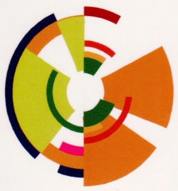
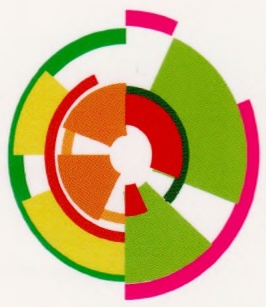
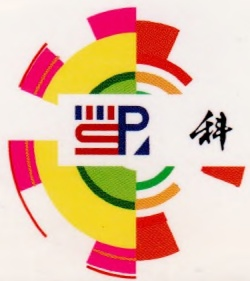
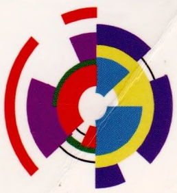

seal

中国证券报
编辑推荐
Eaton's China

## Molecular Cloning: A Laboratory Manual (Fourth Edition)

## 分子克隆实验指南

## (原书第四版)(上册)

主编〔美〕M.R.格林 J.萨姆布鲁克

主 译 贺福初

副主译 陈薇 杨晓明

natural_image

Abstract circular diagram with multicolored segments radiating from a central point (no text or symbols)

natural_image

Abstract circular design with multicolored segments and a central cutout (no text or symbols)

natural_image

Abstract circular diagram with green, orange, yellow, and red segments radiating from a central circle (no text or symbols)

natural_image

Abstract circular logo with red, blue, green, and orange segments forming a stylized 'C' shape (no text or symbols)

donut

| Category | Value |
| --- | --- |
| Dark Blue | ~10% |
| Orange | ~25% |
| Red | ~10% |
| Green | ~15% |
| Yellow-Green | ~20% |
| Pink | ~10% |

donut

| Category | Value |
| --- | --- |
| Red | N/A |
| Green | N/A |
| Yellow | N/A |
| Orange | N/A |

natural_image

Abstract circular design with red, green, and pink segments radiating from a central circle (no text or symbols)

natural_image

Abstract circular logo with concentric rings in green, yellow, and red (no text or symbols)

natural_image

Abstract circular design with multicolored segments radiating outward, no text or symbols present

text_image

S&P
科

text_image

版社

natural_image

Abstract circular design with multicolored segments and radial arcs (no text or symbols)

生命科学实验指南系列

Molecular Cloning: A Laboratory Manual (Fourth Edition)

# 分子克隆实验指南

(原书第四版)

(上册)

主编〔美〕M.R.格林 J.萨姆布鲁克

主 译 贺福初

副主译 陈薇 杨晓明

科学出版社

北京

图字:01-2013-2619号

## 内容简介

分子克隆技术 30 多年来一直是全球生命科学领域实验室专业技术的基础。冷泉港实验室出版社出版的《分子克隆实验指南》一书拥有的可靠性和权威性，使本书成为业内最流行、最具影响力的实验室操作指南。

第四版的《分子克隆实验指南》保留了之前版本中备受赞誉的细节和准确性，10个原有的核心章节经过更新，反映了标准技术的发展和创新，并介绍了一些前沿的操作步骤。同时还修订了第三版中的核心章节，以突出现有的核酸制备和克隆、基因转移及表达分析的策略和方法，并增加了12个新章节，专门介绍最激动人心的研究策略，包括利用DNA甲基化技术和染色质免疫沉淀的表观遗传学分析、RNAi、新一代测序技术，以及如何处理数据生成和分析的生物信息学，例如介绍了分析工具的使用，如何比较基因和蛋白质的序列，鉴定多个基因的常见表达模式等。本书还保留了必不可少的附录，包括试剂和缓冲液、常用技术、检测系统、一般安全原则和危险材料。

任何使用分子生物学技术的基础研究实验室都将因拥有一部《分子克隆实验指南》而受益。本书可作为学习遗传学、分子生物学、细胞生物学、发育生物学、微生物学、神经科学和免疫学等学科的重要指导用书，可供生物学、医药卫生，以及农林牧渔、检验检疫等方面的科研、教学与技术人员参考。

Originally published in English as Molecular Cloning: A Laboratory Manual, Fourth Edition, by Michael R.Green and Joseph Sambrook © 2012 Cold Spring Harbor Laboratory Press, Cold Spring Harbor, New York, USA

© 2017 Science Press. Printed in China.

Authorized simplified Chinese translation of the English edition © 2012 Cold Spring Harbor Laboratory Press. This translation is published and sold by permission of Cold Spring Harbor Laboratory Press, the owner of all rights to publish and sell the same.

## 图书在版编目(CIP)数据

分子克隆实验指南:第四版/（美）M.R.格林（Michael R. Green），（美）J.萨姆布鲁克（Joseph.

Sambrook）主编；贺福初主译.—北京:科学出版社，2017.3

(生命科学实验指南系列)

书名原文:Molecular Cloning: A Laboratory Manual (Fourth Edition)

ISBN 978-7-03-051997-9

I. ①分… II. ①M… ②J… ③贺… III. ①分子生物学-克隆-实验-指南 IV. ①Q785-33

中国版本图书馆 CIP 数据核字（2017）第 042159 号

责任编辑:王静 李悦 刘晶 夏梁 / 责任校对:郑金红

责任印制:张伟 / 封面设计:刘新新

科学出版社出版

北京东黄城根北街16号

邮政编码:100717

http://www.sciencep.com

北京教图印刷有限公司印刷

科学出版社发行 各地新华书店经销

\*

2017年3月第一版 开本:880×1230 1/16

2017年3月第一次印刷 印张:33

字数:906 000

定价（上、中、下册）:598.00 元

(如有印装质量问题，我社负责调换)

# 《分子克隆实验指南》（第四版）翻译及校对人员名单

主 译: 贺福初

副主译:陈薇 杨晓明

译校者名单: (按姓氏汉语拼音排序)

伯晓晨 陈红星 陈苏红 陈薇 陈昭烈 陈忠斌

程 龙 迟象阳 丁丽华 付汉江 葛常辉 郭 宁

韩勇军 贺福初 侯利华 胡显文 李长燕 李建民

李伍举 梁 龙 林艳丽 刘威岑 刘星明 仇纬祎

邵勇 宋伦 宋宜 孙强 田春艳 铁轶

童贻刚 汪莉 王婵娟 王恒樑 王建 王俊

王双 王友亮 吴军 吴诗坡 徐俊杰 徐小洁

杨晓明 杨益隆 叶玲玲 叶棋浓 于长明 于淼

于学玲 余云舟 张 浩 张令强 张 哲 赵 锬

赵 怡 赵志虎 郑晓飞 朱 力

统筹人员名单:

王 琰 韩 铁 郑晓飞 阎明凡 徐俊杰 于学玲

张金龙

## 译者序

天地玄黄，宇宙洪荒。人类的生命在日月星辰的映衬下显得如此微茫，但人类对科研探索的执着追求却给世界带来了翻天覆地的变化。1953年DNA双螺旋结构的发现解开了“生命之谜”，从此生物科技的发展突飞猛进。《分子克隆实验指南》一书就是在生物技术更新换代的背景下应运而生的。这部分子生物学领域的经典巨著、生命科学前沿科研的实验室“圣经”，自1982年问世以来便受到世界关注，后经1989、2001年两次再版，一直是科学实验和技术领域的中流砥柱，该书提供的精妙的实验室方案使它成为分子生物学领域的黄金标准。

本书为第四版，在第三版的基础上修订了核心章节，新增包括新一代测序技术、DNA甲基化技术、染色质免疫沉淀和生物信息学分析等前沿技术，并尽可能全面地囊括分子生物学的实验方法。为广大科研人员探索基因图谱提供了多种新的实验技术和方法。

近年来，生物科技步伐进一步加快，基因编辑等颠覆性生物技术风生水起，而《分子克隆实验指南》一书为基因的分离、克隆、重组、表达等研究承担着铺路石的职能，在整个生命科学领域，尤其是分子生物学领域发挥着不可或缺的基石作用，对人类生物技术的未来也将施以辐射式的深远影响。

军事医学科学院的广大学者，在繁忙的科研工作之余，秉承致之以求、精益求精、与时俱进的科研精神，挑灯夜战、牺牲节假日，在指定时间内将本书第四版译为中文。希望此书能进一步推动我国分子生物技术的更大、更快发展，助更多华人科学家取得不凡的成就。

是为序。

译者

2017年3月

## 第四版前言

人类和模式生物全基因组序列的获得对各领域生物学家现有的科研方式产生了深远影响。对浩瀚的基因图谱的探索需要开发多种新的实验技术和方法，传统的克隆手册必然会过时，已建立的方法也会被淘汰，这都是《分子克隆实验指南》一书全新版本问世的主要推动力。

在准备《分子克隆实验指南》（第四版）的初期，我们进行了全面的回顾来决定哪些旧材料应被保留，哪些新材料需要补充，最难的是，哪些材料应该被删除。在回顾过程中，许多科学家提出了宝贵的建议，他们的名字在下一页的致谢中列出，我们对他们深表感激。

仅是一本实验室手册当然不可能涵盖所有的分子生物学实验方法，所以必须从中做出选择，有时是艰难的选择。我们猜测对于其中一部分选择，有些人会提出异议。然而我们的两个指导原则是:第一，《分子克隆实验指南》是“以核酸为中心”的实验室手册，因而总体上我们没有选取非直接涉及DNA或RNA的实验方法。所以，尽管本书中有分析蛋白质之间相互作用的酵母双杂交实验操作的章节，但并不包括许多其他的不直接涉及核酸的蛋白质间相互作用的研究方法。第二，本着John Lockean“为尽可能多的人们做最多的善事”的思想，我们尝试囊括尽可能多的广泛用于分子和细胞实验室的以核酸为基础的方法。对我们而言，较为困难的任务是决定哪些材料应该被删除，而这个任务在与冷泉港实验室出版社协商之后难度大大降低，他们同意把较陈旧的方法放在冷泉港方案网站上（www.cshprotocols.org），方便大家免费获取。

由于新实验方法的激增，由一个人（甚至两个人）权威撰写所有相关的实验方法是根本不现实的。因此，与前一版《分子克隆实验指南》最大的不同是组织了众多领域内的专家们来撰写指定章节，提供指定方案。没有他们这些科学家的热心参与，本书不可能呈献给大家。

自第三版《分子克隆实验指南》问世后，各种商业化试剂盒层出不穷，这是一把双刃剑。一方面，试剂盒提供了极大的便利，尤其用于个别实验室非常规的实验操作；另一方面，试剂盒可能经常太过便利，使得使用者在进行实验时并不理解方法背后的原理。我们提供了商业化试剂盒列表，并描述它们如何工作，以尝试解决这一矛盾。

许多人对《分子克隆实验指南》（第四版）的出版发挥着重要的作用，我们对他们表示由衷的感谢。Ann Boyle 帮助《分子克隆实验指南》（第四版）起步，在项目早期也承担了关键的组织角色，后来，她的任务由其得力助手 Alex Gann 接手。Sara Deibler 在《分子克隆实验指南》（第四版）所有时期的各个方面都做出了贡献，尤其是协助撰写、编辑和校对。Monica Aalani 对第 9 章的内容和撰写做出了极大的贡献。

我们特别感谢冷泉港实验室出版社员工的热情支持以及卓越合作和包容，尤其是 Jan Argentine，她负责整个项目并把关财务。感谢我们的项目经理 Maryliz Dickerson、项目编辑 Kaaren Janssen、Judy Cuddihy 和 Michael Zierler，制作经理 Denise Weiss，制作编辑 Kathleen Bubbeo，当然还有冷泉港实验室出版社的幕后智囊 John Inglis。

Michael R. Green

Joseph Sambrook

## 致谢

作者希望感谢以下这些提供了十分有价值帮助的人员:

H. Efsun Arda

Michael F. Carey

Darryl Conte

Job Dekker

Claude Gazin

Paul Kaufman

Nathan Lawson

Chengjian Li

Ling Lin

Donald Rio

Sarah Sheppard

Stephen Smale

Narendra Wajapeyee

Marian Walhout

Phillip Zamore

Maria Zapp

冷泉港出版社希望感谢以下人员:

Paula Bubulya

Tom Bubulya

Nicole Nichols

Sathees Raghavan

Barton Slatko

## 目录

## 上册

## 第 1 章 DNA 的分离及定量……1

导言 2

方案 1 SDS 碱裂解法制备质粒 DNA: 少量制备....9

方案 2 SDS 碱裂解法制备质粒 DNA: 大量制备.... 12

方案 3 从革兰氏阴性菌（如 E.coli）中分离 DNA …… 15

方案 4 乙醇法沉淀 DNA …… 17

方案 5 异丙醇法沉淀 DNA……21

方案 6 用微量浓缩机进行核酸的浓缩和脱盐 …… 22

方案 7 丁醇抽提法浓缩核酸……23

方案 8 聚乙二醇沉淀法制备 M13 噬菌体单链 DNA …… 24

方案9 M13噬菌体铺平板 27

方案 10 M13 噬菌体液体培养 …… 30

方案 11 M13 噬菌体双链（复制型）DNA 的制备……32

方案 12 利用有机溶剂分离纯化高分子质量 DNA …… 35

方案 13 用蛋白酶 K 和苯酚从哺乳动物细胞中分离高分子质量 DNA……37

方案 14 一步法同时提取细胞或组织中的 DNA、RNA 和蛋白质 …… 43

方案 15 从鼠尾或其他小样本中制备基因组 DNA …… 46

替代方案:不使用有机溶剂从鼠尾分离 DNA 48

替代方案:一管法从鼠尾中分离 DNA 49

方案 16 快速分离酵母 DNA …… 50

方案 17 微型凝胶电泳后使用溴化乙锭（EB）估算条带中 DNA 数量 …… 52

方案 18 利用 Hoechst 33258 通过荧光分析仪估算 DNA 浓度……53

方案 19 用 PicoGreen 定量溶液中的 DNA …… 55

信息栏 56

## 第 2 章 DNA 分析……62

导言 63

方案 1 琼脂糖凝胶电泳……73

方案 2 琼脂糖凝胶中 DNA 的染色检测 …… 76

方案3 聚丙烯酰胺凝胶电泳 80

方案 4 聚丙烯酰胺凝胶中 DNA 的染色检测 …… 85

方案 5 聚丙烯酰胺凝胶中 DNA 的放射自显影检测……86

方案 6 碱性琼脂糖凝胶电泳……87

附加方案:碱性琼脂糖凝胶的放射自显影 90

方案 7 成像:放射自显影和感光成像……91

方案 8 用玻璃珠从琼脂糖凝胶中回收 DNA …… 96

方案 9 低熔点琼脂糖凝胶中 DNA 的回收:有机溶剂抽提法 …… 98

方案 10 聚丙烯酰胺凝胶中 DNA 片段的回收:压碎与浸泡法 ……101

方案 11 Southern 印迹 …… 103

方案 12 Southern 印迹:DNA 从一块琼脂糖凝胶同时向两张膜转移 …… 110

方案 13 采用放射性标记探针对固定在膜上的核酸 DNA 进行 Southern 杂交……112

附加方案:从膜上洗脱探针 ……117

信息栏 119

## 第3章 质粒载体克隆与转化 122

导言 ……123

方案 1 制备和转化感受态大肠杆菌的 Hanahan 方法:高效转化策略 ……126

方案 2 制备和转化感受态大肠杆菌的 Inoue 方法:“超级感受态”细胞 ……131

方案 3 大肠杆菌的简单转化:纳米颗粒介导的转化 ……135

替代方案:一步法制备感受态大肠杆菌:在同一溶液中转化和储存细菌细胞……136

方案 4 电穿孔法转化大肠杆菌 ……138

方案 5 质粒载体克隆:定向克隆 ……143

方案 6 质粒载体克隆:平末端克隆 ……145

方案 7 质粒 DNA 的去磷酸化……148

方案 8 向平末端 DNA 添加磷酸化衔接子/接头 ……150

方案 9 克隆 PCR 产物:向扩增 DNA 的末端添加限制性酶切位点……151

方案 10 克隆 PCR 产物:平末端克隆 ……154

方案 11 克隆 PCR 产物:制备 T 载体 …… 157

方案 12 克隆 PCR 产物:TA 克隆 …… 159

方案 13 克隆 PCR 产物:TOPO TA 克隆……161

方案 14 使用 X-Gal 和 IPTG 筛选细菌菌落:α-互补 …… 165

信息栏 167

## 第 4 章 Gateway 重组克隆……205

导言 206

方案 1 扩增 Gateway 载体 ……210

方案 2 制备可读框入门克隆和目的克隆 ……213

方案 3 应用多位点 LR 克隆反应制备目的克隆……219

信息栏 222

## 第 5 章 细菌人工染色体及其他高容量载体的应用 ……223

导言 224

方案 1 BAC DNA 的小量分离和 PCR 检验 ……235

方案 2 BAC DNA 的大量制备和线性化 ……238

方案 3 通过脉冲电场凝胶电泳检验 BAC DNA 的质量和数量……241

方案 4 两步 BAC 工程:穿梭载体 DNA 的制备 ……242

方案 5 A 同源臂（A-Box）和 B 同源臂（B-Box）的制备 ……244

方案 6 克隆 A 和 B 同源臂到穿梭载体 ……247

方案 7 重组穿梭载体的制备和检验 ……249

方案 8 通过电穿孔法转化重组穿梭载体到感受态 BAC 宿主细胞 ……251

方案 9 共合体的检验和重组 BAC 克隆的筛选 ……253

方案 10 一步 BAC 修饰:质粒制备……256

方案 11 A 同源臂（A-Box）的制备 ……259

方案 12 克隆 A 同源臂到报道穿梭载体 …… 260

方案 13 用 RecA 载体转化 BAC 宿主 …… 263

方案 14 转移报道载体到 BAC/RecA 细胞以及共合体的筛选 …… 265

方案 15 酿酒酵母（S. cerevisiae）的生长和 DNA 制备……267

方案 16 酵母 DNA 的小量制备 …… 269

信息栏……270

## 第 6 章 真核细胞 RNA 的提取、纯化和分析 …… 275

导言 276

方案 1 从哺乳动物的细胞和组织中提取总 RNA …… 279

替代方案 从小量样本提取 RNA …… 281

方案 2 从斑马鱼胚胎和成体中提取总 RNA …… 282

方案3 从黑腹果蝇提取总RNA 283

方案 4 从秀丽隐杆线虫中提取总 RNA …… 285

方案 5 从酿酒酵母菌中采用热酸酚提取总 RNA …… 287

方案 6 RNA 定量和储存 …… 289

方案 7 RNA 的乙醇沉淀 …… 295

方案 8 通过无 RNase 的 DNase I 处理去除 RNA 样品中的 DNA 污染……297

方案 9 Oligo（dT）磁珠法提取 poly（A）$^{+}$mRNA……298

方案 10 按照大小分离 RNA: 含甲醛的琼脂糖凝胶电泳 …… 308

方案 11 根据分子质量大小分离 RNA: RNA 的尿素变性聚丙烯酰胺凝胶电泳 ……312

方案 12 琼脂糖凝胶中变性 RNA 的转膜和固定 …… 319

替代方案 下行毛细管转移 323

方案 13 聚丙烯酰胺凝胶的电转移和膜固定……325

方案 14 Northern 杂交……327

方案 15 纯化 RNA 的点杂交和狭缝杂交……330

方案 16 用核酸酶 S1 对 RNA 作图 …… 342

方案 17 核糖核酸酶保护分析:用核糖核酸酶和放射性标记的 RNA 探针对 RNA 作图……349

方案 18 引物延伸法分析 RNA……355

信息栏……359

## 第 7 章 聚合酶链反应 …… 363

导言 364

方案 1 基础 PCR……375

方案 2 热启动 PCR …… 380

方案 3 降落 PCR……383

方案 4 高 GC 含量模板的 PCR 扩增 …… 385

方案 5 长片段高保真 PCR（LA PCR）……390

方案 6 反向 PCR……393

方案 7 巢式 PCR……397

方案 8 mRNA 反转录产物 cDNA 的扩增:两步法 RT-PCR ……400

方案 9 由 mRNA 的 5' 端进行序列的快速扩增:5'-RACE……409

方案 10 由 mRNA 的 3'端进行序列的快速扩增:3'-RACE……416

方案 11 使用 PCR 筛选克隆 ……422

信息栏 424

## 第8章 生物信息学 431

导言 432

方案 1 使用 UCSC 基因组浏览器将基因组注释可视化 ……434

方案 2 使用 BLAST 和 ClustalW 进行序列比对和同源性检索 ……444

方案3 使用Primer3Plus设计PCR引物 450

方案 4 使用微阵列和 RNA-seq 进行表达序列谱分析 …… 461

方案 5 将上亿短读段定位至参考基因组上……472

方案6 识别ChIP-seq数据集中富集的区域（寻峰）....483

方案7 发现顺式调控基序 495

信息栏 503

## 中册

## 第9章 实时荧光聚合酶链反应定量检测DNA及RNA 509

导言 510

方案1 实时PCR反应用引物和探针浓度的优化 532

方案2 制作标准曲线 537

方案3 实时荧光PCR定量检测DNA 540

方案 4 实时荧光 PCR 定量检测 RNA …… 542

方案 5 实时荧光 PCR 实验数据的分析和归一化 …… 545

信息栏 550

## 第 10 章 核酸平台技术 …… 551

导言 552

方案1 印制微阵列 560

方案 2 Round A/Round B DNA 扩增 …… 564

方案 3 核小体 DNA 和其他小于 500bp 的 DNA 的 T7 线性扩增（TLAD）……567

方案 4 RNA 的扩增……572

方案 5 RNA 的 Cyanine-dUTP 直接标记……578

方案 6 RNA 的氨基烯丙基-dUTP 间接标记……581

方案 7 用 Klenow 酶对 DNA 进行 Cyanine-dCTP 标记 …… 583

方案8 DNA的间接标记 585

方案9 封闭自制微阵列上的多聚赖氨酸 …… 587

方案 10 自制微阵列的杂交……589

## 第 11 章 DNA 测序 …… 595

导言 596

方案1 毛细管测序质粒亚克隆的制备 620

方案 2 毛细管测序之 PCR 产物的制备 …… 625

方案 3 循环测序反应 …… 627

方案 4 全基因组:手工文库制备……630

方案 5 全基因组:自动化的无索引文库制备 …… 636

附加方案 自动化的文库制备……642

方案6 全基因组:自动化的带索引文库制备 644

方案 7 用于 Illumina 测序的 3kb 末端配对文库的制备 …… 651

方案 8 用于 Illumina 测序的 8kb 末端配对文库的制备 …… 659

附加方案 AMPure 磁珠校准 671

方案 9 RNA-Seq:RNA 反转录为 cDNA 及其扩增 …… 673

附加方案 RNAClean XP 磁珠纯化（RNA-Seq 前） 679

方案 10 液相外显子组捕获 …… 680

附加方案 AMPure XP 磁珠纯化 …… 688

附加方案 琼脂糖凝胶大小筛选 689

方案 11 自动化大小筛选……690

方案 12 用 SYBR Green-qPCR 进行文库定量 …… 693

方案 13 用 PicoGreen 荧光法进行文库 DNA 定量 …… 696

方案 14 文库定量:用 Qubit 系统对双链或单链 DNA 进行荧光定量 …… 700

方案 15 为 454 测序制备小片段文库 …… 702

方案 16 单链 DNA 文库的捕获及 emPCR …… 708

方案 17 Roche/454 测序:执行一个测序运行 …… 714

方案 18 结果有效性确认……721

方案 19 测序数据的质量评估……723

方案 20 数据分析 …… 724

信息栏……725

## 第 12 章 哺乳动物细胞中 DNA 甲基化分析……729

导言 730

方案 1 DNA 亚硫酸氢盐测序法检测单个核苷酸的甲基化 …… 735

方案 2 甲基化特异性聚合酶链反应法检测特定基因的 DNA 甲基化 ……742

方案 3 基于甲基化胞嘧啶免疫沉淀技术的 DNA 甲基化分析……745

方案 4 高通量深度测序法绘制哺乳动物细胞 DNA 甲基化图谱 …… 749

方案 5 亚硫酸氢盐转化的 DNA 文库的 Roche 454 克隆测序 ……760

方案 6 亚硫酸氢盐转化的 DNA 文库的 Illumina 测序……765

信息栏……770

## 第 13 章 标记的 DNA 探针、RNA 探针和寡核苷酸探针的制备……775

导言 776

方案 1 随机引物法:用随机寡核苷酸延伸法标记纯化的 DNA 片段 …… 792

方案 2 随机引物法:在融化琼脂糖存在下用随机寡核苷酸延伸法标记 DNA …… 798

方案 3 用切口平移法标记 DNA 探针……800

方案 4 用聚合酶链反应标记 DNA 探针 …… 804

附加方案 不对称探针 808

方案 5 体外转录合成单链 RNA 探针 809

附加方案 用 PCR 法将噬菌体编码的 RNA 聚合酶启动子加至 DNA 片段上 ……816

方案 6 用随机寡核苷酸引物法从 mRNA 合成 cDNA 探针 ……818

方案 7 用随机寡核苷酸延伸法制备放射性标记的消减 cDNA 探针 ……820

方案 8 用大肠杆菌 DNA 聚合酶 I 的 Klenow 片段标记双链 DNA 的 3'端 ……825

方案 9 用碱性磷酸酶进行 DNA 片段的去磷酸化……831

方案 10 含 5'突出羟基端的 DNA 分子磷酸化……833

方案 11 去磷酸化的平端或 5'凹端 DNA 分子的磷酸化……836

方案 12 用 T4 多核苷酸激酶进行寡核苷酸 5'端的磷酸化……839

方案 13 用末端脱氧核苷酸转移酶标记寡核苷酸 3'端 ……841

替代方案 用 TdT 合成非放射性标记的探针 ……843

附加方案 加尾反应 843

附加方案 合成非放射性标记探针的修饰 844

方案 14 用大肠杆菌 DNA 聚合酶 I 的 Klenow 片段标记合成的寡核苷酸……845

方案 15 用乙醇沉淀法纯化标记的寡核苷酸 ……849

方案 16 用空间排阻层析法纯化标记的寡核苷酸 ……850

方案 17 用 Sep-Pak C$_{18}$ 柱色谱法纯化标记的寡核苷酸……852

方案 18 寡核苷酸探针在水溶液中杂交:在含季铵盐缓冲液中洗涤 ……854

信息栏 857

## 第 14 章 体外诱变方法 ……871

导言 872

方案 1 用易错 DNA 聚合酶进行随机诱变....879

方案 2 重叠延伸 PCR 产生插入或缺失诱变 .....890

方案 3 以双链 DNA 为模板的体外诱变:用 Dpn I 选择突变体 ……897

方案 4 突变型β-内酰胺酶选择法定点诱变 ……904

方案 5 通过单一限制性位点消除进行寡核苷酸 指导的诱变（USE 诱变）……910

方案 6 利用密码子盒插入进行饱和诱变 ……915

方案 7 随机扫描诱变 ……922

方案 8 多位点定向诱变……926

方案 9 基于 PCR 的大引物诱变 ..... 930

信息栏 933

## 第 15 章 向培养的哺乳动物细胞中导入基因……937

导言 938

方案 1 阳离子脂质试剂介导的 DNA 转染 ..... 942

替代方案 采用 DOTMA 和 DOGS 进行转染……948

附加方案 单层细胞组织化学染色检测β-半乳糖苷酶 950

方案 2 磷酸钙介导的质粒 DNA 转染真核细胞 ..... 952

替代方案 磷酸钙介导的质粒 DNA 高效转染真核细胞……956

方案 3 磷酸钙介导的高分子质量基因组 DNA 转染细胞 ..... 959

替代方案 磷酸钙介导的贴壁细胞的转染 962

替代方案 磷酸钙介导的悬浮生长细胞的转染 963

方案 4 DEAE-葡聚糖介导的转染:高效率的转染方法 ……964

替代方案 DEAE-葡聚糖介导的转染:提高细胞活力的方案 966

方案 5 电穿孔转染 DNA …… 968

方案 6 通过 alamarBlue 法分析细胞活力……972

方案 7 通过乳酸脱氢酶法分析细胞活力 …… 974

方案 8 通过 MTT 法分析细胞活力 …… 977

信息栏……980

## 第 16 章 向哺乳动物细胞中导入基因:病毒载体……998

导言 999

方案 1 直接克隆法构建重组腺病毒基因组……1019

方案 2 将克隆的重组腺病毒基因组释放用于挽救和扩增……1023

方案 3 氯化铯梯度沉降法纯化重组腺病毒……1028

方案 4 限制性内切核酸酶消化法鉴定纯化后的重组腺病毒基因组……1031

方案 5 TCID$_{50}$终点稀释结合 qPCR 测定重组腺病毒感染滴度 …… 1034

附加方案 准备 qPCR 的 DNA 标准品 …… 1042

方案 6 浓缩传代和 Real-Time qPCR 法检测有复制能力腺病毒（RCA）……1043

方案 7 瞬时转染法制备 rAAV …… 1051

方案 8 氯化铯梯度沉降法纯化 rAAV 1054

方案9 碘克沙醇梯度离心法纯化rAAV 1059

方案 10 肝素亲和层析法纯化 rAAV2 1062

方案 11 阴离子交换柱层析法从碘克沙醇梯度离心后的 rAAV 样本中富集完全包装病毒 …… 1065

方案 12 实时定量 PCR 法测定 rAAV 基因组拷贝数 …… 1068

方案 13  $TCID_{50}$  终点稀释结合 qPCR 法灵敏测定 rAAV 感染滴度……1071

方案 14 负染色法和高分辨电子显微镜分析 rAAV 样本形态……1074

方案 15 银染 SDS-PAGE 分析 rAAV 纯度 …… 1076

方案 16 高滴度反转录病毒和慢病毒载体的制备……1079

方案 17 慢病毒载体的滴定 …… 1085

方案 18 监测慢病毒载体储备液中的可复制型病毒 …… 1089

信息栏……1091

## 下册

## 第 17 章 利用报道基因系统分析基因表达调控 …… 1102

导言 1103

方案 1 哺乳动物细胞提取物中β-半乳糖苷酶的测定 …… 1112

附加方案 化学发光实验检测β-半乳糖苷酶活性 1115

方案 2 单萤光素酶报道基因实验……1118

方案 3 双萤光素酶报道基因实验……1123

方案 4 酶联免疫吸附试验定量检测绿色荧光蛋白 …… 1128

方案 5 用四环素调控基因表达建立细胞系……1131

附加方案 有限稀释法筛选悬浮细胞的稳定克隆……1138

信息栏....1140

## 第18章 RNA干扰与小RNA分析 1170

导言 1171

方案1 双链 siRNA 制备 1185

方案 2 通过转染双链 siRNA 在哺乳动物细胞中进行 RNA 干扰……1187

方案 3 通过转染双链 siRNA 在果蝇 S2 细胞中进行 RNA 干扰 …… 1190

方案 4 体外转录法制备 dsRNA …… 1192

方案 5 采用 dsRNA 浸泡果蝇 S2 细胞进行 RNA 干扰……1196

方案 6 采用 dsRNA 转染在果蝇 S2 细胞中进行 RNA 干扰……1198

方案7 小RNA的Northern杂交分析 1199

方案 8 反转录定量 PCR 分析小 RNA …… 1203

方案 9 构建小 RNA 高通量测序文库 …… 1206

方案 10 抑制 miRNA 功能的反义寡核苷酸制备 …… 1215

方案 11 在哺乳动物细胞中通过反义寡核苷酸抑制 miRNA 功能 …… 1216

方案 12 在果蝇 S2 细胞中通过反义寡核苷酸抑制 miRNA 功能 …… 1218

信息栏 1219

## 第 19 章 克隆基因的表达以及目的蛋白的纯化和分析 …… 1225

导言 1226

方案 1 在大肠杆菌中利用可用 IPTG 诱导的启动子表达克隆化基因 …… 1249

附加方案 目标蛋白可溶性表达的小量试验 …… 1255

替代方案 在大肠杆菌中利用阿拉伯糖 BAD 启动子表达克隆基因 …… 1260

替代方案 信号肽融合蛋白的亚细胞定位 …… 1261

方案 2 用杆状病毒表达系统表达克隆基因 …… 1265

附加方案 噬菌斑测定法确定杆状病毒原液的滴度 …… 1271

替代方案 用于转染昆虫细胞的杆粒 DNA 制备 …… 1274

方案 3 用甲醇诱导启动子 AOX1 在毕赤酵母中表达克隆基因 …… 1277

附加方案 酵母培养物的冻存 1287

方案 4 用于纯化大肠杆菌中表达可溶性蛋白的细胞提取物的制备 …… 1291

附加方案 酵母细胞玻璃珠裂解法 1296

替代方案 温和的热诱导的酶裂解法制备大肠杆菌细胞提取物 …… 1298

替代方案 用溶菌酶裂解和冻融法联用制备大肠杆菌细胞提取物 …… 1300

方案 5 采用固化的金属亲和层析纯化多聚组氨酸标记的蛋白质 …… 1302

附加方案 $\mathrm{Ni}^{2+}$-NTA 树脂的清洗与再生 1309

替代方案 组氨酸标签蛋白的快速液相色谱纯化 1310

方案6 采用谷胱甘肽树脂以亲和层析纯化融合蛋白 1314

方案7 包含体中表达蛋白的增溶 1321

方案 8 蛋白质的 SDS-PAGE …… 1325

替代方案 用考马斯亮蓝进行 SDS-PAGE 凝胶染色的各种不同方法……1335

替代方案 用银盐进行 SDS-PAGE 凝胶染色 …… 1336

方案9 蛋白质的免疫印迹分析 1340

方案 10 测定蛋白质浓度的方法……1347

信息栏 1353

## 第 20 章 利用交联技术分析染色质结构与功能 …… 1358

导言 1359

方案1 甲醛交联.... 1369

方案 2 制备用于染色质免疫沉淀的交联染色质……1371

方案3 染色质免疫沉淀（ChIP） 1373

方案 4 染色质免疫沉淀-定量聚合酶链反应（ChIP-qPCR）……1377

方案 5 染色质免疫沉淀-芯片杂交（ChIP-chip）....1378

方案 6 染色质免疫沉淀-高通量测序（ChIP-seq）……1385

方案 7 交联细胞 3C 文库的制备……1389

方案 8 环形染色质免疫沉淀（ChIP-loop）文库的制备 …… 1393

方案 9 连接产物对照组文库的制备 …… 1398

方案 10 PCR 检测 3C、ChIP-loop 和对照文库中的 3C 连接产物:文库滴定与相互作用频率分析 …… 1400

方案 11 3C、ChIP-loop 和对照组文库的 4C 分析 …… 1404

方案 12 3C、ChIP-loop 和对照组文库的 5C 分析 …… 1408

信息栏....1412

## 第 21 章 紫外交联免疫沉淀（CLIP）技术进行体内 RNA 结合位点作图 …… 1415

导言 1416

方案 1 CLIP 实验免疫沉淀严谨性的优化……1424

方案 2 活细胞的紫外交联和裂解物制备 …… 1429

方案 3 RNA 酶滴定、免疫沉淀及 SDS-PAGE……1432

方案 4 3'-接头的连接和用 SDS-PAGE 进行大小选择 …… 1441

替代方案 去磷酸化 RL3 接头 5 端的标记 …… 1445

方案 5 RNA 标签的分离、5'-接头的连接和反转录 PCR 扩增 …… 1446

方案 6 RNA CLIP 标签测序 …… 1456

方案 7 RNA 接头胶回收及保存……1458

信息栏....1460

## 第 22 章 Gateway 相容酵母单杂交和双杂交系统 …… 1464

导言 1465

方案 1 构建酵母单杂交 DNA-诱饵菌株 …… 1474

替代方案 用复性引物从 DNA 诱饵中获得入门克隆产物 …… 1481

方案 2 生成酵母双杂交 DB-诱饵菌株……1484

方案 3 从活化域捕获文库中鉴定相互作用分子……1490

方案 4 高效的酵母转化……1496

方案 5 用于β-半乳糖苷酶活力的菌落转移比色测定 …… 1500

方案 6 酵母克隆的 PCR …… 1502

信息栏....1504