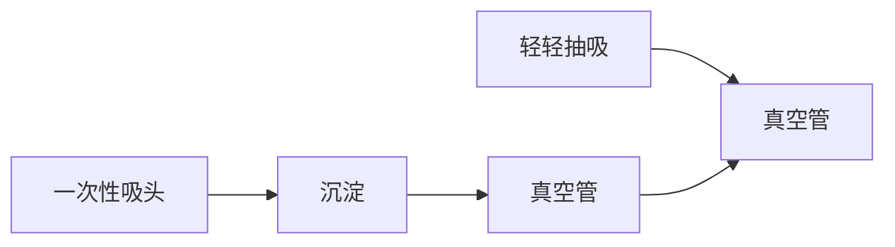

附录 1 试剂和缓冲液 …… 1507

附录2 常用技术 1533

附录 3 检测系统 …… 1541

附录 4 一般安全原则和危险材料……1565

索引 1573

## 上册

## 第 1 章 DNA 的分离及定量

## 导言 | DNA 分离 2

纯化 DNA 的商业试剂盒 3

DNA 定量 5

## 方案 | 1 SDS 碱裂解法制备质粒 DNA: 少量制备 9

2 SDS 碱裂解法制备质粒 DNA:
大量制备 12

3 从革兰氏阴性菌（如 E.coli）中
分离 DNA 15

4 乙醇法沉淀 DNA 17

5 异丙醇法沉淀 DNA 21

6 用微量浓缩机进行核酸的浓缩和脱盐 22

7 丁醇抽提法浓缩核酸 23

8 聚乙二醇沉淀法制备 M13 噬菌体
单链 DNA 24

9 M13 噬菌体铺平板 27

10 M13 噬菌体液体培养 30

11 M13 噬菌体双链（复制型）DNA 的制备 32

12 利用有机溶剂分离纯化高分子质量 DNA 35

13 用蛋白酶 K 和苯酚从哺乳动物细胞中分离高分子质量 DNA 37

14 一步法同时提取细胞或组织中的 DNA、RNA 和蛋白质 43

15 从鼠尾或其他小样本中制备基因组 DNA 46

\- 替代方案 不使用有机溶剂从鼠尾分离DNA 48

\- 替代方案 一管法从鼠尾中分离 DNA 49

16 快速分离酵母 DNA 50

17 微型凝胶电泳后使用溴化乙锭（EB）估算条带中DNA数量 52

18 利用 Hoechst33258 通过荧光分析仪估算 DNA 浓度 53

19 用 PicoGreen 定量溶液中的 DNA 55

## 信息栏 | 从石蜡包埋的甲醛固定组织中提取 DNA 56

聚乙二醇 57

$\alpha$ -互补 58

X-Gal 59

尽量降低对高分子质量 DNA 的损伤 59

分光光度法 60

## 导言

双链 DNA 是非常惰性的化学物质。它潜在的反应基团隐藏在中央螺旋部位，并经氢键紧密连接。碱基对外侧受磷酸键和戊糖形成的强大环层的保护，这种保护因内在的碱基堆积力而进一步加强。如此坚固的结构和保护，使得 DNA 在现代犯罪现场和古代墓葬等完全不同的场所中比大多数细胞内其他成分保存时间更长。这样的化学耐久性赋予基因组 DNA 文库的持久性和价值，使得或大或小的遗传工程和测序计划成为可能。

尽管双链 DNA 在化学上是稳定的,但它在物理结构上是易碎的。高分子质量的 DNA 长而弯曲、侧面不稳定,因此更容易受到最柔和的流体剪切力的伤害。双链 DNA 在溶液中随机卷曲,并由于碱基对之间的堆积作用和 DNA 骨架上磷酸基团间的静电排斥力而变得黏稠。因为移液、振荡或搅拌引起的液流,在黏滞的盘绕物上产生的拖拉力,可以切断双链 DNA。DNA 分子越长,破坏其所需的力越小。因此基因组 DNA 很容易变成片段形式,并且随着分子质量增加,分离的难度也相应增加。大于 150kb 的 DNA 分子在常规分离基因组 DNA 过程中易于断裂。

## DNA 分离

DNA 的分离是 DNA 纯化、成功克隆的关键步骤。DNA 制备得越纯，DNA 作为模板或者底物的酶反应效率会越高。在 20 世纪 30～40 年代，科技文献中开始积累了一些从细胞中提取 DNA 并去除能够抑制或者竞争酶催化反应的细胞成分的方法。自此，成千上万种从不同器官、组织和体液中纯化 DNA 的方法被发表。一般来说，这些过程通过 3 个步骤便可快速成功。

1. 裂解宿主细胞，通常使用这些成分:

- 离子去污剂，如 SDS
- 离液剂（如胍盐）
- 与离子去污剂结合的碱

2. 从细胞中释放 DNA，去除与 DNA 结合的蛋白质并快速使胞内核酸酶失活，如:

- 酶水解蛋白和 RNA
- 从层析液中吸收、释放 DNA（例如，玻璃粉末或者阴离子树脂；多种商品化 DNA 纯化试剂盒是基于该技术进行开发的）
- 利用有机溶剂（苯酚和/或氯仿）抽提裂解液以去除 DNA 溶液中的蛋白质

3. 利用乙醇或者异丙醇沉淀 DNA 去除盐离子

由于质粒被广泛应用，因此分离质粒 DNA 十分重要。人们使用碱与 SDS 裂解法从大肠杆菌中分离制备质粒 DNA 已有 30 多年的历史（Birnboim and Doly 1979）。菌液在高 pH 条件下加入强离子去污剂能够破坏细胞壁，使蛋白质与染色体 DNA 变性，并将质粒 DNA 释放到上清液中。

溶菌过程中，菌体蛋白、破碎的细胞壁和变性的染色体 DNA 交织成一个大的复合物，被十二烷基硫酸盐包裹。这些复合物能够通过将钠离子替换成钾离子而被有效沉淀下来（Ish-Horowicz and Burke 1981）。离心去除变性剂后，就可以从上清液中回收复性的质粒。

在 SDS 的存在下，碱裂解法是一种非常灵活、有效的方法，它对 E.coli 的所有菌株都适用，并且其细菌培养物的体积可以从 1mL 到 500mL 以上。但是，实验中的关键是要动作快，因为长时间暴露在变性的条件下会对闭环 DNA 造成不可逆变性（Vinograd and (Lebowitz 1966)。这种变性的折叠卷曲 DNA 不能被限制酶切割, 它的琼脂糖电泳速率是线性、超螺旋和环状等天然结构 DNA 电泳速率的两倍, 并且不易被嵌入染料染色。碱裂法在制备质粒过程中常会产生不同数量折叠形式的 DNA。

这种方法适用于大小在 15kb 以下的质粒。大于 15kb 的质粒容易在细胞裂解和随后的处理中断裂。利用等渗蔗糖溶液裂解细菌，并用溶菌酶和 EDTA（乙二胺四乙酸）去除细胞壁，可解决受损。产生的原生质球可通过加入去污剂（如 SDS）被裂解。了解更详细的方法，请详见 Godson 和 Vapnek（1973）。

## 纯化 DNA 的商业试剂盒

商业公司将过去 DNA 提取与纯化的技术应用到试剂盒中，然后出售。它是预包装的试剂，具有非常清楚并且简洁的说明，对操作人员的要求简单，使操作人员很容易快速上手，并且结果可多次重复。这些试剂盒可用于纯化不同来源的 DNA 及用于不同实验目的。但现在的文献中缺少对这些试剂盒进行直接的比较。事实上，制造商现在掌握着这些资源。

如何看待这些试剂盒是具有节省时间的优势还是具有破坏性影响，在很大程度上取决于你所处的年代和培训背景。经历过分子克隆早期研究的科学家，可能会认为试剂盒就像快餐食物一样:简单、不用思考、无创造力，是科学的仿制品。可是试剂盒使用起来如此简便，为什么要纠结它们的作用原理呢？或许无知是福吧（Gray 1742）。

试剂盒给我们带来了很多的好处:它们提供了一种高度可靠的、能够与自动化任务相融合的技术。因为仅需要很少的专业知识，所以降低了新研究者进入分子克隆领域的门槛，并且加速了科学发展的进程。例如，我们可以用试剂盒从档案组织中分离其 DNA 从而研究遗传疾病，还可以研究恶性组织中基因表达的异常（详见“从石蜡包埋的甲醛固定组织中提取 DNA”）。此外，若没有试剂盒制备的快速性和重复性，大量的样本要想满足自动DNA测序仪的需求，我们还需要几十年才能实现人类基因组测序计划。

试剂盒就存在于我们的身边，在很多实验室中甚至是不可缺少的，不管你喜不喜欢它，它都会在日新月异的科学领域发挥越来越重要的作用。

许多试剂盒开始利用 DNA 选择性吸附稳定固定相（通常是二氧化硅或者硅酸盐）的特性进行 DNA 纯化。最初的文章（Vogelstein and Gillespie 1979; Marko et al. 1982）描述了硅酸盐粉末（碱石灰玻璃和硼硅酸盐玻璃）如何快速及定量结合 DNA。在高 pH、高盐缓冲液中，DNA 吸附在二氧化硅介质上，在低盐浓度下可被洗脱下来。这种结合不依赖碱基配对或者拓扑学特征，可被离液剂增强，如能够破坏核酸周围水化层的胍基盐。玻璃表面的阳性离子随后可以在 DNA 骨架中磷酸负电基团和硅醇负电基团（Si-OH）之间形成盐桥。结合力的强度与成桥离子类型有关（Romanowski et al. 1991）。一旦被吸附，在溶液中（如 50%乙醇）的 DNA 还可以被吸附在介质上，而与其他的生物多聚物（如 RNA 和糖）分开。然而，当用水溶液对吸附的 DNA 进行水化时，DNA 可被洗脱下来并（大部分）在洗脱液中被回收。得率由 DNA 的大小决定:片段越小，与二氧化硅结合越紧密，得率越低。洗涤缓冲液，尤其含易挥发液体的（如乙醇），应该现用现配。

做二氧化硅试剂盒的制造商不愿意提供他们的树脂结构及特性的详细数据。许多试剂盒用二氧化硅来吸附高密度的阴离子基团来建立盐桥。这些阴离子二氧化硅有着很强的结合能力，但是批次之间的不同成为早期二氧化硅树脂被广泛应用的阻碍，现在问题已经解决了。这种结合不受溶液中的去污剂（Triton X-100）或结构破坏剂（胍基盐、碘化钠或高氯酸钠）的影响。

阴离子二氧化硅介质可存在多种形式，如凝胶状、玻璃粉、微粒状、旋转柱、膜状和多墙平板状。二氧化硅材质经常做成平行设计，因为这样可在芯片制造中将其嵌入卡槽。

依据二氧化硅材质的结构，DNA 可通过重力进行吸附和洗脱，还可通过泵或离心加速该过程。商品化树脂的制造商会根据不同的情况来制订详细的 DNA 纯化方案。因为 DNA 的吸附和洗脱依赖特定树脂的结构和衍生化，制造商一般会提供说明书。

二氧化硅材料直至今日还是高科技产物，所以价格还很昂贵，但它们能够为实验室节省很多时间和精力，进而大大提高了成本利用率。由于还有 $5\% \sim 10\%$ 的DNA依然吸附在介质上，因此二氧化硅柱在用完一次后必须废弃。然而，我们可以将柱上残留的DNA洗去，使之再生后重新使用，这样能够降低成本（如Esser et al.2005,2006）。如果把劳动力成本考虑进去的话，这种节约是否能够提高成本效率并不明确。

不是所有的商业试剂盒都用二氧化硅材质去结合DNA，因为DNA是一个大的多价阴离子物，在低离子强度作用的缓冲液中能够与任何阳离子结合，在高离子强度的缓冲液中被洗脱。强电荷基质能够紧密结合DNA，但是DNA的复性非常慢，尤其是在离心柱上。一些商业化试剂盒用阳离子柱效果也很好，可有效获得高纯度DNA（如Applied Biosystems公司的PrepMan试剂盒）。

选择哪一种试剂盒呢？目前有很多DNA制备试剂盒已经进入市场。就算实验经验匮乏的人也能够使用这些试剂盒从任何你想到的来源中提取和纯化DNA。

生产DNA纯化试剂和试剂盒的公司有Applied Biosystems公司、Brinkmann公司、Clontech公司、Millipore公司、Agilent公司、Life Technologies公司、Promega公司及市场领导者QIAGEN公司。目前并没有对这些公司试剂盒提取DNA的成本、效率、速度及可重复性进行比较。但这个市场竞争十分激烈，劣质产品不会存在太久。我们建议根据自己的目的来比较这些公司产品（产量、速度、花费等），然后选择一个性价比高的产品。现在涌现了很多公司推销可同时纯化多种样本DNA的工作站和自动化仪器。目前，这些仪器的主要使用者是基因组测序工厂、基因检测实验室和分子病理实验室的人。很快它们会像PCR一样普遍。

## 高分子质量 DNA 的分离

试剂盒纯化的基因组 DNA 在大小上（一般为 50～100kb）可作为 Southern 杂交和 PCR 的模板。因此，当 DNA 用于特定用途如构建基因组文库（克隆的 DNA 大小尤为重要）时，商品化的试剂盒用处不大。为使剪切力降到最低，200kb 大小的 DNA 可用去污剂裂解细胞，强蛋白酶（如链霉蛋白酶和蛋白酶 K）处理裂解液，并利用有机溶剂进行多次萃取（一般为水饱和的酚-氯仿溶液）。最后的水相经过广泛透析以去除低分子质量的污染及调整离子浓缩。如果可能，尽量避免用乙醇沉淀 DNA。

此方法的雏形可追溯到60年以前。如果操作足够谨慎和耐心，有机溶剂萃取可产生足够大分子质量的基因组DNA，以用于在某些高容量载体中构建真核基因组DNA文库。

尽管此方法值得尊敬，但与其他实验室常规方法相比，仍是对技术与耐心的巨大挑战，并且也有一些缺点。例如，该过程需使用有毒试剂，并且涉及多次水相与有机相的费力分离；长 DNA 很容易断裂，非常容易被切割成小的片段。成功的关键在于通过使用宽口径的移液器，避免振荡、涡旋和乙醇沉淀，以及避免色谱树脂降低剪切力。高分子质量的 DNA 分离方法无法自动化，并且不适合多个样本的平行操作。

在以下情况下需要更加谨慎以降低剪切力对DNA的影响:利用高容量载体如YAC（酵母人工染色体）或BAC（细菌人工染色体）构建基因组文库时；或DNA样品从常染色体通过脉冲电泳进行分离时。为避免DNA被打断，琼脂中固定的完整细胞用酶处理以破坏其细胞壁并去除细胞蛋白。释放的DNA可在琼脂槽中被固定，并在原位被限制酶水解，这与DNA在溶液中是相同的（了解更详细的分离及分析超高分子质量DNA的方法，详见Birren and Lai 1993）。

## DNA 定量

确定 DNA 的数量对于分子克隆中获得可重复、精确及有效的结果是十分必要的。常规使用 3 种方法进行 DNA 定量:紫外分光光度法、荧光分析法和绝对定量法。

## 紫外分光光度法

紫外分光光度法是利用分光光度计来测定 DNA 溶液的吸收值（见信息栏“分光光度法”）。在水相中，双链 DNA 在 260nm 附近具有最大吸光度，吸光系数约为 50。实际上，双链 DNA 的紫外光谱范围从约 4μg/mL 到约 50μg/mL。然而，分光光度计法定量对多种干扰成分十分敏感，这些成分可以是单链 DNA、RNA、蛋白质、核苷酸、含有苯环的芳香族化合物及溶液中的颗粒等。

通过测定单波长（260nm）下的吸光度来定量核酸浓度实际效果并不好。样品的吸光度可以在多个波长下（230nm、260nm、280nm与320nm）进行测定，因为在这些波长下的吸光度可指示样品制备的纯度。

\- 230nm。胍盐、苯氧基离子、硫氰酸酯及其他经常用于核酸制备的化合物在该波长下具有强吸收。

\- 280nm。芳香族氨基酸色氨酸和酪氨酸在该波长下具有强吸收。多年以来，260nm与280nm的吸光度比值一直用于检测核酸中是否污染了蛋白质。这项测定尽管十分普遍，但却值得怀疑。这个方法需追溯到Warburg和Christian（1942）的研究，他们发现 $OD_{260}/OD_{280}$ 比值是核酸中是否污染蛋白质的很好的指示。但事实上这并不是真的！DNA在260nm的吸收很强，只有在被大量蛋白质污染的条件下才会引起两个波长下吸光度比值的显著变化。

\- 320nm。在高波长下的吸收一般是由光散射造成的，可用于指示核酸制备过程中特定物质引起的浊度。

根据实验经验， $OD_{260}/OD_{280}$  比值在 1.7～2.0，并且在 230nm 和 320nm 处吸收度较小的 DNA 制备物，被认为是纯度足够高，可以作为分子克隆各个过程中的模板和底物。

测定 DNA 溶液的吸光度可以使用传统的分光光度计或针对生物大分子设计的仪器(如 Eppendorf 公司 Biophotometer)。详细信息见信息栏“分光光度法”。

紫外光谱使用的是石英杯，各种形状及大小均可，包括多数实验室测定 DNA 浓度常用的微量杯或超微量杯。当使用超微量石英杯时，应确保其窗口高度与特定分光光度仪的射束高度相匹配。如果窗口高度错误，光束要么完全不能穿过样品，要么需要更大体积的样品才能得到结果。

NanoDrop Technologies 销售的分光光度仪可用于测定微量体积 DNA、RNA 和蛋白质的吸光度。这种分光光度仪利用光束下表面张力仅需要微量液滴（1～2μL），进而避免需要石英杯及其他样本容器。此外，NanoDrop 分光光度仪不需要稀释即可测定高浓度的 DNA 溶液（比标准的石英杯分光光度仪所能测量的浓度要高 50 倍）。

接触样品的表面非常容易并快速地被清洗，因此可在短时间内测定多个样品。为避免问题产生，可进行下列操作。

\- 确保 DNA 溶液在测定前充分混匀。因为样品体积很小（2μL），没有混匀会使取得的样品不具有代表性。

\- 少量体积样品加入到分光光度仪的底座后，会很快挥发，并导致测出的 DNA 浓度比实际的要高。为减少这个问题的影响，可将 NanoDrop 分光光度仪放在温度可控、通风的环境下，并保持样品放置于盖了盖子的管中。操作要快。应该在样品加到分

光光度仪底座后尽快读数。

## 荧光分析法

荧光分析法用特定结合 DNA 的染料来测定双链 DNA 的浓度。常用的 DNA 染料包括溴化乙锭、Hoechst33258、SYBR Green I 和 II、SYBR Gold 及 PicoGreen。

## 溴化乙锭

溴化乙锭含有三环菲啶平面环系统，可嵌入到双链 DNA 碱基之间。嵌入 DNA 双螺旋后，溴化乙锭的菲啶环平面位于与螺旋轴相垂直的位置，并通过范德瓦耳斯力与上下碱基结合。而其平面环系统被埋在底部，其外侧的苯基和乙烷基处于 DNA 双螺旋的大沟内。在高强度离子溶液的饱和状态，大约每 2.5 个碱基对嵌入一分子的溴化乙锭，这与 DNA 的碱基组成无关。溴化乙锭的嵌入一般不会对碱基对的构象及其在螺旋中的位置产生影响，除了会使碱基对沿螺旋轴移位 3.4Å（Waring 1965）。这种移位可造成饱和溴化乙锭的 DNA 分子长度增加 27%（Freifelder 1971）。

溴化乙锭还可以高度可变计量学与 RNA 和热变性或单链 DNA 形成的链间碱基对结合（Waring 1965，1966；Lepecq and Paoletti 1967）。溴化乙锭平面基团的固定位置及其与碱基的密切接近可使结合的染料散发的荧光比游离在溶液中的染料要强 20～25 倍。254nm 的紫外线（UV）照射由 DNA 吸收，并转移至溴化乙锭；302nm 和 366nm 的紫外线照射由溴化乙锭本身吸收。在 590nm 和可见光的红-黄区一小部分（约 0.3）可被重新释放出来（Lepecq and Paoletti 1967；Tuma et al. 1999）。

大多数销售的 UV 光源可发射 302nm 的 UV 光。溴化乙锭-DNA 复合物在此波长产生的荧光明显强于 366nm，但略微低于较短的波长（254nm）。然而，DNA 分子的光漂白和断裂作用在 302nm 要比在 254nm 处低得多（Brunk and Simpson 1977）。

溴化乙锭主要用于检测琼脂糖中的 DNA（Aaij and Borst 1972；Sharp et al. 1973），但这种染料也还可以用于半定量地估算 DNA 溶液的浓度（见方案 17）。

▲在酵母及沙门氏菌中，溴化乙锭本身并不容易诱发突变，但它通过微粒体酶代谢的化合物可中度诱变(Mchler and Bastos 1974；McCann et al. 1975；MacGregor and Johnson 1977；Singer et al. 1999)。多数研究所开发了安全操作及处理含有溴化乙锭溶液及胶的说明。研究者应该根据这些说明来处理溴化乙锭。安全处理溴化乙锭的试剂盒也可通过 Schleicher & Schuell 和 Qbiogene 公司及其他渠道获得。

## Hoechst 33258

Hoechst 33258 是一类双-苯并咪唑荧光染料，可高特异性非插入地结合于 DNA 双链的小沟。结合的染料产生的荧光从 0.01 上升到 0.6（Latt and Wohlleb 1975），因此，Hoechst 33258 用于双链 DNA 溶液的荧光检测及定量。Hoechst 33258 比溴化乙锭更优先使用，因为它具有非常强的区分双链 DNA 与 RNA 及单链 DNA 的能力（Loontiens et al. 1990）。

与其他非嵌入染料类似（Müller and Gautier 1975），Hoechst 33258 可优先结合 DNA 螺旋中的富含 A/T 区（Weisblum and Haenssler 1974），并随着 A+T 含量的增加，荧光强度以 10 的对数增长（Daxhelet et al. 1989）。Hoechst 33258 与双链 DNA 结合产生的荧光比与单链 DNA 结合要强 3 倍左右（Hilwig and Gropp 1975）（见方案 18）。

## SYBR Green I

SYBR Green I（Life Technologies）是一种嵌入型青蓝色染料，在 488nm 蓝色光照射激发后，在 522nm（绿光）具有发射高峰。尽管 SYBR Green I 可加入到凝胶上样缓冲液中，但并不推荐这样使用，因为该染料对 DNA 在凝胶中的迁移影响很大。为得到最好的效果，凝胶应该进行预染处理。由于产生的荧光很强，SYBR Green I 是一种可用于检测少量 DNA

（低拷贝/PCR 产物数量少）的理想染料。少至 20pg 的 DNA 或 250pg 多分散性 DNA 在经过 SYBR Green I 染色后，凝胶可用基于 CCD 的图像记录系统进行检测。

因为 SYBR 染料-DNA 复合物在非极性溶液中可解离，因此可用乙醇沉淀的方法将 SYBR Green I 从 DNA 中去除。

## SYBR Green II

SYBR Green II（Life Technologies）主要用于对电泳后的 RNA 和单链 DNA 进行染色。由于该染料在结合 RNA 后发出非常亮的荧光及其在凝胶中的低背景，SYBR Green II 经常用来对多聚甲醛/琼脂糖或聚丙烯酰胺凝胶中的 RNA 进行染色。

利用肝脏提取物进行 Ames 实验显示 SYBR 染料与溴化乙锭相比致癌性要低(Singer et al. 1999)。但 SYBR Green 在暴露于 UV 的细菌中比溴化乙锭更容易诱发突变(Ohta et al. 2001)。Life Technologies 公司现在销售更安全的 SYBR 染料(SYBR-Safe DNA 凝胶染色)(见 Martineau et al. 2008)。

## SYBR Gold

SYBR Gold(Life Technologies)是检测凝胶中 DNA 和 RNA 高度灵敏的染料,与 300nm 紫外光源和基于 CCD 的图像记录系统联合使用。结合 DNA 后, SYBR Gold 在 495nm 和 300nm 处均有最大激发（最大发射波长 537nm）。

结合核酸后，SYBR Gold 的荧光增强程度是溴化乙锭的 30 多倍。SYBR Gold 染凝胶中 DNA 的灵敏度是 SYBR Green I 的 10 多倍，染乙醛酸化的 RNA 的灵敏度是溴化乙锭的 25 倍以上。

SYBR Glod 也可用于检测甲基敏感的单链构象分析（MS-SSCA）（McKee and Thomson 2004）。然而，由于其成本较高，SYBR Gold 并不是检测凝胶中 DNA 或 DNA 定量的常规选择染料。Ames 实验显示 SYBR Gold 并不具有诱变作用（Kirsanov et al. 2010），并且不像其他菲啶类染料如溴化乙锭，SYBR Gold 可很容易地通过乙醇沉淀法从 DNA 中去除。

## PicoGreen

PicoGreen（Life Technologies）是一种耐光性染料，在 480nm 处有最大激发，在 520nm 处有发射高峰，可特异结合双链 DNA。在检测溶液中双链 DNA 时，其具有最高灵敏度和最大动力性范围。PicoGreen 广泛应用于多孔板 DNA 样品的自动化检测和定量。利用一个染料浓度，可检测 1～1000ng/mL 的 DNA 样品，并可通过手持型荧光分析仪进行精确定量（见方案 19）。

## 将染料从 DNA 中去除

在推荐使用浓度范围内，SYBR Green I 和 SYBR Gold 并不显著抑制限制酶、连接酶及热稳定 DNA 聚合酶的活性。这些染料不像溴化乙锭和其他菲啶类染料，可非常容易通过乙醇沉淀法从 DNA 中去除。

溴化乙锭染 DNA 后可抑制后续酶促反应中 DNA 作为模板或底物的能力。幸运的是，溴化乙锭可通过两次等体积的异丙醇或酚:氯仿（25:1）萃取，非常容易并快速地从 DNA 中去除。去染色的 DNA 可再通过乙醇沉淀回收。

实际上，所有用于纯化 DNA 的商业试剂盒或系统都可有效地将溴化乙锭及其他 DNA 结合染料从 DNA 中去除。

## 绝对定量法

一种基于 TaqMan 系统的商业化产品为 DNA 绝对定量提供了有效方法。

TaqMan RNase P Detection Reagents（Applied Biosystems）系统使用 TaqMan 化学法检测基因组 DNA 的总量，后者可通过特异针对人 RNase P 基因的引物进行扩增。TaqMan 探针包括:①结合到针对 RNase P 基因的非延伸寡核苷酸 3' 端的猝灭分子；②结合到引物 5' 端的报告分子。猝灭分子 [罗丹明、异硫氰酸四甲基罗丹明（TAMRA）] 发射长波长红光光谱，而报告分子（荧光素，FAM）发射短波长的绿光。猝灭分子与报告分子距离很近时，可发生从猝灭分子到报告分子的荧光共振能量转移（FRET），这有效抑制了报告分子的荧光。设计荧光标记的寡核苷酸，用于上下游未标记引物所扩增靶序列的复性。由具有 5'→3' 外切酶活性的热稳定 DNA 聚合酶（如 Taq）催化的 DNA 合成可引起探针的水解以及激光照射后荧光强度增加。

目前已经有商业化试剂盒利用 TaqMan Universal PCR Master Mix 完成 5'核酸酶检测，这类试剂盒中含有预稀释的系列浓度的 DNA 参照品。

## 参考文献

- Aaij C, Borst P. 1972. The gel electrophoresis of DNA. Biochim Biophys Acta 269: 192–200.
- Birnboim HC, Doly J. 1979. A rapid alkaline extraction procedure for screening recombinant plasmid DNA. Nucleic Acids Res 7: 1513–1523.
- Birren B, Lai E. 1993. Preparation of high molecular weight DNA from bacteria. In Pulsed field gel electrophoresis: A practical guide, pp. 3.9.1–3.9.10. Academic, San Diego.
- Brunk CF, Simpson L. 1977. Comparison of various ultraviolet sources for fluorescent detection of ethidium bromide–DNA complexes in polyacrylamide gels. Anal Biochem 82: 455–462.
- Daxhelet GA, Coene MM, Hoet PP, Cocito CG. 1989. Spectrofluorometry of dyes with DNAs of different base composition and conformation. Anal Biochem 179: 401–403.
- Esser K-H, Marx WH, Lisowsky T. 2005. Nucleic acid-free matrix: Regeneration of DNA. BioTechniques 39: 270–271.
- Esser K-H, Marx WH, Lisowsky T. 2006. MaxXbond: First generation system for DNA binding silica matrices. BioTechniques 39: i–ii.
- Freifelder D. 1971. Electron microscopic study of the ethidium bromide-DNA complex. J Mol Biol 60: 401–403.
- Godson GN, Vapnek D. 1973. A simple method of preparing large amounts of $\varphi$X174 RF 1 supercoiled DNA. Biochim Biophys Acta 299: 516-520.
- Gray T. 1742. Ode on a Distant Prospect of Eton College. http://www.thomasgray.org/cgi-bin/display.cgi?text=odec.
- Hilwig I, Gropp A. 1975. pH-dependent fluorescence of DNA and RNA in cytologic staining with "33258" Hoeschst. Exp Cell Res 91: 457–460.
- Ish-Horowicz D, Burke JF. 1981. Rapid and efficient cosmid cloning. Nucleic Acids Res 9: 2989–2998.
- Kirsanov KI, Lesovaya EA, Yakubovskaya MG, Belitsky GA. 2010. SYBR Gold and SYBR Green II are not mutagenic in the Ames test. Mutat Res 699: 1–4.
- Latt SA, Wohlleb JC. 1975. Optical studies of the interaction of 33258 Hoechst with DNA, chromatin, and metaphase chromosomes. Chromosoma 52: 297–316.
- LePecq JB, Paoletti C. 1967. A fluorescent complex between ethidium bromide and nucleic acids. Physical–chemical characterization. J Mol Biol 27: 87–106.
- Loontiens FG, Regenfuss P, Zechel A, Dumortier L, Clegg RM. 1990. Binding characteristics of Hoechst 33258 with calf thymus DNA, poly[d(A-T)], and d(CCGGAATTCCGG): Multiple stoichiometries and determination of tight binding with a wide spectrum of site affinities. Biochemistry 29: 9029–9039.
- MacGregor JT, Johnson IJ. 1977. In vitro metabolic activation of ethidium bromide and other phenanthridinium compounds: Mutagenic activity in Salmonella typhimurium. Mutat Res 48: 103–107.
- Mahler HR, Bastos RN. 1974. Coupling between mitochondrial mutation and energy transduction. Proc Natl Acad Sci 71: 2241–2245.
- Marko MA, Chipperfield R, Birnboim HC. 1982. A procedure for the large-scale isolation of highly purified plasmid DNA using alkaline extraction and binding to glass powder. Anal Biochem 121: 382–387.
- Martineau C, Whyte LG, Greer CW. 2008. Development of a SYBR safe technique for the sensitive detection of DNA in cesium chloride density gradients for stable isotope probing assays. J Microbiol Methods 73:199–202.
- McCann J, Choi E, Yamasaki E, Ames BN. 1975. Detection of carcinogens as mutagens in the Salmonella/microsome test: Assay of 300 chemicals. Proc Natl Acad Sci 72: 5135–5139.
- McKee DR, Thomson MS. 2004. Nucleic acid stain-dependent single strand conformation polymorphisms. BioTechniques 37: 46, 48, 50.
- Müller W, Gautier F. 1975. Interactions of heteroaromatic compounds with nucleic acids. A-T-specific non-intercalating DNA ligands. Eur J Biochem 54: 385–394.
- Ohta T, Tokishita S, Yamagata H. 2001. Ethidium bromide and SYBR Green I enhance the genotoxicity of UV-irradiation and chemical mutagens in E. coli. Mutat Res 492: 91–97.
- Romanowski G, Lorenz MG, Wackernagel W. 1991. Adsorption of plasmid DNA to mineral surfaces and protection against DNase I. Appl Environ Microbiol 57: 1057–1061.
- Sharp PA, Sugden B, Sambrook J. 1973. Detection of two restriction endonuclease activities in Haemophilus parainfluenzae using analytical agarose–ethidium bromide electrophoresis. Biochemistry 12: 3055–3063.
- Singer VL, Lawlor TE, Yue S. 1999. Comparison of SYBR Green I nucleic acid gel stain mutagenicity and ethidium bromide mutagenicity in the Salmonella/mammalian microsome reverse mutation assay (Ames test). Mutat Res 439: 37–47.
- Tuma RS, Beaudet MP, Jin X, Jones LJ, Cheung CY, Yue S, Singer VL. 1999. Characterization of SYBR Gold nucleic acid gel stain: A dye optimized for use with 300-nm ultraviolet transilluminators. Anal Biochem 268: 278–288.
- Vinograd J, Lebowitz J. 1966. Physical and topological properties of circular DNA. J Gen Physiol 49: 103–125.
- Vogelstein B, Gillespie D. 1979. Preparative and analytical purification of DNA from agarose. Proc Natl Acad Sci 76: 615–619.
- Warburg O, Christian W. 1942. Isolierung und Kristallisation des Garungsterments Enolase. Biochem Z 310: 384–421.
- Waring MJ. 1965. Complex formation between ethidium bromide and nucleic acids. J Mol Biol 13: 269–282.
- Waring MJ. 1966. Structural requirements for the binding of ethidium to nucleic acids. Biochim Biophys Acta 114: 234–244.
- Weisblum B, Haenssler E. 1974. Fluorometric properties of the bibenzimidazole derivative Hoechst 33258, a fluorescent probe specific for AT concentration in chromosomal DNA. Chromosoma 46: 255–260.

## 方案 1 SDS 碱裂解法制备质粒 DNA: 少量制备

该实验方案是从少量（1～2mL）细菌培养物中分离质粒 DNA。DNA 产量为 100ng～5μg，这取决于质粒的拷贝数。少量的 DNA 作为体外酶促反应的底物或者模板是足够的，但是，如果质粒 DNA 用于测序则需要进一步纯化。

很多年以来，碱裂解法提取质粒 DNA 一直是标准的方法。如今，人们更倾向于用试剂盒提取。下列方案是早期实验的回顾，已经包含在所有 4 个版本的《分子克隆实验指南》一书中。它一定不会再出现了。

## 材料

为正确使用本方案中的器材和危险试剂，必须查阅相应的材料安全数据表并咨询所在机构的环境卫生和安全办公室。

本方案的专用试剂标注&lt;R&gt;，配方在本方案末提供。常用储备溶液、缓冲液和试剂标注&lt;A&gt;，配方见附录1。储备溶液应稀释至适用浓度后使用。

## 试剂

碱裂解液 I&lt;A&gt;，冰浴

碱裂解液 II&lt;A&gt;

碱裂解液Ⅱ应新鲜制备，于室温下使用。

碱裂解液 III&lt;A&gt;，冰浴

用于筛选质粒的抗生素

精氨酸缓冲液（0.1mol/L，pH 12.4）（可选；见步骤5）

配制该溶液，可用 pH12.4 的 5mol/L NaOH 调整 0.1mol/L L-精氨酸溶液的 pH。更多的细节参见 Cloninger 等（2008）和 Paul 等（2008）。

转化了所需质粒的细菌克隆

乙醇（70%，90%）

酚:氯仿（1:1，V/V）（可选；见步骤8）

培养基（LB、YT 或者 Terrific Broth）&lt;A&gt;

STE&lt;A&gt;，冰浴（可选，见步骤3）

Tris-EDTA(TE)(pH 8.0) &lt;A&gt; 含 20μg/mL RNase A

## 设备

细菌摇床，37℃

KimWipes 纸巾

巴斯德吸管和吸球（可选；见步骤3）

携带式真空吸气器（可选；见步骤3和13）

## 方法

## 细胞的制备

1. 挑转化后的单克隆菌落，接种到 $2 \mathrm{~mL}$ 含有适当抗生素的培养中（LB、YT 或者 Terrific Broth），于 $37^{\circ} \mathrm{C}$ 剧烈振荡过夜。

为确保培养物通气良好:

i. 试管的体积应该至少比细菌培养物的体积大4倍。
ii. 试管盖要盖得松些。
iii. 培养物要在剧烈振荡下过夜培养。

2. 将 $1.5 \mathrm{~mL}$ 培养物倒入微量离心管, 用微量离心机在 $4^{\circ} \mathrm{C}$ 以最大转速离心 $30 \mathrm{~s}$, 将剩余培养物储存在 $4^{\circ} \mathrm{C}$ 。

3. 离心完成后，尽最大可能吸干培养液。

这个步骤可用一个简单的方法进行，用一次性吸头和巴斯德吸管与一个真空管和一个侧臂烧瓶相连（参见图1-1）。轻轻抽吸，并使吸头接触液面。当吸出液体时，要尽量避免接触细菌沉淀，以免沉淀吸到侧臂中。也可以用吸头或者吸球吸去培养液，并用吸头除去管壁上残余的液滴。未从细菌沉淀中除去所有培养液可导致质粒不能被限制性酶切或不能完全切割。这是因为细胞壁成分抑制多种限制酶的活性。这个问题可通过用预冷的STE（菌液体积的0.25倍）重悬细菌沉淀并离心来解决。

flowchart

图 1-1 吸取上清。将微量离心管打开盖并呈一定角度放置，使沉淀位于上方。使用连接真空管的一次性吸头从离心管中吸去液体。将吸头插入管下方的液面以下。当液体吸除时，沿着管的底部移动吸头。吸取要轻柔以免将沉淀吸入吸头中。勿使吸头尾端接近沉淀团块。最后，真空抽干管壁，以去除挂壁的液滴。

## 细胞的裂解

4. 用 $100 \mu \mathrm{L}$ 预冷的碱裂解液 I 重悬细菌沉淀, 剧烈振荡。

为确保菌液在碱裂解液 I 中完全分散，将两个微量离心管的管底互相接触同时涡旋振荡，这样可以提高细菌沉淀重悬的速度和效率。原方案（Birnboim and Doly 1979）要求用溶菌酶消化细菌细胞壁，如果处理的细菌培养物的体积小于 10mL，这一步可以省略。

5. 加入 $200\mu \mathrm{L}$ 新鲜配制的碱裂解液 II 于每管细菌悬液中，盖紧管口，快速颠倒离心管 5 次，以混合内容物，切勿振荡！将离心管放置在冰上。

▲确保离心管的整个内壁均与碱裂解液Ⅱ接触。

延长超螺旋 DNA 暴露于碱的时间会使其不可逆变性，所产生的环状卷曲 DNA 不能被限制酶切割，而且它在琼脂糖电泳中的迁移率为正常超螺旋 DNA 的 2 倍，难以被溴化乙锭染色。从细菌中用碱裂解法提质粒时可能会看到微量的这种 DNA。这样环状卷曲的 DNA 几乎没有危害。最简单的消除这种 DNA 的方法是严格按照说明制备碱裂解液，或者在步骤 5 中将碱裂解液 II 换成精氨酸缓冲液。

6. 加入  $150 \mu L$  用冰预冷的碱裂解液 III，盖紧管口，反复数次颠倒，使溶液 III 在黏稠的细菌裂解物中分散均匀，之后将管置于冰上 3～5min。

7. 用小离心机于 $4^{\circ} \mathrm{C}$ 以最大转速离心 $5 \mathrm{~min}$, 将上清转移至另一离心管中。

8.（可选）加等量体积的酚:氯仿，振荡混合有机相和水相，然后用小离心机于  $4^{\circ}$ C 以最大转速离心 2min。将上清转移至另一离心管中。

有些研究者认为不必用酚:氯仿抽提。然而，这一步骤的省略可能导致获得不能被限制酶切割的 DNA。用氯

仿抽提的目的是从水相中除去残余的酚。酚在水中微溶，但能被氯仿抽提到有机相中。

## 质粒 DNA 的回收

9. 用 2 倍体积的乙醇于室温沉淀核酸，振荡混合，于室温放置 2min。

10. 用微量离心机于 $4^{\circ} \mathrm{C}$ 以最大转速离心 $5 \mathrm{~min}$, 收集沉淀的核酸。

最好养成总是用同一种方式在离心机中放置离心管的习惯。例如，按顺序放置，将离心管的塑料柄朝外。沉淀总是在离转头中心最远的离心管内壁聚集。知道 DNA 沉淀在什么地方可以容易地找到可见的沉淀，也可以有效地溶解看不见的沉淀。在离心管的侧面和顶部做好标记，这样即使字迹模糊了也能辨识。

11. 按上述步骤 3 吸去上清液，将离心管倒置在纸巾上，以使所有的液体排干，用 KimWipes 纸巾或一次性吸头除去管壁上的液滴。

12. 加 1 mL 70% 的乙醇于沉淀中并将盖紧的试管颠倒数次，用微量离心机在  $4^{\circ}$ C 以最大转速离心 2min，回收 DNA。

13. 再次用步骤 3 所述的方法轻微抽吸除去所有上清。

这一步要小心，因为沉淀有时候并不是紧贴管壁的。

14. 除去管壁上的乙醇液滴，应将开口的试管置于室温挥发乙醇，直至试管内没有可见液体存在（5～10min）。

如果用干燥器或者真空干燥的方法干燥 DNA 沉淀，在某些情况下会使其难以溶解并可能变性。将沉淀在室温下干燥 10～15min 使乙醇挥发就足够，不会引起 DNA 脱水。

15. 用 $50 \mu \mathrm{L}$ 含有去 DNA 酶的 RNase A（胰 RNA 酶）（$20 \mu \mathrm{g} / \mathrm{mL}$）的 TE（pH8.0）重新溶解核酸，温和振荡几秒，储存于 $-20^{\circ} \mathrm{C}$。

见“疑难解答”。

## 疑难解答

在质粒 DNA 的制备过程中遇到的任何问题，在随后的限制性酶切分析中会更加明显。

问题（步骤 15）:在酶切前、后经电泳只见很少或无 DNA。

解决方案: 在乙醇沉淀后, 在步骤 11 中可能将核酸丢失。离心后马上小心地去除乙醇, 如果离心管放置的时间太长, DNA 沉淀会与管壁分离。

问题（步骤 15）:DNA 不能被限制酶切割。

解决方案:DNA 不能切割，可能是没有移去所有液体，在纯化质粒 DNA 的过程中，有些成分阻碍限制酶的功能。可以尝试以下建议:

- 在步骤 3 中移去所有液体。
- 用冰浴的 STE（菌液体积的 0.25 倍）重悬细菌沉淀并重新离心弃去每一滴剩余的 STE，并用碱裂解液 I 重悬细胞，如步骤 4。
- 如步骤 8 所述用酚:氯仿抽提最后所得的 DNA。
- 移去所有的液体，如步骤 11。

还有比较好的方法是，用酚:氯仿抽提最后所得的 DNA，用标准的乙醇沉淀法回收，并用 70% 乙醇洗涤；或者使用大体积酶切体系（100～200μL），用 5 倍以上的酶量，酶切后用标准乙醇沉淀法回收 DNA。

问题（步骤 15）:在消化过程中 DNA 变成了弥散带。

解决方案:DNA 可能被细菌 DNA 酶（如 EndA）污染，这种酶会被酶切缓冲液中的  $Mg^{2+}$  激活。DNA 酶的最可能来源是溶解质粒 DNA 所用的 TE 储液。如果不是十分小心，TE 会被细菌污染。较小的可能性是酶切缓冲液的问题。可以尝试以下方法:

\- 每批 TE 都经高压灭菌，分装于 1mL 无菌离心管中，每天用新鲜的。

- 使用储存液时尽量无菌操作。
- 如果纯化质粒 DNA 含有 DNA 酶，用酚:氯仿抽提，标准乙醇法回收，重悬于新鲜的 TE 中。

## 参考文献

Birnboim HC, Doly J. 1979. A rapid alkaline extraction procedure for screening recombinant plasmid DNA. Nucleic Acids Res 7: 1513–1523.

Cloninger C, Felton M, Paul B, Hirakawa Y, Metzenberg S. 2008. Control of pH during plasmid preparation by alkaline lysis of Escherichia coli. Anal Biochem 378: 224–225.

Paul B, Cloninger C, Felton M, Khachatoorian R, Metzenberg S. 2008. A nonalkaline method for isolating sequencing-ready plasmids. Anal

Biochem 377: 218–222.
Svaren J, Inagami S, Lovegren E, Chalkley R. 1987. DNA denatures upon drying after ethanol precipitation. Nucleic Acids Res 15: 8739–8754.
Vinograd J, Lebowitz J. 1966. Physical and topological properties of circular DNA. J Gen Physiol 49: 103–125.

## 方案 2 SDS 碱裂解法制备质粒 DNA: 大量制备

近些年来，随着 PCR 技术的出现，以及 DNA 克隆和测序方法的发展，对大量质粒载体和重组子的需求也大大减少。因此，本方案曾一度广泛应用，但已经被更为快速和简便的柱纯化方法代替（见本章导言部分的“纯化 DNA 的商业试剂盒”）。在本方案中，通过碱裂解法的放大（Birnboim and Doly 1979），质粒 DNA 可从清亮的细菌裂解物中通过含有溴化乙锭的 CsCl 梯度离心来进行纯化。梯度法非常适用于本书中后续过程的操作，但在其他人看来可能会认为过于古老。

无论是高拷贝数的质粒还是低拷贝数的质粒，通过这种方法可以得到每毫升  $3 \sim 5 \mu g$  的 DNA。重组子的质粒一般产量较少，这取决于克隆的 DNA 片段的大小和特点。

## 材料

为正确使用本方案中的器材和危险试剂，必须查阅相应的材料安全数据表并咨询所在机构的环境卫生和安全办公室。

本方案的专用试剂标注&lt;R&gt;，配方在本方案末提供。常用储备溶液、缓冲液和试剂标注&lt;A&gt;，配方见附录1。储备溶液应稀释至适用浓度后使用。

## 试剂

琼脂糖凝胶（见步骤8和19）

碱裂解液 I&lt;A&gt;

若用柱层析进一步纯化所制备的质粒 DNA（见本章导言中“纯化 DNA 的商业试剂盒”部分），无菌的碱裂解液 I 在使用前可补充适当体积的无 DNA 酶的 RNA 酶（20mg/mL，胰 RNA 酶），使终浓度为 100μg/mL，若用其他方法纯化 DNA，不推荐在此步骤中加 RNA 酶。

碱裂解液 II&lt;A&gt;

现配现用，室温使用。

碱裂解液 III&lt;A&gt;

用于筛选质粒的抗生素

转化了目的质粒的细菌克隆

氯霉素（34mg/mL）（可选；见步骤4）

乙醇

异丙醇

溶菌酶（10mg/mL）

限制性内切核酸酶

培养基（LB、YT 或者 Terrific Broth）&lt;A&gt;，预热到  $37^{\circ}$ C

STE&lt;A&gt;，冰浴

TE (pH8.0) &lt;A&gt;

## 附加试剂

步骤8和步骤19需要第2章方案1中列出的试剂。步骤18需要柱层析所用材料（见本章导言）。

## 设备

有盖的培养瓶（125mL，2L）

摇床，预设到  $37^{\circ}$ C

RC6 Plus 离心机带转头，合适容量（Thermo Scientific）

分光光度计

## 方法

## 细胞制备

1. 挑取转化的细菌单菌落或用 $0.1 \sim 1.0 \mathrm{~mL}$ 单菌落的培养物，接种到 $30 \mathrm{~mL}$ 含有适当抗生素的培养基中（LB、YT或者Terrific Broth）。

为确保培养物通气良好:

- 试管的体积应该至少比细菌培养物的体积大4倍。试管盖要盖得松些。
● 培养物要在剧烈振荡下培养。

2. 在适当的温度和摇速下培养菌液直至对数生长期晚期（$\mathrm{OD}_{600}$ 约为 0.6）。

3. 在含有 500mL 的 LB、YT 或者 Terrific Broth 培养液（预热到  $37^{\circ}$ C）及适当抗生素的烧瓶（2L）中接种 25mL 对数生长期晚期的菌液。将此培养液在  $37^{\circ}$ C 剧烈振荡（300 cycles/min），培养 2.5h。

最后菌液的  $OD_{600}$  应为 0.4。由于不同菌株的生长速度不同，可稍微延长或缩短培养时间，使最终的 OD 值为 0.4。

4. 若质粒为低或中拷贝数的质粒，在培养液中加 $2.5 \mathrm{~mL}$ 浓度为 $34 \mathrm{mg} / \mathrm{mL}$ 的氯霉素，使其终浓度为 $170 \mu \mathrm{g} / \mathrm{mL}$ 。

▲ 对于高拷贝数质粒，不必添加氯霉素。

5. 在  $37^{\circ}$ C 以 300 cycles/min 振荡 12～16h。

6. 取部分菌液（1～2mL）到离心管中，4℃储存。2700g 离心 15min 以收集余下的近 500mL 培养物。弃上清，倒置离心管使残余上清流出。

7. 用 $200 \mathrm{~mL}$ 冰预冷的 STE 重悬细菌沉淀, 按步骤 6 所述重新收集细菌并储存在 $-20^{\circ} \mathrm{C}$ 。

8. 采用方案 1 中的方法或使用商品化试剂盒，从步骤 6 中取出的 1～2mL 菌液中提取质粒，并采用酶切和琼脂糖电泳分析此少量制备的质粒 DNA，以确定大量培养菌液中获得的质粒正确。

设置这种对照可能看上去有点过于谨慎，然而它可以避免发生某些难以挽回的、浪费大量时间的错误。

## 细胞裂解

9. 将步骤 7 中冻存的细菌在室温下放置 5～10min 使其解冻，用 18mL（10mL）碱裂解液 I 重悬。

如果步骤 4 中使用了氯霉素的菌液，则使用括号中的体积数。