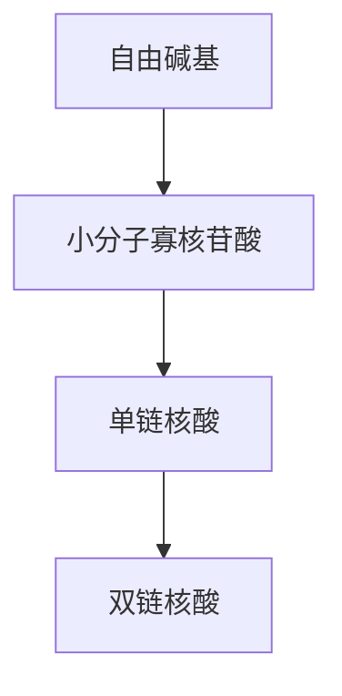

## 参考文献

- Chomczynski P. 1992. One-hour downward alkaline capillary transfer for blotting of DNA and RNA. Anal Biochem 201: 134–139.
- Chomczynski P. 1993. A reagent for the single-step simultaneous isolation of RNA, DNA and proteins from cell and tissue samples. BioTechniques 15: 532–537.
- Chomczynski P, Mackey K. 1995. Short technical reports. Modification of the TRI reagent procedure for isolation of RNA from polysaccharide- and proteoglycan-rich sources. BioTechniques 19: 942–945.
- Chomczynski P, Sacchi N. 1987. Single-step method of RNA isolation by acid guanidinium thiocyanate-phenol-chloroform extraction. Anal Biochem 162: 156–159.
- Gramza AW, Lucas JM, Mountain RE, Schuller DE, Lang JC. 1995. Efficient method for preparing normal and tumor tissue for RNA extraction. BioTechniques 18: 228–231.
- Grillo M, Margolis FL. 1990. Use of reverse transcriptase polymerase chain reaction to monitor expression of intronless genes. BioTechniques 9:262–268.
- Groppe JC, Morse DE. 1993. Isolation of full-length RNA templates for reverse transcription from tissues rich in RNase and proteoglycans. Anal Biochem 210: 337–343.
- Re P, Valhmu WB, Vostrejs M, Howell DS, Fischer SG, Ratcliffe A. 1995. Quantitative polymerase chain reaction assay for aggrecan and link protein gene expression in cartilage. Anal Biochem 225: 356–360.
- Schick BP, Eras J. 1995. Proteoglycans partially co-purify with RNA in TRI Reagent and can be transferred to filters by northern blotting. Bio-Techniques 18: 574–578.
- Weber K, Bolander ME, Sarkar G. 1998. PIG-B: A homemade monophasic cocktail for the extraction of RNA. Mol Biotechnol 9: 73–77.

## 方案 15 从鼠尾或其他小样本中制备基因组 DNA

近年来已经发表了许多从鼠尾中提取基因组 DNA 的方法，所有这些方法都是从 1985 年 Richard Palmiter 和 Ralph Brinster 建立的方法衍生而来的（Palmiter et al. 1985）。Palmiter 的实验室在西雅图，Brinster 的实验室及他的成千上万的老鼠远在 3000 英里 $^{①}$ 外的费城。Brinster 将剪下的小鼠尾尖放置在 SDS 和蛋白酶 K 的溶液中，通过美国邮政邮寄给 Palmiter（因为当时还没有联邦快递）。经过 2～3 天环境温度下的行程后，样品经酚:氯仿抽提、乙醇沉淀后即获得基因组 DNA。这种方法幸运地获得成功，并不需要委托美国邮政系统对小鼠尾巴进行半消化，事实上，更好的消化方法是 55℃ 过夜，中间无需运输。每一个小鼠尾尖可以获得 50～100μg DNA。这样获得的 DNA 可用于斑点杂交或狭线杂交，也可以用于 Southern 杂交检测小于 20kb 的 DNA 片段，更可以方便地作为 PCR 反应的模板。这一简单的实验方案在成百上千的实验室中广泛被用于转基因或基因剔除小鼠的基因型鉴定，以及从小量培养的细胞或组织中提取 DNA。

如果需要从大量的样本中提取 DNA，还有两个替代方案是很有用的。Laird 等（1991）的方法省略了酚:氯仿抽提，而 Thomas 等（1989）和 Couse 等（1994）建立的方法使用商业上运用的凝胶屏障管以排除在连续对有机溶剂抽提时枯燥的样品转移工作。这些替代方案作为备选列于本方案之后。


## 材料

为正确使用本方案中的器材和危险试剂，必须查阅相应的材料安全数据表并咨询所在机构的环境卫生和安全办公室。

本方案的专用试剂标注&lt;R&gt;，配方在本方案末提供。常用储备溶液、缓冲液和试剂标注&lt;A&gt;，配方见附录1。储备溶液应稀释至适用浓度后使用。

## 试剂

乙醇（70%）

异丙醇

<small><span class="docvortex-page-footnote" data-block-type="page_footnote" style="color:#6b7280">① 1 英里=1.609km。</span></small>

## 小鼠尾巴或小鼠组织

鼠尾样品一般从10日龄哺乳期动物或在断奶时(约3周龄)获得。前者一般剪去尾巴末端的1/3放入离心管中；后者在麻醉状态下剪下6～10mm尾巴，放入17mm×100mm的Falcon聚丙烯管中。在极少数必须尽快获得结果的情况下可以将新生小鼠的整条尾巴剪下放入离心管中。

从小鼠组织中（指除鼠尾以外的部分）分离 DNA，需将 100mg 新鲜的组织放入  $17mm \times 100mm$  的 Falcon 聚丙烯管中。

在加入 SNET 和蛋白酶 K 前，鼠尾或其他组织可以存储在密闭的管中，于 -70℃ 放置几个星期。但是最好尽快用蛋白酶 K 消化样品（步骤 1 和 2）。在酚:氯仿抽提前，完全消化的溶液可以在 -20℃ 保存一段时间。

所有在实验小鼠上进行的实验，包括剪鼠尾，都需要事先获得人道主义组织的许可。

酚:氯仿:异戊醇（25:24:1，V/V/V）

磷酸盐缓冲盐水（PBS）&lt;A&gt;，冰冷（可选；见步骤1）

蛋白酶 K（20mg/mL）

```txt
SNET<R>
TE (pH8.0) <A>
```

## 设备

低中速离心机和转子

聚丙烯管（17mm×100mm）

室温和  $4^{\circ}$ C 振荡平台

预设为  $55^{\circ}$ C 的振荡平台或振荡孵箱

Shepherd 氏钩

将巴斯德移液管在本生灯的火焰上封口，并用止血钳将它做成 U 形，即成 Shepherd 氏钩。制作过程中戴上防护眼镜。


## 方法

1. 准备适量的裂解缓冲液（表 1-6），即在 SNET 中加入蛋白酶 K 至终浓度为 $400 \mu \mathrm{g} / \mathrm{mL}$ 。向小鼠尾巴或其他组织中加入裂解缓冲液。

此过程还可以用来从单层培养的哺乳动物细胞中分离 DNA。此时，直接向经 PBS 浸洗 2 次的 100mm 单层细胞中加入 1mL 含 400μg/mL 蛋白酶 K 的 SNET 即可。用橡胶刮棒将黏稠的细胞质从培养皿中刮下，转到 17mm×100mm 的 Falcon 聚丙烯管中。

悬浮细胞通过离心收集，用冰冷的磷酸缓冲盐溶液洗涤两次，重悬于 TE（pH8.0），然后用含 400 μg/mL 蛋白酶 K 的 SNET 裂解（每  $10^{9}$  细胞用 1mL）。

表 1-6 SNET 裂解缓冲液的体积

| 小鼠年龄 | 组织量 | 管子种类 | SNET 裂解液体积/mL |
| --- | --- | --- | --- |
| 新生 | 整条尾巴(1cm) | 微量离心管 | 0.5 |
| 10日龄 | 末端 1/3 | 微量离心管 | 0.5 |
| 断乳期(3~4周龄) | 6~10mm | 聚丙烯管(17mm×100mm) | 4.0 |
| 任意年龄 | 10mg 新鲜组织 | 聚丙烯管(17mm×100mm) | 4.0 |

2. 管子水平放置于振荡平台或振动恒温箱中  $55^{\circ}$ C 过夜。

消化过程中样品的充分混合是非常重要的。过夜消化后，应当看不见任何组织或鼠尾，缓冲液呈灰色乳状液。

3. 加入等体积的酚:氯仿:异戊醇，密封管口，室温下振荡 30min。

在方案的不同阶段用到不同的振动速度。有些方案建议轻轻晃动而不是剧烈振荡；有些认为剧烈振荡可以增加20kb以上DNA片段的产量，可用于Southern杂交或斑点和狭线杂交，以及PCR分析。如果需要大分子质量的DNA，

注意尽量减少剪切力。

4. 通过离心分离有机相和水相。$17\mathrm{mm} \times 100\mathrm{mm}$ 的 Falcon 聚丙烯管中的样品室温下 $666\mathrm{g}$ 离心 $5\mathrm{min}$，对于较小体积的样品，样品置于微量离心管中室温下最大转速离心 $5\mathrm{min}$。转移上层水相至新的 Falcon 管或微量离心管中。

5. 加入等体积的异丙醇沉淀 DNA。通过离心（13 000g）收集沉淀的 DNA（15min，4℃）。

6. 小心地除去异丙醇。用 1mL 70%乙醇冲洗 DNA 沉淀。如果沉淀较松散，再次离心样品 5min。除去 70%的乙醇，室温下空气中干燥沉淀 15～20min。

不要让沉淀完全干燥，否则极难溶解。

7. 加入 0.5mL TE, 4℃下轻柔振荡过夜。

8. 将该溶液转移到微量离心管中，并在室温下存储。

一般 1cm（约 100mg）的鼠尾可以获得 100～250μg 基因组 DNA。

加入浓度为  $100 \mu g/mL$  的小牛血清蛋白可以吸收用这种方法制备的基因组 DNA 中残留的 SDS，从而减少限制性内切核酸酶反应不完全消化的可能。如果问题仍然存在，请重新提取样品，再次用酚:氯仿抽提，并用 2 倍体积的乙醇沉淀 DNA。

## 替代方案 不使用有机溶剂从鼠尾分离 DNA

Laird 等（1991）记述了一种不用酚-氯仿抽提的基因组 DNA 提取方案，也可以用于 24 孔板培养的细胞 DNA 的提取。


## 补充材料

为正确使用本方案中的器材和危险试剂，必须查阅相应的材料安全数据表并咨询所在机构的环境卫生和安全办公室。

本方案的专用试剂标注&lt;R&gt;，配方在本方案末提供。常用储备溶液、缓冲液和试剂标注&lt;A&gt;，配方见附录1。储备溶液应稀释至适用浓度后使用。

## 试剂

鼠尾裂解缓冲液 I&lt;R&gt;


## 方法

1. 向离心管中加入鼠尾裂解缓冲液 I，每 1cm 的鼠尾加入 0.5mL 裂解液。

2. 按照方案 15 中步骤 2 所述, $55^{\circ} \mathrm{C}$ 消化组织。

3. 剧烈振荡被消化的样品，室温下以最大速度离心 10min 以沉淀未消化的组织。

4. 室温将上清转移到一个新的含有 $0.5 \mathrm{~mL}$ 异丙醇的离心管中, 颠倒混匀。

5. 用干净的一次性微量移液管尖或 Shepherd 氏钩捞出沉淀的 DNA。将 DNA 暂时置于 Kimwipe 吸水纸以除去多余的乙醇，然后将 DNA 转移到新的离心管中。

6. 打开管口，置于架子上直到剩余的乙醇挥发干净。

7. 将 DNA 溶解于 200\~500μL 的 TE (pH8.0)，4℃轻柔振荡过夜。

DNA 产量可达到  $5 \sim 12 \mu g/mm$  鼠尾。

# 替代方案 一管法从鼠尾中分离 DNA

Couse 等（1994）记述了一种建立在早期 Thomas 等（1989）工作基础上的方法，可用于利用有机溶剂从鼠尾中连续抽提 DNA；对于 24 孔板培养的哺乳动物细胞可采用同样的方法。连续抽提需要将水相转移到新的管中，这是一个费时又枯燥的工作。使用 Becton Dickinson 公司出售的血清分离管（SST）可以克服这一弊端。这种管子由玻璃制成，底部有一内置凝胶栓和一个硅胶塞。离心时，凝胶栓转移到有机相顶部，俘获下面的细胞蛋白和残余的组织，而水相则留在凝胶栓的上层。因为离心时凝胶栓总是移动于有机相和水相之间，因此有机相的抽提可以在同一个 SST 中进行。


## 补充材料

为正确使用本方案中的器材和危险试剂，必须查阅相应的材料安全数据表并咨询所在机构的环境卫生和安全办公室。

本方案的专用试剂标注&lt;R&gt;，配方在本方案末提供。常用储备溶液、缓冲液和试剂标注&lt;A&gt;，配方见附录1。储备溶液应稀释至适用浓度后使用。

试剂

乙醇

氯仿

鼠尾裂解缓冲液 II&lt;R&gt;

乙酸钠（3mol/L，pH6.0）

设备

SST 管（Becton Dickinson）


## 方法

1. 向离心管中加入鼠尾裂解缓冲液 II，每 1cm 的鼠尾加入 0.5mL 裂解液。

2. 按照方案 15 中步骤 2 所述, $55^{\circ} \mathrm{C}$ 消化组织。

3. 向管中加入 1mL 酚:氯仿:异戊醇，轻柔颠倒彻底混匀。

4. 室温 $2000\mathrm{g}$ 在摇摆转子中离心 $10\mathrm{min}$ 。如果水相仍然浑浊或者蛋白层留在凝胶栓上层，则再次离心。

5. 同一试管中，加入 1mL 氯仿，如步骤 4 所述再次离心。

6. 将凝胶栓上部的水相转移至 2 个已经加入 $50 \mu \mathrm{L}$ 乙酸钠（$3 \mathrm{~mol} / \mathrm{L}$，$\mathrm{pH} 6.0$）的微量离心管中，每份 $450 \mu \mathrm{L}$。

使用 pH6.0 而不是 pH5.2 的乙酸钠，这是很少见的。裂解缓冲液中 EDTA 浓度高达 100mmol/L，在很低的 pH 下极易沉淀，避免这一问题的办法在于保持 pH>6.0，并且在进行步骤 6 和 7 时要动作迅速。另外，裂解缓冲液中的 EDTA 浓度可以减至 20mmol/L，但是这样有可能不足以螯合样品中的  $Mg^{2+}$ ，使 DNA 易受到 DNase 的降解。

7. 室温下，每管中加入 2 倍体积的乙醇（0.9mL），迅速颠倒混匀，室温下立即用最大速度离心 5min。

8. 用 $70\%$ 的乙醇洗涤，离心沉淀。抽吸除去乙醇溶液，敞开管口置于架子上直至剩余的乙醇挥发干净。

9. 将 DNA 溶解于  $250 \mu L$  的 TE（pH8.0）， $4^{\circ} C$  轻柔振荡过夜。

DNA 产量通常为  $10 \mu g/mm$  鼠尾。


## 配方

为正确使用本方案中的器材和危险试剂，必须查阅相应的材料安全数据表并咨询所在机构的环境卫生和安全办公室。

鼠尾裂解缓冲液Ⅰ

| 试剂 | 用量(每100mL) | 终浓度 |
| --- | --- | --- |
| Tris-Cl(1mol/L,pH8.5) | 10mL | 100mmol/L |
| EDTA(0.5mol/L) | 1mL | 5mmol/L |
| NaCl(5mol/L) | 4mL | 200mmol/L |
| SDS(20%,m/V) | 1mL | 0.2%(m/V) |
| 蛋白酶K |  | 100μg/mL |

鼠尾裂解缓冲液Ⅱ

| 试剂 | 用量(每100mL) | 终浓度 |
| --- | --- | --- |
| Tris-Cl(1mol/L,pH8.0) | 5mL | 50mmol/L |
| EDTA(0.5mol/L) | 10mL | 50mmol/L |
| SDS(20%,m/V) | 625μL | 0.125%(m/V) |
| 蛋白酶K |  | 800μg/mL |

SNET

| 试剂 | 终浓度 |
| --- | --- |
| Tris-Cl(pH8.0) | 20mmol/L |
| EDTA(pH8.0) | 5mmol/L |
| NaCl | 400mmol/L |
| SDS | 1%(m/V) |

用  $0.45 \mu m$  硝酸纤维素滤膜过滤溶液以灭菌。将无菌的溶液按每份 50 mL 分装，室温下保存。

## 参考文献

Couse JF, Davis VL, Tally WC, Korach KS. 1994. An improved method of genomic DNA extraction for screening transgenic mice. BioTechniques 17: 1030–1032.

Laird PW, Zijderveld A, Linders K, Rudnicki MA, Jaenisch R, Berns A. 1991. Simplified mammalian DNA isolation procedure. Nucleic Acids Res 19: 4293. doi: 10.1093/nar/19.15.4293.

Palmiter RD, Chen HY, Messing A, Brinster RL. 1985. SV40 enhancer and large-T antigen are instrumental in development of choroid plexus tumours in transgenic mice. Nature 316: 457–460.

Thomas SM, Moreno RF, Tilzer LL. 1989. DNA extraction with organic solvents in gel barrier tubes. Nucleic Acids Res 17: 5411. doi:10.1093/nar/17.13.5411.

## 方案 16 快速分离酵母 DNA

此方法用于分离酵母基因组 DNA 或在 E.coli 和 Saccharomyces cerevisiae（酿酒酵母）中均能复制的穿梭质粒。


## 材料

为正确使用本方案中的器材和危险试剂，必须查阅相应的材料安全数据表并咨询所在机构的环境卫生和安全办公室。

本方案的专用试剂标注&lt;R&gt;，配方在本方案末提供。常用储备溶液、缓冲液和试剂标注&lt;A&gt;，配方见附录1。储备溶液应稀释至适用浓度后使用。

## 试剂

乙醇（70%，95%）

酚:氯仿（1:1，V/V）

乙酸钠（3mol/L，pH 5.2）

STES 缓冲液&lt;R&gt;

TE (pH 7.6) &lt;A&gt;

新鲜的琼脂平板培养的克隆或液体的过夜培养的酵母细胞

## 设备

酸洗过的玻璃珠（直径为 0.4mm）

无菌接种环（可选；见步骤1）


## 方法

1. 准备用于裂解的酵母细胞。

## 平板培养的酵母克隆

i. 用无菌接种环将一个或几个大的、新鲜培养的克隆转移到加有 $50\mu \mathrm{L}$ STES缓冲液的微量离心管中。

## 液体培养的酵母

i. 将过夜培养的 1.5mL 酵母细胞转移到离心管。
ii. 室温下在以最大速度离心 1min，收集沉淀下来的细胞。
iii. 吸去培养介质，将细胞重悬于  $50 \mu L$  STES 缓冲液中。

2. 每个离心管中加入 $50 \mu \mathrm{L}$ 酸洗过的玻璃珠。每管加入 $20 \mu \mathrm{L} \mathrm{TE} (\mathrm{pH} 7.6)$ 。
3. 加入 $60 \mu \mathrm{L}$ 的酚:氯仿，紧紧盖上盖子，涡旋 $1 \mathrm{~min}$ 混合有机相和水相。
4. 室温下在以最大速度离心 5min。
5. 上层水相转移至新的微量离心管中。按照标准方法  $0^{\circ}$ C 下用乙醇沉淀 5min 以收集 DNA。
6.  $4^{\circ}$ C下最大转速离心10min收集核酸沉淀。
7. 吸去上清，用  $100 \mu L$  70% 的乙醇洗涤沉淀。用最大转速室温下离心 1 min。
8. 吸去上清，空气中干燥 15min，将沉淀溶于 40μL TE（pH 7.6）。

使用  $1 \sim 10 \mu L$  DNA 溶液作为 PCR 反应的模板。穿梭质粒可通过  $1 \mu L$  DNA 转化 E.coli 的感受态再次获得。


## 配方

为正确使用本方案中的器材和危险试剂，必须查阅相应的材料安全数据表并咨询所在机构的环境卫生和安全办公室。

STES 缓冲液

| 试剂 | 终浓度 |
| --- | --- |
| Tris-Cl(pH7.6) | 0.2mol/L |
| NaCl | 0.5mol/L |
| SDS | 0.1%(m/V) |
| EDTA(pH8.0) | 0.01mol/L |

室温下保存。

## 方案 17 微型凝胶电泳后使用溴化乙锭（EB）估算条带中 DNA 数量

此简便方案概述了一个快速定量 DNA 的方法，并同时分析其物理状态。溴化乙锭染色后，用 UV 灯照射透视法可以发现包含>5ng DNA 的 DNA 条带。CCD 照相机拍下未知样品的影像，然后与一系列已知含量标准品进行强度（灰度）对比，从而估计未知样品中 DNA 的含量。染色凝胶分析是一种快速的同时测量 DNA 的数量并分析其物理状态的方式。

SYBR 染料也可用于染色并大致确定凝胶条带中 DNA 的含量。然而，不同于溴化乙锭，SYBR 染料只能用于电泳后染色。通常情况下，凝胶需浸入含有染料在溶液中至少 1h，这给实验者造成不方便。

有关进一步详情，请参阅本章导言中“DNA 定量”的部分。


## 材料

为正确使用本方案中的器材和危险试剂，必须查阅相应的材料安全数据表并咨询所在机构的环境卫生和安全办公室。

本方案的专用试剂标注&lt;R&gt;，配方在本方案末提供。常用储备溶液、缓冲液和试剂标注&lt;A&gt;，配方见附录1。储备溶液应稀释至适用浓度后使用。

## 试剂

含溴化乙锭（0.5μg/mL）的微型琼脂糖凝胶（0.6%）

DNA 样品

DNA 标准品（见步骤 2）

电泳缓冲液（通常为  $1 \times TAE < A$  或  $0.5 \times TBE < A$ ）

凝胶上样缓冲液 IV&lt;A&gt;

$\mathrm{MgCl_{2}(1.0mol/L)}$

## 设备

琼脂糖凝胶电泳设备（见第2章，方案1）

清洁、干燥的包含梳子和槽的电泳设备

凝胶短波紫外光照射下拍摄设备

能提供 500V/200mA 的电源设备


## 方法

1. 将 $2 \mathrm{~mL}$ DNA 样品与 $0.4 \mathrm{~mL}$ 上样缓冲液 IV 混合，注入含溴化乙锭（$0.5 \mu \mathrm{g} / \mathrm{mL}$）的微型琼脂糖凝胶（$0.6\%$）狭槽中。
2. 将一系列 2 mL DNA 标准品（0、2.5mg/mL、5mg/mL、10mg/mL、20mg/mL、30mg/mL、40mg/mL 和 50mg/mL）与 0.4 mL 上样缓冲液 IV 混合，同样注入凝胶孔中。

此标准品应能在-20℃下稳定保存数月。

3. 进行电泳，直至溴酚蓝迁移 1\~2cm。

4. 凝胶放入含有  $0.01 \, mol/L \, MgCl_{2}$  的电泳缓冲液浸泡 5min 脱色。

5. 在短波紫外光照射下给凝胶拍照。对比标准品的荧光强度估计未知 DNA 的浓度。

DNA 样品中可能存在的污染物可以增强或猝灭荧光。为避免出现问题，DNA 样品和标准品可以被置于含溴化乙锭（0.5mg/mL）或 SYBR Green I 的 1% 板式琼脂糖凝胶上。让凝胶站立数小时从而污染的小分子可以弥散开去。然后拍照，如上所述。

## 方案 18 利用 Hoechst 33258 通过荧光分析仪估算 DNA 浓度

用荧光分析仪测定 DNA 的浓度比用分光光度法更敏感，可检测到纳克级的 DNA。在本方法中，已知浓度和未知浓度的 DNA 样品与荧光染料 Hoechst 33258 温育。通过未知浓度样品的吸收值与已知样品的系列浓度的吸光值比较可以估计待测样品的浓度（Labarca and Paigen 1980；Daxhelet et al. 1989）。以下方案修改自 Held（2001）。

## 关于 Hoechst 33258

- 自由溶液中的 Hoechst 33258 的最大激发波长为 356nm，最大发射波长为 492nm。然而，当与 DNA 结合后，Hoechst 33258 的最大激发波长为 365nm，最大发射波长为 458nm（Cesarone et al. 1979, 1980）。
- 使用 Hoechst 33258 荧光检测无法在极端 pH 环境下进行，并同时受清洁剂和盐的影响（Van Lancker and Gheyssens 1986）。因此，检测通常在标准条件下（0.2 mol/L NaCl, 10mmol/L EDTA, pH7.4）。然而，单链和双链 DNA 及 RNA 要求两个不同的盐浓度以区分开来。用一组一定范围的 DNA（0～20mg/mL）绘制标准曲线从而估计未知样品中 DNA 的浓度，这组 DNA 的基本组成与未知样品的组成相同。DNA 必须是超高分子质量，因为 Hoechst 33258 无法有效结合小片段 DNA。测量必须在一个固定的波长的荧光计中快速进行，以尽量减少光漂白及由于温度变化导致的荧光变化。
- 参与反应的 Hoechst 33258 的浓度应保持在较低水平（$5 \times 10^{-7} \mathrm{~mol/L} \sim 2.5 \times 10^{-6} \mathrm{~mol/L}$），因为当染料与 DNA 的比例高时会发生荧光猝灭（Stokke and Steen 1985）。然而，有时两种浓度的染料又用于扩大检测的动态范围。
- 所有的 DNA 和溶液都不能含有溴化乙锭，因为它将使 Hoechst 33258 的荧光猝灭。但是，由于 Hoechst3 3258 对蛋白质或 rRNA 几乎没有亲和力，测量可以使用细胞裂解物或纯化的 DNA 制剂（Cesarone et al. 1979；Labarca and Paigen 1980）。
- 与溴化乙锭不同，Hoechst 染料是细胞渗透物。


## 材料

为正确使用本方案中的器材和危险试剂，必须查阅相应的材料安全数据表并咨询所在机构的环境卫生和安全办公室。

## 试剂

用于构建标准曲线的已知浓度的 DNA 溶液

因为 Hoechst 33258 荧光染料与 DNA 的结合受基本组成的影响，所以用于构建标准曲线的 DNA 应该与要测试的样品来自同一物种。

荧光缓冲液

2 mol/L NaCl

50mmol/L 磷酸钠（pH7.4）

准备 500mL 溶液并用 0.45μm 过滤器滤过消毒

高分子质量（或基准）的 DNA 溶液（100 mg/mL 溶于 TE，pH 8.0）

Hoechst 33258 荧光染料（1mg/mL，水溶）

染料的浓溶液可在室温下保存于箔包裹的试管中。

待测 DNA 样本

## 设备

低荧光背景，黑色，U形，96孔B显微荧光板（Dynatech Laboratories）

读板器（Dynatech、Tecan、Biotek 公司等）


## 方法

1. 实验前 1h 将荧光计开关打开，使机器预热并稳定。

与高分子质量双链 DNA 结合后，Hoechst 33258 染料的吸光值在 365nm 达到最大，发射光值在 458nm 达到最大。

2. 准备适量的稀释染料溶液（每 1mL 荧光缓冲液加入  $10 \mu L$  染料浓缩液）。DNA 分析中每个孔需加入  $100 \mu L$  稀释的 Hoechst 33258 染料。将  $100 \mu L$  稀释好的 Hoechst 33258 染料加入适当数量的孔中，包括 6 个额外的孔由于空白对照和制作标准曲线。

3. 将一组已知含量的 DNA（例如，0、50ng/孔、100ng/孔、200ng/孔、500ng/孔、1000ng/孔）作为基准 DNA 溶液加入到一组孔中，每孔  $10 \mu L$ ，从而产生一组标准值用于绘制标准曲线。加完最后一孔后立即混匀并在预热的荧光计上读出荧光值。

4. 减去空白，并建立标准曲线，纵坐标为荧光值（y 轴），横坐标为基准 DNA 重量（ng）（x 轴）。轨迹应该随测定的 DNA 的量呈线性增加。

因为剂量-效应的线性相关是基于染料多于 DNA，所以当 DNA 浓度变高时曲线的斜率开始减小，并最终变平。线性范围可以通过增加或减少检测使用的染料的浓度来向上或向下延伸。一个多项式描述的校准曲线的线性部分的回归分析可以被用来确定未知样品的 DNA 浓度。

5. 读取未知（测试）的 DNA 样品的稀释液的吸光度。

i. 10 倍稀释待测 DNA。

ii. 各稀释液各加  $10 \mu L$  至不同的含稀释后染料的孔中，立即读取荧光值。

iii. 利用标准曲线的线性部分估计未知样品中的 DNA 浓度。

iv. 如果未知的基因组 DNA 溶液的读数为超出的标准曲线，则读取更浓缩的样品的荧光，或进行适当的稀释样本并重复检测。

极端 pH、接近或超过临界分子浓度的去垢剂、超过 3mol/L 的盐浓度对与 Hoechst 33258 结合均有不利影响。如果以上条件或试剂用于制备基因组 DNA，则用荧光分析不可能得到结果。可用乙醇沉淀 DNA，用 70% 乙醇漂洗沉淀溶于 TE后重复上述分析。

如果待测的 DNA 高度黏滞，用标准黄色尖头取样也许不够精确，使得待测 DNA 的稀释度与标准曲线不同。在这种情况下，最好的解决办法是用装备尖头切断的黄色尖头的自动移液器吸取 2 份样品（10～20μL）。每份样品用约 0.5 mL TE 稀释并剧烈振荡 1～2min。不同量的稀释样品可被转移到含有稀释染料溶液的孔中，从两套样品得到的数据应该保持一致。消毒的，大口径的尖头可以从一些商业公司（如 Bio-Rad 公司）购买。

本分析可用于检测分子质量大于 1kb 的 DNA 浓度。Hoechst 33258 与更小分子的 DNA 结合能力较差。

## 参考文献

- Cesarone CF, Bolognesi C, Santi L. 1979. Improved microfluorometric DNA determination in biological material using 33258 Hoechst. Anal Biochem 100: 188–197.
- Cesarone CF, Bolognesi C, Santi L. 1980. Fluorometric DNA assay at nanogram levels in biological material. Boll Soc Ital Biol Sper 56: 1666–1672.
- Daxhelet GA, Coene MM, Hoet PP, Cocito CG. 1989. Spectrofluorometry of dyes with DNAs of different base composition and conformation. Anal Biochem 179: 401–403.

Held PG. 2001. Increasing the DNA quantitation range when using Hoechst dye 33258. BioTek Instruments, Winooski, VT. http://www.biotek.com/resources/articles/dna-hoechst-dye-33258.html.

Labarca C, Paigen K. 1980. A simple, rapid, and sensitive DNA assay procedure. Anal Biochem 102: 344–352.

Stokke T, Steen HB. 1985. Multiple binding modes for Hoechst 33258 to DNA. J Histochem Cytochem 33: 333–338.

Van Lancker M, Gheyssens H. 1986. A comparison of four frequently-used assays for quantitative determination of DNA. Anal Lett 19: 615–623.

## 方案 19 用 PicoGreen 定量溶液中的 DNA

不像基于 Hoechst 染料的分析，仅用单个浓度的 PicoGreen 可在 4 个数量级范围内与 DNA 浓度呈现线性关系，从 1ng/mL 到 1 $\mu$ g/mL。该方法使用手持型荧光计即可完成。


## 材料

为正确使用本方案中的器材和危险试剂，必须查阅相应的材料安全数据表并咨询所在机构的环境卫生和安全办公室。

本方案的专用试剂标注&lt;R&gt;，配方在本方案末提供。常用储备溶液、缓冲液和试剂标注&lt;A&gt;，配方见附录1。储备溶液应稀释至适用浓度后使用。

## 试剂

PicoGreen dsDNA 定量试剂（Life Technologies 公司）

提供的此试剂为溶于无水二甲亚砜（DMSO）的浓溶液，并且必须使用实验当天新鲜稀释液（1:200 稀释于 TE 中，pH 7.5）。用铝箔包裹工作液。

DNA 标准品（如小牛胸腺 DNA），浓度为  $2 \mu g/mL$  溶于 TE（pH7.5）

TE (pH7.5)

待测 DNA 样本

## 设备

甲基丙烯酸酯荧光比色皿（10mm×10mm）

带蓝色荧光装置的 PicoFluometer 荧光计（例如，PicoFluor 手持荧光计；Applied Biosystems）


## 方法

1. 生成的标准曲线，如下所示。稀释 0、1μL、10μL、100μL、500μL、1000μL 的 DNA 标准品至一组甲基丙烯酸酯荧光比色皿中，通过添加适量的 TE，将每个比色皿中的流体的体积调节至 1 mL。
2. 每个皿添加 $1 \mathrm{~mL}$ 水稀释的 PicoGreen 试剂。用手持荧光计依次测量每个样品的荧光。
为了尽量减少漂白效果，样品应暴露在荧光计紫外线下相同时间。
3. 减去空白，并建立标准曲线:纵坐标上绘制荧光（y 轴），横坐标为参考 DNA 重量（ng）（x 轴）。轨迹应该随测定的 DNA 的量呈线性增加。
4. 加入已知体积的待测 DNA 样品，调节总体积至 1 mL。设置一个空白的比色皿，含 1 mL 的 TE，并没有 DNA。重复步骤 2 和 3。
5. 利用标准曲线的线性部分估计未知样品中的 DNA 浓度。

## 信息栏


## 从石蜡包埋的甲醛固定组织中提取 DNA

甲醛固定保存的组织经常被用于人类遗传性疾病和恶性肿瘤突变鉴定的一种 DNA 资源，部分原因是因为组织样品是外科手术中收集经过固定、染色后由病理学家保存的。据估计，美国至少有 4 亿石蜡包埋组织样本，而且这个数字还在以每年超过 2000 万块的速度增长。

不幸的是,病理实验室中使用的常规固定剂(福尔马林)会对从固定组织中回收 DNA 的质量造成不利影响。商业化福尔马林每 1000g 溶液中含有 370\~400g 甲醛。甲醛（福尔马林的活性成分）以单羟甲基形式加合到 DNA 碱基上，通过水解 DNA 的 N-糖苷键在 DNA 上产生嘌呤和吡啶位点，还可缓慢水解磷酸二酯键，产生 DNA 碎片。DNA 暴露于福尔马林（特别是在整个 20 世纪常规使用的无缓冲福尔马林）导致的损伤和断裂是决定提取的 DNA 是否符合要求的主要因素。之前描述了几个基于 PCR 的用于测定提取的 DNA 质量的方法（例如，Siwoski et al. 2002；Swango et al. 2006）。

尽管已经有些发表的文章比较了不同的从石蜡块中提取 DNA 的方法（见 Sepp et al. 1994），然而，根据我们的经验，最好是使用市售试剂盒从石蜡包埋组织提取 DNA。常规脱蜡后用二甲苯或商业产品，例如 QIAamp DNA Mini Kit (QIAGEN)、BiOstic FFPE Tissue DNA Isolation Kit (MO BIO Laboratories)，或 QuickExtract FFPE DNA Extraction Kit (Epicentre Biotechnologies/Illumina)，DNA 可以被提取出来。

使用试剂盒，甚至可以从固定了长达17年的组织中成功提取出DNA。已经有报道其他研究者从更老的石蜡块中分离DNA。但是，提取的DNA往往是高度退化，尤其是当组织在包埋前被非缓冲福尔马林固定了很长一段时间（如 $12\sim 24\mathrm{h}$）。在一般情况下，从石蜡包埋的甲醛固定组织中提取的DNA只能用于PCR模板，而且扩增片段大小少于120碱基。虽然得率低于微克级别，但DNA足以用于基于阵列的分析，例如，Illumina的基于SNP的杂合性丢失分析（Barker et al. 2004; Lips et al. 2005; Oosting et al. 2007），或者用于分析肿瘤细胞中DNA启动子突变的Sequenom's OncoCarta系统（McConnaill et al. 2009）。

## 参考文献

- Barker DL, Hansen MS, Faruqi AF, Giannola D, Irsula OR, Lasken RS, Latterich M, Makarov V, Oliphant A, Pinter JH, et al. 2004. Two methods of whole-genome amplification enable accurate genotyping across a 2320-SNP linkage panel. Genome Res 14: 901–907.
- Lips EH, Dierssen JW, van Eijk R, Oosting J, Eilers PH, Tollenaar RA, de Graaf EJ, van't Slot R, Wijmenga C, Morreau H, et al. 2005. Reliable high-throughput genotyping and loss-of-heterozygosity detection in formalin-fixed, paraffin-embedded tumors using single nucleotide polymorphism arrays. Cancer Res 65: 10188–10191.
- McConnaill LE, Campbell CD, Kehoe SM, Bass AJ, Hatton C, Niu L, Davis M, Yao K, Hanna M, Mondal C, et al. 2009. Profiling critical cancer gene mutations in clinical tumor samples. PLoS ONE 4: e7887. doi:10.1371/journal.pone.0007887.
- Oosting J, Lips EH, van Eijk R, Eilers PH, Szuhai K, Wijmenga C, Morreau H, van Wezel T. 2007. High-resolution copy number analysis of paraffin-embedded archival tissue using SNP BeadArrays. Genome Res 17: 368–376.
- Sepp R, Szabo I, Uda H, Sakamoto H. 1994. Rapid techniques for DNA extraction from routinely processed archival tissue for use in PCR. J Clin Pathol 47: 318–323.
- Siwoski A, Ishkanian A, Garnis C, Zhang L, Rosin M, Lam WL. 2002. An efficient method for the assessment of DNA quality of archival micro-dissected specimens. Mod Pathol 15: 889–892.
- Swango KL, Timken MD, Chong MD, Buoncristiani MR. 2006. A quantitative PCR assay for the assessment of DNA degradation in forensic samples. Forensic Sci Int 158: 14–26.


## 聚乙二醇

聚乙二醇（PEG）是一个简单的重复单元  $\mathrm{H}(\mathrm{OCH}_{2}\mathrm{CH}_{2})_{n}\mathrm{OH}$  的直链聚合物。PEG 有一定范围的分子质量，其名称反映了每个分子的重复单位数（n），如 PEG400， $n=8\sim9$ ；PEG4000，n 为 68～84。

PEG 可诱导水溶液中的大分子的聚集（Zimmerman and Minton 1993），在分子克隆中有很多用途，包括:

- 按分子大小沉淀 DNA。沉淀所需 PEG 浓度与 DNA 片段的大小成反比（Lis and Schleif 1975a, b; Ogata and Gilbert 1977; Lis 1980）。室温下，同时存在 10mmol/L MgCl₂ 时经聚乙二醇（PEG）沉淀 DNA 的效率最高（Paithankar and Prasad 1991）。在这种条件下，PEG 沉淀的效率接近乙醇。长链状和环状 DNA 都能有效沉淀；但是，小于 150bp 的链状 DNA 无法用 PEG/MgCl₂ 量化沉淀。
- 沉淀和纯化噬菌体颗粒。见 Yamamoto 等（1970）。
- 杂交、DNA 分子平端连接和用 T4 多聚核酸激酶进行 DNA 末端标记时，增加互补核酸链的结合效率。见 Zimmerman 和 Minton（1993）。
- 培养细胞原生质与细菌的融合。见 Schaffner(1980)及 Rassoulzadegane 等(1982)。

## 参考文献

- Lis JT. 1980. Fractionation of DNA fragments by polyethylene glycol induced precipitation. Methods Enzymol 65: 347–353.
- Lis JT, Schleif R. 1975a. The regulatory region of the L-arabinose operon: Its isolation on a 1000 base-pair fragment from DNA heteroduplexes. J Mol Biol 95: 409–416.
- Lis JT, Schleif R. 1975b. Size fractionation of double-stranded DNA by precipitation with polyethylene glycol. Nucleic Acids Res 2: 383–389.
- Ogata R, Gilbert W. 1977. Contacts between the lac repressor and the thymines in the lac operator. Proc Natl Acad Sci 74: 4973–4976.
- Paithankar KR, Prasad KS. 1991. Precipitation of DNA by polyethylene glycol and ethanol. Nucleic Acids Res 19: 1346. doi: 10.1093/nar/19.6.1346.
- Rassoulzadegan M, Binetruy B, Cuzin F. 1982. High frequency of gene transfer after fusion between bacteria and eukaryotic cells. Nature 295: 257–259.
- Schaffner W. 1980. Direct transfer of cloned genes from bacteria to mammalian cells. Proc Natl Acad Sci 77: 2163–2167.
- Yamamoto KR, Alberts BM, Benzinger R, Lawhorne L, Treiber G. 1970. Rapid bacteriophage sedimentation in the presence of polyethylene glycol and its application to large-scale virus purification. Virology 40: 734–744.
- Zimmerman SB, Minton AP. 1993. Macromolecular crowding: Biochemical, biophysical, and physiological consequences. Annu Rev Biophys Biomol Struct 22: 27–65.


## α-互补

α-互补是指 E.coli β-半乳糖苷酶的两个无活性片段组合而成一个功能完整的酶的过程。删去 lacZ 基因中编码起始甲硫氨酸的 5' 区，翻译将从下游的甲硫氨酸开始，从而产生酶的 C 端片段（ω或α受体片段）。N 端片段（α供体片段）也可以通过对结构基因进行删除或突变的手段来实现。α供体和ω受体片段都没有酶活性，但两者结合后可形成在细胞和体外都能显示活性的β-半乳糖苷酶（Ullmann et al. 1967）。长度不一的很多α供体片段都可完成α-互补。最小的α供体是 3～41 位氨基酸组成的肽段（Langley et al. 1975；Zabin 1982；Weinstock et al. 1983；Henderson et al. 1986）。

很多质粒载体都含有 $E.coli$ $\beta$-半乳糖苷酶的前146个氨基酸的编码序列及其调控序列。在编码序列中包含着保持读框的多克隆位点，会在酶的N端引入少量不影响酶活性的氨基酸。这类质粒载体通常用于能够表达 $\beta$-半乳糖苷酶C端片段的宿主细胞。大多数用于 $\alpha$-互补的菌种，$\omega$ 片段由缺失突变体lacZΔM15编码，突变体缺失了 $\beta$-半乳糖苷酶基因的 $11\sim 41$ 位密码子（Ullmann and Perrin 1970）。这一突变基因通常由F'质粒携带。

尽管宿主编码和质粒编码的片段本身没有活性，但两者结合后即成为有活性的酶蛋白。此种类型的互补，即lacZ基因操纵子近端区段的缺失突变被含有完整操纵子近端区段的β-半乳糖苷酶阴性突变体所互补，称为α-互补（Ullmann et al. 1967）。来自α-互补的lac⁺菌很容易识别，它们在含有X-Gal的培养基中形成蓝色菌落（Horwitz et al. 1964; Davies and Jacob 1968；请见信息栏“X-Gal”）。但如果外源DNA片段插入到多克隆位点，将无一例外地导致不具有α-互补功能的N端片段的产生带有重组质粒的细菌形成白色菌落。这个简单的颜色实验给重组子的鉴定带来了极大方便。从成百上千的转化克隆中可以很容易地挑出携带重组质粒的白色克隆。这些重组子的结构可以通过限制性酶切或其他方法进一步分析。

用 $\alpha$ -互补筛选尽管十分可靠，但也不是万无一失。

- 外源DNA的插入并非总是造成α-片段的互补活性丧失。如果DNA片段很小(<100bp)，并在插入后不能破坏读码框及α-片段的结构，α-互补就不会受到严重影响。有些这样的例子被报道，但毕竟少见，仅仅对于遇到这类问题的研究者是有意义的。
- 并非所有的白色克隆都带有重组质粒。lac 序列的突变或丢失也会使质粒丧失表达α片段的能力。然而，在实践中这不会成为问题。因为在质粒群体中 lac 突变体的数量总是比连接反应中重组质粒的数量少得多。

α-互补的常用菌株并不产生明显数量的 lac 抑制基因。因此，一般不需要诱导ω和α片段的合成来进行菌落的组织化学分析。如有必要，用 IPTG 可充分诱导两种片段的合成。IPTG 是非发酵性乳糖类似物，具有失活 lacZ 抑制的功能（Barkley and Bourgeois 1978）。

## 参考文献

- Barkley MD, Bourgeois S. 1978. Repressor recognition of operator and effectors. In The operon (ed Reznikoff WS, Miller JH), pp. 177–220. Cold Spring Harbor Laboratory, Cold Spring Harbor, NY.
- Davies J, Jacob F. 1968. Genetic mapping of the regulator and operator genes of the lac operon. J Mol Biol 36: 413–417.
- Henderson DR, Friedman SB, Harris JD, Manning WB, Zoccoli MA. 1986. CEDIA, a new homogeneous immunoassay system. Clin Chem 32:1637–1641.
- Horwitz JP, Chua J, Curby RJ, Tomson AJ, Daroooge MA, Fisher BE, Mauricio J, Klundt I. 1964. Substrates for cytochemical demonstration of enzyme activity. I. Some substituted 3-indolyl-β-D-glycopyranosides. J Med Chem 7: 574–575.
- Langley KE, Villarejo MR, Fowler AV, Zamenhof PJ, Zabin I. 1975. Molecular basis of β-galactosidase α-complementation. Proc Natl Acad Sci

72:1254-1257.

- Ullmann A, Perrin D. 1970. Complementation in β-galactosidase. In The lactose operon (ed Zipser D, Beckwith JR), pp. 143–172. Cold Spring Harbor Laboratory, Cold Spring Harbor, NY.
- Ullmann A, Jacob F, Monod J. 1967. Characterization by in vitro complementation of a peptide corresponding to an operator-proximal segment of the β-galactosidase structural gene of Escherichia coli. J Mol Biol 24: 339–343.
- Weinstock GM, Berman ML, Silhavy TJ. 1983. Chimeric genetics with  $\beta$ -galactosidase. In Expression of cloned genes in prokaryotic and eukaryotic cells (gene amplification and analysis) (ed Papas TS, et al.), pp. 27–64. Elsevier, New York.
- Zabin I. 1982. β-Galactosidase α-complementation. A model of protein-protein interaction. Mol Cell Biochem 49: 87–96.


## X-Gal

E.coli 产生的β-半乳糖苷酶催化二糖乳糖水解为单糖——葡萄糖和半乳糖。该酶活性可以用诸如 X-Gal（5-溴-4-氢-3-吲哚-β-D-半乳糖苷）等显色底物加以检测，β-半乳糖苷酶可将 X-Gal 转变为不溶性的深蓝色沉淀（Horwitz et al. 1964; Davies and Jacob 1968）。

这一发现是在1967年。当时在巴斯德研究所工作的Julian Davies试图寻找一种非损伤性组织化学染料，以帮助他鉴别 $lac^{+}$ 和 $lac^{-}$ 的克隆。这需要找到一种能够被β-半乳糖苷酶特异地水解为有色产物的显色底物，而且是非扩散性和无毒性的。Davies高兴地发现苯基-β-半乳糖苷可以产生满意的显色反应，但不太理想的是其转化物质硝基苯毒性较大，可杀死他要鉴定的所有细胞。可以理解，Davies——一个健谈的威尔士人，发现这种状况后多少有点灰心。他向实验室的参观者Mel Cohn诉说他的沮丧，Mel Cohn幸运地想起曾读到Horwitz及其同事一起撰写的一篇短文，介绍了将二卤代吲哚类化合物用作β-半乳糖苷酶的组织染料（Horwitz et al. 1964）。Davies说服巴斯德研究所的人去买一些X-Gal。在当时，X-Gal尚未商品化，预约合成的费用高达每克1000美元。经过充分讨论后，X-Gal被预约合成，拿到了研究所。除了非常敏感和没有毒性外，X-Gal还被证明是一种绝妙的组织染色剂，可以在所有表达β-半乳糖苷酶的植物和动物组织上产生出漂亮的画面。当Jacques Monod第一次看到由菌落产生的鲜明的蓝色时，他赞叹道这说明E.coli是世界上最有智慧的生物。

## 参考文献

Davies J, Jacob F. 1968. Genetic mapping of the regulator and operator genes of the lac operon. J Mol Biol 36: 413–417.

Horwitz JP, Chua J, Curby RJ, Tomson AJ, Darooge MA, Fisher BE, Mauricio J, Klundt I. 1964. Substrates for cytochemical demonstration of enzyme activity. I. Some substituted 3-indolyl-β-D-glycopyranosides. J Med Chem 7: 574–575.


## 尽量降低对高分子质量 DNA 的损伤

高分子质量的 DNA 分子（>100kb）很容易被机械剪切力所打断。常规抽提和浓缩DNA的方法（如用有机溶剂进行抽提，用乙醇或丁醇进行沉淀）一般得到长度小于100kb的分子。即使是短至50kb（λ噬菌体基因组的长度）的线状DNA分子，也可以被过分快速、长时间的吸取和剧烈振荡所打断。

线状双链 DNA 在水溶液中是以随机卷曲的形式存在的，由于碱基间的相互作用和带有负电荷磷酸基团的静电排斥作用（这些磷酸基团均匀分布在 DNA 双链骨架上）而变得十分黏稠。由于长 DNA 分子的刚性使得其对机械剪切力十分脆弱，容易造成双链的断裂，而这种断裂最常发生在伸张分子的中部。有以下几种情况将产生足够强的速度梯度使 DNA 发生机械性剪切:当 DNA 溶液进行涡旋振荡或剧烈摇晃时；当 DNA 溶液被吸入或吸出吸管时；当长 DNA 分子在乙醇沉淀后进行溶解时。

在转移过程中，降低 DNA 损伤的方法之一是将溶液从一个容器中倾倒入另一个容器。但这种方法并非总是有效，只是一种最有利情况下的冒险行动。因为高分子质量 DNA 溶液十分黏稠，倾倒时总是以一大团的形式运动而不是很好控制的细流状。

宽口吸管提供了一个更为安全的方法。这类吸管可从商业渠道购买，或根据需要可在实验室自行制作:将任意塑料吸管、蓝色移液尖头或巴斯德吸管的尖头端去掉即可制成。但是，由橡皮球或手动移液设备所提供的微量负压将无法使极黏稠的 DNA 溶液保留在吸管中，所以最好使用电动移液设备（如 PipetteAids）。以下是其他几种将机械剪切力最小化的方法。

- 轻轻晃动 DNA 溶液而不是剧烈振摇。
- 保持高 DNA 浓度。
- 用高离子强度的缓冲液，减少赋予 DNA 大分子黏稠度的静电作用力。
- 加入浓缩剂如精胺或聚赖氨酸。
- 在琼脂糖块中分离和操作 DNA。当所制备的基因组 DNA 用于黏粒和λ噬菌体载体克隆时，不必用该方法。但是，当所制备的高分子质量 DNA 用于 P1 噬菌体载体中克隆时，或用于构建细菌和酵母人工染色体时，这是一种备选方法。


## 分光光度法

由于紫外线光子的能量正好与 DNA 电子结构的两种稳定能量形式之间的差相等，因而 DNA 可有效吸收紫外照射。DNA 分子能够吸收大部分 UV 照射的部分被认为是嘌呤和嘧啶碱基对芳香环。

如 Beer-Lamber 定律所描述，特定波长的能量吸收强度与吸收物质的浓度呈正比。因此 DNA 溶液在 260nm 处的吸收可用于测定 DNA 浓度（见导言中“DNA 定量”部分）。然而，利用 260nm 的吸收度测定核酸浓度只在 DNA 非常纯的时候结果才准确。DNA 中常有苯酚、胍盐、三磷酸核苷酸、RNA 和其他 DNA 的污染，这些物质也在 260nm 处有吸收。Beer-Lamber 定量可以表示为

$$
I = I _ {0} 1 0 ^ {- e d c}
$$

式中，I 代表透射光的强度； $I_{0}$  代表入射光强度；e 为摩尔消光系数（又称为摩尔吸光系数）；d 为光的路径长度（cm）；c 为吸收物质的浓度（mol/L）；e 在数值上等于 1mol/L 溶液在 1cm 路径长度时的吸光度，因此表示为  $M^{-1}cm^{-1}$ 。吸光值可通过分光光度仪获得，并一般记录为吸光值  $[\log(I/I_{0})]$ 。当 d=1cm，A 称为光强度或在特定波长的 OD 值:

$$
\mathrm{OD} _ {1} = e c
$$

因为 DNA（和 RNA）的吸收谱在 260nm 最大，核酸的吸收值几乎常用  $A_{260}$  或  $OD_{260}$  表示。对于双链 DNA， $1OD_{260}$  相当于浓度为 50mg/mL。由于 Beer-Lamber 定律在 OD=2 时还是适用的，因此浓度 <100mg/mL 的 DNA 溶液可通过插值轻松计算出来。在 100mL 比色杯中检测的下限约是 200ngDNA（ $OD_{260}=0.02$ ）。

对于核酸，e 值随着嘌呤和嘧啶环系统在多聚核苷酸链上堆积而降低。因此 e 值会以下列顺序降低:


<details>
<summary>flowchart</summary>


</details>

## Beer-Lamber 定律

Beer-Lamber 定律既不是 August Beer 也不是 Johann Heinrich Lambert 发现的，而是 Bouguer 在 1720 年左右发现的。在 1760 年，物理学家 Lambert 出版了一本关于光反射的书 Photoetria，在这本书里他正面引用了 Brouger 的 “Essai d'Optique surla Gradation de la Lumiere”。一个世纪以后，德国数学家 Beer 延伸了指数吸收定律，包括吸收系数中的溶液浓度。

这意味着单链核酸比双链核酸在 $260\mathrm{nm}$ 具有更高的吸收。举个例子，双链DNA在$260\mathrm{nm}$ 处的摩尔消光系数是6.6，而单链DNA和RNA的摩尔消光系数约为7.4。但是，请注意，核酸的消光系数受到离子强度和溶液 $\mathrm{pH}$ 的影响。只有当 $\mathrm{pH}$ 受到控制并且离子强度非常低（ $<  0.1\mathrm{mol / L}$ ）时，测定的浓度才是准确的。

核酸的消光系数是每个核苷酸组成消光系数的总和。对于大分子，计算所有核苷酸消光系数的总和并不现实也无必要，一般用消光系数的平均值。对于双链 DNA，平均消光系数为  $50(\mathrm{mg/mL})^{-1}\mathrm{cm}^{-1}$ 。对于单链 RNA 或 DNA，平均消光系数为  $38(\mathrm{mg/mL})^{-1}\mathrm{cm}^{-1}$ 。这些值也意味着

$$
1 \mathrm{OD} _ {2 6 0} \text {单位} = 5 0 \mathrm{mg/mL} \text {双链 DNA 或 } 3 8 \mathrm{mg/mL} \text {单链 DNA 或 RNA}
$$

对于小分子核酸如寡核苷酸，最好从其碱基组成计算出其精确的消光系数。因为寡核苷酸浓度经常用 mmol/L 来表示, 因此在 Beer-Lamber 方程式中使用摩尔消光系数(E):

$$
E = A (1 5. 3) + G (1 1. 9) + C (7. 4) + T (9. 3),
$$

式中，A、G、C 和 T 是指寡核苷酸序列中每种核苷酸出现的次数。括号中的数值是每种脱氧核苷酸在 pH7 条件下的摩尔消光系数。

(李长燕 译，宋伦 校)