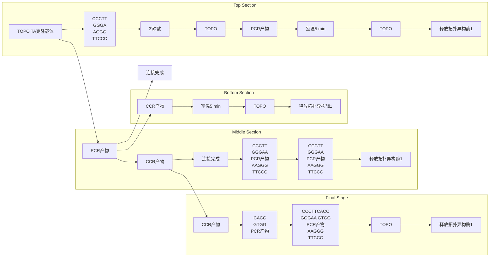

## 方法1 使用末端转移酶将双脱氧胸苷残基添加到平末端质粒DNA

## 平末端质粒 DNA 的制备

1. 在  $100 \mu L$  反应体积中，用限制性内切核酸酶（如 EcoR V）完全消化  $5 \mu g$  质粒 DNA（如 pBluescript），在一个位点切割质粒 DNA 并生成末端是 3'-T 残基的平末端线性分子。

进行下一步骤之前，通过凝胶电泳检查样品的消化情况，以确保没有环状质粒 DNA 分子残留。

2. 加入  $2 \mu L$  0.5mmol/L EDTA。
3. 使用商品化试剂盒纯化线性载体，将 DNA 重悬于  $50 \mu L H_{2}O$  中。

## ddT 残基添加到平末端质粒 DNA 的 3' 端

末端脱氧核糖核苷酸转移酶催化 dNTPs 添加到 DNA 分子的 5'端。DNA 聚合酶如大肠杆菌 DNA 聚合酶的 Klenow 片段和 Taq 具有往 DNA 底物添加单个核苷酸的能力，而末端转移酶可以在适当的条件下催化数百个核苷酸的添加。然而，通过使用链终止底物双脱氧胸苷三磷酸(ddTTP)作为底物，3'延伸的长度被限定为一个单核苷酸(Cozzarelli et al. 1969)。以 G:C 碱基对作为末端的平末端 DNA 是较差的底物，而富含 A:T 的平末端则比较宽松，并且修饰起来更迅速和同步。

末端转移酶对离子的要求很奇怪。它被许多反应缓冲液常有的阳离子所抑制，包括铵、氯离子和磷酸根离子（更多详情，见酶的发现者 Fred Bollum 于 1974 年合著的一篇综述）。大多数末端转移酶催化的反应在二甲胂酸（二甲基砷酸）缓冲液中进行（Kato et al. 1967），虽然 100mmol/L 的 Tris-乙酸（pH 7.2）几乎是一样好。使用 dTTP 或其类似物 ddTTP 作为底物的反应在  $Co^{2+}$  的存在下进行。相比之下，如果要添加嘌呤残基， $Mn^{2+}$  是首选的辅因子。

除了它的怪癖，末端转移酶在平末端 DNA 的 3'端添加核苷酸比 Taq DNA 聚合酶更有效。末端转移酶催化的反应结束时，大于 70% 的 DNA 末端将携带 3'-T 延伸，而使用 Taq 酶时只有 30% 的 DNA 末端将被修改。

## 4. 混合:

| 平末端质粒 DNA,按上述准备 | 45.0μL |
| --- | --- |
| 末端转移酶缓冲液(5×) | 6.0μL |
| $CoCl_2$(25mmol/L) | 5.0μL |
| ddTTP 溶液(1mmol/L) | 1.5μL |
| 末端转移酶(25U/μL) | 3.0μL |

轻轻混匀，短暂离心，然后在  $37^{\circ}$ C 孵育反应混合物 1.5h。

5. 通过用酚/氯仿抽提，然后乙醇沉淀，或使用市售的试剂盒，纯化 ddT 尾的 DNA。
6. 溶解纯化的 DNA 于 $30 \mu \mathrm{L} \mathrm{TE}(\mathrm{pH} 7.8)$ 中。取一份 DNA 在 $1 \%$ 琼脂糖凝胶电泳，用已知量的线性质粒 DNA（上面步骤 1）估计纯化的 T 载体的浓度。分装制备的 T 载体，存储于 $-20^{\circ} \mathrm{C}$ 。


## 方法 2 使用 Taq DNA 聚合酶添加 3'-脱氧胸苷残基

Taq 酶添加非模板 dA 残基到线性 DNA 底物的效率较低。在最好的情况下，约 30% 的 3' 端得到一个非模板 dA 残基，而只有 10% 的线性质粒 DNA 两端都含有 T 残基。这对于常规克隆的目的来说是足够多的，但用于克隆极少量的 DNA 时却不尽人意。

1. 按方法 1 的步骤 1\~3（见上文）准备  $5.0 \mu g$  线性平末端质粒 DNA。
2. 调整制备的线性 DNA 的体积到 $90 \mu \mathrm{L}$ 。
3. 加入  $10 \mu L$  的  $10 \times Taq$  缓冲液（由酶的生产商提供）。
4. 加入  $2 \mu L$  100mmol/L dTTP 溶液和 5U Taq DNA 聚合酶。
5. 在  $72^{\circ}$ C 孵育溶液 2h。
6. 按方法 1 步骤 5 和 6（见上文）纯化和定量 DNA。

## 参考文献

- Bollum FJ, Chang LM, Tsiapalis CM, Dorson JW. 1974. Nucleotide polymerizing enzymes from calf thymus gland. Methods Enzymol 29: 70–81.
- Borovkov AY, Rivkin MI. 1997. Xcml-containing vector for direct cloning of PCR products. BioTechniques 22: 812–814.
- Chuang SE, Wang KC, Cheng AL. 1995. Single-step direct cloning of PCR products. Trends Genet 11: 7–8.
- Cozzarelli NR, Kelly RB, Kornberg A. 1969. Enzymic synthesis of DNA. 33. Hydrolysis of a 5'-triphosphate-terminated polynucleotide in the active center of DNA polymerase. J Mol Biol 45: 513–531.
- Hengen PN. 1995. Methods and reagents. Cloning PCR products using T-vectors. Trends Biochem Sci 20: 85–86.
- Holton TA, Graham MW. 1991. A simple and efficient method for direct cloning of PCR products using ddT-tailed vectors. Nucleic Acids Res 19: 1156.
- Kato KI, Goncalves JM, Houts GE, Bollum FJ. 1967. Deoxynucleotide-polymerizing enzymes of calf thymus gland. II. Properties of the terminal deoxynucleotidyltransferase. J Biol Chem 242: 2780–2789.
- Kovalic D, Kwak JH, Weisblum B. 1991. General method for direct cloning of DNA fragments generated by the polymerase chain reaction. Nucleic Acids Res 19: 4560.
- Marchuk D, Drumm M, Saulino A, Collins FS. 1991. Construction of T-vectors, a rapid and general system for direct cloning of unmodified PCR products. Nucleic Acids Res 19: 1154.
- Mead DA, Pey NK, Herrnstadt C, Marcil RA, Smith LM. 1991. A universal method for the direct cloning of PCR amplified nucleic acid. Biotechnology 9: 657–663.

## 方案 12 克隆 PCR 产物: TA 克隆

Taq 酶等非校对 DNA 聚合酶固有的非模板依赖性末端转移酶活性为克隆 PCR 产物提供了一种高效的方法。这些酶在双链扩增产物的每个 3'端添加一个单一的、未成对的残基，优先是腺苷残基（Clark 1988）。未成对末端（A）残基可以和每个末端含有一个未成对 3'-胸苷残基的线性 T 载体配对(Holton and Graham 1991; Marchuk et al. 1991; 综述见 Trower and Elgar 1994; Zhou and Gomez-Sanchez 2000)。

TA 克隆的两个主要优点是快速和不依赖限制性内切核酸酶；主要缺点是无法定向克隆。鉴于此，需要扩增片段位于特定方向时，挑选和分析多个转化克隆非常重要。

T 载体可以用于克隆任何 A-尾的 DNA 片段，在这个意义上，TA 克隆是万能的。PCR 可能是产生 A-尾的 DNA 分子最常用的方法，但不是唯一的方法。

在含有所有 4 种 dNTP 的反应中，Taq 聚合酶可催化含有平末端或 5' 突出末端的 DNA 片段加上 3'-腺苷尾巴。酶首先补平末端，然后添加多余的 3'-A 残基。

往含有突出 3'尾巴的 DNA 添加未成对 3'-腺苷残基需要一个额外的步骤。在含有所有 4 种 dNTP 并且用 T4 DNA 聚合酶催化的反应中，末端被去除。平末端的分子可以按上述方法被装上 3'-A 尾巴。

T 载体可以在实验室制备（见方案 11）或作为克隆试剂盒的组分从许多商业供应商购买（例如，Stratagene 公司的 pCR-Script [SK+]；Life Technologies 公司 TA 克隆试剂盒里的 pCRII；Promega 公司的 pGEM-T；也见 Hengen 1995）。


## 材料

为正确使用本方案中的器材和危险试剂，必须查阅相应的材料安全数据表并咨询所在机构的环境卫生和安全办公室。

本方案的专用试剂标注&lt;R&gt;，配方在本方案末提供。常用储备溶液、缓冲液和试剂标注&lt;A&gt;，配方见附录1。储备溶液应稀释至适用浓度后使用。

## 试剂

琼脂糖凝胶（以及第2章方案1中所需的其他试剂和设备）（见步骤5）

ATP (10mmol/L)

如果连接缓冲液包含 ATP，在步骤 1 中的连接反应省略 ATP。

噬菌体 T4 DNA 连接酶和缓冲液

见信息栏“连接和连接酶”。一些商业化的连接酶缓冲液含有 ATP；使用这些缓冲液时不必加入 ATP。

SOB、SOC 或 LB 琼脂平板&lt;A&gt;含有合适的抗生素

如果要使用蓝/白筛选, 平板也应该含有 X-Gal 和 IPTG(见第 1 章的信息栏“X-Gal”和方案 14 的信息栏“IPTG”; 制备含有 X-Gal 和 IPTG 的琼脂平板的配方见附录 1)。

靶 DNA（25ng/mL），通过非校对热稳定 DNA 聚合酶催化的 PCR 扩增（如 Taq 酶）

通常，只有约 30% 的扩增产物携带一个未成对的 3'-腺苷残基。为了最大限度地提高 Taq 酶催化添加未成对 A 残基的效率，使用携带 5'-G 残基或 5'-A 残基的引物(Magnuson et al. 1996)。通过在 PCR 扩增循环的末尾编程在 72℃ 温育 10min，可以提高非模板添加反应的效率。

在克隆之前，通过将一份 PCR 产物凝胶电泳以检查大小。当 PCR 产生一个或两个以上的 DNA 扩增片段时，通过低熔点琼脂糖电泳纯化目的片段（见第 2 章，方案 9）。如果没有通过凝胶电泳纯化，PCR 扩增的 DNA 可以通过酚:氯仿提取 PCR 产物，然后乙醇沉淀扩增的 DNA，以用于连接。然而，许多研究人员倾向于使用商业化纯化试剂盒，如 Wizard SV Gel 和 PCR Clean-Up System（Promega 公司）、PureLink PCR 纯化试剂盒（Life Technologies 公司）、Millipore Ultrafree 核酸纯化柱或 QIAquik PCR 纯化试剂盒（QIAGEN 公司）。一些研究人员建议在合成后一两天内使用 PCR 产物以确保不会损失突出 A-残基。长时间在 4℃ 存放和反复冻融都使得 T 载体和靶 DNA 倾向于失去其未成对 3'-残基。

## T 载体

T 载体的合成，见方案 11。

现成的 T 载体作为克隆试剂盒的组分可以从许多商业供应商购买（例如，Stratagene 公司的 pCR-Script [SK+]; Life Technologies 公司 TA 克隆试剂盒里的 pCRII; Promega 公司的 pGEM-T）(Hengen 1995)。

转化用感受态大肠杆菌细胞（以及方案 1 和 2 中其他用于转化大肠杆菌所需的试剂和设备）

转化用感受态大肠杆菌细胞可以商业购买或按方案1\~4自行制备。

## 设备

培养箱（37℃）

水浴（预设为  $14^{\circ}$ C）


## 方法

1. 在微量离心管中建立连接反应。

连接混合物中载体:扩增 DNA 的最佳摩尔比为 3:1。连接反应建议的两种 DNA 的量（如下）是假设载体和扩增 DNA 的大小相等。这种情况很少见。当靶 DNA 的大小已知时，应改变连接反应中两种类型 DNA 的相对量以达到摩尔比为 3:1（载体:扩增 DNA）。

| 扩增的靶 DNA(25ng/μL) | 1μL |
| --- | --- |
| T 尾质粒(75ng/μL) | 1μL |
| 连接缓冲液(10×) | 1μL |
| 噬菌体 T4 DNA 连接酶 | 3U |
| $H_2O$ | 至 10μL |

如果有必要，添加 ATP 至终浓度为 1mmol/L。建立对照反应，包含上述列出的所有试剂，除了扩增的靶 DNA。

2. 在  $14^{\circ}$ C 孵育连接混合物 4h。
3. 分别用 $10 \mu \mathrm{L}^{①} \mathrm{H}_{2} \mathrm{O}$ 稀释 $5 \mu \mathrm{L}^{②}$ 两种连接混合物, 按方案 $1 \sim 4$ 转化合适的抗生素抗性的感受态大肠杆菌菌株。根据载体和宿主基因型、IPTG 和 X-Gal, 将转化培养物铺在含有适当的抗生素的培养基上 (见第 1 章中信息栏 “X-Gal” 和方案 14 的信息栏 “IPTG”)。
4. 计算从每个连接混合物得到的菌落数量。如果质粒可用于蓝/白筛选，挑选一些用含有靶 DNA 的连接反应产物转化得到的白色菌落。在不同的实验中，蓝色:白色菌落的比率可以在 1:5 到 2:1 之间变化。
5. 通过分离重组质粒 DNA，并用适当的限制性内切核酸酶消化确认扩增片段的存在。使用适当的 DNA 大小标记，通过琼脂糖凝胶电泳分离限制性酶切后的 DNA。

## 参考文献

- Clark JM. 1988. Novel non-templated nucleotide addition reactions catalyzed by procaryotic and eucaryotic DNA polymerases. Nucleic Acids Res 16: 9677–9686.
- Hengen PN. 1995. Methods and reagents. Cloning PCR products using T-vectors. Trends Biochem Sci 20: 85–86.
- Holton TA, Graham MW. 1991. A simple and efficient method for direct cloning of PCR products using ddT-tailed vectors. Nucleic Acids Res 19: 1156.
- Magnuson VL, Ally DS, Nylund SJ, Karanjawala ZE, Rayman JB, Knap JI, Lowe AL, Ghosh S, Collins FS. 1996. Substrate nucleotide-determined
- non-templated addition of adenine by Taq DNA polymerase: Implications for PCR-based genotyping and cloning. BioTechniques 21: 700–709.
- Marchuk D, Drumm M, Saulino A, Collins FS. 1991. Construction of T-vectors, a rapid and general system for direct cloning of unmodified PCR products. Nucleic Acids Res 19: 1154.
- Trower MK, Elgar GS. 1994. PCR cloning using T-vectors. Methods Mol Biol 31: 19–33.
- Zhou MY, Gomez-Sanchez CE. 2000. Universal TA cloning. Curr Issues Mol Biol 2: 1–7.

## 方案 13 克隆 PCR 产物: TOPO TA 克隆

牛痘病毒的拓扑异构酶和其他 IB 型拓扑异构酶一样，通过将双链 DNA 的一条链瞬时断裂和再连使 DNA 超螺旋松弛。拓扑异构酶 274 位酪氨酸的 OH 基团对 DNA 磷酸二酯键的亲核进攻导致双链 DNA 产生切口。靶 DNA 链的裂开高度特异性的发生在五嘧啶片段 5'(C/T)CCTT，形成一个稳定的 3'-磷酸酪氨酸-DNA 中间体（Shuman et al.1989）。由于键能是保守的，该反应很容易可逆，磷酸酪氨酸-DNA 中间体可以:①催化重新形成原来的双链或者②通过与含有和供体复合物互补的 5'-OH 尾的受体 DNA 形成磷酸二酯键，产生重组 DNA（图 3-1）。

<small><span class="docvortex-page-footnote" data-block-type="page_footnote" style="color:#6b7280">① 译者注:应为 $\mu L$ ，原文为 mL。</span></small>

<small><span class="docvortex-page-footnote" data-block-type="page_footnote" style="color:#6b7280">② 译者注:应为 $\mu L$ ，原文为 mL。</span></small>


<details>
<summary>flowchart</summary>

```mermaid
graph LR
  A["CCR Construct"] --> B["P"]
  C["CCR Construct"] --> D["OH"]
  E["CCR Construct"] --> F["P"]
  G["CCR Construct"] --> H["HO"]
  I["CCR Construct"] --> J["P"]
  K["CCR Construct"] --> L["HO"]
  M["CCR Construct"] --> N["P"]
  O["CCR Construct"] --> P["O"]
  Q["CCR Construct"] --> R["O"]
  S["CCR Construct"] --> T["O"]
  U["CCR Construct"] --> V["O"]
  W["CCR Construct"] --> X["O"]
  Y["CCR Construct"] --> Z["O"]
  AA["CCR Construct"] --> AB["O"]
  AC["CCR Construct"] --> AD["O"]
  AE["CCR Construct"] --> AF["O"]
  AG["CCR Construct"] --> AH["O"]
  AI["CCR Construct"] --> AJ["O"]
  AK["CCR Construct"] --> AL["O"]
  AM["CCR Construct"] --> AN["O"]
  AO["CCR Construct"] --> AP["O"]
  AQ["CCR Construct"] --> AR["O"]
  AS["CCR Construct"] --> AT["O"]
  AU["CCR Construct"] --> AV["O"]
  AW["CCR Construct"] --> AX["O"]
  AY["CCR Construct"] --> AZ["O"]
  BA["CCR Construct"] --> BZ["O"]
  BC["CCR Construct"] --> BD["O"]
  BE["CCR Construct"] --> BF["O"]
  BG["CCR Construct"] --> BH["O"]
  BI["CCR Construct"] --> BJ["O"]
  BK["CCR Construct"] --> BL["O"]
  BM["CCR Construct"] --> BN["O"]
  BO["CCR Construct"] --> BP["O"]
  BR["CCR Construct"] --> BB["O"]
  BC["CCR Construct"] --> BDZ["O"]
  BBZ["CCR Construct"] --> BZZ["O"]
  BCZ["CCR Construct"] --> BDZZ["O"]
  BZZ["CCR Construct"] --> BDZZZ["O"]
  BZZZ["CCR Construct"] --> BDZZZZ["O"]
  BZZZZ["CCR Construct"] --> BDZZZZZ["O"]
  BDZZZZ["CCR Construct"] --> BDZZZZZZ["O"]
  BDZZZZZ["CCR Construct"] --> BDZZZZZZZ["O"]
  BDZZZZZZ["CCR Construct"] --> BDZZZZZZZZ["O"]
  BDZZZZZZZ["CCR Construct"] --> BDZZZZZZZZ["O"]
  BDZZZZZZZZ["CCR Construct"] --> BDZZZZZZZZZ["O"]
  BDZZZZZZZZZ["CCR Construct"] --> BDZZZZZZZZZZ["O"]
  BDZZZZZZZZZZZ["CCR Construct"] --> BDZZZZZZZZZZZZ["O"]
  BDZZZZZZZZZZZZ<fcel>AAGGGTTCCC
  HO --> P
  P --> B
  BQ --> R
  RQ --> S
  S --> T
  TQ --> U
  UQ --> V
  VQ --> W
  WQ --> X
  XQ --> Y
  YQ --> Z
  ZQ --> AA
  AA --> AB
  ABQ --> AC
  AC --> AD
  ADQ --> AE
  AE --> AF
  AFQ --> AG
  AG --> AH
  AH --> AI
  AI --> AJ
  AJ --> AK
  AK --> AL
  AL --> AM
  AM --> AN
  AN --> AO
  AO --> AP
  AP --> AQ
  AQ --> AR
  AR --> AS
  AS --> AT
  AT --> AU
  AU --> AV
  AV --> AW
  AW --> AX
  AX --> AZ
  AZ --> BA
  BA --> BAQ
  BAQ --> BA1
  BA1 --> BA2
  BA2 --> BA3
  BA3 --> BA4
  BA4 --> BA5
  BA5 --> BA6
  BA6 --> BA7
  BA7 --> BA8
  BA8 --> BA9
  BA9 --> BA10
  BA10 --> BA11
  BA11 --> BA12
  BA12 --> BA13
  BA13 --> BA14
  BA14 --> BA15
  BA15 --> BA16
  BA16 --> BA17
  BA17 --> BA18
  BA18 --> BA19
  BA19 --> BA20
  BA20 --> BA21
  BA21 --> BA22
  BA22 --> BA23
  BA23 --> BA24
  BA24 --> BA25
  BA25 --> BA26
  BA26 --> BA27
  BA27 --> BA28
  BA28 --> BA29
  BA29 --> BA30
  BA30 --> BA31
  BA31 --> BA32
  BA32 --> BA33
  BA33 --> BA34
  BA34 --> BA35
  BA35 --> BA36
  BA36 --> BA37
  BA37 --> BA38
  BA38 --> BA39
  BA39 --> BA40
  BA40 --> BA41
  BA41 --> BA42
  BA42 --> BA43
  BA43 --> BA44
  BA44 --> BA45
  BA45 --> BA46
  BA46 --> BA47
  BA47 --> BA48
  BA48 --> BA49
  BA49 --> BA50
  BA50 --> BA51
  BA51 --> BA52
  BA52 --> BA53
  BA53 --> BA54
  Ba54 --> BQ0000000000000000000000000000000000000000000000000000000000000000000000000000000000000000000000000000
```
</details>

图 3-1 牛痘 Topo。TOPO TA 克隆。Taq 聚合酶的非模板依赖性末端转移酶活性在 PCR 产物的 3'端添加单个 dA。线性 TOPO TA 克隆载体含有突出 3'-dT 残基，是“TOPO 激活的”（即 TOPO 通过 3'-磷酸酪氨酰连接附加上），使其能够有效连接两端都含有 3'-dA 突出的 PCR 产物。PCR 产物每个末端的 5'OH 可以攻击载体 DNA 和 TOPO 之间的磷酸酪氨酰键，导致 TOPO 分子的释放和双切口环状重组分子的产生（未显示）。（转载自 Invitrogen 公司 2002 年，Life Technologies 公司的一部分，©2002。）

TOPO 分裂/连接反应的特异性和通用性带动了 Life Technologies 公司制造并销售的质粒克隆载体的发展，TOPO 磷酸酪氨酸-质粒 DNA 中间体产物可以连接到具有互补末端的 DNA 序列，反应在室温下 5min 内即可完成（见信息栏 “TOPO 工具”）。Life Technologies 公司在市场推出了作为试剂盒组分的预活化载体，设计用于特定的克隆目的。例如，TA 克隆试剂盒包括拓扑异构酶活化的载体、用于克隆 PCR 产生的携带未配对 3'端腺苷残基的 DNA。图 3-2 显示了可从 Life Technologies 公司购得的三个系统所使用连接反应的示意图，分别用于 TA 克隆、平末端克隆和定向平末端克隆。


<details>
<summary>flowchart</summary>


</details>

图 3-2 TOPO 克隆。（A）Taq 酶扩增 DNA 的 TOPO TA 克隆；（B）Zero 平末端 TOPO 克隆:平末端 DNA；（C）定向 TOPO 克隆:平末端 DNA。（转载自 Life Technologies 公司[Invitrogen 公司]。）

试剂盒也可用于克隆“长”的DNA（大于1kb）和克隆PCR产生的在测序载体和原核及真核表达载体中的DNA。能够从Life Technologies公司购得的载体的完整列表，见Life Technologies/Invitrogen公司网站（www.invitrogen.com/site/us/en/home.html）。其他制造商也出售基于拓扑异构酶的克隆试剂盒，虽然目前在多样性上尚不如Life Technologies公司。例如，Stratagene/Agilent公司销售的Strataclone PCR克隆试剂盒，含有一个由两个分开的臂组成的载体，其中每一个臂在其一端带有拓扑异构酶活化的、修饰的尿嘧啶残基，在其另一端有一个loxP识别位点。连接后，带有（A）突出的PCR产物被两个臂捕获，得到的线性DNA随后用于转化一个表达Cre重组酶的大肠杆菌菌株。loxP位点之间的重组产生一个环状的、善于复制的质粒。这个系统看起来有点笨拙，但是根据Stratagene公司的介绍，已成功地用于克隆长的PCR产物。

Promega 公司出售的 pGEM-T 和 pGEM-T Easy 试剂盒包含线性化高拷贝数载体，在每一末端含有一个单一的突出 3'-胸苷残基。载体都可用于蓝/白筛选，并包含多个限制性酶切位点便于快速释放克隆序列。

克隆试剂盒的制造商提供了很棒的指南，详细解释了要做什么和为什么要这么做。这使得TOPO克隆很容易，但是并非万无一失。在第一次建立TOPO克隆时，使用试剂盒提供的组分，按照下文建立预实验。

## 牛痘病毒

Edward Jenner 在 1796 年采用接种疫苗预防天花，使得 181 年后这种疾病从人群中完全灭绝，毫无疑问是最伟大的医学成就之一。Jenner 的疫苗株来自一个挤牛奶女工手上的脓疱，Jenner 认为是来自于感染牛痘的产奶动物。不过，从病态行为和基因组分析（Gubser et al. 2004），现在看上去该疫苗株似乎更有可能是牛痘和天花病毒之间的杂种，或者是现在已灭绝的马痘，又或者可能本身就是天花的减毒菌株（Baxby 1977, 1981, 1999; Razzell 1998）。不论其来源，牛痘病毒已经找到了新的用途，作为哺乳动物表达载体（见第 16 章）和 DNA 拓扑异构酶的来源，此酶是一种 314 个氨基酸的蛋白质，是一种准确连接 DNA 片段的快速、简便方法（TOPO 克隆）的基石（Shuman 1994）。


## 材料

为正确使用本方案中的器材和危险试剂，必须查阅相应的材料安全数据表并咨询所在机构的环境卫生和安全办公室。

本方案的专用试剂标注&lt;R&gt;，配方在本方案末提供。常用储备溶液、缓冲液和试剂标注&lt;A&gt;，配方见附录1。储备溶液应稀释至适用浓度后使用。

## 试剂

琼脂糖凝胶（以及第2章方案1中所需的其他试剂和设备）

化学感受态 One-Shot TOP10 细菌（Life Technologies 公司）或等效产品

质粒

限制性内切核酸酶

SOB、SOC 或 LB 琼脂平板&lt;A&gt;含有合适的抗生素，预热

SOC 培养基&lt;A&gt;

含有 $1.2 \mathrm{~mol} / \mathrm{L} \mathrm{NaCl}$ 和 $0.06 \mathrm{~mol} / \mathrm{L} \mathrm{MgCl}_{2}$ 的溶液

靶 DNA（25ng/mL），通过 Taq 酶催化的 PCR 扩增

TOPO 活化的 TA 载体（10ng/μL）

## 设备

盛满冰块的容器

振荡培养器（37℃）

水浴（预设为37℃、42℃和限制性内切核酸酶消化的最适温度）


## 方法

1. 根据第 7 章方案 1 的说明, 按照您的实验室最近的实验中成功扩增产生丰富的 250\~750 核苷酸长度扩增产物所使用模板: 引物组合的情况, 建立一个  $50 \mu L$  Taq 酶催化的 PCR 体系。
2. 通过琼脂糖凝胶电泳分析少量（$10\mu \mathrm{L}$）PCR产物，检查扩增反应是否产生单个离散的与预期大小相符的产物。

如果扩增反应产生一种以上 DNA 或其他 PCR 伪迹（如引物二聚体，成片条带），最好用另一块凝胶纯化感兴趣的 DNA，使用如 Millipore 公司的 Montage DNA Gel Extraction 试剂盒或 Sigma 公司的 GenElute 试剂盒。

3. 使用试剂盒制造商提供的溶液，立刻建立一个TOPO克隆试验反应如下。

混合:

| 扩增的DNA | 1.0μL |
| --- | --- |
| NaCl(1.2mol/L)/MgCl2(0.06mol/L) | 1.0μL |
| 无菌水 | 3.0μL |
| TOPO活化的TA载体(10ng/μL) | 1.0μL |

建立对照反应(背景对照), 其中扩增的 DNA 替换为 $1 \mu \mathrm{L}$ 水。建立第三个转化反应(转化对照), 其中用 $10 \sim 20 \mathrm{pg}$ 纯化的具有抗生素抗性标记的质粒替代 TOPO 活化的 TA 载体。

4. 轻轻混合反应物，在室温下孵育 5min。将反应物转移到冰上。

TOPO 克隆反应时间可以短至 30s，或长达 30min。PCR 产物越长，就需要越长的时间以获得最大量的转化体。

5. 转移  $2 \mu L$  各反应物（步骤 3）到含有化学感受态 One-Shot TOP10 细菌（Life Technologies 公司）或同等产品的单独小管中。将转化反应物在冰上孵育 5min。

6. 在 $42^{\circ} \mathrm{C}$ 热激细胞整整 30s, 立即将细胞放回冰上, 添加 $250 \mu \mathrm{L}$ 室温的 SOC 培养基。

7. 封紧小管，然后在  $37^{\circ}$ C 孵育 30min，轻轻摇动。

Life Technologies 公司的标准 TOPO 试剂盒包含制备好的化学转化或电穿孔的 One-Shot TOP10 细菌。然而，这些制备细菌并无特别之处，使用 TOP10 的近亲 DH10B 的化学感受态的效果同样出色。

8. 将一份 $50\mu \mathrm{L}$ 转化的细菌铺到预热的含 $75\sim 100\mu \mathrm{g}$ 氨苄青霉素的琼脂平板上。$37^{\circ}C$ 培养过夜。

在 $37^{\circ}\mathrm{C}$ 过夜孵育后，如果一切都按计划顺利进行，试验反应和阳性对照将有大量转化菌落产生。背景对照的平板则应该只有极少数菌落出现。

9. 从试验反应平板上 6 个分开的菌落建立培养物, 并小量制备质粒 (见第 1 章方案 1\~3)。用质粒中多克隆位点里插入片段两侧位点的限制性内切核酸酶切割 DNA。通过琼脂糖凝胶电泳确认克隆的扩增 DNA 片段大小正确。

## 参考文献

- Baxby D. 1977. The origins of vaccinia virus. J Infect Dis 136: 453–455.
- Baxby D. 1981. Jenner's smallpox virus: The riddle of vaccinia virus and its origins. Heineman Educational Books, London.
- Baxby D. 1999. The orgins of vaccinia virus—An even shorter rejoinder. Soc Hist Med 12: 139.
- Gubser C, Hue S, Kellam P, Smith GL. 2004. Poxvirus genomes: A phylogenetic analysis. J Gen Virol 85: 105–117.
- Invitrogen. 2002. pENTR directional TOPO cloning kits (version B, July 9, 2002, 25-0434). Invitrogen Life Technologies, Inc., Rockville, MD.
- Razzell P. 1998. The orgins of vaccinia virus—A brief rejoinder. Soc Hist Med 11: 107–108.
- Shuman S. 1994. Novel approach to molecular cloning and polynucleotide synthesis using vaccinia DNA topoisomerase. J Biol Chem 269: 32678–32684.
- Shuman S, Kane EM, Morham SG. 1989. Mapping the active-site tyrosine of vaccinia virus DNA topoisomerase I. Proc Natl Acad Sci 86: 9793–9797.

## 方案 14 使用 X-Gal 和 IPTG 筛选细菌菌落: α-互补

许多质粒载体（如 pUC 系列、Bluescript、pGem，以及它们的衍生物）携带一段短的大肠杆菌 DNA，含有β-半乳糖苷酶的调控序列及其前 146 个氨基酸的编码信息。嵌入编码区的是一个多克隆位点，所包含的读码框在β-半乳糖苷酶氨基末端片段中产生由少量氨基酸组成的无害插入。这种类型的载体用在表达β-半乳糖苷酶羧基端部分的宿主细胞。虽然无论是宿主编码还是质粒编码的β-半乳糖苷酶片段本身都是没有活性的，但是它们可以联合形成具有酶活性的蛋白质。lacZ 基因的近操纵基因片段缺失突变体与具有完整近操纵基因片段的β-半乳糖苷酶阴性突变体之间的互补被称为α-互补（Ullmann et al. 1967）（更多信息，见第 1 章信息栏“α-互补”）。α-互补产生的 lac+细菌很容易识别，因为它们在生色底物 X-Gal 的存在下形成蓝色菌落（Horwitz et al. 1964；Davies and Jacob 1968）。然而，一个外源 DNA 片段插入到质粒的多克隆位点几乎总是导致产生的氨基末端片段不再能够 α-互补。因此，携带重组质粒的细菌形成白色菌落。这个简单色彩试验的发展极大地简化了质粒载体中构建重组体的鉴定。这很容易筛选成千上万的转化菌落，从它们的白色外观识别出那些被认为含有重组质粒的菌落。然后，这些重组体的结构可以通过小量制备载体 DNA，用限制性酶切分析或其他的鉴别标准进行验证。

为筛选细菌菌落，生色底物 X-Gal 和安慰诱导物 IPTG（见信息栏 “IPTG” 和第 1 章中的信息栏 “X-Gal”）混合后用培养基适当稀释，结合熔化的顶层琼脂，然后铺在含有合适抗生素的琼脂平板上。细菌铺在顶层琼脂上的转化效率稍高于铺在琼脂平板表面上。也许转化的细菌更喜欢软琼脂里稍微厌氧的状态或琼脂培养基提供的等渗透压。

## IPTG

IPTG（isopropylthiogalactose）是由 Mel Cohn 在 20 世纪 50 年代初合成的一系列半乳糖类似物之一，当时他在巴斯德研究院 Jaques Monod 的实验室工作。lac 阻遏蛋白特异性结合 lac 操纵子的操纵基因区，负调控大肠杆菌 lac 操纵子的表达。IPTG 结合 lac 阻遏蛋白，改变其构象使其无法结合 lac 操纵基因，从而诱导乳糖操纵子的转录。并不需要高浓度的 IPTG 来解除阻遏，因为硫代半乳糖苷是不可发酵的，不是β-半乳糖苷酶的底物。在蓝/白筛选中，IPTG 与 X-Gal 联合使用以鉴别表达β-半乳糖苷酶的重组细菌菌落或噬菌斑。有关进一步详情，见第 1 章中的信息栏“α-互补”。


## 材料

为正确使用本方案中的器材和危险试剂，必须查阅相应的材料安全数据表并咨询所在机构的环境卫生和安全办公室。

本方案的专用试剂标注&lt;R&gt;，配方在本方案末提供。常用储备溶液、缓冲液和试剂标注&lt;A&gt;，配方见附录1。储备溶液应稀释至适用浓度后使用。

## 试剂

大肠杆菌培养物，用重组质粒转化

IPTG 溶液（20%, m/V）

LB 或 YT 琼脂板&lt;A&gt;含有合适的抗生素

LB 或 YT 顶层琼脂&lt;A&gt;

X-Gal 溶液（2%, m/V）

见第 1 章中的信息栏 “X-Gal”。

## 设备

加热块（45℃）

培养箱（37℃）

无菌黄吸头、木制牙签或接种针

无菌塑料试管（17mm×100mm）


## 方法

1. 将熔化的顶层琼脂分装到 $17\mathrm{mm} \times 100\mathrm{mm}$ 试管中。把试管放入 $45^{\circ}\mathrm{C}$ 的加热块待用。若是 $90\mathrm{mm}$ 平板，分装 $3\mathrm{mL}$；$150\mathrm{mm}$ 平板则分装 $7\mathrm{mL}$。

2. 从加热块取下第一管。迅速加入 $0.1\mathrm{mL}$ 细菌悬液，当使用 $90\mathrm{mm}$ 平板时所含活菌数要小于3000个，$150\mathrm{mm}$ 平板则小于10000个。关闭管盖，翻转几次使细菌在熔化琼脂中分散均匀。

3. 打开试管，如表 3-3 中所示加入适当量的 X-Gal 和 IPTG（如果需要）。关闭管盖，轻轻翻转几次以混合内含物。

4. 将熔化的顶层琼脂快速倒入含适当的抗生素的硬琼脂平板，通过旋动分散溶液。

5. 重复步骤 2～4，直到所有的样品都被铺板。

6. 等软琼脂在室温下硬化，擦掉平板盖子上的凝露，然后将平板倒置在 $37^{\circ}\mathrm{C}$ 孵育 $12\sim 16\mathrm{h}$。

7. 从培养箱中取出平板，将它们在  $4^{\circ}$ C 存放几个小时，使蓝色显现。

表 3-3 顶层琼脂的成分

<table><tr><td rowspan="2">平板大小</td><td colspan="3">试剂用量</td></tr><tr><td>熔化的顶层琼脂</td><td>X-Gal</td><td>IPTG</td></tr><tr><td>90mm</td><td>3mL</td><td>40μL</td><td>7μL</td></tr><tr><td>150mm</td><td>7mL</td><td>100μL</td><td>20μL</td></tr></table>

8. 鉴定携带重组质粒的菌落。

- 携带野生型质粒的菌落含有有活性的β-半乳糖苷酶。这些菌落的中心是淡蓝色，周边是深蓝色。
- 携带重组质粒的菌落不含有有活性的β-半乳糖苷酶。这些菌落是乳白色或蛋壳蓝，有时在中心带着淡淡的蓝色斑点。

在淡黄色背景下查看平板可以增强眼睛分辨蓝色和白色菌落的能力。

9. 选择和培养携带重组质粒的菌落。

蓝色或白色菌落在软琼脂中可以发生在几个不同的方位，通常好像远方倾斜的星系。不管什么方位，它们可以容易地用无菌接种针或无菌牙签刺入薄层软琼脂挑取，将接种物转移到一管含有适当抗生素的培养基中。

## 参考文献

Davies J, Jacob F. 1968. Genetic mapping of the regulator and operator genes of the lac operon. J Mol Biol 36: 413–417.

Horwitz JP, Chua J, Curby RJ, Tomson AJ, Darooge MA, Fisher BE, Mauricio J, Klundt I. 1964. Substrates for cytochemical demonstration of enzyme activity. I. Some substituted 3-indolyl- $\beta$ -D-glycopyranosides. J Med Chem 7: 574–575.

Ullmann A, Jacob F, Monod J. 1967. Characterization by in vitro complementation of a peptide corresponding to an operator-proximal segment of the β-galactosidase structural gene of Escherichia coli. J Mol Biol 24: 339–343.

## 信息栏


## 关照大肠杆菌

贯穿过去的一个世纪，大肠杆菌 K-12 菌株在生物学，特别是在分子生物学中发挥了无可争辩的重要作用。表 1 给出了一个标志着关键事件和发现的时间表。

表 1 大肠杆菌——大事年表

| 时间 | 人物 | 描述 |
| --- | --- | --- |
| 1885 | Theodore von Escherich(1857~1911) | 大肠杆菌由德国细菌学家 Theodore von Escherich 从健康人的粪便中首次分离,生物名最初为 Bacterium coli,后来改为 Escherichia coli 以纪念它的发现者。大肠杆菌约占成人结肠细菌总数的0.1%。 |
| 1940s | Ed Tatum(1909~1975) | 从20世纪20年代开始,斯坦福大学细菌学系保存大肠杆菌菌种。其中一株,命名为K-12,是从康复白喉患者的粪便中分离得到的。K-12是原养型,在确定成分培养基中生长良好,并且传代时间短。也许是出于这些原因,Ed Tatum 使用K-12进行了一系列关于细菌的营养缺陷突变株的生化研究(Gray and Tatum 1944;Tatum1945)。 |
| 1940s | Joshua Lederberg(1925~2008) | 1945年,Tatum搬到了耶鲁大学,研究生 Joshua Lederberg 请求获取他的菌株。Lederberg提出合作,以确定是否可以在细菌中证明遗传交配,如果是的话,是否可以用来构建遗传图谱。Lederberg 此前使用一株与K-12不同的大肠杆菌菌株的原养型突变体,未能找到任何重组的证据,但使用Tatum的K-12株后,实验立即获得了成功。从1946年4月交配实验开始到研究人员获得重组的证据,它看上去只用了6周时间。结果,7月在冷泉港实验室研讨会上提出时,很多听众根本不相信,认为可以用特殊现象解释,而不是重组。直到几个月后,更详尽的解释出现(Lederberg and Tatum 1946),细菌接合作用即“大肠杆菌性别”的想法才得到承认。回头来看,我们现在知道,成功的关键在于碰巧使用了Tatum的K-12菌株。与大多数大肠杆菌菌株不同,它携带一个$F^{+}$(致育)质粒,能够调动细菌染色体。Lederberg 和Tatum观察到的标记重组发生,是因为用于杂交的一个突变体碰巧携带$F^{+}$因子,而另一个没有。 |
| 1952 | Bill Hayes(1913~1994) | 医学细菌学家 Hayes 从群体遗传学家 Luigi Luca Cavalli-Sforza 获得K-12菌株,使用链霉素抗性作为标记进行交配动力学研究。Hayes 的研究显示,一株K-12菌株能够充当基因供体而另一株充当受体。他提出,在接触时,雄性细胞挤出一个“配子”被雌性细胞接纳(Hayes 1952)。接合过程持续1~2h。 |
| 1997 | Fred Blattner(1940~) | 大肠杆菌最近的历史是丰富的。Hayes的工作发表多年以来,大肠杆菌K-12已被一大群众多学科的科学家使用并已经成为分子克隆的有力工具。1997年,美国威斯康星大学Fred Blattner的研究小组发表了大肠杆菌基因组的完整序列(Blattner et al. 1997),极大地丰富了大肠杆菌的数据积累。细菌基因组由4639221个碱基对组成,其中的88%组成4288个基因,当序列完成时其中约40%功能未知。自1997年以来,一些非K-12的大肠杆菌菌株的基因组已被测序,浮现出的画面是一个高度可变的种群,持续经历广泛的基因型和表型趋异(Woods et al. 2006)。然而,K-12的不同亚株则非常相似。例如,Blattner等测序的K-12株(MG1655)基因组与W3110菌株(Hayashi et al. 2006)基因组相比仅有8个碱基对不同。这个结果是令人欣慰的,但不足为奇。在世界各地的实验室分子克隆所用的大肠杆菌K-12菌株现在在几乎相同的条件下生长。基因组变异的缺乏只是反映出差别选择压力的缺失。Hobman等(2007):大肠杆菌“毫无疑问作为生物学的首要模式生物......可以说对大肠杆菌的了解,特别是K-12株,比任何其他生物都多。”Neidhardt等(1996):“所有细胞生物学家至少有两种感兴趣的细胞:他们正在研究的细胞和大肠杆菌。” |

几乎所有关于大肠杆菌的有用信息都可以在 Cellular and Molecular Biology（在线版）（http://ecosal.org）的大肠杆菌和鼠伤寒沙门氏菌（Escherichia coli and Salmonella typhimurium）部分找到。

通常在分子克隆中使用的大肠杆菌的基因型可以在以下网址获得:openwetware.org/wiki/E.\_coli\_genotypes。

## 当一种新型菌株抵达实验室

大肠杆菌菌株（未转化或转化质粒）通常是以琼脂穿刺培养物的形式通过邮件发送。所有菌株一旦进入实验室，就必须尽快验证，之后才能在实验中使用。

1. 转接一个菌环量的穿刺培养物到 3mL 含适量抗生素和必要添加物的液体培养基中。在适当的温度温育培养基 18～24h，并剧烈振荡。
2. 当液体培养物长好后，用菌液在含适量抗生素和必要添加物的琼脂平板上划线。在适当的温度下过夜孵育平板。
3. 检查平板上所有的菌落外观是否一致，外形和气味是否与大肠杆菌相同。挑取单个菌落到合适的选择性培养基上，以验证该菌株的基因型。将挑选出的菌落进行小规模（3mL）液体培养。如果细菌含有转化质粒，用约2mL培养物小规模制备质粒DNA。用不同的限制性内切核酸酶消化质粒DNA，消化产物通过琼脂糖凝胶电泳分析。根据发送者提供或文献中公布的质粒图谱，比较所观察到的条带大小与预期是否相符。
4. 复印发送菌株附带的所有书面材料，将复印件插入你的实验室笔记本中。
5. 如果没有提供菌株的基因型，可以查询相关文献或在线资源，以确定菌株是否有可能会影响它实用性的瑕疵。许多常用的大肠杆菌菌株的基因型名单可以在此网址在线获取:http://openwetware.org/wiki/E.\_coli\_genotypes。

## 质粒 DNA

1. 如果质粒 DNA 以 70%乙醇中沉淀的形式送达，通过离心分离回收 DNA，以  $100 \mu g/mL$  的浓度溶解在 TE（pH 8.0）中。
2. 用不同的限制性内切核酸酶消化几个小份的 DNA，并通过琼脂糖凝胶电泳进行分析。根据发送者提供或文献中公布的质粒图谱，比较所观察到的条带大小与预期是否相符。
3. 与此同时，将一份质粒 DNA 转化合适的大肠杆菌菌株。
4. 将几个独立的转化体进行小规模（3mL）液体培养。用约 2mL 培养物小规模制备质粒 DNA。
5. 下面几种方法可以用来验证该质粒的结构。

- 限制性内切核酸酶消化。将一份 DNA 样品用一些限制性内切核酸酶消化，并通过琼脂糖凝胶电泳分析酶切产物。根据发送者提供或文献中公布的质粒图谱，比较所观察到的条带大小与预期是否相符。
- 聚合酶链反应。聚合酶链反应用两套引物（见第7章）。一套应该是与邻近克隆DNA两侧的质粒序列互补（引物A和B）。另一套引物（引物1和2）应该是与插入克隆的内部序列互补，这将根据已知插入序列预知产生的扩增产物的大小。使用两对分开的引物组合成6个 $^{①}$ 聚合酶链反应，如下所示:

聚合酶链反应 1. 引物 A 和引物 B
聚合酶链反应 2. 引物 1 和引物 2
聚合酶链反应 3. 引物 1 和引物 A
聚合酶链反应 4. 引物 2 和引物 A
聚合酶链反应 5. 引物 2 和引物 B
聚合酶链反应 6. 引物 1 和引物 B $^{②}$

<small><span class="docvortex-page-footnote" data-block-type="page_footnote" style="color:#6b7280">① 译者注:应为6个，原文为4个。</span></small>

<small><span class="docvortex-page-footnote" data-block-type="page_footnote" style="color:#6b7280">② 译者注:应为 B，原文为 A。</span></small>

使用适当大小的标志物，用凝胶电泳法估计扩增产物的大小。确认插入片段的大小和它在质粒内的插入方向是否正确。

\- 如果该质粒包含一个突变，而不是野生型的 DNA 插入片段，则:①使用突变型特异和野生型特异的引物进行聚合酶链反应；②测定相关插入片段的序列。

6. 如果该质粒的结构正确，大规模培养其中一个转化体。制备一批质粒 DNA，通过限制性内切核酸酶消化和/或聚合酶链反应验证其正确，然后将其溶解在 TE 中，分成小份存储于-20℃。

如果一切顺利（通常如此），按照方案存储细菌菌株，将细菌液体培养物分成小份放到甘油中于-20℃长期保存。

## 储存细菌菌株

## 大肠杆菌的主培养物最好存储于-20℃

1. 加入 0.15mL 甘油（100%）到 2mL 螺旋盖冷冻管中，高压灭菌消毒。小管的灭菌甘油可以批量制备，并在室温下保存待用。
2. 添加 0.85mL 大肠杆菌对数生长期培养物到每个含 0.15mL 灭菌甘油的小管。
3. 牢固封闭小管的顶部，剧烈振荡混合。
4. 用 Sharpie 笔标记小管和时间。同时在小管的盖子和管身上做标记。
5. 于-20℃冷冻小管。将培养物存储在冻存盒中，放在含有一个或两个冰袋的聚苯乙烯泡沫塑料容器内。以这种方式储存的含甘油培养物可以保持活性多年。为了最大限度地减少活力损失，避免反复冻融甘油菌种。
6. 如果要复苏-20℃存储的大肠杆菌，取出一个存储于-20℃冰箱中的含甘油培养物。取约 50μL 培养物转接至 5mL 预热的 LB 培养基中。迅速将含甘油培养物重新密封放回冰箱。将新接种的培养基放在振荡培养器上 37℃过夜培养。

## 穿刺培养

大肠杆菌菌株在软琼脂中穿刺培养可存储长达1年。穿刺培养可用于在室温下运输或发送菌株给其他实验室。

1. 准备和高压灭菌 0.7% LB 琼脂（在标准 LB 培养基中添加 7g/L 琼脂）。
2. LB 琼脂冷却到低于  $50^{\circ}$ C（你可以舒适地握持时），添加适当的抗生素。当琼脂仍处于液态时，添加 1mL 琼脂到 2mL 螺旋盖小瓶或高压灭菌冷冻管中，等待其凝固。小管琼脂可以分批制备，并在室温下保存待用。
3. 使用无菌直铂丝或无菌牙签从新鲜的生长平板上挑取单个菌落，穿刺到软琼脂中数次。
4. 保持管帽稍微松动，在  $37^{\circ}$ C 孵育小管 8～12 h。
5. 紧紧的密封小管并避光保存，在  $4^{\circ}$ C 更好。
如果存放在  $20^{\circ}$ C，远离直射光，穿刺培养将保持活力至少 12～18 个月。

## 复苏存储的菌株

1. 将一个菌环量的软琼脂或甘油保存菌株在标记过的、含有适当抗生素的 LB 琼脂平板上划线。重新密封穿刺培养物或甘油保存菌株并放回继续存储。
2. 在  $37^{\circ}$ C 下孵育平板过夜。
3. 挑取单个菌落在 $5 \mathrm{~mL}$ 含有相关抗生素的 LB 培养基中培养作为日常存储。用封口膜密封步骤 2 的平板，并将其存储在 $4^{\circ} \mathrm{C}$ 以备进一步使用。

## 参考文献

- Blattner FR, Plunkett G III, Bloch CA, Perna NT, Burland V, Riley M, Collado-Vides J, Glasner JD, Rode CK, Mayhew GF, et al. 1997. The complete genome sequence of Escherichia coli K-12. Science 277:1453–1462.
- Gray CH, Tatum EL. 1944. X-ray induced grwoh factor requirements in bacteria. Proc Natl Acad Sci 30: 404–410.
- Hayashi K, Morooka N, Yamamoto Y, Fujita K, Isono K, Choi S, Ohtsubo E, Baba T, Wanner BL, Mori H, et al. 2006. Highly accurate genome sequences of Escherichia coli K-12 strains MG1655 and W3110. Mol Syst Biol 2: 2006.0007.
- Hayes W. 1952. Recombination in Bact. coli K12: Unidirectional transfer of genetic material. Nature 169: 118–119.
- Hobman JL, Penn CW, Pallen MJ. 2007. Laboratory strains of Escherichia coli: Model citizens or deceitful delinquents growing old gracefully?

Mol Microbiol 64: 881–885.

Lederberg J, Tatum EL. 1946. Gene recombination in Escherichia coli. Nature 158: 558.

Neidhardt FR, Curtis R III, Ingraham JL, Lin ECC, Low KB, Magasanik B, Reznikoff WS, Riley M, Schaechter M, Umbarger E. 1996. Escherichia coli and Salmonella: Cellular and molecular biology, 2nd ed. American Society for Microbiology, Washington, DC.

Tatum EL. 1945. X-ray induced mutant strains of Escherichia coli. Proc Natl Acad Sci 31: 215–219.

Woods R, Schneider D, Winkworth CL, Riley MA, Lenski RE. 2006. Tests of parallel molecular evolution in a long-term experiment with Escherichia coli. Proc Natl Acad Sci 103: 9107–9112.


## 用 DNA 转化细菌的历史

细菌转化中，受体细胞从培养基中获得 DNA。导入的 DNA 中的基因可以获得表达，并可能改变受体细胞的表型，使转化细胞获得选择性的优势。

转化最早于将近一个世纪前由 Fred Griffith（Griffith 1928）首先描述，他是一名在伦敦卫生署工作的军医。Griffith 对肺炎球菌的血清学多样性感兴趣，这些肺炎球菌是从不同肺炎患者的痰标本中分离出的。大部分由 Griffith 分离出的致病肺炎球菌菌株在丰富培养基上形成光滑的、反光的菌落（S），而许多非致病性菌株形成粗糙的扁平菌落（粗）菌落。Griffith 注意到，这些表型是不稳定的:将 S 株铺于巧克力琼脂上可以得到减毒粗糙株（R）；S 株可以出现在感染了非致病性 R 菌株的小鼠中。为了调查 S 株和 R 株相互转换的机制，Griffith 将 R 型细胞和加热到 60°C 杀死的有毒 S 型细胞混合后注射小鼠，很高兴地发现，死的 S 型细胞引起 R 型细胞永久转换为 S 型细胞。Griffith 对遗传学一无所知，仅仅用发病机制解释了这种转化。半个世纪后，洛克菲勒研究所指出转化要素是 DNA 的一个团队成员——Maclyn McCarty（1985），写道:

……事情发生了永久的变化。但是细菌学已经发展为一门仿佛同生物学的其余部分无关的科学。相对于其历史而言，期望对实验室中遇到的任何现象作出遗传学解释还为时太早。

Griffith 证实转化后，在 Rockefeller 论文发表（Avery et al. 1944）之前，有大量关于转化要素的物理和化学性质的推测。在教科书 Genetics and the Origin of Species 的第二版中，作者、果蝇遗传学家 Theodosius Dobzhansky（1941）写道:

如果这种转化形容为基因突变——很难不这样描述它，我们正在研究特定处理引起特定突变的真正案例。

病毒学家 Wendell Stanley 认为，病毒引起了转化，而 Tracy Sonneborn 认为对此现象最好的解释是细胞质颗粒。

所有的猜测在 1944 年结束，Oswald Avery 团队的论文发表，决定性地指出转化要素是 DNA。该论文是洛克菲勒研究所一系列化学家多年工作的结晶:Martin Dawson 重复和改良了 Griffith 的实验；J. L. Alloway 设计出了一个骨干纯化的方法，就我们现在知道的而言，使得内源性 DNA 酶失活；Colin MacLeod 开发了一种不稳定但可以定量测定转化的方案；最后，Maclyn McCarty 阐明，高纯度的转化物质对于用 DNA 酶消化敏感，具有高分子质量，在波长 260nm 处有强烈吸收。

Avery 的论文激起了研究 DNA 的强烈兴趣。它促使 Edwin Chargaff 放弃了对脂质代谢和血液凝固的研究，进而发现了 DNA 碱基组成的对称性（见 Chargaff 1979）。它也激发了 Watson 和 Crick 对 DNA 三维结构充满激情的探索（Watson and Crick 1953）。Fred Griffith 死于 1941 年的一场空袭，如果他在世的话也一定会感到惊讶不已。

## 参考文献

Avery O'T, Macleod CM, McCarty M. 1944. Studies on the chemical nature of the substance inducing transformation of pneumococcal types: Induction of transformation by a desoxyribonucleic acid fraction isolated from pneumococcus type III. J Exp Med 79: 137–158.

Chargaff E. 1979. How genetic got a chemical education. Ann NY Acad Sci 325: 345–360.

Dobzhansky T. 1941. Genetics and the origin of species, 2nd ed. Columbia University Press, New York.

Griffith F. 1928. The significance of pneumococcal types. J Hyg 27: 113–159.
McCarty M. 1985. The transforming principle. Norton, New York.

Watson JD, Crick FH. 1953. Molecular structure of nucleic acids; a structure for deoxyribose nucleic acid. Nature 171: 737–738.


## 聚合酶链反应产物克隆指南

自从 20 世纪 70 年代初克隆论文首次发表以来，已经公开了数以百计的不同方法，描述如何最好地产生和组装日益复杂的 DNA。在发明聚合酶链反应（PCR）技术之前，这些方法必然只是两个酶促反应的排列和修改:限制性酶切和连接。尽管早期研究人员具有丰富的创造力，精密装配复杂的 DNA 结构仍然是一个重大的挑战。这不足为奇，那些早期精心发展的克隆方法，在今天仍普遍使用的只剩一两个了。随着 20 世纪 80 年代后期 PCR 技术成为主流，大多数方法都被扫地出门了。

在 25 年的历程中，内容不断丰富的 PCR 技术已经统治了分子克隆。因为通过 PCR 扩增可以轻松地获得特定末端的扩增 DNA，下面列出的许多方法不再是仅仅利用 PCR 合成 DNA，同时也把它们连接在一起形成为特定目的设计的结构。最近的改进是模块化遗传单位的发展，这些遗传单位可以通过位点特异性重组酶装入目标 DNA，而不是 PCR。

下面的指南概述了目前使用的克隆扩增 DNA 和构建复杂多组分遗传单位的各种方法（标准方法的概述参见表 2）。

表 2 克隆扩增 DNA 的标准方法

| 方法 | 方法概要 | 优点 | 缺点 |
| --- | --- | --- | --- |
| 定向克隆(见方案5) | 1. 在PCR引物的5'近末端序列引入产生黏性末端的限制性酶切位点。正向引物和反向引物采用不同的限制性位点。2. 纯化扩增产物,用适当的限制性内切核酸酶切割,与含有一致的黏性末端的载体连接。 | 简单明了。扩增的DNA片段可以容易地从载体中回收。该方法可用于有校对功能的热稳定DNA聚合酶,也可用于无校对功能的DNA聚合酶,如Taq酶。 | 位于或者靠近DNA末端时,限制性内切核酸酶切割的效率很低,因而引物5'端必须含有保护碱基。理想情况下,它们应富含G和C残基,像夹子一样稳定扩增DNA的末端。事先知道扩增DNA的序列是有用的,因为它使设计的引物可以含有目标DNA中缺少的独特限制性位点。 |
| 非定向克隆(见方案8) | 1. 正向和反向引物的5'近末端序列设计有相同的限制酶位点。2. 扩增产物纯化后,连接到用碱性磷酸酶处理过的含有一致末端的载体。 | 如上 | 如上 |
| 平末端克隆(见方案6) | 1. 使用具有校对能力的热稳定DNA聚合酶产生平末端的PCR产物。2. 纯化后的扩增产物连接到平末端载体。 | 很少,如果有的话 | 必须使用具有校对功能的DNA聚合酶。平末端连接是出了名的低效率,大多是因为质粒的再环化。不过,由线性化载体的再环化导致的高背景“空”克隆,可以通过在制备连接反应的载体时,使用限制性内切核酸酶减少。从克隆载体中精确回收扩增片段通常是不可能的。Stratagene公司销售一种平端PCR片段克隆试剂盒(Straclone Ultra Blunt PCR Cloning Kit)。载体以分开的DNA臂的形式提供,各携带一个loxP位点和结合的拓扑异构酶。载体臂和PCR片段混合后,转化一种表达Cre重组酶的大肠杆菌菌株(Strataclone),催化两个loxP位点之间的重组进而实现环化。 |
| TA 克隆(见方案 12) | 1. 使用不具有校对功能的热稳定 DNA 聚合酶,如 $Taq$,产生的 PCR 产物携带一个未成对 3′端 A 残基。2. 纯化扩增片段,将扩增 DNA 连接到线性的每个末端携带一个未成对 3′-T$^{1}$残基的 T-载体上。 | 高效。由于扩增的 DNA 通常缺乏 5′-磷酸残基,自身连接是不可能的。可以纯化扩增片段,但并非必要。可从许多制造商购得商业化试剂盒。 | T 载体必须自己制备(见方案 11)或商业购买。精确回收扩增的 DNA 一般是不可能的。如果 T 载体两侧携带限制性酶切位点,扩增片段可以被回收,虽然每一端都带有少量额外的核苷酸。 |

## 位点特异性重组方法

在过去的几年里，将 PCR 产物和其他 DNA 克隆、亚克隆到原核载体正经历一场变革。它不再必须依赖于合适末端的连接或复杂的 PCR 方案，取而代之的，通过序列特异性重组酶的作用，如  $\lambda$  噬菌体整合酶，两侧携带适当重组位点的 DNA 片段可以在体外整合到含有合适重组位点的载体中。

与传统的依赖于限制性内切核酸酶和连接酶的克隆方法相比，重组克隆有若干优势。重组克隆:

- 是灵活高效的；
- 能够将 DNA 片段简单和快速地从一个表达载体转移到另一个，只需一个单步过程，而且能保持方向和阅读框；
- 有利于蛋白质的表达和功能分析；
- 能够适应高通量、自动化的模式；
- 产生了大量归档的克隆，携带着 Gateway 克隆系统所产生的哺乳动物可读框，可以通过美国国立卫生研究院（http://mgc.nci.nih.gov/）的 Mammalian Gene Collection 公开获得。

最初为大规模蛋白质组分析开发的重组克隆技术，现在越来越多地用于小规模研究项目和大多数大规模蛋白质组学分析。两种最流行的重组克隆技术是 Gateway 克隆（Life Technologies 公司）和 In-Fusion（Clontech 公司），它们使用不同的序列特异性重组酶，并有不同的长处和缺点，这两种系统都受专利保护。

1. Gateway 克隆（Life Technologies 公司） 使用的是  $\lambda$  噬菌体 DNA 位点特异性重组系统的体外版本，该系统是  $\lambda$  噬菌体 DNA 整合和从大肠杆菌基因组切除时所使用的（Hartley et al. 2000；Walhout et al. 2000；同时可见第 4 章）。这套系统包括三种酶:整合酶（Int）、切割酶（Xis）和整合宿主因子（IHF）。这些酶催化特定 DNA 序列的重组，遗传学上称之为 attB、attP、attL 和 attR 位点。Gateway 系统对这些序列和它们的同源重组酶进行了改良，在不降低重组效率的情况下增加了重组反应的特异性（表 3）。

表 3 Gateway 中修改的 att 位点的属性

| 序列 | 长度 | 携带载体 | 重组位点 |
| --- | --- | --- | --- |
| attB1 和 attB2 | 25 bp | 表达载体 | attP1 和 attP2 |
| attP1 和 attP2 | 200 bp | 供体载体 | attBI 和 attB2 |
| attL1 和 attL2 | 100 bp | Entry 载体 | attR1 和 attR2 |
| attRI 和 attR2 | 125 bp | Destination 载体 | attL1 和 attL2 |

在 Gateway 克隆中, 通过 PCR 制备的 DNA 片段一端携带 attB1 位点, 另一端携带 attB2 位点, 可以克隆到 ccdB 基因两侧分别携带 attP1 和 attP2 重组位点的载体 (供体载体), ccdB 基因是大肠杆菌中的一种致死基因 (关于 ccdB 基因及其蛋白的信息, 见信息栏“ccdB 基因”)。克隆通过由专利的酶 (BP 克隆酶) 驱动的体外重组反应进行, 反应中, 插入 DNA 片段取代了 ccdB 序列。所得重组质粒被称为 Entry 克隆, 其侧翼重组序列被称为 Gateway attL 型。

<small><span class="docvortex-page-footnote" data-block-type="page_footnote" style="color:#6b7280">① 译者注:应为 T，原文为 A。</span></small>

Entry 克隆携带的 DNA 序列, 然后进行一步由一种专利的酶混合物——LR 克隆酶催化的反应, 可以转移到任何携带 attR 重组序列的目的载体中。Gateway 系统的优势是, 它通过一个高效的单步过程, 就可以将两侧含有合适序列特异性重组位点的 DNA 片段转移到一个目的载体中。已有数以千计的目的载体可用, 可以配备诸多元件如原核生物、哺乳动物和病毒的启动子、信号序列、剪接信号、Shine-Dalgarno 序列、切割序列、poly(A)附加序列, 以及许多其他用以满足: ① 在各种类型细胞中表达; ② 目的蛋白的纯化所需要的元件。关于 Gateway 克隆的进一步详情, 见第 4 章的导言和图 1、2、3。

2. In-Fusion 克隆 采用了一种专利的牛痘病毒编码的 DNA 聚合酶，称为 In-Fusion 酶。此酶具有 3 种催化功能:链置换、核苷酸的核酸外切去除和同源重组（Marsischky and LaBaer 2004；Hamilton et al. 2007）。在反应中含有两条双链线性 DNA 底物，痘病毒 DNA 聚合酶的 3'→5' 校对活性能去除 DNA 片段 3' 端的核苷酸。如果两个分子暴露的单链区域具有序列同源性，它们复性形成一个最适合的混合体，对聚合酶的进一步核酸外切攻击相对更加耐受。在复性的 DNA 按标准转化方案导入大肠杆菌后，任何切口、短突出端和间隙都会被修复。

在 In-Fusion 系统中，同源区域的产生是通过正向和反向 PCR 引物外延 15 个碱基，这些碱基与线性化质粒载体已知序列的末端完全匹配。因此，当任意 DNA 片段通过 PCR 适当 “剪裁” 其末端序列后，In-Fusion 系统可以将其创建成环状重组质粒（Benoit et al. 2006; Zhu et al. 2007）。

Clontech 公司上市了一种质粒载体，可用于创建克隆 DNA 片段两侧是 loxP 位点的 Master 克隆（图 1）。通过 Cre 重组酶催化的体外反应（见第 5 章的信息栏 “Cre-loxP”），


<details>
<summary>flowchart</summary>

```mermaid
graph TD
  A["载体"] --> B["基因"]
  C["基因"] --> D["基因"]
  D --> E["转化大肠杆菌"]
  
  subgraph Process_B [Process B]
    direction TB
    F(("细胞"))
    G(("细胞"))
    H(("细胞"))
    I(("细胞"))
    J(("细胞"))
    K(("细胞"))
    L(("细胞"))
    M(("细胞"))
    N(("细胞"))
    O(("细胞"))
    P(("细胞"))
    Q(("细胞"))
    R(("细胞"))
    S(("细胞"))
    T(("细胞"))
    U(("细胞"))
    V(("细胞"))
    W(("细胞"))
    X(("细胞"))
    Y(("细胞"))
    Z(("细胞"))
    AA(("细胞"))
    AB(("细胞"))
    AC((细胞"))
    AD((细胞"))
    AE((细胞"))
    AF((细胞"))
    AG((细胞"))
    AH((细胞"))
    AI((细胞"))
    AJ((细胞"))
    AK((细胞"))
    AL((细胞"))
    AM((细胞"))
    AN((细胞"))
    AO((细胞"))
    AP((细胞"))
    AQ((细胞"))
    AR((细胞"))
    AS((细胞"))
    AT((细胞"))
    AU((细胞"))
    AV((细胞"))
    AW((细胞"))
    AX((细胞"))
    AZ((细胞"))
    BA((细胞"))
    BB((细胞"))
    BC((细胞"))
    BD((细胞"))
    BE((细胞"))
    BF((细胞"))
    BG((细胞"))
    BH((细胞"))
    BI((细胞"))
    BJ((细胞"))
    BK((细胞"))
    BL((细胞"))
    BM((细胞"))
    BN((细胞"))
    BO((细胞"))
    BP((细胞"))
    BR((细胞"))
    BW((细胞"))
    BX((细胞"))
    BY((细胞"))
    BWB((细胞"))
    BXB((细胞"))
    BXB2((细胞"))
    BXB3((细胞"))
    BXB4((细胞"))
    BXB5((细胞"))
    BXB6((细胞"))
    BXB7((细胞"))
    BXB8((细胞"))
    BXB9((细胞"))
    BXB10((细胞"))
    BXB11((细胞"))]
  end
  
  A --> B
  B --> D
  D --> E
  E --> F
  F --> G
  G --> H
  H --> I
  I --> J
  J --> K
  K --> L
  L --> M
  M --> N
  N --> O
  O --> P
  P --> Q
  Q --> R
  R --> S
  S --> T
  T --> U
  U --> V
  V --> W
  W --> X
  X --> Y
  Y --> Z
  Z --> AA
  AA --> AB
  AB --> AC
  AC --> AD
  AD --> AE
  AE --> AF
  AF --> AG
  AG --> AH
  AH --> AI
  AI --> AJ
  AJ --> AK
  AK --> AL
  AL --> AM
  AM --> AN
  AN --> AO
  AO --> AP
  AP --> AQ
  AQ --> AB
  AB --> AC
  AC --> AD
  AD --> AE
  AE --> AF
  AF --> AG
  AG --> AH
  AH --> AI
  AI --> AJ
  AJ --> AK
  AK --> AL
  AL --> AM
  AM --> AN
  AN --> AO
  AO --> AP
  AP --> AQ
  AQ --> AL
  AL --> AM
  AM --> AN
  AN --> AO
  AO --> AP
  AP --> AQ
  AQ --> AL
  AL --> AM
  AM --> AN
  AN --> AO
  AO --> AP
  AP --> AQ
  AQ --> AL
  AL --> AM
  AM --> AN
  AN --> AO
  AO --> AP
  AP --> AQ
  AQ --> AL
  AL --> AM
  AN --> AO
  AO --> AP
  AP --> AQ
```
</details>

图 1 使用 In-Fusion 的不依赖于连接反应克隆（Clontech 公司）。（A）反应混合物包括选定的经过限制性切割的线性化载体，由含有与线性化载体（基因）同源 15bp 5'端的引物产生的 PCR 产物和专有的 In-Fusion 酶；（B）酶催化 PCR 产物和载体同源末端的排列和链置换，而 3'-外切核酸酶活性去除单链区域；（C）转化大肠杆菌后切口被封闭（转载自 D'Arpa 2009）。