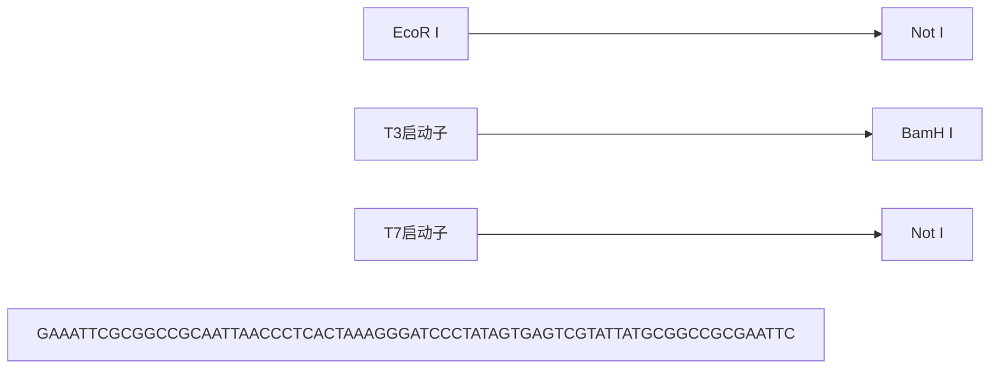

切核酸酶分为 I、II 和 III 型。从克隆的角度来看，最重要的限制性内切核酸酶属于 II 型。数以百计的商品化的 II 型酶可用于分子克隆的几乎各个方面。II 型酶在各种不同细菌物种中的普遍性和多样性被认为是来自于共同的进化需求，即针对噬菌体基因组和其他入侵 DNA 的强大防御机制。

所有这三种类型的限制性内切核酸酶都有同源 DNA 甲基化酶，识别的 DNA 序列与限制性内切核酸酶相同，催化转移一个甲基基团到识别序列内每条 DNA 链的一个特定碱基上。限制位点的甲基化一般包括胞嘧啶残基，生成 4-甲基胞嘧啶、5-甲基胞嘧啶或 5-羟甲基胞嘧啶。甲基化还可以发生在腺嘌呤残基，生成 6-甲基腺嘌呤。甲基化的识别位点被保护从而免受同源限制性内切核酸酶消化。

细菌编码一个特定的限制性内切核酸酶和它同伴甲基化酶的基因在细菌染色体上是彼此相邻的，但并不一定是在同一方向。严格的物理连锁降低了细菌接合过程中这两个基因被重组分离的机会——这种可能显然是灾难性的。

限制性内切酶的分类及其特点详细介绍如下，见表6中总结。

表 6 总结:主要类型的限制性内切核酸酶

| 酶的类型 | 结构 | 体外辅因子 | DNA识别序列 | 切割位点 |
| --- | --- | --- | --- | --- |
| I | 复合体,有3个不同的亚基(内切核酸酶[hsdR]、甲基转移酶[hsdM]、识别[hsdS]) | SAM、ATP | 不对称而且复杂 | 距识别位点大于1000 bp。研究最多的I型酶(LlaG1)在两个不对称的头对头反向重复的识别位点切割。酶的解旋酶结构域催化识别位点间双链DNA的一维逐步易位(Smith et al. 2009a,b)。综述见Bourniquel和Bickle(2002)。 |
| II | 二聚体。内切核酸酶和甲基化酶活性在不同的分子 | $Mg^{2+}$ | 二重对称 | 在识别位点 |
| III | 复合体,有2个亚基(内切核酸酶和甲基化酶识别) | ATP、$Mg^{2+}$、SAM(某些情况下) |  | III型限制性内切核酸酶通过头对头或尾对尾排列的识别位点之间的远程相互作用切割DNA(van Aelst et al. 2010)。据认为是通过DNA滑动发生沿着DNA的运动(Ramanathan et al. 2009;Szczelkun et al. 2010)。 |

## I型

I型限制性内切核酸酶识别DNA序列是不对称的，由两部分组成，一部分3～4个核苷酸，另一部分4～5个核苷酸，中间由6～8个核苷酸相隔。I型酶不在它们识别序列处切割，而是在离位点至少1kb处切割未保护的DNA（综述见Murray2000）。虽然它们对分子克隆没有用处，生物化学家对I型限制性内切核酸酶的多亚基结构和作为分子马达功能的能力感兴趣（Bourniquel and Bickle 2002; Seidel et al. 2004; Smith et al. 2009a,b）。它们同重组酶如RecBC以及真核生物的染色质重塑因子有很强的功能关联。

## II型

II型限制性内切核酸酶是一个具有广泛属性的不同种类酶的集合。最常见的Ⅱ型酶（如Hind III、EcoR I）是二元修饰/限制系统的组分，系统由一个在特定核苷酸序列切割的限制性内切核酸酶和一个独立的修饰相同识别序列的甲基化酶组成。已分离和鉴定大量而且越来越多的这种类型的限制性内切核酸酶，其中有许多可用于克隆和其他分子操作。

绝大多数Ⅱ型限制性内切核酸酶结合 DNA 形成同二聚体, 识别的特定序列长度为 4、5 或 6 个核苷酸, 表现出双面对称。另外, 一些Ⅱ型酶作为异二聚体结合, 识别更长的序列或者简并序列。各种酶的二重对称轴内切割位点的位置也不同:一些恰好在对称轴上切割两条链，产生的 DNA 片段携带平末端，而另一些切割每一条链在对称轴对侧类似的位置，产生携带突出单链末端的 DNA 片段。Ⅱ型限制性内切核酸酶的切割在切口的一端产生 5'-磷酸残基，另一端产生 3'-羟基残基。

许多 II 型酶的 X 射线晶体结构之间的比较表明，其活性位点明显发散，并在许多情况下已经演化出不同的 DNA 结合和切割机制。例如，BamH I 和 Bgl II 识别 6 个碱基，中间 4 个碱基[5'GATC3']相同。令人惊讶的是这两种酶使用完全不同的氨基酸侧链排列与这 4 个中间碱基对接触（Lukacs et al. 2000）。Galburt 和 Stoddard（2000）指出，这两种限制性内切核酸酶的活性部位之间在结构上的整体差异表明其特异性不会轻易因点突变而改变。这种严格的结构特异性具有进化意义:如果由简单的氨基酸置换就引起 II 型酶切割特异性的改变或减弱将产生致命的后果，因为同源的甲基转移酶将无法保护新目标。

一些 II 型酶显示出不同的属性。例如，II B 型限制性内切核酸酶包含多个亚基，需要 S-腺苷甲硫氨酸和  $Mg^{2+}$  以识别不连续的序列（如 5'CGANNNNNNTGC3'），并切割它们识别位点的两侧，释放出一个小片段 DNA。II M 型限制性内切酶，如 Dpn I，只识别和切割甲基化的 DNA；Dpn I 需要其目标序列（GATC）里的腺嘌呤残基甲基化。

## III型

这类酶中的典型成员（EcoP I、EcoP15I、Pst II）识别短的不对称 DNA 序列，非特异性切割距识别位点 3'端 25～28 个核苷酸的 DNA（综述见 Bourniquel and Bickle 2002）。III 型酶可在由 ATP 水解驱动的运动反应中转移 DNA（Meisel et al. 1995）。

## 在线数据库

REBASE 是一个包含所有类型的限制性内切核酸酶和甲基化酶的综合数据库，地址为 http://rebase.neb.com/rebase/rebase.htmL。REBASE 可提供多种格式，包括按字段排列好的 ASCII 文本文件，便于格式化和使用专门的软件程序进行 DNA 分析。

维基百科也维护着一个限制性内切核酸酶数据库，地址为 http://en.wikipedia.org/wiki/List\_of\_restriction\_enzyme\_cutting\_sites。

## 参考文献

- Bourniquel AA, Bickle TA. 2002. Complex restriction enzymes: NTP-driven molecular motors. Biochimie 84: 1047–1059.
- Galburt EA, Stoddard BL. 2000. Restriction endonucleases: One of these things is not like the others. Nat Struct Biol 7: 89–91.
- Lukacs CM, Kucera R, Schildkraut I, Aggarwal AK. 2000. Understanding the immutability of restriction enzymes: Crystal structure of BglII and its DNA substrate at 1.5 A resolution. Nat Struct Biol 7: 134–140.
- Meisel A, Mackeldanz P, Bickle TA, Kruger DH, Schroeder C. 1995. Type III restriction endonucleases translocate DNA in a reaction driven by recognition site-specific ATP hydrolysis. EMBO J 14: 2958–2966.
- Murray NE. 2000. Type I restriction systems: Sophisticated molecular machines (a legacy of Bertani and Weigle). Microbiol Mol Biol Rev 64: 412–434.
- Ramanathan SP, van Aelst K, Sears A, Peakman LJ, Diffin FM, Szczelkun MD, Seidel R. 2009. Type III restriction enzymes communicate in 1D without looping between their target sites. Proc Natl Acad Sci 106: 1748–1753.
- Seidel R, van Noort J, van der Scheer C, Bloom JG, Dekker NH, Dutta CF, Blundell A, Robinson T, Firman K, Dekker C. 2004. Real-time observation of DNA translocation by the type I restriction modification enzyme EcoR124I. Nat Struct Mol Biol 11: 838–843.
- Smith RM, Diffin FM, Savery NJ, Josephsen J, Szczelkun MD. 2009a. DNA cleavage and methylation specificity of the single polypeptide restriction-modification enzyme LlaGI. Nucleic Acids Res 37: 7206–7218.
- Smith RM, Josephsen J, Szczelkun MD. 2009b. The single polypeptide restriction-modification enzyme LlaGI is a self-contained molecular motor that translocates DNA loops. Nucleic Acids Res 37: 7219–7230.
- Szczelkun MD, Friedhoff P, Seidel R. 2010. Maintaining a sense of direction during long-range communication on DNA. Biochem Soc Trans 38: 404–409.
- van Aelst K, Toth J, Ramanathan SP, Schwarz FW, Seidel R, Szczelkun MD. 2010. Type III restriction enzymes cleave DNA by long-range interaction between sites in both head-to-head and tail-to-tail inverted repeat. Proc Natl Acad Sci 107: 9123–9128.


## 氯霉素

氯霉素抑制蛋白质合成并且阻碍宿主 DNA 合成，但对松弛型质粒的复制没有影响。因此，在含有药物的细菌培养基温育的过程中，松弛型质粒的拷贝数增加。松弛型质粒通常在其宿主菌中只复制到中等数量，因而必须通过扩增才能获得高产量的质粒。后代的质粒（如 pUC 质粒）携带改良过的 colE1 复制子，可以复制到很高的拷贝数使得扩增不再必要。在没有氯霉素的情况下，生长至饱和的细菌培养物，可以从中大量纯化这些高拷贝数质粒。然而，即使对这些质粒，使用氯霉素处理仍然有一定优势，因为它可以阻止细菌复制，细菌裂解液的体积和黏度降低，从而大大简化了质粒的纯化。一般情况下，氯霉素处理的好处胜过在生长的细菌培养物中加入药物的不便。

## 氯霉素的性质和作用方式

- 氯霉素通过降低位于 70S 核糖体上的肽基转移酶的催化速率常数，抑制细菌蛋白质的合成（Drainas et al. 1987）。
- 氯霉素于 1947 年从土壤放线菌首次分离（Ehrlich et al. 1947），到 1950 年，它已可以合成，成为一种广泛使用的广谱抗生素。然而，自那以后其临床使用已被削减，因为药物引起骨髓毒性，而且细菌轻易发展出了氯霉素耐受（综述见 Shaw 1983）。
- 氯霉素抑制细菌蛋白质的合成，所以它可以阻止细菌染色体的复制。然而，许多松弛型质粒，包括几乎所有携带野生型 pMB1（或 colE1）复制子的载体，可在药物存在下继续复制，直到细胞中积累到 2000 或 3000 个拷贝（Clewell 1972）。
- 直到20世纪80年代初，氯霉素通常用于从大量培养中获得较高产量的含有野生型colE1复制子的质粒。1982年后构建的大多数高拷贝数质粒载体携带突变，阻止或破坏了两个小调控RNA（RNAI和RNAII）之间的相互作用，从而解除了质粒DNA的拷贝数控制。含有这些突变的colE1起始点的载体维持在每个细胞有数百个拷贝，所以不抑制细菌蛋白质的合成也可以得到高产量的质粒DNA。然而，用氯霉素处理细菌培养物仍具有一定的优势:在药物的存在下，质粒的拷贝数可以进一步增加2～3倍，更重要的是，因为宿主的复制受到抑制，细菌裂解液的体积和黏度都大大降低，许多研究者发现，在生长培养中添加氯霉素比处理高黏度的裂解液方便得多。
- 多年来一直认为只有当宿主细菌在基本培养基上生长时，氯霉素存在下的质粒扩增才是有效的。然而，通过一种使用丰富培养基和氯霉素的方案，携带含有 pMB1 或 colE1 复制子低拷贝数质粒的大肠杆菌菌株，也可以获得可重现的高得率（每 500mL 培养物≥1mg 质粒 DNA）。
- 用低浓度氯霉素（10～20μg/mL）处理细菌培养物，不会完全抑制宿主蛋白合成，却可以提高pBR322及其衍生物的产量（Frenkel and Bremer 1986）。产生这一结果的原因现在还不得而知，但可以解释为，携带colE1起始点的质粒的复制可能需要不稳定的宿主因子，在蛋白质合成被部分抑制的过程中此因子被持续合成。

## 氯霉素的耐药机制

- 细菌中天然存在的氯霉素抗性是由于氯霉素乙酰转移酶（cat 基因所编码）的活性，催化乙酰基从乙酰辅酶 A（CoA）转移到抗生素的 C3-羟基基团。反应产物 3-乙酰氧基氯霉素既不结合到 70S 核糖体的肽基转移酶中心，也不抑制肽基转移酶。
- 在肠杆菌科分离菌株和其他革兰氏阴性菌中，cat 基因是组成型表达，通常携带在质粒上，从而赋予多重耐药性。
- cat 基因产物的一些变异体已有报道，它们都形成三聚体，由相同的、 $M_{r}$ 约为25 000的亚基组成。I型变异体由1102bp的Tn9转座子片段编码，作为报道基因广泛使用。然而，大多数动力学和结构分析用III型变异体进行，因为它能产生适用于X射线分析的晶体。位于亚基界面的活性位点包含一个组氨酸残基，推测作为乙酰化反应的广义碱催化剂（Leslie et al. 1988；Shaw et al. 1988）。两个底物（氯霉素和乙酰辅酶 A）通过位于分子相对两侧的通道接近活性位点。

## 参考文献

- Clewell DB. 1972. Nature of ColE1 plasmid replication in Escherichia coli in the presence of chloramphenicol. J Bacteriol 110: 667–676.
- Drainas D, Kalpaxis DL, Coutsogeorgopoulos C. 1987. Inhibition of ribosomal peptidyltransferase by chloramphenicol. Kinetic studies. Eur J Biochem 164: 53–58.
- Ehrlich J, Bartz QR, Smith RM, Joslyn DA, Burkholder PR. 1947. Chloromycetin, a new antibiotic from a soil actinomycete. Science 106: 417.
- Frenkel L, Bremer H. 1986. Increased amplification of plasmids pBR322 and pBR327 by low concentrations of chlor-amphenicol. DNA 5:539–544.
- Leslie AG, Moody PC, Shaw WV. 1988. Structure of chloramphenicol acetyltransferase at 1.75 Å resolution. Proc Natl Acad Sci 85:4133–4137.
- Shaw WV. 1983. Chloramphenicol acetyltransferase: Enzymology and molecular biology. CRC Crit Rev Biochem 14: 1–46.
- Shaw WV, Day P, Lewendon A, Murray IA. 1988. Tinkering with antibiotic resistance: Chloramphenical acetyltransferase and its substrates. Biochem Soc Trans 16: 939–942.


## ccdB 基因

ccdB 基因由大肠杆菌的 F 质粒携带，编码含 101 个氨基酸残基的蛋白质，在没有解毒剂 ccdA 蛋白时对细菌是致命的。虽然这两种蛋白质都是 F 质粒的稳定维持所需的，ccdA 蛋白的半衰期比 ccdB 短。由于该质粒的拷贝数低（每个细胞一到两个拷贝），两个子细胞中的其中一个可能会在分裂时不能继承 F 质粒。ccdA 蛋白的水平降低，F 分离子变得脆弱，被 ccdB 蛋白质杀死，这个过程被称为解离后致死。在自然条件下，ccd 基因座所编码的两种蛋白质共同作用，确保细菌种群中稳定维持 F 质粒。

ccdB 蛋白通过诱导促旋酶的 ATP 依赖的 DNA 切割来杀死细胞, 导致 SOS 系统的激活（Bernard and Couturier 1992; Miki et al. 1992; Bernard et al. 1993）。然而, 这种蛋白质的致死作用在携带 gyrA462 突变的大肠杆菌菌株中被抑制, 从而使携带 ccdB 基因的高拷贝数质粒载体（如 pKIL; Bernard et al. 1994）得以维持, 并生长到高拷贝数。如果通过在 ccdB 基因内的多克隆位点插入外源 DNA 片段使一个 pKIL 载体中的 ccdB 基因失活, 所产生的重组体变成能转化 $\mathrm{gyrA^{+}}$ 大肠杆菌菌株。在 Gateway 克隆系统中, Destination 载体 ccdB 基因两侧是 attR 重组位点。克隆通过体外重组反应进行, 过程中外来 DNA 片段替换有毒的 ccdB 基因, 从而可以在 $\mathrm{gyrA^{+}}$ 细胞中选择性的增殖重组体 (Hartley et al. 2000)。

## 参考文献

- Bernard P, Couturier M. 1992. Cell killing by the F plasmid CcdB protein involves poisoning of DNA-topoisomerase II complexes. J Mol Biol 226: 735–745.
- Bernard P, Kezdy KE, Van Melderen L, Steyaert J, Wyns L, Pato ML, Higgins PN, Couturier M. 1993. The F plasmid CcdB protein induces efficient ATP-dependent DNA cleavage by gyrase. J Mol Biol 234: 534–541.
- Bernard P, Gabant P, Bahassi EM, Couturier M. 1994. Positive-selection vectors using the F plasmid ccdB killer gene. Gene 148: 71–74.

Hartley JL, Temple GF, Brasch MA. 2000. DNA cloning using in vitro site-specific recombination. Genome Res 10: 1788–1795.

Miki T, Park JA, Nagao K, Murayama N, Horiuchi T. 1992. Control of segregation of chromosomal DNA by sex factor F in Escherichia coli. Mutants of DNA gyrase subunit A suppress letD (ccdB) product growth inhibition. J Mol Biol 225: 39–52.


## λ噬菌体

当想到λ噬菌体时，优雅这个词便映入脑海:一种蚀刻到 DNA 的遗传 “电路”，精致优美却又极度经济；互连的调控回路控制着病毒基因表达的顺序、时间以及水平；出入细菌染色体的能力。认识这些现象是一个难题，从 20 世纪 50 年代后期就已经吸引了许多遗传学领域最优秀的人员。他们的研究结果浓缩成一个和谐的基因控制理论，足以匹敌分子生物学任何其他的智力成果。就像一个早期的噬菌体工作人员写到的:“在每…一步，情况都是令人赏心悦目的，大家都为此感到高兴”（Thomas 1993）。

当然，生物化学家也从来不甘落后，到 20 世纪 70 年代初——分子克隆的黎明——关于λ噬菌体和它的 DNA 了解如此之深，此病毒几乎是自动成为克隆载体一个显而易见的选择。从λ噬菌体 DNA 中去除不方便放置的限制性位点；删除病毒基因组中不必要的片段以使可用于插入外源 DNA 的空间最大化，对噬菌体和大肠杆菌宿主都进行了突变，以满足在整个 20 世纪 70 年代控制 DNA 重组工作的严格规程。

随后的数年，λ噬菌体选作构建哺乳动物基因组和 cDNA 文库的克隆载体。虽然用它工作总是令人高兴的，但它也可能会令人沮丧。NIH 批准的载体先天不足，它们的宿主菌如此孱弱，以至于本应非常容易的事情——例如，生长高滴度储备液——有时会成为一种黑魔法。

但导致λ噬菌体作为载体使用逐渐消亡的不是这类问题，而是人类基因组计划。λ噬菌体重组体可以轻松容纳的外源DNA最长约为25kb。因此，一个全面、重叠、深入的哺乳动物基因组文库将包括数百万个独立克隆。在没有阵列化和自动化的日子，处理这种规模的文库是不容易的。很快，人类基因组测序的尝试明显要求载体具备更高的容量，以与克隆或亚克隆到载体的能力相适应，如可以为测序产生单链DNA模板的M13噬菌体。

到 20 世纪末期，λ噬菌体已经成为博物馆里的东西了。遗传学和生物化学的问题已经解决。已经发展出了更好的载体，也许令人失望的是，噬菌体优雅的“电路”对于理解哺乳动物基因控制的方式几乎没提供什么帮助。然而，λ噬菌体不是一个化石:其基因组的星星点点已纳入重组工程中使用的重组系统，此系统通过在大肠杆菌中重组后产生复杂的、精确确定的克隆，而不是通过体外的限制性酶切和连接。在一些重组工程系统中，由λ噬菌体的 gam 基因编码的蛋白质用来抑制外切核酸酶 V——大肠杆菌 recBCD 系统的组分。抑制宿主的外切核酸酶活性，可以提高λ噬菌体 Red 操纵子介导的体内重组的效率，并抑制外切核酸酶 V 对线性双链 DNA 的降解（综述见 Court et al. 2002; Karlinsey 2007）。

## 参考文献

Court DL, Sawitzke JA, Thomason LC. 2002. Genetic engineering using homologous recombination. Annu Rev Genet 36: 361–388.
Karlinsey JE. 2007. λ-Red genetic engineering in Salmonella enterica serovar Typhimurium. Methods Enzymot 421: 199–209.

Thomas R. 1993. Bacteriophage λ: Transactivation, positive control and other odd findings. BioEssays 15: 285–289.


## M13 噬菌体

- M13 是一个丝状噬菌体家族的一员，含有一个长约 6400 个碱基的单链基因组。
- M13 病毒颗粒只感染雄性细菌，受感染的细胞不裂解。相反，受感染的细胞释放子代病毒颗粒，即便它们继续生长和分裂。
- 在感染过程中，单链病毒基因组转换成双链、环状的复制型（RF）。RF 分子然后通过滚动循环机制生成单链的 (+)-链子代分子。RF 分子也是 11 个病毒基因转录的模板（参见图 3）。
- M13 基因组所有必需的顺式作用元件被隔离在一个 508 bp 的基因间区。
- 由于其基因组往往是不稳定的，丝状噬菌体不用于外源 DNA 片段的克隆和长期增殖。相反，它们主要作为媒介用于产生已插入双链 RF 形式 M13 DNA 基因间隔区的短 DNA 片段（300～500bp）的单链拷贝（Messing et al. 1977; Gronenborn and Messing 1978）。

\- 今天普遍使用的载体是由 Joachim Messing 和他的同事在 20 世纪 70 年代和 80 年代初发展的（综述见 Messing 1983，1993，1996）。这些载体对于双脱氧 DNA 测序（Sanger et al. 1980）、鸟枪法测序（Messing et al. 1981），以及最终对许多自动化、高通量 DNA 测序方法的发展至关重要。


<details>
<summary>text_image</summary>

Hpa I
6407/0
II
V
VII
IX
VIII
III
IX
VI
I
M13噬菌体
6.4kb
Plus
-ori
Minus
IR
IR
</details>

图 3 M13 噬菌体的基因图谱。野生型 M13 是单链环状 DNA 分子，长度 6407 个核苷酸。核苷酸的编号从一个唯一的 Hpa I 位点开始（van Wezenbeek et al. 1980）。图中，基因都是以同一方向“顺时针”定向，编号 I 至 XI，两个基因间隔区标记为 IR，主要启动子用箭头指示，转录终止子被标记为圆圈内一个交叉。按照惯例，病毒 DNA 被称为(+)链，与病毒 mRNA 具有相同的含义。

## 参考文献

- Gronenborn B, Messing J. 1978. Methylation of single-stranded DNA in vitro introduces new restriction endonclease cleavage sites. Nature 272: 375–377.
- Messing J. 1983. New M13 vectors for cloning. Methods Enzymol 101:20–78.
- Messing J. 1993. M13 cloning vehicles. Their contribution to DNA sequencing. Methods Mol Biol 23: 9–22.
- Messing J. 1996. Cloning single-stranded DNA. Mol Biotechnol 5: 39–47.
- Messing J, Crea R, Seeburg PH. 1981. A system for shotgun sequencing. Nucleic Acids Res 9: 309–321.
- Messing J, Gronenborn B, Müller-Hill B, Hofschneider PH. 1977. Filamentous coliphage M13 as a cloning vehicle: Insertion of a HindII fragment of the lac regulatory region in M13 replicative form in vitro. Proc Natl Acad Sci 74: 3642–3646.
- Sanger F, Coulson AR, Barrell BG, Smith AJ, Roe BA. 1980. Cloning in single-stranded bacteriophage as an aid to rapid DNA sequencing. J Mol Biol 143: 161–178.
- van Wezenbeek PMGF, Hulsebos TJM, Schoenmakers JGG. 1980. Nucleotide sequence of the filamentous bacteriophage M13 DNA genome: Comparison with phage fd. Gene 11: 129–148.


## 质粒

## 质粒复制子

复制子是一种遗传单位，长度为几百个碱基对，包含一个 DNA 复制的起始点和相关的控制元件。质粒复制子限定了每个细菌细胞中携带的质粒 DNA 的拷贝数。此数量可以随着细菌培养物中生长条件的变化在一个狭窄的范围内增加或减少。质粒中已经鉴定了超过 30 种不同的复制子。含有原始的 pMB1 复制子（或其近亲属，大肠杆菌素 E1 [colE1]复制子，Balbas et al. 1986）的质粒处于严紧型控制，使用宿主编码的 RepA 蛋白质作为运动调节器，维持每个细菌细胞中 15 至 20 个拷贝的质粒 DNA。几乎所有的通常用于分子克隆的质粒携带来源于 pMB1 的复制子，一种最初从临床标本分离出的质粒（Hershfield et al. 1974）。多年来，pMB1/colE1 复制子已被广泛修改，以增加拷贝数，并由此提高质粒 DNA 产量。各种质粒复制子的特点列于表 7。

表 7 质粒复制子和复制模式

| 复制子 | 复制模式 | 例子 | 拷贝数 | 参考文献 |
| --- | --- | --- | --- | --- |
| pMB1 | 严紧型 | pBR322 | 15~20 | Bolivar et al. 1977b |
| 改良的 pMB1 | 松弛型 | $pUC^a$ | 500~700 | Vieira and Messing 1982; 1987; Messing 1983 |
| p15A | 严紧型 | pACYC | 10~12 | Chang and Cohen 1978 |
| pSC101 | 严紧型 | pSC101 | 约 5 | Stoker et al. 1982 |
| 改良的 colE1 | 松弛型 | Bluescript 载体 | 300~500 | Alting-Mees and Short 1989 |

a. pUC 复制子来源于 pBR322。pUC 系列高拷贝数质粒来自于编码引物 RNA（RNAII）基因的一个点突变（Lin-Chao et al. 1992）。此外，rop 基因（引物的阻抑物）已被删除。pMB1 和 colE 复制子的结构和功能有着广泛的同源性，并且属于相同的不相容组。

不管质粒具有何种复制子，通过定量提供能影响质粒 DNA 合成起始频率的分子，质粒和宿主的复制率之间保持和谐。在含有 pMB1/colE1 复制子的质粒中，这个正调节分子是 anRNA，称为 RNAII，用来引发前导链 DNA 合成的开始。携带 pMB1 复制子或其衍生物的质粒的复制不需要任何质粒编码的蛋白质，而是完全依赖于由宿主提供的长存的酶和蛋白质，包括伴侣蛋白、DNA 聚合酶 I 和 III、DNA 依赖的 RNA 聚合酶、核糖核酸酶 H（RNase H）、DNA 促旋酶和拓扑异构酶 I。这些质粒以“松弛型”的模式复制，直至因氨基酸饥饿，蛋白质合成被抑制（Bazaral and Helinski 1968）或加入氯霉素之类的抗生素（Clewell and Helinski 1969）（见信息栏“氯霉素”）。蛋白质合成对于每一轮宿主 DNA 合成的开始是必需的，但质粒复制并不需要，因此在暴露于氯霉素的细胞中，质粒 DNA 的量相对于染色体 DNA 是增加的（Clewell 1972）。在几个小时的扩增过程中，可能在细胞中积累数千个松弛型质粒拷贝；过程结束时，质粒 DNA 可能占细胞总 DNA 的 50% 或更多。

种类繁多的高拷贝数质粒载体是分子克隆的重要工具，用于小片段重组 DNA（小于 15 kb）的几乎所有日常操作。相比之下，携带 pMB1/colE1 以外来源的复制子的低拷贝数载体都用于特殊用途。包括:

- 克隆不稳定的 DNA 序列以及在高拷贝数质粒中增殖时致死的基因；
- 构建细菌人工染色体（BAC），一种用来增殖大片段（约 100 kb）外源 DNA 的载体，就如同大肠杆菌中的质粒。

## 质粒不相容性和共遗传

当两种质粒携带相同的复制子时，它们在复制和随后分配到子细胞的步骤中相互竞争。这样的质粒在无选择压力时无法共存于细菌培养物中。这种现象被称为不相容性（综述见 Davison 1984；Novick 1987）。

含有相同的复制装置元件的质粒属于相同的不相容群，不能持久地共同保持于同一细菌内。携带不同复制子的质粒属于不同的不相容群，可以稳定地共维持在同一细菌内。例如，与 colE1 型质粒相容的质粒是 p15A、R6K 和 F 等低拷贝数质粒。

低拷贝数质粒通过主动的 ATP 依赖的分离机制分离到子细胞中，此类机制具有类着丝粒位点和作用于这些位点的蛋白质（综述见 Reyes-Lamothe et al. 2008）。高拷贝数质粒与此相反，似乎是通过被动分配传输到子细胞，这是一个不能保证两个不同的高拷贝数质粒共遗传的随机过程（Pogliano et al. 2001；Nordstrom and Gerdes 2003）。例如，较大的质粒比较小的质粒需要更多的时间来复制，在细菌种群的每个细胞中处于选择劣势。因为单个细菌细胞内随机过程产生的起始效率失衡，同样大小的质粒也可能是不相容的。这种机会的转变可以迅速导致两个质粒拷贝数的大幅差异。在某些细胞中，一种质粒可能占主导地位，而在其他细胞，另一种质粒可能会蓬勃发展。在没有选择压力的情况下，经过几代的细菌生长过程，“少数派”质粒可以从种群的一些细胞中被完全消除。原始细胞的后代可能包含其中一种质粒或另一种，但很少会两者都有。

正如前面所讨论的，大多数目前使用的载体携带来源于质粒 pMB1 的复制子。这些载体与所有其他携带 colE1 复制子的质粒是不相容的，但是和复制子来源于如 pSC101 及其衍生物的质粒完全相容。表 8 列出了一些众所周知的质粒和参与调节其复制的负调控元件。

表 8 调控复制的控制元件

| 不相容群 | 负调控元件 | 备注 |
| --- | --- | --- |
| colE1, pMB1 | RNA I | 控制前体 RNA II 成引物的过程 |
| IncFII, pT181 | RNA | 控制 RepA 蛋白的合成 |
| P1, F, R6K, pSC101, p15A | 重复子 | 封闭 RepA 蛋白 |

## 选择标记

多年前,质粒用它们的开发者命名。所以,第一个克隆实验使用的质粒 pSC101(Cohen et al. 1973) 是在 Stan Cohen 的实验室设计和构造的。它携带一个抗生素抗性基因（四环素抗性；见信息栏“抗生素”）和一个限制性酶切位点（EcoRI）。

质粒载体中含有遗传标记，在选择性条件下赋予带有质粒的细菌强劲增长的优势。在分子克隆中，这些标记用于:

- 选择带有质粒的细菌克隆。在实验室中，可以通过人工转化过程将质粒 DNA 导入细菌。然而，即使是在最佳条件下，转化通常是低效的，质粒只在一小部分细菌群体中稳定地“安置”下来。质粒携带的选择标记使得挑选这些稀少的转化体变得轻松。这些质粒编码的标记物提供特定的抗生素抗性（即在抗生素存在下生长的能力），如卡那霉素、氨苄青霉素、羧苄青霉素和四环素。这些抗生素的属性和作用方式在信息栏“抗生素”中进行了讨论。
- 保护转化细菌不受它们负担的质粒 DNA 或质粒编码蛋白质所施加的风险。质粒以低拷贝数（小于 20 拷贝/细胞）存在似乎并不过分妨碍其宿主细胞。然而，许多证据表明，高拷贝数质粒和大量的重组蛋白可以严重阻碍转化细胞的生长甚至生存（Murray and Kelley 1979；Beck and Bremer 1980）。为了防止出现质粒被清除的细菌，重要的是任何时候都在培养基中包含合适的抗生素以维持选择压力。

在 20 世纪 70 年代初，选择标记——通常为 Kan$^{r}$、Amp$^{r}$ 或 Tet$^{r}$——被引入含有 pMB1（或 colE1）复制子的质粒（见信息栏“抗生素”）。最先用作克隆载体的质粒——pSC101（Cohen et al. 1973）、colE1（Hershfield et al. 1974）及 pCR1（Covey et al. 1976）——其通用性是有限的:它们要么复制不佳，要么携带不合适的选择标记，并且都不包含两个以上可用于克隆的限制性位点。第一个整合所有当时可用的合适特点的质粒是 pBR313（Bolivar et al. 1977b），以松弛型方式复制，包含两个选择标记（Tet$^{r}$ 和 Amp$^{r}$），并含有一些有用的酶切位点。然而，pBR313 过于臃肿，超过一半的 DNA 对其作为载体是不必要的。质粒载体发展的第一阶段随着 pBR322（Bolivar et al. 1977b）的构建结束，质粒大小为 4.36 kb，大部分不必要的序列都被消除了。pBR322 是当时使用最广泛的克隆载体，许多目前使用的质粒载体是其子孙后代（综述见 Balbas et al. 1986）。

20 世纪 80 年代初，笨重的质粒如 pBR322 进一步发展，载体向尺寸更小、拷贝数更高，能够接受更广泛的限制性内切核酸酶酶切所产生的外源 DNA 片段。可以克隆到质粒中的 DNA 片段的大小没有严格的上限，但是，将质粒载体的尺寸减小到最低限度也有优点。质粒的拷贝数、稳定性和转化效率随着它们 DNA 的尺寸减小而提高。在效率开始下降之前，较小的质粒可以容纳更大的外源 DNA 片段。另外，由于较小的 colE1 质粒可以复制到更高的拷贝数，外源 DNA 的得率会增加，并且用放射性标记的探针筛选包含克隆的外源 DNA 序列的转化菌落时，其杂交信号会增强。

从 pBR322 改进的衍生载体，解决了不灵活和效率低下的问题。这些质粒缺乏辅助的序列以控制拷贝数和转移。不幸的是，第一代高拷贝数质粒，其中最有名的 pXf3（Hanahan 1983）的主要缺陷是:外源 DNA 序列只能在位于“天然”序列内的有限数量的限制性位点插入以构建质粒。一两年内，这些质粒被一系列革命性的载体（pUC 载体）取代了，在这些载体中，限制性内切核酸酶切割位点的数量扩大了，并且它们在载体内的分布更加合理（Messing 1983；Norrander et al. 1983；Yanisch-Perron et al. 1985；Vieira and Messing 1987）。pUC 载体是第一个包含了一系列紧密排列的合成克隆位点的载体，这些合成位点被称为多接头或多克隆位点，它们组成了限制性内切核酸酶识别序列的库。在大多数情况下，这些限制性位点是唯一的（即，它们不存在于质粒载体中的其他地方）。例如，pUC19 载体的多克隆位点由 13 种限制性内切核酸酶唯一切割位点的串联排列组成。

这样的识别序列排列提供了大量多样的靶点，可以单独使用或与众多种类的限制性内切核酸酶酶切产生的克隆 DNA 片段组合使用。此外，在一个限制位点插入的片段，常常可以通过用在侧翼位点切割的限制性内切核酸酶切割重组质粒而将其切下。因此，将 DNA 片段插入一个多克隆位点相当于在它的末端加上合成接头。这些侧翼位点的可用极大简化了绘制外源 DNA 片段图谱的任务。

将所有克隆位点一起安排到质粒的一个位置，其潜在缺点是无法使用灭活选择标记来筛选重组体。此方法广泛用于第一代质粒，如 pBR322，带有两个或更多不同的选择性标记（例如 Tet $^{r}$  和 Amp $^{r}$ ），每个都包含一个“天然”的限制位点。外源 DNA 序列插入到其中一个位点就可以灭活两个标记之一。含有重组质粒的细菌，因此可以同那些携带空的亲本载体的细菌区别开，因为它们只能在两套选择性条件之一进行生长（见信息栏“抗生素”）。

用 pUC 系载体进行插入失活是不可能的，因为它仅含一种抗生素抗性基因（通常为氨苄青霉素抗性）和一套聚集的克隆位点。然而，通过筛选细菌菌落的颜色，可以很容易区分重组质粒和亲本 pUC 质粒。pUC 载体和许多其衍生物携带一段短的大肠杆菌 DNA 片段，包含 lacZ 基因的调节序列和 β-半乳糖苷酶氨基末端 146 个氨基酸的编码信息。一个多克隆位点嵌入在编码信息中，恰好是起始 ATG 的下游。pUC 载体在转化细菌中表达的 β-半乳糖苷酶氨基末端小片段没有内源性 β-半乳糖苷酶活性。然而，这段被称为 α 片段的氨基末端片段，可以与某些自身无活性的 β-半乳糖苷酶特定突变体结合，形成具有充分催化活性的酶。当 pUC 质粒被引入到一个表达无活性的 β-半乳糖苷酶羧基末端片段（ω 片段）的大肠杆菌菌株时，会发生 α-互补。

当一段外源 DNA 克隆到 pUC 载体的多克隆位点时，编码  $\alpha$  片段的序列被打断了， $\alpha$ -互补被极大地抑制或完全废除。因此，含重组质粒的细菌菌落具有氨苄青霉素抗性，却含有很少的或根本没有  $\beta$ -半乳糖苷酶活性。与此相反，含有空质粒的细菌菌落具有氨苄青霉素抗性，而且能够水解不可发酵显色底物，如 5-溴-4-氯-3-吲哚- $\beta$ -D-半乳糖苷（X-Gal）（Horwitz et al. 1964；Davies and Jacob 1968；见第 1 章信息栏 “X-Gal” 和 “ $\alpha$ -互补”）。因此，可以通过一个简单的、非破坏性的组织化学实验区分这两种类型的菌落（Miller 1972）。当琼脂培养基含有 X-Gal 时，携带亲本非重组质粒的菌落变成深蓝色，而那些含有重组质粒的菌落仍然是普通的乳白色或变成像染了浅蛋壳蓝色（更多详细信息，见第 1 章信息栏 “ $\alpha$ -互补”）。

现今的质粒载体构建涉及用于多种用途的辅助序列的结合，包括用于 DNA 测序的单链 DNA 模板生成、外源 DNA 序列的体外转录、重组克隆的直接选择和大量外源蛋白的表达。这些特殊功能在这里简要讨论，在后面的章节中有更详细的论述。

## 携带来源于单链噬菌体复制起始点的质粒载体

在 20 世纪 80 年代和 90 年代开发的许多质粒载体携带来自单链丝状噬菌体基因组的 DNA 复制起始点，如 M13 或 f1（见信息栏“M13 噬菌体”）。这样的载体有时被称为噬菌粒，结合了质粒和单链噬菌体载体的最佳特性，优点是具有两种独立的复制模式:作为一个传统的双链 DNA 质粒和作为模板产生噬菌粒一条链的单链拷贝。噬菌粒因此可以以相同的方式作为一个传统的质粒载体使用，或者用于产生含有克隆 DNA 片段单链拷贝的丝状噬菌体颗粒。自 20 世纪 80 年代初推出以来，噬菌粒使得大部分情况下外源 DNA 不再需要从质粒亚克隆到传统的单链噬菌体载体。

携带噬菌粒的细菌感染辅助噬菌体后，诱导产生单链 DNA，辅助噬菌体携带下列所需基因:①从双链模板生成单链 DNA；②将单链 DNA 包装进丝状病毒颗粒。小规模培养的感染后细菌分泌的缺陷丝状病毒颗粒，包含足够的单链 DNA，可用于测序。在大多数情况下，噬菌体复制起始点方向不同的成对质粒载体都可用。起始点的方向决定两条 DNA 链的哪一条会被包被进噬菌体颗粒。按照惯例，一个加号（+）表示质粒和噬菌体颗粒中的起始点是在同一方向。

## 携带噬菌体启动子的质粒载体

许多质粒载体携带来自于噬菌体的启动子 T3、T7 和/或 SP6，与多克隆位点（MCS）相邻。因此，当线性化的重组质粒 DNA 和适当的 DNA 依赖的 RNA 聚合酶以及核糖核苷酸前体一起孵育时，在 MCS 的限制性酶切位点插入的外源 DNA 可以在体外转录。这些启动子是特异性的，例如，SP6 的 RNA 聚合酶不能从位于质粒其他地方的任何其他噬菌体启动子合成 RNA。

许多商业化的载体（如 pGEM 系列载体或 Bluescript 系列载体）在相反的方向上携带两个噬菌体启动子，位于多克隆位点的各一侧（Short et al. 1988）。此结构使得可以根据转录反应中使用的 RNA 聚合酶类型，在体外从外源 DNA 的任一端或任一链合成 RNA。以这种方式产生的 RNA 可作为杂交探针，或可以在无细胞蛋白质合成系统中被翻译。此外，携带 T7 启动子的载体可用于在表达 T7 RNA 聚合酶的细菌中表达克隆 DNA 序列（Tabor and Richardson 1985）。商业公司出售多种此类型载体。

## 阳性选择载体

鉴别插入 DNA 的质粒曾经是令人沮丧和费时的，然而，已经开发了多种克隆载体，只允许携带重组质粒的细菌菌落生长。含亲本空质粒的细菌在这些选择性条件下无法形成菌落。通常情况下，这些系统中使用的质粒表达一种对特定细菌宿主致命的基因产物；外源 DNA 片段克隆到质粒，使这个基因失活，并解除其毒性。表 9 总结了多年来阳性选择载体使用的许多条件致死毒性基因的属性。这些旧系统中许多是非常巧妙的，但是，因为它们在一个特定的实验室被开发用来解决或改善一个特定的问题，不容易适用于其他用途。

表 9 阳性选择系统中使用的毒性基因

| 毒性基因 | 参考文献 |
| --- | --- |
| 四环素抗性 | Bochner et al. 1980; Maloy and Nunn 1981; Craine 1982 |
| $\lambda$噬菌体阻抑物 | Nilsson et al. 1983; Mongolsuk et al. 1994 |
| EcoR I甲基化酶 | Cheng and Modrich 1983 |
| EcoR I限制性内切核酸酶 | Kuhn et al. 1986 |
| 半乳糖激酶 | Ahmed 1984 |
| $\phi$ X174的溶菌基因 | Henrich and Plapp 1986 |
| ccdB | Bernard and Couturier 1992 |
| Kis | Gabant et al. 1997, 2000 |

当前使用得最好的阳性选择系统是基于 F 质粒编码的 ccdB 基因，它表达一种 101 个氨基酸残基的蛋白质，在没有解毒剂 ccdA 蛋白时，对细菌是致命的。这两种蛋白质对于 F 质粒的稳定维持是必需的。然而，ccdA 蛋白的半衰期比 ccdB 短。因为 F 质粒的拷贝数低（每个细胞一到两个拷贝），两个子细胞中的其中一个在分裂时可能无法继承质粒。当 ccdA 蛋白的水平降低，F 分离子对 ccdB 蛋白质的杀伤变得脆弱——一个称为解离后致死的过程。ccd 基因座所编码的两种蛋白质的共同作用确保 F 质粒在细菌群体的稳定维持（Jensen and Gerdes 1995）。

ccdB 蛋白质通过诱导促旋酶的 ATP 依赖的 DNA 切割，导致 SOS 系统的激活，进而杀死细胞（Bernard and Couturier 1992；Miki et al. 1992；Bernard et al. 1993）。这种蛋白质的致死效应在携带 gyrA462 突变体的大肠杆菌中受到抑制，使携带 ccdB 基因的高拷贝数质粒载体（如 pKIL，Bernard et al. 1994）得以维持并生长到高拷贝数。然而，如果 ccdB 基因被插入其内部多克隆位点内的外源 DNA 片段失活，由此产生的重组体能转化 gyrA $^{+}$ 大肠杆菌菌株。该系统是非常有效的:大于 90% 生长于 gyrA $^{+}$ 株上的转化菌落是重组体（Gabant et al. 1997）。已开发出一个类似的系统，使用有毒的 kid 蛋白及其解毒剂 kis，由大肠杆菌的 R1 质粒编码（Gabant et al. 2000）。

在 Gateway 克隆系统中，Destination 载体 ccdB 基因两侧是 attR 重组位点。克隆通过体外重组反应进行，其间一个外来 DNA 片段取代有毒的 ccdB 基因，从而使重组体在 gyrA $^{+}$ 细胞可以选择性增殖（Hartley et al. 2000）（见第 4 章）。

## 低拷贝数质粒载体

传统的高拷贝数质粒载体携带加强版的复制子，与之相比，低拷贝数质粒载体基于诸如 R1 复制子构建，保持非常严格控制的质粒 DNA 合成。

第一代的低拷贝载体——以今天的标准看来相当笨重和粗糙——被设计用来解决特定类型的外源基因和 DNA 序列克隆到质粒载体时所产生的毒性问题。许多编码膜蛋白质和 DNA 结合蛋白的基因属于这一类，某些启动子及调节序列也如此。有时，这些 DNA 序列和基因产物对宿主菌的毒性很强，以至于根本不可能使用高拷贝数载体分离出转化菌株。即使得到转化体，其生长率也常常是令人沮丧的缓慢，而且克隆的外源 DNA 序列往往不稳定。为了解决这些问题，已经开发了多用途的低拷贝数载体，含有进行严格调控且基础表达水平低的原核启动子，如 pET 系列载体，并含有原核转录终止子，以防止外源 DNA 序列从上游的质粒启动子假转录。现在，这些低拷贝数载体带有多克隆位点、单链噬菌体复制起始点、T3 和 T7 启动子，以及其他有价值的、有用的模块化的便利结构。大多数现代的低拷贝数载体还携带 par 基因座，促进质粒分子在细胞分裂过程中精确分配到子细胞。

## 参考文献

- Ahmed A. 1984. Plasmid vectors for positive galactose-resistance selection of cloned DNA in Escherichia coli. Gene 28: 37–43.
- Alting-Mees MA, Sorge JA, Short JM. 1992. pBluescriptII: Multifunctional cloning and mapping vectors. Methods Enzymol 216: 483–495.
- Balbas P, Soberón X, Merino E, Zurita M, Lomeli H, Valle F, Flores N, Bolivar F. 1986. Plasmid vector pBR322 and its special purpose derivatives—A review. Gene 50: 3–40.
- Bazaral M, Helinski DR. 1968. Circular DNA forms of colicinogenic factors E1, E2 and E3 from Escherichia coli. J Mol Biol 36: 185–194.
- Beck E, Bremer E. 1980. Nucleotide sequence of the gene ompA coding the outer membrane protein II of Escherichia coli K-12. Nucleic Acids Res 8: 3011–3027.
- Bernard P, Couturier M. 1992. Cell killing by the F plasmid CcdB protein involves poisoning of DNA-topoisomerase II complexes. J Mol Biol 226: 735–745.
- Bernard P, Kezdy KE, Van Melderen L, Steyaert J, Wyns L, Pato ML, Higgins PN, Couturier M. 1993. The F plasmid CcdB protein induces efficient ATP-dependent DNA cleavage by gyrase. J Mol Biol 234:534–541.
- Bernard P, Gabant P, Bahassi EM, Couturier M. 1994. Positive-selection vectors using the F plasmid ccdB killer gene. Gene 148: 71–74.
- Bochner B, Huang H, Schiever G, Ames B. 1980. Positive selection for loss of tetracycline resistance. J Bacteriol 143: 926–933.
- Bolivar F, Rodriguez RL, Betlach MC, Boyer HW. 1977a. Construction and characterization of new cloning vehicles. I. Ampicillin-resistant derivatives of the plasmid pMB9. Gene 2: 75–93.
- Bolivar F, Rodriguez RL, Greene PJ, Betlach MC, Heyneker HL, Boyer HW, Crosa JH, Falkow S. 1977b. Construction and characterization of new cloning vehicles. II. A multipurpose cloning system. Gene 2:95–113.
- Chang ACY, Cohen SN. 1978. Construction and characterization of amplifiable multicopy DNA cloning vehicles derived from the p15A cryptic miniplasmid. J Bacteriol 134: 1141–1156.
- Cheng S, Modrich P. 1983. Positive selection cloning vehicle useful for overproduction of hybrid proteins. J Bacteriol 154: 1005–1008.
- Clewell DB. 1972. Nature of ColE1 plasmid replication in Escherichia coli in the presence of chloramphenicol. J Bacteriol 110: 667–676.
- Clewell DB, Helinski DR. 1969. Supercoiled circular DNA-protein complex in Escherichia coli: Purification and induced conversion to an open circular form. Proc Natl Acad Sci 62: 1159–1166.
- Cohen SN, Chang AC, Boyer HW, Helling RB. 1973. Construction of biologically functional bacterial plasmids in vitro. Proc Natl Acad Sci 70:3240–3244.
- Covey C, Richardson D, Carbon J. 1976. A method for the deletion of restriction sites in bacterial plasmid deoxyribonucleic acid. Mol Gen Genet 145: 155–158.
- Craine BL. 1982. Novel selection for tetracycline- or chloramphenicol-sensitive Escherichia coli. J Bacteriol 151: 487–490.
- Davies J, Jacob F. 1968. Genetic mapping of the regulator and operator genes of the lac operon. J Mol Biol 36: 413–417.
- Davison J. 1984. Mechanism of control of DNA replication and incompatibility in ColE1-type plasmids—A review. Gene 28: 1–15.
- Gabant P, Drèze PL, Van Reeth T, Szpirer J, Szpirer C. 1997. Bifunctional lacZ α-ccdB genes for selective cloning of PCR products. BioTechniques 23: 938–941.
- Gabant P, Van Reeth T, Drèze PL, Faelen M, Szpirer C, Szpirer J. 2000. New positive selection system based on the parD (kis/kid) system of the R1 plasmid. BioTechniques 28: 784–788.
- Hanahan D. 1983. Studies on transformation of Escherichia coli with plasmids. J Mol Biol 166: 557–580.
- Hartley JL, Temple GF, Brasch MA. 2000. DNA cloning using in vitro site-specific recombination. Genome Res 10: 1788–1795.
- Henrich B, Plapp R. 1986. Use of the lysis gene of bacteriophage $\phi$X174 for the construction of a positive selection vector. Gene 42:345-349.
- Hershfield V, Boyer HW, Yanofsky C, Lovett MA, Helinski DR. 1974. Plasmid ColE1 as a molecular vehicle for cloning and amplification of DNA. Proc Natl Acad Sci 71: 3455–3459.
- Horwitz JP, Chua J, Curby RJ, Tomson AJ, Darooge MA, Fisher BE, Mauricio J, Klundt I. 1964. Substrates for cytochemical demonstration of enzyme activity. I. Some substituted 3-indolyl-β-D-glycopyranosides. J Med Chem 7: 574–575.
- Jensen RB, Gerdes K. 1995. Programmed cell death in bacteria: Proteic plasmid stabilization systems. Mol Microbiol 17: 205–210.
- Kuhn I, Stephenson FH, Boyer HW, Greene PJ. 1986. Positive selection vectors utilizing lethality and the EcoRI endonuclease. Gene 42:253–263.
- Maloy SR, Nunn WD. 1981. Selection for loss of tetracycline resistance by Escherichia coli. J Bacteriol 145: 1110–1111.
- Messing J. 1983. New M13 vectors for cloning. Methods Enzymol 101: 20–78.
- Miki T, Park JA, Nagao K, Murayama N, Horiuchi T. 1992. Control of segregation of chromosomal DNA by sex factor F in Escherichia coli. Mutants of DNA gyrase subunit A suppress letD (ccdB) product growth inhibition. J Mol Biol 225: 39–52.
- Miller JH. 1972. Experiments in molecular genetics. Cold Spring Harbor Laboratory Press, Cold Spring Harbor, NY.
- Mongolsuk S, Rabibhadana S, Vaatanaviboon P, Loprasert S. 1994. Generalized and mobilizable positive-selection cloning vectors. Gene 143:145–146.
- Murray NE, Kelley WS. 1979. Characterization of the  $\lambda$ polA transducing phages: Effective expression of the E. coli polA gene. Mol Gen Genet 175: 77–87.
- Nilsson B, Uhlen M, Josephson S, Gattenbeck S, Philipson L. 1983. An improved positive selection vector constructed by oligonucleotide-mediated mutagenesis. Nucleic Acids Res 11: 8019–8030.
- Nordstrom K, Gerdes K. 2003. Clustering versus random segregation of plasmids lacking a partitioning function: A plasmid paradox? Plasmid 50: 95–101.
- Norrander J, Kempe T, Messing J. 1983. Construction of improved M13 vectors using oligodeoxynucleotide-directed mutagenesis. Gene 26:101–106.
- Novick RP. 1987. Plasmid incompatibility. Microbiol Rev 51: 381–395.
- Pogliano J, Ho TQ, Zhong Z, Helinski DR. 2001. Multicopy plasmids are clustered and localized in Escherichia coli. Proc Natl Acad Sci 98: 4486–4491.
- Reyes-Lamothe R, Wang X, Sherratt D. 2008. Escherichia coli and its chromosome. Trends Microbiol 16: 238–245. Pogliano J, Ho TQ, Zhong Z, Helinski DR. 2001. Multicopy plasmids are clustered and localized in Escherichia coli. Proc Natl Acad Sci 98: 4486–4491.
- Short JM, Fernandez JM, Sorge JA, Huse WD. 1988. λZAP: A bacteriophage λ expression vector with in vivo excision properties. Nucleic Acids Res 16: 7583–7600.
- Stoker NG, Fairweather NF, Spratt BG. 1982. Versatile low-copy-number plasmid vectors for cloning in Escherichia coli. Gene 18: 335–341.
- Tabor S, Richardson CC. 1985. A bacteriophage T7 RNA polymerase/promoter system for controlled exclusive expression of specific genes. Proc Natl Acad Sci 82: 1074–1078.
- Vieira J, Messing J. 1982. The pUC plasmids, an M13-mp7-derived system for insertion mutagenesis and sequencing with synthetic universal primers. Gene 19: 259–268.
- Vieira C, Messing J. 1987. Production of single-stranded DNA. Methods Enzymol 153: 5–11.
- Yanisch-Perron C, Vieira J, Messing J. 1985. Improved M13 phage cloning vectors and host strains: Nucleotide sequences of the M13mp18 and pUC19 vectors. Gene 33: 103–119.


## 黏粒

在 20 世纪 70 年代后期发展出了黏粒，以满足对可容纳大段基因组 DNA 载体的需求（Collins and Hohn 1978；Hohn and Collins 1988）。黏粒是传统的质粒，包含一个原核 DNA 复制起始点（通常为 colE1 或 pMB1）、一个选择标记和一个或多个用于插入基因组 DNA 片段的限制性位点。黏粒还携带一个，更多的时候两个，λ噬菌体 DNA 的一个小区域——280bp cos 序列（Bates and Swift 1983；Hohn 1983），可以由λ噬菌体编码的末端酶蛋白切割，产生带有 12 个碱基长度互补单链末端的线性分子（Emmons 1974）。携带λ噬菌体末端酶切割的基因组 DNA 片段的重组黏粒，可在体外包装进λ噬菌体颗粒并导入大肠杆菌（Hohn and Murray 1977；Collins and Hohn 1978；Hohn 1979）。一旦进入细菌，重组黏粒环化，然后作为一个大型的常规质粒复制到每个细胞 $15\sim 20$ 个拷贝数。该体外包装和转导的木马程序被设计用来解决将大型质粒有效地转化进大肠杆菌的难题。

不幸的是，黏粒载体很快出现了一个明显的问题，并且不易解决，即它们的能力根本就不足以有效地处理一个哺乳动物基因组大小的东西。黏粒足以容纳一个典型的原核基因组，却不能容纳一个完整的典型哺乳动物基因组［因为可以包装进一个λ噬菌体颗粒的DNA最大尺寸是约52kb，黏粒载体（一般为约8kb大小）可容纳约31～44kb的外源DNA（Feiss et al. 1977）］在这个尺寸范围之内的基因组DNA片段可以通过用限制性内切核酸酶部分酶切高分子质量的染色体DNA产生，如识别4碱基序列并产生黏性末端的Sau3A，然后通过蔗糖密度梯度离心分离适当大小的DNA片段，并连接到用BamHI消化线性化的黏粒载体。

为了提高黏粒分析大基因组的可用性，开发出一种称为染色体步查的技术，太大的DNA片段不适合一个单一的黏粒，可以用一组重叠的黏粒克隆。这个过程用重组黏粒末端序列生成的探针筛选基因组黏粒文库寻找重叠克隆（Bender et al. 1983；Wahl et al. 1987；Evans et al. 1987, 1989；Choo et al. 1987；Poustka 1993a,b；Fairweather 1997；关于生成末端特异性探针方法的综述，见Arnold and Hodgson 1991；Ogilvie and James 1996）。不幸的是，这种技术虽然巧妙并且相当健壮，却往往需要连续几轮步查，以分离出一组能够完整涵盖哺乳动物基因的克隆，这个过程对时间、人工和材料的要求很高，当有更大容量的载体（BAC 和 YAC）可用时，黏粒迅速失宠。到20世纪90年代初，黏粒作为哺乳动物基因组文库构建和筛选工具的生命已走到了尽头。

## 腺黏粒

黏粒保留了它们的用途，作为克隆载体用于分析较小的基因组，如细菌、大病毒、低等真核生物。此外，在最近几年，黏粒已被用来作为构建复杂重组腺病毒载体的骨架。野生型腺病毒基因组大小为约36kb，而从它衍生出的载体一般要小几千个碱基，尺寸适合于一个标准的黏粒。作为克隆骨架使用时，携带腺病毒载体基因组的重组黏粒首先在大肠杆菌中生长，纯化，然后作为一个质粒通过标准技术组装所需重组体的各段。随后，组装的重组病毒基因组从黏粒释放出来，例如，通过合适的稀有限制性内切核酸酶进行切割，或利用λ噬菌体DNA末端酶/包装系统。腺病毒重组DNA转染到培养的合适品系的哺乳动物细胞，产生重组腺病毒的原种。欲了解更多详细信息和文献引用，见第16章。

## 黏粒资源

一些公司（例如 Stratagene/Agilent 公司和 Epicentre Technologies 公司）以试剂盒形式销售黏粒载体和包装混合物以及细菌菌株。与质粒 DNA 转化大肠杆菌（见方案 1～4）相同的技术可用于转化黏粒。从转化细菌培养物分离和纯化黏粒 DNA 的技术基本上与常规质粒所使用的技术相同:碱裂解从宿主细菌释放出黏粒，然后通过商业化树脂结合和洗脱纯化。纯化质粒所使用的商品化试剂盒也可以用来纯化黏粒（见本章导言的表 3-1）。然而，由于拷贝数的巨大差异，黏粒 DNA 的得率比常规的高拷贝数质粒要低得多。

SuperCos 1 是一种新型的 7.9kb 的黏粒载体，含有噬菌体启动子序列，位于一个唯一的克隆位点两侧（参见图 4）。这种结构使得针对插入 DNA 片段末端的特异性“步查”探针可以快速合成。SuperCos1 载体也设计含有在真核细胞中扩增和表达黏粒克隆的基因。此外，通过用 Not I 消化重组黏粒，大多数基因组插入物可以作为一个单一的大限制性酶切片段被切掉。

SuperCos 1 载体


<details>
<summary>flowchart</summary>


</details>

SuperCos1克隆位点区域

(序列 1\~71)


<details>
<summary>flowchart</summary>


</details>

注意:neo基因赋予大肠杆菌卡那霉素抗性，赋予真核细胞G418抗性

| 特点 | 核苷酸位点 |
| --- | --- |
| T3启动子 | 15~34 |
| BamHI克隆位点 | 33 |
| T7启动子 | 37~56 |
| cos识别序列 | 101~1150 |
| cos位点 | 300~311 |
| XbaI确切位点 | 1173 |
| cos识别序列 | 1183~2237 |
| cos位点 | 1382~1393 |
| SV40启动子 | 3037~3375 |
| 新霉素抗性基因开放读码框 | 3732~4526 |
| pUC复制起始子 | 6049~6727 |
| 氨苄青霉素抗性基因(bla)开放读码框 | 6878~7735 |

图 4 SuperCos1（重绘，经 Agilent Technologies 公司授权许可。©Agilent Technologies 公司）。

## pWEB-TN 载体

Sma I 克隆位点两侧是成对的 BamHI、EcoRI 和 NotI 位点，以帮助进行 DNA 插入片段的切除和作图（参见图 5）。


<details>
<summary>flowchart</summary>

```mermaid
graph LR
  EcoRI["EcoR I"] -->|Not I| M13["M13正向引物结合位点"]
  M13 -->|BamHI| BamHI["BamH I"]
  BamHI -->|SmaI| SmaI["Sma I"]
  SmaI -->|BamHI| BamHI["BamH I"]
  BamHI -->|T7启动子引物结合位点| T7["T7启动子引物结合位点"]
  T7 -->|Not I| EcoRI["EcoR I"]
  Ampr["Ampr"] -->|cos| pWEB_TNC(("pWEB-TNC"))
  pWEB_TNC -->|col_E1_ori["col E1 ori"]| pWEB_TNC
  pWEB_TNC -->|ME| pWEB_TNC
  pWEB_TNC -->|Me| Chl_r["Chl_r"]
  Chl_r -->|Me| ME["ME"]
  Me -->|pWEB-TNC 倒序引物| pWEB_TNC
```
</details>

图 5 pWEB-TNC 载体 [重绘，经 Epicentre 公司（一家 Illumina 公司）许可]。

## 参考文献

- Arnold C, Hodgson IJ. 1991. Vectorette PCR: A novel approach to genomic walking. PCR Methods Appl 1: 39–42.
- Bates PF, Swift RA. 1983. Double cos site vectors: Simplified cosmid cloning. Gene 26: 137–146.
- Bender W, Spierer P, Hogness DS. 1983. Chromosomal walking and jumping to isolate DNA from the Ace and rosy loci and the bithorax complex in Drosophila melanogaster. J Mol Biol 168: 17–33.
- Choo KH, Brown R, Webb G, Craig IW, Filby RG. 1987. Genomic organization of human centromeric alpha satellite DNA: Characterization of a chromosome 17 alpha satellite sequence. DNA 6: 297–305.
- Collins J, Hohn B. 1978. Cosmids: A type of plasmid gene-cloning vector that is packageable in vitro in bacteriophage λ heads. Proc Natl Acad Sci 75: 4242–4246.
- Emmons SW. 1974. Bacteriophage λ derivatives carrying two copies of the cohesive end site. J Mol Biol 83: 511–525.
- Evans GA, Wahl GM. 1987. Cosmid vectors for genomic walking and rapid restriction mapping. Methods Enzymol 152: 604–610.
- Evans GA, Lewis K, Rothenberg BE. 1989. High efficiency vectors for cosmid microcloning and genomic analysis. Gene 79: 9–20.
- Fairweather N. 1997. Construction and use of cosmid contigs. Methods Mol Biol 68: 137–148.
- Feiss M, Fisher RA, Crayton MA, Egner C. 1977. Packaging of the bacteriophage λ chromosome: Effect of chromosome length. Virology 77:281–293.
- Hohn B. 1979. In vitro packaging of λ and cosmid DNA. Methods Enzymol 68: 299–309.
- Hohn B. 1983. DNA sequences necessary for packaging of bacteriophage λ DNA. Proc Natl Acad Sci 80: 7456–7460.
- Hohn B, Collins J. 1988. Ten years of cosmids. TibTech 6: 293–298.
- Hohn B, Murray K. 1977. Packaging recombinant DNA molecules into bacteriophage particles in vitro. Proc Natl Acad Sci 74: 3259–3263.
- Ogilvie DJ, James LA. 1996. End rescue from YACs using the vectorette. Methods Mol Biol 54: 131–138.
- Poustka A. 1993a. Construction and use of chromosome jumping libraries. Methods Enzymol 217: 358–378.
- Poustka A. 1993b. Large insert linking-clone libraries: Construction and use. Methods Enzymol 217: 347–358.
- Wahl GM, Lewis KA, Ruiz JC, Rothenberg B, Zhao J, Evans GA. 1987. Cosmid vectors for rapid genomic walking, restriction mapping, and gene transfer. Proc Natl Acad Sci 84: 2160–2164.

(邵勇 胡显文 译, 王建 校)

## 第 4 章 Gateway 重组克隆

导言 Gateway 克隆的基本原理和应用 206

Gateway 克隆的缺点和替代克隆系统 209

方案 1 扩增 Gateway 载体 210

2 制备可读框入门克隆和目的克隆 213

3 应用多位点 LR 克隆反应制备目的克隆 219

信息栏 | 构建 Gateway 兼容性载体 222