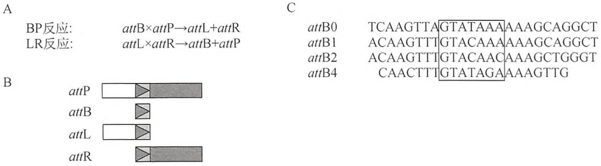
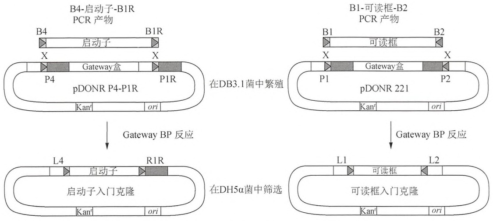
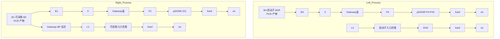
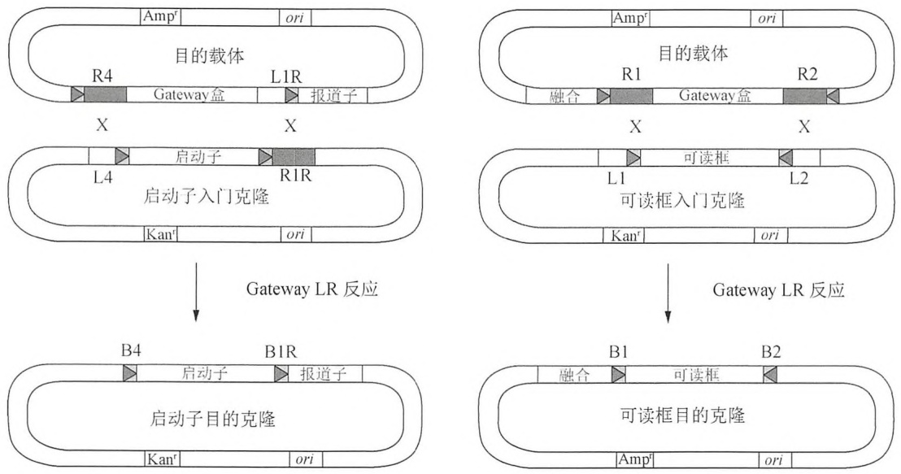
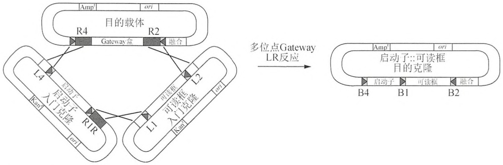
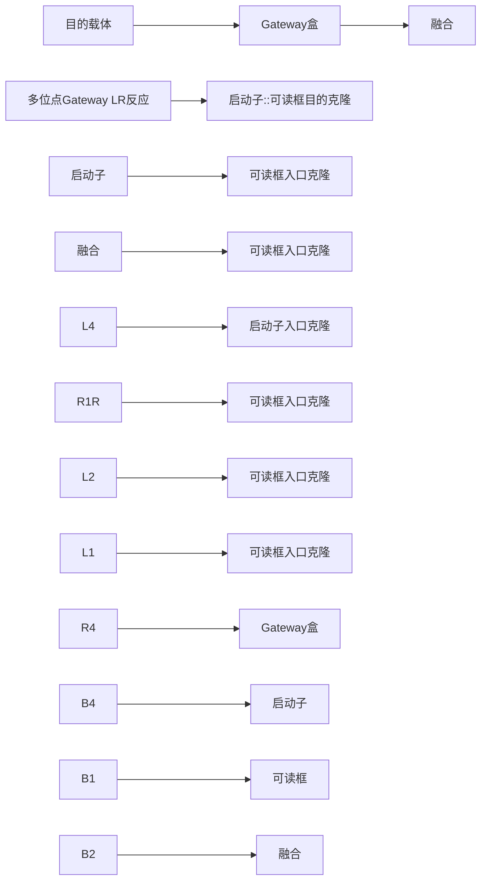

## 导言

很多实验研究采用报道基因载体帮助理解蛋白质的表达和功能。这些载体通常是质粒表达载体，设计为表达能够表明目的蛋白的时空表达和/或功能的报道蛋白。报道蛋白可以在单一目的 DNA 调控序列的控制下单独表达，或者与其他目的蛋白一起通过翻译融合方式联合表达。报道蛋白可以是可见的荧光蛋白（如绿色荧光蛋白，GFP）、活性可以被测定的蛋白酶（如萤光素酶），或使融合蛋白具有特殊生物化学特性的标签（如谷胱甘肽 S-转移酶，GST）。例如，GFP 与目的蛋白融合的载体在相应基因的启动子控制下进行表达后，可以通过观察 GFP 的表达模式显示内源性蛋白的表达位置和表达时间。

构建报道载体的通常做法是将待插入序列——一个可读框（ORF）和/或一段调控DNA片段——插入到一个编码报道蛋白的质粒中，这样可读框与报道基因共享读码框。传统的克隆方法使用限制性内切核酸酶产生带有兼容性末端的载体骨架和插入片段，并使用DNA连接酶（参见第3章，方案1\~3）将两者结合到一起形成环形质粒。在这种方法中，质粒构建过程受到DNA片段和载体中是否存在合适酶切位点的限制，而任意两个报道基因载体使用相同的限制性内切核酸酶组合是完全不可能的。这些影响因素使得应用传统克隆方法构建多个不同报道基因载体面临挑战，更不可能在基因组范围内大规模构建载体用于高通量研究。

为了能将多个 DNA 片段同时（如在 96 孔板中）使用同一种酶以标准化的方法进行克隆反应，研发了 Gateway 重组克隆系统（Hartley et al.2000; Walhout et al. 2000; Reboul et al. 2001）。Gateway 克隆利用的是噬菌体λ在出入大肠杆菌基因组时的高度特异性的整合和剪切反应（Hartley et al. 2000）。由于重组位点（att 位点）长度（25～242bp）远大于限制性位点，其在 DNA 片段中非常少见，因此同一个重组酶在平行反应中完全能够克隆多个大小不同的片段。

## Gateway 克隆的基本原理和应用

Gateway 克隆系统使用两种不同的酶混合物，它们各自完成一种不同类型的重组反应。其中，BP 克隆酶混合物对 attB 位点和 attP 位点进行重组，产生 attL 和 attR 位点；而 LR 克隆酶混合物则催化逆反应（图 4-1A）。每一种重组反应过程都十分精确，没有核苷酸的增加或者丢失。att 位点的识别是非常特异的（例如，BP 克隆酶从不使用 attL 或 attR 位点），因此每一个重组反应只能产生一组衍生物。四种类型的 att 位点以在核心 25bp “识别区域”任意一侧是否存在/不存在“手臂”来区分（图 4-1B），手臂包含有重组酶的相互作用位点，在识别区域中有一个 7bp 的“非对称性重叠”，它是 DNA 进行剪切和重新组合的位点（图 4-1C）。在 25bp 的识别区域中引入核苷酸改变（图 4-1C）能够产生只能彼此间相互重组的 att 位点亚型（即 attB1 和 attP1 位点发生重组，但是不能和 attP2 或 attP3 位点发生重组）。这些不同系列的 att 位点有助于每个 DNA 片段在克隆时单向克隆入每个载体（图 4-2）（即通过在任意一侧末端放置不同的 attB 位点实现）。

对于每一个目的 DNA 片段（如启动子、可读框、3'-UTR），首先需要通过 BP Gateway 克隆反应克隆到“供体载体”从而构建“入门克隆”（图 4-2）。初始通常采用 PCR 方法以约 50bp 的长尾引物扩增含有可读框或者调控序列的 DNA 片段，该引物的 3'端部分为目的 DNA 序列特异性部分，5'端尾部含有适宜的 attB 位点；随后利用相匹配的 attP 位点将该

PCR 产物转移到供体载体中，此时入门克隆中的 DNA 片段可以通过 Gateway LR 克隆反应转移到各种类型的“目的载体”中（图 4-3）。重要的是，在最初克隆每个可读框时，可以通过设计引物去除内源性的起始/终止密码，并与所有那些在氨基末端或羧基末端表达融合的目的载体的读码框相匹配。由于 Gateway 重组反应十分精确，这种读码框顺序不会因为在载体间的转移而发生改变。更先进的“多位点” Gateway LR 反应可以从一个以上的入门克隆中将 DNA 片段（如启动子和可读框）整合到一个目的载体中（图 4-4）。这种方法在构建复杂的载体中非常有用，如可以将一个启动子和可读框与一个编码 GFP 的可读框融合在一起。

text_image

A
BP反应: attB×attP→attL+attR
LR反应: attL×attR→attB+attP
C
attB0 TCAAGTTAGTATAAAAAGCAGGCT
attB1 ACAAGTTTGTACAAAAGCAGGCT
attB2 ACAAGTTTGTACAACAAAGCTGGGT
attB4 CAACTTTGTATAGAAAGTTG
B
attP
attB
attL
attR

图 4-1 应用 Gateway BP 反应制备入门克隆。(A) Gateway BP 反应利用 BP 克隆酶对 attP 位点和 attB 位点进行重组，产生 attL 位点和 attR 位点，而 LR 克隆酶则可以催化进行逆反应。(B) 在 attP、attL 和 attR 位点识别区域（带有箭头的方框）的任意一侧或者双侧有识别“手臂”，而 attB 位点中则没有手臂。这些手臂中含有重组酶的结合位点，根据手臂相对于非对称重叠区域的位置将其命名为“左侧”和“右侧”:attL 位点的手臂在重叠区域的 5' 端（或左侧，图中白色框部分），attR 位点的手臂在重叠区域的 3' 端（或右侧，图中灰色框部分），attP 则在两侧均有手臂。(C) attB 位点长约 25bp，其中央是一个 7bp 长的、可以决定 DNA 序列的切断和重新结合位置的“非对称重叠区域”（图中方框部分）。在大肠杆菌基因组中天然存在 attB0 位点，可被噬菌体λ利用(Hartley et al. 2000)。应用突变的方法可以产生 attB 位点的其他变异形式。

flowchart

图 4-2 应用 Gateway BP 反应制备入门克隆。本例所示的入门克隆制备过程包括在 DB3.1 细菌中繁殖供体载体、扩增带有相匹配的 attB 位点的 PCR 产物，以及建立一个 Gateway BP 反应。用 BP 克隆酶将 attB 位点和 attP 位点重组后，将 Gateway 盒替换为扩增的插入片段，后者的两侧根据 DNA 片段和载体的不同，带有 attL 或者 attR 位点。左图中的反应示意产生启动子入门克隆，右图中的反应示意产生显示可读框入门克隆。注意此处的克隆是单方向的，因为 attB1 位点仅能和 attP1 位点发生重组，attB2 位点也仅能与 attP2 位点发生重组，其余依此类推。在 BP 反应混合物被转化到标准大肠杆菌菌株（如 DH5α）后，仅入门克隆的转化产物能进行生长。在本图中非对称重叠区域相对于插入片段为典型的 5'→3' 方向，但是 att 位点在反方向也可以发挥作用，因此被标记为 “R” 以示区别（如 attB1R 和 attP1R）。这些反向的 att 位点对制备用于多位点 LR 反应的入门克隆具有重要作用（图 4-4）。

图 4-3 应用 Gateway LR 反应制备目的克隆。在 Gateway LR 反应中，将入门克隆和目的载体相混合，LR 克隆酶可以重组亚型匹配的 attL 和 attR 位点（即 attR4 和 attL4、attR1 和 attL1），使得 Gateway 盒和克隆的插入片段发生交换。左图中示意的是在绿色荧光蛋白或萤光素酶上游克隆入一个启动子的报道载体，右图中示意的是将氨基端报道子如 GST 或酵母双杂交组分（AD 或 DB）与可读框融合形成报道载体。

flowchart

图4-4 多位点GatewayLR反应。在多位点GatewayLR反应中，两个入门克隆与一个目的载体相混合后，与图4-4中所示的LR反应相类似，LR克隆酶可以重组亚型匹配的attL和attR位点。然而，这种类型重组的结果是在替代Gateway盒时，来自于两个入门克隆的插入片段（例如启动子和可读框）会融合在一起。

要筛选到期望的重组产物，所有的入门载体和目的载体需要包含一个“Gateway 盒”及不同的抗性基因。Gateway 盒含有一个氯霉素抗性基因和对正常大肠杆菌（如 DH5α）具有致死作用的 ccdB 毒性基因（Bernard and Couturier 1992; Miki et al. 1992; 同时参见第 3 章信息栏 “ccdB 基因”）。重组过程发生目的 DNA 片段和 Gateway 盒交换，使得 DH5α 菌株可以在含有所需抗生素的培养基中生长（如入门克隆需要卡那霉素、目的克隆需要氨苄青霉素）。大肠杆菌 DB3.1 菌株对 ccdB 基因产物具有抗性，可以被用来在氯霉素存在的情况下繁殖扩增 Gateway 载体。

目前已经应用 Gateway 技术建立了入门克隆文库，并衍生出相应的目的克隆用于高通量研究。例如，在秀丽隐杆线虫（Caenorhabditis elegans）的开放可读框组中（Reboul et al. 2003）有大约 12 000 条全长的可读框已经构建到酵母双杂交载体中并用于确定蛋白质相互作用网络（Li et al. 2004）。同样，秀丽隐杆线虫启动子组中的 6000 多条启动子已经被克隆到绿色荧光蛋白（GFP）的上游并应用于基因表达分析和高通量酵母单杂交研究相关的转录调控网络（Dupuy et al. 2004; Deplancke et al. 2006; Vermeirssen et al. 2007）。任何一个报道基因载体都可以通过调整改造以适应 Gateway 入门克隆（参见信息栏“构建 Gateway 兼容性载体”）。目前最新的 Gateway 兼容性载体制备实验技术包括 RNA 干涉（RNAi）（Rual et al. 2004）和蛋白质结合微阵列（Grove et al. 2009）。

## Gateway 克隆的缺点和替代克隆系统

Gateway 克隆系统应用起来非常高效和可靠，一个研究人员可以在数天之内构建数百个质粒载体。该系统的主要缺点是一旦应用 Gateway 克隆对载体进行了转换，那么就很难再转换到其他的重组系统或回到传统的克隆方法（因为起始/终止密码经常被去掉和 Gateway 载体缺少合适的限制性内切核酸酶位点）。另外一个局限性是 Gateway 载体和重组酶的价格相当昂贵。然而，以我们的实际经验来看，如果需要构建的载体达到数十个时，成本/收益比例将会变得有利。剩下的问题是技术方面的，根据需要而各有不同，在很大程度上与所引入的 att 位点有关（例如，att 位点有可能改变最终融合蛋白的功能，或者在启动子片段中增加一个顺式调节位点）。然而，我们此前显示 att 位点不太可能干扰酵母单或双杂交试验结果（Walhout et al. 2000; Deplancke et al. 2004）。针对每一个下游实验，需要设立合适的对照组以确定 att 位点是否影响到实验结果。最后，如果需要的话，Gateway 目的载体可以通过将融合位点由氨基端移到羧基端或者插入一个新起始/终止密码的方式产生一个游离的蛋白质末端，这样 att 位点不会被翻译。

Gateway 克隆系统并不是基于重组方式构建报道基因载体的唯一选择。Univector 系统（Liu et al. 1998）和 Creator 系统（Siegel et al. 2004）均利用来自于噬菌体 P1（Abremski and Hoess 1984）的 Cre 重组酶催化 loxP 位点的重组反应；而 In-Fusion（Berrow et al. 2007）、MAGIC（Li and Elledge 2005）和 SEFC（Zhu et al. 2009）等系统则在体外或大肠杆菌体内进行同源重组。上述所有这些替代方法均已经被用来制备大规模报道载体文库。基于 Cre 的重组系统与 Gateway 系统虽然在表面上相似，但是其重组位点和目的载体缺乏多样性，限制了其在实验中的使用。同源重组的主要优点是:①不需要购置昂贵的重组酶；②不需要可能干扰实验的重组位点。然而，这种方法也有一个明显的缺点，即转移反应不能总是保持精确性，因此，最终载体需要通过序列测定进行确认。表 4-1 中列举了每种克隆系统的其他优缺点。

表 4-1 各种重组克隆方法的优缺点

| 克隆系统 | 方法 | 优点 | 缺点 |
| --- | --- | --- | --- |
| Gateway | 基于噬菌体$\lambda$识别att位点的BP和LR重组酶 | 在转移过程中没有核苷酸获得或丢失不需要消化重组反应可逆使用入门克隆可以产生大量目的克隆可以进行多位点转移具有各种各样的重组位点 | 需要购置酶重组位点可能影响试验结果需要制备兼容性目的载体 |
| Univector Creator | 基于P1的利用loxP位点的Cre重组酶 | 在转移过程中没有核苷酸获得或丢失不需要消化使用入门克隆 | 需要购置酶重组位点可能影响试验结果重组反应不可逆可用的目的载体较少不能使用多位点转移重组位点种类较少需要制备兼容性目的载体 |
| In-Fusion,MAGIC,SEFC | 同源重组 | 不需要重组位点不需要购买必需的酶a可以进行多位点转移任何载体均可以不经转换直接使用 | 在转移过程中偶尔出现核苷酸获得或丢失在重组前需要通过PCR或消化产生插入片段不使用入门克隆b |

a. In-Fusion 是一种体外反应系统，需要购置反应酶，但 MAGIC 和 SEFC 的重组反应是发生在大肠杆菌体内。

b. 在 MAGIC 系统中可能会使用入门克隆。

在 Life Technologies 公司（Invitrogen; http://www.invitrogen.com）的网站上有 Gateway 克隆所需的相关试剂和大量 Gateway 系统的实验方案（以及更深入的背景知识）。本章的目的是提供在 Gateway 克隆中使用的最基础的实验方案。方案 1 描述如何繁殖扩增含有功能性 Gateway 盒的 Gateway 载体，随后的两个方案包括了应用 Gateway 重组酶将这些载体构建成入门克隆和目的克隆。方案 2 描述了如何应用 BP 克隆制备一个可读框入门克隆，并通过 LR 克隆将可读框克隆到目的载体中。方案 3 描述了使用 LR 克隆酶将一个启动子和可读框从两个不同的入门克隆载体中同时转移到同一个目的载体的多位点 Gateway 反应实验。这三个方案均采用了指定的载体和转移反应，但是通过替换一些与目的载体相关的重要环节，如 att 位点、抗性选择及重组酶混合物等，这些实验步骤可以应用到任何 Gateway 载体和转移反应中。

## 致谢

本工作得到 A.J.M.W 获得的 NIH 基金 DK068429 和 GM082971 的资助。

## 参考文献

- Abremski K, Hoess R. 1984. Bacteriophage P1 site-specific recombination. Purification and properties of the Cre recombinase protein. J Biol Chem 259: 1509–1514.
- Bernard P, Couturier M. 1992. Cell killing by the F plasmid CcdB protein involves poisoning of DNA–topoisomerase II complexes. J Mol Biol 226: 735–745.
- Berrow N S, Alderton D, Sainsbury S, Nettleship J, Assenberg R, Rahman N, Stuart DI, Owens RJ. 2007. A versatile ligation-independent cloning method suitable for high-throughput expression screening applications. Nucleic Acids Res 35: e45. doi: 10.1093/nar/gkm047.
- Deplancke B, Dupuy D, Vidal M, Walhout AJM. 2004. A Gateway-compatible yeast one-hydrid sysytem. Genome Res 14: 2093–2101.
- Deplancke B, Mukhopadhyay A, Ao W, Elewa AM, Grove CA, Martinez NJ, Sequerra R, Doucette-Stam L, Reece-Hoyes JS, Hope IA, et al. 2006. A gene-centered C. elegans protein–DNA interaction network. Cell 125:1193–1205.
- Dupuy D, Li Q, Deplancke B, Boxem M, Hao T, Lamesch P, Sequerra R, Bosak S, Doucette-Stam L, Hope IA, et al. 2004. A first version of the Caenorhabditis elegans promoterome. Genome Res 14: 2169–2175.
- Grove CA, deMasi F, Barrasa MI, Newburger D, Alkema MJ, Bulyk ML, Walhout AJ. 2009. A multiparameter network reveals extensive divergence between C. elegans bHLH transcription factors. Cell 138: 314–327.
- Hartley JL, Temple GF, Brasch MA. 2000. DNA cloning using in vitro site-specific recombination. Genome Res 10: 1788–1795.
- Li MZ, Elledge SJ. 2005. MAGIC, an in vivo genetic method for the rapid construction of recombinant DNA molecules. Nat Genet 37:311–319.
- Li S, Armstrong CM, Bertin N, Ge H, Milstein S, Boxem M, Vidalain P-O, Han J-DJ, Chesneau A, Hao T, et al. 2004. A map of the interactome network of the metazoan C. elegans. Science 303: 540–543.
- Liu Q, Li MZ, Leibham D, Cortez D, Elledge SJ. 1998. The univector plasmid-fusion system, a method for rapid construction of recombinant DNA without restriction enzymes. Curr Biol 8: 1300–1309.
- Miki T, Park JA, Nagao K, Murayama N, Horiuchi T. 1992. Control of segregation of chromosomal DNA by sex factor F in Escherichia coli. Mutants of DNA gyrase subunit A suppress letD (ccdB) product growth inhibition. J Mol Biol 225: 39–52.
- Reboul J, Vaglio P, Tzellas N, Thierry-Mieg N, Moore T, Jackson C, Shin-i T, Kohara Y, Thierry-Mieg D, Thierry-Mieg J, et al. 2001. Open-reading frame sequence tags (OSTs) support the existence of at least 17,300 genes in C. elegans. Nat Genet 27: 1–5.
- Reboul J, Vaglio P, Rual JF, Lamesch P, Martinez M, Armstrong CM, Li S, Jacotot L, Bertin N, Janky R, et al. 2003. C. elegans ORFeome version 1.1: Experimental verification of the genome annotation and resource for proteome-scale protein expression. Nat Genet 34: 35–41.
- Rual J-F, Ceron J, Koreth J, Hao T, Nicot A-S, Hirozane-Kishikawa T, Vandenhaute J, Orkin SH, Hill DE, van den Heuvel S, et al. 2004. Toward improving Caenorhabditis elegans phenome mapping with an ORFeome-based RNAi library. Genome Res 14: 2162–2168.
- Siegel RW, Velappen N, Pavlik P, Chasteen L, Bradbury A. 2004. Recombinational cloning using heterologous lox sites. Genome Res 14: 1119–1129.
- Vermeirssen V, Barrasa MI, Hidalgo C, Babon JAB, Sequerra R, Doucette-Stam L, Barabasi AL, Walhout AJM. 2007. Transcription factor modularity in a gene-centered C. elegans core neuronal protein-DNA interaction network. Genome Res 17: 1061-1071.
- Walhout AJM, Temple GF, Brasch MA, Hartley JL, Lorson MA, van den Heuvel S, Vidal M. 2000. GATEWAY recombinational cloning: Application to the cloning of large numbers of open reading frames or ORFeomes. Methods Enzymol 328: 575–592.
- Zhu D, Zhong X, Tan R, Chen L, Huang G, Li J, Sun X, Xu L, Chen J, Ou Y, et al. 2009. High-throughput cloning of human liver complete open reading frames using homologous recombination in Escherichia coli. Anal Biochem 397: 162–167.

## 方案 1 扩增 Gateway 载体

制备大量的入门载体和目的载体需要将这些载体转化到 DB3.1 大肠杆菌菌株中, DB3.1 菌可以抵抗载体 Gateway 盒中 ccdB 基因的效应, 使得这些载体可以进行复制。然而, 由于ccdB 基因可以发生低频度的突变，这种突变质粒可允许正常的大肠杆菌（如 DH5α）生长，因此，在完成新的 Gateway 质粒的制备后，需要检测这些质粒在大肠杆菌克隆菌株中的生长能力，包括从单一 DB3.1 细菌菌落中获得单个质粒克隆，以及将每个质粒克隆以可控制的方式转化到 DB3.1 细菌和首选细菌菌株。只有那些可以有效杀死正常菌株（即在转化后没有或者得到很少菌落）的质粒克隆才可以用于 Gateway 克隆反应。这些实验可以在 3 天内完成。

## 材料

为正确使用本方案中的器材和危险试剂，必须查阅相应的材料安全数据表并咨询所在机构的环境卫生和安全办公室。

本方案的专用试剂标注&lt;R&gt;，配方在本方案末提供。常用储备溶液、缓冲液和试剂标注&lt;A&gt;，配方见附录1。储备溶液应稀释至适用浓度后使用。

## 试剂

琼脂糖凝胶（其他所需试剂和设备参见第2章，方案1）

大肠杆菌 DB3.1 感受态菌株

标准大肠杆菌感受态菌株（如 DH5α）

DNA 分子质量和浓度标准品

30%（V/V）甘油无菌水溶液

LB 培养基&lt;A&gt;和琼脂&lt;A&gt;平板，含有  $25 \mu g/mL$  氯霉素和  $50 \mu g/mL$  卡那霉素或者  $50 \mu g/mL$  氨苄青霉素

LB 培养基&lt;A&gt;和琼脂&lt;A&gt;平板，含有  $50 \mu g/mL$  卡那霉素或者  $50 \mu g/mL$  氨苄青霉素非 Gateway 质粒（如 pUC19）

TBE 缓冲液（10×）&lt;A&gt;

转化试剂（参见第3章，方案1\~4）

质粒 DNA（用于随后的克隆实验的入门载体或目的载体）

## 设备

15mL 无菌培养试管

无菌玻璃珠

$37^{\circ} \mathrm{C}$ 孵箱

微型离心机

1.5mL 无菌离心管

MiniPrep 质粒小量提取试剂盒（可选，参见第 1 章导言和方案 1）

可检测 DNA 浓度的分光光度计（260nm 波长）

$37^{\circ}\mathrm{C}$ 、 $42^{\circ}\mathrm{C}$ 水浴锅

## 方法

1. 将 50pg Gateway 载体 DNA 转化入 50μL DB3.1 大肠杆菌感受态细胞（参见第 3 章，方案 1～4）。使用无菌玻璃珠，将转化混合物铺到含有 25μg/mL 氯霉素和目的质粒抗性抗生素的 LB 琼脂平板上，在 37℃ 孵箱中孵育过夜。

通常情况下，入门载体带有卡那霉素抗性（50μg/mL），目的载体带有氨苄青霉素抗性（50μg/mL），但这些载体有时候存在使用其他抗生素的情况（如奇霉素）。

2. 使用无菌移液吸头，将独立生长的菌落克隆转移到 $3\mathrm{mL}$ 含有氯霉素和目的质粒抗性抗生素的LB培养基中，于 $37^{\circ}C$ 下振荡培养过夜。

见“疑难解答”。

3. 在 1.5mL 无菌离心管中，将  $50\mu L$  过夜培养物与  $50\mu L$  30% 的甘油溶液混合，将 15% (V/V) 的甘油菌储存液储存在 -80℃。剩余的培养物用标准的质粒 DNA 小量提取过程或者试剂盒提取质粒 DNA（参见第 1 章，方案 1）。

4. 应用紫外分光光度计测定质粒 DNA 的浓度，或取  $5 \sim 10 \mu L$  DNA 溶液在 1% (m/V) 琼脂糖凝胶中上样，用  $1 \times TBE$  缓冲液进行电泳分离，在旁边同时上样 DNA 浓度定量标准品确定 DNA 浓度。质粒 DNA 在  $-20^{\circ}C$  下储存。

入门载体通常是低拷贝质粒，在  $50 \mu L$  的最终小量质粒提取洗脱体积中，质粒 DNA 的产量通常约为  $100 ng/\mu L$ ，目的载体通常为高拷贝质粒，产率最高可达  $500 ng/\mu L$ 。

5. 质粒转化（参见第3章，方案1\~4）。

i. 针对每一个 Gateway 载体建立两个转化反应。第一个反应取 50pg 质粒 DNA 加入到 50μL DB3.1 大肠杆菌感受态细胞中；第二个反应取 50pg 质粒 DNA 加入到所选的标准大肠杆菌感受态细胞中（如 DH5α）。
ii. 为非 Gateway 质粒（如 pUC19）建立独立平行的转化反应，分别转化 50pg 非 Gateway 质粒到 50μL DB3.1 大肠杆菌感受态细胞和标准大肠杆菌感受态细胞。
iii. 使用无菌玻璃珠将转化混合物平铺到仅含有目的载体抗性抗生素的 LB 平板中。
iv. 将平板于  $37^{\circ}$ C 下孵育过夜。

由于上述转化反应用于筛选 Gateway 克隆反应的产物，因此培养基中不能含有氯霉素。由于未进行重组的 Gateway 载体可以杀死正常大肠杆菌细胞，因此有必要使用非 Gateway 质粒作为对照，确认感受态细胞的活性。

6. 评估转化结果。

i. 对非 Gateway 质粒转化的细菌菌落进行计数，将 DB3.1 菌落数除以正常克隆的菌落数，计算获得 Q 值。
ii. 计数每一个用 Gateway 质粒转化的细菌菌株的菌落数。将 Gateway 转化的 DB3.1 平板菌落数先乘以 $Q$ 值，再除以 Gateway 转化的正常菌株平板菌落数，得到 $Y$ 值。
iii. 在后续的 Gateway 克隆反应中，仅使用 $Y$ 值为 1000 或者大于 1000 的 Gateway 质粒克隆。

变量 Q 考虑到两种细菌菌株之间能力的差异。利用通过上述测试的 Gateway 载体进行的重组反应，应该产生非常少的包含非重组质粒的菌落克隆。如果以后需要使用更多的 Gateway 载体，而且这些质粒是以步骤 2 中得到的载体 Y 值大于 1000 的甘油菌液制备的，那么不需要重复进行上述测试。

见“疑难解答”。

## 疑难解答

问题（步骤 2 和步骤 6）:菌落太多，难以计数或者挑取独立的菌落。

解决方案:重新检查质粒 DNA 的浓度，确保转化过程中的质粒用量正确。重新进行转化并减少铺板的转化混合物的用量，如果将转化混合物稀释后再进行铺板，效果会更好。检查 LB 琼脂平板中的抗生素是否有效，使用可以在无抗生素 LB 琼脂平板上生长的无抗性细菌建立对照反应，该对照反应在抗生素平板上应该无法生长。

问题（步骤 6）:所有的 Gateway 载体的 Y 值都不超过 1000。

解决方案:用相同基因型或尽可能接近的克隆重复检测（见步骤1）。如果12个克隆均没有通过检测，那么在Gateway克隆反应中使用 $Y$ 值最高的克隆，请记住，需要挑取更多的最终菌落克隆进行筛选鉴定，以排除非重组的载体。

## 方案 2 制备可读框入门克隆和目的克隆

在这里，我们描述如何构建一个如本章导言中图 4-2 所描述的可读框（ORF）的入门克隆载体，并将这个可读框转移到目的载体中（如本章导言中图 4-3 所描述）。在本例中，用 BP 重组酶将从 cDNA 模板中克隆的可读框克隆到供体载体 pDONR221，构建成功的入门载体中的可读框随后被转移克隆到目的载体 pDEST-15 中，该产物（目的克隆）将表达 N 端融合有 GST 的可读框蛋白。本技术可以用于指导克隆带有可替换的、不同的遗传物质（如基因组 DNA、att 位点，或者一个载体等）的任何目的 DNA 片段，如一个启动子序列或者 3'-UTR 序列。这一系列的载体构建和转化操作，不包括序列测定所需要的时间，需要 9～15 天。

## 材料

为正确使用本方案中的器材和危险试剂，必须查阅相应的材料安全数据表并咨询所在机构的环境卫生和安全办公室。

本方案的专用试剂标注&lt;R&gt;，配方在本方案末提供。常用储备溶液、缓冲液和试剂标注&lt;A&gt;，配方见附录1。储备溶液应稀释至适用浓度后使用。

## 试剂

琼脂糖凝胶（其他所需试剂和设备参见第2章，方案1）

cDNA 模板

cDNA 模板可以是 cDNA 文库或者从组织中提取的 cDNA（参见第 11 章，方案 9）。如果要克隆其他目的序列（如启动子或 3'-UTR 序列）等，可以用基因组 DNA 作为 DNA 来源。

大肠杆菌感受态细胞 DH5α（大于  $10^{7}cfu/\mu g$ ）

DNA 分子质量和浓度标准品

dNTP 溶液（1mmol/L 储存液，PCR 级别）

Gateway BP 克隆酶 II 混合物

Gateway LR 克隆酶 II 混合物

Gateway 载体: pDONR221（参见本章导言图 4-2）和 pDEST-15（参见本章导言图 4-3）

必须按照方案 1 中的方法制备非重组 Gateway 载体

30%（V/V）甘油无菌水溶液

GSTFW 引物(5'-CCAGCAAGTATATAGCATGGCCTTTGC-3')

GSTRV 引物(5'-CAAAAAACCCCTCAAGACCCG-3')

LB 培养基&lt;A&gt;

LB 培养基&lt;A&gt;和琼脂平板&lt;A&gt;, 含有  $50 \mu g/mL$  氨苄青霉素

LB 培养基&lt;A&gt;和琼脂平板&lt;A&gt;, 含有  $50 \mu g/mL$  卡那霉素

M13F 引物 (5'-GTAAAACGACGGCCAGT-3')

M13R 引物 (5'-CAGGAAACAGCTATGAC-3')

TBE 缓冲液 (10×)

TE 缓冲液(pH 8.0) &lt;A&gt;

热稳定高保真 DNA 聚合酶（如 Pfu）及相关的 PCR 缓冲液（10×）

热稳定常规 DNA 聚合酶（如 Taq）及相关的 PCR 缓冲液（10×）

转化试剂（参见第3章，方案1\~4）

无菌水（PCR 级别）

## 设备

15mL 无菌培养试管

无菌玻璃珠

$25^{\circ} \mathrm{C}$ 和 $37^{\circ} \mathrm{C}$ 孵箱

微型离心机

1.5mL 无菌离心管

MiniPrep 小量质粒提取试剂盒（可选，参见第 1 章导言和方案 1）

96 孔 PCR 板

可检测 DNA 浓度的分光光度计（260nm 波长）

热循环仪

无菌牙签或一次性塑料接种环

旋涡振荡器

$37^{\circ} \mathrm{C}$ 、 $42^{\circ} \mathrm{C}$ 水浴锅

## 方法

## 目的可读框扩增

本过程需要 1 天。

1. 合成正向和反向引物。

i. 合成在 5'端带有 attB1 序列的正向引物（M13F）:

(5'-GGGGACAACTTTGTACAAAAAAGTTGG-3')

ii. 合成在 5'端带有 attB2 序列的反向引物（M13R）:

(5'-GGGGACAACTTTGTACAAGAAAGTTG-3')

iii. 将合成好的引物用 PCR 级的无菌水重悬溶解，并调整终浓度为  $20 \mu mol/L$ 。

在设计引物时，应该在3'端包含足够长度的可读框特异性序列，这样能够保证引物中可读框特异性序列的熔解温度在55～60℃（最终引物的长度通常为约50nt）。涉及起始密码子的引物的位置非常重要，需要确保插入片段后目的载体pDEST-15氨基末端的GST的读码框不变。为保证读框的一致性，正向引物中的可读框特异性部分的第一个核苷酸需要取代起始密码子（或第一个密码子）的最后一个核苷酸（即attB1序列中的两个AAA密码子可读框一致）。如果需要一个具有不同att位点的目的载体，那么必须根据与目的载体兼容的供体载体进行重组的att位点重新设计引物序列。

2. 在无菌 PCR 管（或者 96 孔 PCR 板）中建立如下的扩增反应混合物:

| 正向引物(20μmol/L) | 1μL |
| --- | --- |
| 反向引物(20μmol/L) | 1μL |
| dNTP (1μmol/L) | 5μL |
| PCR 缓冲液 (10×) | 5μL |
| cDNA 模板 (100μg/mL) | 10μL |
| 热稳定高保真 DNA 聚合酶 | 2U |
| 去离子水 | 至 50μL |

推荐使用高保真 DNA 聚合酶以降低 PCR 过程中的错误。请记住，要设立未加 DNA 模板的阴性对照 PCR 反应。如果从基因组 DNA 中扩增启动子或者 3'-UTR 序列，可以采用相同的 DNA 浓度。

3. 将 PCR 管放入热循环仪中，使用下表中的变性、复性、聚合反应时间和温度进行聚合酶链反应。

| 循环数 | 变性 | 复性 | 聚合 |
| --- | --- | --- | --- |
| 首循环 | 94°C,3min | 56°C,1min | 72°C,1min/kb 可读框序列 |
| 33个循环 | 94°C,1min | 56°C,1min | 72°C,1min/kb 可读框序列 |
| 末循环 | 94°C,1min | 56°C,1min | 72°C,8min |

PCR 反应条件（包括加入的模板量）有可能需要进行调整以适应特定的 DNA 聚合酶，并进行优化使得 PCR 反应仅产生预期的复制子。由于 DNA 聚合酶处理能力的限制，在克隆长度大于 3000bp 的片段时可能比较困难。另外，在使用多聚 dT(poly(dT)) 来源的 cDNA 文库时，较大的克隆有可能无法反映原始序列的特征，举例来讲，其原因可以是高二级结构的 mRNA 区域导致反转录酶无法正常发挥功能。

4. 为保证能产生正确大小的复制子，取 $5 \sim 10 \mu \mathrm{L}$ 聚合反应产物，在 $1 \% (m / V)$ 琼脂糖凝胶上上样，使用 $1 \times \mathrm{TBE}$ 缓冲液进行电泳鉴定。用DNA分子质量标准品判断扩增片段的大小。扩增的DNA插入片段储存在 $-20^{\circ} \mathrm{C}$ 。

如果有多个 PCR 产物条带，将剩余的 PCR 产物在琼脂糖凝胶中电泳分离后，切取分离并纯化正确大小的 PCR 产物片段（参见第 2 章，方案 8）。然而，以 cDNA 为模板的 PCR 复制子也可能是由同一基因的不同异构体所产生的，那么在这一步中可以选择不分离纯化正确大小的片段，而是尝试使用一个重组反应克隆所有的 PCR 产物条带，并通过鉴定多个不同的最终细菌菌落克隆产物确定正确克隆。

参见“疑难解答”。

## 使用 BP 酶克隆一个可读框到供体载体中

整个实验操作过程需要 4～7 天，不包括可能需要的核酸序列确认过程。

5. 在冰上将下列试剂混合到 $1.5 \mathrm{~mL}$ 的无菌离心管中:

| PCR 产物(来自于步骤4) | 100ng |
| --- | --- |
| pDONR221 | 100ng |
| Gateway BP 克隆酶II混合物 | 1μL |
| TE 缓冲液(pH8.0) | 至5μL |

临用前在冰上融化 Gateway 克隆酶 II 混合物。PCR 产物和载体可以通过凝胶电泳与已知含量的同等长度的 DNA 相对照，或者通过分光光度计进行定量（参见第 1 章中信息栏“分光光度法”）。我们通常从 PCR 产物中直接取 2μL。阴性对照采取在制备相同的 BP 反应混合物过程中以等量的 TE 缓冲液替代 PCR 产物。

将反应物混合均匀并在  $25^{\circ}$ C 孵育过夜。

孵育过程可以在热循环仪或孵箱中完成。我们不推荐在室温下（如试验台上）进行孵育，因为室温可能发生较大变动。

6. 将每一个反应混合物转化到 $50\mu \mathrm{L}$ 大肠杆菌 $\mathrm{DH}5\alpha$ 细胞中（参见第3章，方案 $1\sim 4$）。阴性对照用玻璃珠将全部的转化混合物铺到加有 $50\mu \mathrm{g / mL}$ 卡那霉素的LB平板上，克隆反应将1/10的转化反应混合物用同样方法铺到卡那霉素平板上，剩余的转化混合物接种到$3\mathrm{mL}$ 的卡那霉素液体LB培养基中。液体培养于 $37^{\circ}C$ 振荡过夜培养，平板则于 $37^{\circ}C$ 过夜培养。

可读框克隆的入门载体和目的载体应该以 PCR 产物混合物形式保存，因为部分载体可能含有 PCR 过程中产生的无意或错意突变。如果希望获得单克隆，插入片段必须进行全长测序以检查是否含有突变。

在克隆平板上得到的菌落克隆数应该至少有 50 个。菌落数越少，意味着克隆成功的 PCR 产物混合物越少，这有可能导致在后续的克隆混合物中突变可读框的比例增加。推荐用更多的 PCR 产物和载体重新进行步骤 5 的克隆反应直到获得至少 50 个菌落克隆。阴性对照平板应该没有菌落克隆生长或者生长的菌落克隆少于 5 个，如果使用不同的载体，在本步骤以及随后的过程中可能需要不同的抗生素。

参见“疑难解答”。

7. 在 $1.5 \mathrm{~mL}$ 的无菌离心管中，将 $50 \mu \mathrm{L}$ 过夜细菌培养物与 $50 \mu \mathrm{L} 30 \%$ （$V / V$）甘油溶液混合后，将 $15 \%$（$V / V$）的甘油菌溶液储存于 $-80^{\circ} \mathrm{C}$。剩余的菌液用小量质粒提取试剂盒提取质粒 DNA（参见第 1 章，方案 1），质粒 DNA 储存在 $-20^{\circ} \mathrm{C}$。

由于 pDONR221 载体属于低拷贝质粒，小量质粒提取方法提取质粒的预期产量约为  $100 ng/\mu L$  （总体积  $50 \mu L$ ）。

8. 在无菌 PCR 管（或者 96 孔 PCR 板）中，准备下列 PCR 混合物:

| 质粒 DNA(来自于步骤7) | 0.5μL |
| --- | --- |
| M13F 引物(10μmol/L) | 1μL |
| M13R 引物(10μmol/L) | 1μL |
| dNTP(1mmol/L) | 2.5μL |
| PCR 缓冲液(10×) | 2.5μL |
| 热稳定 DNA 聚合酶 | 1U |
| 去离子水 | 至 25μL |

在本步骤中有必要分析全部的克隆混合物以确认其中只存在所需要的可读框。使用一个通用引物和一个可读框特异性引物进行扩增反应并不合适，因为这样的反应不会扩增任何可能存在的污染物。因此，在这里要使用在载体中位于插入的可读框片段两侧的两个通用引物（M13F 和 M13R）。记住，要包括一个不含有模板的阴性对照 PCR 反应。如果使用了不同的载体，那么在本实验步骤和后续实验步骤中可能需要使用其他的引物。

9. 将 PCR 管放入热循环仪中，使用下表中的变性、复性、聚合反应时间和温度进行聚合酶链反应。

| 循环数 | 变性 | 复性 | 聚合 |
| --- | --- | --- | --- |
| 首循环 | 94°C,3min | 56°C,1min | 72°C,1min/kb 可读框序列 |
| 33个循环 | 94°C,1min | 56°C,1min | 72°C,1min/kb 可读框序列 |
| 末循环 | 94°C,1min | 56°C,1min | 72°C,8min |

PCR 反应条件可能需要进行优化。

10. 吸取 $5 \sim 10 \mu \mathrm{L}$ 扩增反应产物，在 $1 \%$ （$m / V$）琼脂糖凝胶中用 $1 \times \mathrm{TBE}$ 缓冲液分析鉴定，在旁边同时上样DNA分子质量标准品来判断扩增片段大小。如果出现不同大小的多个PCR产物，继续进行步骤11。如果得到的是正确大小的单一PCR产物条带，那么使用M13F（和/或M13R）引物进行DNA序列测定。如果测序结果确认扩增得到正确的可读框，而且仅存在预期的可读框，那么直接进行步骤16。

分析 PCR 产物时，需要记住的是:使用 M13F 和 M13R 引物扩增的复制子的长度要增加 240bp。此外，当使用通用引物扩增时，有可能会出现约 100bp 长的引物二聚体或约 2000bp 长的无功能 Gateway 盒。在测序反应中存在不止一个可读框的明显特征是在测序结果图谱中紧接在克隆位点或者其他位点后的序列不可读。这一阶段得到的无关可读框可能是同一基因的其他亚型，可以在后面的实验步骤中进行分离。

11. 用一个无菌移液器吸头，吸取约 $2\mu \mathrm{L}$ 在步骤7中制备的冰冻甘油菌储存液，转移到 $1\mathrm{mL}$ LB培养基中，并在此基础上用LB培养基制备稀释液（1:1000和1:10000）。使用无菌玻璃珠，将每种稀释液各 $100\mu \mathrm{L}$ 铺到卡那霉素-LB平板上，$37^{\circ}C$ 培养过夜。

由于本步骤的目的是产生分离良好的细菌克隆，因此有可能需要进行更高倍数的稀释。

12. 应用步骤 11 中的菌落克隆建立 PCR 扩增反应。在无菌 PCR 管（或者 96 孔 PCR 板）中，准备至少 24 个 PCR 反应的混合物:

| M13F 引物(10μmol/L) | 1μL |
| --- | --- |
| M13R 引物(10μmol/L) | 1μL |
| dNTP(1mmol/L) | 2.5μL |
| PCR 缓冲液(10×) | 2.5μL |
| 热稳定 DNA 聚合酶 | 1U |
| 去离子水 | 至 25μL |

记住要包括不含模板的 PCR 阴性对照反应。

选择至少24个菌落克隆（来自于步骤11），针对每个克隆的操作如下:

i. 使用无菌移液吸头挑取菌落克隆。

ii. 将吸头轻触卡那霉素-LB 平板以扩增菌落。

iii. 将吸头在 PCR 混合液中轻轻涡旋，将剩余的细菌细胞转移到混合液中，丢弃吸头。

iv. 卡那霉素-LB 平板  $37^{\circ}$ C 培养 18h。

在卡那霉素-LB 平板上的细菌在  $4^{\circ}$ C 下最长可储存 2 周。在这一阶段也可以用 M13F 引物和可读框特异性反向引物进行 PCR 鉴定，从而可以不用对插入片段进行测序。

在这一阶段还可以使用其他方法替代菌落 PCR 鉴定, 将多个菌落接种在独立的卡那霉素-LB 培养基中进行培养, 并按照步骤 7 中的方法提取质粒 DNA, 随后将这些质粒进行 DNA 测序或限制性酶切消化来验证插入片段。

13. 将 PCR 管放入热循环仪中，使用下表中的变性、复性、聚合反应时间和温度进行聚合酶链反应。

| 循环数 | 变性 | 复性 | 聚合 |
| --- | --- | --- | --- |
| 首循环 | 94°C,3min | 56°C,1min | 72°C,1min/kb 可读框序列 |
| 33个循环 | 94°C,1min | 56°C,1min | 72°C,1min/kb 可读框序列 |
| 末循环 | 94°C,1min | 56°C,1min | 72°C,8min |

PCR 反应条件可能需要进行优化。

14. 吸取  $5 \sim 10 \mu L$  扩增反应产物，在  $1\% (m/V)$  琼脂糖凝胶中用  $1 \times TBE$  缓冲液分析鉴定，在旁边同时上样 DNA 分子质量标准品来判断扩增片段大小。使用 M13F 引物进行 DNA 测序确认所有大小正确的 PCR 产物。

分析 PCR 产物时，使用 M13F 和 M13R 引物扩增的复制子要增加 240bp。当使用通用引物扩增时，可能会出现约 100bp 长的引物二聚体或约 2000bp 长的无功能 Gateway 盒。在少数情况下，可能需要采用 PCR 和/或测序分析更多的克隆以获得正确的克隆。

15. 从经过确认的入门克隆中制备质粒 DNA。

i. 取至少 10 个在步骤 12 中产生的含有正确插入片段克隆的菌液，接种到 3mL 含有卡那霉素-LB 液体培养基（即在单一培养菌液中包括所有克隆）。于 37℃ 振荡培养过夜。

ii. 在 1.5mL 无菌离心管中，将  $50\mu L$  过夜培养菌液与  $50\mu L$   $30\%(V/V)$  甘油溶液混合，制成  $15\% (V/V)$  的细菌甘油储存液，储存于  $-80^{\circ}C$ 。

iii. 将剩余的培养菌液应用小量质粒提取试剂盒提取质粒（参见第1章，方案1）。在转移到目的载体之前，克隆混合物可能需要用PCR（按照步骤8～10操作）方法进行检查以确保其中含有单个可读框/异构体。

如果你更倾向于使用单一克隆，则需要对插入片段进行完全测序以检查突变。

## 应用 LR 酶将入门克隆的可读框转移到目的载体

这一过程需要 4～7 天，其中不包括测序时间。

16. 将 1.5mL 无菌离心管置于冰上，并混合下列试剂:

| 入门克隆(来自于步骤10或步骤15) | 100ng |
| --- | --- |
| pDEST-15 | 100ng |
| Gateway LR 克隆酶II混合物 | 1μL |
| TE缓冲液(pH8.0) | 至5μL |

可以采用分光光度法进行质粒定量。Gateway LR 克隆酶 II 混合物应当在临用前在冰上融化。阴性对照为在同样的 LR 反应混合液中以同体积的 TE 缓冲液替代入门克隆。

混合均匀后于  $25^{\circ}$ C 孵育过夜。

孵育过程可以在热循环仪中或孵箱中完成。我们不推荐在室温下（如实验台上）进行孵育，因为室温可能发生较大变动。

17. 按照步骤 $6\sim 15$ 对来自于步骤16中的GST-可读框融合表达质粒进行均匀小量质粒DNA提取。使用氨苄青霉素筛选含有目的质粒的细菌菌落，用GSTFW和GSTRV引物进行PCR鉴定和测序。

GST 引物将在复制子中增加约 300bp。如果使用不同的载体，可能需要用其他抗生素进行筛选，PCR 反应和测序也需要更换不同的引物。

参见“疑难解答”。

## 疑难解答

问题（步骤 4）:采用 PCR 没有扩增到 cDNA 片段。

解决方案:根据我们的经验，扩增失败最常见的原因是模板中没有靶基因，这可能是由于采用了错误的基因模型进行引物设计导致不能匹配靶基因，或者可能由于靶基因的mRNA在转录物收集条件下不表达而导致cDNA模板中没有靶分子。在这种情况下，采用其他类型的组织或发育时间点作为来源提取cDNA可能效果更好。模板丢失的另外一种原因是转录物过长导致反转录酶不能产生全长的cDNA。如果基因模型不正确，应考虑更换另外的引物扩增其他区域，或先用RACE确定转录物的5'端和3'端（参见第7章，方案10和方案11）。

问题（步骤4）:采用基因组PCR（例如，在步骤2中扩增启动子或 $3^{\prime}$ -UTR序列）没有扩增DNA片段。

解决方案:除了最常见的 PCR 方面的问题（如遗漏、污染或试剂配制错误）以外，模板降解是基因组 PCR 失败的最常见原因。如果在步骤 2 中使用基因组 DNA 作为 DNA 来源，需要在琼脂糖凝胶中上样微克级的基因组 DNA 并确认可以见到高分子质量的单一条带（>20kb）。如果看见“模糊”的、大小不等的条带（特别是<5kb），则需要重新制备模板样品。如果模板的质量看起来较好但是 PCR 却失败，那么尝试使用不同的引物对（最好使用此前已经证实可以扩增模板中片段的引物）检查 PCR 中模板是否被污染或引物是否失效。如果后者能扩增成功，那么检查原来的引物是否配制正确（如检查浓度是否正确，或重新合成），甚至有必要重新设计引物。如果可以设计引物扩增目的基因片段略微不同的区域，则可以调整单一或两个引物在原始位点上游或下游增加 50～100bp 的长度。如果在目的区域中引物的位置是固定的，可以尝试在不超过熔点温度限制的范围内，在引物的 3'端增加或减少一个或几个核苷酸。

问题（步骤6）:BP克隆产物中含有引物二聚体。

解决方案:某些时候使用带有 Gateway 尾端的引物进行的 PCR 不仅能产生目的片段，同时还可能产生由于引物之间发生复性而非引物与模板之间复性导致的引物二聚体。由此产生的短链 DNA 片段可能与 Gateway 位点发生作用，进而干扰首选的长插入片段的克隆。筛选更多的菌落克隆（多至 48 个）会有助于发现真正的目的克隆。但是更好的解决方法是将全部扩增反应产物（步骤 4）通过琼脂糖凝胶电泳分离并切胶回收纯化 DNA，以用于后续 Gateway BP 克隆反应（步骤 5）。

问题（步骤 6 和步骤 17）:Gateway 反应失败，没有产生转化细菌。

解决方案:假如:①Gateway 位点是兼容的（通过反复检查引物和/或载体并确认）；②必要的对照实验表明细菌具有足够的全能性（使用已知量的质粒进行平行实验，铺到同样的平板上）；③Gateway 克隆酶是有功能的（使用克隆酶自带的试剂进行重组验证），那么 Gateway 载体（和/或用于 LR 反应的入门克隆载体）的质量不高可能导致 Gateway 反应出现问题。所有的 Gateway 载体都需要按照方案 1 进行检测，确定其是否具有有功能的 Gateway 盒及转化细菌的能力。通常重新进行一个小量入门克隆质粒提取可以克服这些问题。在少数情况下，通过 DNA 测序可以发现在载体中出现的可以导致 Gateway 位点失效的突变。此外，在 BP 反应中没有加入足够的复制子导致 PCR 产物克隆失败。在这些情况下，可以提高 Gateway 反应体系的体积以便增加扩增反应产物的用量。此外，也可以采用下列两种方法中的其中一种来提高复制子的浓度:扩增反应产物通过盐析/乙醇沉淀，然后用少量溶液重悬（参见第 1 章，方案 4）；或者使用 0.5μL 低浓度 PCR 扩增产物作为模板重新进行 PCR 反应来获得高浓度的扩增产物。

## 方案 3 应用多位点 LR 克隆反应制备目的克隆

多位点克隆反应可以将来自于多个入门克隆的插入片段转移到一个目的载体（见本章导言中图 4-4）。这种类型重组的效率远低于转移单个 DNA 片段，然而以这种方式可以产生多种多样的目的克隆。在本示例方案中，我们使用 pDEST-MB14（Dupuy et al. 2007）制备在可读框上游融合启动子片段的目的克隆，该可读框的羧基端带有来自于质粒骨架编码的绿色荧光蛋白。如同方案 2，本方法也可以用于指导其他的多位点克隆反应。

## 材料

为正确使用本方案中的器材和危险试剂，必须查阅相应的材料安全数据表并咨询所在机构的环境卫生和安全办公室。

本方案的专用试剂标注&lt;R&gt;，配方在本方案末提供。常用储备溶液、缓冲液和试剂标注&lt;A&gt;，配方见附录1。储备溶液应稀释至适用浓度后使用。

## 试剂

琼脂糖凝胶（其他所需试剂和设备参见第2章，方案1）

大肠杆菌感受态细胞 DH5α（大于  $10^{7}cfu/\mu g$ ）

dNTP 溶液（1mmol/L 储存液，PCR 级别）

GFPFW 引物(5'-TTCTACTTCTTTTACTGAAGC -3')

GFPRV 引物(5'-CTCCACTGACAGAAAATTTG-3')

30% (V/V) 甘油水溶液

LB 培养基&lt;A&gt;和琼脂平板&lt;A&gt;, 含有  $50 \mu g/mL$  氨苄青霉素

带有可读框入门克隆的 pDONR221

pDEST-MB14

按照方案 1 方法制备的非重组 Gateway 载体

带有可读框入门克隆启动子的 pDONR P4-P1R

TBE 缓冲液 (10×)&lt;A&gt;

TE 缓冲液(pH 8.0) &lt;A&gt;

热稳定的常规 DNA 聚合酶 (如 Taq) 及相关的 PCR 缓冲液(10×)

无菌水 (PCR 级别)

## 设备

15mL 无菌培养试管

无菌玻璃珠

25℃和37℃孵箱

微型离心机

1.5mL 无菌离心管

MiniPrep 质粒提取试剂盒（可选；参见第 1 章导言和方案 1）

96孔PCR板

可检测 DNA 浓度的分光光度计（260nm 波长）

热循环仪

旋涡振荡器

37℃、42℃水浴锅

## 方法

1. 将 1.5mL 无菌离心管置于冰上，并混合下列试剂:

| 构建在 pDONR P4-P1R 上的启动子入门克隆 | 100ng |
| --- | --- |
| 构建在 pDONR 221 上的可读框入门克隆 | 100ng |
| pDEST-MB14 | 100ng |
| Gateway LR 克隆酶 II 混合物 | ${1\mu }\mathrm{L}$ |
| TE 缓冲液(pH8.0) | 至 ${15\mu }\mathrm{L}$ |

采用分光光度法进行质粒定量。Gateway LR 克隆酶 II 混合物应在临用前于冰上融化。阴性对照为在同样的 LR 反应混合液中以同体积的 TE 缓冲液替代入门克隆。

多位点重组反应的效率远低于单一插入片段重组转移反应，因此需要更多的克隆酶混合物。最好使用经过全长序列测定并确认没有 PCR 诱发错误存在的可读框入门克隆进行重组实验。启动子入门克隆通常不需要进行完全测序，因为其序列错误极少引起生物学后果。

将上述试剂混合均匀并在25℃孵育过夜。

孵育过程可以在热循环仪中或孵箱中完成。我们不推荐在室温下（如实验台上）进行孵育，因为室温可能发生较大变动。

2. 将每一个反应混合物转化到  $150 \mu L$  转化能力  $>10^{7}/\mu g$  DNA 的大肠杆菌 DH5α 细胞中（见第 2 章，方案 1～4）。使用无菌玻璃珠将全部转化混合物铺到加有  $50 \mu g/mL$  氨苄青霉素的 LB 平板上，37℃ 培养过夜。

由于多位点克隆反应的转化效率较低，克隆的产率变化范围较大，但是应该高于阴性对照平板，阴性对照平板上应该没有或者少于5个克隆。如果使用其他载体，则在本步骤以及随后的步骤中可能需要不同的抗生素.

参见“疑难解答”。

3. 应用步骤 2 中的菌落克隆建立 PCR 扩增反应。在无菌 PCR 管（或者 96 孔 PCR 板）中，准备至少 24 个 PCR 反应的混合物:

| GFPFW 引物(10μmol/L) | 1μL |
| --- | --- |
| GFPRW 引物(10μmol/L) | 1μL |
| dNTP(1mmol/L) | 2.5μL |
| PCR 缓冲液(10×) | 2.5μL |
| 热稳定 DNA 聚合酶 | 1U |
| 去离子水 | 至 25μL |

记住要包括不含模板的 PCR 阴性对照反应。如果在步骤 1 中使用的是经过完整测序的可读框入门克隆，那么可以减少检测所需要的克隆数（至多 6 个）。

选择至少 24 个菌落克隆（来自于步骤 2），针对每个克隆的操作如下:

i. 使用无菌移液吸头挑取菌落克隆。

ii. 将吸头轻触氨苄青霉素-LB 平板以扩增菌落。

iii. 将吸头在 PCR 混合液中轻轻涡旋，将剩余的细菌细胞转移到混合液中，丢弃吸头。

iv. 氨苄青霉素-LB 平板 37℃培养 18h。

在氨苄青霉素-LB 平板上的细菌在  $4^{\circ}$ C 下最长可储存 2 周。这些引物可以和载体中的启动子:可读框融合序列的任意一侧位点进行复性反应。在本阶段使用反向引物 GSTRV 和一个启动子或可读框特异性正向引物进行 PCR 鉴定，可不必进行测序反应确认插入片段。

在这一阶段还可以使用其他方法替代菌落 PCR 鉴定，将多个菌落接种到独立的氨苄青霉素-LB 培养基中培养，并按照步骤 6 中的方法提取质粒 DNA，将这些质粒进行 DNA 测序或限制性酶切消化来验证插入片段。

4. 将 PCR 管放入热循环仪中，使用下表中的变性、复性、聚合反应时间和温度进行聚合酶链反应。

| 循环数 | 变性 | 复性 | 聚合 |
| --- | --- | --- | --- |
| 首循环 | 94°C,3min | 56°C,1min | 72°C,1min/kb 可读框序列 |
| 33个循环 | 94°C,1min | 56°C,1min | 72°C,1min/kb 可读框序列 |
| 末循环 | 94°C,1min | 56°C,1min | 72°C,8min |

PCR 反应条件可能需要进行优化。

5. 吸取 $5 \sim 10 \mu \mathrm{L}$ 扩增反应产物，在 $1 \%$ （$m / V$）琼脂糖凝胶中用 $1 \times \mathrm{TBE}$ 缓冲液分析鉴定，在旁边同时上样DNA分子质量标准品来判断扩增片段大小。使用GFPFW和GFPRV引物在单独的反应中进行测序以确认所有大小正确的PCR产物中插入片段的正确以及可读框-GFP结合区域的功能。

分析 PCR 产物时，使用 GFP 载体引物进行的扩增反应，其复制子要增加 250bp。如果对启动子-可读框结合区域进行测序则更好，这可能需要设计另外的片段特异性引物。在少数情况下，可能需要采用 PCR 和/或测序分析更多的克隆以获得正确的克隆。

6. 从经过确认的入门克隆中制备质粒 DNA。

i. 取至少 10 个步骤 3 中产生的含有正确插入片段克隆的菌液，接种到 3mL 氨苄青霉素-LB 液体培养基（即在单一培养中包括所有克隆）。于 37℃ 振荡培养过夜。
ii. 在 1.5mL 无菌离心管中，将  $50\mu L$  过夜培养菌液与  $50\mu L$   $30\%(V/V)$  甘油溶液混合，制成  $15\% (V/V)$  的细菌甘油储存液，储存于  $-80^{\circ}C$ 。

将剩余的培养菌液应用 MiniPrep 提取质粒（参见第 1 章，方案 1）。如果在步骤 1 中使用的是经过测序验证的可读框入门克隆，那么只需要培养 1 个正确克隆用于提取质粒。

## 疑难解答

问题（步骤 2）:Gateway 反应失败，没有产生转化细菌

解决方案:对于本问题的常见解决方法参见方案2的“疑难解答”（步骤6和步骤17）。如果问题仍然存在，那么可能是在现有转化条件下进行成功的多位点重组反应过少而难以被检测到。一个选择是通过提高PCR反应产物体积和转化反应体积增加重组的成功率（即取 $30\mu \mathrm{L}$ 反应产物转化到 $300\mu \mathrm{L}$ 细胞中）。第二个选择是采用效率更高的转化方法，例如，用商业化制备的超高效率感受态细胞，或者使用电穿孔转化方法（参见第2章，方案4）。