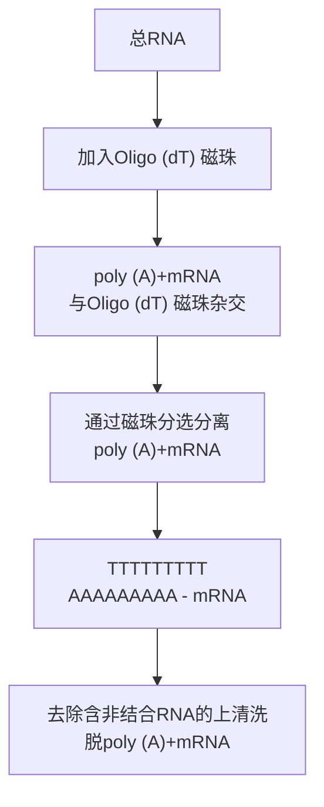

## 试剂

秀丽隐杆线虫（所需的线虫数目，请参阅表6-2）

表 6-2 提取总 RNA 所需要的幼虫和成虫数目

| 发育阶段 | 每15cm平板上虫体数目 | 15cm平板数目 |
| --- | --- | --- |
| L1 | 60 000 | 3 |
| L2 | 30 000 | 3 |
| L3 | 20 000 | 3 |
| L4 | 10 000 | 3 |
| 成虫 | 5 000 | 3 |

## 氯仿或溴氯丙烷

溴氯丙烷是一种可取的氯仿替代物，因为它毒性更小且不易挥发。此外，溴氯丙烷可以提供更好的液相分离，从而更好地从总 RNA 中去除基因组 DNA，获得更纯的 RNA。

预冷的乙醇（75%）

无 RNase 水配制。

异丙醇

M9 缓冲液，&lt;R&gt;

单相裂解试剂 [商品化（如 TRIzol）或从头配制（Chomczynski and Sacchi, 1987, Weber et al. 1998）]

单相裂解试剂含有毒的苯酚和刺激性的异硫氰酸胍。使用时应避免接触皮肤或衣物、戴手套和保护眼睛（屏蔽、护目镜）。在化学通风柜中使用，避免吸入蒸汽。

无 RNase 蒸馏水

制备无 RNase 水，加水至无 RNase 的玻璃瓶。加 DEPC 至 0.1% $^{①}$ （V/V）放置过夜并高压灭菌。

## 设备

离心机和转头（Thermo Scientific CL2，或类似设备，用于 15mL 锥形管的吊桶转子）锥形离心管，15mL

水浴预设至  $65^{\circ}$ C

## 方法

1. 用 $10\mathrm{mL}$ M9缓冲液洗净培养皿中的线虫，该悬浮液转移到 $15\mathrm{mL}$ 的离心管。在室温，$2000\mathrm{r / min}$ 离心30s，沉淀线虫。
2. 小心去除上清，在室温下用 $14\mathrm{mL}$ M9的缓冲液洗蠕虫 $3\sim 5$ 次，直至上清液澄清。最后一次离心后，弃去上清液。

如果不立即提取 RNA，该线虫沉淀可以储存在  $-80^{\circ}C$ 。

3. 用线虫沉淀 10 倍体积（1mL）的单相裂解试剂重悬，转移至微量离心管。在室温下剧烈涡旋 20min 以溶解和裂解线虫。

线虫可能不会完全溶解，称为“幽灵块”（ghost），这是可见的不溶性表皮。

4. 加  $100 \mu L$  的溴氯丙烷，在室温下孵育 15min，其间不时混悬。

如果用氯仿作为相分离试剂，加 1/5 体积。

5.  $4^{\circ}$ C，于14 000g离心15min。

<small>① 译者注:DEPC 水应为 0.1% DEPC 配制，原文为 0.01%。</small>

6. 转移上清（澄清上层）至一新微量离心管，加等体积异丙醇。

7. 翻转离心管几次以混匀，室温静置 10min。

8.  $4^{\circ}$ C，于 14 000g 离心 20min。

可以看到 RNA 为白色沉淀。

9. 用 1mL 冰冷的 75%乙醇洗涤沉淀。

在-80℃，RNA 沉淀可以在 75%乙醇存储 1 年以上。

10.  $4^{\circ}$ C, 14 000g 离心 5min。

11. 除去上清液，并在真空中干燥沉淀 1min。

12. 将沉淀溶解在 $20 \mu \mathrm{L}$ 无 RNase 的蒸馏水。在 $65^{\circ} \mathrm{C}$ 加热 $5 \mathrm{~min}$, 以帮助溶解 RNA, 然后在室温下涡旋溶液 $10 \mathrm{~s}$ 。

13. 4℃，14 000g 离心 1min。将液体转移到新离心管中。

## 配方

为正确使用本方案中的器材和危险试剂，必须查阅相应的材料安全数据表并咨询所在机构的环境卫生和安全办公室。

M9 缓冲液

| 试剂 | 含量(1L) | 终浓度 |
| --- | --- | --- |
| KH2PO4(脱水) | 3g | 22mmol/L |
| Na2HPO4(脱水) | 6g | 22mmol/L |
| NaCl | 5g | 85mmol/L |
| MgSO4(1mol/L) | 1mL | 1mmol/L |

注:在一个大烧杯或量筒中装入 800mL 蒸馏水，用磁力搅拌棒搅拌溶解此组分，加水调整至 1 L。分装至合适尺寸的瓶中（例如，在 500mL 大小的瓶中装 300mL），然后  $15 \, lb/in^{2}$  高压灭菌 15min。

## 参考文献

Chomczynski P, Sacchi N. 1987. Single-step method of RNA isolation by acid guanidinium thiocyanate-phenol-chloroform extraction. Anal Biochem 162: 156–159.

Johnstone IL. 1999. C. elegans: A practical approach. Oxford University Press, New York.

Weber K, Bolander ME, Sarkar G. 1998. PIG-B: A homemade monophasic cocktail for the extraction of RNA. Mol Biotechnol 9: 73–77.

## 方案 5 从酿酒酵母菌中采用热酸酚提取总 RNA

从酵母中分离 RNA 较复杂，需要首先打破厚而坚硬的细胞壁，常用的裂解哺乳动物细胞的离液试剂，不能有效裂解酵母细胞。而从酿酒酵母中提取总 RNA 的方法通常依赖于两个基本方法中的一个:用玻璃珠涡旋或采用热酸平衡酚。在第一个方法中，酵母细胞悬液与小玻璃珠（400μm 直径）混合，剧烈涡旋混合，然后用酚:氯仿在室温下提取 RNA。虽然这种方法对于处理少量样品是可行的，但繁琐的涡流步骤使得它处理大量的样品时不实用。此外，当这种方法按比例缩小培养量（<10mL）后产量较低（Sherman et al. 1983）。选择热酸酚技术分离总 RNA，因为它简单，可用于多个样品，并得到高质量和高产量的 RNA，不含污染的基因组 DNA 可满足大多数下游应用。在一般情况下，这两种方法可以有效地从对数生长期细胞中提取 RNA。有关从静息期或乙醇发酵不同阶段的酵母中提取 RNA 的方案也有描述（Aminul Mannan et al. 2009）。

这里提供的是改进自 Schmitt 等的方案（1990），它采用了苯酚在去污剂十二烷基磺酸钠（SDS）的存在下，反复加热和冷冻细胞。该提取方案在低盐状态进行，以便随后通过离心分离水相和酚相，DNA 从中间层收集，而 RNA 保留在水相。该方案可以从 10mL 培养物中提取 50～250μg 的 RNA。使用这种方法提取的 RNA，适用于大多数的后续应用，如 Northern 杂交、RT-PCR 和生成 cDNA。对此方法的一个改变是，结合了酸酚提取和二氧化硅基 RNA 的分离方法，可以得到高纯度的 RNA，适用于微阵列方法（Mutiu and Brandl, 2005）。

应采取正常的预防措施，以避免 RNase 污染（见本章信息栏“如何去除 RNase”、“RNase 抑制剂”和“焦碳酸二乙酯”）。

## 材料

为正确使用本方案中的器材和危险试剂，必须查阅相应的材料安全数据表并咨询所在机构的环境卫生和安全办公室。

本方案的专用试剂标注&lt;R&gt;，配方在本方案末提供。常用储备溶液、缓冲液和试剂标注&lt;A&gt;，配方见附录1。储备溶液应稀释至适用浓度后使用。

## 试剂

AE 缓冲液&lt;R&gt;

DEPC 处理的蒸馏水

乙醇（95%，-20℃储存）

乙醇（80%）

AE 缓冲液平衡酚

酚:氯仿:异戊醇（25:24:1）&lt;A&gt;

SDS (10%, m/V)

乙酸钠（3mol/L, pH 5.3）

酵母细胞培养物（10mL酵母培养物生长至OD$_{600}$为2.5～5.0）

## 设备

离心机和转子（Beckman GS-6 离心机或类似设备）

干冰或干冰/乙醇浴

水浴或加热装置，预置  $65^{\circ}$ C

## 方法

1. 4℃，2500r/min 离心 5min 沉淀酵母细胞，弃上清。
2. 1mL DEPC 处理无菌水重悬细胞，转移至一微量离心管。最大转速离心 1min 沉淀细胞，弃上清。
3. 400μL AE 缓冲液重悬细胞沉淀。
4. 加  $40 \mu L$  10% SDS 涡旋直至沉淀完全重悬。
5. 加等体积（约  $440 \mu L$ ）AE 缓冲液平衡酚，涡旋混合物。
6.  $65^{\circ}$ C 孵育混合物 4min。
7. 迅速置干冰或干冰/乙醇浴中冷却该混合物，直到苯酚结晶出现（约1min）。
8. 室温于微量离心机以最大转速离心样品 2min 以分离水相和酚相。

9. 转移水相（上层）到一个新的微量离心管中。加入等体积（约  $440 \mu L$ ）酚:氯仿:异戊醇，简单涡旋，室温于微量离心机以最大转速离心样品 5min。

为了制备的 RNA 无 DNA 污染，转移水相时，使中间层完好无损。

10. 转移水相（上层）到一个新的离心管中。加入 1/10 体积（40μL）3mol/L 乙酸钠和 2.5 倍体积的 95%乙醇（约 1mL）沉淀 RNA。

将样品放置在-80℃至少30min以沉淀RNA。RNA样品可以在乙醇中于-80℃无限期储存。需要注意的是，RNA用水重悬也可以存储在-80℃（步骤13），但是存储为乙醇沉淀最稳定。

11. 在室温下于微量离心机以最高转速离心样品 10min。

12. 弃上清液，并用 80% 乙醇洗涤沉淀。

13. 干燥沉淀并用  $20 \mu L$  DEPC 处理的蒸馏水重悬。

沉淀在空气中干燥较好，真空干燥，尤其是在受热的情况下，往往使 RNA 难以溶解。如果有必要，加入水后样品可以在  $65^{\circ}$ C 加热帮助 RNA 溶解。

## 配方

为正确使用本方案中的器材和危险试剂，必须查阅相应的材料安全数据表并咨询所在机构的环境卫生和安全办公室。

AE 缓冲液（配方）

| 试剂 | 含量(100mL) | 终浓度 |
| --- | --- | --- |
| 乙酸钠(3mol/L,pH 5.2) | 1.67mL | 50mmol/L |
| EDTA(0.5mol/L) | 2mL | 10mmol/L |

用 DEPC 处理水调至终体积为 100mL。此缓冲液在使用前以  $15 \, lb/in^{2}$  高压灭菌 15min。

## 参考文献

Amin-ul Mannan M, Sharma S, Ganesan K. 2009. Total RNA isolation from recalcitrant yeast cells. Anal Biochem 389: 77–79.
Mutiu AI, Brandl CJ. 2005. RNA isolation from yeast using silica matrices. J Biomol Tech 16: 316–317.
Schmitt ME, Brown TA, Trumpower BL. 1990. A rapid and simple method for preparation of RNA from Saccharomyces cerevisiae. Nucleic Acids

Res 18: 3091–3092.
Sherman F, Hicks JB, Fink GR. 1983. Methods in yeast genetics: A laboratory course manual. Cold Spring Harbor Laboratory, Cold Spring Harbor, NY.

## 方案 6 RNA 定量和储存

在进行大多数 RNA 分析之前，RNA 定量是一种重要和必需的步骤。RNA 定量方法可以分为两类:紫外（UV）分光光度法，此方法基于嘌呤和嘧啶碱基的吸收光谱；基于荧光染料的方法，结合到核酸时选择性发荧光，测定荧光染料的强度。如果 RNA 样品是纯的（如没有诸如蛋白质、酚、琼脂糖或其他核酸的污染），用 UV 分光光度法测量被碱基吸收的 UV 射线简单而且精确。然而，如果样品中含有较多的杂质，或者如果 RNA 的浓度非常低，最好使用荧光染料为基础的方法。有关分光光度法与荧光染料为基础的方法概述如表 6-3 所示，并更详细描述如下。

## 紫外吸收分光光度法

## 常规分光光度法

用于测定纯化的 RNA 样品中的 RNA 浓度, 最常用的方法是在 260nm 处测量其相对一个空白样品的吸光度 ( $A_{260}$ ), 即用于溶解 RNA 的相同溶剂 (核酸的吸收光谱的原理讨论, 见第 1 章信息栏 “分光光度法”)。 $A_{260}$  为 1.0 对应 40μg/mL 的单链 RNA。计算溶液中 RNA 浓度的公式如下:

$$
\text {RNA 样品浓度} (\mu \mathrm{g/mL}) = \mathrm{A} _ {2 6 0} \times 4 0 \times \text {稀释倍数}
$$

这种方法需要的设备很少，通常包括:配备紫外灯的分光光度计和石英比色皿或特殊的能透射紫外线的塑料比色皿（测量核酸的吸光度所需的短波长被玻璃和一些塑料比色皿吸收）。因为它快速简便、无损样品，所以吸收光谱法早已被用于测量纯的浓缩液中 RNA 的含量。该方法的准确度取决于几个因素。

\- RNA 溶液的浓度。吸收光谱法的局限性之一是它相对不敏感，因此对大多数实验室的分光光度计，核酸浓度至少为  $4 \mu g/mL$  才能获得可靠的  $A_{260}$ 。另外，RNA 溶液的浓度必须在分光光度计的线性范围内；通常情况下， $A_{260}$  值应落在 0.1～1.0 之间，此范围以外不能进行精确测量。如果溶液的  $A_{260}$  为 1.0，应稀释 5～10 倍。如果溶液的  $A_{260}$  为 0.1，应选用更精确的测定小量 RNA 浓度的方法（如用微量分光光度法或基于荧光染料的方法，如下文所述）。

表 6-3 概述分光光度法与荧光染料为基础的方法

<table><tr><td>定量方法</td><td>范围(未稀释)</td><td>用量</td><td>设备</td><td>优点</td><td>缺点</td><td>安全性</td></tr><tr><td colspan="4">紫外吸收分光光度法</td><td>不破坏样品</td><td></td><td></td></tr><tr><td>传统分光度法</td><td>4~40μg/mL</td><td>1~200μL</td><td>N/A</td><td>常规设备即可</td><td>用量大;灵敏度低;仅精确定量纯RNA样品</td><td>N/A</td></tr><tr><td>微量分光光度法</td><td>2~3000μg/mL</td><td>0.5~2.0μL</td><td>N/A</td><td>分析小量样品;高敏感性;样品可回收</td><td>需要昂贵设备</td><td>N/A</td></tr><tr><td colspan="4">荧光染料为基础的方法</td><td></td><td>破坏样品</td><td></td></tr><tr><td>EB</td><td>&gt;200 ng/mL</td><td>N/A</td><td>UV透射器</td><td>便宜</td><td>灵敏度低</td><td>可能诱发突变</td></tr><tr><td>RiboGreen</td><td>1ng/mL~1μg/mL</td><td>N/A</td><td>荧光计</td><td>高敏感性;广谱线性范围</td><td>不能区分RNA与DNA</td><td>比EB安全</td></tr><tr><td>SYBR Green II</td><td>2ng/mL~2μg/m</td><td>N/A</td><td>荧光计</td><td>高敏感性</td><td>不能区分RNA与DNA</td><td>比EB安全</td></tr><tr><td>Quant-iT RNA Assay</td><td>250pg/μL~100ng/μL</td><td>N/A</td><td>荧光计</td><td>在含DNA时可定量RNA</td><td></td><td>未知</td></tr></table>

\- RNA 样品的纯度。 $A_{260}$  不能区分 RNA 和 DNA，因此，建议用无 RNase 的 DNase 处理 RNA 样品去除 DNA 污染（见方案 8）。此外，污染物如苯酚和蛋白质会影响  $A_{260}$  的读数；苯酚在波长为 260nm 处有强烈的吸收，而芳香族氨基酸的吸收在 280nm 处。在 260nm 处吸光度相对于 280nm 的吸光度比值（ $A_{260}/A_{280}$ ）可以用来评估 RNA 样品中蛋白质的污染水平。纯的 RNA 的  $A_{260}/A_{280}$  值接近 2.0。如果有明显的蛋白质或酚污染， $A_{260}/A_{280}$  比小于 2.0，用紫外分光光度法将不可能准确定量核酸含量。另一个比值  $A_{260}/A_{230}$  可用于评估有机化合物或高离液盐（chaotropic salt）的污染水平，它们在波长 230nm 处有强烈吸收，导致低  $A_{260}/A_{230}$ 。理想情况下，提取 RNA 的  $A_{260}/A_{230}$  的比例应接近 2.0。

\- pH 和离子强度。$A_{260}/A_{280}$ 比值依赖于 pH 和离子强度。随着 pH 的增加，$A_{280}$ 降低，但  $A_{260}$  不受影响，从而  $A_{260}/A_{280}$  的比值增加。因为纯水（如蒸馏水、MilliQ 或无 RNase/DNase 水）pH 为酸性，如果使用它们溶解 RNA， $A_{260}/A_{280}$  的比值可能偏低。因此为了准确的可重复的读数，最好使用缓冲液如 TE（pH8.0）作为稀释剂和空白对照。

\- 洁净的比色杯。脏的石英比色皿、粉尘颗粒，以及RNA溶液的混浊度能造成在320nm处光的散射，都会影响 $A_{260}$ 的读数。因为在320nm处蛋白质和核酸不吸收，需要进行背景校正:减去以前使用的相同比色皿 $A_{320}$ 来估计RNA的吸光度。

## 微量分光光度计

除了灵敏度低，常规分光光度法的另一个局限性是其比色杯体积较大，如果想不损失一部分样品，很难对低浓度的 RNA 进行定量。为了克服这些问题，后来开发出了微量分光光度法，这一方法可以高度精确并可重复地分析小体积样品（0.5～2.0μL），而且不需要比色皿、毛细管或其他样品器件。这样的仪器包括但不限于 NanoDrop 分光光度计（Thermo Scientific）、NanoVue 分光光度计（GE 生命科学公司）、Nano-Photometer UV/Vis 分光光度计（Implen）与 Picodrop Microliter UV/Vis 分光光度计（Picodrop Limited 公司）。这些仪器可以测量很大的波长范围（通常 200～1100nm），因此可以用来测量 RNA、DNA 和蛋白质，某些情况下还可以测量染料（如花青素染料 Cy3 和 Cy5 标记的）。该仪器还可进行波长扫描以检测杂质；然后仪器软件将显示整个波长范围内的光谱，计算 $A_{260}$ 以及 $A_{260}/A_{280}$ 和 $A_{260}/A_{230}$ 的值。测量后样品可以用吸头轻松回收，或擦净样品板或清洁传感器。值得注意的是，Picodrop 可以通过吸头直接测量，从而没有污染并能完全回收样品。

这些工具中，NanoDrop 也许是最常用的。NanoDrop 分光光度计家族采用了获得专利的样品保留系统，可以分析体积小至  $0.5 \sim 2.0 \mu L$  的样品。使用该仪器只需直接吸取样品到光学“基座”，放下上部的“样品臂”覆盖至样品上，从而由于表面张力生成液状的“样本柱”被保持在适当位置。然后基座移动自动调整为理想的通道长度（1mm）。之后用装在基座上的两个光纤（发射光的氙气灯）与样品臂［线性电荷耦合（CCD）阵列探测器的光谱仪］进行光谱测定。最早的 NanoDrop 仪器——NanoDrop ND-1000 紫外/可见分光光度计的波长范围为  $220 \sim 750 nm$ ，可以测定  $1 \mu L$  浓度为  $2 \sim 3000 ng/mL$  的样品，而不需要稀释，这比传统分光光度计的范围约宽 50 倍。新的 NanoDrop 仪器提供了更大的波长范围，扩展了浓度范围与比色槽性能，可一次分析多达 96 个样品。

## 基于荧光染料的方法

测定 RNA 浓度的另一种方法为测定与核酸结合染料的荧光强度, 该染料与核酸结合能选择性发荧光。采用荧光染料法定量 RNA 较光谱方法减少了错误, 并提高了灵敏度。当 RNA 浓度太低, 用分光光度法无法准确评估, 或污染物在 $260 \mathrm{~nm}$ 处有吸收, 使常规方法不能准确定量时, 荧光染料法非常有用。除了对 RNA 的浓度极为敏感, 荧光染料在大多数情况下, 对溶剂、$\mathrm{pH}$ 及蛋白污染物不敏感。由于这些原因, 基于荧光的核酸定量方法成为标准的做法。

两个最常用的 RNA 定量荧光染料是溴化乙锭（EB）和商业荧光染料 RiboGreen（Life Technologies/Molecular Probes 公司）。溴化乙锭定量 RNA 浓度需大于 200ng/mL（Le Pecq and Paoletti 1966），而 RiboGreen 可以定量 1～1000ng/mL 范围内的 RNA 样品（Jones et al. 1998）。

另一种 Life Technologies/Molecular Probes 公司的试剂 SYBR Green II 染料，最初被开发用于凝胶中 RNA 的荧光检测，也可以用做标准的荧光计来定量溶液中 RNA 浓度，其灵敏度较 RiboGreen 低。

需要注意的是，RiboGreen、溴化乙锭和SYBR Green II对RNA不是特异的，与DNA结合后也发荧光。因此，当使用这些染料定量含有DNA的RNA样品时，必须用无RNase的DNase I对样品进行预处理（见方案8）。但Life Technologies公司近日开发出一种检测试剂盒，可以选择性地在存在DNA时定量RNA（Quant-iT RNA检测试剂盒）。

## 溴化乙锭

溴化乙锭是一种嵌入试剂，当暴露在紫外线（546nm）下时，发橙色荧光（发射波长为590nm），当结合核酸后荧光增强20倍。使用溴化乙锭定量RNA通常有两种方式。在第一种方法中，测试样品可以“点样”（spotted）到包含溴化乙锭的琼脂糖凝胶上，然后荧光与已知RNA浓度的一组样品进行比较，该组样品点在测试样品旁边。另外一种方法中，样品可在琼脂糖或聚丙烯酰胺凝胶上电泳（见方案10和11），染色条带荧光强度与已知的样品相比较。溴化乙锭的灵敏度极限为200ng/mL（Le Pecq and Paoletti 1966）。

## 琼脂糖平板法

RNA 样品中可能存在污染物，可以发荧光或猝灭荧光。为了避免这些问题，RNA 样品和标准品点在含有溴化乙锭（0.5μg/mL）的 1%琼脂糖平板凝胶的表面上。将凝胶在室温放置几个小时，以使小分子污染物有机会散开。使用短波长紫外光照射溴化乙锭拍摄这些点（photograph the spot）。通过对比标准品的荧光强度估算样品中的 RNA 浓度。

## 微型凝胶法

通过微型凝胶电泳（见第2章）提供快速、便捷的RNA定量方法，并可同时分析其物理状态。

1. 2μL RNA 样品与 0.4μL 凝胶上样缓冲液 IV（仅含溴酚蓝）（见附录 1 配方）混合，制备含溴化乙锭（0.5μg/mL）的 0.8% 琼脂糖微型胶体，将该混合物加至上样孔。
2. 一系列标准 RNA 溶液（0、$2.5\mu \mathrm{g} / \mathrm{mL}$、$5\mu \mathrm{g} / \mathrm{mL}$、$10\mu \mathrm{g} / \mathrm{mL}$、$20\mu \mathrm{g} / \mathrm{mL}$、$30\mu \mathrm{g} / \mathrm{mL}$、$40\mu \mathrm{g} / \mathrm{mL}$ 和 $50\mu \mathrm{g} / \mathrm{mL}$）各 $2\mu \mathrm{L}$，与 $0.4\mu \mathrm{L}$ 的凝胶上样缓冲液 IV 混合。将这些样品加至凝胶上样孔。

RNA 标准品应含有与未知 RNA 的预期大小大致相同的，作为单一品种的 RNA。

3. 进行电泳直至溴酚蓝迁移 1\~2cm。

4. 浸入含有 0.01mol/L 氯化镁的电泳缓冲液中 5min 进行凝胶脱色。

5. 使用短波长紫外光照射拍摄凝胶。通过对比标准品的荧光强度估算样品中的RNA浓度。

## RiboGreen

定量溶液中 RNA 浓度的最敏感且常用的商品荧光染料是 RiboGreen RNA 定量试剂，这是一种专有的、非对称的花青染料。虽然 RiboGreen 从安全角度较溴化乙锭更可取，但它价格昂贵，这有时限制了它的使用。RiboGreen 最大激发和发射波长与荧光剂相近（最大激发约 500nm 和最大发射约 525nm），因此使用标准的荧光过滤设置或仪器设置，与荧光酶标仪和荧光计兼容。与荧光计配合使用，RiboGreen 可检测出低至 1ng/mL 的 RNA，灵敏度比紫外吸收光谱法高 1000 倍，比溴化乙锭高 200 倍。除了提高灵敏度，由于 RiboGreen 染料系统具有很宽的线性动态范围，它的优势在于可定量的 RNA 浓度高达三个数量级，从 1ng/mL 至 1μg/mL。用两种不同的染料浓度，可以实现全面的线性动态范围:浓度（1:200 稀释）可定量分析 20ng/mL～1μg/mL 的 RNA，而进一步 10 倍稀释（1:2000）可以定量 1～50ng/mL 的 RNA。此线性范围即使在核酸有常见的化合物污染时也可保持，如含有蛋白质、盐、乙醇、尿素、氯仿、琼脂糖和一些洗涤剂。RiboGreen 可以可靠地定量多种 RNA，包括核糖体 RNA（rRNA）、转运 RNA（tRNA）、poly（A） $^{+}$ RNA、细胞总 RNA、病毒 RNA 及体外转录反应的 RNA。另外，不同于紫外光谱法，RiboGreen 不能检测污染了游离核苷酸的样品，因此可以精确定量可能降解的样品中完整的 RNA。游离染料基本上无荧光，当结合到 RNA 后荧光的强度增加约 1000 倍，可以提供低背景、高荧光信号。

一个特别有效的 RNA 定量的方法是配合 NanoDrop 3300 荧光分光计使用 RiboGreen。NanoDrop 3300 可以仅测量 $1\mu \mathrm{L}$ 的样品，较常规使用的基于比色皿荧光计或酶标仪减少了样品用量。NanoDrop 3300 检测 RNA 浓度范围为:RiboGreen 染料用 1:200 稀释时为 $25\mathrm{ng / mL} \sim 1\mu \mathrm{g / mL}$，用 $1:2000$ 稀释时为 $5 \sim 50\mathrm{ng / mL}$。与之相对，采用 TD-700 荧光计（Turner Biosystems 公司）进行 RiboGreen RNA 定量检测，RNA 浓度可低至 $1\mathrm{ng / mL}$，然而这种基于比色皿的荧光计需要较大体积的样本。

要确定未知样品中的 RNA 浓度，需测量样品的荧光，通过与线性校准曲线比较确定其浓度。为了绘制标准曲线，RNA 标准品系列稀释液与等体积稀释的 RiboGreen 试剂混合，在室温下简单孵育（2～5min），测量每个样品的荧光对 RNA 浓度作图。为了更准确，应与未知样品同样条件下测量标准品。更多使用 RiboGreen 定量 RNA 的信息和详细的操作说明可从 Life Technologies/Molecular Probes 获得。

如上文所述，RiboGreen 对 RNA 没有明显的选择性，该染料与 DNA 结合也会使荧光显著增强。因此，最好进行 DNase 预处理步骤（见方案 8），以消除任何可能的产生干扰信号的基因组 DNA。由于 Dnase I 消化和 RiboGreen 荧光定量检测缓冲液组分完全不同，这两个反应必须依次进行。由于存在 Dnase I 和随之带来的二价阳离子，经 Dnase I 消化的 RNA 定量的线性范围较原来的 RiboGreen 分析略低（5ng/mL～1μg/mL）。

## SYBR Green II

SYBR Green II 与标准荧光计结合使用可以定量溶液中的 RNA（Schmidt and Ernst 1995）。SYBR Green II 进行 RNA 定量与紫外吸收光谱法相比，灵敏度提高近 500 倍，与溴化乙锭的荧光比色法相比，敏感性增加近两个数量级。当 $2 \times 10^{-5}$ 稀释时，测定 RNA 浓度的线性范围为 $2 \sim 100\mathrm{ng/mL}$；当 $1 \times 10^{-4}$ 稀释时，范围是 $5 \sim 1000\mathrm{ng/mL}$。对于常规的 RNA 定量，$1 \sim 10\mu\mathrm{L}$ RNA 样品的溶液中加入 $1\mathrm{mL}$ 的稀释的 SYBR Green II 染料，在 $525\mathrm{nm}$ 处检测 $468\mathrm{nm}$ 激发荧光。RNA 样品中的浓度基于线性标准曲线计算。这种方法的一个变种是使用 Light Cycler（Roche 公司），检测范围为 $10\mathrm{ng/mL} \sim 50\mu\mathrm{g/mL}$（Hooper McGrevy et al. 2003）。

SYBR Green II 染料也可以用于快速、半定量估计溶液中的 RNA 浓度。在该方法中 SYBR Green II 染料用来检测点样到干净的保鲜膜或石蜡材料封口膜（如石蜡封口膜）上的 RNA，这与前述基于溴化乙锭的方法类似。用 SYBR Green II 染料对核糖体 RNA 的可见检测极限为 3ng，与用溴化乙锭方法相比灵敏度提高 25 倍。

1. SYBR Green II 储存液用 TE（10mmol/L 的 Tris-HCl，1mmol/L 的 EDTA，pH8）按 1:5000 稀释。
2. 将  $5 \mu L$  含核酸的样品，与  $5 \mu L$  1:5000 稀释的 SYBR Green II 染料混合。
3. 混合物点到保鲜膜或封口膜上，直接放置在透照仪上。
4. 以 $300\mathrm{nm}$ 进行透照，通过SYBR凝胶成像滤镜并用宝丽来667黑白打印胶片成像。要获得最高灵敏度，成像是必不可少的。
5. 用已知含量的 RNA 重复步骤 2～4，观察其信号并与实验样品比较。

## Quant-iT RNA 分析试剂盒

Quant-iT RNA 分析试剂盒在含 DNA 时也可以定量 RNA。因为 Quant-iT RNA 试剂是一个专利染料，与双链 DNA 相比它对 RNA 具有高度选择性，该测定法即使在存在质量相等的 DNA 情况下，也可以精确定量 RNA。Quant-iT RNA 试剂最大激发波长是 644 nm，最大发射波长为 673 nm，并且可用标准的荧光计或荧光酶标仪测定。该法检测 RNA 的线性范围为 5～100 ng，相应的初始实验样品浓度为 250 pg/mL～100 ng/mL。荧光信号不受游离核苷酸、盐、溶剂和蛋白质等多种常见污染物影响。

该试剂盒提供浓缩测定试剂、稀释缓冲液和一组预先稀释的大肠杆菌核糖体 RNA（rRNA）的标准品。Quant-iT RNA 试剂首先由缓冲液稀释，然后与小等份 RNA 标准品和未知 RNA 样品混合。检测荧光，通过比对 RNA 标准品建立的标准曲线估算未知样品中的 RNA 浓度。用 Quant-iT RNA 分析试剂盒定量 RNA 的更多信息和操作细节，由 Life Technologies/Molecular Probes 公司提供。

## RNA 纯品的储存

提取 RNA 或重复使用样品时，可能会引入少量的 RNase 污染。正确的存储可以减少 RNase 污染和随之而来的样品降解。有几个可供选择的用于存储纯化 RNA 的方法。

\- 用水性缓冲液溶解沉淀并存储于-80℃。常用缓冲液包括 TE（10mmol/L Tris-HCl，1 mmol/L EDTA，pH 7.0），含 SDS（0.1%～0.5%）的 TE（pH7.6），含有 0.1mmol/L EDTA（pH 7.5）的 DEPC 处理水，或商品化的 RNA 储存液（如 RNA 储存液，Ambion）。RNA 在-80℃下可稳定保存 1 年。EDTA 是一种镁和其他金属离子的螯合剂，可以避免这些金属离子对 RNA 的非特异性降解；使用 EDTA 溶液要保证无 RNase。SDS 是一种核酸酶抑制剂；在用 RNA 作为模板之前，如用于引物延伸反应、反转录或体外翻译时，应用氯仿抽提和标准乙醇沉淀法去除 SDS。

\- 用盐/乙醇混悬液（salt/ethanol slurry）在-80℃下储存RNA。将RNA按标准沉淀步骤（参见方案7）沉淀，即盐（1/10体积的3mol/L乙酸钠）和乙醇（2倍体积的100%乙醇）在-80℃下存储该混合物，不需要通过离心沉淀RNA。低pH、高乙醇含量及低温的结合将稳定RNA并抑制酶活性，这是长期储存RNA的首选方法。当需要时，可以使用自动移液装置回收RNA样品。然而，由于沉淀的RNA是块状并有黏性，黏在一次性吸头表面上会造成部分损失，导致RNA的回收量损失。可以离心得到RNA沉淀，并溶解在水溶性缓冲液，然后再吸取。

\- 用去离子甲酰胺溶解沉淀，并储存于-20℃。在这种条件下，RNA至少可以稳定保存1年(Chomczynski 1992)。甲酰胺提供了稳定的化学环境，可保护RNA不被RNA酶降解。甲酰胺可以很快溶解纯的无盐RNA，浓度可大于4mg/mL，这样浓度的RNA样品可以直接进行凝胶电泳、RT-PCR或RNase保护分析，既省时又避免了潜在因素的降解。如果需要，用4倍体积的乙醇进行沉淀，如Chomczynski（1992）所述，或用0.2mol/L NaCl 4倍稀释甲酰胺，然后加入常规2倍体积的乙醇(Nadin-Davis and Mezl 1982)可以回收溶于甲酰胺溶液中的RNA。

当从存储状态回收 RNA 样品时，最好是在冰上解冻样品，以避免被 RNase 降解。此外建议按使用量分装 RNA，这样可避免反复冻融对 RNA 的损伤，并可防止 RNase 污染。

## 参考文献

Chomczynski P. 1992. Solubilization of formamide protects RNA from degradation. Nucleic Acids Res 20: 3791–3792.
Hooper-McGrevy KE, MacDonald B, Whitcombe L. 2003. Quick, simple, and sensitive RNA quantitation. Anal Biochem 318: 318–320.
Jones LJ, Yue ST, Cheung CY, Singer VL. 1998. RNA quantitation by fluorescence-based solution assay: RiboGreen reagent characterization. Anal Biochem 265: 368–374.

Le Pecq JB, Paoletti C. 1966. A new fluorometric method for RNA and DNA determination. Anal Biochem 17: 100–107.
Nadin-Davis S, Mezl VA. 1982. Optimization of the ethanol precipitation of RNA from formamide containing solutions. Prep Biochem 12: 49–56.
Schmidt DM, Ernst JD. 1995. A fluorometric assay for the quantification of RNA in solution with nanogram sensitivity. Anal Biochem 232: 144–146.

## 方案 7 RNA 的乙醇沉淀

纯化的 RNA 需要沉淀浓缩以便用于下游应用。从水溶液回收 RNA 的标准方法是用乙醇（或异丙醇）沉淀 RNA（乙醇沉淀原理讨论见第 1 章，方案 4）。RNA 可从含 0.8mol/L LiCl、0.5mol/L 乙酸铵或 0.3mol/L 乙酸钠的溶液中有效沉淀。选哪种盐由 RNA 的后续应用决定。由于十二烷基硫酸钾盐非常难溶，如果要用含 SDS 的缓冲液（SDS 能抑制核酸酶活性有时用于储存 RNA）溶解 RNA，不要再用乙酸钾。基于同样原因，如果 RNA 已经溶于含有 SDS 的缓冲液，也不要使用乙酸钾以免沉淀。当 RNA 用于无细胞系统翻译或反转录时，避免使用 LiCl，这是由于 LiCl 在大多数无细胞系统中抑制蛋白合成起始，抑制依赖 RNA 的 DNA 聚合酶的活性。

除了盐的类型，还应该考虑用于沉淀的醇的类型。RNA 可以用 2.5～3.0 倍体积乙醇或 1 倍体积异丙醇沉淀；后者在需要保持液体的小体积时有优势。虽然异丙醇较乙醇沉淀 RNA 的效率略低，然而异丙醇在含有铵离子时比乙醇能更好地保持溶液中的游离核苷酸，从而将它们与 RNA 沉淀分离。但异丙醇较乙醇难挥发，故更难去除。

## 材料

为正确使用本方案中的器材和危险试剂，必须查阅相应的材料安全数据表并咨询所在机构的环境卫生和安全办公室。注意:用于沉淀 RNA 的液体必须是无 RNase 的。

## 试剂

DEPC 处理水

乙醇（70%），冰冷

乙醇（100%）或异丙醇，冰冷

RNA 溶液

盐（5mol/L 乙酸铵、8mol/L LiCl 或 3mol/L 乙酸钠）

## 方法

1. 估计 RNA 溶液体积。

2. 如表 6-4 所示，加入一种盐溶液调整单价阳离子浓度。如果 RNA 溶液含高浓度盐，用 TE（pH 7.0）稀释。混好溶液。

表 6-4 沉淀 RNA 用的盐溶液

| 盐 | 储存液/(mol/L) | 终浓度/(mol/L) |
| --- | --- | --- |
| 乙酸铵 | 5 | 0.5 |
| 氯化锂 | 8 | 0.8 |
| 乙酸钠 | 3(pH 5.2) | 0.3 |

如加 0.1 倍体积 3mol/L 乙酸钠以增加盐浓度。

如果溶液的终体积为  $400 \mu L$  或更少，在一个微量离心管中沉淀即可。较大体积的可以分装在几个微量离心管，或在适用于中速离心机或超速离心机的试管中沉淀和离心 RNA。

3. 加入 $2.5 \sim 3.0$ 倍体积的冰冷乙醇（或1倍体积异丙醇）混匀溶液。在 $-20^{\circ} \mathrm{C}$ 放置此乙醇溶液 $1 \mathrm{~h}$ 至过夜，以便于RNA沉淀。

当 RNA 浓度较高时沉淀更快、更完全，一般原则是 RNA 浓度约  $10 \mu g/mL$ ，几小时至过夜沉淀即可，但对于更低浓度，RNA 应加入糖原助沉以利于更好地回收 RNA（见疑难解答）。

RNA 可以于  $-80^{\circ}$ C 储存超过 1 年。

4. 于  $4^{\circ}$ C，12 000～14 000g 离心 10min 回收 RNA。

5. 去除上清，用自动微量移液器或连接了真空管（vacuum line）的一次性吸头，小心取出残留痕量上清（图 6-4）。小心不要接触到核酸沉淀（这可能看不见）。用吸头去除吸附于管壁上的任何液体。

flowchart

图 6-4 吸取上清。将打开盖子的微量离心管以某角度握住，使沉淀在上侧面。用连接真空装置的一次性吸头从离心管中吸走液体。将吸头插到离心管较低一侧液面以下。当液体抽走时移动吸头至管底。用轻柔的吸力避免沉淀被吸走。保持吸头末端不接触沉淀。最后抽吸管壁去除残留液滴。

6. 用 $0.5 \mathrm{~mL}$ 冷 $70 \%$ 乙醇洗沉淀, 于 $4^{\circ} \mathrm{C}$ 、微量离心机以最大转速离心 $10 \mathrm{~min}$ 。

7. 重复步骤 5。

8. 室温下敞盖放在实验台上至残留液体挥发干净。

不要使 RNA 沉淀干透，否则很难溶解。

9. 用适量无 RNase 缓冲液 [常用 TE, pH 6\~7 溶解 RNA 沉淀 (沉淀通常是看不见的)] 冲洗管壁。

重悬后的 RNA 沉淀可以  $65^{\circ}$ C 孵育 5min，间或轻柔混匀以助溶。

## 疑难解答

问题（步骤 3）:从低浓度（ng/mL）回收 RNA 时效率低。

解决方案:糖原可与 RNA 共沉淀，用来有效回收低浓度 RNA。糖原终浓度为 50～150μg/mL 时，在包含 0.5mol/L 乙酸铵乙醇/异丙醇里与 RNA 共沉淀。注意糖原通常易被核酸污染，这会影响 UV 吸收读值，并在随后的酶反应（如 RT-PCR）中产生竞争。因此，如果沉淀的 RNA 用于 RT-PCR，强烈推荐使用无核酸的商品化糖原（如 Ambion 公司，目录号 AM9510）。也可使用共价连接染料的糖原（如 GlycoBlue，Ambion），它可以使 RNA 沉淀体积增大并更容易看见。

## 方案 8 通过无 RNase 的 DNase I 处理去除 RNA 样品中的 DNA 污染

用单相裂解试剂提取的RNA样品可能包含少量的基因组DNA污染，如果此RNA后续用于RT-PCR（第7章，方案8）或实时定量RT-PCR（第9章，方案4)，必须去除DNA污染，而且污染的DNA会使RNA定量不准确（见方案6）。

从 RNA 样品中最常用和有效的去除痕量到中等量 DNA 污染（大于  $10 \mu g/mL$ ）的方法是用 DNase I 消化，它是一种非特异性的内切核酸酶，通过水解磷酸二酯键选择性地切割 DNA（单链双链均可）（Grillo and Margolis 1990; Simms et al. 1993）（更多的方法见本方案末尾处讨论部分）。DNase 必须失活或在后续 PCR 应用之前被去除，否则它可能消化新生成的 DNA。下面的方案中，通过加入终浓度为 2.5 mmol/L 的 EDTA，然后高温加热使 DNase 失活。由于高温下二价阳离子存在时 RNA 自发降解，所以 EDTA 必须在加热灭活之前加入 RNA 样品中。如果样品没有进一步沉淀或基于过柱方法纯化，那么 EDTA 的终浓度应该充足以保护 RNA 不被降解，但也不能过量，否则抑制下游酶活性（如反转录酶），这些酶的活性需要二价阳离子。通常可以在反转录酶反应之前稀释 DNase 处理的 RNA 样品，或在反转录反应中额外加入  $Mg^{2+}$ 。另外也可以用蛋白酶 K 于  $50^{\circ}C$  消化 30 min（ $150 \mu g$  蛋白酶 K 每毫升样品）灭活 DNase，然后用酚:氯仿抽提，乙醇沉淀。

## 材料

为正确使用本方案中的器材和危险试剂，必须查阅相应的材料安全数据表并咨询所在机构的环境卫生和安全办公室。

## 试剂

无 RNase 的 DNase I

可由几个制造商提供（如Promega的RQ1，Ambion的无RNase的DNaseI）

DNase I 反应缓冲液（10×）

此反应缓冲液随 DNase 酶提供，可以保证最佳的 DNase 活性。

EDTA (25mmol/L)

有时称为终止液，含EDTA或EGTA，与DNase同时提供。

RNA 样品

此方案适于 $<10\mu g$ RNA 样品中去除含痕量到中间量的 DNA（达到 $10\mu g/mL$）。如果处理多于 $10\mu g$ RNA 或严重污染 DNA（$>10\mu g/mL$）的 RNA 样品，那么稀释此 RNA 样品并相应扩大反应体系。

无 RNase 水

## 设备

微量离心管（1.5mL）（无 RNase）

水浴或加热装置预设至  $37^{\circ}$ C 与  $65^{\circ}$ C

## 方法

1. 冰上溶解 RNA 样品。

2. 加入  $2 \mu L$   $10 \times Dnase I$  反应缓冲液。每  $1 \sim 2 \mu g$  RNA 加入 1U Dnase I。用无 RNase 水调整终体积为  $20 \mu L$ 。样品于  $37^{\circ}C$  孵育 30min。

3. 加入  $2.5 \mu L$  25mmol/L EDTA 灭活 Dnase I。样品于  $65 \sim 75^{\circ}C$  孵育  $5 \sim 10min$ 。

4. 简单离心后冰上冷却样品。

## 讨论

除了 Dnase I 消化法, 另外两种常用的从 RNA 样品中去除 DNA 污染的方法是酸性酚: 氯仿抽提与氯化锂（LiCl）沉淀。样品用等量的酸性酚: 氯仿 [酚: 氯仿 (5:1), pH4.7] 抽提, 这样可以使 DNA 在有机相而 RNA 保持在水相, 从而使二者分开, RNA 随后可以由乙醇沉淀回收（见方案 7）。LiCl 可以选择性沉淀 RNA 而不能有效沉淀 DNA, 后者保持在上清。然而 LiCl 在严重 DNA 污染 (>10μg/mL) 时沉淀 RNA 是没有效果的。用 Oligo (dT) 亲和纯化提取 mRNA 的方法（方案 9), 也可以用于去除样品中污染的 DNA。

## 参考文献

Grillo M, Margolis FL. 1990. Use of reverse transcriptase polymerase chain reaction to monitor expression of intronless genes. BioTechniques 9:262–268.

Simms D, Cizdziel PE, Chomczynski P. 1993. TRIzolTM: A new reagent for optimal single-step isolation of RNA. Focus (Life Technologies) 15: 99–102.

## 方案 9 Oligo (dT) 磁珠法提取 poly(A)$^{+}$mRNA

以下方案来自 Jakobsen 等（1994），是常用的采用偶联磁珠的 Oligo(dT)从总 RNA 分离 mRNA 的方法。首先总 RNA 在高盐缓冲液溶解加热至 65～70℃，立即冰上冷却以破坏二级结构。此 RNA 随后在室温与偶联磁珠的 Oligo(dT)复性；高盐缓冲液可以稳定 poly(A)-Oligo(dT)复合物。然后用高盐洗涤缓冲液洗去未结合的 RNA，保留结合 Oligo(dT)-poly(A) $^{+}$ mRNA。为了从珠子上洗脱 poly(A) $^{+}$ mRNA，用低盐缓冲液(或水)解离 poly(A)-Oligo(dT)复合物。或者直接将保留在珠子上的 poly(A) $^{+}$ mRNA 用于下游反应(如固相 cDNA 合成)。分离 poly(A) $^{+}$ mRNA 的背景信息列在信息栏 “poly(A) $^{+}$ mRNA” 中。

Oligo(dT)-磁珠有几种商品化产品（表 6-5），都是作为单独的试剂和试剂盒的组分。虽然单独的试剂可以满足用户使用，而试剂盒由于提供了需要的大多数或全部预包装的试剂（如结合、洗涤和洗脱缓冲液），并且无 RNase，从而具有更多优势。通常根据商品化试剂盒的类型和规格，可以从 0.25～8.0mg 总 RNA 中分离 poly(A) $^{+}$ mRNA；对于大多数试剂盒，初始总 RNA 样品浓度应  $\geqslant 2\mu g/\mu L$ 。也有可以从动物或植物组织或培养细胞中分离 mRNA 的商品化试剂盒；这些试剂盒也提供裂解缓冲液，以及结合、洗涤和洗脱缓冲液。当选用试剂盒时应考虑几个不同因素，包括组织/样品类型、初始材料的量。

表 6-5 商品化的 Oligo(dT)磁珠

| 商品名称 | 制造商 |
| --- | --- |
| BcMag mRNA magnetic beads | Bioclone, Inc. |
| BioMag Oligo dT(20) | Polysciences, Inc. |
| Dynabeads Oligo (dT)25 | Life Technologies |
| E.Z.N.A. Mag-Bind mRNA Kit | Omega BioTek |
| Oligo(dT)MagBeads | Ambion |
| Seradyn Sera-Mag Magnetic Oligo(dT)Particles | Thermo Scientific |

## poly(A) $^{+}$ mRNA

与 rRNA、5S RNA、5.8S RNA 和 tRNA 相比，大多数真核生物的 mRNA 在其 3'端带有 poly(A)尾巴，通常有 30～200 核苷酸。因此，mRNA 能用 Oligo(dT)-亲和层析法从细胞总 RNA 中分离，该方法利用带有 poly(A) $^{+}$ mRNA 能与 Oligo(dT)短链形成稳定的 RNA-DNA 杂合链的原理。此方法由三个基本步骤组成:①poly(A) $^{+}$ mRNA 与连接于载体的 Oligo(dT)分子杂交；②洗去不能结合 Oligo(dT)的核酸；③在低严谨条件下从 Oligo(dT)/载体洗脱 poly(A) $^{+}$ mRNA。

传统的 mRNA 分离方法采用 Oligo(dT)-纤维素亲和层析，在这里，Oligo(dT)短链(一般长为 18～30 核苷酸)连接至纤维素基质上(Edmonds et al. 1971; Aviv and Leder 1972)。典型的方法包括两步:首先提取总 RNA，再通过亲和层析分离 poly(A)$^{+}$mRNA。Oligo(dT)-纤维素直到今天仍在使用，商品化试剂盒提供预装柱用于柱层析，或提供离心柱用于批量洗脱 mRNA。最近发展了其他 Oligo(dT)载体如聚苯乙烯-橡胶(胶乳)珠(polystyrene-latex bead)，它们大小和形状全都相同，提供了有效的 poly(A)$^{+}$mRNA 结合能力，而不用像 Oligo(dT)-纤维素那样大量洗涤。

在很多实验室，Oligo(dT)纤维素法主要被磁珠偶联 Oligo(dT)所取代，在这里短序列 Oligo(dT)(通常长为 14～25nt)共价结合在磁珠表面(直径约 1μm)，应用磁珠法可以简单、快速地分离 mRNA(图 6-5)(Hornes and Korsnes 1990)。该方法较非磁珠法有几个优点，包括快速分离 mRNA、减少操作(如离心)时间、便于自动化。而且该方法可以有效地从粗制组织或细胞裂解液直接分离 poly(A)$^{+}$ mRNA 而不需要先提取总 RNA(Jakobsen et al. 1990, 1994)。

分离的 mRNA 适用于绝大多数下游应用，如 Northern 分析、cDNA 合成、S1 核酸酶分析、核酸酶保护分析、引物延伸、消减杂交(subtractive hybridization)、SAGE、RACE。由于珠子不会干扰下游酶反应，对于多数下游应用不需要洗脱 mRNA。然而需要注意的是，poly(A) $^{+}$ RNA 制品可能包含残留的基因组 DNA。对于多数应用这不是问题，但对于任何包括 PCR 步骤的应用，在 mRNA 用于后续实验之前必须用 DNase 处理（见方案 8）。

flowchart

图 6-5 用 Oligo（dT）MagBeads 分离 poly（A） $^{+}$ mRNA。总 RNA 包括 mRNA 和其他种类 RNA。Oligo（dT）-磁珠仅结合到 poly（A） $^{+}$ mRNA（见图）。用磁铁将结合到珠子上的 mRNA 沉淀、其他种类的 RNA 在上清中被去除。用水或低盐缓冲液从珠子上解离 mRNA，然后可从上清中捕获 mRNA。

## 材料

为正确使用本方案中的器材和危险试剂，必须查阅相应的材料安全数据表并咨询所在机构的环境卫生和安全办公室。

本方案的专用试剂标注&lt;R&gt;，配方在本方案末提供。常用储备溶液、缓冲液和试剂标注&lt;A&gt;，配方见附录1。储备溶液应稀释至适用浓度后使用。

## 试剂

结合缓冲液&lt;R&gt;

DEPC 处理水或 10mmol/L Tris-HCl (pH 7.5)

Oligo (dT) -磁珠（见表 6-5）

总 RNA，75μg

如本章方案 1～5 所述制备 RNA。

应用凝胶电泳和/或 Northern 印迹检测总 RNA 样品质量，确保没有降解（见方案 10 信息栏 “所制备 RNA 的质量检查”）。如果在凝胶或 Northern 印迹杂交 rRNA 条带下面有弥散，则 RNA 发生降解，此样本不能用于 poly（A） $^{+}$ mRNA 分离。

洗涤缓冲液&lt;R&gt;

## 设备

盛冰容器

磁架（如 DynaI MPC，磁性颗粒富集器；Life Technologies 公司）

微量离心管（0.5mL），无 RNase

旋转仪

水浴或加热装置，分别预设至  $65 \sim 70^{\circ}C$  或  $75 \sim 80^{\circ}C$ 。

## 方法

## 平衡磁珠

1. 在管中完全重悬珠子，获得均一悬液。吸取 $200 \mu \mathrm{L}$ 珠子到一新的微量离心管。

2. 置于磁架上 1\~2min。

珠子将迁移至靠近磁铁一侧。

3. 管子置于磁架上，同时用吸头小心地完全去除上清。

4. 从磁架上移开管子，用  $100 \mu L$  结合缓冲液重悬珠子。

5. 重复步骤 2\~4。

## 从总 RNA 中纯化 mRNA

6. 用 DEPC 处理水或 10mmol/L Tris-HCl（pH 7.5）调整总 RNA 样品体积为  $100 \mu L$ 。

7. 加入  $100 \mu L$  结合缓冲液，溶液在  $65 \sim 70^{\circ} C$  加热  $2 \sim 5 min$ 。立即置于冰上。

8. 加入  $100 \mu L$  用结合缓冲液重悬 Oligo（dT）-磁珠。完全混匀并在室温连续旋转 5min 复性。

9. 将管子置于磁架 1\~2min 收集珠子。小心并完全去除上清。

当用小体积磁珠时完全必须去除所有缓冲液。

10. 从磁架上移走管子，用 1mL 洗涤缓冲液洗珠子三次。

11. 加入 DEPC 处理水或 10mmol/L Tris-HCl 75～80℃ 孵育 2min，从珠子上洗脱 mRNA。把管子置于磁架上，把含有 mRNA 的上清迅速移至一新的无 RNase 的管中。

如果分离的 mRNA 仍结合在珠子上用于下游反应（如固相 cDNA 合成），用下游所用酶的缓冲液洗涤磁珠。

## 配方

为正确使用本方案中的器材和危险试剂，必须查阅相应的材料安全数据表并咨询所在机构的环境卫生和安全办公室。

结合缓冲液

| 试剂 | 含量(100mL) | 终浓度 |
| --- | --- | --- |
| LiCl(5mol/L) | 10mL | 0.5mol/L |
| Tris-Cl(1mol/L, pH 8.0) | 10mL | 0.1mol/L |
| EDTA(0.5mol/L) | 2mL | 0.01mol/L |
| 十二烷基硫酸锂(10%, m/V) | 10mL | 1%(m/V) |
| DTT(1mol/L) | 500μL | 5mmol/L |

如果发现沉淀，加热至室温并摇晃直至所有组分充分重悬。