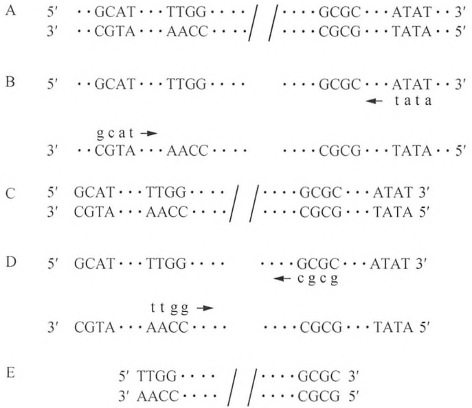
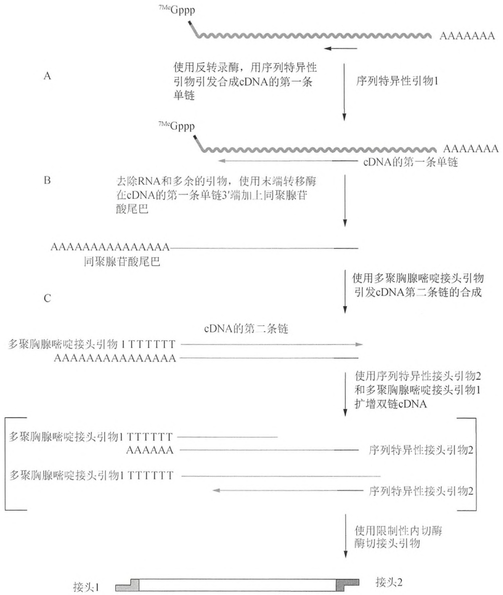
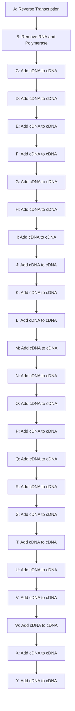

稍差，但是两种技术在灵敏度上相近。

text_image

A 5' ...GCAT...TTGG... / / ...GCGC...ATAT...3'
3' ...CGTA...AACC/ / ...CGCG...TATA...5'
B 5' ...GCAT...TTGG... / ...GCGC...ATAT...3'
tata
3' ...CGTA...AACC/ / ...CGCG...TATA...5'
C 5' GCAT...TTGG... / / ...GCGC...ATAT 3'
3' CGTA...AACC/ / ...CGCG...TATA 5'
D 5' GCAT...TTGG... / ...GCGC...ATAT 3'
cgcg
ttgg
3' CGTA...AACC/ / ...CGCG...TATA 5'
E 5' TTGG... / / ...GCGC 3'
3' AACC/ / ...CGCG 5'

图 7-3 巢式 PCR 策略。此处使用两对引物。（A～C）第一对引物进行常规 PCR 反应。（D）第二对套嵌引物结合首次 PCR 产物。套嵌引物结合处位于第一对引物结合位点内部。（E）第二轮 PCR 后，PCR 终产物的长度由内部引物结合位点的位置来确定。（方案由 A. Malcolm Campbell, Davidson College and James G. Martin Genomics 提供。）

## 材料

为正确使用本方案中的器材和危险试剂，必须查阅相应的材料安全数据表并咨询所在机构的环境卫生和安全办公室。

本方案的专用试剂标注&lt;R&gt;，配方在本方案末提供。常用储备溶液、缓冲液和试剂标注&lt;A&gt;，配方见附录1。储备溶液应稀释至适用浓度后使用。

## 试剂

琼脂糖或聚丙烯酰胺凝胶（见步骤7）

含  $MgCl_{2}$  的扩增缓冲液（与耐热 DNA 聚合酶一起提供）（10×）

ATP (10mmol/L)

氯仿

含有所有 4 种 dNTP（pH 8.0）的 dNTP 溶液（20mmol/L）

乙醇

溴化乙锭（EB）或者 SYBR Gold

酚:氯仿（1:1，V/V）

引物 [溶于水的外部核苷酸引物 1（20μmol/L）和引物 2（20μmol/L）；溶于水的内部寡核苷酸引物 1（20μmol/L）和引物 2（20μmol/L）]

除了在模板分子上的位置不同之外，巢氏 PCR 引物并没有其他特别之处。此处提供一般引物设计的规则。每个引物应长 20～30 个核苷酸，并且其中 4 种碱基的数量大约相等，G 和 C 的分布要均衡，形成稳定二级结构的倾向低。引物 5'端可以添加限制性内切核酸酶酶切位点，以利于扩增产物随后的克隆和操作。

乙酸钠（3mol/L）

Taq DNA 聚合酶（来自 Agilent 公司、Life Technologies 公司、NEB 公司及其他厂商）

TE 缓冲液（pH 8.0）

10mmol/L Tris-Cl (pH 8.0)

1mmol/L EDTA

溶于 10mmol/L Tris-Cl（pH 7.6）的模板 DNA，含少于 0.1mmol/L EDTA

Tris-Cl (10mmol/L, pH 7.6)

## 其他试剂

此方案步骤 7 中所需的试剂已在第 2 章的方案 1 和 2，或者方案 3 和 4，以及方案 13 中列出。

## 设备

微量自动移液器用的带滤芯的吸头

微量离心管（0.5mL，壁薄以利于扩增反应）或微孔板

正排量移液管

可编程所需扩增程序的热循环仪

热循环仪如果没有配备热盖，那么在 PCR 循环中可以用矿物油或石蜡来防止 PCR 过程中反应混合液液体的蒸发。

## 方法

1. 基于已知 DNA 序列，设计并合成一对内部寡聚核苷酸引物对和外部寡核甘酸引物对。
2. 在灭菌的 0.5mL 薄壁扩增管中加入下列试剂并混匀:

| 扩增缓冲液(10×) | 5μL |
| --- | --- |
| 4种dNTP溶液(pH 8.0),每种浓度在20mmol/L | 1μL |
| 外部寡核苷酸引物1(20μmol/L) | 2.5μL |
| 外部寡核苷酸引物2(20μmol/L) | 2.5μL |
| 热稳定DNA聚合酶(1~5U/μL) | 1.0μL |
| 水 | 28~33μL |
| DNA模板(0.1~1.0μg) | 5~10μL |
| 总体积 | 50μL |

3. 如果热循环仪没有配备热盖，可在反应混合物中加一滴（约 $50\mu \mathrm{L}$ ）轻质矿物油。这样可以避免样品在重复冷热循环中蒸发。另外，在使用热启动PCR时可在管中加一滴石蜡。将反应管或微孔板放入热循环仪。下表列出第一轮扩增的变性、复性、延伸时间及温度:

| 循环数 | 变性 | 复性 | 延伸 |
| --- | --- | --- | --- |
| 30个循环 | 94°C, 30s | 60°C, 30s | 72°C, 2.5min |
| 末循环 | 94°C, 30s | 60°C, 30s | 72°C, 10min |

这些时间适用于配制在 0.5mL 簿壁管中，在诸如 PerkinElmer 9600 或 9700、Mastercycler（Eppendorf 公司）和 PTC-100（MJ Research 公司）等 PCR 仪中反应的 50μL 反应体系。时间和温度可以根据设备类型及反应体积做适当调整。

许多热循环仪的结束程序是扩增样品放置在  $4^{\circ}$ C 直至被取出。样品可以在此温度下放置过夜，但随后需放在  $-20^{\circ}$ C 保存。

通过经验确定既定扩增反应中引物对的确切复性温度。若靶 DNA 较长（大于 4kb），应当尝试延长延伸时间（每个循环延长到 10min）。

4. 从反应体系中取出 $5 \sim 10 \mu \mathrm{L}$ 样品放置在 $4^{\circ} \mathrm{C}$, 如果对第二次扩增后的 DNA 产量不满意, 可以把保存的这些巢氏 PCR 首轮扩增产物通过琼脂糖或聚丙烯酰胺凝胶电泳进行分析。使用合适的 DNA marker。用溴化乙锭或 SYBR Gold 进行凝胶染色。

5. 以 $5\mu \mathrm{L}$ 首次扩增产物为模板进行第二次扩增。在无菌的 $0.5\mathrm{mL}$ 薄壁扩增管中加入下列试剂并混匀:

| 扩增缓冲液(10×) | 5μL |
| --- | --- |
| 4种dNTP溶液(pH 8.0),每种浓度在20mmol/L | 1μL |
| 内部寡核苷酸引物1(20μmol/L) | 1.5μL |
| 内部寡核苷酸引物2(20μmol/L) | 1.5μL |
| 耐热DNA聚合酶(1~5U/μL) | 1.0μL |
| 水 | 28~33μL |
| DNA模板(0.1~1.0μg) | 5μL |
| 总体积 | 至50μL |

6. 如果热循环仪没有配备热盖，可在反应混合物中加一滴（约  $50 \mu L$ ）轻质矿物油。这样可以避免样品在重复冷热循环中蒸发。另外，在使用热启动 PCR 时可在管中加一粒石蜡。将反应管或微孔板放入热循环仪。下表列出第一轮扩增的变性、复性和延伸时间以及温度:

| 循环数 | 变性 | 复性 | 延伸 |
| --- | --- | --- | --- |
| 30个循环 | 94°C,30s | 60°C,30s | 72°C,2.5min |
| 终止循环 | 94°C,30s | 60°C,30s | 72°C,10min |

这些时间适用于配制在 0.5mL 薄壁管中，在诸如 PerkinElmer 9600 或 9700、Mastercycler（Eppendorf 公司）和 PTC-100（MJ Research 公司）等 PCR 仪中反应的 50μL 反应体系。时间和温度可以根据设备类型及反应体积做适当调整。

许多热循环仪的结束程序是扩增样品放置在  $4^{\circ}$ C 直至被取出。样品可以在此温度下放置过夜，但随后需放在  $-20^{\circ}$ C 保存。

通过实验确定既定扩增反应中引物对的确切复性温度。

7. 从二次反应体系中取出 $5 \sim 10 \mu \mathrm{L}$ 样品，通过琼脂糖或聚丙烯酰胺凝胶电泳对这些样品以及保存的首轮反应产物进行分析。使用合适的 DNA marker。用溴化乙锭或 SYBR Gold 进行凝胶染色。

成功的扩增反应应该产生一条清晰可见的 DNA 条带，条带可以通过 DNA 测序、限制性酶切图谱分析，或者使用与已知 DNA 序列同源的探针进行 Southern 杂交来进一步鉴定。

## 方案 8 mRNA 反转录产物 cDNA 的扩增:两步法 RT-PCR

RT-PCR 是从低拷贝 mRNA 中合成和检测 cDNA 的有效方法。该方法需要两种酶:反转录酶和热启动 DNA 聚合酶。mRNA 在反转录酶作用下生成单链 cDNA 拷贝，该扩增产物随后可作为模板，通过热启动 DNA 聚合酶进行扩增反应。本方案描述了传统 RT-PCR，即两步合成反应按顺序分开进行。所以，该方法也叫两步法 RT-PCR（two-step RT-PCR）。

## 第一链合成的引物

依据实验目的，针对 cDNA 第一链合成的引物可依据靶基因设计，该引物可与靶基因特异结合；也可用 oligo（dT）或随机引物，该引物可结合所有 mRNA。

\- oligo (dT)，能与哺乳动物 mRNA 的内源 poly（A）尾相结合，作为通用引物用于第一链 cDNA 的合成。后续 PCR 扩增可用一条或多条基因特异性引物与 oligo (dT) 配对来产生一种特异的 mRNA 3'端序列的拷贝（3'-RACE，参见方案 10）

\- cDNA 合成可用一种合成的反义寡核苷酸引物来引发, 该引物可选择与特殊靶 RNA 或 mRNA 家族序列的某个区域杂交。特异 cDNA 片段能通过 PCR 扩增来获得, 而正义和反义寡核苷酸引物可根据 cDNA 具体序列来设计。为了达到最大的特异性, 反义引物应该设置在引发 cDNA 合成的寡核苷酸的上游。

寡核苷酸引物设计尽可能根据靶 RNA 的不同外显子的序列结构来设置结合位点，并应用正义与反义引物来扩增 cDNA 产物。用这种方法，极易区分来自 cDNA 与污染的基因组 DNA 的扩增产物。然而，无内含子基因的转录物不易与污染的基因组 DNA 区别开。在这种情况下，RNA 样品最好用没有 RNase 的 DNase 来处理（Grillo and Margolis 1990）。

\- 随机六寡核苷酸引物可沿着 RNA 模板的许多位点引导 cDNA 合成，并产生多个 RNA 分子总体的拷贝。尤其在靶 RNA 序列很长或包含很多二级结构，使用 oligo（dT）或合成的寡核苷酸引物不能有效引导 cDNA 合成时，应用随机六寡核苷酸引物是非常有用的（Lee and Caskey 1990）。因为所有的 mRNA 都能够作为模板，再结合针对特异性 cDNA 序列设计的正义和反义引物进行 PCR 扩增，可得到基因特异性的扩增产物。

cDNA 的扩增方法不同，其扩增效率也不一样（Lekanne et al. 2002；Stahlberg et al. 2004a, b）。在许多情况下，研究者的目标在于产生的第一链 cDNA 应该尽可能长，并且包含高比例的、与靶 RNA 互补的分子。因此，设计与靶 mRNA 的 3'非翻译区相结合的基因特异性寡核苷酸作为引物是一种很好的选择。oligo (dT)作为合成第一链 cDNA 的引物是最佳选择，当其他引导方法都不能令人满意时，产物没有特异性要求且允许产生长短不一的 cDNA 分子，可考虑应用随机六寡核苷酸作为引物。

当使用随机六寡核苷酸或 oligo（dT）作为 cDNA 第一链合成的引物时，最好在室温下配制反应体系，在  $25^{\circ}$ C 孵育 10min 后再置于  $37^{\circ}$ C。低温孵育有助于反转录酶引导衍生反应，并可以阻止引物-RNA 复合物的过早解链。

## 对照

在设置 RT-PCR 时应始终包括阳性与阴性对照。阴性对照指样品在 RT-PCR 实验中不加反转录所必需的成分。然而，阳性对照则需要更多技巧，因为它们要求有能反转录成 cDNA 的标准靶 RNA 样品，并与实验管样品扩增靶序列平行进行。理想的阳性对照是由已定量的 RNA 组成，该 RNA 应该是来自靶 DNA 突变体克隆的转录物。这种精确的靶 RNA 标准样品最好与实验管的靶 RNA 样品仅存在一个或两个碱基差异，这样 RT-PCR 扩增样品能产生一至多个新的限制性酶切位点。靶 RNA 与标准 RNA 样品二者应该能用同一对引物进行 PCR 扩增(Becker-Andre and Hahlbrock 1989; Wang et al. 1989; Giiand et al. 1990; Siebert and Larrick 1992)。扩增后，两种 PCR 产物能用限制性内切核酸酶消化，再通过琼脂糖凝胶电泳鉴别（Becker-Andre 1993）。

一个完美的对照需要详细的规划和大量的工作。因此，大多数研究者退而求其次，使用一种不够完美的内标。例如，用 cDNA 克隆片段按照不同浓度加入到 RNA 模板中，或者用与靶 RNA 完全无关的内源 RNA 样品作为模板，它需要用专门的引物才能进行 PCR 扩增。如此不完美的对照，对于严谨的研究者来说是难以令人满意的，他们往往倾向于根本不设这样的对照。但这至少提供了一种测定反转录与扩增总体效率的方法，另外也提供了 RNA 制备质量的一些信息。

## RNA 制备

用离液剂从细胞中抽提出的总RNA，通常是RT-PCR扩增中丰度到高丰度mRNA的首选模板（Liedtke et al. 1994）。对于低丰度靶mRNA的样品，最好选择poly(A) $^{+}$ RNA作模板进行RT-PCR。而如果细胞数量非常少，作为RT-PCR的RNA可以通过以下方法制备:

1. 在离心管中  $4^{\circ}$ C 下离心 5s，收集细胞（10～1000 个）。
2. 吸弃上清。加 $10 \sim 20 \mu \mathrm{L}$ 冰冷的裂解液[0.5% Nonidet P40 (NP-40), 10mmol/L Tris-Cl (pH8.0), 10mmol/L NaCl, 3mmol/L MgCl]。非常轻微地振荡离心管，使细胞分散于裂解液中。
3. 离心管在冰上放置 5min，然后在  $4^{\circ}$ C 高速离心 2min，在作为 PCR 模板使用前，通过加入无 RNA 酶的 DNA 酶处理以去除污染的细胞 DNA。

注意:裂解液中 NP-40 的最佳浓度的确定可能需要进行预实验。在此推荐 0.5% 的 NP-40 浓度对于裂解淋巴细胞效果很好。但对于其他类型哺乳动物细胞，可能要求适当提高 NP-40 的浓度。只有当制备出的 RNA 没有核糖核酸酶和基因组 DNA 的污染时，RT-PCR 才能成功。不幸的是，几乎所有的真核 mRNA 制备都含有少量的基因组 DNA 片段污染，这种情况可以通过添加无 RNA 酶的 DNA 酶 I 处理去除（Rio et al. 2010）（见本方案结尾部分“从 RNA 制备溶液中去除 DNA”）。

在开始工作前，所有设备都需要喷洒 RNaseZap（或其他商品化的去除 RNA 酶试剂）。缓冲液和其他溶液也要用焦碳酸二乙酯（diethyl pyrocarbonate, DEPC）或其他商业化去除 RNA 酶的试剂处理（如 Ambion 公司的 RNaseZap 或类似产品）。

整个试验过程中必须戴手套操作以防止来自人的 RNase 的污染。接触到实验室公共物体（门把手、冰箱门等）后要更换手套。RNA 操作要单独配备自动移液器，要使用带滤芯的吸头。

## 两步法 RT-PCR 中使用的反转录酶

1970 年，DNA 依赖的 RNA 聚合酶的发现解开了一个长期困扰人们心头的困惑——反转录病毒的 RNA 基因组是如何在被感染或被转化细胞中复制成 DNA 的（Baltimore 1970; Temin and Mizutani 1970）。反转录酶这个名字起源于 John Tooze 近乎玩笑似的杜撰，他匿名在 Nature 上的“新闻评论”专栏文章中首次使用了反转录酶这个名字。出乎意料的是，用词考究者的愤怒和 Tooze 本人的快乐都无关大局，反转录酶这个名字很快成为了约定俗成的专业名词。

有几种类型的 RNA 依赖的 DNA 聚合酶现在也用于体外催化与 RNA 模板互补的 DNA 的合成。

\- 禽成髓细胞瘤病毒（AMV）反转录酶（avian myeloblastosis virus，AMV）与莫洛尼鼠白血病病毒（Moloney strain）来源的中温酶，这两种酶要求以 RNA 或 DNA 为模板，并且要求具有带 3'羟基基团的 RNA 或 DNA 引物。由于缺乏 3'→5'外切核酸酶活性，故这两种酶在聚合过程中易发生错误。此外，这两种酶的 dNTP 底物的 $K_m$ 值是很高的，在毫摩尔级，因此，为了保证 RNA 模板完全转录，在反应体系中维持高浓度的 dNTP 是必需的。AMV 来源的反转录酶具有较高的 RNase H 活性，因而能消化反转录过程 RNA-DNA 杂交链中的 RNA 链部分；如果反转录酶的 DNA 合成过程终止，也能消化延伸 DNA 链的 3'端附近的 RNA 模板（Kotewicz et al. 1988）。因此，这种高活性 RNase H 趋向于抑制 cDNA 的产生及限制其合成长度（进一步的信息参见信息栏“核糖核酸酶 H”）。

中温反转录酶在催化 cDNA 第一链合成过程中很容易受到 RNA 模板二级结构的阻碍。此外，这类酶的 RNase H 活性也会对全长 cDNA 合成产生干扰。Mo-MLV 反转录酶由于其 RNase H 活性相对较弱（Gerard et al. 1997），因此该酶比禽类反转录酶更适合 RT-PCR。然而，Mo-MLV 反转录酶催化反应的最适温度为  $37^{\circ}$ C，较

AMV 反转录酶的  $42^{\circ}$ C 低，因而对于具有高度二级结构的 RNA 模板可能会有稍微不利的影响。缺失 RNase H 活性的 Mo-MLV 反转录酶突变体也有商业化销售（如 Life Technologies 公司和 Invitrogen 公司的 SuperScript 酶，以及 Agilent 公司的 StrataScript 酶）。与野生型酶相比，改造后的反转录酶能转录出更大比例的模板分子，而且可合成较长的 cDNA 分子（Gerard et al. 1988，1997；Kotewicz et al. 1988；Telesnitsky and Goff 1993）。此外，还能在更高的温度下合成 cDNA，这对于易折叠成二级结构的 RNA 模板更为有利。

耐高温(60℃)的反转录酶改构体也可在 Life Technologies 公司(SuperScript III, ThermoScript)和 Agilent 公司(AffinityScript)购买。这些酶较中温反转录酶能够产生更长的 cDNA，现在已广泛用于一步法和两步法 RT-PCR。

\- 嗜热 Tth DNA 聚合酶，是一种由嗜热真细菌（栖热菌属）来源的、在 Mn$^{2+}$条件下显示反转录酶活性的高温酶（Myers and Gelfand 1991）。这种酶用在 RT-PCR 中的主要优点在于，它能在反转录与扩增两个阶段均起作用，实验可在同一支反应管内进行（Myers et al. 1994）。但是，Tth DNA 聚合酶不能应用于以 Oligo (dT)或随机六寡核苷酸作为引物的反应，因为在嗜热 DNA 聚合酶催化反应的最适温度（60～70°C）下，这两种引物不能与 RNA 模板形成稳定的杂合体。有几家公司销售该酶的增强体，它能有效地将 RNA 拷贝成 cDNA。这些酶主要用于一步法 RT-PCR（详见本方案结尾处信息栏“mRNA 反转录产物 cDNA 的扩增:一步法 RT-PCR”）

关于 RT-PCR 不同反转录酶效能的更多信息，参见 Stahlberg 等（2004b）。

## 材料

为正确使用本方案中的器材和危险试剂，必须查阅相应的材料安全数据表并咨询所在机构的环境卫生和安全办公室。

本方案的专用试剂标注&lt;R&gt;，配方在本方案末提供。常用储备溶液、缓冲液和试剂标注&lt;A&gt;，配方见附录1。储备溶液应稀释至适用浓度后使用。

## 试剂

琼脂糖和聚丙烯酰胺凝胶（见步骤8）

含有  $Mg^{2+}$  的  $10\times$  扩增缓冲液（由热稳定 DNA 聚合酶厂家提供）

氯仿

4 种 dNTP 的储存液(20mmol/L, pH8.0)

乙醇

溴化乙锭或 SYBR Gold

外源性的 RNA 对照（见步骤 2）

基因特异性的寡核苷酸（20μmol/L溶于水，终浓度为20pmol/μL）

基因特异性的寡核苷酸应该是已知靶 mRNA 序列的互补序列。

$MgCl_{2}$  (50mmol/L)

Oligo (dT) $_{12\sim18}$ (100μg/mL, 溶于 TE, pH8.0)

合成 cDNA 的寡核苷酸引物

根据试验的需要，oligo (dT) $_{12\sim18}$ 、随机六寡核苷酸或基因特异性反义寡核苷酸能够用于第一链 cDNA 的合成(参见本方案的导言)。正义与反义寡核苷酸引物用于 cDNA 的 PCR 扩增。

酚:氯仿(1:1，V/V)

胎盘 RNase 抑制剂(20U/μL)

参见第 6 章信息栏 “RNase 的抑制剂”。

随机六寡核苷酸（1mg/mL，溶于 TE，pH8.0）

当使用随机六寡核苷酸或 oligo（dT）作为 cDNA 第一链合成的引物时，最好在室温下配置反应体系，在  $25^{\circ}$ C 孵育 10min 后再置于  $37^{\circ}$ C。低温孵育有助于反转录酶引导衍生反应，并可以阻止引物-RNA 复合物的过早解链。

反转录酶（RNA 依赖的 DNA 聚合酶）

参见本方案导言部分的“两步法 RT-PCR 中使用的反转录酶”。

用于 cDNA 扩增的正义和反义寡核苷酸引物

用于合成 cDNA 的引物在标准 RT-PCR 扩增阶段也可用作反义引物。而且，用反义引物结合到第一链 cDNA 的上游序列还能改善扩增的特异性。正义和反义引物都是基因特异性化学合成的寡核苷酸，其长度在 20～30bp，内含的 4 种碱基数基本相等，G 与 C 碱基平衡分布，且引物具有较低的自发形成二级结构的倾向。如果可能，应当使用与靶 RNA 的不同外显子序列相结合的特异性寡核苷酸作为正义和反义引物来扩增 cDNA 产物。用这种方法，极易区分来自 cDNA 与污染的基因组 DNA 的扩增产物。进一步的细节请参见本方案的导言及本章导言中关于设计基本 PCR 的寡核苷酸引物的部分。

在正义与反义引物的 5'端可插入限制性内切核酸酶酶切位点用于 PCR 扩增, 这样可大大便于扩增产物的进一步克隆。

寡核苷酸引物用自动 DNA 合成仪合成，用于标准 RT-PCR 的引物一般不需进一步纯化。然而，如果寡核苷酸引物经商品化的树脂进行柱层析纯化（如 NEN life Science 公司的产品 NENSORB），或者经变性的聚丙烯酰胺凝胶电泳纯化，纯化后的引物用于扩增低丰度的 mRNA 时常常会更有效。

使用下列公式计算多聚核苷酸分子质量:

$$
M _ {\mathrm{r}} = (C \times 2 8 9) + (A \times 3 1 3) + (T \times 3 0 4) + (G \times 3 2 9)
$$

此处 C 是多聚核苷酸中胞嘧啶的数目，A 是腺嘌呤的数目，T 是胸腺嘧啶的数目。G 是鸟嘌呤的数目；20 碱基长度的多聚核苷酸的大致分子质量为 6000，100pmol 的这类多聚核苷酸约为  $0.6\mu g$ 。

热稳定的 DNA 依赖的 DNA 聚合酶

Taq DNA 聚合酶是大多数 RT-PCR 扩增阶段的标准的最佳聚合酶。然而，当引物 3' 端不完全配对时也可能产生衍生扩增，因此可以选择具有 3'→5' 校对活性的热稳定 DNA 聚合酶（参见表 7-4 和表 7-5）。

总 RNA（100μg/mL 水溶液）和带 polyA 的 RNA（10μg/mL 水溶液）

表 7-4 热稳定 DNA 聚合酶特性

|  | 厂家 | 聚合酶混合物 | $3' \rightarrow 5'$外切核酸酶 | $5' \rightarrow 3'$外切核酸酶 | 3'端修饰 | 推荐靶基因长度(基因组) | 尿嘧啶敏感性b | 出错率($\times 10^6$) |
| --- | --- | --- | --- | --- | --- | --- | --- | --- |
| PfuUltra II | Agilent | $无^a$ | 强 | 无 | 平端 | $\leqslant 19kb$ | 是 | 0.4 |
| Herculase II | Agilent | $无^a$ | 强 | 无 | 平端 | $\leqslant 23kb$ | 是 | 1.3 |
| Phusion | NEB, Finnzymes | 无 | 强 | 无 | 平端 | $\leqslant 7.5kb$ | 是 | 1.3 |
| PicoMaxx | Agilent | $Taq+Pfu^a$ | 弱 | 是 | 多为加A | $\leqslant 10kb$ | 弱 | 4.0 |
| Easy-A | Agilent | $Taq+exonuclease^a$ | 强 | 是 | 加A | $\leqslant 5kb$ | 弱 | 1.3 |
| Platinum Taq High Fidelity | Life Technologies | $Taq+Deep\ Vent$ | 弱 | 是 | 多为加A | $\leqslant 15kb$ | 弱 | 5.8 |
| Expand High Fidelity | Roche | $Taq+Tgo$ | 弱 | 是 | 多为加A | $\leqslant 5 \sim 9kb$ | 弱 | 3.3 |
| Expand Long | Roche | $Taq+Tgo$ | 弱 | 是 | 多为加A | $\leqslant 20 \sim 27kb$ | 弱 | 7.4 |
| PfuTurbo | Agilent | $无^a$ | 强 | 无 | 平端 | $\leqslant 19kb$ | 是 | 1.3 |
| PfuTurbo Cx | Agilent | 无 | 强 | 无 | 平端 | $\leqslant 10kb$ | 无 | 1.3 |
| Vent | NEB | 无 | 强 | 无 | 平端 | $\leqslant 2kb$ | 是 | 2.8 |
| Platinum Pfx | Life Technologies | 无 | 强 | 无 | 平端 | $\leqslant 12kb$ | 是 | 3.5 |
| Taq | Multiple | 无 | 无 | 是 | 加A | $\leqslant 1 \sim 4kb$ | 无 | 8.6 |

本表由 Agilent 技术公司 Holly Hogrefe 和 Michael Brons 提供。

a. 本酶含有 dUTP 酶活性，可以将 dCTP 转变为 dUTP，从而消除尿嘧啶敏感性（Hogrefe et al. 2002）。

b. PCR 被 dU 引物或含有 dUTP 的核苷酸混合物（dATP、dCTP、dGTP、dUTP）抑制。

表 7-5 热稳定 DNA 聚合酶应用

| 类型 | 举例 | 常规PCR | 高保真PCR | 快速PCR | 长距离PCR | 富含GC模板 | cDNA模板 | TA克隆 | dUTP/Ung方法 |
| --- | --- | --- | --- | --- | --- | --- | --- | --- | --- |
| 融合(校正) | PfuUltra II$^a$,Herculase II, Phusion$^a$ | ++ | +++ | +++ | ++/+++ | +++ | ++ | 无 | 无 |
| 混合 | PicoMaxx$^a$ EasyA$^a$Platinum Taq High Fidelity$^a$, Expand High Fidelity | ++ | +(+++,EasyA) | + | ++/+++ | ++ | +++ | ++/+++ | + |
| 校正 | PfuTurbo,$^a$, PfuTurbo Cx$^a$, Vent, Platinum Pfx$^a$ | + | +++ | 无 | +/++ | ++ | + | 无 | 无( +++ ,PfuTurbo Cx) |
| 无校正 | Taq$^a$, Tth | +++ | 无 | 无 | 无 | + | ++( RNA 模板,含有Mg$^{2+}$的 Tth) | +++ | +++ |

本表由 Agilent 技术公司 Holly Hogrefe 和 Michael Brons 提供。

应用相对表现按照+号多少，由弱到强排列。

a. 热启动系列。

## 其他试剂

本方案的步骤8所需要的试剂列于第2章的方案1、2，或方案3、4，以及第2章的方案13。

## 设备

自动微量移液器用的带滤芯的吸头

盛有冰的容器

微量离心管（0.5mL 薄壁管，用于扩增）或微孔板

聚丙烯酰胺或琼脂糖电泳设备

正排量移液器

可编程所需扩增程序的热循环仪

预先设定在  $37^{\circ}C$ 、 $75^{\circ}C$ 、 $95^{\circ}C$  的水浴或金属浴

## 方法

1. 转移 1pg～100ng 的 poly(A)+ mRNA 或 10pg～1μg 的总 RNA 到一新的离心管。用水调整体积至 10μL。将 RNA 样品在 75℃ 变性 5 min，将离心管迅速插入冰中冷却。
2. 在变性 RNA 样品中加入如下试剂:

| 10×扩增缓冲液 | 2μL |
| --- | --- |
| 20 mmol/L 4 种 dNTP 混合液(pH8.0) | 1μL |
| 引物(最优化,见下) | 1μL |
| 约 20U/μL 胎盘 RNase 抑制剂 | 1μL |
| 50 mmol/L MgCl2 | 1μL |
| 100~200U/μL 反转录酶 | 1μL |
| H2O 补足 | 至 20μL |

i.  $37^{\circ}$ C 孵育 60 min。

$MgCl_{2}$  为反转录酶作用所必需。

引物与模板的最佳比例对于每一批制备的 RNA 样品是应该通过预实验来确定的, 我们推荐在  $20 \mu L$  反应体系中加入一定范围的引物量来筛选:

| 与靶 RNA 互补的寡核苷酸 | 5~20 pmol/L |
| --- | --- |
| oligo (dT)12-18 | 0.1~0.5μg |
| 随机六寡核苷酸 | 1~5μg |

cDNA 合成通过测定放射性物质的掺入量比例来确定，因为在反转录反应中加入  $10 \sim 20\mu Ci$  的  $[^{32}P]$  dCTP 放射性底物(放射性比活度为 3000Ci/mmol)。第一链 cDNA 分子的大小能通过碱性琼脂糖凝胶电泳来鉴定（参见第 2 章，方案 6）。

ii. 设置 3 个阴性对照。第 1 阴性对照中加入合成第一链 cDNA 反应所需要的所有试剂，但不加模板 RNA。第 2 阴性对照加入除了反转录酶外的所有试剂。第 3 阴性对照加入除了引物外的所有试剂。

这些对照进行所有后续的实验步骤。设置这些对照能保证 cDNA 产物不是由于污染或由 RNA 的自身引导所致。

尽可能设置阳性对照。阴性对照用外源参考 RNA 作模板，而它的引物结合位点最好与靶 RNA 模板的结合位点是相同的(Wang et al. 1989)。有时，依据一种外源 DNA 序列的正义和反义引物结合位点而扩增产生的序列，常常能产生一种合适的参考模板。然后，这种重组克隆能体外转录出 RNA 模板，而后者可作为 RT-PCR 的阳性对照。

见“疑难解答”。

3. 95℃加热 5 min，使反转录酶失活和模板-cDNA 复合物变性。

样品反转录后，反应液中的反转录酶必须使之失活，才能使RT-PCR的扩增阶段能更有效地合成产物(Sellner et al. 1992; Chumakov 1994)。有时，反转录酶仅用加热法使之失活是不够的。在PCR扩增前，对第一链cDNA用酚:氯仿抽提、乙醇沉淀等步骤予以纯化。人们推测，反转录酶的污染会导致扩增反应效率的降低。

4. 调整反应混合液体积使正义和反义引物浓度为 20pmol/L。

反义寡核苷酸引物(20 pmol/L)用于引导第一链 cDNA 的合成。过量的寡核苷酸引物能导致非特异性序列的扩增，而寡核苷酸引物的不足又能造成扩增效率的降低。可从 cDNA 制备的样品中除去过量的寡核苷酸和随机六寡核苷酸引物，然后再调整正义和反义引物的最佳浓度进一步进行 PCR 扩增反应。

5. 反应体系中加入如下反应试剂:

| 1×扩增缓冲液 | 77μL(或调整反应体积至99μL) |
| --- | --- |
| 1~2U热稳定DNA聚合酶 | 1μL |

6. 将离心管或微量滴定板置于热循环仪上并盖上加热盖。

7. 扩增反应有变性、复性和聚合（延伸反应）。相应的循环条件与温度列表如下:

| 循环数 | 变性 | 复性 | 延伸 |
| --- | --- | --- | --- |
| 35个循环 | 94°C,45s | 55°C,45s | 72°C,1min15s |
| 末循环 | 94°C,1min | 55°C,45s | 72°C,1min15s |

这些时间适用于配制在 0.5mL 薄壁管中，在诸如 PerkinElmer 9600 或 9700、Mastercycler (Eppendorf 公司) 和 PTC-100 (MJ Research 公司) 等 PCR 仪上孵育的 100μL 反应体系。时间和温度可以根据设备类型及反应体积做适当调整。

每 1kb 靶 DNA 延伸时间应为 1min。

许多热循环仪的结束程序是扩增样品保持在  $4^{\circ}$ C 直至被取出。样品可以在此温度下放置过夜，但随后需放在  $-20^{\circ}$ C 保存。

8. 从每个扩增体系（包括 4 种对照样本）中各取 5～10μL 进行琼脂凝胶或聚丙烯酰胺凝胶电泳分析扩增结果，用 DNA marker 来判断扩增片段的大小。凝胶一般用 EB 或 SYBR Gold 染色来观察扩增的量与片段大小。

一次成功的扩增反应应该产生清晰可见的、与我们预期大小一致的 DNA 片段。扩增条带可用 DNA 序列分析鉴定。

若扩增 30 个循环后看不到产物，则加入新的 Taq 聚合酶并继续扩增 15～20 个循环。

见“疑难解答”。

9. 用  $150 \mu L$  氯仿抽提反应液。

含扩增 DNA 片段的水相在弯月状界面处会形成胶束。可用自动微量移液器小心吸取微胶粒胶束转移到一个新的离心管内。

10. 把扩增产物克隆到已经制备好的相应的载体上（参见第3章，方案9～13）。

## 疑难解答

总体来讲，要确保在实验中加入所有适当的阴性对照（无 RNA、无反转录酶、无热稳定 DNA 聚合酶）和阳性对照（阳性 RNA 对照，如果有可能）。

问题（步骤 2）:第一链 cDNA 产量少，原因是 RNA 发生降解。

解决方案:通过变性琼脂糖凝胶电泳（第2章，方案1）检测mRNA制备的完整性和浓度。如果RNA降解，要重新制备。

问题（步骤 2）:第一链 cDNA 产量少。RNA 样本中含有抑制反转录酶的成分，如 SDS 或胍盐。

解决方案:用乙醇重新沉淀 RNA。

问题（步骤 2）:第一链 cDNA 产量少。当反转录反应各组分比例不佳时，PCR 过程中会出现假引发扩增。

解决方案:尝试以下一种或多种解决方案。

\- 通过琼脂糖凝胶电泳检测扩增产物大小。错误的引发扩增通常会导致短cDNA合成，会有弥散条带在琼脂糖凝胶中迁移。如果是这一情况，要系统优化反转录反应的模板引物比例、$\mathrm{Mg}^{2+}$浓度和复性温度。

\- 改变引物 [如将 oligo（dT）换成随机引物]。

\- 增加反转录反应温度至 $42^{\circ} \mathrm{C}$ 或更高。

问题（步骤 8）:扩增反应低效。

解决方案:可能是第一链 cDNA 太少。可通过以下方法解决该问题。

\- 增加扩增反应中 cDNA 含量。

\- 通过改变第一链 cDNA 与引物的浓度，使用新 dNTP 来优化 PCR。如果结果仍不满意，考虑重新设计引物。

\- 用 2U 的 RNase H 处理第一链反应产物（37°C 放置 20min），以去除单链 DNA 产物中的 RNA 模板。

问题（步骤 8）:扩增产物大于或小于预期片段。

解决方案: 可能有基因组 DNA 污染。在添加或无反转录酶情况下进行两步法 RT-PCR。若有必要，用 DNase I 处理 RNA 样本。必要情况下重新设计引物，这样它们可与 DNA 序列的不同外显子复性，这会极大降低污染基因组 DNA 有效扩增的可能性。

## 从 RNA 制备溶液中去除 DNA

1. 用无 RNA 酶的水溶液溶解 RNA 至终浓度为  $1 \mu g/\mu L$ 。

2. 混合以下溶液:

| RNA 溶液 | 25μL |
| --- | --- |
| 10×DNase I 缓冲液(DNase 厂家提供) | 10μL |
| RNasin | 4000U |
| DNase I | 1000U |
| $H_2O$ | 至总体积 100μL |

3.  $37^{\circ}$ C孵育反应液30min。

4. 加入  $100 \mu L$   $2 \times DNase I$  失活缓冲液（由 DNase 生产厂家提供）。

5. 加入  $20 \mu L$  3mol/L 乙酸钠（pH5.2）。

6. 酚抽提溶液，用 2.5 倍体积乙醇沉淀 RNA。

7. 用  $20 \mu L$  无菌 DEPC 水溶解半干的 RNA 沉淀。

8. 测定 RNA 浓度（参见第 6 章）。

## mRNA 反转录产物 cDNA 的扩增:一步法 RT-PCR

在一步法 RT-PCR 中，所有涉及反转录和扩增过程的试剂及酶都放在同一试管中。两个反应会按顺序进行而不需要额外添加试剂。相反，在较早的传统两步法 RT-PCR 中，cDNA 合成是单独的反应，该反应物会作为传统 PCR 的模板进行后续反应。在反转录反应中合成的 cDNA 可作为模板进行多个不同的扩增反应，这是其有利之处。然而，两步法 PCR 也有一些缺陷，例如，用来催化第一链 cDNA 合成的嗜温反转录酶很容易受 RNA 模板二级结构的影响。这些问题在一步法 RT-PCR 中就可以避免，因为联合反转录和扩增反应两者都能被热稳定酶催化，这些酶在提高温度后仍然有很高的活性。结果是启动第一链 cDNA 反应更特异，而两步法反应也更快速、更易建立和优化。然而，由于扩增反应需要基因特异性的引物，因此必须要为每一对引物设立单独的一步法 RT-PCR。一步法 RT-PCR 中所需的反转录酶和热稳定 DNA 聚合酶可从许多厂商购买，然后可以自己配制反应液并进行优化以适用于特殊的模板 RNA。然而，一步法 RT-PCR 利用试剂盒进行试验更有效，是少有的购买试剂盒进行实验更有效的几个方案之一。对于大多数实验室，这个方法在一个特定的项目上只使用几次，所以购买一个 50 次反应的试剂盒在时间和成本上都更为划算。

有许多商家提供一步法 RT-PCR 试剂盒（表 7-6）。这些试剂盒中提供的酶各不相同，但没有用系列模板平行比较这些酶的效率和易用性的文献报道。一般来讲，解决这一问题最好的方法就是向公司销售人员索取购买过该试剂盒的研究人员名单，来听听他们的意见。

表 7-6 一步法反转录 PCR 的商业化试剂盒

| 厂商 | 试剂盒名字 | 反转录酶 | 第一链 cDNA 反应条件 | 耐热 DNA 聚合酶 | 备注 |
| --- | --- | --- | --- | --- | --- |
| Clontech | Titanium One-Step | M-MLV-RT | 55°C, 1h | Titanium Taq and Taq Start antibody | 试剂盒提供一种热稳定试剂(可能是甜菜碱或海藻糖)和 GC-Melt;要求使用基因特异性引物。 |
| Affymetrix | One-Step RT-PCR | M-MLV-RT | 42~50°C, 30min | Taq DNA polymerase | 基础试剂盒。提供聚合酶是传统的 Taq 酶而不是热稳定聚合酶。如果 RT 反应是 42°C,可以使用 oligo(dT)或随机九聚体引物。 |
| QIAGEN | OneStep RT-PCR Kit | Omniscript and Sensiscript |  | HotStarTaq DNA polymerase | 含有两种 RT 聚合酶,能保证高丰度和低丰度 mRNA 都能有效拷贝,要求使用基因特异性引物。 |
| Agilent | AffinityScript One-Step RT-PCR Kit | Thermostable version of M-MLV-RT | 42~55°C, 15~30min | Herculase II fusion DNA polymerase, Pfu DNA 聚合酶的升级版 | DNA 聚合酶含有高亲和力的双链 DNA 结合结构域;如果 RT 反应是在 42°C反应 10min 后再移入 50~55°C,可以使用随机九聚体引物或 oligo(dT)引物。 |

这些手册中列出的试剂盒只是其中的一部分示例。作者可以不采纳这些试剂盒，其他公司也有很好的试剂盒。

事实上所有的商业化试剂盒都提供有使用手册，也包括问题疑难解答，所有试验步骤都可以在线查阅，Clontech 公司的手册尤其不错。

需要说明的是，Ung/dUT 系统可用于控制 PCR 过程污染，这在诊断和法医实验室是一个非常重要的问题。然而，Ung/dUT 系统却不能用于一步法 RT-PCR 系统中，除非有能在反转录和 DNA 扩增过程都可以使用的 rTth DNA 聚合酶（如 TaqMan 公司的 Real-Time EZ RT-PCR 试剂盒）。

Ung/dUT 系统可以用来控制 PCR 扩增中的 DNA 污染，在诊断和法医实验室这是一个很重要的问题（见信息栏“大肠杆菌的 dut 和 ung 基因”）。然而，Ung/dUT 系统却不能用在一步法 RT-PCR 系统中，除非有能在反转录和 DNA 扩增过程都可以使用 rTth DNA 聚合酶（如 TaqMan 公司的 Real-Time EZ RT-PCR 试剂盒）

## 需要避免的问题

\- 在预试验中，要通过设置不同温度的反转录反应来选择可以产生最佳产物的最低温度。尽量避免高温反应，因为高温可以抑制依赖于金属离子的 RNA 杂交过程

(Brown 1974)。

- 一旦选定最佳反应温度，要再做一系列预试验以确定 $\mathrm{Mg}^{2+}$ 的最佳浓度。
- 如遇到非特异 PCR 产物问题，可以添加促溶剂，如甜菜碱、DMSO，或商业化的试剂（如 Agilent Stratagene 公司的 Perfect Match 聚合酶增强子）。更多关于促溶剂的信息，参见本章导言。
- 可以考虑使用 Ung/dUT 系统来减少 DNA 扩增过程有 RNA 的污染（Longo et al. 1990; Park and Lee 2003）（见信息栏“大肠杆菌的 dut 和 ung 基因”）。然而，要牢记 dUTP 会抑制一些 DNA 聚合酶（如 Pfu, Deep Vent）的 3'端外切核酸酶活性（Barnes 1994; Cheng et al. 1994b; Lasken et al. 1996）

## 参考文献

- Arezi B, Hogrefe H. 2009. Novel mutations in Moloney Murine Leukemia Virus reverse transcriptase increase thermostability through tighter binding to template-primer. Nucleic Acids Res 37: 473–481.
- Baltimore D. 1970. RNA-dependent DNA polymerase in virions of RNA tumour viruses. Nature 226: 1209–1211.
- Barnes WM. 1994. PCR amplification of up to 35-kb DNA with high fidelity and high yield from $\lambda$ bacteriophage templates. Proc Natl Acad Sci 91: 2216-2220.
- Becker-André M. 1993. Absolute levels of mRNA by polymerase chain reaction-aided transcript titration assay. Methods Enzymol 218:420–445.
- Becker-André M, Hahlbrock K. 1989. Absolute mRNA quantification using the polymerase chain reaction (PCR). A novel approach by a PCR aided transcript titration assay (PATTY). Nucleic Acids Res 17:9437–9446.
- Brown DM. 1974. Chemical reactions of polynucleotides and nucleic acids. In Basic principles in nucleic acid chemistry (ed T'so POP), pp. 43–44. Academic, New York.
- Cheng S, Fockler C, Barnes WM, Higuchi R. 1994b. Effective amplification of long targets from cloned inserts and human genomic DNA. Proc Natl Acad Sci 91: 5695–5699.
- Chumakov KM. 1994. Reverse transcriptase can inhibit PCR and stimulate primer–dimer formation. PCR Methods Appl 4: 62–64.
- Gerard GF, Fox DK, Nathan M, D'Alessio JM. 1997. Reverse transcriptase. The use of cloned Moloney leukemia virus reverse transcriptase to synthesize DNA from RNA. Mol Biotechnol 8: 61–77.
- Gerard GF, Schmidt BJ, Kotewicz ML, Campbell JH. 1988. cDNA synthesis by Moloney murine leukemia virus RNase H-minus reverse transcriptase possessing full DNA polymerase activity. Focus 14:91–93.
- Gilliland G, Perrin S, Blanchard K, Bunn HF. 1990. Analysis of cytokine mRNA and DNA: Detection and quantitation by competitive polymerase chain reaction. Proc Natl Acad Sci 87: 2725–2729.
- Grillo M, Margolis FL. 1990. Use of reverse transcriptase polymerase chain reaction to monitor expression of intronless genes. BioTechniques 9:262–268.
- Hogrefe HH, Hansen CJ, Scott BR, Nielson KB. 2002. Archaeal dUTPase enhances PCR amplifications with archaeal DNA polymerases by preventing dUTP incorporation. Proc Natl Acad Sci 99: 596–601.
- Kotewicz ML, Sampson CM, D'Alessio JM, Gerard GF. 1988. Isolation of a cloned Moloney murine leukemia virus reverse transcriptase lacking ribonuclease H activity. Nucleic Acids Res 16: 265–277.
- Lasken RS, Schuster DM, Rashtchian A. 1996. Archaebacterial DNA poly-
- merases tightly bind uracil-containing DNA. J Biol Chem 271: 17692–17696.
- Lee CC, Caskey CT. 1990. cDNA cloning using degenerate primers. In PCR protocols: A guide to methods and applications (ed Innis MA, et al.), pp. 46–53. Academic, San Diego.
- Lekanne Deprez RH, Fijnvandraat AC, Ruijter JM, Moorman AF. 2002. Sensitivity and accuracy of quantitative real-time polymerase chain reaction using SYBR Green I depends on cDNA synthesis conditions. Anal Biochem 307: 63–69.
- Liedtke W, Battistini L, Brosnan CF, Raine CS. 1994. A comparison of methods for RNA extraction from lymphocytes for RT-PCR. PCR Methods Appl 4: 185–187.
- Longo MC, Berninger MS, Hartley JL. 1990. Use of uracil DNA glycosylase to control carry-over contamination in polymerase chain reactions. Gene 93: 125–128.
- Myers TW, Gelfand DH. 1991. Reverse transcription and DNA amplification by a Thermus thermophilus DNA polymerase. Biochemistry 30:7661–7666.
- Myers TW, Sigua CL, Gelfand DH. 1994. High temperature reverse transcriptase and PCR with a Thermus thermophilus DNA polymerase. Nucleic Acids Symp Ser 30: 87.
- Park K, Lee J. 2003. Dealing with carryover contamination in PCR: An enzymatic strategy. In PCR primer: A laboratory manual (ed Dveksler GS, Dieffenbach CW), pp. 15–20. Cold Spring Harbor Laboratory Press, Cold Spring Harbor, NY.
- Rio DC, Ares M, Hannon G, Nilsen TW. 2010. Removal of DNA from RNA. Cold Spring Harb Protoc doi: 101101/pdbprot5443.
- Sellner LN, Coelen RJ, Mackenzie JS. 1992. Reverse transcriptase inhibits Taq polymerase activity. Nucleic Acids Res 20: 1487–1490.
- Siebert PD, Larrick JW. 1992. Competitive PCR. Nature 359: 557–558.
- Stahlberg A, Hakansson J, Xian X, Semb H, Kubista M. 2004a. Properties of the reverse transcription reaction in mRNA quantification. Clin Chem 50: 509–515.
- Stahlberg A, Kubista M, Pfaffl M. 2004b. Comparison of reverse transcriptases in gene expression analysis. Clin Chem 50: 1678–1680.
- Telesnitsky A, Goff SP. 1993. RNase H domain mutations affect the interaction between Moloney murine leukemia virus reverse transcriptase and its primer-template. Proc Natl Acad Sci 90: 1276–1280.
- Temin HM, Mizutani S. 1970. RNA-dependent DNA polymerase in virions of Rous sarcoma virus. Nature 226: 1211–1213.
- Wang AM, Doyle MV, Mark DF. 1989. Quantitation of mRNA by the polymerase chain reaction. Proc Natl Acad Sci 86: 9717–9721.

## 方案 9 由 mRNA 的 5' 端进行序列的快速扩增: 5'-RACE

对于分离全长 cDNA 克隆，首先必须明确整个 mRNA 的蛋白质编码序列，并且要求 mRNA 的 5'端在基因组 DNA 上有精确定位。不幸的是，cDNA 文库中的一些克隆会缺失相应的 mRNA 5'端序列。出现这些截短体是由于反转录酶不能够沿全长 mRNA 模板衍生出cDNA 第一链。起始 mRNA 模板越长，模板二级结构含量越高，反转录合成不完整 cDNA 克隆的可能性就越大。在 PCR 技术出现以前，研究者们最大的愿望在于通过调整实验条件反复筛选 cDNA 文库来获得全长 cDNA 克隆。然而，在许多情况下，这种做法的结果常常更令人失望和充满挫败感。往往不得不重新构建并筛选新的 cDNA 文库。在 20 世纪 80 年代后期，Frohman 等（1988）发现一种更好的方法，即用传统的 PCR 方法扩增 cDNA 的 5' 端序列。这一方法不同于传统的 PCR，它只需要知道靶 RNA 或 cDNA 上的一部分序列（图 7-4）。5'-RACE 可分为三个步骤。步骤 A，引物通过反转录延伸获得与 mRNA 5' 端互补的序列。步骤 B，在 cDNA 的 3' 端加入一个同聚尾或引物接头，这样在靶 mRNA 的 5' 端未知序列区会产生一个引物结合位点。步骤 C，使用基因特异引物和上游引物合成 cDNA 的第二链并扩增出双链 cDNA。步骤 C 产生的双链 DNA 可纯化并克隆入载体，进行测序分析和后续实验。

flowchart

图 7-4 5'-RACE 实验确定 mRNA 的 5' 端序列。(A)与已知序列特定区域互补的序列特异性引物 1 与 RNA 样品复性。用反转录酶和 dNTP 通过酶促反应获得 cDNA 第一链。(B)利用旋转透析从反应产物中去除多余的引物。第一链 DNA 的 3' 端用末端转移酶催化并进行同聚物加尾，典型方法是通过 dATP 来产生 poly (dA) 尾，然而，一些研究者更喜欢用 dCTP 产生 poly (dC) 尾，尤其对 RNA 末端已经存在多个 A 更是如此。(C) 用 (dT) $_{17}$ 接头引物来引导合成 cDNA 的第二链，通过扩增反应产生足够的产量用于克隆到质粒载体和后续的序列分析。

5'-RACE不像听起来那样既简单又有效。脊椎动物的5'端非翻译区常富含G和C残基，这将降低反转录酶复制和PCR扩增的效率，更致命的问题在于不能选择性地扩增mRNA 5'端相应序列，同聚尾和引物接头会加入到所有cDNA当中，不管它们是否是全长序列，结果是所有的cDNA第一链都得到扩增，不管它们是否含有mRNA的5'端序列。最后，由于PCR偏向于扩增较小的模板，因此5'-RACE通常产生扩增产物的异源分子群，当琼脂糖凝胶电泳检测时会出现弥散条带，实际上在扩增出的DNA产物中只有一小部分分子含有真正的5'端序列。

这一技术现在已有许多改进，其中一些问题已得到解决（更多信息见Frohman 1993, 1995；Schaefer 1995；Chen 1996；Scotto-Lavino et al. 2006）。另外，专门用于5'-RACE的试剂盒也有销售，其中一些试剂盒（Ambion 公司和 Clontech 公司）使用的是二代 RACE 技术，如 RNA 连接酶介导的 RACE（Ambion 公司）或链转换反转录酶（Clontech 公司）。不过，我们推荐使用商业化试剂盒，特别是刚开始做这类试验，除非贵实验室的一些人已掌握5'-RACE方法或已有更先进的方法。为了让实验更为简便，许多类型的人类组织mRNA相对应的cDNA文库也可以通过商业化途径购买（如 Clontech 和 OriGene 公司）

以下 5'-RACE 方法是基于 W.J.Chen（Glaxo-Wellcome）实验方案修改后的经典方案（Scotto-Lavino et al. 2006），而 W.J.Chen 实验方案是在 Frohman 等（1988）实验方案基础上修改的。

## 材料

为正确使用本方案中的器材和危险试剂，必须查阅相应的材料安全数据表并咨询所在机构的环境卫生和安全办公室。

本方案的专用试剂标注&lt;R&gt;，配方在本方案末提供。常用储备溶液、缓冲液和试剂标注&lt;A&gt;，配方见附录1。储备溶液应稀释至适用浓度后使用。

## 试剂

琼脂糖或聚丙烯酰胺凝胶（见步骤9）

10mol/L 乙酸铵（可选，见步骤3）

含有  $MgCl_{2}$  的  $10\times$  扩增缓冲液，Taq DNA 聚合酶厂家提供

氯仿（可选，见步骤10）

dATP (1mmol/L, 二钠盐)

含有 4 种 dNTP 的溶液(20mmol/L, pH8.0)

(dT) $_{17}$ 接头引物(10μmol/L) (5'-GACTCGAGTCGACATCGA(T) $_{17}$ -3')溶于水中(10pmol/μL)

(dT) $_{17}$ 接头引物与通过末端转移酶加入到 cDNA 的 5'端的 poly(A) $^{+}$ 相结合。在本方案的一些实例中，扩增 DNA 末端已接入一些限制性内切核酸酶识别位点，如 Xho I、Sal I、Acc I，Hinc II 和 Cla I 等。

乙醇（可选，见步骤3）

EB 或 SYBR Gold 染料

基因特异性反义寡核苷酸引物(10μmol)溶于水(10pmol/μL)

基因特异性反义寡核苷酸引物应该与靶 mRNA 的已知序列互补，长度为 20～30 核苷酸，内含的 4 种碱基数量基本相等，G 与 C 碱基平衡分布,且引物具有较低的自发形成稳定二级结构的倾向。进一步的细节请参见本章导言部分“基础 PCR 反应中的引物设计”的内容。基因特异性引物 1 用于步骤 2 的反转录酶反应过程，以启动基因特异的第一链 cDNA 的合成。基因特异性引物 2 和目标 mRNA 序列，位于引物 1 的 5'端，在扩增反应阶段使用。限制性酶切位点常会设计在接头引物处。当然，它们也可以放在基因特异性寡核苷酸序列中，设计内切酶位点有助于扩增 cDNA 的进一步克隆。

胎盘 RNase 抑制剂（20U/μL）

参见第 6 章信息栏 “RNase 的抑制剂”

随机六寡核苷酸（溶于 TE，浓度为 1mg/mL，pH8.0）（可选）

在一些紧急情况下，随机六寡核苷酸可替代基因特异性反义寡核苷酸引物用于引发cDNA合成的引导(Harvey and Darlison 1991)。随后用基因特异性正向引物在5'-RACE反应的PCR阶段扩增目的基因(Harvey and Darlison 1991; Apte and Siebert 1993)。随机六寡核苷酸通常不作为5'-RACE的第一选择，因为它不能识别靶mRNA与其他mRNA之间的差别，但在缺乏基因特异性反义核苷酸时，用随机六寡核苷酸引物引发提供了一种跳过cDNA合成障碍这一步骤的方法；同时也应该看到，这一步骤也延迟了5'-RACE方案中的关键性选择步骤。当用六寡核苷酸用于引发RACE中cDNA合成时，由于通过随机引物获得的cDNA只有一小部分含有基因特异性正向引物的结合位点，因此扩增产物的量通常是非常低的。

反转录酶（RNA 依赖的 DNA 聚合酶）

不同的供应厂商常提供不同的反转录酶，已有文章报道了同类产品的性能比较数据有关这些酶显著特性的比较数据资料较少（Stahlberg et al. 2004a, b）。此外，一些供应厂商也会通过提供一些已发表的实验数据，来证实它们扩增长片段和高 GC 含量 mRNA 的能力。

5×反转录缓冲液。

TE 缓冲液（pH7.6）&lt;A&gt;

10mmol/L Tris-HCl (pH7.6)

1mmol/L EDTA

末端脱氧核苷转移酶（末端转移酶）

参见信息栏“末端转移酶”

5×末端转移酶缓冲液（厂家提供）

热稳定 DNA 聚合酶

在 RACE 中使用热启动 DNA 聚合酶是为了减少非特异扩增，但这也增加了由 3' 端引物错配引发错误延伸的可能，因此可选择具有 3'→5' 校正活性的热稳定 DNA 聚合酶（Chiang et al. 1993）。

总 RNA（100μg/mL，溶于水）或 poly(A) $^{+}$ RNA（10μg/mL，溶于水）

总 RNA 一般用促溶剂从细胞中抽提出的总 RNA，通常是 RT-PCR 扩增中丰度到高丰度 mRNA 的首选模板 (Liedtke et al. 1994)。选择总 RNA 作模板一般适用于中丰度到高丰度 mRNA 中通过 RT-PCR 克隆靶基因。对于低丰度靶 mRNA 的样品，最好选择 poly(A) $^{+}$ RNA 作模板进行 RT-PCR。

上游引物（10μmol/L）（5'-GACTCGAGTCGACATCG-3'）溶于水（10pmol/μL）

接头引物可以与基因特异性正向引物联合在一起用于扩增特异性靶 cDNA。第一步 PCR 扩增后，PCR 目的产物可能仅占总 DNA 产物的 1%，也可能多至占总 DNA 产物的 100%。如果必要，可用第一轮 PCR 产物作模板进行第二轮嵌套式 PCR，改善目的产物的产率，该轮 PCR 的引物为接头引物和另一个基因特异性正向引物。在第二轮嵌套式 PCR 扩增后，几乎所有的扩增产物在 EB 染色下呈现了与靶 mRNA 的 5' 区域序列相一致的条带。

RT-PCR 的引物用自动 DNA 合成仪合成，用于标准 RT-PCR 的引物一般不需要进一步纯化。然而，如果寡核苷酸引物经商品化的树脂进行柱层析纯化(如 NEN Life Science 公司产品 NENSORB)，或者经变性的聚丙烯酰胺凝胶电泳纯化，纯化后的引物用于扩增低丰度的 mRNA 常常会更有效(参见第 2 章，方案 10)。

## 设备

自动微量移液器用的带滤芯的吸头

盛有冰的容器

微量离心管（0.5mL，薄壁扩增反应专用离心管）或微量滴定板

PCR 纯化试剂盒(如 QIAGEN 公司的 DNA Cleanup 或 Promega 公司的 Wizard SV Gel 和 PCR Clean-Up)

正排量移液器

旋转真空蒸发器（如 Savant Inc 公司的 SpeedVac）（可选；见步骤 3）

离心柱（如 QIAGEN 公司的 Spin-20 或 QIAquick）

可编程所需扩增程序的热循环仪。

如果热循环仪器没有配备加热盖，在 PCR 过程中需要在反应液加入矿物油或石蜡油以防止液体蒸发。

水浴箱，温度要预先设定在  $37^{\circ}C$ 、 $75^{\circ}C$  和  $95^{\circ}C$

## 方法

## 反转录

在该实验开始时，就决定了 5'-RACE 成功或失败。如果反转录步骤是有效的，那么分离到含有靶 mRNA 的 5'端序列的克隆的概率是较高的。另一方面，如果反转录步骤是无效的，那么本方案的后续步骤是无法补偿的。因此，对于反转录反应条件是值得花时间优化的，如最佳的引物与模板比例、反应体系的  $Mg^{2+}$  浓度。

1. 转移 $1\mathrm{pg} \sim 100\mathrm{ng}$ 的 $\mathrm{poly(A)}^{+}$ mRNA 或 $10\mathrm{pg} \sim 1\mu \mathrm{g}$ 总 RNA 到一只新的离心管。用水调整体积至 $10\mu \mathrm{L}$ 。将 RNA 样品在 $75^{\circ}\mathrm{C}$ 变性 $5\mathrm{min}$，将离心管插入冰中冷却。

2. 向变性 RNA 样品中加入如下试剂:

| 5×反转录酶缓冲液 | 4μL |
| --- | --- |
| 20 mmol/L 4 种 dNTP 混合液(pH8.0) | 1μL |
| 10μmol/L 基因特异性反义引物 1 | 4μL |
| 约 20U/μL 胎盘 RNase 抑制剂 | 1μL |
| 100~200U/μL 反转录酶 | 1μL |
| $H_2O$ | 至 20μL |

i. 在  $37^{\circ}$ C 孵育 60min。

ii. 设置 3 个阴性对照。第 1 个阴性对照中加入合成第一链 cDNA 反应所需的所有试剂，但不加模板 RNA；第 2 个阴性对照加入除了反转录酶外的所有试剂；第 3 个阴性对照中加入除引物外的所有试剂。这些对照进行所有的后续步骤。

设置这些对照管能保证 cDNA 产物不是由于基因组 DNA 与寡核苷酸片段的污染或者由 RNA 模板分子的自身扩增所致。

总 cDNA 的合成量通过测定用三氯乙酸（TCA）沉淀的反转录产物中放射性物质的掺入量比活来确定，因而在反转录反应中加入了含  $10 \sim 20\mu Ci$  的  $[^{32}P]$  dCTP 放射性底物（放射性比活度为 3000Ci/mmol）。实验要注意离心管内肯定不含有寡核苷酸引物；而 RNA 分子自身引导的产物没有放射性活性。第一链 cDNA 分子的大小能通过碱性琼脂糖凝胶电泳（参见第 2 章，方案 6）及放射自显影来鉴定。

为了检测基因特异性 DNA 合成的效率，建立了一种引物延伸反应的实验方法，该方法是将基因特异性反义寡核苷酸引物的 5'端用噬菌体 T4 多核苷酸激酶和  $[\gamma-^{32}P]$  ATP 通过酶促催化反应使引物的 5'端带有放射性标记（参见第 6 章，方案 18）。反转录反应的产物长度通常是不均一的，应该通过碱性琼脂糖凝胶电泳（参见第 2 章，方案 6）及放射自显影来分析鉴定。对于与低丰度 mRNA 互补的引物延伸产物，放射自显影压片时间可能要大于 24h。

## 反转录产物纯化

反转录反应完成后，多余的 dNTP 和引物必须从反应液中去除。否则，dNTP 可能在末端转移酶作用下不适当地加入到 cDNA 的 3' 端，这会干扰 3' 端作为引物结合位点的能力，另外，多余的引物存在也会造成不利的影响，因为引物的 3' 端会与 cDNA 的加尾反应相竞争。

3. 去除过剩的寡核苷酸或随机六寡核苷酸引物可用 QIAGEN Spin-20 或 Qiaquick 离心柱处理。

还可选择用 2 倍体积的 2.5mol/L 乙酸钠和 3 倍体积的乙醇沉淀。连续两次用 2.5mol/L 乙酸钠沉淀 DNA 可去除 DNA 样品中 99% 以上的 dNTP 与寡核苷酸引物 (Okayama and Berg 1983)。

4. 在 $10 \mu \mathrm{L} \mathrm{cDNA}$ 样品中加入如下试剂:

| 5×末端转移酶缓冲液 | 4μL |
| --- | --- |
| 1mmol/L dATP | 4μL |
| 末端转移酶 | 10~25U |