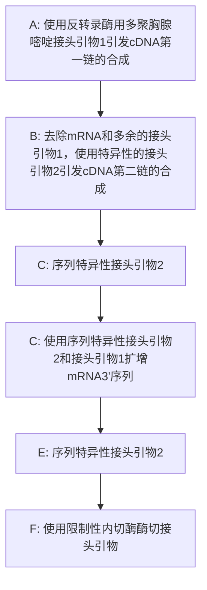

在  $37^{\circ}$ C 水浴中孵育 15min。

加尾反应可通过模拟反应来优化。在模拟反应液内加入 50ng、长度为 100～200bp 的对照 DNA 片段，加尾反应结束后，DNA 片段的大小应该增加 20～100 个核苷酸，用 1% 中性琼脂糖凝胶电泳鉴定。更精确地估计碱基 3' 端加尾反应可建立对照反应管，管内加约 10ng 的长度约为 30 个碱基的合成寡核苷酸，并在它的 5' 端用  ${}^{32}$ P 标记。这种加尾反应的产物可用 10% 聚丙烯酰胺测序凝胶电泳来分离，结合放射自显影来分析结果。加尾反应产物在放射自显影底片上呈现阶梯状带型，每相差一个核苷酸就呈现不同的条带。理想的同聚物尾平均长度应为约 20 个寡核苷酸，结合在大多数 cDNA 底物上。

5. 在 $80^{\circ} \mathrm{C}$ 放置 $3 \mathrm{~min}$ 使末端转移酶灭活。用的 TE（pH7.6）稀释带 dA 尾的 cDNA 至为 $1 \mathrm{~mL}$ 。

## 扩增

6. 按以下次序，将各成分加入在一只 $0.5\mathrm{mL}$ 灭菌离心管、扩增管或灭菌微量滴定板的孔内，建立一系列PCR反应体系:

| 已稀释 cDNA | 0~20μL |
| --- | --- |
| 10×扩增缓冲液 | 5μL |
| 20 mmol/L 4 种 dNTP 混合液 | 5μL |
| 10μmol/L (dT)17接头引物(16pmol) | 1.6μL |
| 10μmol/L 接头引物(32pmol) | 3.2μL |
| 10μmol/L 基因特异性引物 2 (32pmol) | 3.2μL |
| 1~2U 热稳定 DNA 聚合酶 | 1μL |
| $H_2O$ | 至 50μL |

如果实验必要，可设计一系列的扩增反应，用于筛选 cDNA 加尾模板产生最大量的扩增 5'端。对照管加入以上除了 cDNA 模板之外的所有试剂。

7. 如果 PCR 仪没有配置加热盖，在反应混合液的上层应加一滴矿物油（约 $50 \mu \mathrm{L}$），防止样品在 PCR 反应多个加热与冷却的循环过程中蒸发。如果应用热启动 PCR 程序，在反应混合液上层加一滴石蜡油，放置离心管或微量滴定板在热循环仪上。

8. 根据试剂制造厂家的条件推荐，热启动 DNA 聚合酶要经历变性、复性和聚合（延伸反应）过程；相应的循环条件与温度列表如下:

| 循环数 | 变性 | 复性 | 聚合 |
| --- | --- | --- | --- |
| 首轮循环 | 94°C,5min | 50~58°C,5min | 72°C,40min |
| 后续循环(30个) | 94°C,40s | 50~58°C,1min | 72°C,3min |
| 未循环 | 94°C,40s | 50~58°C,1min | 72°C,15min |

这些时间适用于配制在 0.5mL 薄壁管中，在诸如 PerkinElmer 9600 或 9700、Mastercycler (Eppendorf 公司) 和 PTC-100 (MJ Research 公司) 等 PCR 仪上孵育的 50μL 反应体系。时间和温度可以根据设备类型及反应体积做适当调整。

在首轮循环中，应用了一个延长的聚合反应(40min)，目的在于保证热稳定 DNA 聚合酶催化的长链 cDNA 的合成。

寡核苷酸引物的最佳复性温度应由经验来确定。通常从  $50^{\circ}$ C 开始，逐步提高，到产生最大量的特异性产物的温度为最高复性温度。

9. 从每个反应中各抽取扩增样品 $5 \sim 10 \mu \mathrm{L}$, 用琼脂凝胶电泳或聚丙烯酰胺凝胶电泳来分析扩增结果, 用 DNA marker 来判断扩增片段的大小。凝胶一般用 EB 或 SYBR Gold 染色来观察 DNA。

一次成功的扩增反应应该产生与我们预期大小一致的 DNA 片段。扩增条带可用 DNA 测序、Southern 杂交和/或限制性内切核酸酶酶切图谱予以鉴定。

如果经过 30 个扩增循环后仍然没有明显的特异性产物条带，可加入新的 Taq DNA 聚合酶，进一步在 PCR 仪上进行 15～20 个循环的扩增反应。

如果加尾的 cDNA 扩增样品在凝胶电泳上呈现不清晰的成片电泳条带谱型，应从制备性琼脂糖凝胶上回收最长的扩增产物。然后以它作为模板，进一步在 PCR 仪上进行 15～20 个循环的扩增反应。

参见“疑难解答”。

10. 若用矿物油覆盖在微量离心管内样品液体的上层(步骤 7)，反应结束后可用  $150 \mu L$  氯仿抽提去除。

在 PCR 管内，包含扩增 DNA 片段的水相与上层矿物油的界面形成弯月面，在弯月面下面的水相还有胶束，可用自动移液器小心吸取水相液体转移到一个新的离心管内。

注意，如用微量滴定板作为 PCR 的反应管，就不能用氯仿抽提的方法来去除矿物油，因为这种塑料制品不能接触耐有机溶剂。

11. 通过使用 QIAGEN 公司的 DNA Cleanup 或 Promega 公司的 Wizard SV 凝胶或 PCR Clean-Up 方法，从扩增的 DNA 产物中分离去除残留的热稳定 DNA 聚合酶和 dNTP。

DNA 片段现在可以连接到一种平末端载体或 T 载体, 或者用限制性内切核酸酶进行酶切, 再连接到具有相应末端的载体上。

## 疑难解答

问题（步骤9）:全长克隆少。

解决方案:克隆数量少的很多情况是由于反转录过程的效率低下。如果 RNA 发生降解或 mRNA 的 5'端富含 G 和 C 残基，反转录酶就很难穿过稳定的二级结构区。克隆产量问题可以通过以下方法解决。

- 在高温下进行反转录反应（用鼠反转录酶可升至  $55^{\circ}$ C），或使用热稳定反转录酶（如 Tth 聚合酶，Retrotherm）。
- 在加同聚尾或扩增前使用琼脂糖或聚丙烯酰胺电泳把 cDNA 产物各片段分开。
- 将修饰的碱基如 7-deaza-dGTP 掺入 cDNA 的第一链，可以防止后者形成二级结构（MConlogue et al. 1988）。请记住把 7-deaza-dGTP 掺入 cDNA 第一链还可以提高扩增阶段的效率，但是它也会妨碍一些限制性内切核酸酶对 DNA 扩增片段进行酶切，这些酶包括 Alu I、Dde I、Hinf I、Sau3A I、Ace I、BamH I、EcoR I、Pst I、Sal I 和 Sma I。然而，经 7-deaza-dGTP 修饰的 DNA 可用 Mae I、Hind III 和 Xba I 有效酶切。
- 在加 d(T)接头引物之前，用基因特异的引物对带有 d(A)尾的 cDNA 进行 5 轮线性扩增。
- 用琼脂糖或聚丙烯酰胺凝胶电泳纯化这种加尾的 DNA 扩增片段。然后，将最长的分子从凝胶上回收并作为模板，再用接头引物和基因特异性的引物进行第二轮扩增。

## 参考文献

- Ammerschläger M, Kioschis P, Vincent E, Briganti J, Schagat T. 2010. Lining up the scripts: Reverse transcriptase comparison study. http://www.promega.com/pubs/tpub\_029.htm.
- Apte AN, Siebert PD. 1993. Anchor-ligated cDNA libraries: A technique for generating a cDNA library for the immediate cloning of the 5' ends of mRNAs. BioTechniques 15: 890–893.
- Chen Z. 1996. Simple modifications to increase specificity of the 5' RACE procedure. Trends Genet 12: 87–88.
- Chiang CM, Chow LT, Broker T. 1993. Identification of alternately-spliced mRNAs and localization of 5' ends by polymerase chain reaction amplification. Methods Mol Biol 15: 189–198.
- Frohman MA. 1993. Rapid amplification of complementary DNA ends for generation of full-length complementary DNAs: Thermal RACE. Methods Enzymol 218: 340–356.
- Frohman MA. 1995. Rapid amplification of cDNA ends. In PCR primer: A laboratory manual (ed Dveksler GS, Dieffenbach CW), pp. 381–409. Cold Spring Harbor Laboratory Press, Cold Spring Harbor, NY.
- Frohman MA, Dush MK, Martin GR. 1988. Rapid production of full-length cDNAs from rare transcripts: Amplification using a single gene-specific oligonucleotide primer. Proc Natl Acad Sci 85: 8998–9002.
- Harvey RJ, Darlison MG. 1991. Random-primed cDNA synthesis facilitates the isolation of multiple 5'-cDNA ends by RACE. Nucleic Acids Res 19:4002. doi: 10.1093/nar/19.14.4002.
- Liedtke W, Battistini L, Brosnan CF, Raine CS. 1994. A comparison of methods for RNA extraction from lymphocytes for RT-PCR. PCR Methods Appl 4: 185–187.
- McConlogue L, Brow MA, Innis MA. 1988. Structure-independent DNA amplification by PCR using 7-deaza-2'-deoxyguanosine. Nucleic Acids Res 16: 9869. doi: 10.1093/nar/16.20.9869.
- Okayama H, Berg P. 1983. A cDNA cloning vector that permits expression of cDNA inserts in mammalian cells. Mol Cell Biol 3: 280–289.
- Schaefer BC. 1995. Revolutions in rapid amplification of cDNA ends: New strategies for polymerase chain reaction cloning of full-length cDNA ends. Anal Biochem 227: 255–273.
- Scotto-Lavino E, Du G, Frohman MA. 2006. 5' End cDNA amplification using classic RACE. Nat Protoc 1: 2555–2562.
- Stahlberg A, Hakansson J, Xian X, Semb II, Kubista M. 2004a. Properties of the reverse transcription reaction in mRNA quantification. Clin Chem 50: 509–515.
- Stahlberg A, Kubista M, Pfaffl M. 2004b. Comparison of reverse transcriptases in gene expression analysis. Clin Chem 50: 1678–1680.

# 方案 10 由 mRNA 的 3' 端进行序列的快速扩增: 3'-RACE

用 oligo（dT）引导合成的第一链 cDNA 常含有 RNA 的 3' 序列，然而，用内部基因特异性引物产生的 cDNA 常缺失 mRNA 的一端或两端序列。另外，选择性剪切或内部富 A 区域产生的 cDNA 克隆也常缺乏 3' 端序列。这些问题可以通过 3'-RACE 来解决（Frohman 1993; Scotto-Lavino 2006b），该方法也可以对由选择性聚腺苷酸化产生的 mRNA 家族各成员的 3' 端定位。

3'-RACE 像它更著名的同胞兄弟 5'-RACE 一样，也要求知道靶 RNA 或 cDNA 的部分克隆的少量序列（图 7-5）。

flowchart

图 7-5 使用 3'-RACE 确定 mRNA 的 3'端。该策略命名为 3'-RACE 是因为可用此方法分离获得 mRNA 3'端的未知序列。(A) (dT) $_{17}$ 接头引物（以黑色箭头代指）与 mRNA 复性。使用反转录酶和 dNTP 实现第一链的合成 [由 (dT) $_{17}$ 接头引物引发]。(B) 第二链的合成由一条特异性引物引发。(C) 扩增由序列特异性引物和人工接头互补引物执行，产生足够量的产物，然后克隆到克隆载体中并测序。

\- 用 3'端的 poly (T) 接头引物和它的 5'端长 30～40bp 的核酸序列作为引物，把 mRNA 总体反转录为 cDNA，该 5'端核酸序列可含有 2～3 个限制性内切核酸酶识别位点。

\- 反转录后通常伴随着两步连续的 PCR。第一步 PCR 用基因特异性正向寡核苷酸引物与反向 poly (dT)接头引物引导。如果必要，可用第一步 PCR 产物作为模板进行第二步嵌套式 PCR，该步 PCR 的引物 1 为第一步 PCR 正向引物的内部序列，引物 2 与第一步 PCR 反向 poly (dT)接头引物中间区域的序列相一致。

第二步 PCR 产物可进行电泳分离、酶切、克隆和鉴定等。

\- 以下 3'-RACE 方法是基于 W.J.Chen （Glaxo-Wellcome）实验方案修改后的方案（Frohman 1993，Schaefer 1995，Scotto-Lavino 2006），而 W.J.Chen 实验方案是在 Frohman 等（1988）实验方案的基础上修改的。不过，我们推荐使用商业化的试剂盒，特别是刚开始做这类试验，除非贵实验室的一些人已掌握 3'-RACE 方法或已有更先进的方法。Ambion 公司的试剂盒使用的是 RNA 连接酶介导的 RACE，而 Clontech 公司采用的是链转换反转录酶（更多信息请看后面的信息栏 “RACE 商业化试剂盒”）。

## 材料

为正确使用本方案中的器材和危险试剂，必须查阅相应的材料安全数据表并咨询所在机构的环境卫生和安全办公室。

本方案的专用试剂标注&lt;R&gt;，配方在本方案末提供。常用储备溶液、缓冲液和试剂标注&lt;A&gt;，配方见附录1。储备溶液应稀释至适用浓度后使用。

## 试剂

水溶接头引物(10μmol)（5'-GACTCGAGTCGACATCG-3') (10pmol/μL)

接头引物与基因特异性正向引物联合在一起用于扩增特异性靶 cDNA。第一步 PCR 扩增后，PCR 目的产物可能仅占总 DNA 产物的 1%，也可能多至占总 DNA 产物的 100%。如果必要，可用第一轮 PCR 产物作模板进行第二轮嵌套式 PCR，改善目的产物的产率，该轮 PCR 的引物为接头引物与另一个基因特异性正向引物。在第二轮嵌套式 PCR 扩增后，几乎所有的扩增产物在 EB 染色下呈现了与靶 mRNA 的 3' 区域序列相一致的条带。

凝胶电泳检测到的几乎所有的产物都含有所要的 mRNA 的 3'区

琼脂糖或聚丙烯酰胺凝胶（见步骤6）

含有  $MgCl_{2}$  的  $10\times$  扩增缓冲液，Taq DNA 聚合酶厂家提供

氯仿（可选；见步骤8）

含有 4 种 dNTP 的溶液(20mmol/L, pH8.0)

(dT) $_{17}$ 接头引物(10μmol/L)(5'-GACTCGAGTCGACATCGA(T)17-3')溶于水中(10 pmol/μL)

(dT) $_{17}$ 接头反义引物的 oligo（dT）与第一链 cDNA 3'端的 poly(A) $^{+}$ 相结合，留下一个未配对的接头序列。在扩增过程中，接头序列会转化成双链 cDNA，在本方案的一些实例中，扩增 DNA 序列会插入一些限制性内切核酸酶的识别位点，如 Xho I、Sal I、Acc I、Hinc II 和 Cla I 等。

EB 或 SYBR Gold 染料

基因特异性正义寡核苷酸引物(10μmol/L)溶于水(10pmol/μL)

基因特异性正义寡核苷酸引物应该是 mRNA 的已知序列，长度为 20～30 核苷酸，内含的 4 种碱基数量基本相等，G 与 C 碱基平衡分布，且引物具有较低的自发形成稳定二级结构的倾向。进一步的细节请参见本章导言部分“基础 PCR 反应中的引物设计”。以下讨论的有关限制性内切核酸酶酶切位点总是设计在接头引物内，然而，有时它们也被设计在基因特异性寡核苷酸引物内部。这种两端带有限制性内切核酸酶酶切位点的扩增 cDNA 便于进一步克隆。

热启动耐热 DNA 聚合酶

在 RACE 中使用热启动 DNA 聚合酶是为了减少非特异扩增，但这也增加了由 3' 端引物错配引发错误延伸的可能，因此可选择具有 3'→5' 校正活性的热稳定 DNA 聚合酶（Chiang et al. 1993）。

胎盘 RNase 抑制剂（20U/ $\mu$ L）

(参见第六章信息栏 DNA 酶抑制剂)

反转录酶（RNA 依赖的 DNA 聚合酶）

不同的供应厂商常提供不同的反转录酶，有关这些酶特性的比较数据资料较少（Stahlberg et al. 2004a，b）。此外，一些供应厂商也会通过提供一些已发表的实验数据，来证实它们扩增长片段和高 GC 含量 mRNA 的能力。

5×反转录缓冲液（厂家提供）。

TE 缓冲液（pH7.6）

10mmol/L Tris-HCl (pH7.6)

1mmol/L EDTA

总 RNA（100μg/mL，溶于水）或 poly(A) $^{+}$ RNA（10μg/mL，溶于水）

总 RNA 一般用促溶剂从细胞中抽提，选择总 RNA 作模板一般适用于中丰度到高丰度 mRNA 中通过 RT-PCR 克隆靶基因（Liedtke 1994）。对于低丰度靶 mRNA 的样品，最好选择 poly(A) $^{+}$ RNA 作模板进行 RT-PCR。

## 设备

自动微量移液器用的带滤芯的吸头

微量离心管(0.5mL，薄壁扩增反应专用离心管)或微量滴定板

PCR 纯化试剂盒(如 QIAGEN 公司的 DNA Cleanup 或 Promega 公司的 Wizard SV Gel 和 PCR Clean-Up)

正排量移液器

可编程的热循环扩增仪

如果热循环仪器没有配备加热盖，在 PCR 过程中需要在反应液加入矿物油或石蜡油以防止液体蒸发。

水浴箱或加热模块，温度要预先设定在  $37^{\circ}$ C 和  $75^{\circ}$ C。

## 方法

## 反转录

在实验开始时，首先要确定 3'-RACE 是否成功。如果反转录步骤是有效的，那么分离到含有靶 mRNA 的 3'端序列的克隆的概率是较高的。相反，如果反转录步骤是无效的，那么本方案的后续步骤是无法补偿的。因此，对于反转录反应条件是值得花时间优化的，如最佳的引物与模板比例、反应体系  $Mg^{2+}$  浓度和反应体系中反转录酶的量。

1. 转移  $1 \, pg \sim 100 \, ng$  的  $poly(A)^{+}$  mRNA 或  $10 \, pg \sim 1 \, \mu g$  总 RNA 到一只新的离心管。用水调整体积至  $10 \, \mu L$ 。将 RNA 样品在  $75^{\circ}C$  变性 5min，将离心管插入冰中冷却。

2. 向变性 RNA 样品中加入如下试剂:

| 5×反转录酶缓冲液 | 10μL |
| --- | --- |
| 20 mmol/L 4 种 dNTP 混合液 | 1.5μL |
| 10μmol/L (dT)17接头引物(80pmol) | 8.0μL |
| 约 20U/μL 胎盘 RNase 抑制剂 | 1μL |
| 100~200U/μL 的反转录酶 | 1μL |
| $H_2O$ | 至 50μL |

i.  $37^{\circ}$ C 孵育 60min。

ii. 设置 3 个阴性对照。第 1 个阴性对照中加入合成第一链 cDNA 反应所需的所有试剂，但不加模板 RNA；第 2 个阴性对照中加入除了反转录酶外的所有试剂；第 3 个阴性对照中加入除引物外的所有试剂。这些对照进行所有的后续步骤。

设置这些对照能保证 cDNA 产物不是由于基因组 DNA、寡核苷酸片段的污染或者由 RNA 模板分子的自身扩增所致。

总 cDNA 的合成量通过测定用三氯乙酸(TCA)沉淀的反转录产物中放射性物质的掺入量比活来确定，因而在反转录反应中加入了含  $10 \sim 20 \mu C i$  的  $[^{32}P] dCTP$  的放射性底物(放射性比活度为 3000Ci/mmol)。实验要注意对照管内肯定不含有寡核苷酸引物；而 RNA 分子自身引导的产物没有放射性活性。第一链 cDNA 分子的大小能通过碱性琼脂糖凝胶电泳(参见第 2 章，方案 6)及放射自显影来鉴定。

3. 用 TE (pH 7.6) 将反转录反应产物 (cDNA) 稀释至终体积为 $1 \mathrm{~mL}$ 。

从反转录产物 cDNA 样品中去除过剩的寡核苷酸或随机六寡核苷酸引物常是必要的。然后，进一步优化扩增反应中正义与反义引物的浓度。

## 扩增

4. 将以下各成分加入到一只 0.5mL 灭菌离心管、扩增管或灭菌微量滴定板孔内，建立系列 PCR 反应体系:

| 已稀释 cDNA | 0~20μL |
| --- | --- |
| 10×扩增缓冲液 | 5μL |
| 20 mmol/L 4 种 dNTP 混合液 | 5μL |
| 10μmol/L (dT)17接头引物(16pmol) | 1.6μL |
| 10μmol/L 接头引物(32 pmol) | 3.2μL |
| 10μmol/L 基因特异性正义寡聚核苷酸引物(32pmol) | 3.2μL |
| 1~2U 热启动 DNA 聚合酶 | 1μL |
| ${\mathrm{H}}_{2}\mathrm{O}$ | 至 50μL |

如果必要，可建立一系列的扩增试验管，以确定最佳 cDNA 的量，产生最大量的 5' 端扩增。对照管加入以上除 cDNA 模板之外的所有试剂，以鉴别模板有无污染。

5. 根据热启动DNA聚合酶制造厂家的推荐，使用如下的变性、复性和聚合（延伸反应）时间:

| 循环数 | 变性 | 复性 | 聚合 |
| --- | --- | --- | --- |
| 首轮循环 | 94°C,5min | 50~58°C,5min | 72°C,40min |
| 后续循环(30个) | 94°C,40s | 50~58°C,1min | 72°C,3min |
| 未轮循环 | 94°C,40s | 50~58°C,1min | 72°C,15min |

这些时间适用于配制在 0.5mL 薄壁管中，在诸如 PerkinElmer 9600 或 9700、Mastercycler (Eppendorf) 和 PTC-100 (MJ Research) 等 PCR 仪上孵育的 50μL 反应体系。时间和温度可以根据设备类型及反应体积做适当调整。

在首轮循环中，应用了一个延长的聚合反应(40min)，目的在于保证热稳定 DNA 聚合酶催化的长链 cDNA 的合成。

6. 从每个反应中各抽取扩增样品 $5 \sim 10 \mu \mathrm{L}$, 用琼脂糖或聚丙烯酰胺凝胶电泳来分析扩增结果, 用 DNA marker 来判断扩增片段的大小。凝胶一般用 EB 或 SYBR Gold 染色来观察 DNA。

一次成功的扩增反应应该产生与我们预期大小一致的 DNA 片段。扩增条带可用 DNA 测序、Southern 印迹杂交和/或限制性内切核酸酶酶切图谱予以鉴定。

如果经过 30 个扩增循环后仍然没有明显的特异性产物条带，可加入新的 Taq DNA 聚合酶，在 PCR 仪上再运行 15～20 个循环的扩增反应。

如果加尾的 cDNA 扩增样品在凝胶电泳上呈现不清晰的拖尾条带，应从制备性琼脂糖凝胶上回收最长的扩增产物。然后以它作为模板，在 PCR 仪上再进行 15～20 个循环的扩增反应。

7. 若用矿物油覆盖在微量离心管内样品液体的上层（步骤 7），反应结束后可用  $150 \mu L$  氯仿抽提去除。

在 PCR 反应管内，包含扩增 DNA 片段的水相与上层矿物油的界面形成弯月面，在弯月面下面的水相还有微胶粒。可用自动移液器小心吸取水相液体转移到一个新的离心管内。

▲注意，如用微量滴定板作为 PCR 的反应管，就不能用氯仿抽提的方法来去除矿物油，因为这种塑料制品不能接触有机溶剂。

8. 通过使用 QIAGEN DNA Cleanup 或 Promega Wizard SV 凝胶或 PCR Clean-up 方法从扩增的 DNA 产物中分离去除残留的热稳定 DNA 聚合酶和 dNTP。

DNA 片段现在可以连接到一种平末端载体或 T 载体，或者用限制性内切核酸酶进行酶切，再连接到具有相应末端的载体上。

## RACE 商业化试剂盒

## RNA 连接酶介导的 RACE（RLM-RACE）

RNA 连接酶介导的 RACE（RNA-ligase-mediated，RLM-RACE）（Fromont-Racine et al. 1993；Liu and Gorovsky 1993）是扩增 mRNA 5'端的第二代方法。Ambion 公司提供有 RLM-RACE 试剂盒（FirstChoice RLM-RACE Kit）。Clontech 公司的 SMARTer RACR Kit 在 RACR PCR 中是直接使用第一链 cDNA。两个试剂盒都可以用于 mRNA 的 3'端区域的抓捕和克隆测序（3'-RACE；见方案 10）。RLM-RACE 操作简述如下。

1. Poly(A) $^{+}$ RNA 制备产物首先使用小牛肠磷酸酶去除污染 rRNA、tRNA 和 RNA 片段 5'端磷酸残基。脱磷酸化的 RNA 在后续 RNA 连接酶作用下不能进行连接反应。
2. 用酚-氯仿抽提法去除磷酸酶，RNA产物再用烟草酸焦磷酸酶处理，其目的是水解帽子结构区三磷酸键桥上的磷酸酐键并暴露出一个5'端磷酸残基。这样脱帽后的mRNA就变成噬菌体T4编码的RNA连接酶的底物。
3. 因为化学合成的寡聚核苷酸在 5' 端含有一个 5' 羟基，可使用 T4 编码的 RNA 连接酶把寡聚核苷酸（通常为 30～40 个核苷酸）连接到 mRNA 脱帽后暴露出来的 5' 磷酸基团上，连接上的寡聚核苷酸可作为下一步 PCR 的接头。
4. 寡聚核苷酸-RNA 嵌合体作为模板合成第一链 cDNA，引物可以使用随机八聚体或十聚体引物。
5. 延伸至嵌合 RNA 5'端的第一链 cDNA 会携带一个和它 3'端寡核苷酸互补的序列。在热启动 PCR 中, 第一链 cDNA 会作为模板, 通过基因特异性引物和接头引物得以扩增。只有在其 5'端含有接头序列的 cDNA 才能被扩增。
6. 通过树脂吸附和洗脱方法纯化扩增产物(如 Promega 公司的 Wizard PCR 试剂盒), 而后克隆入质粒载体。

## SMARTer RACE

Clontech 公司的 SMARTer RACE 试剂盒避免了接头连接反应，虽然不是很有效，但是在 RACR PCR 中是直接使用第一链 cDNA 进行 PCR。步骤简述如下。

1. 第一链 cDNA 是通过改良的锁-坞 oligo（dT）引物来启动的，在其 3' 端有两个降解的核苷酸。该核苷酸位于 mRNA poly(A) $^{+}$ 尾的起始处，这样可以消除传统 oligo（dT）引导合成产物的 3' 端不均一性（Borson et al. 1992）。
2. 第一链 cDNA 合成是在 Clontech 公司的 SMARTScribe 反转录酶作用下进行的，该酶是 MMLV 反转录酶的突变体。在到达 RNA 模板尾部时，该聚合酶会表现出末端转移酶活性，在第一链 cDNA 的 3' 端加入 3\~5 个核苷酸。
3. 试剂盒提供的 SMARTer 寡核苷酸末端延伸出一些修饰碱基，可与第一链 cDNA 延伸 3' 端发生复性结合。SMARTScribe 反转录酶能够将 mRNA 模板转换为第一链 cDNA，SMARTer 寡核苷酸引物和 RNA 一端结合后，可以合成完整的双链 cDNA 拷贝。由于反转录酶只有到达 mRNA 模板末端后才发生模板转换，因此 SMARTer 序列通常只能渗入全长的单链 cDNA。

4. 扩增反应是使用通用引物 A Mix（试剂盒提供）和基因特异性引物来执行的。

## PCR 扩增产物的鉴定和纯化

如果整个 PCR 过程进展顺利，所有反应体系中的 dNTP 和引物最后都应该会渗入扩增产物中。在理想状态下，把 PCR 产物作为模板（如测序反应）是不需要进行纯化的。将 PCR 产物稀释 10～20 倍就可以完全去除残留引物和 dNTP 的影响。然而，为了增加测序反应的成功率，最好去除残留的引物、dNTP、单链 DNA 和 Taq 聚合酶，并且检测测序样本的正确性。

## 鉴定 PCR 扩增产物

1. 通过琼脂糖凝胶电泳分析 DNA 扩增样本。理想状态下，染色后只呈现一条 DNA 条带。如果出现多条带现象，可选用以下方法。

i. 通过梯度复性和热启动方法重新进行 PCR（见方案 2 和方案 3）。如果不成功，可增加模板的复性温度直到获得单一 PCR 产物。
ii. 单独切下 DNA 条带并进行凝胶回收，使用嵌套引物再次扩增（见方案 7）。回收 DNA 进行再次扩增的一个简单方法是先用 Whatman 3MM 滤纸擦干凝胶表面，用一皮下针刺入 DNA 条带，取出后快速浸入新的 PCR 反应液中并做搅动，这样的 DNA 模板量虽然很少，但是作为另一轮 PCR 反应的模板是足够的（Bjourson and Cooper 1992）。

如果仍有多条带，回收最大条带并测序验证。

iii. 如果上述方法均不起作用，另一解决办法就是回收所有条带并分别进行克隆（如 TA 载体）（参见本文后和第 3 章方案 12）

## PCR 扩增产物的纯化

有文献报道 Taq DNA 聚合酶在 PCR 产物经酚-氯仿抽提、乙醇沉淀和其他商业化的试剂盒纯化后仍然会有残留（Crowe et al. 1991; Barnes 1992）。然而，多数商业化产品可以有效去除未消耗完的 dNTP、单链 DNA 和引物等，处理后的扩增产物可用于克隆和 DNA 测序。PCR 纯化用商业试剂盒价格便宜，是多数实验室最经济的选择。

以下列举了一些不同原理的纯化试剂盒。

1. DNA 被结合到树脂表面，漂洗后再洗脱。常用试剂盒有 QIAGEN 公司的 QIAquick DNA 纯化试剂盒、Agilent 公司的 StrataPrep PCR 纯化试剂盒和 Sigma-Aldrich 公司的 GenElute PCR Clean-Up。
2. DNA 通过阴离子捕获结合至磁珠表面，如 Life Technologies 公司的 ChargeSwitch-Pro PCR Clean-Up。
3. DNA 通过安装在微量加样器吸头内的离心柱进行纯化，该离心柱填充有阴离子硅酸盐 TopTIP charged with PolyWAX LP（GlySci, Glygen 公司产品）。

## 参考文献

Ammerschläger M, Kioschis P, Vincent E, Briganti J, Schagat T. 2010. Lining up the scripts: Reverse transcriptase comparison study. http://www.promega.com/pubs/tpub\_029.htm.

Barnes WM. 1992. The fidelity of Taq polymerase catalyzing PCR is improved by an N-terminal deletion. Gene 112: 29–35.

Bjourson AJ, Cooper JE. 1992. Band-stab PCR: A simple technique for the purification of individual PCR products. Nucleic Acids Res 20: 4675. doi: 10.1093/nar/20.17.4675.

Borson ND, Salo WL, Drewes LR. 1992. A lock-docking oligo(dT) primer for 5' and 3' RACE PCR. PCR Methods Appl 2: 144–148.

- Chiang CM, Chow LT, Broker T. 1993. Identification of alternately-spliced mRNAs and localization of 5' ends by polymerase chain reaction amplification. Methods Mol Biol 15: 189–198.
- Crowe JS, Cooper HJ, Smith MA, Sims MJ, Parker D, Gewert D. 1991. Improved cloning efficiency of polymerase chain reaction (PCR) products after proteinase K digestion. Nucleic Acids Res 19: 184. doi:10.1093/nar/19.1.184.
- Frohman MA. 1993. Rapid amplification of complementary DNA ends for generation of full-length complementary DNAs: Thermal RACE. Methods Enzymol 218: 340–356.
- Frohman MA, Dush MK, Martin GR. 1988. Rapid production of full-length cDNAs from rare transcripts: Amplification using a single gene-specific oligonucleotide primer. Proc Natl Acad Sci 85: 8998–9002.
- Fromont-Racine M, Bertrand E, Pictet R, Grange T. 1993. A highly sensitive method for mapping the 5' termini of mRNAs. Nucleic Acids Res 21: 1683–1684.
- Liedtke W, Battistini L, Brosnan CF, Raine CS. 1994. A comparison of methods for RNA extraction from lymphocytes for RT-PCR. PCR Methods Appl 4: 185–187.
- Liu X, Gorovsky MA. 1993. Mapping the 5' and 3' ends of Tetrahymena thermophila mRNAs using RNA ligase mediated amplification of cDNA ends (RLM-RACE). Nucleic Acids Res 21: 4954–4960.
- Schaefer BC. 1995. Revolutions in rapid amplification of cDNA ends: New strategies for polymerase chain reaction cloning of full-length cDNA ends. Anal Biochem 227: 255–273.
- Scotto-Lavino E, Du G, Frohman MA. 2006. 3' End cDNA amplification using classic RACE. Nat Protoc 1: 2742–2745.
- Stahlberg A, Hakansson J, Xian X, Semb H, Kubista M. 2004a. Properties of the reverse transcription reaction in mRNA quantification. Clin Chem 50: 509–515.
- Stahlberg A, Kubista M, Pfaffl M. 2004b. Comparison of reverse transcriptases in gene expression analysis. Clin Chem 50: 1678–1680.

## 方案 11 使用 PCR 筛选克隆

PCR 常代替费力的小量提取质粒的方法,用于筛选靶序列的重组质粒的大肠杆菌克隆。当初用于扩增 DNA 片段的那对引物同时也可用于克隆筛选。为了区分克隆片段的方向,可使用第三条引物,该引物位于插入位点相邻的质粒序列上,并指向插入序列。此方法也可用于筛选文库获得感兴趣的克隆（Israel 2006）。

## 材料

为正确使用本方案中的器材和危险试剂，必须查阅相应的材料安全数据表并咨询所在机构的环境卫生和安全办公室。

## 试剂

琼脂糖或聚丙烯酰胺凝胶

含有氯化镁的  $10 \times$  扩增缓冲液，由 Taq DNA 聚合酶的制造商提供

转化有感兴趣的重组质粒的细菌克隆和作为对照用的非转化细菌克隆

氯仿

合适大小的 DNA 分子质量标记

含有 4 种 dNTP 的混合液，每种浓度为 20mmol/L（pH8.0）

溶于水的正向和反向引物（20μmol/L）

参见本方案的导言。

使用下述公式计算多聚核苷酸的分子质量

$$
M _ {\mathrm{r}} = (C \times 2 8 9) + (A \times 3 1 3) + (T \times 3 0 4) + (G \times 3 2 9),
$$

式中，C、A、T、G 分别指 C、A、T、G4 种碱基的数量；20bp 长度多聚核苷酸的分子质量约为 6000Da；100pmol 的多聚核苷酸约等于 0.6μg。

上样缓冲液

灭菌的去离子水

热稳定 DNA 聚合酶（来自 Agilent、Life Technologies、NEB 及其他供应商）

## 设备

自动微量移液器用的带滤芯的吸头

微量离心管（0.5mL，薄壁扩增反应专用离心管）或微孔板

正排量移液器

可编程所需扩增程序的热循环仪

如果热循环仪没有加热盖，使用矿物油或石蜡油封住液面，防止 PCR 过程中液体的蒸发。石蜡油不仅能防止蒸发，还可用于隔绝体系中的组分（如把引物和模板隔开），直到体系受热而混合。这种隔绝可阻止反应开始前引物的非特异性结合（参见方案 2）。

## 方法

1. 在灭菌离心管中，按下述准备工作液:按所示顺序加入组分，离心管一直放置在冰上。将需要筛选的克隆数乘以体系的体积可得到总体积，如需要筛选 10 个转化体和 2 个非转化体对照，就乘以 12。振荡离心管，以混合工作液中的各组分，尽量避免产生气泡。

| 水 | 38μL |
| --- | --- |
| 扩增缓冲液(10×) | 5 μL |
| dNTP溶液(20mmol/L;pH8.0) | 1 μL |
| 正向引物(20μmol/L) | 1.0 μL |
| 反向引物(20μmol/L) | 1.0 μL |
| 热稳定DNA聚合酶(1~5U/μL) | 1~2U |

2. 将  $50 \mu L$  的工作液加入到所需数量的 PCR 管中（冰上放置）。

3. 向每个有工作液的冷 PCR 管中, 加入少量转化细菌克隆。方法是用灭菌的黄吸头的尖端触碰细菌克隆, 然后尖端浸入工作液中, 上下轻轻吹打几次, 避免产生气泡。

4. 使用下表所列的变性、复性、聚合时间和温度来扩增产物。

| 循环数 | 变性 | 复性 | 聚合 |
| --- | --- | --- | --- |
| 1 | 94°C, 4min | 55°C, 2min | 72°C, 2min |
| 30个循环 | 94°C, 1min | 55°C, 2min | 72°C, 1min |
| 末循环 |  |  | 72°C, 10min |

5. $5\mu \mathrm{L}$ 的PCR产物和 $5\mu \mathrm{L}$ 水及 $2.5\mu \mathrm{L}$ 上样缓冲液混合，使用合适的分子质量标准进行电泳。

为了确定片段插入的方向，可使用质粒特异引物分别与插入片段的两条特异引物组合来重复 PCR 反应。根据产物片段的大小可推测出插入的方向。

## 参考文献

## 信息栏

## Taq DNA 聚合酶

Taq 酶是一种热稳定的 DNA 依赖的 DNA 聚合酶，于 1976 年首次从嗜热真菌栖热水生菌中分离获得（图 1）（Chien et al. 1976; Kaledin et al. 1980）。数年后，这个酶由于其在 PCR 中的应用而闻名（Saiki et al. 1988），在 1989 年被选为年度明星分子（Koshland 1989），可见该酶的分量和价值。Fore 等（2006）发表了一篇优秀的综述，总结描述了由 Taq 酶催化的 PCR 反应所导致的专利和商业化等繁杂的法律纠纷。PCR 技术的发明者 Kary Mullis（1990）对 Taq 酶非同寻常的起源做了更加浪漫的描述。虽然 PCR 的原始专利在 2005～2006 年就到期了，但依然还存在很多 PCR 相关的技术专利，在这些案例中，只要从专利所有者那里购买试剂，就获得了专利使用许可。

natural_image

Black-and-white photo of a hot pool in a forested area with trees and mist, no visible text or symbols

图 1 Brock 的探险。Thomas D. Brock，麦迪逊市威斯康星大学的微生物生态学家，在图中站在黄石国家公园的蘑菇泉旁边，时间是 1967 年 6 月 23 日。Tom Brock 和他的研究生 Hudson Freeze 在前一年从喷口里采集的样本中分离出了栖热水生菌种 YT-1。Tom Brock 在其回忆性自传（Brock 1995a,b, 1997）中优雅且自豪地描述了他们的工作。Madigan 和 Marrs 总结了这种极端微生物对生物技术产业的后续影响(1997)(在征得 Brock 的同意后再版，1995b)。

\- Taq 酶基因（Lawyer et al. 1989）编码一个 832 个氨基酸残基的双结构域蛋白（分子质量为 93.9kDa），拥有三种不同的酶活性。

1. N 端区域（1～290 残基）的序列和结构与 DNA 聚合酶 I 家族成员（包括大肠杆菌 DNA 聚合酶 I 和相关的噬菌体编码的聚合酶）的  $5'\rightarrow3'$  外切酶结构域类似。一些商业化制备的 Taq 酶缺乏  $5'\rightarrow3'$  外切酶活性。这些产品包括 Stoffel 片段和一些点突变体（Merkens et al. 1995）。一般来说，这些酶与野生型的 Taq 酶相比，聚合效率和延长能力都要差一些。
2. Taq 酶的聚合酶亚结构域（424～831 残基）和大肠杆菌 DNA 聚合酶 I 的 Klenow 片段非常类似，负责催化的氨基酸残基在两种酶中是保守的（参见表 1 和方案 8 中的步骤 2）（综述参见 Joyce and Steitz 1994, 1995; Pelletier 1994; Perler et al. 1996）。
3. Taq DNA 聚合酶与其他的热稳定 DNA 聚合酶一样，还拥有一种独立但是低效的转移酶活性，即在扩增的 DNA 片段的 3' 端以模板非依赖的方式添加一个脱氧核苷酸残基（表 1）（Clark 1988; Mole et al. 1989; Hu1993）。双链线性 DNA（那些有凸出的 3' 端的除外）可被 Taq 酶转化成 3' 端 A 凸出的分子。这个不配对的 A 可与克隆载体上不配对的 T配对，从而有利于扩增片段的克隆（参见第3章，方案12）。

表 1 Taq DNA 聚合酶催化的标准 PCR 反应的条件

| DNA 模板 | 目标序列 $10^{4} \sim 10^{5}$个拷贝 |
| --- | --- |
| 循环数 | 25~30 |
| 引物,长 18~25 核苷酸 | 0.1~0.5μmol/L |
| $Mg^{2+}$ | 一般为 1.5~2.0mmol/L,但是为了有效的扩增,需要摸索最佳浓度 |
| dNTP | 4 种 dNTP 的浓度为每种 200μmol/L,更高浓度的 dNTP 会降低聚合酶的准确性,并需要反应体系中含有更高浓度的 $Mg^{2+}$ |
| Taq DNA 聚合酶 | 1.0~1.25U/反应(50μL 体系) |
| 变性条件 | 对于 GC 含量大于 55%的模板,95°C、30s 足够,富含 GC 的模板可能需要更长的变性时间(4min 以上) |
| 复性条件 | 一般来说在 45~60°C之间,取决于引物对的熔解温度 |
| 延伸条件 | 虽然 Taq 酶的最佳温度为 75~80°C,但延伸反应的温度一般来说略低,为 68~70°C。延伸时间取决于扩增区域的长度,由于 Taq 聚合酶的速度是每秒 35~100 个核苷酸,因此,按每 1kb 的长度延伸时间为 1min 计算是足够的 |
| 添加剂 | 在 PCR 条件优化后,如果扩增效率还是很低,可以考虑使用添加剂,常用的有甘油(5%~10%)和牛血清白蛋白(高至 0.8μg/μL)。对于高 GC 含量模板(大于 55%),可加入甲酰胺(1%~5%)、DMSO(2%~10%)或甜菜碱(0.5~2μmol/L),使用甜菜碱的时候,变性温度降低到 92~93°C,复性温度降低 1~2°C |

Taq 酶的羧端区（294～422 氨基酸残基）有微弱的  $3'\rightarrow5'$  外切酶活性，因此，这个酶和其他的几种热稳定聚合酶一样，缺乏校对功能。因此，错误掺入 dNTP 的比例较高（Tindall and Kunkel 1988）。对于扩增 200bp 的片段，25 个循环后，高于 50% 的扩增片段含有 1 个或 2 个突变。如果扩增需要高保真性，那么使用商业化的热稳定聚合酶混合物。例如，Platinum Taq 聚合酶(Life Technologies 公司产品)是重组 Taq DNA 聚合酶和火球菌 GB-D 聚合酶的混合物，后者拥有校对功能，可提高保真度 6 倍。其他的 DNA 聚合酶混合物有 TaqPlus Precision PCR （Agilent 公司产品）、AccuPrime DNA 聚合酶（Life Technologies）和 Expand High Fidelity PCR System（Roche 公司产品）。

- Taq DNA 聚合酶的热稳定性被认为由酶核心的疏水性增加、静电力稳定性的提高，以及溶剂分子相互作用的增加所造成，因为在酶表面存在额外的脯氨酸残基（Kim et al. 1995; Korolev et al. 1995）。
- Chien 等（1976）首先分离出的热稳定 DNA 聚合酶比全长的 Taq 蛋白要小，催化性质也略有不同，最常见的形式是缺乏部分氨端区的水解片段。在栖热水生菌中，Taq 酶的表达水平很低（占细胞总蛋白的 0.01%～0.02%），因此，直接提取在商业上是不可行的。近年来，Taq 酶由各种版本的 Taq 基因编码生产，这些版本的基因做过优化，以在大肠杆菌中提升表达量。这些突变方法主要是修改紧邻起始 ATG 密码子上游和下游的 DNA 序列（例子请参见 Engelke et al. 1990; Lawyer et al. 1993; Ishino et al. 1994; Desai and Pfaffle 1995）。由于各个生产商修饰方法不同，酶蛋白纯化的流程也不同，因此，不同生产商生产的酶扩增结果也不同。然而，自制 Taq 聚合酶制备容易（Engelke et al. 1990; Pluthero 1993; Desai and Pfaffle 1995），质量高，批间差异小。Taq DNA 聚合酶制剂一般具有下述的典型性质:

最佳反应温度:75\~80℃

最佳反应条件:1.5mmol/L 的  $MgCl_{2}$ ，50～55mmol/L 的 KCl（pH7.8～9.0）

$K_{m}$  dNTP: 10\~15μmol/L

$K_{m}$  DNA: 1.5μmol/L

延伸速率（每个酶分子每秒聚合的 dNTP 数）:

| 75°C | 150 |
| --- | --- |
| 70°C | &lt;60 |
| 55°C | 24 |

<table><tr><td>37°C</td><td>1.25</td></tr><tr><td>22°C</td><td>0.25</td></tr><tr><td colspan="2">延伸性(每个酶分子每秒聚合的dNTP数):42</td></tr><tr><td colspan="2">酶的半衰期:</td></tr><tr><td>97.5°C</td><td>5~6 min</td></tr><tr><td>95°C</td><td>40 min</td></tr><tr><td>92.5°C</td><td>130 min</td></tr></table>

Taq DNA 聚合酶可接受修饰的脱氧核苷酸三磷酸盐作为底物，因此，DNA 扩增片段可被放射性核苷酸、地高辛、荧光素或生物素标记（Innis et al. 1988; Lo et al. 1988）。

\- 为了启动 DNA 合成，Taq 聚合酶和其他 DNA 聚合酶一样，都需要有能够复性结合到模板上的引物，引物的 3' 端带有自由羟基，在体外延伸反应中，Taq DNA 聚合酶可以除掉延伸端前面结合在模板上的、带有 5' 自由羟基的核苷酸，但是不能除掉带有 5' 磷酸的核苷酸。当 Taq 酶遇到模板的脱嘌呤碱基后无法继续合成，DNA 模板在高温下，脱嘌呤的发生率相当高，这可能限制了 Taq DNA 聚合酶扩增的片段的长度（Barnes 1994）。

## 参考文献

- Barnes WM. 1994. PCR amplification of up to 35-kb DNA with high fidelity and high yield from $\lambda$ bacteriophage templates. Proc Natl Acad Sci 91: 2216-2220.
- Brock TD. 1995a. The road to Yellowstone—And beyond. Annu Rev Microbiol 49: 1–28.
- Brock TD. 1995b. Photographic supplement to "The road to Yellowstone—And beyond." Available from T.D. Brock, Madison, WI.
- Brock TD. 1997. The value of basic research: Discovery of Thermus aquaticus and other extreme thermophiles. Genetics 146: 1207–1210.
- Chien A, Edgar DB, Trela JM. 1976. Deoxyribonucleic acid polymerase from the extreme thermophile Thermus aquaticus. J Bacteriol 127:1550–1557.
- Clark JM. 1988. Novel non-templated nucleotide addition reactions catalyzed by procaryotic and eucaryotic DNA polymerases. Nucleic Acids Res 16: 9677–9686.
- Desai UJ, Pfaffle PK. 1995. Single-step purification of a thermostable DNA polymerase expressed in Escherichia coli. BioTechniques 19:780–782.
- Engelke DR, Krikos A, Bruck ME, Ginsburg D. 1990. Purification of Thermus aquaticus DNA polymerase expressed in Escherichia coli. Anal Biochem 191: 396–400.
- Fore JJ, Wiechers I, Cook-Deegan R. 2006. The effects of business practices, licensing, and intellectual property on development and dissemination of the polymerase chain reaction: Case study. J Biomed Discov Collab 1:7. doi: 10.1186/1747-5333-1-7.
- Hu G. 1993. DNA polymerase-catalyzed addition of nontemplated extra nucleotides to the 3' end of a DNA fragment. DNA Cell Biol 12:763–770.
- Innis MA, Myambo KB, Gelfand DH, Brow MA. 1988. DNA sequencing with Thermus aquaticus DNA polymerase and direct sequencing of polymerase chain reaction-amplified DNA. Proc Natl Acad Sci 85:9436–9440.
- Ishino Y, Ueno T, Miyagi M, Uemori T, Imamura M, Tsunasawa S, Kato I. 1994. Overproduction of Thermus aquaticus DNA polymerase and its structural analysis by ion-spray mass spectrometry. J Biochem 116:1019–1024.
- Joyce CM, Steitz TA. 1994. Function and structure relationships in DNA polymerases. Annu Rev Biochem 63: 777–822.
- Joyce CM, Steitz TA. 1995. Polymerase structures and function: Variations on a theme? J Bacteriol 177: 6321–6329.
- Kaledin AS, Sliusarenko AG, Gorodetskii SI. 1980. Isolation and properties
- of DNA polymerase from extreme thermophylic bacteria Thermus aquaticus YT-1. Biokhimiya 45: 644–651.
- Kim Y, Eom SH, Wang J, Lee DS, Suh SW, Steitz TA. 1995. Crystal structure of Thermus aquaticus DNA polymerase. Nature 376: 612–616.
- Korolev S, Nayal M, Barnes WM, Di Cera E, Waksman G. 1995. Crystal structure of the large fragment of Thermus aquaticus DNA polymerase I at 2.5-Å resolution: Structural basis for thermostability. Proc Natl Acad Sci 92: 9264–9268.
- Koshland DE Jr. 1989. The molecule of the year. Science 246: 1543–1546.
- Lawyer FC, Stoffel S, Saiki RK, Myambo K, Drummond R, Gelfand DH. 1989. Isolation, characterization, and expression in Escherichia coli of the DNA polymerase gene from Thermus aquaticus. J Biol Chem 264: 6427–6437.
- Lawyer FC, Stoffel S, Saiki RK, Chang SY, Landre PA, Abramson RD, Gelfand DH. 1993. High-level expression, purification, and enzymatic characterization of full-length Thermus aquaticus DNA polymerase and a truncated form deficient in 5' to 3' exonuclease activity. PCR Methods Appl 2: 275–287.
- Lo YM, Mehal WZ, Fleming KA. 1988. Rapid production of vector-free biotinylated probes using the polymerase chain reaction. Nucleic Acids Res 16: 8719. doi: 10.1093/nar/16.17.8719.
- Madigan MT, Marrs BL. 1997. Extremophiles. Sci Am 276: 82–87.
- Merkens LS, Bryan SK, Moses RE. 1995. Inactivation of the  $5^{\prime}-3^{\prime}$  exonuclease of Thermus aquaticus DNA polymerase. Biochim Biophys Acta 1264: 243–248.
- Mole SE, Iggo RD, Lane DP. 1989. Using the polymerase chain reaction to modify expression plasmids for epitope mapping. Nucleic Acids Res 17:3319. doi: 10.1093/nar/17.8.3319.
- Mullis KB. 1990. The unusual origin of the polymerase chain reaction. Sci Am 262: 56–65.
- Pelletier H. 1994. Polymerase structures and mechanism. Science 266:2025–2026.
- Perler FB, Kumar S, Kong H. 1996. Thermostable DNA polymerases. Adv Protein Chem 48: 377–435.
- Pluthero FG. 1993. Rapid purification of high-activity Taq DNA polymerase. Nucleic Acids Res 21: 4850–4851.
- Saiki RK, Gelfand DH, Stoffel S, Scharf SJ, Higuchi R, Horn GT, Mullis KB, Erlich HA. 1988. Primer-directed enzymatic amplification of DNA with a thermostable DNA polymerase. Science 239: 487–491.
- Tindall KR, Kunkel TA. 1988. Fidelity of DNA synthesis by the Thermus aquaticus DNA polymerase. Biochemistry 27: 6008–6013.

## PCR 理论

PCR 的过程可用图表表示，有两种方式:

\- 一种是标准的 $x - y$ 线图，以扩增产物的量（或荧光强度）对循环数作图获得。因为扩增产物量是以几何级数增长的，理论上每一轮反应后都能倍增，线性的 $x - y$ 图能展示信号强度突破本底后的几个循环的指数增长过程。

\- 与之相反，当用产量的 $\log_{10}$ 对数对循环数作图时，反应的指数增长期则表现为一条直线，直线的斜率可用于估算扩增效率。用半对数方式作图可计算出 Ct 值（更充分的讨论见第 9 章）。

在定量 PCR 中，荧光信号突破基线以上的那个点的循环数叫做域循环或称为 Ct 值，它的值与目标模板的起始拷贝数的  $\log_{10}$  对数成反比。在大多数商业化仪器中，Ct 值自动设定在 PCR 对数增长期的一个节点上，该节点处的信号强度为平均基线信号强度的 10 倍。在进行扩增反应时，模板的起始拷贝数越高，到达 Ct 值的时间越早。

扩增反应的指数增长区的扩增效率主要由热稳定 DNA 聚合酶的质量来决定，由于 PCR 的几何级增长特性，使用低效率聚合酶的后果是很严重的，例如，Linz 等（1990）发现，指数扩增 20 个循环后，使用不同的聚合酶扩增得到的产物的量相差超过 200 倍。造成如此之大的差别的原因是，使用的聚合酶之间的效率有差别，而效率相差仅 2 倍就能造成如此严重的后果。对 PCR 扩增效率的深入讨论请参见 Peccoud 和 Jacob（1996）、Liu 和 Saint（2002a,b）、Jagers 和 Klebaner（2003）及 Lalam（2006）的文献。

当产物抑制或因为一种或多种试剂变得有限时，PCR 的效率最终开始下降。反应此时进入线性状态，在 x-y 线图上显示为一条直线。平台期就是 PCR 反应的终点。在对数图中，不同模板数的 PCR 反应最后看上去都进入同一个平台，但这只是对数作图造成的。在散点图上，不同起始模板数的 PCR 反应平台期有明显的差异。

最早的定量 PCR 采用终点测定的方法，这个方法耗时、精确度和灵敏度都很低、动力学范围有限，PCR 后还需要大量的处理过程。另外，最终的平台区产物水平不仅与模板的起始浓度相关，其他的影响因素也很多。例如，指数增长期的扩增效率取决于热稳定 DNA 聚合酶的效率。由于 PCR 指数级扩增的特性，使用低效聚合酶的后果是很严重的。例如，Linz 等发现经过 20 轮的指数增长后，使用不同的聚合酶会导致产物有 200 倍的差别，而聚合酶活性的 2 倍差别就能造成终产物产量如此巨大的差别。对 PCR 扩增效率的深入讨论请参见 Peccoud 和 Jacob(1996)、Liu 和 Saint(2002a,b)、Jagers 和 Klebaner(2003) 及 Lalam（2006）的文献。

现在，定量 PCR 依赖于扩增反应早期阶段的动力学分析，这种测定方法直接反映了模板的起始量，避免了平台期水平计算方法中存在的其他因素的影响。

## 参考文献

Jagers P, Klebaner F. 2003. Random variation and concentration effects in PCR. J Theor Biol 224: 299–304.

Lalam N. 2006. Estimation of the reaction efficiency in polymerase chain reaction. J Theor Biol 242: 947–953.

Linz U, Delling U, Rubsamen-Waigmann H. 1990. Systematic studies on parameters influencing the performance of the polymerase chain reaction. J Clin Chem Clin Biochem 28: 5–13.

Liu W, Saint DA. 2002a. A new quantitative method of real time reverse transcription polymerase chain reaction assay based on simulation of polymerase chain reaction kinetics. Anal Biochem 302: 52–59.

Liu W, Saint DA. 2002b. Validation of a quantitative method for real time PCR kinetics. Biochem Biophys Res Commun 294: 347–353.

Peccoud J, Jacob C. 1996. Theoretical uncertainty of measurements using quantitative polymerase chain reaction. Biophys J 71: 101–108.

## 核糖核酸酶 H

核糖核酸酶 H（RNase H）能够内切降解 DNA-RNA 复合物中的 RNA，产生不同长度的 RNA 多聚核苷酸，降解产物两端分别为 5' 磷酸和 3' 羟基。此酶最初是从牛胸腺中被发现和分离的（Stein and Hausen 1969; Hausen and Stein 1970），但现在发现它广泛存在于哺乳动物组织、酵母、原核生物及病毒颗粒中，很多类型的细胞含有不止一种核糖核酸酶 H。

在很多反转录病毒中，核糖核酸酶 H 与多功能酶的反转录酶有关，在病毒基因组转录成 DNA 的多个阶段中执行重要功能。在真细菌中，核糖核酸酶 H 确信在以下方面是必需的:从 Okazaki 片段去除 RNA 引物时、在转录物进入 DNA 聚合酶 I 启动 DNA 合成所用引物的转录过程时，以及在去除 R-环为在大肠杆菌染色体复制起点提供不规则 DNA 合成的条件性起始位点时。在真核细胞中，核糖核酸酶 H 也可能执行类似的功能。

据报道，核糖核酸酶 H 可显著地增强反义寡脱氧核苷酸对基因表达的抑制作用，这些寡核苷酸和 mRNA 中的特定序列杂合子对此酶的降解敏感。核糖核酸酶 H 在体外启动对在 Colicin E1(pColE1)型质粒的原始部位（Ori）的复制是必需的。此酶似乎也抑制启动非 Ori 部位的 DNA 合成。X 射线晶体成像分析显示，大肠杆菌核糖核酸酶 H 含有两个结构域，其中一个含  $Mg^{2+}$  结合位点，与一种前不久在 DNA 聚合酶 I 中被认识的  $\beta$  折叠链吻合。更多的信息和参考文献请参见 Crouch (1990)、Wintersberger (1990)、Hostomsky 等 (1993)、Jung 和 Lee (1995)、Kanaya 和 Ikehara (1995)、Rice 等 (1996) 和 Crooke (1998)。

## 参考文献

- Crooke ST. 1998. Molecular mechanisms of antisense drugs: RNase H. Antisense Nucleic Acid Drug Dev 8: 133–134.
- Crouch R. 1990. Ribonuclease H: From discovery to 3D structure. New Biol 2: 771–777.
- Hausen P, Stein H. 1970. Ribonuclease H. An enzyme degrading the RNA moiety of DNA-RNA hybrids. Eur J Biochem 14: 278–283.
- Hostomsky Z, Hostomska Z, Matthews DA. 1993. Ribonucleases H. In Nucleases, 2nd ed. (ed Linn SM, et al.), pp. 341–376. Cold Spring Harbor Laboratory Press, Cold Spring Harbor, NY.
- Jung YH, Lee Y. 1995. RNases in ColE1 DNA metabolism. Mol Biol Rep 22:195–200.
- Kanaya S, Ikehara M. 1995. Functions and structures of ribonuclease H enzymes. Subcell Biochem 24: 377–422.
- Rice P, Craigie R, Davies DR. 1996. Retroviral integrases and their cousins. Curr Opin Struct Biol 6: 76–83.
- Stein H, Hausen P. 1969. Enzyme from calf thymus degrading the RNA moiety of DNA–RNA hybrids: Effect on DNA-dependent RNA polymerase. Science 166: 393–395.
- Wintersberger U. 1990. Ribonucleases H of retroviral and cellular origin. Pharmacol Ther 48: 259–280.

## 大肠杆菌的 dut 和 ung 基因

## dut

大肠杆菌 dut 基因编码 dUTP 酶, 它是一个含锌的四聚焦磷酸酶(分子质量 64 000Da) (Shlomai and Kornberg 1978; Lundberg et al. 1983)。在 dut 突变体中, 细胞转化 dUTP 为 dUMP 的能力受损, 这导致细胞中 dUTP 池的水平上升 25\~30 倍, 从而造成 dUTP/dTTP 的比例上升, 使得 dUTP 掺入本应由 dTTP 占据的位点的频率上升。

在 Kunkel 方法中使用的 $dut^{-}$突变型的大肠杆菌都含有痕量的 dUTP 酶活性（Konrad and Lehman 1975; Hochhauser and Weiss 1978），也许是因为完全缺乏这个酶活性会致死（el-Hajj et al. 1988）。活的 $dut^{-}$突变体的重组和自发性突变频率增高，原因是由 $ung$ 基因所编码的尿嘧啶-DNA 糖基酶会切除尿嘧啶残基，导致 DNA 链形成暂时性的断裂和缺口。

## ung

大肠杆菌中掺入 DNA 中的尿嘧啶残基一般会被小的单体酶尿嘧啶-DNA 糖基酶（预测分子质量 25 664Da）切除，此酶会切割碱基和磷酸脱氧核酸骨架之间的 N-糖苷键，形成一个脱嘧啶位点（Lindahl 1974；综述参见 Lindahl 1982; Tomilin and Aprelikova 1989）。这个位点的磷酸二酯骨架被内切核酸酶切开（内切核酸酶 III 或内切核酸酶 IV）（综述参见 Lloyd and Linn 1993），然后再被 DNA 聚合酶 I 和连接酶所修复。缺乏尿嘧啶-DNA 糖基酶的细胞无法切割 N-糖苷键，导致自发突变的上升，这种突变偏向于 G:C 向 A:T 的转换（Duncan and Miller 1980; Duncan and Weiss 1982）。

大肠杆菌的 ung 基因已被克隆（Duncan and Chambers 1984），其他生物来源的高度保守的 ung 基因也都获得了克隆，如来自酵母的、人的、疱疹病毒的（参见 Olsen et al. 1991; Lloyd and Linn 1993）ung 基因。这些基因可能被设计用来去除 DNA 上致突变的脱氨基

## 胞嘧啶残基。

## 参考文献

- Duncan BK, Chambers JA. 1984. The cloning and overproduction of Escherichia coli uracil-DNA glycosylase. Gene 28: 211–219.
- Duncan BK, Miller JH. 1980. Mutagenic deamination of cytosine residues in DNA. Nature 287: 560–561.
- Duncan BK, Weiss B. 1982. Specific mutator effects of ung (uracil-DNA glycosylase) mutations in Escherichia coli. J Bacteriol 151: 750–755.
- el-Hajj HH, Zhang H, Weiss B. 1988. Lethality of a dut (deoxyuridine triphosphatase) mutation in Escherichia coli. J Bacteriol 170: 1069–1075.
- Hochhauser SJ, Weiss B. 1978. Escherichia coli mutants deficient in deoxyuridine triphosphatase. J Bacteriol 134: 157–166.
- Konrad EB, Lehman IR. 1975. Novel mutants of Escherichia coli that accumulate very small DNA replicative intermediates. Proc Natl Acad Sci 72: 2150–2154.
- Lindahl T. 1974. An N-glycosidase from Escherichia coli that releases free uracil from DNA containing deaminated cytosine residues. Proc Natl Acad Sci 71: 3649–3653.
- Lindahl T. 1982. DNA repair enzymes. Annu Rev Biochem 51: 61–87.
- Lloyd RS, Linn S. 1993. Nucleases involved in DNA repair. In Nucleases, 2nd ed. (ed Linn SM, et al.), pp. 263–316. Cold Spring Harbor Laboratory Press, Cold Spring Harbor, NY.
- Lundberg LG, Thoresson HO, Karlstrom OH, Nyman PO. 1983. Nucleotide sequence of the structural gene for dUTPase of Escherichia coli K-12. EMBO J 2: 967–971.
- Olsen LC, Aasland R, Krokan HE, Helland DE. 1991. Human uracil-DNA glycosylase complements E. coli ung mutants. Nucleic Acids Res 19:4473–4478.
- Shlomai J, Kornberg A. 1978. Deoxyuridine triphosphatase of Escherichia coli. Purification, properties, and use as a reagent to reduce uracil incorporation into DNA. J Biol Chem 253: 3305–3312.
- Tomilin NV, Aprelikova ON. 1989. Uracil-DNA glycosylases and DNA uracil repair. Int Rev Cytol 114: 125–179.

## 末端转移酶

末端脱氧核糖核苷酸转移酶（Tdt）是一个大约 510 个氨基酸残基的单体酶，催化 dNTP 加到 DNA 分子的 3'端（综述参见 Bollum et al. 1974）。在几种具有非模板依赖的 DNA 合成功能的酶中，末端转移酶是最有效的。一些 DNA 聚合酶如大肠杆菌 DNA 聚合酶的 Klenow 片段、Taq 酶等可在 DNA 底物的末端加入一个核苷酸，而末端转移酶在同样的条件下，可以催化加入数百个核苷酸。

在分子克隆中,末端转移酶主要用于在5'-RACE和3'-RACE反应中产生的单链DNA上加一个同聚尾巴。数年前这个酶很畅销,因为当时cDNA通常会配备一个G尾巴,以克隆入含有C尾巴的克隆载体中。这个加尾反应总是很混乱,很难控制,因为加尾反应的动力学机制非常奇怪,往往是灾难性的,这是由于早期的酶制剂经常污染有内切核酸酶和外切核酸酶。

在反应体系中的各种底物浓度较高且所有的 DNA 末端都是相同的情况下，同聚加尾反应会完全遵循预测的动力学机制。但是，如果 DNA 的 3'端种类不一，末端转移酶就会先对 3'端突出的 DNA 末端快速加尾，然后轮到平头末端，最后，这个酶才会勉强对 3' 端凹进的 DNA 末端加尾。在平头末端的情况下，第一个核苷酸的加尾反应是限速步骤，以 G:C 结尾的平头末端的加尾比较困难，而平头末端如果富含 A:T 的话，加尾反应更易进行，并且各个 DNA 末端的加尾更容易实现同步化。如果末端转移酶找到了一个 3'端绽开的平头末端，那么就会在末端加入一个核苷酸，后续的同聚尾巴延长就会很快进行下去。DNA 末端的种类越多，加尾反应的动力学机制的多变性就越大，同步性也越差。

末端转移酶的要求很奇特，常用的反应缓冲液中存在的很多阳离子都会抑制它的活性。如铵离子、氯化物、磷酸盐等（综述参见 Bollum et al. 1974）。尽管 100mmol/L 的 Tris-acetate 不错，但大部分加尾反应在甲次砷酸盐（二甲基砷酸）缓冲液中进行（Kato et al. 1967），以 dTTP 或 dCTP 为底物的同聚加尾反应需要  $Co^{2+}$  的存在；对于嘌呤核苷酸的同聚加尾， $Mn^{2+}$  是优先选择的辅因子。

末端转移酶在前 B 细胞和前 T 细胞中有表达，对于从这些细胞中发展而来的特定类型的淋巴癌，末端转移酶可作为一个指征分子。在免疫系统的成熟过程中，末端转移酶通过加尾和破坏同源重组，介导 T 细胞受体表位的扩张和多样化（综述参见 Gilfillan et al. 1995）。末端转移酶在分子生物学和酶学方面的综述，参见 Chang 和 Bollum（1986）。