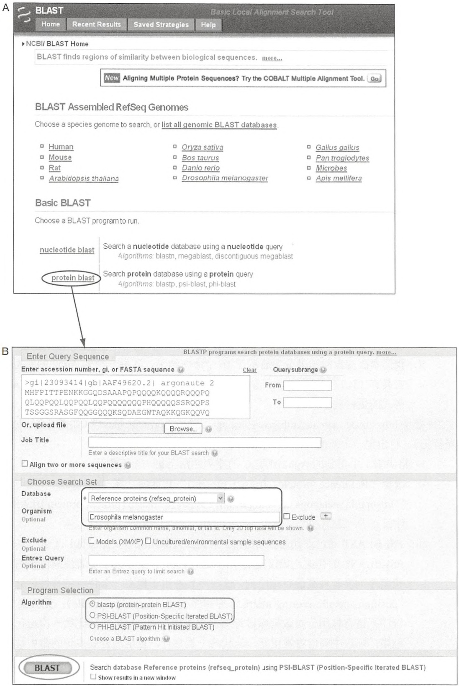
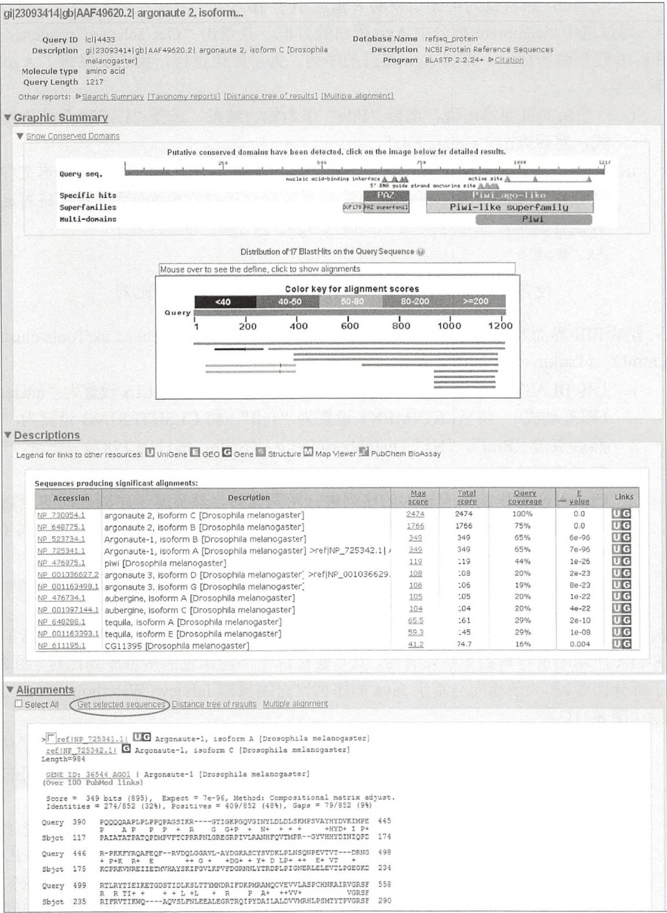
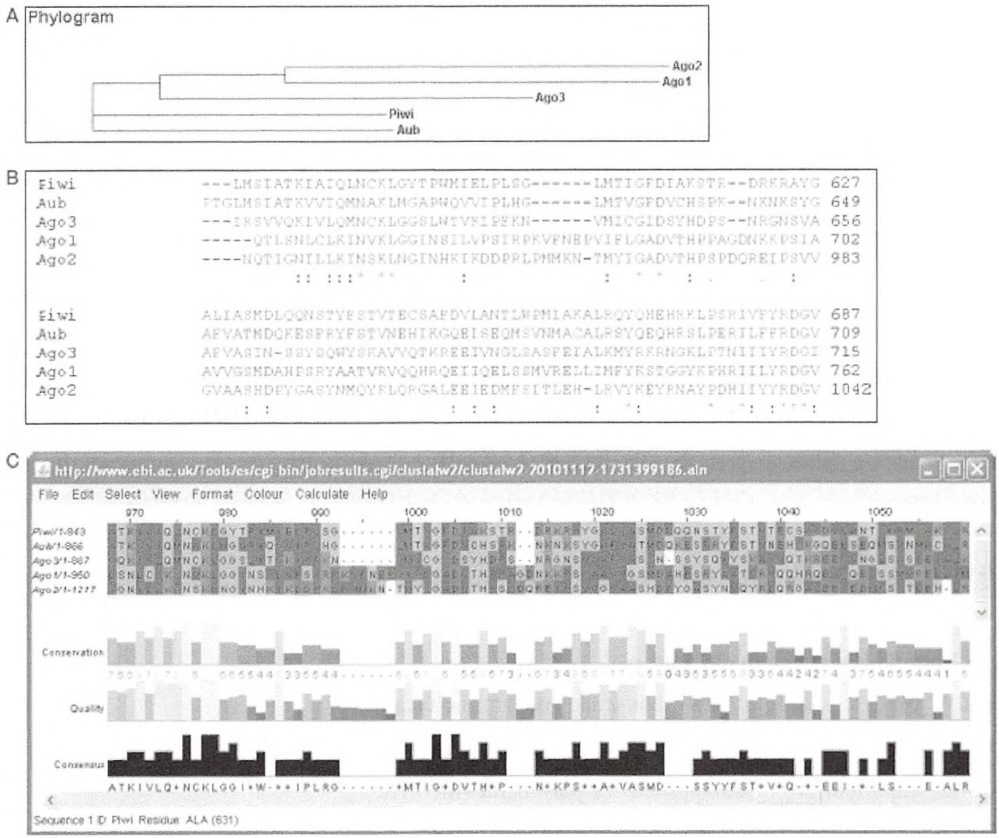
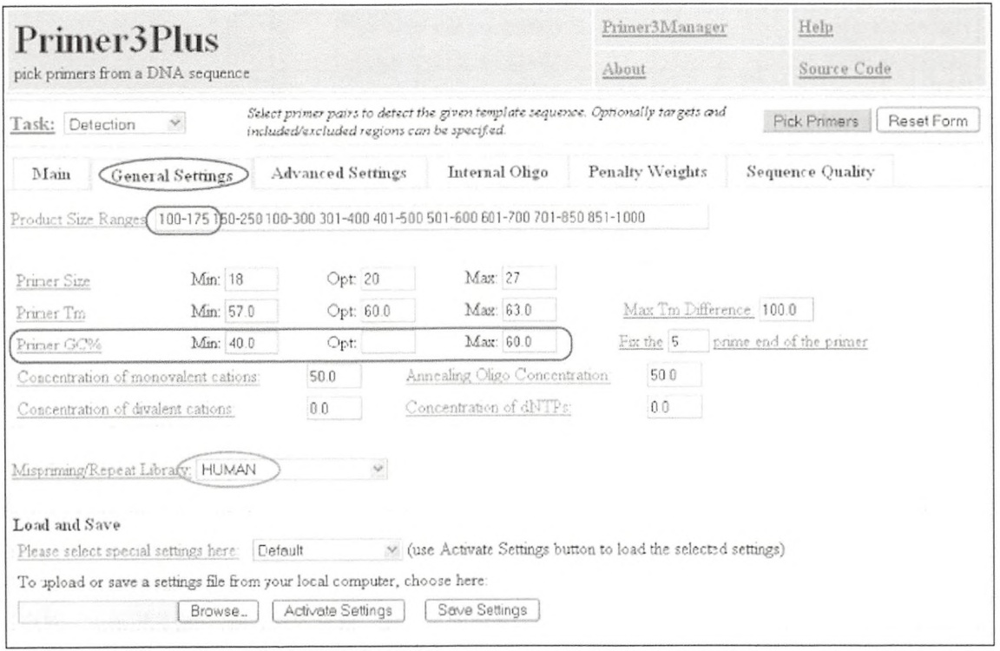
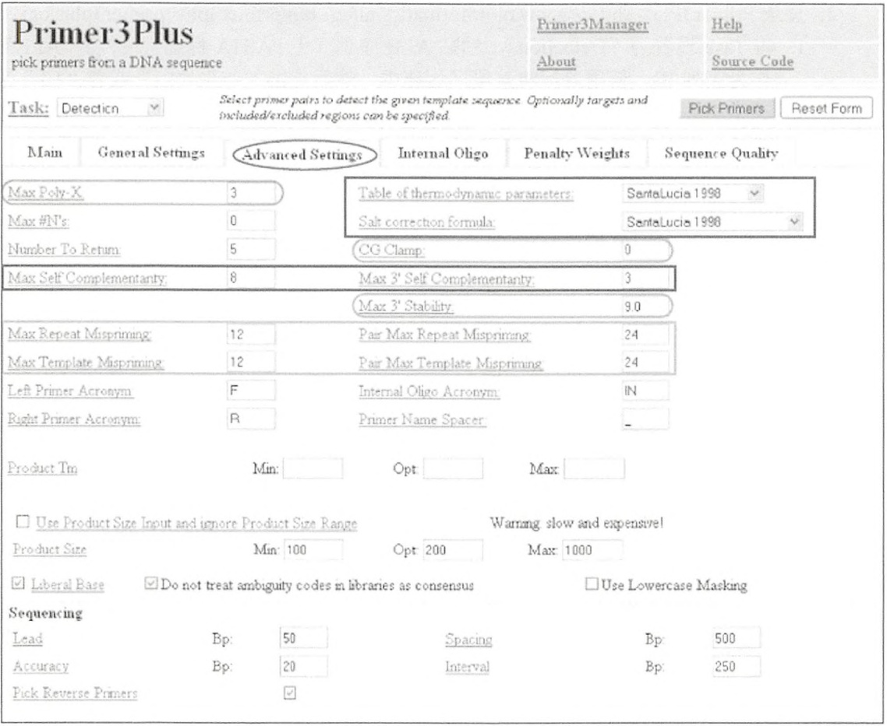
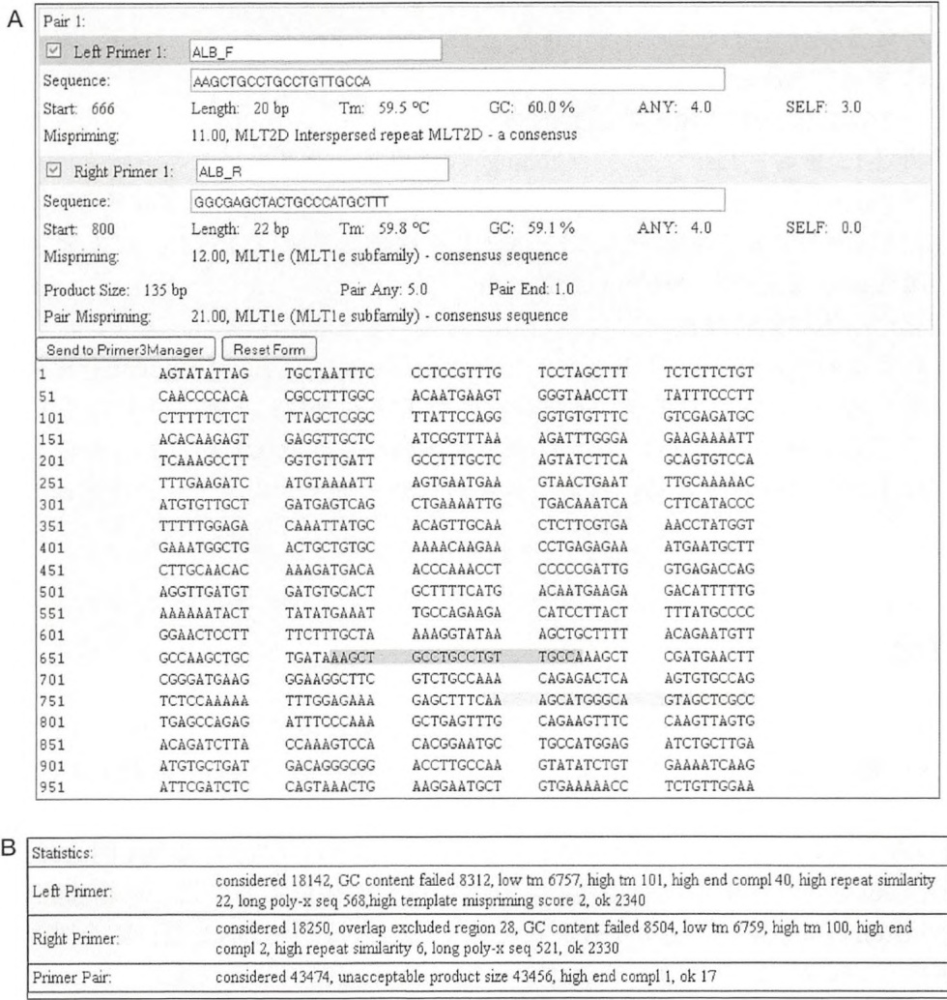
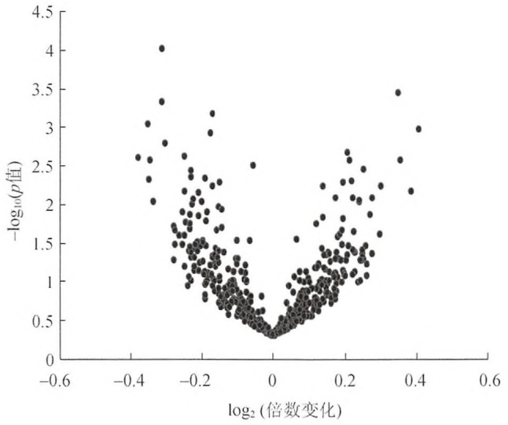

图 8-9 使用 NCBI 中的 BLAST 的界面。（A）有两种途径进入 BLAST 服务器，一种是选定一个基因组（在 “BLAST Assembled RefSeq Genomes” 部分中），或者选择一个 BLAST 程序（在 “Basic BLAST” 部分中）。（B）在 BLAST 搜索页面，由 “protein blast” 链接（如图 A 中椭圆形标记）进入该页面。粘贴或上传 Ago2 序列。选择合适的数据库和程序（步骤 2.ii）（彩图请扫封底二维码）。

3. 当 BLAST 搜索开始之后，将出现另一个页面，该页面提供了有关结果显示格式的更多选项。

i. 将所有选项都设置为默认选项，然后点击 “View Report”，将产生图 8-10 所示结果。结果页面以查询序列信息开始，在本例中即为 Ago2 蛋白。随后有三个部分:第一部分为“Graphic Summary”，显示了 BLAST 发现的可能同源物（putative homolog），并根据比对分值用颜色标注分值显著的命中结果；第二部分为“Description”，提供了这些命中结果的具体信息；第三部分为“Alignments”，显示查询序列与各个命中结果之间的序列两两比对结果。



<details>
<summary>text_image</summary>

gi|23093414|gb|AAF49620.2| argonaute 2. isoform...
Query ID |ccl|4433 Database Name refseq_protein
Description g|23093414|gb|AAF49620.2| argonaute 2, isoform C [Drosophila melanogaster] Description NCBI Protein Reference Sequences
melanogaster Program BLASTP 2.2.24+ ▶Citation
Molecule type amino acid
Query Length 1217
Other reports: ▶Search Summary [Taxonomy reports] [Distance tree of results] [Multiple alignment]
▼ Graphic Summary
▼ Show Conserved Domains
Putative conserved domains have been detected, click on the image below for detailed results.
Query seq.
nucleic acid-binding interface
active site
Specific hits
PR2 Piwi_ago-like
Superfamilies SUF170 PAZ superfamily Piwi
Multi-domains
Distribution of 17 BlastHits on the Query Sequence
Mouse over to see the define, click to show alignments
Color key for alignment scores
<40 40-50 50-80 80-200 >=200
Query
1 200 400 600 800 1000 1200
NP_730054.1 argonaute 2, isoform C [Drosophila melanogaster] 2474 2474 100% 0.0 UG
NP_649775.1 argonaute 2, isoform B [Drosophila melanogaster] 1766 1766 75% 0.0 UG
NP_523734.1 Argonaute-1, isoform B [Drosophila melanogaster] 349 349 65% 6e-96 UG
NP_725341.1 Argonaute-1, isoform A [Drosophila melanogaster] >ref|NP_725342.1| / 349 349 65% 7e-96 UG
NP_476875.1 piwi [Drosophila melanogaster] 119 119 44% 1e-26 UG
NP_001036627.2 argonaute 3, isoform D [Drosophila melanogaster]; >ref|NP_001036629. 108 :108 20% 2e-23 UG
NP_001163498.1 argonaute 3, isoform G [Drosophila melanogaster; 106 :106 19% 8e-23 UG
NP_476734.1 aubergine, isoform A [Drosophila melanogaster] 105 :105 20% 1e-22 UG
NP_001097144.1 aubergine, isoform C [Drosophila melanogaster] 104 :104 20% 4e-22 UG
NP_649288.1 tequila, isoform A [Drosophila melanogaster] 65.5 :61 29% 2e-10 UG
NP_001163393.1 tequila, isoform E [Drosophila melanogaster] 59.3 :45 29% 1e-08 UG
NP_611195.1 CG11395 [Drosophila melanogaster] 41.2 74.7 16% 0.004 UG
Sequences producing significant alignments:
Accession	Description	Max score	Total score	Query coverage	E value	Links
NP_730054.1 argonaute 2, isoform C [Drosophila melanogaster] 2474 2474 100% 0.0 UG
NP_649775.1 argonaute 2, isoform B [Drosophila melanogaster] 1766 1766 75% 0.0 UG 
NP_523734.1 Argonaute-1, isoform B [Drosophila melanogaster] 349 349 65% 6e-96 UG 
NP_725341.1 Argonaute-1, isoform A [Drosophila melanogaster] >ref|NP_725342.1| / 349 349 65% 7e-96 UG 
NP_476875.1 piwi [Drosophila melanogaster] 119 :19 44% 1e-26 UG 
NP_001036627.2 argonaute 3, isoform D [Drosophila melanogaster]; >ref|NP_001036629. 108 :108 20% 2e-23 UG 
NP_001163498.1 argonaute 3, isoform G [Drosophila melanogaster; 106 :106 19% 8e-23 UG 
NP_476734.1 aubergine, isoform A [Drosophila melanogaster] 105 :105 20% 1e-22 UG 
NP_001097144.1 aubergine, isoform C [Drosophila melanogaster] 104 :104 20% 4e-22 UG 
NP_649288.1 tequila, isoform A [Drosophila melanogaster] 65.5 :61 29% 2e-10 UG 
NP_001163393.1 tequila, isoform E [Drosophila melanogaster] 59.3 :45 29% 1e-08 UG 
NP_611195.1 CG11395 [Drosophila melanogaster] 41.2 74.7 16% 0.004 UG
▼ Descriptions
Legend for links to other resources: √ UniGene E GEO G Gene Structure M Map Viewer P PubChem BioAssay
Seqences producing significant alignments:
Accession	Description	Max score	Total score	Query coverage	E value	Links
NP_730054.1 argonaute 2, isoform C [Drosophila melanogaster] 2474 2474 100% 0.0 UG
NP_649775.1 argonaute 2, isoform B [Drosophila melanogaster], argonaute-1, isoform C [Drosophila melanogaster]
NP_523734.1 Argonaute-1, isoform B [Drosophila melanogaster]
NP_725341.1 Argonaute-1, isoform A [Drosophila melanogaster] >ref|NP_725342.1| / ref|NP_725342.1|
NP_476875.1 piwi [Drosophila melanogaster]
NP_001036627.2 argonaute-3, isoform D [Drosophila melanogaster]; >ref|NP_001036629. 108 :108 20% 2e-23 UG
NP_001163498.1 argonaute-3, isoform G [Drosophila melanogaster], argonaute-3, isoform C [Drosophila melanogaster]
NP_476734.1 aubergine, isoform A [Drosophila melanogaster]
NP_001097144.1 aubergine, isoform C [Drosophila melanogaster]
NP_649288.1 tequila, isoform A [Drosophila melanogaster]
NP_001163393.1 tequila, isoform E [Drosophila melanogaster]
NP_611195.1 CG11395 [Drosophila melanogaster] 41.2:74.7:16%
GENE ID: 36544 AGO! | Argonaute-1 | Drosophila melanogaster]
(Over 100 PubMed links)
Score = .349 bits (895), Expect = .7e-96, Method: Compositional matrix adjust.
Identities = .274/852 (32%), Positives = .409/852 (48%), Gaps = .79/852 (9%) 
Query: 390 POQQQAAPLPLPPQFAGSIKR----GTIGKPGQVGINYLDLDLSKMFSVAYHYDKIMPE: 445
P A P P P + R G G+P + N+ + + + + +HVD+ I P+
PAIATATPATQPMPVFTCPRRPNLGREGRPIVLANHFQVTMPR--GYVHHYDINIQPD: 174
Query: 446 R-PKKFYRQAFEQF--RVDQLGGAVL-AYDGKASCYSVDKLPLNSQNPEVTVT---DRNG: 498
+ P+K R+ E ++ G + +DG+ + Y+ D LP+ ++ E+ VT +
RCPRKNVRREIETMHVASKIFGVLKVFDFGRNNLYTROPLFIGNERLELEVTLPGEGKD: 234
Query: 499 RTLRYTIEIKETGDSTIDLSLTTYMNDRIFDKPKRAMQCVEVVVLSPCHNKAIRVGRSF: .558
R R TI+ + ++ L +L + R P A+++VV+ VGRSF: .558
Sbjot: .235 RIFRVTIKWQ----AQVSLFNLEEALEGRTRQIPYDAILALDVWHRHLPSMTYTPVGRSF: .290
</details>

图8-10 BLAST搜索的结果，被分为三部分:Graphic Summary、Description和Alignment（彩图请扫封底二维码）。

ii. 本次搜索获得了果蝇中所有已知的 Argonaute 蛋白:Ago2 的两种亚型、Ago1 的两种亚型、Piwi、Ago3 的两种亚型和 Aubergine（Aub）的两种亚型。其他 Ago 蛋白仅与 Ago2 的羧基端部分相似，它们与 Ago2 序列之间相似性的百分比在“Descriptions”下的“Query coverage”栏中显示。图 8-10 仅显示了 Ago2-Ago1 比对结果（结果显示了相同的残基），相似残基用 “+” 表示，空位用 “-” 表示。对于每个命中结果都报道了相应的 E 值，一个比对的 E 值是指其比对分数大于或等于随机条件下检索数据库时命中结果分数的期望数（ $E=mn/2^{S}$ ，其中，S 为序列比对的标准化分数；m 为检索序列长度；n 为数据库中所有序列的长度之和），通常认为可靠结果的 E 值应小于  $10^{-5}$ 。

4. 通过选中 Alignment 部分中 Ago 蛋白的方框，并点击 “Get selected sequences” 键（如图 8-10 红色圈所标示）得到 Ago 蛋白的序列。为了简化过程，我们仅保留了 Ago 蛋白的一种亚型。

i. 一个新的页面将出现。选择 “File” 作为输出结果，选择 “FASTA” 作为输出格式，然后点击 “Create File”。

ii. 在网页浏览器默认下载目录中，将出现一个名为 sequences.fasta 文本文件。为了让接下来的步骤中将 ClustalW 结果可视化的过程更为便利，我们将对这个文件进行编辑，在各序列的开头插入 Ago2 和 Ago1 等基因名字。

详见“疑难解答”。

## 使用 ClustalW 对果蝇 Ago 蛋白进行多序列比对

5. 登录 EBI 界面友好的 ClustalW 用户网页服务器(http://www.ebi.ac.uk/Tools/clustalw2/index.html)（Larkin et al. 2007）。

i. 上传 BLAST 一节中产生的 sequences.fasta 文件。将 RESULTS 设置为 “interactive”（即互动式），将 ALIGNMENT 设置为 “full”，将 CLSUTERING 设置为 “NJ”，然后点击 “Run”。“NJ”（neighborjoining）（Saitou and Nei 1987）是一种产生系统进化树的方法。

ii. ClustalW 首先将所有输入的序列进行两两比对，然后基于序列之间的距离建立一个引导树（guide tree），最后根据所产生的树渐近地对最为相似的序列（或序列对）进行比对。

增加对一个新出现空位以及空位延伸（指含有两个或两个以上连在一起的空位）的罚分将使结果更青睐于空位较少的比对。然而，默认的参数在大多数情况下已能够很好地满足需求。

6. 如图8-11所示，步骤6产生的交互式输出结果范围非常广泛。其结果包括了一幅如图8-11A所示的引导树的系统发育图、氨基酸被标注不同颜色的多重序列比对（图8-11B显示了部分比对)和一条通向与基于Java的序列比对编辑器Jalview(Waterhouse et al. 2009)的链接（图8-11C）。

i. 图 8-11A 所示的引导树对 5 种果蝇的 Argonaute 蛋白之间的进化距离进行了估算: Piwi 和 Aub 较早就分化了, 此后分化的是 Ago3, 而 Ago2 和 Ago1 之间的进化距离最近。

ii. 在图 8-11C 中，每个氨基酸根据其化学性质标注其颜色。例如，丙氨酸（A）、异亮氨酸（I）、亮氨酸（L）、甲硫氨酸（M）、脯氨酸（P）、苯丙氨酸（F）、色氨酸（W）和缬氨酸（V）为疏水残基，它们被标示为红色；精氨酸（R）和赖氨酸（K）均带正电，它们被标示为紫红色。一段在各个位置均具有相同颜色的比对区块说明该区域为高度保守性区域（例如，结构域或催化位点）。

iii. “Conservation” 图形显示了各个位置的保守性程度，“Quality” 表示了比对对齐的质量，“Consensus”报告了各位点出现频率最高的残基。“+”被用来表示某个位置上出现最高频率有多个残基的情况。较高的保守性和比对质量得分说明相应区域很可能具有重要功能。

详见“疑难解答”。



图 8-11 ClustalW 的结果页面。（A）引导树（又称系统发育图）；（B）根据氨基酸生化特性将其标注颜色的部分多序列比对；（C）序列比对编辑器 Jalview 的截屏（彩图请扫封底二维码）。


## 讨论

使用 BLAST 寻找同源序列是生物信息学中最为重要的技术之一。它的应用覆盖了许多生物学家的研究兴趣，如鉴定新基因的潜在功能、发现其他物种中的重要基因的同源基因。当运行 BLAST 时，请注意它是一个启发式算法，因此，它所产生的结果并不一定是最佳结果。由于密码子的简并性，比对蛋白序列的敏感性将高于比对 DNA 序列，所以尽可能地使用蛋白质序列。此外，使用 PSI-BLAST 可以得到更高的敏感性。ClustalW 被设计用于寻找在一组密切相关的蛋白质序列中的保守区域，例如，如图 8-11 所示的蛋白家族。该程序在识别结合结构域或催化位点等功能性基序时非常有效。

ClustalW 并不适用于比对多个基因组来定位保守的或者快速进化的区域，因为它的运行速度过慢，而且它在比对可能包含大段插入、缺失、反转和复制序列的长基因组序列时准确度较低。相反，大尺度的比较基因组序列分析需要以下几个步骤:对基因组间的同源（同线，syntenic）区域进行重建、对同源区域进行多重序列比对、识别进化保守的或者快速进化的区域。请阅读 Margulies 和 Birney（2008）的综述，来查找使用最广泛的工具。


## 疑难解答

问题（步骤 4）:使用 BLAST 搜索没有获得比对结果或得到的比对结果太多。

解决方案:BLAST 提供了一个统计学显著性衡量标准（E 值）来表示各个比对结果的质量。BLAST 首先对各个比对结果进行得分计算。对核酸序列，得分的计算基于配对、错配和空位的数量；对蛋白质序列，则采用了一个记分矩阵 [scoring matrix，如 PAM（point accepted mutation）和 BLOSUM（blocks substitution matrix）] 使 BLAST 在寻找远源同源物时具有更高的敏感度。E 值越低，说明命中结果的统计学显著性越高。在没有命中结果或者命中结果过多时可以对 E 值的阈值进行调整。

问题（步骤 6）:ClustalW 产生的多序列比对似乎不正确。

解决方案:正如本方案简介中所提及的，ClustalW 是一种启发式算法，因此它不能保证得到最佳解决方案。请使用 T-Coffee（http://www.ebi.ac.uk/Tools/msa/tcoffee/）和 Muscle（http://www.ebi.ac.uk/Tools/msa/muscle/）等多序列比对算法，并比较其结果。以上两个工具都有类似于 ClustalW 的网页界面，便于用户操作。请注意它们的结果可能存在较大差异。如果你觉得比较这些结果很困难，可以使用 M-Coffee 工具（http://tcoffee.crg.cat/apps/tcoffee/play?name=mcoffee），该工具可以自动整合由几个常用比对工具获得的结果。

## 网络资源

```txt
BLAST http://blast.ncbi.nlm.nih.gov/
ClustalW 网页服务器 http://www.ebi.ac.uk/Tools/msa/clustalw2
Java Virtual Machine (JVM) http://www.java.com/en/download/index.jsp
M-Coffee http://tcoffee.crg.cat/apps/tcoffee/play?name=mcoffee
Muscle http://www.ebi.ac.uk/Tools/msa/muscle/
NCBI 关系型数据库 http://www.ncbi.nlm.nih.gov
T-Coffee http://www.ebi.ac.uk/Tools/msa/tcoffee/
```

## 方案 3 使用 Primer3Plus 设计 PCR 引物

对需要使用 PCR 的分子生物学实验来说，设计寡核苷酸引物是确保实验成功的一个极其关键的步骤。PCR 包含三个步骤的循环:变性、复性和延伸。在变性阶段，双链 DNA（dsDNA）分子（模板）解链成为单链。在复性阶段，一对引物与单链分子的互补区域进行复性互补。在延伸阶段，DNA 聚合酶对引物进行延伸反应，从而产生了被引物（扩增子，amplicon）界定的相应 DNA 分子。以上所有步骤都对温度非常敏感，其对应的常用适宜温度依次为  $94^{\circ}$ C、 $60^{\circ}$ C、 $70^{\circ}$ C。引物设计不好可能会导致没有扩增产物或者有额外的非目的扩增片段。引物设计目标包括良好的引物特异性、高复性效率、合适的解链温度、适宜的 GC 比例，以及防止引物发夹结构或引物二聚体的形成（Burpo 2001），以上内容详见本方案的讨论部分和第 7 章。


## 材料

## 仪器

具有 Internet 连接和网页浏览器的电脑

Primer3Plus (http://www.bioinformatics.nl/cgi-bin/primer3plus/primer3plus.cgi/)


## 方法

1. 登录 NCBI 核酸数据库（Pruitt et al. 2007）下载人类白蛋白（albumin）的 mRNA 序列（http://www.ncbi.nlm.nih.gov/nuccore/215982788?report=fasta）。
2. 登录 Primer3Plus（http://www.bioinformatics.nl/cgi-bin/primer3plus/primer3plus.cgi/）。
i. 将 Task 设置为 “Detection”，粘贴 ALB 序列（无 FASTA 标题），并将 “ALB” 作为序列 ID。使用鼠标将某段区域选中，然后点击 “◇”、“[]” 或者 “{}” 来选中相关区域进行引物设计，以上按键的功能依次为使 Primer3Plus 将该段区域排除、选中、选中和包含该区域。
3. Primer3Plus 有许多参数，然而，我们仅需要对其中一小部分进行调整，其他参数可以保持为默认值。
i. 如图 8-12 所示，点击 “General Settings” 面板，然后将 “Primer GC%” 的 “Min” 值设置为 40.0，将 “Max” 值设置为 60.0。



<details>
<summary>text_image</summary>

Primer3Plus
pick primers from a DNA sequence
Task: Detection Select primer pairs to detect the given template sequence. Optionally targets and included/excluded regions can be specified.
Main General Settings Advanced Settings Internal Oligo Penalty Weights Sequence Quality
Product Size Ranges: 100-175 150-250 100-300 301-400 401-500 501-600 601-700 701-850 851-1000
Primer Size Min: 18 Opt: 20 Max: 27
Primer Tm Min: 57.0 Opt: 60.0 Max: 63.0 Max Tm Difference: 100.0
Primer GC% Min: 40.0 Opt: Max: 60.0 Fix the 5 prime end of the primer
Concentration of monovalent cations: 50.0 Annealing Oligo Concentration 50.0
Concentration of divalent cations: 0.0 Concentration of dNTPs: 0.0
Mispriming/Repeat Library: HUMAN
Load and Save
Please select special settings here: Default (use Activate Settings button to load the selected settings)
To upload or save a settings file from your local computer, choose here:
Browse Activate Settings Save Settings
</details>

图 8-12 General Setting 中的参数。请在 “Product Size Range” 框中按优先级从高到低输入所期望得到的产物长度，如图中紫红色椭圆中所示。改变 Primer GC% 的 Min 和 Max 值，如图中蓝色椭圆中所示。根据目标序列的物种选择相应的 Mispriming/Repeat Library，如图中绿色椭圆中所示（彩图请扫封底二维码）。

ii. 将 Mispriming/Repeat Library 设置为 “HUMAN”。该操作将使 Primer3Plus 使用人类重复片段文库（human repeat library）对选中的区域进行过滤，去除那些可能导致产生额外扩增的区域。

目前，Primer3Plus 仅提供人类、啮齿动物和果蝇的文库。如果你想要为以上三种物种以外的物种进行引物设计，你必须在将你的序列提交至 Primer3Plus 前，将序列中的重复片段用 “N” 进行替代。

iii. 如果你对产物的片段长度（如 100～175 个核苷酸）存在偏好，请在 “Product Size Ranges” 窗口输入 “100-175”。这样 Primer3Plus 就会尝试寻找产物在指定长度范围内的引物对。

可以设置多个产物长度范围（优先级从高到低排列），这样当 Primer3Plus 无法找到能够产生最渴望得到的产物长度的引物对时，就会尝试寻找下一个指定范围内可能的引物对。

## 4. 其他参数可在 “Advanced Settings” 中进行设置（图 8-13）。



<details>
<summary>text_image</summary>

Primer3Plus
pick primers from a DNA sequence
Task: Detectin Select primer pairs to detect the given template sequence Optionally targets and included/excluded regions can be specified Pick Primers Reset Form
Main General Settings Advanced Settings Internal Oligo Penalty Weights Sequence Quality
Max Poly-X 3 Table of thermodynamic parameters SantaLucia 1998
Max #N's 0 Salt correction formula SantaLucia 1998
Number To Return 5 CG Clamp 0
Max Self Complementanty 8 Max 3' Self Complementanty 3
Max 3' Stability 9.0
Max Repeat Mispriming 12 Par Max Repeat Mispriming 24
Max Template Mispriming 12 Par Max Template Mispriming 24
Left Primer Acronym F Internal Oligo Acronym IN
Right Primer Acronym R Primer Name Spacer _
Product Tm Min: Opt Max
Use Product Size Input and ignore Product Size Range Warning slow and expensive!
Product Size Min: 100 Opt: 200 Max: 1000
Liberal Base Do not treat ambiguity codes in libraries as consensus Use Lowercase Masking
Sequencing
Lead Bp: 50 Spacing Bp: 500
Accuracy Bp: 20 Interval Bp: 250
Pick Reverse Primers ✓
</details>

图 8-13 Advanced Setting 中的参数。（绿色椭圆中）poly（A/T/C/G）连续长度的最大长度设置为 3。（紫色矩形中）将 thermo dynamic parameters 和 salt correction formula 设置为 SantaLucia 1998。（青色椭圆中）对 3'端的 GC 含量进行控制，设置为默认值。（紫红色矩形中）对所允许的自身互补水平进行调整，自身互补水平即形成发夹结构或引物二聚体的可能性，设置为默认值。（橙色矩形中）对序列与重复片段的相似性进行微调，设置为默认值（彩图请扫封底二维码）。

i. 将 “Max Poly-X” 设置为 “3”，这样可以将同聚（homopoly）-A/C/G/T 的最大长度限制在三个。
ii. 如图 8-13 紫色框中所示，将 “Table of thermodynamic parameters” 和 “Salt correction formula” 均设置为 “SantaLucia 1998”。对 “CG Clamp” 进行设置，同时增加

“Max 3' Stability”的值（青色标注），这样可以得到3'端CG含量较高的引物。iii. 调高“Max Self Complementarity”和“Max 3' Self Complementarity”（如图中紫色框中所示）中的值，能够降低对引物形成发夹结构或引物二聚体的限制；调低这二者的值，将加紧对引物形成发夹结构或引物二聚体的限制。

iv. 图 8-13 橙色方框中所示的 4 个附加参数被调高时，将允许引物与其他重复片段存在更高的相似性；被调低时，将允许引物与其他重复片段存在更低的相似性。对一段序列的互补性得分进行计算时，Primer3Plus 的设置如下:互补碱基得分为 1.00，任意碱基与 N 配对得分为 -0.25，错配得分为 -1.00，空位得分为 -2.00（仅单碱基空位被允许）。

理想状态下，最好能够完全避免自身互补配对和与引物和重复片段的相似性；然而，将这些参数设置得过于严格可能会导致没有找到任何引物对。在本例中，我们将这些参数设置为它们的默认值。

v. 当所有参数都被设置好的时候，点击 “Pick Primers”。

5. 如果 Primer3Plus 能够找到符合所有输入要求的引物对，它就会给出如图 8-14A 所示的引物对报告。在本例中，左侧（正向）引物为 “AAGCTGCCTGCCTGTTGCCA”，从 ALB mRNA 的第 666 位开始，长度为 20 个核苷酸，复性温度为  $59.5^{\circ}$ C。关于右侧（反向）引物也有一份类似的报告。这对引物将产生一段长为 135 个核苷酸的产物，如图 8-14A 所示，这对引物在目标序列上的结合位点被高亮强调。



B

图 8-14 Primer3Plus 的输出结果。（A）识别得到的引物对的信息和位置；（B）表格显示了参数设定如何对其他候选引物进行排除（彩图请扫封底二维码）。

i. 将结果页面滚动至底部，找到一份如图 8-14B 所示的统计数据表格。该表格报告了被各个参数所过滤掉的候选引物对的数量。例如，GC 含量参数排除了 8312 对引物。该表格在 Primer3Plus 没有报告任何引物对时可以提供一份有用的诊断，从而可以针对性地对一些参数进行调整。

## 引物设计的特例

## 为基于定制引物的克隆测序设计引物

当你需要使用引物来产生长片段核酸序列的扩增产物时，如对 DNA 上某段特定区域进行（再）测序时，请将图 8-12 中的 “Task” 改为 “Sequencing”。同时可对图 8-13 底部用于测序任务 “Advanced Settings” 中的 5 个附加选项进行微调:Lead、Spacing、Interval、Accuracy 和 Pick Reverse Primer，这些选项含义如下。

1. Lead: 引物起始位置到测序仪可以产生峰值信号的位点之间的距离（默认值为50个核苷酸）。
2. Spacing: 同一条链上两个连续引物之间的距离（默认值为 500 个核苷酸）。
3. Interval: 相反链上两个连续引物之间的距离（默认值为 250 个核苷酸）。
4. Accuracy: Primer3Plus 搜索最佳引物的区域范围（默认值为 20 个核苷酸）。
5. Pick reverse primer: 此外，在反义链上选取引物（默认为自动选择该选项）。

当对这些参数进行设置时，请记得基于 “Spacing” 和 “Interval” 的设置，在 “General Settings” 中将 “Product Size Ranges” 改变至合适的大小。

## 在一个特定位置的克隆产物起始或终止

将图 8-12 中的 “Task” 改为 “Cloning”，使用花括号界定你想要进行克隆的区域，并在 “Fix the x prime end of the primer” 文本框（图 8-12 中蓝色强调部分的旁边）中输入 5 或 3。这样做可以将引物的 5' 端或 3' 端设置在被标记区域的边界上。以上做法在 PCR 产物的阅读框必须是确定的情况下非常有用。

## 检查选中引物的特异性

一种直观的方法就是采用 BLAST 将引物与相应的基因组和转录组进行比较，以确保每个引物的命中结果尽可能少，并且命中的结果中包含模板序列。由于引物相对较短，所以可将 E 值阈值调整至 200，从而检测到更多的潜在可能脱靶的目标。如方案 2 所描述，对应于相似性得分的 E 值，被定义为在随机条件下大于或等于查询序列得分的序列数目。


## 讨论

当引物与非目标区域进行结合时，结果可能会具有严重的误导性。使用 BLAST 来检查每一条引物的所有可能靶标是在使用引物前应该被执行的一项简单筛查工作。另外，如果你使用基因序列来设计用于 mRNA（如寻找可能的亚型）扩增的引物，请务必谨慎且避免引物与内含子或非转录区域结合。还有，在设计引物时请考虑到 mRNA 的选择性剪切及可能的连接位点。一些引物设计工具可以找到定位于连接位点的引物，以增加它们的特异性（Arvidsson et al. 2008）。这个小技巧在避免引物与被污染的 DNA 进行结合时尤其有效。DNA 污染在 qPCR（定量 PCR）和 real-time PCR 文库准备中非常常见。


## 引物设计

用于引物设计的主要原则如下。

1. 特异性。为了在 PCR 实验中对目标 DNA 进行扩增，两端引物会与目标 DNA 的有义链和反义链的 3'端复性结合。在理想情况下，引物应该足够长，这样它们就可以和目标序列进行独一无二的特异性结合。此外，引物应该避免存在与重复片段 [如短散步重复序列（SINE）和长散步重复序列（LINE）] 互补的序列，这样就能避免对基因组中非目标区域进行扩增。
2. 效率。平均而言，较短的引物与目标区域进行结合的效率高于较长的引物；然而，引物越短，其特异性就越差。作为特异性和效率之间的折中，引物长度应该为 $18\sim 24$ 个核苷酸。
3. 解链温度（melting temperature）。在一个 PCR 循环中，引物与目标序列在复性阶段形成双链分子，双链分子在变性阶段解链。其中，复性阶段的温度低于变性阶段的温度。因此，一对好的引物应该具有适宜且相似的解链温度。下面是由 Marmur 和 Doty（1962）提出的公式，用于估算引物的解链温度，目前被广泛使用:

$$
\text {解链温度} = 2 ^ {\circ} \mathrm{C} \times (N _ {\mathrm{A}} + N _ {\mathrm{T}}) + 4 ^ {\circ} \mathrm{C} \times (N _ {\mathrm{G}} + N _ {\mathrm{C}})
$$

式中， $N_{A}$ 、 $N_{T}$ 、 $N_{G}$ 、 $N_{C}$  依次为引物中 A、T、G、C 的数目。通常，引物的解链温度应为大约  $60^{\circ}C$ 。然而，以上公式不适用于长引物（>13 个核苷酸）；因此，目前被推荐的做法是使用由 SantaLucia Jr.（1998）提出的最近邻参数集（the nearest-neighbor parameter set）来设计所有长度的引物。

4. GC 含量。除了在计算解链温度时要考虑 GC 含量，在设计引物时也应该将 GC 含量控制为大约 50%，并且避免出现长的 GC 片段。高 GC 含量会使得引物具有 “黏性” 并使引物与模板中非目标区域结合的概率增加。长片段的 poly（G,C）会导致引物与模板中的长 GC 片段发生非特异性结合。

另一方面，poly（A,T）片段会导致配对结合不稳定，进而导致引物-模板双链分子的解链。如果可能，请控制poly（T,C）和poly（A,G）片段出现的次数，因为它们可以诱导引物-模板双链分子中出现非预期的二级结构。此外，引物的3'端应为G或者C，这样该引物就能与目标区域发生有益的紧密结合。这个结构被称为G/C夹（G/C clamp，Lowe et al. 1990）。

5. 发夹结构与引物二聚体。由于下列情况是可能的——引物自身有可能形成一个稳定的二级结构，或两条相同引物之间形成同源二聚体（homodimer），或两条不同引物之间形成异源二聚体（heterodimer）（Hillier and Green 1991），因此，为了防止以上错配的发生，应该避免引物自身或引物之间存在互补序列。

如上文所描述的，设计好的引物通常需要深入的分析。Primer3Plus 是一个有效的用于引物设计的网络服务器。本方案演示了如何使用 Primer3Plus 设计引物以对基因的表达水平进行测量（Rozen and Skaletsky 2000; Untergasseret al. 2007）。请注意，Primer3Plus 还可以执行其他需要引物的任务，如克隆与测序等（详见帮助页面 http://www.bioinformatics.nl/cgi-bin/primer3plus/primer3plusHelp.cgi）。

为了沉默一个转录物而设计一个 siRNA 双链分子的过程，与为检测一个转录物设计 PCR 引物的过程非常相似；然而，在其他限制条件（Arvidsson et al. 2008）下，有一个叫做“siRNA Target Finder”的网络服务器可以用于设计 siRNA:http://www.ambion.com/techlib/misc/siRNA\_finder.html。为了避免脱靶效应导致意外的基因表达被抑制，需要进行 BLAST 搜索。

许多引物设计工具可以通过 Internet 免费使用，其中某些工具具有特殊用途（表 8-2）。

普通 PCR 引物设计工具，如 Primer3Plus（Untergasser et al.2007）、Primo Pro、GeneFisher2（Giegerich et al. 1996）和 Primer-BLAST 也可以用于实时 PCR 实验。但是使用 PCR Now、QuantPrime（Arvidsson et al. 2008）和 AutoPrime（Wrobel et al. 2004）等实时 PCR 专用工具则可以得到特异性更高的引物。为便于快速查询，表格中还包括了 2 个 siRNA 双链分子设计工具。

表 8-2 其他引物设计工具

| 工具 | URL | 类型 | 特征 |
| --- | --- | --- | --- |
| Primo Pro | http://www.changbioscience.com/primo/primo.html | PCR | 使用人类转录组来分析并降低随机引物的概率 |
| GeneFisher2 | http://bibiserv.techfak.uni-bielefeld.de/genefisher2/ | PCR | 允许输入多个来自密切相关生物的序列,根据保守序列设计引物 |
| Primer-BLAST | http://www.ncbi.nlm.nih.gov/tools/primer-blast/ | PCR | 为每个引物执行BLAST比较以自动过滤非特异性的引物 |
| PCR Now | http://pathogene.vbi.vt.edu/rt_primer/ | Real-time PCR | 使用“通用的”包含人类和啮齿文库的错配文库来提高引物特异性 |
| QuantPrime | http://www.quantprime.de/ | Real-time PCR | 使用外显子-外显子链接和BLAST搜索来提高引物特异性 |
| AutoPrime | http://www.autoprime.de/AutoPrimeWeb | Real-time PCR | 使用关于外显子边界信息来提高引物特异性 |
| siRNA Target Finder | http://www.ambion.com/techlib/misc/siRNA_finder.html | siRNA | 设计siRNA双链分子并进行BLAST比较来提高特异性 |
| RNAi Design | http://www.idtdna.com/Scitools/Applications/RNAi/RNAi.aspx | siRNA | 设计siRNA双链分子 |


## 互联网信息

```dockerfile
AutoPrime http://www.autoprime.de/AutoPrimeWeb
GeneFisher2 http://bibiserv.techfak.uni-bielefeld.de/genefisher2/
NCBI nucleotide database http://www.ncbi.nlm.nih.gov/nuccore/21598278?report=fasta
PCR Now http://pathogene.vbi.vt.edu/rt_primer/
Primer-BLAST http://www.ncbi.nlm.nih.gov/tools/primer-blast/
Primer3Plus http://www.bioinformatics.nl/cgi-bin/primer3plus/primer3plus.cgi
Primo Pro http://www.changbioscience.com/primo/primo.html
QuantPrime http://www.quantprime.de/
RNAi Design http://www.idtdna.com/Scitools/Applications/RNAi/RNAi.aspx
siRNA Target Finder http://www.ambion.com/techlib/misc/siRNA_finder.html
```

## - 基于微阵列和 RNA-seq 的表达谱分析简介

基因表达谱（expression profile）是指在涉及多种细胞类型、不同处理方法或环境条件下的多个实验中，同时测量大量基因的表达水平（通常指某个基因组中的所有基因）。通过微阵列或下一代测序技术（RNA-seq）检测 mRNA 水平来获得表达谱（见第 10 章和第 11 章）。

一张微阵列上包含了上千至上百万的可以与样本中特定 RNA 分子杂交的互补 DNA（cDNA）片段或寡核苷酸（称为探针，probe）；这些特定 RNA 在进行杂交前会被纯化，有时可能被扩增，并用荧光进行标记。通常，为了便于比较实验组与对照组，被不同染料标记的实验 RNA 和对照 RNA 会同步进行杂交。洗脱之后，荧光成像的结果将显示目标 RNA 的表达水平。由于通常情况下探针序列是已知的，因此，微阵列常常被设计用于分析已知基因的表达水平。与此不同的贴瓦阵列（tiling array），由于包含了沿整个基因组均匀且密集分布的探针，可以用来捕获选择性剪接的外显子和新的转录物。对 RNA-seq（RNA 测序技术）来说，被纯化的 RNA 样本被直接剪切并测序（见第 11 章，方案 9）。特别地，双端测序读段（paired-end reads）在发现相隔远的外显子之间连接时非常有用，该方法特别有助于测定可变剪接事件。


## 微阵列:从探针强度到基因表达水平

许多因素都能导致微阵列数据中的噪声，以下是一些例子。

(1) 扫描仪设置通常不同, 结果导致不同微阵列总亮度之间存在差异。
(2) 各个微阵列的杂交条件可能不同。
(3) 各个微阵列的杂交反应完成程度可能不同。
(4) 不同微阵列中用于杂交的 RNA 数量不同。
(5) 在双色微阵列中, 一种染料总是比另一种更容易结合; 且两种染料之间结合程度的差异在各微阵列中也不同。
(6) 两种染料之间存在荧光猝灭和重吸收现象, 这些现象会根据浓度发生变化。

因此，原始微阵列数据在用于数据分析之前必须进行标准化。标准化的目的是减小技术误差和系统误差，相应地，使基因之间和微阵列之间的生物学差异更为明显。科学文献中已描述了多种对微阵列数据进行标准化的方法。一些方法假设噪声来自于探针序列，尤其是序列中的GC核苷酸含量，因为GC相比AT将导致更强的碱基配对((Dudoit et al. 2002; Song et al. 2007)。而其他方法并没有假设噪声与序列相关（Irizarry et al. 2003; Li 2008）。

每个微阵列中都存在对照探针，这些对照探针的序列是精心设计的，不会与样品中的RNA分子发生特异性杂交。因此，这些探针的平均强度（mean intensities）显示了（相应染料的）背景荧光，微阵列中的所有其他探针的强度应减去这个平均强度。

标准化的最简单方法是假设各个微列阵上杂交的RNA数量是相同的，并且通常设定RNA数量由log（探针强度）（即探针强度取对数）来表示。因而，当存在 $N$ 个微阵列时，可以取出其中一个阵列为标准，在假定各个样本平均 $\log$ （探针强度）相同的情况下，计算其他 $N - 1$ 个样本的换算系数（scaling factor）。平均数（mean）受到异常值（outlier）的强烈影响，中位数（median）或截尾平均数（trimmed mean）在计算换算系数时是一种更为稳健的度量标准。异常值是由荧光强度分布的最顶端的异常事件导致的，例如，亮度最强的探针仅在部分微阵列中达到饱和，而在其他微阵列中不饱和。在计算截尾平均数时，具有最极端的强度值（如前 $25\%$ 和后 $25\%$ ）的探针将被排除。

分位数标准化（quantile normalization）是一种概念清晰、技术简单的对微阵列数据进行标准化的方法（Bolstad et al. 2003）。这种方法假设，尽管个别探针在强度分布中的排序位置可能不同，所有样品中的探针强度分布都是相同的，而且是与序列相关的。因此，每个微阵列中的探针强度分布被标准化为所有微阵列中探针的联合分布(pooled distribution)。这个方法通过以下4个步骤进行。

(1) 根据每个微阵列中的探针强度，将探针排序。
(2) 计算排序后每个位置的探针平均强度。

（3）将相应位置的探针强度替换为计算得到的平均值。

（4）将数据顺序重新调整为最初的探针顺序。

图 8-15 展现了由包含 10 个探针的相同微阵列所产生的 3 组数据标准化的具体过程。分位数标准化消除了大部分技术偏差，但如果一些基因的表达水平在阵列之间差别较大，分位数标准化过程可能会低估大多数差异表达基因。为了提高敏感性，通常会设计多个探针来覆盖一个基因，这些探针被称为一个探针组。在本例中，分位数标准化过程仍在探针水平上进行，基因的表达水平由一个探针组中被标准化的探针的联合强度来表示，如使用平均值、中位数或概要统计（summary statistics）等联合强度。

STEP 1. Tabulate probe intensities.

| Probe | Array 1 | Array 2 | Array 3 |
| --- | --- | --- | --- |
| A | 2.17 | 13.98 | 4.30 |
| B | 2.79 | 3.34 | 4.10 |
| C | 2.94 | 3.90 | 0.67 |
| D | 2.20 | 3.30 | 4.51 |
| E | 2.22 | 3.50 | 4.78 |
| F | 2.42 | 3.28 | 4.12 |
| G | 10.89 | 3.02 | 4.45 |
| H | 2.85 | 3.70 | 4.56 |
| I | 2.29 | 3.86 | 4.29 |
| J | 2.54 | 3.35 | 4.64 |
| Mean | 3.33 | 4.52 | 4.44 |

STEP 2. Rank probes in each array.

| Rank | Array 1 | Array 2 | Array 3 | Mean |
| --- | --- | --- | --- | --- |
| 1 | 2.17(A) | 3.02(G) | 0.67(C) | 1.96 |
| 2 | 2.20(D) | 3.28(F) | 4.10(B) | 3.19 |
| 3 | 2.22(E) | 3.30(D) | 4.12(F) | 3.21 |
| 4 | 2.29(I) | 3.34(B) | 4.29(I) | 3.31 |
| 5 | 2.42(F) | 3.35(J) | 4.30(A) | 3.36 |
| 6 | 2.54(J) | 3.50(E) | 4.45(G) | 3.49 |
| 7 | 2.79(B) | 3.70(H) | 4.51(D) | 3.67 |
| 8 | 2.85(H) | 3.86(I) | 4.56(H) | 3.75 |
| 9 | 2.94(C) | 3.90(C) | 4.64(J) | 3.83 |
| 10 | 10.89(G) | 13.98(A) | 4.78(E) | 9.89 |
| Mean | 3.33 | 4.52 | 4.44 | 3.96 |

STEP 3. Substitute intensity with mean in each rank.

| Rank | Array 1 | Array 2 | Array 3 |
| --- | --- | --- | --- |
| 1 | 1.96(A) | 1.96(G) | 1.96(C) |
| 2 | 3.19(D) | 3.19(F) | 3.19(B) |
| 3 | 3.21(E) | 3.21(D) | 3.21(F) |
| 4 | 3.31(H) | 3.31(B) | 3.31(I) |
| 5 | 3.36(F) | 3.36(J) | 3.36(A) |
| 6 | 3.49(J) | 3.49(E) | 3.49(G) |
| 7 | 3.67(B) | 3.67(H) | 3.67(D) |
| 8 | 3.75(H) | 3.75(I) | 3.75(H) |
| 9 | 3.83(C) | 3.83(C) | 3.83(J) |
| 10 | 9.89(G) | 9.89(A) | 9.89(E) |
| Mean | 3.96 | 3.96 | 3.96 |

STEP 4. Restore the probe order.

| Probe | Array 1 | Array 2 | Array 3 |
| --- | --- | --- | --- |
| A | 1.96 | 9.89 | 3.36 |
| B | 3.67 | 3.31 | 3.19 |
| C | 3.83 | 3.83 | 1.96 |
| D | 3.19 | 3.21 | 3.67 |
| E | 3.21 | 3.49 | 9.89 |
| F | 3.36 | 3.19 | 3.21 |
| G | 9.89 | 1.96 | 3.49 |
| H | 3.75 | 3.67 | 3.75 |
| I | 3.31 | 3.75 | 3.31 |
| J | 3.49 | 3.36 | 3.83 |
| Mean | 3.96 | 3.96 | 3.96 |

图 8-15 分位数标准化步骤。（步骤 1）原始探针强度被整理成表格形式，表格中每一列代表一个样本，每一行代表一个探针。（步骤 2）每个阵列的探针都根据其强度进行排列。探针 ID 被记录在括号内。计算排序后的每一行的平均强度，如红色部分所示。（步骤 3）在所有阵列中的每个排序位置，用计算得到的平均值替代探针强度。（步骤 4）将新的探针数据调整至它们的原始位置。现在每个阵列的平均值是相同的（彩图请扫封底二维码）。

一些更为复杂的标准化方法由软件包支持，如 RMA(Irizarry et al. 2003)、dChip(Li 2008; www.dchip.org)、MAT（Dudoit et al. 2002）和 MA2C（Song et al. 2007）。RMA 和许多其他的工具都被包括在 Bioconductor 包中（www.bioconductor.org）。在进行标准化以后，如果一个基因由多个探针表示，该基因的表达水平就可以用这些探针强度的中位数或者截尾平均数表示。


## RNA-seq: 从序列读段到转录物的表达水平

RNA-seq 得到的序列读段可以通过方案 5 中描述的方法, 被定位至注释后的转录组中。一个转录物的表达水平由被定位至该转录物的读段总数所表示, 其单位为每百万个读段中的转录物上每千个碱基上的读段数 (RPKM)。被定位至多个转录物上的读段可以根据那些被专一地定位至相应转录物中的读段的数量进行分配。已证明包含这些被多重定位的片段会提高 RNA-seq 和微列阵间的相关性 (Mortazavi et al. 2008)。

由于大多数物种的转录物尚未被完全注释，所以那些未能被定位的读段有可能是源自新的剪切体和新基因。目前，基于RNA-seq数据，已开发了很多算法发现新的外显子之间的连接[例如，TopHat（Trapnell et al. 2009）和SpliceMap（Au et al. 2010)]。这些方法首先将读段定位至基因组上，以发现可能的外显子（被连续定位的读段所覆盖的区域），然后构建一系列可能的外显子连接，并以之为基础定位其他读段。

一些双端测序读段（paired-end reads）显示，在基因组坐标上距离较远的成对外显子有时候会分布在单个转录物上。Cufflinks 是一个为运用这些信息而特别设计的程序（Trapnell et al. 2010），基于该软件，可以构建由 TopHat 软件定位读段所支持的一组简约转录物，此外，这个程序可以通过一个统计学模型来估计这些转录物的丰度。转录物丰度通过每百万个被定位片段中的外显子中每千个碱基包含的片段数来估计（FPKM），其中，片段代表双端测序读段所界定的 RNA 片段。基于双端测序读段的 FPKM 与上述提及的基于单端测序的 RPKM 等价。Cufflinks 可以使用一个被注释的转录组作为输入内容，此外，它还可以完全根据由 TopHat 产生的从头组装的转录物作为输入。当输入来自两个样本的 RNA-seq 数据时，Cufflinks（与 TopHat 联接）还可以对这两个样本中不同的转录物进行报告，包括选择性剪接和表达变化。

可以采用UCSC（见方案1）等基因组浏览器可视化微列阵和RNA-seq数据。


## 检测差异表达的转录物

进行表达谱分析的主要目的是检测在不同类型细胞或不同处理条件下差异表达的转录物。为了评估结果的统计学意义，需要每种细胞类型或者处理条件下的多个生物样本，即生物重复（biological replicates）。生物重复是指经过相同处理所分离出的生物样本，例如，来自不同个体的细胞，或者来自不同批次的细胞培养物的样本。相比之下，技术性重复（technical replicates）是指基于同一生物样本的等分所获得的多个样本。典型地，为了获得充分的统计学判别能力，每种细胞类型或者每种处理条件下需要3～6个生物样本。

例如，想象你正在利用微阵列或者 RNA-seq 实验来测定 M 个疾病样本和 N 个对照样本中的基因表达水平，一个特定转录物的平均表达水平在疾病组中为  $m_{D}$ ，在对照组中为  $m_{C}$ 。凭直觉， $m_{D} >> m_{C}$ （或者  $m_{D} << m_{C}$ ）表示该转录物在疾病样本被过表达（或被低表达）。一个相关问题就是“有多大的可信度表明该转录物是差异表达的”，该问题依赖于在基因表达水平中随机观察到这样差异的概率。这个概率被定义为 p 值，而“零假设(null hypothesis)”是一种用于定义“随机”的统计学描述（statistical scenario）。零假设可以通过一个数学公式进行描述（称为 analytical null，分析零假设），或者通过计算机模拟进行估计（称为 empirical null，经验零假设）。

标准 $t$ 检验是一种常用的统计学检验，可以用来评价一个转录物在两组样本中的差异表达情况。统计量 $t$ 被定义为两组数据的平均数之差除以两组数据的联合标准误。该统计量服从自由度为 $M + N - 2$ 的 $t$ 分布。$t$ 分布的数学特征使我们可以计算出与转录物相关的 $p$ 值。因此，$t$ 检验使用了一个分析零假设。

我们可以计算出基于微列阵或 RNA-seq 获得的每个转录物 p 值。p 值小于某个预先设定的置信水平（被称为犯第 I 类错误的概率，通常用  $\alpha$  来表示）的转录物构成一个原始的差异表达转录物列表，该列表中的数据将被用于下一部分所描述的多重检验校正（multiple testing correction）。

标准 $t$ 检验假设一个转录物的表达水平符合一个正态分布，且用于比较的两组数据具有相同的方差（variance）。如果正态性假设不成立，我们可以使用 Wilcoxon 秩和检验（Wilcoxon rank sum test）或者 SAM（significance analysis of microarrays，微阵列显著性分析）（Tusher et al. 2001）作为替代（详见信息栏“算法、门户网站和方法”）。当有足够多的生物样本时（每组中含有 6 个或者更多样本），我们可以使用计算机模拟来产生一个零假设分布（经验零假设）。通过置换检验（permutation test）将各表达水平数据的样本标志（疾病组和对照组）进行随机变换，并重新计算统计量 $t$。此时，每个转录物的 $p$ 值为一个百分比，其分子为 $t$ 统计量大于或等于标签正确情况下的 $t$ 统计量的置换数，分母为总的置换数。

不管我们采用哪一种方法计算转录物的 $p$ 值，根据 $p$ 值与表达水平倍数（fold changes，两组数据平均表达水平的比值）进行作图都可以带给我们大量信息。因为一个转录物，由于在同一类型样本中的巨大变化（有时由一个异常样本引起），尽管有较高的倍数，但 $p$ 值较大。反之，其他一些转录物，尽管其倍数变化较小，$p$ 值仍较小。在进一步研究中，你或许想排除以上两种或其中一种情况的转录物。基于 $p$ 值与倍数变化所作的图（图8-16），依据其形状被称为“火山图（volcano plot）”。该图的横坐标为两组数据之间的倍数变化值（被转换为 $\log_2$ 值，这样过表达和低表达的数据就能够对称），纵坐标为 $p$ 值，通常情况下使用 $p$ 值的负对数 $[- \log (p)]$ 变换来作图，这样较小的 $p$ 值就能够位于较高的位置。横坐标显示了表达变化的生物学影响；纵坐标显示了相应变化的统计学显著性或可靠性。使用交互式程序来查看火山图将十份便利，因为这样点击图上的某一数据点就能看到对应的转录物的属性。然后我们就可以使用UCSC等基因组浏览器（Karolchik et al. 2004）（详见方案1）来可视化检查所有样品中差异表达的基因的表达数据。



<details>
<summary>scatter</summary>

| log2 (倍数变化) (range) | -log10(p值) (range) |
| --- | --- |
| -0.4~0.4 | 0.3~4.0 |
</details>

图8-16 火山图。每一点都代表了一种转录物。 $p$ 值由 $t$ 检验计算得到。左上角和右上角的转录物更有可能是差异表达的。可以使用一个 $p$ 值阈值和一个倍数变化阈值来找到这样的转录物（彩图请扫封底二维码）。


## 多重检验和 FDR 校正

如之前所定义的，$p$ 值是指随机条件下，某转录物的差异表达得分（如由统计量 $t$ 计算得到）大于或等于某观察值的概率。对一个具有 100 000 条转录物的转录组来说，我们需要计算 100 000 个 $p$ 值。在这个例子中，如果 $p$ 值 $<0.001$ 的转录物被认为是差异表达的，那么可以预期将在该转录组中随机检测到 100 条差异表达的转录物（$100\,000 \times 0.001 = 100$）。因此，如果统计检验发现有 200 条 $p$ 值 $<0.001$ 的转录物，则其中一半的转录物为假阳性。多重检验校正是指基于一定次数的试验，采用各种统计学方法来校正统计学上的可信度估计值。在基因组尺度的研究中，最常见的多重检验校正是错误发现率（false discovery rate，FDR）。FDR 定义为预测结果为假阳性的比例:$\mathrm{FDR} =$ 假阳性/（假阳性+真阳性）。在之前的例子中，FDR 等于 $50\%$ （200 个预测结果中有 100 个假阳性结果），这个 FDR 值明显过高，使得该预测结果不具有生物学意义。因此，我们希望获得更少的预测结果（$p$ 值小于 0.001 的情况）来得到一个合理的 FDR 值，即 0.05 或者 0.01，Benjamini 和 Hochberg（1995）提出了一种广泛使用的方法来控制 FDR。把所有转录物根据其差异表达的 $p$ 值由低到高进行排列。如果我们得到了 $k$ 个预测结果，那么 FDR 值就是排序高于第 k 位的假阳性转录物所占比例。换言之，FDR 就是被错误预测为差异表达的基因所占的比例，即这些基因实际上没有差异表达。假设第 k 位基因的 p 值为  $p_{k}$ ，而微阵列实验总共对 M 个基因进行测量，我们就可以预计  $M \times p_{k}$  个基因为假阳性。因此，k 个基因中假阳性的比例（即 FDR）为  $M \times p_{k}/k$ 。在上述推理过程中，我们使用了一个分析零假设模型来计算 FDR 值，因为我们使用 p 值定义计算预期假阳性结果的数量。对多重检验校正和 FDR 的进一步讨论见 Storey 和 Tibshirani（2003）及 Noble（2009）的文章。

## 方案 4 使用微阵列和 RNA-seq 进行表达序列谱分析

由于没有广泛使用的具有图形用户界面的 RNA-seq 数据分析软件，本方案提供了一个通过 Babelomics（Medina et al.2010; http://babelomics.bioinfo.cipf.es/）对微阵列数据进行分析的例子。这个分析过程涉及分位数标准化，其次是检测与人类致癌基因 c-Myc 转至小鼠相关的差异表达基因。最后，使用 Cluster 程序（Eisen et al. 1998; de Hoon et al. 2004; http://bonsai.hgc.jp/\~mdehoon/software/cluster/）对这些差异表达的基因进行层次聚类（hierarchical clustering），然后使用 TreeView（Saldanha 2004; http://sourceforge.net/projects/jtreeview/files/）对结果进行可视化。


## 材料

## 仪器

Babelomics (http://babelomics.bioinfo.cipf.es/)

Cluster (http://bonsai.hgc.jp/\~mdehoon/software/cluster/)

具有 Internet 连接和网页浏览器的电脑

Java virtual machine (JVM)

本方案中介绍的聚类和可视化程序被称为 TreeView，其运行需要电脑上安装了 JVM。请从 java 官方网站（http://www.java.com/en/download/index.jsp）上下载最新版本的 JVM。

TreeView (http://sourceforge.net/projects/jtreeview/files/)


## 方法

## 提交数据

1. Affymetrix 微阵列数据是 CEL 格式的。双色微阵列（如 Agilent 和 Genepix）的原始数据是 TXT 格式的。Babelomics 可以将一个 zip 文件作为输入，该 zip 文件由一个项目涉及的所有数据文件压缩而来。

i. 例如，从基因表达数据库 GEO 中下载一个关于 c-Myc 转基因小鼠的 Affymetrix 数据集（GEO, NCBI 上的微阵列和测序数据集的数据库）（Edgar et al. 2002): ftp://ftp.ncbi.nih.gov/pub/geo/DATA/supplementary/series/GSE10954/。该链接指向一个名为 GSE10954\_RAW.tar 的文件，该文件包含了 8 个被分别压缩的 CEL 文件，从 GSM277567.cel 到 GSM277583.cel。前 4 个样本来自于具有一个 c-Myc 转基因的小鼠，剩下 4 个样本则来自非转基因对照样本。

ii. 将 8 个文件解压缩，然后将它们压缩至一个文件，并命名为 cMyc.zip。