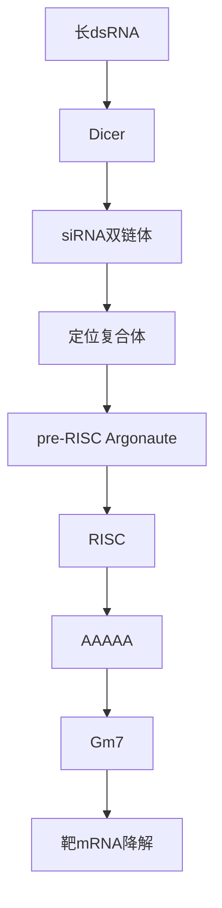
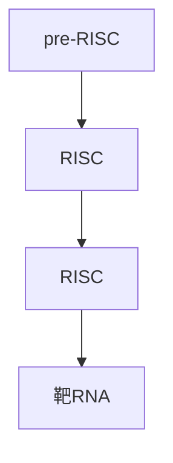
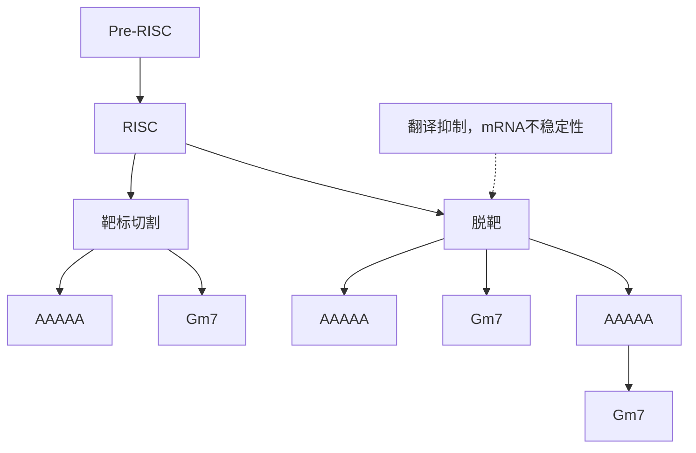
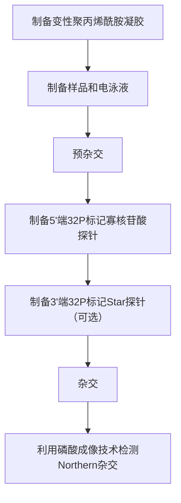
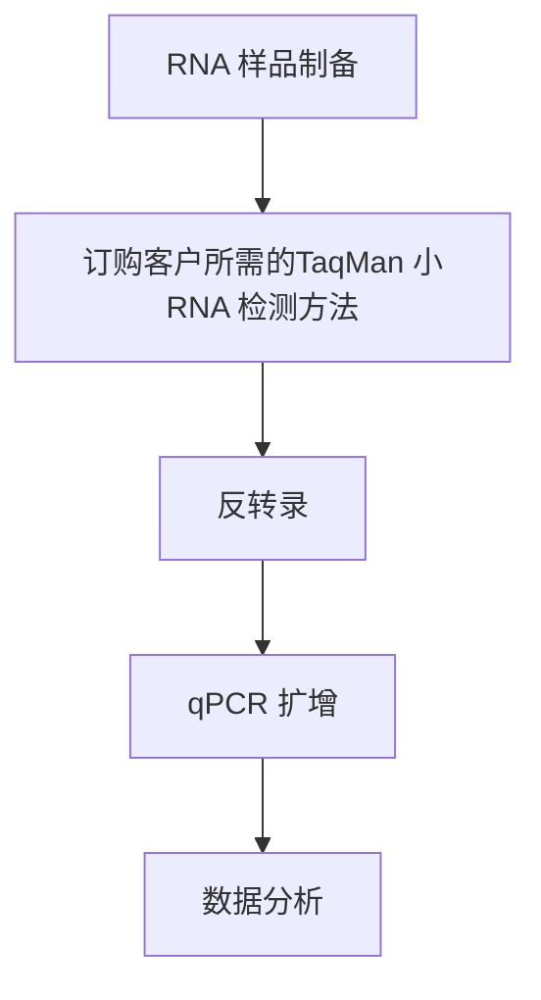
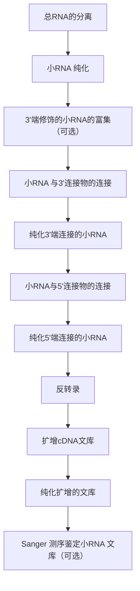

# 第18章 RNA干扰与小RNA分析

原始 PDF 第 87–141 页。

## 第 18 章 RNA 干扰与小 RNA 分析

导言 应用 RNA 干扰进行反向遗传学研究 1175

小RNA分析 1181

方案 | 1 双链 siRNA 制备 1185

2 通过转染双链 siRNA 在哺乳动物细胞中进行 RNA 干扰 1187

3 通过转染双链 siRNA 在果蝇 S2 细胞中进行 RNA 干扰 1190

4 体外转录法制备 dsRNA 1192

5 采用 dsRNA 浸泡果蝇 S2 细胞进行 RNA 干扰 1196

6 采用 dsRNA 转染在果蝇 S2 细胞
中进行 RNA 干扰 1198

7 小 RNA 的 Northern 杂交分析 1199

8 反转录定量 PCR 分析小 RNA 1203

9 构建小 RNA 高通量测序文库 1206

10 抑制 miRNA 功能的反义寡核苷酸制备 1215

11 在哺乳动物细胞中通过反义寡核苷酸抑制miRNA功能 1216

12 在果蝇 S2 细胞中通过反义寡核苷酸抑制 miRNA 功能 1218

信息栏 | 全基因组 RNA 干扰:后基因组

学时代的功能基因组学 1219

---

## 导言

RNA 干扰（RNAi）是指与靶基因序列具有同源性的双链 RNA（dsRNA）使该基因表达沉默。RNA 干扰最早发现于植物细胞中（Napoli et al. 1990），随后在动物细胞中也发现了该现象（Guo and Kemphues 1995）。在发现 dsRNA 能够引起高效而可靠的基因沉默现象后，RNA 干扰进入实际应用（Fire et al. 1998）。RNA 干扰通路在几乎所有的真菌、植物和动物中高度保守，这使得它迅速成为功能基因组学中一种反向遗传学工具（图 18-1）。


<details>
<summary>flowchart</summary>


</details>

图 18-1 RNA 干扰过程总结。在细胞质中，dsRNA 被 Dicer 酶切割，产生包含 5' 端单磷酸和 3' 端突出 2 个非配对核苷酸的双链 siRNA。新生的双链 siRNA 进入含有 Argonaute 蛋白的 RNA 诱导沉默复合体（RISC）。RISC 复合体通过感知 siRNA 双链体的热力学不对称性，区分向导链（黑色）和信使链（蓝色）。信使链由于 Argonaute 蛋白的限制性内切核酸酶活性而发生移除，而向导链则停留在成熟的 RISC 复合体，并引导对互补 mRNA 靶基因的切割（彩图请扫封底二维码）。

首次 RNA 干扰实验主要使用外源性制备的 dsRNA 诱发基因沉默（Fire et al. 1998; Kennerdell and Carthew 1998; Misquitta and Paterson 1999）。后续有关 RNA 干扰的机制研究发现了一个新奇的复合体，即 ATP 依赖的长 dsRNA 逐步转化为功能性小 RNA-蛋白复合体。长 dsRNA 被 RNase III 核糖核酸酶 Dicer 切割产生 21～23 个核苷酸的双链小干扰 RNA（siRNA），这种 siRNA 5'端含单磷酸、3'端含 2 个突出的非配对核苷酸（Bernstein

---

1172

分子克隆实验指南（原书第四版）

et al. 2001; Hutvágner et al. 2001; Lee et al. 2004）。随后，双链 siRNA 结合 Argonaute 蛋白，形成前体 RNA 诱导沉默复合体（pre-RISC）。pre-RISC 的组装需要能够感知 siRNA 双链末端相对热力学稳定的蛋白质参与，以便区分 siRNA 双链中哪一条是“向导链”（反义链），哪一条是“信使链”（有义链）（Khvorova et al. 2003; Schwarz et al. 2003; Tomari et al. 2004）。信使链由于 Argonaute 蛋白的限制性内切核酸酶活性而被移除，而向导链则停留在 RISC 复合体中（Matranga et al. 2005; Rand et al. 2005）。信使链的释放使得 pre-RISC 转变为成熟的 RISC，而后，反义链将 RISC 引导至目标 mRNA 的互补位点。最后，由成熟 RISC 内的 Argonaute 蛋白切割目标 mRNA 使其降解（图 18-2）。


<details>
<summary>flowchart</summary>


</details>

图 18-2 RNA 诱导沉默复合体（RISC）。双链 siRNA 与 Argonaute 蛋白结合，生成含 siRNA 双链的 pre-RISC。然后 Argonaute 催化信使链（蓝色）的切割。切割后的信使链片段被释放，生成仅包含向导链（黑色）的成熟 RISC，向导链将 RISC 引导至互补靶 mRNA（彩图请扫封底二维码）。

长链 dsRNA 不能在哺乳动物体细胞中诱发 RNA 干扰，因为它能诱导干扰素反应和一系列抗病毒反应，最终导致细胞内 RNA 的非特异性降解和广泛抑制蛋白合成（Minks et al. 1979; Manche et al. 1992）。然而，siRNA 的发现（Hamilton and Baulcombe 1999; Zamore et al. 2000）使得人们可以通过合成 siRNA 双链来抑制哺乳动物体细胞内同源基因的表达（Elbashir et al. 2001）。

siRNA 仅是动植物体内多种类型小 RNA 中的一种（Ghildiyal and Zamore 2009）。丰度最高的一种小 RNA 是微小 RNA（microRNA）。1993 年，Ambros 和他的团队发现了首个 miRNA，即 lin-4，其功能是控制线虫（Caenorhabditis elegans）的时间进行性发育（Lee et al. 1993）。多年之后，在多种双侧对称动物（bilateral animal）（如蠕虫、苍蝇、人）中发现了第二个 miRNA——let-7，这说明 miRNA 是生物进化过程中保守的基因表达调控分子（Pasquinelli et al. 2000; Reinhart et al. 2000）。

miRNA 是长度约为 22 个核苷酸的内源性小 RNA，由初级 miRNA（pri-miRNA）转录体中 70 个核苷酸长的发夹结构，经过经典 miRNA 通路或者 mirtron 通路加工而成

---

第 18 章 RNA 干扰与小 RNA 分析

1173

（Miyoshi et al. 2010）。这两条通路的不同表现主要在对 pre-miRNA 发夹结构的加工机制上。在经典 miRNA 通路中，pri-miRNA 被 Drosha 酶及其 dsRNA 结合蛋白 Pasha/DGCR8 切割，而后 pre-miRNA 发夹结构被释放（Denli et al. 2004; Gregory et al. 2004）。而在 mirtron 通路中，pre-miRNA 发夹结构由 RNA 剪接机器和索套（lariat）去分支酶释放（Okamura et al. 2007; Ruby et al. 2007）。随后，这两种类型的 pre-miRNA 发夹结构都被 Exportin-5 转运至细胞质（Yi et al. 2003; Okamura et al. 2007）。在细胞质中，Dicer 及其伴侣蛋白 Loquacious（Loqs）/TRBP/PACT 在 pre-miRNA 发夹结构的环结构附近切割生成 miRNA/miRNA\*双链体（Chendrimada et al. 2005; Forstemann et al. 2005; Jiang et al. 2005; Saito et al. 2005; Lee et al. 2006）。生成的双链 miRNA/miRNA\*进入 RISC 复合体，然后 miRNA\*被移除。miRNA 通过 miRNA 的种子区域（2～8 个核苷酸）与 mRNA 3'UTR 的靶位点之间的碱基互补配对将 RISC 引导至靶 mRNA，并通过抑制 mRNA 翻译或破坏其稳定性调控内源性靶基因的表达（Bartel 2009）。

miRNA 来自于 RNaseII 转录生成的不完全配对发夹结构这一发现，使人们可以进行类似于 siRNA 的 miRNA 人工合成。目前尚无证据显示哺乳动物体细胞能够自然产生 siRNA。miRNA 前体的模拟物——小发夹 RNA（shRNA）可以在细胞内被 Dicer 酶加工形成功能性的双链小 RNA。目前已经获得大量的人类和小鼠 shRNA，可以利用质粒或病毒载体表达 shRNA 文库，进行全基因组范围的 RNA 干扰筛选（请见信息栏“全基因组 RNA 干扰:后基因组学时代的功能基因组学”）。miRNA 也是一种重要的内源性调控因子，miRNA 功能阻断技术是重要的反向遗传学工具，可以用于鉴定基因的功能（请见方案 10～方案 12）。最后，高通量测序技术的进展使得越来越多内源性小 RNA 被鉴定出来，目前该技术已成为小 RNA 生物学及生物化学研究中不可或缺的方法。

siRNA 为反向遗传学提供了有力的研究工具，并开启了新的研究领域。本章将描述 RNA 干扰技术在抑制特定基因表达进行功能缺失分析方面的应用，并对检测特定和广谱性小 RNA 表达的研究方法以及抑制特定种类内源性小 RNA（如 miRNA）的方法加以总结。

## 词汇表

## ASO

ASO 即反义寡核苷酸，是指短的（16～53 个核苷酸）、合成的低聚核苷酸，用于阻断 RNA（包括 miRNA）的功能。反义寡核苷酸通常与小 RNA 高度互补，结构上包含化学修饰过的核苷酸或者在两端添加特定序列，以提高其结合靶序列的亲和力并使其抵抗细胞内核酸酶降解。

## BLAST

基础的局部比对搜索工具（BLAST），这是一种算法，用于计算两种核苷酸或氨基酸序列之间相似性的统计学意义，特别是一个未知序列与数据库中已知序列之间的相似性（见 BIOINFS）。

## cDNA

cDNA 是以 RNA 为模板，在反转录酶作用下生成的互补 DNA。

---

1174

分子克隆实验指南（原书第四版）

## CDS

CDS 是指成熟 mRNA 中可以被翻译为蛋白质的编码序列区域, 自起始密码子开始至终止密码子结束。

## dsRNA

dsRNA 即双链 RNA，是由两条互补链复性形成的 RNA 分子，可以被 Dicer 酶切割形成 siRNA。

## Endo-siRNA

Endo-siRNA 即内源性小干扰 RNA（siRNA），是一类存在于几乎所有真核生物中的小干扰 RNA 分子。

## exo-siRNA

exo-siRNA 即外源性小干扰 RNA（siRNA），是指通过体内或者体外技术生成且生物基因组上不编码，能诱导基因沉默的一类小干扰 RNA 分子。病毒感染或者实验方法导入的双链 RNA 可以启动外源性小干扰 RNA 的生成。

## miRNA

microRNA 是一类含有约 22 个核苷酸的内源性小 RNA，存在于植物和动物体内。miRNA 由含有 70 个核苷酸的发夹状前体经 Dicer 酶作用而生成，miRNA 可以通过破坏靶 mRNA 的稳定性、抑制靶 mRNA 的翻译来对靶 mRNA 发挥调控作用。

## piRNA

piRNA 是指 piwi 相互作用 RNA，是一类内源性小干扰 RNA，能特异性地与动物细胞中 Argonaute 蛋白的类似物 PIWI 结合。piRNA 不能由 dsRNA 形成。

## RISC

RISC 即 RNA 诱导沉默复合体，是一种靶向 siRNA 的限制性内切核酸酶，能在小向导 RNA 第 10 个碱基配对的核苷酸 5'端磷酸二酯键处催化切割靶 RNA。简言之，RISC 包含一个小 RNA 向导链和一个 Argonaute 蛋白。

RNA 干扰（RNAi）

RNA 干扰是由双链 RNA 诱发的对目的基因表达的序列特异性沉默作用。

## shRNA

shRNA 即小发夹 RNA，是 siRNA 或 miRNA 的前体，包含一个 19～29 个核苷酸的“茎”和一个 4～15 个核苷酸的“环”结构。shRNA 在转录后可以从细胞核转移至细胞质，在细胞质中其环结构被 Dicer 酶切割，释放出 siRNA。shRNA 可以自然生成，也可经人工制备并用作基因沉默的工具。

## shRNAmir

shRNAmir 即第二代 shRNA，将 siRNA 包裹于自然界生成的 pre-miRNA 之中。与标准的 shRNA 相比，shRNAmir 对靶 mRNA 的沉默效率更高。

## siRNA

siRNA 即小干扰 RNA，是一种双链 RNA，长度为 21～23 个核苷酸，其 3'端含有两个突出的非配对碱基。siRNA 与 RISC 结合后，一条链即信使链被移除，另一条链即向

---

第 18 章 RNA 干扰与小 RNA 分析

1175

导链则引导 RISC 对互补的靶标 RNA 分子实施切割和降解。

## UTR

UTR 即非翻译区域，位于成熟 mRNA 的 5' 端和 3' 端，不编码蛋白质，但具有翻译调控功能，并参与调节 mRNA 的稳定性和细胞内定位。


## 应用 RNA 干扰进行反向遗传学研究

## 应用长链 dsRNA 抑制基因表达

在植物以及大多数真菌、非哺乳动物及其细胞系中，应用外源性长链 dsRNA（方案 5 和方案 6）或者表达长反向重复 RNA 转录物能够诱发细胞内相应 mRNA 的降解（Fire et al. 1998; Kennerdell and Carthew 1998; Misquitta and Paterson 1999）。哺乳动物卵母细胞和 dsRNA 诱导干扰素反应缺失的哺乳动物细胞系中，长链 dsRNA 和反向重复 RNA 转录物也能够诱发 RNA 干扰。dsRNA 诱导的干扰素反应是一种天然免疫反应。长度超过 30bp 的 dsRNA 能够激活 2′, 5′-寡腺苷酸合成酶和蛋白激酶 R，它们能激活 RNase L 并使真核起始因子 2 的 α 亚基（eIF2-α）失活（Minks et al. 1979; Manche et al. 1992）。干扰素反应诱导 mRNA 的非特异性降解和广泛抑制蛋白质合成，最终诱发细胞凋亡。因此，使用长链 dsRNA 对特定基因进行抑制性研究已不再可能。

## 长链 dsRNA 的设计

一般来讲，500～800bp长度的dsRNA分子可用于靶向外显子，尤其是编码序列（CDS）（Hannon 2003）。据报道，如果目标mRNA与另一条mRNA的同源序列长度超过19bp，目标mRNA的表达就能被有效抑制（Kulkarni et al. 2006）。因此，利用dsCheck、E-RNAi、BLAST（表18-1）（详见第8章）或者类似的计算手段寻找dsRNA的有义链或反义链与细胞内mRNA之间的同源性是该技术的关键点。此外，还要注意靶向同一条mRNA的dsRNA的其他区域引起的RNA干扰效应。

表 18-1 dsRNA 和 siRNA 设计工具

<table><tr><td>名称</td><td>URL</td><td>概述</td><td>参考文献</td></tr><tr><td colspan="4">dsRNA 设计工具</td></tr><tr><td>dsCheck</td><td>http://dscheck.rnai.jp</td><td>dsRNA 选择和 off-target 分析</td><td>Naito et al.2005</td></tr><tr><td>E-RNA 干扰</td><td>http://e-rnai.dkfz.de</td><td>dsRNA 和 siRNA 选择</td><td>Arziman et al.2005</td></tr><tr><td colspan="4">siRNA 设计工具</td></tr><tr><td>Ambion siRNATarget Finder</td><td>http://www.ambion.com/techlib/misc/siRNA_finder.html</td><td>基本 siRNA 选择;没有特定选择性</td><td>Ambion</td></tr><tr><td>BIOPREDsi</td><td>http://www.biopredsi.org/start.html</td><td>基于中枢网络的算法,涵盖基因组范围</td><td>Huesken et al.2005</td></tr><tr><td>BLOCK-iT RNA 干扰Designer</td><td>https://rnaidesigner.invitrogen.com/rnaiexpress/setOption.do?designOption=sirna</td><td>一种灵活的 siRNA 设计工具,允许特异性评价</td><td>Invitrogen</td></tr><tr><td>CAPSID</td><td>http://cms.ulsan.ac.kr/capsid/</td><td>抗病毒 siRNA 选择</td><td>Lee et al. 2009</td></tr><tr><td>DSIR</td><td>http://biodev.extra.cea.fr/DSIR/DSIR.html</td><td>基于线性模式的算法和基于基本序列的 siRNA 功能预测</td><td>Vert et al. 2006</td></tr></table>

---

1176

分子克隆实验指南（原书第四版）

续表

| 名称 | URL | 概述 | 参考文献 |
| --- | --- | --- | --- |
| OptiRNA | http://optirna.unl.edu/ | 提供mRNA结构预测,但不提供特异性分析 | Ladunga 2007 |
| side | http://side.bioinfo.choa.fib.es/ | 为效率预测和特异性分析提供高通量的siRNA设计 | Santoyo et al. 2005 |
| siDESIGN Center | http://www.dharmacon.com/ DesignCenter/DesignCenter Page.aspx | 根据热力学参数和序列特征选择 siRNA,包含毒性序列基序和特异性检测 | Thermo Fisher Scientific (Dharmacon Products) |
| siDirect2.0 | http://siDirect2.rnai.jp/ | 提供siRNA效率分析、特定性质分析以及脱靶效应分析 | Naito et al. 2009 |
| siDRM | http://sidrm.biolead.org/ | 基于disjunctive rule merging (DRM)的毒性分析和特异性分析工具 | Gong et al. 2008 |
| Sirna | http://sfold.wadsworth.org/sirna.pl | 基于靶标可接近性的选择,不提供特异性分析 | Ding et al. 2004 |
| siRNA Design Software | http://i.cs.hku.hk/~sirna/software/sirna.php | 基于多工具的siRNA选择,包括靶标可接近性评价 | Yiu et al. 2005 |
| siRNA Design Tool | http://www1.qiagen.com/Products/GeneSilencing/SiRnaDuplexes/HPFlexible.aspx | 基于热力学偏性的选择;无特异性分析 | QIAGEN |
| siRNA Selection Server | http://jura.wi.mit.edu/bioc/siRNAext/ | 提供多种设计参数,包括多态性和特异性分析,并提供多种输出格式 | Yuan et al. 2004 |
| siRNArules 1.0 | Downloadable from http://sourceforge.net/projects/sirnarules/ | 开放JAVA程序资源,但不能进行灵活性检查 | Holen 2006 |
| siSearch | http://sisearch.cgb.ki.se/ | 基于能量特征分析进行siRNA的效率评估 | Chalk et al. 2004 |
| SVM siRNA Design Toolbeta | http://www5.appliedbiosystems.com/tools/siDesign/ | 基于超功能siRNA分析标准进行选择 | Applied Biosystems |

## 长链 dsRNA 的体外合成

利用来自噬菌体的RNA聚合酶如T7、SP6和T3等进行体外合成是制备RNA干扰实验所用长链dsRNA的一种简便而快速的办法（方案4）。应用体外转录反应制备单独的有义链或反义链也是值得推荐的方法，尤其是在制备富含GC的dsRNA时。应用这种方法可以在将有义链和反义链进行复性之前分别对其质量进行评估。此外，还可以采取将正义模板和反义模板混合在一个体外转录体系内，或者利用两种反向的RNA聚合酶启动子对同一条模板进行转录的方法制备dsRNA。

- 质粒模板。有两种方法可以制备质粒模板。一种方法是:选定 dsRNA，将与其有义链或反义链对应的 DNA 片段克隆至带有噬菌体 RNA 聚合酶启动子质粒的多克隆位点。另一种方法是:将 DNA 片段克隆至质粒，使其位于一对反向的噬菌体 RNA 聚合酶启动子中间。这两种方式中，在体外转录之前都需要利用限制性内切核酸酶在插入片段的两端将插入的 DNA 片段线性化，以确保相应转录物 RNA 的长度。
- PCR 模板。T7、SP6 或 T3 噬菌体启动子长度较小，仅 19bp，这使得它们能够被连接在正向或者反向 PCR 引物的 5'端。利用一条连接启动子的正向引物和一条未连接启动子的反向引物，可以通过 PCR 反应对正义或者反义模板进行体外转录扩增（方案 4）。也可以利用一对融合了启动子的 PCR 引物同时对同一条模板进行扩增。从体外转录的 RNA 得率来看，PCR 模板要优于质粒模板，这是因为前者可以在不增加反应体系中 DNA 总量的情况下提高模板的摩尔浓度。

## 反向重复 dsRNA 的内源性表达

为了进行体内应用，可以构建表达长链发夹状RNA的表达体，方法是装配正义和反义

---

第 18 章 RNA 干扰与小 RNA 分析

1177

序列，并利用间隔区将它们隔开，以产生反向重复序列（Lee and Carthew 2003）。克隆反向重复序列具有挑战性，但使用内含子作为间隔区能够提高构建体在细菌体内的稳定性，从而使克隆更容易实现。长链发夹状 dsRNA 的内源性表达可以通过 RNA 聚合酶 II 启动子（如 CMV）或者二元表达系统（如 GAL4/UAS）在特定细胞系或者转基因动物体内引起持续、可诱导和组织特异性的基因沉默。这一方法的主要不足在于反向重复序列的构建比较耗时。出于此原因，在本章中没有叙述长链发夹状 RNA 的构建（Haley et al. 2008; Ni et al. 2011）。

## 应用 siRNA 抑制特定基因的活性

长链 dsRNA 的导入能够在小鼠卵母细胞、早期胚胎、胚胎干细胞和胚胎癌细胞（Svoboda et al. 2000; Wianny and Zernicka-Goetz 2000; Billy et al. 2001; Yang et al. 2001），以及植物、蠕虫、果蝇体内诱导特定和高效的 RNA 干扰。但是，早期在哺乳动物体细胞中用长链 dsRNA 诱导 RNA 干扰的尝试未能成功，因为长链 dsRNA 作为一个前体会诱导干扰素反应。这种通常被视为病毒感染反应的天然免疫反应能够诱导 RNA 的非特异性降解以及广泛抑制蛋白质生物合成，最终导致细胞凋亡。使用 3' 端带有 2 个非配对碱基的 21～23 个核苷酸的双链 siRNA，即一种 RNA 干扰信号通路的中间体，能模拟长链 dsRNA 经 Dicer 酶切割后的自然产物可以克服这一障碍（方案 2 和方案 3）（Caplen et al. 2001; Elbashir et al. 2001, 2002）。后续研究表明，内源性表达的 siRNA 和 shRNA 引起靶基因特异性抑制的效率与转染外源性 siRNA 相当。

## siRNA 设计

最初，siRNA 序列的选择是基于实验经验而获得的（Elbashir et al. 2001, 2002）。最近，生物信息学工具被用来设计 siRNA（表 18-1），目前多个数据库收录了经过实验确证的 siRNA 和 shRNA。值得推荐的是，在设计新的 siRNA 之前可以通过搜索已有的 siRNA 数据库和科研文献来寻找已确证的 siRNA。如果不能获得已确证的 siRNA，则应该为每个靶基因设计 3～5 条候选 siRNA（Pei and Tuschl 2006）。以下将介绍如何挑选有效和特异性强的 siRNA。有关 siRNA 设计的详细过程请参考 Birmingham 等（2007）的研究。

- 目标区域。siRNA 通常以 mRNA 的 CDS 序列为靶点，因为一般认为，相对非编码序列而言，CDS 序列容易成为 RNA 干扰的靶点且多态性更低。然而，当 CDS 不容易找到合适的 siRNA 结合位点，或者为了区分两个编码区相同但 3' 非翻译区 (UTR) 不同的基因时，3' 端 UTR 也可以利用。5' 端 UTR 和剪接点通常不被考虑，因为它们可能会被细胞内蛋白质复合体（如翻译起始机器或者外显子连接复合体）所包裹。
- 长度和非配对结构。尽管 20～25 个核苷酸长度、包含 2 个非配对碱基形成的 3' 端突出“尾巴”的双链 siRNA 显示出了与常规 siRNA 相当的效率，但常规的双链 siRNA 依然是长度为 21 个核苷酸、两端包含 2 个非配对碱基形成的 3' 端突出“尾巴”，模拟了 Dicer 酶体内切割的主要产物。长度超过 30 个碱基的双链 RNA 能够在哺乳动物体细胞中诱导干扰素反应。一些长度超过 23 个碱基的 RNA 双链体能够诱导细胞特异性的干扰素反应（Reynolds et al. 2006）。
- 热力学不对称性。进入 RISC 的 siRNA 链被称为 “向导链”（图 18-2）。这一 siRNA 链的 5'端碱基配对较为松弛（动力学稳定性稍差），被 RNA 干扰机器识别为向导（Khvorova et al. 2003; Schwarz et al. 2003）。向导链进入 RISC，两者之间的这种结合会通过 5'端的 G:U 错配得到加强。反之，也可以通过化学修饰减弱信使链（向导链的反义链，目标 mRNA 的同义链）与 RISC 的结合（Nykanen et al. 2001; Chen et al. 2008）.
- GC 含量和核苷酸偏好。有关 siRNA 设计的大量分析显示: 具有生物学功能的 siRNA 不能含有回文（palindromic）序列和内在重复序列，并且 GC 含量达到 30%～52%。回文序列或者内在重复序列会形成二级结构，干扰与 RISC 以及目标 mRNA 的结合

---

1178

分子克隆实验指南（原书第四版）

(Patzel et al. 2005)。GC含量过高或者过低会干扰两条siRNA链的分离,减慢与RISC的结合。此外,成熟RISC与目标mRNA的强烈结合会妨碍切割产物的释放,使酶的转换效率降低(Haley and Zamore 2004; Tang and Zamore 2004)。有关高效siRNA性质的多因素分析显示:向导链的第1\~第7个碱基应该是U或者A,第10个碱基应为A或者U,第19个碱基应为G或者C(Pei and Tuschl 2006)。这些“规律”预示了向导链的结合喜好,使其与靶标保持适当的亲和力,促进对靶标的多轮切割。

\- RNA干扰介导的脱靶效应。RNA干扰介导的脱靶效应是指双链siRNA的向导链或信使链介导的对基因表达的非特异性抑制，具有浓度依赖性（图18-3）(Jackson et al. 2006a)。RNA干扰介导的脱靶效应通常会在siRNA发挥类似内源性miRNA的作用时发生，即通过小RNA向导链的“种子序列”（2～7位或2～8位核苷酸）与其目标mRNA结合（Lim et al. 2005; Lin et al. 2005; Birmingham et al. 2006）。目前已经有多种消除这种脱靶效应的方法。尽管通过同源性搜索（如BLASTn或者Smith-Waterman算法）来减少可能存在脱靶效应的siRNA的方法应用比较广泛，但这一方法仍不能消除大多数的脱靶效应，这是因为无法避免第6位和第7位核苷酸与细胞内mRNA匹配的偶然情况。通过将针对同一mRNA的多个无相关性siRNA混合使用以降低每一种siRNA浓度的方法可提高RNA干扰的特异性（Kittler et al. 2007），但是这种方法有着严格的适用要求。对siRNA向导链的第2位核苷酸进行不依赖于序列的化学修饰同样可以提高效率，这一方法减少了siRNA对既定靶标以及靶标之外mRNA的亲和力（Jackson et al. 2006b）。唯一被证实的可提高RNA干扰特异性的方法是设计siRNA分子，使其正确的RNA链进入有功能的RNAi酶复合体，或者可以对信使链进行化学修饰，以阻止其通过RNA干扰途径发挥作用（Elmén et al. 2005）。


<details>
<summary>flowchart</summary>


</details>

图18-3 siRNA介导的脱靶反应。siRNA与其靶标完全匹配后，引导RISC对目的mRNA进行切割，即通常所说的RNA干扰过程。但是，siRNA也可以发挥类似细胞内miRNA的作用，即通过部分碱基配对与其RNA靶标相匹配。这种miRNA的作用偶尔会导致对非靶标mRNA的抑制作用，即脱靶效应。

\- 天然免疫反应和毒性。在哺乳动物中，如果 siRNA 包含富含 G 和 U 的序列基序，如 GUCCUUCAA 或者 UGUGU，那么此 siRNA 有可能通过 Toll 样受体激活细胞内

---

第 18 章 RNA 干扰与小 RNA 分析

1179

的天然免疫通路（Hornung et al. 2005; Judge et al. 2005; Marques and Wil-liams 2005; Sioud 2005）。然而，其他的免疫刺激因素仍然有待鉴定，因为有一些 siRNA 虽富含 G 和 U 却不能激活免疫受体，而另一些缺少 GUCCUUCAA 或者 UGUGU 基序的 siRNA 反而具有免疫刺激活性。针对 176 个随机挑选的 siRNA 进行比较研究，鉴定出 UGGC 是一个毒性基序，能引发细胞死亡（Fedorov et al. 2006）。已知的免疫刺激活性和毒性基序可以通过计算预测而避免。另外，化学修饰，如锁状核酸（locked nucleic acid, LNA）（图 18-4）和对免疫刺激活性和毒性基序进行 2'-O-甲基化核酸修饰可以用于抑制其天然免疫刺激活性（Judge et al. 2006）。


<details>
<summary>chemical</summary>

Chemical structure of a phosphate-phosphate complex with labeled atoms and bonds
</details>

图 18-4 锁状核酸的化学结构。LNA 是一种类似于亚甲基  $2^{\prime}-O, 4^{\prime}-C$  连接的核苷酸，限制核糖向 C3' 内（“North”）靠拢，这是存在一种 A 型 RNA 螺旋中的几何学结构。在 DNA 中每 3 个位点引入一个 LNA 将使 B 型螺旋变为 A 型螺旋，可以提高分子的热稳定性（3～8℃/核苷酸）。LNA-取代寡核苷酸增加的热稳定性（ $T_{m}$ ）使得它们可以作为理想的检测小 RNA 表达的短引物和探针，以及用以阻断小 RNA 功能的反义寡核苷酸（ASO）。

## siRNA 的体外制备

- 化学合成 siRNA。合成 siRNA 应用广泛，这种方法的得率和纯度都比较高。对合成 siRNA 还可以进行一系列化学修饰以提高 siRNA 的稳定性、降低脱靶效应，以及（或者）阻止激活天然免疫反应。多家公司，包括 Ambion、Thermo Scientific Dharmacon、QIAGEN 和 Sigma-Aldrich Proligo 等都能提供高质量的合成 siRNA。在用于细胞之前，合成的正义和反义 siRNA 需在体外复性形成双链 siRNA（方案 1）。
- 利用酶学反应从长链 dsRNA 生成 siRNA。利用重组 Dicer 酶或者细菌 RNase III 对体外转录获得的长链 dsRNA 进行酶学消化也可以获得双链 siRNA（Yang et al. 2002）。与合成 siRNA 相比，对长链 dsRNA 酶消化可以生成不同种类的 siRNA，提高了生成功能性 siRNA 的可能性。然而，体外酶学反应生成 siRNA 的主要不足之处在于:这些 siRNA 在使用时不易选择对照。理论上，对照 siRNA 不应该与实验 siRNA 具备相同的种子序列。由于体外酶切生成的确切 siRNA 无从得知，那么也就无法选择精确的对照，因此，无法区分究竟是既定靶标 mRNA 还是脱靶基因的特定表型表达发生下调。
- 体外转录。利用合成的、含有噬菌体启动子的 DNA 寡核苷酸模板，经体外转录可以生成 siRNA。通常，这一方法通过核酸酶或者核酶消化，确保产物拥有确定的末端以及（或者）5'端单磷酸或者羟基末端。这一方式能够以较低成本快速生成多个不同 siRNA，但是风险主要存在于污染的三磷酸 RNA 会触发天然免疫反应（Kim et al. 2004）。

---

1180

分子克隆实验指南（原书第四版）

## siRNA、shRNA 和 shRNAmir 的细胞内表达

在细胞内利用 DNA 模板表达 siRNA、shRNA 和 shRNAmir（miRNA-adapted shRNA）能够诱导瞬时、持续或者可诱导的基因沉默，有助于对功能缺失表型进行系统分析。

- 基于 DNA 的 siRNA 表达。在基于 DNA 的 siRNA 表达方法中，siRNA 的有义链和反义链由同一质粒中不同的 RNA 聚合酶 III 启动子转录而成。转录后，有义链和反义链通过分子内配对形成双链 siRNA 并触发 RNA 干扰（Lee et al. 2002; Miyagishi and Taira 2002）。两条 siRNA 链在细胞核内的杂交有可能会由于向细胞质转运而无效；shRNA 以及类似策略已经取代上述方法。
- shRNA。shRNA可以作为单链RNA分子转录形成，与含有19～29个核苷酸的“茎”结构和4～15个核苷酸“环”结构的前体miRNA（pre-miRNA）类似。转录后，shRNA由细胞核转运至细胞质，在细胞质中，“环”结构被Dicer酶切割产生siRNA（Castanotto et al. 2002; McManus et al. 2002; Paddison et al. 2002）。有两种方法可用来表达shRNA:①基于PCR的shRNA表达盒（PCR-derived shRNA-expression cassettes）；②shRNA表达质粒或病毒载体。基于PCR的shRNA表达盒可以避免克隆过程，并且能够快速生成大量shRNA，主要用于筛选功能性shRNA。这一方式由于缺乏抗生素筛选标记而仅能瞬时诱导基因沉默。

相反，shRNA 表达载体能够整合到基因组或者作为游离基因稳定地复制，既可以用于瞬时表达 shRNA，也可以用来建立转基因的 RNA 干扰细胞系或动物，实现针对不同发育阶段和组织类型基因功能缺失的系统研究。

\- shRNAmir。目前，通过将人 pre-miR-30 的茎序列替换为所需的 siRNA 序列可以构建 shRNAmir（图 18-5）。这样，siRNA 被植入天然 pre-miRNA 之中，实现 Drosha 和 Dicer 酶对 siRNA 的有效切割，最终促进 siRNA 向导链与成熟 RISC 的相互作用。与标准 shRNA 相比，shRNAmir 能对靶标进行更高效的抑制（约提高 12 倍）。因此，shRNAmir 被称为 “第二代 shRNA” （Zeng and Cullen 2002, 2003; Zeng et al. 2003; Silva et al. 2005）。

hsa-miR-30a 茎-环


图 18-5 通过将人 pre-miR-30 的茎序列替换为所需 siRNA 序列构建 shRNAmir。生成的 shRNAmir 包含 miR-30 初级转录物中 19 个核苷酸环和 125 个核苷酸侧翼，提高了 RNA 干扰效率（经 Macmillan Publishers 允许，摘自 Silva et al. 2005）（彩图请扫封底二维码）。

---

第 18 章 RNA 干扰与小 RNA 分析

1181


## 小 RNA 分析

## 小 RNA 表达检测

## Northern 杂交和 RNase 保护实验

基于变性聚丙烯酰胺凝胶的 Northern 杂交（方案 7）是在检测小 RNA 大小和丰度方面应用最广泛的方法。大多数 miRNA 能够用 5' 端 $^{32}$P-放射性标记的 DNA 寡核苷酸探针进行快速检测。StarFire 寡核苷酸探针含有多个 3' 端 $\alpha$-$^{32}$P 放射性标记，提高了探针的特异性从而拥有更高的敏感性（Behlke et al. 2000）。LNA 寡核苷酸探针提高了杂交的信号/噪声值，并且敏感性提高 10 多倍，使得检测效果更好；但是，LNA 寡核苷酸价格成本较高（Válóczi et al. 2004）。在标准的小 RNA 分子 Northern 杂交方案中，小 RNA 通过紫外线（UV）辐照与尼龙膜发生交联。其他方法中，已有报道:使用 1-乙基-3-(3-二甲基氨丙基)碳化二亚氨（EDC）介导的化学交联可以使敏感度提高 25～50 倍（Pall et al. 2007; Pall and Hamilton 2008）。RNase 保护实验比 Northern 杂交敏感度更高，但是我们不推荐这种方法，因为该方法所提供的小 RNA 亚型的长度和丰度信息不够可靠（Sijen et al. 2001）。

## 定量反转录聚合酶链反应（qRT-PCR）

传统的定量 RT-PCR（第 7 章、第 9 章）不能检测小 RNA 的表达，原因是小 RNA 的长度不足以提供两条引物的结合空间。但是，传统的定量 RT-PCR 可用来定量与 mRNA 长度相当的初级 miRNA(pri-miRNA)。继检测 miRNA 前体首次被报道(Schmittgen et al. 2004)之后，至今已经建立了 3 种基于定量 PCR 的 miRNA 检测方法:①通过多聚腺苷酸化延伸 miRNA 的 3 端，然后利用带有 3' 端简并锚定序列（degenerate anchor）和 5' 端通用标签的多聚（T）连接分子对延长后的 miRNA 进行反转录。最终，利用 miRNA 特异性正向引物和通用反向引物扩增 cDNA，并进行 SYBR Green 检测（Shi and Chiang 2005）。这种方法可以通过一个反转录反应对多个 miRNA 进行相对定量。②利用带有 5' 端通用标签的 miRNA 特异性反转录引物合成第一链 cDNA，然后利用 miRNA 特异并进行了 LNA 修饰的引物，以及便于 SYBR Green 检测的通用引物进行扩增（Raymond et al. 2005）。③利用 miRNA 特异、含有茎-环结构的反转录引物合成第一链 cDNA，然后利用带有 5' 端标签的 miRNA 特异性引物和带有特异性 TaqMan 探针的通用引物进行扩增（Chen et al. 2005）（方案 8）。与 miRNA 特异性反转录引物相比，茎-环结构反转录引物的碱基堆积（base-stacking）可以提高 miRNA 特异性反转录引物双链体的热稳定性，进而提高了反转录反应的特异性和敏感性。小 RNA 特异性引物的 5' 端标签用于使其 $T_m$ 值优化，从而进一步改善引物的特异性和敏感性。TaqMan 小 RNA 检测方法（Applied Biosystems 公司）广泛用于分析 miRNA 和 siRNA。目前，该方法能够对 1～10ng 总 RNA 中的小 RNA 进行至少 6 个数量级范围的定量分析。

## 小 RNA 的芯片检测

小 RNA 的芯片检测比 Northern 杂交检测通量更高，广泛用于小 RNA 尤其是 miRNA 表达谱检测（Krichevsky et al. 2003; Esquela-Kerscher and Slack 2004; Liu et al. 2004; Nelson et al. 2004）。探针标准化和 miRNA 标记是获得高特异性和高敏感性小 RNA 芯片的关键因素。为了达到均一的杂交条件，可以利用混合修饰的核苷酸如 LNA（Castoldi et al. 2006），或者调整探针长度（Baskerville and Bartel 2005）将探针和 miRNA 之间的 $T_m$ 值进行标准化处理。此外，使用荧光染料直接标记 miRNA 已被广泛用于避免反转录和 PCR 扩增带来的

---

1182

分子克隆实验指南（原书第四版）

偏差。芯片技术的主要不足在于芯片只能用于研究已知的小RNA或者生物信息学预测的小RNA。此外，不存在一种标准芯片，能适用于检测内源性siRNA（endo-siRNA）、外源性siRNA（exo-siRNA）以及Piwi相互作用RNA（piRNA）。这些小RNA种类繁多（Ghildiyal and Zamore 2009），超出了最大芯片平台的探针数量。

## 原位杂交检测小RNA表达模式

利用 LNA 修饰 DNA 探针（12～22 个核苷酸）的原位杂交，可以对特定细胞、组织、器官，以及完整胚胎的小 RNA 进行检测。最近报道了一种新的方法，即在 miRNA 的 5'-磷酸与附近蛋白质氨基之间进行 EDC 介导的交联，可以阻止组织中 miRNA 降解（Pena et al. 2009）。目前的原位杂交方法可以检测 miRNA 前体和成熟 miRNA，但是不能将二者区分开来（Wienholds et al. 2005; Kloosterman et al. 2006; Obernosterer et al. 2007）。

## 小 RNA 克隆和测序

小 RNA 克隆（方案 9）和测序是鉴别新的小 RNA 的有力工具。在过去的 8 年内，已经发展了一系列针对含有不同 5 端或 3 端化学结构小 RNA 的鉴定方法，但基本原则都是相似的。这些基本原则包括:将小 RNA 序列 3 端或 5 端与特定分子（linker）连接，接着通过 RT-PCR 扩增构建小 RNA cDNA 文库，最后进行 DNA 序列分析。起初，小 RNA cDNA 文库被克隆到质粒中作为串联体（concatamer），通过传统的 Sanger DNA 测序技术进行分析（Djikeng et al. 2001; Lagos-Quintana et al. 2001）。现在，可以实现大量平行的高通量测序（第 11 章），测序长度大幅度提升，同时降低了经济成本（Aravin et al. 2006; Girard et al. 2006; Lau et al. 2006; Brennecke et al. 2007; Ghildiyal et al. 2008; Li et al. 2009）。由于对小 RNA 的测序频率（“阅读”）与其丰度成正比，所以如果采用严格的标准化策略，高通量测序可以实现对相同或不同样本间小 RNA 表达的相对定量。

## 使用反义寡核苷酸抑制小 RNA 的功能

2004 年以来，反义寡核苷酸（ASO）成为在细胞系、果蝇、斑马鱼、小鼠，以及非人类灵长动物体内研究个别 miRNA 功能缺失的有力工具。ASO 还具有用于治疗药物的潜能（Hutvágner et al. 2004; Meister et al. 2004; Esau 2008; Horwich and Zamore 2008; Petri et al. 2009）。经典的 ASO 是合成的寡核苷酸，长度为 16～53 个核苷酸，其碱基、核糖、磷酸二酯骨架或者末端带有不同的化学修饰。长度超过 miRNA 的 ASO 含有一个与其目标 miRNA 互补的中心区，两边带有相同数量的侧翼序列。增加 ASO 长度可以提高对 miRNA 功能的抑制能力。核苷酸修饰包括 2'-O-氟代、2'-O-甲基化、2'-O-甲氧基乙基、2'-脱氧以及 LNA。骨架修饰包括硫代磷酸和肽核酸（peptide nucleic acids）（Fabani and Gait 2008）。这些修饰保护 ASO 免受细胞内核酸酶的降解作用，提高其亲和力和特异性。此外，末端进行如胆固醇和细胞穿透性肽（cell-penetrating peptide）修饰，可促进 ASO 向细胞内的转运。ASO 的制备以及在哺乳动物细胞和果蝇 S2 细胞内抑制 miRNA 功能的应用将在方案 10～方案 12 中介绍。


## 致谢

感谢 Hannon 实验室分享其原创的小 RNA 克隆方案；感谢 Klaus Förstemann, Jennifer Broderick, Michael Horwich, Vasily Vagin, Megha Ghildiyal 和 Stefan Ameres 等对本章中的方案加以润色；感谢 Zamore 实验室成员为本章提供的有益讨论和建议。

---

第 18 章 RNA 干扰与小 RNA 分析

1183

## 参考文献

- Aravin A, Gaidatzis D, Pfeffer S, Lagos-Quintana M, Landgraf P, Iovino N, Morris P, Brownstein MJ, Kuramochi-Miyagawa S, Nakano T, et al. 2006. A novel class of small RNAs bind to MILI protein in mouse testes. Nature 442: 203–207.
- Arziman Z, Horn T, Boutros M. 2005. E-RNAi: A web application to design optimized RNAi constructs. Nucleic Acids Res 33: W582–W588.
- Bartel DP. 2009. MicroRNAs: Target recognition and regulatory functions. Cell 136: 215–233.
- Baskerville S, Bartel DP. 2005. Microarray profiling of microRNAs reveals frequent coexpression with neighboring miRNAs and host genes. RNA 11: 241–247.
- Behlke MA, Dames SA, McDonald WH, Gould KL, Devor EL, Walder JA. 2000. Use of high specific activity StarFire oligonucleotide probes to visualize low-abundance pre-mRNA splicing intermediates in S. pombe. BioTechniques 29: 892–897.
- Bernstein E, Caudy AA, Hammond SM, Hannon GJ. 2001. Role for a bidentate ribonuclease in the initiation step of RNA interference. Nature 409: 363–366.
- Billy E, Brondani V, Zhang H, Müller U, Filipowicz W. 2001. Specific interference with gene expression induced by long, double-stranded RNA in mouse embryonal teratocarcinoma cell lines. Proc Natl Acad Sci 98: 14428–14433.
- Birmingham A, Anderson EM, Reynolds A, Ilsley-Tyree D, Leake D, Fedorov Y, Baskerville S, Maksimova E, Robinson K, Karpilow J, et al. 2006. 3' UTR seed matches, but not overall identity, are associated with RNAi off-targets. Nat Methods 3: 199–204.
- Birmingham A, Anderson E, Sullivan K, Reynolds A, Boese Q, Leake D, Karpilow J, Khvorova A. 2007. A protocol for designing siRNAs with high functionality and specificity. Nat Protoc 2: 2068–2078.
- Brennecke J, Aravin AA, Stark A, Dus M, Kellis M, Sachidanandam R, Hannon GJ. 2007. Discrete small RNA-generating loci as master regulators of transposon activity in Drosophila. Cell 128: 1089–1103.
- Caplen NJ, Parrish S, Imani F, Fire A, Morgan RA. 2001. Specific inhibition of gene expression by small double-stranded RNAs in invertebrate and vertebrate systems. Proc Natl Acad Sci 98: 9742–9747.
- Castanotto D, Li H, Rossi JJ. 2002. Functional siRNA expression from transfected PCR products. RNA 8: 1454–1460.
- Castoldi M, Schmidt S, Benes V, Noerholm M, Kulozik AE, Hentze MW, Muckenthaler MU. 2006. A sensitive array for microRNA expression profiling (miChip) based on locked nucleic acids (LNA). RNA 12:913–920.
- Chalk AM, Wahlestedt C, Sonnhammer EL. 2004. Improved and automated prediction of effective siRNA. Biochem Biophys Res Commun 319: 264–274.
- Chen C, Ridzon DA, Broomer AJ, Zhou Z, Lee DH, Nguyen JT, Barbisin M, Xu NL, Mahuvakar VR, Andersen MR, et al. 2005. Real-time quantification of microRNAs by stem-loop RT-PCR. Nucleic Acids Res 33: pe179. doi: 10.1093/nar/gni178.
- Chen PY, Weinmann L, Gaidatzis D, Pei Y, Zavolan M, Tuschl T, Meister G. 2008. Strand-specific 5'-O-methylation of siRNA duplexes controls guide strand selection and targeting specificity. RNA 14: 263–274.
- Chendrimada TP, Gregory RI, Kumaraswamy E, Norman J, Cooch N, Nishikura K, Shiekhattar R. 2005. TRBP recruits the Dicer complex to Ago2 for microRNA processing and gene silencing. Nature 436:740–744.
- Denli AM, Tops BB, Plasterk RH, Ketting RF, Hannon GJ. 2004. Processing of primary microRNAs by the Microprocessor complex. Nature 432:231–235.
- Ding Y, Chan CY, Lawrence CE. 2004. Sfold web server for statistical folding and rational design of nucleic acids. Nucleic Acids Res 32: W135-W141.
- Djikeng A, Shi H, Tschudi C, Ullu E. 2001. RNA interference in Trypanosoma brucei: Cloning of small interfering RNAs provides evidence for retroposon-derived 24–26-nucleotide RNAs. RNA 7: 1522–1530.
- Elbashir SM, Harborth J, Lendeckel W, Yalcin A, Weber K, Tuschl T. 2001. Duplexes of 21-nucleotide RNAs mediate RNA interference in cultured mammalian cells. Nature 411: 494–498.
- Elbashir SM, Harborth J, Weber K, Tuschl T. 2002. Analysis of gene function in somatic mammalian cells using small interfering RNAs. Methods 26: 199–213.
- Elmén J, Thonberg H, Ljungberg K, Frieden M, Westergaard M, Xu Y, Wahren B, Liang Z, ∅rum H, Koch T, et al. 2005. Locked nucleic acid (LNA) mediated improvements in siRNA stability and functionality. Nucleic Acids Res 33: 439–447.
- Esau CC. 2008. Inhibition of microRNA with antisense oligonucleotides. Methods 44: 55–60.
- Esquela-Kerscher A, Slack FJ. 2004. The age of high-throughput microRNA profiling. Nat Methods 1: 106–107.
- Fabani MM, Gait MJ. 2008. miR-122 targeting with LNA/2'-O-methyl oligonucleotide mixmers, peptide nucleic acids (PNA), and PNA-peptide conjugates. RNA 14: 336–346.
- Fedorov Y, Anderson EM, Birmingham A, Reynolds A, Karpilow J, Robinson K, Leake D, Marshall WS, Khvorova A. 2006. Off-target effects by
- siRNA can induce toxic phenotype. RNA 12: 1188–1196.
- Fire A, Xu S, Montgomery MK, Kostas SA, Driver SE, Mello CC. 1998. Potent and specific genetic interference by double-stranded RNA in Caenorhabditis elegans. Nature 391: 806–811.
- Förstemann K, Tomari Y, Du T, Vagin VV, Denli AM, Bratu DP, Klattenhoff C, Theurkauf WE, Zamore PD. 2005. Normal microRNA maturation and germ-line stem cell maintenance requires Loquacious, a double-stranded RNA-binding domain protein. PLoS Biol 3: pe236. doi: 10.1371/journal.pbio.0030236.
- Ghildiyal M, Zamore PD. 2009. Small silencing RNAs: An expanding universe. Nat Rev Genet 10: 94–108.
- Ghildiyal M, Seitz H, Horwich MD, Li C, Du T, Lee S, Xu J, Kittler EL, Zapp ML, Weng Z, et al. 2008. Endogenous siRNAs derived from transposons and mRNAs in Drosophila somatic cells. Science 320:1077–1081.
- Girard A, Sachidanandam R, Hannon GJ, Carmell MA. 2006. A germline-specific class of small RNAs binds mammalian Piwi proteins. Nature 442: 199–202.
- Gong W, Ren Y, Zhou H, Wang Y, Kang S, Li T. 2008. siDRM: An effective and generally applicable online siRNA design tool. Bioinformatics 24:2405–2406.
- Gregory RI, Yan KP, Amuthan G, Chendrimada T, Doratotaj B, Cooch N, Shiekhattar R. 2004. The Microprocessor complex mediates the genesis of microRNAs. Nature 432: 235–240.
- Guo S, Kemphues KJ. 1995. par-1, a gene required for establishing polarity in C elegans embryos, encodes a putative Ser/Thr kinase that is asymmetrically distributed. Cell 81: 611–620.
- Haley B, Zamore PD. 2004. Kinetic analysis of the RNAi enzyme complex. Nat Struct Mol Biol 11: 599–606.
- Haley B, Hendrix D, Trang V, Levine M. 2008. A simplified miRNA-based gene silencing method for Drosophila melanogaster. Dev Biol 321: 482–490.
- Hamilton AJ, Baulcombe DC. 1999. A species of small antisense RNA in posttranscriptional gene silencing in plants. Science 286: 950–952.
- Hannon GJ. 2003. RNAi: A guide to gene silencing, pp. vii, 436. Cold Spring Harbor Laboratory Press, Cold Spring Harbor, NY.
- Holen T. 2006. Efficient prediction of siRNAs with siRNArules 1.0: An open-source JAVA approach to siRNA algorithms. RNA 12: 1620–1625.
- Hornung V, Guenthner-Biller M, Bourquin C, Ablasser A, Schlee M, Uematsu S, Noronha A, Manoharan M, Akira S, de Fougerolles A, et al. 2005. Sequence-specific potent induction of IFN- $\alpha$ by short interfering RNA in plasmacytoid dendritic cells through TLR7. Nat Med 11: 263–270.
- Horwich MD, Zamore PD. 2008. Design and delivery of antisense oligonucleotides to block microRNA function in cultured Drosophila and human cells. Nat Protoc 3: 1537–1549.
- Huesken D, Lange J, Mickanin C, Weiler J, Asselbergs F, Warner J, Meloon B, Engel S, Rosenberg A, Cohen D, et al. 2005. Design of a genome-wide siRNA library using an artificial neural network. Nat Biotechnol 23: 995–1001.
- Hutvágner G, McLachlan J, Pasquinelli AE, Bálint E, Tuschl T, Zamore PD. 2001. A cellular function for the RNA-interference enzyme Dicer in the maturation of the let-7 small temporal RNA. Science 293: 834–838.
- Hutvágner G, Simard MJ, Mello CC, Zamore PD. 2004. Sequence-specific inhibition of small RNA function. PLoS Biol 2: pe98. doi: 10.1371/journal.pbio.0020098.
- Jackson AL, Burchard J, Leake D, Reynolds A, Schelter J, Guo J, Johnson JM, Lim L, Karpilow J, Nichols K, et al. 2006a. Position-specific chemical modification of siRNAs reduces "off-target" transcript silencing. RNA 12: 1197–1205.
- Jackson AL, Burchard J, Schelter J, Chau BN, Cleary M, Lim L, Linsley PS. 2006b. Widespread siRNA "off-target" transcript silencing mediated by seed region sequence complementarity. RNA 12: 1179–1187.
- Jiang F, Ye X, Liu X, Fincher L, McKearin D, Liu Q. 2005. Dicer-1 and R3D1-L catalyze microRNA maturation in Drosophila. Genes Dev 19:1674–1679.
- Judge AD, Sood V, Shaw JR, Fang D, McClintock K, MacLachlan I. 2005. Sequence-dependent stimulation of the mammalian innate immune response by synthetic siRNA. Nat Biotechnol 23: 457–462.
- Judge AD, Bola G, Lee AC, MacLachlan I. 2006. Design of noninflammatory synthetic siRNA mediating potent gene silencing in vivo. Mol Ther 13: 494–505.
- Kennerdell JR, Carthew RW. 1998. Use of dsRNA-mediated genetic interference to demonstrate that frizzled and frizzled 2 act in the wingless pathway. Cell 95: 1017–1026.
- Khvorova A, Reynolds A, Jayasena SD. 2003. Functional siRNAs and mi-RNAs exhibit strand bias. Cell 115: 209–216.
- Kim DH, Longo M, Han Y, Lundberg P, Cantin E, Rossi JJ. 2004. Interferon induction by siRNAs and ssRNAs synthesized by phage polymerase. Nat Biotechnol 22: 321–325.
- Kittler R, Surendranath V, Heninger AK, Slabicki M, Theis M, Putz G, Franke K, Caldarelli A, Grabner H, Kozak K, et al. 2007. Genome-

---

1184

分子克隆实验指南（原书第四版）

- wide resources of endoribonuclease-prepared short interfering RNAs for specific loss-of-function studies. Nat Methods 4: 337–344.
- Kloosterman WP, Wienholds E, de Bruijn E, Kauppinen S, Plasterk RH. 2006. In situ detection of miRNAs in animal embryos using LNA-modified oligonucleotide probes. Nat Methods 3: 27–29.
- Krichevsky AM, King KS, Donahue CP, Khrapko K, Kosik KS. 2003. A microRNA array reveals extensive regulation of microRNAs during brain development. RNA 9: 1274–1281.
- Kulkarni MM, Booker M, Silver SJ, Friedman A, Hong P, Perrimon N, Mathey-Prevot B. 2006. Evidence of off-target effects associated with long dsRNAs in Drosophila melanogaster cell-based assays. Nat Methods 3: 833–838.
- Ladunga I. 2007. More complete gene silencing by fewer siRNAs: Transparent optimized design and biophysical signature. Nucleic Acids Res 35:433–440.
- Lagos-Quintana M, Rauhut R, Lendeckel W, Tuschl T. 2001. Identification of novel genes coding for small expressed RNAs. Science 294: 853–858.
- Lau NC, Seto AG, Kim J, Kuramochi-Miyagawa S, Nakano T, Bartel DP, Kingston RE. 2006. Characterization of the piRNA complex from rat testes. Science 313: 363–367.
- Lee YS, Carthew RW. 2003. Making a better RNAi vector for Drosophila: Use of intron spacers. Methods 30: 322–329.
- Lee RC, Feinbaum RL, Ambros V. 1993. The C. elegans heterochronic gene lin-4 encodes small RNAs with antisense complementarity to lin-14. Cell 75: 843–854.
- Lee NS, Dohjima T, Bauer G, Li H, Li MJ, Ehsani A, Salvaterra P, Rossi J. 2002. Expression of small interfering RNAs targeted against HIV-1 rev transcripts in human cells. Nat Biotechnol 20: 500–505.
- Lee YS, Nakahara K, Pham JW, Kim K, He Z, Sontheimer EJ, Carthew RW. 2004. Distinct roles for Drosophila Dicer-1 and Dicer-2 in the siRNA/miRNA silencing pathways. Cell 117: 69–81.
- Lee Y, Hur I, Park SY, Kim YK, Suh MR, Kim VN. 2006. The role of PACT in the RNA silencing pathway. EMBO J 25: 522–532.
- Lee HS, Ahn J, Jun EJ, Yang S, Joo CH, Kim YK, Lee H. 2009. A novel program to design siRNAs simultaneously effective to highly variable virus genomes. Biochem Biophys Res Commun 384: 431–435.
- Li C, Vagin VV, Lee S, Xu J, Ma S, Xi H, Seitz H, Horwich MD, Syrzycka M, Honda BM, et al. 2009. Collapse of germline piRNAs in the absence of Argonaute3 reveals somatic piRNAs in flies. Cell 137:509–521.
- Lim LP, Lau NC, Garrett-Engele P, Grimson A, Schelter JM, Castle J, Bartel DP, Linsley PS, Johnson JM. 2005. Microarray analysis shows that some microRNAs downregulate large numbers of target mRNAs. Nature 433: 769–773.
- Lin X, Ruan X, Anderson MG, McDowell JA, Kroeger PE, Fesik SW, Shen Y. 2005. siRNA-mediated off-target gene silencing triggered by a 7 nt complementation. Nucleic Acids Res 33: 4527–4535.
- Liu CG, Calin GA, Meloon B, Gamliel N, Sevignani C, Ferracin M, Dumitru CD, Shimizu M, Zupo S, Dono M, et al. 2004. An oligonucleotide microchip for genome-wide microRNA profiling in human and mouse tissues. Proc Natl Acad Sci 101: 9740–9744.
- Manche L, Green SR, Schmedt C, Mathews MB. 1992. Interactions between double-stranded RNA regulators and the protein kinase DAI. Mol Cell Biol 12: 5238–5248.
- Marques JT, Williams BR. 2005. Activation of the mammalian immune system by siRNAs. Nat Biotechnol 23: 1399–1405.
- Matranga C, Tomari Y, Shin C, Bartel DP, Zamore PD. 2005. Passenger-strand cleavage facilitates assembly of siRNA into Ago2-containing RNAi enzyme complexes. Cell 123: 607–620.
- McManus MT, Petersen CP, Haines BB, Chen J, Sharp PA. 2002. Gene silencing using micro-RNA designed hairpins. RNA 8: 842–850.
- Meister G, Landthaler M, Dorsett Y, Tuschl T. 2004. Sequence-specific inhibition of microRNA- and siRNA-induced RNA silencing. RNA 10: 544–550.
- Minks MA, West DK, Benvin S, Baglioni C. 1979. Structural requirements of double-stranded RNA for the activation of 2',5'-oligo(A) polymerase and protein kinase of interferon-treated HeLa cells. J Biol Chem 254: 10180–10183.
- Misquitta L, Paterson BM. 1999. Targeted disruption of gene function in Drosophila by RNA interference (RNA-i): A role for nautilus in embryonic somatic muscle formation. Proc Natl Acad Sci 96: 1451–1456.
- Miyagishi M, Taira K. 2002. U6 promoter-driven siRNAs with four uridine 3' overhangs efficiently suppress targeted gene expression in mammalian cells. Nat Biotechnol 20: 497–500.
- Miyoshi K, Miyoshi T, Siomi H. 2010. Many ways to generate microRNA-like small RNAs: Non-canonical pathways for microRNA production. Mol Genet Genomics 284: 95–103.
- Naito Y, Yamada T, Matsumiya T, Ui-Tei K, Saigo K, Morishita S. 2005. dsCheck: Highly sensitive off-target search software for double-stranded RNA-mediated RNA interference. Nucleic Acids Res 33: W589–W591.
- Naito Y, Yoshimura J, Morishita S, Ui-Tei K. 2009. siDirect 2.0: Updated software for designing functional siRNA with reduced seed-dependent off-target effect. BMC Bioinformatics 10: p392. doi: 10.1186/1471-2105-10-392.
- Napoli C, Lemieux C, Jorgensen R. 1990. Introduction of a chimeric chalcone synthase gene into petunia results in reversible co-suppression of homologous genes in trans. Plant Cell 2: 279–289.
- Nelson PT, Baldwin DA, Scearce LM, Oberholtzer JC, Tobias JW, Mourelatos Z. 2004. Microarray-based, high-throughput gene expression profiling of microRNAs. Nat Methods 1: 155–161.
- Ni JQ, Zhou R, Czech B, Liu LP, Holderbaum L, Yang-Zhou D, Shim HS, Tao R, Handler D, Karpowicz P, et al. 2011. A genome-scale shRNA resource for transgenic RNAi in Drosophila. Nat Methods 8:405–407.
- Nykanen A, Haley B, Zamore PD. 2001. ATP requirements and small interfering RNA structure in the RNA interference pathway. Cell 107: 309–321.
- Obernosterer G, Martinez J, Alenius M. 2007. Locked nucleic acid-based in situ detection of microRNAs in mouse tissue sections. Nat Protoc 2:1508–1514.
- Okamura K, Hagen JW, Duan H, Tyler DM, Lai EC. 2007. The mirtron pathway generates microRNA-class regulatory RNAs in Drosophila. Cell 130: 89–100.
- Paddison PJ, Caudy AA, Bernstein E, Hannon GJ, Conklin DS. 2002. Short hairpin RNAs (shRNAs) induce sequence-specific silencing in mammalian cells. Genes Dev 16: 948–958.
- Pall GS, Hamilton AJ. 2008. Improved northern blot method for enhanced detection of small RNA. Nat Protoc 3: 1077–1084.
- Pall GS, Codony-Servat C, Byrne J, Ritchie L, Hamilton A. 2007. Carbodiimide-mediated cross-linking of RNA to nylon membranes improves the detection of siRNA, miRNA and piRNA by northern blot. Nucleic Acids Res 35: pe60. doi: 10.1093/nar/gkm112.
- Pasquinelli AE, Reinhart BJ, Slack F, Martindale MQ, Kuroda MI, Maller B, Hayward DC, Ball EE, Degnan B, Müller P, et al. 2000. Conservation of the sequence and temporal expression of let-7 heterochronic regulatory RNA. Nature 408: 86–89.
- Patzel V, Rutz S, Dietrich I, Köberle C, Scheffold A, Kaufmann SH. 2005. Design of siRNAs producing unstructured guide-RNAs results in improved RNA interference efficiency. Nat Biotechnol 23: 1440–1444.
- Pei Y, Tuschl T. 2006. On the art of identifying effective and specific siRNAs. Nat Methods 3: 670–676.
- Pena JT, Sohn-Lee C, Rouhanifard SH, Ludwig J, Hafner M, Mihailovic A, Lim C, Holoch D, Berninger P, Zavolan M, et al. 2009. miRNA in situ hybridization in formaldehyde and EDC-fixed tissues. Nat Methods 6:139–141.
- Petri A, Lindow M, Kauppinen S. 2009. MicroRNA silencing in primates: Towards development of novel therapeutics. Cancer Res 69: 393–395.
- Rand TA, Petersen S, Du F, Wang X. 2005. Argonaute2 cleaves the anti-guide strand of siRNA during RISC activation. Cell 123: 621–629.
- Raymond CK, Roberts BS, Garrett-Engele P, Lim LP, Johnson JM. 2005. Simple, quantitative primer-extension PCR assay for direct monitoring of microRNAs and short-interfering RNAs. RNA 11: 1737–1744.
- Reinhart BJ, Slack FJ, Basson M, Pasquinelli AE, Bettinger JC, Rougvie AE, Horvitz HR, Ruvkun G. 2000. The 21-nucleotide let-7 RNA regulates developmental timing in Caenorhabditis elegans. Nature 403: 901–906.
- Reynolds A, Anderson EM, Vermeulen A, Fedorov Y, Robinson K, Leake D, Karpilow J, Marshall WS, Khvorova A. 2006. Induction of the interferon response by siRNA is cell type- and duplex length-dependent. RNA 12: 988–993.
- Ruby JG, Jan CH, Bartel DP. 2007. Intronic microRNA precursors that bypass Drosha processing. Nature 448: 83–86.

---

第 18 章 RNA 干扰与小 RNA 分析

1185

- Saito K, Ishizuka A, Siomi H, Siomi MC. 2005. Processing of pre-microRNAs by the Dicer-1–Loquacious complex in Drosophila cells. PLoS Biol 3: pe235. doi: 10.1371/journal.pbio.0030235.
- Santoyo J, Vaquerizas JM, Dopazo J. 2005. Highly specific and accurate selection of siRNAs for high-throughput functional assays. Bioinformatics 21: 1376–1382.
- Schmittgen TD, Jiang J, Liu Q, Yang L. 2004. A high-throughput method to monitor the expression of microRNA precursors. Nucleic Acids Res 32: e43 doi: 101093/nar/gnh040
- Schwarz DS, Hutvágner G, Du T, Xu Z, Aronin N, Zamore PD. 2003. Asymmetry in the assembly of the RNAi enzyme complex. Cell 115:199–208.
- Shi R, Chiang VL. 2005. Facile means for quantifying microRNA expression by real-time PCR. BioTechniques 39: 519–525.
- Sijen T, Fleenor J, Simmer F, Thijssen KL, Parrish S, Timmons L, Plasterk RH, Fire A. 2001. On the role of RNA amplification in dsRNA-triggered gene silencing. Cell 107: 465–476.
- Silva JM, Li MZ, Chang K, Ge W, Golding MC, Rickles RJ, Siolas D, Hu G, Paddison PJ, Schlabach MR, et al. 2005. Second-generation shRNA libraries covering the mouse and human genomes. Nat Genet 37:1281–1288.
- Sioud M. 2005. Induction of inflammatory cytokines and interferon responses by double-stranded and single-stranded siRNAs is sequence-dependent and requires endosomal localization. J Mol Biol 348: 1079–1090.
- Svoboda P, Stein P, Hayashi H, Schultz RM. 2000. Selective reduction of dormant maternal mRNAs in mouse oocytes by RNA interference. Development 127: 4147–4156.
- Tang G, Zamore PD. 2004. Biochemical dissection of RNA silencing in plants. Methods Mol Biol 257: 223–244.
- Tomari Y, Matranga C, Haley B, Martinez N, Zamore PD. 2004. A protein sensor for siRNA asymmetry. Science 306: 1377–1380.
- Válóczi A, Hornyik C, Varga N, Burgyán J, Kauppinen S, Havelda Z. 2004. Sensitive and specific detection of microRNAs by northern blot analysis using LNA-modified oligonucleotide probes. Nucleic Acids Res 32:pe175. doi: 10.1093/nar/gnh171.
- Vert JP, Foveau N, Lajaunie C, Vandenbrouck Y. 2006. An accurate and interpretable model for siRNA efficacy prediction. BMC Bioinformatics 7: p520. doi: 10.1186/1471-2105-7-520.
- Wianny F, Zernicka-Goetz M. 2000. Specific interference with gene function by double-stranded RNA in early mouse development. Nat Cell Biol 2: 70–75.
- Wienholds E, Kloosterman WP, Miska E, Alvarez-Saavedra E, Berezikov E, de Bruijn E, Horvitz HR, Kauppinen S, Plasterk RH. 2005. MicroRNA expression in zebrafish embryonic development. Science 309: 310–311.
- Yang S, Tutton S, Pierce E, Yoon K. 2001. Specific double-stranded RNA interference in undifferentiated mouse embryonic stem cells. Mol Cell Biol 21: 7807–7816.
- Yang D, Buchholz F, Huang Z, Goga A, Chen CY, Brodsky FM, Bishop JM. 2002. Short RNA duplexes produced by hydrolysis with Escherichia coli RNase III mediate effective RNA interference in mammalian cells. Proc Natl Acad Sci 99: 9942–9947.
- Yi R, Qin Y, Macara IG, Cullen BR. 2003. Exportin-5 mediates the nuclear export of pre-microRNAs and short hairpin RNAs. Genes Dev 17:3011–3016.
- Yiu SM, Wong PW, Lam TW, Mui YC, Kung HF, Lin M, Cheung YT. 2005. Filtering of ineffective siRNAs and improved siRNA design tool. Bioinformatics 21: 144–151.
- Yuan B, Latek R, Hossbach M, Tuschl T, Lewitter F. 2004. siRNA Selection Server: An automated siRNA oligonucleotide prediction server. Nucleic Acids Res 32: W130–W134.
- Zamore PD, Tuschl T, Sharp PA, Bartel DP. 2000. RNAi: Double-stranded RNA directs the ATP-dependent cleavage of mRNA at 21 to 23 nucleotide intervals. Cell 101: 25–33.
- Zeng Y, Cullen BR. 2002. RNA interference in human cells is restricted to the cytoplasm. RNA 8: 855–860.
- Zeng Y, Cullen BR. 2003. Sequence requirements for micro RNA processing and function in human cells. RNA 9: 112–123.
- Zeng Y, Yi R, Cullen BR. 2003. MicroRNAs and small interfering RNAs can inhibit mRNA expression by similar mechanisms. Proc Natl Acad Sci 100: 9779–9784.

## 网络资源

Thermo Scientific DharmaFECT 4

http://www.dharmacon.com/product/productlandingtemplate.aspx?id$^{1/4}$239&tab$^{1/4}$1

## 方案 1 双链 siRNA 制备

本方案介绍如何将合成的 siRNA 有义链和反义链复性形成双链 siRNA，以及利用非变性聚丙烯酰胺凝胶电泳对双链 siRNA 进行分析。


## 材料

为正确使用本方案中的器材和危险试剂，必须查阅相应的材料安全数据表并咨询所在机构的环境卫生和安全办公室。

本方案的专用试剂标注&lt;R&gt;，配方在本方案末提供。常用储备溶液、缓冲液和试剂标注&lt;A&gt;，配方见附录1。储备溶液应稀释至适用浓度后使用。

## 试剂

丙烯酰胺:双丙烯酰胺（19:1，40%，m/V）

过硫酸铵（10%，m/V）&lt;A&gt;

复性缓冲液（10×）&lt;R&gt;

2'脱保护缓冲液[100mmol/L乙酸，用四甲基乙二胺（TEMED）调整pH至3.8]

---

1186

分子克隆实验指南（原书第四版）

DNA 分子质量标准

非变性凝胶上样缓冲液（10×）&lt;R&gt;

无核酸酶水

siRNA

从寡核苷酸供应商获得（见步骤2）

SYBR Gold（10 000×）（Life Technologies 公司，目录号 S-11494）或者 10mg/mL 溴化乙锭

TBE 缓冲液（5×，0.5×）&lt;A&gt;

## 设备

离心机

加热模块（37℃，60℃，95℃）

微量离心管（1.5mL）

聚丙烯酰胺凝胶电泳仪

分光光度计

真空离心蒸发浓缩器或者替代品

紫外灯

涡旋振荡仪


## 方法

1. 根据导言中介绍的原则以及 siRNA 设计工具选择 siRNA 序列（表 18-1）。
2. 从寡核苷酸供应商获得 siRNA（如 Dharmacon 公司）

合成的 siRNA 寡核苷酸通常为冻干粉，里面含有  $2^{\prime}-O$ -bis（2-acetoxyethoxy）-methyl ether（ $2^{\prime}-ACE$ ）或者其他的保护剂。去除 2-ACE 的方法:将 siRNA 溶解于  $400\mu L$  的  $2^{\prime}$  脱保护缓冲液，涡旋振荡 10s， $60^{\circ}C$  孵育 30min，然后使用离心蒸发装置（Savant 真空离心蒸发浓缩器或其替代品）在室温下使 siRNA 干燥。

3. 将 siRNA 溶解于无核酸酶水。使用分光光度计测量 siRNA 的浓度（第 6 章）。将 RNA 溶液放置冰上以防止 RNA 降解。
4. 进行以下复性步骤，生成  $20 \mu mol/L$  的双链 siRNA 溶液。

| 有义链 siRNA | 2nmol |
| --- | --- |
| 反义链 siRNA | 2nmol |
| 复性缓冲液(10×) | 10μL |
| 无核酸酶水 | 补足至 100μL |

5. 95℃孵育 5min，37℃孵育 2h。将 siRNA 溶液保存于-20℃或者-80℃。

复性生成的双链 siRNA 在  $-20^{\circ}C$  可稳定保存至少 6 个月， $-80^{\circ}C$  可稳定保存至少一年。

6. 利用以下试剂制备一块浓度为 12% 的非变性聚丙烯酰胺凝胶（如 Bio-Rad Mini-PROTEAN,  $8cm \times 7.3cm \times 0.75mm$ ）（第 2 章，方案 3）。

<table><tr><td>TBE缓冲液(5×)</td><td>1mL</td></tr><tr><td>丙烯酰胺:双丙烯酰胺(19:1,40%,m/V)</td><td>1.5mL</td></tr><tr><td>去离子水</td><td>补足至5mL</td></tr><tr><td colspan="2">室温下混匀,而后加入:</td></tr><tr><td>过硫酸铵(10%,m/V)</td><td>50μL</td></tr><tr><td>TEMED</td><td>5μL</td></tr></table>

---

第 18 章 RNA 干扰与小 RNA 分析

1187

7. 迅速混匀上述溶液，然后将其倒入制胶仪中使其聚合。
8. 将双链 siRNA 溶解于  $2 \mu mol/L$  的  $1 \times$  非变性胶上样缓冲液中。
9. 将正义和反义 siRNA 分别溶解于  $4 \mu mol/L$  的  $1 \times$  非变性胶上样缓冲液中。
10. 每个样品上样 $5\mu \mathrm{L}$，在 $0.5\times \mathrm{TBE}$ 缓冲液中进行电泳，电压 $5\mathrm{V}$。电泳需要在低电压条件下进行以避免样品受热变性。
11. 电泳结束后，使用 SYBR Gold（1:10 000 溶解于  $0.5 \times TBE$  缓冲液中）或者溴化乙锭（1:20 000 溶解于  $0.5 \times TBE$  缓冲液中）在室温下染色 5min，在紫外线下观察 RNA 条带。

双链 siRNA 的电泳速度可能比 DNA 分子质量标准或者用作对照的单链 siRNA 稍微慢一些。


## 配方

为正确使用本方案中的器材和危险试剂，必须查阅相应的材料安全数据表并咨询所在机构的环境卫生和安全办公室。

复性缓冲液（10×）

| 试剂 | 数量(配制100mL) | 终浓度(10×) |
| --- | --- | --- |
| 乙酸钾(2mol/L) | 50mL | 1mol/L |
| HEPES-氢氧化钾(KOH)(1mol/L,pH7.4) | 30mL | 300mmol/L |
| 乙酸镁(1mol/L) | 2mL | 20mol/L |
| 水 | 补足至100mL |  |

室温下储存。

非变性胶上样缓冲液（10×）

| 试剂 | 数量(配制100mL) | 终浓度(10×) |
| --- | --- | --- |
| Ficoll-400 | 15g | 15%(m/V) |
| Xylene cyanol FF | 250mg | 0.25%(m/V) |
| 溴酚蓝 | 250mg | 0.25%(m/V) |
| 水 | 补足至100mL |  |

分装为 1mL，-20℃储存。

# 方案 2 通过转染双链 siRNA 在哺乳动物细胞中进行 RNA 干扰

长链 dsRNA 不能用于多数哺乳动物细胞中，这是由于它能诱导干扰素反应而引发基因表达和细胞凋亡的变化。本方案介绍了一种向哺乳动物细胞中转入短的双链 siRNA 的方法，双链 siRNA 因其长度过短而不能引起与 dsRNA 相关的序列非特异性反应。本方案适用于 24 孔板中生长的细胞。如果使用了其他规格的多孔板、培养瓶或者培养皿，则需要根据培养孔的表面积换算细胞密度和试剂用量（表 18-2）。

---

1188

分子克隆实验指南（原书第四版）

表 18-2 哺乳动物细胞转染所用的细胞、DharmaFEC T4 转染试剂和 siRNA（或者 ASO）体积

| 培养板或皿 | 24孔 | 12孔 | 6孔 | 6cm | 10cm |
| --- | --- | --- | --- | --- | --- |
| 每孔表面积/cm2 | 2 | 4 | 10 | 20 | 60 |
| DMEM+10%FBS/mL | 0.45 | 0.9 | 1.8 | 4.5 | 9 |
| A管 |  |  |  |  |  |
| DMEM/μL | 24 | 48 | 96 | 240 | 480 |
| 10μmol/L双链siRNA或者12.5μmol/LASO/μL | 1 | 2 | 4 | 10 | 20 |
| B管 |  |  |  |  |  |
| DMEM/μL | 24 | 48 | 96 | 240 | 480 |
| DharmaFECT 4转染试剂/μL | 1 | 2 | 4 | 10 | 20 |
| 总体积/mL | 0.5 | 1 | 2 | 5 | 10 |


## 材料

为正确使用本方案中的器材和危险试剂，必须查阅相应的材料安全数据表并咨询所在机构的环境卫生和安全办公室。

## 试剂

DharmaFECT 4 转染试剂（Dharmacon 公司，目录号 T-2004）

Dulbecco's 改良 Eagle's 培养基（DMEM）

Dulbecco's 磷酸盐缓冲液（PBS），不含钙和镁

热灭活的胎牛血清（FBS）

哺乳动物细胞系（如 HeLa 或者 NTera2）

青霉素和链霉素

双链 siRNA（10μmol/L）（详见方案1）

胰蛋白酶-EDTA 溶液

## 设备

离心机

锥形离心管（50mL）

免疫荧光、Western 印迹、定量 RT-PCR 或者 Northern 杂交用设备（步骤 10）

层流生物安全柜（Ⅱ级）

微量离心管（1.5mL）

体视显微镜

组织培养皿（10cm）

组织培养箱（37℃，5% CO₂），一定湿度

组织培养板（24孔）


## 方法

## 准备转染用细胞

1. 细胞在 DMEM 培养基（含有 10% 胎牛血清、100U/mL 青霉素以及 100μg/mL 链霉素）中培养，37℃、5% CO₂ 生长至 90% 单层。
2. 使用胰蛋白酶-EDTA 溶液消化细胞使其脱离培养板，然后将细胞重悬于无抗生素、含有 10% 胎牛血清的 DMEM 培养基中。24 孔板每孔接种此细胞悬液 500μL。

---

第 18 章 RNA 干扰与小 RNA 分析

1189

3. 将细胞在 $37^{\circ} \mathrm{C} 、 5 \% \mathrm{CO}_{2}$ 培养箱中孵育过夜，使其达到转染时所需的 $30 \% \sim 40 \%$ 单层（约每孔 $5 \times 10^{4}$ 个细胞）。

最佳细胞密度因细胞系的生长特性而变化。请考虑转染试剂使用说明中的细胞系特异性说明或者通过试验来判断最佳细胞密度。

## 准备转染溶液

所有的体积都是以单孔实验计算。但是，建议至少进行3次平行重复实验。进行多孔转染时，额外增加 $10\%$ 的试剂以避免在分装时造成损失。

4. 向一个装有  $24 \mu L$  DMEM 培养基（无抗生素和血清）的微量离心管中加入  $1 \mu L$ （10pmol）双链 siRNA，轻轻颠倒混匀。
5. 向另一个装有 $24\mu \mathrm{L}$ DMEM培养基（无抗生素和血清）的微量离心管中加入 $1\mu \mathrm{L}$ DharmaFECT4转染试剂，轻轻颠倒混匀。

高效转染是实现基因沉默的一个必备条件。在本方案中，使用Thermo Scientific公司的专为siRNA转染研制的DharmaFECT4转染试剂，它能够高效、低毒地向一系列哺乳动物细胞中转入siRNA（http://www.dharmacon.com/product/productlandingtemplate.aspx?id=239&tab=1）。

6. 将两种混合液在室温下孵育 $5\mathrm{min}$ 。将 siRNA 混合液缓慢加入 DharmaFECT 4 转染试剂混合液中，轻轻颠倒混匀，室温下静置 $20\mathrm{min}$，使之形成 siRNA-脂质体复合物。

## 转染和基因敲减分析

7. 将细胞培养液（步骤3）更换为 $450\mu \mathrm{L}$ 无抗生素、含 $10\%$ 胎牛血清的DMEM（预先平衡温度至 $37^{\circ}C$）。
8. 将 $50\mu \mathrm{L}$ siRNA-脂质体转染培养液（步骤6）加入每个孔内。努力将液体均匀加入孔内，加完后轻轻晃动混匀。
9. 将细胞置于  $37^{\circ}$ C、 $5\% CO_{2}$  培养箱中培养。

如果 1 天后观察到细胞毒性，请将转染试剂更换为新鲜的无抗生素、含 10% 胎牛血清的 DMEM，继续培养。

10. 对基因敲减（knock down）效果的分析:通过免疫荧光和 Western 印迹法（第 19 章），利用特异性识别目标蛋白的抗体检测目标蛋白的表达水平，通过定量 RT-PCR（第 9 章）或者 Northern 杂交（第 6 章）检测目标 mRNA 的减少量。

大多数情况下，目标RNA的减少通过目标蛋白表达水平的降低而表现出来。一些蛋白质可能半衰期较长，那么实现蛋白质的敲减就需要更长的时间。

请参见“疑难解答”。


## 疑难解答

问题（步骤10）:没有检测到基因敲减。

解决方案:这可能是由于转染效率不高，或者 siRNA 降解。可以通过以下方法解决。

- 重新转染带有荧光标记的双链 siRNA。
- 使用其他转染效率更高的转染试剂或 siRNA。对使用 DharmaFECT 4 转染效率低的细胞系，可以使用其他转染试剂如 DharmaFECT 1, 2 和 3（Dharmacon 公司，目录号 T-2001, T-2002, T-2003），Lipofectamine RNA 干扰 MAX Lipofectamine 2000（Life Technologies 公司，目录号 13778-075, 11668-019），或者 TransIT-TKO siRNA 转染试剂（Mirus 公司，目录号 MIR 2150）。

- 利用非变性聚丙烯酰胺凝胶检查双链 siRNA。
- 如果发生降解，重新制备双链 siRNA 并重复全部实验。

---

1190

分子克隆实验指南（原书第四版）

问题（步骤 10）:发现 siRNA 作用没有预想的好。

解决方案:本方案中使用的双链 siRNA 的浓度是 20nmol/L。在 1～100nmol/L 优化双链 siRNA 的浓度。

靶向同一基因的不同 siRNA 的沉默效率会不同。应该针对既定 mRNA 的几条不同双链 siRNA 进行比较。

## 方案 3 通过转染双链 siRNA 在果蝇 S2 细胞中进行 RNA 干扰

本方案介绍一种通过试剂向果蝇 S2 细胞转运 siRNA 以触发 RNA 干扰的有效方法。本方案适用于 24 孔板内培养的细胞。如果使用其他规格的多孔板、培养瓶或者培养皿，需要根据培养孔的表面积换算细胞密度和试剂用量（表 18-3）。

表 18-3 果蝇细胞转染所用细胞、DharmaFECT 4 转染试剂和 siRNA（或者 ASO）的体积

| 培养板或培养皿 | 24孔 | 12孔 | 6孔 | 6cm | 10cm |
| --- | --- | --- | --- | --- | --- |
| 每孔表面积/cm2 | 2 | 4 | 10 | 20 | 60 |
| Schneider's 果蝇培养液+10%FBS/mL | 0.45 | 0.9 | 1.8 | 4.5 | 9 |
| A管 |  |  |  |  |  |
| Schneider's 果蝇培养液/μL | 24 | 48 | 96 | 240 | 480 |
| 1μg/mL dsRNA, 10μmol/L 双链 siRNA 或 12.5μmol/L ASO/μL | 1 | 2 | 4 | 10 | 20 |
| B管 |  |  |  |  |  |
| Schneider's 果蝇培养液/μL | 24 | 48 | 96 | 240 | 480 |
| DharmaFECT 4 转染试剂/μL | 1 | 2 | 4 | 10 | 20 |
| 总体积/mL | 0.5 | 1 | 2 | 5 | 10 |


## 材料

为正确使用本方案中的器材和危险试剂，必须查阅相应的材料安全数据表并咨询所在机构的环境卫生和安全办公室。

## 试剂

DharmaFECT 4 转染试剂（如 Dharmacon 公司，目录号 T-2004）

果蝇 Schneider 2（S2）细胞（如 Life Technologies 公司，目录号 R690-07）

热灭活的胎牛血清（FBS）

Schneider's 果蝇培养液（如 Life Technologies 公司，目录号 11720-034）

双链 siRNA（10μmol/L）（方案 1）

## 设备

离心机

锥形离心管（50mL）

免疫荧光、Western 印迹、定量 RT-PCR 或者 Northern 杂交用设备（步骤 9）

---

第 18 章 RNA 干扰与小 RNA 分析

1191

层流生物安全柜（Ⅱ级）

微量离心管（1.5mL）

体视显微镜

组织培养皿（10cm）

组织培养箱（25℃），一定湿度

组织培养板（24孔）


## 方法

## 转染用细胞的制备

1. 用含有 $10\%$ 胎牛血清的 Schneider's 果蝇培养液培养 S2 细胞, 细胞在 $25^{\circ} \mathrm{C}$ 湿润的培养箱中生长至至少 $90 \%$ 单层, 密度达每孔 $8 \times 10^{6} \sim 10 \times 10^{6}$ 个细胞。
2. 在 50mL 消毒锥形离心管中, 用含有 10% 胎牛血清的 Schneider's 果蝇培养液 (25℃) 将细胞稀释至 $2.75 \times 10^{5}$ 个/mL。
3. 向 24 孔板每孔中加入 $450 \mu \mathrm{L}$ 细胞悬液（$1.24 \times 10^{5}$ 个细胞）。在 $25^{\circ} \mathrm{C}$ 湿润的培养箱中培养细胞。

## 准备转染溶液

所有的体积都是以单孔实验计算，但是，建议至少进行三次平行重复的实验。进行多孔转染时，额外增加 10% 的试剂以避免在分装时造成损失。

4. 在一个灭菌微量离心管中加入 $24\mu \mathrm{L}$ 无血清 Schneider's 果蝇培养液，然后向其中加入 $1\mu \mathrm{L}$ （10pmol）双链 siRNA，轻轻颠倒混匀。
5. 在另一个无菌微量离心管中加入  $24 \mu L$  无血清 Schneider's 果蝇培养液，然后向其中加入  $1 \mu L$  DharmaFECT 4 转染试剂，轻轻颠倒混匀。
6. 将两种混合液在室温下孵育 5min。将 siRNA 混合液缓慢加入 DharmaFECT 4 转染试剂混合液中，轻轻颠倒混匀，室温下静置 20min，使之形成 siRNA-脂质体复合物。

## 转染和基因敲减分析

7. 将 $50 \mu \mathrm{L}$ siRNA-脂质体转染溶液加入每个孔稀释过的（步骤3）细胞中。轻轻地前后直线移动培养板使之混匀。不要旋转培养板，以免使中间的细胞脱落，降低转染效率。

8. 将细胞置于  $25^{\circ}$ C 湿润培养箱中培养 2～6 天。

一般没有必要更换培养液，除非细胞密度达到  $1 \times 10^{7}$  个/mL，因为 DharmaFECT 4 转染试剂对果蝇 S2 细胞无明显毒性。

9. 对基因敲减效果的分析:通过免疫荧光和 Western 印迹（详见第 19 章）法，利用特异性识别目标蛋白的抗体检测目标蛋白的减少量，以及通过定量 RT-PCR（详见第 9 章）或者 Northern 杂交（详见第 6 章）检测目标 mRNA 的减少量。

请参见“疑难解答”。


## 疑难解答

问题（步骤 9）:没有实现基因沉默。

解决方案:双链 siRNA 可能发生降解。重新制备双链 siRNA 并转染。

问题（步骤 9）:siRNA 的沉默效率不如预期的高。

解决方案:本方案中使用的双链 siRNA 的浓度为 20nmol/L。在 1～100nmol/L 优化双

---

1192

分子克隆实验指南（原书第四版）

链 siRNA 的浓度。

靶向同一基因的不同 siRNA 的沉默效率会不同。应该对既定 mRNA 的几条不同双链 siRNA 进行比较。

问题:蛋白质表达降低量小于90%。

解决方案:返回步骤 1，制备新鲜的双链 siRNA 并对同一细胞进行第二次转染。

## 方案 4 体外转录法制备 dsRNA

该方案是简单而且得到广泛应用的、利用 PCR 模板制备双链 RNA 的体外转录反应。该方法制备的 dsRNA 可以用于在某些细胞或者组织中诱发 RNA 干扰。


## 材料

为正确使用本方案中的器材和危险试剂，必须查阅相应的材料安全数据表并咨询所在机构的环境卫生和安全办公室。

本方案的专用试剂标注&lt;R&gt;，配方在本方案末提供。常用储备溶液、缓冲液和试剂标注&lt;A&gt;，配方见附录1。储备溶液应稀释至适用浓度后使用。

## 试剂

琼脂糖凝胶（1%）

复性缓冲液（10×）&lt;R&gt;

ATP、CTP、GTP、UTP（每种100mmol/L）

二硫苏糖醇（DTT）（1mol/L）&lt;A&gt;

DNA 分子质量标准

dNTP 混合液，每种 10mmol/L

乙醇（100%和70%）

Ficoll-Orange G 上样缓冲液（6×）&lt;R&gt;

非变性凝胶上样缓冲液（10×）&lt;R&gt;

无核酸酶水

寡核苷酸引物

PCR缓冲液（ $10\times$ ）&lt;R&gt;

酚:氯仿（1:1， $V / V$ ）

无 RNA 酶的胰腺 DNA 酶 I（2U/μL）（如 Promega 公司的 RQ1）

乙酸钠（3mol/L，pH 5.2）&lt;A&gt;

SYBR Gold (10 000×) (如 Life Technologies 公司, 目录号 S-11494) 或者溴化乙锭 (10 mg/mL)

T7 RNA 聚合酶（20U/μL）

T7 转录缓冲液（10×）

TAE 缓冲液（50×，1×）&lt;A&gt;

Taq DNA 聚合酶（2.5U/μL）

TBE 缓冲液（5×，0.5×）&lt;A&gt;

---

第 18 章 RNA 干扰与小 RNA 分析

1193

PCR 用 DNA 模板

## 设备

琼脂糖凝胶电泳仪

离心机

微量离心管（1.5mL）

PCR 管（0.5mL，薄壁）

Primer3 软件

分光光度计

热循环仪

涡旋振荡器


## 方法

## 制备体外转录用 DNA 模板

1. 在有关的数据库或者根据序列数据，分析目的基因的 mRNA、cDNA 或者基因组序列。
2. 选择长度为 500\~800bp 的靶区域作为 dsRNA 模板。
3. 利用 BLASTn（请见第 8 章）对有义链和反义链进行同源性分析。如果某条链与非目的靶基因同源，则重复步骤 2。
4. 用 Primer3 软件设计长度为 20～24 个核苷酸的正向和反向引物，使其  $T_{m}$  值约为 60℃（http://primer3.sourceforge.net/）（请见第 8 章）。
5. 将 T7 启动子序列（5'-TAATACGACTCACTATAGGG-3'）加到两条引物的 5' 端。需要准备带有或者不带有 T7 启动子序列的正向和反向引物（两对引物）。
6. 分别进行两套 PCR 反应，生成 RNA 有义链和反义链所使用的 DNA 模板。每生成一个 DNA 模板，需要将下列试剂在 $1.5 \mathrm{~mL}$ 试管中配制成一个 $500 \mu \mathrm{L}$ 的 PCR 体系:

| 模板 DNA | $_{a}$ |
| --- | --- |
| 无核酸酶水 | 加至 395μL |
| PCR 缓冲液(10×) | 50μL |
| dNTP 混合液(每种 10mmol) | 10μL |
| 正向引物(10μmol) | 20μL |
| 反向引物(10μmol) | 20μL |
| Taq DNA 聚合酶 | 5μL(12.5U) |
| 总反应体积 | 500μL |

a 用作 PCR 的模板，使用 0.05～100ng 克隆的质粒或噬菌体 DNA，0.5～5μg 基因组 DNA，或者 10～20μL 反转录反应生成的 cDNA。

7. 轻微混合, 涡漩离心 1\~2s 将试剂甩至试管底部, 然后将其分装到为 0.5mL 薄壁 PCR 管中, 每份 100μL。

8. 将试管放入热循环仪中，按下列程序进行 25 个扩增循环:

| i. 94°C | 2min |
| --- | --- |
| ii. 94°C | 45s |
| iii. 50°C | 45s |
| iv. 72°C | 60s |

v. 再次重复 ii～iv，24 个循环。

---

1194

分子克隆实验指南（原书第四版）

vi.  $72^{\circ}$ C 5min

vii.  $4^{\circ}$ C 保存

viii. 结束

9. 同时，用 TAE 缓冲液制备一块 1% 的琼脂糖凝胶（第 2 章）。

10. PCR 反应结束后，将  $5 \mu L$  PCR 产物与  $1 \mu L$   $6 \times$  Ficoll Orange G 上样缓冲液混合后上样，通过电泳分析 PCR 产物。Orange G 染料位于电泳的前沿而不会在电泳时遮盖任何条带。
11. 将步骤 10 剩余的 DNA 扩增产物转移至一个新的 1.5mL 微量离心管中，加入 1/10 体积的乙酸钠（3mol/L，pH 5.2）和 2.5 倍体积的无水乙醇，涡旋混匀，在 -20℃ 或者更低的温度下放置 30min 以上，使 PCR 产物沉淀。4℃ 最大转速离心 30min，弃去上清。
12. 用 1mL 70%乙醇洗沉淀以去除残留的盐类。4℃最大转速离心 5min，最大可能地弃去上清（70%乙醇），然后将离心管开盖放置数分钟使乙醇挥发。
13. 将 DNA 沉淀溶解于  $50 \mu L$  水。

## 制备 dsRNA

14. 将 T7 RNA 聚合酶置于冰上放置, 其他试剂室温放置。室温下, 按下列配方在 1.5mL 微量离心管中配制一个  $100 \mu L$  的体外转录体系:

| 无核酸酶水 | 56.5μL |
| --- | --- |
| T7转录缓冲液(10×) | 10μL |
| PCR模板DNA | 5μL |
| ATP(100mmol/L) | 5μL |
| CTP(100mmol/L) | 5μL |
| UTP(100mmol/L) | 5μL |
| GTP(100mmol/L) | 8μL |
| DTT(1mol/L) | 0.5μL |
| T7 RNA聚合酶 | 5μL(100U) |

如果实验需要更多的 RNA，等比例扩大反应体系。

15. 轻轻涡旋 1\~2s 使试剂离心至试管底部。
16.  $37^{\circ}$ C 孵育 2h。
17. 加入  $5 \mu L$ （10U）无 RNA 酶的胰腺 DNA 酶 I（RNase-free pancreatic DNase I）。
18. 轻轻涡旋 1\~2s 使试剂甩至试管底部。
19.  $37^{\circ}$ C 孵育 30min。
20. 加入等体积的酚:氯仿（1:1，V/V），涡旋 20s。4℃最大转速离心 15min，分离固相、液相，将液相层转移至一个新的 1.5mL 微量离心管中。
21. 向液相中加入 1/10 体积的乙酸钠（3mol/L，pH 5.2）和 2.5 倍体积的无水乙醇，涡旋混匀，在-20℃或者更低的温度下放置 30min 以上，使 PCR 产物沉淀。4℃最大转速离心 30min。
22. 弃去上清。加入 1mL 70%乙醇洗涤沉淀，以去除残留的盐类。4℃最大转速离心 5min 使 RNA 沉淀，最大限度地弃去上清（70%乙醇），然后将离心管开盖放置数分钟使乙醇挥发。
23. 将 RNA 沉淀溶解于  $100 \mu L$  的无核酸酶水中。利用吸收光分光光度计测量 RNA 的浓度（请见第 6 章）。

测量 RNA 浓度时，将  $2 \mu L$  RNA 溶解于  $198 \mu L$  水中，在 260 nm 波长处测量吸光度，利用下面的公式计算浓度:

$$
\mathrm{C} = (\mathrm{A} _ {2 6 0} \times \text {稀释度}) / (1 0 3 1 3 \times \text {核苷酸数})
$$

式中，C 是物质的量浓度，稀释度是 100。

请参见“疑难解答”。

---

第 18 章 RNA 干扰与小 RNA 分析

1195

24. 使两条链复性，生成  $0.5 \mu mol/L$  的 dsRNA 溶液:

| 正义 RNA | 50pmol |
| --- | --- |
| 反义 RNA | 50pmol |
| 复性缓冲液(10×) | 10μL |
| 无核酶水 | 加至 100μL |

25. 将试管放在热循环仪中，95℃ 1min，关闭热源使温度缓慢降至室温。

26. 按照步骤 21、步骤 22 的方法沉淀 RNA。

27. 将沉淀溶于水中，制成  $1 \mu g/\mu L$  的储备液， $-80^{\circ}C$  保存。

复性后的 dsRNA 在  $-80^{\circ}C$  可稳定保存一年，但要避免反复冻融。

请参见“疑难解答”。

## 检查 dsRNA 的完整性

28. 用  $0.5 \times TBE$  缓冲液配制一块 1% 的琼脂糖凝胶。

29. 将 dsRNA（步骤 27 中得到的）和 ssRNA（步骤 23 中得到的有义链和反义链，作为对照使用）溶解于  $1 \times$  非变性凝胶上样缓冲液中，终浓度为  $0.1 \mu g/\mu L$ 。

30. 每个样品上样  $5 \mu L$ ，在  $0.5 \times TBE$  缓冲液中进行电泳，恒压 75V。

31. 电泳结束后，室温下用 SYBR Gold（1:10 000 溶解于  $0.5 \times$  TBE 缓冲液）或者溴化乙锭（1:20 000 溶解于  $0.5 \times$  TBE 缓冲液）染色 10 min，在紫外光下观察 RNA 条带。

与同样长度的 DNA 标准或者相应的单链 RNA 相比，dsRNA 的电泳迁移率稍微慢一些，电泳时要注意平行对照。

请参见“疑难解答”。


## 疑难解答

问题（步骤 23）:没有检测到转录产物。

解决方案:更换连接到引物上的 T7 启动子（步骤 5）。

检查体外转录使用的试剂（步骤 14）；确认所有的试剂都已添加，并且 T7 聚合酶有活性。使用新鲜的 NTP 和 DTT 进行体外转录反应。

问题（步骤 31）:发现污染条带或与 PCR 产物（步骤 10）同样大小的条带。

解决方案:凝胶中有污染条带表明由于 RNA 酶的污染导致 RNA 降解。要求实验全程都要戴手套，并且要经常更换。使用无 RNA 酶的试剂、试管和移液器吸头。使用 RNA 凝胶电泳专用的 TBE 缓冲液和电泳装置。与 PCR 产物（步骤 10）同样大小的条带表明 DNA 酶 I 失活。对于仍然含有带有模板 DNA（步骤 23 中）的体外转录 RNA（步骤 16）或纯化后的 RNA 要用不同批次 DNA 酶 I（来自步骤 17～步骤 19）处理，并重复纯化和复性过程（步骤 20～步骤 27），然后再进行电泳检测 dsRNA（步骤 28～步骤 31）。


## 配方

为正确使用本方案中的器材和危险试剂，必须查阅相应的材料安全数据表并咨询所在机构的环境卫生和安全办公室。

复性缓冲液（10×）

| 试剂 | 数量(以100mL计) | 终浓度(10×) |
| --- | --- | --- |
| 乙酸钾(2mol/L) | 50mL | 1mol/L |
| HEPES-氢氧化钾(1mol/L,pH 7.4) | 30mL | 300mmol/L |
| 乙酸镁(1mol/L) | 2mL | 20mmol/L |
| 水 | 补足100mL |  |

室温保存。

---

1196

分子克隆实验指南（原书第四版）

Ficoll-Orange G 上样缓冲液 (6×)

| 试剂 | 数量(以100mL计) | 终浓度(6×) |
| --- | --- | --- |
| Ficoll-400 | 15g | 15%(m/V) |
| Orange G | 250mg | 0.25%(m/V) |
| 水 | 补足100mL |  |

分装为 1mL， $-20^{\circ}C$  保存。

非变性凝胶上样缓冲液（10×）

| 试剂 | 数量(以100mL计) | 终浓度(10×) |
| --- | --- | --- |
| Ficoll-400 | 15g | 15%(m/V) |
| 二甲苯蓝 | 250mg | 0.25%(m/V) |
| 溴酚蓝 | 250mg | 0.25%(m/V) |
| 水 | 补足100mL |  |

分装为 1mL，-20℃保存。

PCR 缓冲液（10×）

| 试剂 | 数量(以100mL计) | 终浓度(10×) |
| --- | --- | --- |
| Tris-HCl(1mol/L,pH 8.3) | 10mL | 100mmol/L |
| KCl(2mol/L) | 25mL | 500mmol/L |
| MgCl2(1mol/L) | 1.5mL | 15mmol/L |
| 明胶(Gelatin)(2%,m/V) | 5mL | 0.1%(m/V) |
| 水 | 补足100mL |  |

分装为 1mL，-20℃保存。

T7 转录缓冲液（10×）

| 试剂 | 数量(以100mL计) | 终浓度(10×) |
| --- | --- | --- |
| Tris-HCl(1mol/L,pH 7.9) | 40mL | 400mmol/L |
| 亚精胺(Spermidine)(1mol/L) | 2.5mL | 25mmol/L |
| MgCl2(1mol/L) | 26mL | 260mmol/L |
| Triton X-100 | 1mL | 0.1%(m/V) |
| 水 | 补足100mL |  |

分装为 1mL，-20℃保存。

## 网络资源

Primer3 软件 http://primer3.sourceforge.net/

## 方案 5 采用 dsRNA 浸泡果蝇 S2 细胞进行 RNA 干扰

该方案是一种通过用含有 dsRNA 的培养液浸泡果蝇 S2 细胞来诱导 RNA 干扰的简便方法。与转染方法（方案 3）相比，浸泡操作需要的步骤更少，而且节省了转染试剂的费用，因此可用于高通量的 RNA 干扰筛选。而且，浸泡避免了转染试剂可能带来的毒性，但是，通过浸泡向果蝇 S2 细胞转运 dsRNA 的效率与转染（方案 6）方法相比较低。对于通

---

第 18 章 RNA 干扰与小 RNA 分析

1197

过浸泡 dsRNA 难以抑制其表达的基因，可以通过多次转染 dsRNA 获得抑制作用。本方案介绍的浸泡方案用于 6 孔板内培养的细胞。如果使用其他规格的多孔板、培养瓶或者培养皿，需要根据培养孔的表面积换算细胞密度和试剂用量（表 18-4）。

表 18-4 果蝇细胞浸泡所用细胞、DharmaFECT 4 转染试剂和 siRNA（或者 ASO）的体积

<table><tr><td>培养板或培养皿</td><td>24孔</td><td>12孔</td><td>6孔</td><td>6cm</td><td>10cm</td></tr><tr><td>每孔表面积/cm2</td><td>2</td><td>4</td><td>10</td><td>20</td><td>60</td></tr><tr><td colspan="6">浸泡培养基</td></tr><tr><td>Schneider&#x27;s 果蝇培养液/mL</td><td>0.2</td><td>0.4</td><td>1</td><td>2</td><td>3</td></tr><tr><td>1μg/μL dsRNA/μL</td><td>3</td><td>6</td><td>15</td><td>30</td><td>45</td></tr><tr><td>Schneider&#x27;s 果蝇培养液+10%FBS/mL</td><td>0.4</td><td>0.8</td><td>2</td><td>4</td><td>6</td></tr><tr><td>生长培养基总体积/mL</td><td>0.6</td><td>1.2</td><td>3</td><td>6</td><td>9</td></tr></table>


## 材料

为正确使用本方案中的器材和危险试剂，必须查阅相应的材料安全数据表并咨询所在机构的环境卫生和安全办公室。

## 试剂

果蝇 Schneider 2（S2）细胞（如 Life Technologies 公司，目录号 R690-07）

dsRNA (1μg/μL) (方案 4)

热灭活的胎牛血清（FBS）

Schneider's 果蝇培养液（如 Life Technologies 公司，目录号 11720-034）

## 设备

锥形离心管（50mL）

免疫荧光、Western 印迹、定量 RT-PCR 或者 Northern 杂交用设备（步骤 8）

层流生物安全柜（Ⅱ级）

体视显微镜

组织培养皿（10cm）

组织培养箱（25℃），一定湿度

组织培养板（6孔）


## 方法

## 制备浸泡用细胞

1. 用含有 $10\%$ 胎牛血清的 Schneider's 果蝇培养液培养 S2 细胞，细胞在 $25^{\circ} \mathrm{C}$ 湿润培养箱中生长至 $5 \times 10^{6} \sim 10 \times 10^{6}$ 个干细胞/mL。
2. 室温下 $1000\mathrm{g}$ 离心 $3\mathrm{min}$，弃去上清，将细胞重悬于无血清的 Schneider's 果蝇培养液中，密度为 $1 \times 10^{6}$ 个细胞/mL。
3. 向 6 孔板每孔中加入 1mL 细胞悬液（ $1 \times 10^{6}$  个细胞）。
4. 在  $25^{\circ}$ C 湿润的培养箱中培养细胞。

---

1198

分子克隆实验指南（原书第四版）

## dsRNA 浸泡细胞和基因敲减效果分析

5. 向每孔细胞中加入  $15 \sim 30 \mu g$ dsRNA。轻轻地前后直线移动培养板。不要旋转，以免使中间的细胞脱落而影响细胞摄入 dsRNA 的效果。
6. 细胞在  $25^{\circ}$ C 湿润的培养箱中孵育 30min。
7. 每孔加入 2mL 含有 10% 胎牛血清的 Schneider's 果蝇培养液。
8. 细胞在  $25^{\circ}$ C 湿润培养箱中培养 2～6 天。对基因敲减效果的分析:通过免疫荧光和 Western 印迹法（第 19 章），利用特异性识别目标蛋白的抗体检测目标蛋白表达的减少量，以及通过定量 RT-PCR（第 9 章）或者 Northern 杂交（第 6 章）检测目标 mRNA 的减少量。

请参见“疑难解答”。


## 疑难解答

问题（步骤 8）:目的基因没有发生沉默。

解决方案:dsRNA 可能降解。使用新鲜制备的 dsRNA 重新进行实验。

## 方案 6 采用 dsRNA 转染在果蝇 S2 细胞中进行 RNA 干扰

尽管使用浸泡法可以将 dsRNA 导入果蝇 S2 细胞, 但在实验中, 发现转染的效率更高。dsRNA 转染法主要适用于 24 孔板, 如果使用不同直径的其他多孔板、培养瓶或者培养皿, 则需要根据孔的表面积计算细胞密度和试剂体积 (方案 3, 表 18-3)。


## 材料

为正确使用本方案中的器材和危险试剂，必须查阅相应的材料安全数据表并咨询所在机构的环境卫生和安全办公室。

## 试剂

DharmaFECT 4 转染试剂（Dharmacon，目录号 T-2004）

果蝇 S2 细胞（Life Technologies，目录号 R690-07）

dsRNA (1μg/μL) (方案 4)

热灭活的胎牛血清（FBS）

果蝇 S2 细胞培养基（Life Technologies，目录号 R690-07）

## 设备

锥形离心管（50）

层流生物安全柜（II级）

体视显微镜

组织培养皿（10cm）

组织培养箱（25℃），一定湿度

---

第 18 章 RNA 干扰与小 RNA 分析

1199

组织培养板（24孔）


## 方法

参照方案 3 中的步骤 1～步骤 9，但是步骤 7 中的 dsRNA 的浓度调整为  $1 \mu L$ （ $1 \mu g$ ）/孔。
见方案 3 中的 “疑难解答”。

## 方案 7 小 RNA 的 Northern 杂交分析

该方案描述如何运用 Northern 杂交检测 15～150 个核苷酸的小 RNA（图 18-6）。通过聚丙烯酰胺凝胶电泳分离总 RNA，再采用半干法进行转膜。RNA 通过紫外线照射交联至尼龙膜上，在 Church 缓冲液中对 RNA 和  $\alpha-^{32}P$  标记的寡核苷酸探针进行杂交，并用磷酸成像分析技术（phosphorimager analysis）进行检测分析。使用包含两个结构域的 StarFire 探针可以提高杂交探针的放射特性。StarFire 探针 5' 端的结构域可以特异性地与目标小 RNA 杂交，3' 端结构域可以与携带 10 个脱氧胸腺嘧啶核苷的 5' 端寡聚核苷酸相互结合，从而在 StarFire 探针的 3' 端形成可以与 DNA 聚合酶相互结合的 10[ $\alpha-^{32}P$ ]脱氧腺苷（请见信息栏 “StarFire 探针”）。


## 材料

为正确使用本方案中的器材和危险试剂，必须查阅相应的材料安全数据表并咨询所在机构的环境卫生和安全办公室。

本方案的专用试剂标注&lt;R&gt;，配方在本方案末提供。常用储备溶液、缓冲液和试剂标注&lt;A&gt;，配方见附录1。储备溶液应稀释至适用浓度后使用。

## 试剂

```txt
丙烯酰胺：双丙烯酰胺（19：1, 40%, m/V）
[α-³²P]dATP（6000Ci/mmol, 10mCi/mL）
硫酸铵（10%, m/V）<A>
Church 缓冲液 <A>
甲酰胺上样电泳缓冲液 <A>
[γ-³²P]ATP（6000Ci/mmol, ≥10mCi/mL）
miRNA StarFire 核酸标记仪（DNA 合成技术）
StarFire 探针（50 个核苷酸以上，聚丙烯酰胺凝胶电泳纯化）
StarFire 通用模板（高效液相层析）
StarFire10×混合缓冲液（100mmol/L Tris 7.5, 50mmol/L MgCl₂, 75mmol/L DTT）
StarFire 终止缓冲液（10mmol/L EDTA）
Exo-Klenow DNA 聚合酶
RNA 样品和 5 端³²P-放射性标记的 RNA 分子质量标准（如 RNA Decade 标准，Ambion），目录号 AM7778）
SDS（20%, m/V）<A>
```

---

1200

分子克隆实验指南（原书第四版）

SSC (1×, 20×) &lt;A&gt;

合成的寡核苷酸探针（DNA、RNA 或 LNA-modified DNA）

T4 多聚核苷酸酶（10U/ $\mu$ L）

T4 多聚核苷酸酶缓冲液（10×）&lt;R&gt;

TBE 缓冲液（5×和 0.5×）&lt;A&gt;

TE 缓冲液（pH 8.0，10×和 1×）&lt;A&gt;

TEMED（四甲基乙二胺）

尿素


<details>
<summary>flowchart</summary>


</details>

图 18-6 小 RNA Northern 杂交流程图。

## 设备

印迹滤纸（加厚）

加热模块（95℃）

杂交箱（如微型 Autoblot 杂交箱，Bellco Glass，目录号 7930-10110）

杂交管（如 Autoblot 试管，35mm×150mm, Bellco Glass, 目录号 7910-35150）

磁力搅拌器

带正电荷尼龙膜（如 Amersham Hybond N+; GE Healthcare）

磷酸成像仪（如 FUJI FLA-5000）和成像软件（如 ImageGauge v 4.22）

磷酸成像板

聚丙烯酰胺凝胶装置（如 Bio-Rad Mini-PROTEAN,  $8cm \times 7.3cm \times 0.75mm$ ）

Saran 保鲜膜

半干法转膜设备（如 Trans-Blot SD Semi-Dry Transfer Cell; Bio-Rad）

Sephadex G-25 旋转紫外交联仪（如 Stratalinker UV Crosslinker; Stratagene）


## 方法

## 制备变性聚丙烯酰胺凝胶

1. 配制含 8mol/L 尿素的 15% 变性聚丙烯酰胺凝胶（第 2 章，方案 3）:

---

第 18 章 RNA 干扰与小 RNA 分析

1201

| TBE 缓冲液(5×) | 2mL |
| --- | --- |
| 丙烯酰胺:双丙烯酰胺(19:1,40%,m/V) | 3.75mL |
| 尿素 | 4.8g |
| 去离子水 | 至10mL |

2. 室温条件下用磁力搅拌器搅拌溶液至尿素完全溶解。
3. 确定胶规格并组装配胶设备。
4. 加入  $100 \mu L 10\% (m/V)$  的过硫酸铵。
5. 加入  $10 \mu L$  (TEMED) 四甲基乙二胺。
6. 快速混合溶液并灌胶，插 10 孔梳子。室温下聚合 20min。

## 样品制备及电泳

7. 将  $5 \sim 10 \mu g$  的总 RNA 样品与上样缓冲液等体积混合，终体积为  $10 \mu L$ 。

RNA 样品总量由检测到的 RNA 丰度决定。

8.  $95^{\circ}$ C加热 5min，置冰上冷却。
9. 冲洗胶孔除去尿素，保证条带一致且整齐，然后上样  $10 \mu L/$ 孔，必须设立含  $10 \times 5'$ 端  ${}^{32}P$ -放射性标记的 RNA 标准。按照说明书，使用 T4 聚核苷酸激酶和  $[\gamma-{}^{32}P]$  ATP 对 RNA 分子质量标准进行标记，然后稀释 200 倍，使其适合小 RNA 的杂交检测。
10. 用  $0.5 \times TBE$  缓冲液 200V 电泳约 1h，直至溴酚蓝至胶底部。

## 半干法 RNA 转膜

11. 根据胶大小，切一张带正电荷的尼龙膜和两张加厚印迹滤纸，并浸入  $0.5 \times TBE$  缓冲液中，室温浸泡 10min。
12. 在铂阳极放一张预浸湿的印迹滤纸，并用塑料移液管排尽气泡。
13. 在印迹滤纸的上面放一张提前浸湿的膜，并排尽气泡。
14. 小心地将胶转移至第一层膜上，并排尽气泡。
15. 将另外一张提前浸湿的印迹滤纸放在胶上，并排尽气泡。
16. 将阴极与胶膜组合（sandwich stack）连接并盖上保护盖，恒压 20V 转膜 1h。
17. 转膜完成后，将湿膜放在一张滤纸上，254nm 紫外线照射（Stratalinker; 120 000μJ 的自交联装置）交联 RNA 至膜上。

紫外交联将 RNA 固定于膜上，从而使印迹可以被多次反复检测。

18. 将交联后的膜放入杂交管中，RNA 面向内。加入 20mL Church 缓冲液，将杂交管放入杂交箱中孵育 1h，37℃ 旋转预杂交过夜。

## 制备 5'端 $^{32}\mathrm{P}$-放射性标记的寡核苷酸探针

19. 相同长度的探针可以与小 RNA 完全互补，5 端标记反应所用试剂:

| 无核酸酶的水 | 6μL |
| --- | --- |
| DNA 寡核苷酸探针(25μmol/L) | 1μL |
| T4 多核苷酸酶反应缓冲液(10×) | 1μL |
| T4 多核苷酸酶(10 U/μL) | 1μL |
| $\left\lbrack {\gamma - {}^{32}\mathrm{P}}\right\rbrack \mathrm{{ATP}}\left( {{6000}\mathrm{{Ci}}/\mathrm{{mmol}}, \geqslant {10}\mathrm{{mCi}}/\mathrm{{mL}}}\right)$ | 1μL |

20.  $37^{\circ}$ C 反应 1h。
21. 根据使用说明书，用 Sephadex G 25 旋转层析柱分离出未掺入的 $[\gamma -^{32}\mathrm{P}]$ ATP。

制备 3'端 $^{32}\mathrm{P}$ 标记的 StarFire 寡核苷酸探针（可选）

22. 用  $1 \times TE$  缓冲液溶解 StarFire 通用模板至浓度为  $12.5 \mu mol/L$ 。

---

1202

分子克隆实验指南（原书第四版）

23. 用  $1 \times TE$  缓冲液溶解 StarFire 通用探针至浓度为  $100 \mu mol/L$ 。

24. 用无核酸酶的水将 StarFire 通用探针稀释至  $0.5 \mu mol/L$ 。

25. 在 0.5mL 的微量离心管中混合以下试剂:

| StarFire 缓冲液(10×) | 1μL |
| --- | --- |
| StarFire 探针(0.5μmol/L) | 1μL |
| StarFire 通用模板(12.5μmol/L) | 1μL |

26. 用移液器将溶液混合，然后  $95^{\circ}$ C 加热 1min。

27. 取出试管冷却至室温（约 5min）。短暂离心并收集试管底部反应物。

28. 加入 $6\mu \mathrm{L}[\alpha -^{32}\mathrm{P}]$ dATP（6000Ci/mmol, 10mCi/mL）和 $1\mu \mathrm{L}$ 的Exo-Klenow DNA聚合酶，移液器轻吹混匀。

29. 室温孵育 2h，加入  $40 \mu L$  StarFire 反应终止缓冲液。

30. 按照说明书，用 Sephadex G25 旋转层析柱分离未掺入的  $[\alpha-^{32}P]$ dATP。

## 杂交

31. 预杂交后（步骤 18），向预杂交溶液中加入 5 端  ${}^{32}$ P-放射性标记的探针或 3 端  ${}^{32}$ P-放射性标记的 StarFire 探针，孵育 2h 或者过夜。

选择其中一种方法，相同序列的 3'端  ${}^{32}$ P-放射性标记的 StarFire 探针较 5'端  ${}^{32}$ P-放射性标记的探针敏感。

孵育 2h 可以获得 80% 以上杂交信号，如需获得更高杂交信号可选择孵育过夜。

32. 杂交完成后，将杂交溶液小心转移到 50mL 的锥形离心管中，-20℃储存。

33. 用  $30 \, mL \times SSC$  和  $0.1\% (m/V)$  SDS 混合液洗涤瓶子两次。

34. 用  $30 \, mL \times SSC$  和  $0.1\% (m/V)$  SDS 混合液  $37^{\circ}C$  洗膜 10min，重复洗两次。

35. 用 Saran 保鲜膜封闭湿膜，并置于磷酸成像板上过夜。

36. 磷酸成像仪（如 FUJI FLA-5000）读取杂交信号，并用相关软件（如 ImageGauge V4.22）对其进行分析。

参见“疑难解答”。

## 不同样品小 RNA 相对丰度分析

37. 根据使用说明, 用 ImageGauge 软件对同一样品原始杂交信号和背景信号进行定量, 并从原始信号中减去背景信号, 即得到小 RNA 特异杂交信号。

38. 500mL 0.1%（m/V）SDS 煮膜 10min，从印迹中剥离（strip）出探针。用 Saran 保鲜膜封闭湿膜，并将其置于磷酸成像板上过夜，从而检测探针剥离是否成功。若信号未完全消除，需重复此步骤。

39. 将膜与内参特异性探针杂交（如样品中含有一个小核 RNA、tRNA 或 5S 核糖体 RNA），如上所述，此方法可以检测各个样品内参的特异杂交信号。

40. 对目标小 RNA 杂交信号通过内参特异性杂交信号进行标准化, 不同样品的标准化值即可用于比较目标小 RNA 的相对丰度。

## 样品中小 RNA 绝对量分析

41. 订购一种与目标小 RNA 序列完全相同的 RNA 寡核苷酸序列，并将其稀释成一系列浓度（$10^{-1} \sim 10^{3} \mathrm{fmol}$）。

42. 将稀释的 RNA 寡核苷酸和样品上样至变性聚丙酰胺凝胶, 如上所述进行 Northern

---

第 18 章 RNA 干扰与小 RNA 分析

1203

杂交（步骤7～步骤36）。

43. 绘制 RNA 寡核苷酸稀释样品浓度与特异杂交信号（确保减去背景）关系曲线，并对比两者的杂交信号从而得到标准曲线。根据标准曲线确定各个样品中小 RNA 的绝对量。

本实验中，用磷酸成像仪对 Northern 印迹进行分析，其可以分析线性信号多达 5 个对数数量级。

大多数 miRNA 和一些高丰度内源性 siRNA 和 piRNA 连接 5'端  ${}^{32}$ P 放射性标记的 DNA 或 RNA 寡核苷酸探针后，更容易被检测。对于一些低丰度的小 RNA，推荐使用 3'端  ${}^{32}$ P-放射性标记的 StarFire 寡核苷酸探针或 5'端  ${}^{32}$ P-放射性标记的 LNA-修饰的寡核苷酸探针进行检测。


## 疑难解答

问题（步骤 36）:没有检测到信号，但是检测到了  $5'$  端  ${}^{32}P$  放射性标记的分子质量标准。
解决方案:尝试以下方法。

- 检查探针序列是否与待检测目标小 RNA 完全互补。
- 将探针用 $15\%$ 变性聚丙烯酰胺凝胶分离后，用磷酸成像仪检测探针是否标记完全。
- 检查内参。
- 为了提高灵敏度, 用 $5^{\prime}$ 端 ${}^{32}\mathrm{P}$ 标记的 RNA 寡核苷酸探针或者 $5^{\prime}$ 端 ${}^{32}\mathrm{P}$ 标记的 LNA-修饰的 DNA 寡核苷酸探针, 将温度分别升高至 $60^{\circ}\mathrm{C}$ 或 $70^{\circ}\mathrm{C}$ 。

问题（步骤 36）:检测到背景杂交信号较高。

解决方案:将预杂交延长至过夜。最后一次洗涤步骤重复两次或更多次。


## 配方

为正确使用本方案中的器材和危险试剂，必须查阅相应的材料安全数据表并咨询所在机构的环境卫生和安全办公室。

T4 多聚核苷酸激酶反应缓冲液（10×）

| 试剂 | 体积(1mL) | 终浓度(10×) |
| --- | --- | --- |
| Tris-HCl(1mol,pH7.6) | 700μL | 700μmoL |
| MgCl2(1mol) | 100μL | 100μmoL |
| DTT(1mol) | 50μL | 50μmoL |
| H2O | 150μL |  |

-20℃保存。

## 方案 8 反转录定量 PCR 分析小 RNA

Northern 杂交可以揭示小 RNA 的表达水平，同时也可揭示小 RNA 的长度，并且是小 RNA 验证和定量的标准。然而，Northern 杂交不能用来检测低丰度小 RNA，也不能检测大量的小 RNA 种类。相比之下，定量 RT-PCR 更加敏感并且可以适用于高通量处理（图 18-7）。此方案来源于 Applied Biosystems 公司的 TaqMan 小 RNA 测定技术（Life Technologies 公司，2011）。TaqMan 小 RNA 检测技术是针对长度为 17～200 个核苷酸 RNA 的定量检测设计的，包括 siRNA 和 miRNA。TaqMan 小 RNA 检测主要依赖于一套经确证的寡核苷酸体

---

1204

分子克隆实验指南（原书第四版）

系，其中包括一个茎-环RT引物、一对PCR引物和一个TaqMan探针。其他的有关运用定量RT-PCR对RNA进行定量的信息请参考第9章。


<details>
<summary>flowchart</summary>


</details>

图 18-7 小 RNA 定量 RT-PCR 分析流程图。


## 材料

为正确使用本方案中的器材和危险试剂，必须查阅相应的材料安全数据表并咨询所在机构的环境卫生和安全办公室。

本方案的专用试剂标注&lt;R&gt;，配方在本方案末提供。常用储备溶液、缓冲液和试剂标注&lt;A&gt;，配方见附录1。储备溶液应稀释至适用浓度后使用。

## 试剂

mirVana miRNA 提取试剂盒（Isolation Kit）（Ambio AM1560）或 TRIzol 试剂（Life Technologies, 目录号 15596-026）

无核酸酶水

RNA 样品，总 RNA 对照和内源性 RNA 对照（如 TaqMan 小 RNA 对照）

TaqMan microRNA 反转录试剂盒

TaqMan 小 RNA 检测试剂盒

TaqMan Universal PCR Master Mix II, 不含 uracil N-glycosylase (UNG)

TE 缓冲液（pH 8.0, 10× 和 0.1×）&lt;A&gt;

## 设备

带微孔板转头的离心机

加热模块

PCR 板（96 孔）

PCR 管

实时 PCR 热循环仪


## 方法

## RNA 样品制备

1. 根据使用说明书，用 mirVana miRNA 提取试剂盒或 TRIzol 试剂提取总 RNA，并将总 RNA 溶于水中。

---

第 18 章 RNA 干扰与小 RNA 分析

1205

2. 运用分光光度计测量 RNA 浓度和纯度（第 6 章）。

标准总 RNA 的  $A_{260}/A_{280}$  值为 1.8～2.1。

# 订购客户所需的 TaqMan 小 RNA 检测序列

3. 根据 TaqMan Small RNA Assays 设计工具（https://www5.appliedbiosystems.com/tools/smallrna/）设计 TaqMan 小 RNA 检测序列。

每个客户定制的 TaqMan 小 RNA 检测序列包含一个茎-环 RT 引物、一个正向 PCR 引物、一个 TaqMan MGB 探针和一个反转录 PCR 引物。前三者的序列对目的小 RNA 具有特异性。

## 反转录

4. 将 TaqMan MicroRNA 反转录试剂盒中的试剂置冰上溶解，用  $0.1 \times TE$  缓冲液把 RT 引物稀释成  $5 \times$  工作液浓度。

5. 在 $1.5 \mathrm{~mL}$ 试管中加入以下试剂，在冰上将其混合制成 RT 混合液。

以下为总体积  $15 \mu L$  RT 反应液，根据需要体积对以下 RT 反应液的体积进行调整，并配制 10% 的富余体积以弥补在混合过程中的损失。

| dNTP(100mmol/L)(含dTTP) | 0.15μL |
| --- | --- |
| MultiScribe 反转录酶(50U/μL) | 1μL |
| 反转录缓冲液(10×) | 1.5μL |
| RNA 酶抑制剂(20U/μL) | 0.19μL |
| 无核酸酶水 | 4.16μL |
| 总 RNA(来自步骤1) | 5μL(1~10ng) |
| 总体积 | 12μL |

6. 轻轻涡旋振荡，离心 1\~2s 收集试管底部的反应物。

7. 每 $15\mu \mathrm{L}$ 的RT反应液中，取出 $12\mu \mathrm{L}$ 含总RNA（步骤5）的RT混合液加入到96孔板的各个孔中。

8. 向含 RT 混合液的 96 孔板的各个孔中加入  $3 \mu L$  的  $5 \times RT$  引物。

9. 盖上 96 孔板，离心 1\~2s 收集底部反应物。

10. 将 96 孔板冰上静置 5min，然后置于热循环仪中。根据以下程序进行反转录:

| i. 16°C | 30min |
| --- | --- |
| ii. 42°C | 30min |
| iii. 85°C | 5min |
| iv. 4°C | 保存 |

v. 结束

11. 若不立即进行 PCR 扩增，需将 RT 反应液置于 -20°C 储存，或者立即进行 PCR 扩增。

## qPCR 扩增

每个反应设置 3 个平行试验组，且每块板中需包含:每个 cDNA 样品中的小 RNA 含量检测组，内参检测组，用来检测背景信号的无模板对照组。

12. 冰上溶解 TaqMan Assay (20×)。冰上准备定量 PCR 混合液，在 1.5mL 的离心管中加入以下试剂:

每个样品的 3 个平行组所用试剂体积如下，并配制 10% 的富余以弥补混合过程中的损失。

| TaqMan 小 RNA 检测试剂(20×) | 3.3μL |
| --- | --- |
| RT 反应产物 | 4.4μL |

---

1206

分子克隆实验指南（原书第四版）

| TaqMan Universal PCR Master Mix II (2×) | 3.3μL |
| --- | --- |
| 无核酸酶水 | 25.3μL |
| 总体积 | 66μL |

13. 反复颠倒试管数次至混匀，离心 1\~2s 收集试管底部反应物。
14. 96 孔板中，向 3 个平行试验组的各个孔中加入  $20 \mu L$  定量 PCR 反应混合液。
15. 盖上 96 孔板，离心 1\~2s 收集底部反应物。
16. 将 96 孔板置于实时 PCR 热循环仪上，运行以下程序进行 cDNA 扩增:

i.  $95^{\circ}$ C 10min

ii. $95^{\circ}\mathrm{C}$ 15s

iii.  $60^{\circ}$ C 60s

iv. 运行步骤 16 中 ii 和 iii，重复 39 个循环以上

v.  $4^{\circ}$ C 保存
vi. 结束

## 数据分析

17. 根据实验设计，可运用不同统计方法对小 RNA 的表达情况进行分析。例如，相对标准曲线、相对  $C_{T}$  、DART-PCR 或 S 形曲线拟合法（SCF）等（第 9 章）。

## 参考文献

Life Technologies Corporation. 2011. Applied Biosystems by Life Technologies TaqMan® Small RNA Assays. Life Technologies Corporation, Carlsbad, CA.

## 方案 9 构建小 RNA 高通量测序文库

小 RNA 克隆和高通量测序的结合是纯化和鉴别细胞或组织中小 RNA 的有效先进技术。本方案描述了用于 Illumina Genome Analyzer 高通量分析的 19～29 个核苷酸小 RNA 的克隆方法，通过聚丙烯酰胺凝胶从总 RNA 样品中分离纯化小 RNA，并进行两步连接反应:小 RNA 3' 端与 5' 腺苷酸 DNA 连接物的连接；以及小 RNA 5' 端与 RNA 连接物的连接。此后，通过反转录和 PCR 制备高通量测序所需的小 RNA cDNA 文库。图 18-8 中的流程描述了建立 cDNA 文库的具体步骤，图 18-9 描述了建立小 RNA 文库的具体步骤。


## 材料

为正确使用本方案中的器材和危险试剂，必须查阅相应的材料安全数据表并咨询所在机构的环境卫生和安全办公室。

本方案的专用试剂标注&lt;R&gt;，配方在本方案末提供。常用储备溶液、缓冲液和试剂标注&lt;A&gt;，配方见附录1。储备溶液应稀释至适用浓度后使用。

---

第 18 章 RNA 干扰与小 RNA 分析

1207


<details>
<summary>flowchart</summary>


</details>

图 18-8 文库建立流程图。

## 试剂

丙烯酰胺:双丙烯酰胺（19:1,40%,m/V）

过硫酸铵（10%, m/V） &lt;A&gt;

硼砂/硼酸缓冲液（5×,pH8.6）&lt;R&gt;

氯仿

二甲基亚砜（DMSO）

DNA 分子质量标准（100bp）

dNTP 混合物（每种浓度为 10mmol/L）

3'端连接反应缓冲液&lt;R&gt;

乙醇（100%和80%）

溴化乙锭

Ficoll-Orange G 上样缓冲液（6×）&lt;R&gt;

甲酰胺上样缓冲液 &lt;A&gt;

肝糖原（20μg/μL）

连接物:3'端连接物（5'-rAppTCGTATGCCGTCTTCTGCTTGT/ddc/-3')

5'端连接物（5'-GUUCAGAGUUCUACAGUCCGACGAUC-3')

---

1208

分子克隆实验指南（原书第四版）


<details>
<summary>flowchart</summary>


</details>

```mermaid
graph TD
  A["5'"] --> B["3'"]
  C["小RNA"] --> D["5' AppTCGTATGCCGTCTTCTGCTTGTddC 3'"]
  D --> E["TCGTATGCCGTCTTCTGCTTGTddC 3'"]
  F["5' guucagaguucuacaguccgacgauc 3'"] --> G["TCGTATGCCGTCTTCTGCTTGTddC 3'"]
  H["5' guucagaguucuacaguccgacgauc"] --> I["3' AGCATACGGCAGAAGACGAAC 5' RT引物"]
  J["5' guucagaguucuacaguccgacgauc"] --> K["TCGTATGCCGTCTTCTGCTTGTddC 3'"]
  L["3' CAAGTCTCAAGATGTCAGGCTGCTAG"] --> M["AGCATACGGCAGAAGACGAAC 5'"]
  N["3' CAAGTCTCAAGATGTCAGGCTGCTAG"] --> O["AGCATACGGCAGAAGACGAAC 5'"]
  P["5' AATGATACGGCGACCACCGACAGGTTCAGAGTTCTACAGTCCGA 3' 小RNA PCR正向引物"] --> Q["3' AGCATACGGCAGAAGACGAAC 5' 小RNA PCR反向引物"]
  R["5' AATGATACGGCGACCACCGACAGGTTCAGAGTTCTACAGTCCGACGATC"] --> S["TCGTATGCCGTCTTCTGCTTG 3'"]
  T["3' TTACTATGCCGCTGGTGGCTGTCCAAGTCTCAAGATGTCAGGCTGCTAG"] --> U["AGCATACGGCAGAAGACGAAC 5'"]
  V["5' CGACAGGTTCAGAGTTCTACAGTCCGACGATC 3' 小RNA测序引物"] --> W["3' AGCATACGGCAGAAGACGAAC 5'"]
```

图 18-9 小 RNA 高通量测序文库建立流程图（彩图请扫封底二维码）。

M13 的正、反向引物

mirVana miRNA 分离提取试剂盒（Ambion，目录号 AM1560）或 TRIzol 试剂（Life Technologies，目录号 15596-026）

GTG 琼脂糖凝胶

苯酚（pH 7.9）

酚:氯仿:异戊醇（25:24:1，V/V/V，pH 8.0）

PuReTaq Ready-To-Go PCR Beads (GE Healthcare, 目录号 27-9558-01)

反转录引物（5'-CAAGCAGAAGACGGCATACGA-3')

RNA Century Marker (Ambion, 目录号 AM7140)

总 RNA 样品

小 RNA PCR 正向引物（5'-AATGATACGGCGACCACCGACAGGTTCAGAGTTCTACA GTCCGA-3')

小 RNA PCR 反向引物（5'-CAAGCAGAAGACGGCATACGA-3')

乙酸钠（3mol/L, pH5.2）&lt;A&gt;

氯化钠（0.3mol/L 和 0.6mol/L）&lt;R&gt;

高碘酸钠（200mmol/L）&lt;R&gt;

SuperScript III 反转录酶（Life Technologies, 目录号 18080-093）

$5 \times$ 第一链缓冲液

0.1mol/L DTT

SYBR Gold (10 000×) (Life Technologies, 目录号 S-11494)

合成的小 RNA 分子质量标准（18 个、30 个和 60 个核苷酸）

---

第 18 章 RNA 干扰与小 RNA 分析

1209

避免目的小 RNA 样品对小 RNA 分子质量标准造成污染，需对合成的 RNA 寡核苷酸 5' 端进行羟基化而不是磷酸化修饰，以避免其与 5' 端连接物发生连接反应。分子质量标准不应与待测物种的基因组序列相对应，从而可以用生物信息学分析排除污染序列。

T4 RNA 连接酶 2, 截短的 (NEB, 目录号 M0242L) 或 T4 RNA 连接酶 2, 截短的 K2276 (NEB, 目录号 M0351L)

T4 RNA 连接酶和  $10 \times$  T4 RNA 连接酶缓冲液（Ambion，目录号 AM2140）

TAE 缓冲液（50×和 1×） &lt;A&gt;

TBE 缓冲液（5×和 0.5×） &lt;A&gt;

四甲基乙二胺（TEMED）

TOPO TA 克隆试剂盒（Life Technologies, 目录号 K4500-01）

尿素

## 设备

离心机

玻璃托盘

加热模块

微量离心管（2.0mL, 1.5mL）

NanoDrop 分光光度计

PCR 管 (0.5mL)

聚丙烯酰胺凝胶装置

刀片（新）

Thermo 热循环仪

紫外灯（302nm）

涡旋振荡仪


## 方法

## 总 RNA 纯化

1. 按照使用说明书，用 mirVana miRNA 分离提取试剂盒（Ambion，目录号 AM1560）或 TRIzol 试剂（Life Technologies，目录号 15596-026）纯化总 RNA，并溶解于水中。

2. 通过紫外分光光度计检测 RNA 的浓度和纯度（第 6 章）。

标准的总 RNA 的  $A_{260}/A_{280}$  值为 1.8～2.1。

## 从总 RNA 中纯化 19\~29 个核苷酸的小 RNA

3. 配制含 8mol/L 尿嘧啶的 15% 变性聚丙烯酰胺凝胶(长 20cm×宽 16cm×厚 1.5mm)，用 6 孔梳子（左右两边的两个小孔，深 17mm×宽 5mm×厚 1.5mm，小孔上样分子质量标准，中间 4 个大孔用来上样品，深 17mm×宽 30mm×厚 1.5mm）(如方案 7 所述)。

4. 在  $0.5 \times TBE$  缓冲液中 35 W 恒定功率预电泳 30 min。

5. 用 $50 \mu \mathrm{L}$ 水稀释 $100 \mu \mathrm{g}$ 总RNA，并加入等体积的甲酰胺上样缓冲液进行混合。用甲酰胺上样缓冲液稀释人工合成的18核苷酸和30核苷酸RNA寡核苷酸，并配制成终浓度为 $1 \mu \mathrm{mol} / \mathrm{L}$，用作小RNA分子质量标准。

6. 95℃加热样品和分子质量标准 5min，然后置冰上冷却。

7. 洗涤聚丙烯酰胺凝胶孔以洗去尿嘧啶，每个大孔中加入总 RNA 样品  $100 \mu L$ （来自

---

1210

分子克隆实验指南（原书第四版）

步骤 5)。聚丙烯酰胺凝胶边缘小孔加入  $10 \mu L$ （10pmol 每孔）小 RNA 分子质量标准混合液（来自步骤 5）。

8.  $0.5 \times$  TBE 缓冲液中恒定功率电泳，至溴酚蓝距离孔缘约 6cm。

9. 电泳完成后，室温下用 SYBR Gold（用  $0.5 \times TBE$  缓冲液 1:10 000 稀释）将胶固定在洁净的玻璃托盘中 5min。将胶固定于玻璃托盘之前必须在托盘中加入染色剂。

10. 在 302nm 紫外灯下观察 RNA, 用新刀片切下 18\~30 个核苷酸之间且包含 RNA 的凝胶, 并将切下的凝胶放入预先称量好的 2.0mL 微量离心管中。

11. 每 100mg 凝胶中加入  $300 \mu L$  0.3mol/L 氯化钠，室温下旋转过夜以洗脱小 RNA。

12. 加入  $1 \mu L$   $20 \mu g/\mu L$  糖原和 3 倍体积的无水乙醇沉淀小 RNA。涡旋混合，将混合液置于  $-20^{\circ}C$  或  $-20^{\circ}C$  以下保存 3h。 $4^{\circ}C$  最大转速离心 30min，收集底部沉淀。

13. 用 $1 \mathrm{~mL} 80 \%$ 乙醇洗涤沉淀 1 次, 洗去残留盐分。$4^{\circ} \mathrm{C}$ 最大转速离心 $15 \mathrm{~min}$ 以回收小 RNA。打开离心管管口, 在实验台上静置数分钟, 尽可能除去 $80 \%$ 乙醇。

14. 将沉淀物溶解于  $13 \mu L$  无核酸酶的水中。

## 氧化法富集 3' 端修饰的小 RNA（可选）

与动物 miRNA 不同，动物 Piwi 相互作用 RNA（piRNA）和苍蝇内源性 siRNA 的 3' 端都被 2'-O-甲基化，从而降低其与 3' 端连接物的反应效率。此外，相同细胞中 2'-O-甲基化的 piRNA 或 siRNA 丰度通常较 miRNA 丰度低。通过氧化反应将 miRNA 末端的 2',3'-羟基氧化成醛基，从而阻断其与 3' 端连接物的连接，并增强 2'-O-甲基化小 RNA 的测序效率。

15. 依次加入下列试剂，建立  $40 \mu L$  的氧化反应体系:

| ${\mathrm{H}}_{2}\mathrm{O}$ | 14μL |
| --- | --- |
| 小 RNA(19~29 核苷酸) | 13μL |
| 硼砂/硼酸缓冲液(pH8.6)(5×) | 8μL |
| 高碘酸钠(200mmol/L) | 5μL |

高碘酸钠（200mmol/L）必须现配现用。

16. 移液管轻轻吹打混合溶液，离心 1\~2s 收集试管底部反应物。

17. 反应物  $25^{\circ}$ C 孵育 30min。

18. 加入  $229 \mu L$  水、 $1 \mu L$   $20 \mu g/\mu L$  糖原以及 3 mol/L 乙酸钠（pH5.2）30  $\mu L$ 。移液管轻轻吹打混匀，并加入 3 倍体积的无水乙醇。涡旋以混合溶液， $-20^{\circ}C$  或  $-20^{\circ}C$  以下保存过夜。

19.  $4^{\circ}$ C最大转速离心30min，收集试管底部沉淀。

20. 用 $1 \mathrm{~mL} 80 \%$ 乙醇洗涤沉淀物以清除残留盐分。$4^{\circ} \mathrm{C}$ 最大转速离心 $15 \mathrm{~min}$ 以回收小RNA。打开管口，实验台上静置数分钟，使 $80 \%$ 乙醇尽可能挥发干净。

21. 将沉淀物溶解于  $13 \mu L$  无核酸酶的水中。

## 小 RNA 与 3'端连接物连接

22. 依次加入以下试剂，建立  $20 \mu l$  的 3' 端连接反应体系:

试管A

| 小RNA(19~29个核苷酸)(来自步骤21) | 13μL |
| --- | --- |
| 3端连接物(100μmol/L) | 1μL |
| 3端连接反应缓冲液(10×) | 2μL |
| 二甲基亚砜(DMSO) | 2μL |
| 截短的(truncated)T4 RNA 连接酶2(NEB) | 2μL(400 U) |
| 总体积 | 20μL |

截短的（truncated）T4 RNA 连接酶 2 催化腺苷酸化连接物与小 RNA 3' 端连接时不需要 ATP，并可以有效阻止分子内和分子间小 RNA 的连接。

---

第 18 章 RNA 干扰与小 RNA 分析

1211

23. 为准确检测3端连接的小RNA，需依次加入以下试剂，配制3端连接分子质量标准。

试管 B

| ${\mathrm{H}}_{2}\mathrm{O}$ | 11μL |
| --- | --- |
| 合成的 RNA 寡核苷酸(18 核苷酸) | 1μL(100pmol) |
| 合成的 RNA 寡核苷酸(30 核苷酸) | 1μL(100pmol) |
| 3'端连接物(100μmol/L) | 1μL |
| 3'端连接反应缓冲液(10×) | 2μL |
| 二甲基亚砜(DMSO) | 2μL |
| 截短的 T4 RNA 连接酶 2 (NEB) | 2μL(400 U) |
| 总体积 | 20μL |

24. 轻轻敲打试管 A 和 B 外壁，混匀。离心 1\~2s，使试剂置于试管底部。
25. 试管 A 和 B 均  $4^{\circ}$ C 过夜。
26. 试管 A 中加入  $20 \mu L$  甲酰胺上样缓冲液（来自步骤 25）。
27. 试管 B 中加入  $180 \mu L$  甲酰胺上样缓冲液，配制 3 端连接分子质量标准（来自步骤 25）。
28. 试管 A 和 B 于  $95^{\circ}$ C 加热 5min，置冰上冷却。

## 3'端连接小 RNA 纯化

29. 配制含 8mol/L 尿嘧啶的 15% 变性聚丙烯酰胺凝胶（长  $20cm \times 16cm \times 1.5mm$ ），用 20 孔梳子（孔大小:深  $17mm \times$  宽  $5mm \times$  厚 1.5mm）（方案 7）。
30.  $0.5 \times$  TBE 缓冲液中 35W 恒定功率预电脉 30min。
31. 洗去胶孔中的尿素，每孔加入  $40 \mu L$  3' 端反应样品（来自步骤 28）。不同样品之间至少空一个孔，避免交叉污染。胶左右两侧边缘孔上样  $40 \mu L$  3' 端连接分子质量标准（来自步骤 28）。
32.  $0.5 \times TBE$  缓冲液恒定功率 20W 电泳，至溴酚蓝移至胶底部。
33. 按照步骤 9 所描述的方法将胶固定好。
34. 302nm 紫外灯下观察 RNA，对应在两个分子质量标准之间的位置，用新刀片切下包含 RNA 的凝胶（图 18-10）。将切下的凝胶放入预先称重的 1.5mL 微量离心管中。
35. 如步骤 11～步骤 14 所述，对 3' 端连接的小 RNA 进行洗脱、沉淀并溶解。


<details>
<summary>text_image</summary>

分子质量标准
样品
53nt
41nt
30nt
18nt
3'端连接的小RNA
未连接的3'端连接物（23nt）
3'端连接反应
</details>

图 18-10 凝胶检测 3' 端连接小 RNA 大小。

---

1212

分子克隆实验指南（原书第四版）

## 连接小 RNA 与 5' 端连接物

36. 在 $1.5 \mathrm{~mL}$ 的微量离心管中, 一次加入下列试剂, 建立 $20 \mu \mathrm{L} 5'$ 端连接反应体系:

| 3'端连接的小RNA(来自步骤35) | 13μL |
| --- | --- |
| 5'端连接物(100μmol/L) | 1μL |
| T4 RNA 连接酶缓冲液(10×)(Ambion) | 2μL |
| 二甲基亚砜(DMSO) | 2μL |
| T4 RNA 连接酶(Ambion) | 2μL(10U) |

37. 轻轻敲打试管外壁，混匀。离心 1\~2s，使试剂处于试管底部。
38.  $4^{\circ}$ C过夜。
39. 加入等体积的甲酰胺上样缓冲液，终止反应。 $95^{\circ}$ C加热5min，置冰上冷却。

## 5'端连接小 RNA 纯化

40. 如步骤 29 和步骤 30 所描述，配制 10% 的变性聚丙烯酰胺凝胶并预电泳。
41. 向  $78 \mu L$  甲酰胺上样缓冲液中加入  $1 \mu L$ （10pmol）合成的 60 个核酸的 RNA 寡核苷酸与  $1 \mu L$ （ $1 \mu g$ ）RNA Century 分子质量标准，配制成 RNA 分子质量标准。 $95^{\circ}C$  加热 5min，置冰上冷却。
42. 洗去胶孔中的尿素, 向各个孔中加入 $40 \mu \mathrm{L} 5^{\prime}$ 端连接反应样品 (步骤 39), 不同样品之间至少空一个孔, 避免交叉污染。左右两侧边缘孔中加入 $40 \mu \mathrm{L}$ RNA 分子质量标准。
43. 如步骤 32 和步骤 33 所述，电泳并固定。
44. 302nm 紫外灯下观察 RNA，并用新刀片切下 60～100 核苷酸包含 RNA 的凝胶，放入预先沉重的 1.5mL 微量离心管中。
45. 如步骤 11～步骤 13 所述，洗脱并沉淀 5' 端连接的小 RNA。
46. 将沉淀物溶于  $20 \mu L$  水中。

## 反转录

47. 向含有 $20\mu \mathrm{L}5'$ 端连接的小RNA（来自步骤46）试管中加入 $1\mu \mathrm{L}$ （$100\mathrm{pmol}$）反转录引物。

用移液枪轻轻吹打混匀，离心1\~2s，使试剂处于试管底部。

48.  $72^{\circ}$ C孵育2min。
49. 室温下最大转速离心 1min，置冰上冷却。
50. 混合以下试剂，配制 RT 混合液:

| ${\mathrm{H}}_{2}\mathrm{O}$ | 4μL |
| --- | --- |
| 第一链(first-strand)反应缓冲液(SuperScript 反转录酶 III 提供) | 10μL |
| dNTP 混合物(10mmol/L) | 5μL |
| DTT (0.1mol/L) | 1μL |

51. 向试管中加入  $16.8 \mu L$  RT 混合液，并将其分装成两管:+RT 和 -RT，每管  $18 \mu L$ 。
52. 向+RT 管中加入  $2\mu L$ （400U）的 SuperScript 反转录酶 III，向-RT 管中加入  $2\mu L$  水。
53.  $50^{\circ}$ C 孵育 1h, 再  $70^{\circ}$ C 加热 15min 灭活反应。

## cDNA 文库扩增

54. 混合以下试剂，配制引物混合物:

| ${\mathrm{H}}_{2}\mathrm{O}$ | 90μL |
| --- | --- |
| 小 RNA PCR 正向引物(100μmol/L) | 1μL |
| 小 RNA PCR 反向引物(100μmol/L) | 1μL |

---

第 18 章 RNA 干扰与小 RNA 分析

1213

55. 在 3 个含有 PuReTaq Ready-To-Go PCR Bead 的 0.5mL PCR 试管中，每管分别加入 23μL 的引物混合物。

56. 向 3 个 PCR 管中分别加入  $2 \mu L + RT$  反应液、-RT 反应液（作为阴性对照，检测 PCR 扩增来自模板而不是其他 cDNA），或水（作为 PCR 阴性对照，检测 PCR 试剂是否污染）。

57. 轻敲试管外壁，混匀溶液。离心 1～2s，使试剂处于试管底部。

58. 将试管放入热循环仪中，按下列程序进行 cDNA 文库扩增:

<div class="docvortex-algorithm" style="white-space: pre-wrap; font-family:monospace;">
i. $94^{\circ}\mathrm{C}$ 2min  
ii. $94^{\circ}\mathrm{C}$ 15s  
iii. $58^{\circ}\mathrm{C}$ 30s  
iv. $72^{\circ}\mathrm{C}$ 30s
</div>

v. 重复步骤 58ii 和 iii 4 个循环或更多。

<div class="docvortex-algorithm" style="white-space: pre-wrap; font-family:monospace;">
vi. $94^{\circ}\mathrm{C}$ 15s  
vii. $60^{\circ}\mathrm{C}$ 30s  
viii. $72^{\circ}\mathrm{C}$ 30s
</div>

ix. 重复步骤 vi～viii 16 个循环或更多。

x.  $4^{\circ}$ C 保存

xi. 结束

59. PCR 结束后，向各个 PCR 管中加入  $5 \mu L$   $6 \times$  Ficoll-Orange G 上样缓冲液，涡旋振荡混合。

Orange G 染料迁移速度比样品快，因此不会掩盖电泳中的任何样品条带。

## 扩增 cDNA 文库纯化

60. 用含 $0.5\mu \mathrm{g} / \mathrm{mL}$ 溴化乙锭的 $1\times$ TAE缓冲液配制 $2\%$ NuSieve GTG琼脂糖凝胶（长$1\mathrm{cm}\times$ 宽 $15\mathrm{cm}\times$ 厚 $12\mathrm{mm}$）。

61. 每孔中加入步骤 59 中的 PCR 样品  $30 \mu L$ ，不同样品之间至少空一个孔。

62. 左右两侧边缘孔中各加入  $10 \mu L$ （ $1 \mu g$ ）的 100bp DNA 分子质量标准。

63. 在  $1 \times$  TAE 缓冲液中恒压 100V 电泳，至 Orange G 染料移至约胶长 3/4 处（约 80min）。

64. 302nm 紫外灯下观察条带，用新刀片切下所需 DNA 条带并放入预先称重的 2.0mL 微量离心管中。

65. 每 100mg 凝胶中加入  $100\mu L$  0.6mol/L 氯化钠。

66.  $70^{\circ}$ C孵育至胶完全溶解（约10min）。

67. 加入等体积苯酚(pH 7.9, 预热至室温)。涡旋振荡 20s, 室温下最大转速离心 15min, 将水层与有机层分离。

68. 将水层转移至一个新的 1.5mL 微量离心管中，加入等体积酚:氯仿:异戊醇混合物（25:24:1，V/V/V，pH 8.0），涡旋振荡 20s。室温下最大转速离心 15min，分离水层和有机层。

69. 将水层转移至一个新 1.5mL 微量离心管中，加入等体积氯仿，涡旋振荡 20s。室温下最大转速离心 15min，分离水层和有机层。

70. 将水层转移至一个新 1.5mL 微量离心管中，加入 3 倍体积乙醇。涡旋振荡，混匀，-20℃或-20℃以下放置 3h。4℃最大转速离心 30min，收集底部沉淀。

---

1214

分子克隆实验指南（原书第四版）

71. 用 $1 \mathrm{~mL} 80 \%$ 乙醇洗涤沉淀, 除去残余盐分。$4^{\circ} \mathrm{C}$ 最大转速离心 $15 \mathrm{~min}$, 回收 DNA。打开离心管口并在实验台上静置数分钟, 使乙醇尽可能挥发。
72. 将 DNA 沉淀溶于  $20 \mu L$  无核酸酶的水中，应用 NanoDrop 分光光度计（第 1 章）检测 DNA 浓度。标准浓度范围为  $20 \sim 50 ng/\mu L$ ， $-20^{\circ}C$  储存 DNA 溶液（如小 RNA 文库）至下次高通量测序时使用。

## Sanger 测序法验证小 RNA 文库（可选）

73. 按照使用说明书，进行TOPO TA克隆（第3章方案12），每个小RNA文库中挑取20个或更多个克隆。
74. 应用插入片段两侧的引物（如 M13 正向、反向引物），进行菌落 PCR。
75. 利用 1.5% 琼脂糖凝胶对 PCR 产物进行鉴定, 然后对 PCR 产物逐个克隆进行测序。


## 疑难解答

问题:核糖体 RNA 交叉污染。

解决方案:核糖体 RNA 交叉污染表明制备的总 RNA 可能发生降解。而降解可能主要发生于步骤 14 之前。如果起始总 RNA 质量没有问题，那么降解可能主要发生于凝胶纯化过程（步骤 3～步骤 11）。实验全程必须戴手套并经常更换，所用的试剂、试管和移液器必须无 RNA 酶污染。RNA 凝胶电泳的 TBE 缓冲液和配胶设备必须是独立专用，同时凝胶纯化前必须彻底清洗配胶设备。如果起始总 RNA 发生降解，需重新制备高质量的总 RNA。

问题:小 RNA cDNA 文库被其他生物小 RNA 污染。

解决方案:这种污染可能主要发生于凝胶纯化过程中。实验全程必须戴手套并经常更换，凝胶设备和 SYBR Gold 染色所用托盘在使用之前必须彻底清洗。

问题:Sanger 测序发现，随意挑取的 20 个克隆中有 2 个或 2 个以上没有插入小 RNA。

解决方案: 这主要是由于纯化过程中扩增文库被 PCR 引物二聚体污染。切胶必须小心，如果有必要，可以用 6%～10% 的非变性聚丙烯酰胺凝胶（29:1，丙烯酰胺:双丙烯酰胺）代替 2% NuSieve GTG 琼脂糖凝胶以提高凝胶分离效果。


## 配方

务必熟悉化学品安全说明书并咨询所在研究机构的环境卫生和安全办公室，确保正确使用本方案中的仪器设备和危险化学试剂。

硼砂/硼酸缓冲液（5×，pH 8.6）

| 试剂 | 质量(100mL) | 终浓度(5×) |
| --- | --- | --- |
| 硼砂 | 5.72g | 150mmol/L |
| 硼酸 | 0.93g | 150mmol/L |
| $H_2O$ | 定容至100mL |  |

用  $0.22 \mu m$  的滤膜过滤缓冲液，室温储存。

Ficoll-Orange G 上样缓冲液（6×）

| 试剂 | 质量(100mL) | 终浓度(6×) |
| --- | --- | --- |
| Ficoll-400 | 15g | 15%(m/V) |
| Orange G | 250mg | 0.25%(m/V) |
| $H_2O$ | 定容至100mL |  |

分装成 1mL，储存于-20℃。

---

第 18 章 RNA 干扰与小 RNA 分析

1215

3'端连接反应缓冲液（10×）

| 试剂 | 质量(1mL) | 终浓度(10×) |
| --- | --- | --- |
| Tris-HCl(1mol/L,pH7.5) | 500μL | 500mmol/L |
| MgCl2(500mmol/L) | 200μL | 100mmol/L |
| DTT(1mol/L) | 100μL | 100mmol/L |
| 无RNA酶牛血清白蛋白(BSA)(20mg/mL) | 30μL | 600μg/mL |
| H2O | 170μL |  |

-20℃储存

氯化钠（5mol/L）

将 292g 氯化钠溶于 800mL 水，加水定容至 1L，配制成 5mol/L 的氯化钠溶液。溶液用 0.22μm 滤膜过滤或高压蒸汽灭菌，并室温储存。

高碘酸钠（200mmol/L）

将 $85.56\mathrm{g}$ 高碘酸钠溶于 $2\mathrm{mL}$ 水，配成终浓度为 $200\mathrm{mmol / L}$ 的高碘酸钠溶液，此溶液需现配现用。

## 方案 10 抑制 miRNA 功能的反义寡核苷酸制备

本方案用于设计特异性抑制细胞内 miRNA 功能的反义寡核苷酸（ASO）。2'-O-甲基化修饰的反义寡核苷酸（ASO）可以增加其有效性和抗降解能力，然而 3'端胆固醇修饰可以促进 ASO 进入细胞内。


## 材料

为正确使用本方案中的器材和危险试剂，必须查阅相应的材料安全数据表并咨询所在机构的环境卫生和安全办公室。

## 设备

连接互联网的计算机


## 方法

1. 从 miRBase（http://microrna.sanger.ac.uk/sequences）下载目标 miRNA 序列。

2. 根据 Watson-Crick 碱基配对原则和 miRNA 序列，设计反义 miRNA 序列。

3. 在反义 miRNA 两端加入 5 个任意碱基（如 5'-UCUUA-反义 miRNA 序列-accuu-3'），从而设计 ASO 序列。

在 ASO 两端加入任意碱基使其与 miRNA 靶标更相似，从而可以提高 ASO 效率；此作用可能通过增强 RISC 不依赖序列地与 ASO 结合，从而避免细胞内核酸酶对 miRNA 中心靶序列的降解。

4. 用 mFold 默认设置（http://mfold.bioinfo.rpi.edu/cgi-bin/rna-form1-2.3.cgi）检测 ASO 序列可能的二级结构。如果 ASO 序列可以形成稳定的二级结构，则改变侧链序列并重复步骤 4。

5. 进行 Blast 分析（第 8 章）。如果 mRNA 与侧链序列以及靶序列中 13 个以上的碱基互补，则重复步骤 3～步骤 5。

---

1216

分子克隆实验指南（原书第四版）

6. 设计对照寡核苷酸。所有的实验必须包含与实验组 ASO 具有相同侧链序列和相同长度的错配序列（mismatched）对照和/或无关寡核苷酸对照。错配对照是指 ASO 与目标 miRNA 间至少存在 4 个等距离的嘌呤-嘌呤错配。无关对照是指来自其他物种非同源的反义引物序列或随意序列组成的 ASO。如步骤 4 和步骤 5 所述，所有对照寡核苷酸应仔细检查可能的二级结构及其与 mRNA 的互补性。通过改变寡核苷酸序列的碱基可以尽量减少二级结构的存在及其与 mRNA 的互补性。

7. 从寡核苷酸合成公司获得 2'-O-甲基修饰的 ASO 序列。

许多寡核苷酸合成公司，如Dharmacon可提供 $2^{\prime} - O$ -甲基修饰的寡核苷酸。 $2^{\prime} - O$ -甲基修饰通过增强ASO与miRNA的亲和力从而提高ASO效力，并保护ASO不被RISC和细胞内核酸酶降解。也可以对ASO进行 $3^{\prime}$ 端胆固醇修饰，据报道 $3^{\prime}$ 端胆固醇修饰可以促进ASO转运进入细胞。

## 网络资源

miRBase http://microrna.sanger.ac.uk/sequences
mFold http://mfold.bioinfo.rpi.edu/cgi-bin/rna-form 1-2.3.cgi

## 方案 11 在哺乳动物细胞中通过反义寡核苷酸抑制 miRNA 功能

向哺乳动物细胞内转染反义寡核苷酸从而抑制 miRNA 功能的具体方法参照本方案。通过检测 miRNA 靶蛋白水平或携带 miRNA 靶基因的 3'端非翻译区（3'UTR）报道基因的活性来检测 ASO 对于 miRNA 的效应。本方案主要针对 24 孔板设计，如果用其他多孔板、细胞瓶或不同直径培养皿培养细胞，需根据孔/瓶表面积计算细胞密度和试剂体积（方案 2，表 18-2）。


## 材料

为正确使用本方案中的器材和危险试剂，必须查阅相应的材料安全数据表并咨询所在机构的环境卫生和安全办公室。

## 试剂

ASO（12.5μmol/L）（方案10）和错配和/或无关对照寡核苷酸

DharmaFECT 4 转染试剂（Dharmacon，目录号 T-2004）

DMEM，不含抗生素和血清

PBS，不含钙和镁

胎牛血清（FBS），热灭活

哺乳动物细胞系（如 HeLa 或 NTera2）

青霉素和链霉素

胰蛋白酶-EDTA 溶液

## 设备

离心机

锥底离心管（50mL）

---

第 18 章 RNA 干扰与小 RNA 分析

1217

免疫荧光和 Western 印迹法所用设备（步骤 9）

层流生物安全柜（II级）

体视显微镜

组织培养皿（10cm）

组织培养箱（37℃，5% CO₂），一定湿度

组织培养板（24孔）


## 方法

## 准备转染所需细胞

1. 如方案 2 步骤 1～步骤 3 所述，准备细胞。

## 准备转染试剂

所有试验应该包括一个与试验组 ASO 侧翼序列一样、长度相同的错配和/或无关对照寡核苷酸。所有体积均表示单一试验孔所需的体积。实验至少需要重复 3 次。对于多个孔的转染，需配 10% 的富余试剂以弥补混合过程中溶液的损失。

2. 向一个含  $24 \mu L$  无抗生素和血清的 DMEM 灭菌试管中加入  $1 \mu L$ （12.5pmol）的实验或对照 ASO，用移液管轻轻吹打混匀。

3. 向另一个含 $24 \mu \mathrm{L}$ 的无抗生素和血清的DMEM灭菌试管中加入 $1 \mu \mathrm{L}$ DharmaFEECT 4 转染试剂，并轻轻混匀。

4. 混合液于室温下孵育 5min。

5. 将 ASO 混合液缓缓地加入 DharmaFECT 4 转染试剂混合液中。移液管轻轻吹打，混匀，室温下孵育 20min 从而形成 ASO-脂质复合体。

## 转染和 miRNA 抑制效应分析

6. 将步骤 1 中生长介质换成  $450 \mu L$  无抗生素、含 10% FBS 的 DMEM，加热至  $37^{\circ}C$ 。

7. 将  $50 \mu L$  ASO-脂质转染介质（来自步骤 5）滴入各个孔中。尽量使其覆盖孔中全部细胞，并轻轻摇动。

8. 将细胞放入含 5% CO₂ 的 37℃ 培养箱培养 1～2 天，若 1 天后观察到细胞毒性，将转染介质换成新鲜的无抗生素、含 10% FBS 的 DMEM，继续培养。

参见“疑难解答”。

9. 通过免疫荧光和 Western 印迹法检测蛋白质水平，从而分析 miRNA 靶基因的表达（第 19 章）。


## 疑难解答

问题（步骤 8）:转染 miRNA 特异的 ASO 和对照 ASO 后，细胞均发生死亡。

解决方案:这可能是转染试剂或者 ASO 用量过大引起的；此外，细胞密度可能太低；理想状态下细胞融合度应为 30%～40%，每孔约  $5 \times 10^{4}$  个细胞。实验前优化转染条件。如果细胞密度太低，需待细胞密度适合时再重复试验。

问题（步骤 8）:仅转染 miRNA 特异 ASO 时，细胞发生死亡。

解决方案: 这一结果表明抑制性 miRNA 的靶 mRNA 是抗凋亡调节因子。或者, miRNA 特异性 ASO 可能含一个促进天然免疫反应的序列基序。尽管这些问题可能比较棘手, 但尝试一个不同化学组成的 ASO（如 LNA）可能有所帮助。

---

1218

分子克隆实验指南（原书第四版）

# 方案 12 在果蝇 S2 细胞中通过反义寡核苷酸抑制 miRNA 功能

本方案描述了将 ASO 转入果蝇 S2 细胞以便抑制 miRNA 功能的方法。通过检测 miRNA 靶蛋白水平或 miRNA 靶基因 3'UTR 报道基因的活性，可以检测 ASO 对 miRNA 的效应。本方案是针对 24 孔板设计的，若用其他多孔板、培养瓶或不同直径培养皿，应根据其表面积计算细胞密度和试剂体积（方案 3，表 18-3）。


## 材料

为正确使用本方案中的器材和危险试剂，必须查阅相应的材料安全数据表并咨询所在机构的环境卫生和安全办公室。

## 试剂

ASO（12.5μmol/L）（方案10）和错配和/或无关对照寡核苷酸

DharmaFECT 4 转染试剂（Dharmacon，目录号 T-2004）

果蝇 Schneider 2（S2）细胞（如 Life Technologies，目录号 R690-07）

热灭活的胎牛血清（FBS）

Schneider's 果蝇生长介质（如 Life Technologies，目录号 11720-034）

## 设备

离心机

锥底离心管（50mL）

免疫荧光和 Western 印迹法所需设备（步骤 8）

层流生物安全柜（II级）

体视显微镜

组织培养皿（10cm）

组织培养箱（25℃），一定湿度

组织培养板（24孔）


## 方法

## 制备转染所需细胞

1. 如方案 3 中步骤 1～步骤 3 所述，准备细胞。

## 制备转染试剂

所有试验应该包含与试验组 ASO 侧翼序列一样以及长度相同的错配对照和/或无关对照寡核苷酸。所有体积均表示单一试验孔所需的体积，所有的实验至少重复 3 次。对于多孔的转染，需配置 10% 的富余试剂以补充混合过程中溶液的损失。

2. 向一个含  $24 \mu L$  无血清的 Schneider's 果蝇生长培养基的灭菌微量离心管中加入  $1 \mu L$  (12.5pmol) 实验组或对照组 ASO，移液管轻轻吹打混匀。

3. 向一个含 $24\mu \mathrm{L}$ 无血清果蝇 Schneider's 生长培养基的另一灭菌微量离心管中加入 $1\mu \mathrm{L}$ DharmaFECT 4 转染试剂，移液管轻轻吹打混匀。

---

第 18 章 RNA 干扰与小 RNA 分析

1219

4. 将两管混合液室温放置 5min。

5. 将 ASO 混合液轻轻加入 DharmaFECT 4 转染试剂混合液中，移液管轻轻吹打混匀，室温下孵育 20min，从而形成 ASO-脂质复合体。

## 转染和 miRNA 抑制效应分析

6. 分别向各个孔的细胞（来自步骤 5）中加入  $50 \mu L$  的 ASO-脂质体转染介质。缓慢地前后直线形移动培养板以混合溶液，不是环形移动，以避免中间的细胞聚集从而降低转染效率。

7. 将细胞放入  $25^{\circ}$ C 湿孵箱中培养 1～8 天。

由于 DharmaFECT 4 转染试剂对于果蝇 S2 细胞的毒性并不大，因此细胞密度达到  $1 \times 10^{7}$  个细胞/mL 之前不需要更换培养基。

8. 运用免疫荧光法和 Western 印迹法（第 19 章）检测蛋白质水平，从而分析 miRNA 靶基因的表达水平。

若没有特异性抗体，可以用含靶 3'UTR 的萤光素酶报道基因或绿色荧光蛋白（GFP）报道基因检测 miRNA 功能。利用报道基因检测方法，在转染 1 天后即可观察到 miRNA 对于其所调节 mRNA 的抑制效应，且此种效应可持续 6 天以上。

## 信息栏


## 全基因组 RNA 干扰:后基因组学时代的功能基因组学

Katerina Politi 和 Narendra Wajapeyee

Department of Pathology and Yale Cancer Center, Yale School of Medicine, New Haven, Connecticut 06510

本信息栏简要描述了有助于理解多种生物学问题的 RNA 干扰文库的类型（包括基于 shRNA 的，以及基于双链 siRNA 的），并探讨在小鼠、大鼠、人类、果蝇和蠕虫中 RNA 干扰筛选方法学的最新进展。

## RNA 干扰文库

通过靶基因特定 mRNA 转录物的降解作用，RNA 干扰机制导致蛋白编码基因的蛋白质水平降低（Fire et al. 1998; Hannon and Rossi 2004）。通过转录物水平的降低可以发现蛋白编码和非蛋白编码 mRNA 在细胞系中的生物学功能。与体细胞或胚胎干细胞（ES）基因敲除传统方法的费时和需要大量试验材料相比，基于 RNA 干扰的基因敲减方法比较简单且易于操作。此外，RNA 干扰技术已经发展到可以对只有单一核苷酸差异的基因转录物进行选择性沉默（Ding et al. 2003; Schwarz et al. 2006）。

近年来，RNA 干扰技术已被应用于制备人类和鼠的全基因组 RNA 干扰文库（Berns et al. 2004; Silva et al. 2005）。这些文库已覆盖全基因组并几乎靶向人类和鼠基因组中的所有单个基因（表 1）。许多 shRNA 文库是由携带短的、特异性 DNA 序列条码（bar codes）的 shRNA 组成。每个条码是一个短 DNA 序列且可以特异性地识别诸如 shRNA 的连接序列特征。连接 DNA 条码序列的长度和熔点（ $T_{m}$ ）相同，从而使实验在一个混合体系

---

1220

分子克隆实验指南（原书第四版）

实现，并利用 PCR 使其重叠，随后进行微杂交或者高通量测序。DNA 条码技术极大地提高了遗传筛选的处理量，从而使实验更加省时和简单。此外，更新版文库包含基于慢病毒的 shRNA，从而使在未分裂且不易感染的细胞中筛选成为可能（Silva et al. 2005）。与 shRNA 库相似，siRNA 文库同样可用于 RNA 干扰筛选。然而，由于 siRNA 没有条码，因此不能用于需进行混合的实验，因此，siRNA 筛选必须用于孔-孔体系，且需要大量自动化过程。

表 1 用于全基因组 RNA 干扰筛选的人和鼠 shRNA 或 siRNA 文库

<table><tr><td>文库</td><td>供应商</td><td>靶基因</td><td>总 shRNA或 siRNA</td><td>shRNA 或siRNA 基因</td><td>靶组织</td><td>载体</td><td>文库类型</td><td>特点</td></tr><tr><td rowspan="2">pSM2 反转录病毒库</td><td rowspan="2">Thermo Scientific</td><td>28 000鼠基因</td><td>约 61 000</td><td>约 3</td><td>人和鼠</td><td>pSM2</td><td>反转录病毒</td><td rowspan="2">基于 miRNA 设计嘌呤霉素筛选标记</td></tr><tr><td>28 500人类基因</td><td>81 500</td><td></td><td></td><td></td><td></td></tr><tr><td rowspan="2">GIPZ 慢病毒库</td><td rowspan="2">Thermo Scientific</td><td>全鼠基因组</td><td>62 000</td><td>约 2</td><td>人和鼠</td><td>pGIPZ</td><td>慢病毒</td><td rowspan="2">RNA Pol II 启动子Turbo GFP嘌呤霉素筛选标记可感染非分裂细胞</td></tr><tr><td>全人基因组</td><td>62 000</td><td></td><td></td><td></td><td></td></tr><tr><td rowspan="2">TRIPZ 可诱导的 shRNA 文库</td><td rowspan="2">Thermo Scientific</td><td>约16 000人类注释基因</td><td>约 159 000</td><td>4~5</td><td>人和鼠</td><td>pLKO.1</td><td>慢病毒</td><td>人类 U6 启动子</td></tr><tr><td>约15 950鼠注释基因</td><td>靶向鼠和人基因</td><td></td><td></td><td></td><td></td><td>可诱导的嘌呤霉素可感染非分裂细胞</td></tr><tr><td rowspan="2">MISSION shRNA 文库</td><td rowspan="2">Sigma- Aldrich</td><td>约16 000人类注释基因</td><td>约 159 000</td><td>4~5</td><td>人和鼠</td><td>pLKO.1</td><td>慢病毒</td><td rowspan="2">人类 U6 启动子嘌呤霉素可感染非分裂细胞</td></tr><tr><td>约15 950鼠注释基因</td><td>靶向鼠和人基因</td><td></td><td></td><td></td><td></td></tr><tr><td rowspan="2">NKI 文库</td><td rowspan="2">NKI</td><td>约 8000 人基因</td><td></td><td>约 3</td><td>人和鼠</td><td>pRSC</td><td>反转录病毒</td><td rowspan="2">RNA Pol III 启动子选择性嘌呤霉素</td></tr><tr><td>15 000 鼠基因</td><td></td><td>约 2</td><td></td><td></td><td></td></tr><tr><td rowspan="3">GeneNet shRNA 库</td><td rowspan="3">System Biosciences</td><td>39 000鼠基因</td><td>24 000</td><td>4</td><td>人和鼠</td><td>基于 HIV 和 FIV 的载体</td><td>慢病毒</td><td rowspan="3">荧光蛋白如 GFP 等选择性嘌呤霉素</td></tr><tr><td>47 400人基因</td><td>30 000</td><td></td><td></td><td></td><td></td></tr><tr><td></td><td>150 000</td><td></td><td></td><td></td><td></td></tr><tr><td>EXPAND 库</td><td>UCSF</td><td>20 000人基因</td><td>200 000</td><td>约 30</td><td>人</td><td></td><td>慢病毒</td><td>约 30 shRNA 或基因</td></tr><tr><td>siGenome SMART pool siRNA 库</td><td>Thermo Scientific (Dharmacon)</td><td>18 236人基因</td><td>约 600 000</td><td>约 4</td><td>人</td><td></td><td>基于 siRNA</td><td>同时针对 4 个mRNA区域,减少假阴性确保沉默 75%</td></tr><tr><td rowspan="4" colspan="2">Silencer siRNA 库 Ambion</td><td>12 585人基因</td><td></td><td>约 3</td><td>人和鼠</td><td></td><td>基于 siRNA</td><td rowspan="4">用于低浓度(&gt;30nmol/L)脱靶</td></tr><tr><td>11 134鼠基因</td><td></td><td></td><td></td><td></td><td></td></tr><tr><td></td><td>37 755</td><td></td><td></td><td></td><td></td></tr><tr><td></td><td>33 402</td><td></td><td></td><td></td><td></td></tr></table>

## RNA 干扰筛选类型

在这部分，我们主要介绍 RNA 干扰筛选类型和一些运用这些技术的相关研究。

## 功能获得性/阳性选择性 RNA 干扰筛选

RNA 干扰功能获得性或阳性选择性筛选是指细胞表达已知 shRNA，并具有生长优势，从而以一种已知方式生存与增殖（图 1）。已有许多类似筛选的报道，如负调节因子 p53 的鉴定和致癌 BRAF 诱导的衰老（Berns et al. 2004; Wajapeyee et al. 2008）。因为 p53 和 BERF 在特定的环境中具有生长抑制作用，通过生长抑制所需基因的 shRNA，从而引

---

第 18 章 RNA 干扰与小 RNA 分析

1221

起细胞在生长抑制刺激的作用下仍然可以生存。这些细胞可以被富集，且可以通过前面所描述的条码微阵列或测序鉴别 shRNA。shRNA 使细胞获得生长优势，包括在琼脂糖上形成菌落（Westbrook et al. 2005）或表型迁移，某些情况下提示其具有转移增强潜力（Gobeil et al. 2008），因此发展了多种检测方法来筛选细胞。


图 1 全基因组 RNA 干扰筛选。A. 全基因组 RNA 干扰的阳性或阴性筛选；B. 与在酵母中相似，通过高通量测序和条码 shRNA 使人工致死性筛选成为可能

## 基于缺失/阴性选择性的 RNA 干扰筛选

与阳性选择性筛选相比，阴性筛选性 RNA 干扰筛选作为最后一步，旨在鉴别增殖或存活的丧失。例如，shRNA 抑制一个关键基因会导致细胞死亡，因此 shRNA 会从 shRNA 文库（pool）中被剔除。这些筛选需要通过条码微阵列或高通量测序来鉴别所剔除的 shRNA。近来，有两项研究利用 RNA 干扰缺失（dropout）性筛选来鉴别哺乳动物上皮细胞中的有效基因（Silva et al. 2008）和影响细胞增殖的基因及其在正常和癌症细胞中的活性（Schlabach et al. 2008）。这些筛选方法都利用多重微阵列法解析（deconvolute）shRNA 文库。

## 合成致死率筛选

合成致死率是指当一种遗传缺陷与另一种遗传突变结合时引起的细胞致死率，然而这两种突变中的任何一种都不具有致死性（Hartwell et al. 1997; Kaelin 2005）。例如，BRCA1 和 BRCA2 缺陷的细胞显现出同源重组（HR）修复通路的缺陷，且对多聚（ADP）核糖聚合酶（PARP）抑制剂高度敏感（Farmer et al. 2005）。利用 RNA 干扰文库，靶向人类和鼠基因的实验可以用于破解综合致死反应。近来这两种筛选被用于鉴别一个选择性地杀死 Ras 突变细胞的致死基因（Luo et al. 2009; Scholl et al. 2009）。相似地，RNA 干扰筛选被用于鉴别含 EGFR 突变肺癌细胞对酪氨酸激酶抑制剂厄洛替尼（erlotinib）治疗敏感性的基因（Bivona et al. 2011）。该研究中，研究人员发现在敲减 NF-κB 信号通路中的某些基因后，厄洛替尼会促进厄洛替尼抗性 EGFR 突变体细胞系发生细胞死亡。尤其需要注意的是，相似的筛选也可应用在表观遗传改变的环境中鉴别靶向癌细胞表观遗传改变引起的合成致死。

---

1222

分子克隆实验指南（原书第四版）

## 体内 RNA 干扰筛选

大多的生物进程发生于生物有机体中，并是多种细胞间相互作用的结果，因此，近来很多技术被用于整个有机体的体外 RNA 干扰筛选。建立蠕虫（planarian worms）和线虫体内 RNA 干扰筛选相对比较简单，然而建立鼠的体内 RNA 干扰比较困难且需要精确的检测方法来检测其效应。以下列举了近些年体外筛选的有趣之事。

线虫（C. elegans）和蠕虫（planarian worm）的体内 RNA 干扰。过去几年发现线虫是研究许多生物问题的重要动物模型（Finch and Ruvkun 2001; Feng et al. 2006; Harrington et al. 2010）。此外，在线虫中发现的许多通路在许多的生物包括人类中具有保守性（Segalat and Neri 2003）。线虫 RNA 干扰可通过给线虫喂食含干扰性 RNA 的大肠杆菌（Escherichia coli）简单获得，因此，这些 RNA 干扰的操作较鼠中的简单，并且能提供许多相关的体内功能信息。近年来，利用线虫建立许多 RNA 干扰筛选（Hamilton et al. 2005; Cram et al. 2006; Parry et al. 2007），主要包括鉴别 miRNA 途径基因（Parry et al. 2007）、线虫中细胞迁移基因网络（Cram et al. 2006）和长寿基因（Hamilton et al. 2005）。

近年来蠕虫已经作为主要的模型生物，尤其是用于研究一些与再生潜能有关的生物问题（Reddien et al. 2005）。与线虫相似，蠕虫的 RNA 干扰可通过给蠕虫（worm）喂食含干扰性 RNA 的大肠杆菌（E.coli）来进行（Reddien et al. 2005）。利用这一基于 RNA 干扰的方法，Reddien 等（2005）鉴别出一个蠕虫干细胞调节必需的蛋白 SMEDW1-2，它是一个 Piwi 样蛋白。

果蝇（Drosophila melanogaster）体内 RNA 干扰筛选。与蠕虫筛选相似，许多体内 RNA 干扰筛选可在果蝇中进行（Kambris et al. 2006; Avet-Rochex et al. 2010; Lesch et al. 2010; Neely et al. 2010）。在这些 RNA 干扰筛选中，Neely 等（2010）建立的筛选旨在鉴别心脏功能调节因子中的保守因子。在果蝇中使用心脏特异性 RNA 干扰，在应激条件下敲减 7061 个进化保守基因，从而找出心血管系统通路中可能起保守作用的所有基因。其中发现的一个重要通路是 CCR4-Not 复合体，它参与转录及转录后的调节机制。研究发现在成年果蝇中沉默 CCR4-Not 复合体会引起肌纤维紊乱和心肌扩大（Neely et al. 2010）。杂合子 not 3 敲除鼠会出现心脏收缩自发性损伤，且对心脏衰竭的敏感性增加。抑制 HDAC 可以逆转这些心脏损伤，表明其与表观染色质重塑（remodeling）机制相关。进一步研究表明正常 NOT 3 SNP 与心脏的 QT 周期（心脏电循环的一种检测方法）改变相关，同时也是心室快速性心律失常的一个已知的可能性原因（Neely et al. 2010）。

基于小鼠模型的体内 RNA 干扰筛选。在小鼠中进行大规模的体内 RNA 干扰筛选的可行性在小鼠癌症模型得到证明（Zender et al. 2008; Bric et al. 2009; Meacham et al. 2009）。在这些筛选成功的例子中，要求之一是常用于表示致瘤进程的特征性表型改变必须易于检测。在 Zender 等（2008）的研究中，将肝癌基因组丢失的编码区编码一个含 300 个基因的 shRNA 文库导入未恶化的肝母细胞。鉴别出 13 个肿瘤抑制基因。相似地，在一个淋巴瘤细胞 Eμ-Myc 模型中，针对 1000 个癌症相关基因的 shRNA 导入造血干细胞和祖细胞（progenitor cell）或淋巴细胞；通过筛选可以鉴别新的肿瘤抑制基因（在肿瘤中 shRNA 会减少）和淋巴瘤生成中与 Myc 协同作用的癌基因（在肿瘤中 shRNA 会衰竭）（Bric et al. 2009; Mecham et al. 2009）。在 Eμ-Myc 淋巴瘤细胞中进行体内筛选与体外筛选获得不同的结果，从而鉴定出了参与细胞移动和细胞支架重构许多基因，表明淋巴瘤生成的体内外条件不同，说明在特定条件下进行筛选的重要性。

迄今这些研究具有一些共同特征。第一，每个研究筛选 300～1000 个基因亚类。第

---

第18章 RNA干扰与小RNA分析

1223

二，选用低复杂性 shRNA 库，每个大约包括 50 个不同的 shRNA。第三，筛选是在致敏的且已有癌突变和（或）肿瘤抑制因子缺失，即单因素促进肿瘤生成的细胞中进行。

RNA 干扰对研究小鼠的发育进程十分有用。例如，癌症，当不能如胚胎干母细胞或造血干细胞一样较易获得组织或细胞时，应用 RNA 干扰筛选将面临着如何将文库导入靶组织的难题。一项旨在肾生长发育基因的研究构建出针对 15 个可能性基因的 shRNA 并导入单细胞胚胎，证明了至少有一个基因对于肾的正常生长非常重要（Peng et al. 2006）。

## 全基因组 RNA 干扰筛选发展前景

2004 年，许多报道（Berns et al. 2004; Paddison et al. 2004; Silva et al. 2005）描述了 RNA 干扰文库在人类细胞功能基因组学中的应用，现在大量 RNA 干扰筛选被用于回答一系列生物学问题（Gazin et al. 2007; Zender et al. 2008; Bric et al. 2009; Luo et al. 2009）。这些筛选已鉴别了生物中重要的遗传和表观调节事件（Gazin et al. 2007; Palakurthy et al. 2009）、合成致死相互作用（Luo et al. 2009; Scholl et al. 2009）、肿瘤生成过程中相互关联的体内变化（Zender et al. 2008），以及果蝇生物钟调节基因（Sathyanarayanan et al. 2008）。可以肯定，RNA 干扰在未来几年中仍然是解读基因组信息和生物功能的重要研究方法。

## StarFire 探针

利用聚核苷酸酶将  ${}^{32}$ P 加到寡核苷酸的 5'-OH 可以获得高达约  $1.3 \times 10^{7}$  cpm/pmol 的特异活性。然而，利用 StarFire 探针——一个商品化系统，将多个放射性标记的三磷酸脱氧核苷酸探针（dNTP）加在研究者感兴趣的寡核苷酸 3' 端可以将其活性提高约 10 倍。这些高特异性探针是检测较短长度和低丰度 RNA（如 miRNA）所必需的。

StarFire 探针的制备过程如图 2 所示。总之，合成一个寡核苷酸，其 5' 端为目标序列，3' 端为一个通用模板序列。第二个寡核苷酸通过与第一个寡核苷酸的通用模板序列复性。第二个寡核苷酸突出的单链 poly(T) 突出尾作为 E.coli DNA 聚合酶 I Klenow 片段 (exo⁻) 模板，利用 α-³²P-dATP 作为底物催化引物延伸反应。如图 2 所示，多达 10 个放射性标记的脱氧核苷可以催化导入到研究者感兴趣的序列上，形成一个特定长度和高特异活性的单链探针。

A. 寡核苷酸的设计和合成

1. 寡核苷酸底物（探针）


<details>
<summary>text_image</summary>

5'-特异序列区域
通用模板结合区域（对所有探针的均相同）
5' NNNNNNNNNNNNNNNNNNNNNN
3'
</details>

2. 寡核苷酸模板


<details>
<summary>text_image</summary>

3'
TTTTTTTTTTT 5'
结合区域（与探针3'端互补）
延伸模板
</details>

B. 缓冲液中探针与模板复性


---

1224

分子克隆实验指南（原书第四版）


<details>
<summary>text_image</summary>

C. 标记/延伸反应
加入 DNA 聚合酶+α-32P-dATP[*A]
NNNNNNNNNNNNNNNNNNNNN N A A A A A A A A A TTTTTTTTTT
D. 利用柱色谱法去除未参入α-32P-dATP
NNNNNNNNNNNNNNNNNNNNN N A A A A A A A A ( TTTTTTTTTT )
可选:利用 PAGE 纯化探针和去除模板
</details>

图 2 StarFire 寡核苷酸标记步骤。（A）反应中应用的 2 个寡核苷酸——一个靶基因特异性寡核苷酸和一个通用模板寡核苷酸，两个寡核苷酸发生复性；（B）并利用 DNA 聚合酶催化的引物延伸反应对其进行标记；（C）利用凝胶过滤去除未参入  $\alpha-^{32}P-dATP$ ；（D）（Redrawn from Belhke et al. 2000，经许可摘自 Bio Techniques）

## 参考文献

Belhke MA, Dames SA, McDonald WH, Gould KL, Devor EJ, Walder JA. 2000. Use of high specific activity StarFire™ oligonucleotide probes to visualize low-abundance pre-mRNA splicing intermediates in S. pombe. BioTechniques 29: 892–897.

(陈忠斌 译，余云舟 校)
