# 第19章 克隆基因的表达以及目的蛋白的纯化和分析

原始 PDF 第 142–274 页。

## 第 19 章 克隆基因的表达以及目的 蛋白的纯化和分析

## 导言

表达系统选择

选择合适的表达载体

1226

融合蛋白

外源蛋白的优化表达

1242

1245

## 方案

1 在大肠杆菌中利用可用 IPTG 诱导的启动子表达克隆化基因

\- 附加方案 目标蛋白可溶性表达的小量试验

\- 替代方案 在大肠杆菌中利用阿拉伯糖 BAD 启动子表达克隆基因

\- 替代方案 信号肽融合蛋白的亚细胞定位

2 用杆状病毒表达系统表达克隆基因

\- 附加方案 噬菌斑测定法确定杆状病毒原液的滴度

\- 替代方案 用于转染昆虫细胞的杆粒 DNA 制备

3 用甲醇诱导启动子 AOX1 在毕赤酵母中表达克隆基因

\- 附加方案 酵母培养物的冻存

4 用于纯化大肠杆菌中表达可溶性蛋白的细胞提取物的制备

\- 附加方案 酵母细胞玻璃珠裂解法

1249

1255

1260

1261

1265

1271

1274

1277

1287

1291

1296

\- 替代方案 温和的热诱导的酶裂解
法制备大肠杆菌细胞提取物 1298

\- 替代方案 用溶菌酶裂解和冻融法
联用制备大肠杆菌细胞提取物 1300

5 采用固化的金属亲和层析纯化多聚组氨酸标记的蛋白质 1302

\- 附加方案 $\mathrm{Ni}^{2+}$-NTA 树脂的清洗与再生 1309

\- 替代方案 组氨酸标签蛋白的快速液相色谱纯化 1310

6 采用谷胱甘肽树脂以亲和层析纯化融合蛋白 1314

7 包含体中表达蛋白的增溶 1321

8 蛋白质的 SDS-PAGE 1325

\- 替代方案 用考马斯亮蓝进行 SDS-PAGE 凝胶染色的各种不同方法 1335

\- 替代方案 用银盐进行 SDS-PAGE
凝胶染色 1336

9 蛋白质的免疫印迹分析 1340

10 测定蛋白质浓度的方法 1347

## 信息栏

膜蛋白纯化的策略

历史注脚:考马斯亮蓝

1353

1357

---

## 导言

通常，难以从天然来源直接获得高质量的特定蛋白，尤其是人体蛋白。很多研究者通过将基因克隆至可在易培养细胞中操作的人工载体上，通过异源表达来克服这个问题，这些细胞包括大肠杆菌、毕赤（酵母）及一系列的昆虫细胞和哺乳动物细胞。异源表达系统还可以简单地通过修饰蛋白优化表达，进行蛋白质内特定位点的突变分析，设计亲和标签以方便纯化。蛋白质进行功能分析前通常需要一定程度的纯化。将蛋白质纯化至近乎均一对X射线晶体衍射或磁共振（NMR）分析蛋白结构以及蛋白质的生物化学和生物物理特性鉴定是非常重要的，因为杂蛋白总会对分析结果产生干扰。

大肠杆菌是很多异源蛋白表达的首选，因为对该菌的遗传学、生物化学和分子生物学研究已经积累了大量知识。大肠杆菌基因操作直接、易培养，生长廉价、与很多外源蛋白相容、可获得高表达。在过去的30年中，用大肠杆菌已表达和纯化了30000种以上重组蛋白（Graslund et al. 2008）。但大肠杆菌也不总是可选的宿主。例如，需要通过翻译后修饰（如糖基化或在特定位点切割）才能获得完整生物活性的蛋白质，最好用真核宿主表达，如毕赤酵母或杆状病毒感染昆虫细胞系统，该系统是20世纪80年代后期出现的。在开始表达研究前，一定要评估最终目的以及分析何种宿主-载体系统最适合表达目标蛋白。

本章介绍了使用各种载体在不同表达平台上生产和纯化蛋白的方法。对生产大量不需要翻译后修饰的简单蛋白，用大肠杆菌表达是一种相对直接、成本划算的方法。真核蛋白用杆状病毒系统在昆虫细胞中表达可能获得一些功能必需的加工或修饰。杆状病毒系统更易获得可帮助用户使用的各种商业化选择。除了真核加工外，毕赤酵母表达系统还有表达载体易构建、可共表达配体蛋白，以及可获得细胞高密度等优点。该系统可用于制备大量用于生化、生理或结构研究的天然蛋白（Daly and Hearn 2005）。因此，毕赤系统是一个成本划算、可选的通用蛋白表达“工具箱”（Cregg et al. 2000）。本章的方案1～方案3介绍了在大肠杆菌、昆虫细胞或毕赤酵母中表达蛋白的方法。

目的蛋白与载体蛋白融合可以增加其溶解度，改变定位，提供亲和纯化方法，或获得对免疫分析的响应。多种可切除的亲和标签可用于纯化和检测。常用的多聚组氨酸（6xHis）和谷胱甘肽-S-转移酶（GST）融合蛋白的细胞裂解和纯化方法见方案4～方案6。有时，大肠杆菌表达蛋白为不溶的包含体。虽然可用杆状病毒或毕赤酵母系统替代具有活性、可溶性蛋白，方案7还是提供了一种从大肠杆菌表达包含体中分离和回收蛋白的方法。分析表达蛋白质的量和纯度的基本方法在本章的最后几个方案（方案8～方案10）中叙述，这包括SDS-聚丙烯酰胺凝胶电泳、免疫印迹法（或Western杂交），以及用Bradford法或 $\mathrm{A}_{280}$ 吸光度法的蛋白质浓度定量。


## 表达系统选择

一些用于重组蛋白表达的系统的优势和缺陷总结于表19-1，并分别进行描述。选择表达系统主要考虑蛋白质的大小、需要蛋白质的量、蛋白质来源的物种，以及蛋白质是否有二硫键和翻译后修饰。如果只需要少量目标蛋白——如当筛选一系列点突变用于酶活性研究时，不需要优化生产条件。但是，如果必须纯化一个活性蛋白和/或需要大量蛋白质时，在发现一个大规模可用方法前就需要尝试不同的宿主-载体系统、表达条件和/或纯化方案（图19-1）。

---

第 19 章 克隆基因的表达以及目的蛋白的纯化和分析

1227

表 19-1 重组蛋白生产用宿主比较

| 属性/宿主 | 大肠杆菌 | 杆状病毒感染的昆虫细胞 | 毕赤酵母 | 哺乳动物细胞 | 无细胞翻译体系 |
| --- | --- | --- | --- | --- | --- |
| 产率 | +通常高产 | +通常高产 | +易于从小量培养放大到在发酵罐中的发酵、高生物量生产 | -通常表达蛋白质量小 | -通常比活细胞表达产率低 |
| 倍增时间 | +倍增快(约20min) | -倍增时间长(约20h) | +倍增时间适当(约2h) | -倍增时间长(约20h) | +直接从质粒和PCR产物快速表达 |
| 使用方便性 | +相对直接的培养和转化过程+可直接购买宿主菌和试剂 | +良好开发的方法+可直接购买宿主菌和试剂-重组杆状病毒生产费时-需要组织培养的经验 | +可直接购买宿主菌和试剂+良好开发的方法+/-生长条件可能需要优化 | -常常需要制备稳定细胞株,该过程非常耗时。高表达需要通过广泛的培养和筛选来获得高产菌株 | +“开放”系统,可以方便地添加组分,以增加蛋白质的溶解性和功能+可以直接购买包括大肠杆菌、昆虫细胞、酵母和哺乳动物细胞抽提物系统的无细胞翻译试剂盒 |
| 费用 | +相对廉价的培养基 | -约比大肠杆菌高12倍 | +相对廉价的培养基 | -约比大肠杆菌高15倍 | 大规模表达(数毫克)会非常昂贵 |
| 需要的特殊设备 | +培养箱和摇床 | -组织培养超净工作台、培养箱、摇床 | +培养箱和摇床 | -组织培养超净工作台、培养箱、旋转瓶或转瓶培养箱 | +不需要特殊设备 |
| 宿主细胞和标签的通用型 | +有大量带有标签、信号肽和蛋白酶位点的载体 | +很多带有标签、信号肽和蛋白酶位点的载体 | -可选的标记,标签和宿主细胞少 | +天然的折叠和翻译后修饰 | +可以表达一系列标签-可选的宿主少 |
| 蛋白质质量 | -大蛋白可能折叠不正确 | +大蛋白较好地折叠 | +大蛋白较好地折叠 |  | +较好的折叠和翻译后修饰 |
| 翻译后修饰 | -没有真核生物的翻译后修饰 | +有真核蛋白的很多翻译后修饰和加工。-蛋白质被核心糖基化(高甘露糖型)-常有一部分表达蛋白未被修饰 | +有真核蛋白的很多翻译后修饰和加工,包括蛋白酶解加工、二硫桥形成、糖基化及磷酸化。-蛋白被核心糖基化(高甘露糖型)-不能进行特定的复杂型翻译后修饰 | +重组蛋白很可能与在正常组织中一样,被正确加工。包括成熟的N-连接,O-连接糖基化、氨基化、羟脯氨酸化、豆蔻酰化、棕榈酸化或硫酸化 | +/-修饰依赖于无细胞系统的物种。商业化的试剂盒有大肠杆菌、昆虫细胞、酵母和哺乳动物细胞细胞抽提物系统 |
| 毒性基因表达 | -一些蛋白质可能对宿主细胞有毒性 | +毒性蛋白可被表达 | +很多对大肠杆菌有毒性的蛋白获得了成功表达-一些分泌蛋白可能折叠错误,且不能从内质网中运送出来 |  | +可以表达不稳定和有毒性蛋白 |
| 多基因表达 | +有含相容复制起始区和/或双表达盒的质粒 | +有双表达盒的质粒-多种病毒可用于共感染;但这不能保证不同蛋白在相同细胞内共表达 | +用Zeocin可方便地筛选多拷贝整合+有用于配体蛋白定量共表达的多拷贝载体 |  | +在同一反应体系中可以用多重RNA聚合酶,以不同启动子表达多种蛋白+在设计多基因共表达时有很大的灵活性 |
| 膜蛋白表达 | +/-原核膜蛋白表达成功率高,但真核膜蛋白表达可能存在问题 | +常常成功用于真核膜蛋白表达 | +由于可获得高生物量,特别适合于低丰度膜蛋白 |  | -表达膜蛋白困难+可以在去污剂存在条件下表达 |

---

1228

分子克隆实验指南（原书第四版）

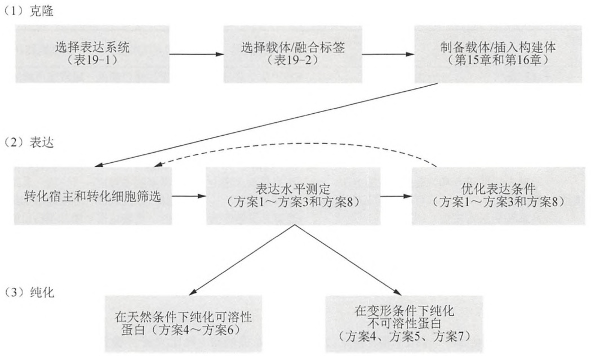

<details>
<summary>flowchart</summary>

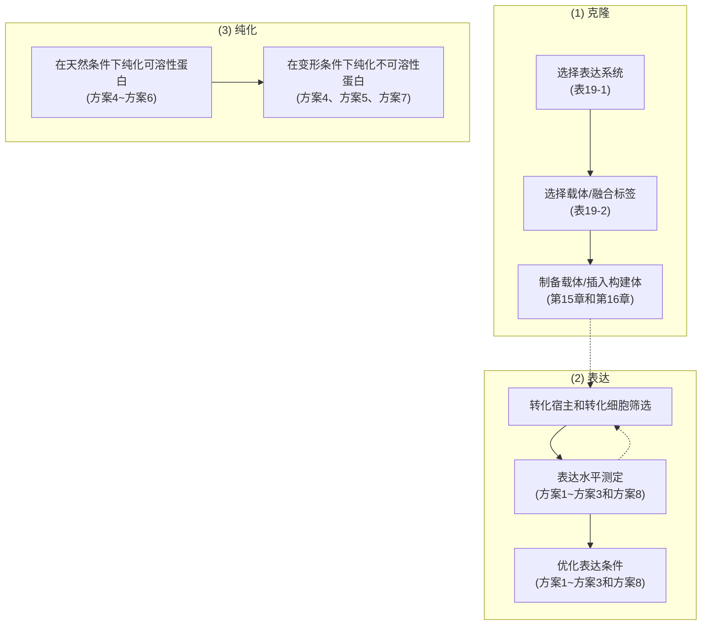
</details>

图 19-1 重组蛋白表达和纯化的总体策略。

## 大肠杆菌

大肠杆菌系统通常是小分子细胞质蛋白或结构域表达的首选宿主。用大肠杆菌生产蛋白质，由于只需要简单的培养基和条件，因此费用低且方便。此外，除了无细胞表达（生产蛋白只需要数小时）外，它是速度最快的系统，因为大肠杆菌的倍增时间（约20min）比酵母（约2h）、昆虫细胞和哺乳动物细胞（约20h）都要快。一般来说，在大肠杆菌中表达重组蛋白包括:①将一个编码目标蛋白的质粒导入宿主菌；②培养细胞至对数生长期；③诱导蛋白表达。这些年已开发了大量可以高水平生产蛋白质（大于细胞总蛋白的50%）的大肠杆菌菌株和表达方法（方案1）。但是，由于各种原因，并不是所有蛋白质都可以在大肠杆菌中以可溶、有活性形式表达。一些蛋白质过表达可能对大肠杆菌产生毒性（Saida 2007）。大蛋白常会聚集，蛋白质在大肠杆菌细胞裂解物的可溶性组分中的比例随蛋白质的增大（大于100残基）而减少（Graslund et al. 2008），而且，大肠杆菌不具有对一些真核蛋白折叠和活性重要的翻译后修饰。这些大蛋白和/或真核蛋白常常以被称为包含体的不溶性聚集体形式存在（Marston 1986）。虽然按方案7可以从包含体中纯化重组蛋白，但是其重折叠成可溶活性蛋白的可能性比较低（Cabrita and Bottomley 2004; Graslund et al. 2008）。而且，通常重折叠回收的蛋白质不总适用于一些需要大量纯的、活性的和正确折叠蛋白的技术，如晶体学或磁共振结构分析。有时，通过改变大肠杆菌宿主菌株、载体和生长条件可能提高蛋白质的回收。在其他时候，应按以下叙述改变表达系统，以增加生产可溶活性蛋白的机会。

## 杆状病毒感染昆虫细胞

杆状病毒表达系统的基本策略是用一种在感染极晚期表达外源蛋白的病毒感染昆虫细胞。对单结构域蛋白或原核蛋白通常选用大肠杆菌表达系统，而非杆状病毒系统，因为杆状病毒系统的昆虫细胞培养基较贵，重组杆状病毒生产需要的时间长，所需经验多。但是，杆状病毒表达系统在多结构域真核蛋白生产上具有一些优势，包括:

（1）每升昆虫细胞培养物的产率可以与大肠杆菌相当；
(2) 由于目标蛋白在病毒感染的极晚期才表达, 表达毒性基因时副反应低;

---

第 19 章 克隆基因的表达以及目的蛋白的纯化和分析

1229

(3) 相对较低的生长温度 (27\~28℃) 有利于突变蛋白或不稳定蛋白的折叠;
（4）由于病毒衣壳的开放末端结构，外源 DNA 序列可以很大（大于 20kb，相应于大于 7000 个氨基酸）；
(5) 可以简单地用一种以上重组病毒共感染或在病毒基因组插入多个表达盒生产多蛋白复合物；
（6）昆虫细胞能从 mRNA 转录前体切除内含子。一般还是建议使用 cDNA，因为可变剪切可使产物复杂化；

（7）昆虫细胞可完成真核蛋白的翻译后修饰，已报道的修饰包括磷酸化（Miyamoto et al. 1985）、乙酰化（Kluwe et al. 1995）、羧甲基化（Rosenberg et al. 1998）、异戊烯化（Khosravi-Far and Der 1995; Lindorfer et al. 1996）、信号肽切除（Smith et al. 1985）及酶切加工（Oker-Blom et al. 1989）。昆虫细胞也可对外源蛋白进行 N-和 O-连接糖基化（Stiles and Wood 1983; Kuroda et al. 1990）。但是，糖基的组成和长度往往与哺乳动物细胞不同。

选择杆状病毒系统而不是大肠杆菌系统的主要依据是该系统可进行真核蛋白的翻译后修饰（见以上第7点）。但是，过表达蛋白经常超过了昆虫细胞的修饰能力，因此只有一部分蛋白被修饰（Hoss et al. 1990; Kuroda et al. 1991; Khosravi-Far and Der 1995; Hsu and Betenbaugh 1997）。例如，用杆状病毒表达系统时，只有 $10\% \sim 50\%$ 的ras相关蛋白被异戊烯化（Lowe et al. 1991; Yang et al. 1992; Khosravi-Far and Der 1995）。对需要均一蛋白的应用，必须研发从未加工重组蛋白中分离和鉴定已加工蛋白的方法。也可除了目标蛋白外同时表达伴侣蛋白或酶以增加重组蛋白的加工（Hsu and Betenbaugh 1997; Ailor et al. 1999）。这种策略也被用于导入昆虫细胞缺乏的翻译后修饰。例如，转基因SfSWT-1（名为Mimic菌株，由Life Technologies销售）昆虫细胞株稳定表达哺乳动物糖基转移酶，该细胞株在有唾液酸来源（如胎牛血清）的条件下培养时，可以生产复杂型唾液酸化蛋白（Hollister et al. 2002）。尽管有这些解决方法，能生产具有良好翻译后修饰的重组哺乳动物蛋白依然是选择哺乳动物细胞而不选杆状病毒表达系统的重要原因。

## 毕赤酵母

作为生产真核蛋白的系统，毕赤酵母具有许多优势，如蛋白酶切加工、蛋白质折叠、二硫键形成和糖基化修饰，同时又如大肠杆菌和酿酒酵母一样易操作（Cereghino and Cregg 1999）。毕赤酵母比其他真核表达系统快、廉价，而且通常可获得高表达。与其他表达系统的基因存在于游离质粒上不同，它的表达质粒是通过同源重组整合在基因组上的，转化简单（不需要病毒原液），表达菌株可以长时间保存（大于10年）而不失活。毕赤酵母具有的培养基廉价、易于从小规模培养放大到发酵规模、在发酵罐中可以获得高生物量（高达400g/L）等优点使其成为了一种非常有用的蛋白表达系统。现在，数千种蛋白质已在毕赤酵母中表达（Cregg 2007），包括很多在大肠杆菌中表达时无活性的真核蛋白和完整的膜蛋白（Lueking et al. 2003; Parcej and Eckhardt-Strelau 2003; Long et al. 2005; Andre et al. 2006; Aller et al. 2009）。

毕赤酵母表达蛋白通常被高甘露糖型短 $N$-糖链核心糖基化，这可能会产生免疫原性不良反应而影响其应用[如医药用免疫球蛋白（IgG）的生产]（Daly and Hearn 2005）。为此，两个团队对毕赤酵母进行了基因工程改造，使其模拟人的糖基化模式，从而获得了部分或全部人源化末端唾液酸化的 $N$-糖链（Hamilton et al. 2006; Jacobs et al. 2009）。Contreras 团队（GlycoSwitch 技术）研发的菌株可以提供给研究者，并可以通过 Research Corporation

---

1230

分子克隆实验指南（原书第四版）

Technologies, Inc. 获得许可。与哺乳动物细胞相比，毕赤酵母的另外一弱点是缺乏某些可能对正确折叠和加工重要的复杂翻译后修饰，如脯氨酰羟化、酰胺化和一些类型的磷酸化（Cereghino and Cregg 1999）。而且，一些蛋白质在过表达时对毕赤酵母有毒性，因此滞留在内质网（ER）中，错误折叠或被液泡和蛋白酶体系统降解（Sullivan et al. 2003; Schuck et al. 2009）。有时通过优化生长条件或使用蛋白酶缺陷株可以拯救蛋白质，而其他情况，改用昆虫细胞或哺乳动物细胞表达系统更合适。

## 其他表达系统

除大肠杆菌、昆虫细胞和毕赤酵母外，哺乳动物细胞及其来源的无细胞表达系统也常用于蛋白质表达，如表19-1的概述，用哺乳动物细胞表达蛋白质具有使哺乳动物蛋白正确翻译后修饰的优势。但是，其缺陷包括:①生成所需量的目的蛋白的时间长；②费用相对较高。因此，作为替代，近来无细胞表达系统逐渐流行用于小量或中等规模蛋白（多至3mg）的生产。正如以下在“蛋白体外表达的无细胞系统”信息栏中叙述的，现在有很多无细胞表达试剂盒可以买到，且厂家提供详细的使用说明。本章重点介绍用大肠杆菌、昆虫细胞和毕赤酵母系统表达蛋白质的方法。

## 蛋白体外表达的无细胞系统

用无细胞系统在体外表达目标蛋白越来越流行，该方法为基于细胞的体内表达方法提供了一种快速的替代方法（综述见 Hoffmann et al. 2004; Murthy et al. 2004; Katzen et al. 2005; Endo and Sawasaki 2006; Falzon et al. 2006）。无细胞系统含有蛋白质合成所需的所有组分，如 RNA 聚合酶、核糖体、tRNA、转录因子和调控蛋白。体外系统通常来源于细胞裂解物，也可用纯化的组分重建，但后者的蛋白生产效率经常较低（Hillebrecht and Chong 2008）。

历史上，无细胞表达系统被开发用于蛋白质合成机制，尤其是用于蛋白质翻译过程的研究（Nirenberg and Matthaei 1961）。现在蛋白体外合成已演变成了一种从 mRNA 或 DNA 模板快速生产蛋白质的方法。DNA 模板是来源于质粒或聚合酶链反应（PCR）制备的模板，通常含:①一个用于 DNA 模板的、由同源噬菌体编码的、依赖于 DNA 的 RNA 聚合酶转录启动子；②一段用于增加翻译效率的 Shine-Dalgarno 序列。哺乳动物表达系统通常需要内部核糖体进入位点（IRES）、Kozak 序列（Kozak 1987）、目标序列后的 poly（A）添加信号、转录终止子和一种翻译加强序列（Hino et al. 2008）。根据体外翻译中的组分不同，目标蛋白的转录和翻译可以顺序进行（非偶联的），也可以同时进行（偶联的）。优选的是偶联反应，因为它可以在较短的时间内获得高产率，但它需要额外的三磷酸核苷酸（NTP）和噬菌体编码的依赖于 DNA 的 RNA 聚合酶。偶联反应起始于一种含转录/翻译元件的抽提物与核酸模板和氨基酸混合。短暂孵育后（通常 30min），加入必需的辅因子和能量源用于生产目标蛋白。在非偶联反应中，转录和翻译在两个分离的阶段完成，这样提供了用 mRNA 作为起始模板的机会。

## 优点

与更常用的大肠杆菌表达方法相比，体外无细胞表达具有一些好处。最大的优点之一是可以在相对天然的条件下快速生产蛋白质。使用的表达系统模型越接近蛋白质的天

---

第 19 章 克隆基因的表达以及目的蛋白的纯化和分析

1231

然表达条件，越能使蛋白质正确地进行翻译后修饰和折叠（Gibbs et al. 1985; Hillebrecht and Chong 2008）。使用无细胞系统还能方便地加入一些可能促进蛋白溶解和功能的组分。目标蛋白可以非常快的速度生产，通常在数小时（在大肠杆菌抽提物中短至3h），而用传统的基于细胞方式，用细菌培养需要过夜完成，用杆状病毒则需要数周才能完成蛋白质表达。而且，体外蛋白表达有助于避免蛋白聚集形成包含体，能用于合成不稳定的、易降解的或活细胞不能生产的毒性蛋白。体外蛋白合成可以在微升规模上合成，这可使目标蛋白突变体的表达和筛选更为方便（Yokoyama 2003; Spirin 2004）。反之，这些反应可以放大用于表达大量蛋白质。但是，与基于细胞的表达相比，无细胞系统大规模生产蛋白质需要更多的技术，且昂贵到难以承受，尤其是考虑到一些体内表达方法可以如何廉价地和方便地完成时，体外表达不会成为大规模生产蛋白质的实际选择。

## 体外表达系统类型

一些物种的细胞已被用于制备体外表达系统，如大肠杆菌（Zubay 1973）、兔网状细胞（Pelham and Jackson 1976）、麦胚（Roberts and Paterson 1973）、昆虫（Glocker et al. 1993）和人（McDowell et al. 1972; Stueber et al. 1984; Mikami et al. 2008）。每种物种的无细胞表达系统都有其自身的优势，可为表达蛋白加上不同的翻译后修饰（Endo and Sawasaki 2006; Falzon et al. 2006）。哺乳动物系统可产生较复杂的翻译后修饰，但通常较昂贵，对添加物较敏感，且一般产率较低。原核系统，如大肠杆菌，产率较高，对添加物耐受性较好，但不能产生一些哺乳动物蛋白翻译后的修饰，也不能提供促进哺乳动物蛋白正确折叠的环境。

这些需要我们在蛋白质质量和数量之间的权衡，如大肠杆菌和麦胚抽提物不能糖基化蛋白，但可高产；兔网状细胞系统（加入犬微粒膜）可以生产糖基化蛋白但总蛋白产率较低。因为上述表达系统间的所有翻译后修饰和蛋白折叠差别尚未完全清楚，尝试几个系统确定哪个可以产生所需的翻译后修饰和产率的功能基因产物，往往是有益的。现在一些公司供应数个物种来源的体外表达系统试剂盒，这些试剂盒包含了转录和翻译的必需组分:Thermo Scientific Pierce，一步人偶联 IVT 试剂盒（HeLa 细胞裂解物；http://www.thermo.com/pierce）；Life Technologies Invitrogen, Expressway Maxi 无细胞大肠杆菌表达系统或者 Ambion Retic Lysate IVT 试剂盒（分别包括大肠杆菌抽提物或兔网状细胞裂解物；http://www.invitrogen.com）；Promega, TNT Systems（麦胚抽提物，昆虫细胞裂解物或兔网状细胞裂解物；http://www.promega.com）；QIAGEN, EasyXpress 蛋白质合成系统（大肠杆菌抽提物或昆虫细胞裂解物；http://www.qiagen.com）。


## 选择合适的表达载体

合适的宿主选定后，相应的有许多带有工程化克隆位点和用于驱动蛋白表达的非编码序列的载体可供选用。启动子通常是可诱导的，以在细胞生长到合适的密度前阻止目标蛋白的表达。大部分载体还提供靶蛋白序列与一系列蛋白标签构建融合蛋白的选择。这些蛋白标签可增加蛋白质的溶解性和简化后续纯化（见下节“融合蛋白”中的叙述）。常用的表达载体种类按照用于表达的宿主系统类型在下文介绍，如表 19-2 所述。

---

1232

分子克隆实验指南（原书第四版）

表 19-2 用于蛋白质表达的常用载体

<table><tr><td colspan="6">大肠杆菌表达载体a</td></tr><tr><td>载体系列</td><td>启动子</td><td>融合配体b</td><td>蛋白酶位点c</td><td>原始厂家</td><td>注释</td></tr><tr><td colspan="6">E.coli RNA 聚合酶转录的载体</td></tr><tr><td>pGEX</td><td>Tac</td><td>GST; pGEX-2TK 还带有用于32P标记的蛋白激酶位点</td><td>Xa 因子,凝血酶或 HRV 3C</td><td>GE Healthcare</td><td>—</td></tr><tr><td>pMAL</td><td>Tac</td><td>MBP;有些载体带有MBP 信号肽</td><td>肠激酶,Xa 因子Genenase I</td><td>New EnglandBiolabs</td><td>—</td></tr><tr><td>pTrcHis</td><td>Trc</td><td>6xHis 及 c-myc 或 Xpress 标签</td><td>肠激酶</td><td>Life Technologies</td><td>—</td></tr><tr><td>pBAD</td><td>pBAD</td><td>6xHis;有些载体带有hpTrxA; V5、Xpress或 c-myc 标签;或gIII 信号肽</td><td>肠激酶</td><td>Life Technologies</td><td>araBAD 启动子是受 AraC 抑制蛋白调控,加入 L-阿拉伯糖诱导。载体带有 AraC 抑制蛋白基因</td></tr><tr><td>pQE</td><td>T5-lac</td><td>6xHis;有些载体带有DHFR、Tag-100 或Strep(II)融合标签</td><td>有些载体带有 TAGZyme 或Xa因子位点</td><td>QIAGEN</td><td>大多数 pQE 载体需要反式提供 LacI,经常是由共转化 pREP4质粒提供。pREP4 有一个 p15A复制子,不适合用于带 pLysS、pLysE 或 pRARE 的宿主菌</td></tr><tr><td colspan="6">T7 RNA 聚合酶转录的载体</td></tr><tr><td>pET</td><td>T7-lac</td><td>6xHis;有些载体带有 GST, Strep(II)标签, hpTrxA, S-标签,CBP, NusA, Sumo,DsbA, DsbC;pelB 信号肽; HSV 或 T7-标签</td><td>肠激酶,Xa 因子,凝血酶, HRV 3C 或 TEV</td><td>Merck Biosciences;Gateway 或TOPO cloning 系列衍生载体Life Technologies</td><td>T7 聚合酶需要反式提供,经常是由 λDE3 溶原性宿主菌株提供有少量 pET 载体带有 T7 启动子而不是 T7-Lac 启动子,没有一个拷贝的 LacI</td></tr><tr><td>pETduet</td><td>T7-lac</td><td>6xHis; S-标签</td><td>肠激酶,凝血酶</td><td></td><td>用于多蛋白表达的 pET 衍生载体,带有克隆位点的两个启动子,一个与 6xHis 融合;另一个与 S-标签融合可与 Merk 提供的其他二重载体,包括 pACYCduet、pCDFduet或 pRSFduet 共表达。由于每个可以表达两个蛋白质,用这个系统可以表达多至 8 个蛋白质</td></tr><tr><td>pRSET</td><td>T7</td><td>6xHis;有些载体带有荧光蛋白或 T7 标签</td><td>肠激酶</td><td>Life Technologies</td><td>可诱导的 T7 聚合酶必须反式提供,经常是由 λDE3 溶原性宿主菌株提供pRSET 的 T7 启动子不含抑制蛋白结合位点,因此建议使用 plysS 宿主菌株,以减少渗漏活性pRSET 的 pUC 复制子可产生高拷贝数质粒(但仍在 pBR322 相关复制子不相容组内)</td></tr><tr><td>pTriEx系列</td><td>T7-lac (p10, CMV/β -actin)</td><td>6xHis;有些载体带有HSV-标签、S-标签,或 Strep(II)-标签</td><td>凝血酶,肠激酶,或 HRV 3C</td><td>Merck Biosciences</td><td>含有除了大肠杆菌外还可以用杆状病毒或哺乳动物细胞表达的序列(p10,CMV/β -actin 启动子)</td></tr><tr><td>pQE系列</td><td>T7-lac (p10, CMV /β -actin)</td><td>无,10xHis 或 Strep(II)-标签</td><td>无或 TAGZyme</td><td>QIAGEN</td><td>含有除了大肠杆菌外,还可以用杆状病毒或哺乳动物细胞生产的序列(p10,CMV/β -actin 启动子)</td></tr></table>

---

第 19 章 克隆基因的表达以及目的蛋白的纯化和分析

1233

续表

<table><tr><td colspan="6">重组杆状病毒 DNA 和转化载体 $^{d,e}$ </td></tr><tr><td>病毒 DNA(A 组f)</td><td>厂家</td><td colspan="4">特征</td></tr><tr><td>BaculoGold</td><td>BD BiosciencesPharmingen</td><td colspan="4">限制酶切去除了转移区的关键基因,因此非重组体不能存活当存在 X-Gal 时,转移区的lacZ基因可使非重组病毒产生蓝色噬菌斑BaculoGold Bright 表达 GFP 标志,可监视病毒的繁殖</td></tr><tr><td>flashBac</td><td>Oxford ExpressionTechnologies</td><td colspan="4">限制酶切去除了转移区的关键基因,因此非重组体不能存活环状病毒 DNA 中 polyhedrin 区已被一段可在大肠杆菌中繁殖的序列替代,这保证了子代中没有非重组病毒</td></tr><tr><td>BacMagic</td><td>Merck Biosciences</td><td colspan="4">限制酶切去除了转移区的关键基因,因此非重组体不能存活环状病毒 DNA 中 polyhedrin 区已被一段可在大肠杆菌中繁殖的序列替代,这保证了子代中没有非重组病毒BacMagic-2 缺失半胱氨酸蛋白酶和壳多糖酶基因,BacMagic-3 还进一步缺失抑制重组蛋白产率的基因</td></tr><tr><td>BacVectorTriple Cut系列</td><td>Merck Biosciences</td><td colspan="4">限制酶切去除了转移区的关键基因,因此非重组体不能存活在存在 X-Gal 时,转移区的lacZ基因可使非重组病毒产生蓝色噬菌斑BacVector-2000 缺失抑制重组蛋白产率的5个非必需基因;BacVector-3000 还进一步缺失半胱氨酸蛋白酶和壳多糖酶基因</td></tr><tr><td>ProEasy</td><td>AB Vector</td><td colspan="4">转移区含一个在标准生产条件下使病毒不能存活的基因,重组过程去除了该基因,因此只有重组病毒可被回收</td></tr><tr><td>ProGreenProFold 系列</td><td>AB VectorAB Vector</td><td colspan="4">表达 GFP 标志监视病毒的繁殖限制酶切去除了转移区的关键基因,因此非重组体不能存活当存在 X-Gal 时,转移区的lacZ基因可使非重组病毒产生蓝色噬菌斑表达 GFP 标志监视病毒的繁殖ProFold-C1 和 C2 共表达 Hsp40 和 Hsc70 分子伴侣,以促进蛋白折叠;Profold-PDI共表达蛋白二硫键异构酶以促进分泌蛋白折叠;Profold-ER1 还共表达钙网织蛋白以促进分泌糖蛋白折叠</td></tr><tr><td>Bac-N-Blue</td><td>Life Technologies</td><td colspan="4">线性的、限制酶消化的DNA,由于去除了转移区的关键基因,未经重组不能存活当使用 pBlueBac(非连续的)或 pMelBac 载体时,由于转移质粒中存在lacZ基因,当有X-Gal 时,重组病毒产生蓝色噬菌斑,野生噬菌斑仍为无色。Bac-N-Blue 可与其他转移载体相容,但不能用于颜色筛选。与Mimic 宿主细胞不相容,因为lacZ重组改变N-糖链</td></tr><tr><td>BacPAK6</td><td>Clontech</td><td colspan="4">线性的,限制酶消化的DNA,由于去除了转移区的关键基因,未经重组不能存活在存在X-Gal 时,转移区的lacZ基因可使非重组病毒产生蓝色噬菌斑</td></tr><tr><td>转移载体(A 组f)</td><td>启动子</td><td>融合配体b</td><td>蛋白酶位点c</td><td>原始厂家</td><td>注释</td></tr><tr><td>pVL1392,pVL1393</td><td>Polh</td><td>—</td><td>—</td><td>BD BiosciencesPharmingen</td><td>经典转移载体</td></tr><tr><td>pAcHLT,pAcGHLT</td><td>Polh</td><td>6xHis,蛋白激酶 A 凝血酶位点,pAcGHLT还有GST</td><td>凝血酶或Xa因子</td><td>BD BiosciencesPharmingen</td><td>—</td></tr><tr><td>pAcG1/2T/3X</td><td>Polh</td><td>GST;pAcSecG2T还有信号肽</td><td>无,凝血酶,或Xa因子</td><td>BD BiosciencesPharmingen</td><td>—</td></tr><tr><td>pAcGp67</td><td>Polh</td><td>信号肽</td><td>—</td><td>BD BiosciencesPharmingen</td><td>—</td></tr><tr><td>pAcMP2,pAcMP3</td><td>basic protein</td><td>—</td><td>—</td><td>BD BiosciencesPharmingen</td><td>晚期中等水平表达可以进行更完全的加工不管是否存在其他启动子,都与polyhedrin 区重组</td></tr><tr><td>pAcAB3,pAcAB4</td><td>(polh,p10,polh)或(polh,p10,polh,p10)</td><td>—</td><td>—</td><td>BD BiosciencesPharmingen</td><td>有可分别表达3个或4个蛋白质的启动子/克隆位点。pAcDB3 是 pAcAB3 的缩小版</td></tr></table>

---

1234

分子克隆实验指南（原书第四版）

续表

<table><tr><td>转移载体(A组f)</td><td>启动子</td><td>融合配体b</td><td>蛋白酶位点c</td><td>原始厂家</td><td>注释</td></tr><tr><td>pBAC-1,pBAC-2,pBAC-3</td><td>Polh</td><td>6xHis;pBAC-2和pBAC-3载体还有S-标签;pBAC-3载体还有信号肽</td><td>凝血酶或肠激酶</td><td>Merck Biosciences</td><td>pBAC的gus版转移p6.9启动子-β-葡糖醛酸糖苷酶基因作为重组病毒生产的阳性对照</td></tr><tr><td>pBAC-5,pBAC-6</td><td>gp64</td><td>6xHis,S-标签;pBAC-6载体还有信号肽</td><td>凝血酶或肠激酶</td><td>Merck Biosciences</td><td>早期和晚期中等水平表达以进行更完全的加工</td></tr><tr><td>pBAC4x</td><td>p10,polh,p10,polh</td><td>6xHis</td><td>—</td><td>Merck Biosciences</td><td>有可表达4个蛋白质的启动子/克隆位点。</td></tr><tr><td>pIEX/Bac系列</td><td>hr5-ie1和p10串联启动子</td><td>6xHis;有些载体带有GST或Strep(II)-标签</td><td>凝血酶、肠激酶或HRV 3C</td><td>Merck Biosciences</td><td>重组基因在杆状病毒的整个生命周期中都表达hr5加强子和ie1启动子用昆虫细胞的RNA聚合酶进行中早期基因表达p10启动子驱动极晚期基因表达hr5-ie1启动子也可用于昆虫细胞瞬时转染时的蛋白质表达</td></tr><tr><td>pTriEx系列</td><td>p10(T7-lac,CMV/b-actin)</td><td>6xHis;有些载体带有HSV-标签,S-标签,或Strep(II)-标签</td><td>凝血酶、肠激酶或HRV 3C</td><td>Merck Biosciences</td><td>带有除了杆状病毒还可以在大肠杆菌或哺乳动物细胞生产蛋白的序列(T7-lac,CMV/β-actin启动子)</td></tr><tr><td>pVL1393</td><td>Polh</td><td>—</td><td>—</td><td>AB Vector</td><td>经典转移载体</td></tr><tr><td>pVL-GFP</td><td>Polh</td><td>GFP</td><td>—</td><td>AB Vector</td><td>用于可溶蛋白的显影</td></tr><tr><td>pAB系列</td><td>Polh</td><td>MBP;6xHis;6xHis-MBP;GST;flag-6xHis;信号肽</td><td>凝血酶(用于6xHis或MBP)、HRV3C(用于GST)</td><td>AB Vector</td><td>融合蛋白表达和切割的不同选择</td></tr><tr><td>pQE-TriSystem系列</td><td>p10(T7-lac,CMV/β-actin)</td><td>无;10XHis;或Strep(II)-标签</td><td>None TAGZyme</td><td>或QIAGEN</td><td>带有除了杆状病毒还可以在大肠杆菌或哺乳动物细胞生产蛋白的序列(T7-lac,CMV/β-actin启动子)</td></tr><tr><td>pMelBac</td><td>Polh</td><td>信号肽</td><td>—</td><td>Life Technologies</td><td>该载体只能与Bac-N-Blue重组</td></tr><tr><td>pBacPak8,pBacPak9</td><td>Polh</td><td>—</td><td>—</td><td>Clontech</td><td>经典转移载体</td></tr><tr><td>病毒DNA(B组g)</td><td>厂家</td><td></td><td></td><td>特征</td><td></td></tr><tr><td>BaculoDirect</td><td>Life Technologies</td><td colspan="4">不需要每次使用转移载体;目的基因在体外转移自Gateway entry载体在更昔洛韦存在时,非重组病毒由于存在胸苷激酶基因不能存活,该基因可被目的基因替代当存在X-Gal时,非重组病毒由于lacZ基因而产生蓝色噬菌斑,该基因可被目的基因替代BaculoDirect N端或C端DNA编码氨基端或羧基端V5-标签和6xHis标签。N-Term包含Tev蛋白酶位点。“分泌性”还编码一个信号肽BaculoDirect N-GST编码氨基端GST融合标签。需与目的基因一起加入一个蛋白酶识别位点polh启动子驱动基因表达</td></tr><tr><td>DH10Bac(Bac-to-Bac)</td><td>Life Technologies</td><td colspan="4">大肠杆菌宿主菌DH10Bac,含一个杆状病毒穿梭载体(杆粒,bacmid)和一个辅助质粒,从而允许转座后与一个pFastBac表达构建体发生重组杆粒含一个卡那霉素抗性基因和用于从pFastBac或pDest载体插入目的基因的mini-att Tn7转座位点辅助质粒含一个四环素抗性基因,并表达Tn7转座酶</td></tr></table>

---

第 19 章 克隆基因的表达以及目的蛋白的纯化和分析

1235

续表

<table><tr><td colspan="2">转移载体(B组 $^g$ ) $^h$ </td><td>启动子</td><td>融合配体 $^b$ </td><td>蛋白酶位点 $^c$ </td><td>原始厂家</td><td>注释</td></tr><tr><td>pFastBac 1</td><td>Polh</td><td></td><td>—</td><td>—</td><td>Life Technologies</td><td>—</td></tr><tr><td>pFastBac HT</td><td>Polh</td><td></td><td>6xHis</td><td>TEV</td><td>Life Technologies</td><td>—</td></tr><tr><td>pFastBac dual</td><td colspan="3">分别为Polh和p10—启动子</td><td>—</td><td>Life Technologies</td><td>用于在同一杆状病毒中共表达两个蛋白质有两个克隆位点,分别用于Polh和p10启动子</td></tr><tr><td>pFastBac/NT-TOPO或CT-TOPO</td><td>Polh</td><td></td><td>6xHis(氨基端或羧基端)</td><td>TEV</td><td>Life Technologies</td><td>TOPO克隆位点用于基因插入</td></tr><tr><td>pDEST8, 10,或20</td><td>Polh</td><td></td><td>6xHis(pDEST10); GST(pDEST20)</td><td>TEV (pDEST10)</td><td>Life Technologies</td><td>用Gateway entry载体,如pENTR的基因插入</td></tr></table>

毕赤酵母 $^{i}$

<table><tr><td>载体系统</td><td>启动子</td><td>融合配体</td><td>菌株(基因型):表型 $^j$ </td><td>注释</td></tr><tr><td>pPIC-Z,pPIC-Za系列 $^{k-m}$ </td><td>AOX1</td><td>c-myc 标签;6xHis;pPIC-Zα载体还有信号肽</td><td>X-33(wild-type):Mut $^{+}$ KM71H(aox1::ARG4; arg4):Mut $^S$ SMD1168H(pep4):Mut $^{+}$ ,pep4 $^{-}$ His $^{-}$ 变异菌GS115(his4):Mut $^{+}$ ,His $^{-}$ KM71(his4,aox1::ARG4; arg4):Mut $^S$ ,His $^{-}$ SMD1168(his4,pep4):Mut $^{+}$ ,His $^{-}$ ,pep4 $^{-}$ —</td><td>甲醇诱导启动子Zeocin 可用于大肠杆菌和毕赤酵母筛选,容易进行多拷贝插入筛选;载体相对较小His $^{-}$ 变异菌株允许用不同筛选标记的双质粒共转染(如用his4的pPIC3.5和用Zeocin的pPIC-Z)</td></tr><tr><td>pGAP-Z,pGAP-Za $^m$ 系列</td><td>GAP</td><td>c-myc 标签;6xHis;pGAP-Zα载体还有信号肽</td><td>—</td><td>组成型启动子Zeocin 筛选</td></tr><tr><td>pFLD-Z,pFLD-Za $^m$ 系列</td><td>FLD1</td><td>V5 标签;6xHis;pFLD-Zα载体还有信号肽</td><td></td><td>甲醇和甲胺诱导启动子Zeocin 筛选</td></tr><tr><td>pPIC9,pPIC3.5,pHIL-D2,pHIL-S1 $^k$ </td><td>AOX1</td><td>pHIL-S1 载体还有信号肽</td><td rowspan="2">GS115(his4):Mut $^{+}$ 或 Mut $^S$ KM71(his4,aox1::ARG4; arg4):Mut $^S$ SMD1168(his4,pep4):Mut $^{+}$ 或 Mut $^S$ ,pep4 $^{-}$ —</td><td>基于 His4 的原始载体</td></tr><tr><td>pPIC9K, $^j$ pPIC3.5K,pAO815</td><td>AOX1</td><td>—</td><td>His4 筛选,用卡那霉素筛选多拷贝表达</td></tr><tr><td>pPink-LC,pPink-HC,pPink- $\alpha$ —HC $^k$ </td><td>AOX1</td><td>信号肽;pPink- $\alpha$ -HC 载体还有信号肽</td><td>PichiaPink Strain 1(ade2):Mut $^{+}$ “白色”PichiaPink Strain 2(ade2,pep4):Mut $^{+}$ ,pep4 $^{-}$ PichiaPink Strain 3(ade2,prb1):Mut $^{+}$ ,prb1 $^{-}$ PichiaPink Strain 4(ade2,pep4,prb1):Mut $^{+}$ ,pep4 $^{-}$ ,prb1 $^{-}$ 2</td><td>PichiaPink 表达试剂盒采用 ade2 互补有低拷贝(LC)和高拷贝(HC)载体8 种信号肽用于优化分泌蛋白</td></tr></table>

a. 除非特殊说明，所有大肠杆菌载体都是可用 IPTG 诱导，具有 pBR322 相关复制子，并带有一个 lac 抑制蛋白基因（lac I 或 lac I $^{q}$ ）。
b. 6xHis、GST、MBP、Strep（II）-标签、hpTrxA、S-标签和CBP是于纯化的载体，叙述见表19-3。NusA和Sumo可提高融合蛋白的溶解性；DsbA或DsbC促进二硫键形成，二氢叶酸还原酶（DHFR）活性可区别可溶性融合蛋白和包含体。pelB和基因III信号肽引导融合蛋白定位到周质。HSV、T7-标签、Tag100、V5、Xpress和c-myc融合提供了可用商业化抗体良好鉴定的标签。
c. 常用蛋白酶特异性位点见表 19-4 的叙述。
d. 虽然同一组的病毒 DNA 和转移载体可能相容，但还是建议双检查对应的同源区。
e. 多数转移载体带有氨苄西林抗性基因和 pUC 复制子，以在大肠杆菌中高拷贝复制。
f. A 组:在昆虫细胞中共转染产生重组病毒。
g. B 组:在昆虫细胞中共转染前产生重组病毒。
h. 与 Bac-to-Bac 系统相容的转移载体在被转移的区域带有庆大霉素基因。大多数 Gateway entry 载体与 BaculoDirect 系统相容，该系统没有特定的转移载体。
i. 除非特殊说明，毕赤酵母载体含有一个用于在大肠杆菌中增殖 DNA 的氨苄西林抗性基因、一个甲醇诱导启动子和一个用于毕赤酵母中的筛选标记。
j. 甲醇利用的野生型表型称为 Mut $^{+}$ ，甲醇利用慢表型称为 Mut $^{s}$ ，详细见文中。

---

1236

分子克隆实验指南（原书第四版）

k. pPICZ 载体带有 S. hindustanus ble (Sh ble) 基因用于在大肠杆菌和酵母中用 Zeocin 抗生素筛选。
1. 有可用于不同筛选的各种载体，如用blasticidine或卡那霉素（geneticine G114）。具有更多选择标记（ADE1、ARG4、URA3）的载体可从Keck Graduate Institute（http://faculty.kgi.edu/cregg/index.htm）索取。
m. pPICZα、pGAPZα、pFLDZα、pHIL-S1 和 pPINKα 载体含一个氨基端的 pre-pro-α 分泌信号肽（来源于酿酒酵母的 α 交配因子前-原肽），用于引导重组蛋白分泌到培养基中。

## 含诱导型启动子的大肠杆菌表达载体（方案1）

典型的大肠杆菌表达载体包含一个复制起始点、启动子和其后的多克隆位点、转录终止信号、抗生素抗性基因、可选的融合标签，某些时候还含有阻遏蛋白的编码序列。大多数大肠杆菌表达载体复制起始点都是基于 pBR322 的复制子（大肠杆菌素 E1 或者与其密切相关的 pMB1），因此它们都属于同一不相容群。为了克服这个问题，已经研发出了用于表达多组分复合物的特定载体。

在细胞生长达到一定密度之前，大多数大肠杆菌表达载体都会利用乳糖操纵子来阻止可能的毒性蛋白诱导表达（图 19-2）。一般来讲，在加入乳糖或者异丙基- $\beta$ ,D-半乳糖硫吡喃糖苷类似物（IPTG）之前，定位于靶基因启动子下游的乳糖操纵基因（lac O）可与乳糖阻遏物结合从而阻断转录起始。乳糖阻遏基因 lacI（Farabaugh 1978）或高表达的 lac Iq 等位基因（Stark 1987; Amann et al. 1988）是以组成型方式表达，反式方式调节。从宿主启动子或噬菌体序列中，也已研发获得了能够控制目标蛋白表达的强启动子，这些启动子的选择将在下面详细讨论。

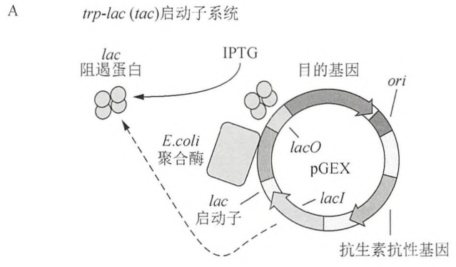

<details>
<summary>flowchart</summary>

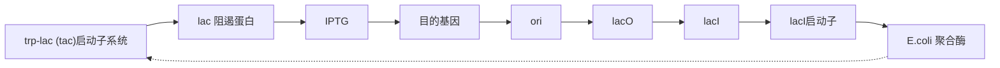
</details>

B T7-lac 启动子系统

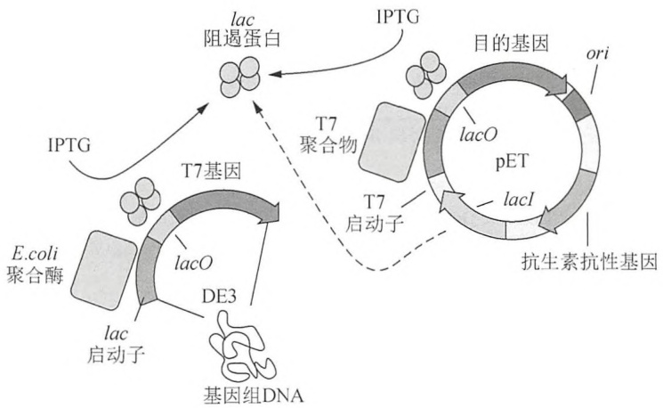

<details>
<summary>flowchart</summary>

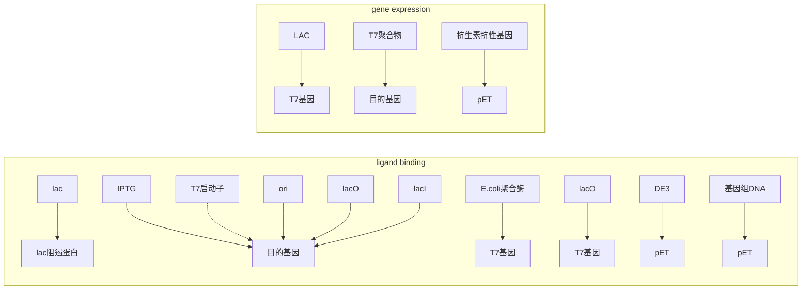
</details>

图 19-2 典型的大肠杆菌蛋白表达载体。A. pGEX 系列载体中的 tac 启动子利用宿主 RNA 聚合酶；B. pET 载体中的 T7-lac 启动子由 T7 RNA 聚合酶转录（T7 RNA 聚合酶通常会引入宿主基因组），而且由乳糖操纵子调控。

---

第 19 章 克隆基因的表达以及目的蛋白的纯化和分析

1237

## 大肠杆菌中表达外源基因的宿主启动子

\- 乳糖启动子。一些用于蓝白斑筛选的通用载体（pUC、pTZ、pSK、pBluescript、pGEM等）也可以用于表达外源蛋白，通常可通过与lacZ基因氨基端和/或多接头序列编码序列融合，以形成融合蛋白表达。虽然乳糖启动子不像tac或者trc启动子那么强，但是大多数通用载体的高拷贝数量却保证了外源蛋白高水平地表达。乳糖启动子的表达最大化需要环腺苷酸cAMP激活蛋白CAP（crp基因产物）的作用，而只有细胞在缺少葡萄糖的培养基中生长时，该蛋白质活性最高（综述见Reznikoff1992）。因此，用于表达克隆在乳糖启动子控制下的目的基因时应选用含极少葡萄糖碳源的培养基（如Luria broth）。

\- trp-lac(tac)启动子。tac 启动子是 trp-lac 的杂合启动子，由 trp 启动子-35 区和 lacUV5 启动子-10 区融合形成。它可被乳糖操纵子阻遏蛋白调控，不依赖于 crp 基因产物介导的 cAMP 的调控（Amann et al. 1983; de Boer et al. 1983）。常用的 tac 启动子系列 GST 融合质粒 pGEX（Smith and Johnson 1988）可从 GE 公司购买（图 19-2A）。

\- trp-lac（trc）启动子。trc 是另一种乳糖操纵子阻遏蛋白调控的 trp-lac 的杂合启动子形式，由 trp 启动子-35 区和 lacUV5 启动子-10 区融合形成（Amann and Brosius 1985）。trc 和 tac 启动子唯一的区别在于-35 区和-10 区相隔的距离。在 trc 启动子中，这两个元件共有的序列被 17bp 隔开，而在 tac 启动子中，它们被 16bp 隔开。这点对于外源蛋白表达的水平有较小或者没有任何影响（Amann and Brosius 1985）。带有 trc 启动子的表达质粒 pTrcHIS 可从 Life Technologies 公司购买获得。

\- L-阿拉伯糖操纵子（araBAD）启动子。在大肠杆菌中表达蛋白时，由 L-阿拉伯糖诱导的 bad 启动子是不同于乳糖阻遏蛋白调控载体的另外一种选择。pBAD 系列载体包含一个来自于 ara 操纵子的 $araC-P_{BAD}$ 片段（Guzman et al. 1995），这段序列编码调控的 AraC 蛋白和一个天然控制阿拉伯糖分解代谢的 araBAD 基因的启动子（综述见 Schleif 2000）。araBAD 启动子具有在 AraC 蛋白结合 L-阿拉伯糖时刺激转录，以及在缺少辅因子时又能被 AraC 蛋白所阻遏的特性（Englesberg et al. 1969）。因此含有葡萄糖作为碳源的培养基，不应当用于表达 araBAD 启动子控制下的目的基因。

## 大肠杆菌中表达外源基因的噬菌体启动子

\- T7-lac 启动子。pET 系列载体最初由 Tabor 和 Richardson(1985)及 Studier 和 Moffatt (1986) 构建, 后来得到扩展, 可通过噬菌体 T7 RNA 聚合酶调控外源基因的表达 (图 19-2B)。借助特定 pET 载体的多克隆位点, 将编码序列插入到 T7 RNA 聚合酶 ( $\Phi$ 10 启动子) 的 “天然” 启动子下 (Studier and Moffatt 1986), 或者插入到更为普遍的 T7-lac 启动子下, 该启动子是加入了 lac 操纵基因 (lacO) 衍生而来, 可实现严格调控 (Dubendorff and Studier 1991)。为了目标蛋白的表达, 宿主菌必须含有一个可诱导的 T7 RNA 聚合酶基因拷贝。通常, 可以利用 DE3 溶原性菌株, 其 T7 RNA 聚合酶基因在 lacUV5 启动子的控制下。因为该启动子同 lac 乳糖操纵子阻遏蛋白一样受到 CAP 的调控, 为了提高目的基因的表达, 应使用含极少葡萄糖碳源的培养基 (如 Luria broth)。但是在细胞生长期间, 加入葡萄糖可能会使 T7 RNA 聚合酶的渗漏表达降低。目的蛋白与低水平表达的 T7 RNA 聚合酶的天然抑制物——T7 溶菌酶的共表达, 可作为一种减少 T7 启动子本底活性的补充手段, 可以实现目的蛋白稳定表达 (Studier 1991)。

\- T5-lac 启动子。噬菌体启动子的一种可选形式，它能够高效地与宿主 RNA 竞争招募大肠杆菌 RNA 聚合酶，转录产量可高至宿主总 mRNA 产量的 90%。最常见的例

---

1238

分子克隆实验指南（原书第四版）

子就是为了实现转录控制而与大肠杆菌 lac 操纵基因融合的 T5 启动子（PN25）（Gentz and Bujard 1985; Bujard et al. 1987）。编码乳糖操纵子阻遏蛋白基因可在载体上，也可分开存在，如在另一载体上。例如，借助不同的质粒，如 pREP4 和 QIAGEN 公司的 pQE 系列载体。

## 在昆虫细胞中表达蛋白的杆状病毒系统（方案2）

最早的连续培养的昆虫细胞系是20世纪60年代建立的，目的是用于生产可能会作为杀虫药的杆状病毒，以及用于研究昆虫细胞的新陈代谢（Gao 1958; Gao et al. 1959; Grace 1962）。随后在80年代，Max D. Summers 和 Lois K. Miller 的实验室经过各自的独立研究开发，获得了第一个运用于昆虫细胞表达外源蛋白的杆状病毒载体系统（Fraser et al. 1983; Pennock et al. 1984）。在接下来的20年，因其在方法学和商业用途方面的极大优势，杆状病毒表达系统得到了迅速的普及。因为历史原因，在成百上千的已知杆状病毒和鳞翅目细胞系中，只有有限的一些种类用于杆状病毒表达系统（综述见 Lynn 2007）。大多数重组杆状病毒都来源于核多角体病毒，在 Autographa californica（alfalfa looper）宿主最初被鉴定后，将其命名为 AcMNPV。常用于蛋白表达的昆虫细胞系包括来自于 S. frugiperda 的 Sf-21 或者 Sf-9（fall armyworm），来自于 Trichoplusia ni（cabbage looper）的 Tn-368 或 Tn-5（High-Five）以及转基因的变异体。在这些不同细胞系中，不同重组蛋白的表达水平可能有所差别（Wickham et al. 1992; Davis et al. 1993）。下面，我们将比较这些病毒 DNA 接受者之间的主要区别，描述转移载体的一般特征，深入阐明 O'Reilly 等（1994）和 Murhammer（2007）的杆状病毒表达系统。

杆状病毒表达系统共有的3个主要步骤是（图19-3A）:①双链DNA病毒和含目的基因的转移载体之间的重组；②转染昆虫细胞，生产大量的重组杆状病毒；③感染昆虫细胞表达预期蛋白。杆状病毒基因组的大小（$134\mathrm{kb}$）使得将目的基因插入至病毒DNA的传统连接技术受到了限制。替代方法是，将目的基因亚克隆至可在大肠杆菌中扩增的穿梭载体中。穿梭载体还在与病毒DNA位点同源的两段序列之间含有一个病毒启动子、克隆位点、转录终止子和选择性标记（图19-3B）。质粒上的这个区域将通过同源重组的方式转移至杆状病毒基因组上。在大多数目前使用的系统中，利用穿梭载体的重组已替代了利用病毒DNA多角体蛋白基因座的重组（Smith et al. 1983b）。尽管多角体蛋白是一个外壳蛋白，对于在昆虫细胞培养中的杆状病毒复制也不是必需的，但是它的缺失能引起噬菌斑现象，这对于一个有经验的观察者区别野生型杆状病毒和重组体是非常便利的。商业化的病毒DNA上的多角体蛋白通常被lacZ基因取代，方便重组病毒的蓝白斑筛选。获得重组病毒的传统方法是将病毒DNA和转移载体共转至昆虫细胞实现同源重组。然而，野生型病毒DNA和转移载体的共转染只会产生约 $0.1\%$ 的重组杆状病毒（Smith et al. 1983a）。目的子代必须通过费时的技术如菌斑试验来鉴定。为了解决这个问题，已经有了几种改进的方法来获得和挑选重组病毒，归纳总结列于表19-2中。

## 重组杆状病毒共转染昆虫细胞

\- 线性化病毒 DNA。通过引入唯一的 $Bsu36I$ 限制性酶切位点，并依此线性化病毒 DNA，共转染时重组病毒部分可增加至约 $30\%$（Kitts et al. 1990）。位于病毒基因组重要基因（ORF1629，一个结构蛋白）中的第二个 $Bsu36I$ 限制性酶切位点的引入，可进一步使重组杆状病毒收率提高到接近 $99\%$（Kitts and Possee 1993）。两个 $Bsu36I$ 位点的酶切去除了病毒 DNA 上 ORF1629 的一部分，使得重新环化的杆状病毒不再具有活性。相应地，运用这个系统的穿梭载体除了含目的基因之外，还必须提供 ORF1629 缺失的互补部分。位于病毒 DNA 的 $Bsu36I$ 位点之间的 lacZ 基因在 X-Gal

---

第 19 章 克隆基因的表达以及目的蛋白的纯化和分析

1239

存在下会将非重组病毒标记为蓝色。用于这种传统方法的线性化病毒 DNA 可以从众多厂商获得，包括 BD Biosciences、Merck、Life Technologies 和 Clontech 公司。

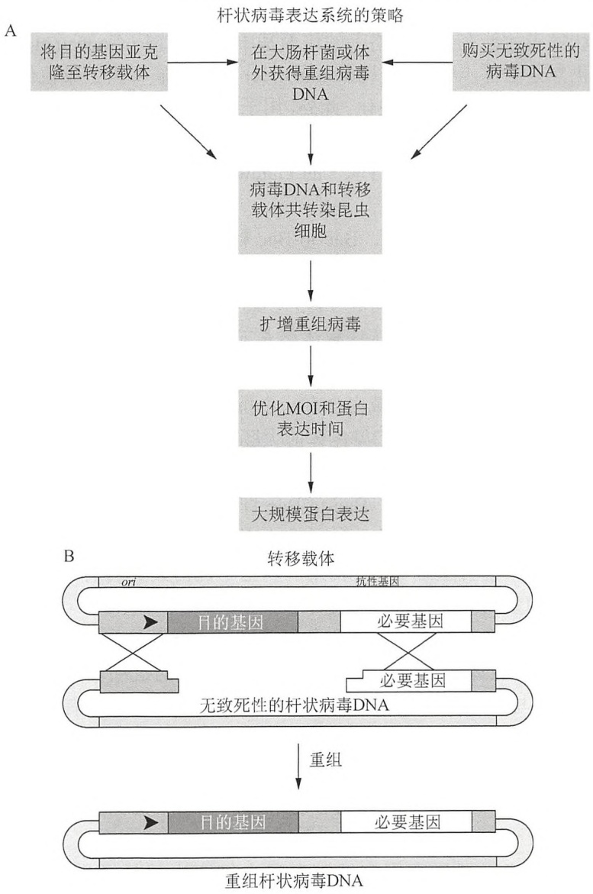

图19-3 杆状病毒表达系统。（A）昆虫细胞内杆状病毒介导的蛋白表达步骤流程图，MOI表示多重感染；（B）含有目的基因与病毒DNA的转移载体重组示意图。

\- 细菌人工染色体的病毒 DNA。尽管利用 $Bsu36I$ 酶切可显著增加重组的杆状病毒成分，但是来自于未消化的病毒 DNA 污染却是不可避免的。这个问题目前已被解决，即将缺失 ORF1629 的病毒基因组转变成一个低拷贝、细菌的、可在大肠杆菌中扩增的人工染色体（bacmid）（Zhao et al. 2003）。转移载体和缺失 ORF1629 的细菌人工染色体的病毒 DNA 共转染，可确保回收的杆状病毒 100% 地与转移载体发生重组。flashBAC（Oxford Expression Technologies 公司）和 BacMagic（Merck 公司）的病毒 DNA 为重组杆状病毒生产提供这种选择。

## 昆虫细胞转染之前的重组杆状病毒

\- 线性化病毒 DNA 的体外重组。Life Technologies 公司的 BaculoDirect 系统中也使用了通过几轮限制性酶切后的线性化病毒 DNA。然而位于多角体蛋白基因座侧翼的

---

1240

分子克隆实验指南（原书第四版）

attR1 和 attR2 位点也已经被设计位于该基因座周围，目的在于使其和 Gateway entry 载体在体外发生重组（Life Technologies 公司）。重组产物然后转染至用于生产杆状病毒的昆虫细胞中。病毒 DNA 在转染区域内含有一个胸苷激酶基因，这样只有重组的杆状病毒才能在含更昔洛韦的培养基中得到扩增（Godeau et al. 1992）。因为感染步骤仍然是必需步骤，所以 BaculoDirect 方法与病毒人工染色体共转染所需的时间一样长，都不需要噬菌斑纯化。此外，用于 Gateway 反应的 LR Clonase II mix（Life Technologies 公司）必须购买获得。尽管如此，BaculoDirect 系统优于其他获得重组杆状病毒的方法在于，它利用单一的 Gateway entry 就可构建获得杆状病毒和大肠杆菌的表达系统。

\- 细菌宿主内的重组病毒 DNA。Bac-to-Bac 杆状病毒表达系统（Life Technologies 公司）是利用大多数分子生物学家熟悉的技术，即一种在大肠杆菌中生产重组病毒 DNA 的普遍方法（Luckow et al. 1993）。转移载体和病毒人工染色体的重组发生在细菌宿主内（DH10BacTM）。转移载体和人工染色体分别含有小型 Tn7 和小型 attTn7 位点，由 DH10BacTM 菌株的辅助质粒提供的 Tn7 转座酶来转移目的基因（Barry 1988）。转移载体在转移的区域内含有一个抗性基因，且重组会破坏人工染色体 DNA 的 lacZα 基因。包含重组人工染色体的大肠杆菌克隆获得了一个抗性筛选标记，不再会在 X-Gal 存在时显色。从这些扩增克隆中回收高分子质量的 DNA，并通过转染昆虫细胞来生产杆状病毒。Bac-to-Bac 杆状病毒表达系统优于其他系统的特点在于，可选择一个单一的重组克隆，并在生产杆状病毒之前进行测序分析。所有其他的系统都是运用混合重组 DNA 转染，以至于任何突变的病毒都有可能被扩增，而且与表达目的蛋白的病毒形成了竞争。

表19-2中列出了其中一些转移载体和其显著特征，全面的信息可从厂商网站获得。转移载体和其他大肠杆菌载体共有的特点包括:一个选择性的抗性基因，一个高拷贝的pUC复制子，克隆位点。与大肠杆菌蛋白表达载体一样，转移载体也带有可以用于蛋白纯化、检测的编码序列，或者带有和重组基因同框阅读后形成分泌的编码序列。很多杆状病毒转移载体都带有6xHis标签，可作为监测蛋白表达的选择方法之一。例如，与绿色荧光蛋白（GFP）变异体融合或者共表达，可以很容易地监测到感染的昆虫细胞的荧光，依此来了解蛋白的表达过程。

多角体蛋白基因启动子通常用来控制在昆虫细胞内的外源蛋白表达（Smith et al. 1983b）。也可以选择使用带有 p10 基因的载体（Zuidema et al. 1990）。在这两种情况中，当多角体病毒衣壳被正常装配完成，编码病毒的 RNA 聚合酶就会在杆状病毒转染后期阶段（转染后 1～3 天）控制转录过程（Smith et al. 1983c）。表达水平很高，可达到昆虫细胞总蛋白的 50%。在转染后期蛋白质高水平表达的一个不利因素就是翻译后修饰水平会因此降低。选择带有不同启动子的转移载体（如碱性蛋白质或 gp64），对于感染后期（感染后 8～24h）蛋白质的适度表达和翻译后修饰可能更为有利（Hill-Perkins and Possee 1990; Friesen 1997）。尽管几乎所有的商业化转移载体重组位点都位于多角体蛋白基因座侧翼，但是基于重组位点的多样性，在混合使用不同来源的转移载体病毒 DNA 时，还是建议与生产厂商校验一下。

## 毕赤酵母表达蛋白载体（方案3）

大多数控制蛋白表达的毕赤酵母载体都是基于强的、甲醇诱导的 AOX1 启动子和 AOX1 转录终止序列；最初的载体还包含 3'AOX1 序列（表 19-2）。因为 AOX1 启动子受到葡萄糖和甘油的严格抑制，所以含有这些成分的碳源培养基能确保酵母菌在转移到可快速、高水

---

第 19 章 克隆基因的表达以及目的蛋白的纯化和分析

1241

平诱导表达的甲醇培养基之前，获得高密度的生长（Daly and Hearn 2005）。所有的酵母表达载体都是穿梭载体，含可稳定存在于大肠杆菌的复制起始点和抗性基因，另含有基于生物合成途径中的酵母营养缺陷型筛选标记（常用 His4）。

## 毕赤酵母载体实例

\- pPIC-Zeocin 载体。新一代 pPIC-Zeocin 载体（pPICZ 和 pPICZα变异体）（表 19-2）含有多克隆位点（MSC）、一个便捷的羧基端 Myc 表位肽，以及一个便于检测和纯化表达蛋白的 6xHis 标签。这些载体还带有一个 ble 基因，可用抗生素 Zeocin 在大肠杆菌和酵母中进行筛选。使用 ble 基因可极大地减少载体的大小（约 3.6kb）（方案 3，图 19-5），这有利于异源基因的克隆和随后的突变。pPICZα载体还包含 pre-pro-α 分泌信号肽（酿酒酵母α-交配因子 pre-pro 肽），可使重组蛋白定向分泌到培养基。可用于该载体的启动子包括:①pFLDZ，可被甲醇和甲胺诱导；②组成型启动子，大规模培养表达时的优选启动子。

\- 多拷贝整合载体。Zeocin 载体的其中一个优点是，利用高浓度的抗生素从酵母转化子中直接筛选多拷贝整合子（方案 3）（Wang et al. 2006; Sunga et al. 2008）。与多拷贝表达载体 pAO815 一样，pPICZ 系列载体的另一个特点在于，体外构建的一个或多个基因的串联重复中，每一个重复都有其自身的 AOX1 启动子和 AOX1 转录终止子。这一特点对于配体蛋白的定量共表达非常有用（Cregg et al. 2000）。但是对于如 pAO815 这样的大质粒就很难操作。此外，不应当使用 AOX1 启动子内的线性化酶切位点，因为这样做会显著地降低转化效率。

\- PichiaPink 载体。由 Life Technologies 公司提供的 PichiaPink 载体试剂盒利用了 ADE2 的营养互补筛选，而非抗性筛选。ADE2 基因对于嘌呤核苷酸的从头合成是必需的，ADE2 敲除的亲本菌株（PichiaPink 菌株 1～4）会因为嘌呤前体的积累而形成红色克隆。因为转化克隆的颜色（多或少的白色）与目的蛋白的表达水平间接相关，所以便于筛选克隆。Life Technologies 公司提供的试剂盒的另外一个优点在于，载体配有不同长度的 ADE2 启动子，这会影响到质粒插入的拷贝数，而且对蛋白质表达优化非常有用。提供的多种分泌信号肽序列，再加上 pre-pro-α-交配因子，使得蛋白质分泌到培养基的过程达到最优。

通过不同载体获得的菌株和表型。表 19-2 中列出了不同基因型的酵母菌株。X-33、GS115、SMD1168 和 PichiaPink 菌株都含一个具有功能的 AOX1 拷贝，该基因编码的醇氧化酶主要负责利用甲醇。这些菌株有一个野生的甲醇利用型表型，即 Mut $^{+}$ （Daly and Hearn 2005）。因为这些菌株在载体整合至基因组后能够保持表型，所以能够迅速消耗甲醇，这在大规模发酵期间易引起潜在的火情危险。“甲醇利用缓慢型”或“Mut $^{s}$”菌株，如 KM71，含有一个无功能的 AOX1 基因，而且依赖于较慢的 AOX2 酶的甲醇氧化作用，因此菌株在甲醇诱导时生长缓慢。Mut $^{s}$ 有时相比于 Mut $^{+}$ 而言，是一个更好的外源蛋白生产系统。如果有必要，在不抑制 AOX1 的前提下，可以通过甲醇和其他碳源如山梨醇或甘露醇的混合补料诱导来提高酵母生长（Inan and Meagher 2001）。利用原始表达载体（pPIC9、pPIC3.5、pHIL-D2、pHIL-S1）转化 GS115 和 SMD1168 菌株，5'AOX1 启动子和 3'AOX1 序列之间发生双交换，替代基因组中 AOX1 基因，就会形成 Mut $^{s}$ 表型菌株（Daly and Hearn 2005）。

GS115、KM71 和 SMD1168 菌株的组氨醇脱氢酶基因（His4）是缺陷的，在表达载体中将此作为一种营养缺陷型选择标记。蛋白酶缺陷菌株 SMD1168 是空泡酶 A（pep4）缺陷的，这是一种毕赤酵母主要的天冬氨酸蛋白酶，能够激活下游的蛋白酶如丝氨酸羧基肽酶 Y 和丝氨酸蛋白酶 B1（prb1）。SMD1165 和 SMD1163 变异体，也就是 PichiaPink 菌 2、3 和 4，是 pep4 和/或 prb1 缺陷的，这些缺陷型菌株比野生型菌株生长慢，但是如果外源蛋

---

1242

分子克隆实验指南（原书第四版）

白经过囊泡途径（不是泛素蛋白酶体途径）而产生降解的问题，那么利用这些缺陷菌株就有了一定的优势。

## 毕赤酵母表达试剂盒

包含了载体和菌株的毕赤酵母表达试剂盒可以从 Life Technologies 公司购买获得（http://www.invitrogen.com）。商业化表达系统存在一定的局限性，包括缺乏中等强度的启动子、有限的酵母转化筛选标记（Lin-Cereghino et al. 2008）。有趣的是，在 AOX1 启动子的分析过程中，获得了基于 AOX1 敲除/突变的启动子文库，可用于微调控毕赤酵母表达（Hartner et al. 2008）。带有其他筛选标记（ADE1、ARG4、URA3）的载体和菌株可从 Keck 学院研究所的 James Cregg 处索取（http://www.kgi.edu/x6713.xml）。有关载体的详细讨论参见 Lin-Cereghino 和 Lin-Cereghino（2007）。

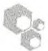

## 融合蛋白

重组蛋白和多肽经常以目的蛋白和载体序列相连的融合蛋白形式表达。按照预期设计的顺序组合两个或者更多的可读框（ORF），编码以获得融合蛋白。融合阅读框表达后获得杂合的融合蛋白，其中的目的蛋白通过标准的肽键连接于载体蛋白的氨基端或者羧基端（Itakura et al. 1977; 综述见 Arnau et al. 2006; Esposito and Chatterjee 2006）。在融合蛋白连接区加入蛋白切割位点，方便目标蛋白的回收。

融合蛋白有一系列的潜在用途:

1. 将目标蛋白与配体结合域融合，可以很方便地标记和纯化目标蛋白。
2. 添加 “载体” 序列可以保护目标蛋白不被水解。
3. 添加载体序列可以提高目标蛋白的溶解性，而且可以阻止包含体的形成（见“外源蛋白表达优化中的处理不溶性蛋白”的内容）。
4. 添加具有明显特征的表位，就可利用免疫方法来检测融合蛋白。
5. 在目标蛋白中连接易位信号肽，就可将融合蛋白定向表达至特定的细胞空间内。

为亲和纯化设计或者改造的融合系统已经超过了20种。表19-3中列出了几种常用的纯化标签。连接目标蛋白的往往是和某一特定配体具有高度亲和力的载体蛋白，这就使得绝大多数融合蛋白利用一步亲和层析就可以完成纯化。例如，GST蛋白和麦芽糖结合蛋白（MBP）是众所周知的标签蛋白，可通过利用结合它们各自配体——谷胱甘肽或直链淀粉（方案6）的色谱树脂分离融合蛋白。此外，GST和MBP如同其他载体蛋白一样，通常可以提高融合蛋白在大肠杆菌表达系统内的溶解性，而且可相应地减少包含体的形成（Esposito and Chatterjee 2006）。融合蛋白中也可以包含一些短肽，或便于纯化，或便于利用抗体检测。人工6xHis序列是一种普遍使用的载体短肽，借助其与层析柱螯合的 $\mathrm{Ni}^{2+}$ 或$\mathrm{Co}^{2+}$ 的亲和性来纯化融合蛋白（Smith et al. 1988），详见本章方案5。表位短肽也常常用于基于抗体检测的方法之中。Flag标签是一种熟知的八肽序列，Flag亲水性的特点增加了融合蛋白的溶解性，同时也可利用商业化的单克隆抗体进行检测（Hopp et al. 1988；综述见Einhauer and Jungbauer 2001）。推向市场的几种不同类型的抗Flag抗体（M1、M2和M5），或可用于检测（如在方案8中介绍的免疫印迹），或以固定形式用于免疫沉淀。Flag羧基端的5个氨基酸组成了肠激酶的识别位点，可方便地从目标蛋白中切除载体蛋白，下面会详细讨论这方面内容（Dykes et al. 1988; Hopp et al. 1988）。然而，单克隆抗体高昂的成本却使表位标签用于大规模蛋白纯化显得不切实际。

---

第 19 章 克隆基因的表达以及目的蛋白的纯化和分析

1243

表 19-3 用于重组蛋白纯化的常用融合蛋白

| 融合蛋白 | 亲和配体 | 洗脱方法 | 残基数量 | 参考文献 | 备注 |
| --- | --- | --- | --- | --- | --- |
| 多组氨酸(6xHis) | 固定的过渡金属离子(如$Ni^{2+}$或$Co^{2+}$) | 高浓度咪唑(>100mmol/L 用于$Ni^{2+}$NTA) | 6~10 | Smith et al. 1988 | 不同类型的树脂和/或金属离子可提高蛋白分离的选择性(Gaberc-Porekar and Menart 2001)低pH和EDTA可作为洗脱试剂纯化过程中可使用变性条件 |
| 谷胱甘肽-S-转移酶(GST) | 谷胱甘肽 | 还原型谷胱甘肽(10mmol/L) | 220 | Smith and Johnson 1988 | GST和未解离的GST融合蛋白通常会形成二聚体(Armstrong 1997) |
| 麦芽糖结合蛋白(MBP) | 交联的直链淀粉 | 麦芽糖(10mmol/L) | 390 | di Guan et al. 1988;Maina et al. 1988 |  |
| Strep(II)标签 | StrepTactin 树脂 | D-脱硫生物素 | 8 | Schmidt and Skerra 1993; Schmidt et al. 1996; Voss and Skerra 1997 | StrepTactin是抗生蛋白链菌素的衍生物,可增加Strep(II)标签的亲和力(Voss and Skerra 1997)D-脱硫生物素是减弱了亲和力的生物素衍生物,这样有利于色谱柱再生(Hirsch et al. 2002) |
| 组氨酸突变硫氧还蛋白(hpTrxA) | 过渡金属离子 | 低浓度咪唑(&lt;100mmol/L 用于$Ni^{2+}$-NTA) | 109 | LaVallie et al. 1993;Lu et al. 1996 | 与TrxA融合后的蛋白在某些情况下可以利用其耐热性来纯化或者利用渗透压休克来纯化(尽管其定位在细胞质中) |
| S-标签 | S蛋白树脂(Merck) | 变性条件或蛋白酶水解 | 15 | Kim and Raines 1993 | S-标签/S-蛋白来源于牛胰脏核糖核酸酶A的枯草杆菌蛋白酶片段(Richards and Vithayathil 1959)。因此重构的S-标签/S-蛋白复合物具有核糖核酸酶活性 |
| 钙调蛋白结合肽 | 钙调蛋白 | EGTA(2mM) | 26 | Stofko-Hahn et al. 1992 | 结合条件(含2mmol/L$Ca^{2+}$) |

注:所列蛋白质都可以用商业化抗体进行检测，除了S-标签，所有的融合蛋白都可以在 $280\mathrm{nm}$ 检测。

融合蛋白另外一个主要用途是添加可使蛋白质易位的信号肽。通常，大肠杆菌周质空间的氧化环境和分子伴侣，或者昆虫细胞和酵母的内质网环境（ER），均有助于正确地形成二硫键和蛋白折叠。此外，经由内质网和高尔基体的亚细胞运输过程对于在真核生物表达系统中蛋白质的 $N$-糖基化修饰是必需的。使用天然信号肽，通常能实现表达于异源宿主的重组蛋白质的定向分泌和加工过程（如表达于昆虫细胞的哺乳动物信号肽）（Talmadge et al. 1980; Gray et al. 1985; Jarvis et al. 1993）。可是，各种序列在促进蛋白质易位和被信号肽酶正确剪切方面的能力差异巨大，在其他表达系统中可能很低效（例如，植物或者细菌的信号肽在昆虫细胞中无效）（Iacono-Connors et al. 1990; Vernet et al. 1990）。为了避免这个问题，可用来源于表达载体的优化信号肽代替外源蛋白自身信号肽。用于重组蛋白定位的常用信号肽有:在大肠杆菌中使用的，来源于Erwinia carotovora果胶酶B（pelB）（Keen and Tamaki 1986）、大肠杆菌外膜蛋白3a（OmpA）的信号肽，在杆状病毒系统中使用的来源于杆状病毒糖蛋白GP67（Murphy et al. 1993）、蜂毒肽（Tessier et al. 1991）的信号肽，以及在毕赤酵母中表达用的酿酒酵母S. cerevisiae $\alpha$-交配因子信号肽（表19-2）（Cregg 2007）。然而，信号肽的易位效率和剪切都依据融合蛋白的氨基端结构和序列，因此有必要进一步优化。

---

1244

分子克隆实验指南（原书第四版）

## 融合蛋白的切割

为了获得天然的、具有生物活性形式的目的多肽，较好的方法就是从融合蛋白中切除标签。信号肽通常是跟随着蛋白质的易位而被内源的信号肽酶切除，而与信号肽切割不同，多种切割载体蛋白和目的蛋白之间的肽键的化学和酶学方法已被研发。实际操作中，化学切割方法很少使用，因为大多数目的蛋白都含有一个或者多个潜在的切割位点，而且有可能在苛刻的化学反应中发生变性。取而代之的是，利用特异位点蛋白酶来去除标签或者融合载体蛋白。相应地，大多数商业化载体的多克隆位点都位于编码载体蛋白和蛋白酶水解位点的下游序列中（表19-2）。表19-4中总结了常用于切割融合蛋白的具有特异位点的蛋白酶。

表 19-4 用于切割重组融合蛋白的常用内肽酶

| 蛋白酶 | 识别位点$^a$ | 融合标签 | 参考文献 | 备注 |
| --- | --- | --- | --- | --- |
| 肠激酶 | DDDDK↓ | — | Light et al. 1980; Dykes et al. 1988 | 肠激酶、因子Xa和α-凝血酶可被丝氨酸蛋白酶抑制物抑制,如phenylmethanesulfonyl fluoride (PMSF) |
| 因子$Xa^b$ | I-(E/D)-GR↓ | — | Nagai and Thogersen 1984; Jenny et al. 2003 |  |
| α-凝血酶$^c$ | LVPR↓GS | — | Gearing et al. 1989; Jenny et al. 2003 |  |
| HRV-3$C^d$ | LE-(V/A/T)-LFQ↓GP | GST或His标签 | Cordingley et al. 1990; Walker et al. 1994 | 丝氨酸蛋白酶,受PMSF和$Zn^{2+}$轻度抑制 |
| Genenase I | HY↓或H↓Y | — | Carter and Wells 1987; Carter et al. 1989 | NEB公司工程化的枯草杆菌蛋白酶变异体,可被丝氨酸蛋白酶如PMSF抑制 |
| 烟草蚀纹病毒(TEV)蛋白酶 | ENLYFQ↓(G/S) | His标签 | Parks et al. 1994; Tropea et al. 2009 | 半胱氨酸蛋白酶,对氧化环境敏感,可被$Zn^{2+}$(>5mmol/L)抑制。利用点突变减少野生型TEV蛋白酶的自溶形象(Kapust et al. 2001) |

a. 位点超过一种类型氨基酸时，在括号中表示，氨基酸可互换时，用斜杠表示。

b. 肠激酶和因子 Xa 不能在脯氨酸前切割；因子 Xa 不能在精氨酸前切割。

c. $\alpha$-凝血酶中存在两个较优的切割位点: ①p4-p3-P-(R/K)-p1'-p2', 其中 p3 和 p4 是疏水性氨基酸; ②p2-(R/K)-p1', 其中 p2 或 p1'是 Gly (Chang 1985)。

d. PreScission 蛋白酶是 GST 标记的 HRV-3C 蛋白酶的专有名称，由 GE Healthcare 公司推向市场。

e. Genenase I 可紧接着 His 进行切割，切割速度取决于蛋白质结构和序列组成（Carter et al. 1989）。当紧接着切割位点（p1'位置）的氨基酸是 Asp 或 Glu 时，切割速度最慢；还没有发现在 Pro 或 Ile 前可以实现酶切。

数个外源氨基酸通常会残留在目的蛋白的氨基端。一些蛋白酶，如肠激酶或者 Xa 因子，不需要切割位点羧基端以外的固定氨基酸。HRV-3C、TEV 和大多数其他的特异蛋白酶都会在切割位点的羧基端留下 1～2 个氨基酸，但经常因其在重组蛋白、标记蛋白中的高度序列特异性和有效性而成为优先使用的蛋白酶类。此外，使用克隆至载体中的限制性酶切位点和重组位点常常也会在目的蛋白中引入额外的氨基酸。在特定情形下，可仔细选择符合蛋白酶识别的限制性酶切位点。例如，BamH I 位点编码 Gly-Ser，因此可以将其放在凝

---

第19章 克隆基因的表达以及目的蛋白的纯化和分析

1245

血酶和 TEV 切割位点的羧基端。事实上，几个氨基酸的存在（通常在目的蛋白切割的氨基端）并不会显著地干扰蛋白质的功能。尽管如此，能够确保重组蛋白与含单一天然序列的蛋白质具有相似的形式还是很重要的。

除了会在目的蛋白末端引入额外的氨基酸这个潜在的问题之外，还有3个有关于融合标签去除的问题。第一，个别蛋白酶的活性因融合蛋白不同而有所不同。对于许多融合蛋白，如果蛋白酶识别位点位于蛋白折叠结构内部，那么蛋白水解反应效率就会很低。在这些情况中，当融合蛋白发生部分变性，或者通过人为延伸目的蛋白的氨基端而引入了一定“空间”后，就可以利用蛋白酶来切割。第二，因为蛋白酶的特异性不是绝对的，或者因为用于切割的酶受到其他蛋白酶的污染，所以有可能目的蛋白会在内部位点被切开（Nagai and Thogersen 1984, 1987; Dykes et al. 1988; Lauritzen et al. 1991）。这种类型的问题有时可以通过调整消化酶切条件的方式解决（时间、温度，或者蛋白酶与蛋白质的比例）。否则，调整成合适的表达结构，选择不同的蛋白酶就显得很有必要。第三，切开的蛋白质必须从含有载体蛋白和蛋白酶的体系中分离出来。因此为蛋白酶融合一个与载体蛋白匹配的标签就显得极为方便。按照这种方式，蛋白酶和载体蛋白可以通过亲和树脂单独去除。带有6xHis和/或GST标签的HRV 3C或TEV蛋白酶可以在大肠杆菌中表达，或者从其他途径购买。虽然标记的多链形式和二硫键连接的蛋白酶表达困难，如因子Xa、凝血酶或肠激酶，但是运用传统的色谱方法或者免疫学方法还是可以从目的蛋白中去除这些蛋白酶。


## 外源蛋白的优化表达

## 翻译效率的优化:翻译的起始

起始密码子上游的核糖体结合位点是翻译高效起始的必要条件（Huttenhofer and Noller 1994）。例如，大肠杆菌的翻译起始阶段，5～9个核苷酸的SD序列与16S RNA的3端相互作用（Shine and Dalgarno 1974; Steitz and Jakes 1975; Steitz 1979）。SD序列与起始密码子ATG之间的距离影响翻译效率。在表达载体中，以起始密码子开始的可读框，其与SD序列之间的距离已经进行了优化。但是，如果克隆基因要从可读框自身的起始密码子起始翻译，那么起始密码子与其上游的SD序列之间的距离应该是5～7个核苷酸（Ringquist et al. 1992）。

翻译起始区的二级结构也影响基因表达的效率（de Smit and van Duin 1994a,b）。某些情况下，通过改变 SD 序列上下游序列来降低二级结构也可增加基因的表达效率(Chen et al. 1994)。类似地，翻译偶联法即将目的基因编码序列置于一个已翻译的序列下游，也使得几个基因的表达水平最高（例如，见 Makoff and Smallwood 1990; Rangwala et al. 1992）。大多数商业化的表达载体的翻译起始点前均有合适的序列。然而，如果目的基因的 5' 区有复杂的二级结构，可以通过基因突变或者与能够高效表达的载体蛋白融合来减少这些二级结构，从而增加表达效率。

## 密码子的使用

遗传密码是冗余的，61种密码子编码特定的20种氨基酸。只有两种氨基酸（Met和Trp）是由唯一的密码子编码，而剩余的18种氨基酸均由数种密码子编码。同义密码子编码某一特定的氨基酸，并且同义密码子的使用频率不同（Grantham et al. 1980a,b, 1981）。

---

1246

分子克隆实验指南（原书第四版）

如果目的基因的编码区含有高频率的稀有密码子或者一段序列含有稀有密码子，可以通过基因再合成或基因突变将稀有密码子移除，以提高表达效率（Rangwala et al. 1992）。在大肠杆菌中有些特殊情况，如当目的基因序列中有稀有密码子 AGA 和 AGG 时可以意外形成 SD 序列（Ivanov et al. 1992）。

外源蛋白质的氨基端 DNA 编码序列很大程度上影响其表达水平（Barnes et al. 1991; Bradshaw et al. 1998）。基于这个原因，某些情况下有必要通过 PCR（第 7 章）或位点突变（第 14 章）将编码区的前 7 个或前 8 个密码子的 DNA 序列置换成特定表达系统中常用的密码子（Bennetzen and Hall 1982）。在条件允许的前提下，将目的基因的 5 端的 GC 含量降至 45% 以下。

## 生长条件的优化

无论何种表达系统，所用培养基的不同均可导致表达水平的巨大差异（Weickert et al. 1996）。例如，在培养大肠杆菌时可用标准培养基来确定一般的培养参数，但是，通常只有通过对生长条件作出调整才能达到最佳表达水平，这可能会用到诸如 M9 这样的基本无机盐培养基，或者是删除营养丰富的肉汤培养基、酵母胰蛋白胨（YT）或 NZCYM 培养基（附录 1）。同样，用毕赤巴斯德酵母表达异源蛋白时，像基本盐甘油培养基（MGY）和基本盐培养基（MM）这样的基本培养基对蛋白质表达是有用的，然而，培养基 pH、温度以及培养时间的微调会提高外源蛋白质的产量和质量。用杆状病毒感染的昆虫细胞表达蛋白，病毒感染细胞的时间和其他因素是十分重要的优化参数。更多的详细信息请参阅蛋白质表达方案（方案 1～方案 3）后面的疑难解答部分。


## 致谢

感谢 Ellen Hildebrandt 博士对方案 3、方案 8、方案 9、方案 10 的校正工作和技术编辑作出的贡献。

## 参考文献

- Ailor E, Pathmanathan J, Jongbloed JD, Betenbaugh MJ. 1999. A bacterial signal peptidase enhances processing of a recombinant single chain antibody fragment in insect cells. Biochem Biophys Res Commun 255: 444–450.
- Aller SG, Yu J, Ward A, Weng Y, Chittaboina S, Zhuo R, Harrell PM, Trinh YT, Zhang Q, Urbatsch IL, et al. 2009. Structure of P-glycoprotein reveals a molecular basis for poly-specific drug binding. Science 323: 1718–1722.
- Altmann F, Schwihla H, Staudacher E, Glossl J, Marz L. 1995. Insect cells contain an unusual, membrane-bound β-N-acetylglucosaminidase probably involved in the processing of protein N-glycans. J Biol Chem 270: 17344–17349.
- Amann E, Brosius J. 1985. "ATG vectors" for regulated high-level expression of cloned genes in Escherichia coli. Gene 40: 183–190.
- Amann E, Brosius J, Ptashne M. 1983. Vectors bearing a hybrid trp-lac promoter useful for regulated expression of cloned genes in Escherichia coli. Gene 25: 167–178.
- Amann E, Ochs B, Abel KJ. 1988. Tightly regulated tac promoter vectors useful for the expression of unfused and fused proteins in Escherichia coli. Gene 69: 301–315.
- Andre N, Cherouati N, Prual C, Steffan T, Zeder-Lutz G, Magnin T, Pattus F, Michel H, Wagner R, Reinhart C. 2006. Enhancing functional production of G protein-coupled receptors in Pichia pastoris to levels required for structural studies via a single expression screen. Protein Sci 15: 1115–1126.
- Armstrong RN. 1997. Structure, catalytic mechanism, and evolution of the glutathione transferases. Chem Res Toxicol 10: 2–18.
- Arnau J, Lauritzen C, Petersen GE, Pedersen J. 2006. Current strategies for the use of affinity tags and tag removal for the purification of recombinant proteins. Protein Expr Purif 48: 1–13.
- Barnes HJ, Arlotto MP, Waterman MR. 1991. Expression and enzymatic activity of recombinant cytochrome P450 17 α-hydroxylase in Escherichia coli. Proc Natl Acad Sci 88: 5597–5601.
- Barry GF. 1988. A broad-host-range shuttle system for gene insertion into the chromosomes of Gram-negative bacteria. Gene 71: 75–84.
- Bennetzen JL, Hall BD. 1982. Codon selection in yeast. J Biol Chem 257:3026–3031.
- Bradshaw RA, Brickey WW, Walker KW. 1998. N-Terminal processing: The methionine aminopeptidase and N $^{\alpha}$ -acetyl transferase families. Trends Biochem Sci 23: 263–267.
- Bujard H, Gentz R, Lanzer M, Stueber D, Mueller M, Ibrahim I, Haeuptle MT, Dobberstein B. 1987. A T5 promoter-based transcription–translation system for the analysis of proteins in vitro and in vivo. Methods Enzymol 155: 416–433.
- Cabrita LD, Bottomley SP. 2004. Protein expression and refolding—A practical guide to getting the most out of inclusion bodies. Biotechnol Annu Rev 10: 31–50.
- Carter P, Wells JA. 1987. Engineering enzyme specificity by substrate-assisted catalysis. Science 237: 394–399.
- Carter P, Nilsson B, Burnier JP, Burdick D, Wells JA. 1989. Engineering subtilisin BPN' for site-specific proteolysis. Proteins 6: 240–248.
- Cereghino GP, Cregg JM. 1999. Applications of yeast in biotechnology: Protein production and genetic analysis. Curr Opin Biotechnol 10:422–427.
- Chang JY. 1985. Thrombin specificity. Requirement for apolar amino acids adjacent to the thrombin cleavage site of polypeptide substrate. Eur J Biochem 151: 217–224.
- Chen H, Bjerknes M, Kumar R, Jay E. 1994. Determination of the optimal aligned spacing between the Shine-Dalgarno sequence and the

---

第 19 章 克隆基因的表达以及目的蛋白的纯化和分析

1247

- translation initiation codon of Escherichia coli mRNAs. Nucleic Acids Res 22: 4953–4957.
- Cordingley MG, Callahan PL, Sardana VV, Garsky VM, Colonno RJ. 1990. Substrate requirements of human rhinovirus 3C protease for peptide cleavage in vitro. J Biol Chem 265: 9062–9065.
- Cregg JM. 2007. Introduction: Distinctions between Pichia pastoris and other expression systems. Methods Mol Biol 389: 1–10.
- Gregg JM, Cereghino JL, Shi J, Higgins DR. 2000. Recombinant protein expression in Pichia pastoris. Mol Biotechnol 16: 23–52.
- Daly R, Hearn MT. 2005. Expression of heterologous proteins in Pichia pastoris: A useful experimental tool in protein engineering and production. J Mol Recognit 18: 119–138.
- Davis TR, Wickham TJ, McKenna KA, Granados RR, Shuler ML, Wood HA. 1993. Comparative recombinant protein production of eight insect cell lines. In Vitro Cell Dev Biol Anim 29A: 388–390.
- de Boer HA, Comstock LJ, Vasser M. 1983. The tac promoter: A functional hybrid derived from the trp and lac promoters. Proc Natl Acad Sci 80:21–25.
- de Smit MH, van Duin J. 1994a. Control of translation by mRNA secondary structure in Escherichia coli. A quantitative analysis of literature data. J Mol Biol 244: 144–150.
- de Smit MH, van Duin J. 1994b. Translational initiation on structured messengers. Another role for the Shine-Dalgarno interaction. J Mol Biol 235: 173–184.
- di Guan C, Li P, Riggs PD, Inouye H. 1988. Vectors that facilitate the expression and purification of foreign peptides in Escherichia coli by fusion to maltose-binding protein. Gene 67: 21–30.
- Dubendorff JW, Studier FW. 1991. Controlling basal expression in an inducible T7 expression system by blocking the target T7 promoter with lac repressor. J Mol Biol 219: 45–59.
- Dykes CW, Bookless AB, Coomber BA, Noble SA, Humber DC, Hobden AN. 1988. Expression of atrial natriuretic factor as a cleavable fusion protein with chloramphenicol acetyltransferase in Escherichia coli. Eur J Biochem 174: 411–416.
- Einhauer A, Jungbauer A. 2001. The FLAG peptide, a versatile fusion tag for the purification of recombinant proteins. J Biochem Biophys Methods 49: 455–465.
- Endo Y, Sawasaki T. 2006. Cell-free expression systems for eukaryotic protein production. Curr Opin Biotechnol 17: 373–380.
- Englesberg E, Sheppard D, Squires C, Meronk F Jr. 1969. An analysis of "revertants" of a deletion mutant in the C gene of the L-arabinose gene complex in Escherichia coli B/r: Isolation of initiator constitutive mutants ( $I^{C}$ ). J Mol Biol 43: 281–298.
- Esposito D, Chatterjee DK. 2006. Enhancement of soluble protein expression through the use of fusion tags. Curr Opin Biotechnol 17: 353–358.
- Falzon L, Suzuki M, Inouye M. 2006. Finding one of a kind: Advances in single-protein production. Curr Opin Biotechnol 17: 347–352.
- Farabaugh PJ. 1978. Sequence of the lacI gene. Nature 274: 765–769.
- Fraser MJ, Smith GE, Summers MD. 1983. Acquisition of host cell DNA sequences by baculoviruses: Relationship between host DNA insertions and FP mutants of Autographa californica and Galleria mellonella nuclear polyhedrosis viruses. J Virol 47: 287–300.
- Friesen PD. 1997. Regulation of baculovirus early gene expression. In The baculoviruses (ed. LK Miller), pp. 141–170. Plenum Press, New York.
- Gaberc-Porekar V, Menart V. 2001. Perspectives of immobilized-metal affinity chromatography. J Biochem Biophys Methods 49: 335–360.
- Gao S-Y. 1958. Culturing all types of silkworm tissues using the monolayer culture. Chin Sci Bull 7: 219–220.
- Gao S-Y, Liu NT, Zia TU. 1959. Tissue culture methods for cultivation of virus grasserie. Acta Virol 3: 55–60.
- Gearing DP, Nicola NA, Metcalf D, Foote S, Willson TA, Gough NM, Williams RL. 1989. Production of leukemia inhibitory factor in Escherichia coli by a novel procedure and its use in maintaining embryonic stem cells in culture. Nat Biotechnol 7: 1157–1161.
- Gentz R, Bujard H. 1985. Promoters recognized by Escherichia coli RNA polymerase selected by function: Highly efficient promoters from bacteriophage T5. J Bacteriol 164: 70–77.
- Ghrayeb J, Kimura H, Takahara M, Hsiung H, Masui Y, Inouye M. 1984. Secretion cloning vectors in Escherichia coli. EMBO J 3: 2437–2442.
- Gibbs PE, Zouzias DC, Freedberg IM. 1985. Differential post-translational modification of human type I keratins synthesized in a rabbit reticulocyte cell-free system. Biochim Biophys Acta 824: 247–255.
- Glocker B, Hoopes RR Jr, Hodges L, Rohrmann GF. 1993. In vitro transcription from baculovirus late gene promoters: Accurate mRNA
- initiation by nuclear extracts prepared from infected Spodoptera frugiperda cells. J Virol 67: 3771–3776.
- Godeau F, Saucier C, Kourilsky P. 1992. Replication inhibition by nucleoside analogues of a recombinant Autographa californica multicapsid nuclear polyhedrosis virus harboring the herpes thymidine kinase gene driven by the IE-1(0) promoter: A new way to select recombinant baculoviruses. Nucleic Acids Res 20: 6239–6246.
- Grace TD. 1962. The development of a cytoplasmic polyhedrosis in insect cells grown in vitro. Virology 18: 33–42.
- Grantham R, Gautier C, Gouy M. 1980a. Codon frequencies in 119 individual genes confirm consistent choices of degenerate bases according to genome type. Nucleic Acids Res 8: 1893–1912.
- Grantham R, Gautier C, Gouy M, Mercier R, Pave A. 1980b. Codon catalog usage and the genome hypothesis. Nucleic Acids Res 8: r49–r62.
- Grantham R, Gautier C, Gouy M, Jacobzone M, Mercier R. 1981. Codon catalog usage is a genome strategy modulated for gene expressivity. Nucleic Acids Res 9: r43–r74.
- Graslund S, Nordlund P, Weigelt J, Hallberg BM, Bray J, Gileadi O, Knapp S, Oppermann U, Arrowsmith C, Hui R, et al. 2008. Protein production and purification. Nat Methods 5: 135–146.
- Gray GL, Baldridge JS, McKeown KS, Heyneker HL, Chang CN. 1985. Periplasmic production of correctly processed human growth hormone in Escherichia coli: Natural and bacterial signal sequences are interchangeable. Gene 39: 247–254.
- Guzman LM, Belin D, Carson MJ, Beckwith J. 1995. Tight regulation, modulation, and high-level expression by vectors containing the arabinose pBAD promoter. J Bacteriol 177: 4121–4130.
- Haggerty DM, Schleif RF. 1975. Kinetics of the onset of catabolite repression in Escherichia coli as determined by lac messenger ribonucleic acid initiations and intracellular cyclic adenosine 3',5'-monophosphate levels. J Bacteriol 123: 946–953.
- Hamilton SR, Davidson RC, Sethuraman N, Nett JH, Jiang Y, Rios S, Bobrowicz P, Stadheim TA, Li H, Choi BK, et al. 2006. Humanization of yeast to produce complex terminally sialylated glycoproteins. Science 313: 1441–1443.
- Hartner FS, Ruth C, Langenegger D, Johnson SN, Hyka P, Lin-Cereghino GP, Lin-Cereghino J, Kovar K, Cregg JM, Glieder A. 2008. Promoter library designed for fine-tuned gene expression in Pichia pastoris. Nucleic Acids Res 36: e76. doi: 10.1093/nar/gkn369.
- Hillebrecht JR, Chong S. 2008. A comparative study of protein synthesis in in vitro systems: From the prokaryotic reconstituted to the eukaryotic extract-based. BMC Biotechnol 8: 58. doi: 10.1186/1472-6750-8-58.
- Hill-Perkins MS, Possee RD. 1990. A baculovirus expression vector derived from the basic protein promoter of Autographa californica nuclear polyhedrosis virus. J Gen Virol 71: 971–976.
- Hino M, Kataoka M, Kajimoto K, Yamamoto T, Kido J, Shinohara Y, Baba Y. 2008. Efficiency of cell-free protein synthesis based on a crude cell extract from Escherichia coli, wheat germ, and rabbit reticulocytes. J Biotechnol 133: 183–189.
- Hirsch JD, Eslamizar L, Filanoski BJ, Malekzadeh N, Haugland RP, Beechem JM, Haugland RP. 2002. Easily reversible desthiobiotin binding to streptavidin, avidin, and other biotin-binding proteins: Uses for protein labeling, detection, and isolation. Anal Biochem 308: 343–357.
- Hoffmann M, Nemetz C, Madin K, Buchberger B. 2004. Rapid translation system: A novel cell-free way from gene to protein. Biotechnol Annu Rev 10: 1–30.
- Hollister J, Grabenhorst E, Nimtz M, Conradt H, Jarvis DL. 2002. Engineering the protein N-glycosylation pathway in insect cells for production of biantennary, complex N-glycans. Biochemistry 41: 15093–15104.
- Hopp TP, Gallis B, Prickett KS. 1988. A short polypeptide marker sequence useful for recombinant protein identification and purification. Bio/Technology 6: 1204–1210.
- Hoss A, Moarefi I, Scheidtmann KH, Cisek LJ, Corden JL, Dornreiter I, Arthur AK, Fanning E. 1990. Altered phosphorylation pattern of simian virus 40 T antigen expressed in insect cells by using a baculovirus vector. J Virol 64: 4799–4807.
- Hsu TA, Betenbaugh MJ. 1997. Coexpression of molecular chaperone BiP improves immunoglobulin solubility and IgG secretion from Trichoplusia ni insect cells. Biotechnol Prog 13: 96–104.
- Huttenhofer A, Noller HF. 1994. Footprinting mRNA-ribosome complexes with chemical probes. EMBO J 13: 3892–3901.
- Iacono-Connors LC, Schmaljohn CS, Dalrymple JM. 1990. Expression of the Bacillus anthracis protective antigen gene by baculovirus and vaccinia virus recombinants. Infect Immun 58: 366–372.

---

1248

分子克隆实验指南（原书第四版）

- Inan M, Meagher MM. 2001. Non-repressing carbon sources for alcohol oxidase (AOX1) promoter of Pichia pastoris. J Biosci Bioeng 92:585–589.
- Itakura K, Hirose T, Crea R, Riggs AD, Heyneker HL, Bolivar F, Boyer HW. 1977. Expression in Escherichia coli of a chemically synthesized gene for the hormone somatostatin. Science 198: 1056–1063.
- Ivanov I, Alexandrova R, Dragulev B, Saraffova A, AbouHaidar MG. 1992. Effect of tandemly repeated AGG triplets on the translation of CAT-mRNA in E. coli. FEBS Lett 307: 173–176.
- Jacobs PP, Geysens S, Vervecken W, Contreras R, Callewaert N. 2009. Engineering complex-type N-glycosylation in Pichia pastoris using Glyco-Switch technology. Nat Protoc 4: 58–70.
- Jarvis DL, Summers MD, Garcia A Jr, Bohlmeyer DA. 1993. Influence of different signal peptides and prosequences on expression and secretion of human tissue plasminogen activator in the baculovirus system. J Biol Chem 268: 16754–16762.
- Jenny RJ, Mann KG, Lundblad RL. 2003. A critical review of the methods for cleavage of fusion proteins with thrombin and factor Xa. Protein Expr Purif 31: 1–11.
- Kapust RB, Tözsér J, Fox JD, Anderson DE, Cherry S, Copeland TD, Waugh DS. 2001. Tobacco etch virus protease: Mechanism of autolysis and rational design of stable mutants with wild-type catalytic proficiency. Protein Eng 14: 993–1000.
- Katzen F, Chang G, Kudlicki W. 2005. The past, present and future of cell-free protein synthesis. Trends Biotechnol 23: 150–156.
- Keen NT, Tamaki S. 1986. Structure of two pectate lyase genes from Erwinia chrysanthemi EC16 and their high-level expression in Escherichia coli. J Bacteriol 168: 595–606.
- Khosravi-Far R, Der CJ. 1995. Prenylation analysis of bacterially expressed and insect cell-expressed Ras and Ras-related proteins. Methods Enzymol 255: 46–60.
- Kim JS, Raines RT. 1993. Ribonuclease S-peptide as a carrier in fusion proteins. Protein Sci 2: 348–356.
- Kitts PA, Possee RD. 1993. A method for producing recombinant baculovirus expression vectors at high frequency. BioTechniques 14: 810–817.
- Kitts PA, Ayres MD, Possee RD. 1990. Linearization of baculovirus DNA enhances the recovery of recombinant virus expression vectors. Nucleic Acids Res 18: 5667–5672.
- Kluwe L, Maeda K, Miegel A, Fujita-Becker S, Maeda Y, Talbo G, Houthaeve T, Kellner R. 1995. Rabbit skeletal muscle α α-tropomyosin expressed in baculovirus-infected insect cells possesses the authentic N-terminus structure and functions. J Muscle Res Cell Motil 16: 103–110.
- Kozak M. 1987. At least six nucleotides preceding the AUG initiator codon enhance transplantation in mammalian cells. J Mol Biol 196: 947–950.
- Kuroda K, Geyer H, Geyer R, Doerfler W, Klenk HD. 1990. The oligosaccharides of influenza virus hemagglutinin expressed in insect cells by a baculovirus vector. Virology 174: 418–429.
- Kuroda K, Veit M, Klenk HD. 1991. Retarded processing of influenza virus hemagglutinin in insect cells. Virology 180: 159–165.
- Lauritzen C, Tuchsen E, Hansen PE, Skovgaard O. 1991. BPTI and N-terminal extended analogues generated by factor Xa cleavage and cathepsin C trimming of a fusion protein expressed in Escherichia coli. Protein Expr Purif 2: 372–378.
- LaVallie ER, DiBlasio EA, Kovacic S, Grant KL, Schendel PF, McCoy JM. 1993. A thioredoxin gene fusion expression system that circumvents inclusion body formation in the E. coli cytoplasm. Biotechnology (NY) 11: 187–193.
- LaVallie ER, DiBlasio-Smith EA, Collins-Racie LA, Lu Z, McCoy JM. 2003. Thioredoxin and related proteins as multifunctional fusion tags for soluble expression in E. coli. Methods Mol Biol 205: 119–140.
- Light A, Savithri HS, Liepnieks JJ. 1980. Specificity of bovine enterokinase toward protein substrates. Anal Biochem 106: 199–206.
- Lin-Cereghino J, Lin-Cereghino GP. 2007. Vectors and strains for expression. Methods Mol Biol 389: 11–26.
- Lin-Cereghino J, Hashimoto MD, Moy A, Castelo J, Orazem CC, Kuo P, Xiong S, Gandhi V, Hatae CT, Chan A, et al. 2008. Direct selection of Pichia pastoris expression strains using new G418 resistance vectors. Yeast 25: 293–299.
- Lindorfer MA, Sherman NE, Woodfork KA, Fletcher JE, Hunt DF, Garrison JC. 1996. G protein γ subunits with altered prenylation sequences are properly modified when expressed in Sf9 cells. J Biol Chem 271:18582–18587.
- Long SB, Campbell EB, Mackinnon R. 2005. Crystal structure of a mammalian voltage-dependent Shaker family K+ channel. Science 309:897–893.
- Lowe PN, Page MJ, Bradley S, Rhodes S, Sydenham M, Paterson H, Skinner RH. 1991. Characterization of recombinant human Kirsten-ras (4B) pp21 produced at high levels in Escherichia coli and insect baculovirus expression systems. J Biol Chem 266: 1672–1678.
- Lu Z, DiBlasio-Smith EA, Grant KL, Warne NW, LaVallie ER, Collins-Racie LA, Follettie MT, Williamson MJ, McCoy JM. 1996. Histidine patch thioredoxins. Mutant forms of thioredoxin with metal chelating affinity that provide for convenient purifications of thioredoxin fusion proteins. J Biol Chem 271: 5059–5065.
- Luckow VA, Lee SC, Barry GF, Olins PO. 1993. Efficient generation of infectious recombinant baculoviruses by site-specific transposon-mediated insertion of foreign genes into a baculovirus genome propagated in Escherichia coli. J Virol 67: 4566–4579.
- Lueking A, Horn S, Lehrach H, Cahill DJ. 2003. A dual-expression vector allowing expression in E. coli and P. pastoris, including new modifications. Methods Mol Biol 205: 31–42.
- Lynn DE. 2007b. Available lepidopteran insect cell lines. Methods Mol Biol 388: 117–138.
- Makoff AJ, Smallwood AE. 1990. The use of two-cistron constructions in improving the expression of a heterologous gene in E. coli. Nucleic Acids Res 18: 1711–1718.
- Marston FA. 1986. The purification of eukaryotic polypeptides synthesized in Escherichia coli. Biochem J 240: 1–12.
- Maina CV, Riggs PD, Grandea AG III, Slatko BE, Moran LS, Tagliamonte JA, McReynolds LA, Guan CD. 1988. An Escherichia coli vector to express and purify foreign proteins by fusion to and separation from maltose-binding protein. Gene 74: 365–373.
- McDowell MJ, Joklik WK, Villa-Komaroff L, Lodish HF. 1972. Translation of reovirus messenger RNAs synthesized in vitro into reovirus polypeptides by several mammalian cell-free extracts. Proc Natl Acad Sci 69: 2649–2653.
- Mikami S, Kobayashi T, Masutani M, Yokoyama S, Imataka H. 2008. A human cell-derived in vitro coupled transcription/translation system optimized for production of recombinant proteins. Protein Expr Purif 62: 190–198.
- Miyamoto C, Smith GE, Farrell-Towt J, Chizzonite R, Summers MD, Ju G. 1985. Production of human c-myc protein in insect cells infected with a baculovirus expression vector. Mol Cell Biol 5: 2860–2865.
- Murhammer DW. 2007. Baculovirus and insect cell expression protocols. Humana Press, Totowa, NJ.
- Murphy CI, McIntire JR, Davis DR, Hodgdon H, Seals JR, Young E. 1993. Enhanced expression, secretion, and large-scale purification of recombinant HIV-1 gp120 in insect cell using the baculovirus egt and pp67 signal peptides. Protein Expr Purif 4: 349–357.
- Murthy TV, Wu W, Qiu QQ, Shi Z, LaBaer J, Brizuela L. 2004. Bacterial cell-free system for high-throughput protein expression and a comparative analysis of Escherichia coli cell-free and whole cell expression systems. Protein Expr Purif 36: 217–225.
- Nagai K, Thogersen HC. 1984. Generation of β-globin by sequence-specific proteolysis of a hybrid protein produced in Escherichia coli. Nature 309: 810–812.
- Nagai K, Thogersen HC. 1987. Synthesis and sequence-specific proteolysis of hybrid proteins produced in Escherichia coli. Methods Enzymol 153:461–481.
- Nirenberg MW, Matthaei JH. 1961. The dependence of cell-free protein synthesis in E. coli upon naturally occurring or synthetic polyribonucleotides. Proc Natl Acad Sci 47: 1588–1602.
- Oker-Blom C, Pettersson RF, Summers MD. 1989. Baculovirus polyhedrin promoter-directed expression of rubella virus envelope glycoproteins, E1 and E2, in Spodoptera frugiperda cells. Virology 172: 82–91.
- O'Reilly DR, Miller LK, Luckow VA. 1994. Baculovirus expression vectors. Oxford University Press, New York.
- Parcej DN, Eckhardt-Strelau L. 2003. Structural characterisation of neuronal voltage-sensitive K+ channels heterologously expressed in Pichia pastoris. J Mol Biol 333: 103–116.
- Parks TD, Leuther KK, Howard ED, Johnston SA, Dougherty WG. 1994. Release of proteins and peptides from fusion proteins using a recombinant plant virus proteinase. Anal Biochem 216: 413–417.

---

第 19 章 克隆基因的表达以及目的蛋白的纯化和分析

1249

- Pelham HR, Jackson RJ. 1976. An efficient mRNA-dependent translation system from reticulocyte lysates. Eur J Biochem 67: 247–256.
- Pennock GD, Shoemaker C, Miller LK. 1984. Strong and regulated expression of Escherichia coli β-galactosidase in insect cells with a baculovirus vector. Mol Cell Biol 4: 399–406.
- Rangwala SH, Finn RF, Smith CE, Berberich SA, Salsgiver WJ, Stallings WC, Glover GI, Olins PO. 1992. High-level production of active HIV-1 protease in Escherichia coli. Gene 122: 263–269.
- Reznikoff WS. 1992. The lactose operon-controlling elements: A complex paradigm. Mol Microbiol 6: 2419–2422.
- Richards FM, Vithayathil PJ. 1959. The preparation of subtilisin-modified ribonuclease and the separation of the peptide and protein components. J Biol Chem 234: 1459–1465.
- Ringquist S, Shinedling S, Barrick D, Green L, Binkley J, Stormo GD, Gold L. 1992. Translation initiation in Escherichia coli: Sequences within the ribosome-binding site. Mol Microbiol 6: 1219–1229.
- Roberts BE, Paterson BM. 1973. Efficient translation of tobacco mosaic virus RNA and rabbit globin 9S RNA in a cell-free system from commercial wheat germ. Proc Natl Acad Sci 70: 2330–2334.
- Rosenberg SJ, Rane MJ, Dean WL, Corpier CL, Hoffman JL, McLeish KR. 1998. Effect of γ subunit carboxyl methylation on the interaction of G protein α subunits with βγ subunits of defined composition. Cell Signal 10: 131–136.
- Saida F. 2007. Overview on the expression of toxic gene products in Escherichia coli. Curr Protoc Protein Sci 5: 5.19.1–5.19.13.
- Schleif R. 2000. Regulation of the L-arabinose operon of Escherichia coli. Trends Genet 16: 559–565.
- Schmidt TG, Skerra A. 1993. The random peptide library-assisted engineering of a C-terminal affinity peptide, useful for the detection and purification of a functional Ig Fv fragment. Protein Eng 6:109–122.
- Schmidt TG, Koepke J, Frank R, Skerra A. 1996. Molecular interaction between the Strep-tag affinity peptide and its cognate target, streptavidin. J Mol Biol 255: 753–766.
- Schuck S, Prinz WA, Thorn KS, Voss C, Walter P. 2009. Membrane expansion alleviates endoplasmic reticulum stress independently of the unfolded protein response. J Cell Biol 187: 525–536.
- Shine J, Dalgarno L. 1974. The 3'-terminal sequence of Escherichia coli 16S ribosomal RNA: Complementarity to nonsense triplets and ribosome binding sites. Proc Natl Acad Sci 71: 1342–1346.
- Smith DB, Johnson KS. 1988. Single-step purification of polypeptides expressed in Escherichia coli as fusions with glutathione S-transferase. Gene 67: 31–40.
- Smith GE, Fraser MJ, Summers MD. 1983a. Molecular engineering of the Autographa californica nuclear polyhedrosis virus genome: Deletion mutations within the polyhedrin gene. J Virol 46: 584–593.
- Smith GE, Summers MD, Fraser MJ. 1983b. Production of human β interferon in insect cells infected with a baculovirus expression vector. Mol Cell Biol 3: 2156–2165.
- Smith GE, Vlak JM, Summers MD. 1983c. Physical analysis of Autographa californica nuclear polyhedrosis virus transcripts for polyhedrin and 10,000-molecular-weight protein. J Virol 45: 215–225.
- Smith GE, Ju G, Ericson BL, Moschera J, Lahm HW, Chizzonite R, Summers MD. 1985. Modification and secretion of human interleukin 2 produced in insect cells by a baculovirus expression vector. Proc Natl Acad Sci 82: 8404–8408.
- Smith MC, Furman TC, Ingolia TD, Pidgeon C. 1988. Chelating peptide-immobilized metal ion affinity chromatography. A new concept in affinity chromatography for recombinant proteins. J Biol Chem 263:7211–7215.
- Spirin AS. 2004. High-throughput cell-free systems for synthesis of functionally active proteins. Trends Biotechnol 22: 538–545.
- Stark MJ. 1987. Multicopy expression vectors carrying the lac repressor gene for regulated high-level expression of genes in Escherichia coli. Gene 51: 255–267.
- Steitz JA. 1979. Prokaryotic ribosome binding sites. Methods Enzymol 60:311–321.
- Steitz JA, Jakes K. 1975. How ribosomes select initiator regions in mRNA: Base pair formation between the 3' terminus of 16S rRNA and the mRNA during initiation of protein synthesis in Escherichia coli. Proc Natl Acad Sci 72: 4734–4738.
- Stiles B, Wood HA. 1983. A study of the glycoproteins of Autographa californica nuclear polyhedrosis virus (AcNPV). Virology 131: 230–241.
- Stofko-Hahn RE, Carr DW, Scott JD. 1992. A single step purification for recombinant proteins. Characterization of a microtubule associated protein (MAP 2) fragment which associates with the type II cAMP-dependent protein kinase. FEBS Lett 302: 274–278.
- Studier FW. 1991. Use of bacteriophage T7 lysozyme to improve an inducible T7 expression system. J Mol Biol 219: 37–44.
- Studier FW, Moffatt BA. 1986. Use of bacteriophage T7 RNA polymerase to direct selective high-level expression of cloned genes. J Mol Biol 189: 113–130.
- Stueber D, Ibrahimi I, Cutler D, Dobberstein B, Bujard H. 1984. A novel in vitro transcription-translation system: Accurate and efficient synthesis of single proteins from cloned DNA sequences. EMBO J 3: 3143–3148.
- Sullivan ML, Youker RT, Watkins SC, Brodsky JL. 2003. Localization of the BiP molecular chaperone with respect to endoplasmic reticulum foci containing the cystic fibrosis transmembrane conductance regulator in yeast. J Histochem Cytochem 51: 545–548.
- Sunga AJ, Tolstorukov I, Cregg JM. 2008. Posttransformational vector amplification in the yeast Pichia pastoris. FEMS Yeast Res 8:870–876.
- Tabor S, Richardson CC. 1985. A bacteriophage T7 RNA polymerase/promoter system for controlled exclusive expression of specific genes. Proc Natl Acad Sci 82: 1074–1078.
- Talmadge K, Kaufman J, Gilbert W. 1980. Bacteria mature preproinsulin to proinsulin. Proc Natl Acad Sci 77: 3988–3992.
- Tessier DC, Thomas DY, Khouri HE, Laliberte F, Vernet T. 1991. Enhanced secretion from insect cells of a foreign protein fused to the honeybee melittin signal peptide. Gene 98: 177–183.
- Thomsen DR, Post LE, Elhammer AP. 1990. Structure of O-glycosidically linked oligosaccharides synthesized by the insect cell line Sf9. J Cell Biochem 43: 67–79.
- Tropea JE, Cherry S, Waugh DS. 2009. Expression and purification of soluble His $_{6}$ -tagged TEV protease. Methods Mol Biol 498: 297–307.
- Vernet T, Tessier DC, Richardson C, Laliberte F, Khouri HE, Bell AW, Storer AC, Thomas DY. 1990. Secretion of functional papain precursor from insect cells. Requirement for N-glycosylation of the pro-region. J Biol Chem 265: 16661–16666.
- Voss S, Skerra A. 1997. Mutagenesis of a flexible loop in streptavidin leads to higher affinity for the Strep-tag II peptide and improved performance in recombinant protein purification. Protein Eng 10: 975–982.
- Walker PA, Leong LE, Ng PW, Tan SH, Waller S, Murphy D, Porter AG. 1994. Efficient and rapid affinity purification of proteins using recombinant fusion proteases. Biotechnology (NY) 12: 601–605.
- Wang Z, Stalcup LD, Harvey BJ, Weber J, Chloupkova M, Dumont ME, Dean M, Urbatsch IL. 2006. Purification and ATP hydrolysis of the putative cholesterol transporters ABCG5 and ABCG8. Biochemistry 45: 9929–9939.
- Weickert MJ, Doherty DH, Best EA, Olins PO. 1996. Optimization of heterologous protein production in Escherichia coli. Curr Opin Biotechnol 7: 494–499.
- Wickham TJ, Davis T, Granados RR, Shuler ML, Wood HA. 1992. Screening of insect cell lines for the production of recombinant proteins and infectious virus in the baculovirus expression system. Biotechnol Prog 8: 391–396.
- Yang C, Mayau V, Godeau F, Goud B. 1992. Characterization of the unprocessed and processed forms of rab6 expressed in baculovirus/insect cell systems. Biochem Biophys Res Commun 182: 1499–1505.
- Yokoyama S. 2003. Protein expression systems for structural genomics and proteomics. Curr Opin Chem Biol 7: 39–43.
- Zhao Y, Chapman DA, Jones IM. 2003. Improving baculovirus recombination. Nucleic Acids Res 31: e66. doi: 10.1093/nar/gng006.
- Zubay G. 1973. In vitro synthesis of protein in microbial systems. Annu Rev Genet 7: 267–287.
- Zuidema D, Schouten A, Usmany M, Maule AJ, Belsham GJ, Roosien J, Klinge-Roode EC, van Lent JW, Vlak JM. 1990. Expression of cauliflower mosaic virus gene I in insect cells using a novel polyhedrin-based baculovirus expression vector. J Gen Virol 71: 2201–2209.

## 方案 1 在大肠杆菌中利用可用 IPTG 诱导的启动子表达克隆化基因

由于乳糖操纵子是原核基因表达调控的典型代表，所以许多大肠杆菌表达载体用乳糖

---

1250

分子克隆实验指南（原书第四版）

操纵子作为调控单元（Reznikoff 1992）。乳糖启动子是弱启动子，如今杂合的强启动子已经开发出来并用于大肠杆菌中制备外源蛋白（Baneyx 1999）。在本章导言中已经叙述，在大肠杆菌中表达外源蛋白时，所用的启动子通常要么依赖于宿主细胞的 RNA 聚合酶，要么向宿主细胞中引入来源于 T7 噬菌体的 RNA 聚合酶。基于这两种思路设计的载体均需要添加不可水解的乳糖类似物异丙基-1-硫代-β-呋喃半乳糖苷（IPTG）来诱导外源蛋白的表达。本方案旨在利用这类载体或其他可用 IPTG 诱导的载体。其他表达系统在随后讨论中涉及。


## 材料

为正确使用本方案中的器材和危险试剂，必须查阅相应的材料安全数据表并咨询所在机构的环境卫生和安全办公室。

本方案的专用试剂标注&lt;R&gt;，配方在本方案末提供。常用储备溶液、缓冲液和试剂标注&lt;A&gt;，配方见附录1。储备溶液应稀释至适用浓度后使用。

## 试剂

考马斯亮蓝染色液

根据表达载体选择的适合蛋白质表达的大肠杆菌菌株

为了明确宿主细胞的选择要求，参阅构建含有重组表达载体的大肠杆菌菌株部分（也可参阅本方案中的信息栏“大肠杆菌菌株的选择”）。

目的基因或 cDNA 片段

甘油（80%）

IPTG (1mol/L)

储存液分装后保存于-20℃。反复冻融1次或2次后勿继续使用。

可用 IPTG 诱导的表达载体

对于可用阿拉伯糖诱导的表达载体，见替代方案“在大肠杆菌中利用阿拉伯糖 BAD 启动子表达克隆基因”。

含有适当抗生素的 LB 琼脂平板（如含有  $200 \mu g/mL$  的氨苄青霉素）

含有适当抗生素的LB培养基（如含有 $200\mu \mathrm{g / mL}$ 的氨苄青霉素，用无菌水配制 $200\mathrm{mg / mL}$ 的氨苄青霉素储存液，用前加至培养基中）&lt;A&gt;

核酸和寡核苷酸

含 SDS 的聚丙烯酰胺（方案 8）

阳性质粒

pET 系列载体通常会有对照载体，这些载体带有相同的启动子，并可表达 lacZ 融合蛋白。对于一些可用 IPTG 诱导的载体，并可表达融合有一定分子质量的融合蛋白，它们的亲本载体可作为对照载体。

SDS 上样缓冲液（5×）（方案 8）

不含 DTT 的  $5 \times$  SDS 上样缓冲液可室温保存。用前加入 1mol/L DTT 储存液至终浓度为 100mmol/L。

转化的载体和阳性对照载体

参阅本方案中信息栏“基因克隆策略”。

## 仪器

Beckman JA10、Sorvall GS3或SLA3000转子，也可使用离心力相当的、能容纳 $500\mathrm{mL}$ 离心管的转子

Beckman JA20、Sorvall SS34 或 SA600 转子，也可使用离心力相当的、能容纳 40～50mL 离心管的转子

三角烧瓶（125mL 和 1L），高压蒸汽灭菌锅

---

第 19 章 克隆基因的表达以及目的蛋白的纯化和分析

1251

玻璃器皿或塑料制品

接种针

液氮

无菌微量离心管（1.5mL）

无菌吸头和无菌移液管

无菌旋盖管（50mL）

恒温摇床

匙状小竹板

分光光度计

涡旋振荡器


## 方法

## 构建含有重组载体的大肠杆菌菌株

1. 将包含目的基因或 cDNA 的 DNA 片段插入到表达载体（第 3 章）。确保克隆策略使得目的蛋白的编码序列位于表达载体的可读框内，并且与翻译信号正确兼容。目的蛋白的编码序列的 3'端必须有翻译终止密码子。

## 基因克隆策略

- 大多数利用 IPTG 诱导的表达载体都包含了表达外源蛋白所需的所有调控元件，所以在构建表达载体时不需要额外的侧翼 DNA 序列。根据载体和预实验结果，可以在目的基因的 3'端添加其他调控序列以促进表达（参阅替代方案“少量制备可溶性蛋白”后的疑难解答部分）。
- 有些表达载体可与不依赖连接反应的克隆方法或 TOPO TA 克隆相兼容（如 Life Technologies 公司提供的 pET 变种表达载体）。
- 大多数表达载体的多克隆位点下游都包含了终止密码子，然而，这样的序列会向目的蛋白的 C 端引入另外的氨基酸。
- 利用宿主大肠杆菌的 RNA 聚合酶的 IPTG 诱导启动子的表达载体(如 pQE 载体)应当在 DNA 聚合酶和内切核酸酶缺陷的宿主菌（ $recA^{-}$ ， $endA^{-}$ ）中扩增，同时宿主菌中应当包含 lacIq 的等位基因（如 JM109 菌株）。
- 如果载体中含有 lacI 基因（如 pGEX 系列载体），那么任何 $recA^{-}$、$endA^{-}$大肠杆菌菌株（如 DH5α）均可用于扩增。
- 对于利用 T7 RNA 聚合酶转录的表达载体（如 pET 系列载体），任何 $recA^{-}$、$endA^{-}$大肠杆菌菌株可用于质粒扩增（如 DH5α）。通常，由于宿主 RNA 聚合酶不能识别 T7 启动子，所以这类表载体在以克隆为目的时，在宿主菌中的本底表达十分低。
- 通过 PCR 扩增得到的序列必须经过测序，以确保在扩增过程中没有引入突变。

2. 将来自阳性克隆的质粒 DNA（质粒提取方法见第 1 章）转化至适合用所选载体表达蛋白的大肠杆菌（如 pGEX 载体应转化 BL21，pET 载体应转化 BL21DE3）。为了对照试验和后续步骤，应当向对应的菌株中转化阳性质粒（如向 BL21 菌株中转化 pGEX 空载体，

---

1252

分子克隆实验指南（原书第四版）

向 BL21DE3 菌株中转化只表达 lacZ 的 pET 载体)。将转化反应液涂布含有相应抗生素的 LB 琼脂平板（抗生素浓度参阅附录 1），于 37℃过夜培养。

## 大肠杆菌菌株的选择

应当选用胞质蛋白酶缺陷的大肠杆菌菌株，以降低目的蛋白的降解。常用的 BL21 菌株为 Lon 和 OmpT 蛋白酶缺陷。

基于 T7 启动子的表达载体应当选用含有 T7 RNA 聚合酶基因的大肠杆菌菌株，如 BL21（DE3）。

一些其他载体系统（如 pQE, pRSET）对大肠杆菌菌株的要求参阅本章导言中的表19-2。

用于蛋白质表达的大肠杆菌菌株，其转化效率往往比以克隆为目的的菌株要低。

目前已经开发了多种大肠杆菌菌株，以满足不同蛋白表达的需求。这些菌株优化的特性包括:引入稀有密码子、二硫键形成、基因可调表达，以及改善对毒性基因的忍耐力。在某些情况下，这些改变带有氯霉素抗性，如含有 pLysS/pLysE 的 BL21（DE3）菌株常用于降低 T7 启动子的渗漏表达。

3. 翌日，立即冻存大肠杆菌转化子备用。向冷冻管中加 $800\mu \mathrm{L}$ 含有抗生素的LB培养基，向培养基中接种 $3\sim 5$ 个新鲜的单克隆，$37^{\circ}C$ 振荡 $20\mathrm{min}$，并加入 $200\mu \mathrm{L}80\%$ 甘油，轻轻振荡混匀，混匀 $1\sim 2\mathrm{min}$ 后将冷冻管快速放入液氮冷冻，并置于 $-80^{\circ}C$ 保存。

对于大多数构建的菌株来说，冷冻保存的表达菌株可反复使用数次。用于在平板上划线培养的冷冻菌株不能冻融，应该用接种环从冻存表面刮取。

通常，用于蛋白质表达的菌株应使用新鲜长出的克隆，否则蛋白质的渗漏表达会杀死细胞，所以，菌种必须是新转化的，或从冷冻保存的菌种划线培养的。

冷冻前与甘油长时间的孵育会降低菌种的存活率。

## 利用大肠杆菌小量制备目标蛋白

很多研究发现在细胞生长的对数中期诱导的重要性。而且，有时明显的外源蛋白低表达是由其对宿主的不良反应引起的。最后，细胞的光密度（OD）将在随后的表达试验中，进行蛋白质水平比较时，被用于调整样品的体积。因此应仔细记录细菌接入培养基的数量、诱导前培养时间、诱导后细菌密度。

4. 分别向 $3 \mathrm{~mL}$ 培养基（含 $200 \mu \mathrm{g} / \mathrm{mL}$ 氨苄青霉素的LB培养基）分别接入含空载体对照、阳性对照以及重组表达载体的新鲜生长单克隆1或2个。$37^{\circ} \mathrm{C}$ 过夜培养。

我们推荐使用氨苄青霉素的浓度比一般情况下的浓度要高，因为β-内酰胺酶可释放到培养基中并且积累，它可在对数生长中期前就将氨苄青霉素分解。另外，由于菌体代谢，培养物呈酸性，氨苄青霉素在酸性条件下易水解。因此，在诱导时应向培养物中再次添加氨苄青霉素。

5. 在 50mL 旋盖管中加 10mL 的含 200μg/mL 氨苄青霉素的 LB 培养基，并分别接种 100μL 的过夜培养物。旋盖打开 1/4，以保证通气量。置于摇床 37℃ 培养大于 2h 至对数生长中期（A$_{550}$ 值为 0.5～1.0），A$_{550}$ 值在步骤 8 中用到。
6. 每个吸取 1mL 未诱导的培养物（诱导 0 点）至微量离心管，按步骤 9 和步骤 10 迅速制备诱导 0 点样品。
7. 向剩余的培养物中加 IPTG 至终浓度为 0.5mmol/L（5μL 的 1mmol/L IPTG 储存液），37℃继续振荡培养（参阅如下信息栏）。

---

第 19 章 克隆基因的表达以及目的蛋白的纯化和分析

1253

## 优化诱导温度和 IPTG 浓度

## 诱导温度

用大肠杆菌高表达外源蛋白，最重要的变量或许就是诱导表达的温度。测定最佳表达温度对实验有决定性作用。能够成功表达目的蛋白的温度范围是15～42℃。蛋白质表达的最佳温度范围很窄，一般在2～4℃。有时温度对蛋白质表达有影响或无任何影响的原因还不明确，但是，蛋白质表达受诸多因素影响，这种影响可能是单个因素作用，也可能是多个因素共同作用。影响蛋白质表达的因素包括菌体生长速率、目的蛋白在胞内折叠、营养素（如血红素、FAD、生物素等）的可用量、外源蛋白的热变性、细胞分泌装置或蛋白折叠装置过载、细胞内蛋白酶活性或者是其他溶菌酶活性、细菌SOS应急系统活性或其他因素。由于这些不确定因素，Gedanken（“认为”）预测最佳生长温度所起的作用极小，需要反复试验确定。

## IPTG 浓度

lac 启动子诱导所用的 IPTG 浓度影响表达水平。推荐诱导的 IPTG 起始浓度为 0.5mmol/L，并可相应提高浓度。IPTG 最佳浓度一般依经验而定，其浓度范围为 0.01～2.0mmol/L。使用无 lac 透性酶（lacY⁻，如 Merck Biosciences 公司的 Tuner 系列菌株）的大肠杆菌宿主可方便 IPTG 浓度的优化。对于某些蛋白质，应缓慢诱导表达载体的转录（低 IPTG 浓度），以免使细菌生物合成系统过载。

8. 在不同的诱导时间点取样（如在诱导 $1\mathrm{h}$ 、 $2\mathrm{h}$ 、 $3\mathrm{h}$ 、 $4\mathrm{h}$ 、 $5\mathrm{h}$ 、 $6\mathrm{h}$ 取样）。首先，用分光光度计测量各取样点培养物的 $\mathrm{A}_{550}$ 值，将诱导零点时培养物的 $\mathrm{A}_{550}$ 值除以当前时间点培养物的 $\mathrm{A}_{550}$ 值，计算得出当前时间点应取培养物的体积。将在各诱导时间点的培养物转移至微量离心管。例如，如果在培养物的 $\mathrm{A}_{550} = 0.6$ 时开始诱导，培养 $2\mathrm{h}$ 后 $\mathrm{A}_{550} = 1.0$ ，吸取 $0.6 / 1.0 = 0.6\mathrm{mL}$ 的培养物至微量离心管。此步骤是为了使各时间点取的培养物有相等的细胞蛋白质量。
9. 用微型离心机将微量离心管于室温最大转速离心 $1\mathrm{min}$，吸弃上清。确保分光光度计的读数在其线性范围内（$0.1 \sim 1.0 \mathrm{OD}_{550}$）。根据实际情况，可用LB培养基将样品稀释至分光光度计读数范围。
10. 用  $50 \mu L$   $5 \times$  SDS 加样缓冲液重悬菌体，并置于  $85^{\circ}C$  水浴 2min，同时剧烈振荡。用微型离心机将微量离心管于室温最大转速离心 1min，将样品置于冰上，待所有样品制备完成后进行凝胶电泳分析。
11. 将样品于  $85^{\circ}$ C 短时重加热，每种上清取约  $40\mu g$  用合适浓度的 SDS-PAGE 分析（参阅方案 8 “SDS-PAGE 分析”）。大多数情况下，约  $15\mu L$  的样品即为合适的上样量。用考马斯亮蓝染液将凝胶染色，或是进行免疫印迹实验使蛋白质可见。进一步分析表达蛋白是否在可溶性组分中，可参阅以下附加方案“可溶性蛋白表达的小规模分析”。

在以谷胱甘肽-S-转移酶（GST）为对照（如含有 pGEX 载体的细胞）的样品中，在  $37^{\circ}$ C 诱导约 30min 后即可看到 29kDa 的蛋白质条带（由于表达载体上有额外的氨基酸序列，导致比 26kDa 的 GST 略大）。在诱导期间，GST 的量逐渐增加。lacZ 基因的表达产物是  $\beta$ -半乳糖苷酶，含有 lacZ 基因的细胞可诱导出其 116kDa 的蛋白质（增加的分子质量是载体上的蛋白标签）。在含有重组基因的细胞中，诱导相同时间后可看到与预期分子质量一致的重组蛋白。外源蛋白诱导的动力学和稳定性可能与对照蛋白有所不同。

## 利用大肠杆菌大量制备目标蛋白

12. 为了大量表达、纯化目的蛋白，在 $125\mathrm{mL}$ 摇瓶中加 $25\mathrm{mL}$ 的含 $200\mu \mathrm{g / mL}$ 氨苄青

---

1254

分子克隆实验指南（原书第四版）

霉素的LB培养基，并接种重组大肠杆菌单克隆菌落。 $37^{\circ}C$ 培养过夜。

13. 在 4L 的摇瓶中加 1L 含有抗生素（200μg/mL 氨苄青霉素）的 LB 培养基，并接种 10mL 的大肠杆菌过夜培养物，37℃培养至对数生长中期（A$_{550}$=0.5～1.0）。

在向培养基中接种较大体积的过夜培养物时，培养物必须至少稀释100倍，以避免过夜培养过程中，释放到培养基中的β-内酰胺酶转移至新鲜培养基中，除非将过夜培养物离心，并用新鲜的LB培养基重悬。

为了优化通气，培养体积应小于摇瓶体积的 20～25%，如果没有 4L 摇瓶，可用 2 个 2L 摇瓶，每个装 500mL LB、抗生素和 5mL 过夜培养物。

14. 目的蛋白的诱导表达基于之前获得的最佳培养时间、IPTG 浓度以及培养温度。

如果所用抗生素是氨苄青霉素，在诱导表达时需要再次添加抗生素。

15. 诱导表达适当时间后，4℃ 5000g 离心 15min，收集菌体并转移至 50mL 的离心管中。在液氮中快速冷冻，并保存于-80℃，或者立即将菌体裂解（参阅方案 4），随后的纯化步骤是:如果目的蛋白带有 His 标签，纯化方法参阅方案 5；如果目的蛋白带有谷胱甘肽-S-转移酶，纯化方法参阅方案 6。


## 讨论

在大肠杆菌中，除了 lac 操纵子系统，许多利用营养物质诱导的启动子已应用于控制外源蛋白表达。这包括利用色氨酸诱导的 trp 启动子、限制离子强度诱导的 proU 启动子（Nichols and Yanofsky 1983; Tacon et al. 1983; Herbst et al. 1994）。目前，商业化的可替代 lac 操纵子的是 L-阿拉伯糖诱导的 araBAD 启动子，可用的表达载体是 pBAD 系列载体（Guzman et al. 1995）（Life Technologies 公司提供）。替代方案“在大肠杆菌中利用阿拉伯糖 BAD 启动子表达克隆基因”描述了诱导包含 araBAD 启动子载体的方法。

T7 RNA 聚合酶有一个优点便是它能与 T7 启动子特异性相互作用，而大肠杆菌染色体 DNA 无 T7 启动子。然而，大肠杆菌宿主细胞中必须表达 T7 RNA 聚合酶，以实现相应表达载体的功能。通常选用染色体 DNA 上有编码 T7 RNA 聚合酶基因 T7 gene 1 的  $\lambda$ -DE3 溶原菌作为宿主菌。T7 RNA 聚合酶的表达受 IPTG 诱导的 lacUV5 启动子调控，以避免 T7 RNA 聚合酶和外源蛋白在细胞生长阶段就有表达。另外，可同时共表达 T7 溶菌酶进一步抑制 T7 RNA 聚合酶的活性，详见附加方案“目标蛋白可溶性表达的小量试验”后的疑难解答部分。在表达有特别毒性的基因产物时，必须选用在诱导外源基因前 T7 RNA 聚合酶完全被抑制表达的宿主菌。这可通过向对数生长后期的含有表达载体的宿主菌（如 HMS174）中转染携带 T7 gene 1 基因的 CE6（ $\lambda$ cIts857 Sam7）噬菌体实现。

我们必须知道,不是所有的含有 T7 启动子的载体都含有蛋白质在大肠杆菌中翻译的信号序列。例如，pET24 载体设计为需要通过克隆插入细菌翻译信号。相比之下，pET24a～c 系列载体在转录起始位点下游提供了核糖体结合位点和 ATG 翻译起始位点。另外，T7 启动子常存在于诸如 pCDNAtm 系列的真核表达载体，这是为了体外转录而不是翻译目标 RNA。

广泛应用的 pET 系列载体的操作手册（Merck Technical Bulletin #TB055）详细介绍了此系列的表达载体和各种大肠杆菌宿主菌，同时给出了表达外源蛋白的优化方法。T7 系统能高水平表达外源蛋白，从而导致细菌自身的生物合成和加工装置超负荷。基于这个原因，降低诱导速度和生长速度可提高外源蛋白的产量。除了这个因素外，其他因素均可影响外源蛋白在大肠杆菌中的表达效率，这在附加方案“目标蛋白可溶性表达的小量试验”后的疑难解答部分有详细的讨论。

---

第 19 章 克隆基因的表达以及目的蛋白的纯化和分析

1255

## 附加方案 目标蛋白可溶性表达的小量试验

方案 1 类似于蛋白质的 “小量制备”。本附加方案不仅检测细胞总蛋白中目标蛋白的表达水平，而且检测蛋白质是可溶性的还是存在于包含体中。可溶部分和不可溶部分分离后可用 SDS-PAGE 分析。在最后一个步骤中，偶联蛋白珠可以被处理用来洗脱天然蛋白，也可以直接在 SDS-PAGE 上样缓冲液中加热后做凝胶电泳分析。


## 附加材料

为正确使用本方案中的器材和危险试剂，必须查阅相应的材料安全数据表并咨询所在机构的环境卫生和安全办公室。

本方案的专用试剂标注&lt;R&gt;，配方在本方案末提供。常用储备溶液、缓冲液和试剂标注&lt;A&gt;，配方见附录1。储备溶液应稀释至适用浓度后使用。

## 试剂

## 含 DNase I 和蛋白酶抑制剂的细菌细胞裂解液

一些细菌细胞裂解液可以从公司获得，如 BugBuster（Merck Biosciences）和 B-PER（Thermo Scientific Pierce）。可以选择方案 4 所介绍的其他细胞裂解方法。

细胞裂解液可以添加终浓度为  $50 \mu g/mL$  DNase I、 $0.5 mmol/L MgCl_{2}$  和  $100 \mu g/mL$  卵清溶菌酶，以减少细胞裂解液的黏稠度。100 倍的 DNase I 储存液（5 mg/mL）溶菌酶（10 mg/mL）可以溶解于水中，按 1 mL/支分装， $-20^{\circ}C$  储存。分装液溶化后不应重复使用。

为减少蛋白质降解，可以添加终浓度 1mmol/L 苯甲磺酰基氟化物（PMSF）。蛋白酶抑制剂混合试剂提供了更为全面的方法。配置 100mmol/L PMSF 储存液，可将 1.74g PMSF 溶解于无水异丙醇或者二甲基亚砜（DMSO）中。PMSF 储存液应保存于 4℃。

▲PMSF 是一种具有高度毒性的丝氨酸蛋白酶抑制剂。称取干粉 PMSF 时应该戴口罩，在使用含有 PMSF 的液体时应戴手套。因为 PMSF 可以在水溶液中水解，所以在配制储存液后，称量区域应该用水彻底擦拭干净。

## 连接有载体融合蛋白亲和配基的层析介质

GST 融合蛋白:建议使用谷胱甘肽-琼脂糖珠（可从 Sigma-Aldrich、Thermo Scientific Pierce、Life Technologies 公司，或者其他来源获得）。

His 标签融合蛋白:建议使用螯合  $Ni^{2+}$  或者  $Co^{2+}$  的琼脂糖珠（可从 Sigma-Aldrich、Thermo Scientific Pierce、QIAGEN、Life Technologies 公司，或者其他来源获得）。在运用方案 5 中的描述之前，需要使琼脂糖珠与金属离子螯合（根据生产厂家的说明修改）。

## 添加蛋白酶抑制剂的磷酸盐 PBS 漂洗缓冲液（1×）

1×PBS 配置:用无菌水稀释  $10 \times$  PBS 储存液，保存于  $4^{\circ}$ C。使用之前直接加终浓度为 1mmol/L 的 PMSF。

配置 1L 10×PBS 储存液:溶解 80g NaCl、2g KCl、14.4g  $Na_{2}HPO_{4}$  和 2.4g  $KH_{2}PO_{4}$  至 800mL 水中。如果需要，可使用 1mol/L HCl 调 pH 至 7.3。定容至 1L 体积，过滤除菌或者高压灭菌。最终 10×PBS 储存液含 1.37mol/L NaCl、27mmol/L KCl、100mmol/L  $Na_{2}HPO_{4}$  和 18mmol/L  $KH_{2}PO_{4}$ 。

## SDS-PAGE 上样缓冲液（5×）含 100mmol/L 二硫苏糖醇（DTT）（方案 8）

SDS-PAGE 上样缓冲液可以添加配体以增加洗脱效率。然而，这是不必要的，因为加热可以使绝大部分融合蛋白（如 GST）变性，DTT 可以还原  $Ni^{2+}$  或  $Co^{2+}$ ，这些都可以使 His 标签融合蛋白释放。

## 仪器

## SDS-PAGE 设备（方案 8）

---

1256

分子克隆实验指南（原书第四版）


## 方法

1. 按照方案 1 的步骤 1～步骤 5。添加 0.5mmol/L IPTG，37℃振荡培养 2～4h 诱导蛋白质表达（如果需要可添加终浓度为  $100 \mu g/mL$  的氨苄青霉素）。设未诱导的阴性和阳性的平行对照。
2. 将 $10\mathrm{mL}$ 培养物于 $4^{\circ}\mathrm{C} 5000\mathrm{g}$，离心 $15\mathrm{min}$ 以沉淀细胞。弃上清，进行下一步或者冻存于 $-80^{\circ}\mathrm{C}$。
3. 用已添加 DNase I、溶菌酶和蛋白酶抑制剂的 1mL 细胞裂解液重悬解冻的细胞沉淀。转移细胞裂解组分至微量离心管中，室温下轻微混合 20min。
4. 同时，用  $1 \times$  PBS 溶胀谷胱甘肽或者  $Ni^{2+}$  琼脂糖珠。转移至微量离心管中，每个样品含  $25 \mu L$  珠（每个样品  $50 \mu L$  的 50% 琼脂糖珠悬液；1 个样品和 2 个对照共  $150 \mu L$  混合悬液）。加入 10 倍体积  $1 \times$  PBS。颠倒混匀。室温 500g，离心 3min 沉淀琼脂糖珠（2500r/min Eppendorf 5418 型离心机），除去大部分 PBS 上清。
5. 将步骤 3 获得的细胞裂解物于  $4^{\circ}$ C 20 000g，离心 30min，分离可溶解组分和不溶组分。取样品上清（可溶组分）做 SDS-PAGE 分析（ $25\mu L + 5\mu L$  SDS-PAGE 上样缓冲液）， $85^{\circ}$ C 下加热 2min，分析前置于冰上。

见“疑难解答”。

6. 将来源于步骤 5 的剩余离心上清转移至步骤 4 中的琼脂糖珠。 $4^{\circ}$ C 下轻微混合孵育 20min。将不溶性沉淀用于下一步处理。
7. 在不溶性的细胞碎片中加入  $30 \mu L$   $5 \times$  SDS-PAGE 上样缓冲液。剧烈漩涡振荡 30s， $85^{\circ}C$  加热 2min，重复漩涡振荡大于 30s，最后在室温下，15 000g，微量离心机离心 1min，去除残留的不可溶部分。冰上保存直至 SDS-PAGE（不可溶解部分）。
8. 琼脂糖珠与细胞裂解物孵育后，以 500g 离心 3min 沉淀琼脂糖珠。去掉上清（未结合部分），留样进行 SDS-PAGE 分析。用  $1 \times$  PBS 250 $\mu$ L 重悬琼脂糖珠，轻微混匀于 4℃ 孵育 10min。
9. 500g 3min 离心沉淀琼脂糖珠，去掉上清并留样进行 SDS-PAGE 分析（漂洗部分）。用微量移液器尽量地小心去除上清。
10. 用 $20 \mu \mathrm{L}$ 的 $5 \times$ SDS-PAGE 上样缓冲液重悬琼脂糖珠(结合部分), $85^{\circ} \mathrm{C}$ 下加热 $2 \mathrm{~min}$, 剧烈振荡 $30 \mathrm{~s}$ 。最后, 室温下以 $15000 \mathrm{~g}$, 离心沉淀树脂 $1 \mathrm{~min}$ 。如果有必要, 在 SDS-PAGE 分析前样品置于冰上保存。所有样品上样前 $85^{\circ} \mathrm{C}$ 重新稍作加热。
11. 利用 SDS-PAGE 分析可溶性部分、不可溶解部分，未结合部分，漂洗部分和结合部分。在用考马斯亮蓝染色后，应该在样品的结合部分中和阳性对照中观察到预期大小的主要条带。聚集的或者不可溶性蛋白（如在包含体中的蛋白质）将会出现在不可溶解部分中。


## 疑难解答

目前大多数细菌表达载体包括一个高效的 Shine-Dalgarno 序列（Shine and Dalgarno 1974）使核糖体与 mRNA 结合，此外还包括一个强细菌启动子。有几个因素可能会降低目标蛋白的表达（综述见 Berrow et al. 2006；更多信息见 pET 系统手册，Merck Technical Bulletin #TB055）。

---

第 19 章 克隆基因的表达以及目的蛋白的纯化和分析

1257

除了下面给出的一些特殊问题的指导方法外，在不同培养基中，表达水平可能存在差异。LB 培养基可以用来确定上述的主要表达参数，但是，为了优化表达，或者在 LB 培养基中没有表达或表达极低时，也可以尝试使用其他的培养基。这包括基本盐培养基，如 M9，确定成分培养基如诱导培养基，以及其他营养丰富的培养基，如 Terrific Broth、YT、NZCYM。

问题（步骤 11）:目的蛋白为包含体蛋白。

解决方案:在大肠杆菌中，蛋白表达过程可能会在细胞质中形成不溶解的聚集物。尽管可以依据方案7纯化这些包含体蛋白，但是以活性和正确折叠形式蛋白回收这些蛋白质常常很困难。

- 在某些情况下，蛋白质的错误折叠与过量表达引起的局部浓度过高或者分子伴侣被饱和有关。在这些情况中，降低蛋白质产出速率能够增加可溶性的活性蛋白表达量。这可以通过在诱导过程中降低细胞培养温度来实现，例如，降低至 $30^{\circ}\mathrm{C}$ 诱导 $2\sim 4\mathrm{h}$，或者降低至室温，或者更低温度下过夜诱导。也可以降低IPTG浓度，尤其是当lacY1缺失突变体如Tuner（Merck）作为宿主菌时。
- 运用具有相容的复制起始点载体共表达分子伴侣也有助于目标蛋白的折叠（Tresaugues et al. 2004）。融合可溶性标签（如下所述）也可能降低包含体的形成。
- 通常，包含体的形成是因为缺乏二硫键、辅因子，如血红素，或者是由于缺乏对于外源蛋白折叠必需的翻译后修饰造成的。尽管大肠杆菌胞内蛋白一般不形成二硫键，但 $trxB/gor$ 突变体（如 Origami, Merck Biosciences 的 Rosetta-gami）作为宿主菌时，其具有的胞内氧化环境会促进二硫键的形成。
- 可以选择的是，通过融合一段信号肽，目标蛋白可以输出至周质的氧化环境中。此外，pET-39b 或 pET-40b 载体中，目标蛋白可与 DsbA 酶或 DsbC 分子伴侣形成融合形式，从而促进在周质中二硫键的形成（Bardwell et al. 1991; Missiakas et al. 1994）。
- 在某些情况下, 当与适合的转运受体共表达, 诱导时可在生长培养基中添加辅因子, 如血红素。
- 与合适的酶共表达，也可以实现某些翻译后修饰如磷酸化修饰（如 Yue et al. 2000）。对于复杂的修饰，如糖基化修饰，昆虫（方案 2）或者酵母（方案 3）宿主可以生产适当的折叠蛋白，尽管需要用哺乳动物表达系统来实现哺乳动物蛋白真实的糖基化修饰。

问题（步骤11）:蛋白质溶解度低。在其他一些情况下，蛋白质折叠了但在裂解缓冲液中溶解度低。

## 解决方案:

- 改变裂解缓冲液的成分可能会改善蛋白质的回收，如通过增加盐浓度，包括添加低浓度的非离子化去污剂（如 0.1%～2%聚乙二醇苯基醚 Igepal CA-630），或者改变纯化方法中的 pH。
- 蛋白质等电点（pI，蛋白质表面所带电荷数为零时的 pH）可能提供裂解缓冲液是否需要优化的依据。几种在线工具可以用来计算理论等电点（http://ca.expasy.org/tools/pi\_tool.html），但也应谨记实际的等电点取决于带电基团所处的环境。对于中性蛋白质，通过保证 pH 偏离 pI 至少一个单位可能提高溶解度（限定在蛋白质化学稳定性范围之内，pH 5～9）。
- 表达带有融合标签的目标蛋白可以提高蛋白质的可溶性，减少包含体的形成（见Esposito and Chatterjee 2006; Panavas et al. 2009 综述）。通常用于提高蛋白质溶解度

---

1258

分子克隆实验指南（原书第四版）

的标签包括 NusA、硫氧还蛋白 thioredoxin, Sumo 和用于亲和层析纯化的较大的标签（如 MBP、GST）。包含这些标签的载体是可以购买得到的（见导言中的表 19-2）。在某些情况下，可溶性标签被认为在增强蛋白质折叠中发挥作用（Englander et al. 2007）。但有时，高度可溶性标签只不过“运载”融合的目标蛋白进入溶液中，结果在标签去除后，目的蛋白依然为相对不可溶性和失活状态（Hammarstrom et al. 2006）。在这些案例中，可能需要研究其他的表达方法以改善折叠效率。

问题（步骤 11）:靶基因的编码序列在选择的表达系统中没有被优化，结果导致低表达或者截短的表达蛋白产物。大肠杆菌 tRNA 群中缺乏个别简并密码子。

## 解决方案:

- 当这些稀有密码子出现在外源基因中，表达水平可能低且出现截短的产物。例如，在一些案例中，稀有精氨酸密码子 AGA 和 AGG 接近靶基因氨基端，能极大地降低蛋白质产量（Brinkmann et al. 1989; Schenk et al. 1995）。能够表达稀有 tRNA 的相容性质粒的大肠杆菌菌株是可以购买到的。特别是来自 Merck 的 Rosetta2 和相关的变异体补充了 AUA、AGG、AGA、CUA、CCC、GGA 和 CGG 密码子。可选择的是，密码子优化的靶基因能够从一些基因合成公司购买（如 GeneArt, http://www.geneart.com; 或 GenScript, http://www.genscript.com），或者仅有少数密码子是稀有的，则可通过定点突变构建。
- 在某些情况下，转录物含二级结构会抑制翻译。可以使用二级结构预测服务器，如RNAfold分析加上目标基因5'区表达载体的转录区（http://rna.tbi.univie.ac.at/cgi-bin/RNAfold.cgi）（Gruber et al. 2008）或者Mfold（http://mfold.bioinfo.rpi.edu/cgi-bin/rna-form1.cgi）（Mathews et al. 1999; Zuker 2003）。如果观察到大范围的二级结构，尤其是遮蔽了ATG起始密码子，那么可运用定点突变来改变编码序列以改善表达。

问题（步骤 5）:因为基因产物毒性或者质粒不稳定引起的生长缓慢和（或）宿主细胞死亡。

解决方案:有毒性的基因产物会造成质粒的不稳定或者宿主细胞死亡。其中一个征兆就是生长缓慢，这在一定程度上取决于基因产物的毒性程度。

\- 当氨苄青霉素作为抗生素使用时，生长可能先变慢，然后加速。带着毒性基因并使用氨苄青霉素可能是有问题的，因为β-内酰胺酶抗性酶被分泌至培养基中，而它分解氨苄青霉素。此外，氨苄青霉素在高密度大肠杆菌培养物的低pH环境中还会被酸水解。一旦氨苄青霉素的浓度降低超过一定的阈值，这将允许丢失质粒的细胞在培养基中过度生长。可能解决的方法是用更为稳定的羧苄西林或者替卡西林来替代，或者转变载体使其含有卡那霉素抗性。

\- 为阻止毒性基因的表达，靶基因的合成应当被抑制直至大肠杆菌达到足够的细胞密度。当运用pET系统的T7-lac启动子，一般策略是使用具有共表达T7溶菌酶的相容载体的宿主菌。T7溶菌酶能够抑制在诱导前渗漏表达而出现的T7RNA聚合酶。pLysS菌株表达适量的T7溶菌酶，而pLysE菌株表达高水平的T7溶菌酶，这更适合于强毒性基因的表达。因为T7RNA聚合酶在溶菌酶的抑制作用被克服前必须实现相对高水平的表达，所以这些菌株在诱导和表达之间的滞留时间就会增加。此外，BL21(DE3)标准株已经衍生出能够更加耐受毒性基因的宿主菌株，包括C41(DE3)、C43(DE3)、C41(DE3)pLysS或C43(DE3)pLysS(Lucigen)。在非常极端的案

---

第 19 章 克隆基因的表达以及目的蛋白的纯化和分析

1259

例中，pET 载体在完全缺失 T7 RNA 聚合酶的菌株中，能够被感染的  $\lambda$  或者 M13 噬菌体衍生物所诱导（Unnithan et al. 1990; Komai et al. 1997）。

- pET 载体的 T7-lac 启动子具有 cAMP 激活蛋白（CAP）调控的位点，其在葡萄糖缺乏时被激活。生长培养基中加入 2% 葡萄糖（可用高压灭菌的 40% 葡萄糖储存液），可在诱导之前减少在 T7-lac 启动子下的毒性基因漏表达。另外一个运用 pET 系统减少毒性基因表达的方法是，使用极低拷贝数的载体，如 pETcoco（Merck）。与其他 pET 载体类似，pETcoco 载体也是通过添加 IPTG 诱导目的基因表达的，但是在诱导之前可使用阿拉伯糖实现质粒扩增。
- 关于其他的毒性基因表达方法，包括竞争性和反向启动子参见 Saida（2007）的讨论。

问题（步骤 11）:出现截短表达产物。

解决方案:表达蛋白中出现变短的目标蛋白可能有以下几个原因。

- 尽管常用的 BL21 宿主菌是 lon 和 ompT 蛋白酶基因缺失的，但是待纯化蛋白在细胞裂解前后仍会发生降解。这些降解可以通过比较用 SDS-PAGE 上样缓冲液加热处理的全细胞和细胞裂解物的 Western 杂交加以辨别。
- 细胞裂解之前的蛋白产物降解反映了其对宿主细胞的毒性，可以利用上面提到的措施加以改善。细胞裂解时应当添加蛋白酶抑制剂（1mmol/L PMSF，1～5mmol/L EDTA，1～5mmol/L EGTA，1～20mmol/L 苯甲醚，1～10μg/mL 亮抑酶肽，5μg/mL 胃酶抑素 A，1～10μg/mL 抑肽酶，1～20mmol/L tosyl-lysine-chloromethyl ketone，等等），还应当如方案 4 中所述保持细胞裂解物低温。
- 另外一种截短蛋白出现的可能是在靶基因内存在第二个翻译起始点（Preibisch et al. 1988）。当有一个序列与翻译起始密码子 ATG（Met）上游 5～13 核苷酸处的 Shine-Dalgarno 核糖体结合位点（AGGAGGU）类似时，这种现象就会发生。一种可行的方法是，在靶蛋白 N 端和 C 端加入不同的亲和标签，这样在第一步中分离具有同一氨基端的蛋白质，然后在第二步亲和层析中纯化具有同一羧基端的蛋白质。

问题（步骤 11）:mRNA 或者蛋白质不稳定，导致表达水平低。

## 解决方案:

- 在某些情况下，外源 mRNA 或者蛋白质有可能不稳定，在宿主细胞中很快被降解。在插入的 DNA 下游加入能够稳定 mRNA 的序列，或者改善翻译效率（如转录终止子，或者 RNase III 位点）也能增加表达（Panayotatos and Truong 1981；Studier and Moffatt 1986；Rosenberg et al. 1987）。
- 表达蛋白的倒数第二位氨基酸可能会造成蛋白质的降解。如果蛋白质的倒数第二位氨基酸含有大量的疏水侧链，如亮氨酸或异亮氨酸，那么氨基端的甲酰甲硫氨酸就会被氨肽酶切除（Hirel et al. 1989; Lathrop et al. 1992）。当残留的氨基端的氨基酸恰好是亮氨酸，那么残余蛋白的半衰期仅约 $2\mathrm{min}$ （Tobias et al. 1991）。因此，当目标基因中插入天然甲硫氨酸Met作为翻译起始点时，要注意蛋白质序列的第二个氨基酸不是亮氨酸。
- 一些经特殊设计以消弱 mRNA 前体降解的商业化的细胞系也可用于增加整体信息的稳定性。例如，BL21Star（Life Technologies 公司）包含一个编码 RNase E（me131）基因的突变，它可以增加 T7 启动子类载体的 mRNA 转录稳定性，提高蛋白质表达产量。如果 mRNA 的稳定性似乎是一个问题的话，那么运用这个表达菌株，或者类似的菌株，是有可能提高表达产量的。

---

1260

分子克隆实验指南（原书第四版）

# 替代方案 在大肠杆菌中利用阿拉伯糖 BAD 启动子表达克隆基因

来源于 ara 操纵子的 L-阿拉伯糖诱导系统提供了一种基于 lac 操纵子的替代表达系统。例如，pBAD 系列载体（New England Biolabs）运用 araBAD 启动子和 AraC 抑制基因来调控蛋白质的表达。

使用 araBAD 启动子有一些限制条件，详见于讨论部分。尽管有这些限制条件，araBAD 仍然是一个可有效替代乳糖操纵子的启动子。由于 araBAD 是一个严谨型启动子，因此在大肠杆菌中表达毒性基因时，ara 系统是不错的选择。ara 系统可用于分离和研究必需基因的无义突变，以及这些基因敲除后的表型评估等（Guzman et al. 1995）。


## 附加材料

为正确使用本方案中的器材和危险试剂，必须查阅相应的材料安全数据表并咨询所在机构的环境卫生和安全办公室。本方案的专用试剂标注&lt;R&gt;，配方在本方案末提供。常用储备溶液、缓冲液和试剂标注&lt;A&gt;，配方见附录1。储备溶液应稀释至适用浓度后使用。

## 试剂

L-阿拉伯糖（20%，m/V）

20g L-阿拉伯糖溶解于 100mL 水中，0.22μm 滤器过滤除菌


## 方法

1. 按照方案1,用0.2%阿拉伯糖(1:100稀释)替代步骤7和步骤15中的0.5mmol/L IPTG。


## 讨论

一种常见的误解是 araBAD 启动子可调控基因表达量，即培养基中提供的 L-阿拉伯糖浓度能够控制细胞内重组蛋白的表达量。添加到培养基中 L-阿拉伯糖的量和目标蛋白产量之间量效关系，不是由一群中间诱导水平的均一细胞产生的，而是由一群完全诱导和完全不诱导的细胞混合产生的（Siegele and Hu 1997）。相似的现象还发现在衍生的 lac 启动子的 L-乳糖诱导中（Novick and Weiner 1957）。在这两个例子中，全有或全无的表达水平是因为用于糖分子转运透酶量的自调控引起的（Khlebnikov et al. 2000; Khlebnikov and Keasling 2002）。像这样期望通过 L-阿拉伯糖或 L-乳糖诱导剂的浓度调控来克服与蛋白质表达相关的宿主酶的饱和（或）高浓度下蛋白质的聚集是起不了多少作用的。与之相反的是，乳糖类似物 IPTG 既能通过被动扩散的方式进入大肠杆菌中，也能借助 lac 透性酶（lacY）运送（Rickenberg et al. 1956）。因此，IPTG 浓度变化能够提供一个中间水平的基因表达，尤其是利用 lacY 基因灭活的宿主菌时（如 the Tuner, Origami, 或 Merck Biosciences 提供的 Rosetta 菌株）。

第二种误解是，相比于 IPTG，阿拉伯糖较低的成本更适合用于在大肠杆菌中外源基因

---

第 19 章 克隆基因的表达以及目的蛋白的纯化和分析

1261

的大规模化生产。在通常用于蛋白质表达中的浓度，诱导用的阿拉伯糖和 IPTG 在成本方面几乎无区别。尽管自身诱导的方法已经运用在阿拉伯糖和 IPTG 诱导载体中，但是这种方法中使用的确定成分培养基还是相对昂贵的（Studier 2005）。在成本是重要的考虑因素的情况下，温度诱导型启动子是一个更为可行的选择。例如，噬菌体  $\lambda$  pL 启动子和温敏抑制基因 cIts857 相结合，可利用提升温度（>40℃）诱导外源基因表达（Buell et al. 1985）。但是，要注意  $\lambda$  pL 系统有一些缺点，它会诱导某些编码细胞蛋白酶的热激基因同步表达，还有可能发生高温下蛋白质错误折叠的可能性。

## 替代方案 信号肽融合蛋白的亚细胞定位

对于某些蛋白质，分泌到周质空间表达要优于传统的在细胞质中表达的方式（详见讨论部分）。在本方案中，通过将编码序列与编码信号肽的 DNA 序列融合（如利用 pET-22b）来实现蛋白质的外运，而信号肽可在蛋白质运输到大肠杆菌细胞内膜与外膜之间的空间时被信号肽酶切除。通过检测细胞质 6-磷酸葡萄糖脱氢酶可用以区分是周质蛋白的选择性释放还是通常的细胞裂解（Battistuzzi et al. 1977）。更为准确地分析信号肽融合蛋白在不同的细胞空间内的分布，需要运用标志酶来分析每一个亚细胞组分的纯度（周质空间、细胞膜和细胞质）（Guzman-Verduzco and Kupersztoch 1990）。本方法虽然不能定量，但能提供信号肽融合蛋白细胞定位的初步信息。


## 附加材料

为正确使用本方案中的器材和危险试剂，必须查阅相应的材料安全数据表并咨询所在机构的环境卫生和安全办公室。

本方案的专用试剂标注&lt;R&gt;，配方在本方案末提供。常用储备溶液、缓冲液和试剂标注&lt;A&gt;，配方见附录1。储备溶液应稀释至适用浓度后使用。

## 试剂

丙酮（步骤2）

细胞裂解缓冲液（蔗糖 20%，m/V；30mmol/L Tris-Cl, pH 8.0）

来源于方案 1，步骤 1～步骤 5 的 E. coli 培养物（含重组表达载体）

EDTA (500mmol/L, pH 8.0)

溶菌酶（1mg/mL）

见原生质球制备试剂盒。

渗透压休克缓冲液（5mmol/L  $MgSO_{4}$ ），预冷

多黏菌素 B（400μg/mL）

见原生质球制备试剂盒。

SDS 上样缓冲液（5×）

见方案8。

室温储存无二硫苏糖醇的  $5 \times SDS$  上样缓冲液。使用前加入 1mol/L 二硫苏糖醇储存液。

原生质球裂解缓冲液（100mmol/L Tris-Cl，pH 8.0）

三氯乙酸（100%，m/V）（见步骤2）

Tris-Cl (0.1mol/L, pH 8.0)

---

1262

分子克隆实验指南（原书第四版）

漂洗缓冲液（10mmol/L Tris，pH 8.0），预冷

## 设备

离心浓缩仪

干冰或者液氮

冰浴器

离心真空浓缩仪

## 原生质球的制备

本方案运用渗透压休克从周质中释放多肽（Neu and Heppel 1965）。其他的原生质球制备的方法包括利用溶菌酶处理（Repaske 1958; Marvin and Witholt 1987）、氯仿处理（Ames et al. 1984）和多肽抗生素多黏菌素B处理（Cerny and Teuber 1971）。

## 溶菌酶处理

使用溶菌酶时，在 30mmol/L Tris-Cl/20%蔗糖中添加 1mg/mL 溶菌酶，省略 5mmol/L MgSO₄ 的渗透压休克步骤。利用 10mmol/L Tris（pH 8.0）清洗细胞的步骤也可以省略。

使用溶菌酶制备原生质球存在两个潜在的缺点。第一，某些商业化的溶菌酶含有水解酶，可能会裂解菌细胞。第二，如果外源目标蛋白的分子质量大小和溶菌酶（约15 000kDa）类似，那么在缓冲液中存在的溶菌酶可能会阻碍目标蛋白经聚丙烯酰胺凝胶（电泳）染色后的观察。相应地，本方案中的渗透压休克方法不应该使用过表达溶菌酶（plysS或plysE）的大肠杆菌宿主，因为它会破坏细胞内膜而释放细胞质内部组分。

## 抗生素处理

使用抗生素释放周质空间内的多肽，用 1mL 的 400 g/mL 多黏菌素 B 重悬步骤 1 中的细胞，冰上放置 2h。按步骤 7 离心处理的细胞。上清中含周质蛋白，细胞沉淀含细胞质蛋白和膜蛋白，按照步骤 9 和步骤 10 所述，可以再次将两者分离。


## 方法

1. 按照方案 1 中的步骤 1～步骤 5，通过加入 0.5mmol/L IPTG，在 37℃ 下培养 2～4h，诱导蛋白表达（按需加入 100μg/mL 氨苄青霉素）。设未诱导阴性和阳性平行对照。

2. 培养物于  $4^{\circ}$ C 5000g 离心 15min，以沉淀细胞，去除上清。

检测上清中是否有渗漏的分泌蛋白，可按此操作:

i. 在  $800 \mu L$  LB 上清中加入  $100 \mu L$  的  $100\% (m/V)$  三氯乙酸（TCA）。

ii. 将酸化溶液在冰上放置至少 20min，然后以最大转速离心 20min，去除上清。

iii. 用  $100 \mu L$  丙酮洗沉淀，以最大转速离心回收沉淀。用丙酮重复洗涤一次后，完全晾干沉淀（或用真空离心蒸发浓缩仪短暂离心）。

iv. 用  $50 \mu L$   $1 \times$  PBS 和  $50 \mu L$   $5 \times$  SDS 上样缓冲液重悬沉淀，剧烈振荡混匀。

v.  $85^{\circ}$ C下加热3min，然后上样前始终放置于冰上，取 $20\mu L$ 样品进行SDS-PAGE（步骤11）。

3. 加入 4mL 洗涤缓冲液清洗细胞沉淀。5000g 离心细胞去除洗涤缓冲液。洗涤共重复 3 次。第二步洗涤之后细胞可在 4℃ 下存放过夜。

渗透压休克之前细胞洗涤可以显著地增加周质蛋白产量（Neu and Heppel 1965）。

4. 室温下用 7.5mL 细胞裂解缓冲液重悬细胞，然后加入  $15 \mu L$  的 500mmol/L EDTA 至

---

第 19 章 克隆基因的表达以及目的蛋白的纯化和分析

1263

其终浓度为 1mmol/L。室温下轻微混匀 10min。

5. 于  $4^{\circ}$ C 10 000g，离心 10min 收集细胞。弃上清。
6. 用 7.5mL 预冷渗透压休克缓冲液充分重悬细胞沉淀。冰浴下轻微混匀 10min。经该步处理，周质蛋白被释放进入缓冲液。
7. 于 $4^{\circ} \mathrm{C} 10000 \mathrm{~g}$, $10 \mathrm{~min}$ 离心来自于步骤6的重悬细胞, 分离原生质球 (沉淀)。回收包含周质蛋白的上清, 置于冰上保存。
8. SDS-PAGE 分析之前浓缩上清。可以参照步骤 2 中上清液的 TCA 沉淀法，或者利用离心浓缩仪浓缩样品至  $100 \mu L$  体积。

建议在离心浓缩周质蛋白前，分别加入终浓度为 150mmol/L 的 NaCl 和 25mmol/L 的 Tris-Cl（pH 8.0）。因为在低离子强度和不适 pH 条件下，很少有蛋白质具有高度可溶性。

9. 用 1mL 的 0.1mol/L Tris-Cl（pH 8.0）重悬原生质球沉淀，通过反复冻融裂解细胞，将细胞置于液氮中的干冰上冷冻，然后在 37℃ 融解，至少重复 2 次该过程。

10. 于 $4^{\circ} \mathrm{C}$, 最大转速下离心上述悬液 $5 \mathrm{~min}$ 。胞质蛋白存在于上清中。用 $100 \mu \mathrm{L} 0.1 \mathrm{~mol} / \mathrm{L}$ Tris-Cl（$\mathrm{pH} 8.0$）重悬含有细胞膜和不可溶的包含体沉淀，并剧烈涡旋振荡。

11. 在每个  $100 \mu L$  的亚细胞部分中加入  $20 \mu L$  的  $5 \times SDS$  上样缓冲液，充分混合，然后在  $85^{\circ}C$  下加热 3min。室温下，最大转速 1min 离心加热样品。

12. 每个组分取  $20 \mu L$  进行 SDS-PAGE 分析（见方案 8）。用考马斯亮蓝染胶，测定外源蛋白在亚细胞中的定位，以及蛋白质分泌进入周至空间的效率如何。


## 讨论

对于某些蛋白质，输送至周质具有几个优势。

1. 二硫键常常稳定细胞外蛋白质的折叠。正确的二硫键形成需要氧化环境以及定位于周质中酶的辅助。人生长激素表达是一个被发现在细胞质与周质空间中的外源蛋白的二硫键形成和蛋白折叠不同的早期例子（Gray et al. 1985; Becker and Hsiung 1986）。
2. 有些易被细胞内蛋白酶降解的蛋白质在周质中是稳定的（如 Talmadge and Gilbert 1982）。
3. 因为周质蛋白占细胞总蛋白量<20%，与细胞质蛋白相比，初始纯化时所含的杂蛋白较少（Ghrayeb et al. 1984）。
4. 当毒性蛋白如核酸酶或者蛋白水解酶翻译后直接分泌到周质空间时，有可能对宿主细胞的毒性较小（Bhattacharya et al. 2005）。

在大肠杆菌中，蛋白质通过内膜进入周质空间存在几条途径（综述见 Natale et al. 2008）。大多数可将重组蛋白定位于周质空间的载体利用了翻译后分泌途径（Sec），通过相对短的氨基端信号序列（约 20 个氨基酸）直接输送外源的融合蛋白。紧接着，信号肽酶从易位的多肽上切除信号肽，该酶要求切割位点周围为非大分子氨基酸。普遍用于融合蛋白的定位信号肽序列包括:E. carotovora 果胶酶 B（pelB），噬菌体 f1 基因 III（gIII），E. coli 外膜蛋白 3a（OmpA），E. coli 碱性磷酸酶（PhoA）。在某些情况下，真核生物的信号肽序列也可以直接用于大肠杆菌表达外源蛋白的分泌或者信号肽加工（Talmadge et al. 1980; Gray et al. 1985）。

在外源蛋白输送的过程中遇到的主要问题是信号肽不能切除或者切除的位点不准确（Yuan et al. 1990）、二硫键形成错误，以及产量通常很低。解决这些问题，可以在信号肽序列切割位点和外源蛋白之间插入空间隔离氨基酸，与外源蛋白融合能够催化二硫键形成的酶（DsbA, DsbC, 或硫氧还蛋白），或者利用过表达一种或多种 Sec 途径基因的大肠杆菌宿主。

---

1264

分子克隆实验指南（原书第四版）

## 参考文献

- Ames GF, Prody C, Kustu S. 1984. Simple, rapid, and quantitative release of periplasmic proteins by chloroform. J Bacteriol 160: 1181–1183.
- Baneyx F. 1999. Recombinant protein expression in Escherichia coli. Curr Opin Biotechnol 10: 411–421.
- Bardwell JC, McGovern K, Beckwith J. 1991. Identification of a protein required for disulfide bond formation in vivo. Cell 67: 581–589.
- Battistuzzi G, Esan GJ, Fasuan FA, Modiano G, Luzzatto L. 1977. Comparison of GdA and GdB activities in Nigerians. A study of the variation of the G6PD activity. Am J Hum Genet 29: 31–36.
- Becker GW, Hsiung HM. 1986. Expression, secretion and folding of human growth hormone in Escherichia coli. Purification and characterization. FEBS Lett 204: 145–150.
- Berrow NS, Bussow K, Coutard B, Diprose J, Ekberg M, Folkers GE, Levy N, Lieu V, Owens RJ, Peleg Y, et al. 2006. Recombinant protein expression and solubility screening in Escherichia coli: A comparative study. Acta Crystallogr D Biol Crystallogr 62: 1218–1226.
- Bhattacharya P, Pandey G, Srivastava P, Mukherjee KJ. 2005. Combined effect of protein fusion and signal sequence greatly enhances the production of recombinant human GM-CSF in Escherichia coli. Mol Biotechnol 30: 103–116.
- Brinkmann U, Mattes RE, Buckel P. 1989. High-level expression of recombinant genes in Escherichia coli is dependent on the availability of the dnaY gene product. Gene 85: 109–114.
- Buell G, Schulz MF, Selzer G, Chollet A, Movva NR, Semon D, Escanez S, Kawashima E. 1985. Optimizing the expression in E. coli of a synthetic gene encoding somatomedin-C (IGF-I). Nucleic Acids Res 13: 1923–1938.
- Cerny G, Teuber M. 1971. Differential release of periplasmic versus cytoplasmic enzymes from Escherichia coli B by polymixin B. Arch Mikrobiol 78: 166–179.
- Englander SW, Mayne L, Krishna MM. 2007. Protein folding and misfolding: Mechanism and principles. Q Rev Biophys 40: 287–326.
- Esposito D, Chatterjee DK. 2006. Enhancement of soluble protein expression through the use of fusion tags. Curr Opin Biotechnol 17: 353–358.
- Ghrayeb J, Kimura H, Takahara M, Hsiung H, Masui Y, Inouye M. 1984. Secretion cloning vectors in Escherichia coli. EMBO J 3: 2437–2442.
- Gray GL, Baldridge JS, McKeown KS, Heyneker HL, Chang CN. 1985. Periplasmic production of correctly processed human growth hormone in Escherichia coli: Natural and bacterial signal sequences are interchangeable. Gene 39: 247–254.
- Gruber AR, Lorenz R, Bernhart SH, Neubock R, Hofacker IL. 2008. The Vienna RNA websuite. Nucleic Acids Res 36: W70–W74.
- Guzman LM, Belin D, Carson MJ, Beckwith J. 1995. Tight regulation, modulation, and high-level expression by vectors containing the arabinose pBAD promoter. J Bacteriol 177: 4121–4130.
- Guzman-Verduzco LM, Kupersztoch YM. 1990. Export and processing analysis of a fusion between the extracellular heat-stable enterotoxin and the periplasmic B subunit of the heat-labile enterotoxin in Escherichia coli. Mol Microbiol 4: 253–264.
- Hammarstrom M, Woestenenk EA, Hellgren N, Hard T, Berglund H. 2006. Effect of N-terminal solubility enhancing fusion proteins on yield of purified target protein. J Struct Funct Genomics 7: 1–14.
- Herbst B, Kneip S, Bremer E. 1994. pOSEX: Vectors for osmotically controlled and finely tuned gene expression in Escherichia coli. Gene 151:137–142.
- Hirel PH, Schmitter MJ, Dessen P, Fayat G, Blanquet S. 1989. Extent of N-terminal methionine excision from Escherichia coli proteins is governed by the side-chain length of the penultimate amino acid. Proc Natl Acad Sci 86: 8247–8251.
- Khlebnikov A, Keasling JD. 2002. Effect of lacY expression on homogeneity of induction from the  $P_{tac}$  and  $P_{trc}$  promoters by natural and synthetic inducers. Biotechnol Prog 18: 672–674.
- Khlebnikov A, Risa O, Skaug T, Carrier TA, Keasling JD. 2000. Regulatable arabinose-inducible gene expression system with consistent control in all cells of a culture. J Bacteriol 182: 7029–7034.
- Komai T, Ishikawa Y, Yagi R, Suzuki-Sunagawa H, Nishigaki T, Handa H. 1997. Development of HIV-1 protease expression methods using the T7 phage promoter system. Appl Microbiol Biotechnol 47: 241–245.
- Lathrop BK, Burack WR, Biltonen RL, Rule GS. 1992. Expression of a group II phospholipase A2 from the venom of Agkistrodon piscivorus piscivorus in Escherichia coli: Recovery and renaturation from bacterial inclusion bodies. Protein Expr Purif 3: 512–517.
- Marvin HJ, Witholt B. 1987. A highly efficient procedure for the quantitative formation of intact and viable lysozyme spheroplasts from Escherichia coli. Anal Biochem 164: 320–330.
- Mathews DH, Sabina J, Zuker M, Turner DH. 1999. Expanded sequence dependence of thermodynamic parameters improves prediction of
- RNA secondary structure. J Mol Biol 288: 911–940.
- Missiakas D, Georgopoulos C, Raina S. 1994. The Escherichia coli dsbC (xprA) gene encodes a periplasmic protein involved in disulfide bond formation. EMBO J 13: 2013–2020.
- Natale P, Bruser T, Driessen AJ. 2008. Sec- and Tat-mediated protein secretion across the bacterial cytoplasmic membrane—distinct translocases and mechanisms. Biochim Biophys Acta 1778: 1735–1756.
- Neu HC, Heppel LA. 1965. The release of enzymes from Escherichia coli by osmotic shock and during the formation of spheroplasts. J Biol Chem 240: 3685–3692.
- Nichols BP, Yanofsky C. 1983. Plasmids containing the trp promoters of Escherichia coli and Serratia marcescens and their use in expressing cloned genes. Methods Enzymol 101: 155–164.
- Novick A, Weiner M. 1957. Enzyme induction as an all-or-none phenomenon. Proc Natl Acad Sci 43: 553–566.
- Panavas T, Sanders C, Butt TR. 2009. SUMO fusion technology for enhanced protein production in prokaryotic and eukaryotic expression systems. Methods Mol Biol 497: 303–317.
- Panayotatos N, Truong K. 1981. Specific deletion of DNA sequences between preselected bases. Nucleic Acids Res 9: 5679–5688.
- Preibisch G, Ishihara H, Tripier D, Leineweber M. 1988. Unexpected translation initiation within the coding region of eukaryotic genes expressed in Escherichia coli. Gene 72: 179–186.
- Repaske R. 1958. Lysis of Gram-negative organisms and the role of versene. Biochim Biophys Acta 30: 225–232.
- Reznikoff WS. 1992. The lactose operon-controlling elements: A complex paradigm. Mol Microbiol 6: 2419–2422.
- Rickenberg HV, Cohen GN, Buttin G, Monod J. 1956. La galactoside-permease d'Escherichia coli. Ann Inst Pasteur 91: 829–857.
- Rosenberg AH, Lade BN, Chui DS, Lin S-W, Dunn JJ, Studier FW. 1987. Vectors for selective expression of cloned DNAs by T7 RNA polymerase. Gene 56: 125–135.
- Saida F. 2007. Overview on the expression of toxic gene products in Escherichia coli. Curr Protoc Protein Sci 5: 5.19.1–5.19.13.
- Schenk PM, Baumann S, Mattes R, Steinbiss HH. 1995. Improved high-level expression system for eukaryotic genes in Escherichia coli using T7 RNA polymerase and rare Arg tRNAs. BioTechniques 19:196–200.
- Shine J, Dalgarno L. 1974. The 3'-terminal sequence of Escherichia coli 16S ribosomal RNA: Complementarity to nonsense triplets and ribosome binding sites. Proc Natl Acad Sci 71: 1342–1346.
- Siegele DA, Hu JC. 1997. Gene expression from plasmids containing the araBAD promoter at subsaturating inducer concentrations represents mixed populations. Proc Natl Acad Sci 94: 8168–8172.
- Studier FW. 2005. Protein production by auto-induction in high density shaking cultures. Protein Expr Purif 41: 207–234.
- Studier FW, Moffatt BA. 1986. Use of bacteriophage T7 RNA polymerase to direct selective high-level expression of cloned genes. J Mol Biol 189: 113–130.
- Tacon WC, Bonass WA, Jenkins B, Emtage JS. 1983. Expression plasmid vectors containing Escherichia coli tryptophan promoter transcriptional units lacking the attenuator. Gene 23: 255–265.
- Talmadge K, Gilbert W. 1982. Cellular location affects protein stability in Escherichia coli. Proc Natl Acad Sci 79: 1830–1833.
- Talmadge K, Kaufman J, Gilbert W. 1980. Bacteria mature preproinsulin to proinsulin. Proc Natl Acad Sci 77: 3988–3992.
- Tobias JW, Shrader TE, Rocap G, Varshavsky A. 1991. The N-end rule in bacteria. Science 254: 1374–1377.
- Tresaugues L, Collinet B, Minard P, Henckes G, Aufrere R, Blondeau K, Liger D, Zhou CZ, Janin J, Van Tilbeurgh H, et al. 2004. Refolding strategies from inclusion bodies in a structural genomics project. J Struct Funct Genomics 5: 195–204.
- Unnithan S, Green L, Morrissey L, Binkley J, Singer B, Karam J, Gold L. 1990. Binding of the bacteriophage T4 regA protein to mRNA targets: An initiator AUG is required. Nucleic Acids Res 18: 7083–7092.
- Varnado CL, Goodwin DC. 2004. System for the expression of recombinant hemoproteins in Escherichia coli. Protein Expr Purif 35: 76–83.
- Yuan L, Craig SP, McKerrow JH, Wang CC. 1990. The hypoxanthine-guanine phosphoribosyltransferase of Schistosoma mansoni. Further characterization and gene expression in Escherichia coli. J Biol Chem 265:13528–13532.
- Yue BG, Ajuh P, Akusjarvi G, Lamond AI, Kreivi JP. 2000. Functional coexpression of serine protein kinase SRPK1 and its substrate ASF/SF2 in Escherichia coli. Nucleic Acids Res 28: e14. doi: 10.1093/nar/28.5.e14.
- Zuker M. 2003. Mfold web server for nucleic acid folding and hybridization prediction. Nucleic Acids Res 31: 3406–3415.

---

第 19 章 克隆基因的表达以及目的蛋白的纯化和分析

1265

## 方案 2 用杆状病毒表达系统表达克隆基因

本方案主要包括了几乎所有用于昆虫细胞转染、杆状病毒生产和蛋白质表达的方法。转染前，用标准的分子生物学方法构建一个将目的基因置于病毒启动子控制下的大肠杆菌载体。然后这种构建体通过同源重组转入杆状病毒载体的 DNA 中。虽然主要的下游步骤相同，但是实现转移载体和病毒 DNA 之间的重组有着各种有效的策略。正如本章导言所概述的，这些方法包括从共转染到大肠杆菌宿主内或体外的重组。

在大多数情况下，与转移载体的重组可以拯救一个存在于受体病毒 DNA 上的致命缺失。传统上，几轮的限制性酶切和纯化被用来产生一个在线性化病毒 DNA 上的缺失（Kitts and Possee 1993）。这个方法的一个缺点是，并不是每一个病毒 DNA 分子都被切断，从而可能出现一些非重组杆状病毒。因此，需要一个耗时的病毒噬菌斑分析来分离出重组杆状病毒。随着病毒杆粒 DNA 的出现，该方法得到了改善。它包括在共转染时用于重组的 flashBAC（Oxford Technologies 公司）或 BacMagic（Merck 公司）系统，或在转染前用于大肠杆菌宿主内重组的 Bac-to-Bac（Life Technologies 公司）系统。因为这些病毒杆粒 DNA 缺乏基本的病毒基因，可以在大肠杆菌宿主内繁殖，没有被非重组杆状病毒污染的风险（Zhao et al. 2003）。

因此，不需要用噬菌斑分析来从亲代病毒中分离出重组体。反而，它可以直接进行放大P1病毒种子或进行蛋白质表达（步骤9）。但为了实现目标蛋白表达的优化和可重复性，病毒滴度定量仍然是重要的。相应地附加了一个用于病毒噬菌斑分析的方案（见附加方案“噬菌斑测定法确定杆状病毒原液的滴度”）。

感谢加州理工学院蛋白表达实验室的 Jost Vielmetter 对方案 2 提供的帮助和他的同事 Nangiana Inderjit 对图 19-4 提供的帮助。

## 用于蛋白质表达的昆虫细胞系

正如导言所提到的，只有少数昆虫细胞系通常用于蛋白质表达，尽管存在260余种记录了的昆虫细胞系（Lynn 2007）。传统上，有两种S. frugiperda细胞株常用:衍生自蛹的卵巢的IPLB-Sf-21AE（Sf-21）或其克隆分离株SF-9（Vaughn et al. 1977）。S. frugiperda细胞系已被进一步转基因改造，用于生产具有哺乳动物细胞末端唾液酸化修饰的N糖蛋白（来自Life Technologies和SfSWT-3的SfSWT-1或Mimic）（Hollister et al. 2002；Aumiller et al. 2003）。有两种夜蛾细胞系已被广泛使用:衍生自成虫卵巢的TN-368（Hink 1970）和胚胎的BTI-TN-5B1-4（Tn-5，为Life Technologies销售前五的细胞系）（Granados et al. 1986）。Tn-5细胞株已经被报道可产生异常高水平的重组蛋白，特别是当蛋白质被分泌时（Wickham et al. 1992; Davis et al. 1993; Wickham and Nemerow 1993）。然而，T-ni细胞在缺乏肝素的培养基中悬浮培养时，易产生聚集（Wickham and Nemerow 1993; Dee et al. 1997）。此外，据报道T-ni细胞与S. fruginosa细胞相比，其突变率和转染效率是比较低的。因此，建议将Sf-9或者Sf-21细胞系作为一个起点，使其获得悬浮和单层培养能力，并且提高其重组杆状病毒和蛋白质的产率。

---

1266

分子克隆实验指南（原书第四版）


## 材料

为正确使用本方案中的器材和危险试剂，必须查阅相应的材料安全数据表并咨询所在机构的环境卫生和安全办公室。

本方案的专用试剂标注&lt;R&gt;，配方在本方案末提供。常用储备溶液、缓冲液和试剂标注&lt;A&gt;，配方见附录1。储备溶液应稀释至适用浓度后使用。

## 试剂

适合于选择的转移载体重组的杆状病毒或者杆粒 DNA

例如，BacMagic（Merck Biosciences）、flashBac（Oxford Expression Technologies），或者 ProGreen（AB载体）（用于生产重组杆粒 DNA，见替代方案“用于转染昆虫细胞的杆粒 DNA 的生产”）。

考马斯亮蓝染液（见方案8）

胎牛血清

目的基因、cDNA 片段

适合细胞使用的生长培养基

脂质体转染试剂（使用前存储在  $4^{\circ}$ C；详见步骤 4 的注意事项）

例如，Bacfectin（Clontech），Escort or Escort IV（Sigma-Aldrich），FuGENE（Promega），GeneJuice（Merck），Lipofectin 或者 Cellfectin II（Life Technologies），Tfx-20（Promega）等。

磷酸盐缓冲液（PBS）（1×）

1×PBS 是将 10×的 PBS 稀释于无菌水获得，最终 pH 应为 7.4，尽管 10×PBS 的 pH 可能较低。如果有必要，可以用 1mol/L 的 HCl 调节。

配置 1L 10×PBS 储存液:溶解 80g NaCl、2g KCl、14.4g  $Na_{2}HPO_{4}$  和 2.4g  $KH_{2}PO_{4}$  至 800mL 水中。如果需要，可使用 1mol/L HCl 调 pH 至 7.3。稀释至 1L 体积，过滤除菌或者高压灭菌。最终 10×PBS 储存液含 1.37mol/L NaCl、27mmol/L KCl、100mmol/L  $Na_{2}HPO_{4}$  和 18mmol/L  $KH_{2}PO_{4}$ 。

含 SDS 聚丙烯酰胺凝胶（见方案 8）

阳性对照转移载体

与荧光蛋白如 GFP 融合的融合蛋白表达后可以直接进行监测（图 19-4）。其他商品化的表达系统通常与阳性载体一起提供，这些载体携带相同的启动子，并且表达一种可以通过比色测定法检测到的蛋白质。例如，pBACgus-1（Merck Biosciences）质粒表达β-葡糖苷酸酶，当存在 X-葡糖苷酸时会产生蓝色。

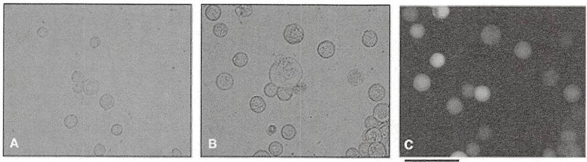

图 19-4 杆状病毒感染昆虫细胞的外观变化。使用的是 pVL1393-碱基转移载体和线性化 ProGreen 基因组的杆状病毒载体 DNA 感染 Tn-5 细胞。A. 未感染杆状病毒的细胞；B、C. 杆状病毒感染的细胞。受感染的细胞表达由 ProGreen DNA 编码的绿色荧光蛋白。图 C 与图 B 是相同细胞的相差荧光图像。需注意的是，感染细胞均略大于未感染的细胞。比例尺为  $100 \mu m$  （照片来自加州理工学院蛋白表达实验室的 Drs.Jost Vielmetter 和 Inderjit Nangiana）（彩图请扫封底二维码）。

SDS 凝胶加样缓冲液（6×）&lt;A&gt;（见方案 8）

不含二硫苏糖醇的  $6 \times$  SDS 加样缓冲液储存于室温。在使用缓冲液前，添加 1mol/L 二硫苏糖酵母液至终浓度为 100mmol/L。

---

第 19 章 克隆基因的表达以及目的蛋白的纯化和分析

1267

## 昆虫细胞无血清培养基

已有一些商业化的无血清培养基可供使用，如Sf-900 III（Life Technologies）、HyQR SFX-Insect（Hyclone）和BD Baculogold Max-XP（BD Biosciences）。这些培养基可直接使用，并且已经包含表面活性剂，因此就不用再加普朗尼克f-68。

已适应合适培养基的 S. fugiperda Sf-9 或者 Sf-21 细胞

见信息栏中“用于蛋白质表达的昆虫细胞系”。

包含插入基因的转移载体

台盼蓝储备溶液（0.4%，m/V）

## 设备

带盖子的摇瓶(1000mL)，无菌(如 Kimble-Chase part no. 25630-1000 和 Corning closure 38mm 聚丙烯部分 no. 430621-0000)

Beckman JA10, Sorvall GS3 或 SLA3000 转子，或与 500mL 离心管配套的转子

Beckman JA20, Sorvall SS34 或 SA600 转子，或与 40～50mL 离心管配套的转子

设定在 $85^{\circ} \mathrm{C}$ 的热块或沸水浴

血细胞计数器

倒置相差显微镜

层流组织培养罩

液氮

无菌微量离心管

这些几乎都是聚丙烯，因此不能用于含脂质体转染混合物的保存。

$28^{\circ} \mathrm{C}$ 摇床

$28^{\circ} \mathrm{C}$ 恒温培养箱

组织培养皿（35mm 的 6 孔板，150mm 的 24 孔培养板），以聚苯乙烯为材料

因为在脂质体介导转染时 DNA 脂质复合物会吸附在玻璃或聚丙烯表面，所以应使用聚苯乙烯培养皿。

有帽的试管（2～7mL），聚苯乙烯材料，无菌（如 Greiner Bio-One 部分 no.189171）

无菌试管（15mL）

设为  $37^{\circ}$  的水浴锅


## 方法

## 转染昆虫细胞产生重组杆状病毒

1. 将包含有目的 cDNA 或基因的 DNA 片段插入转移载体中，以使其融合到杆状病毒基因组（第 3 章）。确保克隆策略中载体的蛋白编码序列处在与载体的翻译信号相一致的读码框中。对于没有融合标签或者融合标签在氨基末端的，需要在蛋白质编码序列的 3 端置有同框的终止密码子。

PCR 得到的部分应测序，以确保在扩增反应过程中无伪突变的发生。

对于生产重组杆粒 DNA，请参阅替代方案:“用于转染昆虫细胞的杆粒 DNA 制备”（Bac-Bac 系统，Life Technologies）。

2. 在无血清培养基中扩增用于转染实验的 Sf-9 或 Sf-21 细胞。将低传代数的细胞（2～20）培养到指数生长期（ $1.5 \times 10^{6} \sim 2.5 \times 10^{6}$  个细胞/mL）。检查细胞的存活率为 95% 以上。

昆虫细胞培养的更多信息，请参阅信息栏“昆虫细胞培养物的维持与繁殖”，该信息栏在替代方案“用于转染昆虫细胞的杆粒DNA制备”中。

悬浮或单层培养适应的 SF-9 或 SF-21 细胞可用于生产重组杆粒。该过程不建议使用 TN-5 细胞。

---

1268

分子克隆实验指南（原书第四版）

血清可与 DNA-脂质体混合物形成复合物，这可能会降低转染效率。最好是在脂质体介导的转染前，昆虫细胞就应适应于无血清培养基。在这种情况下，之前在含有血清的培养基中生长的细胞，必须依次在 25%、50% 和 100%（V/V）的无血清和含血清的培养基混合物中传代培养 7 天。也可以用以下方法:①洗好的细胞在无血清培养基中用 DNA-脂质体转染，然后在第 5 步时放回含血清的培养基中产生重组杆状病毒；②通过磷酸钙介导转化（详见 Burand et al. 1980）。

3. 将昆虫细胞接种于培养皿中。准备并标记好适量的 35mm 的聚苯乙烯细胞培养皿:每个重组病毒以及阳性和阴性（没有 DNA）对照各一个。准备足够的细胞使表面密度达到 50%～70% 的表面被铺满。对于每个 35mm 培养皿，加 2mL 约含  $1 \times 10^{6}$  细胞的培养基。在水平位置将培养皿室温放置 60min，使细胞附着。

▲ 在转染时不使用抗生素，因其会导致细胞死亡。

4. 在细胞附着期间，准备 DNA 混合物和转染试剂。在微量离心管中将 100～250ng 的病毒 DNA 与 5～10 倍过量转移载体孵育 5min。对应于每个培养皿，在无菌聚苯乙烯管中把 200μL 的无血清培养基与 6μL 的转染试剂混合并旋涡混匀。在相应的离心管中加入实验和阳性对照 DNA 混合物，并轻轻颠倒混匀。准备一个额外的管，用没有 DNA 的转染试剂与培养基混合物作为阴性对照。室温下孵育最终混合物 15～30min 以形成脂质体 DNA 复合物。孵育结束后，再加入 800μL 无血清培养基使每个培养皿中的体积达到 1mL。

这个方案是对于基于合成脂类 N-[1（2，3-二油酰氧基）-丙基]-N，N，N-三甲基氯化铵（DOTAP）与二油酰磷脂乙醇胺混合试剂的初始方案，如 Lipofectin（Life Technologies），Bacfectin（Clontech），GeneJuice（Merck），Escort，或 Escort IV（Sigma-Aldrich）试剂。如果有必要，可以修改以适合所选择的特定转染试剂的厂商说明。

用于转染的 DNA 应该具有高纯度，可以用一些厂家提供的阴离子交换色谱试剂盒纯化的 DNA（如 PureLink HiPure Plasmid DNA Mini-prep Kit, Life Technologies; QIAEX resin, QIAGEN）。大的病毒和杆粒 DNA 对剪切敏感。应避免振荡混合，处理高分子质量 DNA 应该用阔口吸管。这些大分子 DNA 应该在转染的几个星期内被纯化，并且应避免反复冻融。

通过改变 DNA 或转染试剂的量可以优化转染条件。

对于 BaculoDirect 系统，可以直接使用 Gateway 重组反应。对 Bac-Bac 系统，使用 1～2μg 的纯化杆粒 DNA（重组杆粒 DNA 的构建，请参阅替代方案“用于转染昆虫细胞的杆粒 DNA 制备”）。

5. 弃吸附细胞表面的培养基。立即滴加含 DNA-脂质体的 1mL 培养基至每个皿的中心。在 28℃ 培养 5h 或过夜。

为了避免干扰细胞，将皿倾斜  $30^{\circ} \sim 60^{\circ}$  以使液体处于皿的一侧，再用无菌吸管除去。

不要让细胞层变干。

6. 弃实验组和阳性对照组中的培养基，替换为 2mL 适合生长的培养基，在  $28^{\circ}$ C 培养。

如果需要，这一步可以添加抗生素。然而，昆虫细胞培养不建议使用抗生素，因为它们可能会掩盖微生物污染。如果细胞以前一直是在有血清的完全培养基中培养的，那么这一步就使用这种培养基。在培养期间，附近放一些水或用塑料袋密封培养皿可以减少蒸发。

7. 培养基需在 2～3 天后检查与杆状病毒感染相关的变化，以评估转染和重组反应的效率（如下所述的步骤 12）。

8. 感染后 4～5 天，收集并转移培养基至 15mL 无菌试管内，培养基中有重组 1 代的病毒（P1）。4℃ 1000g 离心 10min 去除细胞碎片。将上清转移至新的 15mL 试管。得到 P1 病毒种子。

P1 病毒原料可以在  $4^{\circ}$ C 避光保存几个月。在储存的过程中于培养基中添加 5%～10% 的胎牛血清可以稳定杆状病毒。P1 种子应该存储用于之后的扩增。

商品化的系统，如 flashBAC、BacMagic、ProEasy 和 Bac-to-Bac 系统，可以产生大于 99% 的重组病毒，因此在扩增前不需要用噬菌斑纯化来分离单一重组病毒。对于其他系统可能含有非重组病毒，建议使用噬菌斑纯化（见附加方案中“噬菌斑测定法确定杆状病毒原液的滴度”）。

如果需要，可以在进行扩增前检查杆状病毒滴度（见附加方案中“噬菌斑测定法确定杆状病毒原液的滴度”）。然而，从步骤6和步骤7观察到的现象，包括细胞分裂的停止、细胞脱离和细胞核的增大，可以定性说明已经产生

---

第 19 章 克隆基因的表达以及目的蛋白的纯化和分析

1269

了感染杆状病毒。共表达 GFP 的载体（如使用 pVL-GFP、ProGreen 或 BaculoGold Bright）可以简单地在荧光显微镜下观察病毒的产生（图 19-4）。

## 扩增重组杆状病毒得到更高滴度的种子

9. 按步骤 2 扩增 SF-9 或 SF-21 细胞，以提供给每个杆状病毒实验样本、阳性对照组和阴性对照组  $2 \times 10^{7}$  个细胞。

如果同时扩增阳性对照组，小心避免病毒交叉污染。

通过比较细胞的生长速率和外观，阴性对照组可以帮助监测感染过程。

10. 标记适量 $150\mathrm{mm}$ 培养皿用于昆虫细胞培养。对于每个皿，于 $20\mathrm{mL}$ 培养基中接种 $1\times 10^{6}$ 个细胞/mL。在室温下使细胞吸附 $60\mathrm{min}$，期间确保培养皿处于水平。然后除去旧的培养基，加入 $20\mathrm{mL}$ 新鲜培养基。

11. 在平皿中加入  $500 \mu L$  P1 杆状病毒。轻摇平皿使病毒散开，然后放于  $28^{\circ}C$  培养箱。

为了减少突变累积，感染复数（MOI，病毒的颗粒数目除以细胞的数量）最好为0.1，在病毒扩增时一定小于1.0。没有噬菌斑分析时，通过大多数商品化的系统所得到P1病毒原料由经验估计为 $10^{6}\sim10^{7}pfu/mL$ （pfu是空斑形成单位，即感染病毒颗粒）。将这种估算用于给出的体积:

$$
\mathrm{MOI} = \frac {0 . 5 \times 1 0 ^ {7} \mathrm{pfu/mL} \times 0 . 5 \mathrm{mL}}{2 \times 1 0 ^ {7} \mathrm{个细胞}} = 0. 2 5
$$

12. 感染 2～3 天后，肉眼检查细胞被杆状病毒感染的迹象。预计可见变化包括细胞核体积的增大、细胞尺寸增大、由于小囊泡出芽形成的颗粒状的表面、细胞脱落，以及最终细胞裂解（图 19-4A）。与阴性对照组（没有 DNA）继续生长不同，感染样品将出现细胞分裂率降低现象。一些病毒 DNA 或转移载体可用于目标蛋白与 GFP 的共表达或融合表达（如使用 pVL-GFP、ProGreen 或 BaculoGold Bright）。用荧光显微镜观察 GFP，可以在该过程早期评估病毒制备是否成功（图 19-4B）。

如果第 5 天细胞计数增加到  $4 \times 10^{6}$  个细胞/mL 以上，或细胞形态无明显变化，那么就不会产生有活力的病毒。不必再进行后续步骤。杆状病毒扩增失败可能是由于细胞不健康或没有在对数生长期，或使用高的 MOI 导致培养基中所有细胞在最初就被感染。

13. 经过 4～5 天的感染，收集包含重组病毒的培养基，并转移到无菌的 50mL 离心管。在  $4^{\circ}$ C 以 1000g 离心 5min 除去细胞碎片。将上清转移至一个新的 50mL 离心管。这就是 P2 病毒种子。

14. 为了达到表达蛋白的最佳杆状病毒浓度（大于 $10^{8}\mathrm{pfu/mL}$），通常大规模重复步骤8～步骤13获得P3的种子（例如，通过增加1倍体积）。不建议更多的传代，因为这会积累突变病毒。

P2 病毒的滴度量通常为  $10^{7} \sim 10^{8}$ pfu/mL。

如果需要，P2 或 P3 的病毒的滴定量可由附加方案中“噬菌斑测定法确定杆状病毒原液的滴度”或用商业试剂盒测定。但是注意，测定滴度可能需要消耗与 P3 扩增或者小规模的蛋白质表达实验相同的时间。

## 在昆虫细胞中表达目标蛋白的小规模试验和优化

15. 扩增步骤 2 用于蛋白表达的细胞系[如 SF-9 SF-21, Tn-5(High-Five), 或 Mimic SF-9 细胞]以提供  $0.5 \times 10^{7}$  个对数增长期细胞。

据报道，Tn-5 细胞能表达高水平的目标蛋白，特别是分泌蛋白（Davis et al. 1993）（如需了解更多的使用 TN-5 细胞的详情，请参阅信息栏“用 TN-5（High-Five）提高表达”。Mimic SF-9 细胞已被构建成像哺乳动物细胞一样产生末端唾液酸化的 N-糖链（Jarvis et al. 1998）。

16. 病毒与细胞数量的比值（MOI）和收获时间在初始表达试验时已优化。如果该病毒的滴度是未知的，可以测试不同体积的病毒原液来确定。例如，根据方案，浓度为 $10^{8}pfu/mL$ 病毒原液20μL、10μL、5μL和2.5μL的MOI值分别为10pfu/细胞、5pfu/细胞、

---

1270

分子克隆实验指南（原书第四版）

2.5pfu/细胞和 1.25pfu/细胞。将 24 孔板的 6 列标记为不同病毒体积，一列为阳性对照（一种已知的在给定 MOI 值下高表达的病毒），一列为阴性即无病毒对照。4 列分别在不同的时间点收获，如感染后 1 天、2 天、3 天和 4 天（24～96h）。

可以添加小于培养孔总体积 20% 的病毒液。

如果MOI值已经确定，如根据附加方案“噬菌斑测定法确定杆状病毒原液的滴度”，那么MOI值可以为2pfu/细胞、4pfu/细胞、6pfu/细胞和8pfu/细胞进行试验。

高 MOI 值（5～10pfu/细胞）情况下通常最好是同步感染，但非常高的 MOI 值可能会抑制蛋白质的表达。如果 MOI 值 >5 时，需要检查培养基是否适合目标蛋白表达。在高 MOI 值情况下感染 5 天后，大部分细胞应该已经裂解。如果需要的话，目标蛋白可以用分离分泌蛋白的方法从培养基中分离出来（步骤 25）。

17. 将处于对数增长期的细胞稀释到 $10^{6}$ 个细胞/mL 浓度，在板上的每个孔中接种 $200\mu \mathrm{L}$ 细胞稀释液使每个孔接种细胞数量为 $2 \times 10^{5}$ 个。在室温下放置 $60\mathrm{min}$ 让细胞贴壁，并确保每个培养皿水平。

18. 在细胞贴壁时，准备病毒稀释液。在架子上排列 5 个微量离心管，然后将它们分别标记为 30、20、10、5 和阳性对照。第一个管中（标为 30），在 500μL 培养基中稀释病毒至 $8 \times 10^{7} \mathrm{pfu/mL}$ 。在剩下的 4 个管中分别加入 200μL 培养基。首先从第一个管取 200μL 的稀释病毒液转移到第二个，混匀。然后从第二个管取 200μL 转移到第三个，混匀，再重复操作稀释第三个管至第四管。在第六管中稀释阳性对照病毒液获得一个适当 MOI 值（如 $8 \times 10^{7} \mathrm{pfu/mL}$），并且稀释后管内的体积最好为 200μL 或者更多。注意，应小心避免阴性对照组受到病毒的污染，以及阳性对照组和样品交叉污染。

19. 细胞附着后，从第一个管中取  $50 \mu L$  稀释的重组病毒液转移到组织培养板（参见步骤 16 和步骤 17）的标为 “ $30 \mu L$ ” 列的 4 个孔中。重复每个剩余的实验组和阳性对照组。将未感染的第六列作为阴性对照。轻轻旋转培养皿混匀，并将其放置在  $28^{\circ}C$ 。

20. 感染后 $24\mathrm{h}$ 收集第一列、$48\mathrm{h}$ 收集第二列、$72\mathrm{h}$ 收集第三列，$96\mathrm{h}$ 收集最后一列细胞。用培养基冲散细胞。将细胞连同培养基转移到微量离心管中。以 $1000\mathrm{g}$ 离心 $10\mathrm{min}$，沉淀细胞，然后小心取出上清液。在每管细胞沉淀物中加入 $50\mu \mathrm{L}6\times \mathrm{SDS}$ 上样缓冲液重悬细胞，用 $85^{\circ}\mathrm{C}$ 加热块加热样品 $2\mathrm{min}$，然后充分振荡。在微量离心管中以最大转速于室温下离心 $1\mathrm{min}$，所有样品储存在 $-20^{\circ}\mathrm{C}$ 下，直到收集完所有样品，并准备加样到凝胶。

单层的昆虫细胞可以很容易地用吸管吹出的温和培养基流从表面脱附。

21. 在  $85^{\circ}$ C 短暂再加热后，每个悬浮液加样  $40\mu g$  到一个合适浓度的 SDS-聚丙烯酰胺凝胶。在大多数情况下，加载  $5 \sim 10\mu L$  样品比较合适。凝胶用考马斯亮蓝染色和/或用免疫印迹法使诱导蛋白显色（方案 8“蛋白质的 SDS-PAGE”和方案 9“蛋白质的免疫印迹分析”）。

按照经验，5000个昆虫细胞中大约含有 $10\mu \mathrm{g}$ 的总蛋白。

如果蛋白是分泌的，加载  $15 \mu L$  上清液，并通过免疫印迹法分析。

在表达重组基因的细胞提取物中，所预测分子质量的蛋白质在诱导后的一定时间点上应该是可见的。外源蛋白的诱导动力学和稳定性可能与阳性对照组有所不同。在阴性对照，即无病毒对照组中，应该没有可见的相应带。

## 昆虫细胞中目的蛋白的大量表达

22. 对于目标蛋白的大规模表达和纯化，需要扩增用来表达蛋白的细胞系（如SF-21、SF-9、TN-5或Mimic SF-9细胞）以获得处在对数生长期的 $400\mathrm{mL}$ 悬浮培养液（$1.5\times 10^{6} \sim 2.5\times 10^{6}$ 个细胞/mL）（昆虫细胞培养的进一步详情，请参阅替代方案“用于转染昆虫细胞的杆粒DNA制备”末尾的信息栏“昆虫细胞培养物的维持和繁殖”）。如需使用TN-5细胞的进一步详情，请参阅下面的信息栏。

---

第 19 章 克隆基因的表达以及目的蛋白的纯化和分析

1271

## 用 TN-5（High-Five）提高表达

当 Tn-5（High-Five）昆虫细胞用作宿主时，一些条件的改变可以增强表达能力。

1. 在 TN-5 培养物的增殖和维持的时候，使用含 25mg/mL 硫酸葡聚糖（分子质量 9000～20 000 Da；Sigma-Aldrich 公司，目录号 D6924）适当的培养基（如 ESF921 表达系统）可以避免细胞聚集。
2. 在高细胞密度（如下文所述）的条件下感染应减少硫酸葡聚糖，否则硫酸葡聚糖会抑制感染。
a. 在 400g、4℃下离心分离细胞 10min，然后用适当量的病毒和无硫酸葡聚糖的表达培养基使细胞重悬至密度为  $1.6 \times 10^{7}$ （MOI 值为 1～4）。
b. 130r/min、27℃下摇动细胞1h，然后用不含硫酸葡聚糖的培养基稀释感染的细胞至密度为 $2\times10^{6}$ 。
c. 在步骤 24 的条件下继续表达。

23. 添加一定体积的病毒原液到步骤 22 扩增的细胞，使 MOI 值达到 4.0（或是按上述在昆虫细胞中表达目标蛋白的小规模试验和优化的体积加）。例如:

$$
\frac {4 0 0 \mathrm{mL} \times 2 \times 1 0 ^ {5} \mathrm{个细胞/mL} \times 4 \mathrm{pfu/细胞}}{4 \times 1 0 ^ {8} \mathrm{pfu/mL病毒滴度}} = 8 \mathrm{mL病毒液}
$$

24. 加入病毒原液 4h 后，换上新鲜的培养基。在  $400g\ 4^{\circ}C$  下离心细胞 10min。弃去上清液，然后用 400mL 新鲜培养基轻轻重悬细胞。
25. 在感染后 72h（或上一节中确定的最佳时间），通过 400g 离心 10min 收集细胞。弃上清液，用 5mL 1×PBS 温和重悬细胞沉淀物，将细胞转移到 50mL 的带螺旋帽的离心管。再次在 400g 下离心沉淀细胞 10min。①可以选择弃去 1×PBS 上清液，在液氮中冷冻保存细胞沉淀物，并储存在 -80℃；②立即进行纯化。

如果这种蛋白质是分泌的，那么第一次离心收集培养基上清。将其转移到另一离心管中，30 000g 下离心 1h 以除去杆状病毒颗粒和细胞碎片。或者，将其通过 0.22μm 的过滤器，以澄清上清液。-80℃下冷冻保存上清液，或者直接进行纯化。纯化前，最好是用适当的缓冲液透析，以除去已污染的培养基组分。同样，上清应浓缩 10 倍体积以降低到一个易操作的量。

26. 如果表达的蛋白质中含有多聚组氨酸标签，按照方案 5 纯化。

如果所表达的蛋白质是与谷胱甘肽-S-转移酶融合的，按照方案6纯化。

## 附加方案 噬菌斑测定法确定杆状病毒原液的滴度

噬菌斑或终点稀释分析法是从原液中分离纯化重组杆状病毒的传统方法，原液进一步衍生并进行定量感染。噬菌斑分析最初是用于动物细胞（Dulbecco 1952），后来被 Lee 和 Miller（1978）修改用于杆状病毒感染的昆虫细胞。在噬菌斑分析中，用病毒感染单层细胞，然后用琼脂糖覆盖以维持细胞的位置，并限制病毒的传播。在非常低的病毒稀释液中，分离感染细胞。感染细胞最终溶解和释放病毒，然后立刻感染邻近的其他细胞。感染细胞的裂解导致感染平板上相应的地方形成一块透明区域，这块区域就是一个杆状病毒的后代。这些噬菌斑既可用于制备一个克隆的原液，也可在不同稀释度下计算测定病毒滴度。

---

1272

分子克隆实验指南（原书第四版）

病毒噬菌斑分析通常对于新手来说是一个挑战，特别是通过由目的基因的可读框替代的多角体蛋白基因所形成的不同噬菌斑形态识别重组杆状病毒时。虽然这种差别仅在野生型杆状病毒 DNA（而不是与致死缺陷的 DNA）用于重组病毒时需要，但对于新手来说鉴别病毒噬菌斑通常是比较困难的。中性红染色通过选择性染色活细胞，而受感染的区域仍然清晰，因而可使噬菌斑更加明显。终点稀释法可以替代噬菌斑法（一个很好的方案，请参阅 Harwood 2007）。然而，这两种方法的共同缺点是都需要 6～7 天的时间来完成。更多节省时间的病毒定量方法，包括基于抗体的染色、流式细胞仪、实时定量 PCR（Kitts and Green 1999; Kwon et al. 2002; Shen et al. 2002; Hitchman et al. 2007）已经被开发并流向市场（如 the BacPAK titer kits from ClonTech）。虽然这些商业化的分析方法只要不到 2 天就可以完成，但是不能直接测试病毒感染性，而且不能用于分离病毒克隆。本方案描述了传统的噬菌斑分析方法，该方法是从 King 等（2007）的方法修改获得的。


## 附加材料

为正确使用本方案中的器材和危险试剂，必须查阅相应的材料安全数据表并咨询所在机构的环境卫生和安全办公室。

本方案的专用试剂标注&lt;R&gt;，配方在本方案末提供。常用储备溶液、缓冲液和试剂标注&lt;A&gt;，配方见附录1。储备溶液应稀释至适用浓度后使用。

## 试剂

低熔点的琼脂糖（如 Sigma-Aldrich Type VIII A4018）

5%（m/V）低熔点琼脂糖用去离子蒸馏水配置，高压灭菌后，用 50mL 管分装成每管 5mL，并在室温下储存固化，直到进行该方案的步骤 7。

昆虫细胞培养基

1×培养基按照以下方案使用。如果需要，在步骤6中可以用1.3×或者2×的储备液，通过调节体积（及根据需要添加无菌水），以获得最终浓度为1% m/V琼脂糖和1×培养基的覆盖用培养基。无血清或含有血清的培养基可用于相应适应过的细胞。

中性红溶液（5mg/mL 去离子蒸馏水溶液）

经  $0.22 \mu m$  的膜过滤除菌，并储存于室温。

无菌 PBS (1×)

Sf-9 或 SF-21 细胞（来自方案 2，步骤 2）

X-Gal 的原液[40mg/mL X-Gal（5-溴-4-氯-3-吲哚基-b-D-吡喃半乳糖苷）溶解在二甲基甲酰胺中]

避光储存在-20℃。

## 设备

干燥加热器（可选的；见步骤7）

倒置显微镜

六孔组织培养板

无菌离心管（50mL）

涡旋振荡器

水浴锅（40℃）


## 方法

1. 按照方案 2 步骤 2 和 “昆虫细胞培养物的维持与繁殖” 信息栏中（在替代方案 “用

---

第 19 章 克隆基因的表达以及目的蛋白的纯化和分析

1273

于转染昆虫细胞的杆粒 DNA 制备”）中所描述的方法，扩增 SF-9 或 SF-21 细胞。扩增后需要对每个实验组、阳性对照组和阴性对照组（无病毒）提供指数生长期细胞约  $0.5 \times 10^{7}$  个。

SF-21 更适合用于噬菌斑分析，因为它可在较短的时间内产生不同的噬菌斑。使用血清添加培养基也能增强噬菌斑的可见性。病毒滴度应该尽可能使用用于蛋白表达的培养基和细胞株来测定。

2. 为每个实验组样品和阳性对照样品，分别标记两个六孔板。为了易于移液操作，列应该是相同的，因此，板1的顶部和底部的行被标记为 $0, 10^{-8}, 10^{-7}$，板2的顶部和底部的行被标记为 $10^{-6}, 10^{-7}, 10^{-8}$。每孔接种 $0.9 \times 10^{6}$ 个SF-9或 $1.4 \times 10^{6}$ 个SF-21细胞到 $2\mathrm{mL}$ 的培养基中。接种后立即摇动板均匀分散细胞。在室温下使细胞附着 $60\mathrm{min}$，并确定培养皿水平。
3. 在培养期间，准备 $10^{-1} \sim 10^{-8}$ 的10倍系列稀释病毒，包括一个额外的管为阴性对照（无病毒）。将 $900\mu \mathrm{L}$ 的培养基加到无菌标记的微量离心管中。将 $100\mu \mathrm{L}$ 的病毒加到标有“$10^{-1}$”的管中颠倒或轻轻涡旋混匀。用新的吸头将 $100\mu \mathrm{L}$ 的“$10^{-1}$”稀释液转至标有“$10^{-2}$”的管中混匀。继续操作直到完成“$10^{-8}$”稀释。
4. 接种 1h 后，使用倒置显微镜检查细胞附着在一个汇合的单层。
5. 在无菌组织培养工作台，排列病毒系列稀释液和组织培养皿。从每个孔中取出旧的培养基，并立即更换成 0.5mL 适当稀释的病毒（对 P2 或 P3 的原液，如在步骤 3 中标记为  $10^{-4} \sim 10^{-8}$ ）。包括无病毒对照的孔中标记为 “0”。培养细胞与病毒 60min。
6. 对应每组稀释，在 50mL 无菌管中加入 20mL 1× 昆虫细胞培养液，并在 40℃ 的水浴中加热。用微波短暂加热融化一个 5mL 的 5% 低熔点琼脂糖，然后将其放置在 40℃ 水浴。

如果在重组前杆状病毒DNA含有lacZ基因，则加 $240\mu \mathrm{L}$ （最终浓度为 $240\mu \mathrm{g / mL}$ ）的X-Gal到琼脂糖混合物中用于重组病毒的蓝/白斑筛选。

使用适用于 50mL 管的干热块有助于避免污染。否则，请确保水浴的水是干净的，用乙醇擦拭取出管的外壁。

7. 在昆虫细胞/病毒培养结束前约 15min，加入琼脂糖溶液到热培养基，并颠倒彻底混匀，同时避免产生气泡，不能使溶液冷却。混合物最终应为 1% 琼脂糖。
8. 昆虫细胞/病毒培养 1h 后，从单层细胞中小心地从倾斜的板子边上吸出培养基。轻轻吸 2mL 的琼脂糖培养基混合物加到板的一侧以覆盖单层细胞。在水平面上于室温下使覆盖的琼脂糖固化在板子上（30～60min）。
9. 再添加 1mL 昆虫细胞培养基作为覆盖层为培养物提供营养。在  $28^{\circ}$ C 培养直至细胞单层铺满（4～7 天）。
10. 噬菌斑在黑色的表面上在亮光照射下，或者是背对亮光倾斜可见为透明的。用中性红染色会更加明显。这时噬菌斑为红色背景下的透明区。

如果亲本病毒含有 lacZ 基因，而目的基因替代了该基因，那么重组病毒的噬菌斑不应是有色的，但非重组病毒依稀会出现蓝色。

11. 进行中性红染色，需先去除覆盖层液体，更换为 1mL 中性红稀释液，28℃培养几个小时或过夜。中性红稀释液是将 50mL 的中性红（5mg/mL 水溶液）加到 950mL 无菌 1×PBS 中获得的。
12. 第二天清晨，用吸头吸去染液并倒置平板于吸水纸或滤纸上。更换盖子，让平板在暗处倒置几个小时以使噬菌斑清晰可见。
13. 选择产生 $10 \sim 30$ 噬菌斑的稀释度，并对各复孔的噬菌斑计数。测定该稀释度的平均噬菌斑数目，并计算病毒滴度，如下所示:

$$
\text {病毒滴度} (\mathrm{pfu/mL}) = \frac {\text {噬菌斑平均数}}{(\text {Dilution}) \times 0 . 5 \mathrm{mL}},
$$

式中，5mL 是加入板中的稀释病毒的体积，以每毫升计。例如，病毒滴度为  $10^{7}pfu/mL$  时，预计  $10^{-6}$  稀释度的板会产生 20 个噬菌斑。

14. 挑噬菌斑用于制备一个克隆的原液，将一个无菌的巴斯德吸管的尖端插在噬菌斑

---

1274

分子克隆实验指南（原书第四版）

的中心，然后轻轻地吸出一块琼脂糖。将其放入 1mL 的培养基中，振荡释放病毒颗粒。应选择一些噬菌斑。这些分离株在扩增前可再次用噬菌斑分析复筛。

# 替代方案 用于转染昆虫细胞的杆粒 DNA 制备

本方案是在转染昆虫细胞前使用分子生物学技术在大肠杆菌中产生重组杆状病毒DNA（Luckow et al. 1993）。所有的试剂为商业销售的，BAC-BAC系统来自Life Technologies。


## 材料

为正确使用本方案中的器材和危险试剂，必须查阅相应的材料安全数据表并咨询所在机构的环境卫生和安全办公室。

本方案的专用试剂标注&lt;R&gt;，配方在本方案末提供。常用储备溶液、缓冲液和试剂标注&lt;A&gt;，配方见附录1。储备溶液应稀释至适用浓度后使用。

## 试剂

感受态的大肠杆菌 DH10Bac 细胞

DH10Bac 细胞中的杆粒 bMON14272（136kb）包含杆状病毒 DNA，并且含有卡那霉素抗性基因。该质粒中还含有一个 lacZ β-半乳糖苷酶基因，该基因表达的产物在 IPTG/X-Gal 存在时显示蓝色。如果该基因与转移质粒重组而被替代则不显示蓝色。

辅助质粒 pMON7124（13.2kb）编码 Tn7 转座酶，并含有四环素抗性基因（Barry 1988）。

肉汤（LB）琼脂平板（含  $50 \mu g/mL$  卡那霉素、 $7 \mu g/mL$  庆大霉素、 $10 \mu g/mL$  四环素、 $100 \mu g/mL$  X-Gal、 $40 \mu g/mL$  的 IPTG）&lt;A&gt;

肉汤（LB）液体培养基（有或没有  $50 \mu g/mL$  卡那霉素、 $7 \mu g/mL$  的庆大霉素和  $10 \mu g/mL$  四环素类抗生素的混合物）&lt;A&gt;

载体 pFastBac，含有目标蛋白的基因（在 TE 缓冲液中  $0.2ng/\mu L$ ）

载体 pFastBac 含有抗庆大霉素和氨苄青霉素基因。


## 方法

1. 用第3章中介绍的方法构建和转移含有目标基因的pFastBac质粒到DH10Bac感受态细胞（Life Technologies）。在含有试剂清单中用于筛选的附加试剂的LB琼脂平板上梯度稀释转化体系（$10^{-1} \sim 10^{-3}$）。在 $37^{\circ}\mathrm{C}$ 下培养2天以使非重组子显现出蓝色。

由于在DH10Bac细胞中杆状病毒DNA插入pFastBac，使得β-半乳糖苷酶的编码序列被干扰，重组子在含有X-Gal/IPTG的培养基上不再产生蓝色。

用限制性内切核酸酶、TOPO或Gateway克隆策略得到pFastBac载体。

2. 用菌落 PCR 分析 $3 \sim 5$ 个孤立的、大的白色菌落（第7章），以验证目标基因的存在。

3. 按照第 1 章，方案 1 和方案 2 中所描述的碱性裂解法分离杆粒 DNA。用于重组杆粒细菌生长的 LB 培养基一定要保持有 50mg/mL 卡那霉素和 7mg/mL 庆大霉素。

此外四环素不是严格必需的，因为在这个阶段不再需要转座酶的功能。

含有杆粒 DNA 的溶液应轻弹混匀；反复吹打或涡旋会使较大的 DNA 被切断。

---

第 19 章 克隆基因的表达以及目的蛋白的纯化和分析

1275

## 昆虫细胞培养物的维持和繁殖

这里概述了昆虫细胞培养技术的实践经验。深入的技术可以从一些优秀的书籍和综述中找到，如 Lynn（2002）和 O'Reilly 等（1994）。昆虫细胞的生长和其他细胞一样都是依次经过滞后期、指数增长期和稳定期阶段。按照经验，昆虫细胞在指数增长期间的倍增时间一般为 1 天，不过确切的时间还是取决于细胞株、培养基和生长条件。昆虫细胞在 27～28℃下培养，在用杀菌剂如 70%乙醇擦拭过的层流通风橱内转移。不需要特殊供应二氧化碳，因为昆虫细胞培养基不依赖于碳酸盐缓冲。

## 培养基

昆虫细胞通常培养在一些基本培养基中，如 Grace 的培养基（Grace 1962）、TNM-FH（HINK 1970），或补充有 5%\~10% 胎牛血清（FBS）的 TC-100（Gardiner and Stockdale 1975）。20 世纪 80 年代开发的无血清培养基现已广泛使用，它有以下优点:脂质体介导的转染相容性较好，减少批次间的差异，用于蛋白质纯化的难度降低，以及在某些情况下成本较低（Agathos 2007）。用于昆虫细胞培养的可靠无血清培养基的来源有:SF-900 III（Life Technologies），HYQ SFX 昆虫（Hyclone），BD BaculoGoldMax-XP（BD Biosciences）等。昆虫细胞应逐渐适应生长培养基的任何变化，如从含 FBS 的培养基转移到无血清培养基中。

## 增殖

虽然昆虫细胞既可以悬浮培养也可以单层细胞培养增殖，但是 SF-10 或 SF-21 细胞种子可方便地在悬浮液中持续维持。即使当昆虫细胞在悬浮培养基中增殖，它仍然有能力很容易地附着到表面，因而可以用于病毒传代的单层细胞培养和生成蛋白的悬浮培养。适应了在无血清培养基中生长的昆虫细胞可以直接从供应商处购买。相反，贴壁培养扩增的昆虫细胞必须逐步适应悬浮培养。每次传代培养，以每传代一次增加 5r/min 来增加摇动或搅拌速率，从 90r/min 到 130r/min 的摇动培养或从 40r/min 到 90r/min 的搅拌培养。

## 设备

用于昆虫细胞悬浮培养的摇床或培养箱和培养瓶与常用于细菌细胞生长的一样，但用于昆虫细胞培养时一定要专用以避免污染。另外，转瓶可购买获得，放置在一个立式培养箱中，靠磁力搅拌驱动。玻璃器皿必须彻底清洗，以去除所有的洗涤剂，因为洗涤剂有可能抑制昆虫细胞生长。为了适当的通气，用于摇床培养的体积不应超过摇瓶体积的1/3（带挡板的摇瓶，为1/2），用于旋转培养的体积不能超过培养瓶体积的2/3。在所有情况下，瓶盖应该是松的。悬浮培养的一个优点是，可以很容易地取样监测细胞密度和活力，最经常使用的是血细胞计数器。对于大多数类型的血细胞计数器，一个单元小正方形区域中的一个细胞对应 $10^{4}$ 个细胞/mL。为了确定细胞活力，1mL的细胞中加入0.1mL 0.4%的台盼蓝使死细胞染成蓝色，用显微镜检查。虽然比较昂贵，但是一般人可能更愿意购买库尔特颗粒计数器或Vi-CELL，以确定细胞密度。

## 培养

昆虫细胞培养应保持在指数增长期（$2 \times 10^{6}$个细胞/mL），大于 $90\%$ 的存活率的条件

---

1276

分子克隆实验指南（原书第四版）

下。细胞应该用适当体积的培养基从冻存的或指数增长期培养物稀释至密度为 $3 \times 10^{5}$ 个细胞/mL。例如，通过添加 $4.5\mathrm{mL}2 \times 10^{6}$ 个细胞/mL 的细胞到含有 $30\mathrm{mL}$ 培养基的 $125\mathrm{mL}$ 摇瓶中（见下段）。达到指数生长期（$1 \times 10^{6} \sim 3 \times 10^{6}$ 个细胞/mL，2\~3天）后，将细胞用新鲜的培养基稀释至 $3 \times 10^{5}$ 个细胞/mL 进行传代培养。在这一阶段，可通过培养体积的扩大，达到蛋白质表达所需的细胞量。在该方法中，最初的 $30\mathrm{mL}$ 培养液传代3次或 $11 \sim 12$ 天后可扩增成1L处于指数生长期的细胞，用于蛋白质的生产。不建议简单地用大量的培养基将细胞稀释到较低的密度，因为细胞会返回到滞后期并且分裂非常缓慢。相反，绝不允许细胞培养过度并进入稳定期（$4 \times 10^{6}$ 个细胞/mL）。每隔3周，细胞培养基应更换，以避免有毒副产品的积聚。在无菌试管中离心培养物 $400\mathrm{g}$、$10\mathrm{min}$，然后轻轻地在适当体积的新鲜培养基中重悬细胞沉淀。重悬浮后，检查这些细胞的完整性和活力。

细胞可传代培养次数不是无限的。多次传代（>40轮传代），细胞产生蛋白质的能力可能退化。谨慎的做法是将扩增培养昆虫细胞的前3～4代冻存大量的小份。然后，当细胞培养传代次数变高以后或是当有污染发生时，可以使用这些冷藏的细胞液接种到新鲜培养中。将健康、指数增长中期的细胞重悬于预冷的冷冻保护培养基（45%的新鲜培养基，45%经0.22μm无菌过滤后的当前培养基，10%DMSO）至细胞密度为 $1\times10^{6}\sim2\times10^{6}$ 个细胞/mL。分装到50mL的冷冻管中（如Corning, no.430656）梯度冷冻，先在4℃下30min，再在-20℃下3～4h，-80℃过夜，然后保存于液氮中。

需要注意的是, 如果从冻结的细胞开始昆虫细胞培养, 先清洗细胞移除 DMSO 溶液, 如下所示:

1. 在  $37^{\circ}$ C 下迅速解冻细胞，并用 10mL 的培养基稀释。
2. 在 400g 离心 10min。
3. 用 5mL 新鲜的培养基重悬细胞。
4. 在接种前，计数和确定细胞的生存能力。


## 疑难解答

一些因素可能造成杆状病毒系统表达蛋白水平较低。杆状病毒在昆虫细胞中表达可能存在的问题和解决方案都在 BaculoGold（BD Biosciences）和 BAC-BAC（Life Technologies）制造商手册里详尽列出。为了提高蛋白质的表达能力，MOI 值和感染时间可以按方案 1 的附加方案“目标蛋白可溶性表达的小量试验”所述方法优化。昆虫细胞系、生长培养基和融合标签的不同也会导致表达水平的差异。在某些情况下，可能出现其他问题，如下所示。

问题:表达盒在病毒多次传代后丢失。

解决方案:用低传代数的病毒种子（P1～P2）。

问题:昆虫细胞在连续培养时可能会失去高效表达外源蛋白的能力。

解决方案:用低传代数的昆虫细胞代替。

问题:外源蛋白可能对昆虫宿主细胞有毒。

解决方案:提早收集感染的细胞。

问题:外源蛋白可被昆虫细胞降解。

解决方案:这可以通过比较 mRNA 与蛋白质表达水平加以区分。

---

第 19 章 克隆基因的表达以及目的蛋白的纯化和分析

1277

## 参考文献

- Agathos SN. 2007. Development of serum-free media for lepidopteran insect cell lines. Methods Mol Biol 388: 155–186.
- Aumiller JJ, Hollister JR, Jarvis DL. 2003. A transgenic insect cell line engineered to produce CMP-sialic acid and sialylated glycoproteins. Glycobiology 13: 497–507.
- Barry GF. 1988. A broad-host-range shuttle system for gene insertion into the chromosomes of Gram-negative bacteria. Gene 71: 75–84.
- Burand JP, Summers MD, Smith GE. 1980. Transfection with baculovirus DNA. Virology 101: 286–290.
- Davis TR, Wickham TJ, McKenna KA, Granados RR, Shuler ML, Wood HA. 1993. Comparative recombinant protein production of eight insect cell lines. In Vitro Cell Dev Biol Anim 29A: 388–390.
- Dee KU, Shuler ML, Wood HA. 1997. Inducing single-cell suspension of BTI-TN5B1-4 insect cells: I. The use of sulfated polyanions to prevent cell aggregation and enhance recombinant protein production. Biotechnol Bioeng 54: 191–205.
- Dulbecco R. 1952. Production of plaques in monolayer tissue cultures by single particles of an animal virus. Proc Natl Acad Sci 38: 747–752.
- Gardiner GR, Stockdale H. 1975. Two tissue culture media for production of lepidopteran cells and nuclear polyhedrosis virus. J Invertebr Pathol 25: 363–370.
- Grace TD. 1962. Establishment of four strains of cells from insect tissues grown in vitro. Nature 195: 788–789.
- Granados RR, Derksen AC, Dwyer KG. 1986. Replication of the Trichoplusia ni granulosis and nuclear polyhedrosis viruses in cell cultures. Virology 152: 472–476.
- Harwood S. 2007. Small-scale protein production with the baculovirus expression vector system. Methods Mol Biol 388: 211–224.
- Hink WF. 1970. Established insect cell line from the cabbage looper, Tri-choplusia ni Nature 226: 466–467.
- Hitchman RB, Siaterli EA, Nixon CP, King LA. 2007. Quantitative real-time PCR for rapid and accurate titration of recombinant baculovirus particles. Biotechnol Bioeng 96: 810–814.
- Hollister J, Grabenhorst E, Nimtz M, Conradt H, Jarvis DL. 2002. Engineering the protein N-glycosylation pathway in insect cells for production of biantennary, complex N-glycans. Biochemistry 41: 15093–15104.
- Jarvis DL, Kawar ZS, Hollister JR. 1998. Engineering N-glycosylation pathways in the baculovirus-insect cell system. Curr Opin Biotechnol 9:528–533.
- King LA, Hitchman R, Possee RD. 2007. Recombinant baculovirus isolation. Methods Mol Biol 388: 77–94.
- Kitts PA, Green G. 1999. An immunological assay for determination of baculovirus titers in 48 hours. Anal Biochem 268: 173–178.
- Kitts PA, Possee RD. 1993. A method for producing recombinant baculovirus expression vectors at high frequency. BioTechniques 14: 810–817.
- Kwon MS, Dojima T, Toriyama M, Park EY. 2002. Development of an antibody-based assay for determination of baculovirus titers in 10 hours. Biotechnol Prog 18: 647–651.
- Lee HH, Miller LK. 1978. Isolation of genotypic variants of Autographa californica nuclear polyhedrosis virus. J Virol 27: 754–767.
- Luckow VA, Lee SC, Barry GF, Olins PO. 1993. Efficient generation of infectious recombinant baculoviruses by site-specific transposon-mediated insertion of foreign genes into a baculovirus genome propagated in Escherichia coli. J Virol 67: 4566–4579.
- Lynn DE. 2002. Methods for maintaining insect cell cultures. J Insect Sci 2: 9. http://www.ncbi.nlm.nih.gov/pmc/articles/PMC355909/?tool= pubmed.
- Lynn DE. 2007. Available lepidopteran insect cell lines. Methods Mol Biol 388: 117–138.
- O'Reilly DR, Miller LK, Luckow VA. 1994. Baculovirus expression vectors. Oxford University Press, New York.
- Shen CF, Meghrous J, Kamen A. 2002. Quantitation of baculovirus particles by flow cytometry. J Virol Methods 105: 321–330.
- Vaughn JL, Goodwin RH, Tompkins GJ, McCawley P. 1977. The establishment of two cell lines from the insect Spodoptera frugiperda (Lepidoptera; Noctuidae). In Vitro 13: 213–217.
- Wickham TJ, Nemerow GR. 1993. Optimization of growth methods and recombinant protein production in BTI-Tn-5B1-4 insect cells using the baculovirus expression system. Biotechnol Prog 9: 25–30.
- Wickham TJ, Davis T, Granados RR, Shuler ML, Wood HA. 1992. Screening of insect cell lines for the production of recombinant proteins and infectious virus in the baculovirus expression system. Biotechnol Prog 8: 391–396.
- Zhao Y, Chapman DA, Jones IM. 2003. Improving baculovirus recombination. Nucleic Acids Res 31: e66. doi: 10.1093/nar/gng006.

## 方案 3 用甲醇诱导启动子 AOX1 在毕赤酵母中表达克隆基因

在毕赤酵母中用甲醇诱导启动子 AOX1 表达克隆基因。毕赤酵母是一种可以甲醇作为唯一碳源的甲基营养型酵母（Gregg et al. 1985）。用含有甲醇的培养基培养，可广泛诱导醇氧化通路中基因的表达，这些基因的产物包括甲醇氧化酶（AOX）、甲醛脱氢酶（FLD）和二羟基丙酮合酶（DHAS）（Cregg 2007a）。这些蛋白质占生物量的比例高达 30%。研究人员已经利用这些甲醇依赖基因来构建严谨型表达载体（Daly and Hearn 2005）。大多数的毕赤酵母利用严谨型 AOX1 启动子来启动外源蛋白的表达。pPICZ 载体图谱见图 19-5。将外源基因克隆到 AOX1 启动子和 AOX1 转录终止序列之间。这些序列与毕赤酵母基因组中的 AOX1 区域属于同源片段，可在同源重组中将外源基因整合到酵母基因组中（Cregg et al. 1985, 1989）。

获得整合型的毕赤酵母转化体需要比以游离质粒表达基因的酿酒酵母更多的DNA，但是转化子非常稳定，可以保存很多年。染色体上的AOX1区与pPICZ载体上的AOX1启动子或是终止子区发生单交换完成外源基因的插入（图19-6）。这可能导致基因组上AOX1基因的上游或下游被插入单个或多个拷贝的目的基因（Daly and Hearn 2005）。然而，一个

---

1278

分子克隆实验指南（原书第四版）

依靠 AOX1 启动子上的酶切位点（如 Pme I）处线性化的重组载体会优先插入到基因组的 AOX1 启动子上。随机的多拷贝插入的发生频率是单插入的 1%～10%（Cregg 2007b）。如果要得到基因的多拷贝插入，建议转化时加入大剂量的线性化 DNA（20μg 或更多）。


<details>
<summary>flowchart</summary>

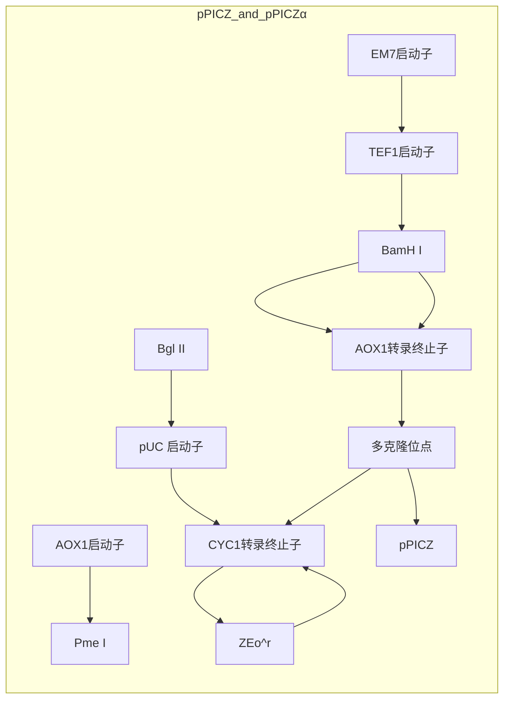
</details>

图 19-5 pPICZ 和 pPICZα 毕赤酵母载体。pPICZ 和 pPICZα 载体带有 AOX1 启动子和转录终止子（TT）序列，用于 Zeocin 抗性的 Sh ble 基因（Streptoalloteichus hindustanus ble 基因）和用于重组蛋白整合的多克隆位点（MCS）。这些载体有 3 种阅读框形式（A、B、C），可以同框与羧基端的 myc 标签融合用于检测，与 His6 标签融合用于纯化（经 Life Technologies 允许复制）


<details>
<summary>flowchart</summary>

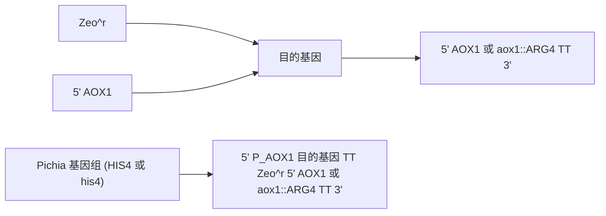
</details>

表达框

图 19-6 酵母同源重组原理示意图。通过一次互补区域的同源重组将两侧带有 AOX1 启动子和 AOX1 转录终止子（TT）序列的外源基因插入到毕赤酵母菌株 X-33（AOX1）或 KM71（aox::ARG4）。单一位点的多基因插入的进一步例子参见 EasySelect Pichia Expression Kit 手册（Life Technologies; http://tools.invitrogen.com/content/sfs/manuals/easyselect\_man.pdf）（经 Life Technologies 允许复制）

小贴士:毕赤酵母并不像大肠杆菌一样是个过表达系统，但可以呈现高的细胞密度。一般酵母表达的异源蛋白不能用考马斯亮蓝染色凝胶检测到，它需要更灵敏的方法如Western杂交或功能检测（如果可能的话）。因此，在表达研究的同时或之前，需要研发

---

第 19 章 克隆基因的表达以及目的蛋白的纯化和分析

1279

一系列灵敏的检测方法（Cregg et al. 2009）。如果没有针对目的蛋白的抗体，可以检测 C 端的 myc 标签（pPICZ 载体中有介绍）。抗 myc 标签的抗体在 Western 杂交具有很高的特异性，几乎不会与毕赤酵母菌的固有蛋白发生交叉反应。


## 材料

为正确使用本方案中的器材和危险试剂，必须查阅相应的材料安全数据表并咨询所在机构的环境卫生和安全办公室。

本方案的专用试剂标注&lt;R&gt;，配方在本方案末提供。常用储备溶液、缓冲液和试剂标注&lt;A&gt;，配方见附录1。储备溶液应稀释至适用浓度后使用。

## 试剂

## 琼脂糖凝胶

用于分离 DNA 的琼脂糖凝胶的制备方法详见第 2 章的方案 1 和方案 2。

dNTP 溶液（PCR 等级，pH8.0，含有全部 4 种 dNTP，每种含量为 10mmol/L）

大肠杆菌培养基:

```txt
Zeocin（100mg/mL）（来自 Life Technologies 公司）
低盐 LB 固体培养基（含 25μg/mL Zeocin）<R>
低盐 LB 液体培养基（含 25μg/mL Zeocin）<R>
冰冷的无菌水（1L）
```

可用于转化和质粒扩增的大肠杆菌

TOP10（来自 Life Technologies 公司）、XL1-Blue 或 XL10-Gold（来自 Stratagene 公司）、DH5α（来自 Life Technologies 公司），或者其他任何重组（recA）缺陷和内切核酸酶（endA）缺陷的实验用菌株。

乙醇（70%，100%）

目的基因或 cDNA 片段

甘油

匀浆缓冲液&lt;R&gt;

DNA 分子质量标准

甲醇（0.5%～1%）

$\mathrm{MgCl_{2}(25mmol/L)}$

寡聚核苷酸引物

寡聚核苷酸引物长度应为 20～24 个碱基对，针对目标 DNA 序列，没有潜在的二级结构，含有 10～15 个 G/C 残基。有关 PCR 引物设计的建议请参见第 7 章。

PCR 反应体系混合物（步骤 21）

转化前用限制性内切核酸酶 Pme I、Sac I 或者 BstXI 将质粒 DNA 线性化

含 SDS 的聚丙烯酰胺凝胶（方案 8）

具有所需表型的毕赤酵母菌株（对于不同毕赤酵母宿主的详细介绍请见本章导言的表 19-2）

野生型 X-33 用于 $Mut^{+}$ 表型，KM71H（arg4 aox1::ARG4）用于 $Mut^{-S}$ 表型。

在转入 pPICZ 质粒后，后一种菌株在甲醇培养基上生长缓慢（甲醇利用慢）

（更详细的介绍，请见导言“不同载体产生的菌株和表型”部分。）

pPICZ 或 pPICZα 表达载体（EasySelect 表达试剂盒，来自 Life Technologies 公司）

这些载体含有一个多克隆位点（MCS）和3种不同的阅读框（A、B和C），用于同框克隆目的基因的可读框和羧基端的myc标签。pPICZα系列载体还有含前导肽和原肽的α交配因子信号肽序列，用于引导蛋白分泌到培养

---

1280

分子克隆实验指南（原书第四版）

基中。

## 蛋白酶抑制剂

苯甲基磺酰氟化物、抑肽素 A、亮抑蛋白酶肽、胰凝乳蛋白酶抑制剂

对于那些易降解的蛋白质，包括苯甲脒和 E-64。

抑制剂储存液配制方法:10mg/mL 亮抑蛋白酶肽溶于水，10mg/mL 胃酶抑素 A 溶于无水 DMSO, 2.5mg/mL 胰凝乳蛋白酶抑制剂溶于无水 DMSO, 1mol/L 苯甲基磺酰氟化物溶于无水 DMSO 中，2.5mg/mL E-64 溶于水中。储存液用前进行 1000 倍稀释。苯甲脒先配成 250mmol/L 溶液，用前进行 100 倍稀释。所有的抑制剂都应分装后于 -20℃ 保存，避免反复冻融。

限制性内切核酸酶（Pme I、Sac I、Bst XI）

SDS 样品缓冲液 (5×) &lt;A&gt;

不含二硫苏糖醇(DTT)的  $5 \times$  SDS 样品缓冲液在室温下储存。使用前加入 1mol/L 的 DTT 至终浓度为 100mmol/L。用于菌落 PCR 的 Taq DNA 聚合酶（来自 New England Biolabs 或其他公司）

Taq PCR 缓冲液  $10 \times$  (Taq DNA 聚合酶中附带)

酵母培养基

冰冷的无菌山梨醇（30mL, 1mol/L）

YPD 液体培养基&lt;R&gt;

含  $100 \mu g/mL$ 、 $500 \mu g/mL$  和  $1000 \mu g/mL$  Zeocin 的 YPD 固体培养基&lt;R&gt;

MD 平板&lt;R&gt;

MGY 培养基&lt;R&gt;

MM 培养基&lt;R&gt;

## 仪器

琼脂糖凝胶电泳仪

Beckman JA10、SorvallGS3 或 SLA3000 转子，或类似的用于 500mL 离心管的转子
Beckman JA20、Sorvall SS34 或 SA600 转子，或类似的用于 40～50mL 离心管的转子
无菌粗平布

锥底管（50mL）

无菌培养管（15mL）

电转仪和 0.2cm 无菌电转化杯

Fernbach 摇瓶（3.5L）

摇瓶（3.5L, 1L）

酸洗玻璃珠（42.5～600μm，Sigma-Aldrich, 目录号 6-9268；或 0.5mm 直径，BioSpec, 目录号 11079105）

温箱（28～30℃）

微型振荡仪-8 或 -96（BioSpec）

摇床（28～30℃）

真空浓缩机或冻干机

设定好所需的扩增程序的 PCR 仪

磁力搅拌器，微型振荡仪（BioSpec Products, Cole-Parmer, BioCold Scientific）


## 方法

## 构建含重组基因的毕赤酵母表达质粒

1. 通过 PCR 扩增或酶切的方法获得一段含有 5 端和 3 端具有限制性酶切位点的 DNA

---

第 19 章 克隆基因的表达以及目的蛋白的纯化和分析

1281

片段，这些酶切位点应与 pPICZ 表达载体上的位点相一致。

pPICZ 表达载体中含有所有表达外源蛋白所需的控制元件。利用 PCR 方法来扩增 cDNA/目的基因，确保其尾部不含有任何额外的成分。用同类载体 pPICZα 载体表达分泌型蛋白。对于 pPICZ 载体，应确保含有一段 Kozak 序列，用于翻译的正确起始（详细情况请参阅本方法中“疑难解答”部分）。

利用PCR方法扩增目的基因构建的载体应经过测序来确保目的基因没有发生突变。

2. 将含有目的基因的 DNA 片段克隆到表达载体上（详见第 3 章的方案 5 和方案 6）。

3. 将重组质粒转入大肠杆菌细胞（详见第 3 章的方案 1 和方案 2）。将转化后的细胞涂布到含 25mg/mL Zeocin 的低盐 LB 平板上，置于 37℃ 孵育过夜。

作为对照，同样条件下转化一个完整的pPICZ载体（阳性）和一个线性化的pPICZ载体（阴性）。为了保持Zeocin的活性，平板必须保证低盐（<90mmol/L），而 $\mathrm{pH}$ 则必须为7.5。高盐的LB平板由于Zeocin功能被抑制而失去筛选作用。

4. 少量制备重组质粒，经酶切或直接测序（详见第11章）鉴定重组质粒是否正确。

5. 小量制备所选质粒（$50\sim 100\mu \mathrm{g}$）用于可读框（ORF）的全长测序和毕赤酵母转化。记得要保存阳性克隆的甘油菌。

## 制备用于毕赤酵母转化的表达质粒 DNA

6. 用一种可在 pPICZ 载体的 AOX1 启动子区域切开，而目的基因上没有位点的限制酶（Pme I、Sac I 或 BstXI）线性化 5～20μg 质粒 DNA。

如果希望实现目的基因的多拷贝，可以适量增加线性化的 DNA 含量（达到或超过  $20 \mu g$ ）。

7. 用 $1 / 10$ 体积的 $3\mathrm{mol} / \mathrm{L}$ 乙酸钠和3倍体积的无水乙醇沉淀线性化的质粒。用 $70\%$ 乙醇洗两次以除去其中的盐，晾干，少量水（约 $30\mu \mathrm{L}$ ）重悬沉淀。取少量线性化质粒用琼脂糖凝胶电泳鉴定其线性化的效果。如果有真空离心蒸发浓缩器或冻干机，将DNA溶液浓缩至 $10\mu \mathrm{L}$ 。

## 表达质粒电转化毕赤酵母菌

这一部分取自 Life Technologies 公司的酵母菌蛋白表达操作手册，其公司网址为 http://tools.invitrogen.com/content/sfs/manuals/easysele。

电转化是目前在毕赤酵母中经常使用的转化方法，可以筛选出含有目的基因多拷贝克隆的重组酵母菌株。多拷贝发生的频率为 $1\% \sim 10\%$ 不等，因此筛选大量的菌株才能筛选出一个含有所需目的基因拷贝数的菌株。传统的方法是利用原生质体法来转化毕赤酵母，但这一方法并不适合用Zeocin直接筛选，因为细胞壁的损伤会让一些潜在的阳性克隆在表达Zeocin抗性基因之前已经死亡。如果没有条件做电转化，另外一个方便快捷的选择是化学转化法，然而这个方法的转化效率很低（$3\mu \mathrm{g}$ 质粒产生约50个克隆），难以得到多拷贝整合体。因为电转化方法易于筛选多拷贝整合体，本方案推荐使用该方法。

8. 在 YPD 平板上用划线法分离毕赤酵母菌（KH71 或 X-33）单克隆，28～30℃温箱培养 2 天。
9. 接种一个单克隆至一个装有 10mL YPD 培养基的 50mL 三角瓶中，30℃过夜培养至  $OD_{600}$  约为 2。再将 0.1～0.5mL 菌液接种到含有 500mL YPD 培养基的 3.5L 摇瓶中，培养过夜至  $OD_{600}$  值为 1.3～1.5（在 YPD 培养基中酵母菌的倍增时间约为 90min，1 个  $OD_{600}$  单位相当于中约含  $5 \times 10^{7}$  个细胞）。
10. 将菌液转移至无菌的离心瓶中，$4^{\circ}\mathrm{C} 1500\mathrm{g}$ 离心 $10\mathrm{min}$ 。用 $500\mathrm{mL}$ 预冷的无菌水重悬菌体。

11. 按步骤 10 离心细胞，用 250mL 预冷的无菌水重悬菌体。

12. 按步骤 10 离心细胞，用 20mL 预冷的无菌 1mol/L 山梨醇重悬菌体。

---

1282

分子克隆实验指南（原书第四版）

13. 按步骤 10 离心细胞，用 0.5mL 预冷的 1mol/L 山梨醇重悬菌体至终体积为 1.5mL。将细胞置于冰上用于电转化，当天使用，不要存放。

14. 每个转化，取  $80 \mu L$  步骤 13 制备的细胞与溶于  $5 \sim 10 \mu L$  无菌水的  $5 \sim 10 \mu g$  线性化 DNA（步骤 7 制备）在微量离心管中混匀，置冰上 5 min，将混合物转移到一个冰冷的 0.2 cm 电转杯中。

15. 按照厂家建议的毕赤酵母方法电穿孔细胞（如用 Bio-Rad Gene Pulser，2000V，25μF，200Ω），立即向电转杯中加入 1mL 冰冷的 1mol/L 山梨醇，并小心地将混合物转移至 15mL 培养管中。

16. 将离心管放在  $30^{\circ}$ C 温箱孵育 1～2h，不要摇动。加入 1mL YPD 培养基后，在  $30^{\circ}$ C、250r/min 的摇床中孵育 3～6h。

17. 分别涂布  $25 \mu L$ 、 $50 \mu L$ 、 $100 \mu L$  和  $200 \mu L$  步骤 16 制备的细胞到含  $100 \mu g/mL$  Zeocin 的 YPDS 平板上。

低密度铺板有利于 Zeocin 的有效筛选。为了简化筛选含有多拷贝目的基因的克隆，也可以将  $100 \mu L$  细胞涂布在含  $100 \mu g/mL$  Zeocin 的 YPDS 平板上，然后将剩下的细胞 1500g 离心 5min 后弃去上清，用  $200 \mu L$  的 1mol/L 山梨醇重悬菌体，分别涂布  $50 \mu L$  和  $150 \mu L$  到含  $500 \mu g/mL$  和  $1000 \mu g/mL$  Zeocin 的 YPDS 平板上。

18. 将平板放置在  $30^{\circ}$ C 温箱中孵育 3～10 天直到有单克隆长出来。挑取 10～20 个单克隆在新的含  $100\mu g/mL$  Zeocin 的 YPD 或 YPDS 平板上纯化（划线分离）。确保每种克隆都要挑，尤其是大的，通常它们的蛋白质表达量最高。

## PCR 鉴定毕赤酵母重组体

无须将酵母中的 DNA 提取出来做 PCR 鉴定。通常情况下，单克隆的少量细胞可以直接作为 PCR 反应的模板。“菌落 PCR”是一种简单方便的预筛选单克隆（酵母菌）中外源基因的方法。但是，PCR 结果只显示目的基因是否存在，并不能提供蛋白质表达的情况。建议用 Western 杂交分析细胞裂解物或细胞组分，检测不同菌株的相对表达水平（详细介绍请见下一部分）。

19. 对于引物的设计，上游引物可以选择位于 AOX1 启动子的引物（如 5'AOX1 引物，Life Technologies 公司），下游引物则可以是目的基因上的一个片段，使得 PCR 反应的终产物大小为 300～500bp 即可。引物的复性温度最好是在 55～60℃。

20. 在 PCR 小管中加入  $10 \mu L$  的无菌水。用一根灭过菌的牙签挑取一个单克隆，在  $10 \mu L$  的水中使细胞分散。再将这根牙签在一块新的预标记的 MD 平板上轻蘸一下，以保存这一株单克隆。将 MD 平板放置在  $30^{\circ} C$  孵育两天或者直到克隆长出来。

不要加入太多的酵母菌体作为 PCR 的模板，因为细胞壁的一些成分会阻碍 PCR 反应。

对于任何的 PCR 鉴定反应来说，适当的阴性对照是必不可少的，如完全不含任何酵母成分或者是含野生型酵母（不含目的基因）的阴性对照反应。阳性对照则含野生酵母，并含有目的基因用作酵母菌转化和/或重构反应的 10～100pg 质粒 DNA。

21. 准备好一份  $2 \times$  的 PCR 反应混合物，包含 PCR 缓冲液、 $MgCl_{2}$ 、dNTP、引物以及 DNA 聚合酶，具体参照公司提供的方法。例如，一份典型的 Taq 聚合酶的配方包括:

| Taq 聚合酶缓冲液(10×) | 2μL |
| --- | --- |
| $MgCl_2$(2.5mmol/L) | 1.2μL |
| dNTP(10mmol/L) | 0.4μL |
| 寡聚核苷酸引物 | 每个 10pmol |
| $H_2O$ | 至 9.8μL |
| Taq 聚合酶 | 0.2μL(5U) |

---

第 19 章 克隆基因的表达以及目的蛋白的纯化和分析

1283

22. 在每个 PCR 小管中加入 $10\mu \mathrm{L}$ PCR 反应体系混合物，然后立刻开始扩增。适宜的循环程序应该如下:

| 循环数 | 变性 | 复性 | 延伸 |
| --- | --- | --- | --- |
| 1 | 95°C,4min |  |  |
| 2~30 | 95°C,30s | 50°C,30s | 72°C,30s |
| 结束 |  |  | 72°C,10min |

时间与温度应根据不同种类的聚合酶、反应体积和循环数变化而改变，欲了解PCR反应的详细介绍，请参见第7章。

23. 利用琼脂糖凝胶电泳和适宜大小的 DNA 分子质量标准来鉴定 PCR 产物的大小。

如果目的基因的扩增条带很淡或很虚，降低复性温度 $5^{\circ}\mathrm{C}$ （计算引物解链温度的方法，请参阅第13章中解链温度的相关内容）。如果阳性对照显示细胞壁对PCR扩增反应有抑制作用，将PCR管中细胞溶液的稀释倍数由2倍增加到5倍后重新做PCR。或者提取酵母菌的基因组后用 $100\sim 200\mathrm{ng}$ 基因组重新做PCR，提取基因组的方法详见第5章的方案15。

## 全菌裂解物和细胞组分的小规模蛋白表达分析

就任何一个表达系统来说，优化诱导前细胞的培养时间和诱导期细胞生长密度是很重要的。尤其是在甲醇诱导情况下，菌体过浓会导致菌体凋亡释放蛋白酶，从而降解目的蛋白。甲醇利用慢型菌株在含甲醇的培养基中的倍增时间约为 $20\mathrm{h}$，诱导最好是从对数生长期的中期（$\mathrm{OD}_{600}$ 为 $3\sim 4$）开始，这样在细胞到达稳定期之前有 $20\mathrm{h}$ 诱导期。甲醇诱导野生型菌株在含甲醇的培养基中的倍增时间约为 $2\mathrm{h}$，因此诱导开始时的细胞密度应调整到与诱导时间（$4\sim 20\mathrm{h}$）相适应，以确保诱导期间细胞一直处于对数生长中期。

下面所介绍的小规模表达蛋白的条件可能无法完美适用于所有的目的蛋白。因此，确定一个能适当表达某种目的蛋白的菌株后，在进行中等规模的表达前都要优化菌体的培养条件。在本方案末尾的优化蛋白表达的部分会进一步探讨这方面的内容。

24. 从含有 Zeocin 的 MD 或 YPD 平板上挑取一个克隆（来源于步骤 18 或步骤 20）接种到一个装有 10mL MGY 培养基的 50mL 螺旋盖灭菌管中。确保将整个克隆都挑起来以便接种足够量的菌种。拧松盖子以便通气。在 28～30℃，250r/min 的摇床中培养过夜至  $OD_{600}$  为 2～4（适用于甲醇利用慢型菌株）。

10mL 培养物通常足够可以用来比较每个菌株的表达水平了，而且可以一组处理 10～20 个菌株。如果可能，在实验设置一个阴性对照（只转入了 pPICZ 空载体）和一个阳性对照，阳性对照菌中含有相同抗体表位的基因以便后续的 Western 杂交检测（见下文）。这些对照菌必须与样品进行同样的培养、诱导和处理。

25. 取  $700 \mu L$  培养物以甘油菌种的形式保存，供以后使用（甘油菌种的制备方法，见附加方案“酵母培养物的冻存”。将剩下的菌体在室温条件下以 1250g 离心 10min。弃去上清，用 10mL 含 0.5%～1% 的甲醇的 MM 培养基重悬沉淀。在 28～30℃，250r/min 的摇床中至少诱导 4～16h。

毕赤酵母高效表达蛋白的一个重要条件是甲醇诱导时良好的通气条件。一般情况下，诱导时的培养基的量以占摇瓶体积的 $10\% \sim 20\%$ 为佳。强烈建议将菌管倾斜，盖子拧松以获得良好的通气，盖子可用一小片胶带固定住。

26. 室温条件下，将菌液以 1250g 离心 10min。如果目的蛋白是分泌型的（由 pPICZα 载体表达），保留上清液进行步骤 29 操作。对于胞内目的蛋白，弃去上清，用 0.5mL 的匀浆缓冲液重悬菌体并将其转移到微量离心管中。该菌体可以在本步骤-70℃保存。

27. 在微型离心管中将细胞离心 $10\sim 15\mathrm{s}$，用加入了蛋白酶抑制剂的新制 $350\mu \mathrm{L}$ 匀浆缓冲液重悬菌体，涡旋振荡混匀。加入约 $150\mu \mathrm{L}$ 酸洗玻璃珠（直径 $425\sim 600\mu \mathrm{m}$ 或 $0.5\mathrm{mm}$），每个样品以最大速度涡旋振荡 $1\mathrm{min}$，重复6次，每两次涡旋振荡中间冰浴 $2\mathrm{min}$ 以防蛋白质降解。

---

1284

分子克隆实验指南（原书第四版）

一个小型的珠磨式组织匀浆器（如迷你珠磨式组织匀浆器-8或迷你珠磨式组织匀浆器-96，BioSpec公司）可以一次性处理多个样品。后一种机型配备有一个可在-20℃预冷的铝制支架，可以一次性振荡45个小离心管。用含有蛋白酶抑制剂的500μL匀浆缓冲液重悬，加入约500μL酸洗玻璃珠后细胞振荡2～3min，确保样品低温（在10℃以下），但不要冻结。

在对细胞进行处理时应加入蛋白酶抑制剂防止细胞内的丝氨酸蛋白酶（用苯甲基磺酰氟化物 PMSF、亮抑蛋白酶肽和苯甲脒）、半胱氨酸蛋白酶（PMSF、E-64）、天冬氨酸蛋白酶（胃酶抑素 A）、金属蛋白酶（EDTA、EGTA）和糜蛋白酶等（胰凝乳蛋白酶抑制剂）水解目的蛋白。酵母细胞处理常用的蛋白酶抑制剂包括苯甲基磺酰氟化物、胃酶抑素 A、亮抑蛋白酶肽和胰凝乳蛋白酶抑制剂。对于易降解的蛋白质，还应额外添加苯甲脒和 E-64。蛋白酶抑制剂的储备液的配制方法如下:10mg/mL 亮抑蛋白酶肽溶于水，10mg/mL 胃酶抑素 A 溶于无水 DMSO，2.5mg/mL 胰凝乳蛋白酶抑制剂溶于无水 DMSO，1mol/L 苯甲基磺酰氟化物溶于无水 DMSO 中，2.5mg/mL E-64 溶于水中。储存液用前进行 1000 倍稀释。苯甲脒先配成 250mmol/L 水溶液，用前进行 100 倍稀释。所有的抑制剂都应分装后-20℃保存，避免反复冻融。

28. 用低温小型离心机 $4^{\circ} \mathrm{C} 3500 \mathrm{~g}$ 离心 $5 \mathrm{~min}$, 沉淀未破碎的细胞、细胞核和核膜。继续在 $4^{\circ} \mathrm{C}$ 环境下以最大转速（$14000 \mathrm{~g}$）离心 $5 \mathrm{~min}$ 来分离线粒体和其他的一些细胞器。将上清液转移至一个新的放置在冰上的微量离心管中。上清中包含胞质蛋白和一些小的膜囊泡，因而呈混浊状。

29. 用 Bradford 法分析 $2 \sim 5 \mu \mathrm{L}$ 样品的蛋白质含量（详见方案 10）。将 $40 \mu \mathrm{g}$ 上清（约 $20 \mu \mathrm{L}$）与 $5 \sim 10 \mu \mathrm{L} 5 \times$ 的 SDS 上样缓冲液混合（最好是用平常用量 2 倍的样缓冲）。用 SDS-PAGE 分离后进行 Western 杂交（SDS-PAGE 电泳和 Western 杂交的详细情况请见方案 8 和方案 9）。在每块 SDS-PAGE 胶上，点一个蛋白质分子质量标准，一个阴性对照来评估抗体与酵母中其他蛋白交叉反应的情况，还有一个阳性对照来比较表达水平。最好有一个用其他体系表达的目的蛋白，用来比较目的蛋白的分子质量、翻译后的修饰情况和表达水平。

对于可溶的蛋白质来说，用 14 000g 离心得到的上清足够用来做 Western 杂交分析。对于丰度较低的膜蛋白，含有 ER、高尔基体和质膜囊泡的微粒体膜组分（来自步骤 28）（McNamee 1989）等可以用 150 000g 超速离心（如用 TLA-100 台式超速离心机）30min 沉淀。用 30μL 含有新鲜蛋白酶抑制剂的匀浆缓冲液重悬沉淀，然后用 Bradford 法分析 2～5μL 样品的蛋白浓度。所获得的目的蛋白为 50～200μg，蛋白质的产量主要由特定培养物中细胞的浓度决定（OD$_{600}$ 值 4～6）。用作 Western 杂交的 SDS-PAGE 电泳，每个泳道加入 15～30μg。注意，膜蛋白不能在 SDS-PAGE 上样缓冲液中煮沸，而应在加样之前将膜蛋白样品与 SDS-PAGE 上样缓冲液混匀后在室温（或 37℃）孵育 5～10min（Lerner-Marmarosh et al. 1999）。

## 中等规模表达目的蛋白

中等规模（1L）的摇瓶培养通常能提供足够的材料用于目的蛋白的纯化及其初步生化分析。大规模生产一般在严格控制反应环境的发酵罐中进行。毕赤酵母在发酵罐中可以达到很高的密度（200～400g/L），为下游分析如蛋白晶体学分析提供充足的材料，即使是低丰度的膜蛋白也可以（Parcej and Eckhardt-Strelau 2003; Long et al. 2005; Aller et al. 2009）。毕赤酵母发酵指南由 Life Technologies 公司提供（http://tools.invitrogen.com/content/sfs/manuals/pichiaferm\_prot.pdf）。关于不同种类酵母（甲醇利用慢型与甲醇利用野生型）的发酵细节需查阅其他资料（Lerner-Marmarosh et al. 1999; Plantz et al. 2006; Zhang et al. 2007b）。与小规模表达试验一样，优选机械剪切法裂解酵母细胞，常在 BeadBeater 中用玻璃珠或用其他匀浆器破碎。关于用于蛋白纯化的酵母菌中等规模破碎方法详细步骤请参见方案 4。

30. 为了中等规模表达产物和纯化目的蛋白，挑取一个克隆接种到 10mL 培养基中作为初级种子，详见步骤 24。
31. 将 10mL 菌液全部接种至含有 1L MGY 培养基的 3.5L 带有挡板的 Fernbach 摇瓶中，在  $30^{\circ}$ C、250r/min 摇床中培养过夜（16～20h）至  $OD_{600}$  为 2～4。酵母菌在 MGY 培养基中的倍增时间约为 3h。

---

第 19 章 克隆基因的表达以及目的蛋白的纯化和分析

1285

32. 将菌液转移至 500mL 已灭菌的离心瓶中，室温，3000g 离心 10min。小心弃去上清。用 1L 含 0.5%～1%甲醇的 MM 培养基重悬菌体，并将其重新放入 Fernbach 摇瓶中。为了更好的通气用两层无菌干酪包布盖住瓶口，并用橡胶筋固定。28℃、250r/min 条件下诱导 4～16h。

33. 收取细胞时，将菌液转移至预先称重的 500mL 离心管中，4℃、3000g 离心 10min。如果目的蛋白是分泌型的，收取上清液用于蛋白质纯化。

如果目的蛋白是胞内蛋白，小心地弃去上清，控干，称离心瓶的总质量来确定每个沉淀的菌体湿重。一般的产出量为每升菌液 10～12g 湿菌。用匀浆缓冲液重悬菌体使终浓度至少为每克细胞 2mL。细胞悬液可在这一步-70℃ 冻存，也可以裂解菌体用于蛋白纯化，详见方案 4。


## 疑难解答

根据目前的数据，通常情况下，毕赤酵母表达系统表达某一蛋白质的可能性为 50%～75%。很少有蛋白质的表达量相当高（10g/L），很多的表达量为中等（≥1g/L）（Cregg et al. 2000; Boettner et al. 2007）。考虑到酵母高密度发酵的方便性，中等或低表达（如膜蛋白）也可以为下游应用，如进行生物化学、生理和生物物理研究提供充足的原材料（Parcej and Eckhardt-Strelau 2003; Long et al. 2005; Aller et al. 2009）（参见“膜蛋白纯化的策略”信息栏）。Boettner 等比较分析了 79 种人源基因的表达。

在任何表达水平上获得蛋白质的初步表达是最大的障碍。蛋白质一旦获得表达，就可以优化一系列的参数来获得更大量的表达，甚至获得“头彩”菌株。优化这些参数的方法已列在下面。更多的问题请查阅 Life Technologies 公司提供的酵母表达手册（http://www.invitrogen.com）。

## 胞内表达蛋白还是分泌表达蛋白

外源蛋白在毕赤酵母中可以胞内蛋白或分泌蛋白的形式表达。一般情况下，在原宿主中是胞内蛋白的，在毕赤酵母中首选的是以胞内蛋白形式表达，反之亦然。一些例子表明胞内蛋白也可以利用酵母菌分泌表达，但很少（Cregg 2007a）。

胞内表达时（如 pPICZ 载体），必须含有一段类 Kozak 序列以有效起始翻译。例如，AAAAGAATGG 就是一个类 Kozak 序列，其中 ATG 对应 ORF 的起始 ATG，-3 和 +1 位置对高水平翻译很重要。具有信号肽的载体（如 pPICZα）通常带有 Kozak 序列。

分泌蛋白的氨基末端必须含有一个信号肽，以使其定位到分泌途径中。这个分泌信号肽可以是目的蛋白自身的信号肽（如果该蛋白质本身有信号肽），也可以由特定的载体提供（最常用的是 pPICZα 及 pPINKα 载体中含有的酿酒酵母交配因子 α 的前肽-原肽信号）。毕赤酵母分泌自身蛋白很少（Mattanovich et al. 2009），因此培养上清中的蛋白质主要为目的蛋白，这一特点非常有利于目的蛋白的加工和纯化。

问题:如果培养基可变为酸性，即使是裂解释放的少量胞内蛋白酶，也可能大量降解分泌型蛋白。

解决方案:在培养基中加入缓冲系统（见 pH 优化方法），培养基中加入蛋白酶抑制剂或 1% 酪蛋白氨基酸，或使用蛋白酶缺陷型菌（详见导言中的表 19-2）可能解决这个问题。

## 基因拷贝数

提高基因拷贝数通常会增加目的蛋白的表达量。

问题:有些情况下，高拷贝数的基因对蛋白质的表达具有消极影响。

解决方案:第一次用毕赤酵母表达某一种特定蛋白时可以同时筛选含有低拷贝数、中

---

1286

分子克隆实验指南（原书第四版）

等拷贝数和高拷贝数目的基因工程菌（Inan et al. 2007）。这可以通过将转化子涂布在不同选择压力的 Zeocin 平板上筛选获得，详见步骤 17。

## 功能蛋白构象

某一特定蛋白在酵母菌中的折叠和成熟通常但不总是与其在天然宿主菌中的相一致。

问题:目的蛋白可以在毕赤酵母中表达出来，但折叠错误。

解决方案:在培养基中添加特定的配体，组氨酸或 DMSO 有时会促进表达具有正确构象的功能性蛋白（Andre et al. 2006）。

共表达分子伴侣可以促进某些蛋白质的分泌（Inan et al. 2006; Damasceno et al. 2007），也可以促进难于表达的细胞内蛋白的折叠和加工。

## 密码子优化

分析酵母菌中高效表达的基因表明 tRNA 多样性和密码子的选择有很大的关系（Hani and Feldmann 1998; De Schutter et al. 2009），表明密码子的使用偏好性是酵母菌细胞表达外源蛋白的一个限制性因素。不利的 GC 含量或不稳定的 mRNA 也可能导致目的蛋白的无效翻译（Daly and Hearn 2005; Boettner et al. 2007）。

问题:目的蛋白表达太低。

解决方案:毕赤酵母基因的密码子选择表可以在 Kazusa 数据库（http://www.kazusa.or.jp/codon/）或最新公布的毕赤酵母基因组（De Schutter et al. 2009）中查到。要得到目的蛋白的超高表达，可以按照 Bai 等提出的毕赤酵母高频基因表达表优化目的基因的密码子。调整目的基因序列以去除潜在的 mRNA 剪切位点、mRNA 二级结构（发夹结构）和可能导致转录终止的富含 A 和 T 的区域。改变基因的 GC 比含量，使其达到约 45%。通过全基因合成可以实现目的基因的全盘优化，尽管有点贵，但是非常便利。很多公司提供这种服务（如 GeneArt, Life Technologies; GenScript, Entelechon 等公司）。完成基因的密码子优化可以增加 3～5 倍的蛋白质表达量，特别是对于长于 3kb 的目的基因效果更佳。


## 讨论

## 在毕赤酵母中优化蛋白表达

诱导时间、$\mathrm{pH}$ 和温度是影响外源蛋白在酵母中的合成、折叠和转运的关键因素，因此对于特定的靶蛋白和宿主菌，需依靠经验对这些条件进行优化。

## pH

对于酵母菌表达系统，pH 是最重要的优化因素。酵母菌在生长达到较高浓度的过程中会酸化培养基，进而活化培养基中的酸性蛋白酶。毕赤酵母中最重要的蛋白酶是 Pep4，该酶是一种酸性蛋白酶，其在 pH 为 4 条件下呈现最大活性。

如果靶蛋白对酸性蛋白酶敏感,则需在甲醇诱导过程中添加含有所需 pH 的 100mmol/L 磷酸盐缓冲液的 MM 培养基（BMM 培养）（对于不同 pH 的 1mol/L 磷酸盐储存液，详细见附录 1，酸碱部分的表 3 和表 4）。

可以通过以下实验获得靶蛋白的 $\mathrm{pH}$ 表达谱:

1. 在含有  $100 \, mL$  MGY 培养基的  $500 \, mL$  摇瓶中接种目的菌，待其长到  $OD_{600}$  值为  $2 \sim 4$ 。
2. 取 10mL 液体培养物置于 50mL 离心管中，在室温下 3000g 离心 10min。
3. 用 $10 \mathrm{~mL}$ 含有 $100 \mathrm{mmol} / \mathrm{L}$ 磷酸盐的 BMM 培养基重悬沉淀, 磷酸盐的 pH 分别为 8、

---

第 19 章 克隆基因的表达以及目的蛋白的纯化和分析

1287

7、6、5、4 和 3.2（酵母菌在 pH 3 以下不能生长）。

4. 将上述重悬菌液分别在  $28^{\circ}$ C、250r/min 摇床上培养诱导 16h，用 Western 杂交检测其不同的表达量（步骤 26～步骤 29）。

## 温度

改变培养温度可以影响很多重要的细胞内过程，包括中心碳代谢、应激反应和蛋白折叠等。在培养过程中将温度从 $30^{\circ}\mathrm{C}$ 降低到 $22^{\circ}\mathrm{C}$ 甚至 $15^{\circ}\mathrm{C}$ 可以降低酵母菌的生长速度和蛋白质翻译速度，从而有助于新生多肽链的充分折叠和加工。对于难表达的靶蛋白，降低诱导温度是值得研究的。

## 培养时间

表达的靶蛋白可以在甲醇诱导后 0.5～1h 后检测出来，此后表达量会逐渐增加，最终达到一个稳定值，此时表达量和分解量是相同的。很多情况下，在甲醇诱导后 2～3 天，蛋白质表达量达到最大值（Lerner-Marmarosh et al. 1999），此后由于细胞凋亡和蛋白降解作用会导致表达水平下降。

时间-蛋白表达量相关性实验:

1. 在 1L 带有挡板的摇瓶中培养 200\~250mL 酵母菌（步骤 30\~步骤 32）。
2. 在 MM 或 BMM 培养基中用甲醇诱导后的不同时间点，如 1h、2h、4h、8h、16h、24h、72h 分别取样 10mL。

3. 按照步骤 26～步骤 29 处理样品，用 Western 杂交进行分析（方案 9）。

欲了解更多的关于 $Mut^S$ 和 $Mut^+$ 菌株的时间-蛋白表达量的信息，请查阅 Life Technologies 公司的 “EasySelect Pichia Expression Kit” 试剂盒的使用手册第 33 页和第 34 页（http://tools.invitrogen.com/content/sfs/manuals/easyselect\_man.pdf.）。

## 附加方案 酵母培养物的冻存

酵母培养物可以在含有 $15\%$ 的甘油的生长培养基中 $-70^{\circ}\mathrm{C}$ 冻存，本方案介绍了保存物的制备方法。


## 材料

为正确使用本方案中的器材和危险试剂，必须查阅相应的材料安全数据表并咨询所在机构的环境卫生和安全办公室。

本方案的专用试剂标注&lt;R&gt;，配方在本方案末提供。常用储备溶液、缓冲液和试剂标注&lt;A&gt;，配方见附录1。储备溶液应稀释至适用浓度后使用。

## 试剂

甘油（50%，m/m）溶于水

酵母培养物（取自方案3）

---

1288

分子克隆实验指南（原书第四版）

## 仪器

冻存管（1mL）

涡旋器

YPD 或 MD 平板（方案 3）


## 方法

1. 在 1mL 冻存管中添加 0.3mL 的 50% 甘油（m/m）水溶液，高温灭菌后拧紧瓶盖。
2. 加入 0.7mL 的酵母菌培养物，然后用涡旋器将混合物混匀。
3. 将冻存管放入-70℃冰箱保存。
4. 在 YPD 或 MD 平板上划线复苏保存的酵母菌。

▲ 如果在-55℃以上保存酵母菌会失去活性。


## 配方

为正确使用本方案中的器材和危险试剂，必须查阅相应的材料安全数据表并咨询所在机构的环境卫生和安全办公室。

匀浆缓冲液

| 试剂 | 质量(1L) | 终浓度 |
| --- | --- | --- |
| 蔗糖 | 113g | 0.33mol/L |
| Tris-Cl(1mol/L,pH8.0) | 300mL | 0.3mol/L |
| EDTA(0.4mol/L,pH8.0) | 2.5mL | 1mmol/L |
| EGTA(0.4mol/L,pH8.0) | 2.5mL | 1mmol/L |
| 二硫苏糖醇(DTT) | 0.31g | 2mmol/L |
| 6-氨基己酸(EACA) | 13.1g | 100mmol/L |

在  $4^{\circ}$ C 条件下至多储存一周，如果储存时间超过一周需要在使用前加入新鲜 DTT。

用 Zeocin 筛选的低盐 LB 培养基

| 试剂 | 每升含量 |
| --- | --- |
| 胰蛋白胨 | 10g |
| 酵母抽提物 | 5g |
| NaCl | 5g |

摇动使溶质完全溶解，然后用 1mol/L 的 NaOH 调溶液的 pH 至 7.5（约需要 0.2mL）；用去离子水定容至 1L；如果制备平板，则需添加 15g/L 琼脂粉。121℃高温灭菌 20min。

▲ 为了使 Zeocin 保持活性，溶液的盐浓度必须低于 90mmol/L，pH 需为 7.5。标准 LB 培养基中的高盐浓度会使平板失去选择功能。含有 Zeocin 的平板可以在避光 4℃ 条件下保存一周。

## 毕赤酵母培养基

配方来自 Life Technologies 公司 EasySelect Pichia Expression Kit 试剂盒手册(http://tools.invitrogen.com/content/sfs/manuals/easyselect\_man.pdf)。

## 储存液

生物素（500×）（0.02%生物素）

| 生物素 | 20 mg |
| --- | --- |
| $H_{2}O$ | 至 100mL |

溶解后过滤除菌，室温存放，可用约1年。

---

第 19 章 克隆基因的表达以及目的蛋白的纯化和分析

1289

D（10×）（20%葡萄糖）

| D-葡萄糖 | 200g |
| --- | --- |
| $H_{2}O$ | 至 1000mL |

高压 15min 或过滤灭菌，室温存放可用约 1 年。

GY (10×) (10%甘油)

| 甘油 | 100mL |
| --- | --- |
| $H_{2}O$ | 900mL |

高压 15min 或过滤灭菌，室温存放可用 1 年以上。

YNB（10×）（13.4%含硫酸铵，无氨基酸酵母细胞氮源）

| YNB | 134g |
| --- | --- |
| $H_{2}O$ | 至 1000mL |

加热溶解，过滤除菌（也可在 34g 无硫酸铵、无氨基酸的 YNB 中加入 100g 硫酸铵），暗处室温存放可用 1 年。注意，毕赤酵母在较高浓度的 YNB 中生长最适，因此，这里的 YNB 成分是酿酒酵母标准配方的 2 倍。

## 培养基

BMM（buffered minimal methanol）培养基

| 水 | 800mL |
| --- | --- |

加入 100mL 1mol/L 的所需 pH（如 pH3,4,5,6,7 或 8）的磷酸钾缓冲液（详细配方见附录 1），然后 121℃ 高压灭菌 20min，冷却溶液至 60℃ 之后添加:

| YNB (10×) | 100mL |
| --- | --- |
| 生物素 (500×) | 2mL |
| 甲醇 (100%) | 5mL |

不含甲醇的 BMM 溶液可以在避光条件下于室温中保存数月。甲醇应在使用前添加。

欲了解更多关于毕赤酵母菌培养基配方的信息，请查阅 Life Technologies 公司的 EasySelect Pichia Expression Kit 试剂盒的使用手册，其网址为 http://tools.invitrogen.com/content/sfs/manuals/easyselect\_man.pdf。

MD（minimal dextrose）固体培养基

MD 培养基可用于短期保存毕赤酵母菌转化体。

<table><tr><td>琼脂粉</td><td>15g</td></tr><tr><td>水</td><td>800mL</td></tr><tr><td colspan="2">121°C高温灭菌20min,待溶液温度降至60°C以下时,加入以下组分:</td></tr><tr><td>YNB(10×)</td><td>100mL</td></tr><tr><td>葡萄糖(10×)</td><td>100mL</td></tr><tr><td>生物素(500×)</td><td>2mL</td></tr></table>

MD 平板可以在避光条件下于室温中保存数月。

MGY（minimal glycerol）培养基

MGY 为液体培养基。

| 甘油(10×) | 100mL |
| --- | --- |
| 水 | 800mL |

---

1290

分子克隆实验指南（原书第四版）

121℃条件下高温灭菌 20min，待溶液温度降至 60℃以下后，加入下列物质:

| YNB (10×) | 100mL |
| --- | --- |
| 生物素(500×) | 2mL |

MGY 培养基可以在避光条件下于室温中保存数月。

MM（minimal methanol）培养基

MM 或 BMM 培养基用于在 MGY 培养基中生长菌进行甲醇诱导。

<table><tr><td>蒸馏水</td><td>900mL</td></tr><tr><td colspan="2">121°C高温灭菌20min,待溶液冷却至60°C以下后加入以下组分:</td></tr><tr><td>YNB(10×)</td><td>100mL</td></tr><tr><td>生物素(500×)</td><td>2mL</td></tr><tr><td>甲醇(100%)</td><td>5mL</td></tr></table>

不含甲醇的 MM 培养基在避光条件下于室温中数月。甲醇须在使用前添加。

YPD（yeast extract peptone dextrose）培养基

YPD 培养基是一种用于培养野生型酵母菌的混合型培养基。

| 酵母提取物 | 10g |
| --- | --- |
| 蛋白胨 | 20g |
| 蒸馏水 | 至900mL |

对于 YPD 固体培养基，则需要加入 20g 琼脂。121℃高温灭菌 20min，待溶液冷却至 60℃以下后加入 100mL 葡萄糖（10×）。培养基可以在室温下保存数月。

YPDS+Zeocin 平板（含 1mol/L 山梨醇和 Zeocin 的 YPD 平板）

电转后，将酵母细胞涂布于含 1mol/L 山梨醇的 YPD 平板上以稳定细胞。

| 酵母菌提取物 | 10g |
| --- | --- |
| 蛋白胨 | 20g |
| 山梨醇 | 182.2g |
| 琼脂粉 | 20g |
| 蒸馏水 | 至900mL |

充分溶解山梨醇，高温灭菌 $20\mathrm{min}$，待溶液冷却至 $60^{\circ}\mathrm{C}$ 以下，加入 $100\mathrm{mL}$ 葡萄糖（$10\times$）。按需要加入 $100\mathrm{mg/mL}$ 的Zeocin储存液至溶液终浓度为 $100\mu \mathrm{g/mL}$、$500\mu \mathrm{g/mL}$ 或 $1000\mu \mathrm{g/mL}$。筛选平板最好现用现配并在避光条件下置于 $4^{\circ}\mathrm{C}$ 条件下保存。不含Zeocin的培养基可以在室温条件下保存数月。

## 参考文献

- Aller SG, Yu J, Ward A, Weng Y, Chittaboina S, Zhuo R, Harrell PM, Trinh YT, Zhang Q, Urbatsch IL, et al. 2009. Structure of P-glycoprotein reveals a molecular basis for poly-specific drug binding. Science 323:1718–1722.
- Andre N, Cherouati N, Prual C, Steffan T, Zeder-Lutz G, Magnin T, Pattus F, Michel H, Wagner R, Reinhart C. 2006. Enhancing functional production of G protein-coupled receptors in Pichia pastoris to levels required for structural studies via a single expression screen. Protein Sci 15: 1115–1126.
- Bai J, Swartz DJ, Protasevich II, Brouillette CG, Harrell PM, Hildebrandt E, Gasser B, Mattanovich D, Ward A, Chang G, et al. 2011. A gene optimization strategy that enhances production of fully functional P-glycoprotein in Pichia pastoris. PLoS One 6: e22577. doi: 10.1371/journal.pone.0022577.
- Boettner M, Steffens C, von Mering C, Bork P, Stahl U, Lang C. 2007. Sequence-based factors influencing the expression of heterologous genes in the yeast Pichia pastoris—A comparative view on 79 human genes. J Biotechnol 130: 1–10.
- Chloupkova M, Pickert A, Lee JY, Souza S, Trinh YT, Connelly SM, Dumont ME, Dean M, Urbatsch IL. 2007. Expression of 25 human
- ABC transporters in the yeast Pichia pastoris and characterization of the purified ABCC3 ATPase activity. Biochemistry 46: 7992–8003.
- Gregg JM. 2007a. Introduction: Distinctions between Pichia pastoris and other expression systems. Methods Mol Biol 389: 1–10.
- Cregg JM. 2007b. DNA-mediated transformation. Methods Mol Biol 389:27–42.
- Gregg JM, Barringer KJ, Hessler AY, Madden KR. 1985. Pichia pastoris as a host system for transformations. Mol Cell Biol 5: 3376–3385.
- Gregg JM, Madden KR, Barringer KJ, Thill GP, Stillman CA. 1989. Functional characterization of the two alcohol oxidase genes from the yeast Pichia pastoris. Mol Cell Biol 9: 1316–1323.
- Gregg JM, Cereghino JL, Shi J, Higgins DR. 2000. Recombinant protein expression in Pichia pastoris. Mol Biotechnol 16: 23–52.
- Cregg JM, Tolstorukov I, Kusari A, Sunga J, Madden K, Chappell T. 2009. Expression in the yeast Pichia pastoris. Methods Enzymol 463: 169–189.
- Daly R, Hearn MT. 2005. Expression of heterologous proteins in Pichia pastoris: A useful experimental tool in protein engineering and production. J Mol Recognit 18: 119–138.
- Damasceno LM, Anderson KA, Ritter G, Gregg JM, Old LJ, Batt CA. 2007. Cooverexpression of chaperones for enhanced secretion of a

---

第 19 章 克隆基因的表达以及目的蛋白的纯化和分析

1291

- single-chain antibody fragment in Pichia pastoris. Appl Microbiol Biotechnol 74: 381–389.
- De Schutter K, Lin YC, Tiels P, Van Hecke A, Glinka S, Weber-Lehmann J, Rouze P, Van de Peer Y, Callewaert N. 2009. Genome sequence of the recombinant protein production host Pichia pastoris. Nat Biotechnol 27: 561–566.
- Dragosits M, Stadlmann J, Albiol J, Baumann K, Maurer M, Gasser B, Sauer M, Altmann F, Ferrer P, Mattanovich D. 2009. The effect of temperature on the proteome of recombinant Pichia pastoris. J Proteome Res 8: 1380–1392.
- Gietz RD, Schiestl RH. 2007. High-efficiency yeast transformation using the LiAc/SS carrier DNA/PEG method. Nat Protoc 2: 31–34.
- Hani J, Feldmann H. 1998. tRNA genes and retroelements in the yeast genome. Nucleic Acids Res 26: 689–696.
- Inan M, Aryasomayajula D, Sinha J, Meagher MM. 2006. Enhancement of protein secretion in Pichia pastoris by overexpression of protein disulfide isomerase. Biotechnol Bioeng 93: 771–778.
- Inan M, Fanders SA, Zhang W, Hotez PJ, Zhan B, Meagher MM. 2007. Saturation of the secretory pathway by overexpression of a hookworm (Necator americanus) Protein (Na-ASP1). Methods Mol Biol 389: 65–76.
- Kozak M. 1987. At least six nucleotides preceding the AUG initiator codon enhance translation in mammalian cells. J Mol Biol 196: 947–950.
- Lerner-Marmarosh N, Gimi K, Urbatsch IL, Gros P, Senior AE. 1999. Large scale purification of detergent-soluble P-glycoprotein from Pichia
- pastoris cells and characterization of nucleotide binding properties of wild-type, Walker A, and Walker B mutant proteins. J Biol Chem 274: 34711–34718.
- Long SB, Campbell EB, Mackinnon R. 2005. Crystal structure of a mammalian voltage-dependent Shaker family K+ channel. Science 309:897–893.
- Mattanovich D, Graf A, Stadlmann J, Dragosits M, Redl A, Maurer M, Kleinheinz M, Sauer M, Altmann F, Gasser B. 2009. Genome, secretome and glucose transport highlight unique features of the protein production host Pichia pastoris. Microb Cell Fact 8: 29. doi: 10.1186/1475-2859-8-29.
- McNamee MG. 1989. Isolation and characterization of cell membranes. BioTechniques 7: 466–475.
- Parcej DN, Eckhardt-Strelau L. 2003. Structural characterisation of neuronal voltage-sensitive K+ channels heterologously expressed in Pichia pastoris. J Mol Biol 333: 103–116.
- Plantz BA, Sinha J, Villarete L, Nickerson KW, Schlegel VL. 2006. Pichia pastoris fermentation optimization: Energy state and testing a growth-associated model Appl Microbiol Biotechnol 72: 297–305.
- Wellman AM, Stewart GG. 1973. Storage of brewing yeasts by liquid nitrogen refrigeration. Appl Microbiol 26: 577–583.
- Zhang W, Inan M, Meagher MM. 2007. Rational design and optimization of fed-batch and continuous fermentations. Methods Mol Biol 389:43–64.

## 方案 4 用于纯化大肠杆菌中表达可溶性蛋白的细胞提取物的制备

提取和分离目标蛋白前，需要裂解宿主细胞以便回收胞内所有蛋白质。依据需裂解的细胞类型、细胞总量及处理的样品数，细胞裂解的方法有所不同。常用的方法包括但不局限于以下方法:低渗裂解法、溶菌酶裂解法、超声裂解法及微射流（microfluidic）或弗氏细胞破碎器机械破碎法（French press mechanical disruption）（综述见 Grabski 2009）。某些情况下，低渗裂解法就能轻易将细胞裂解，即当细胞暴露于低渗溶液中，它会迅速吸水，从而被渗透压胀破。对于有细胞壁的细胞（如大肠杆菌及酵母），温和的破碎方法如低渗裂解很难达到充分裂解的效果，这时通常需要更强烈的破碎技术如超声或弗氏细胞破碎器。虽然这些强力方法对于细胞壁裂解更为有效，但它们同时也更容易导致目标蛋白因局部受热、机械损伤、氧化反应及自由基反应而受到破坏（Hawkins and Davies 2001; Mason and Peters 2002）。因此，通常有必要针对每种细胞系，优化其裂解方案及蛋白质回收技术，以达到最大限度地提高回收蛋白的活性和总量，同时最大限度地减少操作时间和所需的仪器设备。

本方案将主要介绍大肠杆菌的超声裂解，同时介绍冻融及酶解等替代方案。用于裂解昆虫细胞的超声裂解改进技术及去污剂裂解相关信息将在信息栏“昆虫细胞裂解注意事项”中介绍，而酵母细胞的玻璃珠匀浆化将在附加方案“酵母细胞玻璃珠裂解法”中介绍。

## 蛋白酶抑制剂

PMSF（苯甲基磺酰氟）是一种广泛应用、价格低廉的蛋白酶抑制剂，能够有效抑制丝氨酸蛋白酶和半胱氨酸蛋白酶的活性。PMSF可以溶于无水DMSO（二甲基亚砜）、乙醇或异丙醇中，配制为0.1～1mol/L的储备液；其有效浓度范围为0.1～1mmol/L。然而，PMSF在液体溶液中的半衰期相对较短（pH8条件下约35min），需要经常更新。毒性更低的4-（2-氨乙基）苯磺酰氟盐酸盐（AEBSF，也被称为Pefabloc；Roche公司），经常

---

1292

分子克隆实验指南（原书第四版）

会被用于替代或补充 PMSF 的效用。这种试剂在生理 pH 的环境下更稳定，能有效广谱抑制丝氨酸蛋白酶的活性。AEBSF 的使用浓度通常是 0.1～1mmol/L。除了 PMSF 和 AEBSF 外，大肠杆菌或昆虫细胞裂解过程中经常使用的蛋白酶抑制剂还包括:金属蛋白酶抑制剂（EDTA）、丝氨酸蛋白酶和半胱氨酸蛋白酶抑制剂[亮抑蛋白酶肽（leupeptin）、苯甲脒（benzamidine）和 E-64]，以及天冬氨酸蛋白酶抑制剂抑肽素 A（pepstatin A）（如果裂解过程中溶液 pH 变酸）。

蛋白酶抑制剂储备液配方如下:10mg/mL 亮抑蛋白酶肽溶于水；2.5mg/mL E-64 溶于水；10mg/mL 抑肽素 A 溶于无水 DMSO。储备液使用时需 1000 倍稀释。苯甲脒溶于水配制为 250mmol/L，使用时 100 倍稀释。所有储备液应分装冻存，避免反复冻融。


## 材料

为正确使用本方案中的器材和危险试剂，必须查阅相应的材料安全数据表并咨询所在机构的环境卫生和安全办公室。

本方案的专用试剂标注&lt;R&gt;，配方在本方案末提供。常用储备溶液、缓冲液和试剂标注&lt;A&gt;，配方见附录1。储备溶液应稀释至适用浓度后使用。

## 试剂

## 二硫苏糖醇（DTT，1mol/L）

现用现配或分装冻存于-20℃。

欲进行固化的金属亲和层析（IMAC）法纯化的样品，可使用β-巯基乙醇（2mmol/L）代替 DTT。

DNaseI（1mg/mL，溶于水）

DNaseI 溶液配好后不要振荡搅拌，分装冻存于-20℃。

乙二胺四乙酸（EDTA，0.5mol/L，pH 8.0）

欲进行固化的金属亲和层析（IMAC）法纯化的样品，不要添加 EDTA。

诱导的细胞（来自于方案1步骤15 $^{①}$ ）。

溶菌酶（10mg/mL，溶于水）

溶液配好后不要振荡搅拌，分装冻存于-20℃。

$\mathrm{MgCl_{2}(100mmol / L)}$

PMSF（100mmol/L，溶于异丙醇）

如果需要，可以加入其他蛋白酶抑制剂；其储备液配制及使用浓度参见“蛋白酶抑制剂”信息栏。目前，多家厂商（包括 Sigma-Aldrich、Roche、GE Healthcare、EMD Chemicals、Pierce，以及 BD Biosciences 等公司）均可提供商品化的多种蛋白酶抑制剂（含 EDTA 及不含 EDTA）的鸡尾酒预混液或片剂，可以抑制细菌、哺乳动物细胞、酵母和植物细胞提取物中的丝氨酸蛋白酶、半胱氨酸蛋白酶及金属蛋白酶。

## 超声缓冲液&lt;R&gt;

如果重悬的细胞裂解前存储于-80℃，这种缓冲液中的甘油可以提高蛋白质的稳定性。否则，可减少使用或不使用甘油，以降低快速蛋白液相色谱（fast performance liquid chromatography，FPLC $^{②}$ ）纯化蛋白质过程中的反压（back pressure）。

## 设备

烧杯（25mL）

冰-盐水浴

<small><span class="docvortex-page-footnote" data-block-type="page_footnote" style="color:#6b7280">① 译者注:原文为 Protocol 1, Step 16；但 Protocol 1 中并没有 Step 16，故译者改为步骤 15。后文相同。<br>② 译者注:通常 FPLC 是 fast protein liquid chromatography 的缩写，原文所用英文不常用，故本章节均译为常用的“快速蛋白液相色谱”，后文相同。</span></small>

---

第 19 章 克隆基因的表达以及目的蛋白的纯化和分析

1293

微型超声探头

电动移液器

超声仪（Branson Sonifier 250、450 或类似的制造商及产品型号）

超声隔音罩和/或合适的护耳产品

细胞刮刀

温度计

涡旋振荡器


## 方法

## 超声及酶裂解法制备大肠杆菌细胞提取物

1. 将收集的诱导细胞沉淀（来源于方案 1，步骤 15）加入至少 3 倍体积的超声缓冲液，用细胞刮刀和涡旋振荡器或电动移液器置于冰上重悬。

当缓冲液与细胞沉淀的体积比为 3:1 时，可以获得浓缩提取物。这一比例也被认为是离心后能够充分回收液体组分所需的最小体积。加入细胞沉淀 7～10 倍体积的缓冲液能够获得更多的可溶性蛋白质，同时可以减少提取物的黏性。每 1L 大肠杆菌培养物，建议加入超声缓冲液的起始体积为 9mL。然而，如果只使用 1L 大肠杆菌培养物，加入 20mL 缓冲液可以使微型超声探头（Microtip）浸没到样品溶液中足够的深度（步骤 4）。提取物重悬体积，需要根据特定应用进行优化。

2. 加入下列试剂使其终浓度为 1mmol/L PMSF、1mmol/L DTT、0.5mmol/L EDTA 和 1mg/mL 溶菌酶（增强裂解效果），颠倒混匀。

如果样品欲用于 IMAC 纯化（方案 5），则在上述步骤中不要加入 DTT 和 EDTA。这些试剂会干扰树脂与靶标组氨酸的结合能力。

如果需要，可加入其他蛋白酶抑制剂，包括丝氨酸蛋白酶抑制剂亮抑蛋白酶肽和苯甲脒、半胱氨酸蛋白酶抑制剂E-64，和/或天冬氨酸蛋白酶抑制剂抑肽素A。详细的储备液配置方法及工作浓度，参见“蛋白酶抑制剂”信息栏。

3. 在装满冰块的玻璃皿或烧杯中撒盐，准备好冰盐水浴。将含有样品的更小号的烧杯或试管安全地置于冰盐水浴中。

4. 确保超声探头干净无锈迹，将其插入样品中。探头应插入样品深度为 0.25～0.5in（英寸，1in=2.54cm）（0.625～1.27cm），不要接触到容器壁或底部。20mL 的细胞重悬液，建议选用 25mL 的烧杯。使用直径更小的尖底离心管或试管，可以在不改变样品体积的情况下，增加容器中样品溶液的深度。

样品容器的选择需要考虑导热性能与容积。表面积与体积比值较大（直径小）的容器及热交换率高（金属或薄壁玻璃）的容器，更有利于控制超声过程中样品的温度。

5. 根据预定优化设置，设定超声的输出功率、占空比（duty cycle）以及超声时间。

需要根据特定仪器型号、细胞类型及所用样品体积，对参数进行优化。对于配备微型超声探头的 Branson 250 超声仪，大约 10 轮超声（每轮包含占空比 40%，输出功率为 3 的超声暴露时间 30s，每轮超声间隔冷却时间 30s）通常足以裂解来源于 1～2L 培养物的 20mL 大肠杆菌重悬样品。每轮超声之间，样品需在冰上冷却超过 30s，并搅拌使其温度保持低于 10℃。参数设置应当在不损伤样品或不对样品造成过压（由于过量热能）情况下，能够使裂解效率最大化。使用微型超声探头时，输出功率不要超过 7。

6. 在样品中插入温度计或温度探头，注意不要碰到超声探头。样品超声的同时，监测温度。每轮超声应间隔进行，间隔期间将样品置于冰盐水浴中孵育散热，以维持样品温度不超过  $10^{\circ}$ C。

依据蛋白质不同，细胞超声过程可耐受的温度不同，但一般应保持在  $10^{\circ}$ C 以内。如果样品温度在超声过程中升高超过所需温度，则需调整前述步骤建议的超声时间起始设置值（30s）——可缩短超声脉冲时长，或延长超声间隔时长。

---

1294

分子克隆实验指南（原书第四版）

7. 超声至大肠杆菌重悬液变为无黏性的流体，即样品从一个容器倒入另一容器时能够形成液滴而不是连续的液流。

当没有明显的包含体（此问题请参考方案 7）形成时，裂解效率可以通过对比细胞悬液与离心后裂解上清的 SDS-PAGE 电泳条带来计算。从定性角度讲，细胞裂解可以通过离心后细胞沉淀的相对体积、样品黏度的降低（流动性）来判断。

8. 加入 DNase I 使其终浓度为 0.1mg/mL，加入  $MgCl_{2}$  使其终浓度为 1mmol/L。轻轻混匀。将裂解细胞液倒入离心管中并配平。
9. 将上述细胞裂解液置于 Sorvall（或类似品牌）离心机中 25 000g 4℃条件下离心 30min，以沉淀未破碎的细胞、细胞碎片及细胞膜。
10. 所得上清中包含细胞裂解液中的可溶性组分，可用于下一步实验或者纯化（6xHis 或者 GST 亲和标签，参见方案 5 或方案 6）。


## 讨论

## 机械法细胞破碎

超声破碎、玻璃珠匀浆及高压破碎已经成功应用于各类细胞的裂解。这些方法中，玻璃珠匀浆或玻璃珠碾磨法需要的特定设备最少（玻璃珠和涡旋振荡器或廉价的玻璃珠搅拌器）。快速移动的玻璃珠施加剪切力，可将即使是最难以裂解的细胞研磨或撕裂开来，如酵母细胞。高压匀浆机或压力挤压机（如弗氏细胞破碎器）可通过剪切力和压力改变来裂解细胞，但是需要更贵、更专业的设备。另一方面，相对于弗氏细胞破碎器，超声仪价格更加便宜且易于使用和维护。基于这些原因，超声常作为裂解细胞的首选方法，将在下文的主体方案中介绍。超声可以与酶解方法联合，增加细胞裂解效率。

## 超声裂解法

超声裂解法，或称为声孔效应，是通过超声仪发出的高频脉冲声波来破坏细胞及其质膜的完整性（图 19-7）。能量通过高频率振动（15～25kHz）的金属探头传递给与之直接接

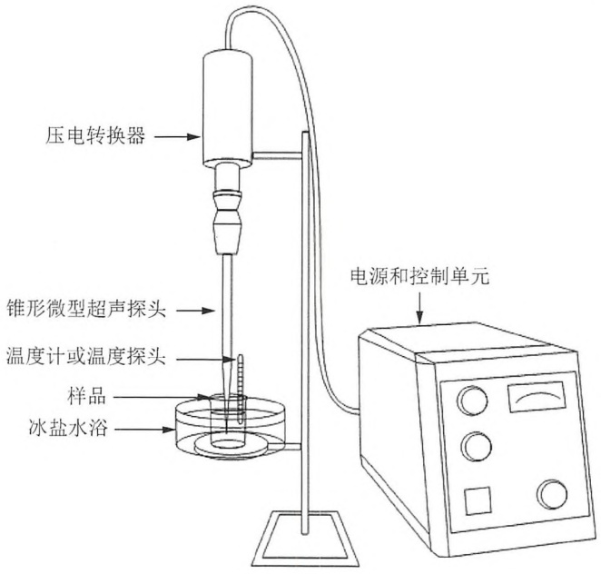

<details>
<summary>text_image</summary>

压电转换器
锥形微型超声探头
温度计或温度探头
样品
冰盐水浴
电源和控制单元
</details>

图 19-7 超声装置。一台配备微型超声探头的典型超声仪。超声仪的探头尖端插入了被冰盐水浴环绕并冷却的重悬细胞（样品）中。隔音箱和护耳产品未显示。

---

第 19 章 克隆基因的表达以及目的蛋白的纯化和分析

1295

触的样品，从而产生微泡。当这些气泡碰撞时，会产生足以裂解细胞的冲击波，并能够切碎核酸，降低样品的黏稠度。超声过程中产生的热必须传导散去，以防破坏样品。大多数情况下，在超声过程及间隔期，将样品持续置于冰盐水浴（-6℃）中可有效防止样品因过热而受到破坏。由于长期暴露于超声仪产生的高频声波中会引起听力损伤(Mason and Peters 2002)，建议将这些超声设备置于隔音箱中，或佩戴合适的护耳产品，或二者同时采用。

## 超声裂解条件的优化

蛋白质、宿主细胞结构和生长条件的不同，要求根据经验优化超声裂解的条件。需要优化的参数包括:细胞浓度、施加在样品上的功率大小、超声处理持续时间和冷却周期，以及所用设备（尤其是探针或探头型号）。细胞浓度取决于向菌体沉淀中加入的裂解缓冲液的量。推荐缓冲液与菌体沉淀的体积比不低于3:1，但更高的比例则更优，如5～10倍体积的缓冲液（Grabski 2009）。施加在样品上的功率大小主要取决于能量输出和占空比设置。能量输出决定每一次脉冲的总强度，而占空比决定脉冲的起始时间和持续时间。为达到裂解细胞的同时使样品维持在较低的温度（10℃以下），下述方案中给出的参数标准可能还需要进一步优化。可能需要缩短脉冲循环的持续时间和/或延长冷却持续时间，以便样品与周围冰水溶液的温度保持均衡。

探头尖端的尺寸及输出控制设置决定超声的振幅。一般而言，尖端尺寸较大的（0.75～1in）探头会降低输出强度，但适用于裂解较大体积（可达500mL）的样品。更小的超声探头或微型探头（1/16～1/8in）会增加输出强度，可用于更小量体积（低至1mL）样品的超声。近来，Hielscher公司已开发出更精密的设备，可超声裂解低至200μL的样品，应用范围涵盖单个样品到高通量多孔板样品（Borthwick et al. 2005）。

## 酶裂解和反复冻融法

在缺乏可用的特定设备情况下，用溶菌酶裂解加之适度热孵育或反复冻融，可作为一个能够释放细胞中蛋白质的相对温和的备选方案（参见本方案的替代方案）(Ron et al. 1966; Wickner and Kornberg 1974)。这些方法的效率取决于冻融的次数、冻结的快慢及细胞悬液的浓度。然而，对于裂解大肠杆菌，仅依靠反复冻融，其裂解效率不如弗氏细胞破碎器或者超声破碎（Benov and Al-Ibraheem 2002）。加入溶菌酶消化细胞壁，能够极大地提高裂解效率（Ron et al. 1966）。适度的热孵育或慢慢地冻融细胞悬液，能够使大肠杆菌外膜破裂，暴露出细胞壁以便溶菌酶消化。这些方法不需要特定的设备，而且对于一些易于受到机械损伤的蛋白质，可能优于超声裂解法。然而，在其他情况下，反复多次的冻融可能影响回收蛋白的活性。另外一个潜在的弊端就是加入大量溶菌酶，可能会干扰蛋白质的检测与纯化，特别是当目标蛋白与溶菌酶（约 $14\mathrm{kDa}$ ）大小相近时。

## 蛋白酶抑制剂

细胞裂解后，释放出的目标蛋白易于受到细胞蛋白酶的降解及溶液中氧气的氧化。因此，强烈推荐添加能够抑制特定蛋白酶家族的蛋白酶抑制剂，如丝氨酸蛋白酶抑制剂[PMSF、Pefabloc、亮抑蛋白酶肽、抑肽酶（aprotinin）或苯甲脒]、半胱氨酸蛋白酶抑制剂（PMSF、亮抑蛋白酶肽或E-64），金属蛋白酶抑制剂[EDTA、磷酰二肽（phosphoramidon）或抑氨肽酶（bestatin）]及天冬氨酸蛋白酶抑制剂（抑肽素），同时加入还原剂（DTT或β-巯基乙醇）。细胞裂解后，在进行方案5和方案6中提到的纯化之前，需要通过离心将可溶的蛋白质与细胞碎片和未裂解细胞分离。

---

1296

分子克隆实验指南（原书第四版）

## 昆虫细胞裂解注意事项

相对大肠杆菌和酵母细胞而言，昆虫细胞更加脆弱也更容易裂解。可以使用温和的超声操作裂解昆虫细胞，进而纯化其胞内蛋白质（本操作步骤示例可参见 Altmann et al. 1995）。

## 超声裂解法

1. 将昆虫细胞用适于纯化的缓冲液（如 20mmol/L 磷酸钠，pH7.4，0.5mol/L NaCl）重悬至 $10^{7}$ 个细胞/mL。按方案 4 中所述，加入还原剂、蛋白酶抑制剂、RNA 酶和 DNA 酶。
2. 将样品置于冰水浴中，用 30W 功率超声 3 次，每次持续 10s。
3. 10 000g 离心 10min，去除细胞碎片，收集上清用于纯化。
4. 可通过光学显微镜，或上清和沉淀组分的免疫印迹反应，监测细胞裂解程度。

## 机械裂解法

昆虫细胞也可用杜恩斯匀浆器（Dounce homogenizer）或针管抽拉（Wadzinski et al. 1992; Gimpl et al. 1995）等机械方法进行裂解。

## 非离子去污剂

另外一种方法，如果去污剂不影响随后的纯化步骤或应用，昆虫细胞也可通过加入去污剂裂解，如1%的IGEPAL CA-630（相当于市场上已经停售的Nonidet P-40）（本步骤示例详见Licari and Bailey 1991）。现在，多种基于非离子去污剂的昆虫细胞裂解剂已经上市，包括I-PER（Pierce）和昆虫细胞裂解缓冲液（BD Biosciences公司）。

1. 按方案 4 中所述加入适量还原剂、蛋白酶抑制剂、RNA 酶和 DNA 酶的缓冲液，将细胞重悬至  $0.25 \times 10^{7} \sim 0.5 \times 10^{7}$  个细胞/mL。
2. 加入去污剂后在冰上孵育 20min。
3. 离心去除细胞碎片，收集上清用于纯化。

## 附加方案 酵母细胞玻璃珠裂解法

首选的中/大规模酵母细胞裂解方法是机械剪切，本方案将描述借助玻璃珠在珠磨式组织研磨器（BeadBeater）中裂解酵母细胞的方法。也可以使用其他方法，如利用酵母消解酶（zymolyase）消化裂解细胞壁、弗氏细胞破碎器（Lerner-Marmarosh et al. 1999）以及最近报道的微射流（microfluidization）方法（Aller et al. 2009）。用于酵母细胞裂解的玻璃珠第一次使用前需经酸清洗，每次使用后通过温和去污剂清洗，再经盐酸处理即可反复使用。


## 附加材料

为正确使用本方案中的器材和危险试剂，必须查阅相应的材料安全数据表并咨询所在机构的环境卫生和安全办公室。

本方案的专用试剂标注&lt;R&gt;，配方在本方案末提供。常用储备溶液、缓冲液和试剂标注&lt;A&gt;，配方见附录1。储备溶液应

---

第 19 章 克隆基因的表达以及目的蛋白的纯化和分析

1297

稀释至适用浓度后使用。

## 试剂

细胞（来自于方案3，步骤33）

乙醇/湿冰

HAEMO-SOL 去污剂

用于清洁医学仪器和实验室设备；溶解血渍和蛋白质类污垢。

盐酸（0.5mol/L）

匀浆缓冲液&lt;R&gt;

蛋白酶抑制剂:PMSF、抑肽素 A、亮抑蛋白酶肽和糜蛋白酶抑制剂（chymostatin）

可以加入其他蛋白酶抑制剂；其储备液配制及使用浓度参见主体方案中的试剂清单。

Tris-HCl (1mol/L, pH8.8) (参见步骤9)

冰冷的 Tris-HCl 缓冲液（10mmol/L，pH7.5）&lt;A&gt;

## 设备

珠磨式组织研磨器(配备 15mL、50mL 或 350mL 聚碳酸酯研磨腔室)(BioSpec Products, Glen Mills 公司)

玻璃珠（425～600μm, Sigma-Aldrich 公司，目录号 G-9268；或 0.5mm 直径，BioSpec 公司，目录号 11079105）

干燥炉

通风柜

玻璃烧杯（1L）及玻璃棒


## 方法

## 酸洗玻璃珠的制备

1. 如果玻璃珠是用过的，可在 1L 的大口烧杯中用水冲洗干净。用玻璃棒搅拌将有助此步及后续实验。如果玻璃珠是新的，直接进行步骤 4。
2. 向大烧杯中加入 500mL 水、2g HAEMO-SOL 去污剂，搅拌均匀并浸泡至少 20min。
3. 弃去上清，用 1L 水清洗玻璃珠 8 次。
4. 向玻璃珠中加入 500mL 0.5mol/L 的 HCl，用玻璃棒混匀，将混合液置于通风柜中 10min。

若用新珠子，可从此步酸洗开始。

5. 弃去上清，用水清洗玻璃珠 10 次，或者直至溶液 pH 为中性。

6. 倒掉多余的水，将玻璃珠置于  $85^{\circ}$ C 干燥炉中过夜烘干。使用前预冷玻璃珠。

## 使用玻璃珠裂解酵母细胞

7. 在  $30^{\circ}$ C 水浴中轻轻搅拌冷冻的细胞（来源于方案 3，步骤 33）使之解冻，然后立即将细胞转移至冰上。从这步开始，所有步骤均需在  $4^{\circ}$ C 条件下进行。
8. 转移细胞悬液至置于冰上的珠磨式组织研磨器腔室内，加入新鲜的蛋白酶抑制剂，计算并加入所需酸洗玻璃珠的体积，使其终浓度为 $40\% (V / V)$ （如向 $50\mathrm{mL}$ 的研磨腔室加入 $20\mathrm{mL}$ 的玻璃珠）。向研磨腔室中加入匀浆缓冲液刚好至刻度线以下，然后组装珠磨式组

---

1298

分子克隆实验指南（原书第四版）

织研磨器。注意避免将气泡引入研磨腔室。将乙醇/湿冰加入冷却套管至 2/3 处，立即进行打浆。每间隔 1～2min 打浆 1min，打浆时间共计 3～5min。如果需要，可更换冷却套管中冰块，以维持细胞悬液在 10℃以下，但应避免冻结。

珠磨式组织研磨器腔室大小有 15mL、50mL 和 350mL 3 种（BioSpec 公司）。为获得最好的结果，细胞碎裂时的细胞终浓度应保持低于 50%（每 2mL 缓冲液中的细胞<1g）；也就是说，10～15g 细胞选用 50mL 研磨腔室。当细胞体积较大时（也就是用 350mL 研磨腔室时），为了更有效降温，冷却套管中的乙醇/湿冰可以替换为异丙醇/干冰；且可以增加打浆循环数至总计时间为 10～12min。

▲ 细胞裂解过程中需要加入蛋白酶抑制剂，以保护目标蛋白不被蛋白酶降解，如丝氨酸蛋白酶抑制剂（PMSF、亮抑蛋白酶肽和苯甲脒）、半胱氨酸蛋白酶抑制剂（PMSF、E-64）、天冬氨酸蛋白酶抑制剂（抑肽素A）、金属蛋白酶抑制剂（EDTA、EGTA）或糜蛋白酶抑制剂。储备液配置方法及工作浓度，参见方案4导言部分中的“蛋白酶抑制剂”信息栏。

9. 反转并拆卸珠磨式组织研磨器。立即加入新鲜的 PMSF（1mmol/L）。如果需要，可用 1mol/L Tris-HCl（pH 8.8）将悬液的 pH 调节至 7.4。当玻璃珠沉淀后，先将液体倒入一个预冷的烧杯中，再转入预冷的离心瓶中。用一半体积预冷的 10mmol/L 的 Tris-HCl 缓冲液（pH7.5）冲洗玻璃珠 3 次，并将这些清洗液也加入离心瓶。
10. 匀浆液 3500g 离心 15min。将上清转移至新的离心瓶，弃沉淀（细胞核和未破碎的细胞）。上清液 14000g 离心 30min。小心去除这第二份“软（soft）”沉淀（线粒体等细胞器）。
11. 对于可溶性蛋白，可以 $150000\mathrm{g}$ 离心 $1\mathrm{h}$ 净化上清液。对于膜蛋白，收集 $150000\mathrm{g}$ 离心沉淀，并用适合下游纯化的缓冲液将其重悬（Lerner-Marmarosh et al. 1999）。如果表达的蛋白质带有组氨酸标签，可按方案5中所描述的方法，继续进行纯化。

更为详细的细胞分离方案，可参考 McNamee（1989）、Rieder 和 Emr（2001），以及 Chang 等（2008）。也可参见信息栏“膜蛋白纯化的策略”。

如果目标蛋白欲通过镍亲和层析纯化，匀浆缓冲液中应避免加入 EDTA、EGTA 或其他螯合剂。这些螯合剂会将  $Ni^{2+}$  从亲和树脂上去除，破坏树脂与组氨酸的结合能力。此外，需用能与大多数镍螯合树脂兼容的 2mmol/L β-巯基乙醇或 0.5mmol/L 三（2-羧乙基）膦（TCEP）替换匀浆缓冲液中还原性很强的 DTT（参见方案 5 导言部分）。

# 替代方案 温和的热诱导的酶裂解法制备大肠杆菌细胞提取物

本方案结合了溶菌酶处理法与短时、适度热孵育法。该方案无须使用特定设备，就可以高效、温和地裂解细胞。如果操作仔细，细菌染色体 DNA 基本上可以保持完整，并和细胞碎片一起，通过离心，从可溶性提取物中方便地去除。

本方案承蒙约翰·霍普金斯大学的 Roger McMacken 和 Brian A. Learn 提供，修改自 Wickner 和 Kornberg（1974）方法。


## 材料

为正确使用本方案中的器材和危险试剂，必须查阅相应的材料安全数据表并咨询所在机构的环境卫生和安全办公室。

---

第19章 克隆基因的表达以及目的蛋白的纯化和分析

1299

本方案的专用试剂标注&lt;R&gt;，配方在本方案末提供。常用储备溶液、缓冲液和试剂标注&lt;A&gt;，配方见附录1。储备溶液应稀释至适用浓度后使用。

## 试剂

细胞沉淀（来源于方案1，步骤15）

二硫苏糖醇（DTT，1mol/L）

现用现配或分装冻存于-20℃。

欲进行固化的金属亲和层析（IMAC）法纯化的样品，可使用β-巯基乙醇（2mmol/L）代替 DTT。

溶菌酶（20mg/mL）溶于50mmol/L Tris-HCl（pH 8.0）、1mmol/L EDTA、甘油（50%，V/V） $^{①}$

分装冻存于-20℃。

NaCl（5mol/L）或者 KCl（3mol/L）

PMSF（100mmol/L溶于异丙醇）或其他市售的蛋白酶抑制剂

氯化亚精胺（可选；参见步骤7）

Tris-碱（2mol/L）

Tris-蔗糖缓冲液&lt;A&gt;

## 设备

液氮

pH 试纸

SDS-PAGE 电泳仪或其他可用方法所需设备

Sorvall 型离心机转子（可选，参见步骤 7）


## 方法

1. 用等量的冰冷的 Tris-蔗糖缓冲液重悬除水后的细胞沉淀，将重悬液在液氮中冷冻，冻存于-80℃。
2. 在 $10^{\circ}\mathrm{C}$ 冷水浴中解冻细胞悬液，可偶尔轻轻搅拌。加入冷的Tris-蔗糖缓冲液至细胞浓度为 $0.2\mathrm{g / mL}$ （约 $\mathrm{OD}_{595\mathrm{nm}} = 200$）。样品完全融化后，将样品置于冰上。取出极少量悬液用试纸测其 $\mathrm{pH}$，用 $2\mathrm{mol / L}$ 的Tris-碱将 $\mathrm{pH}$ 调至8.0左右。
3. 加入所需的还原剂和蛋白酶抑制剂（如方案 4 步骤 1～步骤 2 所述）。
4. 加入 5mol/L NaCl 或者 3mol/L KCl 至终浓度为 0.1\~0.2mol/L，轻轻颠倒混匀。
5. 加入溶菌酶至终浓度为 0.25mg/mL，轻轻混匀后在冰上孵育 30～45min。
6. 将细胞悬液转移至离心管或离心瓶中，置于  $37^{\circ}$ C 中孵育，每隔  $30 \sim 60$ s 轻轻将其颠倒混匀。孵育  $2 \sim 4$ min 后，将离心管置于冰上孵育 30min。

获得完全裂解通常需要细胞悬液温度为  $15 \sim 20^{\circ}C$ 。为了获得完全裂解效果，如果需要，可以将  $37^{\circ}C$  的孵育过程延长几分钟。

7. 如果目标蛋白能够结合 DNA，可调整裂解产物中 NaCl 或者 KCl 的浓度，使其浓度  $\geqslant 0.5 \, mol/L$ ，以阻断蛋白质与 DNA 的结合。纯化裂解产物，可于  $4^{\circ}C$  条件下超速离心（200 000g）1h。或者，向裂解产物中加入氯化亚精胺至终浓度为 15mmol/L，用 Sorvall 型离心机转子在 20 000g 条件下离心；然而，这样可能导致一些可溶性细胞提取物的丢失，

<small><span class="docvortex-page-footnote" data-block-type="page_footnote" style="color:#6b7280">① 译者注:原文为 $1\mathrm{mmol / L}$ EDTA（$50\%$, $V / V$），glycerol；但通常来说，液体试剂才使用体积比配制，故译者改为甘油体积比 $50\%$。</span></small>

---

1300

分子克隆实验指南（原书第四版）

因为染色体 DNA 和细胞碎片不会被紧密沉淀。

8. 将上清倒入或吸入置于冰上的新离心管中，保留一份样品进行 SDS-PAGE 检测（见方案 8）或其他可用方法。

# 替代方案 用溶菌酶裂解和冻融法联用制备大肠杆菌细胞提取物

当目标蛋白或其特定活性区域对机械方法或热胁迫方法特别敏感时，冻融裂解辅以溶菌酶可能是裂解的首选方法。然而，这种方法可能没有方案4中描述的酶解超声法效果好。

本方案承蒙约翰·霍普金斯大学的 Roger McMacken 和 Brian A. Learn 提供，修改自 Fuller 等（1981）方法。


## 材料

为正确使用本方案中的器材和危险试剂，必须查阅相应的材料安全数据表并咨询所在机构的环境卫生和安全办公室。

本方案的专用试剂标注&lt;R&gt;，配方在本方案末提供。常用储备溶液、缓冲液和试剂标注&lt;A&gt;，配方见附录1。储备溶液应稀释至适用浓度后使用。

## 试剂

细胞沉淀（来源于方案1，步骤15）

鸡蛋溶菌酶（20mg/mL）溶于50mmol/L Tris-HCl（pH 8.0）、1mmol/L EDTA、甘油（体积比50%） $^{①}$

分装冻存于-20℃。

二硫苏糖醇（DTT，1mol/L）

现用现配或分装冻存于-20℃。

欲进行固化的金属亲和层析（IMAC）法纯化的样品，可使用β-巯基乙醇（2mmol/L）代替 DTT。

冻融裂解缓冲液&lt;R&gt;

此缓冲液中  $MgCl_{2}$  能够稳定核糖体结构，从而确保大部分核糖体蛋白在超速离心过程中能从可溶性蛋白提取物中去除。

PMSF（100mmol/L 溶于异丙醇）或其他市售的蛋白酶抑制剂

Tris-碱（2mol/L，pH 8.0）

## 设备

冷水浴和冰

pH 试纸

SDS-PAGE 电泳仪或其他可用方法所需设备

Sorvall 离心机（可选；参见步骤 6）

<small><span class="docvortex-page-footnote" data-block-type="page_footnote" style="color:#6b7280">① 译者注:原文为 1 mmol/L EDTA（50%, V/V），glycerol；但通常来说，液体试剂才使用体积比配制，故译者改为甘油体积比 50%。</span></small>

---

第 19 章 克隆基因的表达以及目的蛋白的纯化和分析

1301


## 方法

1. 用冰冷的冻融裂解缓冲液重悬除水后的细胞沉淀，至  $OD_{595nm}$  为 30～350，将重悬液在液氮中冷冻后，冻存于-70℃。
2. 在冷水浴中解冻细胞悬液，可偶尔轻轻搅拌。样品完全融化后，将样品置于冰上。取出极少量悬液用试纸测其 pH，用 2mol/L 的 Tris-碱将 pH 调至 8.0 左右。
3. 加入所需的还原剂和蛋白酶抑制剂（如方案 4 步骤 1 和步骤 2 所述）。
4. 加入溶菌酶至终浓度为 0.25mg/mL，彻底混匀后在冰上孵育 30min。
5. 将细胞悬液在液氮中冷冻 10min，再按上述方法使其融化。裂解产物应十分黏稠。对于某些大肠杆菌菌株来说，要达到完全裂解，需要增加冻融循环次数。
6. 如果目标蛋白能够结合 DNA，可调整裂解产物中 NaCl 或者 KCl 的浓度，使其浓度  $\geqslant 0.5 \, mol/L$ 。纯化裂解产物，可于  $4^{\circ}C$  条件下超速离心（200 000g）1h。或者，裂解产物可以使用 Sorvall 型离心机，在 20 000g 条件下离心，但此方法可溶性提取物的回收率低。
7. 将上清倒入或吸入置于冰上的新离心管中，保留一份样品进行 SDS-PAGE 检测（参见方案 8）或其他可用方法。

如果需要进一步优化裂解效果，以下参数可做相应调整:冻融循环次数、冷冻速率及细胞悬浮液浓度（取决于加入的冻融裂解缓冲液的量）。

含有 pLysS 质粒（Studier 1991）的细胞，即使不加入鸡蛋溶菌酶，也可用这种方法有效裂解。


## 配方

为正确使用本方案中的器材和危险试剂，必须查阅相应的材料安全数据表并咨询所在机构的环境卫生和安全办公室。

冻融裂解缓冲液

<table><tr><td>试剂</td><td>所需量(配制1L)</td><td>终浓度</td></tr><tr><td>Tris碱(1mol/L,pH 8.0)或HEPES-KOH (1mol/L,pH 7.5)</td><td>25~50mL</td><td>25~50mmol/L</td></tr><tr><td rowspan="2">NaCl或KCl</td><td>4.68~14.61g(NaCl)</td><td>80~250mmol/L</td></tr><tr><td>5.96~18.64g(KCl)</td><td></td></tr><tr><td>无水 $MgCl_{2}^{a}$ </td><td>0.19g</td><td>2mmol/L</td></tr></table>

储存于  $4^{\circ}$ C。

a. 或者用 1\~2mmol/L 的 EDTA 替代  $MgCl_{2}$  以增加裂解效率并防止目标蛋白被金属蛋白酶水解。

用于酵母的匀浆缓冲液

| 试剂 | 所需量(配制1L) | 终浓度 |
| --- | --- | --- |
| 蔗糖 | 113g | 0.33mol/L |
| Tris-Cl(1mol/L,pH 8.0) | 300mL | 0.3mol/L |
| EDTA (0.4mol/L,pH 8.0) | 2.5mL | 1mmol/L |
| EGTA(0.4mol/L,pH 8.0) | 2.5mL | 1mmol/L |
| 二硫苏糖醇(DTT) | 0.31g | 2mmol/L |
| 6-氨基己酸(EACA) | 13.1g | 100mmol/L |

$4^{\circ}$ C 可储存一周，若要储存更久，DTT 应在使用前现加。

---

1302

分子克隆实验指南（原书第四版）

超声缓冲液

| 试剂 | 所需量(配制1L) | 终浓度 |
| --- | --- | --- |
| Tris Cl(1mol/L,pH 8.0) | 50mL | 50mmol/L |
| NaCl | 29.22g | 500mmol/L |
| 无水甘油 | 150mL | 15%(V/V) |
| 咪唑(用于IMAC法纯化蛋白质) | 0.68g | 10mmol/L |

$4^{\circ}\mathrm{C}$ 储存。

## 参考文献

- Aller SG, Yu J, Ward A, Weng Y, Chittaboina S, Zhuo R, Harrell PM, Trinh YT, Zhang Q, Urbatsch IL, et al. 2009. Structure of P-glycoprotein reveals a molecular basis for poly-specific drug binding. Science 323:1718–1722.
- Altmann F, Schwihla H, Staudacher E, Glossl J, Marz L. 1995. Insect cells contain an unusual, membrane-bound β-N-acetylglucosaminidase probably involved in the processing of protein N-glycans. J Biol Chem 270: 17344–17349.
- Benov L, Al-Ibraheem J. 2002. Disrupting Escherichia coli: A comparison of methods. J Biochem Mol Biol 35: 428–431.
- Borthwick KA, Coakley WT, McDonnell MB, Nowotny H, Benes E, Groschl M. 2005. Development of a novel compact sonicator for cell disruption. J Microbiol Methods 60: 207–216.
- Chang J, Ruiz V, Vancura A. 2008. Purification of yeast membranes and organelles by sucrose density gradient centrifugation. Methods Mol Biol 457: 141–149.
- Fuller RS, Kaguni JM, Kornberg A. 1981. Enzymatic replication of the origin of the Escherichia coli chromosome. Proc Natl Acad Sci 78: 7370–7374.
- Gimpl G, Klein U, Reilander H, Fahrenholz F. 1995. Expression of the human oxytocin receptor in baculovirus-infected insect cells: High-affinity binding is induced by a cholesterol-cyclodextrin complex. Biochemistry 34: 13794–13801.
- Grabski AC. 2009. Advances in preparation of biological extracts for protein purification. Methods Enzymol 463: 285–303.
- Hawkins CL, Davies MJ. 2001. Generation and propagation of radical reactions on proteins. Biochim Biophys Acta 1504: 196–219.
- Lemer-Marmarosh N, Gimi K, Urbatsch IL, Gros P, Senior AE. 1999. Large scale purification of detergent-soluble P-glycoprotein from Pichia pastoris cells and characterization of nucleotide binding properties of wild-type, Walker A, and Walker B mutant proteins. J Biol Chem 274: 34711–34718.
- Licari P, Bailey JE. 1991. Factors influencing recombinant protein yields in an insect cell-baculovirus expression system: Multiplicity of infection and intracellular protein degradation. Biotechnol Bioeng 37:238–246.
- Mason TJ, Peters D. 2002. Practical sonochemistry: Power ultrasound uses and applications. Harwood Publishing, Chichester, UK.
- McNamee MG. 1989. Isolation and characterization of cell membranes. BioTechniques 7: 466–475.
- Rieder SE, Emr SD. 2001. Isolation of subcellular fractions from the yeast Saccharomyces cerevisiae. Curr Protoc Cell Biol 3; 3.8.1–3.8.68.
- Ron EZ, Kohler RE, Davis BD. 1966. Polysomes extracted from Escherichia coli by freeze-thaw-lysozyme lysis. Science 153: 1119–1120.
- Studier FW. 1991. Use of bacteriophage T7 lysozyme to improve an inducible T7 expression system. J Mol Biol 219: 37–44.
- Wadzinski BE, Eisfelder BJ, Peruski LF Jr, Mumby MC, Johnson GL. 1992. NH₂-terminal modification of the phosphatase 2A catalytic subunit allows functional expression in mammalian cells. J Biol Chem 267:16883–16888.
- Wickner W, Kornberg A. 1974. A holoenzyme form of deoxyribonucleic acid polymerase. III. Isolation and properties. J Biol Chem 249:6244–6249.

## 方案 5 采用固化的金属亲和层析纯化多聚组氨酸标记的蛋白质

固化的金属亲和层析(IMAC)是基于多聚组氨酸能在色谱树脂上与二价金属阳离子(通常是 $\mathrm{Ni}^{2+}$)结合形成过渡金属螯合物(参见综述Bornhorst and Falke 2000; Block et al. 2009)。由于天然蛋白对固化二价金属离子的亲和力都不高，而重组的多聚组氨酸标记的蛋白质只需用金属螯合亲和层析这一步骤，其纯度就接近均质化（homogeneity）。清洗步骤可以去除绝大部分能与树脂结合的污染蛋白，通过可溶性竞争螯合剂洗脱即可得到感兴趣的目标蛋白。IMAC过程中通常需要考虑多聚组氨酸标签的易接近性、金属离子和螯合剂基质的类型，以及结合、清洗、洗脱过程中缓冲液的组分及其pH。金属亲和层析技术流行的原因是，其不仅高效，而且对蛋白质折叠、离子强度、离液剂和去污剂相对不敏感（Hochuli et al. 1988)。由于具有很高的结合能力，$1\mathrm{mL}$ 的IMAC树脂最多可纯化 $50\mathrm{mg}$ 的重组蛋白（如QIAGEN公司 $\mathrm{Ni}^{2+}$-NTA琼脂糖可纯化 $2.5\mu \mathrm{mol}20\mathrm{kDa}$ 蛋白）。鉴于其高效、高容量、高浓缩能力和快速的特点，该方法常常作为制订纯化方案的首选策略（有时是唯一策略）。详细

---

第 19 章 克隆基因的表达以及目的蛋白的纯化和分析

1303

的 IMAC 技巧将在讨论部分中叙述。

下述主体方案优化了一个使用  $Ni^{2+}-NTA$  树脂纯化带有六聚组氨酸标签可溶性蛋白的简单批处理方法（batch method），涵盖结合步骤、随后的重力流（gravity flow）清洗及洗脱。这种方法只需要一个简单的玻璃柱或塑料柱，不需要其他特定仪器设备。IMAC 树脂可应用于多种方式，包括批处理、重力流、离心柱和快速蛋白液相色谱（FPLC）系统。替代方案将介绍使用 FPLC 方法纯化六聚组氨酸标签蛋白。附加方案将介绍 IMAC 树脂再次使用所需的清洗与再生。最后，纯化蛋白质的保存注意事项将在信息栏“储存期间蛋白质品质的保持”中讨论。


## 材料

为正确使用本方案中的器材和危险试剂，必须查阅相应的材料安全数据表并咨询所在机构的环境卫生和安全办公室。

本方案的专用试剂标注&lt;R&gt;，配方在本方案末提供。常用储备溶液、缓冲液和试剂标注&lt;A&gt;，配方见附录1。储备溶液应稀释至适用浓度后使用。

▲ 注意:纯化过程中所用到的水及化学试剂应确保高纯度，并在使用前用  $0.45 \mu m$  的滤膜过滤，以免污染或阻塞柱子。所有的缓冲液应该在  $4^{\circ}C$  条件下使用。高纯度的咪唑在 280 nm 处的吸光值应当较低或没有。

## 试剂

β-巯基乙醇（5mmol/L）（可选）

当目标蛋白序列中含有半胱氨酸时，可在裂解、结合、清洗、洗脱及透析缓冲液中加入低浓度（1～5mmol/L）的β-巯基乙醇。低浓度的β-巯基乙醇不会还原树脂上的金属离子。

细胞裂解产物（来自于方案4）

含可溶性组氨酸标签蛋白的澄清细胞提取物（来自于方案1、方案2或方案3，并由方案4裂解）

考马斯亮蓝（见信息栏“历史注脚:考马斯亮蓝”）

透析缓冲液和洗涤缓冲液 2&lt;R&gt;

如果计划不进行第二轮 IMAC 实验，建议加入 0.5mmol/L EDTA（pH 8.0），以便去除金属离子。根据目标蛋白的蛋白酶敏感性及半胱氨酸含量，可以酌情加入蛋白酶抑制剂和β-巯基乙醇。

IMAC 结合缓冲液&lt;R&gt;

结合缓冲液中含有 10mmol/L 咪唑，能够减少非标签、杂质蛋白的结合；增加树脂对标签蛋白的结合能力；并可提高纯度、减少步骤。如果标签蛋白在这种状态下不能结合，则需要降低咪唑的浓度（1～5mmol/L）。与之相反，如果目标蛋白在非常高的咪唑浓度下才能洗脱，则可以将 IMAC 结合缓冲液、洗涤缓冲液中的咪唑浓度进一步提高到 30mmol/L，以减少污染。

相同浓度的咪唑应该出现在特定的细胞溶解产物。用 HCl 调整 pH8.0 的咪唑 1mol/L 储存液可以方便地稀释至所需浓度的结合、洗涤和洗脱缓冲液。推荐高纯度（99%）的咪唑（例如，Sigma-Aldrich/Fluka BioUltra）。

IMAC 洗涤缓冲液&lt;R&gt;

具有高亲和力的组氨酸标签蛋白在 20mmol/L 咪唑浓度下，依然会保持与树脂的结合。如上所述，结合缓冲液、洗涤缓冲液中的咪唑含量需要针对特定目标蛋白进行优化。

咪唑洗脱缓冲液&lt;R&gt;

洗脱可以通过本方案提供的梯度洗脱步骤完成，或者可以通过检测一系列不同浓度咪唑（50mmol/L、100mmol/L、150mmol/L、250mmol/L和500mmol/L）的洗脱效果，从而优化洗脱液中的咪唑浓度，提高纯度。线性梯度洗脱，如使用FPLC系统（参见替代方案“组氨酸标签蛋白的快速液相色谱纯化”），能够进一步改善目标蛋白与杂质蛋白的分离效果。

含 SDS（十二烷基硫酸钠）的聚丙烯酰胺凝胶

---

1304

分子克隆实验指南（原书第四版）

蛋白分离所需的 SDS-PAGE 凝胶制备方法，参见方案 8。

$5 \times$ SDS 缓冲液 $< \mathrm{A} >$

可以加入温和的去污剂，如 Tween 20、Triton X-100 或 IGEPAL（原 Nonidet P-40 或 NP-40），以提高溶解度和/或降低非特异性结合。

## 设备

Beckman JA20、Sorvall SS-34 或 SA600 转子或等效转子，以及 40～50mL 的离心管透析管

具有底孔帽的重力流色谱柱（玻璃材质或聚丙烯材质）

$\mathrm{Ni}^{2+}$-NTA琼脂（QIAGEN公司）或类似的IMAC色谱树脂（如GE Healthcare公司；IMAC Resin，Life Technologies公司； $\mathrm{Ni}^{2+}$-NTA琼脂或HisLink，Promega公司）

几种不同公司的树脂，特性稍有不同，但均可用作 IMAC 纯化。 $Ni^{2+}$ -NTA 树脂是 IMAC 纯化初期比较流行的柱子。本方案适用于 QIAGEN 公司的  $Ni^{2+}$ -NTA 琼脂树脂。

平板摇床（Rocking platform）或试管旋转器（如 Thermo Scientific 公司的 Labquake）


## 方法

## IMAC 树脂的制备

1. 将含有固化金属离子的 $\mathrm{Ni}^{2+}$ 树脂轻轻颠倒混匀，取 $1\mathrm{mL}$ 树脂混悬液（$50\%$，$V/V$）到离心管中，$1000\mathrm{g}$ 离心 $10\mathrm{s}$ 后，小心吸出上清弃去。

纯化一定量目标蛋白所需的树脂量需要优化。根据不同样品，QIAGEN公司的$\mathrm{Ni}^{2+}$-NTA IMAC树脂每毫升可结合5～10mg的蛋白质。尽可能用最少量的树脂去结合一定量的目标蛋白。树脂的使用量超过所需量，容易增加非特异蛋白的结合，使用量过少则会损失一些目标蛋白。树脂结合蛋白质的能力随金属离子、螯合剂及厂商的不同而有所差异。螯合剂和金属离子的选择细节参见本方案导言部分。如果树脂没有进行填装，再填装方法参见附加方案“$\mathrm{Ni}^{2+}$-NTA树脂的清洗与再生”。方案1获得的1L的大肠杆菌培养物，建议的树脂混悬液起始量是1mL。

2. 加入 1.5mL（或 3 倍沉降树脂柱床体积）除菌蒸馏水清洗树脂，并轻轻混匀。树脂混悬液 1000g 离心 10s，弃上清。

柱床体积相当于树脂沉降床的体积。例如，如果加入 1mL 50% 的树脂混悬液，则柱床体积为 0.5mL。因此，清洗和平衡所需溶液体积取决于所用树脂的量。

3. 加入 $1.5 \mathrm{~mL}$ （或 3 倍柱床体积）的 IMAC 结合缓冲液平衡树脂。将树脂与缓冲液混匀，$1000 \mathrm{~g}$ 离心 $10 \mathrm{~s}$，弃上清。至此，树脂已准备好，可用于步骤 5。

## 多聚组氨酸标签蛋白的纯化

4. 按方案 4 中所述准备细胞裂解产物。

▲ 此步骤可能需要加入蛋白酶抑制剂，但不要加入 EDTA 或其他螯合剂。这些螯合剂能够去除亲和树脂中的金属离子，从而破坏树脂结合组氨酸的能力。

5. 将澄清的细胞裂解产物加入步骤 3 制备好的  $Ni^{2+}$ -NTA 树脂中，并在振荡台上  $4^{\circ}C$  混匀孵育 1h。

6. 将已结合蛋白的树脂转入一个干净的、具有底孔帽的色谱柱（聚丙烯或玻璃材质）中。等待树脂在重力流作用下填充，并确保树脂床没有残留空气。移除底孔帽，使细胞裂解产物流出。

保留少量细胞裂解物和穿透液用于 SDS-PAGE 分析:将  $15 \mu L$  液体与  $5 \mu L$   $5 \times$  SDS 加样缓冲液混合，在加热块上  $85^{\circ}C$  加热 2min。使用前，将此样品保存在  $-20^{\circ}C$  或冰上。

不要让树脂变干。所有步骤尽可能使用冷冻的缓冲液并在  $4^{\circ}$ C 操作。如果没有空柱管，剩下的步骤也可使用一个类似 “IMAC 树脂的制备” 中述及的批处理方案（batch procedure）。

---

第 19 章 克隆基因的表达以及目的蛋白的纯化和分析

1305

7. 用 5mL（或 10 倍柱床体积）的 IMAC 结合缓冲液洗柱。直到流过液的  $A_{280}$  停止降低为止（最好光吸收单位 <0.01）。吸光值测定时用结合缓冲液作为空白对照，因为咪唑在 280nm 处的吸光值在一定程度上取决于其纯度和浓度。

8. 用 1.5mL（或 3 倍柱床体积）的 IMAC 洗涤缓冲液洗柱。

洗涤过程中穿透液的 $\mathrm{A}_{280}$ 在洗脱前预计也将保持较高值。保存洗涤穿透液，直到通过SDS-PAGE分析证实了目标蛋白的位置。

保留少量洗涤穿透液用于SDS-PAGE分析:将 $15\mu \mathrm{L}$ 液体与 $5\mu \mathrm{L}5\times \mathrm{SDS}$ 加样缓冲液混合，在加热块上 $85^{\circ}C$ 加热 $2\mathrm{min}$ 。使用前，将此样品保存在 $-20^{\circ}C$ 或冰上。

## 多聚组氨酸标签蛋白的洗脱

9. 用 $2\mathrm{mL}$ （或4倍柱床体积）的咪唑洗脱缓冲液，洗脱结合的蛋白质。从柱上收集 $0.5\mathrm{mL}$ （或1倍柱床体积）的液体组分，随后将柱子封帽并静置 $10\mathrm{min}$ 。重复3次，并监测每个组分的 $\mathrm{A}_{280}$ 。

或者，通过逐渐增加咪唑浓度（50mmol/L、100mmol/L、250mmol/L 和 500mmol/L）梯度洗脱蛋白质，从而优化咪唑浓度并提高蛋白质纯度。大部分多聚组氨酸标签蛋白会在咪唑浓度为 100～250mmol/L 时洗脱，但是洗脱所需的确切浓度还是依赖于目标蛋白属性。除了使用咪唑洗脱外，结合蛋白也可以使用逐渐降低 pH 的缓冲液进行洗脱。

如本方案导言述及，如果在标签与目标蛋白之间设计一个特定的蛋白酶酶切位点，柱上裂解也是一种替代洗脱方法。更多信息请参见方案6信息栏“蛋白酶裂解GST融合蛋白的注意事项”。

保留少量洗脱液用于 SDS-PAGE 分析: 将  $15 \mu L$  液体与  $5 \mu L$   $5 \times$  SDS 加样缓冲液混合, 在加热块上  $85^{\circ}C$  加热 2min。使用前, 将此样品保存在  $-20^{\circ}C$  或冰上。

10. 稍稍复温 SDS-PAGE 样品至  $85^{\circ}$ C，然后将样品加样到适当浓度比例的 SDS-PAGE 凝胶（蛋白的 SDS-PAGE 分析参见方案 8）中。SDS-PAGE 凝胶经考马斯亮蓝染色后，应当能够看到纯化的蛋白质。洗脱组分可以合并，但如果需要样品浓度更高，保持分开。

有时，一次 IMAC 纯化步骤不能获得足够纯度的蛋白质。这种情况下，可以通过特定蛋白酶将多聚组氨酸标签从蛋白质上切除，再进行第二轮 IMAC 纯化。如果融合蛋白缺乏特定的蛋白酶酶切位点，则必须使用另一种纯化策略（如离子交换或分子质量大小排阻层析法）。

11. 如果多聚组氨酸标签与目标蛋白被特定蛋白酶酶切位点隔开，加入相应的蛋白酶。4℃条件下，样品在大量 IMAC 结合缓冲液（步骤 3 中也用过）中透析过夜，以清除多余的咪唑（例如，约 2mL 洗脱液需用 500mL 结合缓冲液，或者体积比 >250:1）。如前述试剂列表中描述，结合缓冲液中咪唑的浓度可能需要优化。

透析能够有选择地稀释溶液中小于透析膜孔径或截留分子质量（MWCO）的组分。可以购买到管状或带状的由再生纤维素或玻璃纸制成的半透膜，这些半透膜的大小范围很广（1～50kDa）。合适半透膜的选择，应当既能阻止感兴趣的蛋白质通过（截留分子质量[MWCO]至少超过目标蛋白质大小的一半），同时又能允许更小的分子自由扩散穿过膜。

蛋白酶的用量及透析缓冲液的条件，都将需要根据特定的蛋白酶和融合蛋白进行调整。融合蛋白仍连接在树脂上时进行酶解也是一种可选策略。更多信息请参见方案6信息栏“蛋白酶裂解GST融合蛋白的注意事项”。

12. 用 3 倍柱床体积的新鲜洗涤缓冲液 2 平衡来自步骤 9 的 Ni$^{2+}$-NTA 树脂。将树脂与缓冲液混匀后，1000g 离心树脂混悬液 10s，弃上清。再重复 2 次（共 3 次），尽可能去除非特异性结合的蛋白质和残留的咪唑。

使用过的透析缓冲液不能用于平衡树脂，因为它被低浓度的咪唑污染了，可能会影响裂解的标签、标签蛋白酶以及其他污染物的结合。

来自步骤 9 的  $Ni^{2+}-NTA$  树脂使用前不需要进行再生，但可以在使用洗涤缓冲液 2 平衡前，先用 0.5mol/L 咪唑 /0.5mol/L 氯化钠清洗。

13. 将透析过的酶解后蛋白加入树脂柱床，在  $4^{\circ}$ C 平板摇床上轻轻混匀 1h。

---

1306

分子克隆实验指南（原书第四版）

14. 将已结合蛋白的树脂转入一个干净的、具有底孔帽的色谱柱（聚丙烯或玻璃材质）中。等待树脂在重力流作用下填充，并确保树脂床没有残留空气。移除底孔帽，使细胞裂解产物流出。

15. 用 3 倍柱床体积的洗涤缓冲液 2 洗柱，每次收集一份 1 倍柱床体积的组分。

保留少量穿透液用于 SDS-PAGE 分析: 将  $15 \mu L$  液体与  $5 \mu L$   $5 \times$  SDS 加样缓冲液混合, 在加热块上  $85^{\circ}C$  加热 2min。使用前, 将此样品保存在  $-20^{\circ}C$  或冰上。

16. 稍稍复温 SDS-PAGE 样品至  $85^{\circ}$ C，然后将样品加样到适当浓度比例的 SDS-PAGE 胶（蛋白质的 SDS-PAGE 分析参见方案 8）。SDS-PAGE 凝胶经考马斯亮蓝染色后，应当能够看到纯化的蛋白质。

洗脱组分可以合并，但如果需要样品浓度更高，保持分开。欲将纯化蛋白以活性形式保存，请参见信息栏“储存期间蛋白质品质的保持”。

## 储存期间蛋白质品质的保持

蛋白质的提取纯化过程使之脱离了其天然环境，从而暴露于可能会导致蛋白质变性、降解或失活的潜在危险环境中（讨论参见Deutscher 2009）。因此，缓冲液及温度条件对于蛋白质的储存至关重要。

## 缓冲液

缓冲条件尽可能保持接近天然状态，同时消除破坏分子（如蛋白酶），往往有助于在储存过程中保存最完整的蛋白质。例如，可溶性胞质蛋白通常产生于相对较低的盐浓度、接近中性的pH、还原条件并且存在高浓度的大分子的环境中。考虑到这些，最佳的蛋白质存储缓冲液通常会包括盐（氯化钠、氯化钾等，50～300mmol/L）、缓冲体系（Tris、HEPES等，25mmol/L）、还原剂（二硫苏糖醇或β-巯基乙醇，1～5mmol/L）、蛋白酶抑制剂（如果需要），以及能够抑制金属诱导氧化和金属蛋白酶的螯合剂（如EDTA，1～5mmol/L）。这些变量中的每一个，都会影响蛋白质天然状态的稳定性及其伸展和再折叠速率。体外模仿精确的天然条件并不总是这么简单的，特别是当它涉及再现分子聚集效应（高浓度的大分子造成的）时，后者有助于热稳定性（Despa et al., 2005）。也许模仿分子聚集最简单的方式是保持纯化和存储过程中蛋白质的高浓度（1mg/mL以上）。当这种情况难以实现时，添加剂（如聚合物）可以起到同样的效果（Bhat and Timasheff 1992; Parsegian et al. 2000; Timasheff 2002）。或者，蛋白质稳定鸡尾酒（protein-stabilizing cocktails）试剂，一种含有多种稳定组分的特有混合物，也已作为商品化的试剂盒上市（Thermo Scientific Pierce、Expedeon等公司）。

## 温度

与存储缓冲液组成变化类似，存储所需温度也存在蛋白质特异性。在一般情况下，蛋白质最好是存放在等于或低于 $4^{\circ}\mathrm{C}$ 的密封、高压灭菌玻璃器皿或聚丙烯管中。在室温下储存蛋白质可导致蛋白质的降解、失活或造成微生物生长。特别稳定的蛋白质可在简单的存储缓冲液中，保持在 $4^{\circ}\mathrm{C}$ 短期存储（一天至几个星期），其不利影响相对较少。在此温度下，样品更容易根据需要在不冻融样品的情况下分装（dispensed），但可能也需要加入另外的抗微生物剂，如叠氮化钠（$0.02\% \sim 0.05\%$，$m / V$），以防止污染。对于长期储存或不太稳定的蛋白质，极力推荐降低存储温度（$-20^{\circ}\mathrm{C}$ 或 $-80^{\circ}\mathrm{C}$）。

蛋白质样品储存在冷冻温度下是很常见的，这样可以显著延长蛋白质寿命。根据蛋白质稳定性的不同，建议最好以5%～15%的甘油作为冷冻保护剂。另外，高浓度蛋白质溶液（>10mg/mL）常作为它自己的冷冻保护剂。有几种不同的方式用于准备存放在0℃

---

第 19 章 克隆基因的表达以及目的蛋白的纯化和分析

1307

以下的蛋白质样品（我们经常用 $5\% \sim 15\%$ 的甘油作为冻结过程的冷冻保护剂）。最常用的方法之一是，在液氮中冻结蛋白液滴（约 $100\mu \mathrm{L}$），同时仍然在液氮下将冷冻液滴转移到储存管中。此方法能够快速冻结蛋白质，并减少冰晶的形成，后者可以使蛋白质变性。另外一种报道的方法（Deng et al. 2004）声称，蛋白质样品分装冻结在PCR管中会更快结冰，而且样本遭受的损伤比液滴冻结的方法更小。不论在哪种情况下，蛋白质都应被存储在一次性使用的小管中，以避免需要冻融任何未使用的蛋白质，因为反复冻融已被证明能够降低蛋白质的活性（Nema and Avis 1993）。此外，加入 $50\%$ 甘油或乙二醇可以防止样品在 $-20^{\circ}C$ 下冻结，这样可以在不解冻样品的情况下易于使用。

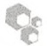

## 讨论

## 多聚组氨酸序列

过渡金属离子（$\mathrm{Zn}^{2+}$、$\mathrm{Cu}^{2+}$、$\mathrm{Co}^{2+}$和$\mathrm{Ni}^{2+}$等）对特异氨基酸（组氨酸和半胱氨酸）具有亲和力早在1948年就有记载（Hearon 1948）。但是直到1975年固化金属底物才被首次用于纯化表面带有组氨酸残基的蛋白质。现在，目标蛋白的暴露表位或柔性区域经常会被修饰上多聚组氨酸标签序列，最为常见的是在蛋白质的N端或C端（Van Reeth et al. 1998）。为了增加组氨酸标签的可达性（accessibility），通常会在多聚组氨酸区段与其余蛋白质序列之间加入 $1\sim 2$ 个甘氨酸残基。很多常用质粒（某些版本的pcDNA载体，Life Technologies公司；pET载体，Novagen公司；pQE载体，QIAGEN公司）包含6个串联的组氨酸残基（6xHis标签）组成的多聚组氨酸标签。如果6xHis标签被蛋白质的折叠所遮盖，则可通过增加多聚组氨酸的长度或将标签移至蛋白质的另一端，增强其可达性，促进其与IMAC层析树脂的结合（Heijbel 2003; Mohanty and Wiener 2004）。增加多聚组氨酸的长度还可以增强融合蛋白结合金属离子的亲和力，这样可以在洗脱目标蛋白之前，使用更为剧烈的咪唑清洗以去除污染蛋白。

## 咪唑和洗脱方法

在目标蛋白与树脂结合过程中，通常加入低浓度的咪唑，以减少非特异性相互作用（依据目标蛋白的金属离子亲和能力选择加入 $5\sim 30\mathrm{mmol / L}$ 咪唑）。IMAC溶液的离子强度一般需保持相对较高（$0.2\sim 1.0\mathrm{mol / LNaCl}$），以减少污染物和金属离子之间非特异性的静电相互作用。结合和洗涤缓冲液的 $\mathrm{pH}$ 应为 $7\sim 8$ ，以保持组氨酸处于适合金属螯合的未质子化状态。当然，结合和洗涤缓冲液不应含有强还原剂（DTT）或螯合剂（EDTA或柠檬酸盐），这些试剂能够去除固化的金属离子。

目标蛋白通常是被高浓度咪唑竞争性洗脱下来的。其他的洗脱方法还包括:使用螯合剂（如EDTA）剥离金属离子，或降低溶液的 $\mathrm{pH}$ 至组氨酸侧链 $\mathrm{pK_a}$ 值（约6.0）以下 $1\sim 2$ 个单位。咪唑是这些洗脱液中最常被选择也是最柔和的方法，应尽可能使用此方法。洗脱缓冲液通常含有 $100\sim 250\mathrm{mmol / L}$ 咪唑的 $\mathrm{Ni}^{2 + }$ -NTA树脂， $\mathrm{pH}$ 为 $7\sim 8$ 。最低有效洗脱浓度可以通过利用咪唑的线性梯度 $10\sim 250\mathrm{mmol / L}$ 测定。虽然EDTA比咪唑更为有效，但它除了感兴趣的蛋白质外也带走了树脂上的固化金属离子。某些应用可能需要通过透析或第二轮色谱方法，从样品中除去这些金属离子。例如， $\mathrm{Ni}^{2 + }$ 及复合物已被证明是有毒的，并干扰某些酶的活性（特别是铁依赖酶）（Chen et al. 2005, 2010）。或者，当一种金属离子干扰

---

1308

分子克隆实验指南（原书第四版）

蛋白质的活性或下游应用时，可以使用其他的金属离子。例如，固化的 $\mathrm{Zn}^{2+}$ 离子是纯化锌指蛋白、结构或活性依赖于锌的其他蛋白质时的最好选择，因为蛋白金属离子还是会与色谱树脂金属离子发生部分交换（Block et al. 2009），尽管四齿配体（tetradentate ligand）的亲和力相对较高。

由于常用特异的蛋白酶裂解位点插入融合标签和感兴趣的蛋白质之间，因此可以用蛋白酶从亲和基质中洗脱蛋白质，并在纯化过程中除去 6xHis 序列（Wen-Hui and Howard 2010）。几种此类蛋白酶的序列上也含有 6xHis 修饰（在这种情况下是不被切割的），这样可以通过第二个 IMAC 纯化步骤将其从切割的目标蛋白中移除。除了含多聚组氨酸标签的蛋白酶，此第二个 IMAC 纯化步骤也去除了未切割的融合蛋白、多聚组氨酸标记，以及任何在第一个纯化步骤中可能与树脂结合的污染蛋白（Arnau et al. 2006）。

## 螯合树脂和配体

大多数厂商提供的螯合树脂都不含金属离子，使用前需要用合适的离子填装。所需离子类型依赖于下游应用和目标蛋白的特殊属性，如亲和标签的长度和位置，以及缓冲液的pH。Lewis金属离子（镍、钴、锌、铜等）是最常见的；其中 $Ni^{2+}$ 是最经常使用的，因为它对多聚组氨酸的亲和力高，且具有很好的水溶性。但是，正是因为镍与钴相比具有更高的亲和力，其也更容易与杂质蛋白结合。因此，使用不太常见的钴离子，可能会有益于低丰度组氨酸标签蛋白的纯化。然而，回收目标蛋白的量可能会随之降低。因为固化钴离子的亲和力比相应镍离子低，较低浓度的咪唑（150～200mmol/L）通常就足以将目标蛋白从结合钴离子的树脂上洗脱。

继早期使用固化金属离子依据组氨酸天然含量纯化蛋白质的工作（Porath et al. 1975）之后，目前已开发了各种改进型螯合配体（参见综述 Block et al. 2009）（图 19-8）。亚氨基

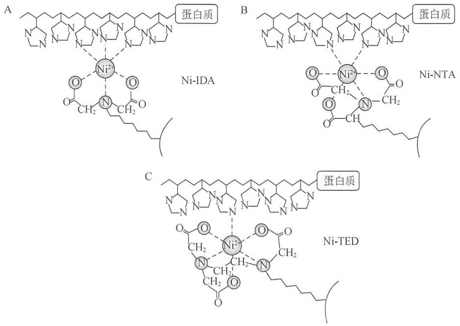

图19-8 IMAC树脂。图中所示的是一种金属离子（镍），与三种常用的底物结合螯合剂的螯合基团，以及多聚组氨酸标记的融合蛋白之间的相互作用。（A）亚氨基二乙酸（IDA）的三齿配位模式，为组氨酸标签留下了3个可用的配位位点（顶部）。（B）次氮基三乙酸（NTA）与金属离子的四齿配位模式，为组氨酸标签提供了两个配位位点。（C）三（羧甲基）乙二胺（TED）的五齿配位模式，只允许有一个化合价绑定组氨酸。

---

第 19 章 克隆基因的表达以及目的蛋白的纯化和分析

1309

二乙酸（IDA）是 Porath 研究组最初使用的螯合配体（Porath et al. 1975），目前仍然被一些商业化 IMAC 树脂使用（包括 GE Healthcare、Pierce 和 USB Affymetrix 公司的树脂）。20 世纪 80 年代末，QIAGEN 公司开发并商业化了改进型次氮基三乙酸（NTA）螯合配体（图 19-8）（Hochuli et al. 1987），用于多聚组氨酸融合蛋白的纯化。随后，羧甲基天冬氨酸配体（CM-Asp，也称为 TALON，Clontech 公司）与 Co$^{2+}$逐渐被广泛使用（Chaga et al. 1999）。IDA 配体有一个三齿配位的金属离子，不同于 NTA 和 CM-Asp 配体的四齿配位。这些配位形式，分别留下 3 个或 2 个位点可与组氨酸配位。三齿 IDA 配体的金属离子更容易浸出到周围的缓冲液中（Hochuli 1989）。使用 IDA 配体与使用四齿配体相比，获得的标签蛋白的纯度可能会较低，这可能是因为杂质蛋白会与已失去结合金属离子的 IDA 位点发生非特异性的静电相互作用。五配位的三（羧甲基）-乙二胺 [tris（carboxymethyl）-ethylenediamine，TED] 配体（包括 MACHEREY-NAGEL 公司树脂）具有非常低的金属离子浸出性，是第三个可选项。然而，只有一个空位点可用于组氨酸配位，降低了 TED 结合组氨酸标签蛋白的能力。因此，填装 Ni$^{2+}$的 IDA 或 NTA 树脂是纯化含多聚组氨酸标记的蛋白质最常用的基质。

## 附加方案 $\mathrm{Ni}^{2+}$-NTA 树脂的清洗与再生

$\mathrm{Ni}^{2+}$-NTA 亲和树脂可多次重复用于一个特定重组蛋白的纯化。为防止污染，每个重组蛋白应该使用一批新的树脂。在使用期间，树脂应该用 $0.5\mathrm{mol/L}$ NaOH 清洗 $30\mathrm{min}$，再用水清洗，并保存在 $20\%$ 乙醇中以防止微生物生长。如果柱子变成灰色或以其他方式失去了螯合镍离子特征性的浅蓝色，应遵循再生程序。在大多数情况下，只需用含咪唑的洗脱缓冲液洗柱，然后经过剥离缓冲液（stripping buffer）清洗（步骤1）和再填装（步骤3），就足以再生了。下文提供的详细的 IMAC 清洗方案，可以用于更极端的情况下（如柱子堵塞或蛋白质沉淀在柱上）。在这个方案中，一份“体积”相当于正在清洁的树脂床的体积。例如，如果正在清洁 $0.5\mathrm{mL}$ 的树脂，则 1 体积等于 $0.5\mathrm{mL}$ 。此方案适用于大多数 $\mathrm{Ni}^{2+}$ 填装树脂。对于填装 $\mathrm{Co}^{2+}$ 和/或 CM-Asp 树脂，请参阅制造商的说明进行修改。


## 材料

为正确使用本方案中的器材和危险试剂，必须查阅相应的材料安全数据表并咨询所在机构的环境卫生和安全办公室。

本方案的专用试剂标注&lt;R&gt;，配方在本方案末提供。常用储备溶液、缓冲液和试剂标注&lt;A&gt;，配方见附录1。储备溶液应稀释至适用浓度后使用。

## 试剂

适当的色谱缓冲液

乙醇（20%、25%、50%、75%及100%; V/V）

IMAC 再生缓冲液&lt;R&gt;

NaCl (2.0mol/L)

---

1310

分子克隆实验指南（原书第四版）

$Ni^{2+}$ -NTA 树脂

硫酸镍（NiSO$_{4}$, 0.2mol/L）或其他所需金属离子

SDS (2%, m/V)

剥离缓冲液（pH 7.0）&lt;R&gt;


## 方法

1. 依次加入以下溶液并在每一步温和混匀，用于剥离（strip）一批树脂。这些步骤不需要孵育。更换缓冲液时，可以将试管中的树脂 $1000\mathrm{g}$ 离心 $10\mathrm{s}$，弃去上清液，加入下一个缓冲液。以下的建议量对应于方案5中使用的 $0.5\mathrm{mL}$ 柱床体积。

| 剥离缓冲液 | 2.5mL(或5倍体积) |
| --- | --- |
| NaCl(2.0mol/L) | 1.5mL(或3倍体积) |
| $H_2O$ | 1.5mL(或3倍体积) |

2. 如果有必要，用以下溶液先后依次清洁树脂。在每一步温和混匀树脂，并通过 1000g 离心树脂 10s 方式更换缓冲液。

| IMAC再生缓冲液(用于移除结合蛋白) | 1mL(或2倍体积) |
| --- | --- |
| $H_2O$ | 2.5mL(或5倍体积) |
| SDS(2%) | 1.5mL(或3倍体积) |
| 乙醇(25%) | 0.5mL(或1倍体积) |
| 乙醇(50%) | 0.5mL(或1倍体积) |
| 乙醇(75%) | 0.5mL(或1倍体积) |
| 乙醇(100%) | 2.5mL(或5倍体积) |
| 乙醇(75%) | 0.5mL(或1倍体积) |
| 乙醇(50%) | 0.5mL(或1倍体积) |
| 乙醇(25%) | 0.5mL(或1倍体积) |

用大量水清洗

3. 用 1mL（2 倍体积）的 0.2mol/L 硫酸镍再填装树脂，用 1.5mL（或 3 倍体积）的水清洗，并用适当的色谱缓冲液平衡。将树脂储存在 20%乙醇中。

柱子用 EDTA 剥离后（或用 EDTA 洗脱蛋白质之后）应该是白色的，如果使用镍再生后的颜色应该恢复为淡蓝色。

## 替代方案 组氨酸标签蛋白的快速液相色谱纯化

批处理和重力流的蛋白质纯化方法（如上所述）是相对容易且价格低廉的。然而，目前已经开发出更快且更为有效的系统，能够自动化完成操作，并可将分析和纯化步骤结合。快速蛋白液相色谱（FPLC）系统是专为色谱分离蛋白质及其他生物分子而设计的。这些系统通常包含多个泵，一个在线的紫外吸收监测仪、电导率仪、酸度计、馏分收集器，以及其他装置，能够同时进行样品的纯化、分析和组分收集。与适当的设备连接后，FPLC就成为了一套能够实现高分辨率分离目标蛋白的高精度自动化仪器。以下方案是针对ÄKTA系

---

第 19 章 克隆基因的表达以及目的蛋白的纯化和分析

1311

统（GE Healthcare 公司）及其预装  $Ni^{2+}$  的 1mL HisTrap 柱操作手册的改进方案，但也可应用于其他系统。一份“柱体积”相当于特定柱管中含有的已填装树脂的体积（本例中为 1mL）。

本方案改编自 GE Healthcare 公司的 11-0008-88 AF HisTrap 亲和柱使用说明(http://www.gelifesciences.com/aptrix/upp00919.nsf/Content/54F1E49F7BCDD1E5C1257628001D110D/\$file/11000888AF.pdf) $^{①}$


## 材料

为正确使用本方案中的器材和危险试剂，必须查阅相应的材料安全数据表并咨询所在机构的环境卫生和安全办公室。

本方案的专用试剂标注&lt;R&gt;，配方在本方案末提供。常用储备溶液、缓冲液和试剂标注&lt;A&gt;，配方见附录1。储备溶液应稀释至适用浓度后使用。

## 试剂

β-巯基乙醇（5mmol/L）（可选）

当目标蛋白序列中含有半胱氨酸时，可以使用低浓度（1～5mmol/L）的β-巯基乙醇。低浓度的β-巯基乙醇不会还原树脂上的金属离子。

来自方案 4 的细胞裂解物

透析缓冲液&lt;R&gt;

IMAC 结合缓冲液&lt;R&gt;

IMAC 咪唑洗脱缓冲液&lt;R&gt;

## 设备

ÄKTAFPLC 系统（GEHealthcare 公司）或类似设备（如 BioLogic DuoFlow System; Bio-Rad 公司）

如果用一步洗脱法取代线性梯度洗脱，作为一种 FPLC 系统的替代方法，可以用更简单且明显更便宜的注射器或蠕动泵，对预装 HisTrap 柱进行加样、清洗并洗脱多聚组氨酸融合蛋白。

预装 Chelating HisTrap 层析柱(GE Healthcare 公司, 1mL)或类似产品(如 Bio-Scale Mini Profinity IMAC Cartridges, 1mL; Bio-Rad 公司)

预装 HisTrap 层析柱（GE Healthcare 公司）的结合能力（40mg/mL 树脂）在 IMAC 柱中是非常高的。如果存在非特异性结合问题，1mL 的 Chelating HiTrap（GE Healthcare 公司，注意名称的不同）或 1mL Mini Profinity IMAC Cartridge（Bio-Rad 公司）可能更适合方案 1～方案 3 中描述的中等规模的培养物，因为它们的结合力较低（15mg/mL 的树脂），从而也降低了非特异性结合。然而，此处使用 HisTrap 柱，因为其相对经济，且为预装形式，并具有明显更高的结合能力。所有这些类型的柱都是可以再生的，并可用于多个批次的相同重组蛋白的纯化。每种重组蛋白应使用单独的柱。


## 方法

1. 将连接管中注满水，以“滴到滴”（drop to drop）方式连接柱，以免将空气引入系统。
当连接导管与柱时，可在连接的同时，通过系统向管道中推送液体以确保排出装置中的空气。这样连接时，每个连接末端都应出现一滴液体，因此，称为“滴到滴”方式。

2. 用 $5 \mathrm{~mL}$ (或 5 倍柱床体积) 的水洗柱, 以移除残存的缓冲液 (20%乙醇)。

<small><span class="docvortex-page-footnote" data-block-type="page_footnote" style="color:#6b7280">① 译者注:此链接已失效，读者可自行访问 GE Healthcare 公司官方网站检索此款商品说明书，本替代方案翻译时此内容的对应链接为 https://www.gelifesciences.com/ gehcls\_images/GELS/Related%20Content/Files/1314735988470/litdoc11000888AF\_20110830235746.pdf。</span></small>

---

1312

分子克隆实验指南（原书第四版）

遵循产品说明书标注的压力和流速限值，因为不同产品之间存在差别。对于1mL HisTrap柱（GE Healthcare公司），柱压力限值为0.3MPa（3bar, 43.5psi），推荐流速为1mL/min。

3. 用 5mL（或 5 倍柱床体积）的 IMAC 结合缓冲液平衡柱子。

4. 按方案 4 制备细胞裂解物。

5. 将预处理过的细胞裂解物（1mL HisTrap 柱能结合最多 40mg 目标蛋白），用蠕动泵、样品环或注射器（取决于设备）进样。

当要确定柱的结合能力时，需要参考厂商的产品说明，因为不同厂家产品不相同。如果目标蛋白很可能超过柱结合能力，则可以将多个 1mL 的柱串联连接或换用 5mL 的柱，以获得最佳产出。请注意，串联使用多个柱将会增加反压。

6. 用 IMAC 结合缓冲液清洗，直至 280nm 处吸光值稳定在基线水平。然后用超过 20 倍柱床体积的线性梯度 IMAC 咪唑（浓度高至 100%）洗脱缓冲液，洗脱多聚组氨酸标签蛋白。

7. 依据  $A_{280}$  的值收集洗脱蛋白，并用 SDS-PAGE 分析这些洗脱组分（如方案 8 所述）。

此时，目标蛋白可以作为融合蛋白使用，如果融合蛋白序列中有特定的蛋白酶切位点，也可以将 6xHis 标签移除。如果欲将多聚组氨酸标签从目标蛋白上切除，则需继续按方案 5 步骤 11～步骤 16 类似的方法再一次过柱纯化。


## 疑难解答

在开始纯化前，应该优化条件使可溶性蛋白的表达产出量尽可能最大。估算出细胞裂解产物中组氨酸标签蛋白总量可以用于推算所需树脂的量。使用树脂过多会使宿主蛋白产生非特异结合，使用过少则会使目标蛋白在进样过程中遭受损失。

问题:组氨酸标签蛋白不与 IMAC 柱结合。

## 解决方案:

- 确保样品和缓冲液成分不会干扰组氨酸标签与 IMAC 柱的结合。所有缓冲液中的强还原剂（DTT、DTE、TCEP）和螯合剂（EDTA、EGTA）的浓度应当在许可限定以内。参考厂商使用手册列出的可兼容试剂列表及推荐浓度（如 http://www.qiagen.com/literature/resources/protein/compatibilitytable.pdf） $^{①}$ 与树脂结合的金属离子的减少会导致其颜色的改变（镍柱会由蓝色变棕色），金属离子被螯合剂剥离后将会使树脂变为白色。样品及进样和洗涤缓冲液应为中性或弱碱性的 pH 环境（pH 7～8），以防组氨酸标签质子化。
- 蛋白分子内或分子间的相互作用可能会遮挡组氨酸标签与 IMAC 柱的结合。将标签移至蛋白质的另一端，或在蛋白质变性（或部分变性）条件下纯化，有望提高标签的可达性；也可以将多聚组氨酸标签增至 12 个组氨酸，或者在标签与蛋白质之间插入一段接头序列（linker）。
- 样品、结合缓冲液及洗涤缓冲液中咪唑浓度过高。降低咪唑浓度至能够使目标蛋白与 IMAC 树脂结合的水平。
- 不是所有的树脂都以结合金属离子的方式提供。请确认 IMAC 树脂已填装金属离子，并按附加方案 “Ni$^{2+}$-NTA 树脂的清洗与再生” 中步骤 1～步骤 3 制备。一旦正确填装后，柱子将会恢复金属离子盐溶液的原始颜色（镍柱是蓝色的，钴柱是粉色的，等等）。

问题:感兴趣的组氨酸标签蛋白可结合树脂，但洗脱出不止一种蛋白质。

## 解决方案:

\- 污染蛋白可能与 IMAC 树脂有一定的亲和力从而和标签蛋白一起洗脱下来。如果标

<small><span class="docvortex-page-footnote" data-block-type="page_footnote" style="color:#6b7280">① 译者注:此链接已失效，读者可自行访问相关网站检索相应信息。</span></small>

---

第 19 章 克隆基因的表达以及目的蛋白的纯化和分析

1313

签蛋白对树脂的亲和度相对较高，则可以使用更高的咪唑浓度洗脱。用平缓的（≥20倍柱床体积）线性或阶梯式梯度洗脱缓冲液可以确定出能够去除污染蛋白而又不损失目标蛋白的最适咪唑浓度。

- 若通过优化结合、洗脱缓冲液中的咪唑浓度不能去除污染蛋白，则可能需要进一步的纯化过程。常用的方法包括离子交换色谱法和/或凝胶阻滞色谱法。
- 蛋白裂解的降解产物可能会保留 His 标签，并与完整蛋白质一起被纯化。按照方案 4 描述方法使用蛋白酶抑制剂。


## 配方

为正确使用本方案中的器材和危险试剂，必须查阅相应的材料安全数据表并咨询所在机构的环境卫生和安全办公室。

透析缓冲液

| 试剂 | 所需量(配制2L) | 终浓度 |
| --- | --- | --- |
| 磷酸钠(25mmol/L,pH 7.4) | 1.13g的无水磷酸二氢钠;5.75g的无水磷酸氢二钠 | 25mmol/L |
| 氯化钠 | 58.44~116.88g | 0.5~1.0mol/L |
| 咪唑(pH 8.0) | 1.36g | 10mmol/L |

储存于  $4^{\circ}$ C。

透析缓冲液和洗涤缓冲液 2

| 试剂 | 所需量(配制1L) | 终浓度 |
| --- | --- | --- |
| 磷酸钠(pH 7.4) | 0.57g的无水磷酸二氢钠2.88g的无水磷酸氢二钠 | 25mmol/L |
| 氯化钠 | 8.76g | 150mmol/L |

储存于  $4^{\circ}$ C。

IMAC 结合缓冲液

<table><tr><td>试剂</td><td>所需量(配制1L)</td><td>终浓度</td></tr><tr><td rowspan="2">磷酸钠(pH 7.4)</td><td>1.13g的无水磷酸二氢钠</td><td>50mmol/L</td></tr><tr><td>5.75g的无水磷酸氢二钠</td><td></td></tr><tr><td>氯化钠</td><td>29.22g</td><td>500mmol/L</td></tr><tr><td>咪唑(pH 8.0)</td><td>0.68g</td><td>10mmol/L</td></tr></table>

储存于  $4^{\circ}$ C。

IMAC 再生缓冲液

| 试剂 | 所需量(配制100mL) | 终浓度 |
| --- | --- | --- |
| 盐酸胍 | 57.3g | 6mol/L |
| 乙酸(17.5mol/L) | 1.14mL | 0.2mol/L |

储存于室温。

IMAC 洗涤缓冲液

<table><tr><td>试剂</td><td>所需量(配制1L)</td><td>终浓度</td></tr><tr><td rowspan="2">磷酸钠(pH 7.4)</td><td>1.13g的无水磷酸二氢钠</td><td>50mmol/L</td></tr><tr><td>5.75g的无水磷酸氢二钠</td><td></td></tr><tr><td>氯化钠</td><td>29.22g</td><td>500mmol/L</td></tr><tr><td>咪唑(pH 8.0)</td><td>1.36g</td><td>20mmol/L</td></tr></table>

储存于  $4^{\circ}$ C。

---

1314

分子克隆实验指南（原书第四版）

咪唑洗脱缓冲液

<table><tr><td>试剂</td><td>所需量(配制1L)</td><td>终浓度</td></tr><tr><td rowspan="2">磷酸钠(pH 7.4)</td><td>1.13g的无水磷酸二氢钠</td><td>50mmol/L</td></tr><tr><td>5.75g的无水磷酸氢二钠</td><td></td></tr><tr><td>氯化钠</td><td>29.22g</td><td>500mmol/L</td></tr><tr><td>咪唑(250mmol/L)</td><td>17.0g</td><td>250mmol/L</td></tr></table>

储存于  $4^{\circ}$ C。

剥离缓冲液（pH 7.0）

| 试剂 | 所需量(配制100mL) | 终浓度 |
| --- | --- | --- |
| EDTA(0.5mol/L,pH 8.0) | 40mL | 0.2mol/L |
| 氯化钠 | 2.92g | 500mmol/L |

储存于  $4^{\circ}$ C。

## 参考文献

- Arnau J, Lauritzen C, Petersen GE, Pedersen J. 2006. Current strategies for the use of affinity tags and tag removal for the purification of recombinant proteins. Protein Expr Purif 48: 1–13.
- Bhat R, Timasheff SN. 1992. Steric exclusion is the principal source of the preferential hydration of proteins in the presence of polyethylene glycols. Protein Sci 1: 1133–1143.
- Block H, Maertens B, Spriestersbach A, Brinker N, Kubicek J, Fabis R, Labahn J, Schafer F. 2009. Immobilized-metal affinity chromatography (IMAC): A review. Methods Enzymol 463: 439–473.
- Bornhorst JA, Falke JJ. 2000. Purification of proteins using polyhistidine affinity tags. Methods Enzymol 326: 245–254.
- Chaga G, Hopp J, Nelson P. 1999. Immobilized metal ion affinity chromatography on Co$^{2+}$-carboxymethylaspartate-agarose Superflow, as demonstrated by one-step purification of lactate dehydrogenase from chicken breast muscle. Biotechnol Appl Biochem 29: 19–24.
- Chen H, Davidson T, Singleton S, Garrick MD, Costa M. 2005. Nickel decreases cellular iron level and converts cytosolic aconitase to iron-regulatory protein 1 in A549 cells. Toxicol Appl Pharmacol 206: 275–287.
- Chen H, Giri NC, Zhang R, Yamane K, Zhang Y, Maroney M, Costa M. 2010. Nickel ions inhibit histone demethylase JMJD1A and DNA repair enzyme ABH2 by replacing the ferrous iron in the catalytic centers. J Biol Chem 285: 7374–7383.
- Deng J, Davies DR, Wisedchaisri G, Wu M, Hol WG, Mehlin C. 2004. An improved protocol for rapid freezing of protein samples for long-term storage. Acta Crystallogr D Biol Crystallogr 60: 203–204.
- Despa F, Orgill DP, Lee RC. 2005. Molecular crowding effects on protein stability. Ann N Y Acad Sci 1066: 54–66.
- Deutscher MP. 2009. Maintaining protein stability. Methods Enzymol 463:121–127.
- Hearon JZ. 1948. The configuration of cobaltodihistidine and oxy-bis (cobaltodihistidine). J Natl Cancer Inst 9: 1–11.
- Heijbel A. 2003. Purification of a protein tagged with (His)$_{6}$ at its N-terminus, C-terminus, and both N- and C-termini using different
- metal ions. Life Science News—Amersham Biosciences AB, Uppsala, Sweden. http://www.gelifesciences.com/aptrix/upp00919.nsf/Content/F8B746648FB96A18C1257628001D07E5/\$file/18117692p22\_24.pdf.
- Hochuli E. 1989. Genetically designed affinity chromatography using a novel metal chelate absorbent. In Biologically active molecules: Identification, characterization, and synthesis: Proceedings of a Seminar on Chemistry on Biologically Active Compounds and Modern Analytical Methods (ed Schlunegger UP), Vol. 411, pp. 217–239. Springer-Verlag, Berlin.
- Hochuli E, Dobeli H, Schacher A. 1987. New metal chelate adsorbent selective for proteins and peptides containing neighbouring histidine residues. J Chromatogr 411: 177–184.
- Mohanty AK, Wiener MC. 2004. Membrane protein expression and production: Effects of polyhistidine tag length and position. Protein Expr Purif 33: 311–325.
- Nema S, Avis KE. 1993. Freeze–thaw studies of a model protein, lactate dehydrogenase, in the presence of cryoprotectants. J Parenter Sci Technol 47: 76–83.
- Parsegian VA, Rand RP, Rau DC. 2000. Osmotic stress, crowding, preferential hydration, and binding: A comparison of perspectives. Proc Natl Acad Sci 97: 3987–3992.
- Porath J, Carlsson J, Olsson I, Belfrage G. 1975. Metal chelate affinity chromatography, a new approach to protein fractionation. Nature 258:598–599.
- Timasheff SN. 2002. Protein hydration, thermodynamic binding, and preferential hydration. Biochemistry 41: 13473–13482.
- Van Reeth T, Dreze PL, Szpirer J, Szpirer C, Gabant P. 1998. Positive selection vectors to generate fused genes for the expression of his-tagged proteins. BioTechniques 25: 898–904.
- Wen-Hui KK, Howard CA. 2010. Absorptive detagging of poly-histidine tagged protein using hexa-histidine tagged exopeptidase. J Chromatogr A 1217: 7749–7758.

## 方案 6 采用谷胱甘肽树脂以亲和层析纯化融合蛋白

含有谷胱甘肽-S-转移酶（GST）的融合蛋白可以使用偶联了谷胱甘肽的树脂进行亲和纯化，效果接近同质性（参见综述 LaVallie et al. 2000）。GST 是一类以谷胱甘肽（γ-谷氨酰半胱氨酰甘氨酸）作为底物，通过形成硫醇尿酸来失活毒性小分子的酶（参见综述 Jakoby and Ziegler 1990）。GST 对底物的亲和力是亚毫摩尔级的，因而成为了亲和层析应用的理想选择。日本血吸虫来源的 GST 是很多常用 GST 载体上的融合标签，包括 pGEX 系列（GE

---

第 19 章 克隆基因的表达以及目的蛋白的纯化和分析

1315

Healthcare）及其他载体（参见本章导言部分的表19-2）。谷胱甘肽作为融合蛋白中GST分子的底物固化于亲和基质上，如琼脂糖或Sepharose。杂质蛋白会被清洗掉，随后，结合的GST融合蛋白可以被含有游离谷胱甘肽的洗脱液很容易地从树脂上洗脱下来。由于GST与谷胱甘肽的结合亲和力相对不依赖于溶液的离子强度，因此结合和洗涤缓冲液可使用高盐浓度（超过 $150\sim 500\mathrm{mmol / LNaCl}$ 范围）（Yassin et al. 2003）以降低杂质蛋白与带负电荷的谷胱甘肽的非特异性相互作用。洗脱缓冲液中含有 $50\sim 100\mathrm{mmol / LTris}$ （pH8.0）用于中和谷胱甘肽的两个羧基（ $\mathrm{pK_a}2.1$ 和 $\mathrm{pK_a}3.6$ ）（Dawson et al. 1989）。谷胱甘肽-琼脂糖对GST融合蛋白的结合能力很强（ $>12\mathrm{mgGST / mL}$ 谷胱甘肽-琼脂糖）。此外，对表达蛋白进行免疫杂交分析所需的抗GST抗体可从多个厂家获得（GE Healthcare、Sigma-Aldrich、Santa Cruz Biotechnology及其他公司）。

本方案描述了一个使用亲和树脂结合、清洗和洗脱融合蛋白的批处理方法。另外，谷胱甘肽树脂还可应用于重力流（如方案5中IMAC树脂所述）、预装柱配合手动注射器（如方案5中IMAC树脂所述）、FPLC技术（如替代方案“组氨酸标签蛋白的快速液相色谱纯化”所述），或者离心管柱进行高通量筛选。如果可能，FPLC纯化是首选，因为其流动速率快，且人工干预要求低。GST标签相对较大，且形成二聚体（如日本血吸虫GST是一个由26kDa亚基组成的二聚体蛋白），因此，GST融合标签通常会从纯化后的目标蛋白上去除，这一过程需借助在目标蛋白与GST融合标记之间设计的特异性蛋白酶识别位点。蛋白酶裂解去除GST标签的注意事项在信息栏“蛋白酶裂解GST融合蛋白的注意事项”中描述。


## 材料

为正确使用本方案中的器材和危险试剂，必须查阅相应的材料安全数据表并咨询所在机构的环境卫生和安全办公室。

本方案的专用试剂标注&lt;R&gt;，配方在本方案末提供。常用储备溶液、缓冲液和试剂标注&lt;A&gt;，配方见附录1。储备溶液应稀释至适用浓度后使用。

## 试剂

含可溶性 GST 标签融合蛋白的澄清细胞提取物（来自方案 1、方案 2 或方案 3，并由方案 4 裂解）

另可参见以下信息栏“蛋白酶裂解 GST 融合蛋白的注意事项”。

考马斯亮蓝染色液（制备方法参见方案8）

谷胱甘肽洗脱缓冲液（预冷至  $4^{\circ}$ C）&lt;R&gt;

GST 洗涤缓冲液（预冷至  $4^{\circ}$ C）&lt;R&gt;

洗涤缓冲液中可加入非离子型去污剂（0.1%的 Triton X-100 或 2% β-辛基葡糖苷）以减少疏水相互作用的非特异干扰。

若目标蛋白中含有半胱氨酸，且为细胞内蛋白，则应向洗涤缓冲液中加入还原剂（如1mmol/L的DTT）。1mol/L的DTT储备液应现用现配或分装储存于-20℃，用前解冻。

含 SDS 的聚丙烯酰胺凝胶（制备方法参见方案 8）

$5 \times$ SDS 加样缓冲液（制备方法参见方案 8）

未加 DTT 的  $5 \times$  SDS 加样缓冲液储存于室温。缓冲液使用前加入 1mol/L 的 DTT 储备液至终浓度为 100mmol/L。

## 设备

Beckman JA20、Sorvall SS-34 或 SA600 转子或类似转子，以及 40～50mL 的离心管谷胱甘肽-琼脂糖树脂混悬液（50%，V/V）

目前市售有多种与谷胱甘肽的巯基共价键连接的不同基质。其中，有琼脂糖（Thermo Scientific Pierce、Sigma-Aldrich、Life Technologies 及 BD BioSciences 公司）、Sepharose（交联琼脂糖珠）（GE Heathcare 生产的用

---

1316

分子克隆实验指南（原书第四版）

于批处理的 Sepharose 4B 和用于 FPLC 方法的 Sepharose Fast Flow），以及磁珠（Thermo Scientific Pierce、Sigma-Aldrich、Bioclone 公司）。预装的谷胱甘肽连接柱也有售（GE Healthcare、Sigma-Aldrich、Thermo Scientific Pierce 公司）。树脂的结合能力各不相同，为 5～15mg/mL 沉降树脂（参见每个制造商的说明书）。琼脂糖基质是纯化 GST 融合蛋白的一种成本较低的选择，因此用于下述方案。另可参见下述信息栏“谷胱甘肽-琼脂糖树脂的再生”。

加热块设置在  $85^{\circ}$ C 或沸水浴

聚丙烯管（15mL 或 50mL）

振荡台或试管旋转器（如 Thermo Scientific 公司的 Labquake）

SDS-PAGE 设备（参见方案 8）

分光光度计（参见步骤 15 和方案 10）


## 方法

## 采用洗涤缓冲液平衡谷胱甘肽-琼脂糖树脂

1. 轻轻颠倒内含谷胱甘肽-琼脂糖树脂的容器，重悬树脂混悬液。

商家提供的树脂一般为 50% 的悬液，溶于 20% 乙醇。冻干的树脂在使用前需要水化，通常是用大量的水（200:1，V/V）将其轻轻混匀，并在室温下孵育 30min（详情参考生产厂商手册），再用洗涤缓冲液平衡，如下所述。

2. 将适量重悬的树脂混悬液转入 15mL 或 50mL 聚丙烯管（取决于裂解物的量）。1L 大肠杆菌平均可生产 GST 融合蛋白 2.5mg，而批处理过程中每步清洗约损失 10% 的珠子，据此估算，约 0.8mL 的 50% 谷胱甘肽-琼脂糖树脂混悬液足以纯化 1L 大肠杆菌的裂解产物（产自方案 1，裂解于方案 4）。

所需树脂的量取决于特定树脂的结合能力、所用的融合蛋白和所需的产量。

3. 在  $4^{\circ}$ C 条件下 500g（Sorvall SS-34 转头 2100r/min）离心 5min，小心移除上清。

4. 在树脂中加入 4mL（10 倍柱床体积或沉降树脂体积）水，颠倒数次，轻轻混匀。这一步在步骤 5 之前是很有必要的，可以防止谷胱甘肽-琼脂糖存储备液中残留乙醇沉淀洗涤缓冲液中的盐。4℃、500g（Sorvall SS-34 转头 2100r/min）离心 5min，小心移除上清。

5. 在树脂中加入 4mL（10 倍柱床体积）预冷 GST 洗涤缓冲液，颠倒数次，轻轻混匀。在  $4^{\circ}$ C 条件下 500g（Sorvall SS-34 转头 2100r/min）离心 5min，小心移除上清。

6. 加入 0.4mL（相同沉降树脂体积）预冷的 GST 洗涤缓冲液制成 50% 的树脂混悬液，颠倒数次，轻轻混匀。细胞抽提物制备好之前，悬液需放置冰上保存。

## GST 融合蛋白的纯化

7. 将澄清的细胞裂解物（10～20mL 裂解物，来源于 1L 大肠杆菌培养物，按方案 1 和方案 4 制备）转入步骤 6 沉淀的珠子中。

裂解液和洗涤缓冲液中需补加蛋白酶抑制剂和 DTT（如方案 4 所述），除非目标蛋白本身分别具备蛋白酶抗性或没有自由的半胱氨酸残基。如果需要，也可加入非离子去污剂以减少污染物的非特异疏水相互作用。

8. 在  $4^{\circ}$ C 条件下，使用平板摇床或颠倒摇床将混合物轻轻混匀 30min，使 GST 融合蛋白结合。

9. 在  $4^{\circ}$ C 条件下，500g（Sorvall SS-34 转头 2100r/min）离心 5min，小心移除上清。

如果需要，树脂可以装入玻璃或塑料柱中进行清洗和洗脱步骤，如方案5中IMAC纯化所述。这种情况下的产量可能会增加，因为在批处理纯化的清洗步骤中会损失树脂。在本方案中，建议增加树脂用量也是考虑到这种损失的部分影响；因此，如果使用管柱方式，建议可用更小的树脂起始量（0.5mL的50%树脂混悬液）。

保留少量细胞裂解物和未结合组分用于 SDS-PAGE 分析:将  $15 \mu L$  液体与  $5 \mu L$   $5 \times$  SDS 加样缓冲液混合，在加热块上  $85^{\circ}C$  加热 2min。使用前，将此样品保存在  $-20^{\circ}C$  或冰上。

---

第 19 章 克隆基因的表达以及目的蛋白的纯化和分析

1317

10. 在沉淀中加入 $4\mathrm{mL}$ （10倍柱床体积）的预冷GST洗涤缓冲液，轻轻颠倒混匀，以洗去未结合的蛋白质。
11. 在  $4^{\circ}$ C 条件下 500g（Sorvall SS-34 转头 2100r/min）离心 5min，小心移除上清并保留少量上清液进行 SDS-PAGE 分析，如步骤 9 所述。
12. 重复步骤 10 和步骤 11 两次，共清洗 3 次。经步骤 15 中 SDS-PAGE 确认 GST 融合蛋白的位置后，未结合及清洗组分才可以被丢弃。

## 采用还原型谷胱甘肽洗脱 GST 融合蛋白

13. 用 0.4mL（与沉降树脂体积等量）预冷的谷胱甘肽洗脱缓冲液重悬树脂，洗脱融合蛋白。4℃条件下，轻柔混匀 15min。

或者，如果 GST 标签与目标蛋白之间有特定的蛋白酶识别位点隔开，可将树脂与相应的蛋白酶一起孵育，使目标蛋白从 GST 分子和谷胱甘肽树脂上分离下来，如信息栏 “蛋白酶裂解 GST 融合蛋白的注意事项” 中所述。

14. 在  $4^{\circ}$ C 条件下 500g（Sorvall SS-34 转头 2100r/min）离心 5min，将上清（此时含有洗脱下来的蛋白质）小心转入另一干净的离心管中。再重复步骤 13、步骤 14 两次，以彻底洗脱树脂上的融合蛋白。

保留少量组分用于 SDS-PAGE 分析:将  $15 \mu L$  液体与  $5 \mu L$   $5 \times$  SDS 加样缓冲液混合，在加热块上  $85^{\circ}C$  加热 2min。使用前，将此样品保存在  $-20^{\circ}C$  或冰上。

15. 稍稍复温 SDS-PAGE 样品至  $85^{\circ}$ C，然后取每个样品  $15 \mu L$  加样到适当浓度比例的 SDS-PAGE 胶（蛋白的 SDS-PAGE 分析参见方案 8）。SDS-PAGE 凝胶经考马斯亮蓝染色后，应当能够看到纯化的蛋白质。

根据目标融合蛋白的特性不同，洗脱步骤后可能仍会有大量蛋白质与树脂结合。洗脱缓冲液的体积和洗脱时间可能会根据融合蛋白的不同而变化，可能需要额外的洗脱步骤。融合蛋白的产率可以通过测量在280nm处的光吸收估算。对于包含GST标签的蛋白，一般规则是 $1\ A_{280}=0.5mg/mL$ 。对于蛋白浓度的测定（方案10）来说，谷胱甘肽会干扰Lowry或二辛可宁酸（BCA）方法，但对于Bradford方法没有任何不良影响。

16. 洗脱组分可以合并；或者如果需要样品浓度更高，保持分开。

欲将纯化蛋白以活性形式保存，请参见信息栏“储存期间蛋白质品质的保持”。

## 谷胱甘肽-琼脂糖树脂的再生

谷胱甘肽琼脂糖树脂可以用下述方法回收再利用:

1. 室温下用 10 倍体积的水清洗一次 10min;
2. 等体积的 6mol/L 的盐酸胍清洗一次 15min;
3. 室温下用 10 倍体积的水洗 3 次;
4. 溶于 20% 的乙醇，悬至 50% 后保存。

## 蛋白酶裂解 GST 融合蛋白的注意事项

## 可用的载体和带标签的蛋白酶

大多数 GST 融合蛋白的表达载体上都有特定蛋白酶位点，用以从目标蛋白上除去相对较大的二聚体 GST 标签。例如，pGEX 载体系列（GE Healthcare 公司）上带有凝血酶、因子 Xa 或人类鼻病毒（HRV-3C）蛋白酶的识别位点。表达 GST 融合蛋白的商业化载体很少带有烟草蚀刻病毒（TEV）蛋白酶识别位点。然而，一些表达 6xHis 标签融合蛋白的载体（本章导言表 19-2）上却有 TEV 位点，并且经常在切割 GST 融合蛋白的克隆过程中用到。重组的 HRV-3C（无自剪切位点）标签蛋白酶可以从多个供应商获得，包括

---

1318

分子克隆实验指南（原书第四版）

GE Healthcare 公司 GST 标签版本的 PreScission 蛋白酶（46kDa），Accelagen 公司 GST 和 6xHis 双标签版本的 Turbo3C 蛋白酶（47kDa）及 EMD Biosciences 公司 6xHis 标签版本蛋白酶（21kDa）。与 HRV-3C 一样，重组的 TEV 标签蛋白酶可被生产或购买，包括 6xHis 和 GST 双标签的 TurboTEV（52kDa; Acce-lagen）或 6xHis 标签的 TEV（29kDa; Life Technologies 公司，ProSpec）。TEV 蛋白酶的几个突变体已被证明能够提高此蛋白酶对自身消化的抵抗（如 Kapust et al. 2001）。

带 GST 标签的 HRV-3C 或 TEV 蛋白酶可在第二轮谷胱甘肽亲和纯化中被高效去除，同时去除切割后的 GST 标签。带 6xHis 标签的 HRV-3C 或 TEV 蛋白酶，在将组氨酸标签从融合蛋白上切下来后，可用类似的方法去除（参见方案 5，步骤 11～步骤 15）。从目标蛋白中除掉凝血酶（36kDa）或因子 Xa（48kDa），则需要另外的纯化方法，如脒耦合亲和树脂（GE Healthcare 公司）或体积排阻色谱。因子 Xa 也可用 Xa 因子去除树脂（QIAGEN 公司）去除。凝血酶、因子 Xa、无标签或 6xHis 标签的 HRV-3C 可用于将目标蛋白切下而不使 GST 从树脂上脱落，这样就可避免额外的透析步骤或第二轮谷胱甘肽亲和纯化以除去蛋白质样品中的 GST。与填装柱管方式相比，批处理方式的树脂可在旋转摇床上轻柔混匀，可以提高其在树脂上的酶切效率。

## 切割效率

由于不同融合蛋白的蛋白酶切割效率不同，因此需要优化蛋白酶的用量。在大规模制备之前，可用小规模反应来测试蛋白酶解条件。对于本方案中预期产出大约2.5mg的融合蛋白，4℃过夜孵育条件下，蛋白酶起始量建议为50U（此处1U定义为:在22℃1×PBS缓冲液中孵育16h，能够将100μg测试GST融合蛋白切割超过90%），或蛋白酶与融合蛋白的比例为1∶20（m/m）。建议在4℃房间或冷盒中消化，以减少非特异性酶解及游离半胱氨酸氧化。HRV-3C蛋白酶的识别位点（Leu-Glu-P4-Leu-Phe-Gln-↓-Gly-Pro，其中P4是Val、Ala或Thr）和TEV蛋白酶的识别位点（Glu-P5-Leu-Tyr-Phe-Gln-↓-[Gly/Ser]，其中P5通常为Asn）相对较长，因而此类目标蛋白的非特异性酶切较少。与之相反，凝血酶的识别位点（P4-P3-Pro-Arg/Lys-↓-P1'-P2'，其中P3和P4为疏水氨基酸，P1'和P2'为非酸性氨基酸）和因子Xa的识别位点（Ile-Glu-Gly-Arg-↓）不太严格，可能会导致目标蛋白过分酶解。如果存在目标蛋白的非特异性酶解问题，应测试更低的蛋白酶与融合蛋白比例，可从1∶1000（m/m）开始。此外，如果购买的是未纯化蛋白酶，那么这些蛋白酶可能会被其他蛋白酶（如胰蛋白酶）污染，应该在使用前通过离子交换纯化将其除去。另一方面，因子Xa比凝血酶的活性稍差，因此，将融合蛋白的GST标签完全切割可能需要更长的保温时间和更高的蛋白酶与融合蛋白比例（可达1∶10）。

## 缓冲条件

HRV-3C 和 TEV 蛋白酶消化的最佳缓冲液条件彼此略有不同,也与凝血酶和因子 Xa 有所不同。HRV-3C 和 TEV 蛋白酶相对能够耐受一定范围的盐浓度和 pH, 尽管某些去污剂 (如 Triton X-100) 可能会抑制 TEV 蛋白酶 (Mohanty et al. 2003)。由于 HRV-3C 和 TEV 是半胱氨酸蛋白酶, 因此溶液中还原剂的存在有利于这些蛋白酶的活性, 并且它们也不受丝氨酸蛋白酶抑制剂 (如 PMSF) 的影响。与之相反, 由于凝血酶和因子 Xa 通常含有对其活性和折叠具有重要作用的二硫键 (Fay 2006; Bush-Pelc et al. 2007), 因此洗脱液和透析缓冲液中应加入很少或者不加入还原剂。此外, 凝血酶和因子 Xa 是丝氨酸蛋白酶, 能够被 PMSF 抑制, 因此这些蛋白酶所用的洗脱液和透析缓冲液中不应加入 PMSF。凝血酶和因子 Xa 酶切缓冲液通常需补充 $2 \mathrm{mmol} / \mathrm{L} \mathrm{CaCl}_{2}$ 以辅助激活这些蛋白酶 (注意, 磷酸盐缓冲液在 $\mathrm{Ca}^{2+}$ 存在时会形成沉淀, 因而 Tris 或 HEPES 缓冲液需替换为其他缓冲

---

第 19 章 克隆基因的表达以及目的蛋白的纯化和分析

1319

液）。Xa 因子会被咪唑、高 pH 和高浓度的盐（>100mmol/L NaCl）抑制。因此，使用 Xa 因子裂解融合蛋白之前，建议溶液透析或更换为低盐、pH 6.5 且无磷酸盐的条件。

## 使用推荐

基于 HRV-3C 标记重组蛋白的稳定性、特异性和可用性，如果可以容忍在目标蛋白的氨基末端引入额外的 2～4 个氨基酸的情况下，通常推荐能够利用这种蛋白酶的载体。如果能够构建合适的载体或者可购买到，TEV 蛋白酶位点具有如下优点:在切割的蛋白质的氨基末端只需有一个特定的氨基酸（甘氨酸或丝氨酸）。如果氨基末端的氨基酸残留对切割后的蛋白质的功能有影响，那么 Xa 因子在此方面有明显的优势:它不需要融合的目标蛋白具有特定氨基酸。


## 疑难解答

不同 GST 融合蛋白的最佳洗脱条件有所不同。纯化缓冲液的离子强度应当根据目标蛋白溶解性的需求进行调整。穿透液、清洗液及洗脱液组分应当保留并进行 SDS-PAGE 分析（方案 8）和（或）免疫印迹分析（方案 9），以确定结合效率。读者可参考 GE Healthcare 公司的《GST 基因融合系统手册》（文件编码:18-1157-58；http://www.gelifescience.com/aptrix/upp00919.nsf/Content/LD\_169455919-F640 $^{①}$ ），深入了解 GST 融合蛋白体系，或参阅谷胱甘肽树脂生产厂商手册了解化学成分兼容性及结合能力的详细信息。

问题:GST 融合蛋白与谷胱甘肽树脂不结合。

## 解决方案:

\- 过度超声容易造成 GST 标签变性，导致其结合亲和力的下降。可以通过降低超声的功率、缩短超声时间和（或）减少超声循环次数避免这个问题。产生气泡和过热的现象也应避免（详情参见方案 4）。

\- 通常 $4^{\circ} \mathrm{C}$, $\mathrm{pH} 6.5 \sim 8.0$ 的条件下, 谷胱甘肽与 GST 结合最佳; 但将 GST 与另一种蛋白质融合, 可能会改变其结合属性, 因而需要进一步优化。在结合和洗脱缓冲液中加入 $1 \sim 10 \mathrm{mmol} / \mathrm{L}$ 的 DTT 也能显著增加某些 GST 融合蛋白的结合能力。

\- 降低流速。高流速可能会降低 GST 与谷胱甘肽树脂的结合效率。GE Healthcare 公司建议当样品与其生产的 1mL 的 GSTrap 产品结合时，流速降至 0.2～1mL/min；与 5mL 的 GSTrap 结合时，流速降至 1～5mL/min。然而，更低流速可能会增加某些 GST 融合蛋白的结合效率。

问题:GST 融合蛋白能与谷胱甘肽树脂结合，但洗脱效率不高。

## 解决方案:

- 降低流速并增加洗脱液总体积可以提高某些 GST 融合物的洗脱效率。
- 尽管建议采用 10mmol/L 的谷胱甘肽进行洗脱，但有些 GST 融合物需要更高的浓度（20～40mmol/L）；或者，将洗脱缓冲液的 pH 升至 8～9 可能会提高洗脱效率，且不需要增加谷胱甘肽的浓度。

问题:在SDS-PAGE或免疫印迹分析中，洗脱下来的GST融合组分含有多个蛋白质条带。

<small><span class="docvortex-page-footnote" data-block-type="page_footnote" style="color:#6b7280">① 译者注:此链接已失效，读者可自行访问 GE Healthcare 公司官方网站检索此款商品说明书，本方案翻译时此内容的对应链接为 https://www.gelifesciences.com/gehcls\_images/GELS/Related%20Content/Files/1314807262343/litdoc18115758\_20130624120324.pdf。</span></small>

---

1320

分子克隆实验指南（原书第四版）

## 解决方案:

- 过度超声会导致宿主蛋白和 GST 融合蛋白的共纯化，尤其是伴侣分子。在大肠杆菌中，这些蛋白质包括但不局限于以下蛋白质:DnaK（约 70kDa）、DnaJ（约 37kDa）、GrpE（约 40kDa）、GroEL（约 57kDa）和 GroEL（约 10kDa）。减少超声的持续时间和功率，可能得到更清晰的洗脱曲线。
- 如果优化的 GST 亲和纯化步骤不能将杂质蛋白去除，应当采取额外的纯化步骤。这些方案通常有离子交换色谱法，和（或）凝胶过滤色谱法；或者，如果 GST 融合蛋白含有特定蛋白酶裂解位点，可以将 GST 从目标蛋白上切下来。在透析掉第一次洗脱液中的谷胱甘肽后，进行一个谷胱甘肽树脂消减步骤即可除去 GST 成分。这也会将那些与 GST 或谷胱甘肽结合的杂质蛋白同时除去。
- 蛋白酶降解将导致 SDS-PAGE 胶上出现多个蛋白条带。如方案 4 所述，使用蛋白酶抑制剂。在用凝血酶或因子 Xa 进行酶切前，需去除丝氨酸蛋白酶抑制剂。


## 配方

为正确使用本方案中的器材和危险试剂，必须查阅相应的材料安全数据表并咨询所在机构的环境卫生和安全办公室。

谷胱甘肽洗脱缓冲液（预冷至  $4^{\circ}$ C）

| 试剂 | 所需量(配制1L) | 终浓度 |
| --- | --- | --- |
| Tris-HCl(1mol/L,pH 8.0) | 50mL | 50mmol/L |
| 氯化钠 | 29.22g | 500mmol/L |
| 还原剂a | 3.07g* | 10mmol/L |

储存于  $4^{\circ}$ C。

a. 使用前即加即用。

GST 洗涤缓冲液（预冷至  $4^{\circ}$ C）

<table><tr><td>试剂</td><td>所需量(配制1L)</td><td>终浓度</td></tr><tr><td rowspan="2">磷酸钠(pH 7.4)</td><td>1.13g的无水磷酸二氢钠</td><td>50mmol/L</td></tr><tr><td>5.75g的无水磷酸氢二钠</td><td></td></tr><tr><td>氯化钠</td><td>29.22g</td><td>500mmol/L</td></tr></table>

储存于  $4^{\circ}$ C。

洗涤缓冲液中可加入非离子型去污剂（0.1%的 Triton X-100 或 2% β-辛基葡糖苷）以减少疏水相互作用的非特异干扰。

若目标蛋白中含有半胱氨酸，且为细胞内蛋白，则应向洗涤缓冲液中加入还原剂（如 1mmol/L 的 DTT）。1mol/L 的 DTT 储备液应现用现配或分装储存于 -20℃，用前解冻。

## 参考文献

<small><span class="docvortex-page-footnote" data-block-type="page_footnote" style="color:#6b7280">Bush-Pelc LA, Marino F, Chen Z, Pineda AO, Mathews FS, Di Cera E. 2007. Important role of the Cys-191–Cys-220 disulfide bond in thrombin function and allostery. J Biol Chem 282: 27165–27170.</span></small>

<small><span class="docvortex-page-footnote" data-block-type="page_footnote" style="color:#6b7280">Dawson RMC, Elliott DC, Jones KM. 1989. Data for biochemical research. Oxford University Press, New York.</span></small>

<small><span class="docvortex-page-footnote" data-block-type="page_footnote" style="color:#6b7280">Fay PJ. 2006. Factor VIII structure and function. Int J Hematol 83: 103–108.</span></small>

<small><span class="docvortex-page-footnote" data-block-type="page_footnote" style="color:#6b7280">Jakoby WB, Ziegler DM. 1990. The enzymes of detoxication. J Biol Chem 265: 20715–20718.</span></small>

<small><span class="docvortex-page-footnote" data-block-type="page_footnote" style="color:#6b7280">Kapust RB, Tözsér J, Fox JD, Anderson DE, Cherry S, Copeland TD, Waugh DS. 2001. Tobacco etch virus protease: Mechanism of autolysis</span></small>

<small><span class="docvortex-page-footnote" data-block-type="page_footnote" style="color:#6b7280">and rational design of stable mutants with wild-type catalytic proficiency. Protein Eng 14: 993–1000.</span></small>

<small><span class="docvortex-page-footnote" data-block-type="page_footnote" style="color:#6b7280">LaVallie ER, Lu Z, Diblasio-Smith EA, Collins-Racie LA, McCoy JM. 2000. Thioredoxin as a fusion partner for production of soluble recombinant proteins in Escherichia coli. Methods Enzymol 326: 322–340.</span></small>

<small><span class="docvortex-page-footnote" data-block-type="page_footnote" style="color:#6b7280">Mohanty AK, Simmons CR, Wiener MC. 2003. Inhibition of tobacco etch virus protease activity by detergents. Protein Expr Purif 27:109–114.</span></small>

<small><span class="docvortex-page-footnote" data-block-type="page_footnote" style="color:#6b7280">Yassin Z, Clemente-Jimenez MJ, Tellez-Sanz R, Garcia-Fuentes L. 2003. Salt influence on glutathione—Schistosoma japonicum glutathione S-transferase binding, Int J Biol Macromol 31: 155–162.</span></small>

---

第 19 章 克隆基因的表达以及目的蛋白的纯化和分析

1321

## 方案 7 包含体中表达蛋白的增溶

外源蛋白在大肠杆菌中的高水平表达，常常导致表达蛋白的不溶性聚集，形成细胞质颗粒或包含体。使用相差显微镜可以观察到这些包含体，而且很容易与大部分可溶性蛋白和膜结合细菌蛋白分开，如本方案所述。简而言之，高水平表达外源蛋白的细菌经离心收集后，通过机械法、超声处理法或溶菌酶加去污剂的方法进行裂解。所有裂解过程中，最为关键的是要获得最大的细胞裂解效率，从而获得高产量的包含体。包含体密度高，可通过离心（“不溶性沉淀”）和清洗进行回收。清洗的目的是尽可能从聚集的外源蛋白中除去可溶的、黏附的细菌蛋白。大多数情况下，调整清洗的条件可使包含体中外源蛋白的纯度达到 $90\%$ 以上。随后，将清洗后的包含体溶于去污剂或变性剂中进行变性处理，变性的目标蛋白最后通过逐步去除变性剂进行再折叠复性。可以使用不同的变性剂[如盐酸胍（$5\sim 8\mathrm{mol / L}$）、尿素（$6\sim 8\mathrm{mol / L}$）、SDS、碱性 $\mathsf{pH}$ 或乙腈/丙醇]溶解包含体。每种蛋白质所需操作规程略有不同，必须根据经验确定（参见Patra et al. 2000；Tan et al. 2007）。以下给出的操作规程使用Triton X-100和EDTA（Marston et al. 1985；Estapé and Rinas 1996）或尿素（Schoner et al. 1992）进行清洗，再增溶在高浓度的尿素（$8\mathrm{mol / L}$）和碱处理液（$\mathrm{pH}10.7$）中。Triton X-100和EDTA早已用于溶解包含体中的蛋白质（Marston et al. 1985）。从纯化后的包含体中提取的蛋白质可直接用作抗原（Harlow and Lane 1988）。另外，可以尝试使用再折叠复性（refolding）技术回收有活性蛋白。很不幸的是，从包含体中分离的蛋白质能够成功再折叠为可溶的、有功能的活性形式，这种可能性很小（Cabrita and Bottomley 2004；Graslund et al. 2008）。与包含体蛋白再折叠复性相比，生产可溶性蛋白几乎永远都是首选方案，应当首先尝试。能够减少包含体产生的表达条件优化细节，请参见方案1。然而，对于小的细胞内蛋白质来说，基于包含体高产量和高纯度的潜能考虑，在转向另一种表达系统之前，先进行一次再折叠复性的努力也许是值得的。信息栏“从包含体中回收的可溶蛋白再折叠复性注意事项”中列出了可溶蛋白再折叠复性的几个选项。


## 材料

为正确使用本方案中的器材和危险试剂，必须查阅相应的材料安全数据表并咨询所在机构的环境卫生和安全办公室。

本方案的专用试剂标注&lt;R&gt;，配方在本方案末提供。常用储备溶液、缓冲液和试剂标注&lt;A&gt;，配方见附录1。储备溶液应稀释至适用浓度后使用。

## 试剂

细胞裂解缓冲液 I < R>

细胞裂解缓冲液 II（冰冷）&lt;R&gt;

脱氧胆酸

使用蛋白质级别的胆酸/去污剂。

DNase I (20μL, 1mg/mL)

表达目标蛋白的大肠杆菌细胞

按方案 1 给出或修改的方法培养 1L 以包含体形式表达目标蛋白的大肠杆菌细胞。

盐酸（12mol/L）（浓盐酸）

包含体增溶缓冲液 I&lt;R&gt;

---

1322

分子克隆实验指南（原书第四版）

包含体增溶缓冲液 II &lt;R&gt;

KOH (10mol/L)

溶菌酶（80μL，10mg/mL）

PMSF (100mmol/L)

含 SDS 的聚丙烯酰胺凝胶（10%）

SDS 凝胶加样缓冲液（1×和 2×）（参见方案 8）

未加 DTT 的 SDS 凝胶加样缓冲液（1×和 2×）储存于室温。缓冲液使用前加入 1mol/L 的 DTT 储备液至终浓度为 100mmol/L。

加有尿素的 Tris-Cl（0.1mol/L，pH 8.5）

仅用于“方法2”，参见步骤 $6^{①}$ 。配制尿素浓度递增的（如 $0.5\mathrm{mol / L}$ 、 $1\mathrm{mol / L}$ 、 $2\mathrm{mol / L}$ 和 $5\mathrm{mol / L}$ ） $0.1\mathrm{mol / L}$ 的Tris-Cl（pH8.5）溶液。使用固体尿素配制溶液，现用现配。不要使用含有尿素的存储备液，因为尿素容易分解。TritonX-100（ $0.5\%$ ）

## 设备

Beckman JA20、Sorvall SS-34 或 SA600 转子或类似转子，及 40～50mL 的离心管 pH 试纸（可选；参见步骤 10）

抛光玻璃棒

SDS-PAGE 电泳设备（参见方案 8）


## 方法

## 细胞提取物制备

▲ 步骤 1～步骤 3 需在 4℃ 条件下进行。

1. 按方案 1 步骤 15 收集大肠杆菌细胞沉淀并称重，每克（湿重）菌体加入 3mL 细胞裂解缓冲液 I，轻微振荡或用抛光玻璃棒搅动，重悬菌体。

2. 每克大肠杆菌菌体，加入  $4 \mu L$  100mmol/L PMSF，再加入  $80 \mu L$  10mg/mL 溶菌酶，搅动悬液 20min。

此步可能需要加入其他蛋白酶抑制剂和还原剂。

3. 每克大肠杆菌菌体加入 4mg 脱氧胆酸，继续搅动。

4. 37℃孵育悬液，并偶尔用抛光玻璃棒搅动。当裂解物变黏时，每克大肠杆菌菌体加入20μL 1mg/mL DNase I。

5. 裂解物室温放置，直至核酸/DNA 被消化，溶液不再黏稠（约 30min）。

## 纯化和清洗包含体

6. 用以下方法之一纯化和清洗包含体。

## 方法1:用 Triton X-100 回收包含体

下述操作规程改编自 Marston 等（1985）所用方法。

i. 4℃条件下，微型离心机最大转速离心细胞裂解物15min。
ii. 弃去上清，4℃条件下，将沉淀重悬于9倍体积的含0.5% Triton X-100的细胞裂解缓冲液Ⅱ。
iii. 悬液室温孵育 5min。

<small><span class="docvortex-page-footnote" data-block-type="page_footnote" style="color:#6b7280">① 译者注:原文为步骤7，应为步骤6。</span></small>

---

第 19 章 克隆基因的表达以及目的蛋白的纯化和分析

1323

iv.  $4^{\circ}$ C条件下，微型离心机最大转速离心细胞裂解物15min。

v. 倒出上清，留置待用。沉淀重悬于  $100 \mu L$  水。

vi. 上清和沉淀各取  $10 \mu L$ ，分别与  $10 \mu L$   $2 \times$  SDS 凝胶加样缓冲液混合，通过 SDS-PAGE 分析，确定哪个组分含有目标蛋白（参见方案 8）。

vii. 必要时，进行步骤 7 $^{①}$ 溶解包含体。

## 方法2:用尿素回收包含体

下述操作规程改编自 Schoner 等（1992）所用方法，使用含有不同浓度尿素的缓冲液清洗和溶解包含体。

i.  $4^{\circ}$ C条件下，微型离心机最大转速离心细胞裂解物15min。

▲ 步骤 ii、步骤 iv 和步骤 vi 需在  $4^{\circ}$ C 条件下进行。

Triton 是相对温和的非离子化去污剂，其可有效地将污染的蛋白和残留的脂质从包含体分离。

ii. 弃去上清，每克大肠杆菌菌体沉淀重悬于 1mL 水中。每份  $100 \mu L$  分装于 4 支离心管，剩余悬液  $4^{\circ} C$  保存。

iii. 4℃条件下，微型离心机最大转速离心这些100μL等份样品15min。

iv. 弃去上清，每份沉淀重悬于  $100 \mu L$  含不同浓度（如 0.5 mol/L、1 mol/L、2 mol/L 和 5 mol/L）尿素的 0.1 mol/L Tris-HCl（pH 8.5）中。

v.  $4^{\circ}$ C条件下，微型离心机最大转速离心15min。

vi. 倾倒上清，留置待用。每份沉淀重悬于  $100 \mu L$  水中。

vii. 每份上清和沉淀各取  $10 \mu L$ ，分别与  $10 \mu L$   $2 \times$  SDS 凝胶加样缓冲液混合，通过 SDS-PAGE 分析，确定哪个浓度的尿素对包含体的回收效果最好、包含体纯度最高。

viii. 用步骤 vi 确定的适当尿素浓度，按上述方案清洗剩余沉淀（步骤 ii）。

ix. 必要时，进行步骤 7 溶解包含体。

## 包含体的增溶

7. 取适量源自方案 1 步骤 6.v 或方案 2 步骤 6.vii 的重悬细胞沉淀，4℃条件下，微型离心机最大转速离心 15min，用 100μL 含 8mol/L 尿素及 0.1mmol/L PMSF（现用现加）的包含体增溶缓冲液 I 重悬沉淀。

8. 溶液室温孵育 1h。

9. 把溶液加入到 9 倍体积的包含体增溶缓冲液 II 中，室温孵育 30min。将少量液体滴加到 pH 试纸上，检测 pH 是否维持在 10.7。必要时，用 10mol/L KOH 调节 pH 至 10.7。

10. 用 12mol/L 盐酸将溶液 pH 调至 8.0 后，室温孵育至少 30min。

11. 微型离心机最大转速室温离心 15min。

12. 倾倒上清，留置用于再折叠复性实验或抗体制备。沉淀重悬于  $100 \mu L$   $1 \times$  SDS 凝胶加样缓冲液。

13. 上清和沉淀各取  $10 \mu L$ ，分别与  $10 \mu L$   $2 \times$  SDS 凝胶加样缓冲液混合，通过 SDS-PAGE 电泳分析，确定增溶程度（参见方案 8）。根据信息栏“从包含体中回收的可溶蛋白再折叠复性注意事项”给出的信息，进行重折叠。

## 从包含体中回收的可溶蛋白再折叠复性注意事项

移除变性剂和（或）去污剂时，溶解蛋白质会发生复性和重折叠。这一过程可以通过多步稀释或透析实现（每个步骤含有更低浓度的变性剂），或通过将蛋白质固定在

<small><span class="docvortex-page-footnote" data-block-type="page_footnote" style="color:#6b7280">① 译者注:原文为步骤8，应为步骤7。</span></small>

---

1324

分子克隆实验指南（原书第四版）

IMAC 柱的树脂上，梯度降低变性剂的浓度实现。此过程中蛋白质疏水区必然会暴露于溶剂中，如果条件控制不好，会形成不溶性的聚集体和（或）虽然可溶但没有活性的多聚体。在许多情况下，需要进行大量的工作来防止这些途径外聚集体的形成，以便使蛋白质分子能折叠成完整的天然构象。活性蛋白质或具有天然构象蛋白质的产量受很多因素的影响，包括:疏水性氨基酸残基的大小、数目和分布；多肽中重复结构的数目；多肽的纯度、浓度和大小；溶剂的 pH 和离子强度；分子中二硫键的数目以及再折叠复性速率等。

## 能促进有效重折叠的条件

通用的指导原则几乎不存在，因为能促进重折叠的条件因蛋白质不同而异，而且差别很大。然而，现在已建立重折叠成功条件和相应蛋白质的数据库，能够给出超过750种蛋白质使用的特定方案（Buckle et al. 2005; Chow et al. 2006）。这些条件汇集成为了一个含有超过1100个重折叠条目的可搜索数据库，即称之为REFOLD数据库（http://refold.med.monash.edu.au/），也为找到氨基酸序列相似的蛋白质使用方案之间的差异提供了必要的工具。一个成功的重折叠实验，应当能够最大限度地减少对氨基酸侧链的化学修饰，抑制蛋白酶解作用，而且对于胞质蛋白，能抑制变性蛋白纯化过程中二硫键的形成。通过逐渐降低变性剂的浓度，或者，对于周间质蛋白，在增溶和复性的不同阶段改变氧化和还原条件之间的平衡（Wulfing and Pluckthun, 1994），能够促进重折叠过程。

## 商品化资源

许多商品化产品可用于实验确定所研究的特定蛋白质重折叠的最佳方案，并且厂商也提供了聚集形成包含体的重组蛋白重折叠所需的全部试剂（如iFOLD Protein Refolding Systems, Merck Biosciences; Protein Refolding Kit, Thermo Scientific Pierce; 以及 QuickFold Protein Refolding Kit, Athena Enzyme Systems, Athena Environmental Sciences）。尽管没有完美的重折叠方案，但即使一种技术能得到的活性形式蛋白质只占表达蛋白质的百分之几，通常也足以满足后续生化实验的需要。利用体积排阻色谱方法通常可以将重折叠的蛋白质与未折叠和聚集形式的多肽分离（Lin et al. 1989）。如果即使是温和产量的功能性蛋白也不能得到，其他策略（Graslund et al. 2008）如改变表达系统（昆虫或酵母，分别如方案2和方案3所述），可能会是一个合适的选择，用于替代重折叠大肠杆菌包含体。


## 配方

为正确使用本方案中的器材和危险试剂，必须查阅相应的材料安全数据表并咨询所在机构的环境卫生和安全办公室。

细胞裂解缓冲液Ⅰ

| 试剂 | 所需量(配制1L) | 终浓度 |
| --- | --- | --- |
| Tris-HCl(1mol/L,pH 8.0) | 50mL | 50mmol/L |
| EDTA(0.5mol/L,pH 8.0) | 2mL | 1mmol/L |
| 氯化钠 | 5.84g | 100mmol/L |

储存于  $4^{\circ}$ C。

细胞裂解缓冲液Ⅱ（预冷）

| 试剂 | 所需量(配制1L) | 终浓度 |
| --- | --- | --- |
| Tris-HCl(1mol/L,pH 8.0) | 50mL | 50mmol/L |

---

第 19 章 克隆基因的表达以及目的蛋白的纯化和分析

1325

续表

| 试剂 | 所需量(配制1L) | 终浓度 |
| --- | --- | --- |
| EDTA (0.5mol/L, pH 8.0) | 2mL | 1mmol/L |
| 氯化钠 | 5.84g | 100mmol/L |
| Triton X-100 | 5mL | 0.5% (V/V) |

储存于  $4^{\circ}$ C。

包含体增溶缓冲液 I

| 试剂 | 所需量(配制1L) | 终浓度 |
| --- | --- | --- |
| Tris-HCl(1mol/L,pH 8.0) | 50mL | 50mmol/L |
| EDTA(0.5mol/L,pH 8.0) | 2mL | 1mmol/L |
| 氯化钠 | 5.84g | 100mmol/L |
| Urea | 480.5g | 8mol/L |
| PMSFa | 17.42g | 0.1mol/L |

使用之前即配即用。

a. 首先将 PMSF 溶于异丙醇、二甲基亚砜（DMSO）或乙醇。

包含体增溶缓冲液Ⅱ

| 试剂 | 所需量(配制1L) | 终浓度 |
| --- | --- | --- |
| KH2PO4(1mol/L,pH 10.7) | 50mL | 50mmol/L |
| EDTA (0.5mol/L,pH 8.0) | 2mL | 1mmol/L |
| 氯化钠 | 2.92g | 50mmol/L |

存储于  $4^{\circ}$ C。

## 参考文献

- Buckle AM, Devlin GL, Jodun RA, Fulton KF, Faux N, Whisstock JC, Bottomley SP. 2005. The matrix refolded. Nat Methods 2: 3. doi: 10.1038/nmeth0105-3.
- Cabrita LD, Bottomley SP. 2004. Protein expression and refolding—A practical guide to getting the most out of inclusion bodies. Biotechnol Annu Rev 10: 31–50.
- Chow MK, Amin AA, Fulton KF, Whisstock JC, Buckle AM, Bottomley SP. 2006. REFOLD: An analytical database of protein refolding methods. Protein Expr Purif 46: 166–171.
- Estapé D, Rinas U. 1996. Optimized procedures for purification and solubilization of basic fibroblast growth factor inclusion bodies. Biotechnol Tech 10: 481–484.
- Graslund S, Nordlund P, Weigelt J, Hallberg BM, Bray J, Gileadi O, Knapp S, Oppermann U, Arrowsmith C, Hui R, et al. 2008. Protein production and purification. Nat Methods 5: 135–146.
- Harlow EL, Lane D. 1988. Antibodies: A laboratory manual. Cold Spring Harbor Laboratory, Cold Spring Harbor, NY.
- Lin XL, Wong RN, Tang J. 1989. Synthesis, purification, and active site mutagenesis of recombinant porcine pepsinogen. J Biol Chem 264:4482–4489.
- Marston FA, Angal S, White S, Lowe PA. 1985. Solubilization and activation of recombinant calf prochymosin from Escherichia coli. Biochem Soc Trans 13: 1035. doi: 10.1042/bst0131035.
- Patra AK, Mukhopadhyay R, Mukhija R, Krishnan A, Garg LC, Panda AK. 2000. Optimization of inclusion body solubilization and renaturation of recombinant human growth hormone from Escherichia coli. Protein Expr Purif 18: 182–192.
- Schoner RG, Ellis LF, Schoner BE. 1992. Isolation and purification of protein granules from Escherichia coli cells overproducing bovine growth hormone. Biotechnology 24: 349–352.
- Tan H, Wang J, Zhao ZK. 2007. Purification and refolding optimization of recombinant bovine enterokinase light chain overexpressed in Escherichia coli. Protein Expr Purif 56: 40–47.
- Wulfing C, Pluckthun A. 1994. Protein folding in the periplasm of Escherichia coli. Mol Microbiol 12: 685–692.

## 方案 8 蛋白质的 SDS-PAGE

大多数蛋白质的电泳分析都是通过聚丙烯酰胺凝胶的分离来实现的，并且是在能够保证蛋白质解离为每个多肽亚单位，同时尽量避免聚集的条件下进行的。最常用的策略是在蛋白质样品加样到凝胶之前，加入阴离子去污剂十二烷基硫酸钠（SDS）和还原剂（β-巯基乙醇或二硫苏糖醇DTT）并加热，将蛋白质解离。SDS与多肽的结合能使其变性并带上负电荷，从而掩盖了这些多肽的天然内在电荷。SDS的结合量通常与序列无关，而与分子质量成正比；在饱和状态下，大约每一个SDS分子与两个氨基酸结合，或者，每克多肽结

---

1326

分子克隆实验指南（原书第四版）

合约 1.4g 的 SDS。因此，SDS-多肽复合物在电场作用下的迁移，与多肽链的相对大小成正比，未知蛋白质的分子质量就可通过对比其和一系列已知标准蛋白质的迁移率而确定。不过，疏水性、高电荷序列和特定的翻译后修饰（如糖基化或磷酸化）都可能影响蛋白质的迁移率（Weber et al.1972）。因此，修饰蛋白的实验分子质量并不是总能准确代表多肽链的真实分子质量。这些问题将在本方案结尾的讨论中详述。

本方案介绍了 SDS-PAGE 凝胶的配制和电泳，以及随后的考马斯亮蓝染色检测蛋白质。最后，染色后的凝胶可以扫描成图片或干燥保存。第一个替代方案“用考马斯亮蓝进行 SDS-PAGE 凝胶染色的各种不同方法”给出了各种考马斯亮蓝染色方法。第二个替代方案“用银盐进行 SDS-PAGE 凝胶染色”则介绍了 SDS-PAGE 凝胶的银染过程，可用于检测低丰度蛋白（参见方案 9 “免疫印迹检测 SDS-PAGE 分离的蛋白质”）。


## 材料

为正确使用本方案中的器材和危险试剂，必须查阅相应的材料安全数据表并咨询所在机构的环境卫生和安全办公室。

本方案的专用试剂标注&lt;R&gt;，配方在本方案末提供。常用储备溶液、缓冲液和试剂标注&lt;A&gt;，配方见附录1。储备溶液应稀释至适用浓度后使用。

## 试剂

丙烯酰胺（30%）和  $N,N'$ -亚甲基双丙烯酰胺混合液（29:1，m/m）

分离胶配方参见表 19-6，积层胶配方参见表 19-7。

多家厂商出售没有金属离子污染的电泳级丙烯酰胺。可以使用去离子温水制备含 $29\% (m / V)$ 丙烯酰胺和 $1\% (m / V)N,N'$-亚甲基双丙烯酰胺的储备液，温水能促进双丙烯酰胺的溶解。或者，可以从多家供应商（包括National Diagnostics、Fisher BioReagents和Sigma-Aldrich及其他公司）直接购买预混液，后者使用方便，且与粉状试剂相比更为安全。这些预混液的丙烯酰胺总浓度可能会更高（如 $40\%$ ）和/或丙烯酰胺:双丙烯酰胺的比例不同（$19:1$、$29:1$ 和 $37.5:1$ 是常见比例）。增加双丙烯酰胺交联剂的量，会降低凝胶的孔径；因此，如果使用的交联剂比例不同，表19-5中给出的丙烯酰胺总浓度参考值可能需要相应调整。

表 19-5 用于有效分离蛋白质的不同含量的丙烯酰胺

| 丙烯酰胺浓度/% | 分离线性范围/kDa |
| --- | --- |
| 15 | 10~43 |
| 12 | 12~60 |
| 10 | 20~80 |
| 7.5 | 36~94 |
| 5.0 | 57~212 |

双丙烯酰胺和丙烯酰胺的物质的量比为 1:29。

在储存过程中，光和碱性 pH 能够催化丙烯酰胺和双丙烯酰胺缓慢脱氨生成丙烯酸和双丙烯酸。请检查核实溶液的 pH 为 7.0 或更小，并将该溶液 4℃ 避光存储。间隔数月，需配制更换新鲜溶液。

过硫酸铵（APS）（10%，m/V）

需用去离子水配制少量 10%（m/V）储备液，4℃存储。APS 会缓慢分解，应经常配制更换新鲜溶液（间隔 1～2 周）。

考马斯亮蓝 R-250 染色溶液&lt;R&gt;

每 100mL 脱色液溶解 0.05g 考马斯亮蓝 R-250。

用 Whatman No. 1 滤纸过滤，去除任何颗粒物质。

考马斯亮蓝 R-250 染料以及 “即用型” 染色液可以从多家供应商处获得（Sigma-Aldrich、Bio-Rad、Life Technologies、Promega 和 GE Healthcare 公司），且无毒的染色液也已开发上市（例如，Bio-Safe Coomassie，Bio-Rad 公司；BluePrint Fast-PAGE Stain，LifeTechnologies 公司）。

---

第 19 章 克隆基因的表达以及目的蛋白的纯化和分析

1327

脱色液（乙酸:甲醇:水=10:50:40，V/V/V）

为了安全，乙酸应最后加入到甲醇和水的混合物中。

乙醇（20%）和3%的甘油

甲醇（20%）含3%的甘油（可选；见步骤15）

标准蛋白标志物

可以从许多商业来源（例如，Sigma-Aldrich、Bio-Rad、Life Technologies、Promega 和 GE Healthcare 公司）获得单个或多个已知分子质量的蛋白质的混合物（高分子质量或低分子质量范围，或全范围标记物）。预染标记物混合液能使这些蛋白质在电泳中的分离过程可见，但个别蛋白质的迁移率和表观浓度可能在染色后出现一定程度的改变。

未知纯度的蛋白样品

SDS 凝胶加样缓冲液 (5×) &lt;R&gt;

四甲基乙二胺（TEMED）

应使用电泳级的 TEMED，多家厂商有售（National Diagnostics、Fisher BioReagents、Sigma-Aldrich、EMD Chemicals 等公司）。

Tris 碱（1.5mol/L，pH 8.8）

用于分离胶的制备。

Tris 碱（1.0mol/L, pH 6.8）

用于积层胶的制备。

使用 Tris 碱制备用于分离胶和积层胶的 Tris 缓冲液至关重要。如果缓冲液用 Tris-HCl 或 TRIZMA 制备，盐浓度将会过高，多肽在凝胶中的迁移将会异常，产生极其弥散的条带。在去离子水溶解 Tris 碱后，如附录 1 所述，用 HCl 调节溶液的 pH。

Tris-甘氨酸电泳缓冲液（10× $^{①}$ , pH 8.3）（电泳槽缓冲液，Reservoir Buffer）&lt;R&gt;

## 设备

醋酸纤维素薄膜和塑料框架（例如，AP Biotech，Owl Scientific 公司）

台式扫描仪

锥形瓶或一次性管

汉密尔顿微升注射器或凝胶加样吸头

加热块（可选）

微波炉（可选）

保鲜膜

能够提供高达 500V 和 200mA 的电泳仪电源

平板摇床

真空干胶器

干胶器多家厂商有售（例如，Life Technologies 及 Promega 公司）。最好是从 SDS-PAGE 制造商处购买干胶器，以确保干胶器的大小能够与凝胶匹配，并可同时容纳多个 SDS-PAGE 凝胶。

垂直电泳仪

SDS-PAGE 使用了不连续缓冲系统，因而需要垂直凝胶形式。尽管自从 Studier（1973）介绍了该系统之后，电泳槽和板的基本设计变化不大，但至今很多小改进已被纳入其中。许多制造商（如 Bio-Rad 及 Life Technologies 公司）目前已在出售可用于分离和印迹实验的标准尺寸及小胶系统。购买哪个系统属于个人选择的问题，但一个实验室只使用一个品牌较为明智。这种一致性可以更容易地对比不同研究者的结果；也允许部分损坏装置能够被清理和再使用。

Whatman 3MM 滤纸

<small><span class="docvortex-page-footnote" data-block-type="page_footnote" style="color:#6b7280">① 译者注:原文为  $1 \times$ ，应为  $10 \times$ 。</span></small>

---

1328

分子克隆实验指南（原书第四版）


## 方法

## 灌注 SDS 聚丙烯酰胺凝胶

1. 按照生产厂商的说明组装玻璃板。

2. 确定凝胶模具的体积（此信息一般由生产厂商提供）。参照表 19-6 中给出的数值，用三角瓶或一次性塑料管配制适当体积含所需浓度的丙烯酰胺/双丙烯酰胺分离胶溶液，按所示顺序加入相应试剂后混匀溶液。一旦加入 TEMED 后，丙烯酰胺就会开始快速聚合。因此，应立即快速混匀混合液后，进行下一步操作。

过硫酸铵提供的自由基引发了丙烯酰胺和双丙烯酰胺的聚合反应。

TEMED 通过催化过硫酸铵自由基的形成加速丙烯酰胺和双丙烯酰胺的聚合。

由于氧气能够抑制丙烯酰胺溶液的聚合反应，因此在混匀混合液时应避免产生气泡。

3. 将丙烯酰胺溶液倒入电泳设备玻璃板之间的间隙中，注意为积层胶留出足够的空间（梳齿长度加 1cm）。用巴斯德移液管小心加入 0.1% SDS（含约 8% 丙烯酰胺的凝胶）或异丙醇（含约 10% 丙烯酰胺的凝胶），覆盖丙烯酰胺溶液。将凝胶室温垂直放置。

覆盖液可以防止氧气扩散进入凝胶抑制聚合，并除去表面的气泡。

4. 丙烯酰胺聚合完成后（30min），倒掉凝胶上的覆盖液，用去离子水冲洗凝胶顶部数次以去除未聚合的丙烯酰胺。尽量排尽凝胶顶部的液体，并用滤纸边缘移走任何残留的去离子水。

5. 参照表 19-7 中给出的数值，用一次性塑料管配制适当体积的积层胶溶液。按顺序加入相应试剂后混匀溶液。一旦加入 TEMED 后，丙烯酰胺就会开始快速聚合。因此，应立即快速混匀混合液后，进行下一步操作。

表 19-6 Tris-甘氨酸 SDS-PAGE 分离胶的制备方案

<table><tr><td rowspan="2">成分</td><td colspan="8">灌胶各成分所需体积,以及需配胶的体积和浓度</td></tr><tr><td>5mL</td><td>10mL</td><td>15mL</td><td>20mL</td><td>25mL</td><td>30mL</td><td>40mL</td><td>50mL</td></tr><tr><td>6%的胶</td><td></td><td></td><td></td><td></td><td></td><td></td><td></td><td></td></tr><tr><td>水</td><td>2.6</td><td>5.3</td><td>7.9</td><td>10.6</td><td>13.2</td><td>15.9</td><td>21.2</td><td>26.5</td></tr><tr><td>丙烯酰胺(30%)</td><td>1.0</td><td>2.0</td><td>3.0</td><td>4.0</td><td>5.0</td><td>6.0</td><td>8.0</td><td>10.0</td></tr><tr><td>Tris(1.5mol/L,pH8.8)</td><td>1.3</td><td>2.5</td><td>3.8</td><td>5.0</td><td>6.3</td><td>7.5</td><td>10.0</td><td>12.5</td></tr><tr><td>SDS(10%)</td><td>0.05</td><td>0.1</td><td>0.15</td><td>0.2</td><td>0.25</td><td>0.3</td><td>0.4</td><td>0.5</td></tr><tr><td>APS(10%)</td><td>0.05</td><td>0.1</td><td>0.15</td><td>0.2</td><td>0.25</td><td>0.3</td><td>0.4</td><td>0.5</td></tr><tr><td>TEMED</td><td>0.004</td><td>0.008</td><td>0.012</td><td>0.016</td><td>0.02</td><td>0.024</td><td>0.032</td><td>0.04</td></tr><tr><td>8%的胶</td><td></td><td></td><td></td><td></td><td></td><td></td><td></td><td></td></tr><tr><td>水</td><td>2.3</td><td>4.6</td><td>6.9</td><td>9.3</td><td>11.5</td><td>13.9</td><td>18.5</td><td>23.2</td></tr><tr><td>丙烯酰胺(30%)</td><td>1.3</td><td>2.7</td><td>4.0</td><td>5.3</td><td>6.7</td><td>8.0</td><td>10.7</td><td>13.3</td></tr><tr><td>Tris(1.5mol/L,pH8.8)</td><td>1.3</td><td>2.5</td><td>3.8</td><td>5.0</td><td>6.3</td><td>7.5</td><td>10.0</td><td>12.5</td></tr><tr><td>SDS(10%)</td><td>0.05</td><td>0.1</td><td>0.15</td><td>0.2</td><td>0.25</td><td>0.3</td><td>0.4</td><td>0.5</td></tr><tr><td>APS (10%)</td><td>0.05</td><td>0.1</td><td>0.15</td><td>0.2</td><td>0.25</td><td>0.3</td><td>0.4</td><td>0.5</td></tr><tr><td>TEMED</td><td>0.003</td><td>0.006</td><td>0.009</td><td>0.012</td><td>0.015</td><td>0.018</td><td>0.024</td><td>0.03</td></tr><tr><td>10%的胶</td><td></td><td></td><td></td><td></td><td></td><td></td><td></td><td></td></tr><tr><td>水</td><td>1.9</td><td>4.0</td><td>5.9</td><td>7.9</td><td>9.9</td><td>11.9</td><td>15.9</td><td>19.8</td></tr><tr><td>丙烯酰胺(30%)</td><td>1.7</td><td>3.3</td><td>5.0</td><td>6.7</td><td>8.3</td><td>10.0</td><td>13.3</td><td>16.7</td></tr><tr><td>Tris(1.5mo/L,pH8.8)</td><td>1.3</td><td>2.5</td><td>3.8</td><td>5.0</td><td>6.3</td><td>7.5</td><td>10.0</td><td>12.5</td></tr><tr><td>SDS(10%)</td><td>0.05</td><td>0.1</td><td>0.15</td><td>0.2</td><td>0.25</td><td>0.3</td><td>0.4</td><td>0.5</td></tr><tr><td>APS(10%)</td><td>0.05</td><td>-0.1</td><td>0.15</td><td>0.2</td><td>0.25</td><td>0.3</td><td>0.4</td><td>0.5</td></tr><tr><td>TEMED</td><td>0.002</td><td>0.004</td><td>0.006</td><td>0.008</td><td>0.01</td><td>0.012</td><td>0.016</td><td>0.02</td></tr></table>

---

第 19 章 克隆基因的表达以及目的蛋白的纯化和分析

1329

续表

<table><tr><td rowspan="2">成分</td><td colspan="8">灌胶各成分所需体积,以及需配胶的体积和浓度</td></tr><tr><td>5mL</td><td>10mL</td><td>15mL</td><td>20mL</td><td>25mL</td><td>30mL</td><td>40mL</td><td>50mL</td></tr><tr><td>12%的胶</td><td></td><td></td><td></td><td></td><td></td><td></td><td></td><td></td></tr><tr><td>水</td><td>1.6</td><td>3.3</td><td>4.9</td><td>6.6</td><td>8.2</td><td>9.9</td><td>13.2</td><td>16.5</td></tr><tr><td>丙烯酰胺(30%)</td><td>2.0</td><td>4.0</td><td>6.0</td><td>8.0</td><td>10.0</td><td>12.0</td><td>16.0</td><td>20.0</td></tr><tr><td>Tris(1.5mo/L,pH8.8)</td><td>1.3</td><td>2.5</td><td>3.8</td><td>5.0</td><td>6.3</td><td>7.5</td><td>10.0</td><td>12.5</td></tr><tr><td>SDS(10%)</td><td>0.05</td><td>0.1</td><td>0.15</td><td>0.2</td><td>0.25</td><td>0.3</td><td>0.4</td><td>0.5</td></tr><tr><td>APS(10%)</td><td>0.05</td><td>0.1</td><td>0.15</td><td>0.2</td><td>0.25</td><td>0.3</td><td>0.4</td><td>0.5</td></tr><tr><td>TEMED</td><td>0.002</td><td>0.004</td><td>0.006</td><td>0.008</td><td>0.01</td><td>0.012</td><td>0.016</td><td>0.02</td></tr><tr><td>15%的胶</td><td></td><td></td><td></td><td></td><td></td><td></td><td></td><td></td></tr><tr><td>水</td><td>1.1</td><td>2.3</td><td>3.4</td><td>4.6</td><td>5.7</td><td>6.9</td><td>9.2</td><td>11.5</td></tr><tr><td>丙烯酰胺(30%)</td><td>2.5</td><td>5.0</td><td>7.5</td><td>10.0</td><td>12.5</td><td>15.0</td><td>20.0</td><td>25.0</td></tr><tr><td>Tris(1.5mo/L,pH8.8)</td><td>1.3</td><td>2.5</td><td>3.8</td><td>5.0</td><td>6.3</td><td>7.5</td><td>10.0</td><td>12.5</td></tr><tr><td rowspan="2">SDS(10%)</td><td rowspan="2">0.05</td><td rowspan="2">0.1</td><td rowspan="2">0.15</td><td rowspan="2">0.2</td><td rowspan="2">0.25</td><td rowspan="2">0.3</td><td rowspan="2">0.4</td><td rowspan="2">0.5</td></tr><tr></tr><tr><td>APS(10%)</td><td>0.05</td><td>0.1</td><td>0.15</td><td>0.2</td><td>0.25</td><td>0.3</td><td>0.4</td><td>0.5</td></tr><tr><td>TEMED</td><td>0.002</td><td>0.004</td><td>0.006</td><td>0.008</td><td>0.01</td><td>0.012</td><td>0.016</td><td>0.02</td></tr></table>

修改自 Harlow 和 Lane（1988）。

表 19-7 Tris-甘氨酸 SDS-PAGE 5%浓缩胶的制备方案

<table><tr><td rowspan="2">成分</td><td colspan="8">灌胶各成分所需体积,以及需配胶的体积</td></tr><tr><td>1mL</td><td>2mL</td><td>3mL</td><td>4mL</td><td>5mL</td><td>6mL</td><td>8mL</td><td>10mL</td></tr><tr><td>水</td><td>0.68</td><td>1.4</td><td>2.1</td><td>2.7</td><td>3.4</td><td>4.1</td><td>5.5</td><td>6.8</td></tr><tr><td>丙烯酰胺(30%)</td><td>0.17</td><td>0.33</td><td>0.5</td><td>0.67</td><td>0.83</td><td>1.0</td><td>1.3</td><td>1.7</td></tr><tr><td>Tris(1.5mo/L,pH6.8)</td><td>0.13</td><td>0.25</td><td>0.38</td><td>0.5</td><td>0.63</td><td>0.75</td><td>1.0</td><td>1.25</td></tr><tr><td>SDS(10%)</td><td>0.01</td><td>0.02</td><td>0.03</td><td>0.04</td><td>0.05</td><td>0.06</td><td>0.08</td><td>0.1</td></tr><tr><td>APS(10%)</td><td>0.01</td><td>0.02</td><td>0.03</td><td>0.04</td><td>0.05</td><td>0.06</td><td>0.08</td><td>0.1</td></tr><tr><td>TEMED</td><td>0.001</td><td>0.002</td><td>0.003</td><td>0.004</td><td>0.005</td><td>0.006</td><td>0.008</td><td>0.01</td></tr></table>

修改自 Harlow 和 Lane（1988）。

6. 向分离胶的上方倒入或用移液管加入积层胶混合液。立即将一把干净的梳子插入积层胶，小心避免引入气泡。需要时，继续添加积层胶至完全填满梳齿间的空隙，将凝胶室温垂直放置。

## 样品制备及电泳

7. 在积层胶聚合的同时，向蛋白质样品中加入适当体积的 SDS 凝胶加样缓冲液，煮沸或在  $85^{\circ}$ C 加热块上加热 2min 使蛋白质变性。确保将一份含已知分子质量标记蛋白的样品变性。

疏水性极强的蛋白质，如含有多个跨膜结构域的蛋白质，在煮沸时可能会发生聚集或寡聚化。为避免这个问题，可将这些样品在45～55℃条件下温浴10～60min变性。

8. 积层胶聚合完成后（30min），小心取出梳子。立即用喷嘴瓶（squirt bottle）中的去离子水洗去胶孔中没有聚合的丙烯酰胺。如果需要，可用一个钝的针头注射器将积层胶中的齿孔扶正。将凝胶装入电泳设备。向电泳槽的上槽和下槽中加入 Tris-甘氨酸电泳缓冲液，如果需要，可用一个 U 形弯曲针头注射器移除凝胶底部玻璃板之间引入的气泡。

▲ 不要在加入样品前电泳，否则将破坏不连续缓冲液系统的作用。

---

1330

分子克隆实验指南（原书第四版）

9. 按预定的顺序向胶孔底部逐个加入样品。最好使用汉密尔顿微升注射器加样，并在每个样品加样后，用下槽缓冲液清洗注射器，或者使用配有凝胶加样吸头的微量移液器加样。样品加样体积的多少，取决于梳子与凝胶的厚度；例如，通常使用 3.35mm 孔宽梳齿和 1mm 厚的凝胶，对应的样品体积为 20μL。

在所有未使用的胶孔中加入相同体积的  $1 \times$  SDS 凝胶加样缓冲液，可以减少凝胶边缘处蛋白质样品电泳迁移率的差异。

10. 将电泳设备连接到电泳仪电源上（红色的阳极需与缓冲液下槽相连）。凝胶电压设定为 $8\mathrm{V / cm}$ 。当染料前沿进入分离胶后，将电压提高到 $15\mathrm{V / cm}$，电泳直至溴酚蓝到达分离胶的底部。小胶（长约 $8\mathrm{cm}$ ）通常 $1\mathrm{h}$ 内可以完成；大胶则需要更长的电泳时间。

积层胶中蛋白质的迁移率慢，可以增加分辨率。许多生产厂商推荐用高于  $15 \, V/cm$  的电压加速分离胶电泳；然而，发热量也会因此增大，凝胶过热会使条带扭曲，甚至会导致玻璃板碎裂。

11. 从装置中取出三明治样凝胶板，置于吸水纸上。用另一个间隔条或撬板轻轻撬开凝胶板。如果样品加样时是对称方式，可在凝胶底部靠近最左侧胶孔处切角（胶孔1，Slot 1），以标记凝胶的方向。

▲ 不要在用于免疫印迹的凝胶上切角。

此时，可固定凝胶并按下文步骤进行考马斯亮蓝染色、银盐染色（替代方案“用银盐进行 SDS-PAGE 凝胶染色”）、荧光或放射自显影，或用于免疫印迹（方案 9）。

## 用考马斯亮蓝进行 SDS 聚丙烯酰胺凝胶染色

考马斯亮蓝 R-250 是一种氨基三苯甲烷类染料，能够与蛋白质形成较强但非共价结合的复合物，这很可能是范德华力和  $NH_{3}^{+}$ 基团静电相互作用的共同结果。染料的结合量大致与蛋白质量成正比。SDS-聚丙烯酰胺凝胶分离的多肽可用考马斯亮蓝 R-250 同时进行固定和染色。凝胶在含有染料的脱色液（甲醇:乙酸）中浸泡几个小时，随后，将凝胶置于没有染料的相同溶液中长时间孵育，可将多余的染色液通过扩散作用从凝胶中除去（即脱色）。替代方案“用考马斯亮蓝进行 SDS-PAGE 凝胶染色的各种不同方法”给出了几种不同方法的标准操作流程。如果要用步骤 15～步骤 21 的方法干胶，建议采用替代方案中考马斯亮蓝过夜染色方法。

12. 将凝胶浸没在至少 5 倍体积的考马斯亮蓝染色液中，置于低速摇床上室温染色至少 4h。

13. 弃去染色液，用水将凝胶简单冲洗一下，将凝胶浸泡于不含染料的甲醇:乙酸溶液中，置于低速摇床上脱色 4～8h，期间更换脱色液 3 或 4 次。

长时间脱色可以获得更清晰的背景，但也会导致蛋白质条带褪色。脱色 $2\sim 4\mathrm{h}$ 通常可以检测到低至 $0.1\mu \mathrm{g}$ 的蛋白质条带。

在脱色液中放入 KimWipes 擦拭纸（KimWipes paper tissues）或海绵碎片可以加快脱色速度。这些物质可以吸收凝胶中渗出的染色液。可以将它们系成一个简单的结，在凝胶周围放置 2～4 个这种结，但不要将其直接放在凝胶上，以免造成脱色不均匀。

14. 脱色完成后，将凝胶放入一个有水的密闭塑料容器中保存。

凝胶可以无限期存储而不会导致着色强度的减少；然而，聚丙烯酰胺凝胶固定后保存在水中会发生膨胀。为避免失真，可将固定后的凝胶储存于含20%甘油的水中。染色后的凝胶不能存储在脱色液中，否则蛋白质条带将会褪色。

要获得凝胶的永久记录，可以使用台式扫描仪将染色凝胶透射扫描保存，或者给染色凝胶拍照，也可以按以下步骤15～步骤21将其干燥。

---

第 19 章 克隆基因的表达以及目的蛋白的纯化和分析

1331

## 干燥 SDS-PAGE 凝胶

含放射性标记蛋白（如  ${}^{35}S$ 、 ${}^{32}P$  或  ${}^{3}H$  标记）的 SDS-PAGE 凝胶需要干燥后再进行放射自显影，同时干燥凝胶也是保存凝胶染色原始记录的一种有用方法。凝胶干燥时可能遇到的主要问题是:①凝胶收缩和变形；②凝胶碎裂。如果在凝胶脱水前将其贴在一张 Whatman 3MM 滤纸上，可以尽量避免第一个问题。然而，目前没有办法可以保证解决第二个问题，此问题更容易发生于较厚的凝胶和聚丙烯酰胺浓度较高的凝胶。如果凝胶在没有完全脱水之前就从干燥设备上取走，容易导致凝胶碎裂。因此，必须保证干燥设备处于良好状态，使用压力波动很小的可靠稳定的真空源，并且根据研究目标选用尽可能薄的凝胶。对于非放射性凝胶，首选方法是将凝胶置于醋酸纤维薄膜夹扣形成的一个简单的塑料框（可从 AP Biotech、Owl Scientific 及其他公司购买）内慢慢风干，这样干燥后的凝胶能够透光并清晰可见。建议使用这种方法干燥前，将凝胶浸泡在 20%乙醇/3%甘油溶液中。无论选择哪种方法，由于碎裂风险不可避免，最好是在干燥前，通过扫描或拍照，为染色后凝胶记录一张图片。

15. 如果凝胶中加样的蛋白质还没有被染色（例如，欲通过放射自显影或荧光方法可见的蛋白质），那么应在干燥前将凝胶固定。在室温下用 5～10 倍体积的固定液将凝胶固定（详见替代方案“用银盐进行 SDS-PAGE 凝胶染色”）。随着酸性固定液渗透到凝胶中，加样染料中的溴酚蓝会变为黄色。加样染料的蓝色消失后继续固定 5min（共需 15～30min）。

在干燥过程中若持续出现凝胶碎裂问题，可在进行步骤16之前，将固定后凝胶置于20%甲醇/3%甘油溶液中浸泡过夜。但是，如果存在甘油，可能需要更长的干燥时间。

对于考马斯亮蓝染色凝胶的干燥,建议采用替代方案“用考马斯亮蓝进行 SDS-PAGE 凝胶染色的各种不同方法”中给出的过夜染色方法。

银染的凝胶在干燥前，可在固定液中略微平衡一段时间（15～30min）。

16. 把凝胶放在比它略大的一张保鲜膜上，使切角（胶孔 1）的位置位于右下方。
17. 在湿润的凝胶上放一张浸湿的 Whatman 3MM 滤纸。滤纸应该足够大，能够覆盖住凝胶并在其四周多出 1\~2cm 的空间，同时应该足够小，使其能置于干胶器中。一旦接触凝胶后，不要再移动 3MM 滤纸。
18. 准备一张更大的干燥 3MM 滤纸放在干胶器的表面，把三明治样的滤纸/凝胶/保鲜膜整体放在这张大滤纸上，保鲜膜应在最上层。
19. 盖上干胶器的盖子，抽真空，这样就会使凝胶周围紧密封闭。如果干胶器配备加热模块，可利用低热（50～60℃）加速干燥过程。
20. 按照生产厂商建议的时间（标准 0.75mm 凝胶通常为 2～3h）进行凝胶干燥。如果应用加热模块，则需先停止加热几分钟后再释放真空。
21. 从干胶器中取出凝胶，此时凝胶应附着在滤纸上。干胶可以长期存放。进行放射自显影时，应移去保鲜膜使其暴露于胶片中。


## 疑难解答

聚丙烯酰胺凝胶电泳已是一项成熟完善的技术。但是，仍然存在一些需要特别注意或者进一步改进的问题。对于电泳设备的技术问题，可查阅生产厂商的仪器使用手册。

问题:与蛋白质分子质量标准相比，蛋白质没有迁移到期望的位置。

---

1332

分子克隆实验指南（原书第四版）

## 解决方案:

- 相对较高的疏水性、高电荷序列和特定的翻译后修饰（如糖基化或磷酸化）都可能影响蛋白质的迁移率（Weber et al. 1972）。因此，蛋白质的实验分子质量可能会与多肽链的真实分子质量不同，并且总是会观察到蛋白质迁移的异常现象。
- 除了蛋白质降解外，非人为的剪切或翻译错误都能导致产生截短的蛋白质。重新检查表达该蛋白质的 DNA 序列中是否存在稀有密码子、内部起始密码子或终止密码子，或其他导致不完全翻译的基因突变。

问题:蛋白质条带染色不佳，呈弥散状，或者染色开始后条带消失。

## 解决方案:

- 这种在染色和脱色过程中发生条带弥散的现象，大多通常出现于小分子蛋白质（低于 12kDa）实验。使用更快速的染色方法（参见方案 8 及其替代方案）并尽量缩短各操作步骤之间的时间能够改善条带形状。
- 非常小的蛋白质（低于 4kDa）可能需要能与蛋白质形成共价交联的固定剂，如甲醛或戊二醛。染色前，将凝胶放在用于银染（参见替代方案“用银盐进行 SDS-PAGE 凝胶染色”）的固定液中，轻轻摇振，室温孵育至少 1h 或孵育过夜。用去离子水清洗 3 次，每次 30s，然后按方案 8 所述进行考马斯亮蓝染色。当然，从凝胶中能回收到的固定后的蛋白质会大幅减少。
- 凝胶脱色时间太长，仅需重新染色即可。
- 蛋白质加样量不足。考马斯亮蓝染色最低只能检测到 $0.1\mu \mathrm{g}$ 的蛋白质条带（参见方案10）。如果考马斯亮蓝染色不够灵敏，可以把凝胶冲洗后再进行银染（替代方案“用银盐进行SDS-PAGE凝胶染色”）。

问题: 凝胶边缘的染料前沿及条带呈向上弯曲状(“微笑状”)或向下弯曲状(“皱眉状”)。

## 解决方案:

- “微笑状”条带可能是由于凝胶横向温度不均匀引起的，凝胶边缘附近的间隔条起到了散热器的作用。这个问题可以通过以下措施解决:使用主动控制温度（如将电泳设备置于 $4^{\circ} \mathrm{C}$ 环境中），向外槽加入更多的缓冲液以散热，和/或降低电泳功率。过热能够引起条带扭曲，甚至会导致玻璃板碎裂。
- “皱眉状”条带可能是由于电的不连续导致的不均匀电场（如玻璃板底部有气泡等）或凝胶厚度不一致引起的。凝胶边缘不完全聚合也能导致“皱眉状”条带。因此，在电泳开始前需要确保凝胶中或凝胶底部没有气泡，并且凝胶已经完全聚合。

问题:蛋白质条带分辨率不够。

## 解决方案:

- 可能需要优化丙烯酰胺单体浓度、双丙烯酰胺浓度或电泳时间。一般而言，高浓度的胶和更彻底的交联能够提高小蛋白质的分辨率，大蛋白质则反之。增加双丙烯酰胺交联剂的量可减少基质的孔径大小，同时也会影响表 19-5 给出的丙烯酰胺总浓度参考值。延长电泳时间可提高较大蛋白质的分离效果。电泳过程中使用预染分子质量标准品有助于蛋白质条带的分离观察。
- 在某些情况下，彼此接近的蛋白质条带可通过减少加样量或降低蛋白浓度提高分辨率，这样蛋白质条带会变得更细。

问题:蛋白质条带呈弥散状、条纹状或模糊不清。

---

第 19 章 克隆基因的表达以及目的蛋白的纯化和分析

1333

## 解决方案:

- 使用 Tris 碱制备缓冲液至关重要。如果缓冲液用 Tris-HCl 制备，离子强度就会很高，导致积层胶压胶效果差，从而出现极为弥散的条带。
- 样品中高浓度的盐可以导致条带失真。可通过透析、沉淀或脱盐降低样品的盐浓度。
- 电压可能太高。使用 $8\mathrm{V / cm}$ 电压直到溴酚蓝前沿穿过积层胶，然后提高到 $10\sim$ $15\mathrm{V / cm}$ 。
- 聚集性物质会积聚在胶孔中，并在电泳过程中慢慢溶解，从而产生条纹状。疏水性蛋白，如含有多个跨膜结构域的蛋白质，在煮沸时可能会发生聚集或寡聚化。为避免这个问题，可将这些样品在 $45\sim 55^{\circ}\mathrm{C}$ 条件下温浴 $10\sim 60\mathrm{min}$ 变性。对于其他的不溶性蛋白（如源自方案4步骤9的沉淀），可加入 $4\sim 8\mathrm{mol / L}$ 尿素或增加SDS的浓度使其溶解。

问题:考马斯亮蓝染色后的凝胶呈现金属光泽。

解决方案:可能是因为染色液的溶剂蒸发，导致染料干在凝胶上，或从溶液中沉淀出来。可用甲醇冲洗凝胶 15s，立即将其放回水中或脱色液中。

问题:银染的高背景。

解决方案:应只使用高纯度的水和洁净的器皿。1%的硝酸可以非常有效地清洁用于银染的玻璃器皿。


## 讨论

大多数实验使用的是由 Ornstein（1964）和 Davis（1964）设计、Laemmli（1970）修订的不连续聚丙烯酰胺凝胶和缓冲液系统，其所有组分中均含有 0.1% SDS。该系统的不连续性是指积层胶和分离胶的聚丙烯酰胺含量，以及缓冲液成分的 pH 和离子组成不连续。样品和积层胶都含有 pH 6.8 的 Tris-Cl，分离胶含有 pH 8.8 的 Tris-Cl，而上槽和下槽缓冲液包含 pH8.3 的 Tris-甘氨酸。当 pH 为 6.8 时，甘氨酸迁移速率远慢于氯离子。因此，当施加电压时，样品和积层胶中的氯离子开始迁移，并与甘氨酸分离，形成一个移动的边界前沿，而甘氨酸分子组成了尾部。在这两个边界之间，随着甘氨酸的滞后，会形成一段导电性低且电压梯度急剧变化（steep）的区域。SDS 包被的多肽的迁移率位于二者之间，因而会被富集（“堆叠”，stacked）在这两个连续的边界之间。在分离胶的交界处，pH 突然改变到 8.8，这有利于甘氨酸的离子化。甘氨酸离子加速超过多肽，从而进一步将它们堆叠。这种堆叠效应会在分离前，将多肽压缩成薄而尖锐的区域，因而大大提高了样品的分辨率。随后，甘氨酸离子继续穿过分离胶，紧跟在氯离子之后。一旦 SDS-多肽复合物从移动边界脱离后，将在均匀的电压和 pH 条件下穿过分离胶，此时可通过聚丙烯酰胺基质的分子筛作用，根据分子质量大小将蛋白质分离。

聚丙烯酰胺基质的间隙决定了其可以有效分离蛋白质的分子质量范围。聚丙烯酰胺凝胶是由直链聚合的丙烯酰胺被双功能试剂 $N,N'$-亚甲基双丙烯酰胺交联而构成的（图19-9）。孔径的大小取决于用于制备该凝胶的丙烯酰胺的浓度和交联的程度；也就是说，这些孔的大小随着丙烯酰胺和双丙烯酰胺浓度的升高而减小。交联也增加了凝胶的刚性和拉伸强度。大多数的SDS-聚丙烯酰胺凝胶制备时，丙烯酰胺与双丙烯酰胺的摩尔比为29:1，这样可以分辨大小差异少至 $3\%$ 的多肽。表19-5列出了使用浓度为 $5\% \sim 15\%$ 的聚丙烯酰胺配制的凝胶的有效分离范围。各种浓度的“即用型”聚丙烯酰胺凝胶（包括梯度凝胶），均可从多家供应商购买（Bio-Rad、Life Technologies、GenScript，以及其他公司）。需要说明的是，预制胶往往在制备时不含SDS，既可用于SDS-PAGE，也可用于不含变性去污剂的非变性PAGE系统。

---

1334

分子克隆实验指南（原书第四版）

PAGE 凝胶分离后的蛋白质通常使用考马斯亮蓝染色或银盐染色进行检测。考马斯亮蓝能够渗透进入凝胶，并与蛋白质以较快速度非特异性结合，从而使蛋白质能够在半透明的多聚基质上，呈现出可清晰区分的蓝色条带（Wilson 1983）。蛋白质的银染是根据银离子在化学反应中的差分还原（differential reduction）特性进行的，与照相过程所用反应类似。银染虽然较为费力，却是非常敏感的，能够检测到的蛋白质浓度下限比考马斯亮蓝方法低近100倍（Switzer et al. 1979；Merril et al. 1984）。

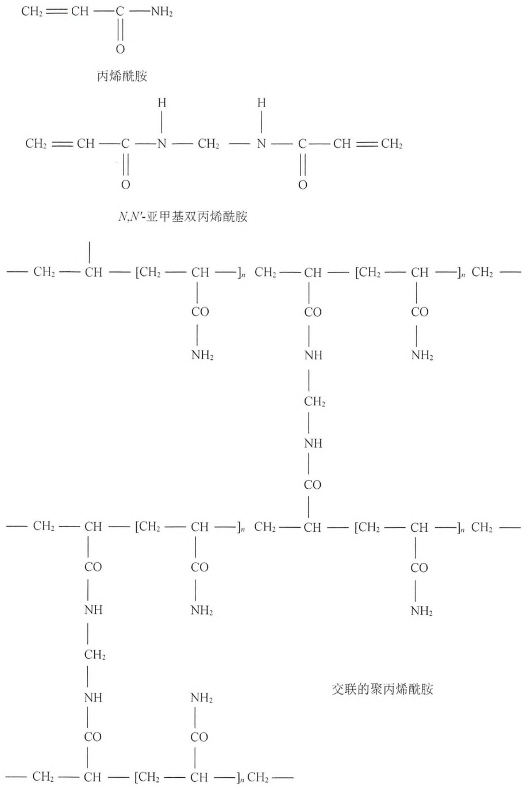

图19-9 聚丙烯酰胺的化学结构。丙烯酰胺单体通过自由基引发的反应聚合为长链。在 $N,N^{\prime}$ 亚甲基双丙烯酰胺的存在下，这些链彼此交联而形成凝胶。所形成的凝胶的孔径由聚合反应期间形成的链长度和交联程度决定。

---

第 19 章 克隆基因的表达以及目的蛋白的纯化和分析

1335

# 替代方案 用考马斯亮蓝进行 SDS-PAGE 凝胶染色的各种不同方法

多种基于原始考马斯亮蓝染色的方法也在被使用。染色液通常是含有 $0.025\% \sim 0.1\%$ （$m / V$）染料的酸醇溶液，后者的配方为 $30\% \sim 50\%$（$V / V$）的甲醇（或乙醇，不常用）和 $7\% \sim 10\%$（$V / V$）乙酸（Steinberg 2009）。染色液的溶剂与固定液的溶剂通常是相同的，因此可以在染色的同时达到固定的目的。固定凝胶中的蛋白质一般使用酸醇混合液（$30\% \sim 50\%$ 的甲醇和 $7\% \sim 10\%$ 的乙酸）。小分子蛋白质（低于 $15\mathrm{kDa}$）的固定需要至少 $50\%$ 的甲醇和 $10\%$ 的乙酸，以减少蛋白质从凝胶中渗出（Schagger 2006），同时也要限制染色和脱色次数。本方案摘选了一些针对方案8中介绍的标准流程进行的改进，这些方法能够获得具有可比性和一致性的染色结果，适用于分子质量为 $20\sim 200\mathrm{kDa}$ 的蛋白质。


## 材料

为正确使用本方案中的器材和危险试剂，必须查阅相应的材料安全数据表并咨询所在机构的环境卫生和安全办公室。

本方案的专用试剂标注&lt;R&gt;，配方在本方案末提供。常用储备溶液、缓冲液和试剂标注&lt;A&gt;，配方见附录1。储备溶液应稀释至适用浓度后使用。

## 试剂

乙酸（10%，V/V）

考马斯亮蓝（参见下文具体方法制备）

凝胶，来自方案8，步骤1\~11

甲醇（30%）/10%乙酸溶液（V/V）

甲醇（40%）/10%乙酸溶液（V/V）

## 设备

填满活性炭的滤器

旋转摇床

平板摇床

带盖的不锈钢托盘


## 方法 1: 迅速加热染色

加热溶液可减少染色和脱色的时间。热考染是在 10% 的乙酸（不加醇）中进行，既便宜又环保。由于没有乙醇存在，蛋白质条带将不会在背景脱色的过程中褪色，这有利于定量和实验的重复性（Westermeier 2006）。

1. 制备 $0.025\%$ 的考马斯亮蓝R-250溶液:称取 $25\mathrm{mg}$ 的R-250染料，溶于 $100\mathrm{mL} 10\%$ （$V / V$）乙酸溶液中。
2. 用带盖的不锈钢托盘将染色液加热至  $50^{\circ}$ C，将凝胶浸泡在染色液中，置于设定为  $50^{\circ}$ C 的加热器具上染色 15min。
3. 在平板摇床上进行凝胶脱色:在 10%（V/V）乙酸中室温脱色至少 2h，期间需更换数次脱色液。为了降低背景，建议过夜脱色。可将脱色液倒入填满活性炭的滤器进行回收。


## 方法 2:微波辅助的考马斯亮蓝染色（Nesatyy et al. 2002）

用微波炉将染色液和脱色液加热至 $50 \sim 70^{\circ} \mathrm{C}$, 重要的是不要煮沸溶液。由于微波炉的

---

1336

分子克隆实验指南（原书第四版）

差别非常大，建议测试不同的微波时间及功率设定，以达到给定体积溶液及特定容器所需的温度。做这些预实验不需要凝胶。一旦找到合适的设定，使用这些参数进行真正的染色。确保使用微波专用的容器，并提供足够体积的溶液（小胶大约需 100mL），以便在染色或脱色过程中，凝胶可被完全覆盖并能自由移动。

1. 制备 0.1% 的考马斯亮蓝 R-250 溶液:称取 100mg 的 R-250 染料，溶于 100mL 40% 甲醇/10% 乙酸（V/V）溶液中。
2. 用微波炉将染色液中的凝胶加热至 $50 \sim 70^{\circ} \mathrm{C}$ 。剧烈混匀使其温度均匀。将处于温热染色液中的凝胶置于旋转摇床上室温孵育 $1 \sim 15 \mathrm{~min}$ 。
3. 弃去染色液，用水冲洗凝胶后，将水弃去。加入脱色液（40%甲醇/10%乙酸，V/V），用微波炉加热至50～70℃。剧烈混匀使其温度均匀。将处于温热脱色液中的凝胶置于旋转摇床上室温孵育5～15min，直到获得期望的对比度。为获得清晰背景，可脱色过夜。


## 方法 3: “过夜 (End of the Day)” 考马斯亮蓝染色

使用  $10 \times$  或更高浓度的考马斯亮蓝染色（0.25% 的 R-250 染料溶于 30% 甲醇/10% 乙酸溶液中）是一种既方便又快速的染色方法。凝胶在室温下染色 30～60min，然后将其置于不加 R-250 的相同溶液中过夜脱色。凝胶在浓度降低的甲醇溶液中（50% 降至 30%）不会缩水，并且能直接从脱色液取出，置于滤纸上干燥。这些特性使得这种染色法特别适合进行放射自显影之前的凝胶染色。这种方法不太适用于微弱蛋白质条带的检测。

1. 制备 0.25% 的考马斯亮蓝 R-250 溶液: 称取 250mg 的 R-250 染料溶于 100mL 30% 甲醇/10% 乙酸 (V/V) 的溶液中。
2. 将凝胶置于平板摇床上，室温下染色 30～60min。染色液可以回收再利用。
3. 将凝胶置于平板摇床上，用 30%甲醇/10%乙酸溶液（V/V）脱色过夜。第二天继续脱色 1～2h，期间更换两次脱色液，直至背景足够清晰。

## 替代方案 用银盐进行 SDS-PAGE 凝胶染色

目前已有多种用银盐对 SDS-PAGE 分离的多肽进行染色的方法。所有方法都依赖于氨基酸侧链结合的银离子发生的差分还原反应（Switzer et al. 1979; Oakley et al. 1980; Ochs et al. 1981; Merril et al. 1984; Schagger 2006）。所有的银染方法都比考马斯亮蓝 R-250 染色方法灵敏 100～1000 倍，能够检测到含量低至 0.1～1.0ng 的多肽条带（Winkler et al. 2007）。有些方法使用银氨溶液，而这容易产生爆炸性的副产物。本方案给出的方法修改自 Sammons 等（1981）和 Ochs 等（1981）的原始方案，其间经过了多次改进（Blum et al. 1987; Winkler et al. 2007）。这个方法信噪比好，并且与质谱分析兼容（Winkler et al. 2007）。此外，包含所有银染所需试剂和溶液的试剂盒可从多家厂商（如 GE Healthcare、Promega、Bio-Rad 和 Sigma-Aldrich 公司）购买。

## 材料

为正确使用本方案中的器材和危险试剂，必须查阅相应的材料安全数据表并咨询所在机构的环境卫生和安全办公室。

本方案的专用试剂标注&lt;R&gt;，配方在本方案末提供。常用储备溶液、缓冲液和试剂标注&lt;A&gt;，配方见附录1。储备溶液应

---

第 19 章 克隆基因的表达以及目的蛋白的纯化和分析

1337

稀释至适用浓度后使用。

▲ 所有溶液都需要使用试剂级（reagent-grade）的去离子水。

## 试剂

去离子水

乙醇水溶液（30%，V/V）

Farmer's 试剂（可选；见步骤 9）&lt;R&gt;

固定液&lt;R&gt;

凝胶，源自方案8，步骤1～步骤11

硝酸银染色液&lt;R&gt;

银染显色液&lt;R&gt;

银染猝灭液（1%的乙酸溶于水，V/V）&lt;R&gt;

银染敏化液（20mg 的硫代硫酸钠 $\left[NaS_{2}O_{3}\right]$ 溶于 100mL 水）&lt;R&gt;

## 设备

台式扫描仪或相机


## 方法

▲ 请戴手套。轻轻操作凝胶，且尽可能不接触凝胶，因为压力和指纹都能产生染色污点。必须使用洁净的玻璃器皿和去离子水，因为污染物会显著降低银染的灵敏度。

1. 将凝胶置于至少 5 倍凝胶体积的固定液中，在低速摇床上室温孵育至少 2h 或过夜孵育。
2. 弃去固定液，加入至少 5 倍凝胶体积的 30% 乙醇，在低速摇床上室温孵育 20min。重复一次以去除所有的去污剂、盐及乙酸。
3. 弃去 30% 的乙醇，加入银染敏化剂以增加染色对比度和灵敏度。孵育 2min，不要过久。
4. 弃去银染敏化剂，用去离子水洗 3 次，每次至少 30s。
5. 弃去水，戴着手套，加入 5 倍凝胶体积的硝酸银染色液，在低速摇床上室温孵育 20min。
6. 弃去硝酸银染色液，用去离子水洗 3 次，每次 15s。

洗胶时间过长（大于 1min）可能会洗去很多银离子，从而降低银染的敏感度。若凝胶表面变干，可能导致染色污点。

7. 弃去水，加入 5 倍凝胶体积的新鲜显影液，在低速摇床上室温孵育。仔细观察显影过程，染色的蛋白质条带会在几分钟内显影，继续孵育直至得到期望的对比度。

显影时间取决于蛋白质加样量的多少:大多数胶孵育 2～7min，对于极低浓度的蛋白质可孵育至 15min。长时间的孵育容易导致整个凝胶呈现较深的银染背景。

8. 用银染猝灭溶液（50mL 1%的乙酸）猝灭反应几分钟，然后用去离子水冲洗凝胶数次，每次 10min。

加入乙酸之后，会有  $CO_{2}$  气泡产生。等到气泡不再形成时，再更换为水或其他溶液。长时间在猝灭液中孵育可能会导致褪色。

银染的胶不能过度染色，因为其脱色较为麻烦及难以控制。然而，如果出现过度染色，凝胶可用 Farmer's 试剂（Anghel et al. 1986）按步骤 9、步骤 10 的方法完全脱色后再染色。否则，继续进行步骤 11。

9. 将凝胶浸没于 Farmer's 试剂中，置于平板摇床上室温孵育 5\~10min。

10. 弃去试剂，用去离子水洗胶数次（每次洗 10min）直到黄色完全消失。此时凝胶已可用于再次银染。可从上述步骤 3 加入银染敏化试剂开始。

---

1338

分子克隆实验指南（原书第四版）

11. 要获得凝胶的永久记录，可以使用台式扫描仪将染色凝胶透射扫描保存，或者拍照，也可以按方案8中“SDS-丙烯酰胺凝胶的干燥”的步骤将其干燥。


## 配方

为正确使用本方案中的器材和危险试剂，必须查阅相应的材料安全数据表并咨询所在机构的环境卫生和安全办公室。

考马斯亮蓝染色液

| 试剂 | 所需量(配制100mL) | 终浓度 |
| --- | --- | --- |
| 考马斯亮蓝R-250 | 0.05g | 0.05% |
| 甲醇 | 50mL | 50%(V/V) |
| 乙酸 | 10mL | 10%(V/V) |
| $H_2O$ | 加至100mL |  |

考马斯亮蓝 R-250 溶解后过滤除去杂质，室温保存。

脱色液

| 试剂 | 所需量(配制100mL) | 终浓度 |
| --- | --- | --- |
| 甲醇 | 30mL | 30%(V/V) |
| 乙酸$^a$ | 10mL | 10%(V/V) |
| $H_2O$ | 加至100mL |  |

a. 为了安全起见，乙酸应该在最后加入到甲醇-水溶液中。

室温保存。

Farmer's 试剂

| 试剂 | 所需量(配制100mL) | 终浓度 |
| --- | --- | --- |
| 亚铁氰化钾(III)($K_3[Fe(CN)_6]$) | 0.49g | 15mmol/L |
| 硫代硫酸钠($NaS_2O_3$) | 0.79g | 50mmol/L |
| $H_2O$ | 100mL |  |

现配现用。

固定液

| 试剂 | 所需量(配制100mL) | 终浓度 |
| --- | --- | --- |
| 乙醇 | 30mL | 30%(V/V) |
| 乙酸 | 12mL | 12%(V/V) |
| 37%(m/V)甲醛 | 50μL | 0.018%(V/V) |
| $H_2O$ | 加至100mL |  |

SDS 凝胶缓冲液（5×）

| 试剂 | 所需量(配制1mL) | 终浓度 |
| --- | --- | --- |
| Tris-Cl(1mol/L,pH6.8) | 0.25mL | 250mmol/L |
| SDS(电泳级别) | 80mg | 8% |
| 溴酚蓝 | 1mg | 0.1% |
| 80%甘油(V/V) | 0.5mL | 40%(V/V) |
| 二硫苏糖醇(1mol/L) | 0.1mL | 100mmol/L |
| $H_2O$ | 0.25mL |  |

加入 DTT 之前可室温保存。使用前加入 1mol/L 的 DTT 储备液。

硝酸银染色液

| 试剂 | 所需量(配制100mL) | 终浓度 |
| --- | --- | --- |
| AgNO3 | 20mg | 0.02%(V/V) |
| 37%(m/V)甲醛 | 75μL | 0.028%(V/V) |
| H2O | 加至100mL |  |

现配现用。

---

第 19 章 克隆基因的表达以及目的蛋白的纯化和分析

1339

银染显影液

| 试剂 | 所需量(配制100mL) | 终浓度 |
| --- | --- | --- |
| 碳酸钠 | 6g | 6%(m/V) |
| 硫代硫酸钠 | 0.4mg | 0.0004%(m/V) |
| (有时加入2mL的敏化溶液) |  |  |
| 37%(m/V)甲醛 | 75μL | 0.028%(V/V) |
| H2O | 加至100mL |  |

现配现用。

银染猝灭溶液

| 试剂 | 所需量(配制100mL) | 终浓度 |
| --- | --- | --- |
| 乙酸 | 1mL | 1%(V/V) |
| $H_2O$ | 99mL |  |

可室温保存。

银染敏化溶液

| 试剂 | 所需量(配制100mL) | 终浓度 |
| --- | --- | --- |
| 硫代硫酸钠[NaS2O3] | 20mg | 0.02%(V/V) |
| H2O | 加至100mL |  |

现配现用。

Tris-甘氨酸电泳缓冲液（10×，pH8.3）（电泳槽缓冲液，Reservoir Buffer）

| 试剂 | 所需量(配制100mL) | 储存浓度(10×) | 终浓度(1×) |
| --- | --- | --- | --- |
| Tris-碱 | 30.3g | 250mmol/L | 25mmol/L |
| 甘氨酸(电泳级) | 144g | 1.9mol/L | 192mmol/L |
| SDS(电泳级) | 10g | 1% | 0.1%(m/V) |
| H2O | 加至1L |  |  |

pH 应调至 8.3。

一些制造商出售电泳级 SDS。尽管这些公司的 SDS 都能得到可重复的结果，但不可混用。我们建议固定使用某一品牌的 SDS，因为当更换不同公司的 SDS 时，其多肽迁移率可能发生明显的改变。当从胶中洗脱的蛋白用于测序时，电泳级的 SDS 仍需按 Hunkapiller 等（1983）所述进行纯化。用去离子配制 20%（m/V）的 SDS 贮存液，室温保存。

## 参考文献

- Anghel C, Iliescu R, Repanovici R, Pecec M, Popa LM. 1986. Demonstration of viral proteins by silver staining [French]. Virologie 37: 237–245.
- Blum H, Beier H, Gross HJ. 1987. Improved silver staining of plant proteins, RNA and DNA in polyacrylamide gels. Electrophoresis 8: 93–99.
- Davis BJ. 1964. Disc electrophoresis. II. Method and application to human serum proteins. Ann N Y Acad Sci 121: 404–427.
- Harlow EL, Lane D. 1988. Antibodies: A laboratory manual. Cold Spring Harbor Laboratory, Cold Spring Harbor, NY.
- Hunkapiller MW, Lujan E, Ostrander F, Hood LE. 1983. Isolation of microgram quantities of proteins from polyacrylamide gels for amino acid sequence analysis. Methods Enzymol 91: 227–236.
- Laemmli UK. 1970. Cleavage of structural proteins during the assembly of the head of bacteriophage T4. Nature 227: 680–685.
- Merril CR, Goldman D, Van Keuren ML. 1984. Gel protein stains: silver stain. Methods Enzymol 104: 441–447.
- Nesatyy VJ, Dacanay A, Kelly JF, Ross NW. 2002. Microwave-assisted protein staining: Mass spectrometry compatible methods for rapid protein visualisation. Rapid Commun Mass Spectrom 16: 272–280.
- Oakley BR, Kirsch DR, Morris NR. 1980. A simplified ultrasensitive silver stain for detecting proteins in polyacrylamide gels. Anal Biochem 105:361–363.
- Ochs DC, McConkey EH, Sammons DW. 1981. Silver stains for proteins in polyacrylamide gels: A comparison of six methods. Electrophoresis 2:304–307.
- Ornstein L. 1964. Disc electrophoresis. I. Background and theory. Ann N Y Acad Sci 121: 321–349.
- Ramjeesingh M, Huan LJ, Garami E, Bear CE. 1999. Novel method for evaluation of the oligomeric structure of membrane proteins. Biochem J 342: 119–123.
- Sammons DW, Adams LD, Nishizawa EE. 1981. Ultrasensitive silver-based color staining of polypeptides in polyacrylamide gels. Electrophoresis 2:135–141.
- Schagger H. 2006. Tricine-SDS-PAGE. Nat Protoc 1: 16–22.
- Steinberg TH. 2009. Protein gel staining methods: An introduction and overview. Methods Enzymol 463: 541–563.
- Studier FW. 1973. Analysis of bacteriophage T7 early RNAs and proteins on slab gels. J Mol Biol 79: 237–248.
- Switzer RC III, Merril CR, Shifrin S. 1979. A highly sensitive silver stain for detecting proteins and peptides in polyacrylamide gels. Anal Biochem 98: 231–237.
- Weber K, Pringle JR, Osborn M. 1972. Measurement of molecular weights by electrophoresis on SDS–acrylamide gel. Methods Enzymol 26: 3–27.
- Westermeier R. 2006. Sensitive, quantitative, and fast modifications for Coomassie Blue staining of polyacrylamide gels. Proteomics 6: 61–64.
- Wilson CM. 1983. Staining of proteins on gels: Comparisons of dyes and procedures. Methods Enzymol 91: 236–247.
- Winkler C, Denker K, Wortelkamp S, Sickmann A. 2007. Silver- and Coomassie-staining protocols: Detection limits and compatibility with ESI MS. Electrophoresis 28: 2095–2099.

---

1340

分子克隆实验指南（原书第四版）

## 方案 9 蛋白质的免疫印迹分析

免疫印迹（又称为蛋白质印迹，Western blotting）可用于能够与特异性抗体结合的大分子抗原（通常是蛋白质）的鉴定和分子大小确认（Towbin et al. 1979；Burnette 1981；综述见 Towbin and Gordon 1984；Gershoni 1988；Stott 1989；Nelson et al. 1990）。蛋白质首先通过 SDS-PAGE 分离，再从凝胶上电泳（electrophoretically）转移到能紧密结合蛋白质的基质膜上。当基质膜上不发生反应的结合位点被封闭（阻止其与抗体的非特异性结合）后，被固定的蛋白质可与特异的多克隆或单克隆抗体发生反应。抗原-抗体复合物可通过显色、荧光及化学发光进行观察。

免疫印迹通常出现的问题包括:蛋白质不能有效转移、抗原位点（表位）缺失、灵敏度低、背景噪声高及非定量检测。没有一种神奇配方可以为每种抗原解决所有这些难题，不过少量实验通常足以解决除了最顽固的技术问题外的其他问题。综合性综述（Bjerrum and Schaffer-Nielsen 1986；Bjerrum et al. 1988；Stott 1989；Alegria-Schaffer et al. 2009）列举了免疫印迹中可能会出现的困难，并给出了详细的解决建议。大多数蛋白质印迹供应商的使用手册中，也可以找到有用的疑难解答信息。有关免疫印迹的特定细节，可参见本方案末尾处的讨论部分。

不同的蛋白质印迹方案依赖于特定试剂，而且由于设备、试剂和可用抗体种类繁多，不同方案之间的差异很大。本方案是运用辣根过氧化物酶（HRP）偶联二抗和增强化学发光(ECL)试剂进行免疫印迹的一个可行方案。ECL原理是基于HRP在催化鲁米诺(luminal)或其他底物发生氧化反应的过程中会发光（表19-9）。发射光会被胶片或CCD相机捕获，用于定性或半定量分析。由于ECL灵敏度非常高，已成为了目前最常用的检测方法。本方案可根据不同的膜、抗体及检测系统进行修改。一抗和二抗的最佳稀释比例需要通过实验确定，不过抗体生产厂商建议的稀释度通常可作为较好的尝试起点。


## 材料

为正确使用本方案中的器材和危险试剂，必须查阅相应的材料安全数据表并咨询所在机构的环境卫生和安全办公室。

本方案的专用试剂标注&lt;R&gt;，配方在本方案末提供。常用储备溶液、缓冲液和试剂标注&lt;A&gt;，配方见附录1。储备溶液应稀释至适用浓度后使用。

▲ 实验过程和显影步骤中不要让膜变干。操作膜的时候，只能使用干净的手套或器械，以免污染物导致较高的背景噪声或黑点。

## 试剂

封闭液 $[1\% (m / V)$ 的脱脂奶粉，溶于TBST洗涤缓冲液，如Carnation]

由于每一对抗原-抗体都有各自的特性，因而没有一种封闭剂是万能的。如果用 $1\%$ 的脱脂牛奶时背景噪声高，可尝试提高浓度（至 $5\%$ ， $m / V$ ），或者换用BSA $[1\% \sim 5\% (m / V)$ ，溶于TBST洗涤缓冲液]、血清、酪蛋白、明胶或BLOTTO（Johnson and Elder 1983）。也可以选用商品化的封闭剂（如GE Healthcare、Thermo Fisher及其他公司）。去离子水

显影液和定影液

ECL 试剂盒

过氧化氢和鲁米诺/增强溶液作为双组分试剂盒可从多家供应商（Amersham/GE Healthcare、Thermo Scientific Pierce、Life Technologies、Bio-Rad 公司）购买。商家提供了不同灵敏度范围（如低灵敏度或皮摩尔级，高灵敏度或飞摩尔级）的试剂盒。

---

第 19 章 克隆基因的表达以及目的蛋白的纯化和分析

1341

## HRP 偶联的二抗

选择能与一抗特异性结合的 HRP 偶联物。例如，如果单克隆 IgG 抗体用作一抗，那么二抗应为抗鼠 IgG 的抗体（几乎所有的单克隆 IgG 抗体都是用小鼠生产）。某些其他类型的单抗如 IgM，则需要与之类型相匹配的二抗。如果一抗是多克隆抗体，需确定其由哪种动物（多数是兔，也可能是羊或者其他大动物）产生，再选择相应的 HRP 偶联的二抗。按生产厂商的建议，用封闭液将二抗稀释至工作浓度，通常在（1:5000）～（1:50000），或者 20～200ng/mL。最佳的稀释度取决于特定的 HRP 偶联物、膜上的抗原量以及检测系统。

丽春红 S 染色液（0.4%[m/V]的丽春红 S，溶于 1%[m/V]的乙酸）

一抗

选择特异性针对目标蛋白的抗体。一抗储备液可短期存放在 $4^{\circ}\mathrm{C}$ 。若需长期存放，可分装后冻存于 $-70^{\circ}\mathrm{C}$ 。用封闭液按生产厂商的建议将一抗稀释至工作浓度，通常在（1:1000）～（1:10000），或 $0.2\sim 1\mu \mathrm{g / mL}$ 的工作浓度。

SDS 凝胶

剥离液（可选）&lt;R&gt;

TBST 洗涤缓冲液&lt;R&gt;

## 设备

台式扫描仪

胶片暗盒和暗室

凝胶转膜仪

塑料文件保护袋（办公用品店有售）

聚偏氟乙烯（PVDF）或硝酸纤维素膜

平板摇床

特百惠（Tupperware）容器


## 方法

1. 按照厂商的说明（也可参阅表 19-8 转膜缓冲液及“膜的类型”部分内容），使用凝胶转膜仪将 SDS 凝胶上的蛋白转移至聚偏氟乙烯（PVDF）或硝酸纤维素膜。

表 19-8 用于将蛋白质从聚丙烯酰胺凝胶上转移到膜上的缓冲液

<table><tr><td>转膜类型</td><td>缓冲液</td><td>引用</td></tr><tr><td rowspan="3">半干式</td><td>Tris 碱(24mmol/L)</td><td>Towbin et al. 1979</td></tr><tr><td>甘氨酸(192mmol/L)</td><td></td></tr><tr><td>甲醇(20%)</td><td></td></tr><tr><td rowspan="4">浸入式</td><td>Tris 碱(24mmol/L)</td><td>Bjerrum and Schafer-Nielsen, 1986</td></tr><tr><td>甘氨酸(39mmol/L)</td><td></td></tr><tr><td>甲醇(20%)</td><td></td></tr><tr><td>SDS(0.0375%)</td><td></td></tr></table>

甲醇能减少凝胶的膨胀并提高蛋白质与硝酸纤维素膜的结合效率。转膜效率受以下因素影响:电泳缓冲液中是否存在 SDS、转膜缓冲液的 pH 及转膜前凝胶中的蛋白质是否已染色。为最大限度地提高转膜效率，SDS 的浓度不应超过 0.1%，转膜缓冲液 pH 必须≥8.0。如果膜上的蛋白质用于测序，则应使用 CAPS 缓冲液（Moss 2001）。甘氨酸会干扰测序。

使用预染蛋白标志物，不仅可以监视蛋白质从凝胶向膜上转移的效率，还可以用来辨别凝胶的方向（将分子质量标准加入第一个胶孔）、定位样品泳道，同时还有助于分辨欲检测条带的分子质量。

2. 从转膜仪中取出膜，用去离子水略微漂洗。
3. 在平板摇床上，用 0.4% 的丽春红 S（溶于 1% 的乙酸）将膜染色 5min，弃去染色液，

---

1342

分子克隆实验指南（原书第四版）

然后用 300mL 去离子水略微洗膜大约 1min，直到背景脱色且蛋白质条带清晰可见。通过扫描湿膜记录转膜效率。先用去离子水，再用 TBST 洗涤缓冲液洗去染料。

4. 将膜放入 20mL 的封闭液中，置于平板摇床上室温孵育至少 20～60min。或者在 4℃ 条件下封闭过夜。

5. 用 30mL TBST 洗涤缓冲液洗膜，洗完后将膜沥干。

6. 将膜浸泡在用封闭液稀释的一抗中, 放在平板摇床上室温孵育至少 $1 \mathrm{~h}$, 或 $4^{\circ} \mathrm{C}$ 条件下孵育过夜。

若加入 3mmol/L（0.02%）叠氮化钠并储存于  $4^{\circ}$ C，一抗稀释液可重复使用数次。

7. 用 30mL TBST 洗涤缓冲液洗膜 6 次，每次 5min，洗完最后一次后将膜沥干。

8. 将膜浸泡在用封闭液稀释（按生产厂商建议的稀释比例，如 1:5000）的 HRP 偶联的二抗中，放在平板摇床上室温孵育 30～60min。请每次使用新稀释的二抗。

▲ 不能向 HRP 偶联的二抗中加入叠氮化钠，因为后者会灭活 HRP。

9. 用 30mL TBST 洗涤缓冲液洗膜 6 次，每次至少 5min；延长洗膜时间及增加缓冲液更换次数可以减小背景噪声，特别是在使用 ECL 等灵敏的检测方法时。

10. 在即将使用前，按照厂商的说明，将 ECL 试剂盒中一定量的过氧化氢液（A 液）和鲁米诺液（B 液）混匀，配成新鲜的 ECL 工作液。

1\~2mL 的工作液通常足够覆盖  $9cm \times 15cm$  的膜。

11. 剪开塑料文件保护袋封边，将两个塑料薄片分开。沥干膜，将其放在一个薄片上，用移液管吸取 ECL 工作液覆盖在膜的上面。从一角开始小心地将另一片薄片盖在膜上，避免产生气泡。将膜与 ECL 工作液孵育 1～5min，孵育过程中防止不必要的曝光。用滤纸吸掉四周多余的 ECL 液。

12. 将塑料薄片/膜放入胶片暗盒，并用胶布封住。在暗室中用适当的光源曝光。建议首次曝光时间 60s。曝光时间可能需要调整，以达到最佳曝光效果。

反应发射出强烈的光线，因此，胶片与膜之间的任何移动都会导致胶片上形成污点。在最初的5～30min，发射光是最强烈的。

13. 用适量的显影液和定影液使其显影。在打开胶片暗盒之前，在曝光胶片上将条带和分子质量标准（或其他参考点）的相对位置做好标记。

14. 如果需要，杂交产物可以从膜上剥离，因而可以使用其他的抗体进行再次检测。将膜置于盛有剥离液的封闭容器（如特百惠容器）中，50℃孵育5～10min，然后，先用大量去离子水、再用TBST洗涤缓冲液洗膜（约45min），期间多次更换洗液 $^{①}$ 。从步骤4开始，重新进行膜的封闭及检测。


## 疑难解答

由于设备、试剂和抗体种类繁多，而且不同的抗体针对特定抗原的亲和力也不同，因此，蛋白质印迹的结果具有试剂特异性。要想得到最佳结果，需要优化以下所有条件:SDS-PAGE 分离的样品量、电转膜时间、膜和封闭剂的选择，以及用于特定底物检测系统的一抗和二抗浓度。对于高度灵敏的化学发光检测系统（ECL、SuperSignal、LumiGLO、Western Lightning 公司），生产厂商提供的建议非常有用。

问题:没有信号。

解决方案:信号较弱或者没有信号的原因很多，包括膜上抗原量少、蛋白质制备过程中抗原性位点（表位）丢失、一抗敏感度低（有些是构象依赖型）以及使用的二抗不合适。

<small><span class="docvortex-page-footnote" data-block-type="page_footnote" style="color:#6b7280">① 译者注:此处原文没有给出具体清洗时间和次数，建议至少用 TBST 洗涤 3 次，每次 10min。</span></small>

---

第 19 章 克隆基因的表达以及目的蛋白的纯化和分析

1343

增加 SDS-PAGE 凝胶的蛋白质加样量，并加入对照样品（如果有）或荧光标记蛋白质可能有助于确定所需抗原的最小量，并优化转膜效率。大多数情况下，提高一抗和二抗的浓度（参见试剂清单和表 19-9）、延长抗体孵育时间（一抗 4℃过夜，二抗 2h），或者换用灵敏度更高的化学发光试剂盒（如 femto vs. pico ECL）可以解决此问题。如步骤 5 所述，用 TBST 洗掉底物，重新开始孵育一抗（步骤 6）。此外，必须确保二抗与一抗在物种和类型上相匹配，且 HRP 偶联的二抗中没有叠氮化钠，因为后者会灭活 HRP。

问题:信号太强、背景噪音高。

## 解决方案:

- 如果信号太强并且在暗室中能看到杂交产物发光，仅仅等待一段时间（20min～2h）后再拿另一张胶片曝光，并不是一个好的解决办法，因为这样会掩盖饱和蛋白质与微弱蛋白质条带间的相对信号强度差异，从而不能对蛋白质样品间进行定量比较。取而代之的方法是，如步骤14所述，将膜剥离再生，用稀释后的一抗二抗（至少稀释5倍以上）重新开始检测。
- 如果背景噪声高或呈斑点状，可使用更大体积的封闭液和洗涤缓冲液，并增加清洗次数，尤其是在孵育二抗之后（步骤9）。增加封闭液或一抗溶液中脱脂奶粉的浓度，或者换用另一种封闭剂（参见试剂清单）有时可能会减少非特异性信号。


## 讨论

## 蛋白质从凝胶到滤膜的电泳转移

蛋白质从聚丙烯酰胺凝胶向膜的电转移效率比毛细管转移更高效也更快速。转移的方向是与分离胶平面垂直的，需用膜和电极完全覆盖整个胶面。从SDS凝胶转膜时，需将膜置于凝胶的正极端（红色）。大多数商业化的电转移设备均使用石墨、铂或不锈钢制成的大型金属线圈或平板电极。在老旧设备中，三明治样的凝胶/膜整体浸泡在盛有转膜缓冲液的箱体中，后者位于塑料支架附着的两个垂直电极之间。这种电转移槽现在也仍然有售，但是，效率更高的“半干式”转膜仪已成为更流行的选择。在“半干式”转移中，浸满转膜缓冲液的Whatman 3MM滤纸作为缓冲液槽代替了旧式箱体（表19-8）。蛋白转移的最佳条件取决于使用捕获膜的类型和转膜设备的设计。因此，最好参阅生产厂商的使用手册。

## 膜的类型

有 3 种类型的捕获膜可用于免疫印迹:硝酸纤维素膜、尼龙（聚酰胺纤维）膜和聚偏氟乙烯膜（PVDF）。每种蛋白质与这 3 种膜的结合效率不同，并且某种膜可能会比另一种膜能够更好地呈现某个特定的抗原表位。因此，尽可能用不同的膜、不同的抗体检测目标蛋白是值得的。

## 硝酸纤维素膜

硝酸纤维素膜（孔径 $0.45\mu \mathrm{m}$ ）仍然是标准的免疫印迹用膜，尽管对于小蛋白（<14kDa）的免疫印迹推荐使用更小孔径（$0.22\mu \mathrm{m}$ 或 $0.1\mu \mathrm{m}$ ）的膜（Burnette 1981；Lin and Kasamatsu 1983）。硝酸纤维素膜的结合和保留能力是 $80\sim 250\mu \mathrm{g} / \mathrm{cm}^2$ ，根据蛋白质不同而不同。虽然氨基酸侧链与膜上的硝基基团形成的氢键对结合有所帮助，但是蛋白质主要是通过疏水相互作用与膜结合（Van Oss et al. 1987）。不管怎样，蛋白质被缓冲液中的甲醇和盐部分脱水后，可以确保更持久的结合作用。即便如此，某些蛋白质在处理过程中也会从膜上丢失，特别是当缓冲液中存在非离子型去污剂时。因此，很多研究者会在清洗和抗体孵育过程中

---

1344

分子克隆实验指南（原书第四版）

将蛋白质固定在硝酸纤维素膜上，以减少蛋白质丢失（Gershoni and Palade 1982）。然而，确保固定所用的处理方法（戊二醛、交联或紫外线照射）不会损坏目标表位非常重要。当转移后的硝酸纤维素滤膜变干时，固定可能也会加剧膜的脆性。

## 尼龙膜

尼龙膜和带正电的尼龙膜比硝酸纤维素膜更结实，并且能通过静电相互作用与蛋白质紧密结合。其结合能力随膜的类型、蛋白质的种类不同而各不相同，但通常为 $150\sim 200\mu \mathrm{g} / \mathrm{cm}^2$ 。这类膜的优点是，可以使用不同抗体进行多轮检测。尼龙膜的一个潜在的缺点是，没有一种简单和灵敏的方法可对其固化的蛋白质进行染色，如下文讨论；另一个缺点是难以封闭这些膜上所有未结合的位点，从而会导致抗体结合的非特异性背景较高。在许多情况下，为了达到满意的效果，必须使用含 $6 \%$ 热处理过的酪蛋白和 $1 \%$ 聚乙烯吡咯烷酮的溶液，进行额外的封闭处理（Gillespie and Hudspeth 1991）。

## 聚偏氟乙烯膜

聚偏氟乙烯（PVDF）（Pluskal et al. 1986）是一种机械强度高，具有类似尼龙膜结合能力（约 $170\mu \mathrm{g} / \mathrm{cm}^2$）的耐用膜。在转移前，必须先用甲醇预湿膜的疏水性表面，然后再将其水化于转膜缓冲液中。由于蛋白质与PVDF膜的结合是通过强大的疏水相互作用（比硝酸纤维素膜强约6倍）（Van Oss et al. 1987），因而蛋白质在随后的检测步骤中更易被完全保留。固化在PVDF膜上的蛋白质，可用标准的染色方法观察，如氨基黑、印度墨汁、丽春红、考马斯亮蓝。

## 免疫印迹过程中的蛋白质染色

有时会将考马斯染色凝胶上的蛋白质进行电转，电转前凝胶需完全脱色并浸泡在 0.1% 的 SDS 缓冲液中（Thompson and Larson 1992）。然而，在大多数情况下，染色（或固定）蛋白质的凝胶转移效率会大幅降低，抗体结合的抗原表位也可能会被屏蔽。与之相对，非常可取的方法是在一个泳道中加入预染蛋白质标志物，用于电泳和电转步骤的质量控制。样品泳道中的蛋白质转移效率和一致性，可以通过对膜染色进行确认。此过程易于操作，但需要慎重选择一种足够敏感，且能与膜的类型兼容的染色方法。

与硝酸纤维素膜或 PVDF 膜结合的蛋白质，可以使用易去除的染料丽春红 S 进行染色（Muilerman et al. 1982；Salinovich and Montelaro 1986）。丽春红染色相对并不灵敏，但它提供了一个宝贵的“内参”，可验证每个泳道中的细胞蛋白是否等量，而这正是表达筛选和其他印迹对比分析所需的。当使用更持久的染料时，如印度墨汁（Hancock and Tsang 1983）、氨基黑（Towbin et al. 1979）、胶体金（Moeremans et al. 1985；Rohringer and Holden 1985）或银盐（Yuen et al. 1982），通常必须从膜上切下一条泳道，对其单独分开染色。短暂接触碱液，可能会降低清洗过程中膜结合蛋白的损失，从而增强墨汁或胶体金的染色效果（Sutherland and Skerritt 1986）。在这些条件下，有可能检测到含量少至几纳克的蛋白质条带。

目前没有令人满意的方法能够对固化在尼龙膜或阳离子尼龙膜上的蛋白质进行染色，因为这些膜携带的高电荷会产生高背景，从而掩盖除最强蛋白质条带之外的所有蛋白质条带。

## 封闭剂

传统封闭剂如 1% 脱脂奶粉或 5% 牛血清白蛋白（Johnson et al. 1984；DenHollander and Befus 1989），通常适用于基于辣根过氧化物酶的检测系统。然而，这些试剂往往残留碱性

---

第 19 章 克隆基因的表达以及目的蛋白的纯化和分析

1345

磷酸酶活性，故不应该用于基于碱性磷酸酶偶联抗体的检测系统。这一点对于化学发光系统尤为重要，因为其极高的检测灵敏度要求背景信号非常低。一般情况下，基于碱性磷酸酶系统的最佳封闭溶液是:含有6%的酪蛋白、1%聚乙烯吡咯烷酮和10mmol/L EDTA的磷酸盐缓冲液（Gillespie and Hudspeth 1991）。封闭液应65℃加热1h灭活残留的碱性磷酸酶活性，然后加入3mmol/L叠氮化钠储存于4℃条件下。配方参见附录1。一抗的特异性也应该予以考虑。例如，对于抗磷酸化氨基酸抗体，酪蛋白和牛奶不是一个合适的封闭剂，同样，牛血清白蛋白（BSA）也与抗血清蛋白和许多抗传染性病原体的抗体不兼容。相应的推荐封闭剂请参阅抗体供应商提供的文献。

## 探测（probing）与检测

能够与目标抗原表位反应的抗体，可以是多克隆抗体或单克隆抗体。一抗很少直接标记，而是仅需稀释于适当的缓冲液中，用于形成抗原-抗体复合物。一般情况下，除非一抗可以适当稀释（酶法检测至少稀释1:1000，化学发光方法检测至少稀释1:5000），否则免疫印迹的背景会高得令人无法接受。清洗后，结合的抗体可以使用特定的二抗检测，后者能够识别一抗的共同特征，并与一个报告酶或基团偶联。使用抗体的两步结合是标准的做法，即使这可能看上去比直接使用偶联一抗更为麻烦。但是，与仅使用一个抗体的方法相比，两步法中多个偶联二抗分子能够与一个一抗结合，这就使信号得到了显著放大。此外，一种偶联二抗可以用于检测来源于同型免疫球蛋白的任何一抗，从而有利于保持合理的必需偶联物库存。

## 次要试剂包括:

- 用于早期免疫印迹的放射性碘标记抗体或葡萄球菌蛋白 A（如 Burnette 1981）。放射性标记的二抗目前基本上已被更安全和/或更灵敏的检测系统所替代，如增强化学发光系统。
- 与酶（如辣根过氧化物酶或碱性磷酸酶）偶联的抗体。与之匹配的是一系列常用的显色底物、荧光底物和化学发光底物。
- 生物素标记的抗体，可以通过标记或偶联的链霉亲和素进行检测。

显色和化学发光反应的结果，最好通过常规的拍照、胶片或数字成像进行记录。表 19-9 展示了这些免疫印迹方法在使用高滴度和特异性抗体检测标准抗原时的近似灵敏度。这些检测方法的详细信息，请参阅附录 3。

表 19-9 显色法和化学发光法检测固化抗原

<table><tr><td>酶</td><td>试剂</td><td>灵敏度</td><td>注释</td><td>引用</td></tr><tr><td colspan="5">显色法</td></tr><tr><td rowspan="3">HRP</td><td>4-氯-1萘酚/ $H_{2}O_{2}$ </td><td>1ng</td><td>当暴露在光下时,紫色的氧化产物迅速褪色</td><td>Hawkes et al. 1982; Dresel and Schettler 1984</td></tr><tr><td>二氨基联苯胺/ $H_{2}O_{2}$ </td><td>250pg</td><td>潜在的致癌物质。二氨基反应生成棕色沉淀物,添加钴、银、镍盐可增强反应</td><td>de Blas and Cherwinski 1983; Gershoni 1988</td></tr><tr><td>3,3&#x27;,5,5&#x27;-四甲基联苯胺</td><td>100pg</td><td>深紫色沉淀</td><td>McKimm-Breschkin 1990</td></tr><tr><td>碱性磷酸酶</td><td>硝基四氮唑蓝/5-溴-4-氯吲哚基磷酸盐</td><td>100pg</td><td>钢蓝色沉淀</td><td>Leary et al. 1983; Blake et al. 1984</td></tr><tr><td colspan="5">化学发光法</td></tr><tr><td>HRP</td><td>鲁米诺/4-碘苯酚/ $H_{2}O_{2}$ </td><td>300pg</td><td>氧化鲁米诺可在X射线片上捕捉到其发出的蓝光。强条带能在几秒钟内激发出光,而弱条带需要30min</td><td>Schneppenheim and Rautenberg 1987; Harper and Murphy 1991; Schneppen heim et al. 1991</td></tr></table>

---

1346

分子克隆实验指南（原书第四版）

续表

| 酶 | 试剂 | 灵敏度 | 注释 | 引用 |
| --- | --- | --- | --- | --- |
| 碱性磷酸酶 | AMPPF3-(4-甲氧基螺[1,2-二氧杂环丁烷-3'2'-三环-[3.3.1$^{3,7}$] 癸烷]-4-基)-苯酯 | 1pg | 酶的去磷酸化可发光。碱性磷酸酶凭其高的周转次数,迅速产生强烈的信号,提供了一个极其敏感的免疫检测方法 | Gillespie and Hudspeth 1991 |


## 配方

为正确使用本方案中的器材和危险试剂，必须查阅相应的材料安全数据表并咨询所在机构的环境卫生和安全办公室。

剥离液（stripping solution）

| 试剂 | 所需量(配制100mL) | 终浓度 |
| --- | --- | --- |
| Tris-Cl(0.5mol/L,pH6.7) | 12.4mL | 62mmol/L |
| SDS | 2g | 2%(m/V) |
| β-巯基乙醇(14.2mol/L) | 0.7mL | 100mmol/L |

于密闭的瓶子中室温保存。

TBST 洗涤缓冲液

| 试剂 | 所需量(配制1L) | 终浓度 |
| --- | --- | --- |
| Tris-Cl(1mol/L,pH7.4) | 10mL | 10mmol/L |
| NaCl | 9g | 0.9%(m/V) |
| 吐温20(10%,V/V) | 2mL | 0.02%(V/V) |

室温保存。

## 参考文献

- Alegria-Schaffer A, Lodge A, Vattem K. 2009. Performing and optimizing western blots with an emphasis on chemiluminescent detection. Methods Enzymol 463: 573–599.
- Bjerrum OJ, Schafer-Nielsen C. 1986. Buffer systems and transfer parameters for semidry electroblotting with a horizontal apparatus. In Electrophoresis '86: Proceedings of the 5th Meeting of the International Electrophoresis Society (ed Dunn MJ), pp. 315–327. VCH, Deerfield Beach, FL.
- Bjerrum OJ, Larsen KP, Heegaard NH. 1988. Non-specific binding and artifacts-specificity problems and troubleshooting with an atlas of immunoblotting artifacts. In CRC handbook of immunoblotting of proteins: Technical descriptions (ed Bjerrum OJ, Heegaard NH), Vol. 1, pp. 227–254. CRC Press, Boca Raton, FL.
- Blake MS, Johnston KH, Russell-Jones GJ, Gotschlich EC. 1984. A rapid, sensitive method for detection of alkaline phosphatase-conjugated anti-antibody on western blots. Anal Biochem 136: 175–179.
- Burnette WN. 1981. "Western blotting": Electrophoretic transfer of proteins from sodium dodecyl sulfate–polyacrylamide gels to unmodified nitrocellulose and radiographic detection with antibody and radioiodinated protein A. Anal Biochem 112: 195–203.
- de Blas AL, Cherwinski HM. 1983. Detection of antigens on nitrocellulose: In situ staining of alkaline phosphatase conjugated antibody. Anal Biochem 133: 214–219.
- DenHollander N, Befus D. 1989. Loss of antigens from immunoblotting membranes. J Immunol Methods 122: 129–135.
- Dresel HA, Schettler G. 1984. Characterization and visualization of the low density lipoprotein receptor by ligand blotting using anti-low density lipoprotein enzyme-linked immunoabsorbent assay (ELISA). Electrophoresis 5: 372–373.
- Gershoni JM. 1988. Protein-blot analysis of receptor-ligand interactions. Biochem Soc Trans 16: 138–139.
- Gershoni JM, Palade GE. 1982. Electrophoretic transfer of proteins from sodium dodecyl sulfate–polyacrylamide gels to a positively charged membrane filter. Anal Biochem 124: 396–405.
- Gillespie PG, Hudspeth AJ. 1991. Chemiluminescence detection of proteins from single cells. Proc Natl Acad Sci 88: 2563–2567.
- Hancock K, Tsang VC. 1983. India ink staining of proteins on nitrocellulose paper. Anal Biochem 133: 157–162.
- Harper DR, Murphy G. 1991. Nonuniform variation in band pattern with luminol/horse radish peroxidase western blotting. Anal Biochem 192:59–63.
- Hawkes R, Niday E, Gordon J. 1982. A dot-immunobinding assay for monoclonal and other antibodies. Anal Biochem 119: 142–147.
- Johnson DA, Elder JH. 1983. Antibody directed to determinants of a Moloney virus derived MCF GP70 recognizes a thymic differentiation antigen. J Exp Med 158: 1751–1756.
- Johnson DA, Gautsch JW, Sportsman JR, Elder JH. 1984. Improved technique utilizing nonfat dry milk for analysis of proteins and nucleic acids transferred to nitrocellulose. Gene Anal Tech 1: 85–103.
- Leary JJ, Brigati DJ, Ward DC. 1983. Rapid and sensitive colorimetric method for visualizing biotin-labeled DNA probes hybridized to DNA or RNA immobilized on nitrocellulose: Bio-blots. Proc Natl Acad Sci 80: 4045–4049.
- Lin W, Kasamatsu H. 1983. On the electrotransfer of polypeptides from gels to nitrocellulose membranes. Anal Biochem 128: 302–311.
- McKimm-Breschkin JL. 1990. The use of tetramethylbenzidine for solid phase imunoassays. J Immunol Methods 67: 1–11.
- Moeremans M, Daneels G, De Mey J. 1985. Sensitive colloidal metal (gold or silver) staining of protein blots on nitrocellulose membranes. Anal Biochem 145: 315–321.
- Moss M. 2001. Isolation of proteins for microsequence analysis. In Current protocols in molecular biology (ed Ausubel FM, et al.), pp. 10.19.1–10.19.12. Wiley, New York.
- Muilerman HG, ter Hart HG, Van Dijk W. 1982. Specific detection of inactive enzyme protein after polyacrylamide gel electrophoresis by a new enzyme-immunoassay method using unspecific antiserum and partially purified active enzyme: Application to rat liver phosphodiesterase I. Anal Biochem 120: 46–51.
- Nelson D, Neill W, Poxton IR. 1990. A comparison of immunoblotting, flow cytometry and ELISA to monitor the binding of anti-lipopolysaccharide monoclonal antibodies. J Immunol Methods 133:227–233.
- Pluskal MG, Przekop MB, Kavonian MR, Vecoli C, Hicks DA. 1986. Immobilon PVDF transfer membrane: A new membrane substrate for western blotting of proteins. BioTechniques 4: 272–282.

---

第 19 章 克隆基因的表达以及目的蛋白的纯化和分析

1347

- Rohringer R, Holden DW. 1985. Protein blotting: Detection of proteins with colloidal gold, and of glycoproteins and lectins with biotin-conjugated and enzyme probes. Anal Biochem 144: 118–127.
- Salinovich O, Montelaro RC. 1986. Reversible staining and peptide mapping of proteins transferred to nitrocellulose after separation by sodium dodecylsulfate-polyacrylamide gel electrophoresis. Anal Biochem 156: 341–347.
- Schneppenheim R, Rautenberg P. 1987. A luminescence western blot with enhanced sensitivity for antibodies to human immunodeficiency virus. Eur J Clin Microbiol 6: 49–51.
- Schneppenheim R, Budde U, Dahlmann N, Rautenberg P. 1991. Luminography—A new highly sensitive visualization method for electrophoresis. Electrophoresis 12: 367–372.
- Stott DI. 1989. Immunoblotting and dot blotting. J Immunol Methods 119:153–187.
- Sutherland MW, Skerritt JH. 1986. Alkali enhancement of protein staining on nitrocellulose. Electrophoresis 7: 401–406.
- Thompson D, Larson G. 1992. Western blots using stained protein gels. BioTechniques 12: 656–658.
- Towbin H, Gordon J. 1984. Immunoblotting and dot immunobinding—Current status and outlook. J Immunol Methods 72: 313–340.
- Towbin H, Staehelin T, Gordon J. 1979. Electrophoretic transfer of proteins from polyacrylamide gels to nitrocellulose sheets: Procedure and some applications. Proc Natl Acad Sci 76: 4350–4354.
- Van Oss CJ, Good RJ, Chaudhury MK. 1987. Mechanism of DNA (Southern) and protein (western) blotting on cellulose nitrate and other membranes. J Chromatogr 391: 53–65.
- Yuen KC, Johnson TK, Denell RE, Consigli RA. 1982. A silver-staining technique for detecting minute quantities of proteins on nitrocellulose paper: Retention of antigenicity of stained proteins. Anal Biochem 126:398–402.

## 方案 10 测定蛋白质浓度的方法

蛋白质样品浓度测定一般可以通过 280nm 处的紫外吸收测定，或通过蛋白质与染料和/或金属离子的定量反应来测定（Bradford、Lowry 或 BCA 检测）。对于纯化蛋白的定量，紫外吸收仍然是最流行的方法，不仅因其快速、方便和可重复，同时还不会消耗蛋白质，也不需要额外的试剂、标准品或孵育。

本方案是 Bradford 实验的一个典型方案，修改自 Bollag 和 Edelstein（1991），适用于 10mL 试管的检测。Lowry 实验和 BCA 检测也可用相似的方式完成，但须调整相应的试剂、温度和孵育时间。Lowry 和 BCA 检测的操作准则可参考试剂供应商（如 Thermo Scientific Pierce 公司或 Bio-Rad 公司）。最后，没有一种测定蛋白质浓度的方法是完美的，因为每种方法都会受到不同条件的影响，如缓冲液组分的干扰、紫外吸收实验中的杂质蛋白，以及比色实验中某个蛋白质及缓冲液组分与检测试剂的反应。如果蛋白质浓度对研究非常重要（如酶的催化速率测定），建议对比分析多种定量方法的结果。


## 材料

为正确使用本方案中的器材和危险试剂，必须查阅相应的材料安全数据表并咨询所在机构的环境卫生和安全办公室。

本方案的专用试剂标注&lt;R&gt;，配方在本方案末提供。常用储备溶液、缓冲液和试剂标注&lt;A&gt;，配方见附录1。储备溶液应稀释至适用浓度后使用。

## 试剂

Bradford 储备液 &lt;R&gt;

Bradford 工作试剂 &lt;R&gt;

批次质量差异较小的浓缩试剂已有市售（Bio-Rad 公司、Sigma-Aldrich 公司和 Thermo Scientific Pierce 公司等），并且可能灵敏度更高。最佳稀释程度可查阅生产厂商的使用手册。

## 去离子水

免疫球蛋白 G（IgG；1mg/mL，溶于去离子水）

尽管普遍使用牛血清白蛋白（BSA），但它对 Bradford 试剂的反应比一般蛋白质强烈 2 倍左右。因此，建议使用 IgG 作为蛋白质标准品。

建议通过紫外吸收实验校准用作标准品的纯蛋白溶液:1mg/mL 的 BSA 溶液  $A_{280}$  为 0.63，牛、人类或兔的 IgG 为 1.38。

---

1348

分子克隆实验指南（原书第四版）

蛋白质标准品溶液可分装储存于-20℃。

NaOH 溶液（1mol/L）（可选）

未知浓度的蛋白质样品

样品缓冲液

该缓冲液成分应与蛋白质储存缓冲液相匹配。

## 设备

一次性比色皿（聚苯乙烯）

建议使用一次性比色皿，因为染料和变性蛋白可能难以彻底去除。

酶标仪（96孔）（参见步骤3）

配备可见光光源的分光光度计（如 Spectronic 20 Genesys、Spectronic Instruments、Beckman DU series、Shimadzu BioSpec-mini 或类似型号）

涡旋混合器


## 方法

## Bradford 法测定蛋白质浓度

1. 绘制标准曲线:从  $0 \sim 20\mu g$  （ $0 \sim 20\mu L$  的 1mg/mL 的 IgG）间选取多个梯度，将蛋白质标准品用去离子水稀释到  $20\mu L$ ，每个稀释度中加入  $10\mu L$  的样品缓冲液。检测足够的标准品浓度梯度以评估实验的重现性。8 个浓度梯度（如  $0\mu L^{①}$ 、 $2\mu L$ 、 $5\mu L$ 、 $5\mu L$ 、 $7.5\mu L$ 、 $10\mu L$ 、 $12.5\mu L$ 、 $15\mu L$  和  $20\mu L$ ）测量 2 或 3 次，通常就足以满足需要。

2. 与标准曲线相似，用样品缓冲液稀释3种不同体积（如 $2\mu \mathrm{L}$ 、 $5\mu \mathrm{L}$ 和 $10\mu \mathrm{L}$ ）的蛋白质样品至终体积 $10\mu \mathrm{L}$ 。每个稀释组中加入 $20\mu \mathrm{L}$ 的去离子水。

蛋白质稀释体积可能需要根据浓度进行调整。所有的读数应重复3次。

可以测定的蛋白质样品体积最多为  $100 \mu L$ ，但干扰物质的影响将会随之增加。应当相应调整加入蛋白质标准品中的样品缓冲液的体积（步骤 1）。

为提高膜蛋白的溶解性和（或）减少批次间的信号差异，在此步可将等体积的 1mol/L NaOH 加入稀释后的蛋白质溶液（Stoscheck 1990）。

3. 向标准品和样品中各加入 1mL 的 Bradford 工作试剂，在涡漩混合器上完全混匀。室温放置至少 5min 使其发生颜色反应。

此实验可适用于 96 孔板模式，需按比例 5～10 倍缩减总量与体积（100～200μL Bradford 工作试剂）。这种模式的优势是:样品消耗体积更少，试剂可以使用多道移液器（排枪）迅速添加，并且所有标准品和样品结果能够使用酶标仪同时读取。如果酶标仪没有单色分光器，可以选择能够使用的最为接近的波长滤光片。对于 96 孔板模式，可以测定的蛋白质样品体积最多为 25μL。但干扰物质的影响将会随之增加；需相应调整加入蛋白质标准品中的样品缓冲液的体积。应对标准曲线线性范围内的一系列不同样品浓度，重复测定 3 次。

4. 用 “空白”（0μg 的样品）将分光光度计在 595nm 处的光吸收调零，然后记录标准品和待测样品在 595nm 处的吸光值。

读数过程中，颜色反应可能在继续进行，按制样顺序依次读取每个样品的吸光值。

5. 将 595nm 处的平均吸光值作为相应蛋白质标准品的浓度的函数，绘制标准曲线。

6. 用上述标准曲线确定一个给定体积的样品中蛋白质的总量。蛋白质总量应落在标准曲线的线性范围内。计算每个不同体积的样品的蛋白质浓度（mg/mL），并计算平均浓度。样品蛋白质总量可以直接从标准曲线读出，或在 Excel 中使用线性回归分析，算出标准曲线的斜率，再计算得到蛋白质总量。

也可参见下文信息栏“蛋白质溶液的浓缩”。

<small><span class="docvortex-page-footnote" data-block-type="page_footnote" style="color:#6b7280">① 译者注，原文为 $\mu g$ ，但应为 $\mu L$ 。</span></small>

---

第 19 章 克隆基因的表达以及目的蛋白的纯化和分析

1349

## 讨论

## 特定蛋白质的 $\mathrm{A}_{280}$ 吸光值

蛋白质溶液紫外吸收光谱的最大吸收峰在 280nm 波长附近，主要是由于芳香族氨基酸酪氨酸和色氨酸侧链的存在（参见信息栏“蛋白质消光系数的计算”）。当氨基酸的数量、类型及环境得到校正后，特定蛋白质溶液的  $A_{280}$  就与其浓度成比例。大多数情况下，可以按信息栏中描述的方法通过氨基酸序列手工计算（Edelhoch 1967；Gill and von Hippel 1989；Pace et al. 1995），也可以使用在线工具（如 http://us.expasy.org/tools/protparam.html）计算，得到足够精确的消光系数。一般情况下，大多数 1mg/mL 蛋白溶液的  $A_{280}$  值大约为  $1 \pm 0.6$ 。例如，1mg/mL 的常见标准蛋白质溶液的  $A_{280}$  值是:牛血清白蛋白（BSA），0.63；牛、人类和兔的 IgG，1.38；鸡卵清蛋白，0.7（Fasman 1992）；以及大多数融合载体（GE Healthcare 公司）表达的日本血吸虫 GST，2.0。

吸光值的测量可用配备石英或甲基丙烯酸酯比色杯的标准分光光度计进行；玻璃比色杯和聚苯乙烯比色杯在 $280\mathrm{nm}$ 波长处有光吸收，因此不适用于此。在一段波长范围内（$230\sim 310\mathrm{nm}$）扫描样品光谱以监测光谱质量，并确认蛋白质溶液最大吸收峰的波长在 $280\mathrm{nm}$ 附近，这将是很有用的。在测量蛋白质溶液的光吸收之前，先扫描相应缓冲液作为空白或基线，可校正缓冲液组分及分光光度计设备的光吸收背景。多数分光光度计可从随后的样品光谱中自动扣减基线。对于样品的精确测量，调整蛋白质浓度使吸光值处于仪器的线性动态范围之内是很重要的。这个准确范围取决于仪器的质量、狭缝宽度和衰减器的存在；$0.1\sim 1.0$ 的吸光值范围对于大多数分光光度计来说应该是可靠的，尽管很多更高质量的光度计标明具有更宽的范围（如Varian公司的Cary4000范围为0.001到>3.0）。因此，为了获得可靠的紫外光吸收测量结果，稀释的样品应该进行浓缩（见信息栏“蛋白质溶液的浓缩”），而更浓的样品必须稀释。获得蛋白质溶液精确的紫外光谱还依赖于没有干扰物质（在 $280\mathrm{nm}$ 波长处有光吸收）的存在。这些物质可能包括:核酸（DNA或RNA）或核苷酸（如ATP、GTP）、很多小分子物质（如咪唑、烟酰胺腺嘌呤二核苷酸[NADH]）、某些去污剂（如TritonX-100、NonidetP-40）或者辅基基团在近紫外范围有光吸收的蛋白质（如血红素）。大多数标准分光光度计在测量时需要相对比较大的样本量（$0.5\sim 1\mathrm{mL}$），尽管特殊设计的比色杯（如StarnaScientific公司的Sub-MicroSpectrophotometerCells为 $10\sim$ $100\mu \mathrm{L}$）或仪器设备（如ThermoScientific公司的NanoDrop仅需 $0.5\sim 2.0\mu \mathrm{L}$）能够兼容更小的样品体积（Desjardins et al.2009）。

## 蛋白质消光系数的计算

由于蛋白质的氨基酸组成不同，每个蛋白质具有不同的紫外吸收光谱和消光系数（ $\varepsilon_{280}$ ）（Gill and von Hippel 1989）。蛋白质消光系数的主要贡献来自具有高消光系数的芳香族氨基酸色氨酸和酪氨酸残基，分别为  $5500M^{-1}\cdot cm^{-1}$  和  $1490M^{-1}\cdot cm^{-1}$ （Ward 1923；Pace et al. 1995）。与之相对，苯丙氨酸最大吸收波长为 260nm，但在 280nm 处（Ward 1923）的光吸收相当小。半胱氨酸（二硫键形式）在 280nm 处的消光系数相对较低，为  $125M^{-1}\cdot cm^{-1}$ （Pace et al. 1995），而还原态半胱氨酸在波长 260nm 以上的吸光值可忽略不计；因此，半胱氨酸的紫外吸收可以通过添加还原试剂予以消减。因此，

---

1350

分子克隆实验指南（原书第四版）

$$
\varepsilon_ {2 8 0} = \left(n _ {\mathrm{Trp}}\right) \times 5 5 0 0 + \left(n _ {\mathrm{Tyr}}\right) \times 1 4 9 0 + \left(n _ {\mathrm{Cys}}\right) \times 1 2 5 \tag {1}
$$

式中， $\varepsilon_{280}$ 是280nm处的摩尔消光系数；n是蛋白质中对应氨基酸的数量。

$$
\text {摩尔浓度} = A _ {2 8 0} \times (\text {稀释倍数}) / \varepsilon_ {2 8 0} \tag {2}
$$

浓度（mg / mL）= $A_{280}$ ×（稀释倍数）×（分子质量，单位道尔顿）/ $\varepsilon_{280}$  (3)

## 比色测定法

考虑到多种因素，对于未完全纯化蛋白质、低丰度蛋白或者细胞裂解物的浓度测定，在>550nm处测量吸光度的比色测定法是首选方法，如Bradford、BCA或Lowry蛋白测定。将分光光度计设定在一个合适的波长，监测样品的颜色变化，并与已知浓度的、系列稀释（标准曲线）的对照蛋白质（通常为BSA或IgG，有时为卵清蛋白）进行对比。如果可能的话，用已知浓度的目标蛋白质绘制标准曲线更为精确，因为颜色的产率往往随每个蛋白质的不同而有所差异（Pierce and Suelter 1977；van Kley and Hale 1977）。所有这些测定都能为溶液中蛋白质的总含量提供一个合理的估计，尽管这些方法在面对蛋白质浓度、培养时间、缓冲液成分等干扰方面，分别具有其自身的局限性。

## Bradford 测定法

Bradford 法（Bradford 1976）是一种快速（约 10min）且相当灵敏的方法，基于考马斯亮 G-250 染料在溶液中与变性蛋白结合后，其最大光吸收从 465nm 至 595nm 的迁移。此方法比较敏感，对于 1mL 测定体积，其线性范围为 1～20μg。由于每种蛋白质与染料结合程度存在差异，测定结果在不同蛋白质间有很大的不同（详细信息请参阅信息栏历史注脚:考马斯亮蓝）。与其他比色法相比，缓冲液组分对 Bradford 法的干扰相对较少（Compton and Jones 1985）。例如，Bradford 法可兼容常用浓度的还原剂二硫苏糖醇（DTT）和β-巯基乙醇（最高浓度分别为 5mmol/L 或 1mol/L）。但去污剂例外，如 Triton X-100 或 Tween 20 在蛋白质溶液中的常规使用浓度为 1%（V/V），而相对很低浓度的 Triton X-100（>0.125%，V/V）或 Tween 20（>0.06%，V/V）都会干扰 Bradford 法。鉴于前述优点，本方案给出的主体方案描述了 Bradford 法的操作流程。

## Lowry 测定法

Lowry 法基于铜离子从  $Cu^{2+}$  到  $Cu^{+}$ 的还原反应，此反应依赖于肽键的数目以及蛋白质中酪氨酸和色氨酸的含量（Lowry et al. 1951）。氧化的  $Cu^{+}$  通过与苯酚中的磷钨酸和磷钼酸混合物（称为福林酚试剂或福-乔试剂）反应，产生蓝色的着色产物。可以通过此产物在 750nm 处的吸光值进行检测。而且与 Bradford 法相比，不同蛋白质之间的变异性较小。Lowry 法相当敏感，对于 1mL 测定体积，其线性范围为 1～100μg。但是，与 Bradford 法相比，大量物质会干扰此方法（如低浓度的去污剂、Tris、EDTA、糖和乙醇）（Peterson 1983）。这些干扰物质大部分可以通过测定之前的沉淀步骤除去，但这会进一步延长已经相对比较缓慢的操作过程（温育需约 40min）。

## BCA 测定法

二辛可宁酸法，或更常见的名称 BCA 法（Smith et al. 1985），是 Lowry 法的一种改进，受到干扰物质的影响较小。通过两个 BCA 分子与还原态  $Cu^{+}$ 的螯合，可形成紫色的显色反应产物（检测波长在 562nm）。BCA 法并不是一个真正的终点法:即此方法会持续不停的显色，但在室温下的显色速率很慢，因而即使大量样品也足以一起检测。因此，对于 1mL 测定体积，从 1～30μg 样品 37℃ 温育 30min，到 0.1～10μg 样品 50℃ 温育 2h，其线性范围是可控的。此测定方法对去污剂的耐受较好，也是膜蛋白检测的首选方法，后者通常在显

---

第 19 章 克隆基因的表达以及目的蛋白的纯化和分析

1351

色前溶解于 $1\% \mathrm{SDS}$ 中。还原剂（二硫苏糖醇、 $\beta$ -巯基乙醇）、螯合剂以及强酸或强碱，会干扰 $\mathrm{Cu^{2+}}$ 的还原反应，因此缓冲液对照、标准品和蛋白质样品中含有的上述物质应当相同。

## 蛋白质溶液的浓缩

当蛋白质原始浓度确定后，为了开展下游应用或存储，可能必须进一步增加蛋白质在溶液中的浓度。可以通过以下几种技术实现:离心浓缩（超滤的一种形式）、硫酸铵沉淀及冷冻干燥。蛋白质浓缩的主要目标是通过除去水（以及某些情况下，可溶性盐、缓冲液和其他小分子）减少样品体积，同时最大限度地减少蛋白质的损失并保持蛋白质的活性构象。由于这些原因，最佳浓缩方法将依赖于目标蛋白的具体特征。

## 盐析蛋白质

盐析是最早的蛋白质浓缩方法之一，是根据霍夫迈斯（Hofmeister）及其同事创建的霍夫迈斯系列工作演变而来的（Hofmeister 1888）。这一系列工作是根据不同离子对蛋白质溶解度的影响进行分析和分类的结果，其范围从“沉淀蛋白”至“增加溶解度”（“盐溶”）。使用这种分类，霍夫迈斯得出，盐与水的亲和力剥夺了蛋白质保持在溶液中所必需的溶剂水分子。后来确定，蛋白质沉淀的程度还依赖于存在的盐的量、蛋白质的浓度、pH以及温度（Chick and Martin 1913）。一个多世纪以后，高浓度的盐（主要是硫酸铵）仍然被用作一种利用沉淀方法净化和浓缩蛋白质的手段（Kent 1999; Burgess 2009; Moore and Kery 2009）。

硫酸铵是盐析蛋白质的首选，因为它能高效溶解且高度可溶、具有广泛 $\mathrm{pH}$ 范围、溶解过程发热较少，并且价格便宜。沉淀通常是通过如下步骤完成:缓慢加入固体硫酸铵或硫酸铵的饱和水溶液（室温下约 $4.1\mathrm{mol / L}$），同时将蛋白质溶液在冰上搅拌。如果欲使用硫酸铵分步部分纯化目标蛋白，可在最初添加硫酸铵直到大部分杂质蛋白质沉淀，而此时大部分目标蛋白仍留在溶液中。当通过离心去除沉淀的杂质后，可继续向剩余的溶液中加入硫酸铵，直至达到沉淀目标蛋白所需浓度。沉淀所需的硫酸铵分馏饱和度在不同蛋白质之间差别很大，必须根据经验来确定。由于加入的硫酸铵会改变最终体积，因而溶液的饱和度也会改变，最方便的方法是参照表格（Englard and Seifter 1990; Burgess 2009）或使用在线计算工具（http://www.encorbio.com/protocols/AM-SO4.htm）以确定达到所需饱和度需要多少硫酸铵。将最终沉淀的蛋白质重悬于缓冲液中，残余的硫酸铵可通过透析、超滤（下文所述）或用脱盐柱除去。虽然硫酸铵沉淀通常是可逆的，但无法保证目标蛋白的结构或功能不会受到影响。如果硫酸铵沉淀对蛋白质的完整性有不利影响（由活性实验测定），则需采用其他方法。

## 冷冻干燥（freeze-drying）或冻干法（lyophilization）

冷冻干燥或冻干也许是最直接的蛋白质浓缩技术之一。这一过程是在真空条件下，将水从冷冻样品中提取出来（通过升华及解吸附作用），从而达到部分或完全干燥（综述见 Gatlin and Nail 1994; Roy and Gupta 2004）。欲进行冷冻干燥的样品，通常需要补充添加剂。在最初的冷冻阶段，冷冻保护剂（如乙二醇或甘油等）可用于保护蛋白质不被变性，但是在随后的干燥过程中，冻干保护剂（糖类，如蔗糖、甘露糖醇或海藻糖等）是必需的，以防止蛋白质被破坏（Ward et al. 1999; Chang et al. 2005）。在没有冷冻保护剂和冻干保护剂的情况下，蛋白质的天然二级结构已被证明会在冷冻和冻干状态下发生改变（Schwegman et al. 2007）。

冷冻干燥保护剂的存在可以防止蛋白质发生大的构象变化(由 $\alpha$ 螺旋和非结构化区域变为 $\beta$ 折叠二级结构所引起的)和聚集，但合适的冻干保护剂必须凭经验确定和优化。冻

---

1352

分子克隆实验指南（原书第四版）

结干燥的另一个缺点是，随着蛋白质的浓缩，蛋白质溶液中的非挥发性盐和缓冲液也会被浓缩。这可能需要在方案中加入一个额外的缓冲液交换步骤，或者只使用可挥发的缓冲液。尽管冷冻干燥在结构完整性不是最重要（如抗原、变性蛋白质的生产）的情况下适合使用，但更高级的方法，如超滤，通常是首选方法。

## 超滤

超滤对蛋白质的操作更为温和，且更为有效，因为其在浓缩蛋白质的同时，可以去除溶液中的小分子物质。此过程是膜过滤方法的改进，通过使用压力（由机械泵、加压气体或离心产生）迫使液体样品穿过一个半透膜。膜的选择性渗透能力是由膜的孔径或截留分子质量（MWCO）控制的。分子质量大于截留分子质量的分子，会被保留在滤膜上游的滤器中，而水、盐和小于截留分子质量的分子则会穿过膜，形成滤液。

超滤装置有几种不同的样式（包括加压超滤室或离心设备），但设计合理之选往往是离心浓缩设备，因为其快速、高效并能够与标准离心机兼容。现在有多家公司生产各种尺寸和 MWCOs（2～300kDa）的嵌合半透膜的锥形管（Amicon 离心式滤器；Millipore 公司的 Vivaspin 超滤离心柱；Sartorius 公司的 StedimBiotech），以方便对各种体积的样本和各种大小的蛋白质进行浓缩。

一般情况下，超滤技术比传统方法能够获得更多的预期产量，而且无须添加任何稳定剂或沉淀剂。也可以通过使用一种新的缓冲液重新浓缩和稀释蛋白质，达到更换溶液缓冲体系的目的。然而，经过离心浓缩的蛋白质，有时会在浓缩过程中聚集或结合到膜上（Boyd and Zydney 1998）。已有报道称，在紧邻膜表面的样品中，快速过饱和态及高溶剂流速（产生剪切力）会导致蛋白质聚集（Kim et al. 1993）。溶剂在膜表面的流动产生的剪切力，能使蛋白质分子解折叠，并促进蛋白质与膜或其他颗粒的非特异性结合。为了防止在膜上形成过饱和层，样品每次的离心时间应相对较短（5min），并在两次离心之间彻底但温柔地混合样品。如果在浓缩过程中蛋白质的损失明显，可以采取其他措施。这些措施可能包括:在一个较低的蛋白质浓度时终止操作，膜用5% Tween 80 或 5% 苯扎氯铵进行预处理（Lee et al. 2003），或使用另一种方法来浓缩蛋白质。


## 配方

为正确使用本方案中的器材和危险试剂，必须查阅相应的材料安全数据表并咨询所在机构的环境卫生和安全办公室。

Bradford 储备液

| 试剂 | 量(300mL) | 终浓度 |
| --- | --- | --- |
| 乙醇(95%) | 100mL | 31.67% |
| 磷酸(88%) | 200mL | 58.67% |
| 考马斯亮蓝G-250 | 350mg | 1.41mol/L |

储备液可在室温下无限期稳定保存于棕色瓶中。

Bradford 工作液

| 试剂 | 量(500mL) | 终浓度 |
| --- | --- | --- |
| 蒸馏水 | 425mL |  |
| 乙醇(95%) | 15mL | 2.85% |
| 磷酸(88%) | 30mL | 5.28% |
| Bradford 储备液(见上) | 30mL | 储备液 16.67 倍稀释 |

该试剂应为浅棕色。用 Whatman 1 号滤纸过滤。工作试剂在室温下棕色瓶中可稳定保存数周（根据需要可再过滤）。

---

第 19 章 克隆基因的表达以及目的蛋白的纯化和分析

1353

## 参考文献

- Bollag DM, Edelstein SJ. 1991. Protein concentration determination. In Protein methods, pp. 45–70. Wiley-Liss, New York.
- Boyd RF, Zydney AL. 1998. Analysis of protein fouling during ultrafiltration using a two-layer membrane model. Biotechnol Bioeng 59: 451–460.
- Bradford MM. 1976. A rapid and sensitive method for the quantitation of microgram quantities of protein utilizing the principle of protein–dye binding. Anal Biochem 72: 248–254.
- Burgess RR. 2009. Protein precipitation techniques. Methods Enzymol 463:331–342.
- Chang LL, Shepherd D, Sun J, Ouellette D, Grant KL, Tang XC, Pikal MJ. 2005. Mechanism of protein stabilization by sugars during freeze-drying and storage: Native structure preservation, specific interaction, and/or immobilization in a glassy matrix? J Pharm Sci 94:1427–1444.
- Chick H, Martin CJ. 1913. The precipitation of egg-albumin by ammonium sulphate. A contribution to the theory of the “salting-out” of proteins. Biochem J 7: 380–398.
- Compton SJ, Jones CG. 1985. Mechanism of dye response and interference in the Bradford protein assay. Anal Biochem 151: 369–374.
- Desjardins P, Hansen JB, Allen M. 2009. Microvolume protein concentration determination using the NanoDrop 2000c spectrophotometer. J Vis Exp pii: 1610. doi: 10.3791/1610.
- Edelhoch H. 1967. Spectroscopic determination of tryptophan and tyrosine in proteins. Biochemistry 6: 1948–1954.
- Englard S, Seifter S. 1990. Precipitation techniques. Methods Enzymol 182:285–300.
- Fasman GD. 1992. Practical handbook of biochemistry and molecular biology. CRC, Boston.
- Gatlin LA, Nail SL. 1994. Protein purification process engineering. Freeze drying: A practical overview. Bioprocess Technol 18: 317–367.
- Gill SC, von Hippel PH. 1989. Calculation of protein extinction coefficients from amino acid sequence data. Anal Biochem 182: 319–326.
- Hofmeister F. 1888. Zur lehre der wirkung der salze. Zweite mittheilung. Arch Exp Path Pharmakol 24: 247–260.
- Kent UM. 1999. Purification of antibodies using ammonium sulfate fractionation or gel filtration. Methods Mol Biol 115: 11–18.
- Kim KJ, Chen V, Fane AG. 1993. Some factors determining protein aggregation during ultrafiltration. Biotechnol Bioeng 42: 260–265.
- Lee KJ, Mower R, Hollenbeck T, Castelo J, Johnson N, Gordon P, Sinko PJ, Holme K, Lee YH. 2003. Modulation of nonspecific binding in ultrafiltration protein binding studies. Pharm Res 20: 1015–1021.
- Lowry OH, Rosebrough NJ, Farr AL, Randall RJ. 1951. Protein measurement with the Folin phenol reagent. J Biol Chem 193: 265–275.
- Moore PA, Kery V. 2009. High-throughput protein concentration and buffer exchange: Comparison of ultrafiltration and ammonium sulfate precipitation. Methods Mol Biol 498: 309–314.
- Pace CN, Vajdos F, Fee L, Grimsley G, Gray T. 1995. How to measure and predict the molar absorption coefficient of a protein. Protein Sci 4:2411–2423.
- Peterson GL. 1983. Determination of total protein. Methods Enzymol 91:95–119.
- Pierce J, Suelter CH. 1977. An evaluation of the Coomassie Brilliant Blue G-250 dye-binding method for quantitative protein determination. Anal Biochem 81: 478–480.
- Roy I, Gupta MN. 2004. Freeze-drying of proteins: Some emerging concerns. Biotechnol Appl Biochem 39: 165–177.
- Schwegman JJ, Carpenter JF, Nail SL. 2007. Infrared microscopy for in situ measurement of protein secondary structure during freezing and freeze-drying. J Pharm Sci 96: 179–195.
- Smith PK, Krohn RI, Hermanson GT, Mallia AK, Gartner FH, Provenzano MD, Fujimoto EK, Goeke NM, Olson BJ, Klenk DC. 1985. Measurement of protein using bicinchoninic acid. Anal Biochem 150: 76–85.
- Stoscheck CM. 1990. Increased uniformity in the response of the Coomassie Blue G protein assay to different proteins. Anal Biochem 184: 111–116.
- van Kley H, Hale SM. 1977. Assay for protein by dye binding. Anal Biochem 81: 485–487.
- Ward FW. 1923. The absorption spectra of some indole derivatives. Biochem J 17: 891–897.
- Ward KR, Adams GD, Alpar HO, Irwin WJ. 1999. Protection of the enzyme L-asparaginase during lyophilisation—A molecular modelling approach to predict required level of lyoprotectant. Int J Pharm 187:153–162.

## 信息栏

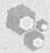

## 膜蛋白纯化的策略

所有已知蛋白质中，有超过 1/4 的蛋白质为膜蛋白。它们可以执行多种功能，包括信号转导、离子和小分子的运输、酶促反应的催化，因此，这些蛋白质也是医药干预的主要靶标。然而，其中只有少数蛋白质的结构信息可用（综述见 White 2009）。在晶体学和功能分析中纯化足量膜蛋白的一个瓶颈是:它们在异源表达系统中的表达水平通常较低（Clark et al. 2010）。另外一个挑战是需要将它们从原生膜（native membrane）上溶解下来，同时保持结构和功能的完整性。这不是一个简单的任务，因为这些蛋白质经常会变性和聚集。

## 去污剂条件

近年来已经开发了许多去污剂，可以很好地与膜蛋白相互作用，并能模拟脂质双分子层的物理性质（Prive 2007）。去污剂像磷脂一样，是具有亲水性头部基团和疏水性尾部的两性化合物，而不像脂类，只有一个单一的疏水性尾部（图1）。在低浓度时，去污剂能插入到脂质双分子层，破坏膜的稳定性。当去污剂浓度增加到超过临界胶粒浓度（critical micelle concentration，CMC）时，膜的双分子层就会被破坏掉，形成脂类-去污剂、蛋白

---

1354

分子克隆实验指南（原书第四版）

质-去污剂混合胶粒；在后者的形态中，去污剂的疏水链环绕在蛋白质的疏水区周围（le Maire et al. 2000）。为了有效地溶解蛋白质，去污剂的使用浓度必须高于其 CMC 数倍；但是，太高的浓度可能造成变性（Wiener 2004）。当蛋白质浓度为 1～5mg/mL 时，0.5%～2% 的去污剂浓度往往能有效提取蛋白质；对于少量和/或更高蛋白质浓度的情况，去污剂与蛋白质的比例可能需要调整。在随后的色谱层析步骤，去污剂应当减少到 CMC 浓度的 2～3 倍，以避免剥离紧密结合的脂质（Wiener 2004）。高浓度的渗透调节物甘油（10%～20%，V/V）的存在，对于在提取过程中保持蛋白活性构象是非常重要的，并且已被证明，当蛋白质重构为蛋白脂质体（proteoliposome）时，可以提高许多蛋白质的比活性 10 倍或更高（Maloney and Ambudkar 1989）。

表 1 膜蛋白纯化中常用去污剂的物理性质

<table><tr><td>试剂</td><td>分子质量</td><td>临界胶束浓度/(mmol/L,%)a</td><td>聚集数b</td><td>胶束大小/kDa</td></tr><tr><td colspan="5">非离子</td></tr><tr><td>n-辛基-β-D-吡喃葡萄糖苷</td><td>292.4</td><td>18(0.53%)</td><td>78</td><td>23</td></tr><tr><td>n-辛基-β-D-硫代吡喃葡萄糖苷</td><td>308.4</td><td>9(0.28%)</td><td></td><td></td></tr><tr><td>n-壬基-β-D-吡喃葡萄糖苷</td><td>306.4</td><td>6.5(0.20%)</td><td>133</td><td>41</td></tr><tr><td>n-癸基-β-D-吡喃葡萄糖苷c</td><td>320.4</td><td>2.2(0.07%)</td><td></td><td></td></tr><tr><td>n-癸基-β-D-麦芽吡喃</td><td>482.6</td><td>1.8(0.087%)</td><td>69</td><td>33</td></tr><tr><td>n-十一烷基-β-D-麦芽吡喃</td><td>496.6</td><td>0.59(0.029%)</td><td>74</td><td>37</td></tr><tr><td>n-十二烷基-β-D-麦芽吡喃</td><td>510.6</td><td>0.17(0.0087%)</td><td>78~149</td><td>40~76</td></tr><tr><td>n-十三烷基-β-D-麦芽吡喃c</td><td>524.6</td><td>0.033(0.0017%)</td><td>105</td><td>55</td></tr><tr><td>毛地黄皂苷d</td><td>1229.3</td><td>0.5(0.06%)</td><td>60</td><td>70</td></tr><tr><td>C8E4e</td><td>306.5</td><td>8(0.25%)</td><td>82</td><td>25</td></tr><tr><td>C10E6</td><td>423</td><td>0.9(0.025%)</td><td>40</td><td>17</td></tr><tr><td>C12E8</td><td>539</td><td>0.09(0.00048%)</td><td>123</td><td>66</td></tr><tr><td>Triton X-100f</td><td>647</td><td>0.23(0.015%)</td><td>75~165</td><td>49~107</td></tr><tr><td>Triton X-114</td><td>536</td><td>0.2(0.011%)</td><td></td><td></td></tr><tr><td>Nonidet P40</td><td>603</td><td>50(0.05%~0.3%)</td><td>100~155</td><td>60~95</td></tr><tr><td colspan="5">阴离子</td></tr><tr><td>胆酸</td><td>430.6</td><td>9.5(0.41%)</td><td>2~3</td><td>1</td></tr><tr><td>去氧胆酸</td><td>414.6</td><td>6(0.24%)</td><td>22</td><td>9</td></tr><tr><td>牛黄胆酸</td><td>537.7</td><td>3~11(0.16%~0.59%)</td><td>4</td><td>2</td></tr><tr><td>十二烷基硫酸钠c</td><td>288.4</td><td>2.6(0.075%)</td><td>62~101</td><td>18~29</td></tr><tr><td colspan="5">两性离子</td></tr><tr><td>CHAPS</td><td>614.9</td><td>8(0.49%)</td><td>10</td><td>6</td></tr><tr><td>CHAPSO</td><td>630.9</td><td>8(0.50%)</td><td>11</td><td>7</td></tr><tr><td>月桂基二甲基氨基氧化物(LDAO)</td><td>229.4</td><td>2(0.023%)</td><td>76</td><td>17</td></tr><tr><td>Fos-胆碱-10</td><td>323.4</td><td>11(0.35%)</td><td>24</td><td>8</td></tr><tr><td>Fos-胆碱-12</td><td>351.5</td><td>1.5(0.047%)</td><td>50~60</td><td>18~21</td></tr><tr><td>Fos-胆碱-14</td><td>379.5</td><td>1.2(0.00446%)</td><td>108</td><td>71</td></tr><tr><td>Zwittergent 3-12</td><td>335.6</td><td>3(0.094%)</td><td>55~87</td><td>18~29</td></tr><tr><td>Zwittergent 3-14</td><td>363.6</td><td>0.2(0.007%)</td><td>93~130</td><td>34~47</td></tr></table>

来源:Anatrace 公司目录（见 http://www.anatrace.com/downloads.htm）。

a. 临界胶束浓度（CMC）依赖于pH、离子强度、温度，以及蛋白质、脂类和其他去污剂分子的存在。

b. 胶粒中去污剂的单体数目。

c.  $4^{\circ}$ C条件下，可溶性有限。

d. 毛地黄皂苷是来自洋地黄的一种糖苷类物质，被认为能够维持蛋白质-蛋白质相互作用，对于异源蛋白复合物的分离很重要（Herget et al. 2009）。

e. 聚氧乙烯去污剂应避光存储于氮气中，以避免形成过氧化物。

f. Triton 和 Nonidet 去污剂具有化学异质性，不利于结构研究。

---

第 19 章 克隆基因的表达以及目的蛋白的纯化和分析

1355

## 根据蛋白质结构选择去污剂

对于一个跨膜蛋白的分离，去污剂的选择至关重要，无论如何强调都不过分。头部基团的天然属性、碳链的长度、浓度及去污剂与蛋白质的比例，对于成功提取正确折叠且具有活性构象的蛋白质来说，都是至关重要的（Prive 2007）。头部基团通常对去污剂与蛋白质的相互作用具有很大影响，而烷基链的长度决定了CMC和聚集数（表1）。按照头部基团的极性，去污剂可分为离子型、非离子型或两性离子型。非离子型去污剂作用温和，如葡萄糖苷（glucoside）和麦芽糖苷（maltoside）系列、毛地黄皂苷（digitonin）、聚氧乙烯（polyoxyethylene）去污剂（如C10E6及Triton），因为它们通常在溶解膜蛋白时，并不改变蛋白质的重要结构特征（le Maire et al. 2000；Seddon et al. 2004）。两性离子去污剂，如月桂基二甲基氨基氧化物（lauryldimethylamine oxide，LDAO）和FOS-CHOLINE系列往往是更为有效的溶解剂，但与非离子型去污剂相比，可能更容易造成蛋白质失活（White et al. 2007）。离子型去污剂[如十二烷基硫酸钠（SDS）]，是有效的溶解剂，但几乎总会使蛋白质变性，这一特点使SDS非常适合应用于变性凝胶电泳。而基于类固醇的去污剂，如胆盐和3-[3-(胆酰氨丙基)二甲氨基]丙磺酸内盐（CHAPS），构成了单独一类作用相对温和的表面去污剂，其疏水性类固醇表面可以很好地与蛋白质的跨膜区相互作用（Zhang et al. 2007）。此外，越来越多地被用于膜蛋白生物化学领域的其他去污剂包括:合成的溶血磷脂（如LysoFos Choline、LysoFos Choline Ether和LysoFos Glycerol）（http://www.anatrace.com），短链（C6-C8）磷脂（Hauser 2000）。

表 1 中列出了膜蛋白纯化和晶体研究中常用的去污剂示例及其物理性质。更多更全面的去污剂列表，可以在生化级去污剂供应商的网站（http://www.emdbiosciences.com, http://www.anatrace.com, http://www.sigmaaldrich.com, http://www.glycon.de，以及 http://blanco.biomol.uci.edu/Membrane\_Proteins\_xtal.html）上查到，后者跟踪记录了已知的膜蛋白的三维（3D）结构及其相应参考文献。

## 根据应用目的选择去污剂

去污剂的选择也取决于下游的纯化、浓缩和重构方法，以及纯化的蛋白质的应用目的。非离子型去污剂与大多数纯化树脂兼容，但在使用离子交换或螯合树脂的同时，使用离子型或两性离子去污剂应小心谨慎（参见方案5中的His-tag纯化）。例如，$\mathrm{Ni}^{2+}$-NTA亲和树脂仅能耐受不超过 $0.3\%$ 的离子型去污剂（http://www1.qiagen.com/literature/resources/Protein/Compatibilitytable.pdf）①。在去污剂溶液中纯化蛋白质，可以使用低蛋白结合力的纤维素滤膜，通过超滤进行浓缩。由于去污剂形成的胶粒尺寸相对较大（表1），应选择高MWCO的滤膜（如截留分子质量为 $100\mathrm{kDa}$ 的YM100滤膜），以防去污剂伴随蛋白质一起被浓缩。最后，高CMC的去污剂更适合采用常用方法（如透析、快速稀释或疏水性玻璃珠吸附）将纯化的蛋白重构到蛋白脂质体中（Rigaud and Levy 2003）。对于需要可溶性蛋白的那些应用，如晶体学或其他的生物物理学研究，由于低CMC的去污剂不能被透析掉，最好是在蛋白质绑定到亲和树脂时将其交换掉（参见方案5），或通过凝胶过滤色谱法去除（Newby et al. 2009；Clark et al. 2010）。

<small><span class="docvortex-page-footnote" data-block-type="page_footnote" style="color:#6b7280">① 译者注:此链接已失效，读者可自行访问相关网站检索相应信息。</span></small>

---

1356

分子克隆实验指南（原书第四版）

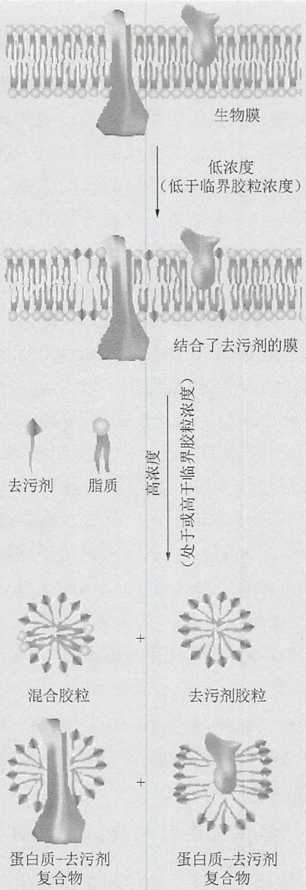

<details>
<summary>flowchart</summary>

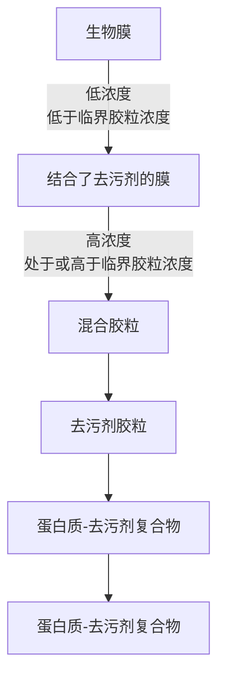
</details>

图 1 去污剂溶解膜蛋白。（©EMD Chemicals Inc., Merck KGaA 子公司, Darmstadt, Germany. 经许可后转载）（彩图请扫封底二维码）。

## 参考文献

- Clark KM, Fedoriw N, Robinson K, Connelly SM, Randles J, Malkowski MG, Detitta GT, Dumont ME. 2010. Purification of transmembrane proteins from Saccharomyces cerevisiae for X-ray crystallography. Protein Expr Purif 71: 207–223.
- prerequisite for determination of peptide stoichiometry and ATP hydrolysis. J Biol Chem 284: 33740–33749.
- le Maire M, Champeil P, Moller IV. 2000. Interaction of membrane proteins and lipids with solubilizing detergents. Biochim Biophys Acta 1508: 86–111.
- Maloney PC, Ambudkar SV. 1989. Functional reconstitution of prokaryote and eukaryote membrane proteins. Arch Biochem Biophys 269: 1–10.
- Newby ZE, O'Connell JD III, Gruswitz F, Hays FA, Harries WE, Harwood IM, Ho JD, Lee JK, Savage DF, Miercke LJ, et al. 2009. A general protocol for the crystallization of membrane proteins for X-ray structural investigation. Nat Protoc 4: 619–637.
- Prive GG. 2007. Detergents for the stabilization and crystallization of membrane proteins. Methods 41: 388–397.
- Rigaud JL, Levy D. 2003. Reconstitution of membrane proteins into liposomes. Methods Enzymol 372: 65–86.
- Hauser H. 2000. Short-chain phospholipids as detergents. Biochim Biophys Acta 1508: 164–181.
- Herget M, Kreissig N, Kolbe C, Scholz C, Tampe R, Abele R. 2009. Purification and reconstitution of the antigen transport complex TAP: A
- Seddon AM, Curnow P, Booth PJ. 2004. Membrane proteins, lipids and detergents: not just a soap opera. Biochim Biophys Acta 1666; 105–117.
- White SH. 2009. Biophysical dissection of membrane proteins. Nature 459:344–346.
- White MA, Clark KM, Grayhack EJ, Dumont ME. 2007. Characteristics affecting expression and solubilization of yeast membrane proteins. J Mol Biol 365: 621–636.
- Wiener MC. 2004. A pedestrian guide to membrane protein crystallization. Methods 34: 364–372.
- Zhang Q, Ma X, Ward A, Hong WX, Jaakola VP, Stevens RC, Finn MG, Chang G. 2007. Designing facial amphiphiles for the stabilization of integral membrane proteins. Angew Chem Int Ed Engl 46: 7023-7025.

---

第 19 章 克隆基因的表达以及目的蛋白的纯化和分析

1357


## 历史注脚:考马斯亮蓝

考马斯亮蓝 R-250 首次被用作实验室蛋白质染色试剂是在 1963 年。Robert Webster, 一个在堪培拉澳大利亚国立大学 Stephen Fazekas de St Groth 实验室里的研究生, 正在寻找一种方式, 来定位醋酸纤维素条上已被电泳分离的流感病毒蛋白。当时, 澳大利亚羊毛业正在蓬勃发展, 政府实验室也在集中研究不同类别的羊毛染料作用机制。Fazekas de St Groth 和 Webster 推测, 这些染料一定具有与蛋白质的高亲和力, 随后他们从联邦科学与工业组织 (Commonwealth Scientific and Industrial Organization) 处获得了大量染料样品。其中包括考马斯亮蓝 R-250, 也被称为酸性蓝 83——一种自世纪之交以来已在纺织行业使用的染料。Webster 很快就确定考马斯亮蓝 R-250 可以作为一种高灵敏度的蛋白质染料, 但令他感到沮丧的是, 染色强度存在每天不同的极端变化。一天晚上在家, 他突然意识到, 解决问题的方法是在染色前将蛋白质固定 (“fix”) 在醋酸纤维素条上。他回到实验室, 用磺基水杨酸固定了分离的流感病毒蛋白。这些结果公布后 (Fazekas de St. Groth et al. 1963), 很快就被用于聚丙烯酰胺凝胶分离后的蛋白质染色 (Meyer and Lamberts 1965)。

由于考马斯亮蓝 R-250 是 Imperial Chemical Industries PLC 公司的商标，故此染料一般在生化试剂目录中被标为“亮蓝”。氨基三苯甲烷类（aminotriarylmethane）染料有两种形式可供选择:亮蓝 G 和亮蓝 R[在颜色指数中分别对应不同的数字（42655 和 42660）]。颜色指数可以看成是染料的“圣经”，根据颜色进行染料的分类和排列。亮蓝 G（G 代表“微绿”）和亮蓝 R（R 代表“微红”），分别微溶和不溶于冷水，分别可溶和微溶于热水和醇类。两种染料都能对蛋白质进行有效的染色，虽然 G-250 更灵敏，但 R-250 对比度更好且常用于凝胶中的蛋白质染色（Merril 1990）。最初的配方建议，将浓度为 0.05% 的染料溶于甲醇:乙酸:水（50:10:40，V/V）的溶液中。

## 参考文献

Fazekas de St Groth S, Webster RG, Datyner A. 1963. Two new staining procedures for quantitative estimation of proteins on electrophoretic strips. Biochim Biophys Acta 71: 377–391.
Merril CR. 1990. Gel-staining techniques. Methods Enzymol 182: 477–488.

Meyer TS, Lamberts BL. 1965. Use of Coomassie Brilliant Blue R250 for the electrophoresis of microgram quantities of parotid saliva proteins on acrylamide gel strips. Biochim Biophys Acta 107: 144–145.

(吴军 刘星明 译，王恒樑 校)
