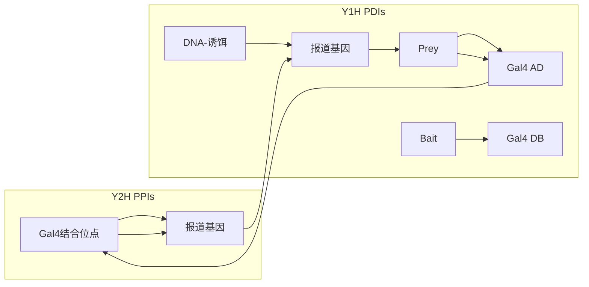
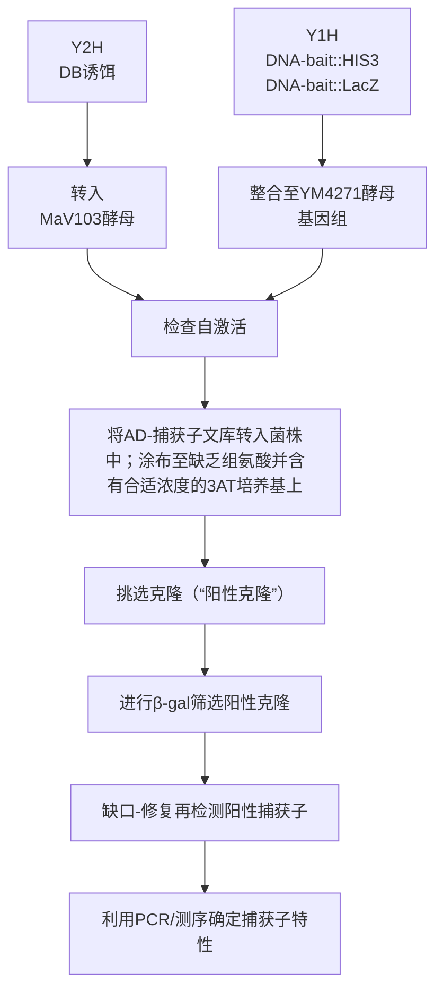
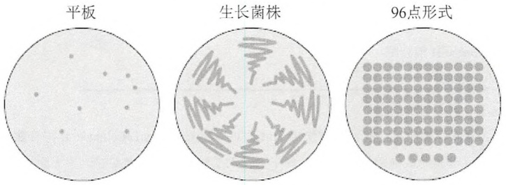
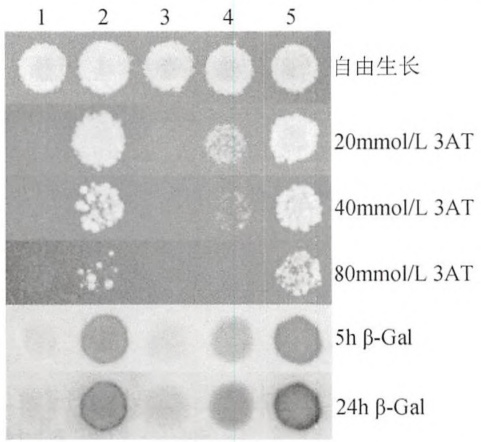
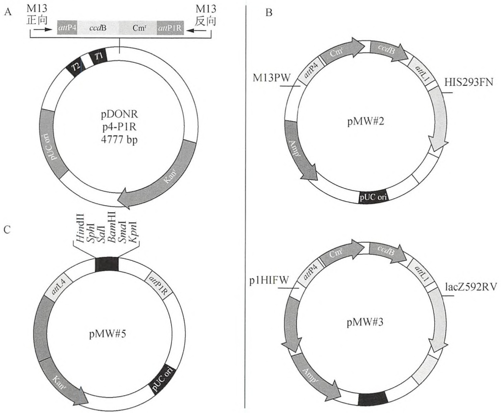
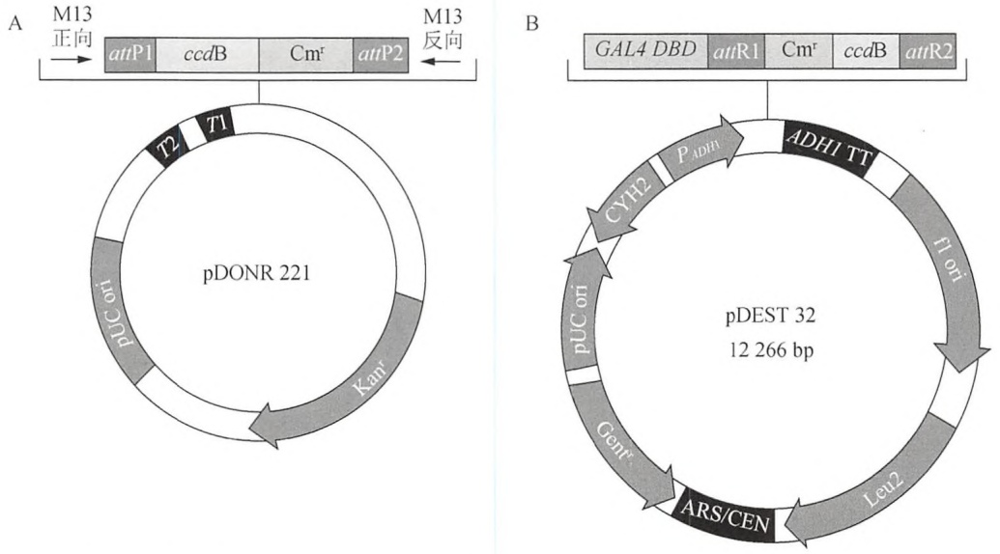
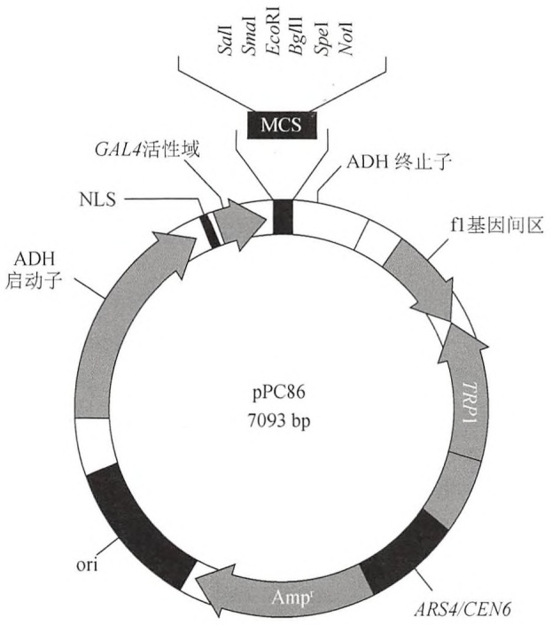
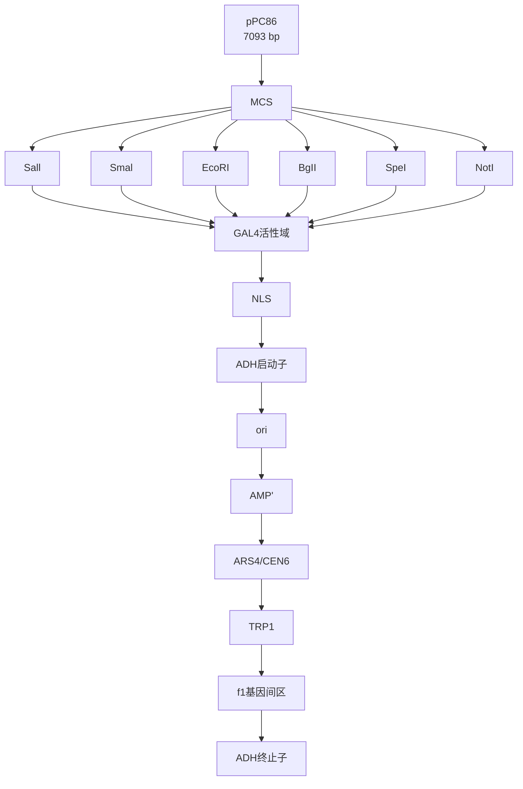

# 第22章 Gateway相容酵母单杂交和双杂交系统

原始 PDF 第 381–423 页。

# 第 22 章 Gateway 相容酵母单杂交和双杂交系统

## 导言

酵母双杂交（Y2H）系统:概念和方法 1468

酵母单杂交（Y1H）系统:概念和方法学 1470

Y2H 和 Y1H 系统:优点和缺点 1471

假阳性 1472

酵母单杂交和酵母双杂交的操作步骤 1472

## 方案

1 构建酵母单杂交 DNA-诱饵菌株 1474

\- 替代方案 用复性引物从 DNA
诱饵中获得入门克隆产物 1481

2 生成酵母双杂交 DB-诱饵菌株 1484

3 从活化域捕获文库中鉴定相互作用分子 1490

4 高效的酵母转化 1496

5 用于β-半乳糖苷酶活力的菌落转移比色测定 1500

6 酵母克隆的 PCR 1502

## 信息栏

为什么整合 DNA-诱饵？ 1504

选择载体和酵母菌 1504

使用绒布影印平板和影印平板 1505

---

## 导言

蛋白质-DNA 间（PDI）和蛋白质-蛋白质间（PPI）的相互作用在生物学领域中发挥着举足轻重的作用。PDI 在基因转录、DNA 复制、重组和 DNA 修复中至关重要。基因转录涉及特定的转录因子（TF）之间的相互作用，以及顺式调控元件如启动子和增强子与转录因子之间的相互作用等。总之，这些 PDI 是基因调控网络不可分割的一部分，参与调控众多机体的发育和生理活动（Walhout 2006）。有 5%\~10% 的真核基因编码 TF（Reece-Hoyes et al. 2005；Kummerfeld et al. 2006；Vaquerizas et al. 2009）。描述基因调控网络非常必要的一点就是鉴定与所有顺式调控序列相互作用的 TF，以及确定 DNA 结合每一个 TF 的特异性和亲和力。

PPI 在大多数（如果不是全部的话）过程中发挥功能，从抗体-抗原相互作用到信号的转导级联需要多种类型的相互作用以将信息从细胞质膜传递至细胞核。识别蛋白与 DNA 片段或者目的蛋白之间的相互作用可以很好地认知它们的功能。例如，如果某些蛋白质与 TF 在生理条件下具有相互作用，就有可能具有参与基因表达的功能。这些蛋白质可能是二聚体、共调节因子、染色体蛋白或蛋白转录机器。同样，TF 结合某一 DNA 片段，诱导该基因在特定组织中表达，那么这些 TF 就有可能参与了这种组织的生理活动和发育过程。有几种方法可用于识别 PDI 和 PPI。在这里，我们重点描述酵母“杂交”分析，既可以小规模也可以大规模应用。

在第一部分，我们描述酵母双杂交（Y2H）的背景及分析，为鉴定两个蛋白质间相互作用的其他生化方法如免疫沉淀反应提供一个互补的方法（综述，见 Cusick et al. 2005）。在第二部分，我们将讨论酵母单杂交（Y1H）系统，提供一种“以基因为中心”（从 DNA 到蛋白质）的研究方法，以鉴定顺式调控元件与 TF 之间的相互作用。这种方法是“以转录因子为中心”（从蛋白质到 DNA）的生化方法如染色质免疫沉淀反应（ChIP；参见第 20 章）（Walhout 2006）的互补。Y2H 和 Y1H 系统均用“诱饵”去“钓”与之相互作用的“猎物”。“酵母杂交系统”的示意图见图 22-1。该系统很大程度上受益于 Gateway 克隆系统的开发和应用（Hartley et al. 2000; Walhout et al. 2000b）（见第 4 章）。使用 Gateway 技术，多个 DNA 片段可以平行克隆，从而大大增加了产量，并降低了杂交系统的成本（Walhout et al. 2000; Deplancke et al. 2004）。在描述了 Y2H 和 Y1H 系统的概念、方法的优缺点后，我们提供了一系列的操作步骤。除了制备诱饵和使用不同的菌株及标记外（图 22-2），Y1H 和 Y2H 文库筛选在技术上非常相似。因此，我们将分别提供制备诱饵的步骤以及一个单独文库的筛选步骤，并说明哪种培养条件适用于哪种类型（Y2H 或 Y1H）的筛选。最后，我们讨论并提供专门用于该系统的 Gateway 克隆步骤。Gateway 克隆 Y1H 和 Y2H 的步骤如图 22-3 所示。

---

1466

分子克隆实验指南（原书第四版）

flowchart

图 22-1 Y2H 和 Y1H 系统实验原理。（上图）酵母双杂交（Y2H）分析检测蛋白质-蛋白质相互作用（PPI）。“诱饵”蛋白以融合（或“杂交”）方式与酵母转录因子 GAL4 的 DNA 结合结构域（DB）融合表达，而“捕获子”蛋白表达为融合的 Gal4 的激活结构域（AD）。DB-诱饵融合蛋白可以结合到含有 Gal4 结合位点的人工克隆的报道基因上游，随后整合到宿主酵母菌株的基因组中。当诱饵蛋白与捕获蛋白相互作用时，Gal4 的 TF 具有转录激活功能，从而激活报道基因的表达。（下图）酵母单杂交（Y1H）测定法检测蛋白-DNA 相互作用（PDI）。“捕获子”通常是一种转录因子（TF），表达为融合的 GAL4-AD，而“诱饵”是目的 DNA 片段。该 DNA-诱饵序列位于报道基因上游，且该 DNA 诱饵/报道基因盒整合到酵母基因组中。如果捕获子上钩，无论 TF 本身是否是激活子还是抑制基因，AD 都可以诱导报道基因的表达。

flowchart

图 22-2 Y2H/Y1H 文库筛选流程。该流程图概括了 Y1H/Y2H 中设置和操作 AD-捕获物库筛选的步骤。一旦制备了诱饵菌株，Y1H 和 Y2H 在文库筛选的技术上是非常相似的。

---

第 22 章 Gateway 相容酵母单杂交和双杂交系统

1467

图 22-3 Y1H 和 Y2H Gateway 诱饵/猎物克隆流程概述。Gateway 克隆使用重组技术将

DNA 片段转移到质粒上。这种转移的方向是由重组酶和重组质粒（或“ATT”）位点所决定的。例如，BP 酶将 attB（黑色）和 attP 位点重组至 attL 和 attR 位点，而 LR 酶将 attL（灰色）和 attR 位点重组，以产生 attB 和 attP 位点。只有能够互相兼容的 att 位点的不同异构体之间可以使用。例如，attB1 只有与 attP1 位重组，而不是 attP2 位。（A）构建 Y1H 的 DNA 诱饵克隆。DNA 诱饵可以利用 Gateway BP 反应体系，使用 Gateway-attB 为 attB 在末端引物（注意，从基因组 DNA 中扩增用于 DNA 诱饵克隆的 att 位点不同于那些在 Y2H 时所用的 ORF 克隆）克隆到包含 attP 位点的载体。产生的 DNA-诱饵是由一个 attL 位点和一个侧翼的 attR Gateway 克隆位点组成（兼容的 attR 和 attL 位点和 Gateway 盒；未显示出）。小 DNA 诱饵（小于 100bp）可经复性的寡核苷酸形成双链 DNA，克隆到 pMW#5 载体中，以产生一个含有目的序列的载体；具有单链突出端的双链 DNA 片段可克隆到 pMW#5 载体的限制性酶切位点中（我们经常使用 HindIII 和 BamHI，但 pMW#5 多克隆位点含有 HindIII、SphI、SalI、BamHI、SmaI 和 KpnI）（见方案 1 图 22-3）。利用 Gateway LR 反应体系，该 DNA-诱饵能从载体转移至两个含有 attR 和 attL 位点或者含有其中之一的 Y1H 报道基因（HIS3 或 LacZ）目标载体中。（B）构建 Y2H DB-诱饵克隆。ORF 可以通过使用 Gateway-attB 在末端引物的 cDNA 源进行扩增并克隆到含有 GatewayBP 反应体系的 attP 位点的 pDONR 221 载体上。这将获得含有 ORF 并位于 attL 位点两侧的起始克隆（attR 位点和 Gateway 盒的副产物；未显示）。ORF 可再经过 Gateway LR 反应从起始克隆转移到包含 attR 位点的 pDEST32 目的载体中。该目的克隆由 ORF 与 Gal4 DNA 结合域（DB）融合而成。这些 DB 融合物在 Y2H 实验中被用作诱饵。尽管本章具体使用 AD-捕获子结构的克隆库时采用常规方法，使用 Gateway 克隆产生的 AD-捕获克隆，也可用作 Y1H 和 Y2H 实验的捕获物（见介绍）。GW cassette, Gateway 盒（内含有毒 CCDB 基因和氯霉素抗性基因）；ORF，可读框；Kan，卡那霉素；Amp，氨苄青霉素；DB，Gal4 DNA 结合域；AD，Gal4 激活结构域。

---

1468

分子克隆实验指南（原书第四版）

## 酵母双杂交（Y2H）系统:概念和方法

酵母双杂交（Y2H）系统是由 Fields Stan，1989 年创建（Fields and Song 1989）。此概念来源于转录领域，尤其是来源于 Mark Ptashne 等发现的 TF 可以由独立结构域（Keegan et al. 1986）组成。用于 Y2H 和 Y1H 系统的酵母转录因子 Gal4，由 DNA 结合域（DB）和转录激活域（AD）组成，特别是具有高亲和力的 Gal4 DNA 结合位点和激活 Gal4 靶基因的转录激活域（Giniger et al. 1985）。DB 和 AD 都可以彼此独立发挥功能（Giniger and Ptashne 1987; Ma and Ptashne 1987）。Gal4-DB 和异源 AD（如病毒蛋白 VP16）蛋白之间一旦融合，就能够激活 Gal4 靶基因表达（Sadowski et al. 1988）。同样，当 Gal4-AD 通过蛋白质-蛋白质之间的相互作用募集在某个启动子上时，其功能是完整的（Ma and Ptashne 1988）。综上，这些现象为酵母双杂交系统的发展铺平了道路。

Y2H 系统使用两个杂交蛋白——DB-诱饵和 AD-捕获子（图 22-1）。下面的系统为我们提供的步骤中，酵母的 DB 和 AD 都是 Gal4 蛋白。在另一些版本中，例如，使用细菌 LexA 的 DB 和 VP16 的 AD 也是可以的（Golemis and Khazak 1997）。DB-诱饵是一个杂交蛋白，由 Gal4 DB 和诱饵蛋白组成，旨在识别或研究能够相互作用的蛋白质伴侣。AD-捕获子是一个由 Gal4-AD 和捕获子组成的杂交蛋白。捕获子蛋白可以从 cDNA 筛选文库中获得或者使用单独克隆的 AD-捕获子克隆。当 DB-诱饵和 AD-捕获子都表达于同一酵母细胞，如果诱饵和捕获物能够在物理上相互作用，那么 Gal4 蛋白就能够在功能上实现重组，报道基因的转录就能被激活（图 22-1）。整合的 Y2H-相容性酵母菌株的基因组为许多 Gal4 结合位点下游的报道基因片段的组合（Vidal et al. 1996b）。DB-诱饵蛋白可以结合这些 Gal4 位点，如果 AD-捕获子与诱饵结合，报道基因的转录就被激活。常用于 Y2H 系统的三个报道基因有:酵母基因 HIS3、URA3 和细菌 LacZ 基因（其他系统也可以使用其他报道基因）。报道基因的表达由一个基本启动子和一组 Gal4-结合位点上游序列控制。HIS3 报道基因编码一种参与组氨酸生物合成的酶，在其缺乏时，酵母只能依赖于外源性组氨酸补充。同样，酵母的生长需要具有功能的而不含有尿嘧啶的 URA3 基因。用于 Y2H 系统的菌株携带有缺陷的 HIS3 和 URA3 基因；等位基因常用 his3 Δ200 和 ura3-52。HIS3 和 URA3 基因功能性的表达可以分别选择使用缺乏组氨酸和尿嘧啶的培养基。此外，实现 HIS3 的表达水平可通过给培养基中添加抑制剂氨基三唑（3-aminotriazole, 3AT），这样，3AT 加入的浓度越高，表示 HIS3 的表达越高。LacZ 基因编码β-Gal（β-galactosidase），它可以通过比色测定来了解其含量；在缺乏β-Gal 时，酵母是白色的，其存在时为蓝色。我们发现，评估 Y2H 系统是否激活，HIS3 和 LacZ 通常就足够了。两个报道基因都必须由 PPI 激活，从而增强了这种相互作用的相关性和/或可靠性（Walhout and Vidal 2001）。URA3 基因适用在当相互作用很难判断或当其目的是使用反向 Y2H 系统确定相互作用缺陷等位基因的时候（Vidal et al. 1996）。在后者，反向选择使用 5-氟乳清酸（5-fluorotic acid, 5FOA）时，若两蛋白质间具有相互作用，则酵母能够在尿嘧啶缺陷的培养基上生长但含有 5FOA 时却不能生长。如果诱饵或捕获子蛋白突变，阻止了相互作用时，菌落可通过 5FOA 培养基确定是否生长。

对于 Y2H 系统，首先要生成 DB-诱饵，这需要确定实验设计（表 22-1）。首先，你必须确定需要使用的是完整蛋白质或只有部分的蛋白质（如保守结构域）。这很重要，因为并不是所有的相互作用在完整的蛋白质之间都能够检测到，相反，观察相互作用的蛋白质片段可能并非所有都发生在体内。此外，如果想充分检测与靶蛋白相互作用的蛋白质，可使用多种蛋白质片段进行筛选。这种方法的好处有三点。第一，相互作用结构域会自动发现（Boxem et al. 2008）。第二，要决定将要使用的载体——有一个带有 ARS/CEN 或 “2μ” 的 DNA 起始位点复制子。前者每个细胞只有几个拷贝 DNA，而 2μ 质粒可以产生许多拷贝，

---

第 22 章 Gateway 相容酵母单杂交和双杂交系统

1469

因此可以使更多的 DB-诱饵蛋白表达。ARS/CEN 质粒可减少假阳性。然而，使用 2μ质粒可能导致更少的假阴性。第三，要确定克隆方法:可以使用基于常规酶切方法或可以使用基于重组 Gateway 克隆等方法（图 22-3）（Hartley et al. 2000；Walhout et al. 2000 b）。后者尤其在克隆和筛选多个诱饵时被选用。DB-诱饵制备的其他方面还包括载体启动子的选择，其中涉及所需的 DB-诱饵蛋白的表达水平。在这里，我们描述使用 ARS/CEN 或 2μ进行 DB-诱饵生成 Gateway 克隆的操作步骤。我们的载体使用乙醇脱氢酶（ADH1）启动子来驱动 DB-诱饵表达。

表 22-1 Y2H DB-诱饵选择

| Y2H 诱饵 | 举例 | 优点 | 缺点 |
| --- | --- | --- | --- |
| 全长蛋白 | 基因组编码的任何蛋白 | 在相关生物学范围内可能存在相互作用 | 更高的假阴性;全长蛋白可能为自激活子 |
| 蛋白结构域 | 可选择组成型蛋白片段或特异的蛋白结构域 | 较低的假阴性率 | 相互作用可能不发生在全长蛋白之间;每个蛋白之间需要更多的筛选 |

Y2H, 酵母双杂交; DB, DNA-结合域。

DB-诱饵选择后，必须确定如何识别相互作用对象，也就是说，使用什么AD-捕获子（表22-2），这里有几种可能性。使用最广泛的筛选为使用高复杂性的AD-cDNA文库获得从一个整体生物或相关组织的目的基因（因为这个原因，本章只描述筛选cDNA文库的步骤）。大多数cDNA文库并没有标准化，这意味着一些克隆具有高度代表性，因为它们在大多数或所有细胞类型中表达水平很高。因此，需要筛选许多文库克隆以确定较少量的AD-捕获物。为了克服该问题，可以使用包含AD-ORF的ORF组库，而不是AD-cDNA克隆。ORF组被定义为大量完整的可读框（ORF），经常被克隆在一个通用的（Gateway-相容）载体中（Reboul et al. 2001）。这些资源是可获得的，例如，粟酒裂殖酵母（Matsuyama et al. 2006）、秀丽隐杆线虫（Reboul et al. 2003）和人类（Rual et al. 2004）——这些克隆可以用来构建DB-诱饵或AD-捕获子（图22-3）。在ORF组来源的AD-捕获库中，所有克隆差不多一样，所以很少有菌落需要与cDNA文库进行对比筛选。此外，这些AD-捕获子可以使用单个克隆或克隆群直接进行筛选。

表 22-2 Y2H AD-捕获子选择

| Y2H捕获子 | 要求 | 优点 | 缺点 | 费用 | 产量 |
| --- | --- | --- | --- | --- | --- |
| cDNA文库 | 复杂性高;与目的组织相关 | 无法获得ORF集合时的捕获物选择 | 难检测低丰度蛋白 | 高 | 低 |
| ORF组文库 | 足量的ORF,克隆至AD-捕获子载体 | 能够检测低丰度蛋白 | 不能找到未克隆的蛋白 | 中 | 中 |
| ORF智能群 | 足量的ORF,克隆至AD-捕获子载体 | 能够检测低丰度蛋白 | 不能找到未克隆的蛋白 | 中 | 中/高 |
| ORF阵列 | 足量的ORF,克隆至AD-捕获子载体 | 能够检测低丰度蛋白 | 不能找到未克隆的蛋白 | 低 | 高 |

Y2H，酵母双杂交；AD，激活结构域；ORF，可读框。

使用批量的单个AD-捕获子克隆可以确保所有的捕获子能够独立检测结合DB-诱饵的能力（Uetz et al. 2000；Zhong et al. 2003；Grove et al. 2009）。AD-捕获子克隆被放置在固定的坐标阵列中，以类似的方式（通过转换或交配）诱饵酵母菌株，导入相互作用捕获子的检测通过表型与阴性对照（仅含AD酵母质粒）相比较而完成。通过这种方法，可以对阵列中所有的相互作用因子进行测试，根据阵列中它们所处的位置而知晓它们的身份。然而，尽管基于阵列的使用单个捕获子克隆的筛选方法能够提供比文库筛选更高的覆盖率，但是高通量实验法的可行性受限于AD-捕获子克隆的可获得性以及阵列的大小。例如，由于包

---

1470

分子克隆实验指南（原书第四版）

含所有基因的每一个异构体的一个阵列在技术上筛选具有挑战性，所以只有基因的一类亚型（如 TF、激酶等）通常是以这种方式进行筛选。

收集AD-捕获子克隆是一种了解成千上万相互作用的有效方式，筛选完成后用测序鉴定相互作用对象。该方法已被用于绘制秀丽隐杆线虫“相互作用组”图谱（Li et al. 2004）和人类蛋白质图谱（Rual et al. 2005）。利用“Smart-pool”法可收集每个AD-捕获子。所有的Smart-pool都转化为含有DB-诱饵的酵母菌，然后简化计算信号，从阳性评分集落中鉴定相互作用对象，从而减少甚至免除测序（Vermeirssen et al. 2007；Xin et al. 2009）。关于这两种类型的收集策略，相比使用单个克隆阵列技术来说，其覆盖率不高，但它优于文库筛选。

## 酵母单杂交（Y1H）系统:概念和方法学

酵母单杂交（Y1H）系统非常类似于 Y2H 系统，除了它使用一个单独的杂交蛋白——AD-捕获子和一个 DNA 片段作为诱饵（Li and Herskowitz 1993；Wang and Reed 1993；Deplancke et al. 2004）。DNA-诱饵分别克隆在两个报道基因 HIS3 和 LacZ 的上游（图 22-3），然后这两个构建好的质粒整合到酵母基因组（如同一酵母细胞中）。当捕获蛋白与 DNA-诱饵相互作用时，报道基因通过 AD 的作用表达激活，判别方法与 Y2H 系统类似。有必要使用捕获子与 AD 的融合体，因为这样能够促使捕获子既能够识别转录激活物，也能够识别阻遏物，以及参与其他核过程如 DNA 复制（Li and Herskowitz 1993）的蛋白质。最初，Y1H 系统（多个拷贝）以小序列诸如（预测）顺式调控元件或 TF 结合位点作为诱饵。但更大、更复杂的 DNA 片段拷贝如启动子或增强子等也可使用（Dupuy et al. 2004；Deplancke et al. 2006；Vermeirssen et al. 2007；Martinez et al. 2008）。在 Y1H 系统中，使用两个报道基因——HIS3 和 LacZ。在 Y2H 系统中用作报道基因的 URA3 基因在 Y1H 系统中也可作为一个 DNA-诱饵的整合标志，HIS3 报道基因可在组氨酸缺陷培养基上进行选择。HIS3 报道基因载体中的最小 HIS3 启动子就足以使 HIS3 表达，使酵母菌在组氨酸缺陷培养基上生长。对于检测 PDI，氨基三唑（3AT）可作为 His3 酶的竞争性抑制剂添加到培养基中。当 3AT 存在时，则需要表达更多的 HIS3 以支持菌落生长，因此，这种化合物可以有效地用于杂交筛选中鉴定 PDI。

像 Y2H 系统一样，Y1H 系统先需要选择和设计 DNA-诱饵（表 22-3）。这里有两种可能性:您可以使用一个或多个拷贝的短 DNA 序列，或一个拷贝更大、更复杂的 DNA-诱饵。前者可以是预测的顺式调控元件或 TF 结合位点，而后者可以是启动子、增强子，或其他复杂的基因组 DNA 片段。我们建议后者的片段大小不要超过 2kb，这样能有效获得阳性克隆，避免酵母中可能检测不到长距离的 PDI。

表 22-3 Y1H DNA-诱饵选择

| Y1H 诱饵 | 举例 | 长度 | 克隆 | 优点 | 缺点 |
| --- | --- | --- | --- | --- | --- |
| 短的顺式调控元件 | 预测的 TF 结合位点 | 5~12bp,以 1~5 个拷贝串联 | 寡核苷酸复性成 ds | 背景低 | 要预知信息 |
| 长,组合的顺式调控元件 | 启动子/增强子 | 50~2000bp | 从基因组 DNA 进行 PCR | 无偏差 | 背景较高(约 10% ~ 20% 的片段) |

Y1H, 酵母单杂交; TF, 转录因子; ds, 双链; PCR, 聚合酶链反应。

广义上讲，在Y1H AD-捕获子的选择上存在与前面所讨论的在Y2H系统中相同的问题。然而，很重要的一点是，Y1H系统通常只用于识别TF，因此，可以使用小的AD-TF迷你文库、Smart-pool或克隆阵列，这样使筛选变得更快和更便宜（表22-4）（Vermeirssen et al. 2007b）。

总之，方法的选择取决于几个因素:酵母杂交筛选所需达到的产量和覆盖率，也许最重要的是，AD-cDNA或ORF组资源的获得。

---

第 22 章 Gateway 相容酵母单杂交和双杂交系统

1471

表 22-4 Y1H AD 捕获子的选择

| Y1H捕获子 | 要求 | 优点 | 缺点 | 费用 | 产量 |
| --- | --- | --- | --- | --- | --- |
| cDNA文库 | 复杂性高;与目的组织相关 | 能够获得未克隆或未预测的TF | 难检测低丰度蛋白,只有在少数细胞或一定(发育)时期内 | 高 | 低 |
| TF迷你文库 | 足量的TF编码ORF,克隆至AD-捕获子载体 | 能够检测低丰度蛋白 | 不能找到未克隆的蛋白 | 中 | 中 |
| TF智能群 | 足量的ORF,克隆至AD-捕获子载体 | 能够检测低丰度蛋白 | 不能找到未克隆的蛋白 | 中 | 中/高 |
| TF阵列 | 足量的ORF,克隆至AD-捕获子载体 | 能够检测低丰度蛋白 | 不能找到未克隆的蛋白 | 低 | 高 |

Y1H，酵母单杂交；AD，激活结构域；TF，转录因子；ORF，可读框。

## Y2H 和 Y1H 系统:优点和缺点

Y2H 和 Y1H 系统与其他（生化）方法相比有几个优点和缺点，特别是免疫共沉淀后进行质谱分析或染色质免疫沉淀后进行 DNA 序列分析（表 22-5）。最重要的问题是，酵母杂交系统是在酵母中进行的，而不是在体内环境（除非使用酵母蛋白质）中进行。这既被认为是一个优势，也被认为是个劣势。缺点是需要进行后续分析以确定体内相关性/相互作用的结果。该系统的优点是它基本上不受环境限制:只要相互作用发生在酵母细胞核，该系统就可以检测在体内很难检测到的蛋白质间的相互作用，因为它们在低水平、组织特异性或暂时特定的方式表达的情况下（如在发育过程中或在生理条件下）即可检测。然而，该系统在检测不定位于酵母细胞核（如膜蛋白）或者需要翻译后修饰（不发生在酵母）的蛋白质方面并不有效。对于这些蛋白质，其他杂交分析可能更合适，如泛素化剪切实验（Stagljar et al. 1998）、AVEXIS（Bushell et al. 2008）、MAPPIT 分析（Eyckerman et al. 2001）、邻位连接分析（Fredriksson et al. 2002）或 LUMIER 分析（Barrios-Rodiles et al. 2005）等，这些方法可以检测依赖于翻译后修饰的哺乳动物细胞中的 PPI。酵母杂交系统的其他优点还包括:检测双向 PPI（Y2H），低亲和力或瞬时 PPI 和 PDI（Y2H/Y1H），使用 Y2H 鉴定相互作用区域（Boxem et al. 2008）和具体相互作用缺陷等位基因（Walhout et al. 2000），使用 Y1H 鉴定 TF 结合位点（Reece-Hoyes et al. 2009），发现新的无 DNA 可识别结合域的 TF（Deplancke et al. 2006；Vermeirssen et al. 2007）。Y1H 系统也不适于异源二聚体检测，其中一个重要的缺点是几个 TF 作为强制性的二聚体结合在一条 DNA 上。然而，一般来说，Y1H 可有效地检测到同源二聚体。

表 22-5 Y2H 和 Y1H 系统的优缺点

| Y2H优点 | Y2H缺点 | Y1H优点 | Y1H缺点 |
| --- | --- | --- | --- |
| 培养条件独立;能够检测到生化方法难于检测到的低丰度蛋白 | 并非在内源情况下进行;可能得到不相关的PPI(生物假阳性) | 培养条件独立;能够鉴定ChIP难以检测到的低丰度和组织特异性的TF | 并非在内源情况下进行;可能得到不相关的PDI(生物假阳性) |
| 能够检测双方面的PPI | 某些类型的蛋白不能有效地检测到,如膜蛋白 | 能够鉴定结合到目的DNA片段上的多个TF(以基因为中心) | 不能(尚不)适用于检测TF异源二聚体 |
| 能够检测瞬时的PPI | 检测不到依赖于翻译后修饰的PPI | 能够检测微弱的PDI | 检测不到依赖于翻译后修饰的PDI |
| 能用来确定相互作用结构域 |  | 能用来确定和细化TF结合位点 |  |
| 能用来鉴定相互作用缺陷等位基因 |  | 能用来鉴定新的可能的TF |  |

Y1H，酵母单杂交；Y2H，酵母双杂交；PPI，蛋白质-蛋白质相互作用；TF，转录因子；ChIP，染色质免疫共沉淀；PDI，蛋白质-DNA相互作用。

---

1472

分子克隆实验指南（原书第四版）

总之，Y1H 和 Y2H 的优势使它们成为发现和描述分子间相互作用的强有力工具，但也由于使一些相互作用检测不到（假阴性）而受到限制。系统检测相互作用的假阴性情况将在后面详细讨论。

## 假阳性

杂交系统中有两种类型的假阳性:在系统中，“技术假阳性”是无法重复出来的，而“生物假阳性”在酵母中很容易检测到，但体内却是不发生的。判定相互作用是否是生物学假阳性是一件很具有挑战性的事，因为用于体内验证的实验也有其局限性或假阴性率。例如，它可能难以或者不可能验证低丰度蛋白质生化反应或瞬态/低亲和力蛋白之间的相互作用。然而，可整合其他类型实验的数据以确定PPI或PDI的可靠性，这点非常有用。例如，当几个蛋白质在同一细胞中表达、在同一亚细胞定位且同时表达时，那么它们之间的PPI就可能非常真实。

如果操作得当，酵母杂交系统的技术假阳性率很低（Venkatesan et al. 2009）。有几个重要的问题需要考虑。首先，最重要的技术假阳性来源于蛋白质或 DNA-诱饵蛋白的高度自激活，也就是说，它在缺乏一个 AD-捕获子的情况下仍然能够激活报道基因表达（见下文）。一些诱饵为“天然”自激活因子，也就是说，所有的诱饵酵母显示出统一且高度的报道基因激活能力（例如，许多 TF 有自己的 AD，这些 AD 本身在酵母中就具有功能）。然而，一些诱饵可以转化为新的自激活因子（Walhout and Vidal 1999），也就是说，一些来源于同一群体的普遍自激活水平较低的单个酵母，由于 PCR（最初克隆诱饵时）突变或者在酵母的繁殖突变而显示出高自激活水平。当自发的自激活因子发生在筛选过程中时，它们均显示为阳性菌落。然而，当用新鲜的含诱饵的酵母细胞重新在菌落中检测 AD-捕获子时（如使用 gap-repair 技术，详情见方案 3），相互作用就不能重复出来。因此，重复检测以避免 PDI 和 PPI 这种类型的假阳性是至关重要的。在 Y1H 系统中，将 DNA-诱饵整合到酵母基因组中以确保固定拷贝数及固定背景的报道基因表达是至关重要的（Deplancke et al. 2004）。总之，虽然可能出现技术上假阳性，但通常可以利用在新鲜的诱饵酵母细胞中重复测试相互作用以消除之。

## 酵母单杂交和酵母双杂交的操作步骤

本章的操作步骤描述了如何使用 Gateway 重组技术制备 Y1H 和 Y2H 系统的诱饵质粒，如何将这些质粒导入到酵母菌株，以及如何使用这些诱饵菌株从 AD-捕获子蛋白表达文库中筛选相互作用因子。首先在 Y1H（方案 1）和 Y2H（方案 2）中分别描述了质粒构建和菌株转化的过程；方案 3 描述了如何筛选 cDNA 文库。后者除了使用不同的培养条件外（表 22-6），与 Y1H 和 Y2H 本质上是相同的。传统的限制酶克隆和连接方法可以用来构建 DNA、DB-诱饵和 AD-捕获子。表 22-7 列出了方案中所要使用的载体和引物序列。方案 4～6 提供了前三个方案所要使用的具体步骤。这些方案提供了高效转化酵母、用酵母菌落分析 β-半乳糖苷酶活性，以及进行酵母菌落 PCR 的详细步骤。

## 致谢

本工作由 NIH 基金资助（DK068429 和 GM082971）。

---

第 22 章 Gateway 相容酵母单杂交和双杂交系统

1473

## 参考文献

- Barrios-Rodiles M, Brown KR, Ozdamar B, Bose R, Liu Z, Donovan RS, Shinjo F, Liu Y, Dembowy J, Taylor IW, et al. 2005. High-throughput mapping of a dynamic signaling network in mammalian cells. Science 307: 1621–1625.
- Boxem M, Maliga Z, Klitgord N, Li N, Lemmens I, Mana M, de Lichtervelde L, Mul JD, van de Peut D, Devos M, et al. 2008. A protein domain-based interactome network for C. elegans early embryogenesis. Cell 134: 534–545.
- Bushell KM, Söllner C, Schuster-Boeckler B, Bateman A, Wright GJ. 2008. Large-scale screening for novel low-affinity extracellular protein interactions. Genome Res 18: 517–520.
- Cusick ME, Klitgord N, Vidal M, Hill DE. 2005. Interactome: Gateway into systems biology. Hum Mol Genet 14: R171–R181.
- Deplancke B, Dupuy D, Vidal M, Walhout AJ. 2004. A Gateway-compatible yeast one-hybrid system. Genome Res 14: 2093–2101.
- Deplancke B, Mukhopadhyay A, Ao W, Elewa AM, Grove CA, Martinez NJ, Sequerra R, Doucette-Stamm L, Reece-Hoyes JS, Hope IA, et al. 2006. A gene-centered C. elegans protein-DNA interaction network. Cell 125: 1193–1205.
- Dupuy D, Li QR, Deplancke B, Boxem M, Hao T, Lamesch P, Sequerra R, Bosak S, Doucette-Stamm L, Hope 1A, et al. 2004. A first version of the Caenorhabditis elegans promoterome. Genome Res 14: 2169–2175.
- Eyckerman S, Verhee A, der Heyden JV, Lemmens I, Ostade XV, Vandekerckhove J, Tavernier J. 2001. Design and application of a cytokine-receptor-based interaction trap. Nat Cell Biol 3: 1114–1119.
- Fields S, Song O. 1989. A novel genetic system to detect protein–protein interactions. Nature 340: 245–246.
- Fredriksson S, Gullberg M, Jarvius J, Olsson C, Pietras K, Gústafsdóttir SM, Ostman A, Landegren U. 2002. Protein detection using proximity-dependent DNA ligation assays. Nat Biotechnol 20: 473–477.
- Giniger E, Ptashne M. 1987. Transcription in yeast activated by a putative amphipathic helix linked to a DNA binding unit. Nature 330: 670–672.
- Giniger E, Varnum SM, Ptashne M. 1985. Specific DNA binding of GAL4, a positive regulatory protein of yeast. Cell 40: 767–774.
- Golemis EA, Khazak V. 1997. Alternative yeast two-hybrid systems. The interaction trap and interaction mating. Methods Mol Biol 63: 197–218.
- Grove CA, De Masi F, Barrasa MI, Newburger DE, Alkema MJ, Bulyk ML, Walhout AJ. 2009. A multiparameter network reveals extensive divergence between C. elegans bHLH transcription factors. Cell 138: 314–327.
- Hartley JL, Temple GF, Brasch MA. 2000. DNA cloning using in vitro site-specific recombination. Genome Res 10: 1788–1795.
- Keegan L, Gill G, Ptashne M. 1986. Separation of DNA binding from the transcription-activating function of a eukaryotic regulatory protein. Science 231: 699–704.
- Kummerfeld SK, Teichmann SA. 2006. DBD: A transcription factor prediction database. Nucleic Acids Res 34: D74–D81.
- Li JJ, Herskowitz I. 1993. Isolation of the ORC6, a component of the yeast origin recognition complex by a one-hybrid system. Science 262:1870–1874.
- Li S, Armstrong CM, Bertin N, Ge H, Milstein S, Boxem M, Vidalain PO, Han JD, Chesneau A, Hao T, et al. 2004. A map of the interactome network of the metazoan C. elegans. Science 303: 540–543.
- Ma JM, Ptashne M. 1987. Deletion analysis of GAL4 defines two transcriptional activating segments. Cell 48: 847–853.
- Ma J, Ptashne M. 1988. Converting a eukaryotic transcriptional inhibitor into an activator. Cell 55: 443–446.
- Martinez NJ, Ow MC, Barrasa MI, Hammell M, Sequerra R, Doucette-Stamm L, Roth FP, Ambros VR, Walhout AJ. 2008a. A C. elegans genome-scale microRNA network contains composite feedback motifs with high flux capacity. Genes Dev 22: 2535–2549.
- Matsuyama A, Arai R, Yashiroda Y, Shirai A, Kamata A, Sekido S, Kobayashi Y, Hashimoto A, Hamamoto M, Hiraoka Y, et al. 2006. ORFeome cloning and global analysis of protein localization in the fission yeast Schizosaccharomyces pombe. Nat Biotechnol 24: 841–847.
- Reboul J, Vaglio P, Tzellas N, Thierry-Mieg N, Moore T, Jackson C, Shin-I T, Kohara Y, Thierry-Mieg D, Thierry-Mieg J, et al. 2001. Open reading frame sequence tags (OSTs) support the existence of at least 17,300 genes in C. elegans. Nat Genet 27: 1–5.
- Reboul J, Vaglio P, Rual JF, Lamesch P, Martinez M, Armstrong CM, Li S, Jacotot L, Bertin N, Janky R, et al. 2003. C. elegans ORFeome version 1.1: Experimental verification of the genome annotation and resource for proteome-scale protein expression. Nat Genet 34: 35–41.
- Reece-Hoyes JS, Deplancke B, Shingles J, Grove CA, Hope IA, Walhout AJ. 2005. A compendium of Caenorhabditis elegans regulatory transcription factors: A resource for mapping transcription regulatory networks. Genome Biol 6: R110. doi: 10.1186/gb-2005-6-13-r110.
- Reece-Hoyes JS, Deplancke B, Barrasa MI, Hatzold J, Smit RB, Arda HE, Pope PA, Gaudet J, Conradt B, Walhout AJ. 2009. The C. elegans Snail homolog CES-1 can activate gene expression in vivo and share targets with bHLH transcription factors. Nucleic Acids Res 37: 3689–3698.
- Rual JF, Hirozane-Kishikawa T, Hao T, Bertin N, Li S, Dricot A, Li N, Rosenberg J, Lamesch P, Vidalain PO, et al. 2004. Human ORFeome version 1.1: A platform for reverse proteomics. Genome Res 14: 2128–2135.
- Rual JF, Venkatesan K, Hao T, Hirozane-Kishikawa T, Dricot A, Li N, Berriz GF, Gibbons FD, Dreze M, Ayivi-Guedehoussou N, et al. 2005. Towards a proteome-scale map of the human protein-protein interaction network. Nature 437: 1173–1178.
- Sadowski I, Ma J, Triezenberg S, Ptashne M. 1988. GAL4-VP16 is an unusually potent transcriptional activator. Nature 335: 563–564.
- Stagljar I, Korostensky C, Johnsson N, te Heesen S. 1998. A genetic system based on split-ubiquitin for the analysis of interactions between membrane proteins in vivo. Proc Natl Acad Sci 95: 5187–5192.
- Uetz P, Giot L, Cagney G, Mansfield TA, Judson RS, Knight JR, Lockshon D, Narayan V, Srinivasan M, Pochart P, et al. 2000. A comprehensive analysis of protein–protein interactions in Saccharomyces cerevisiae. Nature 403: 623–627.
- Vaquerizas JM, Kummerfeld SK, Teichmann SA, Luscombe NM. 2009. A census of human transcription factors: Function, expression and evolution. Nat Rev Genet 10: 252–263.
- Venkatesan K, Rual JF, Vazquez A, Stelzl U, Lemmens I, Hirozane-Kishikawa T, Hao T, Zenkner M, Xin X, Goh KI, et al. 2009. An empirical framework for binary interactome mapping. Nat Methods 6: 83–90.
- Vermeirssen V, Barrasa MI, Hidalgo CA, Babon JA, Sequerra R, Doucette-Stamm L, Barabási AL, Walhout AJ. 2007a. Transcription factor modularity in a gene-centered C. elegans core neuronal protein-DNA interaction network. Genome Res 17: 1061–1071.
- Vermeirssen V, Deplancke B, Barrasa MI, Reece-Hoyes JS, Arda HE, Grove CA, Martinez NJ, Sequerra R, Doucette-Stamm L, Brent MR, et al. 2007b. Matrix and Steiner-triple-system smart pooling assays for high-performance transcription regulatory network mapping. Nat Methods 4: 659–664.
- Vidal MR, Brachmann R, Fattaey A, Harlow E, Boeke JD. 1996a. Reverse two-hybrid and one-hybrid systems to detect dissociation of protein–protein and DNA–protein interactions. Proc Nail Acad Sci 93:10315–10320.
- Vidal M, Braun P, Chen E, Boeke JD, Harlow E. 1996b. Genetic characterization of a mammalian protein-protein interaction domain by using a yeast reverse two-hybrid system. Proc Natl Acad Sci 93: 10321–10326.
- Walhout AJM. 2006. Unraveling transcription regulatory networks by protein-DNA and protein-protein interaction mapping. Genome Res 16:1445–1454.
- Walhout AJM, Vidal M. 1999. A genetic strategy to eliminate self-activator baits prior to high-throughput yeast two-hybrid screens. Genome Res 9: 1128–1134.
- Walhout AJM, Vidal M. 2001. High-throughput yeast two-hybrid assays for large-scale protein interaction mapping. Methods 24: 297–306.
- Walhout AJ, Sordella R, Lu X, Hartley JL, Temple GF, Brasch MA, Thierry-Mieg N, Vidal M. 2000a. Protein interaction mapping in C. elegans using proteins involved in vulval development. Science 287: 116–122.
- Walhout AJ, Temple GF, Brasch MA, Hartley JL, Lorson MA, van den Heuvel S, Vidal M. 2000b. GATEWAY recombinational cloning: Application to the cloning of large numbers of open reading frames or ORFeomes. Methods Enzymol 328: 575–592.
- Wang MM, Reed RR. 1993. Molecular cloning of the olfactory neuronal transcription factor Olf-1 by genetic selection in yeast. Nature 364:121–126.
- Xin X, Rual J-F, Hirozane-Kishikawa T, Hill DE, Vidal M, Boone C, Thierry-Mieg N. 2009. Shifted Transversal Design smart-pooling for high coverage interactome mapping. Genome Res 19: 1262–1269.
- Zhong J, Zhang H, Stanyon CA, Tromp G, Finley RL Jr. 2003. A strategy for constructing large protein interaction maps using the yeast two-hybrid system: Regulated expression arrays and two-phase mating. Genome Res 13: 2691–2699.

---

1474

分子克隆实验指南（原书第四版）

## 方案 1 构建酵母单杂交 DNA-诱饵菌株

制备 Gateway 相容的、用于 Y1H 筛选的 DNA 诱饵菌株包括三个步骤（图 22-3A 的章节中介绍）。第一步是制备包含目的 DNA 的诱饵 Gateway 克隆。Gateway 克隆用来克隆较大诱饵，如将启动子克隆至 pdonr-p4-p1r 载体中（该方案也提供了一系列替代步骤，即质粒构建可利用复性引物以及常规方法连接至 PMW #5 载体，该策略最适合于小于 100bp 的 DNA 诱饵）。第二步是将 DNA 诱饵从 Gateway 克隆转移到两个 Y1H 报道基因载体中，即 pMW#2（HIS3）和 pMW#3（LacZ）。这两个步骤作为构建 Gateway 克隆的一个通用方法，可将 DNA 诱饵连接到各种载体中，例如，克隆绿色荧光蛋白的一上游编码可读框以研究时空表达模式（Dupuy et al., 2004；Reece-Hoyes et al. 2007；Martinez et al. 2008）。最后一步是将 HIS3 和 lacZ 报道基因载体整合到 Y1H 酵母菌株 YM4271 的基因组中。整个过程需要 24～32 天，必要时需要加测序验证。

## 材料

为正确使用本方案中的器材和危险试剂，必须查阅相应的材料安全数据表并咨询所在机构的环境卫生和安全办公室。

本方案的专用试剂标注&lt;R&gt;，配方在本方案末提供。常用储备溶液、缓冲液和试剂标注&lt;A&gt;，配方见附录1。储备溶液应稀释至适用浓度后使用。

## 试剂

琼脂糖

小牛血清白蛋白（1mg/mL 溶于水）

高效 DH5α菌种（>10$^{7}$cfu/μg）

DNA 分子质量和浓度标准

dNTP 溶液（PCR 梯度）

BP 克隆酶 II 混合液

LR 克隆酶 I 混合液

基因组 DNA（100μg/mL 溶于 TE; pH 7.0）

甘油溶液（15%, V/V; 30%, V/V）溶于蒸馏水

1H1FW 引物（5'-GTTCGGAGATTACCGAATCAA-3')

HIS293RV 引物（5'-GGGACCACCCTTTAAAGAGA-3')

LacZ592RV 引物（5'-ATGCGCTCAGGTCAAATTCAGA-3')

含有氨苄青霉素的 LB 培养基和平板（50mg/mL）&lt;A&gt;

含有卡那霉素的 LB 培养基和平板（50mg/mL）&lt;A&gt;

M13F 引物（5'-GTAAAACGACGGCCAGT-3')

M13R 引物（5'-CAGGAAACAGCTATGAC-3')

MW#5F 引物（5'-GACTGATAGTGACCTGTTCGTTGC-3')

MW#5R 引物（5'-CATAGTGACTGCATATGTTGTGTTTTACAG-3')

硝酸纤维素（NC）膜（45μm, 137mm）（Fisher Scientific, 目录号 WP4HY13750）

PCR 级水

PCR 级水有稳定的 pH，不含离子、盐、核酸酶。它可从 Ambion 和很多其他供应商购买获得。

pDONR P4-P1R

---

第 22 章 Gateway 相容酵母单杂交和双杂交系统

1475

pMW#2、pMW#3 和 pMW#5

各种限制性内切核酸酶和相关的  $10 \times$  缓冲液

Sc-Ura-His+3AT 板（10mmol/L、20mmol/L、40mmol/L、60mmol/L、80mmol/L 3AT; 150mm）&lt;A&gt;

Sc-Ura-His 板（150mm）&lt;A&gt;

T4 DNA 连接酶和相关  $10 \times$  缓冲液

10×TBE 缓冲液&lt;A&gt;

TE 缓冲液（pH 8.0）&lt;A&gt;

耐热性的高保真 DNA 聚合酶，如 Pfu 酶和相关的  $10 \times PCR$  缓冲液

耐热性的常规 DNA 聚合酶，如 Taq 酶和相关的  $10 \times PCR$  缓冲液

YAPD 模板（150mm）&lt;R&gt;

YM4271 酵母菌

YM4271 基因型是 MATa、ura3-52、his3- $\Delta$ 200、ade2-101、ade5、lys2-801、leu2-3、112、trp1-901、tyr1-501、gal4 $\Delta$ 、gal80 $\Delta$ 、ade5::hisG.

## 设备

15mL 无菌培养管

无菌玻璃珠

培养箱温度设定在  $25^{\circ}C$ 、 $37^{\circ}C$ 、 $30^{\circ}C$ 、 $15^{\circ}C$

如果没有足够的培养箱可用，有些步骤可以使用热循环仪。

Miniprep 试剂盒

PCR 板（96 孔板）

Replica-plating apparatus（Cora Styles，目录号 4006，150mm 板）

测定 DNA 浓度的分光光度计（260nm 波长）

热循环仪

无菌牙签和/或无菌的一次性塑料环

天鹅绒（220mm×220mm 平绒；100%棉绒不含人造丝）

水浴温度为  $37^{\circ}$ C、 $42^{\circ}$ C

## 方法

## PCR 制备诱饵 DNA

用基因组 DNA 作为模板扩增大的、复杂的诱饵 DNA，如启动子和增强子，这部分将需一天时间完成。

1. 合成 attB4 序列上游引物（5'-GGGGACAACTTTGTATAGAAAAGTTG-3'）；attB1R 下游引物（5'-GGGGACTGCTTTTTTGTACAAACTTGTC-3'）。用 PCR 级水将引物最终稀释至浓度为 20μmol/L。

设计引物时在 3'端需要有足够的诱饵特殊序列，因此，引物特殊诱饵部分熔解温度为  $55 \sim 65^{\circ}C$  （引物长度通常约为 50nt）。这些 attB 部分可以一起转移到 Entry 载体 pDONRP4-P1R。

2. 无菌 PCR 管（或 PCR 孔），设置以下每对引物的混合物:

| 上游引物(20μmol/L) | 1μL |
| --- | --- |
| 下游引物(20μmol/L) | 1μL |
| dNTP(1mmol/L) | 5μL |

---

1476

分子克隆实验指南（原书第四版）

| 10×PCR缓冲液 | 5μL |
| --- | --- |
| 基因组DNA(100μg/mL) | 10μL |
| 耐高温高保真DNA聚合酶 | 2U |
| 加水至 | 50μL |

DNA 诱饵也可从另外一个适当的模板扩增（例如，黏粒或人工合成的细菌染色体、BAC）。建议用高保真 DNA 聚合酶，它可以减少 PCR 引起的错误。请记得加上一个缺少 PCR 模板的阴性对照。

3. 把管（或板）放置在热循环仪上，使用如下 PCR 程序:

| 循环数 | 变性 | 复性 | 聚合 |
| --- | --- | --- | --- |
| 1 | 94°C, 2min |  |  |
| 35 | 94°C, 1min | 56°C, 1min | DNA 诱饵序列扩增速度 1 kb/min, 72°C |
| 最后一个循环 |  |  | 72°C, 7min |

PCR 条件（包含很多增加的模板）可能会由于选择的 DNA 聚合酶需要作出改变和优化，这样才会产生需要的扩增（见第 7 章，方案 1）。通常具有代表性的 DNA 诱饵长度为 300～2000bp。

4. 取  $5 \sim 10 \mu L$  PCR 产物，用  $1 \times TBE$  配制的 1% (m/V) 琼脂糖胶，在旁边点上 DNA 分子质量标准，以确认得到大小正确的扩增产物（见第 2 章，方案 1）。扩增产物保存到  $-20^{\circ}C$ 。

如果出现非特异性条带，PCR 产物电泳回收，切下并纯化大小正确的那条带。

见“疑难解答”。

通过 Gateway 克隆 DNA 诱饵 PCR 产物并插入到入门载体

如果需要，这部分包括序列确认需要 4 天的时间。

如果目的 DNA 诱饵很小（一般大于 100bp），它可由复性互补的寡核苷酸生成长臂双链 DNA，并用常规方法连接到 Entry 载体 pMW#5。此过程在备选方案的通过诱饵 DNA 引物复性产生入门克隆产物中提供。

5. 每一个克隆的 DNA 诱饵，混合到 $1.5 \mathrm{~mL}$ 无菌离心管，置冰上:

| PCR 产物(来自步骤4) | 100ng |
| --- | --- |
| pDONR P4-P1R | 100ng |
| Gateway BP clonase II 混合酶 | 1μL |
| TE 缓冲液(pH 8.0)至 | 5μL |

混匀每一个反应， $25^{\circ}$ C过夜培养。

PCR 产物和载体可以通过凝胶电泳跑一个已知同样大小的 DNA 或通过分光光度法定量。通常取  $2 \mu L$  PCR。用之前将 Gateway BP clonase II 混合酶置冰上融化。按照第 4 章方法将所有非重组的 Gateway 载体准备好。作为阴性对照，准备一个相同反应的 BP 混合物加上 TE 缓冲液而非相同体积的 PCR 产物。

可以在热循环仪上或培养箱里孵育。我们不推荐室温孵育（例如，on the bench）。因为温度可能有很大变化。

6. 全部反应的混合物加到  $50 \mu L$  大肠杆菌 DH5α 感受态细胞中，每微克 DNA 超过  $10^{7}$  转化菌细胞。全部转化产物涂到含卡那霉素的 LB 板（ $50 \mu g/mL$ ），平板  $37^{\circ}C$  过夜培养。

很多克隆在 10～200 不等。阴性对照应该没有或者只有几个克隆（少于 5 个）。

见“疑难解答”。

7. 使用无菌 PCR 管（或 PCR 板的孔），从步骤 6 步挑选至少 6 个细菌克隆并准备如下 PCR 混合物:

| M13F上游引物(10μmol/L) | 1μL |
| --- | --- |
| M13F下游引物(10μmol/L) | 1μL |
| dNTP(1mmol/L) | 2.5μL |

---

第 22 章 Gateway 相容酵母单杂交和双杂交系统

1477

| 10×PCR 缓冲液 | 2.5μL |
| --- | --- |
| 高保真 DNA 聚合酶 | 1U |
| 加水至 | 25μL |

用移液器无菌吸头挑每个克隆，将吸头放到新鲜的含卡那霉素的 LB 板上使克隆增殖，把带着细胞的吸头在 PCR 的混合物管里吹打混匀，弃掉吸头。将含卡那霉素的 LB 板在  $37^{\circ}$ C 条件下培养 18h。

记得加上不含细菌的 PCR 阴性对照。

鉴别 PCR 用 M13F 和特殊诱饵反转录引物也在这步完成，因此通过测序确认插入的序列。菌液 PCR 鉴定是通过分离多个克隆接种到含卡那霉素的 LB 培基和按步骤 10 提取质粒 DNA，通过 DNA 测序或鉴定反应确认插入的序列。

8. 把管放到热循环仪上，使用如下 PCR 程序:

| 循环数 | 变形 | 复性 | 聚合 |
| --- | --- | --- | --- |
| 1 | 94°C, 2min |  |  |
| 35 | 94°C, 1 min | 56°C, 1min | DNA 诱饵序列1kb/min, 72°C |
| 最后一个循环 |  |  | 72°C, 7min |

PCR 克隆条件可能需要优化（见第 7 章，方案 1）。

9. 取  $5 \sim 10 \mu L$  PCR 产物跑  $1 \times TBE$  配制的 1% (m/V) 琼脂糖胶，同时跑 DNA 分子质量（见第 2 章，方案 1）。用 M13F 测序来确认 1 或 2 个插入的大小正确的 PCR 产物。

当分析 PCR 产物时，记住扩增时 M13F 上游引物和下游引物可以增加 400bp。另外，当使用通用引物时，在不正确的克隆里可以发现约 100bp 或约 2000bp 未用完的 Gateway 盒引物二聚体。极少数情况下，通过 PCR 或测序分析其他克隆对于获得一个正确克隆是必要的。

10. 把步骤 7 提取的并对应步骤 9 测序正确的克隆接种到 3mL 含卡那霉素的 LB 培养基里，菌液  $37^{\circ}$ C 过夜培养。 $50\mu L$  过夜混合物加上  $50\mu L$   $30\%$ （V/V）的甘油至无菌的 1.5mL 离心管，把此含  $15\%$ （V/V）甘油的菌液储存在  $-80^{\circ}$ C。用剩下的菌液通过 miniprep 提取质粒（见第 1 章，方案 1）。质粒 DNA 保存在  $-20^{\circ}$ C。

pDONR P4-P1R 是低拷贝的质粒，使用  $50 \mu L$  终体积来提取期望浓度达到约  $100 ng/\mu L$ 。对 DNA 诱饵来说 Entry 克隆完全不需要测序。如果需要，多个克隆可以单独保存为诱饵 DNA。

## 通过 Gateway LR 克隆将诱饵 DNA 从入门克隆转化入 Y1H 报道载体

Y1H 系统中，含有两个报道基因，一个是 HIS3（用 pMW#2），另一个是 LacZ（用 pMW#3）（导言部分图 22-2A）。这部分实验加上序列确认需用 4 天时间完成（如果有必要的话）。

11. 每个 DNA 诱饵克隆，混合到 $1.5\mathrm{mL}$ 无菌微型离心管，冰上（一管为 $\mathrm{pMW\#2}$，另一管为 $\mathrm{pMW\#3}$）:

| Entry 克隆(步骤 10 或替代方案步骤 8) | 100ng |
| --- | --- |
| pMW#2 或 pMW#3 | 100ng |
| Gateway LR clonase II 混合酶 | 1μL |
| TE 缓冲液(pH 8.0) | 至 5μL |

混匀每一个反应， $25^{\circ}$ C过夜培养。

使用分光光度法定量质粒。我们通常使用 2mL。可以将 Gateway LR clonase II 混合酶放置在冰上融化，然后使用。所有 Gateway 非重组载体需要根据第 4 章中提及的实验方法事先准备好。作为阴性对照，准备一个相同的 LR 反应剂，使用 TE 溶液来代替入门克隆（entry clone）的量。这个孵育过程可在循环变温加热器或者孵育箱中进行。我们不推荐在室温下进行（如工作台），因为温度变化可能很大。

12. 将整个反应体系转到  $50 \mu L$  的大肠杆菌 DH5α细胞中，其转化效率应大于  $10^{7}/\mu g$

---

1478

分子克隆实验指南（原书第四版）

DNA。使用无菌玻璃珠子，按照9:1的比例关系将转化液涂在氨苄青霉素抗性（50mg/mL）的LB平板上，37℃过夜孵育。

获得的菌落数量一般在 100～1000。阴性对照中的菌落应该少于 5 个。

见“疑难解答”。

13. 根据步骤 7～9 和步骤 12 分析至少两个细菌菌落，除了用于细菌的引物 PCR 是 pMW#2 的 HIS293RV、M13F，以及 pMW#3 的 1H1FW 和 Lac592RV 外，DNA 测序使用 M13F（pMW#2 克隆）或 1H1FW（pMW#3 克隆），以验证插入位置，然后将细菌菌落涂在氨苄青霉素抗性的 LB 平板上生长。

分析 PCR 产物时，注意如果使用 pMW#2 引物扩增，扩增子将增加 400bp，而使用 pMW#3 引物则增加 800bp。

14. 将步骤 13 中经 DNA 测序证实的菌落接种在 3mL 氨苄青霉素抗性的 LB 培养液中，37℃振荡过夜。将 50μL 的过夜振荡培养液与 50μL 的 30%（V/V）甘油溶液混合放于无菌 1.5mL 微型离心机管中，存储在 -80℃。使用剩余的培养液小量提取质粒（见第 1 章，方案 1）。质粒 DNA 可以存储在 -20℃。

pMW#2 和 pMW#3 都是高拷贝数的质粒。小量提取的目标克隆浓度必须至少 150ng/mL，再进行下面的步骤。

## Y1H 报道基因整合入 YM4271 酵母

该方法需要 5\~7 天。

15. 配制以下限制性酶切反应液消化 DNA 诱饵::构建的报道基因在不同管中（一个用于基于 pMW#2 的构建和一个用于基于 pMW#3 的构建）:

| pMW#2 DNA 诱饵克隆(步骤14中) | 1~4μg |
| --- | --- |
| 牛血清白蛋白(1mg/mL) | 2.5μL |
| 限制缓冲液(10×) | 2.5μL |
| 以下之一AflII、XhoI、NsiI、BseRI | 2μL(20U) |
| $H_2O$ | 补至25μL |

在另外一管中

| pMW#2 DNA 诱饵克隆(步骤14中) | 1~4μg |
| --- | --- |
| 牛血清白蛋白(1mg/mL) | 2.5μL |
| 限制缓冲液(10×) | 2.5μL |
| 以下之一:NcoI、ApaI、StuI | 2μL(20U) |
| $H_2O$ | 补至25μL |

混匀溶剂并在  $37^{\circ}$ C 孵育 3h。

选择的限制性内切核酸酶不能切割 DNA 诱饵序列。这些酶可以使构建的目标基因 Y1H 报告载体线性化，这样同源性酵母基因组的区域会出现在两端。当这些线性载体转入酵母菌株,构建的 pMW#2 会整合到宿主株 YM4271 突变的 HIS3 位置（his3-D 200），而构建的 pMW#3 则整合到突变 URA3 的位置（ura3-52）。

图 22-4 接种酵母板的不同方法。显示为三种不同的酵母接种方式。（左板）板中显示的是将 Y1H 的 DNA 诱饵整合到酵母基因组获得的单独克隆，或者是 Y1H/Y2H 文库筛选。（中板）显示了 8 株菌株在 150mm 板中的生长情况。（右板）“96 点形式”，可用于同时检查 96 株酵母交互或自体活化表型。

---

第 22 章 Gateway 相容酵母单杂交和双杂交系统

1479

16. 取  $1 \sim 2 \mu L$  的酶切反应混合物跑  $1 \times TBE$  配制的  $1\% (m/V)$  琼脂糖胶，同时跑等量的、未酶切的、构建的质粒和 DNA 分子质量标准（见第 2 章，方案 1）。
17. 使用高效的酵母转化（方案4），将 $20\mu \mathrm{L}$ 的线性化质粒（步骤15中酶切混合物）加入到 $200\mu \mathrm{L}$ 的TE/LiAc/ssDNA YM4271悬浮液中。

同时准备没有 DNA 加入的酵母作为阴性对照。

18. 将转化子重悬于  $700 \mu L$  无菌水，然后用无菌玻璃珠全部涂到 150mm Sc-Ura-His 氨基酸缺陷板。 $30^{\circ}C$  孵育 3～5 天；每个菌落应如图 22-4 左板所示。

因为存在未转化酵母，如果将整个转化液涂到 100mm 板，整合子(integrant)将难以生长。因此，如果使用 100mm 板，每个转化液至少涂三个平板。构建的报道基因 Y1H 是 integrative（YIp）载体，所以不能在酵母中复制，因此必须整合这个阶段生长的菌落。菌落的数量通常在 10～100。阴性对照不长克隆。

参见“疑难解答”。

## 酵母菌株诱饵 DNA 自活化检测

此部分需要 10\~16 天，不包括测序时间。

整合的 DNA 诱饵的自体活化::报道基因在缺乏 AD 时的表达水平。自体活化的原因可能是内源性酵母激活子结合 DNA 诱饵。同样的转化对于不同整合菌株可以显示不同程度的自体活化,这可能是由整合到每个菌株的 DNA 诱饵::报道基因盒数量不同所致（甚至在每个菌株的每个突变位点）（Deplancke et al. 2004）。遴选最低的自体活化对于随后 Y1H 实验检测报道基因是很重要的，这样便于 PDI 的恢复和重测。因此，每个 DNA 诱饵需要检测几个整合子自体活化情况。

19. 使用无菌牙签，通过“96点形式”将步骤18中的Sc-Ura-His氨基酸缺陷板的12～24个克隆转移至新的150mm Sc-Ura-His氨基酸缺陷板（图22-4右板）。30℃孵育1～2天。

为确定自激活的程度，我们使用控制 Y1H 菌株来显示报道基因低、中、高表达水平。如果可能的话，添加这些对照到 Sc-Ura-His 氨基酸缺陷板。

20. 将步骤 19 中的酵母复印至一个新的 150mm Sc-Ura-His 氨基酸缺陷板（无 3AT），制备一系列的 150mm Sc-Ura-His+3AT 平板（含 10mmol/L、20mmol/L、40mmol/L、60mmol/L 或 80mmol/L 3AT）和一个已放置硝化纤维（NC）滤器的 150mm YAPD 板（这样的酵母会在滤器上生长）。当 3AT 达到一定浓度后，酵母菌在平板上不再可见（通常三次）。30℃孵育所有培养板。
21. 在  $30^{\circ}$ C 温度孵育 1 天后, 使用步骤 20 的 NC 过滤/YAPD 培养基板按照方法 5 进行比色测定。图片记录或用定性的方法符号表示每个菌株产生蓝色化合物的颜色深度（如白色、浅蓝色、深蓝色、墨蓝色）。
22. 在  $30^{\circ}$ C 孵育 5～10 天后，检查步骤 20 中的 Sc-Ura-His+3AT 平皿，并记录抑制每个整合菌株需要的 3AT 量。
23. 选择 1～4 个对两个报道基因都显示最低的自体活化的菌株。对于每一个整合菌株，利用方法 6 中 pMW#2 的引物 M13F 和 HIS293RV 以及 pMW#3 的引物 1H1FW 和 Lac592RV 进行扩增，以确认报道基因上游的 DNA 诱饵是正确的，然后利用 M13F(pMW#2) 或 1H1FW (pMW #3) 对 PCR 产物进行测序。在等待序列结果时，仍保留在 YAPD 或 Sc-His-Ura 板上的菌株（酵母需要每 2 周转移到新鲜培养基）。

最优整合菌株在比色测定中产生少量的蓝色化合物（图22-5），在10mmol/L 3AT板有一些增长，但在20mmol/L 3AT板很少或根本没有生长。如果在10mmol/L 3AT没有观察到蓝色化合物或根本没有生长,这可能表明整个报道基因构建存在问题,那么就尽量不选择这种整合菌株。文库筛选应使用能阻止生长的最低3AT浓度（如整合菌株在20mmol/L 3AT浓度生长却不在40mmol/L 3AT浓度生长就应该选择40mmol/L）。如果整合菌株在80mmol/L 3AT上明显生长则不能用于Y1H的文库筛选,因为很少有通过蛋白质-DNA相互作用激活HIS3报道基因并足以克服这种高背景，而且更高浓度的3AT对酵母有毒性。对于高度自体活化诱饵获得的结果应谨慎地判断（见方案3，表22-3）。

---

1480

分子克隆实验指南（原书第四版）

请注意，对于一些 DNA 诱饵（10%～20%），过高的自体活化水平使得 Y1H 筛选不能进行。这些高度自体活化 DNA 诱饵，可能需要使用更小的 DNA 诱饵来获得较低的自体活化。

24. 使用无菌牙签，把从步骤 23 中的两个报道基因上游都正确的 DNA 诱饵整合菌株转移到 Sc-Ura-His 板中（图 22-4，中间），30℃过夜孵育。

虽然只需要筛选一个 DNA 诱饵整合菌株，但保存一个备份是非常有用的。

text_image

1 2 3 4 5
自由生长
20mmol/L 3AT
40mmol/L 3AT
80mmol/L 3AT
5h β-Gal
24h β-Gal

图 22-5 酵母杂交检测分析示例。酵母菌株包含诱饵猎物混合物（1～5）。（最顶端板）在不处理组  $30^{\circ}$ C 孵育一天后的生长。（下面三个板）在含有 3AT 浓度逐渐增加（20mmol/L、40mmol/L 和 80mmol/L）的培养基培养 7 天后的生长。（底部两个板）这些菌株在  $\beta$ -Gal 存在的情况下  $37^{\circ}$ C 孵育 5h 和 24h 的结果。在不处理的板中，所有的酵母都会生长。因为菌株 1 是阴性对照，没有发生相互作用，没有报道基因激活。菌株 2 和 5 显示了较强相互作用表型（5 略强于 2），HIS3 的激活水平使酵母能在 80mmol/L 3AT 的板上生长，深蓝色  $\beta$ -Gal 显色底物表明 LacZ 的强表达。菌株 3 和 4 都显示较弱相互作用表型，且 3 比 4 更弱（彩图请扫封底二维码）。

25. 使用无菌牙签转移火柴头大小的新鲜酵母  $200 \mu L$  到 15%（V/V）无菌甘油溶液中。吹打溶液 5s，并将酵母存储在  $-80^{\circ}C$ 。

转移一些冷冻酵母（5μL）到 YAPD 板，然后 30℃ 生长 2 天可以重新获得酵母。

26. 继续进行方法 3。

## 疑难解答

问题（步骤 4）:基因组 PCR 不能扩增得到 DNA 片段（酵母单杂交分析诱饵）。

解决方案:当从基因组 DNA 进行 PCR 失败时，除去一些一般的 PCR 问题（遗忘、污染或者加入错误的试剂），模板降解是最常见的问题。取几微克基因组 DNA 进行琼脂糖凝胶电泳，确认可以呈现出一个单独的高分子质量的条带（大于 20kb）。如果出现了“笑脸型”的条带（尤其小于 5kb），则需要更换新的模板。如果模板的质量很好但是 PCR 失败了，我们需要用一对不同的引物（最好是之前以同样的模板成功进行过片段扩增的引物）来检测是否模板已经被污染或者引物抑制了 PCR。我们或许有必要来设计新的引物，如果可以在其他不同的区域来设计引物，则可以将一条或者两条引物相对于原始的位点向上游或者下游移动 50～100bp。当确定了引物的大体位置，我们可以在不超过溶解温度的前提下在 3'端加上或者去除一些核苷酸。

问题（步骤 6 和步骤 12）:Gateway 反应没有得到细菌菌落。

解决方案:假设:①实验中用了一致的 Gateway 位点（仔细检查引物的尾端和载体）；②必要的对照显示所用细菌的量是适当的（将已知量的质粒采用相同的转化方法接种在相同的介质上）；③Gateway 所用的酶是起作用的（用与酶一起提供的试剂来检测一下重组），低质量的 Gateway 载体（或者在 LR 反应中入门克隆）会带来一些问题。所有批次的 Gateway

---

第 22 章 Gateway 相容酵母单杂交和双杂交系统

1481

载体必须经过检测并能在 Gateway 中发挥作用，而且可以如第 4 章中所说的能转化细菌。通常来说，准备一个新的小量制备的入门克隆或者用一个可选的入门克隆（从步骤 10 或者可选步骤中的步骤 8）就可以获得成功。极少数情况下，在载体上的 Gateway 位点处会发生突变，我们可以用 DNA 测序来检测。如果在 BP 反应中没有加入足够的扩增子，PCR 克隆可能会失败。在这种情况下，我们可以扩大 Gateway 的反应体系来进行更多的 PCR。再或者，我们可以提高扩增子的浓度，通过在小体积中重悬后用盐或者乙醇来沉淀，或者在一个新的 PCR 反应中用  $0.5 \mu L$  低浓度的 PCR 产物作为模板来获得高浓度的溶液。

问题（步骤6）:Gateway BP 克隆可以获得很多包含一些引物二聚体的克隆。

解决方案:有时我们用含 Gateway 尾巴的引物进行 PCR 时，在产生我们需要的目的片段的同时，还有引物二聚体形成，因为引物之间也会发生复性。这些包含 Gateway 位点的短的二聚体片段会优先于大片段插入到载体中。尽管在更多的（约 48）细菌克隆中会存在我们想要的克隆，一种去除引物二聚体的办法就是对全基因组的 PCR 产物（步骤 4）进行琼脂糖凝胶电泳，切出包含目的条带的那一段胶，回收得到 DNA 后进行后续的 Gateway BP 克隆反应（步骤 5）。

问题（步骤 18）:整合后没有得到酵母的克隆。

解决方案:将每微克DNA加入到 $200\mu \mathrm{L}$ 足量的酵母中，在得到少于30个整合体的情况下，同时将DNA诱饵和报道基因盒整合在YM4271酵母链上的成功率是很低的（步骤17）。然而，HIS3单独构建的整合率是每微克少于300个，而LacZ构建的整合率可以达到每微克1000个。如果同时构建两个整合体有难度的话，我们可以尝试如步骤17中所说的进行转化，然后将其中的一半混合后接种于 $150\mathrm{mm}$ 的Sc-His板子上，将另一半接种于$150\mathrm{mm}$ 的Sc-Ura板子上。我们得到的克隆中会产生一个整合的报告体，在经过自身活化检测和诱饵DNA本底确认后可以与另一个报道基因进行整合（需要注意的是，这里需要第二轮的自身活化检测和诱饵DNA确认后，酵母菌才可以被使用）。如果只有一个报道基因进行了成功的整合，也就是说最终的整合失败了（切到了同源区域外边或者完全没有切开）。如果两个整合体都没有得到，可能是板子上的介质或者转化过程中出了问题。在方案4的“疑难解答”部分这些问题都有所涉及。

## 替代方案 用复性引物从 DNA 诱饵中获得入门克隆产物

小DNA诱饵（通常不多于100bp），比如假定的顺式调节元件或者（预测的）存在于单个或者多个（不多于5个）拷贝中的TF结合位点，可以通过将足量的寡核苷酸复性来构建末端突出的双链DNA并将它插入到入门载体pMW#5上。这种插入片段的大小受限于化学合成的引物长度。该过程再加上必要的序列检测确认需4天时间。

## 方法

1. 按照诱饵 DNA 序列合成引物，并在左右两边加上突出的末端:在正链引物的 5' 端加上 5'-AGCT-3'（HindIII 酶切位点），在负链引物的 5' 端加上 5'-GATC-3'（BamHI 酶切位

---

1482

分子克隆实验指南（原书第四版）

点)。用 PCR 级水重悬引物使终浓度为  $200 \mu mol/L$ 。

注意步骤 3 的说明。

2. 构建双链诱饵 DNA 插入片段，取  $5 \mu L$  引物到一个无菌的 1.5 mL 离心管，煮沸 30 s，然后慢慢冷却至室温（约 5 min）。用无菌的 PCR 级水将片段稀释 20 倍，DNA 可以保存在  $-20^{\circ} C$ 。

3. 在一个无菌的 $1.5 \mathrm{~mL}$ 离心管中, 配制如下的 pMW#5 载体酶切体系:

| pMW#5 载体 | 10μg |
| --- | --- |
| 牛血清蛋白(1mg/mL) | 4μL |
| 酶切缓冲液(10×) | 4μL |
| BamHI | 2μL(20U) |
| HindIII | 2μL(20U) |
| ${\mathrm{H}}_{2}\mathrm{O}$ | 补足至 40μL |

将溶液混合均匀后在  $37^{\circ}$ C 消化过夜。

pMW#5 载体的多克隆位点处同样存在其他酶切位点（当 DNA 诱饵序列中存在 BamH I 或 HindIII 位点时）（图 22-6）。

图 22-6 Y1H 入门载体和目的载体图谱。

4. 将所有酶切后的溶液在  $1 \times$  TBE 溶液中进行琼脂糖凝胶电泳，同时在旁边加入 DNA 分子质量标准，将凝胶中的大（2.8kb）线性 DNA 片段切出来，然后将 DNA 回收（见第 2 章，方案 8 和方案 9）。

回收大线性片段可以移除那些在连接反应中与诱饵 DNA 产生竞争的小片段。

见方案 2 中的 “疑难解答” 部分。

5. 在无菌的 $1.5 \mathrm{~mL}$ 小离心管中配制如下的连接反应体系, 放于冰上:

| 稀释后的片段(来自步骤2) | $2\mu L$ |
| --- | --- |
| 经 BamHI 和 HindIII 酶切后的 pMW#5 载体(来自步骤4) | 50ng |

---

第 22 章 Gateway 相容酵母单杂交和双杂交系统

1483

| T4 DNA 连接缓冲液(10×) | 2μL |
| --- | --- |
| T4 DNA 连接酶 | 3U |
| $H_2O$ | 补足至 20μL |

上述反应体系在  $15^{\circ}$ C 温育过夜。

连接反应体系的设定:（载体/无插入片度/连接酶）-检测单酶切载体量（载体/无插入片度/无连接酶）-检测无酶切载体量。在我们的实验中，即使载体没有完全酶切，可能由于DNA诱饵插入片段较小，连接反应也可以成功。反应可在热循环仪中进行。

6. 每个连接反应取  $5 \mu L$  转化至  $50 \mu L$  E. coli DH5α感受态细胞中，此感受态细胞每毫克 DNA 可产生  $10^{7}$  转化子。利用无菌玻璃棒将 1/10 或 9/10 体积的转化子铺于含卡那霉素（50mg/mL）的培养皿中，37℃培养过夜。得到的总克隆数一般为 1000。

见“疑难解答”部分的步骤2。

7. 按照主要实验步骤 7～9 至少分析步骤 6 中三个独立的细菌克隆，细菌 PCR 引物为 pMW#5F 和 pMW#5R，DNA 测序引物为 pMW#5F。

利用 pMW#5F 和 pMW#5R 在扩增子上加入 300bp。由于引物合成中会偶然发生错误，最好整个插入序列都进行测序。

8. 利用 3mL 含卡那霉素的 LB 培养基培养步骤 7 中经 DNA 测序过的克隆，37℃ 培养过夜。利用 50μL 过夜培养菌与 50μL 30% 甘油混合，将此含 15% 甘油的细菌液冻存于 -80℃。剩余菌液用于小量制备质粒（第 1 章，方案 1）。质粒可储存于 -20℃。

pMW#5 是低拷贝质粒，用  $50 \mu L$  溶解质粒时，浓度大约为  $100 ng/\mu L$ 。

## 配方

为正确使用本方案中的器材和危险试剂，必须查阅相应的材料安全数据表并咨询所在机构的环境卫生和安全办公室。

YAPD 培养板

| 试剂 | 含量(2L) |
| --- | --- |
| 蛋白胨 | 40g |
| 酵母提取物 | 20g |
| 腺嘌呤 | 0.32g |
| 琼脂 | 35g |
| 葡萄糖(40%,m/V)溶于无菌水 | 100mL |

很多酵母菌存在 ADE5 突变，因此，如果培养基中没有足够的腺嘌呤，酵母克隆会变为粉红色。值得注意的是，腺嘌呤对野生型 ADE5 突变菌没有影响，颜色的不同不影响 Y1H 和 Y2H 结果的分析。将粉红色菌转移至 YAPD 培养板上一次或两次可使克隆变为白色。在 2L 的培养瓶中，将粉末溶于 950mL 水中，将搅拌棒置于培养瓶中。另取一个 2L 的培养瓶，将琼脂加入 950mL 水中（不要加入搅拌棒，搅拌棒会在高温灭菌过程中使琼脂浓缩），液体循环 15psi 高温灭菌 40min。立即将第一个培养瓶中的内容物倒入第二个培养瓶（包括搅拌棒），加入葡萄糖，在搅拌器上混匀，冷却至 55℃（最好将培养瓶在 55℃水浴中放置 1h）。倒入 150mm 培养皿（每个培养皿 80mL），室温干燥 3～5 天，用塑料袋或锡箔纸包裹，室温可储存至少 6 个月。

## 参考文献

<small>Deplancke B, Dupuy D, Vidal M, Walhout AJ. 2004. A Gateway-compatible yeast one-hybrid system. Genome Res 14: 2093–2101.</small>

<small>Deplancke B, Vermeirssen V, Efsun Arda H, Martinez NJ, Walhout AJM. 2006. Gateway-compatible yeast one-hybrid screens. Cold Spring Harb Protoc doi: 10.1101/pdb.prot4590.</small>

<small>Dupuy D, Li QR, Deplancke B, Boxem M, Hao T, Lamesch P, Sequerra R, Bosak S, Doucette-Stamm L, Hope IA, et al. 2004. A first version of the Caenorhabditis elegans promoterome. Genome Res 14: 2169–2175.</small>

<small>Martinez NJ, Ow MC, Reece-Hoyes JS, Barrasa MI, Ambros VR, Walhout AJ. 2008. Genome-scale spatiotemporal analysis of Caenorhabditis elegans microRNA promoter activity. Genome Res 18: 2005–2015. Reece-Hoyes JS, Shingles J, Dupuy D, Grove CA, Walhout AJ, Vidal M, Hope IA. 2007. Insight into transcription factor gene duplication from Caenorhabditis elegans promoterome-driven expression patterns. BMC Genomics 8: 27. doi: 10.1186/1471-2164-8-27.</small>

---

1484

分子克隆实验指南（原书第四版）

## 方案 2 生成酵母双杂交 DB-诱饵菌株

制备用于与 Gateway 相容的用于酵母双杂交筛选的 DB-诱饵蛋白包括三步（参见本章导言部分的图 22-3B），首先构建入门克隆，该克隆具有编码目的蛋白的 DNA 片段（如目的基因的可读框）；然后是将该 DNA 片段从入门克隆转移至酵母双杂交目的载体 pDEST32（这些载体的图谱参见图 22-7）中；最后将该载体转化酵母细胞株 MaV103。该实验流程需要 24～37 天。

图 22-7 酵母双杂交的入门载体和目标载体图谱（摘自 Life Technologies 公司）。

## 材料

为正确使用本方案中的器材和危险试剂，必须查阅相应的材料安全数据表并咨询所在机构的环境卫生和安全办公室。

本方案的专用试剂标注&lt;R&gt;，配方在本方案末提供。常用储备溶液、缓冲液和试剂标注&lt;A&gt;，配方见附录1。储备溶液应稀释至适用浓度后使用。

## 试剂

琼脂糖

cDNA

DH5α感受态细菌（>10$^{7}$cfu/μg）

DB 引物（5'-GGCTTCAGTGGAGACTGATATGCCTC-3')

DNA 分子质量标准

dNTP 溶液（PCR 级别）

Gateway BP clonase II 酶混合物

Gateway LR clonase II 酶混合物

灭菌的甘油稀释液（15%，V/V；30%，V/V）；

含 50g/mL 氨苄青霉素的液体 LB 与 LB 琼脂平板&lt;A&gt;

含 50g/mL 卡那霉素的液体 LB 与 LB 琼脂平板&lt;A&gt;

---

第 22 章 Gateway 相容酵母单杂交和双杂交系统

1485

LB 液体培养基&lt;A&gt;

M13F 引物（5'-GTAAAACGACGGCCAGT-3')

M13R 引物（5'-CAGGAAACAGCTATGAC-3')

MaV103 酵母细胞株

基因型为:MATa, leu2-3, 112, trp1-901, his3- $\Delta$ 200, ura3-52, gal4 $\Delta$ , gal80 $\Delta$ , cyh2 $^{r}$ , can1 $^{r}$ , GAL1::HIS3@LYS2, GAL1::LacZ, SPAL10::URA3@ura3。

硝酸纤维素膜（45mm、137mm 两种规格）（Fisher Scientific, 目录号 WP4HY13750）

pDEST32

Pdonr221

鲑精 DNA（10mg/mL）&lt;A&gt;

Sc-Leu 平板（150mm）&lt;A&gt;

Sc-Leu-His+3AT(3AT为氨基三唑的缩写,以下均缩写为3AT)平板(分别含10mmol/L、20mmol/L、40mmol/L、60mmol/L、80mmol/L 3AT; 150mm) &lt;A&gt;;

TBE 缓冲液（10×）&lt;A&gt;;

TE 缓冲液（pH 8.0）&lt;A&gt;、TE/LiAc 溶液&lt;R&gt;;

TE/LiAc/PEG 溶液&lt;R&gt;;

TERM 引物（5'-GGAGACTTGACCAAACCTCTGGCG-3')

热稳定的高保真 DNA 聚合酶（如 Pfu）和相关 PCR 缓冲液（10×）

热稳定的常规 DNA 聚合酶（如 Taq）

相关 PCR 缓冲液（10×）

YAPD 平板（150mm）&lt;R&gt;

## 设备

灭菌的培养用的试管（15mL）

灭菌的玻璃珠；温度设为  $25^{\circ}C$ 、 $37^{\circ}C$ 、 $30^{\circ}C$ 、 $15^{\circ}C$  的培养箱

质粒小量制备试剂盒

PCR 板（96 孔）

平板影印装置（Cora Styles 公司，目录号 4006，用于影印 150mm 平板）

能够测定 DNA 浓度的分光光度计（波长为 260nm）

PCR 仪

灭菌的牙签或可经灭菌处理的塑料环

绒布（22cm×22cm，100%棉绒，没有人造丝成分）

温度可设定为  $37^{\circ}$ C 和  $42^{\circ}$ C 的水浴锅

## 方法

## 通过 Gateway 克隆构建含目的基因编码序列的入门克隆

该方法包括测序需 5\~8 天时间。

1. 按照第 4 章方案 2 的步骤 1\~15 进行。

pDONR 221 的入门克隆与目标载体 pDEST32 相匹配，pDEST32 载体中目的基因编码序列与 DB 的 N 端序列形成融合蛋白。

参见“疑难解答”。

---

1486

分子克隆实验指南（原书第四版）

# 通过 Gateway 克隆方法将诱饵从入门克隆转移至酵母双杂交 DB 目标载体中

该部分算上测序需要 4\~7 天时间。

2. 对于每一个入门克隆，在 $1.5 \mathrm{~mL}$ 灭菌的小离心管中在冰上加入下列试剂:

| 入门克隆 | 100ng |
| --- | --- |
| pDEST32 | 100ng |
| Gateway LR clonase II 酶混合物 | 1μL |
| TE 缓冲液(pH8.0) | 补至 5μL |

混匀，25℃孵育过夜。

质粒可以通过分光光度计进行定量。将 Gateway LR clonase II 酶混合物用前在冰上融化，所有需要制备的非重组的 Gateway 储存载体根据第 4 章的实验步骤进行制备。作为阴性对照，用 TE 缓冲液替代入门克隆制备相同的 LR 反应混合液。

孵育可在热循环仪或恒温箱中进行，不建议在常温下孵育（如在实验台上），因为温度变化很大。

3. 转化反应产物至  $50 \mu L$  的 E.coli DH5α 感受态细胞中，该感受态细胞每微克 DNA 能产生超过  $10^{7}$  的转化子。就阴性对照组而言，将转化的所有产物涂至 LB 氨苄平板上（ $50 \mu g/mL$ ）。对进行克隆反应的实验组，取转化产物的 1/10 涂至 LB 氨苄平板上，余下的转化产物接种于 3mL 的 LB-氨苄液体培养基中， $37^{\circ}C$  振荡培养过夜，将平板在  $37^{\circ}C$  孵育过夜。

入门克隆和目标载体中的基因编码序列是以 PCR 产物混合体的形式存在的，由于 PCR 诱发的错误会引进错义和无义突变，因此，如果需要制备单个克隆，需要对其中的插入片段进行全序列测序以检测错误。在克隆平板上的转化子应当至少为 50 个，转化子如太少会增加基因编码序列产生突变的概率，如果这种情况发生，建议重复实验，可多加入些入门克隆和目标载体的数量直至转化子超过 50 个，阴性对照平板中应当少于 5 个克隆。

4. 在灭菌的 $1.5\mathrm{mL}$ 小离心管中，将 $50\mu \mathrm{L}$ 过夜培养菌与 $50\mu \mathrm{L}30\%$ 的甘油溶液（$V / V$）混合，将终浓度为 $15\%$ （$V / V$）的细菌甘油冻存液保存在 $-80^{\circ}\mathrm{C}$，余下的培养菌用于质粒制备（参见第1章，步骤1），质粒在 $-20^{\circ}\mathrm{C}$ 保存。

5. 在无菌的 PCR 管中（或者 PCR 板的小孔），制备如下 PCR 混合液:

| 质粒 DNA(来自步骤4) | 0.5μL |
| --- | --- |
| DB 引物(10μmol/L) | 1μL |
| TERM 引物(10μmol/L) | 1μL |
| dNTP(1mmol/L) | 2.5μL |
| PCR 缓冲液(10×) | 2.5μL |
| 热稳定的 DNA 聚合酶 | 1U |
| $H_2O$ | 补至 25μL |

在此处对克隆总混合物的分析是很必要的，这样可以证实只有所需目的基因编码序列的存在，使用一个通用引物和一个基因编码序列特异的引物是不合适的，这是由于不能扩增污染物，记住 PCR 时设一个不加模板的阴性对照。

6. 将试管放入热循环仪中, 运行以下程序:

<table><tr><td>循环数</td><td>变性</td><td>复性</td><td>聚合</td></tr><tr><td>1</td><td>94°C, 2min</td><td></td><td></td></tr><tr><td>35 循环</td><td>94°C, 1min</td><td>56°C, 1min</td><td rowspan="2">72°C, 1min/kbDB-bait 序列72°C, 7min</td></tr><tr><td>最后一个循环</td><td></td><td></td></tr></table>

PCR 的条件根据需要可以优化（参见第 7 章，方案 1）。

7. 取 $5\sim 10\mu \mathrm{L}$ 的PCR产物在 $1\% (m / V)$ 琼脂糖胶中进行电泳，电泳液为TBE，同时

---

第 22 章 Gateway 相容酵母单杂交和双杂交系统

1487

加入 DNA 标准分子质量做对照（参见第 2 章，方案 1），如果产生了具有不同大小的 PCR 产物，继续进行步骤 8，如果只有一条正确的 PCR 产物，用 DB 引物（可同时使用 TERM 引物或单独使用 TERM 引物）。如果测序证实正确的可读框得到了扩增且只有需要的可读框产物，跳至步骤 11。

当分析 PCR 产物时，注意使用 DB 和 TERM 引物会将目的扩增产物增加 200bp，另外，使用通用引物时，如果克隆不正确，可能扩增出大约 100bp 的引物二聚体或者大约 2000bp 的 Gateway 盒。在测序反应中出现多于 1 个可读框的明显特征是紧挨着克隆位点或者在峰图中其他位置的测序结果不可读，也有可能检测出的外源可读框是目的基因的不同剪切形式，因此需要以下步骤再将其分离出来。

8. 用经灭菌的加样器尖头在步骤 4 冻存的甘油菌液中划取少许（大约  $2 \mu L$ ）至 1 mL LB 中，并将其按 1:1000 和 1:10000 用 LB 稀释，取  $100 \mu L$  将不同的稀释液用灭菌的玻璃珠涂至 LB 平板中， $37^{\circ}C$  培养过夜。

该步是为了产生彼此很好分离的细菌克隆，因此需要更高的稀释度。

9. 按实验流程 1、步骤 7～9 进行菌落 PCR，每一个 DB 诱饵克隆的平板上至少分析 24 个克隆，所用的引物为 DB 和 TERM 引物，使用通用引物对所有的 PCR 产物进行测序。

细菌可在 LB 氨苄平板中于  $4^{\circ}$ C 储存 2 周。

10. 转接克隆 PCR 中产生的细菌克隆且至少含有正确插入片段的 10 个克隆于 3mL LB 氨苄液体培养基中（相同的培养液包含所有正确的克隆），37℃振荡培养过夜，在 1.5mL 小离心管中，将 50μL 的过夜培养菌与 50μL 的 30%（V/V）甘油溶液混匀，将此 15%（V/V）的甘油细菌储存液于 -80℃保存。余下的菌液用于质粒的小量制备（参加第 1 章，方案 1）。该混合克隆在转入目标载体时应当按照步骤 8～10 再进行检验以确保只含有单个的基因编码序列/剪切体。

## DB-诱饵质粒低效转入 MaV103 酵母中

该部分的方法包括测序证实需要 8\~10 天。

11. 使用灭菌的牙签或一次性的塑料环接种一些 MaV103 细胞于 YAPD 固体培养基中（参见方案 1，图 1），将平板于  $37^{\circ}$ C 培养过夜。

12. 在 1.5mL 的小离心管中，从步骤 11 中的平板中挑取克隆重悬于 1mL 无菌水中。

对于低效率的转化而言这些酵母足够了。

13. 700g 在室温下离心 30s。

14. 准备一些鲑鱼精 DNA（在步骤 12 中的每个管子中至少加入  $20 \mu L$ ）（单链 DNA，10mg/mL），在螺丝盖子的管中沸水煮 5min，放在冰上至少 3min。

15. 在步骤 13 的每个管子中，吸弃液体，将细胞重悬于 1mL 新鲜制备的 TE/LiAc 溶液中，按步骤 13 离心，再吸弃上清液。

关键的一点是在转化的当天从储存液中制备新鲜的 TE/LiAc 和 TE/LiAc/PEG 溶液。

16. 将细胞悬于  $200 \mu L$  的 TE/LiAc 溶液。

17. 加入  $20 \mu L$  经煮沸随后又经冰浴的单链 DNA，用加样器尖头上下混匀。

18. 在每个转化组中分别分装  $50 \mu L$  TE/LiAc/单链 DNA 至相应的无菌离心管中。

19. 从步骤 7\~10 的 DB-诱饵质粒中，取大约 50ng 至步骤 18 分装的酵母中。

注意保留一份没有加入质粒 DNA 的酵母细胞作为对照。

20. 加入  $300 \mu L$  新鲜制备的 TE/LiAc/PEG 溶液，用尖头上下混匀。

21. 将酵母细胞于  $30^{\circ}$ C 孵育至少 30min。

该步可持续至少 4h，但是如果孵育时间少于 30min 或者超过 4h，转化效率会显著降低。

22. 将酵母细胞于  $42^{\circ}$ C 热激 20min。

水浴是最好的选择，可以确保有效的热传递，按我们的经验，热激时间少于或者大于20min会减少转化效率，

---

1488

分子克隆实验指南（原书第四版）

但注意热激结束到涂平板的时间对转化效率的影响不很重要。

23. 700g 室温离心 1min，小心去除上清液。

24. 将细胞用 $20 \mu \mathrm{L}$ 的无菌水重悬, 按 96 个点阵的形式将其用加样器滴加到 Sc-Leu 平板的几个区域 (参见方案 1, 图 22-4), 将平板于 $30^{\circ} \mathrm{C}$ 培养 5 天 (不要涂)。

培养 3 天后，DNA 转化的酵母克隆应当可以看到，而没用 DNA 转化的平板则没有克隆生长。

参见“疑难解答”。

25. 对每一个 DB 诱饵质粒而言，使用无菌的牙签或者一次性的塑料环，将至少 50 个酵母克隆混匀在一起，转移至一新鲜的 Sc-Leu 平板，30℃培养过夜。

26. 使用灭菌的牙签，从步骤 25 中新长出的酵母中挑取火柴头大小转移至 1.5mL 含 200μL 无菌 15%（V/V）的甘油溶液中，混匀 5s，将其保存于 -80℃。或者按照步骤 6 进行最后的一致性检测，在检测酵母自激活之前进行测序。

这些冻存的酵母可以通过以下方式复苏:取少许冻存的储存液（大约  $5 \mu L$ ）于 YAPD 平板上， $30^{\circ}C$  生长 2 天，然后将其转移至 Sc-Leu 平板中保存。

## 诱饵蛋白转化的酵母细胞自激活的检测

该方法需要 7\~12 天。

自激活是 DNA 结合诱饵蛋白在没有活化域捕获蛋白时激活报道基因表达的能力，当 DB 诱饵蛋白具有转录激活结构域时这种情形会发生，该自激活将使报道基因表达的背景很高。

27. 使用一无菌的牙签将步骤 26 中的 Sc-Leu 平板中的酵母转接至一新鲜的 150mm Sc-Leu 平板中, 如果有许多酵母双杂交 DB-诱饵细胞需要检测, 可将它们按照 “96 点方式” (参见方案 1, 图 22-4) 转移至相同的平板, 30°C 培养过夜。

为判断自激活的程度，运用具有低、中和高水平报道基因表达的对照 Y2H 酵母细胞，如可能，将它们转接至 Sc-Leu 平板中生长。

28. 将步骤 27 中的酵母平板影印至一新鲜的 150mm Sc-Leu 平板（没有 3AT）中，以及几个分别含有 10mmol/L、20mmol/L、40mmol/L、60mmol/L 和 80mmol/L 3AT 的 150mm Sc-Leu-His 平板中，还有一个 150mm 含有硝酸纤维素膜的平板中（酵母将在滤纸中出现）。将含有 3AT 的选择培养基的平板影印清洗干净直至没有可见的酵母（通常 3 次），30℃ 培养过夜。

参考使用天鹅绒进行影印平板和影印清洗的步骤。

29. 30℃培养1～2天后，使用150mm含有硝酸纤维素膜的平板按照实验5进行比色分析，通过照相并以定量的方式记录每一种酵母蓝色复合物产生的水平（如白色、淡蓝色、深蓝色、蓝黑色）。

30. 30℃培养 5～10 天后，检测步骤 28 的 Sc-Leu-His+3AT 平板，记录抑制 DB-诱饵转化的酵母的生长所需要的 3AT 的浓度。

理想情况是，DB-诱饵转化的酵母在 10mmol/L 3AT 的平板上进行比色分析时将产生少量的蓝色物质，同时也会有一些生长，但是在 20mmol/L 3AT 的平板上生长极少或者就没有生长，在 80mmol/L 3AT 的平板上生长的酵母不能够用于酵母双杂交筛选，这是由于很少的相互作用能够通过激活 HIS3 报道基因而克服如此高背景的抑制作用。但是具有较低 HIS3 自激活能力和较高的 LacZ 自激活能力的酵母是能够筛选的，因为相互作用首先是通过 HIS3 报道基因进行检测，而如果仔细观察的话，这些 HIS3 阳性的酵母的 LacZ 的活性会高于背景。注意一些诱饵蛋白（大约 10%）对两个报道基因的自激活活性由于太高而不能进行双杂交筛选。对于这些诱饵蛋白而言，可以筛选小片段或者特定的蛋白结构域，最后，DB 融合蛋白对酵母也可能具有毒性。

31. 按方案 3 进行。

---

第 22 章 Gateway 相容酵母单杂交和双杂交系统

1489

## 疑难解答

问题（步骤 1）:PCR 不能扩增 DNA 片段。

解决方案:根据我们的经验，用 cDNA 进行的 PCR 失败的最常见原因是由于目的分子不在其中，这可能是由于基因产物不正确，与真实的基因不匹配。或者是由于收集转录物时 mRNA 没有表达，因此目的分子在 cDNA 中丢失，不同类型的或者发育时间点的组织可能是目的 cDNA 的更好来源。模板丢失的另一个原因是转录物太长，反转录不能产生全长的 cDNA。如果基因产物不正确，可以考虑使用其他的引物扩增其他的区域，或者先使用 RACE 以确定转录物的 5' 端和 3' 端。

问题（步骤 1）:Gateway 反应不能够产生转化的细菌。

解决方案:参照第 4 章方案 2 “疑难解答” 部分。

问题（步骤 24）:转化不能够产生酵母克隆。

解决方案:由于转化效率依赖于酵母的健康状态，使用在 YAPD 培养基中新长出的 MaV103 酵母，在各步都不要用力混匀，确保所有的感受态在室温下进行操作，由于待转化质粒 DNA 的数量和质量也很重要，在进行转化前检测质粒的质量和浓度，通常新制备的质粒有利于转化，如果怀疑培养基会产生问题，将在方案 4 的“疑难解答”部分进行讨论。

## 配方

为正确使用本方案中的器材和危险试剂，必须查阅相应的材料安全数据表并咨询所在机构的环境卫生和安全办公室。

TE/LiAc/PEG 溶液

| 试剂 | 体积(500mL) |
| --- | --- |
| TE(10×,pH 8.0) | 50mL |
| LiAc(1mol/L) | 50mL |

加入无菌的 PEG3350 溶液（50%, m/V; 溶于水）至 500mL 使 PEG 的终浓度为 40%。

TE/LiAc/PEG 溶液

| 试剂 | 体积(500mL) |
| --- | --- |
| TE(10×,pH 8.0) | 50mL |
| LiAc(1mol/L) | 50mL |

加入无菌水至 500mL。

YAPD 平板

| 试剂 | 含量(500mL) |
| --- | --- |
| 蛋白胨 | 40g |
| 酵母提取物 | 20g |
| 无水硫酸腺嘌呤 | 0.32g |
| 琼脂 | 35g |

葡萄糖（40%, m/V，溶于水，无菌）100mL。

许多酵母含有 ADE5 突变，如果在培养基中不额外加入腺嘌呤，酵母会变为粉红色，外加的腺嘌呤对野生型的 ADE5 酵母没有影响，这些颜色变化不会影响酵母单或双杂交的结果，只要将粉红色的酵母转入 YAPD 培养基 1 或 2 次，颜色将变回正常的灰白色，在一个 2L 的烧瓶中，将各试剂的粉末溶解于 950mL 的水中，将搅拌子放入其中，在另外一个 2L 的烧瓶中将琼脂加入至 950mL 的水（不能加入搅拌子，否则在高压时它将使琼脂聚集而沸腾溢出），15psi 高压 40min，将第一个烧瓶中的液体立即倒入第二个烧瓶中，加入葡萄糖，搅拌器上混匀，冷却至 55℃（最好将烧瓶放在温度设为 55℃ 的水浴锅中），将其倒入 150mm 无菌的平板中（每个平板大约 80mL），室温晾干 3～5 天，包在塑料袋或铝箔中，室温下可储存 6 个月。

---

1490

分子克隆实验指南（原书第四版）

## 方案 3 从活化域捕获文库中鉴定相互作用分子

在酵母双杂交检测中，有必要将表达活化域捕获蛋白的质粒转入含有诱饵的细胞中，这可以通过两种途径:首先可以将两个相反交配型的单倍体酵母细胞进行交配，其中一种交配型含有表达活化域捕获蛋白的质粒，另一种交配型含有表达诱饵的质粒；其次可以将表达活化域捕获蛋白质质粒直接转入具有诱饵的单倍体酵母株中。我们运用单倍体转化进行文库筛选，但每种方法都能用于基于阵列依赖的方法（Vermeirssen et al. 2007b）。对于高通量大规模实验而言，交配实验比较划算，因为它并不需要重复地制备活化域捕获蛋白的克隆，但是，当捕获蛋白和诱饵蛋白通过交配的方法放在一起时，有些相互作用会诱发中度至弱的酵母表型。与酵母单杂交相比，这对于酵母双杂交更是一个问题。灵敏度的问题可以通过改变载体或者酵母菌株解决，而对一些实验而言（比如大规模的基因组水平的工程），灵敏度的降低与费用的减少是等价的。

发现与目的诱饵相互作用的捕获蛋白的过程包括几个步骤:①在本实验流程中，将诱饵酵母株用活化域捕获蛋白文库转化，并涂在含有3AT的选择性培养基中，这将筛选出能激活HIS3报道基因表达的活化域捕获蛋白的酵母株；②这些HIS阳性的克隆可用于LacZ诱导的分析（或者在酵母双杂交实验中选择诱导URA3）；③在双阳性的克隆中用酵母PCR的方法扩增出活化域捕获蛋白质粒中的插入片段；④一些PCR片段用于进行缺口修复检验以证实在新鲜制备的诱饵酵母株中发生的相互作用，余下的则用于DNA测序以证实经过重复测试的捕获蛋白的身份，最后，仔细检测相互作用以排除可能存在的假阳性。活化域捕获蛋白克隆文库可商业购买（如Clontech公司），或者从实验室获取，从cDNA产生克隆文库可通过标准的方法或者从几个生产厂家购买商业的cDNA试剂盒实现，这些方法适用于使用合适的诱饵-融合载体（比如Life Technologies公司的pPC86载体），这些载体能够复制，可在细菌和酵母中进行筛选。

该实验包括测序在内需要 20～43 天完成。

## 材料

为正确使用本方案中的器材和危险试剂，必须查阅相应的材料安全数据表并咨询所在机构的环境卫生和安全办公室。

本方案的专用试剂标注&lt;R&gt;，配方在本方案末提供。常用储备溶液、缓冲液和试剂标注&lt;A&gt;，配方见附录1。储备溶液应稀释至适用浓度后使用。

## 试剂

AD-cDNA 文库 DNA（溶于 pH 7.0 的 TE 中，浓度为  $1 \mu g/\mu L$ ）

几个公司可提供该文库，如 Clontech 公司、Life Technologies 公司以及 Dualsystems Biotech 公司，有的研究型的实验室也能提供。

AD 引物（5'-CGCGTTTGGAATCACTACAGGG-3')

琼脂糖

牛血清白蛋白（BSA）（溶于水，1mg/mL）

dNTP 溶液（PCR 级别）

空载体质粒（如 Ppc86）（参见图 22-8）

---

第 22 章 Gateway 相容酵母单杂交和双杂交系统

1491

flowchart

图 22-8 Ppc86 载体图谱（摘自 Life Technologies 公司）。

硝酸纤维素膜（45μm，137mm；Fisher Scientific WP4HY13750）

限制性内切核酸酶（不同种类，见下文）与相关的  $10 \times$  缓冲液

鲑鱼精 DNA（10mg/mL）&lt;A&gt;

Sc-Leu 平板（150mm）（用于 Y2H 酵母株的液体培养）&lt;A&gt;

Sc-Leu-His-Trp+3AT 平板（含 10mmol/L、20mmol/L、40mmol/L、60mmol/L、80mmol/L 不同浓度的 3AT；150mm）（用于涂酵母双杂交的筛选细胞株）&lt;A&gt;

Sc-Leu-Trp 平板（150mm）（涂布转化的酵母双杂交诱饵细胞株，包括酵母双杂交的对照）&lt;A&gt;

Sc-Ura-His-Trp 平板（150mm）（用于转化的酵母单杂交诱饵细胞株，包括酵母单杂交的对照）&lt;A&gt;

Sc-Ura-His-Trp+3AT 平板（含 10mmol/L、20mmol/L、40mmol/L、60mmol/L、80mmol/L 3AT；150mm）（用于酵母单杂交筛选）&lt;A&gt;

TBE 缓冲液（10×）&lt;A&gt;

TE/LiAc 溶液&lt;R&gt;

TE/LiAc/PEG 溶液&lt;R&gt;

TERM 引物（5'-GGAGACTTGACCAAACCTCTGGCG-3')

热稳定的常用 DNA 聚合酶（比如 Taq）与相关的 PCR 缓冲液（10×）

YAPD 平板（150mm）（用于酵母单杂交酵母细胞株的液体培养）&lt;R&gt;

## 设备

灭菌的玻璃珠

稳定设定为  $30^{\circ}$ C 和  $37^{\circ}$ C 的水浴锅

PCR 反应板（96 孔）

平板影印装置（Cora Styles，目录号 4006，用于 150mm 平板）

热循环仪

---

1492

分子克隆实验指南（原书第四版）

灭菌的牙签和无菌的一次性塑料环

棉绒布（22cm×22cm），无菌

温度设定为  $37^{\circ}$ C 和  $42^{\circ}$ C 的水浴锅

## 方法

将 AD-Prey 文库转入酵母单杂交或酵母双杂交 DNA-诱饵酵母细胞中。

该步需要6\~18天完成。

1. 向每个待检测的诱饵酵母细胞按照方案 4 进行如下的高效转化。

i. 将 $30 \mu \mathrm{g}$ 的AD-cDNA文库加入至 $2 \mathrm{~mL}$ 的TE/LiAc/单链DNA诱饵酵母悬液中。  
ii. 将 $50 \mathrm{ng}$ 的空文库质粒（即无cDNA插入的质粒）加入至 $30 \mu \mathrm{L} 2 \mathrm{~mL}$ 的TE/LiAc/单链DNA诱饵酵母悬液中。

文库 DNA 的转化数量取决于文库的复杂度，这里列出的量是包含  $4 \times 10^{7}$  个克隆的线虫 cDNA 文库，代表 20 000 个基因中的 16 000 个，在文库质粒的骨架为非 Gateway pPC86（Walhout et al. 2000），同时注意制备无 DNA 加入的酵母阴性对照组，这些酵母在 Sc-Ura-His-Trp （酵母单杂交）或者在 Sc-Leu-Trp（酵母双杂交）平板中不生长，酵母/文库/PEG 混合物应当在 15mL 的试管中首先制备好，然后分装至 1.5mL 小离心管中（每管 1mL），已保证在 30℃ 和 42℃ 加热时每管受热相同，转化后，将分装的各组在离心之前混合在一个无菌的 15mL 试管中。

2. 将 cDNA 文库的转化产物用 $5\mathrm{mL}$ 的无菌水重悬，空质粒对照酵母悬于 $30\mu \mathrm{L}$ 的无菌水中。

3. 从步骤 2 中的文库转化混合物取出  $5 \mu L$  加入至  $495 \mu L$  的无菌水中制备 1:100 的稀释液，从中取  $50 \mu L$  加入至  $450 \mu L$  的无菌水中以制备 1:100 的稀释液，使用无菌的玻璃珠将其涂布在 150 mm 的 Sc-Ura-His-Trp 平板（用于酵母单杂交）或者在 Sc-Leu-Trp 平板（用于酵母双杂交）中。

这些平板不含有 3AT，是因为它们将用于转化效率的计算，有效的文库筛选需要至少转化出 100 万个克隆，随着转化效率的增加，发现相互作用的概率也增加。注意，随着文库复杂度的提高（也就是说有更多的基因或者基因的剪切体），需要筛选更多的克隆数目，如果转化效率低于 100 万，需要进行重复筛选直至获得了需要的筛选数量。

4. 使用无菌的玻璃珠，将余下的转化的酵母涂至 10 个 150mm 的 Sc-Ura-His-Trp+3AT 平板（用于酵母单杂交）或者 Sc-Leu-His-Trp+3AT 平板中（用于酵母双杂交）。

这些平板中 3AT 浓度是在 HIS3 自激活检测中使酵母生长至最小时 3AT 的浓度，需要多个大的平板以确保彼此分开的酵母能够生长。

5. 取  $5 \mu L$  空质粒对照酵母悬液点在 Sc-Ura-His-Trp 平板（用于酵母单杂交）或者 Sc-Leu-His-Trp 平板中（用于酵母双杂交）。

不需要将单个克隆在平板上涂匀，空文库载体转化的酵母将作为阴性对照来展示在没有相互作用时报道基因的表达水平。

6. 将所有平板于  $30^{\circ}$ C 孵育。

7. 3 天后，来自步骤 3 和步骤 5 的酵母克隆明显生长，如果在阴性对照平板中出现了克隆，该筛选不能进行，这是由于某种试剂发生了污染。转化效率（每微克 DNA 转出的克隆数目）可以使用步骤 3 的平板计算，来自步骤 5 的平板可在室温储存至需要进一步实验时为止，来自步骤 4 的平板可在  $30^{\circ}$ C 生长 14 天，经常检查这些平板，当克隆明显时挑选阳性克隆。

根据使用的诱饵蛋白不同，获得的克隆的数目和大小差别很大，由于强和弱的酵母表型通常取决于不同的转录因子，在可能的情况下同时选择大的和小的克隆。

参见“疑难解答”。

8. 使用无菌的牙签，将从步骤 4 平板中获得的 HIS 阳性的克隆转移至 150mm Sc-Ura-His-Trp 平板（用于酵母单杂交）或者 Sc-Leu-His-Trp 平板中（用于酵母双杂交），

---

第 22 章 Gateway 相容酵母单杂交和双杂交系统

1493

按照 “96 点方式”（参见方案 1 图 22-4）。另外，将来自步骤 7 的一些空质粒对照克隆转移至这些平板-它们将被用来判断报道基因的诱导情况，如果有表达已知水平报道基因的阳性对照酵母株，也将它们转移至这些平板中，30℃孵育 1～2 天。

从每个诱饵筛选平板中挑取的克隆数量仅仅取决于克隆生长的数目，但我们通常不超过96个[它们可以转移至同一块平板（参见方案1图22-4），以便方便地进行96孔PCR]，一些诱饵转化株由于没有好的转化效率并不能够得到克隆，这些诱饵可以再进行筛选，尽可能使用低浓度的3AT或者不同的cDNA文库（如从其他组织来源的mRNA），但是也可能一些诱饵株得到几百个克隆，这些诱饵蛋白能够与许多伴侣结合（也就是说它们在相互作用网络中处于重要地位），或者它们与文库中高丰度的蛋白质作用（这个问题对于没有经过标准化的cDNA文库尤其重要），有许多相互作用分子的诱饵可能需要在更高浓度的3AT中进行筛选。

## “双阳性”酵母细胞的鉴定

该步骤需要5\~10天。

9. 影印 “HIS 阳性”（与空质粒对照）平板至一块新鲜制备的 150mm Sc-Ura-His-Trp（或者 Sc-Leu-Trp）平板、一块含有 3AT（其浓度与进行筛选时的浓度一致）的 150mm Sc-Ura-His-Trp（或者 Sc-Leu-His-Trp）平板，以及一块 150mm 含硝酸纤维素膜的 YAPD 平板。

10. 将含 3AT 的平板复制干净（通常复制 3 次），30℃ 孵育 5～10 天。

该平板将证实 “HIS 阳性” 结果。

11. 30℃孵育 1～2 天后，按方案 5 进行菌落转移比色测定法检测含硝酸纤维素膜的 YAPD 平板，根据检测结果，发现那些双阳性的克隆（这些克隆中两个报道基因的诱导水平将比阴性对照组高）。

对于具有中度或高度自激活活性的诱饵蛋白而言，在结果确定之前常将可能是阳性的酵母细胞与空载体转化的对照酵母细胞进行比较，以便确定报道基因的激活，这一点很有必要。

## 通过切口-修复复检证实相互作用

完成该部分的方法包括序列测定在内需要9\~15天。

对步骤 11 中发现的相互作用进行重新检测是非常必要的，这是因为一些 “双阳性” 的酵母表型并非是由于活化域捕获蛋白与诱饵蛋白的相互作用而产生的（比如当诱饵酵母细胞株具有自激活活性时——参见导言），证实相互作用最早的方法是运用切口-修复实验，它包括在每一个阳性的酵母克隆中运用 PCR 方法从 pPC86 克隆中扩增基因编码序列，将每一个扩增片段与线性载体 pPC86 共转染至新鲜的诱饵酵母株中。载体与 PCR 扩增片段在酵母中进行重组为新的质粒，然后在转化的酵母中检测报道基因的激活。如果没有切口-修复实验，每个相互作用的验证均需要将活化域捕获载体转入新鲜的酵母中，虽然从双阳性的酵母中抽提质粒是可行的，但是如果同时检测许多相互作用将带来很大的挑战。而当获得 AD-cDNA（从酵母中提取）或者 AD-cDNA（从基因组编码的可读框架文库中分离）的克隆时，可以运用方案 2 步骤 11～23 中低效转化技术，或者方案 6 的高效转化方法进行重新验证，然后再按照下面的步骤 16 进行实验。

12. 使用无菌的牙签（或者复制的平板）将步骤 11 中发现的双阳性酵母转移至 150mm 新鲜制备的 Sc-Ura-His-Trp 平板（用于酵母单杂交）或者 Sc-Leu-Trp 平板中（用于酵母双杂交）中，30℃ 孵育过夜。

13. 按照实验 6 使用 AD 和 TERM 引物对可能发生相互作用的所有酵母克隆进行 PCR 扩增，PCR 产物保存于 -20°C。

PCR 延伸时间应当反映插入片段的平均长度，只有扩增出一条片段的 PCR 产物才能用于后续实验，含有多个片段的酵母裂解物中可能含有多个活化域捕获克隆，因此不能够通过测序发现相互作用分子。

---

1494

分子克隆实验指南（原书第四版）

14. 在无菌的 $1.5 \mathrm{~mL}$ 小离心管中, 建立如下的限制性内切核酸酶反应体系:

| pPC86 (non-Gateway AD 载体) | 10μg |
| --- | --- |
| 牛血清白蛋白(1mg/mL) | 4μL |
| 限制性内切核酸酶缓冲液(10×) | 4μL |
| SalI | 2μL(20U) |
| BgII | 2μL(20U) |
| $H_2O$ | 补平至 40μL |

混匀，37℃孵育过夜。

该酶切将从载体的多克隆位点切出小的（大约20bp）片段，结果产生末端不匹配的线性片段，如果选择的文库不是基于pPC86载体，应当根据载体选择合适的限制酶以便产生相同类型的线性片段，没有必要将酶切后的载体片段从酶切反应体系中纯化出来。

15. 对每个诱饵酵母株而言，按照方案 4 进行酵母的高效转化，取 40ng 线性的 pPC86 和 5μL 的捕获 PCR 产物（来自步骤 13）加入至 20μL 的 TE/LiAc/单链鲑精 DNA 酵母混悬液中，没有 PCR 产物的三个阴性对照应当包括:无 DNA、40ng 线性 pPC86 及 40ng 未经酶切的 pPC86 载体。

该转化可在96孔PCR板中（每孔 $200\mu \mathrm{L}$ 体积）进行，PCR产物末端是与载体序列匹配的大约为100bp大小的片段，该序列有利于同源重组。

16. 将转化的酵母悬于 $20\mu \mathrm{L}$ 的无菌水中，用加样器尖头上下混匀，使用 $5\mu \mathrm{L}$ 的悬液在Sc-Ura-His-Trp平板（用于酵母单杂交）或者Sc-Leu-Trp平板（用于酵母双杂交）中点一个点（96点方式）（参见方案1的图22-4），如果手头有表达已知水平的报道基因的酵母阳性对照株的话，也应当将其转移至这些平板中，$37^{\circ}C$ 孵育2天。

转化子的数量会比切口-修复样品转化子数多一个数量级，没有酶切的pPC86对照组比线性pPC86对照组转化子的数量也高一个数量级，没有DNA的对照组将没有转化子出现。

参见“疑难解答”。

17. 将转化的平板复制到一新鲜制备的 150mm Sc-Ura-Trp 平板（用于酵母单杂交）或者 Sc-Leu-Trp 平板（用于酵母双杂交）、含有 3AT（其浓度与进行筛选时的浓度一致）的 Sc-Ura-His-Trp 平板（用于酵母单杂交）或者 Sc-Leu-Trp 平板（用于酵母双杂交）中，以及一个 150mm 含硝酸纤维素膜的 YAPD 平板中，以用于β-Gal 检测，第一类平板用于维持酵母生长，其他平板用于重新验证 HIS3 和 LacZ 的表达。

18. 根据步骤 10 和步骤 11 检测双阳性的酵母克隆。

19. 通过使用 AD 引物对步骤 13 产生的 PCR 产物进行测序，确定通过切口修复验证的双阳性猎物分子的特征。

参见“疑难解答”。

## Y1H 及 Y2H 预期结果和解释

参见表 22-6 对杂交到的相互作用进行评价。在酵母单杂交筛选中，使用单个的 DNA-诱饵可以发现 0～40 个相互作用蛋白（Deplancke et al. 2006; Vermeirssen et al. 2007a; Martinez et al. 2008）。通常，大的、复杂性高的 DNA 诱饵如启动子将获得更多的蛋白分子，而转录因子结合位点或者小的顺式作用元件通常仅获得一个或几个相互作用蛋白（Reece-Hoyes et al. 2009; 数据未显示）。大多数（>95%）获得蛋白为转录因子，但是没有可预测的 DNA 结合域的蛋白质仅占相互作用的少数（<5%），这些蛋白质可能具有一个新型的 DNA 结合结构域或者间接与 DNA-诱饵作用（Deplancke et al. 2006; Vermeirssen et al. 2007a），由于酵母单杂交捕获蛋白含有很强的激活结构域，因此，激活子和抑制基因都能够被发现，相互作用分子的功能需要用其他实验进行检测。

---

第 22 章 Gateway 相容酵母单杂交和双杂交系统

1495

表 22-6 Y1H/Y2H 相互作用的评价

| 特征 | 说明 |
| --- | --- |
| 相互作用发现的频率 | 如果一种相互作用出现了多次,那非常令人振奋,但是,也不能排除它是单个克隆的重复,特别是当这些蛋白质表现出特定的表达方式和水平时 |
| 诱饵蛋白具有弱的自激活活性 | 如果筛选到的克隆中报道基因的激活明显高于背景时,可以认为它具有与诱饵蛋白相互作用的可能性 |
| 诱饵蛋白自激活活性非常高 | 在这种情况下要对发现的相互作用非常慎重,获得假阳性的可能性很高 |
| 过缺刻修复对猎物进行验证 | 这对减少假阳性非常必要,除非用含基因编码序列/cDNA的克隆进行验证,经验证后的相互作用是真实的,除非诱饵蛋白具有弱的/强的自激活活性 |
| 相位 | 确保猎物与Gal4 AD的编码序列相位一致,如不能,将是假的多肽赋予了相互作用的表型 |

YIH，酵母单杂交；Y2H，酵母双杂交；AD，激活结构域。

酵母双杂交能够得到 0～10 个克隆,有时甚至可以得到几百个相互作用蛋白(Rual et al. 2004),与大量蛋白结合的蛋白质在相互作用网络中处于中心地位,这些蛋白质在不同的生物学过程中起核心作用,与许多蛋白相互作用的分子可以作为大的复合物的组分与其他分子结合或者在不同的组织、不同的环境或生理条件下中具有不同的作用分子,需要进一步的实验来解释通过酵母杂交发现的相互作用的生物学功能。

## 疑难解答

问题（步骤 7）:转化效率低。

解决方案:高效的转化效率应当达  $1 \times 10^{6}/mg$  DNA（环状的），如果出现的克隆太少，注意酵母的转化效率是否严重受到酵母生长状态的影响，因此，只用新鲜生长的酵母株，不要振荡，确保所有的溶液保存在室温下。由于待转化质粒的数量和质量也非常重要，制备 DNA 时应当使用乙醇沉淀以去除污染物，DNA 浓度应当用分光光度计进行测定。如果根本没有克隆生长，很可能培养液不正确（如葡萄糖没有加入、溶液的交叉污染），这将在方案 4 的“疑难解答”部分进行讨论。

问题（步骤 16）:切口-修复转化失败。

解决方案:切口-修复样品不能够产生比线性载体对照更多的克隆的原因主要有两个。首先，载体没有被有效地消化，这时线性载体与没有酶切的载体将产生相同数目的克隆，如果是这样，应当制备新的线性化载体（在重复切口-修复转化之前应当先进行对照组的转化实验）。其次，在转化中没有足量的 PCR 产物，对于这些样品而言，转化更多的 PCR 产物（最多可以转  $20\mu L$ ），或者取一些 PCR 产物为模板（ $0.5\mu L$ ）进行下一轮 PCR 以便获得更高浓度的 PCR 产物，如果没有克隆出现，很可能是培养基不正确，这将在方案 4 的“疑难解答”部分进行讨论。

问题（步骤 19）:你不能检测到用另外的一种方法发现的相互作用。

解决方案:酵母杂交检测相互作用的说明在介绍中进行了讨论（参见表 22-3）。

## 配方

TE/LiAc 溶液

| 试剂 | 含量(500mL) |
| --- | --- |
| TE(10×,pH8.0) | 50mL |
| LiAc(1mol/L) | 50mL |

加入灭菌水至终体积。

---

1496

分子克隆实验指南（原书第四版）

TE/LiAc/PEG 溶液

| 试剂 | 用量(500mL) |
| --- | --- |
| TE(10×,pH8.0) | 50mL |
| LiAc(1mol/L) | 50mL |

加入灭菌 PEG 3350 溶液（50%，m/V；水配置）至终体积（PEG 终浓度为 40%）。

YAPD 平板

| 试剂 | 用量(2L) |
| --- | --- |
| 蛋白胨 | 40g |
| 酵母提取物 | 20g |
| 脱水硫酸腺嘌呤 | 0.32g |
| 琼脂粉 | 35g |
| 葡萄糖(40%,m/V)水溶液,灭菌 | 100mL |

我们使用的很多酵母菌株是 ADE5 基因突变株，因此如果不在培养基中加入腺嘌呤，这些菌株生长出来的酵母克隆是粉红色的。需要注意的是，腺嘌呤对 ADE5 野生型的酵母菌株没有影响，这种不同的颜色也不会影响酵母单杂交和酵母双杂交的实验结果。将粉红色的酵母菌转移到 YAPD 培养基中，培养一到两次后菌液的颜色就会回复到正常的乳白色。配制 YAPD 培养板需准备两个烧瓶，在第一个 2L 的烧瓶中，用 950mL 水溶解粉末，并将搅拌棒置于烧瓶中；在第二个烧瓶中，在 950mL 水中加入琼脂粉（不要加入搅拌棒，否则会导致浓缩的琼脂粉在高压时沸腾溢出），15psi 高压 40min，立即将第一个烧瓶中的内容物（含搅拌棒）倒入装有琼脂粉的烧瓶，加入葡萄糖，磁力搅拌器上混合均匀，冷却至 55℃（可以将烧瓶在 55℃水浴锅中放置至少 1h）。将烧瓶中的液体倒入 150mm 灭菌培养皿中（每皿约 80mL），室温干燥 3～5 天，用塑料袋或箔纸包裹，室温可保存 6 个月。

## 参考文献

- Deplancke B, Mukhopadhyay A, Ao W, Elewa AM, Grove CA, Martinez NJ, Sequerra R, Doucette-Stamm L, Reece-Hoyes JS, Hope IA, et al. 2006. A gene-centered C. elegans protein-DNA interaction network. Cell 125: 1193–1205.
- Martinez NJ, Ow MC, Barrasa MI, Hammell M, Sequerra R, Doucette-Stamm L, Roth FP, Ambros VR, Walhout AJ. 2008. A C. elegans genome-scale microRNA network contains composite feedback motifs with high flux capacity. Genes Dev 22: 2535–2549.
- Reece-Hoyes JS, Deplancke B, Barrasa MI, Hatzold J, Smit RB, Arda HE, Pope PA, Gaudet J, Conradt B, Walhout AJ. 2009. The C. elegans Snail homolog CES-1 can activate gene expression in vivo and share targets with bHLH transcription factors. Nucleic Acids Res 37: 3689–3698.
- Rual JF, Hirozane-Kishikawa T, Hao T, Bertin N, Li S, Dricot A, Li N, Rosenberg J, Lamesch P, Vidalain PO, et al. 2004. Human ORFeome

version 1.1: A platform for reverse proteomics. Genome Res 14: 2128–2135.

Vermeirssen V, Barrasa MI, Hidalgo CA, Babon JA, Sequerra R, Doucette-Stamm L, Barabási AL, Walhout AJ. 2007a. Transcription factor modularity in a gene-centered C. elegans core neuronal protein-DNA interaction network. Genome Res 17: 1061–1071.

Vermeirssen V, Deplancke B, Barrasa MI, Reece-Hoyes JS, Arda HE, Grove CA, Martinez NJ, Sequerra R, Doucette-Stamm L, Brent MR, et al. 2007b. Matrix and Steiner-triple-system smart pooling assays for high-performance transcription regulatory network mapping. Nat Methods 4: 659–664.

Walhout AJ, Temple GF, Brasch MA, Hartley JL, Lorson MA, van den Heuvel S, Vidal M. 2000. GATEWAY recombinational cloning: Application to the cloning of large numbers of open reading frames or ORFeomes. Methods Enzymol 328: 575–592.

## 方案 4 高效的酵母转化

高效的酵母转化适用于以下实验:①将外源质粒整合到 YM4271 菌株（以产生酵母单杂交的 DNA-诱饵菌株）；②将 AD-捕获文库转化到酵母单杂交和酵母双杂交诱饵菌株；③用于缺口修复。尽管这是一个稳定且可靠的转化方法，但是偶尔转化效率会很低，一旦发生这种情况，可以参考该部分和方案 3 的“疑难解答”部分。完成该方案需要 2 天。

## 材料

为正确使用本方案中的器材和危险试剂，必须查阅相应的材料安全数据表并咨询所在机构的环境卫生和安全办公室。

---

第22章 Gateway相容酵母单杂交和双杂交系统

1497

本方案的专用试剂标注&lt;R&gt;，配方在本方案末提供。常用储备溶液、缓冲液和试剂标注&lt;A&gt;，配方见附录1。储备溶液应稀释至适用浓度后使用。

## 试剂

## 转化用 DNA

线性化的 pMW#2/pMW#3 载体（用于整合）、AD-cDNA 文库（用于筛选），或者线性化的 pPC86 和 AD-TERM PCR 产物（用于缺口修复）。

葡萄糖水溶液（40%，m/V），灭菌

鲑精 DNA（10mg/mL）&lt;A&gt;

Sc-Leu 平板（150mm）（用于培养酵母双杂交 DB-诱饵菌株的液体培养基）

Sc-Leu-His-Trp+3AT 平板（10mmol/L、20mmol/L、40mmol/L、60mmol/L 或者 80mmol/L 3AT；150mm）（用于酵母双杂交筛选）&lt;A&gt;

Sc-Leu-Trp 平板（150mm）（用于酵母双杂交缺口修复的重复实验）

Sc-Ura-His 平板（150mm）（用于酵母单杂交 DNA 诱饵整合）

Sc-Ura-His-Trp 平板（150mm）（用于酵母单杂交缺口修复的重复实验）

Sc-Ura-His-Trp+3AT 平板（10mmol/L、20mmol/L、40mmol/L、60mmol/L 或者 80mmol/L 3AT；150mm）（用于酵母单杂交筛选）&lt;A&gt;

TE/LiAc 溶液&lt;R&gt;

TE/LiAc/PEG 溶液&lt;R&gt;

YAP 溶液&lt;R&gt;

YAPD 平板（150mm）（用于酵母单杂交 DNA-诱饵株液体培养）&lt;R&gt;

## 设备

合适体积的锥形管，灭菌

玻璃珠，灭菌

$30^{\circ}\mathrm{C}$ 孵箱

PCR 板（96 孔）

$30^{\circ} \mathrm{C}$ 振荡孵育器

分光光度计

灭菌牙签和/或灭菌一次性塑料接种环

$37^{\circ} \mathrm{C}$ 和 $42^{\circ} \mathrm{C}$ 水浴锅

## 方法

1. 使用灭菌牙签或一次性塑料接种环将酵母单杂交 DNA-诱饵菌株转移到一个 YAPD（或 Sc-Ura-His）平板，或将酵母双杂交 DB-诱饵菌株转移到 Sc-Leu 平板。如方案 1 中图 22-4 所示，多种酵母菌株可以接种到单个 150mm 平板，30℃过夜培养。

酵母双杂交 DB-诱饵菌株需要在选择性培养基中培养，在无选择性培养基中培养会丢失 DB 诱饵质粒，而酵母单杂交 DNA-诱饵菌株由于已经整合到酵母基因组中，因此不会丢失报告质粒。

2. 计算体积，即方案1（整合）步骤17或方案3步骤1（文库转化）或步骤15（缺口修复重复试验）转化所需要的酵母重悬物的总体积（Q）。

3. 用液体 YAPD 培养基重悬诱饵菌至 $\mathrm{OD}_{600} = 0.15 \sim 0.20$，起始培养基为 $200\mathrm{Q}$。

在 YAPD 中培养的这段时期，酵母双杂交 DB 诱饵菌所丢失的 DB-诱饵质粒的量是很少的。

4. 步骤 3 得到的重悬物在摇床（30℃，200r/min）培养，直到  $OD_{600}=0.4\sim0.6$ 。

---

1498

分子克隆实验指南（原书第四版）

大约需要培养 5h，定期检查培养基 OD 值。

参考“疑难解答”。

5. 室温 700g 离心 5min 以收集细胞。

在锥形管中离心会得到更好的效果。

6. 至少准备 Q/10 鲑精 DNA（单链 DNA，10mg/mL），煮 5min，冰上放置至少 3min。

7. 倒去步骤 5 中的上清液（酵母菌会形成牢固的沉淀物），加入 20 Q 的灭菌水，上下颠倒或摇动使细胞重悬，不要振荡。

8. 按照步骤 5 的方法离心，弃上清，加入 4 Q 的新鲜配制的 TE/LiAc 溶液，上下颠倒重悬细胞，不要振荡。

应在转化的当天用母液配置 TE/LiAC 和 TE/LiAC/PEG 溶液。

9. 按照步骤 5 的方法离心，吸出并弃去上清，加入 Q 的 TE/LiAc 溶液，上下颠倒重悬细胞。

10. 将步骤 6 经煮沸/冰浴的 Q/10 的鲑精单链 DNA 加入酵母重悬液，上下颠倒混匀。

11. 将每次转化需要的 TE/LiAC/单链 DNA 分装至灭菌管中(1.5mL 或 15mL)或者 PCR 板的小孔中。

12. 加入需要转化的 DNA（线性化的用于整合到酵母单杂交 DNA-诱饵的 pMW#2/pMW#3 载体，用于酵母单杂交或酵母双杂交筛选的 AD-捕获载体，或者是用于缺口修复的线性化的 pPC86 载体和 PCR 产物）。

13. 加入 5 倍转化物（步骤 11+步骤 12）体积的新鲜配制的 TE/LiAc/PEG 溶液，上下颠倒多次混匀，不要振荡。

14.  $30^{\circ}$ C 孵育 30min

孵育时间可延长至 4h，但是 <30min 或 >4h 都会大大降低转化效率。

15.  $42^{\circ}$ C 热激 20min。

最好用水浴以保证有效地导热，根据我们的经验，超过或不足 20min 都会有效降低转化效率，但是从热激结束到涂板的时间间隔不是很重要。

16. 室温 700g 离心 1min，小心吸出并去除上清液。

17. 用合适体积（按照方案1中的步骤18，方案3中的步骤2或步骤16）的灭菌水重悬细胞，上下颠倒（不要振荡），并涂布在相应的选择性平板上。

参考“疑难解答”。

## 疑难解答

问题（步骤4）:酵母菌在5h内即达到 $OD_{600}=0.4\sim0.6$ ，或者长时间培养也不能达到所需的OD值。

解决办案:酵母在 YAPD 液体培养基中的生长速度遵循经充分研究过的生长率，因此，如果在 <4h 即达到需要的 OD 值，提示起始培养物太浓或被细菌等污染，如果培养基中含有细菌，离心下来的沉淀不会太牢固，而且培养基会发臭（步骤 7）。可以通过划线挑取单克隆的方法排除酵母中的细菌污染，YAP 液体培养基使用前也应该检查是否有污染。如果起始培养物浓度过低，需要更长的时间才能达到需要的 OD 值，但是如果培养 8h 之后  $OD_{600}$  仍不能达到 0.4，可能是由于 YAP 培养基中未加入葡萄糖。

问题（步骤 17）:转化后未长出酵母克隆。

解决方案:YAPD 培养基可以用于培养很多污染的微生物，包括细菌、真菌、YM4271 及 MaV103 以外的酵母菌。识别是需要的酵母菌还是其他微生物的污染很重要，这些酵母菌需要 3 天时间长出乳白色的针头大小的克隆，3 天后克隆变成圆锥形并逐渐突起。酵母

---

第 22 章 Gateway 相容酵母单杂交和双杂交系统

1499

闻起来像是新烤出来的面包，如果克隆的生长情况或味道发生改变，提示可能不是需要的酵母克隆。

问题（步骤 17）:平板上长不出克隆。

解决方案:转化失败的两个主要原因是培养板或转化技术有问题，可以通过检测下列酵母菌的生长情况检测培养板是否有问题:YM4271、MaV103、酵母单杂交 DNA-诱饵菌（±AD-捕获载体）或者酵母双杂交 DB-诱饵菌（±AD-捕获载体）。菌株生长或不生长的结果可以反映平板中缺少哪种成分。例如，仅有酵母双杂交菌株（±AD-捕获载体）生长，提示亮氨酸缺失或者失活；如果都没有长，可能是更基础的问题，如是否添加葡萄糖和 pH 是否正确，这两个问题可用试纸检测，其他成分的缺失或错误需要用新的或已经被证明过的试剂进行检测，找到问题后重新配制培养板。如果是转化技术的问题，根据我们的经验，最可能的过程是热激的温度和时间，确定热激的温度是准确的 42℃，热激时间是 20min。

## 配方

为正确使用本方案中的器材和危险试剂，必须查阅相应的材料安全数据表并咨询所在机构的环境卫生和安全办公室。

TE/LiAc/PEG 溶液

| 试剂 | 含量(500mL) |
| --- | --- |
| TE(10×,pH 8.0) | 50mL |
| LiAc(1mol/L) | 50mL |

加入灭菌 PEG 3350 溶液（50%，m/V；水配制）至终体积（PEG 终浓度为 40%）。

TE/LiAc 溶液

| 试剂 | 含量(500mL) |
| --- | --- |
| TE(10×,pH 8.0) | 50mL |
| LiAc(1mol/L) | 50mL |

加入灭菌水至终体积。

YAPD 平板

| 试剂 | 含量(2L) |
| --- | --- |
| 蛋白胨 | 40g |
| 酵母提取物 | 20g |
| 脱水硫酸腺嘌呤 | 0.32g |
| 琼脂粉 | 35g |
| 葡萄糖(40%,m/V)水溶液,灭菌 | 100mL |

我们使用的很多酵母菌株是 ADE5 基因突变株，因此如果不在培养基中加入腺嘌呤，这些菌株生长出来的酵母克隆是粉红色的。需要注意的是，腺嘌呤对 ADE5 野生型的酵母菌株没有影响，这种不同的颜色也不会影响酵母单杂交和酵母双杂交的实验结果。将粉红色的酵母菌转移到 YAPD 培养基中，培养 1～2 次后菌液的颜色就会回复到正常的乳白色。配制 YAPD 培养板要准备两个烧瓶，在第一个 2L 的烧瓶中，用 950mL 水溶解粉末，并将搅拌棒置于烧瓶中，在第二个烧瓶中，在 950mL 水中加入琼脂粉（不要加入搅拌棒，否则会导致浓缩的琼脂粉在高压时沸腾溢出），15psi 高压 40min，立即将第一个烧瓶中的内容物（含搅拌棒）倒入装有琼脂粉的烧瓶，加入葡萄糖，磁力搅拌器上混合均匀，冷却至 55℃（可以将烧瓶在 55℃水浴锅中放置至少 1h）。将烧瓶中的液体倒入 150mm 灭菌培养皿中（每皿约 80mL），室温干燥 3～5 天，用塑料袋或箔纸包裹，室温可保存 6 个月。

---

1500

分子克隆实验指南（原书第四版）

YAP 液体培养基

| 试剂 | 含量(2L) |
| --- | --- |
| 蛋白胨 | 40g |
| 酵母提取物 | 20g |
| 脱水硫酸腺嘌呤 | 0.32g |

用 2L 水溶解粉末，15psi（1.05kg/cm²）高压灭菌 20min，室温保存，使用前加入葡萄糖溶液（40%，m/V）至终浓度为 2%（m/V）。加入葡萄糖的培养基即为 YAPD 培养基。

# 方案 5 用于β-半乳糖苷酶活力的菌落转移比色测定

细菌 LacZ 基因是酵母杂交实验中常用的报道基因。这种克隆转移实验用来检测诱饵菌株中由于自激活或者 AD-捕获子诱导的  $\beta$ -半乳糖苷酶的表达。完成该方案需要 2 天。

## 材料

为正确使用本方案中的器材和危险试剂，必须查阅相应的材料安全数据表并咨询所在机构的环境卫生和安全办公室。

本方案的专用试剂标注&lt;R&gt;，配方在本方案末提供。常用储备溶液、缓冲液和试剂标注&lt;A&gt;，配方见附录1。储备溶液应稀释至适用浓度后使用。

## 试剂

β-巯基乙醇

X-Gal（4%，m/V）溶解在 N，N-二甲基甲酰胺中

Z-缓冲液&lt;R&gt;

## 设备

钳子

37℃培养箱

液氮罐

培养皿（150mm）

Whatman 滤纸（直径 125mm），硬质（目录号 1452125）

## 方法

1. 对于每一个要分析的硝酸纤维滤膜/YAPD 平板，均需要放置 2 张 Whatman 滤纸在一个空的 150mm 培养皿上。

参见“疑难解答”。

2. 步骤 3\~5 需转移到一个通风橱中进行。

3. 每个平板需要配制一个反应体系，包括以下成分:

| Z-缓冲液 | 6mL |
| --- | --- |
| β-巯基乙醇 | 11μL |
| X-Gal | 100μL |

---

第 22 章 Gateway 相容酵母单杂交和双杂交系统

1501

用上述混合物浸没步骤1中的Whatman滤纸；使用钳子掀起滤纸将气泡挤压到侧边并去除，然后通过倾斜培养皿将多余的液体倒入废液瓶中。

4. 用钳子把硝酸纤维素膜从 YAPD 平板中掀起，然后把酵母面向上放在液氮中 10s。弃掉 YAPD 平板。

5. 用钳子把冷冻的硝酸纤维素膜以酵母面朝上的方式放置在湿的 Whatman 滤纸上, 由于硝酸纤维素膜（和酵母裂解物）会融化, 因此尽快用钳子（或针）去除 NC 滤膜下面的气泡。

6. 在  $37^{\circ}$ C 孵育每个平板。

24h 内定时检查蓝斑（如果必要每个小时检查一次），每个酵母裂解物产生的蓝斑都要拍照。

参见“疑难解答”。

## 疑难解答

问题（步骤 1）:酵母在硝酸纤维素膜上生长较差或不生长。

解决方案:酵母在膜上生长缓慢或不生长通常是由于从绒布上转移的效果较差所致。这通常是由于使用的平板是在2天之内配制的，使用时培养基仍然潮湿，而潮湿会抑制酵母从绒布转移到膜上。有两种方法可以使培养基充分干燥，一是在通风橱里取下盖子干燥20min，二是把它们（盖上盖子）在台子里放置一个星期。酵母从绒布上转移较差的另一个原因是绒布上原本就没有足够的酵母，从选择性培养基上转移酵母到绒布上时确保按紧压实，确保硝酸纤维素膜/YAPD平板是从新制备的绒布上转移的第一个或第二个平板。检查硝酸纤维素膜上是否有成功转移的酵母是一个可行的办法，硝酸纤维素膜在30℃多孵育一天，酵母就可以生长到一个足够用于检查的数目。如果怀疑是培养基的问题，请参考方案4的“疑难解答”部分。

问题（步骤6）:没有蓝斑产生。

解决方案:如果在 $37^{\circ}\mathrm{C}$ 孵育24h后，酵母裂解物没有产生任何蓝斑，可能是缺少或错配了其中的一种试剂。最可能的原因是Z-缓冲液的 $\mathrm{pH}$ 不是7.0，X-gal浓度正确且状态良好也是重要的原因。要检测上述试剂是否有问题，最简单的办法是用已知能表达不同水平$\beta$ -gal的酵母菌株作为对照，进行检测。

## 配方

为正确使用本方案中的器材和危险试剂，必须查阅相应的材料安全数据表并咨询所在机构的环境卫生和安全办公室。

Z-缓冲液

| 试剂 | 数量(1L) | 终浓度 |
| --- | --- | --- |
| Na2HPO4·7H2O | 16.1g | 60mmol/L |
| NaH2PO4·H2O | 5.5g | 60mmol/L |
| KCl | 0.75g | 10mmol/L |
| MgSO4·7H2O | 0.25g | 1mmol/L |

用 Millipore 水溶解粉末，用 10mol/L NaOH 调整 pH 至 7.0，高压锅 15psi（1.05kg/cm²）20min 灭菌。室温储存 Z-缓冲液。

---

1502

分子克隆实验指南（原书第四版）

## 方案 6 酵母克隆的 PCR

酵母克隆的 PCR 是从酵母基因组和转化的质粒上扩增片段，可用于检测方案 1 中准备整合的酵母菌 DNA-诱饵质粒是否在双报道基因的上游，检测方案 2 中酵母是否成功转化了 DB-诱饵载体，也可以用于扩增缺口修复时插入的相互作用文库克隆。完成该方案需要 2 天。

## 材料

为正确使用本方案中的器材和危险试剂，必须查阅相应的材料安全数据表并咨询所在机构的环境卫生和安全办公室。

本方案的专用试剂标注&lt;R&gt;，配方在本方案末提供。常用储备溶液、缓冲液和试剂标注&lt;A&gt;，配方见附录1。储备溶液应稀释至适用浓度后使用。

## 试剂

AD 引物（5'-CGCGTTTGGAATCACTACAGGG-3')

琼脂糖

DB 引物（5'-GGCTTCAGTGGAGACTGATATGCCTC-3')

DNA 分子质量标准

dNTP 溶液（PCR 级）

1H1FW 引物（5'-GTTCGGAGATTACCGAATCAA-3')

HIS293RV 引物（5'-GGGACCACCCTTTAAAGAGA-3')

LacZ592RV 引物（5'-ATGCGCTCAGGTCAAATTCAGA-3')

M13F 引物（5'-GTAAAACGACGGCCAGT-3')

Sc-Leu 平板（150mm）（用于生长的酵母双杂交 DB-诱饵菌的 PCR）&lt;A&gt;

Sc-Leu-Trp 平板（150mm）（用于生长的酵母双杂交 “HIS-阳性” 的 PCR）&lt;A&gt;

Sc-Ura-His-Trp 平板（150mm）（用于生长的酵母单杂交 “HIS-阳性” 的 PCR）&lt;A&gt;

TBE 溶液（10×）&lt;A&gt;

TERM 引物（5'-GGAGACTTGACCAAACCTCTGGCG-3')

热稳定的 DNA 聚合酶（如 Taq 酶）以及相应的 PCR 缓冲液（10×）

根据我们的实验，Life Technologies 公司的 Taq DNA 聚合酶（目录号 10342-053）效果最好。

YAPD 平板（150mm）（用于酵母单杂交 DB-诱饵菌的 PCR）&lt;R&gt;

Zymolyase 悬液&lt;R&gt;

## 设备

$30^{\circ}\mathrm{C}$ 水浴锅

PCR 板（96 孔）

PCR 热循环仪

灭菌牙签和/或灭菌一次性塑料接种环

## 方法

1. 利用YAPD固体培养基或适当的选择性培养基培养酵母，$30^{\circ}\mathrm{C}$过夜。

---

第 22 章 Gateway 相容酵母单杂交和双杂交系统

1503

相对于选择性培养基培养的酵母菌，以 YAPD 培养基培养的整合了酵母单杂交 DNA-诱饵质粒的酵母菌的基因组作为模板，PCR 会获得更高的扩增效率，但是选择性培养基培养的克隆更适合于从质粒模板中扩增。

2. 对于每一个酵母克隆，向每个灭菌 PCR 管或 96 孔 PCR 板的每个孔中加入  $15 \mu L$  zymolyase 悬液。

基于 YM4271 的酵母克隆的 PCR 扩增反应需要加入 zymolyase 裂解细胞，由于 zymolyase 在水中溶解度很低，在加入前需要彻底地、间歇性地（间隔 30s）混匀悬液，其他酵母菌（如 MaV103）可能不需要 zymolyase 处理。

3. 用灭菌的牙签或吸头将步骤 1 中少量的（约每个克隆的 1/4）酵母菌转移至步骤 2 中的 zymolyase 分装液中。

过多的酵母会抑制 PCR 扩增。

4. 将 PCR 管/板放到 PCR 仪中, 将酵母-酶混合液在  $37^{\circ}$ C 孵育 30min, 然后  $95^{\circ}$ C 10min 使酶失活。

5. 取出 PCR 管/板，加入  $85 \mu L$  PCR 级的灭菌水稀释裂解物。

裂解物可放置于-20℃。

6. 对于每一次 PCR 反应，需要在 PCR 管或 PCR 板的每个孔中准备下列 PCR 混合物:

| 稀释的裂解物(来自步骤5) | 5μL |
| --- | --- |
| 上游引物(20μmol/L) | 1μL |
| 下游引物(20μmol/L) | 1μL |
| dNTP(1mmol/L) | 5μL |
| PCR缓冲液(10×) | 5μL |
| 热稳定的DNA聚合酶 | 2U |
| $H_2O$ | 至50μL |

PCR 应包括不加模板的阴性对照。

7. 将 PCR 管放到 PCR 仪中，运行如下 PCR 程序:

| 循环数 | 变性 | 复性 | 聚合 |
| --- | --- | --- | --- |
| 1 | 94°C,2min |  |  |
| 35个循环 | 94°C,1min | 56°C,1min | 72°C扩增,1min/kb |
| 末循环 |  |  | 72°C,7min |

PCR 反应条件可能需要优化（参考第 7 章，方案 1）

8. 取  $5 \sim 10 \mu L$  PCR 产物在  $1 \times TBE$  配制的 1% (m/V) 琼脂糖凝胶进行电泳，以 DNA 分子质量标准作为对照（参考第 2 章，方案 1）。

分析 PCR 产物时，利用载体上的引物扩增得到的片段会大于插入的片段。

参考“疑难解答”。

## 疑难解答

问题（步骤 8）:酵母克隆的 PCR 未见条带。

解决方案:除了影响 PCR 的常规因素外（如操作遗漏、DNA 降解或试剂配错等），还需要考虑酵母克隆的 PCR 的一些特殊因素。首先，酵母应该被 zymolyase 高效裂解以释放出 PCR 模板，zymolyase 是一种酶，因此需要放在冰上且反复冻融不能超过 3 次，此外，zymolyase 是悬液，因此需要间歇地混合（每隔 30s）以避免样品裂解不均匀。第二个需要考虑的因素是加入太多酵母菌会抑制 PCR 反应，如何决定合适的酵母量，一种有效的方法是加入不同量的酵母到 zymolyase 中以明确合适的酵母量。

## 配方

为正确使用本方案中的器材和危险试剂，必须查阅相应的材料安全数据表并咨询所在机构的环境卫生和安全办公室。

---

1504

分子克隆实验指南（原书第四版）

YAPD 平板

| 试剂 | 含量(2L) |
| --- | --- |
| 蛋白胨 | 40g |
| 酵母提取物 | 20g |
| 脱水硫酸腺嘌呤 | 0.32g |
| 琼脂粉 | 35g |
| 葡萄糖(40%,m/V)水溶液,灭菌 | 100mL |

我们使用的很多酵母菌株是 ADE5 基因突变株，因此如果不在培养基中加入腺嘌呤，这些菌株生长出来的酵母克隆是粉红色的。需要注意的是，腺嘌呤对 ADE5 野生型的酵母菌株没有影响，这种不同的颜色也不会影响酵母单杂交和酵母双杂交的实验结果。将粉红色的酵母菌转移到 YAPD 培养基中，培养 1～2 次后菌液的颜色就会回复到正常的乳白色。配制 YAPD 培养板要准备两个烧瓶，在第一个 2L 的烧瓶中，用 950mL 水溶解粉末，并将搅拌棒置于烧瓶中，在第二个烧瓶中，在 950mL 水中加入琼脂粉（不要加入搅拌棒，否则会导致浓缩的琼脂粉在高压时沸腾溢出），15psi 高压 40min，立即将第一个烧瓶中的内容物（含搅拌棒）倒入装有琼脂粉的烧瓶，加入葡萄糖，磁力搅拌器上混合均匀，冷却至 55℃（可以将烧瓶在 55℃水浴锅中放置至少 1h）。将烧瓶中的液体倒入 150mm 灭菌培养皿中（每皿约 80mL），室温干燥 3～5 天，用塑料袋或箔纸包裹，室温可保存 6 个月。

Zymolyase 悬液

| 试剂 | 含量(100mL) |
| --- | --- |
| Zymolyase-100T(Cape Cod,目录号 120493-1) | 200mg |

粉末混合于灭菌磷酸钠缓冲液（0.1mol/L，pH 7.5），粉末不能完全溶解，部分沉淀物即使混合30min还能看到，分装至每管1mL，-20℃保存12个月。

## 信息栏

## 为什么整合 DNA-诱饵？

将 DNA-诱饵整合到酵母菌基因组, 第一个优点是能够保证稳定的 DNA-诱饵报道基因拷贝数, 这意味着从一个整合体得到的所有酵母菌都含有同样拷贝数的报道基因, 并且保持一致的报道基因水平 (方案 1 的步骤 23 讨论了如何选择优化的整合体)。相反, 如果使用复制型质粒, 每个酵母的报道基因质粒数量就会发生改变, 质粒拷贝数越多, 酵母菌的报道基因的背景就会越强, 发生 PDI 时还可能被误认为是阳性。更大的优点在于 DNA-诱饵会以染色体的形式存在, 犹如酵母基因组的一部分, 这样 DNA-诱饵就会以模拟体内染色体的形式暴露于捕获蛋白, 而不是以细胞质中 “裸露” 的质粒的形式。

## 选择载体和酵母菌

建立酵母双杂交的平台时，载体和酵母菌的特定组合对于实验结果有重要的影响。首先，选择适合实验需要的酵母菌，不能包含有功能的 GAL4 和 GAL80 基因，否则会干扰实验结果的读取。第二个需要考虑的是用于筛选的目的载体的选择标记，几乎通用的是，酵母双杂交体系中可选择的标记都是营养缺陷的生长基因，酵母菌中由于这些基因

---

第 22 章 Gateway 相容酵母单杂交和双杂交系统

1505

的突变而无法在缺乏特定分子（如某种氨基酸或核苷酸）的条件下生长。一旦目的载体中相应的可读框表达，缺失的基因会得到回复，例如，TRP1基因突变的酵母菌在色氨酸缺失的条件下不能生长，除非转入表达野生型Trp1p的AD-可读框融合载体。由此可见，菌株必须有某个基因的突变而载体能够回复该基因的表达，载体和菌株的选择是相互依赖的。第三，使用者需要考虑载体的克隆和复制能力，大部分用于酵母实验的载体在Gateway相容和传统的酶切实验中都是可用的。尽管酵母实验所用的载体均含有在细菌中繁殖所需的序列（如氨苄抗性及高拷贝的细菌复制起始位点），但是它们在酵母中的复制能力是有区别的。用于整合的载体（YIp）不能在酵母中复制，而是通过同源重组整合到酵母的基因组中（如酵母单杂交LacZ和HIS3报道基因载体），因为被这些载体转化的酵母菌如果没有整合到基因组就不能形成克隆。YCp载体由于含有ARS（自发复制序列）和CEN（着丝粒）元件，复制水平低（每个细胞1～3个拷贝），然而YEp载体含有酵母2μ质粒片段所提供的高拷贝的复制起始位点（每个细胞10～40个拷贝）。表达AD和DB融合蛋白的载体是YCp或YEp载体，其中YEp载体含有更高的拷贝数，所以每个细胞可以表达更多的融合蛋白。改变融合蛋白数量的一个备选方案是使用不同表达强度的启动子（如截短的乙醇脱氢酶1启动子启动的表达水平低于全长的启动子）。事实上，所有的AD和DB融合蛋白均使用全长的乙醇脱氢酶1启动子。使用者需要考虑的最后一个因素是，不同的酵母菌在实验中表现不同，一些菌株是可以和酵母单杂交和/或酵母双杂交兼容的，但是已经发现一些菌株比别的菌株更适合于鉴定相互作用，实验中最好使用经过证实的菌株-载体的组合，或者在新的系统里尝试多种组合。

## 使用绒布影印平板和影印平板

使用 “绒布” 将一个克隆从一个平板转移至另一个平板，绒布是大于  $22cm \times 22cm$  的、方形的、供酵母附着的棉绒（100%棉不含纤维，不要使用丝绒）。剪成方形后，缝边以避免磨损，洗 10 次以上以去除多余的线，否则这些线可能转移到平板上。将灭菌的绒布（绒布面向上）放置到影印器上（用于 150mm 培养板），固定好位置以保证在转移过程或间隔中不会移动。将长有酵母的平板置于绒布上（酵母面向下），按压使酵母菌转移到绒布上，平板需要标记以保持方向，取下平板，将一个新的平板朝下放置到绒布上，按压新板使酵母菌从绒布转移到新的平板上，一块绒布最多可以转移 5 次。有时候新平板需要先清理，清理平板需要将平板按压到一系列灭菌的绒布上（每块只能用一次）以去除多余的酵母，通常需要 2～3 块绒布。每次用完后，高压灭菌绒布，洗净（避免使用肥皂）并烘干，可以将绒布叠成一堆（大约 40 个/堆），用铝箔包好，再次高压灭菌。

(叶棋浓 译，张令强 校)

---

