# 附录

原始 PDF 第 424–489 页。

## 附录 1 试剂和缓冲液

配方，1507

缓冲液，1524

Tris 缓冲液，1524

Good缓冲液，1525

磷酸盐缓冲液（Gomori 缓冲液），1526

酸和碱，1528

有机试剂，1528

酚，1528

酚的平衡，1528

酚:氯仿:异戊醇（25:24:1），1529

甲酰胺的去离子化，1529

抗生素，1529

封闭剂，1530

用于核酸杂交的封闭剂，1530

用于 Western 印迹的封闭剂，1531

细菌保存培养基，1532

元素周期表，1532


## 配方

为正确使用本方案中的器材和危险试剂，必须查阅相应的材料安全数据表并咨询所在机构的环境卫生和安全办公室。

丙烯酰胺溶液（45%，m/V）

| 丙烯酰胺(DNA 测序分析级) | 434g |
| --- | --- |
| N,N'-亚甲基双丙烯酰胺 | 16g |
| 加水至 | 600mL |

加热至  $37^{\circ}$ C 使之溶解。用蒸馏水定容至 1L，硝酸纤维素滤膜（如 Nalgene 滤器，0.45μm 孔径）过滤，于室温避光保存。

## 放线菌素 D（5 mg/mL）

将放线菌素 D 以 5 mg/mL 的浓度溶解于甲醇中，于 -20℃ 避光保存。

---

1508

分子克隆实验指南（原书第四版）

腺苷二磷酸（ADP）（1mmol/L）

将固体腺苷二磷酸溶解于无菌的 25mmol/L Tris-Cl(pH 8.0) 中。分装成小份（约 20μL），于 -20℃ 保存。

## 含有琼脂和琼脂糖的培养基

根据本附录中的配方，配制相应的液体培养基。在高压蒸气灭菌之前，加入下列物质中的一种:

| 细菌培养用琼脂(配制平板用) | 15g/L |
| --- | --- |
| 细菌培养用琼脂(配制顶层琼脂用) | 7g/L |
| 琼脂糖(配制平板用) | 15g/L |
| 琼脂糖(配制顶层琼脂糖用) | 7g/L |

在 15psi（1.05kg/cm²）压力条件下，液体循环高压蒸汽灭菌 20min。将培养基从高压锅中取出时，轻轻旋动，使熔化了的琼脂或琼脂糖均匀地分布在整个溶液中。当心！液体可能会因为过热而在旋转时暴沸。让培养基冷却至 50～60℃时再加入不耐热的物质，如抗生素等。为了避免产生气泡，可使用旋动的方法将培养基混匀。直接将培养基倒入平板中，每块直径 90mm 的平板约 30～35mL。为了去除平板上产生的气泡，可在琼脂或琼脂糖变硬之前用本生灯灼烧培养基的表面。设置有颜色的记号，用相应的彩色记号笔标记平板的边缘（例如，LB-青霉素平板用两个红色条纹标记，LB 空平板用一个黑色条纹标记，等等）。

当培养基完全变硬后，将平板倒置，于 $4^{\circ}\mathrm{C}$ 冰箱中保存。使用前 $1\sim 2\mathrm{h}$ 将平板取出来。如果平板是新鲜的，在 $37^{\circ}\mathrm{C}$ 培养时会“出汗”。如果冷凝的水珠掉落在琼脂/琼脂糖表面时，会使菌落或噬菌斑伸展，从而增加交叉污染的机会。解决这一问题的方法是，在使用前将板盖上的冷凝水擦干，并于 $37^{\circ}\mathrm{C}$ 倒置几个小时；或者迅速甩去板盖上的液体。为了使污染的可能性降至最低，在去除板盖上的液体时，要将打开的平板倒置。

碱性琼脂糖凝胶电泳缓冲液（10×）

| NaOH | 500mmol/L |
| --- | --- |
| EDTA | 10mmol/L |

将 50mL 的 10mol/L NaOH 和 20mL 的 0.5mol/L EDTA（pH 8.0）加入到 800mL 水中，定容至 1 L。使用前将 10× 的碱性琼脂糖凝胶电泳缓冲液用水稀释至 1× 工作液。使用相同的 10× 碱性琼脂糖凝胶电泳缓冲液来制备碱性琼脂糖凝胶和 1× 碱性电泳缓冲液工作液。

碱性凝胶电泳加样缓冲液（6×）

| NaOH | 300mmol/L |
| --- | --- |
| EDTA | 6mmol/L |
| Ficoll (Type 400) | 18% (m/V) |
| 溴甲酚绿 | 0.15% (m/V) |
| 二甲苯蓝 | 0.25% (m/V) |

碱裂解溶液Ⅰ（质粒制备）

| 葡萄糖 | 50mmol/L |
| --- | --- |
| Tris-Cl (pH 8.0) | 25mmol/L |
| EDTA (pH 8.0) | 10mmol/L |

溶液 I 一次可配制 100mL，在 15psi（1.05kg/cm²）压力下高压蒸汽灭菌 15min，4℃储存。

---

附录 1 试剂和缓冲液

1509

碱性裂解溶液Ⅱ（质粒制备）

| NaOH(用10mol/L的储存液稀释) | 0.2mol/L |
| --- | --- |
| SDS | 1%(m/V) |

溶液 II 需新鲜配制，在室温下使用。

碱性裂解溶液 III（质粒制备）

| 乙酸钾(5mol/L) | 60.0mL |
| --- | --- |
| 冰醋酸 | 11.5mL |
| 水 | 28.5mL |

在所配制的溶液中，钾的浓度为 3mol/L，乙酸盐的浓度为 5mol/L。溶液于 4℃储存，使用前置于冰浴中。

碱性转移缓冲液（用于碱性转移 DNA 至尼龙膜上）

| NaOH | 0.4mol/L |
| --- | --- |
| NaCl | 1mol/L |

## 乙酸铵（10mol/L）

配制 1L 的溶液时，将 770g 乙酸铵溶解于 800mL 水中，定容至 1L。过滤除菌。或者，配制 100mL 溶液，将 77g 乙酸铵在室温条件下溶解于 70mL 水中，定容至 100mL。用 0.22μm 滤膜过滤除菌。将溶液储存于密封的瓶子中，于 4℃ 或室温条件下保存。乙酸铵在热水中会分解，因此，含有乙酸铵的溶液均不可高压灭菌。

过硫酸铵（10%，m/V）

| 过硫酸铵 | 1g |
| --- | --- |
| 水 | 定容至 10mL |

将 1g 过硫酸铵溶解于 10mL 水中，4℃储存。过硫酸铵在溶液中会慢慢地衰变，因此，储存液要每 2～3 周更换一次。过硫酸铵是丙烯酰胺和亚甲双丙烯酰胺凝胶聚合反应的催化剂。该聚合反应由一个氧化还原反应所产生的自由基所驱动，而在这一氧化还原反应中，二元胺（如 TEMED）被用来作为辅助催化剂（Chrambach and Rodbard 1972）。

## 腺苷三磷酸（ATP）（10mmol/L）

将适量的固体 ATP 溶解于 25mmol/L 的 Tris-Cl（pH 8.0）中，分装成小份储存于 -20℃。

T4 噬菌体 DNA 连接酶缓冲液（10×）

| Tris-Cl (pH 7.6) | 200mmol/L |
| --- | --- |
| $MgCl_2$ | 50mmol/L |
| 二硫苏糖醇 | 50mmol/L |
| 牛血清白蛋白(Fraction V; Sigma-Aldrich 或其他公司的) | 0.5 mg/mL |

将缓冲液分装成小份，储存于-20℃。在建立反应体系时，加入适当浓度的 ATP（如1mmol/L）。

T4 噬菌体 DNA 聚合酶缓冲液（10×）

| Tris-乙酸(pH 8.0) | 330mmol/L |
| --- | --- |
| 乙酸钾 | 660mmol/L |

---

1510

分子克隆实验指南（原书第四版）

| 乙酸镁 | 100mmol/L |
| --- | --- |
| 二硫苏糖醇 | 5mmol/L |
| 牛血清白蛋白(Fraction V; Sigma-Aldrich) | 1 mg/mL |

将  $10 \times$  储存液分装成小份，冷冻储存于  $-20^{\circ}C$ 。

T4 噬菌体多核苷酸激酶缓冲液（10×）

| Tris-Cl (pH 7.6) | 700mmol/L |
| --- | --- |
| MgCl2 | 100mmol/L |
| 二硫苏糖醇 | 50mmol/L |

将  $10 \times$  储存液分装成小份，冷冻储存于  $-20^{\circ}C$ 。

BPTE 电泳缓冲液（10×）

| PIPES | 100mmol/L |
| --- | --- |
| Bis-Tris | 300mmol/L |
| EDTA | 10mmol/L |

10×缓冲液的最终 pH 约为 6.5。10×缓冲液的配制如下:将 3g PIPES（游离酸）、6g Bis-Tris（游离碱）和 2mL 0.5mol/L 的 EDTA 加入到 90mL 蒸馏水中，然后用焦碳酸二乙酯（终浓度 0.1%；详情见第 6 章中有关焦碳酸二乙酯的资料）处理。

溴酚蓝溶液（0.4%，m/V）

将 4 mg 固体溴酚蓝溶解于 1 mL 无菌水中。溶液于室温保存。

溴酚蓝蔗糖溶液

| 溴酚蓝 | 0.25%(m/V) |
| --- | --- |
| 蔗糖 | 40%(m/V) |

氯化钙（2.5mol/L）

将  $11 \, g \, CaCl_{2} \cdot 6H_{2}O$  溶解于终体积为  $20 \, mL$  的蒸馏水中。 $0.22 \, \mu m$  滤膜过滤， $1 \, mL/支分装，-4^{\circ}C$  储存。

Church 缓冲液

| 牛血清白蛋白 | 1%(m/V) |
| --- | --- |
| EDTA | 1mmol/L |
| 磷酸盐缓冲液a | 0.5mol/L |
| SDS | 7%(m/V) |

a 0.5mol/L 磷酸盐缓冲液:134g Na₂HPO₄·7H₂O、4mL 85%的 H₃PO₄（浓磷酸），用水定容至 1 L。

## 考马斯亮蓝染色液

将 0.25g 考马斯亮蓝 R-250 溶解于 90mL 甲醇:水（1:1, V/V）和 10mL 冰醋酸中。用 Whatman 1 号滤纸过滤去除不溶性的颗粒。溶液于室温储存。见资料:第 19 章，考马斯亮蓝。

甲酚红溶液（10mmol/L）

将 4mg 甲酚红钠盐（Sigma-Aldrich）溶解于 1mL 无菌水中。室温储存。

---

附录 1 试剂和缓冲液

1511

变性液（中性转移用，仅用于双链 DNA）

| NaCl | 1.5mol/L |
| --- | --- |
| NaOH | 0.5mol/L |

## 脱氧核苷三磷酸（dNTP）

将每种 dNTP 以约 100mmol/L 的浓度溶解于水中。用 0.05mol/L 的 Tris 碱和微量移液器调节各溶液的 pH 至 7.0（使用 pH 试纸检测）。将每种已中和的 dNTP 各取一小份做适当稀释，检测下表中各给定波长处的光密度值，计算每种 dNTP 的实际浓度。然后用水将各溶液稀释成终浓度为 50mmol/L 的 dNTP。各溶液独立分装成小份，于 -70℃ 储存。

| 碱基 | 波长/nm | 消光系数(E)($M^{-1} \cdot cm^{-1}$) |
| --- | --- | --- |
| A | 259 | $1.54 \times 10^{4}$ |
| G | 253 | $1.37 \times 10^{4}$ |
| C | 271 | $9.10 \times 10^{3}$ |
| T | 267 | $9.60 \times 10^{3}$ |

对于光径为 1cm 的比色皿，吸光度= $E\cdot M$ ，式中，M 是浓度。各 dNTP 有市售的 100mmol/L 的储存液。

用于聚合酶链反应（PCR）的 dNTP，要用 2mol/L 的 NaOH 将 dNTP 溶液的 pH 调节至 8.0。市售的 PCR 级 dNTP 溶液不需要调 pH。

去磷酸化缓冲液（用于 CIP）（10×）

| Tris-Cl (pH 8.3) | 100mmol/L |
| --- | --- |
| MgCl2 | 10mmol/L |
| ZnCl2 | 10mmol/L |

去磷酸化缓冲液（用于 SAP）（10×）

| Tris-Cl (pH 8.8) | 200mmol/L |
| --- | --- |
| $MgCl_{2}$ | 100mmol/L |
| $ZnCl_{2}$ | 10mmol/L |

## 二甲基亚砜（DMSO）

购买高级的 DMSO（HPLC 级或更高级），1mL/支分装入无菌管中，盖紧，于-20℃储存。每支仅使用一次，剩余部分丢弃。

## 二硫苏糖醇（DTT, 1mol/L）

将 3.09g 二硫苏糖醇溶解于 20mL 0.01mol/L 的乙酸钠溶液（pH 5.2）中，过滤除菌。1mL/支分装，于-20℃储存。在这一条件下，二硫苏糖醇可抵抗空气的氧化作用。

## 乙二胺四乙酸（EDTA）（0.5mol/L, pH 8.0）

将 186.1g 二水合乙二胺四乙酸二钠（EDTA·2H₂O）加入到 800mL 水中。在磁力搅拌器上剧烈搅拌，用 NaOH（约需 20g NaOH 颗粒）调节 pH 至 8.0，定容至 1L。分装，高压蒸气灭菌。直到用 NaOH 将溶液的 pH 调节至约 8.0 时，EDTA 二钠盐才会溶解。

## EGTA (0.5mol/L, pH 8.0)

EGTA 是乙二醇双（β-氨基乙基醚）N,N,N',N'-四乙酸。EGTA 溶液的配制基本上与上述 EDTA 的配制方法相同，可高压蒸汽灭菌或过滤除菌。无菌溶液于室温储存。

---

1512

分子克隆实验指南（原书第四版）

## 溴化乙锭（10mg/mL）

将 1g 溴化乙锭加入到 100mL 水中。用磁力搅拌器搅拌几个小时，以确保染料完全溶解。用铝箔包裹储存容器避光或将溶液转移至棕色瓶中，于室温保存。

甲醛凝胶加样缓冲液（10×）

| 甘油(用DEPC处理过的水稀释) | 50%(V/V) |
| --- | --- |
| EDTA(pH 8.0) | 10mmol/L |
| 溴酚蓝 | 0.25%(m/V) |
| 二甲苯苯胺FF | 0.25%(m/V) |

甲酰胺加样缓冲液

| 去离子化甲酰胺 | 80% (m/V) |
| --- | --- |
| EDTA (pH 8.0) | 10mmol/L |
| 二甲苯苯胺 FF | 1mg/mL |
| 溴酚蓝 | 1mg/mL |

购买蒸馏的去离子化甲酰胺，分装成小等份，充氮气，于-20℃储存。或者，按有机试剂部分所描述的方法对试剂级的甲酰胺去离子化。

凝胶加样缓冲液Ⅰ（6×） $^{a}$

| 溴酚蓝 | 0.25% (m/V) |
| --- | --- |
| 二甲苯苯胺 FF | 0.25% (m/V) |
| 蔗糖水溶液 | 40% (m/V) |

a 于  $4^{\circ}$ C 储存。

凝胶加样缓冲液Ⅱ（6×） $^{a}$

| 溴酚蓝 | 0.25% (m/V) |
| --- | --- |
| 二甲苯苯胺 FF | 0.25% (m/V) |
| Ficoll (Type 400) 水溶液 | 15% (m/V) |

a 于室温储存。

凝胶加样缓冲液 III（6×） $^{a}$

| 溴酚蓝 | 0.25% (m/V) |
| --- | --- |
| 二甲苯苯胺 FF | 0.25% (m/V) |
| 甘油水溶液 | 30% (m/V) |

a 于  $4^{\circ}$ C 储存。

凝胶加样缓冲液 IV（6×） $^{a}$

| 溴酚蓝 | 0.25% (m/V) |
| --- | --- |
| 蔗糖水溶液 | 40% (m/V) |

a 于  $4^{\circ}$ C 储存。

## 甘油（10% V/V）

将 1 体积的分子生物学级甘油稀释于 9 体积的无菌纯水中。0.22μm 滤器过滤除菌，200mL 每瓶，于 4℃储存。

---

附录 1 试剂和缓冲液

1513

含甲酰胺的杂交缓冲液（RNA 用）

| PIPES (pH 6.8) | 40mmol/L |
| --- | --- |
| EDTA (pH 8.0) | 1mmol/L |
| NaCl | 0.4mol/L |
| 去离子甲酰胺 | 80% (V/V) |

使用 PIPES 的二钠盐来配制这一缓冲液，用 1mol/L HCl 将 pH 调至 6.4。

不含甲酰胺的杂交缓冲液（RNA 用）

| PIPES (pH 6.4) | 40mmol/L |
| --- | --- |
| EDTA (pH 8.0) | 1mmol/L |
| NaCl | 0.4mol/L |

使用 PIPES 的二钠盐来配制这一缓冲液，用 1mol/L HCl 将 pH 调至 6.4。

IPTG (20%, m/V, 0.8mol/L)

IPTG 是异丙基- $\beta$ -D-硫代半乳糖苷。将 2g IPTG 溶解于 8mL 蒸馏水中，制备 20% 的 IPTG 溶液，用蒸馏水定容至 10mL。用 0.22 $\mu$ m 滤器过滤除菌。1mL/支分装，于 -20℃ 储存。

Klenow 缓冲液（10×）

| 磷酸钾(pH 7.5) | 0.4mol/L |
| --- | --- |
| MgCl2 | 66mmol/L |
| β-巯基乙醇 | 10mmol/L |

LB 冷冻缓冲液

| 无水 K2HPO4 | 36mmol/L |
| --- | --- |
| KH2PO4 | 13.2mmol/L |
| 柠檬酸钠 | 1.7mmol/L |
| MgSO4·7H2O | 0.4mmol/L |
| 硫酸铵 | 6.8mmol/L |
| 甘油 | 4.4%(V/V) |

## 用 LB 肉汤培养基配制

LB 冷冻缓冲液（Zimmer and Verrinder Gibbins 1997）的配制最好是用 100mL LB 溶解上述的盐配成特定浓度。量取 95.6mL LB 冷冻缓冲液转移至新的容器中，然后加入 4.4mL 甘油。充分混匀，用 0.45μm 的一次性 Nalgene 滤器过滤除菌。将无菌的冷冻培养基于可控室温下保存（15～25℃）。

## LB 培养基（Luria-Bertani 培养基）

配制 1L 培养基，于 950mL 去离子中加入:

| 胰蛋白胨 | 10g |
| --- | --- |
| 酵母抽提物 | 5g |
| NaCl | 10g |

摇动容器直至溶质完全溶解。用 5mol/L NaOH（约 0.2mL）将 pH 调至 7.0。用去离子水定容至 1L。15psi（1.05 kg/cm²）压力条件下液体循环高压蒸汽灭菌 20min。

---

1514

分子克隆实验指南（原书第四版）

## 溶菌酶（10mg/mL）

使用前即刻将固态溶菌酶以 10 mg/mL 的浓度溶解于 10mmol/L Tris-Cl（pH 8.0）中。配制时，要确保 Tris 的 pH 是 8.0。如果溶液的 pH<8.0，溶菌酶将不能有效地发挥作用。

## ${\mathrm{{MgCl}}}_{2} \cdot  6{\mathrm{H}}_{2}\mathrm{O}\left( {1\mathrm{{mol}}/\mathrm{L}}\right)$

将 $203.3\mathrm{gMgCl}_2\cdot 6\mathrm{H}_2\mathrm{O}$ 溶解于 $800\mathrm{mL}$ 水中，定容至1L。分装后高压蒸汽灭菌。$\mathrm{MgCl_2}$ 极易潮解，应选购小瓶（如 $100\mathrm{g}$ ）试剂，启用后勿长期存放。

## ${\mathrm{{MgSO}}}_{4}\left( {1\mathrm{{mol}}/\mathrm{L}}\right)$

将 $12\mathrm{gMgSO_4}$ 溶解于适量水中，定容至 $100\mathrm{mL}$ 。高压蒸气灭菌或过滤除菌。室温储存。

## M9 基本培养基

配制 1L 培养基，于 750mL 无菌水（冷却至  $50^{\circ}$ C 或更低）中加入:

| M9盐溶液$^a$(5×) | 200mL |
| --- | --- |
| MgSO4(1mol/L) | 2mL |
| 20%的适当碳源溶液(如20%葡萄糖) | 20mL |
| CaCl2(1mol/L) | 0.1mL |
| 无菌去离子水 | 至980mL |

如果需要，可在M9培养基中添加适当的氨基酸类或维生素类储存液。

a M9 盐（5×）的配制:将下列盐类溶解至终体积为 1L 的去离子水中:

| ${\mathrm{{Na}}}_{2}{\mathrm{{HPO}}}_{4} \cdot 7{\mathrm{H}}_{2}\mathrm{O}$ | 64g |
| --- | --- |
| ${\mathrm{{KH}}}_{2}{\mathrm{{PO}}}_{4}$ | 15g |
| NaCl | 2.5g |
| ${\mathrm{{NH}}}_{4}\mathrm{{Cl}}$ | 5.0g |

分装成 200mL 一份，在 15psi（1.05kg/cm²）压力条件下液体循环高压蒸汽灭菌 15min。

分别配制  $MgSO_{4}$  和  $CaCl_{2}$  溶液，高压蒸汽灭菌。用无菌水将 M9 盐（5×）稀释至 980mL，加入  $MgSO_{4}$  和  $CaCl_{2}$  溶液。葡萄糖溶液在加入到 M9 盐稀释液之前，需用 0.22μm 滤器过滤除菌。如果使用的 E.coli 菌株其染色体上缺失脯氨酸生物合成操纵子[Δ（lac-proAB）]而补充的 proAB 基因在 F'质粒上时，需在 M9 培养基中添加如下物质:

| 葡萄糖(右旋糖) | 0.4%(m/V) |
| --- | --- |
| $MgSO_4 \cdot 7H_2O$ | 5mmol/L |
| 硫胺 | 0.01% |

## MOPS 电泳缓冲液（10×）

| MOPS (pH 7.0) | 0.2mol/L |
| --- | --- |
| 乙酸钠 | 20mmol/L |
| EDTA (pH 8.0) | 10mmol/L |

将 41.8g MOPS 溶解于 700mL 无菌的 DEPC 处理过的水中。用 2mol/L NaOH 将 pH 调节至 7.0。加入 20mL DEPC 处理的 1mol/L 乙酸钠和 20mL DEPC 处理的 0.5mol/L EDTA(pH 8.0)。用 DEPC 处理的水定容至 1 L。用 0.45 μm 的 Millipore 滤器过滤除菌，于室温避光储存。如果缓冲液暴露于可见光或被高压灭菌后将会变成黄色。淡黄色的缓冲液可良好地发挥效果，但颜色变深的缓冲液不能使用。

## NaCl（氯化钠，5mol/L）

将 292g NaCl 溶解于 800mL 水中，定容至 1L，分装，高压蒸汽灭菌，室温保存。

## NaOH (10mol/L)

10mol/L NaOH 的配制涉及一个强烈的放热反应，会导致玻璃容器的破裂。需要非常小心地在塑料烧杯中制备。在 800mL 水里慢慢地加入 400g NaOH 颗粒，不断地搅拌。作为

---

附录 1 试剂和缓冲液

1515

一种预防措施，可将烧杯放在冰上。当颗粒完全溶解后，用水定容至1L。将溶液于塑料容器中室温保存。不需要灭菌。

中和缓冲液Ⅰ（用于将 DNA 转移至不带电的膜上）

| Tris-Cl (pH 7.4) | 1mol/L |
| --- | --- |
| NaCl | 1.5mol/L |

中和缓冲液 II（用于将 DNA 碱性转移至尼龙膜上）

| Tris-Cl (pH 7.2) | 0.5mol/L |
| --- | --- |
| NaCl | 1mol/L |

中和液（适于中性转移，仅用于双链 DNA）

| Tris-Cl (pH 7.4) | 0.5mol/L |
| --- | --- |
| NaCl | 1.5mol/L |

核酸酶 S1 消化缓冲液

| NaCl | 0.28mol/L |
| --- | --- |
| 乙酸钠(pH 4.5) | 0.05mol/L |
| $ZnSO_4 \cdot 7H_2O$ | 4.5mmol/L |

分装成小份，于-20℃储存。使用前加入核酸酶S1至浓度为500U/mL。

## NZCYM 培养基

配制 1L 培养基，于 950mL 去离子水中加入:

| NZ 胺a | 10g |
| --- | --- |
| NaCl | 5g |
| 酵母抽提物 | 5g |
| 酪蛋白氨基酸 | 1g |
| $MgSO_{4} \cdot 7H_{2}O$ | 2g |

a NZ 胺:酪蛋白水解酶（ICN Biochemicals 公司）。NZCYM、NZYM 和 NZM 也可用来自 BD Biosciences 公司的脱水培养基。

摇动容器直至溶质完全溶解。用 5mol/L 的 NaOH（约 0.2mL）调节 pH 至 7.0。用去离子水定容至 1L。在 15psi（1.05kg/cm²）压力条件下高压蒸汽灭菌 20min。

## NZM 培养基

NZM 培养基除不含酵母抽提物外，其他成分与 NZYM 培养基相同。

## NZYM 培养基

NZYM 培养基除不含酪蛋白氨基酸外，其他成分与 NZCYM 培养基相同。

## 胰 DNase I (1mg/mL)

将 2mg 粗制的胰 DNase I（Sigma-Aldrich 或类似产品）溶解于 1mL 下述溶液中。

| Tris-Cl (pH 7.5) | 10mmol/L |
| --- | --- |
| NaCl | 150mmol/L |
| $MgCl_2$ | 1mmol/L |

当胰 DNase I 溶解后，加入 1mL 甘油，盖紧管盖，轻轻颠倒几次混匀。尽量避免产生气泡或泡沫。将溶液分装，于 -20℃ 储存。

---

1516

分子克隆实验指南（原书第四版）

## 胰 RNase I (1 mg/mL)

将 2mg 粗制的胰 RNAase I（Sigma-Aldrich 或类似产品）溶解于 2mL TE（pH 7.6）中。

## PEG 8000

PEG 的工作浓度范围在 13%～40%（m/V）。将适量的 PEG 8000 溶解于无菌水中，制备适当浓度的溶解。如果有必要，在配制时可进行加热。使用 0.22μm 的滤器过滤除菌，于室温储存。

## 磷酸缓冲盐液（PBS）

| NaCl | 137mmol/L |
| --- | --- |
| KCl | 2.7mmol/L |
| $Na_{2}HPO_{4}$ | 10mmol/L |
| $KH_{2}PO_{4}$ | 2mmol/L |

将 $8\mathrm{gNaCl}$ 、0.2g KCl、1.44g $\mathrm{Na_2HPO_4}$ 和 $0.24\mathrm{gKH_2PO_4}$ 溶解于 $800\mathrm{mL}$ 蒸馏水中。用HCl将 $\mathrm{pH}$ 调至7.4，定容至 $1\mathrm{L}$ 。将溶液分装，15psi（$1.05\mathrm{kg/cm^2}$）高压蒸汽灭菌 $20\mathrm{min}$ 或过滤除菌，于室温储存。

PBS 是常用试剂，适用范围广。需要注意的是，这里的配方缺少二价阳离子。如果需要，可往 PBS 中添加 1mmol/L 的  $CaCl_{2}$  和 0.5mmol/L 的  $MgCl_{2}$ 。

## 乙酸钾（5mol/L）

| 乙酸钾(5mol/L) | 60mL |
| --- | --- |
| 冰醋酸 | 11.5mL |
| $H_2O$ | 28.5mL |

本溶液的钾浓度为 3mol/L，乙酸根浓度为 5mol/L。溶液于室温储存。

## 预杂交/杂交溶液（适用于水性缓冲液中的杂交）

| SSC(或 SSPE) | 6× |
| --- | --- |
| Denhardt's 试剂 | 5× |
| SDS | 0.5%(m/V) |
| Poly(A) | 1μg/mL |
| 鲑精 DNA | 100μg/mL |

## 预杂交/杂交溶液（适用于在甲酰胺缓冲液中的杂交）

| SSC(或 SSPE) | 6× |
| --- | --- |
| Denhardt's 试剂 | 5× |
| SDS | 0.5%(m/V) |
| Poly(A) | 1μg/mL |
| 鲑精 DNA | 100μg/mL |
| 甲酰胺 | 50%(m/V) |

充分混匀后，用  $0.45 \mu m$  的一次性醋酸纤维素膜（Schleicher and Schuell 单流式注射器膜或类似产品）过滤。为了降低在非严格的条件下（如  $20\% \sim 30\%$  甲酰胺）杂交的背景，需使用纯度尽可能高的甲酰胺（见有机试剂部分的甲酰胺去离子化）。

---

附录 1 试剂和缓冲液

1517

预杂交/杂交溶液（适用于在磷酸-SDS缓冲液中的杂交）

| 磷酸盐缓冲液(pH 7.2)$^a$ | 0.5mol/L |
| --- | --- |
| EDTA(pH 8.0) | 1mmol/L |
| SDS | 7%(m/V) |
| 牛血清白蛋白 | 1%(m/V) |

a 0.5mol/L 磷酸盐缓冲液:134g  $Na_{2}HPO_{4}\cdot7H_{2}O$ 、4mL 85% 的  $H_{3}PO_{4}$ （浓磷酸），加水定容至 1 L。使用电泳级的牛血清白蛋白。用这一特殊的预杂交/杂交溶液不需要封闭剂或杂交率增强剂。

预杂交溶液（适用于 Dot、Slot 和 Northern 杂交）

| 磷酸钠(pH 7.2)$^a$ | 0.5mol/L |
| --- | --- |
| SDS | 7%(m/V) |
| EDTA(pH 7.0) | 1mmol/L |

a 0.5mol/L 磷酸盐缓冲液:134g Na₂HPO₄·7H₂O、4mL 85%的 H₃PO₄（浓磷酸），加水定容至 1 L。

## 蛋白酶 K（20mg/mL）

购买的蛋白酶 K 是冷冻干燥的粉末，以 20mg/mL 的浓度溶解于无菌的 50mmol/L Tris（pH 8.0）、1.5mmol/L 乙酸钙中。将储存液分装成小份，于-20℃储存。每份可冻融几次，但冻融几次之后应丢弃。不像许多粗制的蛋白酶（如链霉蛋白酶），蛋白酶 K 在使用前不需要自消化处理。

蛋白酶 K 缓冲液（10×）

| Tris-Cl (pH 8.0) | 100mmol/L |
| --- | --- |
| EDTA (pH 8.0) | 50mmol/L |
| NaCl | 500mmol/L |

## 放射性墨水

放射性墨水是将少量  ${}^{32}P$  与不透水的黑色绘画墨水混合而成。我们发现可方便地制备三个级别的放射性墨水:极热级（>2000cps，依据手提式小型探测器），热级（>500cps，依据手提式小型探测器），冷级（>50cps，依据手提式小型探测器）。用纤维尖笔将所需放射性活性的墨水涂到胶带上。纤维尖笔应贴上放射性物质专用提示胶带，并妥善保管。

反转录酶缓冲液（10×）

| Tris-Cl (pH 8.3) | 500mmol/L |
| --- | --- |
| KCl | 750mmol/L |
| $MgCl_2$ | 30mmol/L |

RNA 凝胶加样缓冲液

| 去离子化甲酰胺 | 95% (m/V) |
| --- | --- |
| 溴酚蓝 | 0.025% (m/V) |
| 二甲苯苯胺 FF | 0.025% (m/V) |
| EDTA (pH 8.0) | 5mmol/L |
| SDS | 0.025% (m/V) |

RNase H 缓冲液

| Tris-Cl (pH 7.6) | 20mmol/L |
| --- | --- |
| KCl | 20mmol/L |

---

1518

分子克隆实验指南（原书第四版）

| EDTA (pH 8.0) | 0.1mmol/L |
| --- | --- |
| 二硫苏糖醇 | 0.1mmol/L |

使用前新鲜配制。

## 鲑精 DNA（约 10mg/mL）

鲑精 DNA 是两种预杂交/杂交溶液的成分。基本上在任何类型的杂交实验中，变性的鲑精 DNA 碎片在预杂交/杂交溶液中的使用浓度为  $100 \mu g/mL$ 。

制备过程:

1. 将鲑精 DNA（Sigma Aldrich type III sodium salt）以 10mg/mL 的浓度溶解于水中。如果需要，用磁力搅拌器搅拌 2～4h 助溶。
2. 加入 NaCl 至浓度为 0.1mol/L，分别将溶液用酚和酚:氯仿各提取一次。
3. 回收水相溶液, 使用 17G 皮下注射针头快速吸打 12 次, 以切断 DNA。
4. 加入 2 倍体积的预冷乙醇沉淀 DNA，离心回收 DNA，以 10mg/mL 的浓度溶解于水中。
5. 检测溶液的  $A_{260}$ ，计算出 DNA 的近似浓度。
6. 将溶液煮沸 10min，分装成小份，于-20℃储存。使用前，将溶液于沸水中加热 5min，然后快速地转移至冰上冷却。

## SDS (20%, m/V)

也称为十二烷基硫酸钠。将 200g 电泳级的 SDS 溶解于 900mL 水中。加热至 68℃，磁力搅拌器搅拌助溶。如果需要，加几滴浓盐酸调节 pH 至 7.2。定容至 1L，室温储存。不需要灭菌，不要高压。

## SDS-EDTA 染料混合物 (2.5×)

| SDS | 0.4% (V/V) |
| --- | --- |
| EDTA | 30mmol/L |
| 溴酚蓝 | 0.25% |
| 二甲苯苯胺 FF | 0.25% |
| 蔗糖 | 20% (m/V) |

## SDS 凝胶电泳加样缓冲液（2×）

| Tris-Cl (pH 6.8) | 100mmol/L |
| --- | --- |
| SDS(电泳级) | 4% (m/V) |
| 溴酚蓝 | 0.2% (m/V) |
| 甘油 | 20% (V/V) |
| 二硫苏糖醇或β-巯基乙醇 | 200mmol/L |

无硫醇试剂的  $1 \times$  或  $2 \times$  SDS 凝胶上样缓冲液可在室温储存。在缓冲液使用前加入硫醇试剂，如 1mol/L 的二硫苏糖醇或 14mol/L 的  $\beta$ -巯基乙醇。

## SOB 培养基

配制 1L 培养基，于 950mL 去离子水中加入:

| 胰蛋白胨 | 20g |
| --- | --- |
| 酵母抽提物 | 5g |
| NaCl | 0.5g |

摇动容器使溶质完全溶解。加入 10mL 250mmol/L 的 KCl 溶液（该溶液的配方是将 1.86g

---

附录 1 试剂和缓冲液

1519

KCl 溶解于 100mL 去离子水中)。用 5mol/L NaOH（约 0.2mL）调节 pH 至 7.0。用去离子水定容至 1L。在 15psi（1.05 kg/cm²）压力条件下液体循环高压蒸汽灭菌 20min。该溶液在使用前，加入 5mL 无菌的 2mol/L MgCl₂ 溶液。（该溶液的配方是将 19g MgCl₂ 溶解于 90mL 去离子水中，用去离子水定容至 100mL。在 15psi（1.05 kg/cm²）压力条件下液体循环高压蒸汽灭菌 20min。）

## SOC 培养基

SOC 培养基除含有 20mmol/L 的葡萄糖外，其他成分与 SOB 培养基相同。SOB 培养基经高压蒸汽灭菌后，让其冷却至 60℃ 或 60℃ 以下，加入 20mL 无菌的 1mol/L 葡萄糖（该溶液的配方是将 18g 葡萄糖溶解于 90mL 去离子水中。待完全溶解后，用去离子水定容至 100mL，0.22μm 滤器过滤除菌）。

## 乙酸钠（3mol/L, pH 5.2 和 pH 7.0）

将 408.3g 三水合乙酸钠溶解于 800mL 水中。使用冰醋酸将 pH 调节至 5.2 或使用稀醋酸调 pH 至 7.0。用水定容至 1L。分装成小份，高压蒸汽灭菌。

## 亚精胺（1mol/L）

将 1.45g 亚精胺（游离碱形式）溶解于 10mL 去离子水中，用 0.22μm 滤器过滤除菌。分装成小份，于 -20℃ 储存。储存时间不能超过 1 个月。

## SSC (20×)

将 175.3g NaCl 和 88.2g 柠檬酸钠溶解于 800mL 水中。用几滴 14mol/L HCl 调 pH 至 7.0。定容至 1L，分装，高压蒸汽灭菌。溶液中各成分的终浓度为 NaCl 3.0mol/L、柠檬酸钠 0.3mol/L。

## SSPE (20×)

将 $175.3\mathrm{gNaCl}$ 、 $27.6\mathrm{gNaH_2PO_4\cdot H_2O}$ 和 $7.4\mathrm{g}$ EDTA溶解于 $800\mathrm{mL}$ 水中。用 $\mathrm{NaOH}$ （约$6.5\mathrm{mL}10\mathrm{mol / L}$ 溶液）调 $\mathsf{pH}$ 至7.4。定容至1L，分装，高压蒸汽灭菌。溶液中各成分的终浓度为 $\mathrm{NaCl}3.0\mathrm{mol / L}$ 、 $\mathrm{NaH_2PO_40.2mol / L}$ 、EDTA $0.02\mathrm{mol / L}$ 。

STE

| Tris-Cl (pH 8.0) | 10mmol/L |
| --- | --- |
| NaCl | 0.1mol/L |
| EDTA (pH 8.0) | 1mmol/L |

15psi（1.05kg/cm²）压力条件下液体循环高压蒸汽灭菌 15min，4℃储存。

STET

| Tris-Cl (pH 8.0) | 10mmol/L |
| --- | --- |
| NaCl | 0.1mol/L |
| EDTA (pH 8.0) | 1mmol/L |
| Triton X-100 | 5% (V/V) |

确保每种成分加入后 STET 的 pH 为 8.0。在使用前 STET 不需要灭菌。

## 酵母用完全合成培养基（SC）或完全基本培养基（CM）和营养缺陷型培养基$^{a}$

为了确定菌株生长的必需成分，采用相应的营养缺陷型培养基是非常有用的。培养基添加物干粉是各自分开储存的。CM（或SC）培养基是含有所有生长成分的培养基（也就是没有一种营养成分的缺陷）。

---

1520

分子克隆实验指南（原书第四版）

所有配方均需要使用去离子蒸馏水。除非其他方面的说明，培养基或溶液需在 15psi（1.05kg/cm²）的压力条件下高压蒸汽灭菌 15～20min。

营养缺陷混合物（drop-out mix）:混合适当的成分，缺失相关的添加物，在密封容器中混合。反复颠倒转动至少15min。加入几粒干净的大理石以助于固体颗粒的混合。

| 腺嘌呤 | 0.5g |
| --- | --- |
| 丙氨酸 | 2.0g |
| 精氨酸 | 2.0g |
| 天冬酰胺 | 2.0g |
| 天冬氨酸 | 2.0g |
| 半胱氨酸 | 2.0g |
| 谷氨酰胺 | 2.0g |
| 谷氨酸 | 2.0g |
| 甘氨酸 | 2.0g |
| 组氨酸 | 2.0g |
| 肌醇 | 2.0g |
| 异亮氨酸 | 2.0g |
| 亮氨酸 | 10.0g |
| 赖氨酸 | 2.0g |
| 甲硫氨酸 | 2.0g |
| 对氨基苯甲酸 | 0.2g |
| 苯丙氨酸 | 2.0g |
| 脯氨酸 | 2.0g |
| 丝氨酸 | 2.0g |
| 苏氨酸 | 2.0g |
| 色氨酸 | 2.0g |
| 酪氨酸 | 2.0g |
| 尿嘧啶 | 2.0g |
| 缬氨酸 | 2.0g |
| 无氨基酸的酵母氮$^b$ | 6.7g |
| 葡萄糖 | 20g |
| 细菌用琼脂 | 20g |
| 营养缺陷混合物 | 2g |
| 加水至 | 1000mL |

a 摘录 Adams 等（1998）的资料。

b 市售的无氨基酸酵母氮基（YNB）有的含有硫酸铵，有的不含。这一配方中的 YNB 是含有硫酸铵的。如果现有的 YNB 不含有硫酸铵，可加 1.7g YNB 和 5g 硫酸铵。

TAE (50×)

| Tris 碱 | 242g |
| --- | --- |
| 冰醋酸 | 57.1mL |
| EDTA (0.5mol/L) (pH 8.0) | 100mL |

---

附录 1 试剂和缓冲液

1521

TBE$^{a}$ (5×)

| Tris 碱 | 54g |
| --- | --- |
| 硼酸 | 27.5g |
| EDTA (0.5mol/L) (pH 8.0) | 20mL |

a TBE 通常配制成  $5 \times$  或  $10 \times$  的储存液。储存液的 pH 应约为 8.3，用前稀释。应该用同一浓度的储存液配制凝胶液和电泳缓冲液。有些人喜欢使用更浓的 TBE 储存液（ $10 \times$  而不是  $5 \times$ ）。然而， $5 \times$  的储存液更加稳定，在保存的过程中不会产生沉淀。可将  $5 \times$  或  $10 \times$  的储存液用  $0.22 \mu m$  的滤器过滤以防止或减缓沉淀的形成。

TEN 缓冲液（10×）

| Tris-Cl (pH 8.0) | 0.1mol/L |
| --- | --- |
| EDTA (pH 8.0) | 0.01mol/L |
| NaCl | 1mol/L |

Terrific 肉汤（也称为 TB 培养基，Tartof and Hobbs 1987）

配制 1L 培养基，于 900mL 去离子水中加入:

| 胰蛋白胨 | 12g |
| --- | --- |
| 酵母抽提物 | 24g |
| 甘油 | 4mL |

摇动容器使溶质完全溶解，在 15psi（1.05kg/cm²）压力条件下液体循环高压蒸汽灭菌20min。当溶液冷却至60℃或60℃以下时，加入100mL无菌的0.17mol/L KH₂PO₄、0.72mol/L K₂HPO₄溶液（该溶液的配方是:将2.31g KH₂PO₄和12.54g K₂HPO₄溶解于90mL去离子水中。待完全溶解后，用去离子水定容至100mL，在15psi [1.05kg/cm²]压力条件下液体循环高压蒸气灭菌20min）。

TES

| Tris-Cl (pH 7.5) | 10mmol/L |
| --- | --- |
| EDTA (pH 7.5) | 1mmol/L |
| SDS | 0.1% (m/V) |

TNT 缓冲液

| Tris-Cl (pH 8.0) | 10mmol/L |
| --- | --- |
| NaCl | 150mmol/L |
| Tween-20 | 0.05% (V/V) |

TPE (10×)

| Tris 碱 | 108g |
| --- | --- |
| 磷酸(85%, 1.67g/mL) | 15.5mL |
| EDTA (5mol/L) (pH 8.0) | 40mL |

## 三氯乙酸（TCA；100%溶液）

在装有 500g TCA 的从未开封的瓶内加入 227mL 水。所得到的溶液将含有 100%(m/V) 的 TCA。

## Tris 缓冲盐溶液（TBS）

将 8g NaCl、0.2g KCl 和 3g Tris 碱溶解于 800mL 蒸馏水中。加入 0.015g 酚红，用 HCl 调节 pH 至 7.4，定容至 1L。分装，在 15psi（1.05kg/cm²）压力条件下液体循环高压蒸汽灭

---

1522

分子克隆实验指南（原书第四版）

菌 20min。溶液于室温储存。

Tris-Cl (1mol/L)

将 121.1g Tris 碱溶解于 800mL 水中。用浓盐酸调节 pH 至所需值。

| pH | HCl |
| --- | --- |
| 7.4 | 70mL |
| 7.6 | 60mL |
| 8.0 | 42mL |

在调整 pH 至最终值之前，需让溶液冷却至室温。用水将溶液定容至 1L，分装，高压蒸汽灭菌。

如果 1mol/L 的溶液显示黄色，需将其丢弃，使用质量更高的 Tris 重新配制。Tris 缓冲液的 pH 是温度依赖的，每升高  $1^{\circ}$ C 将会降低约 0.03 个 pH 单位。例如，0.05mol/L 的该溶液，其 pH 在  $5^{\circ}$ C、 $25^{\circ}$ C 和  $37^{\circ}$ C 的 pH 分别为 9.5、8.9 和 8.6。

Tris-EDTA (TE) (10×)

<table><tr><td colspan="2">pH 7.4</td></tr><tr><td>Tris-Cl (pH 7.4)</td><td>100mmol/L</td></tr><tr><td>EDTA (pH 8.0)</td><td>10mmol/L</td></tr><tr><td colspan="2">pH 7.6</td></tr><tr><td>Tris-Cl (pH 7.6)</td><td>100mmol/L</td></tr><tr><td>EDTA (pH 8.0)</td><td>10mmol/L</td></tr><tr><td colspan="2">pH 8.0</td></tr><tr><td>Tris-Cl (pH 8.0)</td><td>100mmol/L</td></tr><tr><td>EDTA (pH 8.0)</td><td>10mmol/L</td></tr></table>

在 15psi（1.05kg/cm²）压力条件下高压蒸汽灭菌 20min。缓冲液于室温储存。

Tris-甘氨酸 $^{a}$ (5×)

| Tris 碱 | 15.1g |
| --- | --- |
| 甘氨酸(电泳级) | 94g |
| SDS(10%)(电泳级) | 50mL |

a Tris-甘氨酸缓冲液用于 SDS-聚丙烯酰胺凝胶电泳（见第 19 章，方案 8）

Tris-蔗糖

| Tris-Cl (pH 8.0) | 50mmol/L |
| --- | --- |
| 蔗糖 | 10% (m/V) |

0.22μm 滤器过滤除菌，室温储存。含有蔗糖的溶液不能高压，因为糖在高温情况下容易碳化。

Triton/SDS 溶液

| Tris-Cl (pH 8.0) | 10mmol/L |
| --- | --- |
| Triton X-100 | 2% (V/V) |
| SDS | 1% (m/V) |
| NaCl | 100mmol/L |
| EDTA (pH 8.0) | 1mmol/L |

0.22μm 滤器过滤除菌，于室温储存。

---

附录 1 试剂和缓冲液

1523

## 胰蛋白酶

用 200mmol/L 的碳酸氢铵（pH 8.9）（测序分析级，Roche Applied Science）将牛胰蛋白酶配制成  $250 \mu g/mL$ 。分装后于  $-20^{\circ}C$  保存。

通用 KGB 缓冲液（限制性内切核酸酶缓冲液）（10×）

| 乙酸钾 | 1mol/L |
| --- | --- |
| Tris-乙酸(pH 7.6) | 250mmol/L |
| 四水合乙酸镁 | 100mmol/L |
| β-巯基乙醇 | 5mmol/L |
| 牛血清白蛋白 | 0.1 mg/mL |

将  $10 \times$  的缓冲液分装，于  $-20^{\circ}C$  储存。

## X-Gal 溶液 (2%, m/V)

X-Gal 是 5-溴-4-氯-3-吲哚基- $\beta$ -D-半乳糖苷。储存液的配制是将 X-Gal 以 20mg/mL 的浓度溶解于二甲基甲酰胺中。该溶液需使用玻璃或聚丙烯材质的管子储存。装有 X-Gal 溶液的试管须用铝箔包裹以防止因光照而被破坏，并应储存于-20℃。X-Gal 溶液无需过滤除菌。请见第 1 章中有关 X-Gal 的信息。

酵母重悬浮缓冲液

| Tris-Cl (pH 7.4) | 50mmol/L |
| --- | --- |
| EDTA (pH 7.5) | 20mmol/L |

## YPD（YEPD）培养基

YPD 是用于酵母常规生长的复合培养基。

| 酵母抽提物 | 10g |
| --- | --- |
| 蛋白胨 | 20g |
| 葡萄糖 | 20g |
| 水 | 定容至1L |

制备平板时，在高压前加入 20g 细菌培养用琼脂（2%）。

## YT 培养基 (2×)

配制 1L 培养基，于 900mL 去离子水中加入:

| 胰蛋白胨 | 16g |
| --- | --- |
| 酵母抽提物 | 10g |
| NaCl | 5g |

摇动容器直至溶质溶解。用 5mol/L NaOH 调节 pH 至 7.0，用去离子水定容至 1L。在 15psi（1.05kg/cm²）压力条件下高压蒸汽灭菌 20min。

## 溶细胞酶 5000（Zymolyase 5000）（2 mg/mL）

在 0.01mol/L 含 50% 甘油的磷酸钠中溶解，终浓度为 2mg/mL，使用前配制。

## 参考文献

Adams A, Gottschling D, Kaiser C, Stearns T. 1998. Methods in yeast genetics: A laboratory course manual. Cold Spring Harbor Laboratory Press, Cold Spring Harbor, NY.

Chrambach A, Rodbard D. 1972. Polymerization of polyacrylamide gels: Efficiency and reproducibility as a function of catalyst concentrations. Sep Sci 7: 663–703.

Tartof KD, Hobbs CA. 1987. Improved media for growing plasmid and cosmid clones. Focus (Life Technologies) 9: 12.

Zimmer R, Verrinder Gibbins AM. 1997. Construction and characterization of a large-fragment chicken bacterial artificial chromosome library. Genomics 42: 217–226.

---

1524

分子克隆实验指南（原书第四版）


## 缓冲液

## Tris 缓冲液

生物学反应只能在氢离子很窄的浓度范围内充分进行。然而，自相矛盾的是，许多这样的反应自身在产生或消耗质子。缓冲液是一类可在特定的 pH 范围内耐受可逆质子化作用的物质，因此它可在容许的范围内维持氢离子的浓度（表 1）。完美的缓冲液就像圣杯一样，总是可望而不可即。理想的生物学缓冲液应该是:

- $\mathrm{pK_a}$ 在 $\mathrm{pH}6.0$ 和 $\mathrm{pH}8.0$ 之间;
- 对多种化学试剂和酶是惰性的；
- 高度极性，也就是说它可在水溶液中完全溶解而又不太可能扩散进入生物膜，从而影响细胞内的 pH;
- 无毒；
- 廉价；
- 不易受盐类和温度效应的影响；
- 不吸收可见光和紫外线。

在分子生物学实验中所使用的缓冲液没有一种能完全达到这些标准。目前已知只有极少数的弱酸具有介于 $10^{-7} \sim 10^{-9}$ 的解离常数。在无机盐中，只有硼酸盐、碳酸氢盐、磷酸盐和铵盐位于这一范围内。然而，它们都会有这样或那样的方式而与生理介质不相容。

表 1 不同 pH Tris 缓冲液的配制

| 所需的pH(25°C) | 所需0.1mol/L HCl的体积/mL |
| --- | --- |
| 7.10 | 45.7 |
| 7.20 | 44.7 |
| 7.30 | 43.4 |
| 7.40 | 42.0 |
| 7.50 | 40.3 |
| 7.60 | 38.5 |
| 7.70 | 36.6 |
| 7.80 | 34.5 |
| 7.90 | 32.0 |
| 8.00 | 29.2 |
| 8.10 | 26.2 |
| 8.20 | 22.9 |
| 8.30 | 19.9 |
| 8.40 | 17.2 |
| 8.50 | 14.7 |
| 8.60 | 12.4 |
| 8.70 | 10.3 |
| 8.80 | 8.5 |
| 8.90 | 7.0 |

注:以上所需 $\mathrm{pH}$ 的Tris缓冲液（ $0.05\mathrm{mol / L}$ ）的配制方法是:将 $50\mathrm{mL}0.1\mathrm{mol / L}$ 的Tris碱与特定体积的 $0.1\mathrm{mol / L}$ HCl混合，然后加水定容至 $100\mathrm{mL}$ 。

---

附录 1 试剂和缓冲液

1525

## Tris 缓冲液

Tris 首次引起广泛注意的商业性的成功是在处理和运输鱼的过程中降低了鱼的死亡率。20 世纪 40 年代，活鱼是在盛有海水的桶里运送到市场的。不幸的是，由于二氧化碳的积累，pH 降低，从而导致鱼的大量死亡。对此，人们往水里加入了麻醉剂，以尽量减少鱼的代谢活动，但这种办法仅能部分缓解这一问题，而且这些麻醉剂在吃鱼者体内的作用并没有被记录。Tris 通过稳定海水的 pH 确实降低了鱼的死亡率（McFarland and Norris 1958），并使食鱼者愈加爱吃。在许多生物化学用途方面 Tris 也表现出令人非常满意的缓冲能力。

Tris [三（羟甲基）氨基甲烷]具有很强的缓冲能力，高度溶于水，并对很多种酶反应是惰性的。然而，Tris 也有许多不足之处。

- Tris 的 $\mathrm{pK}_{\mathrm{a}}$ 是 $\mathrm{pH} 8.0$ (20°C条件下), 这就说明它在 $\mathrm{pH}<7.5$ 和 $\mathrm{pH}>9.0$ 的时候缓冲能力很低。
- 温度会显著影响 Tris 的解离。每升高 1℃，Tris 溶液的 pH 会下降约 0.03 个单位。例如，0.05mol/L 的 Tris 溶液在 5℃、25℃ 和 37℃ 的 pH 分别为 9.5、8.9 和 8.6。根据惯例，在科学文献中 Tris 溶液的 pH 是其在 25℃ 时所检测到的 pH。在配制 Tris 储存液时，最好先将 pH 调节到所需范围，让其冷却至 25℃ 后再做最终的 pH 调节。
- Tris 与多种类型的含有亚麻纤维接头的 pH 酸度计电极起反应, 这显然是因为 Tris 可与亚麻纤维起反应。这种效应表现为液体接界电势大、电动势 (EMF) 漂移和平衡时间加长。因此, 含有亚麻纤维接头的电极不能够准确的测量 Tris 溶液的 pH。只有这些使用陶瓷或玻璃接头的、被生产商认证的电极适用于 Tris 溶液。
- 浓度对 Tris 的解离具有显著影响。例如，含有 10mmol/L 和 100mmol/L Tris 溶液的 pH 会相差 0.1 个 pH 单位，溶液的浓度越大，其 pH 越高。
- Tris 对多种哺乳动物细胞具有毒性。
- Tris 作为一种伯胺，不能用于像戊二醛和甲醛这样的固定剂。Tris 也会与乙二醛反应。在这些情况下，通常用磷酸盐或 MOPS 缓冲液来代替 Tris。

在 1946 年，George Gomori（1946）提出，有机多胺可用来将溶液的 pH 控制在 6.5～9.7。他所研究的三种化合物中的其中一种就是 Tris（2-氨基-2-羟甲基-1,3-丙二醇），而 Tris 最早于 1897 年被 Piloty 和 Ruff 描述。对于许多生物化学的用途，Tris 表现出令人非常满意的缓冲能力；迄今 Tris 仍是用于分子克隆中大多酶反应的标准缓冲液。

## Good 缓冲液

Tris在 $\mathrm{pH} < 7.5$ 的时候是一种缓冲能力很差的缓冲液。在20世纪60年代中期，为了获得在 $\mathrm{pH}7.5$ 以下具有更好缓冲能力的缓冲液，Norman Good和他的同事开发了一系列在生物学相关 $\mathrm{pH}$ 范围内表现出强烈两性离子的 $N$-取代的氨基磺酸(Good et al. 1966; Ferguson et al. 1980）（表2）。如果没有这些缓冲液，分子克隆的多个核心技术要么全然不会存在，要么工作效率将大大降低。这些技术包括哺乳动物细胞的高效转染（HEPES、Tricine和BES）、RNA凝胶电泳（MOPS）和细菌的高效转化（BES）。

---

1526

分子克隆实验指南（原书第四版）

表 2 Good 缓冲液的性质

| 缩写词 | 化学名称 | FW | $pK_a$ | 有效范围(pH 单位) |
| --- | --- | --- | --- | --- |
| MES | 2-(N-吗啉代)乙磺酸 | 195.2 | 6.1 | 5.5~6.7 |
| Bis-Tris | [二(2-羟乙基)亚胺基]三(羟甲基) 甲烷 | 209.2 | 6.5 | 5.8~7.2 |
| ADA | N-(2-乙酰氨基)-2-亚氨基双乙酸 | 190.2 | 6.6 | 6.0~7.2 |
| ACES | 2-[(2-氨基-2 氧代乙基)氨基]乙磺酸 | 182.2 | 6.8 | 6.1~7.5 |
| PIPES | 哌嗪-N,N'-双(2-乙磺酸) | 302.4 | 6.8 | 6.1~7.5 |
| MOPSO | 3-(N-吗啉代)-2-羟基丙磺酸 | 225.3 | 6.9 | 6.2~7.6 |
| Bis-Tris 丙烷 | 1,3-双[三(羟甲基) 甲氨基] 丙烷 | 282.3 | $6.8^a$ | 6.3~9.5 |
| BES | N,N-双(2-羟乙基)-2-氨基乙磺酸 | 213.2 | 7.1 | 6.4~7.8 |
| MOPS | 3-(N-吗啉代) 丙磺酸 | 209.3 | 7.2 | 6.5~7.9 |
| HEPES | N-(2-羟乙基)哌嗪-N'-(2-乙磺酸) | 238.3 | 7.5 | 6.8~8.2 |
| TES | N-三(羟甲基)甲基-2-氨基乙磺酸 | 229.2 | 7.4 | 6.8~8.2 |
| DIPSO | 3-[N,N-双(2-羟乙基)氨基]-2-羟基丙磺酸 | 243.3 | 7.6 | 7.0~8.2 |
| TAPSO | 3-[N-三(羟甲基)甲氨基]-2-羟基丙磺酸 | 259.3 | 7.6 | 7.0~8.2 |
| TRIZMA | 三(羟甲基)氨基甲烷 | 121.1 | 8.1 | 7.0~9.1 |
| HEPPSO | N-(2-羟乙基)哌嗪-N'-(2-羟基丙磺酸) | 268.3 | 7.8 | 7.1~8.5 |
| POPSO | 哌嗪-N,N'-双(2-羟基丙磺酸) | 362.4 | 7.8 | 7.2~8.5 |
| EPPS | N-(2-羟乙基)哌嗪-N'-(3-丙磺酸) | 252.3 | 8.0 | 7.3~8.7 |
| TEA | 三乙醇胺 | 149.2 | 7.8 | 7.3~8.3 |
| Tricine | N-三(羟甲基)甲基甘氨酸 | 179.2 | 8.1 | 7.4~8.8 |
| Bicine | N,N-双(2-羟乙基)甘氨酸 | 163.2 | 8.3 | 7.6~9.0 |
| TAPS | N-三(羟甲基)甲基-3-氨基丙磺酸 | 243.3 | 8.4 | 7.7~9.1 |
| AMPSO | 3-[(1,1-二甲基-2-羟乙基)氨基]-2-羟基丙磺酸 | 227.3 | 9.0 | 8.3~9.7 |
| CHES | 2-(N-环己基氨基)乙磺酸 | 207.3 | 9.3 | 8.6~10.0 |
| CAPSO | 3-(环己基氨基)-2-羟基-1-丙磺酸 | 237.3 | 9.6 | 8.9~10.3 |
| AMP | 2-氨基-2-甲基-1-丙醇 | 89.1 | 9.7 | 9.0~10.5 |
| CAPS | 3-(环己基氨基)-1-丙磺酸 | 221.3 | 10.4 | 9.7~11.1 |

以上资料汇编出自多种来源,包括1994年Sgima-Aldrich公司的Biochemical and Reagents for Life Science Research及其参考文献。

a.  $pK_{a}=9.0$  为第二解离阶段的  $pK_{a}$ 。

## 磷酸盐缓冲液（Gomori 缓冲液）

最常用的磷酸盐缓冲液是以其发明者的名字 Gomori 来命名的（Gomori 1955）。该缓冲液是由单价的磷酸二氢盐和双价的磷酸一氢盐的混合物组成的。通过改变两种盐的量，可以配制出 pH 在 5.8～8.0 的一系列缓冲液（表 3 和表 4）。磷酸盐具有非常高的缓冲能力，在水中极易溶解。然而，它们也具有一些潜在的缺点。

- 磷酸盐缓冲液抑制许多酶促反应和过程，而这些酶促反应和过程恰好是分子克隆的基础，其中包括许多限制性内切核酸酶对 DNA 的剪切、DNA 的连接和细菌转化。
- 由于磷酸盐在乙醇中沉淀，因此，不可能从包含有大量磷酸根离子的缓冲液中把DNA和RNA沉淀分离出来。
- 磷酸盐螯合二价阳离子，如 $\mathrm{Ca^{2+}}$ 和 $\mathrm{Mg^{2+}}$ 等。

---

附录 1 试剂和缓冲液

1527

表 3 ${25}^{ \circ  }\mathrm{C}$ 条件下 ${0.1}\mathrm{{mol}}/\mathrm{L}$ 的磷酸钾缓冲液的配制

| pH | 1mol/L $K_{2}HPO_{4}$的体积/mL | 1mol/L $KH_{2}PO_{4}$的体积/mL |
| --- | --- | --- |
| 5.8 | 8.5 | 91.5 |
| 6.0 | 13.2 | 86.8 |
| 6.2 | 19.2 | 80.8 |
| 6.4 | 27.8 | 72.2 |
| 6.6 | 38.1 | 61.9 |
| 6.8 | 49.7 | 50.3 |
| 7.0 | 61.5 | 38.5 |
| 7.2 | 71.7 | 28.3 |
| 7.4 | 80.2 | 19.8 |
| 7.6 | 86.6 | 13.4 |
| 7.8 | 90.8 | 9.2 |
| 8.0 | 94.0 | 6.0 |

根据 Green（1933）的资料汇编。

将 1mol/L 混合的储存液用蒸馏水稀释至 1L。pH 根据 Henderson-Hasselbalch 方程式进行计算:

$\mathrm{pH} = \mathrm{p}K' + \log$ {质子受体/质子供体}

在这里， $pK'=6.86(25^{\circ}C)$ 。

表 4 25°C条件下 0.1mol/L 磷酸钠缓冲液的配制

| pH | $1mol/L\ Na_{2}HPO_{4}$的体积/mL | $1mol/L\ NaH_{2}PO_{4}$的体积/mL |
| --- | --- | --- |
| 5.8 | 7.9 | 92.1 |
| 6.0 | 12.0 | 88.0 |
| 6.2 | 17.8 | 82.2 |
| 6.4 | 25.5 | 74.5 |
| 6.6 | 35.2 | 64.8 |
| 6.8 | 46.3 | 53.7 |
| 7.0 | 57.7 | 42.3 |
| 7.2 | 68.4 | 31.6 |
| 7.4 | 77.4 | 22.6 |
| 7.6 | 84.5 | 15.5 |
| 7.8 | 89.6 | 10.4 |
| 8.0 | 93.2 | 6.8 |

根据 ISCO（1982）的资料汇编。

将 1mol/L 混合的储存液用蒸馏水稀释至 1 L。pH 根据 Henderson-Hasselbalch 方程式进行计算:

$\mathrm{pH} = \mathrm{p}K' + \log$ {质子受体/质子供体}

在这里， $pK'=6.86(25^{\circ}C)$ 。

## 参考文献

- Ferguson WJ, Braunschweiger KI, Braunschweiger WR, Smith JR, McCormick JJ, Wasmann CC, Jarvis NP, Bell DH, Good NE. 1980. Hydrogen ion buffers for biological research. Anal Biochem 104: 300–310.
- Gomori G. 1946. Buffers in the range of pH 6.5 to 9.6. Proc Soc Exp Biol Med 6: 233–234.
- Gomori G. 1955. Preparation of buffers for use in enzyme studies. Methods Enzymol 1: 138–146.
- Good NE, Winget GD, Winter W, Connolly TN, Izawa S, Singh RMM. 1966. Hydrogen ion buffers for biological research. Biochemistry 5: 467–477.
- Green AA. 1933. The preparation of acetate and phosphate buffer solution of known pH and ionic strength. J Am Chem Soc 55: 2331–2336.
- ISCO. 1982. ISCOTABLES: A handbook of data for biological and physical scientists, 8th ed. ISCO, Inc., Lincoln, NE.
- McFarland WN, Norris KS. 1958. Control of pH and CO₂ by buffers in fish transport. Calif Fish Game 44: 291–310.
- Piloty O, Ruff O. 1897. Über die Reduktion des tertiären Nitroisobutylglycerins und das Oxim des Dioxyacetons. Ber Dtsch Chem Ges 30: 1656-1665.

---

1528

分子克隆实验指南（原书第四版）


## 酸和碱

表 1 酸和碱的浓度:常见的商品化浓度

| 溶质 | 分子式 | 相对分子质量 | mol/L | g/L | 重量百分比/% | 比重 | 配制1L 1mol/L溶液加入的量/mL |
| --- | --- | --- | --- | --- | --- | --- | --- |
| 冰醋酸 | $CH_3COOH$ | 60.05 | 17.4 | 1045 | 99.5 | 1.05 | 57.5 |
| 乙酸 |  | 60.05 | 6.27 | 376 | 36 | 1.045 | 159.5 |
| 甲酸 | HCOOH | 46.02 | 23.4 | 1080 | 90 | 1.20 | 42.7 |
| 盐酸 | HCl | 36.5 | 11.6 | 424 | 36 | 1.18 | 86.2 |
|  |  |  | 2.9 | 105 | 10 | 1.05 | 344.8 |
| 硝酸 | $HNO_3$ | 63.02 | 15.99 | 1008 | 71 | 1.42 | 62.5 |
|  |  |  | 14.9 | 938 | 67 | 1.40 | 67.1 |
|  |  |  | 13.3 | 837 | 61 | 1.37 | 75.2 |
| 高氯酸 | $HClO_4$ | 100.5 | 11.65 | 1172 | 70 | 1.67 | 85.8 |
|  |  |  | 9.2 | 923 | 60 | 1.54 | 108.7 |
| 磷酸 | $H_3PO_4$ | 80.0 | 18.1 | 1445 | 85 | 1.70 | 55.2 |
| 硫酸 | $H_2SO_4$ | 98.1 | 18.0 | 1766 | 96 | 1.84 | 55.6 |
| 氢氧化铵 | $NH_4OH$ | 35.0 | 14.8 | 251 | 28 | 0.898 | 67.6 |
| 氢氧化钾 | KOH | 56.1 | 13.5 | 757 | 50 | 1.52 | 74.1 |
|  |  |  | 1.94 | 109 | 10 | 1.09 | 515.5 |
| 氢氧化钠 | NaOH | 40.0 | 19.1 | 763 | 50 | 1.53 | 52.4 |
|  |  |  | 2.75 | 111 | 10 | 1.11 | 363.6 |

注:对于某些酸和碱来说，不同摩尔浓度/当量浓度的储存液是通用的。浓的储存液常常缩写成 “conc”，稀释的储存液缩写为 “dil”。

表 2 不同浓度储存液的近似 pH

| 溶质 | 1mol/L | 0.1mol/L | 0.01mol/L | 0.001mol/L |
| --- | --- | --- | --- | --- |
| 乙酸 | 2.4 | 2.9 | 3.4 | 3.9 |
| 盐酸 | 0.10 | 1.07 | 2.02 | 3.01 |
| 硫酸 | 0.3 | 1.2 | 2.1 |  |
| 柠檬酸 |  | 2.1 | 2.6 |  |
| 氢氧化铵 | 11.8 | 11.3 | 10.8 | 10.3 |
| 氢氧化钠 | 14.05 | 13.07 | 12.12 | 11.13 |
| 碳酸氢钠 |  | 8.4 |  |  |
| 碳酸钠 |  | 11.5 | 11.0 |  |


## 有机试剂

## 酚

大多数商品化的液体酚是无色透明的，不需要再蒸馏就可用于分子克隆实验。偶尔有些批次的液化酚显示粉红色或黄色，这些都应该拒绝签收，并退回生产厂家。不建议购买结晶酚，因为它必须在 $160^{\circ}\mathrm{C}$ 条件下进行再蒸馏以去除诸如醌这样的氧化物。这些氧化物会引起磷酸二酯键的断裂，或导致RNA和DNA的交联。

## 酚的平衡

在使用前，酚必须平衡至 pH 大于 7.8。因为在酸性 pH 条件下，DNA 会进入到有机相中。在平衡酚时要戴上橡皮手套、防护面具，并穿上实验服。

1. 液化酚储存于-20℃。用前将酚从冰箱里取出，让其温暖至室温，然后于68℃熔化。添加羟基喹啉至终浓度为0.1%。羟基喹啉是一种抗氧化剂，可部分抑制RNA酶，并且是

---

附录 1 试剂和缓冲液

1529

金属离子的弱螯合剂（Kirby 1956）。此外，它的黄色有助于更方便地识别有机相。

2. 对于熔化了的酚, 加入等体积的缓冲液(通常是 0.5mol/L 的 Tris-Cl, 室温下 pH 8.0)。在磁力搅拌器上将混合液搅拌 15min。关闭搅拌器, 当两相分离后, 使用与装有抽滤瓶的真空装置相连的玻璃管尽可能地将上层水相吸弃。
3. 往酚中加入等量体积的 0.1mol/L 的 Tris-Cl（pH 8.0）。在磁力搅拌器上将混合液搅拌 15min。关闭搅拌器，按步骤 2 所述去除上层水相。重复抽提过程，直至酚相的 pH 大于 7.8（用 pH 试纸检测）。
4. 在酚已经平衡，并且最后的水相去除之后，加入 0.1 倍体积的含有 0.2% β-巯基乙醇的 0.1mol/L 的 Tris-Cl（pH 8.0）。这种形式的酚溶液可装在不透光的瓶中并处于 100mmol/L 的 Tris-Cl（pH 8.0）之下，于 4℃ 可保存 1 个月。

## 酚:氯仿:异戊醇（25:24:1）

从核酸样品中去除蛋白质常用等体积平衡酚和氯仿:异戊醇（24:1）混合物。其中，氯仿可使蛋白质变性，并有助于水相和有机相的分离，异戊醇可减少抽提过程中泡沫的产生。在使用前，氯仿和异戊醇都不需要进行处理。酚:氯仿:异戊醇混合物可在 100mmol/L Tris-Cl（pH 8.0）溶液下，在不透光的瓶子里于 4℃保存 1 个月。

## 甲酰胺的去离子化

很多试剂级的甲酰胺的纯度已经足够高，它们在使用前不需要进行进一步的处理。然而，如果呈现黄色，可往甲酰胺中加入 Dowex XG8 混合床树脂，磁力搅拌 1h，然后用 Whatman 1 号滤纸过滤两次进行去离子化。将去离子化的甲酰胺分装成小份，充氮，于 -70℃ 储存。

## 参考文献

Kirby KS. 1956. A new method for the isolation of ribonucleic acids from mammalian tissues. Biochem J 64: 405.


## 抗生素

表 1 常用抗生素溶液

<table><tr><td rowspan="2"></td><td colspan="2">贮存液a</td><td colspan="2">工作浓度</td></tr><tr><td>浓度</td><td>保存温度</td><td>紧密型质粒</td><td>松弛型质粒</td></tr><tr><td>氨苄青霉素</td><td>50mg/ml(溶于水)</td><td>-20°C</td><td>20μg/ml</td><td>50μg/ml</td></tr><tr><td>羧苄青霉素</td><td>50mg/ml(溶于水)</td><td>-20°C</td><td>20μg/ml</td><td>60μg/ml</td></tr><tr><td>氯霉素b</td><td>34mg/ml(溶于乙醇)</td><td>-20°C</td><td>25μg/ml</td><td>170μg/ml</td></tr><tr><td>卡那霉素</td><td>10mg/ml(溶于水)</td><td>-20°C</td><td>10μg/ml</td><td>50μg/ml</td></tr><tr><td>链霉素</td><td>10mg/ml(溶于水)</td><td>-20°C</td><td>10μg/ml</td><td>50μg/ml</td></tr><tr><td>四环素b</td><td>5mg/ml(溶于乙醇)</td><td>-20°C</td><td>10μg/ml</td><td>50μg/ml</td></tr></table>

注:镁离子是四环素的拮抗剂。对于以四环素为筛选抗性的细菌，应使用不含有镁的培养基（如LB培养基）。

a 以水为溶剂的抗生素贮存液应用  $0.22 \mu m$  滤膜过滤除菌

b 用乙醇溶解的抗生素溶液无须除菌处理，所有抗生素贮存液都应放于避光容器中保存。

表 2 抗生素的作用方式

| 抗生素 | 相对分子质量 | 作用方式 |
| --- | --- | --- |
| 放线菌素C1(放线菌素D) | 1255.4 | 通过结合双链DNA抑制RNA的合成 |
| 两性霉素 | 924.1 | 来自链霉菌的广谱抗真菌剂 |
| 氨苄西林 | 349.4 | 通过干扰肽聚糖交联而抑制细胞壁合成 |

---

1530

分子克隆实验指南（原书第四版）

续表

| 抗生素 | 相对分子质量 | 作用方式 |
| --- | --- | --- |
| 博来霉素 | 1415.5 | 抑制DNA合成,剪切单链DNA |
| 羧苄西林(二钠盐) | 422.4 | 抑制细菌壁的合成 |
| 氯霉素 | 323.1 | 通过阻断50S核糖体亚基上的肽转移酶而抑制翻译,高浓度下可以抑制真核DNA的合成 |
| 遗传霉素(G418遗传霉素二硫酸盐) | 692.7 | 氨基葡糖苷对大多数类型的细胞(细菌、高等植物、酵母、哺乳动物、原生动物、蠕虫)具有毒性;用于筛选新霉素抗性基因转化的真核细胞。 |
| 庆大霉素 | 477.6 | 通过结合50S核糖体亚基上的L6蛋白以抑制蛋白合成 |
| 潮霉素B | 527.5 | 抑制蛋白合成 |
| 卡那霉素单硫酸盐 | 582.6 | 广谱抗生素;结合70S核糖体亚基并抑制革兰阳性菌和革兰阴性菌及支原体的生长 |
| 氨甲蝶呤 | 454.4 | 一种叶酸类似物,是二氢叶酸还原酶的强效抑制剂 |
| 丝裂霉素 | 334.3 | 抑制DNA合成;对革兰阳性菌,革兰阴性菌和耐酸类杆菌都具有抗菌作用 |
| 新霉素B硫酸盐 | 908.9 | 结合30S核糖体亚基并抑制细菌蛋白的合成 |
| 新生霉素钠盐 | 634.6 | 一种抑菌抗生素,能够抑制革兰阳性菌的生长 |
| 青霉素G钠盐 | 356.4 | 抑制细菌细胞壁肽聚糖的合成 |
| 嘌呤霉素二氢氯化物 | 544.4 | 作为氨酰基tRNA的类似物抑制蛋白合成(引起早期链的终止) |
| 利福平 | 823.0 | 强烈抑制原核生物RNA聚合酶,对哺乳动物RNA聚合酶有稍轻程度的抑制 |
| 链霉素硫酸盐 | 1457.4 | 抑制蛋白合成;结合30S核糖体亚基 |
| 四环素氢氯化物 | 480.9 | 抑制细菌蛋白的合成;阻断核糖体与氨酰基tRNA的结合 |


## 封闭剂

封闭剂能防止配体黏附于表面。分子克隆实验中，通常用封闭剂来阻止 Southern、Northern 和 Western 印迹中的探针的非特异结合。如果不封闭，这些探针会非特异牢固地结合在硝酸纤维膜或尼龙膜上。如果不使用封闭剂除非是最强的大分子靶标，否则不可能检测出任何分子。

没有人确切知道探针非特异结合的原因。疏水性的补丁区、木质素杂质、探针浓度过高、硝化纤维素滤纸烘烤过度或烘烤不足，以及核酸探针中的同聚物序列有时都被认为是非特异结合的原因，另外尚有一些没有料到的因素。无论什么原因，解决办法一般来说很简单:用含有混合多种物质的封闭液来处理，封闭液与探针在固体支持物上的非特异性结合位点上竞争。封闭剂结合力大，一般由一些高分子质量聚合物（肝素、聚乙烯吡咯烷酮、核酸）、蛋白质（牛血清白蛋白、脱脂奶粉）以及去垢剂（SDS 或 Nonidet P-40）的混合物组成，使用时浓度较高。下述推荐的方法仅适用于尼龙滤膜和硝酸纤维素滤膜。使用带电荷的尼龙滤膜时应按厂商推荐的方法处理。

## 用于核酸杂交的封闭剂

两种常用于核酸杂交的封闭剂分别为 Denhardt's 液（Denhardt 1966）和 BLOTTO（牛乳转移技术优化液；Johnson et al. 1984）。通常，在探针加入之前将载有固定靶分子的滤膜放入封闭剂中孵育 1h 或 2h。大多数情况下，当滤膜与由含有  $5 \times Denhardt's$  液的  $6 \times SSC$  或 SSPE，1.0% SDS 和  $100 \mu g/ml$  变性并剪切后的鲑精 DNA 组成的封闭液温育时，背景杂交会完全被抑制。当预期信噪比较低时，应当使用这种封闭剂（例如，当进行低丰度 RNA Northern 分析或对哺乳动物 DNA 单拷贝序列进行 Southern 分析时）。然而，在许多其他情况下（Grunstein-Hogness 杂交（菌落原位杂交），Benton-Davis 杂交（噬菌斑原位杂交），高丰度 DNA 序列 Southern 杂交等），可用稍便宜的含 0.25%～0.5% 脱脂奶粉的  $6 \times SSC$  或 SSPE（BLOTTO，Johnson et al. 1984）。

---

附录 1 试剂和缓冲液

1531

当使用硝酸纤维素滤膜时，封闭剂通常包含在预杂交和杂交溶液中。但是，当靶核酸分子固定在尼龙膜上时，在杂交液中往往省掉封闭剂。这是由于高浓度蛋白被认为会干扰探针与其靶分子的退火。使用寡核苷酸作为探针时，由封闭剂导致的杂交信号的猝灭是尤其需要注意的。这一问题通过在含有高浓度 SDS（6%～7%）、磷酸钠（0.4 mol/L）、牛血清白蛋白（1%）和 EDTA（0.02 mol/L）（Church and Gilbert 1984）的溶液中进行杂交往往能够解决。

杂交过程中若有促进剂葡聚糖硫酸酯的存在时，有时用肝素代替 Denhardt's 液或 BLOTTO。在含葡聚糖硫酸酯的杂交液中，肝素的使用浓度为  $500 \mu g/ml$ 。而不含葡聚糖硫酸酯时，肝素的浓度为  $50 \mu g/ml$ （Singh and Jones 1984）。肝素（Sigma-Aldrich 公司，猪源 II 级或相当规格的产品）用  $4 \times SSPE$  或 SSC 配制成浓度为  $50 mg/ml$  的溶液，储存于  $4^{\circ}C$ 。

## 用于 Western 印迹的封闭剂

脱脂奶粉是最为价廉物美的封闭剂（Johnson et al. 1984）。它使用简便并适用于所有普通的免疫检测系统。只有当 Western 印迹可能检测出牛乳中的蛋白质时，脱脂奶粉不应作为封闭剂。

一种用于 Western 印迹的封闭液是含有 5%（m/V）脱脂奶粉，0.01% 消泡剂及 0.02% 叠氮化钠的磷酸缓冲盐溶液。另一种封闭液是含有 1%（m/V）明胶，3%（m/V）牛血清白蛋白，或含有 5%（m/V）脱脂奶粉的 TNT 缓冲液。各实验室对哪种封闭液最好持不同观点。我们建议进行预实验以确定最佳封闭液。封闭缓冲液可以保存在 4℃ 并重复使用若干次。添加终浓度为 0.05%（m/V）的叠氮化钠以抑制微生物的生长。

## Denhardt's 试剂

Denhardt's 试剂用于:

- Northern 杂交
- 单拷贝的 Southern 杂交
- 将 DNA 固定在尼龙膜上的杂交

Denhardt's 试剂通常制备成 $50 \times$ 贮存液，过滤后保存在 $-20^{\circ} \mathrm{C}$ 。贮存液 10 倍稀释于预杂交缓冲液（通常为含有 $1.0 \%$ SDS 和 $100 \mu \mathrm{g} / \mathrm{ml}$ 变性鲑精 DNA 的 $6 \times$ SSC 或 $6 \times$ SSPE）中。$50 \times$ Denhardt's 试剂用水配制（Denhardt 1966）的成分为:

1% (m/V) 聚蔗糖 400 (Ficoll 400)
1% (m/V) 聚乙烯吡咯烷酮 (PVP)
1%（m/V）牛血清白蛋白（Sigma-Aldrich，组分 V）

## BLOTTO

BLOTTO 试剂用于:

- Grunstein-Hogness 杂交（菌落原位杂交）
- Benton-Davis 杂交（噬菌斑原位杂交）
- 除单拷贝斑点印迹和狭缝印迹外的所有 Southern 印迹

1×BLOTTO 是含有 0.02% 叠氮化钠的 5%（m/V）脱脂奶粉水溶液，储存在 4℃。使用前可 10～25 倍稀释于预杂交缓冲液中。BLOTTO 不应该与高浓度 SDS 共同使用，因为后者会导致牛奶中的蛋白质沉淀。如果背景杂交是个问题的话，可加入终浓度为 1%（V/V）的 Nonidet P-40。

---

1532

分子克隆实验指南（原书第四版）

BLOTTO 可能含有高水平的 RNA 酶，当用在 Northern 杂交或用 RNA 作探针时，应将 BLOTTO 用焦碳酸二乙酯处理 (Siegel and Bresnick 1986) 或在 72°C 保温过夜 (Monstein et al. 1992)。当靶 DNA 固定于尼龙滤膜上时，BLOTTO 不如 Denhardt's 液有效。

## 参考文献

- Church GM, Gilbert W. 1984. Genomic sequencing. Proc Natl Acad Sci 81:1991-1995.
- Denhardt DT. 1966. A membrane-filter technique for the detection of complementary DNA. Biochem Biophys Res Commun 23: 641-646.
- Johnson DA, Gautsch JW, Sportsman JR, Elder JH. 1984. Improved tech-nique utilizing nonfat dry milk for analysis of proteins and nucleic acids transferred to nitrocellulose. Gene Anal Tech 1: 3-8.
- Monstein H-J, Geijer T, Bakalkin GY. 1992. BLOTTO-MF,
- an inexpensive and reliable hybridization solution in northern blot analysis using complementary RNA probes. BioTechniques 13: 842-843.
- Siegel LI, Bresnick E. 1986. Northern Hybridization analysis of RNA using diethylpyrocarbonate-treated nonfat milk. Anal Biochem 159:82-87.
- Singh L, Jones KW. 1984. The use of heparin as a simple cost-effective means of controlling background in nucleic acid hybridization proce-dures. Nucleic Acids Res 12:5627-5638.


## 细菌保存培养基

详细阅读配方中各种物质的化学品安全说明书以及向所在研究机构中健康环境和安全办公室咨询关于设备和危险品的正确操作是很有必要的。

▲ 所有配方中均使用蒸馏去离子水。

## 液体培养基

生长在平板上或液体培养的细菌可在含 30%（V/V）无菌甘油的 LB 培养基中保存。制备成 1 mL 一份的含有甘油的 LB 培养基，为确保甘油均匀分布需涡旋振荡。作为一种代替方法，菌株也可以保存在 LB 冷冻缓冲液中（见配方部分）。

## 穿刺培养基

使用容量为  $2 \sim 3 \, mL$  并带有螺旋盖和橡皮热圈的玻璃小瓶，加入相当于约 2/3 容量的熔化 LB 琼脂，旋上盖子，但不拧紧。在  $15 \, psi \, (1.05 \, kg/cm^{2})$  高压下蒸汽灭菌 20min。从高压蒸汽灭菌器中取出试管，冷却至室温后拧紧盖子。放室温保存备用。


## 元素周期表

表 1 元素周期表

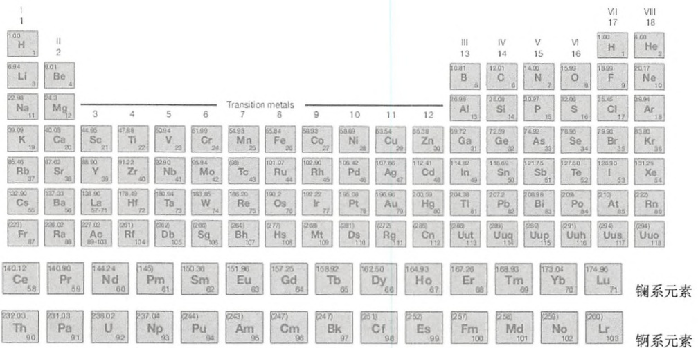

<details>
<summary>text_image</summary>

Ⅰ
Ⅱ
Ⅲ
Ⅳ
Ⅴ
Ⅵ
Ⅶ
Ⅷ
1.00
H 1
II 2
6.94
Li 3
9.01
Be 4
22.98
Na 11
Mg 12
Transition metals
III 13
IV 14
V 15
VI 16
1.00
H 1
He 2
10.81
B 5
12.01
C 6
14.00
N 7
15.93
O 8
18.99
F 9
20.17
Ne 10
26.99
Al 13
28.09
Si 14
30.97
P 15
32.06
S 16
35.45
Cl 17
39.94
Ar 18
39.09
K 19
40.08
Ca 20
44.95
Sc 21
47.88
Ti 22
50.94
V 23
51.99
Cr 24
54.93
Mn 25
55.84
Fe 36
58.93
Co 27
58.69
Ni 28
63.54
Cu 29
65.38
Zn 30
69.72
Ga 31
72.59
Ge 32<fcel>74.92
As 33<fcel>78.96
Se 34<fcel>79.90
Br 35<fcel>83.80
Kr 36<nl>95.46
Rb 37<fcel>87.62
Sr 38<fcel>88.90
Y 39<fcel>91.22
Zr 40<fcel>92.80
Nb 41<fcel>95.04
Mo 42<fcel>98.
Tc 43<fcel>101.07
Ru 44<fcel>102.90
Rh 45<fcel>106.42
Pd 46<fcel>107.86
Ag 47<fcel>112.41
Cd 48<fcel>114.82
In 49<fcel>118.69
Sn 50<fcel>131.75
Sb 51<fcel>127.60
Te 52<fcel>126.90
I 53<fcel>131.29
Xe 54<nl>132.90
Cs 55<fcel>137.33
Ba 56<fcel>138.90
La 57-71<fcel>178.49
Hf 72<fcel>180.94
Ta 73<fcel>183.85
W 74<fcel>186.20
Re 75<fcel>190.2
Os 76<fcel>192.22
Ir 77<fcel>196.08
Pt 78<fcel>196.96
Au 79<fcel>200.59
Hg 80<fcel>204.38
Tl 81<fcel>207.2
Pb 82<fcel>208.98
Bi 83<fcel>209.5
Po 84<fcel>210.5<fcel>At 85<fcel>222.
Rn 86<nl>(221)
Fr 87<fcel>236.02
Ra 88<fcel>237.02
Ac 89-103<fcel>(201)
Rf 104<fcel>(202)
Db 105<fcel>(206)
Sg 106<fcel>(264)
Bh 107<fcel>(277)
Hs 108<fcel>(268)
Mt 109<fcel>(281)
Ds 110<fcel>(272)
Rg 111<fcel>(285)
Cn 112<fcel>(286)
Uut 113<fcel>(289)
Uuq 114<fcel>(290)
Uup 115<fcel>(291)
Uuh 116<fcel>(294)
Uus 117<fcel>(294)
Uuo 118<nl>铜系元素
140.12 Ce 58<fcel>140.90 Pr 59<fcel>144.24 Nd 60<fcel>(145) Pm 61<fcel>(150.36 Sm 62)<fcel>(151.96 Eu 63)<fcel>(157.25 Gd 64)<fcel>(158.92 Tb 65)<fcel>(162.50 Dy 66)<fcel>(164.93 Ho 67)<fcel>(167.26 Er 68)<fcel>(168.93 Tm 69)<fcel>(173.04 Yb 70)<fcel>(174.96 Lu 71)<nl>(232.03 Th 90)<fcel>(231.03 Pa 91)<fcel>(238.02 U 92)<fcel>(237.04 Np 93)<fcel>(244) Pu 94)<fcel>(243) Am 95)<fcel>(247) Cm 96)<fcel>(247) Bk 97)<fcel>(251) Cf 98)<fcel>(252) Es 99)<fcel>(257) Fm 100)<fcel>(258) Md 101)<fcel>(259) No 102)<fcel>(260) Lr 103<nl>铜系元素
</details>

括弧中的数字为该元素最稳定的同位素的质量数。

(侯利华 译，于长明 校)

---

## 附录 2 常用技术

玻璃制品和塑料制品准备，1533

玻璃制品、塑料制品和玻璃棉的硅烷化，1533

无 RNA 酶的玻璃制品，1534

透析袋的处理，1534

细胞数目估算，1534

血细胞计数板计数，1535

活体染色，1536

核酸中放射性的测定，1537

核酸的三氯乙酸沉淀，1537

污染有溴化乙锭溶液的处理，1538

从 DNA 中去除溴化乙锭，1538

溴化乙锭的处置，1538

溴化乙锭浓溶液（浓度>0.5 mg/mL）的净化处理，1539

溴化乙锭稀溶液的净化处理（如含有  $0.5 \mu g/mL$  溴化乙锭电泳缓冲液的净化），1539

市售的净化试剂盒，1540


## 玻璃制品和塑料制品准备

所有玻璃制品均需高压或烘烤灭菌。有些塑料制品是可以高压灭菌的，但并非所有塑料制品都能高压，这取决于塑料的种类。市场上还售有许多灭菌的塑料制品。所有分子克隆的常规操作均需使用灭菌的玻璃或塑料制品。容器表面的吸附作用所造成实验材料的损失一般不大，然而对于某些操作（如处理极小量单链 DNA 或用 Maxam-Gilbert 法进行测序时），还是使用涂油硅氧烷薄层的玻璃或塑料制品为好。下面介绍的简便方法可用于吸头、试管和烧杯等小件物品的硅烷化。大件物品的硅烷化方法参见操作方案结尾处的注释。

## 玻璃制品、塑料制品和玻璃棉的硅烷化

以下方法由 Brain Seed（麻省总医院）提供。

为正确使用本方案中的器材和危险试剂，必须查阅相应的材料安全数据表并咨询所在机构的环境卫生和安全办公室。

---

1534

分子克隆实验指南（原书第四版）

1. 将待硅烷化的物品放入一个大的玻璃干燥器内。

2. 在干燥器内放置一个小烧杯，加 1mL 二氯二甲硅烷。

3. 通过真空阱将干燥器与真空泵相连，开启真空泵抽气至二氯二甲硅烷开始沸腾，立即用夹子夹住真空泵和干燥器之间的连接管，并关闭真空泵。应使干燥器保持在真空状态。

二氯二甲硅烷一开始沸腾就应立即关闭真空泵，否则这种挥发性试剂会抽入泵内不可挽回地破坏真空密封。

4. 二氯二甲硅烷挥发干后（1～2h），在化学通风橱内打开干燥器，待二氯二甲硅烷的气雾挥发，取出塑料或玻璃制品。玻璃制品或玻璃棉在使用前要在  $180^{\circ}$ C 烘烤 2h。塑料制品不要高压灭菌，用前应用水彻底冲洗。

注意

- 大件玻璃物品的硅烷化可将物品放在溶于氯仿或庚烷的 $5\%$ 二氯二甲硅烷溶液中浸泡。另外也有市售的硅烷化产品（如Sigmoidate、Sigma-Aldrich）。
- 随有机溶剂的挥发，二氯二甲硅烷即沉积在玻璃物品上，用前须用水反复冲洗多次或于 $180^{\circ}\mathrm{C}$ 烘烤 $2\mathrm{h}$ 。

## 无 RNA 酶的玻璃制品

用于操作 RNA 的玻璃制品的处理方法，可参考第 6 章中信息栏 “如何去除 RNase”。


## 透析袋的处理

为正确使用本方案中的器材和危险试剂，必须查阅相应的材料安全数据表并咨询所在机构的环境卫生和安全办公室。

分子在半透膜间的分离是由膜两侧溶液的浓度差驱动的，受到相对于膜内微孔尺寸的分子大小（分子质量）限制。微孔尺寸决定着截留分子质量，截留分子质量的定义是当90%的溶质分子可被膜截留时的分子质量。某一溶质的实际通透性不仅取决于分子的大小，还取决于分子的形状、分子的水化程度及其所带的电荷。这些参数均受溶剂的性质、pH及离子强度的影响。因此，截留分子质量只能作为参考，而不能绝对地用来预测在各种溶质和溶剂下的透析行为。市售的透析膜孔径范围很大（从100Da到2000kDa）。在透析大多数质粒DNA和许多蛋白质时，截留分子质量在12 000～14 000 Da比较适合。

1. 将透析袋剪成适当长度（10\~20cm）。
2. 在大体积的 2%(m/V) 碳酸氢钠和 1mmol/L EDTA(pH 8.0) 中将透析袋煮沸 10min。
3. 用蒸馏水彻底漂洗透析袋。
4. 将透析袋置于 1mmol/L EDTA（pH 8.0）中煮沸 10min。
5. 待透析袋冷却，存放于4℃，应确保透析袋始终浸没在液体中。

▲ 从此步起，需戴手套操作透析袋。

6. 在使用前用蒸馏水清洗透析袋内外两侧。

注意

也可将透析袋放在装满水的广口瓶中，松开瓶盖，于  $20 \, psi \, (1.40 \, kg/cm^{2})$  高压灭菌 10 min，代替步骤 4 用 1 mmol/L EDTA（pH 8.0）煮沸 10 min 的操作。


## 细胞数目估算

本操作步骤采自 Spector 等（1998 Cells: A Laboratory Manual）。

为正确使用本方案中的器材和危险试剂，必须查阅相应的材料安全数据表并咨询所在机构的环境卫生和安全办公室。

在某一特定体积培养基中，哺乳动物细胞的数目可以通过血细胞计数板测定。当需要

---

附录 2 常用技术

1535

测定样品的数目较大时，可使用细胞计数仪之类的自动测定方法，比如 Coulter 公司就生产这种仪器。这里还介绍了采用活体染料染色估算某一群体中活细胞数目的方法。

## 血细胞计数板计数

血细胞计数板有两个计数室，每个计数室充满液体并盖上盖玻片后总容积为 $9\mu \mathrm{L}$ 。每个计数室分为9个大方格，每个方格为 $1\mathrm{mm} \times 1\mathrm{mm}$，深度为 $0.1\mathrm{mm}$，故盖上盖玻片后每个方格的体积为 $0.1\mathrm{mm}^3$，即 $0.1\mu \mathrm{L}$。进行细胞计数时可无视小格的存在，不必再将9个大方格细分。图1为血细胞计数板上纹格的示意图。

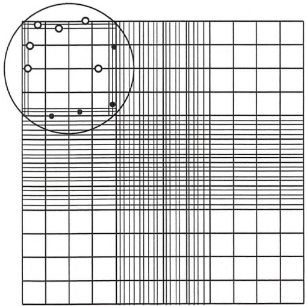

<details>
<summary>text_image</summary>

Diagram showing a grid with scattered circles and a circled region, likely illustrating a pattern or layout.
</details>

图1 标准血细胞计数板计数室。大圆圈表示 $100 \times$ 放大倍数下（$10 \times$ 物镜和 $10 \times$ 目镜）显微镜视野大致可覆盖的区域。计数上边和左边压着中线的细胞（空心小圆圈），下边和右边压着中线的细胞（实心小圆圈）不要计数。计数两个计数室4个角及中央的方格。图中仅画出了一个计数室（引自Spector et al. 1998）

1. 用胰酶消化细胞:加两滴（约 $100\mu \mathrm{L}$）$1\times$ trypsin-EDTA至细胞并孵育 $30\sim 60\mathrm{s}$，将细胞重悬于生长培养基中。
2. 用巴斯德移液管移取两份待计数的细胞悬液样品，通过毛细作用分别加到血细胞计数板的两个计数室中。

要使液体刚好充满计数室，勿使其溢到计数室外的凹漕内，将第一份样品加至一个计数室，第二份样品加至另一个计数室。

3. 分别从两个计数室的 9 个方格中数出 5 个方格中细胞的数目，共数 10 个方格。

10×物镜和10×目镜的显微镜视野能够包容计数室9个方格中1个方格的大部分，用此放大倍数计数起来较为容易。对压在格线上的细胞只能计数两个边，另外两个边的细胞不要计数。若初始的细胞稀释液每个方格细胞数达50～100个细胞，可作进一步稀释，以提高计数的准确性和细胞计数的速度。

4. 把 10 个方格（每个计数室 5 个共 10 个）中的细胞数目加在一起，得到 $1 \times 10^{-3} \mathrm{~mL}$ （$1 \times 10^{-4} \mathrm{~mL}$/方格 $\times 10$ 个方格 $= 10^{-3} \mathrm{~mL}$ 体积）的体积中细胞的数目，再乘以 1000 即为每 mL 计数样品中的细胞数目。

若对原始样品作了稀释，计算时还应乘以稀释倍数。

5. 计数完毕，立即将血细胞计数板和盖玻片用蒸馏水清洗，再浸泡在 70% 乙醇中，用镜头纸拭干。

▲ 不要让细胞悬液干结在血细胞计数板上。

---

1536

分子克隆实验指南（原书第四版）

## 实例

从 10mL 细胞悬液中取出 1mL 用 4mL 培养基稀释，分两次用巴斯德移液管移取稀释液，将第一份样品加到血细胞计数板的一个计数室中，将第二份样品加到另一计数室中。计数每侧计数室中 5 个方格内的细胞数。

每方格内的细胞数目:45，37，52，40，60，48，54，70，58，60

总数:524

稀释倍数:  $(1+4)/1=5$

原始细胞悬液中的细胞数目（细胞/mL）: $524 \times 10^{3} \times 5 = 2.62 \times 10^{6}$  细胞/mL

## 注意

以下因素可能引起血细胞计数板计数结果出现误差:

- 从原始细胞悬液中取样的不定性。应将细胞悬液搅匀，勿使细胞沉降到容器底部。
- 在血细胞计数室中加样方法不当或过量。计数室的体积是由架在计数板两侧的盖玻片决定的，细胞样品悬液溢出则计数体积偏高。
- 细胞结团。大的细胞团可能太大，不能通过毛细作用渗入计数室内而未被计数，能够进入计数室的小细胞团也难以准确地进行计数。为确保计数准确，应使细胞悬液分散成单个细胞，细胞应充分混合以达到均匀。

## 活体染色

为正确使用本方案中的器材和危险试剂，必须查阅相应的材料安全数据表并咨询所在机构的环境卫生和安全办公室。

各种细胞操作，包括传代、冷冻及从原始组织上分离，都会引起细胞死亡。借助细胞对染料台盼蓝的排斥作用可以测定细胞群体中活细胞的数目（Phillips 1973）。正常健康的细胞能够排斥台盼蓝，而这种染料却能够扩散到细胞膜完整性丧失的细胞中。染料排斥法是一个的粗略估算细胞存活率的方法，常常在差异小于10%～20%时无法加以区分。此外，能够排斥染料的细胞也并不一定都有贴壁及长期生存或增殖的能力。

1. 用胰酶处理细胞:加两滴（约  $100 \mu L$ ） $1 \times$  trypsin-EDTA 至细胞并孵育 30～60s，在无菌操作下将 0.5mL 细胞稀释至磷酸缓冲盐中，使细胞浓度在  $2 \times 10^{5} \sim 4 \times 10^{5}$  细胞/mL。
2. 在无菌操作下将 0.5mL 上述稀释的细胞转移到一支新试管中，加 0.5mL 台盼蓝溶液 (0.4%, m/V)。
3. 细胞在染料溶液中滞留的时间不要短于 3min，也不要长于 10min，用巴斯德移液管从染液中取样，通过毛细作用加到血细胞计数板上。
4. 数不少于 500 个细胞，蓝色细胞单独计数，确定蓝色细胞即没有染料排斥作用细胞的频率。
5. 由不具染料排斥作用细胞的数目确定百分存活率。

## 实例

将单层细胞培养物用胰酶消化后重悬于 5mL 培养基中，取 0.5mL 细胞悬液与 4.5mL PBS 混合，将 0.5mL 悬于 PBS 的细胞转移到一支小试管中，与 0.5mL 台盼蓝溶液混合。

---

附录 2 常用技术

1537

在加到计数室的样品中计数了 540 个细胞，其中有 62 个细胞不能排斥染料而呈蓝色，其百分存活率则为 88.5%。

$$
5 4 0 - 6 2 = \text {染料拒染细胞的数目}
$$

$$
5 4 0 = \text {计数的总细胞数目}
$$

$$
(540 - 62) \times 100 / 540 = 88.5 \% \text{的存活率}
$$

## 参考文献

Phillips HJ. 1973. Dye exclusion tests for cell viability. In Tissue culture: Methods and applications (ed. Kruse PF Jr, Paterson MK Jr), pp. 406–408. Academic, New York.

Spector DL, Goldman RD, Leinwand LA. 1998. Cells: A laboratory manual, Vol. 1. Culture and biochemical analysis of cells, pp. 2.8–2.10. Cold Spring Harbor Laboratory Press, Cold Spring Harbor, NY.


## 核酸中放射性的测定

为正确使用本方案中的器材和危险试剂，必须查阅相应的材料安全数据表并咨询所在机构的环境卫生和安全办公室。

放射性同位素可作为一种示踪物用来监视许多 DNA 和 RNA 合成反应的进程。在计算这些反应的效率时，需要精确测定放射性前体掺入到目标产物的比例。达到这一目的的有效方法是用三氯乙酸（TCA）对核酸产物进行分级沉淀。

## 核酸的三氯乙酸沉淀

1. 用软芯铅笔在适当数目的 Whatman GF/C 玻璃纤维滤膜（直径为 $2.4\mathrm{cm}$）上作标记，把每张滤膜用大头针固定于一聚苯乙烯支持物上。
2. 取已知体积（最多  $5 \mu L$ ）的各份待测样品分别点在两张标记好的滤膜上。

一张滤膜用于测定总的放射性（即酸溶性和酸沉淀物的放射性），另一张用来测定酸沉淀物的放射性。在本实验条件下，50个核苷酸以上的DNA和RNA分子将沉淀到滤膜表面上。

3. 将滤膜置于室温至所有液体挥发干，可用加热灯加速蒸发，但通常并无此必要。
4. 用一平头镊子（如 Millipore 镊子）从每对滤膜中取一张转移到装有 200～300mL 冰冷的 5% TCA 和 20mmol/L 焦磷酸钠的烧杯中，在此酸溶液中旋动滤膜 2 min，再将滤膜转移到一只新的、装有同样体积冰冷 5% TCA 和焦磷酸钠混合液的烧杯中，重复浸洗两次。

浸洗过程中未掺入的核苷酸前体被洗脱下来，含放射性的核酸则被固定在膜上。

市售一种真空驱动的复式滤器，可同时容纳的滤膜达24张，亦可用于漂洗滤膜。

5. 将漂洗过的滤膜转移到一只装有 70% 乙醇的烧杯中并放置片刻，再于室温或加热灯下使之干燥。
6. 将每对滤膜（漂洗和未漂洗过的）的每一张置于闪烁瓶中，测定每张滤膜的放射性强度。

Cerenkov 计数器亦可测定  ${}^{32}P$ （使用液体闪烁计数仪的  ${}^{3}H$  通道）。Cerenkov 辐射的效率在用不同仪器测量时可能有所不同，还与闪烁瓶的几何性状和残留在滤膜上水的量有关。滤膜干燥时 Cerenkov 计数器的计数效率约为 25%（在 4 次放射性衰变中只测到 1 次）。如在干燥滤膜上加数毫升含甲苯的闪烁液，则在  ${}^{32}P$  通道上液闪仪的计数效率可达 100%。

测定其他同位素（ $^{3}$ H、 $^{14}$ C、 $^{35}$ S 及  $^{33}$ P 等）时，应使用含甲苯的闪烁液并选用液闪仪的适当通道。不同仪器对这些同位素的计数效率会有所不同，应首先确定每台仪器的计数效率。

7. 将漂洗滤膜上的放射性与未漂洗滤膜上的放射性加以比较，用下面框图给出的方法计算掺入放射性前体的比率。

---

1538

分子克隆实验指南（原书第四版）

## 放射性标记探针比活性的计算

可用下列公式计算放射性标记探针的比活性:

$$
\text {比活性} = \frac {L (2 . 2 \times 1 0 ^ {9}) (\mathrm{PI})}{m + [ (1 . 3 \times 1 0 ^ {9}) (\mathrm{PI}) (L / S)}
$$

式中，L 为放射性标记的输入值（ $\mu$ Ci）；PI 为掺入放射性前体的比率（漂洗滤膜上的 cpm 值/未漂洗滤膜上的 cpm 值，见上述）；m 为 DNA 模板的质量（ng）；S 为输入放射性标记的比活度（ $\mu$ Ci/nmol）。

上式中的分子项是以下3个因数的乘积:①反应物的总dpm[(L)(2.2×10^{6}dpm/μCi)]；②这些dpm的掺入率(PI)；③将最后比活性得数由dpm/ng转换为dpm/μg的因数(10^{3})。

式中的分母项表示反应结束 DNA 的总量（以 ng 计），这个值等于起始的量（m）加上反应过程中合成的量（以 ng 计）。后者可由掺入 dNMP 的纳摩尔数[(PI)（L/S)]乘以 4 倍四种 dNMP 的平均分子质量得出（$4 \times 325\mathrm{ng/nmol} = 1.3 \times 10^{3}\mathrm{ng/nmol}$）。

实例

在一个随机引物反应中，50%的放射性掺入到 TCA 沉淀物，反应起始物中含有 25ng 模板 DNA 及 50μCi 放射性标记的 dNTP（比活性为 3000μCi/mmol）。即 L=50μCi，PI=0.5，m=25ng，S=3000Ci/mmol，则

$$
\begin{array}{l} \text {探针的比活性} = \frac {5 0 (2 . 2 \times 1 0 ^ {9}) (0 . 5)}{2 5 + [ (1 . 3 \times 1 0 ^ {3}) (0 . 5) (5 0 / 3 0 0 0) ]} \\ = 1. 5 \times 10^9 \text{dpm} / \mu\text{g} \\ \end{array}
$$


## 污染有溴化乙锭溶液的处理

## 从 DNA 中去除溴化乙锭

溴化乙锭与 DNA 的反应是可逆的（Waring 1965），但复合物的解离过程非常缓慢，一般要以天计算而不是以分钟或小时来计算。在实际工作中解离可将复合物过一个装有阳离子交换树脂（如 Dowex AGW-X8）的小柱子（Waring 1965; Radloff et al. 1967），或者用异丙醇（Cozzarelli et al. 1968）或正丁醇（Wang 1969）等有机溶剂提取。实践证明前一种方法去除溴化乙锭后结合比率低于荧光检测水平（染料:核酸的摩尔比为 1:4000, Radloff et al. 1967）。

## 溴化乙锭的处置

溴化乙锭本身并不具强诱变性，但可被酵母和鼠伤寒沙门氏菌的微粒体酶代谢为具有中度诱变性的化合物（Mahler and Bastos 1974; MacCann et al. 1975; MacGregor and Johnson 1977; Singer et al. 1999）。文献中介绍了净化含有或接触到溴化乙锭的溶液或表面的数种方法。用活性炭处理可使溶液中的溴化乙锭浓度降至 $0.5\mu \mathrm{g} / \mathrm{mL}$ 以下，然后可焚烧处理（Menozzi et al. 1990）。另外，溴化乙锭也可用亚硝酸钠和次磷酸加以分解（Lunn and Sansone 1987）。

---

附录 2 常用技术

1539

## 溴化乙锭浓溶液（浓度>0.5mg/mL）的净化处理

为正确使用本方案中的器材和危险试剂，必须查阅相应的材料安全数据表并咨询所在机构的环境卫生和安全办公室。

## 方法1

沙门氏菌-微粒体法测定结果表明，本方法（Lunn and Sansone 1987）可使溴化乙锭的诱变活性降低约200倍。

1. 加入足量的水使溴化乙锭的浓度降至 0.5mg/mL 以下。

2. 在溶液中加 0.2 体积新鲜的 5% 次磷酸及 0.12 体积新鲜的 0.5 mol/L 亚硝酸钠，小心混匀。

▲ 溶液的 pH 一定要低于 3.0。

市售次磷酸一般为 50% 溶液，具腐蚀性，须小心操作。应在临用之前现稀释。

亚硝酸钠溶液（0.5mol/L）应新鲜配制，用水溶解34.5g亚硝酸钠定容至500mL即可。

3. 于室温下保温 $24 \mathrm{~h}$, 加充分过量的 $1 \mathrm{~mol} / \mathrm{L}$ 碳酸氢钠。至此该溶液可予废弃。

## 方法2

用沙门氏菌-微粒体法检查，本方法（Quillardet and Hofnung 1988）可使溴化乙锭的诱变活性降低约3000倍。但也有报道（Lunn and Sansone 1987）称，在用净化溶液处理的“空白”样品偶尔也有诱变活性。

1. 加入足量的水使溴化乙锭的的浓度降至 0.5mg/mL 以下。
2. 加 1 体积 $0.5 \mathrm{~mol} / \mathrm{L} \mathrm{KMnO}_{4}$, 小心混匀, 再加 1 体积 $2.5 \mathrm{~mol} / \mathrm{LHCl}$, 小心混匀, 于室温下保温数小时。
3. 加 1 体积 2.5mol/LNaOH，小心混匀，将溶液废弃。

## 溴化乙锭稀溶液的净化处理（如含有 $0.5\mu \mathrm{g / mL}$ 溴化乙锭电泳缓冲液的净化）

为正确使用本方案中的器材和危险试剂，必须查阅相应的材料安全数据表并咨询所在机构的环境卫生和安全办公室。

## 方法1

下述方法采自 Lunn 和 Sansone（1987）。

1. 在每 $100\mathrm{mL}$ 溶液中加入 $2.9\mathrm{g}$ Amberlite XAD-16（Sigma-Aldrich），这是一种非离子型的多聚吸附剂。
2. 将溶液于室温下放置 12h，不时摇动。
3. 用 Whatman 1 号滤纸过滤，废弃滤液。
4. 将滤膜和 Amberlite 树脂密封在塑料袋内，丢弃在有害废物中。

## 方法2

下述方法采自 Bensaude（1988）。

1. 在每 100mL 溶液中加入 100mg 活性炭粉末。
2. 溶液于室温下放置 1h，不时摇动。
3. 用 Whatman 1 号滤纸过滤，废弃滤液。
4. 将滤膜和 Amberlite 树脂密封在塑料袋内，丢弃在有害废物中。

注意

\- 用次氯酸（漂白剂）净化溴化乙锭稀溶液的方法不可取。沙门氏菌-微粒体法检测

---

1540

分子克隆实验指南（原书第四版）

结果表明，这种处理方法可使溴化乙锭的诱变活性降至原来的 1000 倍左右，但在微粒体存在下溴化乙锭可转化为一种具有诱变活性的化合物（Quillardet and Hofnung 1988）。

- 溴化乙锭在 $262^{\circ} \mathrm{C}$ 下分解，在标准条件下焚烧后不可能再有危害。
- Amberlite XAD-16 浆或活性炭可用于污染有溴化乙锭物体表面的净化。

## 市售的净化试剂盒

许多商家出售一些能够方便地从溶液中提取溴化乙锭的装置，包括 MP Biomedicals 公司的 EtBr Green Bag、Whatman 公司的 Extractor system 和 AMRESCO 公司的 Destaining Bags。

## 参考文献

- Bensaude O. 1988. Ethidium bromide and safety—Readers suggest alternative solutions (letter). Trends Genet 4: 89–90.
- Cozzarelli NR, Kelly RB, Kornberg A. 1968. A minute circular DNA from Escherichia coli 15. Proc Natl Acad Sci 60: 992–999.
- Lunn G, Sansone EB. 1987. Ethidium bromide: Destruction and decontamination of solutions. Anal Biochem 162: 453–458.
- MacGregor JT, Johnson IJ. 1977. In vitro metabolic activation of ethidium bromide and other phenanthridinium compounds: Mutagenic activity in Salmonella typhimurium. Mutat Res 48: 103–107.
- Mahler HR, Bastos RN. 1974. Coupling between mitochondrial mutation and energy transduction. Proc Natl Acad Sci 71: 2241–2245.
- McCann J, Choi E, Yamasaki E, Ames BN. 1975. Detection of carcinogens as mutagens in the Salmonella/microsome test: Assay of 300 chemicals. Proc Natl Acad Sci 72: 2241–2245.
- Menozzi FD, Michel A, Pora H, Miller AOA. 1990. Absorption method for rapid decontamination of solutions of ethidium bromide and propi-
- dium iodide. Chromatographia 29: 167–169.
- Quillardet P, Hofnung M. 1988. Ethidium bromide and safety—Readers suggest alternative solutions (letter). Trends Genet 4: 89–90.
- Radloff R, Bauer W, Vinograd J. 1967. A dye-buoyant density method for the detection and isolation of closed circular duplex DNA: The closed circular DNA in HeLa cells. Proc Natl Acad Sci 57:1514–1521.
- Singer VL, Lawler TE, Yue S. 1999. Comparison of SYBR® Green I nucleic acid gel stain mutagenicity and ethidium bromide mutagenicity in the Salmonella mammalian microsome reverse mutation assay (Ames test). Mutat Res 439: 37–47.
- Wang JC. 1969. Variation of the average rotation angle of the DNA helix and the superhelical turns of covalently closed cyclic λ DNA. J Mol Biol 43: 25–39.
- Waring MJ. 1965. Complex formation between ethidium bromide and nucleic acids. J Mol Biol 13: 269–282.

(于长明 译，侯利华 校)

---

## 附录 3 检测系统

核酸染色，1541

溴化乙锭，1541

亚甲基蓝，1543

SYBR 染料，1543

化学发光，1545

化学发光的标记，1546

化学发光酶分析，1547

市售试剂、试剂盒及光度计，1548

信息栏，1550

辣根过氧化物酶，1550

地高辛，1552

BCIP, 1555

AMPPD, 1558

免疫球蛋白结合蛋白:蛋白 A、G 和 L，1561


## 核酸染色

## 溴化乙锭

溴化乙锭于 20 世纪 50 年代合成成功，主要是作为一种有效的杀锥虫剂而发展起来的菲啶化合物。溴化乙锭在筛选过程中脱颖而出。它的杀锥虫效能是其母化合物的 10～50 倍，并对小鼠无毒，且与早期的菲啶化合物不同，对牛不具有光致敏作用（Watkins and Wolfe 1952）。直到最近，溴化乙锭在热带及亚热带国家仍被广泛应用于牛锥虫病的治疗和预防。溴化乙锭的化学结构如下图所示。

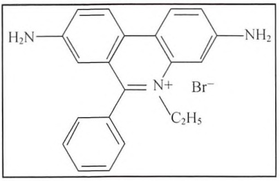

<details>
<summary>chemical</summary>

Chemical structure of a brominated naphthalene derivative with phenyl and amino substituents
</details>

---

1542

分子克隆实验指南（原书第四版）

## 溴化乙锭与核酸结合

溴化乙锭包含一个平面的三环菲啶环，它能插入到双链 DNA 堆叠的碱基对之间。当它插入到螺旋结构中，将保持与螺旋结构纵轴垂直的位置，并在其上下方与碱基对形成范德华（van der Waals）接触。尽管其平面三环结构被包埋，其外围苯基及乙基基团却伸出插入到 DNA 双螺旋结构的大沟中。在高离子强度的溶液中，大约每 2.5 个碱基对中插入 1 个分子的溴化乙锭，且与 DNA 的碱基组成无关。除沿螺旋纵轴方向发生 3.4Å 的位置偏移外，碱基对的几何结构和位置相对于螺旋结构并未发生改变（Waring 1965）。这使得与溴化乙锭结合达到饱和的双链 DNA 的长度增加了 27%（Freifelder 1971）。

溴化乙锭也同样可以通过不同的化学作用方式与 RNA 及热变性或单链 DNA 链内碱基对所形成的螺旋结构区相结合（Waring 1965, 1966; LePecq and Paoletti 1967）。溴化乙锭平面基团的固定位置，以及它与碱基的高度邻近使被结合的染料所产生的荧光与在自由溶液状态的染料相比增强 20～25 倍。254nm 的紫外线首先被 DNA 吸收，然后被传送到染料；而 302nm 及 366nm 的射线直接被染料自行吸收。这些被吸收的能量将在 590nm 的橙红色可见光谱区以 0.3 的量子产额被重新释放出来（LePecq and Paoletti 1967; Tuma et al. 1999）。

大部分商品化的紫外线光源产生 $302\mathrm{nm}$ 的紫外线。溴化乙锭-DNA复合物在受到紫外线照射激发所产生的荧光，在 $302\mathrm{nm}$ 的紫外线下明显要比 $366\mathrm{nm}$ 的要强，但要比短波紫外线（$254\mathrm{nm}$）的稍弱。然而，$302\mathrm{nm}$ 紫外线所造成染料的光褪色效应，以及造成DNA的断裂和缺口明显要较 $254\mathrm{nm}$ 紫外线少得多（Brunk and Simpson 1977）。

## 凝胶中的 DNA 染色

溴化乙锭被广泛地用于琼脂糖凝胶中 DNA 片段的定位(Aaij and Borst 1972; Sharp et al. 1973; 见第 2 章, 实验方案 2 和 4)。通常将它以 $0.5 \mu \mathrm{g} / \mathrm{mL}$ 的浓度加入胶中和电泳缓冲液中。尽管加入溴化乙锭会导致线性双链 DNA 的电泳迁移率减慢约 $15\%$，但却可在紫外灯下直接检查凝胶。由于溴化乙锭-DNA 复合物的荧光强度要比未结合的染料强很多, 少量的 DNA（约 $10 \mathrm{ng}$/条带）也能从存在游离状态溴化乙锭的凝胶中被检测出来（Sharp et al. 1973）。如果预先用氯乙醛（chloroacetaldehyde）对 DNA 进行处理, 则更小量的 DNA 也可被检测出来。氯乙醛是一种化学诱变剂, 可与腺嘌呤、胞核嘧啶及鸟嘌呤发生反应（Premaratne et al. 1993）。一种更为可行的增强荧光的方法是先将凝胶在含 $10 \mathrm{mmol} / \mathrm{L} \mathrm{Mg}^{2+}$ 的溶液中脱色,然后再在紫外灯下观察（Sambrook et al. 1989）。

## 双链 DNA 的定量分析

DNA与溴化乙锭复合物的形成过程能通过肉眼被观察到是由于结合过程中在吸收光谱上发生了巨大的因光异色偏移（metachromatic shift）。原来的最大吸收峰在 $480\mathrm{nm}$ （橙黄色）逐渐漂移到 $520\mathrm{nm}$ （粉红色），并在 $510\mathrm{nm}$ 处具有一个特征的等消光点。这为应用定量分光光度法来估算DNA浓度提供了一种简洁的方法（Waring 1965）。

一种更为快捷和灵敏的方法是应用溴化乙锭分子的插入可通过紫外线照射产生荧光。由于荧光的亮度与 DNA 的含量成比例，DNA 含量可通过比较样品与一系列标准品在 590nm 处的发射光来估算。

## 溴化乙锭的改进版

插入染料的二聚体与 DNA 的亲和力要比其单体化合物大得多（Gaugain et al. 1978）。溴化乙锭的同型二聚体或吖啶与溴乙菲啶形成的杂二聚体在 DNA 的检测灵敏度上要比单体的溴化乙锭高出很多。例如，少至 30pg 的 DNA 可在共聚焦荧光凝胶扫描仪（confocal fluorescence gel scanner）上被检测出来（Glazer et al. 1990; Glazer and Rye 1992）。然而，价

---

附录 3 检测系统

1543

格的上涨与这种灵敏度的增高是很不相称的，购买 $1\mathrm{mg}$ 溴化乙锭同型二聚体的花费大约是购买 $1\mathrm{g}$ 溴化乙锭的花费的10倍。与溴化乙锭无关的非对称性花青染料（unsymmetric cyanine dyes）对于检测DNA同样具有更高的灵敏度，但是这些染料也同样很昂贵（见下面的SYBR染料部分）。关于溴化乙锭的处理信息参见附录2。

## 亚甲基蓝

亚甲基蓝（methylene blue）又名瑞士蓝（Swiss Blue），由瑞士人 Heinrich Caro 首先于 1876 年合成成功。亚甲基蓝（Fierz-David and Blangey 1949）有时被用于转移到硝酸纤维素膜或特定的尼龙膜上的 RNA 染色（Herrin and Schmidt 1988）（见第 6 章，实验方案 12）。

亚甲基蓝也同样可用于琼脂糖凝胶中DNA条带的染色（见下面信息栏“凝胶中DNA的亚甲基蓝染色”）。其目的是为了避免使用溴化乙锭，以及尽量减少紫外线对DNA的照射，紫外线照射可导致形成嘧啶二聚体，降低DNA的生物活性。这个问题似乎并不严重，但对于某些研究它却是问题的根源。

## 凝胶中 DNA 的亚甲基蓝染色

1. 用 GTG 琼脂糖所制凝胶在  $1 \times$  TAE 缓冲液中上样电泳。

用亚甲基蓝染色所能检测出的 DNA 条带最低含量为约 40ng，因而在通常情况下 DNA 的上样量需比正常增大 2\~3 倍。

2. 电泳结束后，将凝胶置于玻璃盘中，加入 5 倍凝胶体积的染液，含 0.001%\~0.0025%亚甲基蓝（可从 Sigma 购得）、1mmol/L Tris-乙酸（pH 7.4）、0.1mmol/L EDTA（pH 8.0）。

3. 室温温育 4h，在旋转混合器上轻微搅动。

4. 在蒸馏水中短暂漂洗后在类似于 X 光片观片灯的灯箱上观察结果。

亚甲基蓝在可见光谱区内有两个最大吸收峰（668nm 和 609nm），并可溶于水。对于固定于尼龙膜或硝酸纤维素膜上的 RNA 的染色，其通常的使用浓度为 0.04%，并溶于 0.5mol/L 的乙酸钠溶液中（pH 5.2）。染色是可逆的，并可在杂交前使用。

## SYBR 染料

SYBR 染料为一种非对称菁化合物，由 Molecular Probes 公司开发。它作为一种 DNA 和 RNA 染料，与菲啶类染料如溴化乙锭相比具有一些优越性。有关 SYBR 染料的科学文献很少，然而在制造商的网站上有许多有用的信息（http://www.probes.com），现小结如下。有关 SYBR 染料的优越性及使用的更详细的资料请参看第 1 章和第 6 章实验方案 6。

有三种 SYBR 染料被用于分子克隆试验中，分别为 SYBR Green I、II 和 SYBR Gold。所有三种染料在溶液状态基本上不产生荧光，然而，当其结合到核酸上时，将产生很强的荧光及高的量子产率。比如，SYBR Green I 在结合到双链 DNA 上时量子产率为 0.8，而 SYBR Gold 具有 0.7 的量子产率及 1000 倍的增强荧光（Tuma et al. 1999）。由于 SYBR 染料能产生很强的信号和极低的背景，以及对核酸的高度亲和力，它们能在低浓度条件下使用，并比传统的染料如溴化乙锭具有更高的灵敏度。然而，SYBR Green I 及 II 也具有一些不如人意的特点。

\- 这些染料在标准的紫外透射仪上的 300nm 紫外线下不能达到理想的荧光激发状态，在紫外波长为 254nm 时信号强度会得到改善，但在这个波长下，对 DNA 的损伤也达到最大。

---

1544

分子克隆实验指南（原书第四版）

- 两种染料对凝胶的渗透都很慢，如果凝胶较厚或浓度较高，电泳后染色需要 2h 或更长时间。
- 这些染料的光稳定性不是特别好。
- SYBR Green I 在检测凝胶中单链 DNA 时只比溴化乙锭稍微灵敏一点。

由于上述原因，SYBR Green I 和 II 通常不用于凝胶中 DNA 染色。然而，SYBR Green II 用于检测变性凝胶中的 RNA 时，其灵敏度为溴化乙锭的 5 倍并且不会干扰 Northern 转移。因而，这种染料可用于难以用溴化乙锭检测的微量 RNA 定量分析。而 SYBR Green I 主要用于溶液中 DNA 的定量，比如用于实时聚合酶链反应（real time polymerase chain reactions）（见第 9 章）。

SYBR Gold 为最近才上市的产品，是最好的 SYBR 染料。它比溴化乙锭灵敏度高 10 倍以上，且其信号检测动态范围极佳。与 SYBR Green I 和 II 不同，SYBR Gold 对凝胶的渗透作用很快，因而既可用于传统的非变性聚丙烯酰胺凝胶及琼脂糖凝胶中 DNA 和 RNA 的染色，也可用于含有变性剂的凝胶，如尿素、乙二醛、甲醛。由于 SYBR Gold 通常主要结合在主链的带电磷酸残基上，结合了染料的 DNA 的电泳迁移会明显减缓，并且有时会造成 DNA 条带的弯曲。因而，用 SYBR Gold 进行凝胶染色通常在电泳完成后进行。由于背景染色非常低，所以不需要进行脱色。使用标准的紫外透射仪波长 300nm 照射，应用 SYBR Gold 染色的核酸产生明亮的金色荧光，可用传统的黑白宝丽来胶卷（Polaroid film）（type 667）拍摄或用基于电荷耦合装置（charged couple device, CCD）的图像探测系统摄取。染色的核酸可直接转移到膜上用于 Northern 或 Southern 杂交（Tuma et al. 1999）。

尽管许多酶促反应都不会被 SYBR Gold 所抑制，但聚合酶链反应对于高浓度的这种染料是敏感的，然而这种抑制可通过调整  $Mg^{2+}$  浓度来减弱（Tuma et al. 1999），或通过标准的乙醇沉淀将 SYBR Gold 从模板 DNA 上移除来避免。

SYBR Gold 是以  $10\,000\times$  的浓度溶解在无水的二甲基亚砜溶液（DMSO）中提供的。由于这种染料的高昂价格，使得它不能用于常规凝胶染色。然而，这种染料在某些技术中作为 DNA 放射性标记或银染的替代选择也许是划算的，如在单链构象多态性（single-strand conformation polymorphism, SSCP）和变性梯度凝胶电泳（denaturing gradient gel electrophoresis, DGGE）等试验中。

## 参考文献

- Aaij C, Borst P. 1972. The gel electrophoresis of DNA. Biochim Biophys Acta 269: 192–200.
- Brunk CF, Simpson L. 1977. Comparison of various ultraviolet sources for fluorescent detection of ethidium bromide-DNA complexes in polyacrylamide gels. Anal Biochem 82: 455–462.
- Fierz-David HE, Blangey L. 1949. Fundamental processes of dye chemistry. Interscience, New York.
- Freifelder D. 1971. Electron microscopic study of the ethidium bromide-DNA complex. J Mol Biol 60: 401–403.
- Gaugain B, Barbet J, Oberlin R, Roques BP, LePecq JB. 1978. DNA bifunctional intercalators. I. Synthesis and conformational properties of an ethidium homodimer and of an acridine ethidium heterodimer. Biochemistry 17: 5071–5078.
- Glazer AN, Rye HS. 1992. Stable dye-DNA intercalation complexes as reagents for high sensitivity fluorescence detection. Nature 359: 859–861.
- Glazer AN, Peck K, Mathies RA. 1990. A stable souble-stranded DNA-ethidium homodimer complex: Application to picogram fluorescence detection of DNA in agarose gels. Proc Natl Acad Sci 87: 3851–3855.
- Herrin DL, Schmidt GW. 1988. Rapid, reversible staining of northern blots prior to hybridization. BioTechniques 6: 196–200.
- LePecq JB, Paoletti C. 1967. A fluorescent complex between ethidium bromide and nucleic acids. Physical-chemical characterization. J Mol Biol
- 27: 87-106.
- Premaratne S, Helms M, Mower HF. 1993. Enhancement of ethidium bromide fluorescence in double-stranded DNA reacted with chloroacetaldehyde. BioTechniques 15: 394–395.
- Sambrook J, Fritsch E, Maniatis T. 1989. Molecular cloning: A laboratory manual, 2nd ed., p. 18.15. Cold Spring Harbor Laboratory Press, Cold Spring Harbor, NY.
- Sharp PA, Sugden B, Sambrook J. 1973. Detection of two restriction endonuclease activities in Haemophilus parainfluenzae using analytical agarose-ethidium bromide electrophoresis. Biochemistry 12: 3055-3063.
- Tuma RS, Beaudet MP, Jin X, Jones LJ, Cheung CY, Yue S, Singer VL. 1999. Characterization of SYBR Gold nucleic acid gel stain: A dye optimized for use with 300-nm ultraviolet transilluminators. Anal Biochem 268: 278–288.
- Waring MJ. 1965. Complex formation between ethidium bromide and nucleic acids. J Mol Biol 13: 269–282.
- Waring MJ. 1966. Structural requirements for the binding of ethidium bromide to nucleic acids. Biochim Biophys Acta 114: 234–244.
- Watkins TI, Wolfe G. 1952. Effect of changing the quaternizing group on the trypanocidal activity of dimidum bromide. Nature 169: 506.

---

附录 3 检测系统

1545


## 化学发光

在分子生物学的部分技术中，放射性试剂已逐步被非同位素试剂所取代。造成上述改变的主要原因是考虑到实验室的安全、放射性废物处理的经济和环境问题。总体来说，新的非同位素系统在分析的灵敏度以及获得结果所需的时间方面已有了很大的改进。化学发光是目前最突出的非同位素技术。当这种技术与酶标记技术结合使用时效果尤其好，这样，酶标记技术的放大特性与化学发光检测的高灵敏度相结合可产生出超高灵敏度的分析效果（如过氧化物酶和碱性磷酸酶标记的蛋白质及核酸探针的化学发光检测）。在所有分子生物学的常规实验中，化学发光系统的分析效果已基本达到基于 $^{125}\mathrm{I}$ 或 $^{32}\mathrm{P}$ 的分析效果。化学发光系统同时也避免了基于 $^{32}\mathrm{P}$ 方法试验周期长的缺陷，可在数分钟内获得结果而不是数天。而且，化学发光探针可以很容易地从膜上去除，因此膜可以反复使用而不会造成分辨率明显下降。直接将非同位素标记连接到核酸，以及基于生物素、荧光素和地高辛等非直接标记法的实验方案现已建立完好。亲和素（avidin）、链霉亲和素（streptavidin）、抗地高辛（antidigoxingenin）及抗荧光素酶交联剂（antifluorescein enzyme conjugates）等用于非直接标记的辅助试剂都很容易找到。除此之外，数家公司已开发了功能完备的、用于标记或检测的化学发光试剂盒，使化学发光分析变得更为简便。

化学发光是在特定的化学反应中由化学激活的中间体衰变为电子基态时所发出的光。大部分化学发光反应为氧化反应，因为产生可见光需要很高能量的反应（在波长 $450\mathrm{nm}$ 产生可见光需 $63.5\mathrm{kcal / mol}$ ）（见信息栏“化学发光反应”）。

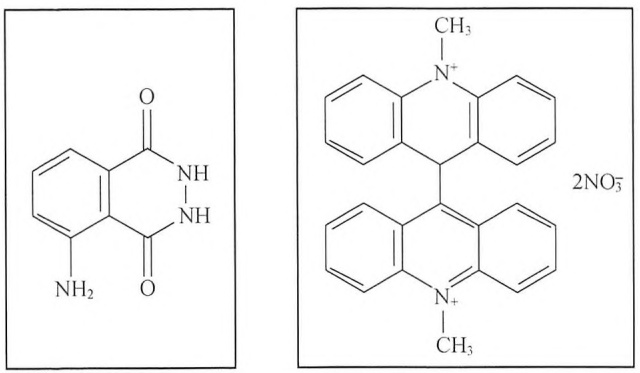

通常，化学发光反应的效率是低下的，尤其是在含有水的环境中。化学发光的量子产率一般都<10%。尽管效率低，这类反应对于分析应用十分有效，许多高灵敏度的分析应用所基于的化合物的量子产率仅1%[如鲁米诺（5-amino-2,3-dihydro-1,4-phthalazinedione）；鲁米诺的化学结构如左图所示]。

化学发光已有很长的历史（综述请参见 Campbell 1988），并且目前常规使用的一些化合物在很久以前就已知道了。鲁米诺于 1853 年首次合成（但它的化学发光特性直到 1928 年才被认识），光泽精（硝酸双-N-甲基吖啶；化学结构如右图）在 1935 年被合成。化学发光反应可发生在气相（氧化一氮与臭氧反应）、液相（鲁米诺氧化反应）和固相（磷的氧化反应）（Gundermann and McCapra 1987; Campbell 1988; Van Dyke and Van Dyke 1990）。

化学发光的应用十分广泛，从大家熟悉的应用氟化致敏的过氧草酸盐氧化反应的紧急照明光源（cyalume Lightsticks）到应用光泽精或鲁米诺来增强微弱的细胞化学发光的噬菌作用研究（Allen and Loose 1976）。在分子生物学研究中，化学发光化合物被用于作为核酸探针及蛋白印迹（如 Southern 和 Western 印迹）的标记，同时也用于酶标核酸及蛋白质的检测试剂（表 1 和表 2）（Kricka 1992; Nozaki et al. 1992）。化学发光分析及操作独特的优势主要体现在:其改进的灵敏度已超过了传统的放射检测、比色检测及荧光检测系统，使用无害试剂，能快速获得结果，是通用的分析方法（如基于溶液或膜的分析）。

---

1546

分子克隆实验指南（原书第四版）

## 化学发光反应

```txt
吖啶酯+过氧化物+碱
磷酸金刚烷基 1,2-二氧杂环丁烷+碱性磷酸酶
光泽精+过氧化物+碱
鲁米诺+过氧化物+碱
氧化一氮+臭氧
bis（2,4,6-trichlorophenyl）oxalate+过氧化物+荧光剂
```

## 化学发光的标记

## 吖啶酯以及相关化合物

通过简单地加入氢氧化钠及过氧化氢就可以使吖啶酯标记的抗原或抗体发光，这种抗原或抗体采用一种活性标记物（2',6'-dimethyl-4'-[N-succinimidyloxycarbonyl] phenyl 10-methylacridinium-9-carboxylate）来获得。发光过程非常短暂，只是快速的一闪，持续时间小于5s。这么短暂的发光过程给反应的起始与测量带来了一定的限制（Weeks et al. 1983; Law et al. 1989）。通常是将试剂直接注入放在光度计暗仓内光探测器前面的试管内来检测发光。吖啶酯及氨甲酰吖啶类似物（acridinium-9-[N-sulfonyl]carboxamide）（Kinkel et al. 1989; Mattingly 1991）是用于免疫分析的主要化学发光标记物（可从Cayman Chemical Company、Enzo Life Sciences、Gen-Probe Incorporated 和 Novartis Corporation 购买）。这类标记的检测最低限约为0.5 amol（0.5×10$^{-18}$mol）（表1）。

表 1 免疫学测定与核酸杂交标记的化学发光分析

| 酶 |  | 底物 | 检测限/zmol |
| --- | --- | --- | --- |
| 吖啶酯 | NaOH + 过氧化物 |  | 500 |
| 碱性磷酸酶 | AMPPD |  | 1 |
| β-D-半乳糖苷酶 | AMPGD |  | 30 |
| 辣根过氧化物酶 | 鲁米诺 + 过硼酸盐+4-碘苯酚 |  | 5 000 |
| 异鲁米诺 | 微过氧化物酶+过氧化物 |  | 50 000 |
| 黄嘌呤氧化酶 | 鲁米诺 + Fe EDTA |  | 3 000 |

<div class="docvortex-algorithm" style="white-space: pre-wrap; font-family:monospace;">
Bronstein and Kricka (1989); Kricka (1991) $\mathrm{zmol} = 10^{-21}\mathrm{mol}$
</div>

基于杂交保护的非分离 DNA 探针分析（nonseparation DNA probe assay）方法已被设计出来（Arnold et al. 1989）。这种类型的分析无需将结合与未结合的标记物分开，因而分析可方便的一步完成。这种杂交保护分析利用已与互补 DNA 杂交的吖啶酯标记探针和溶液中游离探针之间水解速率相差百万倍的特性，在 pH 7.6 的硼酸缓冲液中破坏游离探针的化学发光特性，从而使水解后的化学发光仅仅来源于已杂交的标记探针（可从 Gen-Probe, San Diego, CA 购买）（表 2）。

表 2 化学发光在分子生物学中的应用

| 技术 | 实例 | 参考文献 |
| --- | --- | --- |
| 细胞表面分子分析 | CD2 | Meier et al. (1992) |
| 克隆筛选 | 包含 N-ras 原癌基因的 pSP65 转化 E.coli | Stone and Durrant (1991) |

---

附录 3 检测系统

1547

续表

| 技术 | 实例 | 参考文献 |
| --- | --- | --- |
| DNA 指纹 | 植物和真菌基因组;争论 | Decorte and Cassiman (1991);Bierwerth et al. (1992) |
| DNA 序列分析 | 单载体和多重的 | Beck et al. (1989); Creasey et al. (1991);Martin et al. (1991); Karger et al.(1993) |
| 斑点/狭缝印迹 | M13 单链 DNA | Stone and Durrant (1991) |
| 凝胶迁移试验 | DNA-结合蛋白复合物 AP-1 (Jun/Fos) | Ikeda and Oda (1993) |
| 原位杂交 | 单纯疱疹病毒 I | Bronstein and Voyta (1989) |
| Northern 印迹 | LDL 受体IL-6, PGDF | Höltke et al. (1991)Engler-Blum et al. (1993) |
| PCR 产物的检测 | Bcl-2t (14:18) 染色体易位;Listeria monocytogenes | Nguyen et al. (1992);Holmstrom et al. (1993) |
| 菌斑筛选 | 包含 N-ras 原癌基因的 M13mp8 | Stone and Durrant (1991) |
| 报道基因 | β-D-半乳糖苷酶 lacZ 基因 | Jain and Magrath (1991) |
| 反转录酶分析 | HIV 和慢病毒 (lentivirus) 反转录酶 | Cook et al. (1992); Suzuki et al. (1993) |
| RFLP 分型 | Clostridium difficile | Bowman et al. (1991) |
| Southern 印迹 | PBR328t-PAHLA I 型抗原 (HLA class I antigens) | Höltke et al. (1991)Cate et al. (1991)Engler-Blum et al. (1993) |
| Southwestern 分析 | 蛋白:c-myb 内含子 DNA 反应 | Dooley et al. (1992) |
| Western 印迹 | HIV-1 抗体;转铁蛋白 | Bronstein et al. (1992) |

PCR，聚合酶链反应；RFLP，限制性酶切片段长度多态性；LDL，低密度脂蛋白；PDGF，血小板衍化生长因子；HIV，人类免疫缺陷病毒；HLA，人白细胞抗原。

## 鲁米诺及类似物

鲁米诺（luminol）是第一个用于免疫学分析标记的化学发光化合物（Schroeder et al. 1978）。在合适的催化剂[辣根过氧化物酶、微过氧化物酶（microperoxidase）、铁氰化物]存在的情况下，通过加入氧化剂（如过氧化氢）可导致发光。然而，通过鲁米诺的5-氨基进行标记会使发光量减少10倍。异鲁米诺是一种鲁米诺6氨基异构体，其发光效率较鲁米诺低（量子产额 $0.1\%$），但当通过第6位进行标记时可使发光量增加10倍。因而，这种化合物及其氨基取代类似物，如 $N-$ （4-氨丁基）- $N-$ 乙基异氨基苯二酰一肼（ABEI），已在免疫分析应用中成为最受欢迎的标记物（Kohen et al. 1979; Pazzagli et al. 1982）。

吡啶哒嗪（pyridopyridazines）代表另一类化学发光化合物。早期的数据显示这些化合物，尤其是8-氨基-5-氯-7-苯基和8-羟基-7苯基衍生物，可作为检测过氧化物酶标记的标记和协同底物（co-substrates）。与鲁米诺相比，这类化合物具有很强的化学发光特性（约为50倍）（Masuya et al. 1992）。

## 化学发光酶分析

## 碱性磷酸酶

磷酸金刚烷基 1,2-二氧杂环丁烷（如 AMPPD; disodium 3-(4-methoxyspiro[1,2-dioxetane-3,2'-tricyclo[3.3.13,7]decan]-4-yl)-phenylphosphate）及 5-位取代类似物（如 5-choro: CSPD；可从 Life Technologies 购买）已成为碱性磷酸酶标记的、使用最为广泛的化学发光底物（Bronstein et al. 1989, 1990, 1991; Schaap et al. 1989）。这种酶的检测极限是 1zmol（zmol= $10^{-21}$ mol），并且其发光持续时间超长（>1h），因而成为基于膜分析的理想系统。这个反应的发光强度可被尼龙膜表面及特定的多聚物增强，如聚氯苄（苄基二甲基铵）乙烯[polyvinylbenzyl（benzyldimethylammonium）chloride]。对尼龙膜来说，这种增强作用用于

---

1548

分子克隆实验指南（原书第四版）

其疏水性基团对去磷酸化的反应中间体的螯合作用，从而稳定和减少中间体的非发光性降解。碱性磷酸酶标记的化学发光分析目前被广泛地用于印迹试验及 DNA 序列测定（Beck and köster 1990; Tizard et al. 1990）。

## β-半乳糖苷酶

AMPGD（adamantyl 1,2-dioxetane aryl galactoside）作为这种酶的底物现已越来越流行。这种酶从芳香环的第3位裂解半乳糖苷基团产生一种苯氧化物中间体，这种中间体的降解可导致发光。β-半乳糖苷酶用这种分析方法的检测限为30zmol。

## 辣根过氧化物酶

鲁米诺及其他环状二酰基酰肼（cyclic diacylhydrazides）化合物是辣根过氧化物酶的化学发光协同底物。采用鲁米诺、过氧化氢及一种增效剂（如4-碘苯酚或4-羟基肉桂酸），辣根过氧化物酶的碱性同工酶可被检测出的最小量 $< 5\mathrm{amol}(5\times 10^{-18}\mathrm{mol / L})$ （Whitehead et al. 1983; Thorpe et al. 1985; Thorpe and Kricka 1986）。过氧化物酶的酸性同工酶被增强的效率较低。增效剂的作用是增强发光亮度并减少由于过氧化物或其他氧化剂导致鲁米诺氧化所产生的背景发光。这种双重效果能奇迹般地使过氧化物酶活性的分析以及分析的信噪比增强数千倍（这种增强化学发光试剂可从Amersham获得）。过氧化物酶的这种灵敏的检测方法（较比色分析的灵敏度高10倍以上）已经与催化报道分子沉积方案（catalyzed reporter deposition protocol）有效的结合（Wigle et al. 1993）。在这个放大方案中，过氧化物酶标记与酪胺生物素底物反应所产生的高活性基团再与标记物，以及与标记物直接相邻的任何蛋白质反应。然后，沉积的生物素与链霉亲和素过氧化物酶作用（通过这种方式，原来的过氧化物酶标记被放大了许多倍），从而使结合的过氧化物酶通过增强的化学发光法得到检测。采用催化报道分子沉积方案与化学发光分析相结合的方法，与沉积过氧化物酶比色分析（colorimetric detection）相比可使灵敏度显著提高。

## 黄嘌呤氧化酶

采用鲁米诺及铁 EDTA 络合物可对此酶进行分析（Baret et al. 1990; Baret and Fert 1990）。反应的灵敏度很高（检测限为 3amol）。采用黄嘌呤氧化酶催化的化学发光反应的显著特点是发光的持续时间非常长（>96h）。

## 葡萄糖氧化酶

目前已经发展了几种用于葡萄糖氧化酶的法学发光分析。异鲁米诺或鲁米诺在微过氧化物酶催化剂存在的情况下可用于分析葡萄糖氧化酶与葡萄糖反应所产生的过氧化物（Sekiya et al. 1991）；另一种方法是采用化学发光荧光基团致敏的 bis(2,4,6-trichlorophenyl) oxalate 反应来检测（Arakawa et al. 1982）。

## 市售试剂、试剂盒及光度计

对于可获得的化学发光试剂和试剂盒，以及用于发光测定的光度计的全面的评述已有发表（见 Stanley 1992, 1993）。一系列关于化学发光在基础及应用领域的当前进展的资料汇编也同样可以得到（见 Kricka and Stanley 1992; Kricka et al. 1993; Wilkinson 1998）。化学发光可采用一系列的检测设备来进行，包括光电倍增管[采用光子计数或灵敏度较低的光子流模式（photon current mode）]、硅光电二级管、用 CCD 照相机（Wick 1989）进行摄影或胶片摄影（Kricka and Thorpe 1986）。由于 CCD 照相机是检测二维光源（如膜以及 96 孔微板）的方便且灵敏的方法而被广泛使用。除此以外，它还能容易地监测发光动力学，可通过图像增强及背景减影来改善结果质量。

---

附录 3 检测系统

1549

## 参考文献

- Allen RC, Loose LD. 1976. Phagocytic activation of a luminol-dependent chemiluminescence in rabbit alveolar and peritoneal macrophages. Biochem Biophys Res Commun 69: 245–252.
- Arakawa H, Maeda M, Tsuji A. 1982. Chemiluminescence enzyme immunoassay of 17 α-hydroxyprogesterone using glucose oxidase and bis(2,4,6-trichlorophenyl)oxalate: fluorescent dye system. Chem Pharm Bull 30: 3036–3039.
- Arnold LJ Jr, Hammond PW, Wiese WA, Nelson NC. 1989. Assay formats involving acridinium-ester-labeled DNA probes. Clin Chem 35:1588–1594.
- Baret A, Fert V. 1990. T₄ and ultrasensitive TSH immunoassays using luminescent enhanced xanthine oxidase assay. J Biolumin Chemilumin 4:149–153.
- Baret A, Fert V, Aumaille J. 1990. Application of a long-term enhanced xanthine oxidase-induced luminescence in solid-phase immunoassays. Anal Biochem 187: 20–26.
- Beck S, Köster H. 1990. Applications of dioxetane chemiluminescent probes to molecular biology. Anal Chem 62: 2258–2270. (Erratum Anal Chem [1991] 63: 848.)
- Beck S, O'Keeffe T, Coull JM, Köster H. 1989. Chemiluminescent detection of DNA: Application for DNA sequencing and hybridization. Nucleic Acids Res 17: 5115–5123.
- Bierwerth S, Kahl G, Weigand F, Weising K. 1992. Oligonucleotide fingerprinting of plant and fungal genomes: A comparison of radioactive, colorigenic and chemiluminescent detection methods. Electrophoresis 13: 115–122.
- Bowman RA, O'Neil GL, Riley TV. 1991. Non-radioactive restriction fragment length polymorphism (RFLP) typing of Clostridium difficile. FEMS Microbiol Lett 63: 269–272.
- Bronstein I, Voyta JC. 1989. Chemiluminescent detection of herpes simplex virus I DNA in blot and in situ hybridization assays. Clin Chem 35: 1856–1860.
- Bronstein I, Edwards B, Voyta JC. 1989. 1,2-dioxetanes: Novel chemiluminescent enzyme substrates. Applications to immunoassays. J Biolumin Chemilumin 4: 99–111.
- Bronstein I, Voyta JC, Lazzari KG, Murphy O, Edwards B, Kricka LJ. 1990. Rapid and sensitive detection of DNA in Southern blots with chemiluminescence. BioTechniques 8: 310–314.
- Bronstein I, Juo RR, Voyta JC, Edwards B. 1991. Novel chemiluminescent adamantyl 1,2-dioxetane enzyme substrates. In Bioluminescence and chemiluminescence: Current status (ed Stanley PE, Kricka LJ), pp. 73–82. Wiley, Chichester, UK.
- Bronstein I, Voyta JC, Murphy OJ, Bresnick L, Kricka LJ. 1992. Improved chemiluminescent western blotting procedure. BioTechniques 12: 748–753.
- Campbell AK. 1988. Chemiluminescence. Ellis Horwood, Chichester, UK.
  Cate RL, Ehrenfels CW, Wysk M, Tizard R, Voyta JC, Murphy OJ, Bronstein I. 1991. Genomic Southern analysis with alkaline phosphatase-conjugated oligonucleotide probes and the chemiluminescent substrate AMPPD. Genet Anal Tech Appl 8: 102–106.
- Cook RF, Cook SJ, Issel CJ. 1992. A nonradioactive micro-assay for released reverse transcriptase activity of a lentivirus. BioTechniques 13: 380–386.
- Creasey A, D'Angio LJ, Dunne TS, Kissinger C, O'Keefe T, Perry-O'Keefe H, Moran L, Roskey M, Schildkraut I, Sears LE, et al. 1991. Application of a novel chemiluminescent-based DNA detection method to a single vector and multiplex DNA sequencing. BioTechniques 11: 102–109.
- Decorte R, Cassiman JJ. 1991. Detection of amplified VNTR alleles by direct chemiluminescence: Application to the genetic identification of biological samples in forensic cases. Exper Suppl 58: 371–390.
- Dooley S, Welter C, Blin N. 1992. Nonradioactive southwestern analysis using chemiluminescent detection. BioTechniques 13: 540–542.
- Engler-Blum G, Meier M, Frank J, Muller GA. 1993. Reduction of background problems in nonradioactive northern and Southern blot analyses enables higher sensitivity than  ${}^{32}$ P-based hybridizations. Anal Biochem 210: 235–244.
- Gundermann K-D, McCapra F. 1987. Chemiluminescence in organic chemistry, Springer-Verlag, Berlin.
- Holmstrom K, Rossen L, Rasmussen OF. 1993. A highly sensitive and fast nonradioactive method for detection of polymerase chain reaction products. Anal Biochem 209: 278–283.
- Höltke H-J, Ettl J, Obermaier J, Schmitz G. 1991. Sensitive chemiluminescent detection of digoxigenin (DIG) labeled nucleic acids. A fast and simple protocol and its applications. In Bioluminescence and chemiluminescence: Current status (ed Stanley PE, Kricka LJ), pp. 179–182. Wiley, Chichester, UK.
- Ikeda S, Oda T. 1993. Nonisotopic gel-mobility shift assay using chemiluminescent detection. BioTechniques 14: 878–880.
- Jain VK, Magrath IT. 1991. A chemiluminescent assay for quantitation of $\beta$-galactosidase in the femtogram range: Application to quantitation of $\beta$-galactosidase in lac Z-transfected cells. Anal Biochem 199: 639-650.
- Karger AE, Weiss R, Gesteland RF. 1993. Line scanning system for direct digital chemiluminescence imaging of DNA sequencing blots. Anal Chem 65: 1785–1793.
- Kinkel T, Lubbers H, Schmidt E, Molz P, Skrzipczyk HJ. 1989. Synthesis
- and properties of new luminescent acridinium-9-carboxylic acid derivatives and their application in luminescence immunoassays (LIA). J Biolumin Chemilumin 4: 136–139.
- Kohen F, Pazzagli M, Kim JB, Lindner HR. 1979. An assay procedure for plasma progesterone based on antibody enhanced chemiluminescence. FEBS Lett 104: 140–143.
- Kricka LJ. 1992. Nonisotopic DNA probe techniques Academic, San Diego.
- Kricka LJ, Stanley PE. 1992. Bioluminescence and chemiluminescence literature—1991: Part I. J Biolumin Chemilumin 7: 47–73.
- Kricka LJ, Thorpe GH. 1986. Photographic detection of chemiluminescent and bioluminescent reactions. Methods Enzymol 133: 404–420.
- Kricka LJ, Nozaki O, Stanley PE. 1993. Bioluminescence and chemiluminescence literature-1992: Part I. J Biolumin Chemilumin 8:169–182.
- Law S-J, Miller T, Piran U, Klukas C, Chang S, Unger J. 1989. Novel polysubstituted aryl acridinium esters and their use in immunoassay. J Bio-lumin Chemilumin 4: 88–98.
- Martin C, Bresnick L, Juo RR, Voyta JC, Bronstein I. 1991. Improved chemiluminescent DNA sequencing. BioTechniques 11: 110–113.
- Masuya H, Kondo K, Aramaki Y, Ishimori Y. 1992. Pyrido-pyridazine compounds and their use. European Patent No. EP0491477.
- Mattingly PG. 1991. Chemiluminescent 10-methyl-acridinium-9-(N-sulphonylcarboxamide) salts. Synthesis and kinetics of light emission. J Biolumin Chemilumin 6: 107–114.
- Meier T, Arni S, Malarkannan S, Poincelet M, Hoessli D. 1992. Immunodetection of biotinylated lymphocyte-surface proteins by enhanced chemiluminescence: A nonradioactive method for cell-surface protein analysis. Anal Biochem 204: 220–226.
- Nguyen N, Hansen C, Braman J. 1992. Detection of bcl-2 t(14;18) chromosomal translocation using PCR and chemiluminescent probes. Clin Chem 38: 469.
- Nozaki O, Kricka KJ, Stanley PE. 1992. Nucleic acid hybridization assays. J Biolumin Chemilumin 7: 223–228.
- Pazzagli M, Bolelli GF, Messeri G, Martinazzo G, Tomassi A, Salerno R, Serio M. 1982. Homogeneous luminescent immunoassay for progesterone: A study on the antibody-enhanced chemiluminescence. In Luminescent assays: Perspectives in endocrinology and clinical chemistry (ed Serio M, Pazzagli M), pp. 191–200. Raven Press, New York.
- Schaap AP, Akhavan H, Romano LJ. 1989. Chemiluminescent substrates for alkaline phosphatase: Application to ultrasensitive enzyme-linked immunoassays and DNA probes. Clin Chem 35: 1863–1864.
- Schroeder HR, Boguslaski RC, Carrico RJ, Buckler RT. 1978. Monitoring specific binding reactions with chemiluminescence. Methods Enzymol 57: 424–445.
- Sekiya K, Saito Y, Ikegami T, Yamamoto M, Sato Y, Maeda M, Tsuji A. 1991. Fully-automated analyzer for chemiluminescent enzyme immunoassay. In Bioluminescence and chemiluminescence: Current status (ed Stanley PE, Kricka LJ), pp. 123–126. Wiley, Chichester, UK.
- Stanley PE. 1992. A survey of more than 90 commercially available luminometers and imaging devices for low-light measurements of chemiluminescence and bioluminescence including instruments for manual, automatic and specialized operation, for HPLC, LC, GLC, and microtiter plates. I. Descriptions. J Biolumin Chemilumin 7: 77–108.
- Stanley PE. 1993. A survey of some commercially available kits and reagents which include bioluminescence or chemiluminescence for their operation: Including immunoassays, hybridization, labels, probes, blots and ATP-based rapid microbiology. J Biolumin Chemilumin 8:51–63.
- Stone T, Durrant I. 1991. Enhanced chemiluminescence for the detection of membrane-bound nucleic acid sequences: Advantages of the Amer-sham system. Genet Anal Tech Appl 8: 230–237.
- Suzuki S, Craddock BP, Kana T, Steigbigel RT. 1993. Chemiluminescent enzyme-linked immunoassay for reverse transcriptase illustrated by detection of HIV reverse transcriptase. Anal Biochem 210: 277–281.
- Thorpe GH, Kricka LJ. 1986. Enhanced chemiluminescent reactions catalyzed by horseradish peroxidase. Methods Enzymol 133: 331–353.
- Thorpe GHG, Kricka LJ, Moseley SB, Whitehead TP. 1985. Phenols as enhancers of the chemiluminescent horseradish peroxidase-luminol-hydrogen peroxide reaction: Application in luminescence monitored enzyme immunoassays. Clin Chem 31: 1335–1341.
- Tizard R, Cate RL, Ramachandran KL, Wysk M, Voyta JC, Murphy OJ, Bronstein I. 1990. Imaging of DNA sequences with chemiluminescence. Proc Natl Acad Sci 87: 4514–4518.
- Van Dyke K, Van Dyke R. eds. 1990. Luminescence immunoassay and molecular applications. CRC Press, Boca Raton, FL.
- Weeks I, Beheshti I, McCapra F, Campbell AK, Woodhead JS. 1983. Acridinium esters as high-specific activity labels in immunoassay. Clin Chem 29: 1474–1479.
- Whitehead TP, Thorpe GHG, Carter TJN, Groucutt C, Kricka LJ. 1983. Enhanced luminescence procedure for sensitive determination of peroxidase-labelled conjugates in immunoassay. Nature 305: 158–159.
- Wick RA. 1989. Photon counting imaging: Applications in biomedical research. BioTechniques 7: 262–268.
- Wigle DA, Radakovic NN, Venance SL, Pang SC. 1993. Enhanced chemiluminescence with catalyzed reporter deposition for increasing the sensitivity of Western blotting. BioTechniques 14: 562–563.
- Wilkinson D. 1998. Products for the chemiluminescent detection of DNA. Scientist 12: 20–22.

---

1550

分子克隆实验指南（原书第四版）

## 信息栏


## 辣根过氧化物酶

辣根过氧化物酶（horseradish peroxidase, HRP）是一种含血红素蛋白，通常是从野生山葵的根部提取的几种同工酶（isozyme）的混合物。经典的制剂（Shannon et al. 1966）主要是两种形式酶（同工酶 B 和 C）的混合物，每个的相对分子质量均为约 40 000。HRP 催化两个电子从底物转移到过氧化氢，生成水和氧化了的供体。当 3,3'-二氨基联苯胺（3,3'-diaminobenzidine, DAB）作为底物时（Graham and Karnovsky 1966），氧化产物会聚合形成不溶于水和乙醇的深棕褐色残渣。在过渡元素（如钴和镍）存在的情况，残渣是石板样的蓝黑色。这个反应形成了过氧化物酶的灵敏显色分析的基础，它已在电子显微镜（Robbins et al. 1971）、免疫细胞化学（Nakane and Pierce 1967）、不同的酶联免疫吸附分析和 Western 印迹（图 1）中使用多年。但是，二氨基联苯胺作为底物有一些不利

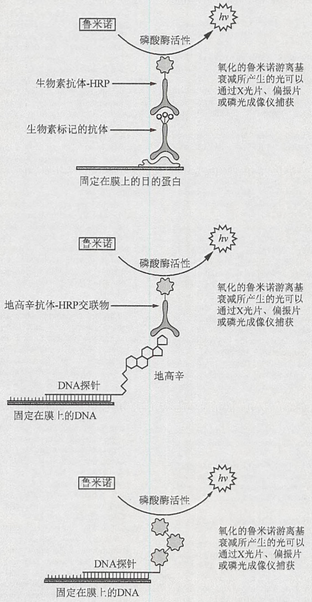

<details>
<summary>flowchart</summary>

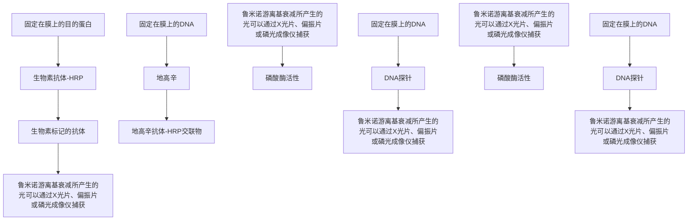
</details>

图 1 用辣根过氧化物酶（HRP）检测固定的核酸和蛋白的实验原理图。氧化的鲁米诺游离基衰变所发出的光由 X 光胶片或 CCD 相机捕获。h，普朗克常量；v，光频率。

---

附录 3 检测系统

1551

之处:它可能是致癌物（Garner1975; Weisburger et al. 1978），并且它检测 HRP 的活性不如 3,3',5,5'-四甲基联苯胺（3,3',5,5'-tetramethylbenzidine, TMB）（例如，请见 Roberts et al. 1991）等新近开发的复合物灵敏。TMB 的氧化产物通常是可溶的，但是可通过硫酸葡聚糖（dextran sulfate）的预印迹（pretreating blot）捕获（McKimn-Breschkin 1990），或通过使用商品化的特定形式 TMB 捕获。经过这些修改，TMB 适合 HRP-抗体交联物的检测，这些抗体针对蛋白质（包括异种抗体）或可以结合核酸探针的配体。

除 DAB 和 TMB 外，其他可以氧化成不溶于水的显色产物的 HRP 底物有 4-氯-1-萘酚（4-chloro-1-naphthol）（紫色沉淀物）和 3-氨基-4-乙基咔唑（3-amino-4-ethycarbazole）（红色沉淀物）。这些底物检测 HRP 活性的灵敏度没有一个比二氨基联苯胺更高。另外，还有许多其他的 HRP 显色底物，它们生成的氧化产物显色效果好，并且可溶。除 TMB 外，还包括二盐酸邻苯二胺（O-phenylenediamine dihydrochloride, OPD）（橙色）（Wolters et al. 1976）和 2,2'-连氮-双-(3-乙基苯并噻唑啉磺酸)[2,2'-azino-di(3-ethylbenzthiazoline-6-sulphonic acid), ABTS]（绿色）（Engvall 1980）。最好的荧光底物是 3-对羟基苯基丙酸 [3-(p-hydroxyphenyl) propionic acid, HPPA]（紫罗兰色）（Roberts et al. 1991）。

过氧化氢存在时，HRP也可用于激发化学发光连锁反应，这个反应能使鲁米诺氧化成邻苯二甲胺（3-aminophthalate）的激发态（Isaacson and Wettermark 1974; Roswell and White 1978; Durrant 1990; Stone and Durrant 1991）（图2）。此复合物返回至基态时，将发

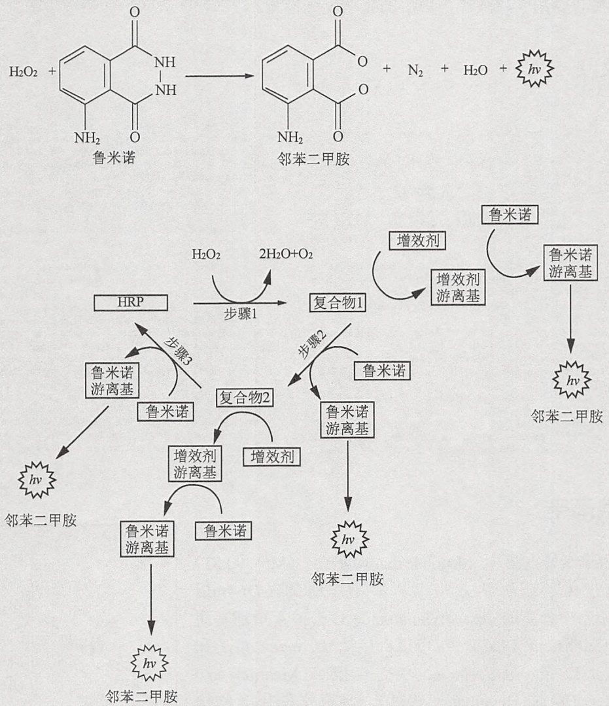

图 2 HRP 催化鲁米诺氧化发光的连锁反应示意图。

---

1552

分子克隆实验指南（原书第四版）

射 428nm 的蓝光。然而，由于这个反应的低效率，可采用不同的基于苯酚的侧链取代化合物来增加发射光的强度和持续时间（Whitehead et al. 1983；Hodgson and Jones 1989）。例如，加入对碘苯酚（p-iodophenol）后，生成光的强度会增加 1000 倍以上，并持续几个小时。另外，这些增效剂通过抑制鲁米诺的化学氧化反应来减少背景。这些增效剂被认为是通过:①与 HRP 反应；②形成增效剂游离基并与鲁米诺作用形成鲁米诺游离基（图 2）来消除连锁反应的限速步骤达到这个效果的。总体效果是增加了反应的效率和速度，但没有改变发光反应的特性。从反应中发出的光可通过 X 光片、磷光成像仪（phosphorimager）或 CCD 相机来捕获。

HRP 可以直接交联到单链核苷酸探针上（Renz and Kurz 1984; Stone and Durrant 1991），或可以交联到如针对生物素或地高辛之类配体的特异性抗体上，生物素或地高辛配体可以通过标准的酶学技术连接到核酸探针上。不管哪种情况，对于 Southern 和 Northern 杂交，HRP/鲁米诺反应对核酸的非放射性检测都非常灵敏（Thorpe and Kricka 1986）。理想条件下，检测核酸探针的下限约为 $5 \times 10^{-17} \mathrm{~mol}$ （Urdea et al. 1988）。但是，HRP/鲁米诺反应远没有碱性磷酸酶催化的 1,2-二氧杂环丁烷（1,2-dioxetanes）分解反应的化学发光反应灵敏（参见信息栏中有关 AMPPD 的内容）。另外，要达到最大的敏感度，HRP/鲁米诺反应需要对不同成分进行最大限度的优化。由于以上原因，目前 HRP 比碱性磷酸酶较少用于核酸和蛋白质的化学发光检测。

## 参考文献

- Durrant I. 1990. Light-based detection of biomolecules. Nature 346: 297–298.
- Engvall E. 1980. Enzyme immunoassay ELISA and EMIT. Methods Enzymol 70: 419–439.
- Garner RC. 1975. Testing of some benzidine analogues for microsomal activation to bacterial mutagens. Cancer Lett 1: 39–42.
- Graham RC Jr, Karnovsky MJ. 1966. The early stages of absorption of injected horseradish peroxidase in the proximal tubules of mouse kidney: Ultrastructural cytochemistry by a new technique. J Histochem Cytochem 14: 291–302.
- Hodgson M, Jones P. 1989. Enhanced chemiluminescence in the peroxidase-luminol- $H_{2}O_{2}$ system: Anomalous reactivity of enhancer phenols with enzyme intermediates. J Biolumin Chemilumin 3: 21–25.
- Isaacson U, Wettermark G. 1974. Chemiluminescence in analytical chemistry. Anal Chim Acta 68: 339–362.
- McKimm-Breschkin JL. 1990. The use of tetramethylbenzidine for solid phase immunoassays. J Immunol Methods 67: 1–11.
- Nakane PK, Pierce GB Jr. 1967. Enzyme-labeled antibodies for the light and electron microscopic localization of tissue antigens. J Cell Biol 33: 307–318.
- Renz M, Kurz C. 1984. A colorimetric method for DNA hybridization. Nucleic Acids Res 12: 3435–3444.
- Robbins D, Fahimi HD, Cotran RS. 1971. Fine structural cytochemical localization of peroxidase activity in rat peritoneal cells: Mononuclear cells, eosinophils and mast cells. J Histochem Cytochem 19: 571–575.
- Roberts IM, Jones SL, Premier RR, Cox JC. 1991. A comparison of the sensitivity and specificity of enzyme immunoassays and time-resolved fluoroimmunoassay. J Immunol Methods 143: 49–56.
- Roswell DF, White EH. 1978. The chemiluminescence of luminol and related hydrazides. Methods Enzymol 57: 409–423.
- Shannon LM, Kay E, Lew JY. 1966. Peroxidase isozymes from horseradish roots. I. Isolation and physical properties. J Biol Chem 241: 2166–2172.
- Stone T, Durrant I. 1991. Enhanced chemiluminescence for the detection of membrane-bound nucleic acid sequences: Advantages of the Amer-sham system. Genet Anal Tech Appl 8: 230–237.
- Thorpe GH, Kricka LJ. 1986. Enhanced chemiluminescent reactions catalyzed by horseradish peroxidase. Methods Enzymol 133: 331–353.
- Urdea MS, Warner BD, Running JA, Stempien M, Clyne J, Horn T. 1988. A comparison of non-radioisotopic hybridization assay methods using fluorescent, chemiluminescent and enzyme labeled synthetic oligodeoxyribonucleotide probes. Nucleic Acids Res 16: 4937–4956.
- Weisburger EK, Russfield AB, Homburger F, Weisburger JH, Boger E, Van Dongen CG, Chu KC. 1978. Testing of twenty-one environmental aromatic amines or derivatives for long-term toxicity or carcinogenicity. J Environ Pathol Toxicol 2: 325–356.
- Whitehead TP, Thorpe GHG, Carter TJN, Groucutt C, Kricka LJ. 1983. Enhanced luminescence procedure for sensitive determination of peroxidase-labelled conjugates in immunoassay. Nature 305: 158–159.
- Wolters G, Kuijpers L, Kacaki J, Schuurs A. 1976. Solid-phase enzyme-immunoassay for detection of hepatitis B surface antigen. J Clin Pathol 29: 873–879.


## 地高辛

地高辛卡烯内脂（cardenolide digoxygenin）（Mr=390.53）可以通过化学或酶学方法将从紫花洋地黄（Digitalis purpurea）中分离的 desacetylanatoside C 去掉 4 个糖基而得到（Reichstein 1962），也可以直接从 D. orientalisi 和 D. lanata L. Scrophulariaceae 中提取出来（Maanich and Schneider 1941；Hegenauer 1971）。地高辛的化学结构（Cardwell Smith 1953，1954；Patali et al. 1963）见右边

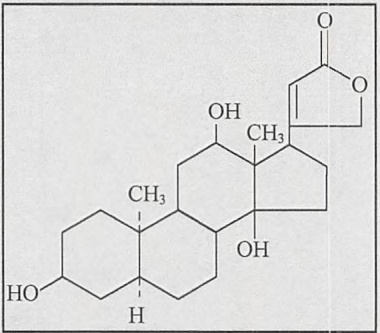

<details>
<summary>chemical</summary>

Molecular structure of a steroid derivative with hydroxyl and carbonyl functional groups
</details>

---

附录 3 检测系统

1553

的方框。

在分子克隆中，地高辛可以作为结合 DNA 和 RNA 探针的配基，并在杂交后用抗地高辛的酶标抗体进行检测（Kessler et al. 1989；Kessler1991）（图 1）。地高辛标记的探针因而可以用于 Southern、Northern 和点杂交。它在原位杂交中也有相当的优势，部分原因是因为动物细胞中没有地高辛半抗原（例如，见 Tautz and Pfeifle 1989；Hemmati-Brvanlou et al. 1990），从而消除了内源分子产生的背景。而生物素标记的探针就不总是这样。在大体积的 0.1%SDS、2mmol/L EDTA（pH 8.0）溶液中将尼龙滤膜加热到 37℃保持 20～30min，就能将地高辛标记的核酸探针从尼龙滤膜上剥离下来（Church and Kieffer-Higgin 1988）。清洗之后，滤膜还可以重新结合探针，效能和敏感性也不会有明显下降。

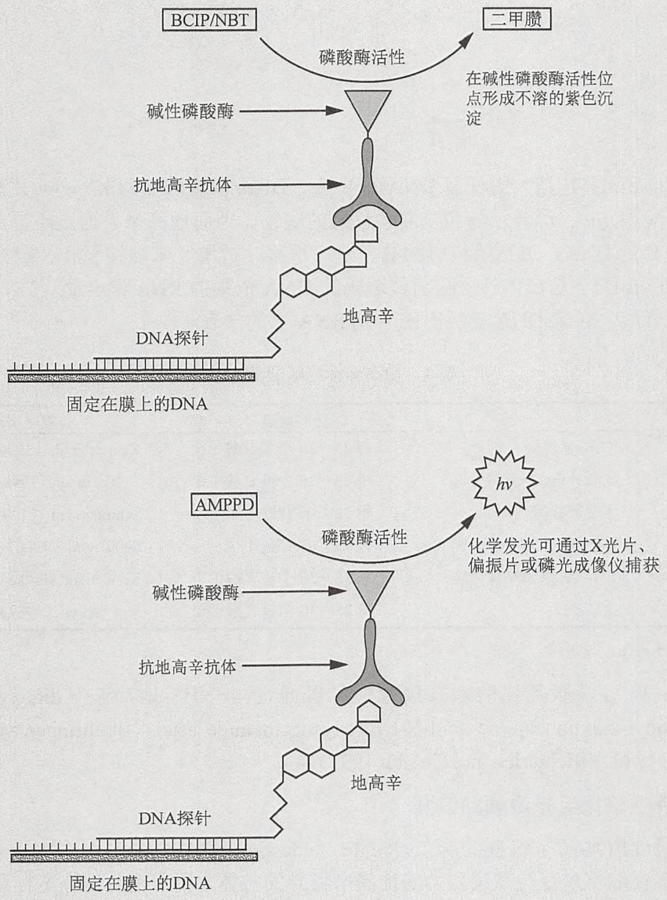

图 1 用 BCIP/NPT 或 AMPPD 检测地高辛标记的核酸探针。

需要注意的是，在经过探针杂交、剥离、再杂交的几个循环之后，化学发光的背景可能会因为滤膜上碱性磷酸酶残留的累积而显著增加。这个问题可以通过在每个循环的第二步和第三步杂交时用蛋白酶 K 和甲酰胺处理滤膜而避免（Dubitsky et al. 1992）。

---

1554

分子克隆实验指南（原书第四版）

## 地高辛标记核酸

对于核酸的标记，生产商 Boehringer Mannheim 提供了两种形态的地高辛:地高辛-11-dUTP（DIG-11-dUTP）和地高辛-11-UTP（DIG-11-UTP）。每种形态的地高辛都分别由一个耐碱的连接和一个间隔臂分别与脱氧尿苷三磷酸或尿苷三磷酸相连。

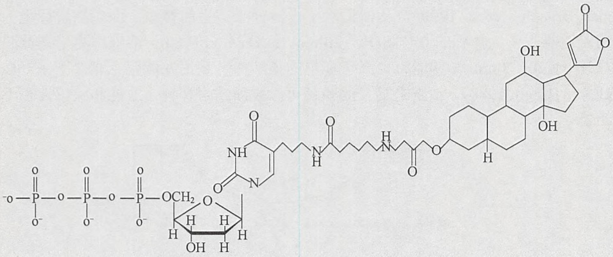

<details>
<summary>chemical</summary>

Complex peptide or glycoside molecular structure with phosphate groups and a sugar moiety
</details>

\- DIG-ll-dUTP 是大肠杆菌 DNA 聚合酶、DNA 聚合酶 I 的 Klenow 片段、耐热聚合酶如 Taq、反转录酶和末端转移酶的底物。因而地高辛可通过不同的标准反应结合到 DNA，包括随机引物法、缺口平移、扩增、末端补平和 3'端加尾。

\- DIG-11-UTP 是在体外用噬菌体编码的 DNA 依赖的 RNA 聚合酶（T3、T7 和 SP6 聚合酶）转录 DNA 模板时结合到 RNA 上的（表 1）。

表 1 地高辛标记核酸的方法

| 标记方法 | 酶 | 结合的地高辛分子数 | 参考文献 |
| --- | --- | --- | --- |
| 随机引导 | Klenow 片段 | 每 25~36 个核苷酸 1 个 | Kessler et al. (1990) |
| 缺口平移 | 大肠杆菌 DNA 聚合酶 I | 每 25~36 个核苷酸 1 个 | Holtke et al. (1990) |
| 加尾 | 末端转移酶 | 每 12 个核苷酸 1 个 | Schmitz et al. (1991) |
| PCR 扩增 | Taq 和其他耐热聚合酶 | 每 25 个核苷酸 1 个 | Seibl et al. (1990) |
| 转录 | T3、T7 和 SP6 聚合酶 | 每 25~36 个核苷酸 1 个 | Kessler and Holtke (1990) |
| CDNA 合成 | 反转录酶 | 每 25~36 个核苷酸 1 个 | McCracken (1989) |

综述请见 Kessler（1991）。

合成中被 5'端氨基化的寡聚核苷酸可以通过与 NHS-地高辛（digoxygenin-3-O-methylcarbonyl-ε-aminocaproic acid-N-hydroxysuccinamide ester; Boehringer Mannheim）反应来进行标记（Richterich and Church 1993）。

## 地高辛特异性抗体与报道酶的偶联

可以通过用地高辛包裹的麻仁球蛋白（edestin）和牛血清白蛋白（bovine serum albumin）免疫绵羊来获得高亲和力的地高辛特异的抗体。用于检测地高辛标记探针的最为通用的免疫试剂是偶联着碱性磷酸酶（Boehringer Mannheim）的抗地高辛免疫球蛋白的 Fab 片段。针对免疫定位（immunolocalized）的碱性磷酸酶最好的显色底物是二元试剂 BCIP（5-溴-4-氯-3-吲哚磷酸盐，5-bromo-4-chloro-3-indolyl phosphate）和 NBT（盐酸氮蓝四唑，4-nitroblue tetrazolium chloride）。有关这些试剂更多的信息请参见信息栏中有关 BCIP 的内容。

最理想的条件下，在杂交阶段用高浓度（50～100ng/mL）的地高辛标记探针并且延

---

附录 3 检测系统

1555

长显色反应孵育时间（16～24h），有可能在斑点印迹实验中检测到小于1pg的目标DNA（例如，见Kerkhof 1992）。然而，利用可溶的化学发光底物AMPPD(adamantyl 1,2-dioxetane phosphate; Tropix; Inc.; Roche）能够得到更高的灵敏度和线性度更好的反应（Kerkhof 1992; Bronstein et al. 1993）。近几年，AMPPD发光系统得到极快的普及，在该系统中，用碱性磷酸酶去除磷酸残基会刺激底物发出477nm的化学发光，这可由光度计测量。发光在溶液中可持续数小时，在尼龙表面则持续时间更长（Tizard et al. 1990）。可以用X光胶片、偏振的快速黑白胶片（polaroid instant black and white film）（Kricka and Thrpe 1986）、磷光成像仪和CCD照相机来捕获印迹的图像（Karger et al. 1993）。在最好的情况下，地高辛标记探针化学发光检测的灵敏度会达到极高的水平（0.03pg的目标DNA或RNA），并且速度很快（曝光时间小于30min）。因而这种方法比 $^{32}$ P标记的核酸探针放射自显影检测的灵敏度高10倍，速度快50倍。另外，由于不怎么需要对滤膜进行剥离再生，所以重新检测也就简化了。鉴于以上优势，碱性磷酸酶标记的化学发光检测被用于检测固定核酸序列的许多技术中，包括印迹和DNA测序。有关AMPPD更多的信息请参见信息栏中有关AMPPD的内容。

## 参考文献

- Allefs JJ, Salentijn EM, Krens FA, Rouwendal GJ. 1990. Optimization of non-radioactive Southern blot hybridization: Single copy detection and reuse of blots. Nucleic Acids Res 18: 3099–3100.
- Bronstein I, Voyta JC, Murphy OJ, Tizard R, Ehrenfels CW, Cate RL. 1993. Detection of DNA in Southern blots with chemiluminescence. Methods Enzymol 217: 398–414.
- Cardwell HME, Smith S. 1953. The structure of digoxygenin. Experientia 9:267–368.
- Cardwell HME, Smith S. 1954. Digitalis gluosides. VII. The structure of the digitalis anhydrogenins and the orientation of the hydroxy-groups in digoxygenin and gitoxigenin. J Chem Soc 1954: 2012–2023.
- Church GM, Kieffer-Higgins S. 1988. Multiplex DNA sequencing. Science 240: 185–188.
- Dubitsky A, Brown J, Brandwein H. 1992. Chemiluminescent detection of DNA on nylon membranes. BioTechniques 13: 392–400.
- Hegenauer R. 1971. Pflanstoffe und Pflanzensystematik. Naturwissenschaften 58: 585–598.
- Hemmati-Brivanlou A, Frank D, Bolce ME, Brown BD, Sive HL, Harland RM. 1990. Localization of specific mRNAs in Xenopus embryos by whole-mount in situ hybridization. Development 110: 325–330.
- Karger AE, Weiss R, Gesteland RF. 1993. Line scanning system for direct digital chemiluminescence imaging of DNA sequencing blots. Anal Chem 65: 1785–1793.
- Höltke H-J, Kessler C. 1990. Non-radioactive labeling of RNA transcripts in vitro with the hapten digoxigenin (DIG): Hybridization and ELISA-based detection. Nucleic Acids Res 18: 5843–5851.
- Höltke H-J, Seibl R, Burg J, Mühlegger K, Kessler C. 1990. Non-radioactive labeling and detection of nucleic acids. II. Optimization of the digoxigenin system. Biol Chem Hoppe-Seyler 371: 929–938.
- Kerkhof L. 1992. A comparison of substrates for quantifying the signal from a nonradiolabeled DNA probe. Anal Biochem 205: 359–364.
- Kessler C. 1991. The digoxigenin:anti-digoxigenin (DIG) technology—A survey on the concept and realization of a novel bioanalytical indicator system. Mol Cell Probes 5: 161–205.
- Kessler C, Höltke H-J, Seibl R, Burg J, Mühlegger K. 1989. A novel DNA
- labeling and detection system based on digoxigenin: Anti-digoxigenin ELISA principle. J Clin Chem Clin Biochem 27: 130–131.
- Kessler C, Höltke H-J, Seibl R, Burg J, Mühlegger K. 1990. Non-radioactive labeling and detection of nucleic acids. I. A novel DNA labeling and detection system based on digoxigenin:anti-digoxigenin ELISA principle (digoxigenin system). Biol Chem Hoppe-Seyler 371: 917–927.
- Kricka LJ, Thorpe GH. 1986. Photographic detection of chemiluminescent and bioluminescent reactions. Methods Enzymol 133: 404–420.
- Maanich C, Schneider W. 1941. Uber die Glykoside con Digitalis orientalis L. Arch Pharm 279: 223–248.
- McCracken S. 1989. Preparation of RNA transcripts using SP6 RNA polymerase. In DNA probes (ed Keller GH, Manak MM), pp. 119–120. Stockton Press, New York.
- Pataki S, Meyer K, Reichstein T. 1953. Die Konfiguration des Digoxygenins. Experientia 9: 253–254.
- Reichstein T. 1962. Besonderheiten der Zucker von herzaktiven Glkosiden.
  Angew Chem 74: 887–918.
- Richterich P, Church GM. 1993. DNA sequencing with direct transfer electrophoresis and nonradioactive detection. Methods Enzymol 218: 187–222.
- Schmitz GG, Walter T, Seibl R, Kessler C. 1991. Nonradioactive labeling of oligonucleotides in vitro with the hapten digoxigenin by tailing with terminal transferase. Anal Biochem 192: 222–231.
- Seibl R, Höltke H-J, Ruger R, Meindl A, Zachau HG, Rasshofer R, Roggendorf M, Wolf H, Arnold N, Wienberg J, et al. 1990. Non-radioactive labeling and detection of nucleic acids. III. Applications of the digoxigenin system. Biol Chem Hoppe-Seyler 371: 939–951.
- Tautz D, Pfeifle C. 1989. A non-radioactive in situ hybridization method for the localization of specific RNAs in Drosophila embryos reveals translational control of the segmentation gene hunchback. Chromosoma 98: 81–85.
- Tizard R, Cate RL, Ramachandran KL, Wysk M, Voyta JC, Murphy OJ, Bronstein I. 1990. Imaging of DNA sequences with chemiluminescence. Proc Natl Acad Sci 87: 4514–4518.


## BCIP

BCIP[5-溴-4-氯-3-吲哚磷酸盐，5-bromo-4-chloro-3-indolyl phosphate，相对分子质量:

370.4（钠盐）；433.6（甲苯铵盐）]与氮蓝四唑盐（nitroblue-tetrazolium salt, NBT）共同用来检测原位的碱性磷酸酶。该二元试剂在碱性磷酸酶的活性位置形成不溶于水的沉淀，它是适用于碱性磷酸酶交联物发色检测的最灵敏的指示系统。此反应中（图1），碱性磷酸酶催化BCIP磷去除酸根基团，生成5-溴

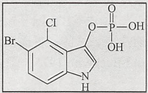

<details>
<summary>chemical</summary>

Chemical structure of a brominated pyridine derivative with chloro, hydroxyl, and phosphoroborate groups
</details>

---

1556

分子克隆实验指南（原书第四版）

-4-氯-3-吲哚的羟化物；该羟化物二聚化形成不溶的蓝色化合物，即5,5'-溴-4,4'-二氯吲哚。在二聚化反应中生成的两个还原当量（reducing equivalent）会将一分子的氮蓝四唑还原为不可溶的浓紫色染料二甲腈（McGadey 1970；Franci and Vidal 1988）。显色过程超过几个小时，但是产生最强信号需要的时间变化很大，依赖于结合到目标分子上的抗体数量。

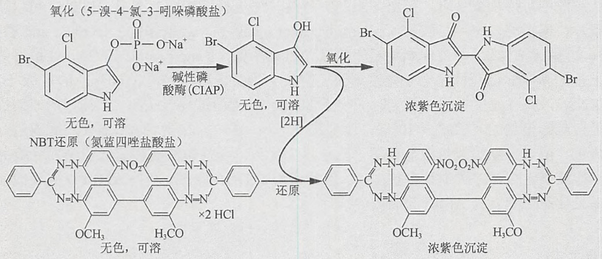

<details>
<summary>chemical</summary>

Chemical reaction pathway showing oxidation of nitrobenzaldehyde to chlorinated and hydroxylated compounds via chlorination and reduction steps
</details>

图 1 在 BCIP/NPT 指示剂反应中 BCIP 的氧化和 NBT 的还原（经 Elsevier 允许，翻印自 Kessler 1991）。

BCIP/NBT 是一个敏感的碱性磷酸酶活性检测剂，但不能定量。碱性磷酸酶活性的定量分析需要用到生色底物——硝基磷酸苯（p-nitrophenyl phosphate）（McComb and Bowers 1972；Brickman and Beckwith 1975；Michaelis et al. 1983）。这个底物在 Sigma 公司的商用名称是“Sigma 104 号磷酸酶底物”（Sigma No.104 phosphatase substrate）。Sigma 104 水解生成硝基苯酚，在水溶液中其在 420nm 处有很强的吸收峰。有文献报道，萤光素-磷酸酯（D-luciferin-O-phosphate）作为底物时生物发光分析会更敏感（Miska and Geiger 1987）。用萤光素酶滴定可以测量该底物水解后释放的萤光素量，然后用照度计测量光脉冲。

在分子克隆中，BCIP/NBT 广泛用作非放射性系统的指示剂，用来检测核酸或蛋白质。几乎自始至终，这些系统由按顺序使用的多种成分组成。最佳工作状况下，BCIP/NBT 指示剂系统的灵敏度足以在 Southern 杂交中检测哺乳动物全部 DNA 中的单拷贝基因。典型的设计如图 2 所示。

用 N,N-二甲基甲酰胺（N,N-dimethylformamide）从带电的尼龙膜剥离二甲腈沉淀后，Southern、Northern 和斑点印迹可以重新杂交。注意，N,N-二甲基甲酰胺蒸汽对皮肤和黏膜有刺激作用，因此应该在通风良好的化学通风橱中使用。在室温用 N,N-二甲基甲酰胺或在含有高浓度的 SDS 缓冲液中 70～75℃ 加热，可以从膜上除去地高辛标记的寡聚核苷酸探针（Richerich and Church 1993）。之后膜可以再次探针杂交。

碱性磷酸酶生色检测的灵敏度远没有使用可溶的1,2-二氧杂环丁烷底物AMPPD的发光方法的灵敏度高（Schaap et al. 1987）。在这个系统中，斑点印迹的灵敏度可以从16h检测到0.2pg上升到1h检测到1fg。在Southern杂交中，使用AMPPD作为指示剂，灵敏度为1h检测到约70fg（例如，见Allefs et al. 1975）。

BCIP/NBT 除了用作碱性磷酸酶交联物的指示剂外，它还可用于检测脊椎动物组织切片中表达的碱性磷酸酶(Fields-Berry et al. 1992)和鉴定表达BAP的细菌群落(Brickman and Beckwith 1975；综述请见Manoil et al. 1990)。

---

附录 3 检测系统

1557

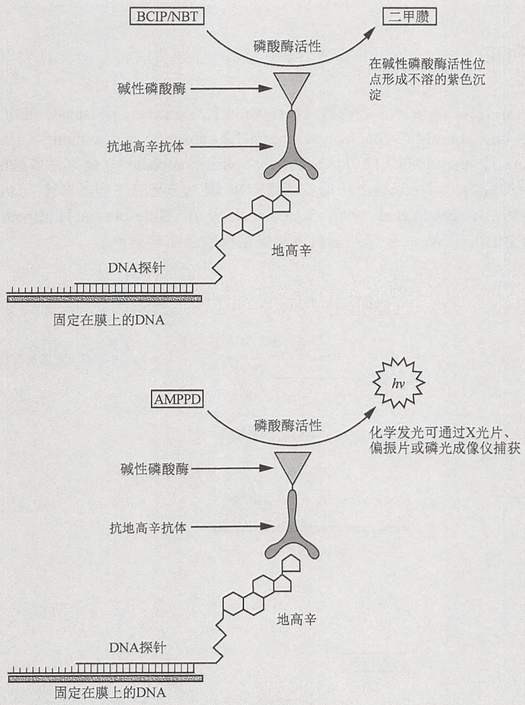

图 2 用 BCIP/NPT 检测地高辛和生物素标记的核酸探针。

BCIP 一般以钠盐或甲苯铵盐形式出售。甲苯铵盐形式的 BCIP 适合在商品化的蛋白质和核酸的非放射性探测系统中使用。

## 参考文献

- Allefs JJ, Salentijn EM, Krens FA, Rouwendal GJ. 1990. Optimization of non-radioactive Southern blot hybridization: Single copy detection and reuse of blots. Nucleic Acids Res 18: 3099–3100.
- Brickman E, Beckwith J. 1975. Analysis of the regulation of Escherichia coli alkaline phosphatase synthesis using deletions and phi80 transducing phages. J Mol Biol 96: 307–316.
- Fields-Berry SC, Halliday AL, Cepko CL. 1992. A recombinant retrovirus encoding alkaline phosphatase confirms clonal boundary assignment in lineage analysis of murine retina. Proc Natl Acad Sci 89: 693–697.
- Franci C, Vidal J. 1988. Coupling redox and enzymic reactions improves the sensitivity of the ELISA-spot assay. J Immunol Methods 107: 239–244.
- Michaelis S, Guarente L, Beckwith J. 1983. In vitro construction and characterization of phoA-lacZ gene fusions in Escherichia coli J Bacteriol 154: 356–365.
- Miska W, Geiger R. 1987. Synthesis and characterization of luciferin derivatives for use in bioluminescence enhanced enzyme immunoassays. New ultrasensitive detection systems for enzyme immunoassays, I. J Clin Chem Clin Biochem 25: 23–30.
- Kessler C. 1991. The digoxigenin:anti-digoxigenin (DIG) technology—A survey on the concept and realization of a novel bioanalytical indicator system. Mol Cell Probes 5: 161–205.
- Manoil C, Mekalanos JJ, Beckwith J. 1990. Alkaline phosphatase fusions: Sensors of subcellular location. J Bacteriol 172: 515–518.
- McComb RB, Bowers GN Jr. 1972. Study of optimum buffer conditions for measuring alkaline phosphatase activity in human serum. Clin Chem 18: 97–104.
- McGadey J. 1970. A tetrazolium method for non-specific alkaline phosphatase. Histochemie 23: 180–184.
- Richterich P, Church GM. 1993. DNA sequencing with direct transfer electrophoresis and nonradioactive detection. Methods Enzymol 218: 187–222.
- Schaap AP, Sandison MD, Handley RS. 1987. Chemical and enzymatic triggering of 1,2-dioxetanes. 3. Alkaline phosphatase-catalyzed chemiluminescence from an aryl phosphate substituted dioxetane. Tetrahedron Lett 28: 1159–1162.

---

1558

分子克隆实验指南（原书第四版）


## AMPPD

金刚烷基-1,2-二氧杂环丁烷磷酸（adamantyl 1,2-dioxetane phosphate 也称为[2'spiroadamantane]-4-methoxy-3-[3''-(phosphoryl)phenyl]1,2,-dioxetane 或 disodium 3-(4-methoxyspiro{1,2-dioxetane-3,2'-tricyclo-[3.3.13,7]decan}-4-yl)-phenyphosphate））是碱性磷酸酶引发化学发光反应中的底物，可用来检测在尼龙或 PVDF 膜上固定的生物多聚体（Bronstein and McGrath 1989；Bronstein et al. 1990；Tizard et al. 1990；Gillespie and Hudspeth 1991）。图1显示了典型的用于 Western 印迹蛋白质和固定核酸杂交检测流程。

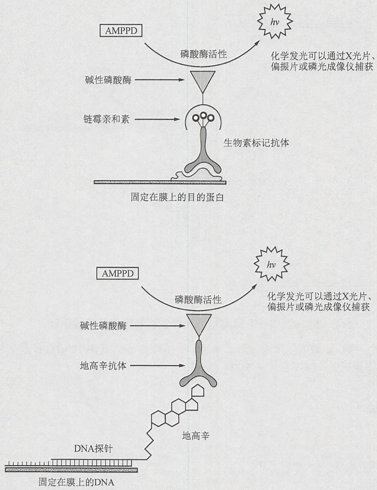

图 1 用 AMPPD 检测固定的核酸和蛋白质。（上）Western 印迹检测目标蛋白质；（下）Southern 和 Northern 印迹检测核酸序列。

采用 AMPPD 化学发光检测 DNA、RNA 和蛋白质的灵敏度高于比色法、生物发光法或荧光测定法，并且至少相当于过去 20 年处于分子克隆领先地位的放射自显影技术（Beck and Koster 1990；Bronstein et al. 1990；Carlson et al. 1990；Pollard-Knight et al.

---

附录 3 检测系统

1559

1990)。在溶液中，有可能测量出少于 1000 个碱性磷酸酶分子（1zmol 或 $10^{-21}\mathrm{mol}$）活性的光输出(Schaap et al. 1989)。标准的 Southern 和 Northern 杂化或许可以检测出少于 0.1pg 的 RNA 或 DNA（Beck et al. 1989），而 Western 印迹也许可以检测出全细胞蛋白中少于 1pg 的目标蛋白（Gillespie and Hudspeth 1991）。

图 2 显示的是 AMPPD 去磷酸化所引发的光生成。碱性磷酸酶催化 AMPPD 单个磷酸基团的去除，产生一个中度稳定的二氧杂环丁烷阴离子（dioxetane anion），该阴离子能分解成金刚烷酮（adamantanone）和激发态的 methyl-metaoxybenzoate 阴离子。当返回基态时，该阴离子发射出可见的黄绿光（Bronstein et al. 1989）。碱性磷酸酶催化二氧杂环丁烷去磷酸化的效率很高，周转率（turnover rate）约为每秒  $4.0 \times 10^{3}$  分子（Schaap，引自 Beck and Koster 1990）。然而，激发态的 1, 2-二氧杂环丁烷阴离子的半衰期比较长，变化范围从 2min 到数小时，与局部环境有关（Bronstein 1990）。因而，在过量 AMPPD 情况下进行的去磷酸化反应，最初二氧杂环丁烷阴离子产生的速度比衰减的速度快。这就解释了为什么化学发光是以“辉光”的形式辐射，且它的强度在数分钟不断增强，然后持续几个小时（图 3）。在尼龙膜上，动力学过程甚至更慢，因为膜上的疏水口袋会稳定二氧杂环丁烷阴离子的激发态（Tizard et al. 1990）。尼龙和阴离子之间的疏水作用也会导致发射光大约 10nm 的“蓝移”[例如，从 477nm 到 466nm（Beck and Koster 1990；Bronstein et al. 1990）]。

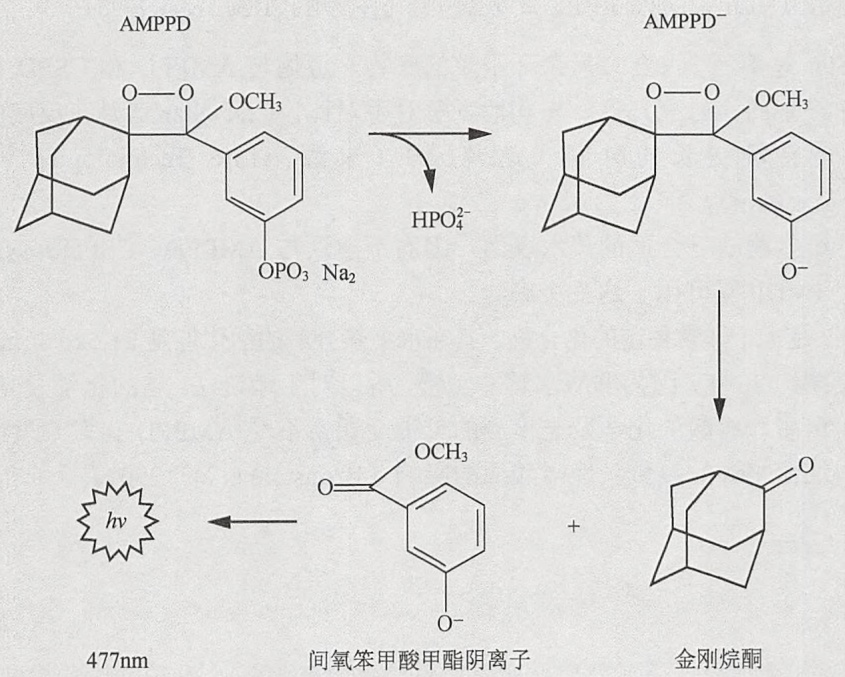

<details>
<summary>chemical</summary>

Chemical reaction scheme showing the synthesis of 金刚烷酮 from AMPPD and its intermediate with HPO4^2- under UV light irradiation
</details>

图2 AMPPD去磷酸化产生的化学发光。

在大多数实验情况下，在尼龙膜上延长的化学发光动力学过程是一个优势，因为这可以为捕获图像提供多次曝光的时间。然而，当碱性磷酸酶引发的化学发光用于检测浓度特别低的DNA、RNA和蛋白质（如滤膜上的DNA目标带预计包含少于 $10^{-18}$ 个分子时）时，慢动力学过程可能会十分重要。在这种情况下，CSPD（AMPPD的卤素取代的衍生物）可能是一个更好的选择。在金刚烷基（adamantyl group）的第5位加入一个氯原子消除了1,2二氧杂环丁烷自我聚集的趋势，并限制了其与尼龙膜的作用。CSPD显著

---

1560

分子克隆实验指南（原书第四版）

地减少了到达最大光发射所需的时间，从而能够快速地检测到很少量的目标分子（Martin et al. 1991）。

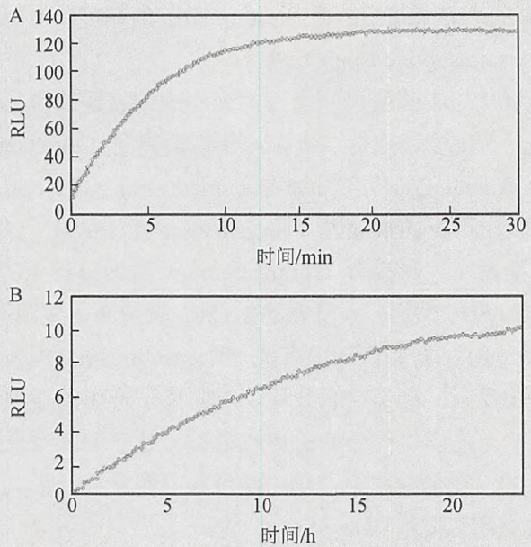

图 3 AMPPD 化学发光的动力学。碱性磷酸酶催化 AMPPD 分解的化学发光动力学:（A）于 0.05mol/L 碳酸盐/碳酸氢盐/1mmol/L MgCl₂（pH 9.5）溶液中；（B）在 Biodye A 膜上。发光速率用相对光单位（relative light units, RLU）表示（经允许复制于 Tizard et al. 1990）

CDP-Star 是第三个 1,2 二氧杂环丁烷的底物，遵循与 AMPPD 和 CSPD 相似的降解途径，但它产生的信号亮几倍。与其他竞争对手对比，CDP-Star 信号在反应中更早达到峰值，并能持续更长的时间（达几天）（来源:Life Technologies 网站 www.lifetechnologies.com）。

硝基纤维素膜缺乏合适的疏水表面，因而不建议与 AMPPD、CSPD 或 CDP-Star 一起使用；但 PVDF 膜可用于这三个底物。

AMPPD 是一个非常稳定的化合物，其在水中热分解的活化能是 21.5kcal/mol，在  $25^{\circ}$ C 时它的半衰期约 20 年。因为非酶水解非常慢，所以对于印迹法，它的化学发光背景很弱。实际上，蛋白质和核酸的化学发光检测的灵敏度通常不受 AMPPD 自发衰变的限制，而受缓冲液中细菌来源的痕量碱性磷酸酶的影响（Bronstein et al. 1990）。

## 参考文献

- Beck S, Köster H. 1990. Applications of dioxetane chemiluminescent probes to molecular biology. Anal Chem 62: 2258–2270. (Erratum Anal Chem [1991] 63: 848.)
- Beck S, O'Keeffe T, Coull JM, Köster H. 1989. Chemiluminescent detection of DNA: Application for DNA sequencing and hybridization. Nucleic Acids Res 17: 5115–5123.
- Bronstein I. 1990. Chemiluminescent 1,2-dioxetane-based enzyme substrates and their applications. In Luminescence immunoassays and molecular applications (ed Van Dyke K, Van Dyke R), pp. 255–274. CRC Press, Boca Raton, FL.
- Bronstein I, McGrath P. 1989. Chemiluminescence lights up. Nature 338:599–600.
- Bronstein I, Edwards B, Voyta JC. 1989. 1,2-dioxetanes: Novel chemiluminescent enzyme substrates. Applications to immunoassays. J Biolumin Chemilumin 4: 99–111.
- Bronstein I, Voyta JC, Lazzari KG, Murphy O, Edwards B, Kricka LJ. 1990. Rapid and sensitive detection of DNA in Southern blots with chemiluminescence. BioTechniques 8: 310–314.
- Carlson DP, Superko C, Mackey J, Gaskill ME, Hansen P. 1990. Chemiluminescent detection of nucleic acid hybridization. Focus (Life Technologies) 12: 9–12.
- Gillespie PG, Hudspeth AJ. 1991. Chemiluminescence detection of proteins from single cells. Proc Natl Acad Sci 88: 2563–2567.
- Martin C, Bresnick L, Juo RR, Voyta JC, Bronstein I. 1991. Improved chemiluminescent DNA sequencing. BioTechniques 11: 110–113.
- Pollard-Knight D, Simmonds AC, Schaap AP, Akhavan H, Brady MA. 1990. Nonradioactive DNA detection on Southern blots by enzymatically triggered chemiluminescence. Anal Biochem 185: 353–358.
- Schaap AP, Akhavan H, Romano LJ. 1989. Chemiluminescent substrates for alkaline phosphatase: Application to ultrasensitive enzyme-linked immunoassays and DNA probes. Clin Chem 35: 1863–1864.
- Tizard R, Cate RL, Ramachandran KL, Wysk M, Voyta JC, Murphy OJ, Bronstein I. 1990. Imaging of DNA sequences with chemiluminescence. Proc Natl Acad Sci 87: 4514–4518.

---

附录 3 检测系统

1561


## 免疫球蛋白结合蛋白: 蛋白 A、G 和 L

## 蛋白 A

蛋白A是金黄色葡萄球菌细胞壁的一种成分，能结合很多哺乳动物免疫球蛋白(IgG)的Fc区，因而帮助细菌躲避宿主的免疫应答（Forsgren and Sjöquist 1966；综述请见Langone 1982；Boyle and Reis 1987；Boyle 1990；Bouvet 1994）（表1）。蛋白A与IgG分子Fc部分的相互作用并不影响该抗体结合其抗原的能力（图1）。蛋白A已被广泛用于免疫化学反应的定量和定性分析（Goding 1978；Harlow and Lane 1988,1999）。

表 1 蛋白 A 和蛋白 G 与哺乳动物免疫球蛋白 Fc 的结合

| 免疫球蛋白 | 蛋白A(金黄色葡萄球菌) | 蛋白G(C组和G组的链球菌菌株) |
| --- | --- | --- |
| 人IgG1 | ++ | ++ |
| 人IgG2 | ++ | ++ |
| 人IgG3 | - | ++ |
| 人IgG4 | ++ | ++ |
| 小鼠IgG1 | + | + |
| 小鼠IgG2a | ++ | ++ |
| 小鼠IgG2b | ++ | ++ |
| 小鼠IgG3 | ++ | ++ |
| 大鼠IgG1 | + | + |
| 大鼠IgG2A | - | ++ |
| 大鼠IgG2b | - | + |
| 大鼠IgG2c | ++ | ++ |
| 兔IgG | ++ | ++ |
| 牛IgG1 | - | ++ |
| 牛IgG2 | ++ | ++ |
| 绵羊IgG | - | ++ |
| 绵羊IgG2 | ++ | ++ |
| 山羊IgG1 | + | ++ |
| 山羊IgG2 | ++ | ++ |
| 马IgG(ab) | + | ++ |
| 马IgG(c) | + | (+) |
| 小鸡 | - | (+) |
| 大颊鼠 | (+) | + |
| 几内亚猪 | ++ | + |

人的 IgG 数据来自 Forsgren and Sjoquist（1966）、Kronvall（1973）和 Myhre and Kronall（1977，1980a）；小鼠的来自 Kronall et al.（1970a）、Chlon et al.（1979）和 Myhre and Kronvall（1980b）；大鼠的来自 Medgyesi et al.（1978）和 Nilsson et al.（1982）；兔的来自 Forsgren and Sjoquist（1967）、Kronvall（1973）和 Myhre and Kronal I（1977）；牛的来自 Lind et al.（1970）、Myhre and Kronall（1981）；绵羊、马和山羊的资料来自 Kronall et al.（1970b）和 Sjöquist et al.（1972）；其他动物的数据来自 Richman et al.（1982）、Bjorck and Kronvall（1984）、Akerstrom et al.（1985）和 Akerstrom and Bjorck（1986）。

- 当偶联到放射性、酶活性或荧光标签时，蛋白 A 是一种很好的试剂，用来检测和定量对其有高亲和力的抗体。化学偶联到胶体金颗粒上的蛋白 A 可用于电子显微镜中 IgG 的定位。
- 固定在固相介质上的蛋白 A 可用于纯化抗体和收集免疫复合物、抗原或完整的细胞（图 2）。

---

1562

分子克隆实验指南（原书第四版）

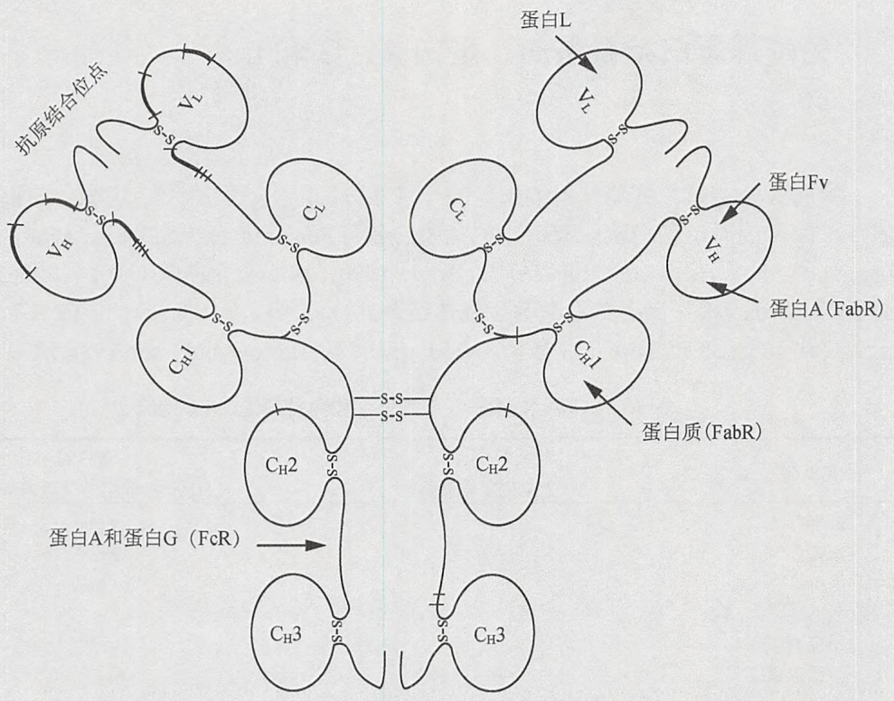

<details>
<summary>flowchart</summary>


</details>

图 1 Fab 结合分子识别的免疫球蛋白区（经 Elsevier 允许，翻印自 Bouvet 1994）。

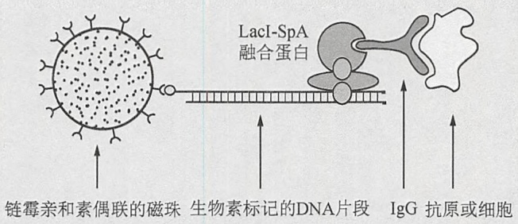

<details>
<summary>flowchart</summary>


</details>

图 2 用 LacI-SpA 融合蛋白提取抗原或整个细胞。图示为用包含乳糖操纵子(lac operator, lacO)的 DNA 片段偶联磁珠，乳糖操纵子阻碍蛋白(lac repressor)与蛋白 A 的融合蛋白 LacI-SpA 可用于可逆回收蛋白质抗原或全细胞。

\- 采用双抗体夹心 ELISA（ELISA-like sandwich）技术，用纯化的蛋白 A 或包含蛋白 A 的 IgG 结合结构域的工程融合蛋白可以纯化和检测 DNA 片段（Lindbladh et al. 1987；Peterhans et al. 1987；Werstuck and Capone；综述请见 Stahl et al. 1993）。

包含两个独立配体结合结构域的嵌合蛋白也曾被用作免疫学的黏附试剂来研究。例如:

- 地高辛标记的分子可以用包含蛋白 A 的 IgG 结合结构域和地高辛抗体的抗原结合位点的融合蛋白来标记。任何能与蛋白 A 结合的抗体都可以检测到此标记(Tai et al. 1990)。
- 链霉亲和素-蛋白 A 嵌合蛋白可以用于酶对抗体间接的标记（Sano and Cantor 1991）。
- 蛋白 A-麦芽糖结合蛋白嵌合蛋白可作为将抗体结合到固态基质的双功能试剂（Xue et al. 1995）。

---

附录 3 检测系统

1563

\- 蛋白 A 可以作为亲和标签以纯化在原核和真核细胞中表达的融合蛋白（如 Kobatake et al. 1995; Nilsson et al. 1985; 综述见 Nilsson and Abrahmsen 1990; Uhlen and Moks 1990; Uhlen et al. 1992; Stahl et al. 1993）。最简单的实验方案包括用 IgG 填料的亲和层析来纯化包含蛋白 A 的 Fc 区结合结构域的融合蛋白（Uhlèn et al. 1983; Nilsson et al. 1985）。

蛋白 A 的基因（Uhlèn et al. 1984）编码 509 个氨基酸的蛋白质前体，该前体包括:在分泌时去除的信号肽；5 个同源的、独立的 IgG 结合结构域，每个结构域有 58 个氨基酸；以及一个重复的、180 个氨基酸的 C 端锚定区（X 区）。对蛋白 A 单个 IgG 结合结构域与人 Fc 复合物的晶体学分析表明，IgG 结合结构域由两条 α 螺旋组成，两条螺旋与 Fc 结构域的第二和第三个恒定区之间形成广泛的疏水作用（Deisenhofer 1981）。

## 蛋白G

蛋白 G 最初从 C 群和 G 群的链球菌菌株中分离出来（Björck and Kronvall 1984）。与葡萄球菌蛋白 A 一样，蛋白 G 与哺乳动物抗体的 Fc 区也具有很高的亲和力。但是，这两个蛋白结构上差别很大，而且对抗体的亲和力也不同（表 2）（Akerstrom et al. 1985）。蛋白 A 富含α螺旋，与免疫球蛋白之间形成疏水作用，而蛋白 G 的β折叠结构含量很高（Olsson et al. 1987; Gronenborn et al. 1991）。蛋白 G 与 IgG 的第一个恒定区（Erntell et al. 1985）结合，并且两个分子之间的作用将折叠股沿着作用表面排列成折叠片（Derrick and Wigley 1992）。蛋白 G 和蛋白 A 识别的结构密切相关（Stone et al. 1989）。然而，很多种属和亚类的 IgG 与蛋白 A 的结合并不好，但却能与蛋白 G 高效结合。例如，蛋白 G 能够有效地与 IgG3 亚类的人免疫球蛋白结合，而蛋白 A 则不能（Sjöbring et al. 1991）。包含蛋白 G 和蛋白 A 配体结合结构域的嵌合蛋白显示出两者的亲本蛋白特异性（Eliasson et al. 1988,1989）。

表 2 免疫球蛋白对蛋白 L、蛋白 A 和蛋白 G 的结合

<table><tr><td>免疫球蛋白</td><td>蛋白L</td><td> $蛋白LA^a$ </td><td>蛋白A</td><td>蛋白G</td></tr><tr><td colspan="5">人</td></tr><tr><td>IgG</td><td>++</td><td>++</td><td>+</td><td>+++</td></tr><tr><td>IgM</td><td>++</td><td>++</td><td>+</td><td>-</td></tr><tr><td>IgA</td><td>++</td><td>++</td><td>+</td><td>-</td></tr><tr><td>IgE</td><td>++</td><td>++</td><td>+</td><td>-</td></tr><tr><td>IgD</td><td>++</td><td>++</td><td>+</td><td>-</td></tr><tr><td>Fab</td><td>++</td><td>++</td><td>+</td><td>+</td></tr><tr><td>F(ab&#x27;)2</td><td>++</td><td>++</td><td>-</td><td>+</td></tr><tr><td>κ轻链</td><td>++</td><td>++</td><td>+</td><td>-</td></tr><tr><td>ScFv</td><td>++</td><td>++</td><td>+</td><td>-</td></tr><tr><td colspan="5">小鼠</td></tr><tr><td>IgG1</td><td>++</td><td>++</td><td>+</td><td>++</td></tr><tr><td>IgG2a</td><td>++</td><td>++</td><td>++</td><td>++</td></tr><tr><td>IgG2b</td><td>++</td><td>++</td><td>++</td><td>++</td></tr><tr><td>IgG3</td><td>++</td><td>++</td><td>+</td><td>++</td></tr><tr><td>IgM</td><td>++</td><td>++</td><td>+</td><td>-</td></tr><tr><td>IgA</td><td>++</td><td>++</td><td>++</td><td>+</td></tr></table>

---

1564

分子克隆实验指南（原书第四版）

续表

| 免疫球蛋白 | 蛋白L | $蛋白LA^a$ | 蛋白A | 蛋白G |
| --- | --- | --- | --- | --- |
| 多克隆 |  |  |  |  |
| 小鼠 | ++ | ++ | ++ | ++ |
| 大鼠 | ++ | ++ | + | ++ |
| 兔 | + | ++ | ++ | +++ |
| 绵羊 | - | ++ | ++ | ++ |
| 山羊 | - | ++ | + | ++ |
| 牛 | - | ++ | + | ++ |
| 猪 | ++ | ++ | ++ | ++ |
| 鸡 IgY/IgG | ++ | ++ | + | - |

经允许修改自 CLONTECH（www.clontech.com/archive/JUL98UPD/proteinL.html）。

a 蛋白 LA 结合了蛋白 L 和蛋白 A 的免疫球蛋白结合结构域。

用蛋白 G 收集免疫复合物和纯化 IgG 的一个潜在劣势是它对牛血清白蛋白具有很强的结合性（Björk et al. 1987）。然而，IgG 结合位点和牛血清白蛋白结合位点在结构上是截然不同的（Nygren et al. 1988；Sjölander et al. 1989），已经有了工程化后缺失牛血清白蛋白结合位点的商品化的蛋白 G。蛋白 G 的血清白蛋白结构域已被用作融合标签以纯化蛋白质（Nygren et al. 1988,1991；Sjölander et al. 1993）。

## 蛋白L

蛋白 L（相对分子质量约 76 000）（Åkerström and Björk 1989）是厌氧性细菌大消化链球菌（Peptostreptococcus magnus）（Björk 1988）的一种细胞壁成分，它对免疫球蛋白的κ轻链具有很高的亲和力。这种结合并不影响抗体的抗原结合位点（Åkerström and Björk 1989）。蛋白 L 能结合的免疫球蛋白的亚类范围很广，包括人、小鼠、大鼠、兔和鸡（表 1），但并不能结合牛、山羊或绵羊的 Ig。蛋白 L 的种属特异结合性使其成为纯化抗体的有用工具，特别是从添加了胎牛血清或牛血清白蛋白的培养基中纯化单克隆抗体和从转基因动物中纯化人源化抗体。现已有了商品化的蛋白 L（如 Clontech and Pierce）。

## 参考文献

- Åkerström B, Björck L. 1986. A physicochemical study of protein G, a molecule with unique immunoglobulin G-binding properties. J Biol Chem 261: 10240–10247.
- Akerström B, Björck L. 1989. Protein L: An immunoglobulin light chain-binding bacterial protein. Characterization of binding and physicochemical properties. J Biol Chem 264: 19740–19746.
- Akerström B, Brodin T, Reis K, Björck L. 1985. Protein G: A powerful tool for binding and detection of monoclonal and polyclonal antibodies. J Immunol 135; 2589–2592.
- Björck L. 1988. Protein L: A novel bacterial cell wall protein with affinity for IgL chains. J Immunol 140: 1194–1197.
- Björck L, Kronvall G. 1984. Purification and some properties of streptococcal protein G, a novel IgG-binding reagent. J Immunol 133: 969–974.
- Björck L, Kastern W, Lindahl G, Wideback K. 1987. Streptococcal protein G, expressed by streptococci or by Escherichia coli, has separate binding sites for human albumin and IgG. Mol Immunol 24: 1113–1122.
- Bouvet JP. 1994. Immunoglobulin Fab fragment-binding proteins. Int J Immunopharmacol 16: 419–424.
- Boyle MDP. 1990. Bacterial immunoglobulin-binding proteins. Academic, San Diego.
- Boyle MDP, Reis KJ. 1987. Bacterial Fc-receptors. Bio/Technology 5: 697--703.
- Chalon MP, Milne RW, Vaerman JP. 1979. Interactions between mouse immunoglobulins and staphylococcal protein A. Scand J Immunol 9:359–364.
- Deisenhofer J. 1981. Crystallographic refinement and atomic models of a human Fc fragment and its complex with fragment B of protein A from Staphylococcus aureus at 2.9- and 2.8-Å resolution. Biochemistry 20: 2361–2370.
- Derrick JP, Wigley DB. 1992. Crystal structure of a streptococcal protein G domain bound to a Fab fragment. Nature 359: 752–754.
- Eliasson M, Olsson A, Palmcrantz E, Wiberg K, Inganas M, Guss B, Lindberg M, Uhlén M. 1988. Chimeric IgG-binding receptors engineered from staphylococcal protein A and streptococcal protein G. J Biol Chem 263: 4323–4327.
- Eliasson M, Andersson R, Olsson A, Wigzell H, Uhlén M. 1989. Differential IgG-binding characteristics of staphylococcal protein A, streptococcal protein G, and a chimeric protein AG. J Immunol 142: 575–581.
- Erntell M, Myhre EB, Kronvall G. 1985. Non-immune IgG F(ab')2 binding to group C and G streptococci is mediated by structures on γ chains. Scand J Immunol 21: 151–157.

---

附录 3 检测系统

1565

- Forsgren A, Sjöquist J. 1966. "Protein A" from S. aureus. I. Pseudo-immune reaction with human γ-globulin. J Immunol 97: 822–827.
- Forsgren A, Sjöquist J. 1967. "Protein A" from Staphylococcus aureus. III. Reaction with rabbit γ-globulin. J Immunol 99: 19–24.
- Goding JW. 1978. Use of staphylococcal protein A as an immunological reagent. J Immunol Methods 20: 241–253.
- Gronenborn AM, Filpula DR, Essig NZ, Achari A, Whitlow M, Wingfield PT, Clore GM. 1991. A novel, highly stable fold of the immunoglobulin binding domain of streptococcal protein G. Science 253: 657–661.
- Harlow E, Lane D. 1988. Antibodies: A laboratory manual. Cold Spring Harbor Laboratory, Cold Spring Harbor, NY.
- Harlow E, Lane D. 1999. Using antibodies: A laboratory manual. Cold Spring Harbor Laboratory Press, Cold Spring Harbor, NY.
- Kobatake E, Ikariyama Y, Aizawa M. 1995. Production of the chimeric-binding protein, maltose-binding protein-protein A, by gene fusion. J Biotechnol 38: 263–268.
- Kronvall G. 1973. A surface component in group A, C, and G streptococci with non-immune reactivity for immunoglobulin G. J Immunol 111:1401–1406.
- Kronvall G, Grey HM, Williams RC Jr. 1970a. Protein A reactivity with mouse immunoglobulins. Structural relationship between some mouse and human immunoglobulins. J Immunol 105: 1116–1123.
- Kronvall G, Seal US, Finstad J, Williams RC Jr. 1970b. Phylogenetic insight into evolution of mammalian Fc fragment of G globulin using staphylococcal protein A. J Immunol 104: 140–147.
- Langone JJ. 1982. Protein A of Staphylococcus aureus and related immunoglobulin receptors produced by streptococci and pneumonococci. Adv Immunol 32: 157–252.
- Lind I, Live I, Mansa B. 1970. Variation in staphylococcal protein A reactivity with gamma G-globulins of different species. Acta Pathol Microbiol Scand B Microbiol Immunol 78: 673–682.
- Lindbladh C, Persson M, Bulow L, Stahl S, Mosbach K. 1987. The design of a simple competitive ELISA using human proinsulin-alkaline phosphatase conjugates prepared by gene fusion. Biochem Biophys Res Commun 149: 607–614.
- Medgyesi GA, Fust G, Gergely J, Bazin H. 1978. Classes and subclasses of rat immunoglobulins: Interaction with the complement system and with staphylococcal protein A. Immunochemistry 15: 125–129.
- Myhre EB, Kronvall G. 1977. Heterogeneity of nonimmune immunoglobulin Fc reactivity among gram-positive cocci: Description of three major types of receptors for human immunoglobulin G. Infect Immun 17: 475–482.
- Myhre EB, Kronvall G. 1980a. Immunochemical aspects of Fc-medicated binding of human IgG subclasses to group A, C and G streptococci. Mol Immunol 17: 1563–1573.
- Myhre EB, Kronvall G. 1980b. Binding of murine myeloma proteins of different Ig classes and subclasses to Fc-reactive surface structures in gram-positive cocci. Scand J Immunol 11; 37–46.
- Myhre EB, Kronvall G. 1981. Specific binding of bovine, ovine, caprine and equine IgG subclasses to defined types of immunoglobulin receptors in gram-positive cocci. Comp Immunol Microbiol Infect Dis 4: 317–328.
- Nilsson B, Abrahmsén L. 1990. Fusions to staphylococcal protein A. Methods Enzymol 185: 144–161.
- Nilsson R, Myhre E, Kronvall G, Sjogren HO. 1982. Fractionation of rat IgG subclasses and screening for IgG Fc-binding to bacteria. Mol Immunol 19: 119–126.
- Nilsson B, Abrahmsén L, Uhlén M. 1985. Immobilization and purification of enzymes with staphylococcal protein A gene fusion vectors. EMBO J 4: 1075–1080.
- Nygren PA, Eliasson M, Abrahmsén L, Uhlén M, Palmcrantz E. 1988.
- Analysis and use of the serum albumin binding domains of streptococcal protein G. J Mol Recognit 1: 69–74.
- Nygren PA, Flodby P, Andersson R, Wigzell H, Uhlén M. 1991. In vivo stabilization of a human recombinant CD4 derivative by fusion to a serum-albumin-binding receptor. In Vaccines 91: Modern approaches to new vaccines including prevention of AIDS (ed RM Channock, et al.), pp. 363–368. Cold Spring Harbor Laboratory Press, Cold Spring Harbor, NY.
- Olsson A, Eliasson M, Guss B, Nilsson B, Hellman U, Lindberg M, Uhlén M. 1987. Structure and evolution of the repetitive gene encoding streptococcal protein G. Eur J Biochem 168: 319–324.
- Peterhans A, Mecklenburg M, Meussdoerffer F, Mosbach K. 1987. A simple competitive enzyme-linked immunosorbent assay using antigen-β-galactosidase fusions. Anal Biochem 163: 470–475.
- Richman DD, Cleveland PH, Oxman MN, Johnson KM. 1982. The binding of staphylococcal protein A by the sera of different animal species. J Immunol 128: 2300–2305.
- Sano T, Cantor CR. 1991. A streptavidin-protein A chimera that allows one-step production of a variety of specific antibody conjugates. Bio-Technology 9: 1378–1381.
- Sjöbring U, Björck L, Kastern W. 1989. Protein G genes: Structure and distribution of IgG-binding and albumin- binding domains. Mol Microbiol 3: 319–327.
- Sjöbring U, Björck L, Kastern W. 1991. Streptococcal protein G. Gene structure and protein binding properties. J Biol Chem 266: 399–405.
- Sjölander A, Stahl S, Lovgren K, Hansson M, Cavelier L, Walles A, Helmby H, Wahlin B, Morein B, Uhlén M, et al. 1993. Plasmodium falciparum The immune response in rabbits to the clustered asparagine-rich protein (CARP) after immunization in Freund's adjuvant or immunostimulating complexes (ISCOMs). Exp Parasitol 76: 134–145.
- Sjöquist J, Meloun B, Hjelm H. 1972. Protein A isolated from Staphylococcus aureus after digestion with lysostaphin. Eur J Biochem 29: 572–578
- Stahl S, Nygren PA, Sjölander A, Uhlén M. 1993. Engineered bacteria receptors in immunology. Curr Opin Immunol 5: 272–277.
- Stone GC, Sjöbring U, Björck L, Sjöquist J, Barber CV, Nardella FA. 1989 The Fc binding site for streptococcal protein G is in the Cy2-Cy3 interface region of IgG and is related to the sites that bind staphylococcal protein A and human rheumatoid factors. J Immunol 143: 565-570.
- Tai MS, Mudgett-Hunter M, Levinson D, Wu GM, Haber E, Oppermann H, Huston JS. 1990. A bifunctional fusion protein containing Fc-binding fragment B of staphylococcal protein A amino terminal to antidi- goxygenin single-chain Fv. Biochemistry 30: 8024–8030.
- Uhlén M, Moks T. 1990. Gene fusions for purpose of expression: An introduction. Methods Enzymol 185: 129–143.
- Uhlén M, Guss B, Nilsson B, Gatenbeck S, Philipson L, Lindberg M. 1984 Complete sequence of the staphylococcal gene encoding protein A. A gene evolved through multiple duplications. J Biol Chem 259: 1695-1702.
- Uhlén M, Nilsson B, Guss B, Lindberg M, Gatenbeck S, Philipson L. 1983 Gene fusion vectors based on the gene for staphylococcal protein A Gene 23: 369–378.
- Uhlén M, Forsberg G, Moks T, Hartmanis M, Nilsson B. 1992. Fusion proteins in biotechnology. Curr Opin Biotechnol 3: 363–369.
- Werstuck G, Capone JP. 1989. Identification of a domain of the herpes simplex virus trans-activator Vmw65 required for protein-DNA complex formation through the use of protein A fusion proteins. J Virol 635509–5513.
- Xue GP, Denman SE, Glassop D, Johnson JS, Dierens LM, Gobius KS, Ayl ward JH. 1995. Modification of a xylanase cDNA isolated from an anaerobic fungus Neocallimastix patriciarum for high-level expression in Escherichia coli. J Biotechnol 38: 269–277.

(于长明 译，侯利华 校)

---


---

## 附录 4 一般安全原则和危险材料

该手册适用于对实验室及化学药品安全性有所了解的实验室人员或受过该培训的人员监督下的学生。若不能遵循谨慎操作、处理和使用的方法，以及与实验室安全操作一致的方式，这本手册中涉及的实验步骤、化学试剂和仪器设备是很危险的，且能引起严重损害。按照该手册步骤执行实验的学生和研究人员同样具有一定的风险。对于个人安全而言，正确处理本手册中的危险物质，需要认真查阅物质的化学品安全说明书、制造商提供的仪器配套的使用手册、所在研究机构的环境健康与安全办公室的规定，以及附录中的安全与弃置警示是很有必要的。冷泉港实验室对出现在该手册中的材料不做任何陈述和保证，同时对这些材料的使用不负任何责任。

在这本书中提到的所有注册商标，商品名称和品牌名称均为其各自所有者的财产。读者若要获取个别商品的当前信息，请咨询生产厂家和其他渠道。

若要了解个别商品的当前信息和危险材料使用与废弃的指导原则，使用者应该咨询生产商、生产商的安全指导原则和其他渠道，包括地方安全部门。


## 实验室人员需了解的首要安全信息资源

机构的安全办公室。所在机构的安全办公室是有毒试剂和危险品的保存及处置相关信息的最佳来源，它维护并提供最新的信息。务必向该部门咨询正确的使用和处置步骤。

将安全办公室、保卫办公室、毒物控制中心及实验室应急人员的电话号码张贴在实验室易见之处。

化学品安全说明书。美国职业安全与健康管理局（OSHA）要求所有发货的危险物品都要配备化学品安全说明书。这些说明书包含详细的安全说明。化学品安全说明书作为一种参考指南应该摆放在实验室的中心位置。


## 一般安全和处置注意事项

本册提供的一些准则一般情况下可以通用。然而，不同机构有不同的、正确的废物处理方案，因此，务必向当地安全办公室咨询具体说明。所有化学类废物应该放置到贴有标签的容器内，标签上注明材料类型及废物处置日期。

实验室工作人员必须熟悉实验中所用材料的潜在危害，并要按照推荐方法来使用、操作、储存及弃置这些材料。

下面的一般注意事项请务必遵守:

---

1568

分子克隆实验指南（原书第四版）

\- 在开始操作之前，对要使用的所有物质的性质要十分熟悉。

\- 缺乏警告未必意味着物质是安全的，因为信息可能不完全或者没有。

\- 如果接触了有毒的物质，请立即与当地安全机构联系，以接受指导。

\- 对于所有的化学、生物及放射性废物都要采用适当的处理程序。

\- 关于合适手套的具体指导原则，向当地安全部门查询。

\- 处理浓酸和浓碱要特别小心。要戴护目镜和合适的手套。当处理量大时要佩戴面罩。强酸不能与有机溶剂混合，它们可能会发生反应。特别是硫酸和硝酸能发生剧烈放热反应，易引起失火和爆炸强酸不能与卤化溶剂混合，因为它们能形成可导致爆炸的活性卡宾。

\- 小心处理和保存加压气体容器，容器中可能含有易燃、有毒或腐蚀性的气体、窒息剂或氧化剂。查询售货方提供的化学品安全说明书以获取合适的使用方法。

\- 不要用嘴吸取的方式移取溶液。该方法既不能保证无菌，同时存在风险。请用移液管或吸球。

\- 将卤化溶剂和非卤化溶剂分开保存（如氯仿和丙酮混合在碱存在条件下能引起意外反应）。卤化溶剂是有机溶剂，包括氯仿、二氯甲烷、三氯三氟乙烷及二氯乙烷。某些非卤化溶剂包括戊烷、庚烷、乙醇、甲醇、苯、甲苯、N,N-二甲基甲酰胺（DMF）、二甲基亚砜（DMSO）及乙腈。

\- 激光辐射（可见或不可见的）都能引起对眼睛和皮肤的严重损伤。采取适当的预防措施以防止接触直接或反射的光束。务必遵循厂商的安全指导准则并向当地安全机构咨询。更详细的信息参见下面的告诫。

\- 闪光灯:由于其光强，易伤害眼睛，偶尔也会发生爆炸。请佩戴眼睛保护设备并按照厂商指导操作。

\- 定影剂、显影剂、光致抗蚀剂，同样含有有害化学物质。小心使用并遵循厂商指导。

\- 动力供应和电泳装置，倘若使用不当，也存在火灾或电击隐患。

\- 实验室中的微波炉和高压锅，需要可靠的预防措施。使用过程中可能会发生事故（如融化瓶中的琼脂或蛋白琼脂时、灭菌时）。如果瓶子上的旋口帽没有松或松到足够的程度，蒸汽则没有足够空隙排除，当容器从微波炉或高压锅拿出来时瓶子会爆炸，从而造成严重伤害，因此要确保微波炉加热或高压灭菌前完全打开瓶盖。另外一个不需要灭菌琼脂来制备常规琼脂糖凝胶的可选择方法是称量出琼脂，并在烧瓶中配制溶液。

\- 超声仪，使用高频音波（16～100kHz）进行细胞破碎及其他用途。这种“超声波”在空气中传导不会直接对人造成伤害，但附带的能听到的高音会造成许多影响，包括头疼、恶心和耳鸣。应该避免身体与高强度超声（非医学影像设备）的直接接触。使用时需要佩戴合适的护耳装置，并在实验室门外贴上警示。

\- 使用剪切器具时要非常小心，如显微镜用切片刀、解剖刀、剃刀或针头。显微镜用切片刀非常锋利！切片时需要小心使用。如果操作者使用不熟练，应找经验丰富的人演示正确的使用程序。为了适当的处置，在实验室里要使用一个“利器”处理容器。丢弃用过的、无罩的注射针时，应仍与注射器连接。这种方法预防受伤和可能的感染。在处理用过的注射针时，要谨慎操作，因为在试图把针罩套回时，往往会出现许多事故。破碎的巴斯德移液管、盖玻片、载玻片等同样可能引起损伤。

\- 要时刻了解动物的人道待遇方法。向当地动物机构寻求指导。动物，如鼠被认为会引发过敏，并且在反复暴露之后过敏还会加剧。操作动物实验时需穿戴实验服和手套。如果对头屑或唾液过敏，还需佩戴面具。

---

附录 4 一般安全原则和危险材料

1569


## 实验室废物处置

美国环境保护机构特别指出了处理所有医学废物和生物样品的一些具体要求（参照 http://www.epa.gov/epawaste/hazard/tsd/index.htm），个别州及地区也参与管理（参照 http://www.epa.gov/epawaste/wyl/stateprograms.htm）。那些需要特殊操作和处理的医学和生物样品被统称为医疗病理性废物（MPW），医学、兽医学及生物学机构会为这些废物的收集和处置提供方案。由美国核管理委员会规定的放射性废物的处理，能够在 10 CFR 20.2001 中废弃物处置的总体要求中找到（参照 http://www.nrc.gov/reading-rm/doc-collections/cfr/part020/part020-2001.html），或者个别获批准的州的要求。

处理放射性污染医疗病理性废物的优选办法是以存放方式来衰弱放射源（参照 http://www.nrc.gov/reading-rm/doc-collections/cfr/part035/part035-0092.html）。

废物及其他被生物危害材料污染的材料应该按照规定的医疗废物处理方法进行去污染和弃置。不能将有害物质以不受控制的方式释放到环境中，这包括组织样品、针头、注射器、外科手术刀等。确保向你所在机构的安全部门了解正确的生物危害废物的操作和处理。

下文陈述一些基本原则。关于放射性和生物废物的处理，参照放射性安全方案和生物安全方案。

- 事实上，只有不含重金属离子和有机溶剂的中性水溶液可以倒入排水沟（如大多数的缓冲液）。酸和碱水溶液在倒入排水沟之前应该先被中和。
- 正确处理强酸强碱，要放置在冰上进行稀释，随后进行中和。不要将水倒入强酸、强碱。如果溶液中不含有毒物质，盐溶液可以倒入排水沟。
- 处理其他液体废物时，性质相近的化学物质可收集起来一并处理，而化学性质不同的废物需分开收集，这样可避免混合物中的组分间发生化学反应（见前述）。至少非有机水溶液废物、非卤化溶剂及卤化溶剂要分开收集。
- 源自于照片处理和自动显影的废物应该分开收集，并循环使用其中少量的银。


## 放射性安全方案

在美国和其他国家，获取放射性物质受到非常严格的控制。使用者被要求成为一个注册的使用者（如参加指定的培训会、收到个人辐射剂量测定器）。一种便捷的完成常规辐射剂量计算的方法可参阅 http://www.graphpad.com / quickcalcs/ ChemMenμ.cfm。

如果你从未从事放射工作，请参考下列步骤。

- 尽量避免接触！许多传统需要放射帮助完成的实验现在可以通过荧光或化学发光及比色法来完成，包括 DNA 测序、Southern 和 Northern 印迹、蛋白质激酶分析。但是，其他情况下（如细胞代谢标记）就必须使用放射物了。
- 被告知。当需要进行的实验涉及放射物使用，包括:同位素的理化性质（半衰期、放射类型、能量），放射性物质的化学形态，放射浓度（比活），总量及化学浓度时，按需订购和使用。
- 使自己熟悉指定的工作场所。进行一场心理和实践上的试运行（用有色溶液代替放射物质）以确保所有需要的设备可用，并习惯在防护措施下工作。要像要求无菌来避免污染一样处理你的样品。
- 当操作放射性材料时要始终佩戴合适的手套，穿实验服和佩戴安全护目镜。
- 在实验前后及进行过程中都要检查工作场所有无被污染（包括实验服、手和鞋子）。
- 保证放射性仅局部存在。避免形成气溶胶，避免大量缓冲液的污染。

---

1570

分子克隆实验指南（原书第四版）

\- 液体闪烁液经常用于放射活性的定量。它们含有有机溶剂和小分子质量有机物。尽量避免皮肤的接触。使用后这些液体被当做放射性废物；装这些液体的小瓶要收集至指定容器中，并与其他（水性）液体放射废物分开。

\- 处理放射废物时只能将其倒入指定的、有防护措施的容器中[按照同位素，物理形态（固体/液体）及化学形态（水相/有机相）区分]。更多放射物质处理方式请向当地安全部门咨询。

\- 实验中需要引起特别注意的是$[^{35}\text{S}]$甲硫氨酸和 $^{125}\text{I}$，危险在于它们能在空气中传播辐射。$[^{35}\text{S}]$甲硫氨酸在保存过程中会分解成氧硫化物气体，随容器敞口时而释放。同位素 $^{125}\text{I}$会在甲状腺积累，对健康存在潜在危害。$^{125}\text{I}$被用于制备 Bolton-Hunter 试剂，用来对蛋白质进行放射性标记。实验前，向当地安全部门咨询更多的合理使用和处理这些放射性材料的建议。当操作可能会挥发的放射物质时需佩戴合适手套，并只能在放射性碘通风橱中工作。


## 生物安全方案

生物安全需满足三个目的:避免你的生物样品被其他种类污染；避免研究者暴露接触样品；避免活性材料释放到环境中。生物安全开始于收到活性材料时；接下来是储存、操作和增殖；结束于正确处理所有的污染材料。一些操作类型如“无菌操作”通常被用于操作有活性的物质。然而，实际处理方式绝大部分取决于实际样品，这些样品充满了多样性:大肠杆菌和其他菌株、酵母、动物或植物来源的组织、哺乳动物细胞培养，甚至是人类血液的衍生物，按惯例都是在生物实验室中进行操作的。其中两样——细菌和人类血液制品，下述会讨论更多。

美国健康、教育和福利部（HEW）将各种细菌根据其运输需要分成了不同的类型（见Sanderson and Zeigler, Methods Enzy-mol 204:248-264 [1991]）。大肠杆菌（如K12）和枯草芽孢杆菌这样的非致病菌被列为I类，在正常运输条件下被认为是没有危险或危险性很小。然而，沙门氏菌、嗜血杆菌，以及链霉菌和假单胞菌属的某些菌株被列为II类菌。II类菌是“普通潜在危险物质:这些物质能引起不同严重程度的疾病……但包含在常规的实验室技术中。”涉及运输生物材料时，与你所在机构的安全办公室联系。

人的血液、血液制品及组织可能含有像乙肝病毒和人类免疫缺陷性病毒（HIV）这样的隐藏的传染性物质，这些病毒可以导致实验室获得性感染。用EBV转化了的淋巴母细胞系工作的研究者也有感染EBV的危险。所有人的血液、血液制品或组织都应认为是生物危害品并相应地加以严格管理。操作时要戴一次性适宜的手套，使用机械移液装置，在生物安全柜中工作，防止气溶胶产生，在弃置之前要对所有的废物进行消毒。弃置前对污染的塑料器具要高压蒸汽消毒；对于污染的液体要么高压蒸汽消毒，要么用终浓度 $10\%$ （$V / V$）的漂白剂处理至少30min（这同样对使用过的细菌培养基有效）。

务必向当地机构的安全部门咨询你的样品的具体操作和处置步骤。更多信息可以在美国模式培养物保藏中心（ATCC）主页的 FAQ 中找到（http://www.atcc.org），同样也可以在国立环境卫生与公共服务研究所生物安全部分中找到（http://www.niehs.nih.gov/about/stewardship）。


## 常用有害化学品的一般性质

有害物质清单总结在下述目录中。

\- 无机酸，如盐酸、硫酸、硝酸或磷酸等有刺激性气体的无色液体，防止泼溅在皮肤

---

附录 4 一般安全原则和危险材料

1571

或衣服上。溅上液体后应该用大量水稀释。这些酸的高浓度形式会腐蚀纸张、纺织品和皮肤，并会对眼睛造成严重损伤。

- 无机碱，如氢氧化钠，是能够在水中溶解并放热的白色固体。浓缩液会慢慢腐蚀皮肤甚至指甲。
- 重金属盐，通常是能溶于水的有颜色的粉末状固体。它们中的许多都是有效的酶抑制剂，因此对人和环境（如鱼和藻类）具有毒性。
- 大多数有机溶剂是易燃挥发性液体。防止吸入挥发气体，它们会导致恶心或头晕。同样也要防止皮肤接触。
- 其他有机物包括有机硫化合物，如巯基乙醇或有机胺，会产生令人不适的气味。其他的还具有高活性，并且需要适当谨慎处理。
- 染料及其溶液，如果处理不当，不仅会沾染上你的样品，而且会沾染你的皮肤和衣服。某些具有致突变作用（如溴化乙锭）、致癌作用和毒性。
- 绝大部分名字以 “ase” 结尾的物质（如过氧化氢酶、β-葡萄糖醛酸酶、酵母消解酶）都是酶。还有一些非系统命名的酶如胃蛋白酶。它们中许多由生产商提供并与缓冲物质等制备在一起。注意这些物质中材料的个体属性。
- 毒性物质通常用于操作细胞。它们具有一定危险性，应该谨慎操作。
- 注意所列的若干化合物的毒理学特性还没有被完全研究透。处理每个化学品时要注意。尽管物质的毒性作用可以被量化（如 $\mathrm{LD}_{50}$ 值），但这对于一次暴露就会产生影响的致癌物或致突变物是不可能做到的。同样，需要意识到某给定化合物的毒性也可能取决于其物理状态（细粉还是大晶体/乙醚还是甘油/干冰还是二氧化碳，这些状态取决于储气瓶的气压条件）。要在某个实验前预计出哪种情况下会发生暴露，并且怎么做才能尽量保护好自己及周边环境。

冷泉港实验室出版社（CSHLP）尽力收集和准备这些材料，但并不承担，也不对任何由本刊中错误和忽略引起的损失及伤害负责，无论这些错误和忽略的结果是由疏忽、事故还是其他原因引起的。对于那些没有向我们咨询更多关于本刊所列的有害物质的完整信息的使用者，CSHLP也概不负责。

## 参考文献

Sanderson KE, Zeigler DR. 1991. Storing, shipping, and maintaining records on bacterial strains. Methods Enzymol 204: 248-264.

## 网络资源

ATCC Home Page http://www.atcc.org

ATCC, Sample Handling (in Frequently Asked Questions) http://www.atcc.org/CulturesandProducts/TechnicalSupport/FrequentlyAskedQuestions/tabid/469/Default.aspx

GraphPad Software, Radioactivity Calculations http://www.graphpad.com/quickcalcs/ChemMenu.cfm

National Institute of Environmental Health and Human Services, Biological Safety (NIEHS) http://www.niehs.nih.gov/about/stewardship

U.S. Environmental Protection Agency (EPA), Federal Waste Disposal Regulations, Laboratory http://www.epa.gov/epawaste/hazard/tsd/index.htm

U.S. Environmental Protection Agency (EPA), Individual States and Territories http://www.epa.gov/epawaste/wyl/stateprograms.htm
U.S. Nuclear Regulatory Commission (NRC), Medical Pathological Radioactively Contaminated Waste (Decay-in-Storage) http://www.nrc.gov/reading-rm/doc-collections/cfr/part035/part035-0092.html
U.S. Nuclear Regulatory Commission (NRC), Radioactive Waste Disposal Regulations: General Requirements http://www.nrc.gov/reading-rm/doc-collections/cfr/part020/part020-2001.html

(侯利华 译，于长明 校)

---


