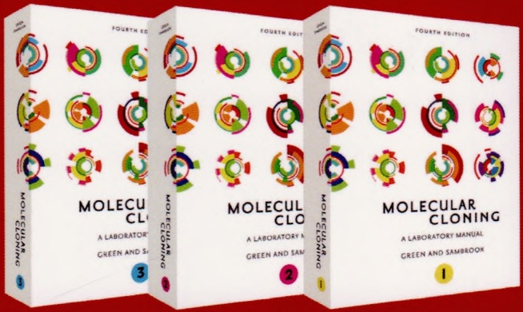

# 索引

原始 PDF 第 490–512 页。

## 索引

## (按汉语拼音顺序)

## A

吖啶酯 1546

安全操作 1566

安全性 1566

氨苄青霉素 ……124, 134, 164, 179, 197, 198

氨基蝶呤 981,982,984

氨基磷酸转移酶 180

氨基三唑 1468,1470,1485

氨基糖苷磷酸转移酶 981,982

氨甲蝶呤 982,984

螯合树脂和配体 1308

奥克兰儿童医院研究所 230,237

## B

斑点印迹 330,333

斑马鱼 278

斑马鱼胚胎和成体 282

半胱氨酸扫描诱变 877

半自动破碎装置 709,711

伴侣蛋白 1229

包含体增溶缓冲液I 1321,1323,1325

包含体增溶缓冲液 II …… 1322, 1325

包含体中表达蛋白的增溶 1321

包含体中回收的可溶蛋白再折叠 ……1321,1323

包膜的选择 1017

包装和感染 1015

包装细胞系 1006,1009,1014,1023

包装信号序列 1094

饱和突变 874,916

宝石蓝-II 增强剂 1116, 1118

报道基因系统 1102, 1103

背景 DNA 479

背景荧光 1126,1127

被动参考染料 530,537

比对 112

比活性的计算 1537

比较 $C_{\mathrm{T}}$ 值法……519, 524, 539, 548, 549

比较基因组杂交（CGH） 554

比色皿 290, 291, 293

吡啶哒嗪 1547

毕赤酵母……1226, 1227, 1229, 1230, 1235, 1240, 1241, 1243, 1277, 1278, 1279, 1280, 1281, 1282, 1283, 1284, 1285, 1286, 1288, 1289

变性剂 ……277,302,303,312,360,362

变性聚丙烯酰胺凝胶 ……1447, 1451, 1455, 1458

变性聚丙烯酰胺凝胶电泳 278

变性琼脂糖凝胶电泳系统 304

变性液 1511

标记合成的寡核苷酸 846,847

标记核酸的方法 1553

标签的氨基酸序列 1096

标准 PCR 393

标准化 457, 458, 462, 463, 464

标准曲线 537,549

标准曲线的构建 …… 509, 524, 549

标准曲线法 …… 519, 524, 525, 529, 548

表达盒中 1073

表达盒中通常存在内含子 1098

表达系统 1007,1100

表位标记 …… 1102, 1105, 1152, 1153, 1154, 1155

冰乙酸 86

丙氨酸扫描 874,875,877,922

丙烯酰胺:双丙烯酰胺 81,83,84

丙烯酰胺凝胶 349

丙烯酰胺溶液（45% m/V） 1507

丙烯酰胺溶液的脱气 83

病毒载体……998, 999, 1000, 1001, 1003, 1004, 1006, 1007, 1009, 1011, 1014, 1015, 1016, 1017, 1024, 1027, 1030, 1033, 1034, 1040, 1083, 1091, 1097

病毒载体的设计 1016

玻璃板 313,315

玻璃棉 1533,1534

玻璃物品的硅烷化 1534

玻璃珠洗液 97

剥离缓冲液 1309,1310,1314

剥离液 1341, 1342, 1346

补充培养基 1044,1047

补骨脂素 328

捕获蛋白与诱饵蛋白的相互作用而产生……1493

哺乳动物 DNA 甲基化 731

哺乳动物系统 1231

哺乳动物细胞 … 938, 943, 944, 945, 952, 960, 965, 969, 971, 973, 974, 977, 980, 981, 982, 983, 984, 985, 986, 988, 989, 991, 992, 994, 995

哺乳动物细胞提取物 1106

哺乳动物细胞提取物中β-半乳糖苷酶的测定
1105, 1112

哺乳动物细胞中的 DNA 甲基化 …… 732, 746

不含甲酰胺的杂交缓冲液（RNA 用）……1513

不可逆的 969

不同浓度储存液的近似 pH……1528

不稳定的 1231,1286

## C

猜测体 787, 788, 789, 790

---

1574

分子克隆实验指南（原书第四版）

材料安全数据表 ……1506, 1532, 1533, 1535, 1536, 1538

采用 DOTMA 和 DOGS …… 937, 948, 986

采用放射性标记探针对固定在膜上的核酸 DNA 112

采用谷胱甘肽树脂以亲和层析纯化融合蛋白
1314

采用固化的金属亲和层析纯化多聚组氨酸
标记的蛋白质 …… 1302

采用台盼蓝 1125

测定 RNA 丰度……339

测定标记的 DNA 浓度 …… 1382

测序仪 ……596, 600, 602, 604, 607, 608, 609, 610, 611, 613, 616, 617, 618, 628, 630, 636, 724

插入片段大小 …… 228, 241

拆分……1144, 1148, 1149

长 PCR 缓冲液（10×） 898

长链 dsRNA 生成 siRNA …… 1179

肠激酶 1232, 1234, 1242, 1244, 1245

常见的商品化浓度 …… 1528

常用同位素释放的放射性能量 …… 94

超动力的 1146

超螺旋环状（I型）……64

超声缓冲液 1292,1302

巢式 PCR …… 397, 398

潮霉素 B……981, 983, 1135, 1139

潮湿 108,112,115

成像 73, 79, 91, 293

持续转运元件（CTE）……1016

重叠延伸 PCR 877,890

重复 RNA …… 1175

重复性 ……510, 520, 524, 525, 529, 532, 535, 539, 542

重组穿梭载体到 PIR1 中 262

重组杆状病毒共转染昆虫细胞 …… 1238

重组缺陷型菌株 228

重组融合蛋白 1244

重组腺病毒载体 ……1001, 1002, 1003, 1009, 1019, 1022, 1024

臭氧洗涤器 592

储备溶液的制备 799,807,822

穿刺培养基 1531

穿梭载体 ……242, 243, 244, 247, 248, 249, 251, 252, 256, 257, 258, 259, 260, 262, 266

穿梭载体 DNA 的制备 …… 242, 262

串联亲和纯化（TAP）……1156

纯度 80,119

纯化不同大小 DNA 片段的聚丙烯酰胺
浓度比 …… 343

醇氧化酶 1241,1277

磁性颗粒收集器 709

磁珠清洗 639,640,643,647

次氮基三乙酸 1309

次黄嘌呤-鸟嘌呤磷酸核糖转移酶 528

从 DNA 中去除溴化乙锭 …… 1538

从 RNA 样品中去除 DNA 污染的方法是

酸性酚:氯仿抽提 298

从基因组编码的可读框架文库中分离 …… 1493

从膜上洗脱探针 ……117

从酿酒酵母菌中采用热酸酚提取总 RNA …… 287

从琼脂糖凝胶中回收 DNA 68,96

从秀丽隐杆线虫中提取总 RNA …… 285

促进剂 953,988,990,991

猝灭染料 514,550

猝灭染料引物 516

猝灭染料引物法 ……511,515

簇 771

催化报道分子沉积方案 …… 1548

催化反应 1163

错掺诱变 875

错配 380,383

错误折叠 …… 1230, 1257, 1261

## D

大肠杆菌 HB101 1082

大肠杆菌 RNase I 340

大肠杆菌表达载体 …… 1232, 1236, 1249

大容量 1095

单层或悬浮培养单细胞 1430

单层细胞组织化学染色检测β-半乳糖苷酶
937, 946, 950

单分子实时测序 736

单管荧光光度计 ……1121,1126

单核苷酸变异 604

单链 RNA 探针 810

单一限制性位点消除 ……911,912

蛋白表达优化 1242

蛋白的 SDS-PAGE……1305, 1317

蛋白激酶 1175

蛋白酶 K……738, 742, 744, 748, 749, 750, 764, 1516

蛋白酶 K 缓冲液（10×）……1516

蛋白酶 K 灭活核糖核酸酶活性 340

蛋白酶切割 1318

蛋白质-DNA 相互作用 …… 1359, 1360, 1361, 1373, 1378, 1379

蛋白质-RNA 1427, 1439, 1461

蛋白质的免疫印迹分析 …… 1340

蛋白质染色 1357

蛋白质溶液的浓缩 …… 1348, 1349, 1351

蛋白质印迹 1340,1342

导入哺乳动物细胞 952,982

导致细胞死亡 964,993

得克萨斯红 513

等电点 1065

低熔点琼脂糖凝胶中回收纯化的 DNA …… 100

低严谨性杂交 …… 113, 115

低盐洗涤缓冲液 1425, 1426, 1429

底物 …… 1103, 1104, 1105, 1106, 1107, 1112, 1113,

---

索引

1575

1114, 1115, 1116, 1117, 1119, 1124, 1128, 1129,
1130, 1131, 1140, 1144, 1153, 1158, 1160, 1161,
1162

地高辛配基标记探针 …… 328

地高辛特异性抗体与报道酶的偶联 …… 1553

第二链合成缓冲液（5×）&lt;R&gt;……574

第一链缓冲液 579,580

点滴透析法 …… 267

点样机器人 …… 560, 561, 562, 563

点杂交和狭缝杂交 …… 330, 332

碘化钠/硫代硫酸钠溶液 97,98

碘克沙醇溶液（15%） 1062

碘克沙醇溶液（40%） 1062

碘克沙醇溶液（60%） 1062

碘克沙醇梯度离心 998

碘克沙醇梯度离心后阴离子交换柱层析法纯化
rAAV 1067

电场反转凝胶电泳 664

电穿孔 …… 937, 938, 939, 968, 970, 985, 991, 992, 993, 995

电穿孔所需的电学条件 994

电穿孔效率 969,991,994,995

电导率 64,119

电荷 …… 305, 320, 331

电内渗 65,66,74

电通透作用 992,993

电印迹 306,307,325,326

电泳之前，甲酰胺（50%）可用于辅助 RNA 变性 …… 120

垫片 318

丁二酸酐 587,588,589

丁酸钠 952,953,954,962,989

定量 PCR 实验数据发表所需最低限度信息 … 529

定量分析 744

定位研究 …… 555, 556, 564

定向进化 874,879

定向诱变试剂盒 878,928

定影液 1340,1342

动物的人道待遇 1568

冻融裂解缓冲液 1300, 1301

毒性 279,282,284,286,309

读板 1122

读板读数荧光光度计 1121,1126

杜恩斯匀浆器 283

对硝基磷酸苯酯 1130

对照……937,940,947,956,965,973,975,976,978

对照 DNA 672, 673, 697, 700

对照连接产物文库 1401

对照连接体系混合 1399

对转导细胞基因组 DNA 上的载体基因组
进行 PCR 定量以测定滴度 …… 1087

多重 PCR……365, 366, 387, 388, 389, 509, 511, 512, 515, 517, 523, 550

多聚甲醛 1412

多聚组氨酸 ……1226, 1271, 1302, 1304, 1305, 1308, 1311, 1312

多聚组氨酸序列 1307

多嘌呤序列 1095

多态性检测 556

多西环素 ……1109, 1110, 1132, 1135, 1165, 1168

## E

二氨基联苯胺 1345

二噁二酮 1104

二甲苯蓝 67,76,109

二甲基亚砜（DMSO） 1511,1568

二价阳离子 366

二磷酸氯喹（100mmol/L）……952,965

二硫苏糖醇 385,1507,1511,1518

二氯二甲基硅烷 314,315

二羟基丙酮合酶 1277

二氢叶酸还原酶 984

二氢叶酸还原酶基因（dhfr） 982

二硝基苯酚 779

二辛可宁酸（BCA）方法……1317

二油酰磷脂乙醇胺 1268

## F

发光的®-半乳糖苷酶检测试剂盒 II ……1112

发现顺式调控基序 495

反式作用蛋白 1103

反向重复 RNA 1175

反向 PCR 393, 394, 395, 396

反向 Tet 反式激活蛋白系统（Tet-On 系统）
1166

反向遗传学 1171,1173,1175

反义寡核苷酸（ASO）……1179, 1182, 1215

反应缓冲液 1112, 1117, 1118

反应缓冲液的稀释液 1118

反转录……365, 367, 371, 372, 401, 402, 403, 404, 405, 406, 407, 408, 409, 410, 411, 412, 413, 415, 416, 417, 418, 419, 420, 427

反转录病毒 …… 998, 1000, 1001, 1005, 1006, 1007, 1014, 1016, 1079

反转录病毒插入诱变 875

反转录定量 PCR 分析 1203

反转录酶 297,341,355,356,357,400

反转录酶缓冲液（10×） 1517

泛素化剪切实验 1471

方形波 969,994,995

放射性标记……777, 778, 779, 780, 788, 793, 794, 795, 796, 797, 799, 800, 802, 803, 804, 805, 806, 807, 808, 809, 810, 811, 812, 814, 815, 819, 820, 821, 822, 823, 824, 825, 827, 828, 829, 830, 831, 833, 834, 835, 836, 838, 840, 841, 842, 843, 844, 845, 848, 849, 850, 851, 852, 853, 854, 855, 856, 860, 861, 865, 866, 867

---

1576

分子克隆实验指南（原书第四版）

放射性标记的分子质量标准 835

放射性标记物 786

放射性和非放射性标记 778

放射性墨水 1516

放射性能量 93

放射自显影 68,81

放射自显影方法的灵敏度 96

放射自显影片 69

放线菌素 D…… 1506, 1528

非变性 81,84

非放射性标记 …777, 778, 779, 780, 783, 794, 795, 804, 805, 807, 810, 827, 830, 842, 844, 845, 846, 851

非放射性检测系统 779

非加标反应所用预混液 1048,1050

非磷酸化 RL3 接头 5 端的标记 …… 1438

废物处理 1544, 1565, 1567

分辨能力 63,66

分光光度计 1115

分离 poly(A)⁺ 298

分离 poly(A) $^{+}$ mRNA 299

分离 RNA 的凝胶中所用的分子质量大小标准 304

分泌途径 1263,1285

分泌型碱性磷酸酶（SEAP） 1104

分析零假设 459,461,479,480

分析软件 753

分子克隆 777,783,786,832,860

分子生物学 1034

分子信标探针 514

分子杂交 869

分子质量标准 ……310, 311, 314, 335, 342, 353

酚红 967,973,974,975,978,1062

酚:氯仿:异戊醇 1507,1529

封闭剂 …… 320, 327, 1340, 1342, 1343, 1344, 1345

封闭自制微阵列上的多聚赖氨酸 587

封胶带 73,88

弗氏细胞破碎器 1291, 1294, 1295, 1296

氟卤化钡 93

福尔马林 1412

福林酚试剂 1350

福-乔试剂 1350

辅助噬菌体 923,924

负染色法和高分辨电子显微镜分析 rAAV 样本形态 …… 1074

复性动力学 339,357

复性缓冲液 345,348

复制能力 …… 1009, 1016, 1043

复制型 1089,1093

富含 GC 的扩增缓冲液（10×）……386

富含 GC 的模板 425

## G

改进版 1541

钙调蛋白结合肽 1243

甘氨酰环素 1164

甘油 620,623

肝素 1529

肝素亲和层析法纯化 rAAV2 1062

感光成像 91,93

感光影像仪 69,87,90,91,93,112

感染培养基（2%） 1050

干扰 1034, 1043, 1049

干扰素 1172, 1175, 1177, 1187

干燥凝胶 87

高滴度的病毒储液 1007

高滴度的重组腺病毒储液 1004

高滴度的储液 1001,1009

高通量测序文库建立 1208

高严谨性免疫沉淀洗涤缓冲液 … 1425, 1426, 1428

高盐洗涤缓冲液 1424, 1426, 1428

更昔洛韦 1234,1240

功能基因组学 ……1171, 1173, 1219, 1223

共合体的检验和重组 253

共转化 …… 937, 939, 961, 981, 982, 984, 988

构成 1094,1099

构建标准曲线 520

构建定量标准曲线时 525

构建小 RNA 高通量测序文库……1206

构象 64,80

古细菌 367,391

谷氨酸钾 369

谷胱甘肽-S-转移酶（GST）1226,1243,1253,1314

谷胱甘肽洗脱缓冲液 1315, 1317, 1320

固定 DNA 71,107,108

胍盐 5,60,277

寡核苷酸 …777, 778, 780, 784, 785, 786, 787, 788, 789, 790, 793, 794, 795, 796, 797, 800, 802, 807, 808, 809, 819, 820, 821, 822, 823, 835, 840, 842, 843, 844, 845, 847, 848, 849, 850, 851, 852, 853, 854, 855, 856, 858, 861, 864, 869, 870, 873, 874, 875, 876, 877, 897, 898, 900, 901, 902, 904, 905, 906, 907, 908, 910, 911, 912, 916, 922, 923, 924, 925, 926, 930, 931, 934

寡核苷酸标记缓冲液 800,801

寡核苷酸简并库 786

寡核苷酸探针 ……777, 780, 783, 784, 785, 786, 787, 790, 840, 842, 846, 855, 856, 870

寡核苷酸探针在水溶液中杂交 855

寡核苷酸预杂交液 856

寡腺苷酸合成酶 1175

关于微阵列实验的最低限度信息 …… 529

管装荧光光度计 1117

灌胶过程产生气泡 318

光度计 1122, 1123, 1126, 1127

光激活 1150

光激活荧光蛋白（PAFP）……1149

光漂白后荧光复现（FRAP）……1147

光漂白中的荧光损失（FLIP） 1148

光学转染 937,938,980

---

索引

1577

光泽精 …… 1545, 1546

光化学内化 980

硅化液 82

硅烷化 1533

硅烷化溶液 314,315

鲑精 DNA …… 1516, 1518, 1530, 1531

果聚糖蔗糖酶 230

过度烘烤 108

过硫酸铵 81,83,1509

过滤 98,118,119

## H

海肾 1106

海肾萤光素酶…1107, 1119, 1123, 1124, 1126, 1162

海肾萤光素酶检测系统 1119

海藻 65

氦-氖激光 93

含 5'突出羟基端的 DNA 分子 …… 834

含肌苷的密码子 790

含甲酰胺的杂交缓冲液（RNA 用）……1512

含葡萄糖的 Tris 盐缓冲液（TBS-D）……965

含有 2.2mol/L 甲醛的琼脂糖凝胶……308, 309, 311

含有报道基因裂解缓冲液的β-半乳糖苷酶检测系统 1112

含有琼脂和琼脂糖的培养基 1507

合成测序法 612

合成的假基因 303

核酸酶 S1 保护分析 ……337,339

核酸酶 S1 保护实验 …… 335

核酸酶 S1 保护实验中使用的探针 ……336,343

核酸酶 S1 消化缓冲液 1514

核酸酶 S1 终止混合液 ……344, 347, 348

核酸平台技术 …… 551

核酸染色 1540

核糖核蛋白 1462

核糖核蛋白复合物（RNP） 1416

核糖核酸酶 334,337,340

核糖核酸酶保护 349,359

核糖核酸酶保护测定 313

核糖核酸酶保护分析 337

核糖核酸酶保护实验 339

核转染 939,969,996

盒式诱变 874,879,919

横向交变凝胶电泳（TAFE）……241

宏基因组学 609

琥珀酰化 587

化学发光……779, 781, 782, 783, 1545, 1546, 1547, 1548, 1551, 1553, 1555, 1558, 1559, 1560, 1569

化学发光标准参照物 86,87

化学发光酶分析 1547

化学发光实验检测β-半乳糖苷酶……1102,1115

化学发光增强剂 1116

化学反应 328

化学过程 986

化学诱变 874,879

环化 756

环状共有序列测序 615

环状诱变 874,898

黄嘌呤单磷酸 984

黄嘌呤氧化酶 1546,1548

黄色荧光蛋白（YFP）变体 Venus……1145

活化基因 1（RAG1）和重组活化基因 2（RAG2）
1167

活体染色 1536

活性检测 1125

火山图 481

霍夫迈斯系列 1351

## J

机械法细胞破碎 1294

肌苷酸脱氢酶 984

鸡β-actin 启动子 1013

基本活性减低 1168

基本元件 998,1000,1009,1094

基序富集分析 506

基因表达系列分析 1361

基因捕获实验 233

基因分析仪 768

基因分型 …… 509, 510, 512, 517, 520, 523, 550

基因集富集分析 468,469

基因特异性引物 528

基因组 DNA …… 597, 603, 604, 608, 609, 610, 630, 637, 638, 644, 651, 660, 663, 681, 689, 697, 702

基因组测序 …… 596, 598, 602, 603, 604, 606, 607, 608, 630, 636, 645, 728

基因组测序仪 722

基因组大小 202

基因组结构 1006,1009,1034

基因组片段 605,639,643,647

基因组文库 225, 227, 267

基因组序列 609

基于 DNA 的 siRNA 表达 1180

基于探针的化学法 …… 511, 512, 513, 515

激光辐射 1566

集群 PCR 766

计时器荧光蛋白 1148

计数矩阵 491,492

技术问题 …… 1331, 1340

季铵盐 787,855,856

加标反应所用预混液 1050

甲虫 1106, 1107, 1162

甲醇培养基 1241,1279

甲酚红溶液 1510

甲基化 …… 732, 733, 734, 735, 736, 739, 740, 743, 745, 747, 748, 749, 750, 753, 754, 755, 756, 759, 760, 761, 763, 764, 765, 766, 767, 768, 769, 770, 773, 774

---

1578

分子克隆实验指南（原书第四版）

甲基化 DNA …… 734, 735, 745, 747, 748, 749, 755

甲基化标志 731,732

甲基化分析 734,735,745,774

甲基化敏感 734

甲基化特异性 PCR …… 733, 734, 745

甲基化组分 731,734

甲醛交联 1413

甲醛凝胶加样缓冲液（10×）……1512

甲醛浓度 309

甲醛脱氢酶 1277

甲酸铵 119

甲酰胺的去离子 1507

甲酰胺加样缓冲液 355,1511

甲酰胺作为溶剂 120

甲贄 1555

假阳性 1469,1472

检测固定的核酸和蛋白的实验原理图 …… 1550

检测特定基因的 DNA 甲基化 734

检测系统 779,781,782,783,1531,1545

检测小 RNA 表达……1179, 1181, 1182

剪切 DNA 636, 644, 653

简并 786,787,789,790

碱裂解溶液 I …… 1508

碱性裂解溶液 II 1509

碱性裂解溶液 III 1509

碱性磷酸酶 1263,1345

碱性凝胶电泳加样缓冲液（6×）……1508

碱性琼脂糖凝胶 87,90

碱性琼脂糖凝胶电泳 88,90

碱性琼脂糖凝胶电泳缓冲液（10×）……1508

碱性转移缓冲液 321,322,1509

将 DNA 从凝胶转移到固相支持物 …… 69

将 RNA 从胶上转移到尼龙膜上 …… 319

将 RNA 从凝胶中转移至固相载体……306

将穿梭载体转化到 PIR2…… 243

将膜干燥 108

将噬菌体编码的 RNA 聚合酶启动子加至 DNA 片段上 810, 817, 864

将同源臂 DNA 连接到穿梭载体中 …… 261

降落 PCR …… 365, 368, 379, 383, 385, 388, 389

交联缓冲液 1369,1370

交联免疫沉淀 1416,1418,1419

交联细胞 3C 文库的制备 …… 1389

交联诱导突变 1463

焦磷酸测序 602,609,610,611

焦磷酸测序仪 609

焦磷酸盐 366

酵母单杂交 DNA-诱饵菌株 1474

酵母单杂交 DNA-诱饵株液体 1497

酵母单杂交分析 1480

酵母培养物的冻存 1287

酵母人工染色体 224,226

酵母溶细胞酶 100T 269

酵母双杂交 DB-诱饵菌株……1497

酵母双杂交 DNA-诱饵酵母细胞中 …… 1492

酵母细胞玻璃珠裂解法 1291,1296

酵母细胞裂解 1296

酵母胰蛋白胨（YT）液体培养基（2×）……926

酵母重悬浮缓冲液 1523

接头扫描诱变 874

结构 …… 999, 1000, 1001, 1002, 1004, 1015, 1016, 1021, 1022, 1026, 1031, 1033, 1142

结构域 876,922,933

结合核酸 …… 1551

截短的 T4……1211

截短的乙醇脱氨酶 1 …… 1505

解决测序凝胶中的条带压缩问题 ……119

解链温度 784,786,787,789,790,855

金刚烷基 782

金霉素 1164

进样器的清洗 1127

精氨酸缓冲液 9,10

局限表达 1013

巨细胞病毒 1011

巨细胞病毒启动子 272

巨细胞病毒早期即刻启动子（CME-1E）……1000

具有复制能力 …… 1015, 1047

聚丙烯酰胺 81

聚丙烯酰胺凝胶 ……292, 303, 307, 314, 316, 318, 325, 343, 344, 346, 351, 352, 355, 357, 358, 1437

聚丙烯酰胺凝胶（浓度为8%，溶于1×TBE）
1386

聚丙烯酰胺凝胶电泳 …… 302, 336, 338, 342, 347

聚丙烯酰胺凝胶较琼脂糖凝胶有三个优点 …… 80

聚丙烯酰胺凝胶中 DNA 片段的回收:压碎与浸泡法 …… 101

聚合酶混合物 1379,1381,1382,1384

聚合图 482

聚合图 483

聚集 1057, 1058, 1061

聚凝胺 1088,1090

聚偏氟乙烯膜（PVDF）……1343,1344

绝对定量 … 518, 519, 524, 529, 537, 540, 546, 548

菌落 PCR …… 254, 262, 266, 269, 1472, 1487

## K

卡那霉素 180,197

抗 myc 标签的抗体……1279

抗生素 ……127, 129, 130, 132, 134, 139, 140, 141, 153, 154, 155, 156, 160, 161, 163, 164, 165, 166, 168, 169, 179, 180

考马斯亮蓝染色液 … 1250, 1315, 1330, 1338, 1509

拷贝数 224, 225, 226, 273

可复制型 998

克隆到穿梭载体中 …… 230, 233, 245, 259

克隆和测序 1182

克隆基因 1245, 1260, 1277

孔条件的优化 995

---

索引

1579

跨膜电压 992,993,994

快速杂交缓冲液 …… 120, 121

昆虫细胞 …… 1226, 1227, 1228, 1229, 1230, 1231, 1234, 1235, 1238, 1239, 1240, 1243, 1246, 1265, 1266, 1267, 1268, 1269, 1270, 1271, 1272, 1273, 1275, 1276, 1291, 1296

昆虫细胞培养物的维持和繁殖 1270

昆虫细胞转染之前的重组杆状病毒 …… 1239

扩增 …… 77, 119, 602, 603, 604, 605, 608, 609,
610, 611, 612, 613, 614, 616, 617, 618, 620, 625,
626, 627, 628, 630, 633, 634, 635, 636, 639, 640,
641, 643, 644, 645, 647, 648, 650, 651, 657, 658,
660, 669, 670, 673, 674, 676, 677, 685, 686, 693,
694, 702, 708, 709, 710, 711, 714, 722

扩增产物的纯化 421

扩增的 RNA …… 567, 570, 571, 573, 577, 578

扩增缓冲液（10×）……806,808

扩增曲线 …… 518, 532, 535, 546, 547, 549

## L

蜡样芽胞杆菌 984

来自细胞内多联体的 P1 噬菌体 DNA 的包装 …… 271

劳斯肉瘤病毒（RSV）启动子 1016

冷冻干燥 1351

丽春红染色 1344

利用 HNPP（2-羟基-3-奈甲酸-2'-苯基-N-酰苯胺磷酸盐）进行 …… 781

利用化学发光的方法 …… 1112

连接酶反应缓冲液（10×） 921

链分离凝胶电泳 336

链霉蛋白酶溶液（2×）……1032,1034

链转换 411,417

两侧具有正向重复 loxP 位点的 DNA 片段的精确切除 …… 272

两性离子去污剂 1355

亮抑蛋白酶肽 …… 1280, 1284, 1292, 1293, 1295, 1297, 1298

裂解昆虫细胞 1291,1296

裂殖酵母 1469

邻苯二胺盐酸盐 1130

邻位连接 1471

磷酸-SDS 洗液 1……113,115,118

磷酸-SDS 洗液 2……113,115,118

磷酸钙介导的质粒 DNA 高效转染真核细胞
956, 967

磷酸钙介导的质粒 DNA 转染真核细胞 …… 937

磷酸核糖酰氨基咪唑羧化酶 227

磷酸化 …… 151

磷酸化 RL3 接头 5 端的标记 …… 1441

磷酸化和非磷酸化 182

磷酸缓冲盐液（PBS） 1516

磷酸盐缓冲液（Gomori 缓冲液）……1526灵敏度 ……291, 292, 293, 312, 327, 328, 339, 341
510, 511, 514, 515, 517, 520, 521, 523, 524, 525,
528, 532, 535, 540, 546, 548

硫酸葡聚糖 116,120

硫酸鱼精蛋白 1084

硫氧还蛋白 1243,1258

硫氧化钆 94

六氯荧光素 513

六乙二醇 514

卤化银 93,95

鲁米诺氧化发光的连锁反应 …… 1551

鲁氏接合酵母 273

洛斯阿拉莫斯序列数据库 432

绿豆核酸酶 337,347

绿豆核酸酶可以替代核酸酶 S1 …… 347

绿色荧光蛋白 …… 1102, 1103, 1104, 1128, 1134, 1140, 1141, 1145, 1147

氯仿提取 396

氯化铯梯度离心 …… 1028, 1056, 1057, 1064

氯化四乙铵（TEACl） 787

氯喹 …… 953, 954, 962, 963, 966, 967, 968, 988, 989, 990

氯霉素 181,191,192,196

氯霉素乙酰基转移酶 1103,1112

## M

马传染性贫血病毒（EIAV） 1015

麦芽糖结合蛋白（MBP）……1242, 1243

脉冲电场凝胶电泳 ……238, 240, 241, 256, 265, 267

慢病毒滴度测定 1086

慢病毒载体 …… 998, 1000, 1007, 1008, 1014, 1015, 1016, 1017, 1079, 1080, 1081, 1095

慢病毒载体的滴定 998

猫免疫缺陷病毒（FIV） 1015

毛细管测序之 PCR 产物 …… 625

酶切条件……347

霉酚酸 981,984

咪唑洗脱缓冲液 …… 1303, 1305, 1311, 1314

米曲霉菌 340

密码子 ATG……1245, 1259

密码子盒 ……874,915,916,917,918,919,921

密码子选择 1286

免疫沉淀洗涤缓冲液 1441

免疫磁珠的偶联 1374

免疫缺陷病毒（SIV） 1015

免疫印迹法 1226, 1270

免疫印迹过程中的蛋白质染色 1344

灭活 277, 297, 298, 337, 340, 345

敏感性 …… 290, 293, 340, 353

明胶 391

膜蛋白纯化 …… 1285, 1298, 1353, 1354, 1355

膜的类型 1341, 1343, 1344

摩尔定律 609

末端标记 777,827,829,834,837,862

---

1580

分子克隆实验指南（原书第四版）

末端配对 ……616, 651, 657, 659, 667, 668, 680, 682, 724

末端转移酶 567,568,569

末端转移酶反应缓冲液 844,845

莫洛尼鼠白血病病毒 402

## N

耐热 DNA 聚合酶 …… 376, 378, 380, 381, 387, 391, 395, 396, 397, 398, 400, 408, 417

耐热的尿苷三磷酸酶（UTPase）……391

内部被动参考品染料 530

内参基因 … 519, 524, 528, 529, 539, 540, 542, 546

内毒素 943,947,956,965,969

内肽酶 1244

内源 EcoP15I 位点的甲基化 …… 754

尼龙 305

尼龙的发展 305

酿酒酵母（S. cerevisiae）的生长 267

鸟枪法测序 598, 599, 601

尿嘧啶 732,736,737,739,740

尿嘧啶-DNA 糖基酶 428

尿嘧啶 N-糖基酶（Ung）……373

尿嘧啶的 ssDNA 924

尿嘧啶和色氨酸的基本培养基 274

尿素变性聚丙烯酰胺凝胶电泳 312

尿素聚丙烯酰胺凝胶 309

凝胶成像系统 79,80

凝胶的染色 85

凝胶电泳中的分子质量标准 829

凝胶干燥支架 314

凝胶加样缓冲液 I（6×） 1512

凝胶加样缓冲液 II（6×） 1512

凝胶加样缓冲液 III（6×） 1512

凝胶加样缓冲液 IV（6×）……1512

凝胶上样缓冲液 67

凝胶洗脱缓冲液 344, 346, 348

凝胶中 DNA 的成像 79

凝胶中 DNA 染色 1543

凝聚胺 1090

凝血酶 …… 1232, 1233, 1234, 1244, 1245, 1317, 1318, 1320

浓度、大小分布和质量 …… 641, 644, 651

浓度优化 524,533,540

浓缩传代 998,1043,1045,1047,1049

浓缩蛋白质 1351,1352

## O

欧姆定律 63

## P

疱疹性口炎病毒糖蛋白（VSV-G）……1014

胚胎发育 731

培养物的冻存 1283

配对末端测序甲基化作图分析法 750

配对末端文库制备 753

配制 8mol/L 尿素变性丙烯酰胺凝胶 …… 316

偏差 573

嘌呤霉素 …981, 984, 1108, 1132, 1133, 1134, 1135, 1137, 1138, 1139

拼接微阵列 556,557

频闪灯 95

平板荧光光度计 1117

葡萄糖氧化酶 1547

## Q

启动子 …… 1068, 1073, 1083, 1085, 1086, 1088, 1093, 1095, 1097, 1098, 1099, 1100

前体 RNA 诱导沉默复合体（pre-RISC）……1172

钳位均匀电场（CHEF）六边形的阵列系统…241

腔肠素 1127,1163

羟基磷灰石柱 339

羟乙基化 65

切口环状（II型） 64

切口平移反应缓冲液（10×） 803

亲环蛋白基因 303

禽成髓细胞瘤病毒（AMV）反转录酶 …… 402

轻 CsCl 1031

氢氧化甲基汞 302,303,304

氢氧化钾/甲醇溶液 313

氢氧化钠 738,740

琼脂糖的浓度 63

琼脂糖甲醛凝胶 309

琼脂糖凝胶大小 680,685,689

琼脂糖凝胶电泳 …… 34, 42, 52, 63, 67, 73, 76, 89

琼脂糖凝胶电泳仪 1193

琼脂糖凝胶中 DNA 的回收 98

琼脂糖凝胶中 DNA 的染色检测 76

琼脂糖培养基 1273

去除 Northern 印迹上的放射性 …… 329

去除矿物油 377,415,419

去甲基化 731,732,739

去离子 …… 119, 1511, 1512, 1514, 1515, 1516, 1517, 1519, 1520, 1522, 1528, 1531

去磷酸化 …… 145, 146, 147, 148, 149, 150

去磷酸化 RL3 接头 5'端的标记…1442, 1444, 1445

去磷酸化的平端或 5'凹端 DNA 分子的磷酸化
837

去磷酸化缓冲液（用于 CIP）(10×)……1511

去磷酸化缓冲液（用于 SAP）（10×）……1511

全基因组:手工文库制备 630

全基因组:自动化的带索引文库制备 …… 644

全基因组:自动化的无索引文库制备 …… 636

全基因组 DNA 646

全基因组 RNA 干扰……1173, 1219

全基因组 RNA 干扰筛选……1221, 1223

缺口修复 1496, 1497, 1498, 1502

缺口修复检验 1490

---

索引

1581

## R

染料 278,289,291,343

染色 292,303,309,311,333

染色体 DNA 片段的切除 …… 273

染色体构象捕获（3C）……1359,1364

染色质免疫沉淀（ChIP）……1359,1373

热密封袋 114

热启动 DNA 聚合酶（Agilent）……380

热启动 PCR……365, 380, 384, 385, 392, 397, 399, 400, 414, 420

热酸酚抽提 279

热循环 387

热循环仪 …… 372, 375, 376, 381, 382, 383,
384, 392, 395, 397, 399, 400, 405, 406,
412, 414, 418, 423

人 DNA 聚合酶β……888

人 DNA 聚合酶β复制缓冲液……881

人 DNA 聚合酶η和聚合酶  $\iota$  复制缓冲液……881

人第 5 亚型腺病毒 HuAd5……1043

人类基因组计划 …… 224

人类免疫缺陷性病毒（HIV）……1570

人类原代成纤维细胞 IMR90……1371

刃天青 941,972,973,974

日本血吸虫 1314, 1349

绒布影印平板和影印 1505

溶解甲贖 978

溶菌酶 866,1513

溶菌酶裂解和冻融 1300

溶细胞酶 5000 …… 1523

熔解曲线 …… 512, 520, 534, 535, 538, 539, 541, 545, 548

熔解温度 …… 365, 368, 370, 371, 383, 386, 388, 391, 425

融合蛋白……1226, 1231, 1234, 1235, 1237, 1242, 1243, 1244, 1250, 1255, 1261, 1263, 1266, 1305, 1307, 1308, 1311, 1312, 1314, 1316, 1317, 1318, 1319

乳酸脱氢酶法分析细胞活力 937,974

乳糖操纵子 1236, 1237, 1238, 1249, 1260

润湿 106,112

## S

三（羧甲基）乙二胺 1309

三氯乙酸（TCA） 90,1521

三氯乙酸沉淀 1537

色原 1130

色原体 1129

杀稻瘟菌素 S……981, 984, 985

筛选 YAC 重组体……227

山梨糖醇缓冲液 269

闪光灯 1568

闪烁液 95,96

商品化的 tRNA 349商品化试剂盒 …… 877, 893, 895, 902, 920, 926, 928, 929, 931

商品化试剂盒和试剂 941

商业化 999,1001,1002,1004,1014

少量制备 9

设计探针 788

设置及运行的基本步骤 …… 552

射性标记 838

肾萤光素酶 1127

生成酵母双杂交 DB-诱饵菌株 1484

生物安全……1011, 1019, 1023, 1024, 1028, 1031, 1035, 1042, 1044, 1059, 1063, 1065, 1068, 1069, 1072, 1074, 1077, 1079, 1081, 1082, 1085, 1089

生物安全柜 ……1025, 1026, 1035, 1042, 1045, 1046, 1047, 1049, 1080

生物发光共振能量转移（BRET）……1163

生物素 ……605,725,726,727,1288,1289

生物素化 725,726

生长培养基……1257, 1259, 1266, 1275, 1276, 1287

失活 277

十二烷基三甲基溴化铵（DTAB）……120

十六烷基三甲基溴化铵（CTAB）……120

实际考虑 1132, 1154

实时 RT-PCR …… 519, 528, 529, 543, 544

实时定量 …… 526, 527

实时定量 PCR 510

实时分析软件 723

实时监测 PCR 510

实时荧光 PCR … 511, 512, 524, 525, 529, 530, 533, 534, 536, 537, 539, 540, 542, 543, 544, 546, 549

实时荧光 PCR 仪 …… 509, 510, 516, 517, 535, 538, 541, 545

实验流程图 529,530

实验室废物处置 1569

使用 BLAST 和 ClustalW 进行序列比对和
同源性检索 …… 444

使用 FP 的资源 …… 1150

使用 PCR 筛选克隆 422

市售凝胶干燥机 87,91

试剂盒 …… 738, 740, 741, 743, 744, 747, 752, 754, 763, 764, 765, 767, 768, 769, 770, 778, 779, 780, 783, 794, 802, 810, 842

试卤灵 972,973

适用于凝胶 76

噬菌体 ……1230, 1236, 1237, 1250, 1254, 1259, 1261, 1263

噬菌体编码 RNA 聚合酶识别的启动子序列 … 350

噬菌体基因组 596, 598, 599

手动荧光光度计 1121,1125

输出至周质 1257

属性和作用方式 …… 197

数据的质量评估 723

数据分析方法 746

数据分析及归一化方法 …… 509, 518

数据格式 503

---

1582

分子克隆实验指南（原书第四版）

数据库 237

双报道基因测定 1107

双分子荧光互补（BiFC）……1148

双链 DNA 2,5,6,7,30,34,53,54

双链 DNA 的定量 …… 1542

双链 RNA 1171, 1174, 1177

双末端测序 603

双顺反子载体 1007,1008

双脱氧核苷三磷酸 596

双萤光素酶 1102, 1125

双萤光素酶报告测定系统 1123

水疱性口炎病毒 1006

水杨酸钠 95,96

顺式作用元件 ……1103, 1166

瞬时转染与稳定转染 937,938

四氮唑蓝 781

四环素 180,197

四环素控制的转录沉默子（tTS）……1168

四环素应答表达系统 …… 1102, 1103, 1108

四氯荧光素 513

塑料粉碎机 283

酸水解酪蛋白（AHC）培养基 227,274

酸性蛋白酶 1286

随机引物法 …… 777, 778, 780, 794, 795, 861

随机引物反应 ……794, 795, 797, 799, 800, 819, 821, 825

随机引物缓冲液（5×） 796

羧苄青霉素 134,179,197

所制备 RNA 的质量检查……311

索套（lariat）去分支 …… 1173

锁核酸（LNA） 522,786

锁核酸（LNA）碱基 523

## T

台盼蓝 1125

探针 …302, 304, 307, 315, 319, 320, 337, 338, 339, 340, 341, 343, 344, 345, 346, 349, 350, 351, 352

探针洗脱液 117,118

碳酸氢盐/碳酸盐包被缓冲液（100mmol/L）
1129, 1131

特性 …… 3,999,1001,1009,1014,1031

梯度沉降法纯化 998,1028

体内 RNA 干扰筛选……1222

体内基因递送效率 …… 1009

体外制备 1179

体外转录 ……777, 778, 780, 810, 811, 812, 814, 817, 818, 864

体外转录合成单链 RNA 探针 810

体外转录试剂盒 574

天鹅绒 1475,1488

添加剂溶液（5×） 386,387,389

甜菜碱 ……369, 379, 385, 386, 389, 391, 408, 409, 425

条件优化 1321

条形码 607,680,683,701,717

调控元件 …… 1102, 1107

通过 SDS-PAGE 进行大小分离 …… 1418

通过单一限制性位点消除 910

通用碱基 789

同源重组 ……224, 229, 230, 231, 232, 233, 251, 1229, 1238, 1265, 1277, 1278

统计学显著性衡量标准（E值）……450

透析袋的处理 1534

透析缓冲液 881,884,888

透析缓冲液和洗涤缓冲液 2 …… 1303, 1313

突变 ……872, 873, 874, 875, 877, 878, 879, 880,
881, 882, 885, 886, 887, 890, 894, 895, 896, 897,
898, 899, 900, 901, 902, 903, 904, 905, 907, 908,
910, 911, 912, 913, 914, 915, 916, 919, 920, 922,
926, 927, 928, 929, 930, 931, 932, 933, 934, 935

突变体 ……1104, 1132, 1144, 1166, 1168

突变小鼠区域资源中心 230,235

土霉素 1164

土曲霉 984

脱靶效应 606,1176,1178,1179

脱嘌呤作用 69,108,109

脱色液 …… 1327, 1330, 1333, 1335, 1336, 1338

脱氧胆酸钠（DOC）（10%）……1035,1041

脱氧核苷三磷酸（dNTP） 1510

脱氧助间型霉素 982

## W

外膜蛋白 3a……1243, 1263

外切核酸酶 VII 334

外显子微阵列 554,556

外显子组 … 605, 606, 607, 608, 618, 680, 686, 722

外显子组捕获 606,680

外显子组文库 680,686

完全合成培养基（SC）……1519

完全基本培养基（CM）……1519

完全培养基 …1023, 1025, 1026, 1027, 1035, 1036, 1037, 1040, 1044, 1045, 1046, 1048, 1050, 1088

危险物质 1567, 1569

微量分光光度计 291

微型胶 73,76

微阵列 432, 433, 456, 510, 512, 529

微阵列的使用 590

微阵列研究 …… 553, 559, 572

微阵列应用 558

维多利亚多管发光水母 1140

未标记的 dNTP（低 dTTP）储存液…… 579, 580

位点定向突变 926

位点上 Cre 介导的重组……272

温度敏感的复制起点（ts-ori）……232

温和免疫沉淀洗涤缓冲液 …… 1425, 1426, 1429

文库 1007, 1017, 1170

文库定量:用 Qubit 系统对双链或单链 DNA
进行荧光定量 …… 700

文库结合缓冲液(2×) 652

---

索引

1583

文库制备 ……636, 645, 671, 681, 682, 687, 696

稳定细胞系的冻融 1138

污染有溴化乙锭溶液的处理 …… 1538

钨酸钙 94

无 RNase 的 DNase I …… 292, 297

无 RNase 的水……280, 283

无 RNase 1534

无肠 1002,1003

无核酸 297

无血清培养基 1036,1041

雾化的 DNA 705

## X

吸光度 290,291

吸水链霉菌 983

希夫碱 309

洗涤缓冲液 298,300,301,302

洗脱缓冲液 888

洗脱液 102,887

系统类型 1231

细胞病变效应（CPE）……1025,1043

细胞毒性 …… 939, 941, 942, 946, 947, 949, 956, 964, 966, 973, 974, 975, 976, 979, 980, 987, 990

细胞固定剂 950,951

细胞裂解缓冲液 1119,1122

细胞裂解缓冲液I 1321,1324

细胞裂解缓冲液 II 1321, 1322, 1324

细胞数目的估算 …… 1533

细胞死亡 942

细胞株 1002

细菌保存培养基 1531

细菌碱性磷酸酶 867

细菌人工染色体 ……223, 224, 228, 229

狭缝印迹 330

狭缝杂交 332

下一代测序 …… 596, 601, 602, 603, 604, 605, 606, 607, 608, 609, 611, 615, 616, 617, 618, 673, 721, 722, 723, 724

下一代测序仪 600

衔接子 …… 150, 181, 182, 183, 610, 611

显色法和化学发光法检测固化抗原 …… 1345

限制性内切核酸酶 …… 734, 735, 748, 751, 752, 754, 756, 758, 762, 763, 764

限制性内切核酸酶消化法鉴定纯化后的重组腺病毒基因组 998

限制性内切酶 1001,1033

线性（III型） 64

腺病毒 E1 1003, 1036, 1043

腺病毒载体 …… 998, 1001, 1002, 1003, 1008, 1009, 1010, 1011, 1019, 1021, 1022, 1024, 1025, 1026, 1029, 1031, 1032, 1033, 1034, 1035, 1037, 1038, 1040, 1043, 1049, 1071, 1072, 1091, 1092, 1095, 1096

腺病毒载体骨架 1020

腺病毒载体中 1048

腺苷二磷酸（ADP） 1508

腺苷三磷酸 1509

腺苷脱氨酶 982

腺黏粒 202

腺嘌呤 274

腺嘌呤残基 934

腺相关病毒载体 …… 998, 1001, 1004, 1011, 1092

相对定量……518, 519, 524, 529, 537, 540, 546, 548

向平末端 DNA 添加磷酸化衔接子/接头 …… 150

消光系数 1349,1350

硝酸银染色液 1337,1338

小 RNA 表达 1173

小 RNA 表达检测 1181

小沟结合剂 523,550

小鼠金属硫蛋白Ⅰ启动子……272

效率 510,520

蝎型探针 513,514,515,516,550

斜率 525,539

信号标签诱变（STM） 875

信号强度303, 306, 320, 330, 332, 333, 338, 339, 340
70, 112, 117

信号肽 …… 1227, 1229, 1232, 1233, 1234, 1235, 1236, 1241, 1242, 1243, 1257, 1261, 1263, 1279, 1285

信号肽融合蛋白的亚细胞定位 1261

信息资源 1567

性质和作用方式 …… 179, 180, 192

胸苷激酶 981,982

溴酚蓝 66,67,75,76,82,88,109

溴化乙锭 …… 291, 292, 309, 310, 311, 313, 318, 320, 322, 1511, 1533, 1538, 1539, 1540, 1541, 1542, 1543, 1544, 1571

溴化乙锭染色 312

溴甲酚绿 88,89,90

溴氯丙烷 278,279,282,284,286

溴脱氧尿苷 779

序列饱和诱变 875

序列捕获方案 556

序列覆盖 606

选择标记 778

血清型 1004,1095

血细胞计数板计数 1535,1536

血液和细胞培养 DNA 763

循环测序 …… 600, 627, 628, 629, 630, 723

## Y

亚氨基二乙酸 1308, 1309

亚精胺 369

亚硫酸氢钠 738

亚硫酸氢盐转化 DNA 739

亚硫酸氢盐转化的 DNA 文库 …… 761

烟草蚀纹病毒（TEV）蛋白酶 1156

延伸随机复性引物 564

严重联合免疫缺陷病（SCID） 1094

盐酸胍 277

---

1584

分子克隆实验指南（原书第四版）

衍生物 725,1413

阳离子脂质介导的转染 1146

氧钒核糖核苷复合物 360

样品点膜 332

样品制备 1253,1329

液体培养的细菌 …… 1531

液相外显子组捕获 680

一般注意事项 …… 1567

一步法 RT-PCR 408

胰 DNA 酶 I（1mg/mL） 1515, 1516

胰蛋白酶 1522

乙醇沉淀 RNA 295,352

乙醇脱氨酶 1 …… 1505

乙二醇 386

乙酸铵（10mol/L） 1509

乙酸钾 295,1509,1516

乙酸钠 ……620, 624, 1511, 1514, 1519, 1543

乙酸双氧铀 1075,1076

异硫氰酸胍 277,278,283,284,286

异鲁米诺 1546,1547,1548

抑肽素 A……1280, 1292, 1293, 1297, 1298

抑制蛋白合成起始 295

抑制剂 812,814,819,823,834,835

抑制特定基因 1173

抑制型 tRNA 基因 226, 227

易错 DNA 聚合酶 …… 877, 878, 879, 880, 881, 884

因子 Xa …… 1244, 1245, 1317, 1318, 1320

阴离子交换柱层析法从碘克沙醇梯度离心后的
rAAV 样本……1065

阴离子去污剂 1325

银染猝灭液 1337

银染敏化液 1337

银染显色液 1337

银盐染色 1330,1334

引物和探针 …… 509, 521, 523, 524, 529, 532, 550

引物设计 274,1411

引物探针 526

引物延伸 ……277, 294, 299, 337, 341, 355, 369, 375, 413

引物延伸混合物 357,358

引物延伸实验 342,355

印迹装置 330,331

荧光标记 … 552, 553, 554, 559, 571, 578, 581, 590

荧光测序 599,600,601,602

荧光蛋白 ……1102, 1103, 1105, 1111, 1129, 1140, 1141, 1142, 1143, 1144, 1145, 1146, 1147, 1148, 1149, 1152

荧光法 DNA 测序 599

荧光共振能量转移（FRET）技术 …… 1149

荧光光度计 …… 1104, 1107, 1113, 1116, 1119, 1120, 1124, 1135

荧光互补 1148, 1149

荧光激活细胞分选术（FACS） 1096

荧光交互关联光谱（FCCS）技术 …… 1149

荧光素 1127

荧光素 2-β-D-半乳糖吡喃糖苷 …… 1158

荧光素标记的探针 780,796

荧光自显影 92,94,95,96

萤光素酶 …… 1102, 1103, 1104, 1106, 1107, 1108, 1112, 1114, 1115, 1117, 1119, 1120, 1122, 1124, 1126, 1127, 1128, 1135, 1137, 1162, 1163, 1167

萤光素酶报告 1107

萤光素酶测定 1102

萤光素酶测定系统 1118

萤光素酶分析底物 1122

萤光素酶和绿色荧光蛋白（GFP）……1105

萤光素酶检测缓冲液 1120,1128

萤光素酶检测试剂 1120

萤光素酶检测试剂 II 1124

萤光素溶液 1120, 1122

萤火虫 1104, 1106, 1107, 1108, 1162

萤火虫萤光素酶 …… 1107, 1118, 1119, 1123, 1124, 1126, 1127, 1162, 1163

影印平板和影印清洗 1488

应用 siRNA 抑制特定基因的活性……1177

应用长链 dsRNA 抑制基因表达 1175

用 Klenow 酶对 DNA 进行 Cyanine-dCTP 标记 583

用 PicoGreen 荧光法进行文库 DNA 定量 …… 696

用 RecA 载体转化 BAC 宿主 263

用 Sep-Pak C$_{18}$ 柱色谱法纯化标记的寡核苷酸 853

用 T4 多核苷酸激酶进行寡核苷酸 5'端的磷酸化 840

用 Zeocin 筛选的低盐 LB 培养基 …… 1288

用反义寡核苷酸抑制 1182

用杆状病毒表达系统表达克隆基因 …… 1265

用碱性磷酸酶进行 DNA 片段的去磷酸化 …… 832

用空间排阻层析法纯化标记的寡核苷酸 …… 851

用末端脱氧核苷酸转移酶标记寡核苷酸3'端 842

用内切核酸酶 PI-SceI 线性化 BAC DNA …… 240

用四环素调控基因表达建立细胞系 ……1102, 1131

用随机寡核苷酸延伸法标记 DNA 799

用随机寡核苷酸延伸法标记纯化的 DNA 片段 793

用随机寡核苷酸延伸法制备放射性标记的消减 cDNA 探针 821

用随机寡核苷酸引物法从 mRNA 合成 cDNA 探针 819

用乙二醛/甲酰胺对 RNA 变性 302

用有限的引物合成第二链 572

用于β-半乳糖苷酶活力的菌落转移比色测定 1500

用于 Illumina 测序的 3kb 末端配对文库的制备 651

用于 Illumina 测序的 8kb 末端配对文库的制备 659

---

索引

1585

用于 PCR……366, 375, 404

用于 SNP 基因分型 …… 523, 550

用于沉淀 DNA 239, 295

用于纯化 DNA 片段的不同百分含量的丙烯酰胺 343

用于纯化大肠杆菌中表达可溶性蛋白的
细胞提取物的制备 …… 1291

用于从全血中制备基因组 DNA …… 40

用于分析基因的调控元件 …… 1103

用于分子克隆 867

用于核酸杂交 1530

用于酵母的匀浆缓冲液 1301

用于酶联免疫反应吸附测定（ELISA）的色原 1130

用于免疫印迹 …… 1330, 1343

用于去除标记的蛋白酶切割位点 …… 1155

用于全基因组 RNA 干扰 1220

用于热启动 PCR……380

用于稳定转化的筛选试剂 ……937, 939, 981, 982

用于有效分离 RNA 的不同百分含量的丙烯酰胺 313

用于有效分离蛋白质的不同含量的丙烯酰胺 1326

用于转染昆虫细胞的杆粒 DNA 制备…1266, 1267

优化 512

优化引物延伸反应 …… 341

由 mRNA 的 3'端进行序列的快速扩增 ……416

由 mRNA 的 5'端进行序列的快速扩增 ……409

有毒性的基因产物 1258

有复制能力腺病毒 998

有机试剂 …… 1507, 1512, 1516, 1528

有限稀释法筛选悬浮细胞的稳定克隆
1102, 1136, 1138

销 93

诱变缓冲液（10×） 898,900

与基于探针的化学法 516

与双链 DNA 结合后强度增强 511

预测软件 772

预混液 533,543

预期结果和数据判读 1367

预闪光 92, 94, 95, 96

预杂交溶液 …… 328, 330, 331, 333,
1379, 1384, 1516

元素周期表 1507, 1531

原病毒 1093

原生质球 1263

原生质球制备 1261

远红荧光蛋白 1145

月桂基二甲基氨基氧化物（LDAO）…1354,1355

匀浆缓冲液 …… 1279, 1283, 1284, 1288, 1297

运送 1525

运用渗透压休克从周质中释放多肽 …… 1262

## Z

杂交捕获 604,605,618

杂交和核糖核酸酶 352

杂交后非放射性标记探针的检测 781

杂交缓冲液 1379,1384

杂交加速剂 120

杂交溶液 855

杂交室 591

杂交探针 511,512,513,515

载体 …… 281, 299, 304, 332, 337, 343, 349, 351, 353, 356, 359

载体骨架 ……1001, 1006, 1009, 1011, 1021, 1022, 1027

载体和菌株 1505

在 BAC 中 …… 229, 233

在 loxP 位点上的重组 …… 270

在含季铵盐缓冲液中洗涤 855

在随机引物反应中 794

在调控元件分析中的应用 1105

增感屏 92, 93, 94, 96

增强靶基因的表达 273

增强化学发光 1340

增强剂宝石蓝-II 1115

增强型绿色荧光蛋白（EGFP）……273

赭石型突变的 ade2 基因 …… 226

真空转移 71

正排量移液器 …… 372, 375, 376, 384, 405, 412, 418, 423

支原体 996

脂质体转染……937, 939, 943, 945, 946, 948, 949, 950, 963, 968, 985, 986, 987, 995

执行 510

职业安全与健康管理局 1567

制备 qPCR 的 DNA 标准品 1044

制备 Titanium XLR Live 扩增混合物……710

制备不同浓度的微型胶所需的聚丙烯酰胺的体积 345

制备环状 DNA 分子 755

制备凝胶 92

制备双链 RNA 1192

制备无 RNase 水……280, 283, 284, 286

制备用于染色质免疫沉淀的交联染色质……1371

质粒 DNA …… 881, 883, 884, 887, 892, 896, 897, 898, 899, 900, 901, 904, 905, 907, 908, 909, 910, 912, 913, 914, 923, 924, 925, 928, 929, 933

质粒安全 655

质粒载体 810,811,821,832

质量和大小分布 687

质心 469

致育（F）因子 228

置换检验……459

中度免疫沉淀洗涤缓冲液 1440

中和缓冲液 I 1515

---

1586

分子克隆实验指南（原书第四版）

中和缓冲液 II……1515

中和液 1515

中性 …… 71, 72, 77, 88, 89, 101, 104, 117

中性红 1272,1273

重 CsCl 溶液 …… 1031

周质空间 …… 1243, 1261, 1262, 1263

周质中二硫键的形成 …… 1257

珠匀浆化 1291

柱层析 998,1013

转导细胞的检测分析 …… 1096

转化重组穿梭载体到感受态 BAC 宿主细胞… 251

转化为尿嘧啶 732,739,742

转换基因定点诱变试剂盒 912

转基因表达盒 998,1091,1095,1097

转基因表达盒3'UTR区 1100

转录后调控元件 …… 1095, 1098

转录缓冲液 350,351,354

转瓶里杂交 …… 113

转染 ……938, 939, 940, 941, 942, 943, 944, 945, 946, 948, 949, 950, 951, 952, 953, 954, 955, 956, 957, 958, 959, 961, 962, 963, 964, 965, 967, 968, 969, 971, 972, 973, 974, 975, 977, 981, 983, 984, 985, 986, 987, 988, 989, 990, 991, 992, 993, 994, 995, 996

转染前的质粒线性化 937,943,987

转移酶活性 420,424

转座子 Tn9 935

转座子诱变 876

准确度 290

紫花洋地黄 780

紫外蛋白交联的机制和特异性 …… 1460

紫外分光光度法 290

紫外交联 …… 1417, 1418, 1429, 1430, 1431, 1432, 1461

紫外吸收分光光度法 290

紫外照射 72, 79, 107, 108, 273

自动化文库 636

自动化文库的制备 630,642,645

自动移液器 ……372, 375, 376, 377, 381, 399, 402, 415, 419

自发荧光蛋白 …… 1104, 1140

自身互补的腺相关病毒（scAAV）……1092

自失活机制（SIN）设计……1016

自适应聚焦超声 644,728

自调节的 Tet 系统 …… 1167

自制微阵列的杂交 589

自主复制序列 …… 226, 227

组氨酸标签蛋白的快速液相色谱纯化
1303, 1310, 1315

组织化学染色 946, 950, 1160, 1161

组织化学染色液 950,951

祖母绿增强剂 1116

最大吸收 1542,1543

最大吸收和发射波长 …… 511

最好的胶片 95

作为离液剂 96

作为启发式算法 442

作用方式 ……1103, 1104, 1529, 1542

## 其他

α-互补……28,58

β-半乳糖苷酶……1102, 1103, 1104, 1105, 1106, 1112, 1113, 1114, 1115, 1117, 1158, 1159, 1160, 1161

β-半乳糖苷酶报道基因活性检测试剂盒……1112

β-半乳糖苷酶活性 1472

β-半乳糖苷酶活性检测 1116

β-肌动蛋白基因 303

β-内酰胺酶 872,904,905,907

β-乙二醛酶检测系统 1112

π蛋白 242,253,256,265

.gpr 文件 594

“.gal”文件 562,594

“.gpr”文件……559

PTIGHT 1168

1,2-丙二醇 386

10×5C 复性缓冲液 1409

10×咪唑缓冲液 838

18S rRNA 528

2,2'-连氮-双[3-乙基苯并噻唑啉磺酸]……1130

2×YT琼脂培养基 881,882

293 细胞 …… 1003, 1004, 1006, 1008, 1009, 1011, 1012, 1013, 1014, 1024, 1025, 1026, 1027, 1035, 1036, 1037, 1043

293 细胞系 1023

2型和5型人类腺病毒的转录图谱 1002

3'UTR 区 1098

3'凹端 ……777, 778, 828, 829, 830, 834, 858, 860, 861, 862

3C PCR 混合液 1401, 1403

3C、ChIP-loop 和对照文库……1404

3C、ChIP-loop 和对照组文库的 4C 分析……1404

3C、ChIP-loop 和对照组文库的 5C 分析……1408

3C 和 ChIP-loop 文库 …… 1401, 1402

3C 技术 …… 1363

3C 连接产物文库的纯化 …… 1391

3C 连接混合液 1390, 1397

3C 裂解缓冲液 1390, 1397

3C——碳拷贝 1365

3-磷酸甘油醛脱氢酶（GAPDH）……303

4-(2-氨乙基)苯磺酰氟盐酸盐 1291

4C 技术 …… 1364

4-甲基伞形酮-β-D-半乳糖苷 1158

4-氯-1 萘酚 1345

4-氧代-十四烷基基团 380

5×寡核苷酸标记缓冲液 799

5'端添加 873

5'-RACE 409, 410, 411, 412, 413, 416, 429

5×末端转移酶反应缓冲液 843

50×TAE 882

---

索引

1587

5C PCR 混合液 1412

5C 技术 …… 1365

5-氮杂-2'-脱氧胞苷（5Aza2dC）……738,739

5-氟乳清酸 1468

5-甲基胞嘧啶……732, 735, 736, 737, 746, 747, 756, 763, 764

5-羟甲基胞嘧啶……732, 735, 736, 737, 747

5-羧基-X-碱性蕊香红 530

6-羧基荧光素 513

aa-dNTP/Cy-dNTP 混合物 (100×)……564, 566

aa-dUTP 混合物（50×）……581, 582, 583

AAV 质粒 …… 1009, 1019, 1023, 1028, 1031, 1035, 1042, 1044

AccuPrime DNA 聚合酶（Life Technologies）
425

AciI 752, 753

Active Motif 740, 748

Addgene.org 1007, 1008

ade2 等位基因……227

Adeno-X Expression System 1009

Advantage HF 2 PCR 试剂盒（Clontech 公司）
391, 392

AD-捕获子……1467, 1468, 1469, 1470, 1472

AE缓冲液 288,289

AffinityScript 403, 408

Agilent …… 878, 892, 898, 899, 901, 902, 923, 928

alamarBlue 法……942, 972, 977

Alex van der Eb 988

Alexander 1368

Allan Maxam 598

Amaxa Nucleofector 996

AMPGD 1158

Amplifluor 511, 516

AmpliTaq Gold 360; Applied Biosystems……380

Andrei Mirzabekov 598

AOX1 启动子 …… 1240, 1241, 1277, 1278, 1281, 1282

AOX1 转录终止序列 …… 1240, 1277

Applied Biosystems (methylSEQr) 740

araBAD 启动子 1232

aRNA 567, 570, 573, 574, 576, 578

ArrayOligoSelector 557, 558

AutoPrime 456

AVEXIS 1471

A 同源臂 …… 232, 244, 245, 247, 251, 258, 259, 260, 274

Babelomics 461, 462, 470

Babe-Puro 反转录病毒载体……1015, 1016

BAC DNA 用于显微注射 …… 240

Bacfectin (Clontech) 1266, 1268

BacMagic 1233, 1239, 1265, 1266, 1268

BAC-pSV1.RecA 电转感受态细胞……264,265

Bac-to-Bac 杆状病毒表达系统
(Life Technologies 公司) …… 1240

BAC 克隆 …… 228, 229, 230, 231, 232,

233, 235, 236, 237, 238, 240, 247, 251, 252, 253, 255, 256, 260, 263, 265, 267, 274

BAC 注射缓冲液 …… 238, 240

BAM 格式……472, 505

Bart Barrell 598

BBW 缓冲液……756, 761

BCIP（5-溴-4-氯-3-吲哚磷酸）……781

Beacon Designer 521, 550

BeadBeater 1284, 1296

BEBO 512

Beckman 快封管 …… 239

bedGraph 格式……476, 484, 503, 505

BEDTools ....472, 473, 475, 476, 478, 506

BED 格式 …… 503

BED 文件 ……435, 476, 484, 485, 486, 488, 503

BestKeeper 529

BES 盐缓冲液（BBS）（2×）……957

BETIBO 512

BETO 512

BigDye 625, 628, 629, 630

BioChain (DNA Methylation Detection)……740

Bioconductor 458

Biosearch Technologies 521

Bio-Synthesis 公司……274

BL21DE3 菌株 1252

BLAT 序列相似性搜索工具 …… 435

BLOSUM 450

BLOTTO 1530, 1531

BM-Cyclin 947,956

BMH71-18 mutS 突变……904, 905, 906, 908, 909

Bowtie .... 470, 471, 472, 473, 474, 475, 476, 477, 478

Bradford 1226, 1284, 1348

BS-seq 766

BstUI 752, 753, 754

BW 缓冲液……752, 756, 761

B 同源臂 …… 231, 233, 244, 245, 247, 248, 251, 261, 274

$\mathrm{CaCl_2}$ 溶液 1079

Caliper LabChip XT 690

CASAVA 软件 723

CATH 444

CCD 相机 …… 73, 76, 77, 78, 79, 80, 82, 85, 86, 89, 97, 105

CDD 444

cDNA 文库……1206, 1212

CDP-Star 782

CHAPS 1354, 1355

CHARM 734

ChIP-chip……1360, 1361, 1362, 1366, 1367, 1371, 1372, 1374, 1377, 1378, 1379, 1385, 1387, 1393, 1396, 1397, 1407

ChIP-loop 文库制备中 1398

ChIP-on-chip 1360

ChIP-qPCR 1377

---

1588

分子克隆实验指南（原书第四版）

ChIP-seq 1361, 1362, 1371, 1374, 1377, 1385, 1407

ChIP-Seq 1387

ChIP-Seq 峰的功能性注释 …… 482

CHORI 的 BACPAC 资源 …… 230

Church 缓冲液 …… 113, 116, 119

CJ236 923,924

Cla I 922, 934

CleanAmp 380

Clover 493, 495, 496, 498, 499, 506

CM-Asp 配体 1309

CMS 732

CONSED 601

COS 细胞 964, 967

CpG 簇 771

CpG 岛预测 772

CPRG 1158

Crac CLIP 1421

CREB-结合序列 495

Cre-loxP 重组系统 …… 270

Cre 重组酶 …… 225, 229, 230, 266, 271, 272

CsCl 梯度纯化用细胞重悬缓冲液…… 1055, 1058

CSPD 782

Cufflinks 459, 468

CyBio-SELMA 636

Cygwin…… 434, 441, 442, 473, 483, 490, 496, 502

DABCYL 550

DAM 甲基化酶……898,927,934,935

dam 突变 935

David Gilmour 1360

David Gordon 601

David Liu 1146

Dayhoff 432

DDBJ 432

DEAE-葡聚糖（50mg/mL） 965

DEAE-葡聚糖介导的转染……937,964,966

DEAE-葡聚糖转染 937,964,965,990

DEAE-葡聚糖作为转染促进剂 989

Denhardt's 试剂……1516, 1531

DharmaFECT 4 转染试剂 ……1188, 1189, 1190, 1191, 1197, 1198, 1216, 1217, 1218, 1219

Diagenode (MeDIP) 747

Dicer 酶切 …… 1171, 1174, 1177, 1180

DNA CLIP 1461

DNA 甲基化 774

DNA-RNA 杂交分子 …… 334, 335, 336, 346, 347, 353

DNase I 349,542

DNase 失活…… 297

DNA 变性 739, 740, 757

DNA 测序 596,733,758,761

DNA 的 T7 线性扩增（TLAD） 567

DNA 的间接标记 …… 585

DNA 的制备 …… 227, 250, 257, 262

DNA 分离 764

DNA 分析 62,67

DNA 分子的环化 755

DNA 分子质量标准品 ……73, 75, 101, 104, 105, 106, 111

DNA 固定于膜上 ……103, 107, 112

DNA 环化 755

DNA 回收 99

DNA 甲基化 ……731, 732, 733, 734, 735, 736, 737, 743, 746, 747, 749, 750, 760, 761, 762, 765, 766, 772, 774

DNA 甲基化定量分析 …… 745

DNA 甲基化谱 774

DNA 甲基转移酶 732,739

DNA 交联到膜 108

DNA 结合 860,861

DNA 结合染料 …… 511, 512, 515, 520

DNA 结合位 …… 1468

DNA 结合域 1494

DNA 聚合酶 …… 873, 878, 879, 880, 882, 883, 884, 885, 887, 888, 892, 894, 895, 898, 899, 900, 902, 903, 904, 905, 906, 908, 910, 912, 913, 914, 918, 923, 928, 931, 932, 933

DNA 库 757

DNA 扩增 735, 745, 747

DNA 连接酶 248,261

DNA 酶…… 752, 753, 756, 764

DNA 酶处理和去除试剂 542

DNA 提取溶液 1038, 1041

DNA 条带 …… 63, 68, 75, 76, 77, 78, 80, 82, 84, 85, 86, 97, 102, 103, 104, 106, 110, 111, 119

DNA 文库 758,762,764,765

DNA 文库的 Illumina 测序…… 766

DNA 文库的亚硫酸氢盐修饰 764

DNA 限制性内切核酸酶消化 …… 109

DNA 腺嘌呤甲基化酶（Dam） 934

DNA-诱饵 1494

DNA-诱饵菌株 1496

DNA 在琼脂糖凝胶中的迁移速率 …… 63, 64

DNA 整合 272

dNTP 混合物（10×）&lt;R&gt; 583

dNTP 储备溶液的制备…… 795, 796, 812, 830, 858

DOGS 945,949

DOTAP 1268

DOTMA 945,949

Dpn I 和 PCR 897

Drosha 酶 1173

dsCheck 1175

DsRed 1143, 1145

dut 基因 428

Dynabeads Oligo (dT)25 299

DyNAzyme 367

D-葡萄糖 1289

D-山梨醇/D-PBS 1058

E. coli 1261, 1263

EBV 1570

---

索引

1589

EcoP15I 752, 755

EDTA ……1508, 1510, 1511, 1512, 1514, 1517, 1518, 1519, 1520, 1522, 1523, 1534, 1535, 1536, 1543, 1546, 1548, 1553

EGTA 1511

Eisen 实验室网站 560

ELISA 测定 p24 1088

EN³HANCE 95

ENLIGHTNING 95

Ensembl 小鼠基因组服务器 …… 237

Entensify 95

Epigentek (EpiQuik) 747

EpiTYPER 733

epMotion …… 636, 637, 638, 639, 640, 641, 645, 646, 648, 649, 650

Erwinia carotovora 果胶酶 B 1243

Escort 1266, 1268

exo-siRNA 1174, 1182

Expand 长模板 PCR 系统 …… 391

Farmer's 试剂……1337, 1338

FASTA 473

FASTQ 473

Ficoll-Orange G …… 1192,1196, 1207, 1213, 1214

Fields Stan 1468

FirstChoice RLM-RACE Kit 420

Flag 标记系统 1152

flashBac (Oxford Expression Technologies)
1239, 1266

FLP-frt 重组酶 ……273

FLX 仪....763

Frank Graham 988

FuGENE 6....941, 943, 945, 946, 948

G418 961, 981, 982, 983, 1134, 1139

Gal4 DNA 结合域（DB）融合而成 …… 1467

Gal4 蛋白 1468

GAL80 基因 1504

Galacton-Star 1158

Gateway 诱饵/猎物克隆流程概述 …… 1467

GC-Melt 369,408

Gelidium 65

GelRed 76

GelStar 76

Gene Pulser II 电击转化仪 ……252, 253, 263, 265

Gene Pulser Xcell System 970

GeneJuice (Merck) 1266, 1268

GeneMorph II EZClone 区域诱变试剂盒 ……878, 933

Genenase I 1232, 1244

GenePix Pro 593, 594

GenePix 559, 590, 594

GeneTailor 定点诱变系统 934

geNorm 529

GENSAT BAC 转基因 230

GENSAT 计划……224, 229, 230

George Gomori 1525

Good 缓冲液 1507, 1525

GoTaq 热启动聚合酶 380

gpt 基因 984

Gracilaria 65

GST 融合蛋白……1243, 1255, 1305, 1315, 1316, 1317, 1319

HBS 缓冲液（2×） 1027

HELP 734

HepG2 细胞 1119

HGPRT 600

HhaI 752, 753

Hiroto Okayama 956

HIS3……1467, 1468, 1470, 1474, 1475, 1477, 1478, 1479, 1480, 1481, 1485, 1488, 1490, 1505

HisTrap 层析柱 1311

HIV-1 改造而来的 1017

HIV-1 来源 1015

HIV-1 慢病毒载体 1016

hmCG 732

HpaII 752, 753

HphI 934

HpyCH4IV 752, 753

HRP-鲁米诺系统 782

HRV-3C 蛋白酶 1245, 1318

Human Genetic Signatures (MethylEasy)......740

HumanMethylation 27 BeadChip 733, 750

iCLIP 1417, 1421, 1454

iCycler IQ 实时 517

Igepal CA-630 1257

IGEPAL CA-630 1296

Illumina Infinium HumanMethylation 27
BeadChip ....734

Illumina ···· 733, 735, 750, 766, 767, 768, 770, 774

Illumina/Solexa 测序仪 609

Illumina 测序 603, 607, 611, 630, 680

Illumina 测序仪 651, 659, 687

IMAC 结合缓冲液……1303, 1304, 1305, 1311, 1312, 1313

IMAC 树脂……1302, 1304, 1308, 1309, 1312, 1315

IMAC 洗涤缓冲液……1303, 1305, 1313

IMAC 再生缓冲液……1310, 1313

Imprint 740

in/del 604

Infinium 750

Ingenio 品牌，Mirus Bio 公司 996

INT 974

Ion Torrent 个人用基因组测序仪（PGM）……616

IPTG 是异丙基-β-D-硫代半乳糖苷 1513

ISOGEN 278

ISOGEN-LS 278

Isol-RNA 裂解试剂 278

J.M.Robson 873

James Cregg 1242

JASPAR……491, 495, 496, 498, 500, 501, 502

Jay Gralla 598

John Tooze 402

---

1590

分子克隆实验指南（原书第四版）

JRed 1145

Kaede 1141

Kapa Library Quantification Kits 694

KEGG 469

Klenow 反应缓冲液（10×）…918, 919, 921, 1513

Klenow 片段 ……778, 794, 795, 797, 799, 821, 822, 825, 828, 829, 830, 846, 847, 849, 858, 859, 860, 861

Klentaq 902

lacUV5 启动子…… 1237, 1254

lacZ 基因 …… 1113, 1158

LB/氨苄青霉素 884

LB 冷冻缓冲液 1512, 1531

LB 培养基……881, 882, 904, 906, 908, 909, 912, 915, 923, 925, 928, 929

LB-琼脂 889

LC Green I 512

LC Red 640 515

LC Red 705 515

LDH 检测底物溶液 974

Lee Hood 599

Lewis 金属离子 …… 1308

Life Technologies ……748, 1229, 1231, 1232, 1233, 1234, 1237, 1239, 1240, 1241, 1242, 1251, 1254, 1255, 1255, 1259, 1265, 1267, 1274, 1276, 1278, 1279, 1281, 1282, 1284, 1286, 1287, 1288, 1289, 1304, 1307, 1315, 1318, 1327, 1333, 1340

Lightning Plus 94

Lipofectamine 2000 941, 943, 945, 946

Lipofectin 943, 948, 949

LM-PCR 混合物…… 1379, 1384

Loquacious (Loqs) /TRBP/PACT 1173

Lowry 测定法……1350

$loxP$  225, 226, 228, 270, 271, 272, 273

LTR 启动子 …… 1015, 1016

Lumigen-PPD 782

LUX 372,511,550

LUX 引物…… 516

L-阿拉伯糖诱导的 bad 启动子……1237

M9 缓冲液 286, 287

M9 基本培养基……1513

MAF 441

MAF 格式 505

MAPPIT 分析....1471

Mark Ptashne 1468

Mark Solomon 1360

Martin Chalfie 1141, 1150

Mason-Pfizer 猴病毒 1016

MAXIscript 810

Mbo I 934

mCG 732

mCHG 732

mCHH 732

McrBC 734, 751, 752, 755, 758, 759

MeDIP 734,747

MEGAscript 810

MessageAmpII (Ambion) 573

MethylCode 740

MethylEasy Xceed 763

MethyLight 743,745

Methyl-MAPS 760, 774

Methyl-seq 609

$\mathrm{MgCl_{2}\cdot6H_{2}O(1mol/L)}$ 1514

$\mathrm{MgSO_4}$ (1mol/L) 1514

MGY（minimal glycerol）培养基……1289

MIAME 529

Millipore (CpGenome and CpG WIZ MSP) …… 745

Millipore (CpGenome Fast) 740

Millipore (GpGenome Universal) 740

MIQE 指南 509, 529, 546

miRBase 1215, 1216

miRNA…1172, 1173, 1174, 1178, 1180, 1181, 1182, 1199, 1203, 1204, 1208, 1210, 1215, 1216, 1217, 1218, 1219, 1220, 1222, 1223

mirtron 通路....1172

MiSeq 602, 617, 722

MNase 556, 568

MOPS 电泳缓冲液（10×）……1514

mPlum 1141, 1145

mRaspberry 1141, 1145

MseI 763,764

MS-PCR 734, 735, 736, 743, 744, 745, 773

MTT 法 942, 972, 977, 978

MTT 法分析细胞活力 937,977

MTT 甲贄 977

MutAnalyse 软件 883,887

Mutazyme II 933

Mutazyme II DNA 聚合酶 933

MX4000 517

Myers 601

N-(4-氨丁基)-N-乙基异氨基苯二酰一肼……1547

N,N'-亚甲基双丙烯酰胺 312

$\mathrm{Na_2CO_3}$ (1mol/L) 1118

NaCl 1514

Nano-Photometer UV/Vis 分光光度计……291

NanoVue 分光光度计 …… 291

NA 终止/储备缓冲液…… 797, 798, 799, 800, 801

NCBI克隆资料库 237

NEBNext 双链 DNA 片段化酶 728

NENSORB 365, 375, 404, 412

NEXTflex DNA 测序试剂盒 682

$\mathrm{Ni}^{2+}$-NTA 树脂的清洗与再生 1309

NimbleGen 序列捕获探针 680

Nonidet P-40 润湿剂 386

NormFinder 529

Northern 印迹 …… 278, 304, 300, 305, 306, 307, 312, 313, 319, 320, 328, 332, 340

Northern 杂交分析 1199

Northern 转移 302

Novex NuPAGE 1434, 1436, 1437

---

索引

1591

Novex NuPage 凝胶 1426

NZCYM 培养基…… 1515

NZM 培养基……1515

NZYM 培养基……1515

N-甲基顺丁烯二酰亚胺 877

Oligo(dT) 400, 401, 403, 406, 407, 408, 416, 417, 420

Oligo(dT)MagBeads 299

Oligo(dT)MagBeads 分离 poly（A）+mRNA
300

Oligo(dT)从总 RNA 分离 mRNA …… 298

Oligo(dT)-纤维素亲和层析 299

Oligo(dT)载体 299

OmniGrid 561

One-Step 408

ONPG 水解 …… 1112

Open Biosystems 883

Ovation 673, 674, 679

P1 缓冲液 620, 622, 623

P1 人工染色体 ……225, 226

P1 噬菌体载体 …… 224, 225

P2缓冲液 620,621,623,624

P3 缓冲液 620, 621, 624

Pacific Biosciences RS 615, 602

pAd10sacBII 225, 226

PAM 450

parA 228, 229

parB 228, 229

parC 228

PAR-CLIP 1417, 1421, 1454, 1463

Pasha/DGCR8 1173

pBACe3.6 228

pBAD 1232, 1237, 1254, 1260

pCDNAtm 系列 1254

pcDNA 载体 1307

PcG 蛋白复合体 732

pCMV-SPORT-β-gal 943

PCR …… 417, 732, 733, 734, 736, 738, 739, 740, 741, 742, 744, 745, 748, 749, 756, 757, 758, 761, 763, 764, 765, 768, 770, 771, 773

PCR 的寡核苷酸引物……404, 417

PCR 缓冲液……894, 895, 928, 931, 934

PCR 混合液 534

PCR 检测 3C、ChIP-loop 和对照文库中的 3C 连接产物 …… 1400

PCR 扩增……604, 610, 614

PCR 循环……364, 383, 385, 387, 390, 392, 395, 399

PCR仪 517

PCR 预混液 540

pCYPAC1 226

PEG 8000 1515

pEGFP-F 943, 944

Perfect Match 聚合酶增强子 ……369, 409

Peter Felgner 986

pGL4 载体 1108

Phil Green 601

PhiX 对照文库 …… 723

Picodrop Microliter UV/Vis 分光光度计……291

PicoTiter 板 609, 719, 720

PIR1 256, 257, 261, 262

PIR2 242, 247, 248, 256

piRNA 是指 piwi 相互作用 RNA 1174

PK缓冲液（1×） 1455

Plasmid-safe DNase 752, 756

Plasmid-Safe 756

pLD53.SC2……256, 257, 258, 261, 262, 263, 265

pLD53SCAB 251

pL 启动子 1261

pMG20A 载体 882,883

PNK 缓冲液 ……1433, 1436, 1440, 1441, 1442, 1443, 1445, 1446

pNPP 1130

poly (A) $^{+}$ mRNA 298, 299

poly（A）信号……1068

pPC86 1490, 1491, 1492, 1493, 1494, 1498

pPRLSIN. cPPT.PGK-GFP. WPRE 载体 …… 1008

pQE 系列载体 1238

Primer Express (Applied Biosystems 521

PrimerBank 521

pSR1 重组酶……273

pSV1.RecA······232, 256, 257, 258, 263, 264, 265

$P_{TRE}$  1109, 1168

pTRI-Xef-线性化质粒 571

pUC18 载体 886

Pwo 903

Pwo DNA 聚合酶 902

PXL 洗涤缓冲液……1425, 1426, 1429, 1433, 1434, 1436

QIAGEN……738, 744, 740, 745, 752, 763, 764, 767, 768

QIAquick 738, 741, 752, 754, 755, 763

QIAzol 裂解试剂 278

qPCR 预混液 1035, 1038

qPCR 的 DNA 标准品 998, 1035, 1042

QuickChange 878, 898

QuickTiter 慢病毒滴定 ELISA 试剂盒 …1088, 1090

QuickTiter 慢病毒滴定试剂盒 1089

$R^{2}$ 值 525, 539

R6Kγ 242, 266, 274

R6kγ 复制起点 …… 233

Rac 原噬菌体 229

Real Time PCR Primer Sets 521

RealTimeDesign 521

Redα(exo) 229

Redβ(bet) 229

Redγ(gam) 229

reelin 732

REFOLD 数据库 1324

repE 228

RiboMed (MethylMagnet) 748

---

1592

分子克隆实验指南（原书第四版）

Riboprobe Gemini Systems 810

RIPA 缓冲液 1374, 1377, 1394, 1397

Rluc 基因 …… 1163

RNA CLIP 1416, 1417, 1420, 1456

RNABP:RNA 1442

RNABP-RNA 复合 1454

RNABP-RNA 复合物在凝胶上 1444

RNAi 1171, 1174, 1178

RNase 350

RNase H (10 mg/mL) 620, 624

RNase H 活性 402, 403

RNase L 1175

RNase ONE 340

RNA-Seq:RNA 反转录为 cDNA 及其扩增 …… 673

RNaseZap 359

RNase 失活 276,277

RNase 消化混合物 350,354

RNase 抑制剂……276, 282, 285, 350, 351, 355, 359, 360

Rnasin 350,360

RNA 变性 353

RNA 标签的去磷酸化以防止接头连接过程中的环化 …… 1442

RNA 储存液 294

RNA-蛋白复合物……1419, 1420, 1421, 1436, 1444

RNA-蛋白质 …… 1416, 1417, 1418, 1420, 1421, 1422, 1428, 1429, 1431, 1432, 1435, 1461

RNA 的 Cyanine-dUTP 直接标记 578

RNA 的氨基烯丙基-dUTP 间接标记 …… 581

RNA 的点杂交和狭缝杂交 330

RNA 的乙醇沉淀 295

RNA 电泳 310

RNA 定量 …… 289, 291, 292, 293, 297, 338

RNA 分析 …… 1181

RNA 干扰 …… 1170, 1171, 1172, 1174, 1175, 1176, 1177, 1178, 1180, 1189, 1190, 1192, 1196, 1198, 1223

RNA 干扰筛选类型 1220

RNA 接头胶回收及保存 1458

RNA 结合蛋 1463

RNA 聚合酶 II（Pol II） 1005

RNA 聚合酶 III（Pol III） 1100

RNA 扩增 559, 572, 573, 578

RNA 连接酶介导的 RACE……411, 417, 420

RNA 酶滴定 … 1432, 1434, 1435, 1436, 1439, 1452

RNA 凝胶加样缓冲液 1516

RNA 染色和 RNA 在膜上的固定…… 326

RNA 提取试剂盒 283

RNA 诱导沉默复合体 …… 1171, 1172, 1174

RNeasy 柱 571,576

Roche/454 603, 609, 611, 616, 618, 722

Roger Tsien 1145, 1150

Roger Y. Tsien 1141

Rotor-Gene Q 517

ROX 513, 514, 516, 517

RQ1 297,349

RTA 软件 723

RT-PCR ……372, 400, 401, 402, 403, 404, 406, 407, 408, 412, 418

RT-PCR Kit 408

RT-PCR 527,528

RTPrimerDB 521

rtTA 1109, 1110, 1132, 1166, 1168

rTth DNA 聚合酶 XL 902

S1 核酸酶消化 656

sacB 基因 …… 228, 230, 233

SAM 459, 469, 472, 508

SAM 格式 505

Sanger 双脱氧法测序的历史 …… 596

Sap I 872, 916, 917, 918, 919, 920, 921

Sap I 反应缓冲液 918,919,920

Sau3A 934

SDS (10%) 620,624

SDS (20% m/V) 1518

SDS-EDTA 染料混合物 1518

SDS-HCl 溶解甲臘 978

SDS-HCl 溶液（10%） 977

SDS-PAGE 1432

SDS-PAGE 电泳……1436,1441

SDS-PAGE 凝胶……1304, 1305, 1306, 1317, 1326, 1327, 1330, 1331, 1332, 1335, 1336, 1343

SDS-PAGE 凝胶分离 1439

SDS-PAGE 上样缓冲液（5×） 1255

SDS 碱裂解法制备质粒 DNA 9,12

Sephadex G-50……795, 796, 797, 800, 804, 807, 813, 815, 820, 823, 824, 825, 830, 831, 836, 838, 839, 850

Seradyn Sera-Mag Magnetic Oligo(dT)Particles 299

shRNA 1180

shRNAmir 的细胞内表达……1180

Sigma-Aldrich 740

siRNA 1146, 1164, 1180

SMARTer RACE 试剂盒 420

SMRTCells 602

SOB 培养基 1518

SOC 培养基 882, 886, 923, 924, 925

SOLiD 测序仪 614

SOLiD 数据分析软件包 758

SOLiD 系统 758,760,774

SourceForge 559

Southern 分析所用的 DNA 105

Southern 杂交……69, 70, 75, 80, 88, 90, 91, 108, 112, 113, 115, 116, 121

Spearman-Karber 公式 1039

SPIA 676

SSC (2.2×) 1384

SSC (20×) 1519

SSPE (20×) 1519

---

索引

1593

sstDNA 文库……708, 714

STE 1519

Stephen Fazekas de St Groth 1357

STET 1519

Stop & Glo 试剂……1125, 1126, 1127

Stratagene 公司 …… 517

StrataScript 403

Strep（II）标签……1232, 1234, 1235, 1243

SUPERase-In 360

SuperScript 403

SuperScript III 403

SV40 早期启动子……952

SYBR Green I 536

SYBR Green II 293

SYBR 染料……1543, 1544

S-标签 1232, 1234, 1235, 1243

S-腺苷甲硫氨酸……752

T4噬菌体DNA聚合酶缓冲液（10×）……1509

T4噬菌体多核苷酸激酶缓冲液（10×）……1510

T5-lac 启动子 1237

T7-lac 启动子 1232

T7-lac 启动子…… 1236, 1237, 1258

T7 噬菌体 814, 817, 859, 861, 864, 865

Taq I 934

TaqBead 热启动聚合酶（Promega） ……380

TaqMan 372,408

TaqMan 实验 536

TaqPlus Long PCR System 392

TaqPlus Precision PCR 425

TaqPlus 长片段 PCR 系统（Agilent 公司）……391

Taq 聚合酶 …… 364, 379, 406, 421, 425, 426

Taq 连接酶 1365

TBE 66

TBE 缓冲液……303, 314, 317, 325

TCID$_{50}$终点稀释结合 qPCR 测定重组腺病毒感染滴度 998,1034

TCID $_{50}$ 终点稀释结合 qPCR 法灵敏测定 rAAV 感染滴度 1071

TE/LiAc …… 1487, 1491, 1492, 1494, 1495, 1497

TE/LiAc/PEG 溶液 …… 1487, 1489, 1491, 1496, 1497, 1498, 1499

TEAC1 洗涤液 856

TEMED 81, 82, 83

TEN 缓冲液……391, 392, 393, 1521

TES 1521

Tet-Express 系统 1168

Tet-Off 1109, 1110, 1166

Tet-On 1109, 1110, 1132, 1134, 1165

Tet-On 3G 1140, 1168

Tet-On 和 Tet-Off 系统 1109

TET 表达系统 …… 1134, 1139

tet 操纵子（tetO） 1109

Tet 蛋白 1165

Tet 反式激活蛋白系统（Tet-Off 系统）…… 1166

Tet 逆向转运蛋白……1165

Tet 系统基因稳定表达的细胞系……1110

Tet 响应转录沉默因子…… 1100

ThermoScript 403

Titanium 408

TMAC1 洗涤液 856

TMB（四甲基联苯胺）……1130

Tn-5 (High-Five) 1238, 1269, 1271

TNT 缓冲液…… 1521

Tom Caskey 599

TPE 66

TPEG 1159

TranScreen 94

Transfectam 943, 948, 949

TriPure 分离试剂 …… 278

Tris-Cl (10mmol/L) 1031

Tris-EDTA (TE) (10×) 1522

Tris-甘氨酸（5×） 1522

Tris-甘氨酸 SDS-PAGE 5%浓缩胶的制备方案
1329

Tris-甘氨酸 SDS-PAGE 分离胶的制备方案… 1328

Tris-甘氨酸电泳缓冲液 1327, 1329, 1339

Tris 缓冲盐溶液（TBS） 1520

Tris 缓冲液……1522, 1524, 1525

Tris-蔗糖 1522

Triton/SDS 溶液 267, 268, 1522

TRIzol 和 TRIzol LS 试剂……278

TRI 试剂.....278

TRP1基因 1505

trp-lac（tac）启动子 1237

TruSeq 寡核苷酸 681

Tsp509I 763, 764

tTA 1109, 1110, 1111, 1166, 1168

Tth 403, 405, 415

Tth DNA 聚合酶 403, 408

Turbo3C 蛋白酶 1318

t 检验……459, 460, 464, 465

UCSC 基因组生物信息学……237

UltraRapid 慢病毒滴定试剂盒 1088

UNG……534, 535, 536, 537, 538, 541, 542, 545

Ung/dUT 系统 408, 409

URA3 基因 1468, 1470

USE 872,910,911,912,914

UTR 1175

Varioskan 荧光光度计 698

Varshavsky 1413

VCSM13 辅助噬菌体 924

Vent$_{R}$ DNA 聚合酶 902

VerJInxer 软件 765, 774

Version 2.0 794

VSV-G 1015

VSV-G 包膜假型 1015

VSV-G 假型化 1017

---

1594

分子克隆实验指南（原书第四版）

Wallace 方程 …… 383

wiggle 484,505

Xa 因子去除树脂 …… 1318

Xba I 934

X-Gal 溶液（2%, m/V） 1523

X家族 888

Y2H，酵母双杂交……1469, 1471, 1495

YAC 文库 …… 226, 227, 274

YAPD 平板 …… 1485, 1488, 1489, 1491, 1493, 1496, 1497, 1499, 1500, 1501, 1502, 1504

YAP 液体 1498, 1500

YCp 载体 …… 1505

YIH，酵母单杂交 …… 1469, 1471, 1495

YNB (10×) 1289, 1290

YPD 培养基…… 268, 269, 274

YT 培养基（2×） 890,1523

Y 家族…… 879,888

Z-DNA 361

Zeocin …… 1227, 1235, 1236, 1241, 1278, 1279, 1280, 1281, 1283, 1286, 1288, 1290

Zymo Research 740, 747

(徐俊杰 译，李建民 校)

---

(Q-3964.31)

text_image

FOURTH ED
MOLECUL
CL
A LABORATORY
GREEN AND SAM
3
FOURTH EDIT
MOLECUL
CL
A LABORATORY A
GREEN AND SAM
2
FOURTH EDITION
MOLECULAR
CLONING
A LABORATORY MANUAL
GREEN AND SAMBROOK
1

时隔十年，美国冷泉港实验室出版社推出了全新的《分子克隆实验指南》第四版，新版修订了第三版中的核心章节，以突出现有的核酸制备和克隆、基因转移及表达分析的策略和方法等内容。同时还增加了12个新章节，专门介绍最激动人心的研究策略，包括利用DNA甲基化技术和染色质免疫沉淀的表观遗传学分析、RNAi、新一代测序技术，以及如何处理数据生成和分析的生物信息学等。全书22章，包含247个实验操作主题。本书还保留了必不可少的附录:试剂和缓冲液、常用技术、检测系统、一般安全原则和危险材料。

基于30余年的可靠性和权威性，第四版《分子克隆实验指南》将成为新的“金标准”，并再次成为一部无法绕过的分子生物学实验手册和参考指南！

任何使用分子生物学技术的基础研究实验室都将因拥有一册《分子克隆实验指南》而受益。

—— 美国The Scientist杂志

生物分社

联系电话:010-64012501

E-mail: lifescience@mail.sciencep.com

网址:http://www.lifescience.com.cn

销售分类建议:生命科学/分子生物学

[QR Code: A QR code with a red logo in the center]

科学出版社互联网入口

Life
sdil

生命科学订阅号赛拉艾芙

P

本书彩图及更多资源请扫码

生命因你而精彩!

www.sciencep.com

ISBN 978-7-03-051997-9
9 787030 519979>

定价:598.00元（上、中、下册）
