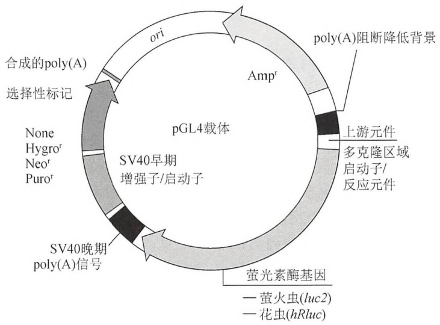
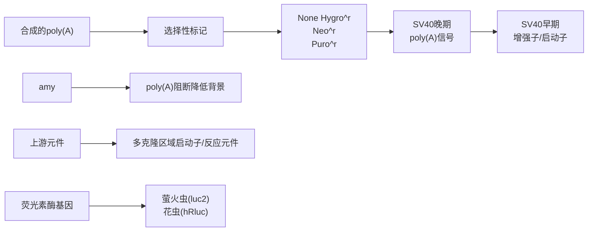
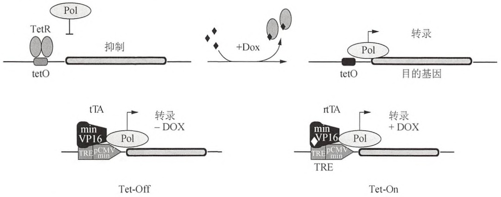
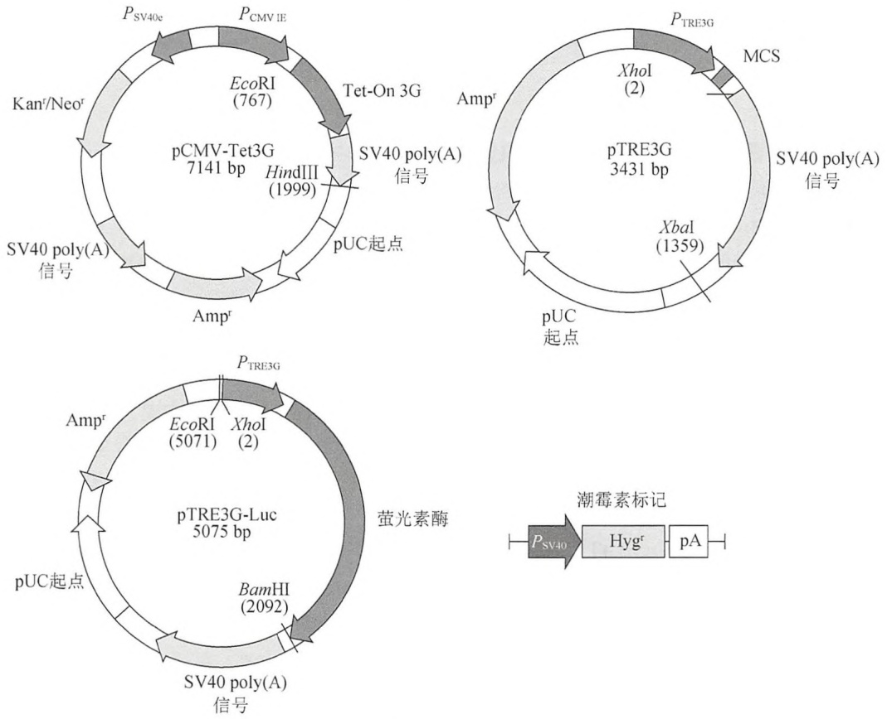
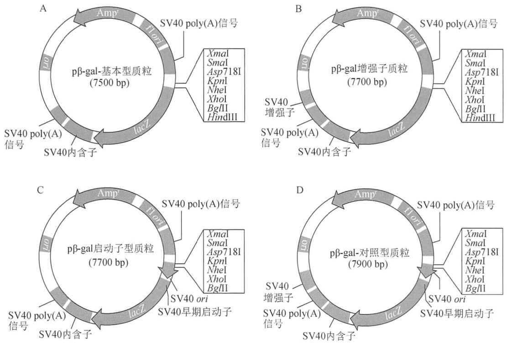
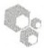

附录 1 试剂和缓冲液 …… 1507

附录2 常用技术 1533

附录3 检测系统 1541

附录 4 一般安全原则和危险材料……1565

索引 1573

## 下册

## 第 17 章 利用报道基因系统分析 基因表达调控

<table><tr><td rowspan="3">导言</td><td>报道基因系统简介</td><td>1103</td><td>哺乳动物细胞提取物中萤光素酶的测定</td><td>1106</td></tr><tr><td>报道基因在调控元件分析中的应用</td><td>1105</td><td>四环素应答表达系统</td><td>1108</td></tr><tr><td>哺乳动物细胞提取物中β-半乳糖苷酶的测定</td><td>1105</td><td></td><td></td></tr></table>

<table><tr><td rowspan="4">方案</td><td>1 哺乳动物细胞提取物中β-半乳糖苷酶的测定</td><td>1112</td><td>4 酶联免疫吸附试验定量检测绿色荧光蛋白</td><td>1128</td></tr><tr><td>● 附加方案 化学发光实验检测β-半乳糖苷酶活性</td><td>1115</td><td>5 用四环素调控基因表达建立细胞系</td><td>1131</td></tr><tr><td>2 单萤光素酶报道基因实验</td><td>1118</td><td>● 附加方案 有限稀释法筛选悬浮细胞的稳定克隆</td><td>1138</td></tr><tr><td>3 双萤光素酶报道基因实验</td><td>1123</td><td></td><td></td></tr></table>

<table><tr><td rowspan="3">信息栏</td><td>荧光蛋白</td><td>1140</td><td>萤光素酶</td><td>1162</td></tr><tr><td>表位标记</td><td>1152</td><td>四环素</td><td>1164</td></tr><tr><td>β-半乳糖苷酶</td><td>1158</td><td></td><td></td></tr></table>

## 导言

本章介绍的实验方法常用于检测和调控重组基因导入哺乳动物细胞中表达的蛋白质。方案1描述了一种β-半乳糖苷酶作为报道基因定量分析基因表达的方法。方案2和方案3提供了一种采用双萤光素酶替代β-半乳糖苷酶作为报道基因定量检测基因表达的方法。方案4展示了采用酶联免疫吸附试验（ELISA）的方法来定量检测绿色荧光蛋白（GFP）。最后，方案5说明如何利用四环素应答系统调控靶基因的表达。作为基因表达定性分析的主要手段，GFP等荧光蛋白的特性和实际应用在信息栏“荧光蛋白”中已有详细的描述。


## 报道基因系统简介

报道基因可以作为细胞转录活性的指示剂，因而报道基因系统常被用于分析基因的调控元件。标准的重组方法一般是将感兴趣的调控序列与报道基因或表达载体上的标签相连接。然后将此重组体导入合适的细胞系中，以便通过测量报道基因的蛋白或分析报道基因的酶相关催化活性来测定它的表达。一个理想的报道基因既要在感兴趣的细胞中没有内源性表达，又要易于对其检测，检测方法要兼顾敏感性、可定量、快速化、可重复性和安全性。在这些条件下，转染的细胞群中报道蛋白的活性与稳态的RNA水平大致上是成比例的。表17-1中列举出了基本符合这些标准的报道蛋白。报道基因常用于研究启动子和增强子的强度，顺式作用元件和反式作用蛋白的相互作用，以及它们对环境变化的反应。为了识别和鉴定启动子与增强子的特征及功能，相关序列被克隆到报道基因的上游或下游，当将其导入细胞之后，报道蛋白的表达量与被检测基因的转录活性密切相关。无论是将启动子-报道基因构建的DNA载体与克隆反式作用因子DNA的表达载体，或者与感兴趣的RNA共转染，还是采用通过改变（如样品的）培养条件来激活反式作用因子的方式，都可以对反式作用因子进行分析。与克隆到报道基因上游的目的基因的启动子区域结合的蛋白质也可能是转录因子。例如，当在一个载体上的HIV-1的Tat蛋白在转染细胞中表达时，由于在另一个构建的载体上HIV-1的LTR序列与一个报道基因相连接，因此该报道基因表达的蛋白活性增加时能够反映HIV-1的LTR序列表达蛋白活性的增加（Montefiori 2009）。当报道基因的启动子与靶基因无关，且这两个基因均被导入同一载体上时，那么报道基因也能作为靶基因导入细胞的指示剂。此时，报道基因和靶基因都是独立表达的，这一优点表现在靶基因仅在特殊条件下才表达的时候。另外，报道蛋白还常用于在不改变目的蛋白的特性和功能的同时，分析它们的细胞内定位并跟踪其转运路径。

表 17-1 常用报道基因的对比

| 报道基因 | 作用方式 | 优点 | 缺点 |
| --- | --- | --- | --- |
| 氯霉素乙酰基转移酶(CAT;细菌) | CAT 通过使乙酰基与抗生素共价连接的方式来解除氯霉素的毒性,报道基因实验通常检测 n-丁酰基的一半从辅助因子 n-丁酰辅酶 A 转移到具有放射活性的氯霉素上,被修饰的氯霉素的迁移率发生改变,并且能够掺入有机溶剂 | 没有内源活性;可使用自动化的 ELISA | 需添加底物;需破损样品;线性范围窄,只有三个数量级;不灵活;使用放射性同位素;可用非放射性检测,但敏感性差 |
| 分泌型碱性磷酸酶(SEAP;源于人胎盘的修饰酶) | 通常使用显色底物磷酸对硝基苯酯(pNPP)进行检测;而目前多被更敏感的化学发光底物,如1,2-二噁二酮CSPD取代 | 分泌型蛋白;允许在不同时间重复检测同一样品;可用便宜的比色法和高度敏感的荧光试验进行检测 | 在某些细胞中有内源性的活动;干扰测试的化合物的筛选 |
| 萤光素酶(lux;细菌) | 细菌性萤光素酶(luxAB)能够催化还原型核黄素磷酸($FMNH_2$)与长链脂肪醛的氧化,发出蓝绿色的光(波长为490nm)。将LuxAB基因与待测基因偶联,再加入长链醛基底物后,可检测发出的荧光。另外,若将全部的lux操纵子(lux CDABE)与启动子融合,则可为检测启动子的活动提供内源底物 | 在融合了整个操纵子(luxCDABE)后则不需要底物;敏感性非常高;原位无损伤监测;许多细胞中无内源性活性;更适合于检测与分析原核基因的转录 | 需氧;不耐热;含醛基的底物有毒;产生的光子不能对单细胞进行监测;比luc的线性范围窄;半衰期短;不适用于哺乳动物细胞;代谢成本高 |
| β-半乳糖苷酶(β-gal;细菌) | β-Gal能够催化β-半乳糖苷的水解反应,例如,乳糖可水解为两个单体。此报道基因的检测方法依赖于使用的底物,可使用显色法(例如,o-硝基苯基-β-D-半乳糖苷或ONPG),组化方法(例如,5-溴化-4-氯代-3-吲哚-β-D-半乳糖苷或X-Gal),荧光测定方法(例如,4-甲基伞形酮-β-D-半乳糖苷或MUG),化学发光法(例如,含1,2-二氧化物的底物),或电化学法(例如,p-氨基-β-D-半乳糖苷或PAPG) | 良好的特性与稳定性;多样化的读出过程;能在厌氧环境下发挥功能 | 需添加底物;有扩散性——需要将靶细胞进行隔离并使其通透化在哺乳动物细胞内的活性可能会干扰测定结果 |
| 萤光素酶(萤火虫的) | 催化萤光素酶的氧化,产生可被荧光光度计检测的光 | 高特异性;无内源性活性;动态范围广(7~8个数量级);无损伤,尽可能原位监测;价格比lux便宜;分析简便;可从多种生物中获取不同种类的萤光素酶 | 需要底物(萤光素)、氧气供应和ATP |
| 绿色荧光蛋白(GFP;水母)(自发荧光蛋白) | GFP作为辅助蛋白先吸收由初级发光蛋白aequorin释放的波长为470nm的蓝光,后释放波长为570nm的绿光。许多GFP衍生物和其他改变了光谱性质的自发荧光蛋白,在相应的激发波长的光线下,通过对样本曝光来发挥报道蛋白的功能 | 自发荧光(无需底物);无内源性活性;存在光谱特性变化的突变体;存在热稳定的突变体;较高的光稳定性;在现有光学系统下,原位无损伤可视化观察 | 需要翻译后修饰;敏感性低(不能进行信号放大);需要自发荧光的样品;需要用氧气来激发荧光;敏感性低于Lux、Luc、LacZ;反应时间慢于Lux和Luc |


## 报道基因在调控元件分析中的应用

大多数目前使用的报道基因分析是以测量生化反应的底物或报道蛋白自身所产生的光量子为基础的。该方法提供了所需的速率、准确度和敏感性等要求，特别适用于大规模的应用。例如，应用与机器人技术相结合的超灵敏光量子探测器、自动化液体处理装置，以及数据处理和控制软件，就能实施数百万样本量的快速高通量筛选（综述见 Alam and Cook 1990; East et al. 2008; Ghim et al. 2010）。光量子主要是在化学发光和荧光的过程中产生的。这两个过程的光量子都是从激发态分子轨道到低能轨道时发生能量转换而产生的。然而，它们的不同之处在于激发态轨道是如何形成的。在化学发光过程中，激发态是由化学反应的热能所产生，而荧光的激发态则是通过对光的吸收而产生。基于荧光的分析朝着亮度更高的方向发展，这是因为用于产生激发态的光量子能够以非常高的速率被样本所吸收。然而，这会导致背景更深而信号却相对较低，这主要是由于荧光计对样本吸收的高速率光量子和所分析荧光团发出的较少光量子无法进行区分。另一方面，化学发光反应的速率较慢，这使得其发光的亮度也相对较低，但该方法因为不需要光量子来产生激发态，所以它的背景较浅，相对于背景而言信号强度较高，能够精确检测光线的微小变化。化学发光分析更加适用于要求高敏感度、精确定量测定或多样本快速分析的实验。对于微观结构的图像分析，荧光几乎是普遍选择，这是由细胞结构的光学图像在很大程度上依赖于发射光的亮度所决定的。

方案 1 至方案 4 中广泛使用的三种报道基因: $\beta$ -半乳糖苷酶（lacZ）、萤光素酶和绿色荧光蛋白（GFP）。关于上述每一种蛋白质的更多详细内容可在本章末尾的信息栏中查阅。下一部分内容简要讨论了 $\beta$ -半乳糖苷酶的分析实验。至于萤光素酶的分析实验，则在本篇介绍的倒数第二部分进行了全面的阐述。

表位标记是另一种监测基因表达和蛋白质定位的方法。一个具有良好特性的表位标签可以作为兴趣蛋白的一部分表达，并参与针对特异性抗体的免疫反应。借助商业化的放射免疫测定，表位标记能够用于靶蛋白的免疫定位和定量检测。若要获取更多有关表位标记的信息，可以查阅 Bill Brizzard 在 2008 年发表的相关精彩评论，也可参阅信息栏中“表位标记”的有关内容。Chudakov 等在 2010 年发表的一篇综述为在基因表达分析中如何选择荧光蛋白这一问题提供了丰富的指导信息。

在一些商业网站上，如 Clontech 和 Life Technologies 公司的网上，可以搜索到利用表位标签和荧光蛋白构建融合载体的使用的详细说明，这两个公司生产的质粒占据大部分市场。


## 哺乳动物细胞提取物中β-半乳糖苷酶的测定

在转染研究中，通常使用大肠杆菌的β-半乳糖苷酶作为一种内参（Hall et al. 1983）。在经典的报道基因实验中，将含有连接真核基因启动子的报道基因的待测质粒，与少量含有连接组成型强启动子的β-半乳糖苷酶基因的质粒共转染哺乳动物细胞。经过一段时间让它们表达，可以在细胞裂解液中检测到待测质粒和对照质粒表达出的酶活性。将报道基因的活性除以β-半乳糖苷酶的活性，可以将报道基因的值进行标准化（见下）。CAT 和萤光素酶常作为报道基因与β-半乳糖苷酶一起使用。含有β-半乳糖苷酶基因的表达载体是可以获得的，该基因构建在多种真核细胞中，具有高表达活性的启动子（例如，SV40 的早期启动子、鲁斯氏肉瘤病毒长末端重复启动子，以及巨细胞病毒即刻早期启动子区域，有关质粒的描述见第 15 章方案 1 中图 15-1）的下游。

在大多数类型的哺乳动物抽提物中，内源性β-半乳糖苷酶的活性比较低，转染过程中酶活性经常能被检测到高达100倍的增加。通过努力，β-半乳糖苷酶也可以在某些特殊的、有很高内源性β-半乳糖苷酶活性的细胞（如肠内皮细胞和人胚肾293细胞）中作为内对照。因为内源性β-半乳糖苷酶的热不稳定性通常比细菌β-半乳糖苷酶的低，加热就可去掉内源性β-半乳糖苷酶，从而使对照质粒中表达的β-半乳糖苷酶仍然保留（Young et al. 1993）。此外，大多数哺乳动物的β-半乳糖苷酶与溶酶体结合，因此活性的最适pH是酸性的。大肠杆菌β-半乳糖苷酶的最适pH是中性或略偏碱性的。在pH为7.5时测量β-半乳糖苷酶的活性可以减弱哺乳动物β-半乳糖苷酶的影响。更详细的内容请参见信息栏中“β-半乳糖苷酶”的内容。

β-半乳糖苷酶的活性可用几种不同的方法对其报道基因进行标准化。其中一种方法是，首先对一系列转染细胞中一定量的蛋白质单独提取后进行测定和对比，然后采用标准量的蛋白质对报道基因和β-半乳糖苷酶分别测定分析。最后，用β-半乳糖苷酶的活性来标准化报道基因的活性（或报道蛋白的数量）。

另一种方法则是首先测定固定量提取物中β-半乳糖苷酶的活性，然后对含有相同β-半乳糖苷酶活性的提取物中报道基因进行检测分析。在固定量的提取物中，这两种方法可以任意选用，再将结果用确定的β-半乳糖苷酶的活性进行标准化（例如，将单位报道基因的活性除以单位β-半乳糖苷酶的活性）。在某些报道基因如萤光素酶中，使用不同的萤光素酶底物能够同时确定等份细胞裂解液中β-半乳糖苷酶和萤光素酶的含量。


## 哺乳动物细胞提取物中萤光素酶的测定

萤光素酶催化的生物荧光反应是以 dioxetane 结构的形成和分解为基础的（详细内容请见信息栏 “萤光素酶”）。在许多实验室中，萤光素酶都是报道基因的最佳选择。

- 与其他常用的报道基因相比，萤光素酶测定是最敏感的测定之一。萤光素酶突出的高敏感性测定适用于:弱启动子分析，使用少量 DNA 和细胞的转染研究，以及对低转染率细胞系的检测。
- 检测萤光素酶不需使用放射性物质。
- 萤光素酶的半衰期短（<3h），启动子活性下调后，酶活性能够迅速降低，这是一个非常有用的特性。当该启动子的活性应对某个信号下调时，可利用该特性对启动子活性进行分析。
- 能生成单参数的测量值，因此采用96-、384-或1536-孔板进行高通量筛选时，基于萤光素酶的检测是理想的选择。广泛用于高通量筛选的萤光素酶都来源于甲虫（包括萤火虫）、花虫（海肾属）和水母等物种（de Wet et al. 1987; Bronstein et al. 1994; Himes and Shannon 2000）。

通常，使用的缓冲液中含有裂解细胞的去垢剂和启动发光反应的萤光素酶底物，加入缓冲液后可以对细胞内的萤光素酶进行定量。因为在添加试剂之前无需进行样本处理，所以这些应针对报道基因的检测较为方便，只需加入试剂就能读出荧光结果。因为副反应可能产生游离的基团，引起酶的不可逆性失活，所以荧光可以缓慢衰减。为了使荧光的稳定时间延长数分钟至数小时，就需要对荧光反应进行一定程度的抑制，以便降低荧光衰退的速率，从而避免因检测多个样本，随时间的增加影响测量的结果。例如，砷酸盐抑制剂能够降低荧光反应中闪光的亮度，加入一定量的ATP后能够延长发光时间。甚至在这种条件下，每个样本仅有不超过 $10^{-20}\mathrm{mol}$ 萤光素酶的条件下，仍可以被检测到。这相当于每个细胞约大概含有10个分子的萤光素酶。作为一种选择，稳定剂（例如，辅因子辅酶A，即CoA）已被数家商业制造商所利用，它能阻止脱氢萤光素——一种重要的萤火虫萤光素的污染物，对萤光素酶的抑制。目前所使用的萤光素都是合成制备的，一定程度上不含有脱氢萤光素。

某些萤光素酶检测系统包括两种物种的萤光素酶，它们具有不同生化特性和/或不同底物。另外，每种萤光素酶都由不同的载体表达。若用一种萤光素酶作为“对照组”，则另一种即为“实验报告组”。对照组萤光素酶的表达用于对实验报告组的结果标准化，如变异的细胞数或转染效率。当把对照组的载体与实验组的载体共转染时，对照组的报道基因由组成型启动子驱动。另一种情况是同一质粒表达出两种萤光素酶，这种情况下实验组基因与萤火虫萤光素酶相连，组成型真核启动子与对照萤光素酶相连。总的来说，双报道基因测定通过以下几个方面提高了实验的准确性和效率:①减少了实验中的一些能使某些重要关联变模糊的因素；②去除实验体系中固有的干扰现象；③消除了不同样本之间因转染效率或细胞活性引起的差异。

最常用的双报道基因是检测萤火虫和花虫的萤光素酶活性。这些萤光素酶使用不同的底物（萤火虫和花虫的萤光素酶的底物分别是甲虫萤光素和 coelantrazine），因此根据各自的酶活特性，可以将这些萤光素酶的活性进行区分。这种方法需要每个样本依次加入两种试剂，并在每次加入试剂后均检测所发出的荧光。加入第一种试剂会激活萤火虫萤光素酶的反应；再加入第二种试剂会猝灭萤火虫萤光素酶的活性，转而启动花虫萤光素酶的反应。在某些情况下，只需加入单一底物，就能检测到两种萤光素酶都被激活。这可减少整体检测量和所需处理的液体量。经过改良后的甲虫萤光素酶（Chroma-Luc $^{1}$  System; Promega）能够和萤火虫萤光素酶及一种通用底物联合应用，因为这两种萤光素酶所发出的红光和绿光很容易区分。这两个萤光素酶高度类似的结构确保了它们对细胞内的生化改变也有着相似的反应，有利于结果的标准化。

荧光光度计或有单光子计数能力的普通闪烁计数器常用于检测光萤光素酶的反应中所发出的光。目前，光度计的超灵敏性以及能够针对多孔板进行大量检测处理，使它们成为了萤光素酶测定的最好的工具。某些荧光光度计可以直接将试剂加入到细胞裂解液内（如Promega的GloMax 961微板光度仪）。一些将试剂加入后定时检测信号的自动化操作有助于提高结果的一致性。当萤光素酶的浓度在 $10^{-20}$ 至 $10^{-13}\mathrm{mol}$ （0.001pg）的范围的时候，所能检测的光线亮度和有效线性范围都与萤光素酶的浓度是成比例的，但普通闪烁计数器的灵敏性却较低。然而灵敏性的限度可根据所使用的仪器发生变化。在对实验样品进行分析之前，应该确定每个仪器的测量限度。商业化的荧光光度计有许多种类型。虽然这些设备相当昂贵，但分析的速度却可能使一台机器有可能被数个实验室所共享。例如，Promega公司生产的GloMax荧光光度计可以检测萤火虫和海肾的萤光素酶。

萤光素酶报告测定经过了许多次改良，包括加入改变反应中的发光动力学的辅酶 A（Wood 1991），使用稳定萤光素酶的小分子。另外，还通过修饰萤光素酶的 cDNA 序列对用于哺乳动物细胞表达的萤光素酶进行了优化，具体方法包括:除去过氧化物酶靶向的序列，消除预测会形成 RNA 二级结构的序列，增添最佳的翻译起始序列（Kozak 序列），将昆虫最适的三联密码子替换成哺乳动物的最适密码子，萤光素酶 cDNA 的上、下游插入多聚腺苷酸序列，去掉该 cDNA 内的限制性酶切位点。一个含有高度修饰的萤光素酶 cDNA 的商品化的萤光素酶载体范例就是 Promega 公司生产的 pGL4 系列载体（图 17-1）。

为实验选择合适的萤光素酶载体需要考虑以下几个方面:

- 要做单个还是两个萤光素酶测定；
- 主要使用哪个报道基因（萤火虫或海肾的萤光素酶）；
- 所研究的调控元件是启动子元件还是无启动子的增强子元件，在什么情况下载体中已包括 TATA 启动子；

<small><span class="docvortex-page-footnote" data-block-type="page_footnote" style="color:#6b7280">1 http://www.promega.com/aboutus/corporate/trademarks/.</span></small>



<details>
<summary>flowchart</summary>


</details>

图 17-1 基因图谱显示了 pGL4 载体系列的特征。pGL4 载体包括:①无启动子的基本载体，含有针对所选启动子的多克隆位点；②含有一个最小启动子的载体；③含有反应元件和一个最小启动子的载体；④含有启动子的载体，可用于表达对照或共报告载体。该载体包括合成的 luc2 或 hRluc 报道基因和一个哺乳动物选择性标记基因（hygromycin, neomycin, or puromycin resistance）。关于上述载体的信息，参见 http://www.promega.com/tbs/tm259/tm259.pdf. 潮霉素、新霉素或嘌呤霉素抗性。

- 所研究的启动子是弱启动子（那么信号强度需要调至最大）还是强启动子（将会快速获取表达的报道蛋白）；
- 是否需要稳定的细胞系；
- 优先选择哪种标记物。

步骤 2 和步骤 3 阐述了一些方法，用于检测转染于乳动物细胞中的 pGL4 载体内所表达萤光素酶（图 17-1）。步骤 2 阐述了一种检测由单一萤光素酶报道基因所表达的萤光素酶的方法，能获得细胞中基因表达数据，不但速度很快，而且相对便宜。步骤 3 阐述了一种双报道基因检测，可采用萤火虫和花虫的萤光素酶报道基因。


## 四环素应答表达系统

如果认真地建立并谨慎地使用四环素应答表达系统，它是一种很好的对转染到真核细胞中的基因保持调控的方法。下面讨论的系统（方案5中所采用的）是经过几年发展起来的，已经成功地在很多生物中用于调控基因表达，包括培养的哺乳动物细胞、两栖类细胞、植物细胞（Baron and Bujard 2000; Gossen and Bujard 2002）和酿酒酵母（Gossen and Bujard 2002; Ariño and Herrero 2003）；转基因生物包括果蝇（Landis 2003）、鱼类（Knopf et al. 2010）和植物（Weinmann et al. 1994; Zeidler et al. 1996）；被直接转入特定基因的哺乳动物组织（Stieger et al. 2009）；转基因老鼠（Sun et al. 2007; Schönig et al. 2010）和非人灵长类动物（Favre et al. 2002; Steiger et al. 2006）。在使用基于四环素的表达系统时，要注重对mRNA半衰期的测定（如Chen et al. 2008）。有关可诱导表达的更全面信息，可参见Vilaboa和Voellmy（2006）及Gonzalez-Nicolini等（2006）。

在 2011 年，已发表的（http://www.tetsystems.com/support/references/）成功应用四环素激活系统的范例已超过了 8000 例，其内容涉及在培养细胞或转基因动物中进行的疾病模型、药物筛选、RNA 干扰和大量的基因功能研究。

在大肠杆菌中，当缺失四环素时，来源于转座子10（Tn10）的Tet抑制蛋白，通过锚定抑制Tn10上的四环素抗性操纵子中的基因转录（图17-2，上图）。商业化Tet系统的技术（源于 Clontech；借助 TET 系统的发展）就是基于这个系统的，它由两个完整的控制环路组成，最初定义为 tTA-依赖（Gossen and Bujard 1992）和 rtTA-依赖（Gossen et al. 1995）的表达系统。目前它们通常指方案 5 中采用的“Tet-Off 系统”（如 tTA-dependent）和“Tet-On 系统” 2（如 rtTA-dependent），对于不同的 Tet 诱导系统及它们的发展历史等详细信息的说明，请参见信息栏“四环素”的内容。

## Tet-On 和 Tet-Off 系统

在每一种系统中（Tet-On 和 Tet-Off），重组四环素调控的转录因子（tTA 或 rtTA）通过与 tTA/rtTA-应答启动子  $P_{TRE}$  相互作用，激活所研究的基因表达（图 17-2）。上述表达可以被效应分子四环素或其衍生物[例如，多西环素（Dox）所调控（请参见信息栏“四环素”的内容）]。四环素是以改变 tTA 和 rtTA 转录因子与 DNA 的亲和性的方式来发挥作用的。当 rtTA 与 Dox 相结合时，蛋白质的构象会发生变化，以便与  $P_{TRE}$  相结合，从而激活转录。与此明显相反的是，tTA 和  $P_{TRE}$  的相互作用仅发生在 Dox 缺失的时候。换句话说，在 Tet-Off 系统中，Dox 存在时，系统的基本状态得以维持；排除 Dox 时，系统被诱导。在 Dox 存在的情况下，Tet-On 系统可被激活。



<details>
<summary>flowchart</summary>


</details>

图17-2 四环素调控基因表达的原则。Tet调控的转录激活因子是包含了一个可与DNA结合的TetR结构域的融合蛋白，且该结构域参与构成HSVVP16中最小的转录激活结构域。在最近生产的Tet开关中对哺乳动物细胞基因表达中每一种转录激活因子都进行了优化，存在时会被激活。在Tet-Off系统中，多西环素存在时使系统维持在基本状态，而撤除多西环素时系统被诱导激活。Tet-On系统在多西环素存在时被活化。

如图 17-2 所示（下图），两种依赖 Tet 的调控环路是由四个基本元件组成的 $^{1}$ 。

- tTA（或 Tet-Off）是一种耦合转录因子，它是由原核的 Tet 抑制子——TetR 与真核的转录激活结构域（目前最普遍使用的是 HSV VP16 的酸性结构域）相融合而成的。TetR 模体能与特定序列的 DNA 结合，对四环素敏感，并与 tTA 融合蛋白形成二聚体。因此，TetR 和 tTA 对四环素的反应相类似:与抗生素结合后，与它们的同源结合位点——tet 操纵子（tetO）的亲和力降低。
- rtTA（或 Tet-On）与 tTA 的不同之处在于它的 TetR 内有四个突变位点。这使转录因子对四环素的反应产生了完全相反的效应。rtTA 需要借助四环素才能与 tetO 相结合。值得关注的是，特定的四环素衍生物，如多西环素（Dox）或无水四环素 ATc，可用于 rtTA 的表型优化的开发。
- $P_{\mathrm{TRE}}$ 是一种响应 tTA 和 rtTA 的合成启动子。它是由一个最小形式的 RNA 聚合酶 II的启动子组成的，如巨细胞病毒（CMV）启动子，它在缺少额外与多聚 tetO 序列融合的转录因子结合位点时会转录沉默。这种设计使  $P_{TRE}$  的活性依赖于与 tTA 或 rtTA 的结合。这种合成响应 tTA/rtTA 的启动子，它在启动子的复制起始点的选择，以及操纵子的精确排列顺序等方面的设计很是灵活。最开始的版本是由一个 CMV 最小形式的启动子融合了 7 个 tetO 序列所组成的，被称为  $P_{tet-1}$  (Gossen and Bujard 1992)。

<small><span class="docvortex-page-footnote" data-block-type="page_footnote" style="color:#6b7280">1 Tet-On and Tet-Off are trademarks of Clontech Laboratories, Inc; www.clontech.com/US/Support/Trademarks.</span></small>

\- 多西环素作为四环素的一种衍生物，目前已成为了 Tet-On 和 Tet-Off 系统的首选效应物。即使 Tet-Off 系统所处的浓度低至 1～2ng/mL，Tet-On 系统所处的浓度 ≥80ng/mL 时，它仍能以高度的亲和力与 tTA 和 rtTA 相结合，并完全发挥其效应。

## 建立 Tet 系统基因稳定表达的细胞系

瞬时转染的细胞中，Tet系统的动态范围比在整合有靶基因拷贝及其反式激活因子的稳定细胞系中小得多（如Freundlieb et al. 1999）。为了使抑制状态和诱导状态的差异达到1000倍，必须建立整合有tTA或rtTA基因和靶基因拷贝的稳定细胞系。可以采用两种方式。

1. 把感兴趣的靶基因克隆到“应答”质粒中，该质粒带有一个复合启动子，通常由7个串联的tetO拷贝和巨细胞病毒极早期启动子构成（图17-3A）。把编码反式激活蛋白tTA/rtTA的基因克隆到另一个“调控”质粒中，放在合适的哺乳动物启动子下游（图17-3B）。然后用这两个质粒转染选定的哺乳动物细胞，建立双稳定细胞系；转染通常分两个阶段:首先，调控质粒用于建立能组成型表达tTA的稳定细胞系；然后用应答质粒转染这些细胞，进一步筛选亚细胞系，这些亚细胞系能够在不含四环素或多西环素时依赖反式激活因子的表达而表达需要量的靶基因产物。在某些情况下，使用已建立的整合有调控质粒拷贝的细胞系可以减少顺序转染和筛选的工作量（如Gossen and Bujard 1992; Wu and Chiang 1996）。Clontech公司有几个这种类型的细胞系出售。



<details>
<summary>flowchart</summary>

```mermaid
graph TD
  subgraph Left(("pCMV-Tet3G"))
  A["EcoRI (767)"] --> B["Kanr/Neor"]
  B --> C["SV40 poly(A) 信号"]
  C --> D["HindIII (1999)"]
  D --> E["pUC起点"]
  E --> F["Ampr"]
  end

  subgraph Right(("pTRE3G"))
  G["XhoI (2)"] --> H["MCS"]
  H --> I["SV40 poly(A) 信号"]
  I --> J["Xbal (1359)"]
  J --> K["pUC起点"]
  end

  subgraph Bottom(("pTRE3G-Luc"))
  L["EcoRI (5071)"] --> M["XhoI (2)"]
  M --> N["BamHI (2092)"]
  N --> O["SV40 poly(A) 信号"]
  O --> P["pUC起点"]
  end

  subgraph Right
  Q["P_{SV40}"] --> R["Hyg^r"]
  R --> S["pA"]
  end

  subgraph Right
  T["潮霉素标记"] -.-> R
  U["荧光素酶"] -.-> N
  V["pUC起点"] -.-> O
  W["pUC起点"] -.-> O
  X["Ampr"] -.-> O
  Y["Ampr^r"] -.-> O
  Z["pUC起点"] -.-> O
  AA["pUC起点"] -.-> O
  AB["pUC起点"] -.-> O
  AC["pUC起点"] -.-> O
  AD["pUC起点"] -.-> O
  AE["pUC起点"] -.-> O
  AF["pUC起点"] -.-> O
  AG["pUC起点"] -.-> O
  AH["pUC起点"] -.-> O
  AI["pUC起点"] -.-> O
  AJ["pUC起点"] -.-> O
  AK["pUC起点"] -.-> O
  AL["pUC起点"] -.-> O
  AM["pUC起点"] -.-> O
  AN["pUC起点"] -.-> O
  AO["pUC起点"] -.-> O
  AP["pUC起点"] -.-> O
  AQ["pUC起点"] -.-> O
  AR["pUC起点"] -.-> O
  AS["pUC起点"] -.-> O
  AT["pUC起点"] -.-> O
  AU["pUC起点"] -.-> O
  AV["pUC起点"] -.-> O
  AW["pUC起点"] -.-> O
  AX["pUC起点"] -.-> O
  AY["pUC起点"] -.-> O
  AZ["pUC起点"] -.-> O
  BA["pUC起点"] -.-> O
  BC["pUC起点"] -.-> O
  BD["pUC起点"] -.-> O
  BE["pUC起点"] -.-> O
  BF["pUC起点"] -.-> O
  BG["pUC起点"] -.-> O
  BH["pUC起点"] -.-> O
  BI["pUC起点"] -.-> O
  BJ["pUC起点"] -.-> O
  BK["pUC起点"] -.-> O
  BL["pUC起点"] -.-> O
  BM["pUC起点"] -.-> O
  BN["pUC起点"] -.-> O
  BO["pUC起点"] -.-> O
  BP["pUC起点"] -.-> O
  BR["pUC起点"] -.-> O
  BC["pUC起点"] -.-> O
  BD["pUC起点"] -.-> O
  BE["pUC起点"] -.-> O
  BF["pUC起点"] -.-> O
  BG["pUC起点"] -.-> O
  BH["pUC起点"] -.-> O
  BI["pUC起点"] -.-> O
  BJ["pUC起点"] -.-> O
  BK{"P_{SV40}}" --> R
  R --> S((End))
  S --> T((End))
  T --> U((End))
  U --> V((End))
  V --> W((End))
  W --> X((End))
  X --> Y((End))
  Y --> Z((End))
  Z --> AA((End))
  AA --> AB((End))
  AB --> AC((End))
  AC --> AD((End))
  AD --> AE((End))
  AE --> AF((End))
  AF --> AG((End))
  AG --> AH((End))
  AH --> AI((End))
  AI --> AJ((End))
  AJ --> AK((End))
  AK --> AL((End))
  AL --> AM((End))
  AM --> AN((End))
  AN --> AO((End))
  AO --> AP((End))
  AP --> AQ((End))
  AQ --> AR((End))
  AR --> AS((End))
  AS --> AT((End))
  AT --> AU((End))
  AU --> AV((End))
  AV --> AW((End))
  AW --> AX((End))
  AX --> AY((End))
  AY --> AZ((End))
  AZ --> BA((End))
  BA --> BB((End))
  BB --> BC((End))
  BC --> BD((End))
  BD --> BE((End))
  BE --> BF((End))
  BF --> BG((End))
  BG --> BH((End))
  BH --> BI((End))
  BI --> BK((End))
  BK --> BL((End))
  BL --> BM((End))
  BM --> BN((End))
  BN --> BI2((End))
  BI2 --> BM2((End))
  BM2 --> BN2((End))
  BN2 --> BN3((End))
  BN3 --> BN4((End))
  BN4 --> BN5((End))
  BN5 --> BN6((End))
  BN6 --> BN7((End))
  BN7 --> BN8((End))
  BN8 --> BN9((End))
  BN9 --> BN10((End))
```
</details>

图 17-3 Tet-On 3G 载体。

2. 此外，反式激活因子基因和靶基因可以克隆在单个质粒中。因为这样两个基因可以同时转染哺乳动物细胞，省去了一轮乏味的筛选工作。而且，也可以减少由于调控基因和靶基因分别整合在不同的染色体位点而造成的表达差异（Schultze et al. 1996）。

无论用单个质粒还是两个质粒建立的稳定细胞系，使靶基因获得最大表达并不需要所有的串联tetO序列都结合tTA分子。每个细胞含有 $6000\sim 10000$ 个tTA分子使整合拷贝应答质粒的表达水平提高 $10^{5}$ 倍。事实上，更大量四环素依赖的反式激活因子可能是有毒性的（请见Howe et al. 1995; Shockett et al. 1995; Saez et al. 1997）。

所有的诱导表达系统对感兴趣的基因的表达都有一定程度的疏漏。多种因素都会导致背景的颜色加深，包括两个内在因素——载体设计和主要核酸序列，还有外在因素——细胞类型和染色体整合位点（请见信息栏“四环素”的内容）。


## 致谢

感谢 Promega 公司的 Kevin Kopish 和 Clontech Laboratories 的 Baz Smith 在技术及撰写方面的支持，感谢 Ryan Chong 和耶鲁大学医学院在本章信息栏“荧光蛋白”部分图 2 中提供的图片。

## 参考文献

- Alam J, Cook JL. 1990. Reporter genes: Application to the study of mammalian gene transcription. Anal Biochem 188: 245–254.
- Ariño J, Herrero E. 2003. Use of tetracycline-regulatable promoters for functional analysis of protein phosphatases in yeast. Methods Enzymol 366: 347–358.
- Baron U, Bujard H. 2000. Tet repressor-based system for regulated gene expression in eukaryotic cells: Principles and advances. Methods Enzymol 327: 401–427.
- Brizzard B. 2008. Epitope tagging. BioTechniques 44: 693–695.
- Bronstein I, Fortin J, Stanley PE, Stewart GSAB, Kricka LJ. 1994. Chemiluminescent and bioluminescent reporter gene assays. Anal Biochem 219: 169–181.
- Chen CY, Ezzeddine N, Shyu AB. 2008. Messenger RNA half-life measurements in mammalian cells. Methods Enzymol 448: 335–357.
- Chudakov DM, Matz MV, Lukyanov S, Lukyanov KA. 2010. Fluorescent proteins and their applications in imaging living cells and tissues. Physiol Rev 90: 1103–1163.
- de Wet JR, Wood KV, DeLuca M, Helinski DR, Subramani S. 1987. Firefly luciferase gene: Structure and expression in mammalian cells. Mol Cell Biol 7: 725–737.
- East AK, Mauchline TH, Poole PS. 2008. Biosensors for ligand detection. Adv Appl Microbiol 64: 137–166.
- Favre D, Blouin V, Provost N, Spisek R, Porrot F, Bohl D, Marmé F, Chérel Y, Salvetti A, Hurtrel B, et al. 2002. Lack of an immune response against the tetracycline-dependent transactivator correlates with long-term doxycycline-regulated transgene expression in nonhuman primates after intramuscular injection of recombinant adeno-associated virus. J Virol 76: 11605–11611.
- Freundlieb S, Schirra-Müller C, Bujard H. 1999. A tetracycline controlled activation/repression system with increased potential for gene transfer into mammalian cells. J Gene Med 1: 4–12.
- Ghim CM, Lee SK, Takayama S, Mitchell RJ. 2010. The art of reporter proteins in science: Past, present and future applications. BMB Rep 43:451–460.
- Gonzalez-Nicolini V, Sanchez-Bustamante CD, Hartenbach S, Fussenegger M. 2006. Adenoviral vector platform for transduction of constitutive and regulated tricistronic or triple-transcript transgene expression in mammalian cells and microtissues. J Gene Med 8:1208–1222.
- Gossen M, Bujard H. 1992. Tight control of gene expression in mammalian cells by tetracycline-responsive promoters. Proc Natl Acad Sci 89:5547–5551.
- Gossen M, Bujard H. 2002. Studying gene function in eukaryotes by conditional gene inactivation. Annu Rev Genet 36: 153–173.
- Gossen M, Freundleib S, Bender G, Müller G, Hillen W, Bujard H. 1995. Transcriptional activation by tetracyclines in mammalian cells. Science 268: 1766–1769.
- Hall CV, Jacob PE, Ringold GM, Lee F. 1983. Expression and regulation of Escherichia coli lacZ gene fusions in mammalian cells. J Mol Appl Genet 2: 101–109.
- Himes SR, Shannon MF. 2000. Assays for transcriptional activity based on the luciferase reporter gene. Methods Mol Biol 130: 165–174.
- Howe JR, Skryabin BV, Belcher SM, Zerillo CA, Schmauss C. 1995. The responsiveness of a tetracycline expression system differs in different cell lines. J Biol Chem 270: 14168–14174.
- Knopf F, Schnabel K, Haase C, Pfeifer K, Anastassiadis K, Weidinger G. 2010. Dually inducible TetON systems for tissue-specific conditional gene expression in zebrafish. Proc Natl Acad Sci 107: 19933–19938.
- Landis GN, Bhole D, Tower J. 2003. A search for doxycycline-dependent mutations that increase Drosophila melanogaster life span identifies the VhaSFD, Sugar baby, filamin, fwd and Cctl genes. Genome Biol 4: R8. doi: 10.1186/gb-2003-4-2-r8.
- Montefiore DC. 2009. Measuring HIV neutralization in a luciferase reporter gene assay. Methods Mol Biol 485: 395–405.
- Saez E, No D, West A, Evans RM. 1997. Inducible gene expression in mammalian cells and transgenic mice. Curr Opin Biotechnol 8: 608–616.
- Schönig K, Bujard H, Gossen M. 2010. The power of reversibility regulating gene activities via tetracycline-controlled transcription. Methods Enzymol 477: 429–453.
- Schultze N, Burki Y, Lang Y, Certa U, Bluethmann H. 1996. Efficient control of gene expression by single-step integration of the tetracycline system in transgenic mice. Nat Biotechnol 14: 499–503.
- Shockett P, Difilippantonio M, Hellman N, Schatz D. 1995. A modified tetracycline-regulated system provides autoregulatory, inducible gene expression in cultured cells and transgenic mice. Proc Natl Acad Sci 92: 6522–6526.
- Stieger K, Le Meur G, Lasne F, Weber M, Deschamps JY, Nivard D, Mendes-Madeira A, Provost N, Martin L, Moullier P, Rolling F. 2006. Long-term doxycycline-regulated transgene expression in the retina of nonhuman primates following subretinal injection of recombinant AAV vectors. Mol Ther 13: 967–975.
- Stieger K, Belbellaa B, Le Guiner C, Moullier P, Rolling F. 2009. In vivo gene regulation using tetracycline-regulatable systems. Adv Drug Deliv Rev 61: 527–541.
- Sun Y, Chen X, Xiao D. 2007. Tetracycline-inducible expression systems: New strategies and practices in the transgenic mouse modeling. Acta Biochim Biophys Sin (Shanghai) 39: 235–246.
- Vilaboa N, Voellmy R. 2006. Regulatable gene expression systems for gene therapy. Curr Gene Ther 6: 421–438.
- Weinmann P, Gossen M, Hillen W, Bujard H, Gatz C. 1994. A chimeric transactivator allows tetracycline-responsive gene expression in whole plants. Plant J 5: 559–569.
- Wood KV. 1991. The origin of beetle luciferases. In Bioluminescence and chemiluminescence: Current status (ed Stanley P, Kricka L), pp. 11–14. Wiley, Chichester, UK.
- Wu S-Y, Chiang C-M. 1996. Establishment of stable cell lines expressing potentially toxic proteins by tetracycline-regulated and epitope-tagging methods. BioTechniques 21: 718–725.
- Young DC, Kingsley SD, Ryan KA, Dutko FJ. 1993. Selective inactivation of eukaryotic β-galactosidase in assays for inhibitors of HIV-1 TAT using bacterial β-galactosidase as a reporter enzyme. Anal Biochem 215: 24–30.
- Zeidler M, Gatz C, Hartmann E, Hughes J. 1996. Tetracycline-regulated reporter gene expression in the moss Physcomitrella patens. Plant Mol Biol 30: 199–205.

## 方案 1 哺乳动物细胞提取物中β-半乳糖苷酶的测定

本方案中包含了数种检测哺乳动物细胞中报道基因载体表达的β-半乳糖苷酶活性的方法。第一种方法简单快捷，能在可见光的光谱分析仪上进行观察。值得一提的是，有些制造商销售一些相对比较便宜的试剂盒，用来检测哺乳动物细胞裂解液中的β-半乳糖苷酶（例如，Sigma-Aldrich生产的β-半乳糖苷酶报道基因活性检测试剂盒；Life Technologies公司的β-半乳糖苷酶检测试剂盒）。许多试剂盒都含有相同的反应缓冲液，我们把它们列出来并附在本方案中。与此同时，有些试剂盒由于含有特定的细胞裂解液，因此具有多种底物酶检测功能，包括β-半乳糖苷酶、氯霉素乙酰基转移酶、萤光素酶等（例如，来自Promega公司的含有报道基因裂解缓冲液的β-半乳糖苷酶检测系统）。方案中另一种检测真核生物细胞裂解液中的β-半乳糖苷酶的方案是利用化学发光的方法，此方法具有高度的酶学检测灵敏性和高通量检测的可行性，因此较比色法检测β-半乳糖苷酶更为通用。许多公司出售的试剂盒中包含了β-半乳糖苷酶的发光底物（例如，Promega公司的β-乙二醛酶 $^{1}$ 检测系统，Clontech公司的发光的 $^{®}$ -半乳糖苷酶检测试剂盒II）。

## ONPG

邻硝基苯酚-β-半乳糖苷酶（ONPG）是最广泛应用于检测真核和原核细胞中的β-半乳糖苷酶的反应底物。ONPG本身无色，经过水解反应后产生邻硝基苯酚，后者在碱性溶液中的颜色呈现为黄色(其中在pH 10.2时最大吸收光波长为420nm)(更多关于ONPG水解过程的介绍，可参见信息栏“β-半乳糖苷酶”)。当ONPG的含量过量时，反应溶液的 $OD_{420}$ 值随着反应时间和β-半乳糖苷酶浓度呈现线性增长(详见Lederberg 1950; Hestrin et al. 1955; Pardee et al. 1959; Miller 1972, 1992文献报道)。整个反应可以通过添加 $Na_{2}CO_{3}$ 浓缩液而终止， $Na_{2}CO_{3}$ 的添加使得反应溶液的pH上调至约11，从而灭活β-半乳糖苷酶，使邻硝基苯酚在420nm处的吸收值最大。


## 材料

为正确使用本方案中的器材和危险试剂，必须查阅相应的材料安全数据表并咨询所在机构的环境卫生和安全办公室。

本方案的专用试剂标注&lt;R&gt;，配方在本方案末提供。常用储备溶液、缓冲液和试剂标注&lt;A&gt;，配方见附录1。储备溶液应稀释至适用浓度后使用。

## 试剂

β-半乳糖苷酶，大肠杆菌（如来自 Sigma-Aldrich 公司）

转染了目的 DNA 的哺乳动物细胞

使用本书中第 15 章的转染方法将含有β-半乳糖苷酶报道基因的质粒转染细胞（例如，Clontech 公司的系列 pβ-半乳糖苷酶报道载体，见图 17-4）。通常我们建议转染以及后续的报道基因检测实验进行三次的重复，便于以后的统计学分析。

裂解缓冲液&lt;R&gt;

<small><span class="docvortex-page-footnote" data-block-type="page_footnote" style="color:#6b7280">1 http://www.promega.com/aboutus/corporate/trademarks.</span></small>



图 17-4 pβ-gal 载体系列真核表达载体。本图系统总结了携带β-半乳糖苷酶的编码基因的pβ-gal报道基因载体的特点。该系列的所有载体均含有:①来自于丝状噬菌体的复制起始位点（fl ori）；②来自于大肠杆菌的质粒复制起始位点（ori）；③SV40 复制起始位点，便于在哺乳动物细胞中的复制；④在原核细胞中的氨苄酶素抗性筛选标记（Amp$^{R}$）；⑤多聚腺苷酸（poly A）的附加信号添加在lacZ位点的5'上游，用于降低来自上游序列的通读转录所造成的背景。待测的DNA序列被克隆至lacZ基因5'端的多克隆位点（MCS）中。具体图谱介绍如下:（A）pβ-gal基本型质粒，该质粒缺失真核启动子和增强子序列。该质粒被用于作为阴性对照质粒或者作为载体研究克隆的启动子。（B）pβ-gal增强子质粒，缺失SV40启动子但是含有SV40增强子。这个载体可被用于研究克隆的启动子序列。（C）pβ-gal-启动子型质粒，该质粒缺失SV40增强子但是含有SV40启动子。这个质粒可以用来检测克隆的增强子活性。（D）pβ-gal对照型质粒含有SV40的早期启动子和增强子，可以用来作为阳性对照检测和比较不同的启动子及增强子原件对于基因表达的调控活性差异。

裂解液&lt;R&gt;

$\mathrm{Mg}^{2+}$ 溶液（$100\times$）

$MgCl_{2}$ （0.1mol/L）/β-巯基乙醇（4.5mol/L）

在使用前，从 14.7mol/L 储存液中添加合适剂量的β-巯基乙醇。

$$
\mathrm{Na} _ {2} \mathrm{CO} _ {3} (1 \mathrm{mol/L}) <   \mathrm{R}>
$$

$$
\mathrm{ONPG(1\times)} <   \mathrm{R} >
$$

具体参见信息栏 “ONPG” 和 “β-半乳糖苷酶底物”。

无钙盐和镁盐的磷酸盐缓冲液（PBS）

磷酸钠缓冲液（0.1mol/L,pH 7.5）&lt;A&gt;

Tris-Cl (1mol/L,pH 7.8)

## 设备

## 荧光光度计

该实验方法应用于管状或是平板的荧光光度计，如果使用平板型荧光光度计，需要使用不透明性 96 孔微量滴定板，并且需要多通道移液器保证试剂的加样速度及混合的均一性。

## β-半乳糖苷酶底物

这套检测方法基于大肠杆菌中的β-半乳糖苷酶水解 ONPG 从而释放邻硝基苯酚和β-D-半乳糖（Lederberg 1950）。在水溶液中邻硝基苯酚呈现黄色，并且最大吸光光度值在420nm。从 Lederberg 发明该项检测方法至今，更灵敏的检测β-半乳糖苷酶活性的底物（见信息栏“β-半乳糖苷酶”）已被开发并广泛应用于商品化的试剂盒中。利用化学发光或荧光性底物的检测方法比传统的利用 ONPG 的检测方法更为灵敏，同样β-半乳糖苷酶的环境比 ONPG 法要灵敏20～100倍（Jain and Magrath 1991; Beale et al. 1992）。与此同时，利用比色底物的替代物氯酚红β-D-半乳糖苷进行检测也比使用 ONPG 的灵敏度高出10倍以上（Simon and Lis 1987）。多种经常使用的β-半乳糖苷酶的底物可以见信息栏“β-半乳糖苷酶”。



## 方法

## 转染细胞的收集

1. 将生长在 $90\mathrm{mm}$ 组织培养板上的单层转染后细胞的培养液轻轻地吸取弃除，然后用 $5\mathrm{mL}$ 不含钙盐和镁盐的PBS溶液洗涤细胞三次。

在细胞转染 48～72h 以后可以检测到最大水平的β-半乳糖苷酶。然而转染载体的表达效率还依赖于驱动β-半乳糖苷酶表达的启动子和其他外界环境因素。

2. 将培养皿倾斜适当角度，静置 2～3min，将剩余的 PBS 流至一边，并吸取干净。向每一个平板里加入 1mL PBS，并使用细胞刮将细胞刮取至微离心管中，将离心管置于冰上，直到所有板的细胞收集完成。

3. 室温下，最大转速离心 10s，收集离心管中的细胞悬液，将收集到的细胞用 1mL 预冷的 PBS 重悬，再经离心收集细胞。将细胞沉淀与离心管壁之间的少量 PBS 吸干。此步细胞沉淀可以储存在  $-20^{\circ}C$ ，留作后续分析，或者按照步骤 4 中的方法制备细胞提取物。

注意:使用带有一次性吸头的移液器吸取 PBS。将吸头置于液体的表面轻轻吸取液体，在将液体从离心管吸出来的过程中，将吸头尽量远离细胞沉淀，同时要将微型离心管壁上的上清液吸取干净。

## 细胞提取物的制备

4. 通过反复冻融法或含去垢剂溶液温育法裂解细胞。后者可使β-半乳糖苷酶和其他标记基因在96孔微量滴定板上检测而显得更高效快捷（Bignon et al. 1993）。

## 通过反复冻融法裂解细胞的方法

i. 将从 90mm 板上收集的细胞重悬在  $100\mu L$  0.25mol/L 的 Tris-Cl 缓冲液中，剧烈混匀使细胞分散。
ii. 将细胞在干冰/乙醇浴中冻结，然后在  $37^{\circ}$ C 解冻，重复三次后，裂解细胞。尤其注意裂解细胞时的 EP 管用不溶于乙醇的墨水笔标记。
iii. 在  $4^{\circ}$ C 以最大转速离心裂解后的细胞悬液 5min，并且将上清液转移至新的离心管。
iv. 将上清液中的  $30 \mu L$  留作  $\beta$ -半乳糖苷酶实验，将剩余上清液存储在  $-20^{\circ} C$ 。

注意:用于检测实验的细胞提取物的具体量，取决于驱动β-半乳糖苷酶基因表达的启动子的强度、细胞转染的效率、检测中的孵育时间。如果采用热处理的方法去除掉细胞内源的β-半乳糖苷酶，可以在试验前50℃孵育细胞裂解液45～60min。萤光素酶也可以被预热处理方法灭活，经过预热处理的细胞可以分别在不同的EP管中被检测。

## 用含去垢剂的缓冲液裂解细胞

i. 将步骤 3 得到的细胞沉淀重悬于  $500 \mu L$  裂解液中,  $37^{\circ} C$  孵育 15min。通常每 35 mm 培养板培养的细胞用  $30 \mu L$  裂解液进行细胞提取物的制备。
ii. 室温下最大转速离心10min，去除沉淀，并将上清液重新转移至新离心管。
iii. 将  $30 \mu L$  的上清液用于  $\beta$ -半乳糖苷酶检测。将剩余的液体在液氮中快速冻结，并长期保存于  $-70^{\circ} C$ 。

注意:用于检测实验的细胞提取物的具体量，取决于驱动β-半乳糖苷酶基因表达的启动子的强度、细胞转染的效率、检测中的孵育时间。如果采用热处理的方法去除掉细胞内源的β-半乳糖苷酶，可以在试验前50℃孵育细胞裂解液45～60min。萤光素酶也可以被预热处理方法灭活，经过预热处理的细胞可以分别在不同的EP管中被检测。

## 检测β-半乳糖苷酶

## 5. 对每份待检测的转染细胞的裂解液，应混合:

| ${\mathrm{{Mg}}}^{2 + }$溶液(100×) | 3μL |
| --- | --- |
| ONPG(1×) | 66μL |
| 细胞提取物 | 30μL |
| 磷酸钠盐(0.1mol/L,pH 7.5) | 201μL |

在整个实验中较为重要的部分是阳性对照和阴性对照的设立。设立两种对照的目的是为了检测内源性的抑制剂和β-半乳糖苷酶。所有的对照需要添加30μL空转染细胞的提取物。此外，阳性对照需要加入1μL的商业化大肠杆菌β-半乳糖苷酶（50U/mL）制剂。β-半乳糖苷酶的商品化制剂是将3000U/ml的β-半乳糖苷酶稀释在0.1mol/L磷酸钠（pH7.5）溶液中。在使用前，将1μL的β-半乳糖苷酶母液添加至60μL的0.1mol/L磷酸钠溶液（pH7.5），得到工作浓度为50U/mL的酶。大肠杆菌的β-半乳糖苷酶的1个单位定义为是37℃，1min水解1μmol的ONPG底物所需的酶量。

6. 在  $37^{\circ}$ C 孵育 30min 或反应直至出现浅黄色。在大多数类型的细胞裂解液中，内源性  $\beta$ -半乳糖苷酶的活性非常低，即便孵育时间长达 4～6h。
7. 在每个试管中加入 $500 \mu \mathrm{L} 1 \mathrm{~mol} / \mathrm{L}$ 的 $\mathrm{Na}_{2} \mathrm{CO}_{3}$ 终止反应。使用分光光度计, 在 $420 \mathrm{~nm}$ 波长处读取溶液的吸光光度值。

该检测方法的线性范围是  $0.2 \sim 0.8 \, OD_{420}$ 。如果测出的实验结果超出这个范围，通过减少蛋白量重复实验。通常将提取物稀释在  $0.25 \, mol/L \, Tris-Cl \, (pH7.8)$  的溶液中降低蛋白浓度。


## 讨论

生物化学家计算β-半乳糖苷酶的特异活性，并将β-半乳糖苷酶的活性值表述为每毫克细胞蛋白的酶活单位。1单位的大肠杆菌的β-半乳糖苷酶被定义为在37℃，1min水解1μmol ONPG底物所需的酶量。这个数值可以用来标定已确定表达特异活性的标志基因的表达强度。然而许多分子生物学家仅简单地将在单位体积内报道基因的活性与β-半乳糖苷酶活性的比值作为表征转染效率的参量，而通常忽略特异性活性的计算。

## 附加方案 化学发光实验检测β-半乳糖苷酶活性

下述方案使用的是化学发光底物（2'-螺旋金刚烷基）-4-甲氧基-4-(3'-β-吡喃型半乳糖苷）苯-1,2-二氧环丁烷 AMPGD（也叫 Galacton Star）和光敏增强剂宝石蓝-II。β-半乳糖苷