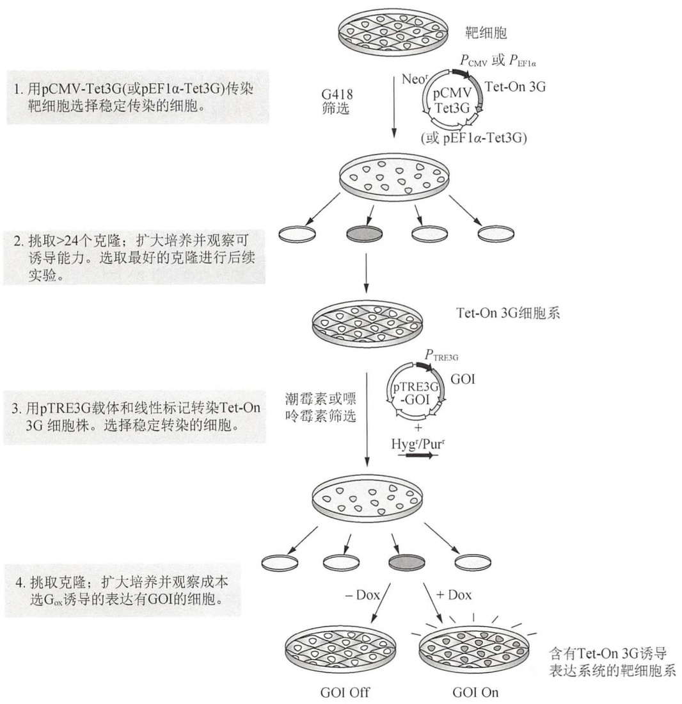
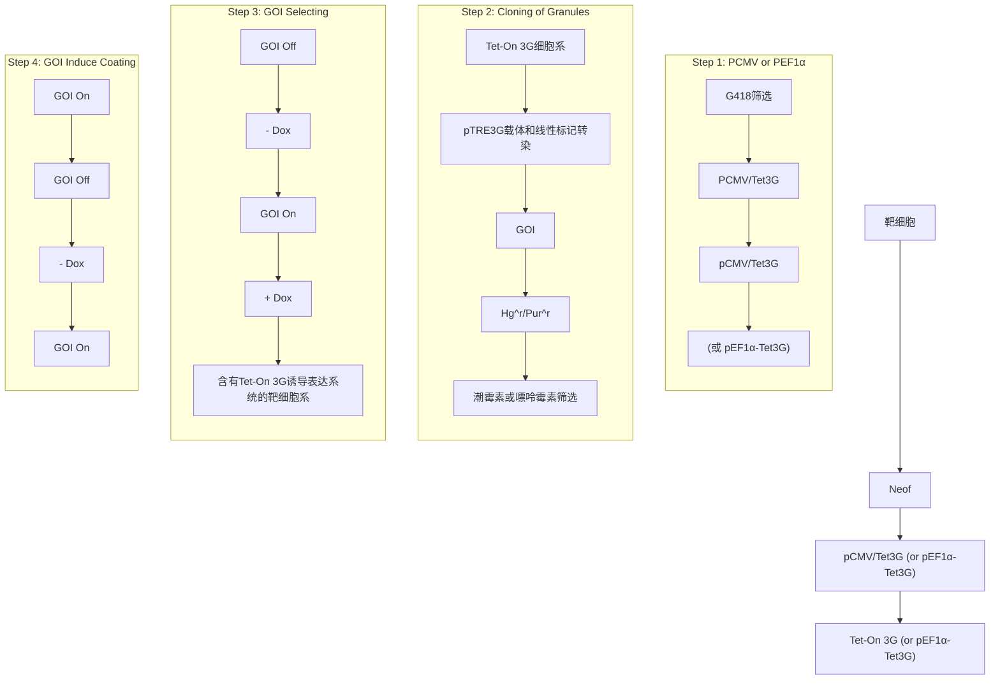
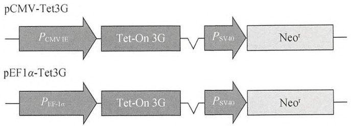
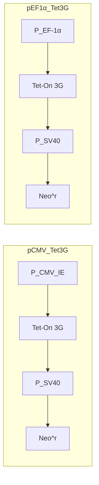
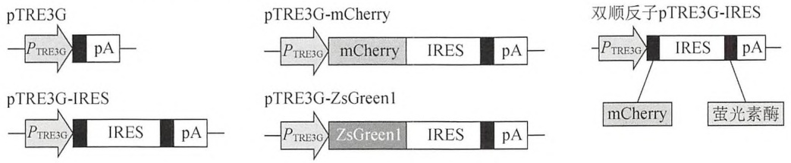
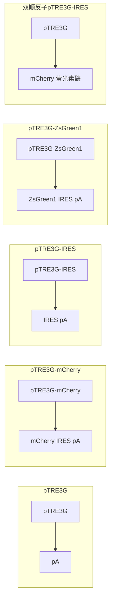
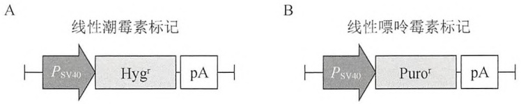
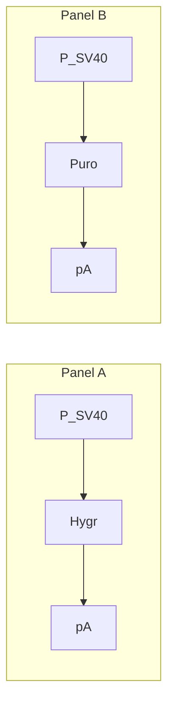
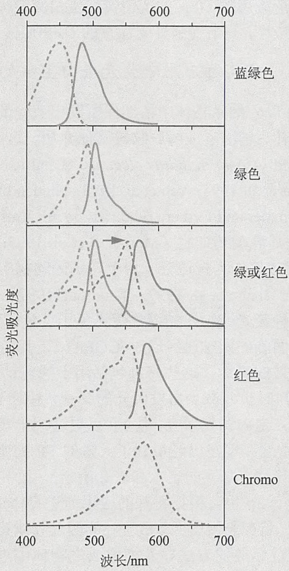
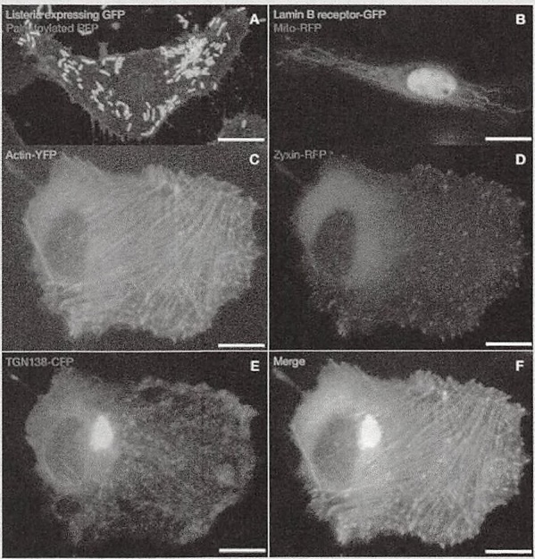

了一个由 rtTA 组成的 Tet-on 3G 转录激活蛋白，利用在人类细胞中一种加强的“反转录病毒进化”策略，优化了 rtTA 的效应子的敏感性。通过把 Tet-On 系统的组分嵌入到人类免疫缺陷病毒（HIV）-1 的基因组，致使病毒蛋白的表达和病毒的复制依赖于多西环素（Dox）的加入（Zhou et al. 2006）。HIV-rtTA 病毒的长期培养产生了多种病毒突变体，某些病毒突变体获得了 rtTA 蛋白的突变，从而使其转录活性提高到原来的 7 倍，对多西环素的敏感性也提高了将近 100 倍。四环素响应启动子（这里称为 $P_{\text{TRE3G}}$）由最小的 CMV 启动子组成，这个启动子通过系统地引入了一系列合理的修饰进一步减少了背景的表达（Loew et al. 2010）。在非常低浓度的 Dox（5～10ng/mL）条件下，Tet-on 3G 转录激活蛋白也能够结合并激活位于 $P_{\text{TRE3G}}$ 启动子后面的基因，在某些细胞系的诱导和未诱导的细胞中，目的蛋白的表达差异可以高达 27 000 倍（参考 http://www.clontech.com; Resource Application Notes: Tet-On 3G Inducible Expression System—Lowest Background, Highest Sensitivity）。

建立响应 Dox 诱导目的基因表达的细胞系主要包括以下几个步骤:

1. 把目的基因克隆到一个反式激活载体上;
2. 瞬时转染克隆载体并表达目的基因;
3. 建立和筛选能够高效表达目的基因的双稳定克隆。

除了没有详细地描述稳定细胞系的来源外，本方案描述了细胞系建立的所有实验步骤。总之，稳定细胞系的建立如图17-5所示:用能编码新霉素选择标记的Tet-On3G反式激活质粒转染未转化的细胞（图17-6），筛选能够诱导表达Tet-On3G的稳定转化子，然后把应答载体和线性的DNA片段共转染到这些克隆中，这里的应答载体是指将目的基因克隆在$P_{\mathrm{TRE3G}}$ 启动子下游的质粒（图17-7)，线性的DNA片段能够编码嘌呤霉素或者潮霉素选择性标签（图17-8）。在药物存在的条件下，筛选能够正常生长的细胞，成功构建应答Dox、目的基因高表达的双稳定细胞系。

## 使用 Tet-On 3G 系统时的实际考虑

最小的细胞巨化病毒启动子的基本活性因细胞而异，它可能受到应答质粒上的增强子或其他转录调节子等 DNA 序列影响。在构建双稳定细胞系之前，需要在一个或多个靶细胞系以及标准细胞系如 HeLa 中进行瞬转实验，来比较最小启动子的基础活性。理论上，转染入靶细胞的应答质粒的基本活性不会比转染入 HeLa 细胞中的活性高。

在此方案中描述的 Clontech 的 Tet-On 3G 诱导表达系统受到严格控制，与上一代 Tet-On 系统相比，它的基因的基础表达水平更低。

对含有目的基因的 pTRE3G（pTRE3G-GOI）进行功能检测是建立稳定双敲 Tet-On 细胞系的先决条件。此方案中，pCMV-Tet3G 和表达四环素调节的目的基因的 pTRE3G 以 1:4 的最优诱导比例用第 15 章所描述的任何一种方法瞬转到一些容易转染的细胞系，如 NIH-3T3 或 HEK293 细胞系中。另外，也可以仅把质粒 pTRE3G-GOI 转染到新创建的 Tet-On 3G 细胞系。对于其他细胞可以采用其他的转染方法，同时优化筛选策略来进行功能检测（可以参见第 15 章选择合适的转染方法）。还需要一种合适的基因特异性的分析方法来检测诱导效率，像免疫印迹、Northern Blot、qRT-PCR 等基因特异性功能分析方法。

使用转染细胞的多群落（多克隆）而不是筛选单克隆，因在传代培养过程中某些低诱导水平细胞克隆的过度生长将能影响诱导效率的一致性，会导致筛选得到的但是诱导水平低的克隆子的过度生长。因此，仔细筛选表达 Tet-On 3G 反向激活蛋白（一种改良的 rtTA）的细胞并建立稳定细胞系作为第一步是非常必要的。同样重要的是接下来对目的基因被调控表达的双稳定细胞系的筛选。

尽管可以使用含有抗性标记闭合环状质粒筛选稳定细胞系，但下面的方法中使用的是线性筛选标记——纯化的含有标志基因（潮霉素或嘌呤霉素抗性）、SV40启动子和SV40多聚腺苷酸化信号的线性DNA片段（图17-8）。这可以使筛选的克隆变少，同时筛选出来的克隆子诱导能力也较强。另外，共转染的线性选择标记启动子对目的基因的基础表达水平的影响比含有tetO序列的质粒上的选择标记的启动子对目的基因的基础表达水平干扰少。这是因为质粒稳定整合经常会导致该质粒的多个拷贝共整合到单一位点，如果组合性选择标记也包含在含有tetO序列和目标基因的应答质粒上（如组成性启动子与tet-响应启动子，TRE存在一种自动的 $1:1$ 的比例），在多个克隆子上，选择标记上使用的组成性的启动子能够通过以下几种方式影响目的基因的基础表达:①在一个或更多的串联整合中与TRE并列排列；②在这个区域招募高浓度的内源转录因子。但是，因为线性选择标记通常是以 $1:20$ 以下比率与应答质粒共转染（即线性标记低于20倍），这些类型的干扰不太可能发生。

flowchart

图17-5 建立具有tet调节表达系统的双稳定细胞系。此流程图总结了建立Tet系统调节目的基因（GOI）表达的细胞系的步骤（经Clontech允许重绘并修改）。

flowchart

图 17-6 Tet-On 3G 系统中的反式激活载体。pCMV-Tet3G 由 CMV 启动子启动组成性地表达 Tet-On 3G 蛋白。pEF1α-Tet3G 利用来自 EF1α 延长因子的启动子来表达转录激活因子。后一个质粒用于一些具有随时间沉默 CMV 启动子趋势的细胞类型中，如造血细胞和干细胞（Sirven et al. 2001; Kim et al. 2007）（经 Clontech 允许重绘并修改）。

flowchart

图17-7 Tet-On 3G系统中的应答载体。所有应答载体包含一个pTRE3G启动子，pTRE3G是用于表达靶基因的标准质粒载体，pTRE3G-IRES可诱导共表达两种靶基因。通过使用mCherry或者ZsGreen1系统表达的红色或绿色荧光蛋白到监控诱导效率。此外，通过在两个多克隆位点（MSC）的两侧引入优化的内部核糖体进入位点（IRES），载体中具有双顺反子的版本能同时表达两个目的基因。基于检测mCherry和ZsGreen1蛋白表达，该载体允许来自同一mRNA转录物的、分别带有mCherry和ZsGreen1蛋白的两个目的基因作为独立的蛋白质同时分别表达，并进行基于颜色的即时检测（经Clontech公司许可重绘和修改）。

flowchart

图17-8 Tet-On3G系统中的线性选择标记。使用潮霉素或嘌呤霉素作为线性选择标记对可诱导表达克隆进行筛选（经Clontech公司许可重绘和修改）。

## 材料

为正确使用本方案中的器材和危险试剂，必须查阅相应的材料安全数据表并咨询所在机构的环境卫生和安全办公室。

本方案的专用试剂标注&lt;R&gt;，配方在本方案末提供。常用储备溶液、缓冲液和试剂标注&lt;A&gt;，配方见附录1。储备溶液应稀释至适用浓度后使用。

## 试剂

培养的哺乳动物细胞

该方案使用 NIH-3T3 细胞，同时，也可使用其他细胞。用适当的培养基培养细胞。

Dox&lt;R&gt;

Tet-On 系统能很好地响应 Dox，但对四环素不响应（Gossen and Bujard 1995）。

DMEM 培养基&lt;R&gt;

不含四环素的胎牛血清（10%）

血清中经常会发现污染四环素，当使用 TET 表达系统时，可以显著地提高基础表达水平。因此，在使用前应当检测血清。另外，许多公司（包括 Clontech 在内）销售检测过的不含四环素血清。

G418 重硫酸盐（100mg/mL 的活性原液）&lt;R&gt;

HEPES 缓冲盐&lt;A&gt;

潮霉素 B（50mg/mL 的储备液中）&lt;R&gt;

线性化的潮霉素/嘌呤霉素标记

pCMV-Tet3G（或者 pEF1a-Tet3G），调控质粒

用在纯化过程中能够很好地去除细菌内毒素的转染级质粒 DNA 提取试剂盒纯化封闭环状质粒 DNA（例如，无内毒素的质粒大提试剂盒，QIA-GEN）；或者如第 1 章中所描述的，DNA 也可以通过柱色谱或溴化乙锭-氯化铯纯化梯度离心法纯化。把纯化好的 DNA 按 0.2～2mg/mL 溶解在无菌的 Tris-EDTA 缓冲液或水中，使用 260nm/280nm 的比值确定 DNA 的纯度，比例应该是 1.8。

磷酸缓冲液&lt;A&gt;

含有目的基因的 pTRE3G-GOI 载体（即目的基因 GOI），应答质粒

利用标准的重组 DNA 方法，把目的基因克隆到 pTRE3G 载体上。参考 http://www.clontech.com 关于 pTRE3G 系列载体的详细资料与克隆策略。

参阅 pCMV Tet3G 条目中的注意事项。

pTRE3G-Luc 对照载体

pTRE3G 载体

嘌呤霉素（50mg/mL的储备液）&lt;R&gt;

可以使用嘌呤霉素替代潮霉素。

萤光素酶检测试剂

参见方案2

Tris-EDTA &lt;A&gt;

## 设备

细胞刮刀

检测萤光素酶的荧光光度计

塑料克隆环

以直立位置把克隆环放在真空密封脂中灭菌。

聚苯乙烯管

组织培养皿（10cm）

组织培养板（6孔、24孔、96孔）

## 方法

## 瞬时转染细胞进行功能测试

1. 在转染前 1 天，把适当数量的贴壁细胞铺在 6 孔板中，用 DMEM 培养基培养。

通过使用更多或更少的细胞，并选择适当大小的用于组织培养塑料制品，该方法可以按比例放大或缩小。

2. 参照第 15 章中所描述的方法或根据制造商的说明书，用要求的转染试剂把调控和应答质粒共转染到靶细胞，每个孔转  $1 \mu g$  pCMV Tet3G 和  $4 \mu g$  的 pTRE3G-GOI，实验对照组是必不可少的。样本的转染如下表所示:

<table><tr><td rowspan="2"></td><td colspan="6">孔</td></tr><tr><td>1</td><td>2</td><td>3</td><td>4</td><td>5</td><td>6</td></tr><tr><td>pCMV-Tet3G</td><td>1μg</td><td>1μg</td><td>1μg</td><td>1μg</td><td>1μg</td><td>1μg</td></tr><tr><td>pTRE3G-GOI</td><td>4μg</td><td>4μg</td><td>4μg</td><td>4μg</td><td>—</td><td>—</td></tr><tr><td>pTRE3G</td><td>—</td><td>—</td><td>—</td><td>—</td><td>4μg</td><td>4μg</td></tr><tr><td>Doxycycline(多西环素)</td><td>—</td><td>—</td><td>100~1000ng/mL</td><td>100~1000ng/mL</td><td>—</td><td>100~1000ng/mL</td></tr></table>

使用的 Dox 的最佳浓度是由转染细胞的经验处理所得，从较低的浓度范围起始，例如 200ng/mL。

从这个时间点开始，将细胞培养在  $5\% CO_{2}$ ， $37^{\circ}C$  和 Dox 存在的条件下。Dox 在细胞培养液中的半衰期是 24h。因此，在细胞培养过程中要保持靶基因的连续诱导表达，需要每 48h 补充 Dox。

3. 24～48h 后，将每个孔的细胞收集，收集沉淀，采用适合目的基因检测的方法比较目的基因在诱导与非诱导表达水平的差异。

由于瞬时转染的细胞比稳定细胞系含有更多拷贝数的 TRE 质粒，瞬时转染的诱导倍数（GOI 最大与基础表达量的比值）比经筛选的稳定和双稳定克隆的细胞系要低（10～100 倍）。

## 转染并选择独立的 G418 抗性克隆

4. 接种细胞到 6 孔板的含有完全 DMEM 培养基的单孔里，接种细胞的密度要适宜，以保证细胞转染后 48h 达到融合。16～18h 后，用要求的转染试剂与恰当的实验方法将 2μg pCMV-Tet3G（或 pEF1α-Tet3G）转染到靶细胞中。

使用少于瞬时转染要求的 DNA 量进行稳定转染，将确保 G418 筛选后分离得到单个的克隆。

5. 48h 后，将 6 孔板中的细胞传到 4 个 10cm 培养皿中，不加 G418。

6. 再过 48h 后，加入对细胞系具有最佳筛选效果浓度的 G418，对于大多数细胞系，包括 NIH3T3，通常为 400～500μg/mL。

7. 每 4 天用新鲜的加有 G418 的培养基换掉原来的培养基，如果有必要，换液的频率可以加快。3～5 天后未整合质粒的细胞开始死亡。

避免对细胞进行二次传代，因为在筛选条件下传细胞会使细胞克隆太多，从而影响细胞的有效分离。

8. 大约 2 周后，G418 抗性克隆开始出现，当克隆稳定后（在筛选的 12～15 天），在培养板底部画圈来描出每个克隆的边界。将培养基从平板吸出，把无菌的塑料克隆环放在平板包围单个克隆，重复此操作直到每个克隆都被挑起。筛选细胞的要求是，在平板上选择那些大的、健康的、被完美隔开且容易辨别的单个克隆细胞。

9. 用约 $100\mu \mathrm{L}$ 的磷酸缓冲盐快速洗涤克隆。为使细胞分散开来，加入2滴 $1\times$ 胰蛋白酶-EDTA（约 $100\mu \mathrm{L}$ ）并孵育 $30\sim 60\mathrm{s}$ 。用无菌的 $1\mathrm{mL}$ 移液管吸头上下吹打细胞使其松动。

10. 将每个克隆转移到含有 1mL G418 选择培养基的 24 孔板的一个孔中。

用有限稀释技术克隆悬浮培养的细胞（见附加方案“有限稀释法筛选悬浮细胞的稳定克隆”）。

11. 在 G418 的维持浓度（100～200μg/mL）的条件中培养克隆。当融合后，将每个孔的细胞分离至 6 孔板中的 3 个孔里用以下的标准流程进行检测和保种:

i. 用 PBS 快速洗涤细胞。

ii. 24 孔板每孔使用 0.4mL 的胰酶-EDTA 孵育细胞 1\~3min。

iii. 用 0.3mL 的含有 G418 的选择培养基稀释细胞，或使用 10% 的胎牛血清稀释细胞，同时停止胰酶的作用。

TetR 的单克隆抗体可以通过 Western 杂交分析，用来识别表达 Tet-On 3G 蛋白的克隆。然而，Western 分析并不能用来替代诱导能力的功能性测试，因为 Tet-On 3G 的最高表达克隆常常不能提供最高的诱导能力。

并不是所有被挑出的克隆都能耐受分离并扩大。尽管有可能通过筛选少于 24 个克隆来找到理想的克隆，但是检验多个克隆通常能够得到高的成功率和避免耽误时间。

## 检测 Tet-On 3G 克隆的诱导能力

12. 对于要检测的某个克隆，我们可以把6孔板当中一个孔的1/3细胞接种到一个新6孔板的一个孔中。

依赖筛选试验的结果，在储存板上的细胞可以扩大培养。

13. 剩下的 2/3 细胞也分到另一个 6 孔板的两个孔中，让细胞贴壁过夜，用需要的转染试剂和合适的方法往每个孔中转染  $5 \mu g$  pTRE3G-Luc 质粒。

14. 4h 后，用新鲜的、含有  $100 \sim 1000 ng/mL$  的 Dox 添加到两个重复孔中的一个，另

一个孔不添加 Dox。

15. 24h 后，按方法 2 中所描述的检测萤光素酶的活性并计算诱导倍数，例如:

$$
\begin{array}{l} (+ \mathrm{DoxRLU}) \\ (- \mathrm{DoxRLU}) \\ \end{array}
$$

式中，分子表示在含有 Dox 的细胞裂解液中每毫克蛋白的相对光单位；分母表示在不含有 Dox 的细胞裂解液中每毫克蛋白的相对光单位。

16. 挑选能得到最高诱导倍数（最大与基础表达水平的比率）的克隆进行扩大培养和进一步的检测。

17. 在扩大培养之后，迅速冻存每一株理想的 Tet-On 3G 克隆子。

参考信息栏“稳定细胞系的冻融”采取合适的方法冻存细胞。

参考信息栏“稳定细胞系的冻融”采取合适的步骤将冻存细胞株扩大培养。

## 构建双稳定可诱导的细胞株

18. 将 Tet-On 3G 表达的细胞株（来自步骤 17）铺在 6 孔板的一个孔中，细胞的密度要适宜，保证细胞转染后，在含有 G418 的培养基中 48h 后达到融合。如果使用刚刚解冻的细胞，在进行到下一步之前要先让细胞恢复一段时间。

参考信息栏“稳定细胞系的冻融”采取合适的步骤将冻存细胞株扩大培养。

19. 用合适的转染试剂和方法将  $2 \mu g$  pTRE3G-GOI 和 100ng 线性选择标记（嘌呤霉素或潮霉素）共转染，始终让 pTRE3G-GOI 质粒和线性选择标记保持在 20:1 的比例（即使用 20 倍以下的线性标记）。

20. 48h 后，把融合细胞分到 4 个 10cm 直径的皿中（不加选择性抗生素）。

21. 再过 48h 后，加入一定的选择浓度的潮霉素或嘌呤霉素，抗性药物的浓度是通过优化确定的。

转染前经验性确定潮霉素或嘌呤霉素的最低浓度，此浓度在几天内能杀死所有未转染的细胞，不同的细胞有不同的最低浓度，通常情况下，100μg/mL 潮霉素或者 3μg/mL 嘌呤霉素就足以用来筛选转染的 NIH-3T3 细胞，在 50～400μg/mL 潮霉素或 0.25～10μg/mL 的嘌呤霉素的情况下，大多数细胞都能有效地被杀死。

22. 每隔 3 天更换新鲜的含有潮霉素或者嘌呤霉素的完全培养基，如有必要，可以提高更换培养基的频率。3～5 天后没有整合质粒的细胞就开始死亡。

避免了二次传代细胞，因为在选择培养条件下再次贴壁的细胞可能导致板中含有太多的克隆，不利于进行有效的克隆分离。

23. 两周之后，抗药性的克隆开始出现，当克隆大到足够转移时，按照步骤8和步骤9所描述的方法，用克隆圆筒或者碟子收集大而状态良好的集落，然后把每一个集落种到24孔板中，每个孔含有1～1.5mL新鲜的、含潮霉素或者嘌呤霉素的完全培养基，尽可能多地分离克隆，至少要24个克隆。

用有限稀释技术克隆悬浮培养的细胞（见附加方案“有限稀释法筛选悬浮细胞的稳定克隆”）。

24. 将克隆在维持浓度的G418以及潮霉素或者嘌呤霉素条件下培养，当细胞长满时，把细胞从6孔板的1个孔分到3个孔进行检测和培养。

## 筛选双稳定可诱导细胞株

25. 对每一个需要分析的克隆, 我们可以把来自于 6 孔板中单个孔里的 1/3 细胞接种到另外一个新 6 孔板的一个孔中。

根据筛选试验的结果，在储存板上的细胞可以扩大培养。

26. 剩下的 2/3 细胞也分到另外一个 6 孔板的两个孔中, 一个孔中添加 100～1000ng/mL Dox, 继续培养细胞 48h。

27. 收集细胞，然后用靶基因特异的方法比较诱导和未诱导的细胞株中靶基因表达的差异。
28. 选择具有最高诱导倍数的克隆进行扩大培养和进一步分析。
29. 尽可能地扩大培养和冻存理想的克隆。

参考信息栏“稳定细胞系的冻融”采取合适的步骤将冻存细胞株扩大培养。

## 稳定细胞系的冻融

每个冻存管中细胞的冻存密度至少是 $1 \times 10^{6} \sim 2 \times 10^{6}$ 细胞/mL 冻存液（$70\% \sim 90\%$ 的 FBS、$0 \sim 20\%$ 的培养基[不含选择抗生素]和 $10\%$ DMSO），也可以采用含有同样组分的商品化冻存液。

解冻冻存的稳定细胞系时，在培养48～72h之后往培养基中添加合适的选择抗生素。尤其对于一些贴壁不牢靠的细胞（如HEK293来源的细胞系），新解冻的细胞可能需要培养48h才能完全贴壁。稳定或者双稳定Tet细胞系需要在含有维持浓度的G418和/或潮霉素（或者嘌呤霉素）条件下的完全培养基中培养，抗性药物的维持浓度是通过优化确定的。

## 优化 Dox 浓度

30. 一旦最好的克隆筛选出来（见步骤 28），就需要确定能够高效诱导目的基因表达所需 Dox 的最低浓度，在接下来的实验中就可以采用此浓度的 Dox。

i. 用胰酶消化 6 孔板中其中一个长满细胞的孔，然后把这些细胞均匀地分到 24 孔板的 6 个孔中。
ii. 在这 6 个孔中依次滴加 $0\mathrm{ng/mL}$ 、 $1\mathrm{ng/mL}$ 、 $10\mathrm{ng/mL}$ 、 $50\mathrm{ng/mL}$ 、 $100\mathrm{ng/mL}$ 和 $1000\mathrm{ng/mL}$ 的 Dox，继续培养细胞；
iii. 24h 后分析目的基因的诱导表达水平。

## 附加方案 有限稀释法筛选悬浮细胞的稳定克隆

为了避免形成含有多个克隆混合的细胞系，采用有限稀释的方法来筛选悬浮细胞，下面的方案描述通过稀释稳定转染细胞从而保证在检测诱导表达之前96孔板的每个孔中只有一个稳定细胞克隆。

## 方法

1. 往 6 孔板的一个孔中接种 $1 \times 10^{6} \sim 1.5 \times 10^{6}$ 个细胞，并添加 $3 \mathrm{~mL}$ 的完全培养基。
2. 用合适的转染试剂和转染方法, 往细胞中转染  $5 \mu g$  的质粒(参考第 15 章), 培养 48h。
3. 1100r/min 离心收集细胞，在离心管中加入 6mL 含有合适抗生素的培养基重悬，筛选稳定整合子（如用 G418 筛选 pCMV-Tet3G 或 pEF1-Tet3G）。
4. 细胞培养一周。

5. 稀释步骤 4 中的细胞，达到 96 孔板的每个孔只含有 1 个细胞，具体步骤如下:

i. 将 2mL 完全培养基中的细胞分装成  $100 \mu L$  每份（1/20 储备稀释液）。

ii. 准备 4 个管子，每管含有 5mL 完全培养基，从步骤 5i 的 1/20 储备稀释液中，每管加入:

管 1:10μL;

管 2:  $20\mu L$ ;

管 3:30μL;

管 4: 40μL

混合均匀。

iii. 从管 1 开始, 往 96 孔板的每个孔中添加  $50 \mu L$  液体细胞, 依照类似的方法, 把管 2～4 的细胞分别添加到 3 个不同的 96 孔板中（一共 4 板, 每板对应一个管子）。

6. 让 4 个板中的细胞生长，至其中有一个板有一半的孔能有肉眼可见的细胞为止。

7. 从细胞在一半的孔中显示生长的板上挑选 24 个克隆，扩大培养，先把每个克隆扩大到 24 孔板的每个孔，长满后扩大到 6 孔板的每个孔，再长满。

如果一个96孔板上只有一半孔显示出生长，这就意味着这个板的每个孔平均接种不超过一个细胞，这些孔中显示生长的细胞很可能来自单个细胞克隆。

8. 当步骤 7 得到的 24 个克隆子的每一个克隆长满了 6 孔板的 3 个孔，我们就可以把其中一个孔作为保种的储存细胞，另外两个孔添加或不添加 Dox，检测目的基因的诱导表达（参考主方案的步骤 1～3）。

## 配方

为正确使用本方案中的器材和危险试剂，必须查阅相应的材料安全数据表并咨询所在机构的环境卫生和安全办公室。

Dox (1mg/mL)

用双蒸  $H_{2}O$  制备 1mg/mL 的储备液，过滤除菌，分装， $-20^{\circ}C$  避光保存，1 年内使用。

DMEM 培养液

| 试剂 | 终浓度 |
| --- | --- |
| DMEM | 1× |
| 青霉素 | 100U/mL |
| 链霉素 | 100μg/mL |
| 谷氨酰胺 | 2mmol/L |
| 不含四环素的胎牛血清 | 10% |

(Tet 系统提供的 FBS)

血清中经常会发现污染四环素，当使用 TET 表达系统时，可以显著地提高基础表达水平。因此，在使用前应当检测血清。另外，许多公司，包括 Clontech 在内的许多公司销售检测过的不含四环素血清。

## G418 重硫酸盐（配方）（100mg/mL 活性母液）

G418 刚制成的时候，活性并不是 100%，通过生物分析的方法，制造商确定其活性。为了制得 100mg/mL 的 G418 活性母液，需要考虑添加多少 G418 才能得到 100mg 有活性的 G418。例如，如果瓶子上说明活性是 736μg/mg，就表示它含有 73.6% 有活性的 G418。因此，每毫升的母液就需要称取（1000/736）×100=135.86mg 的 G418。用 HBS 或者 PBS 溶解，过滤除菌，分装保存在 -20℃（稳定保存 6 个月至 1 年）。

## 潮霉素 B（50mg/mL 的母液）

用水溶解，过滤除菌，分装保存在-20℃（稳定保存2年以上）或放到4℃（稳定保存1年以上）。

## 嘌呤霉素（50mg/mL 的母液）

用水溶解，过滤除菌，分装保存在-20℃（稳定保存2年以上）。

## 参考文献

- Gossen M, Bujard H. 1995. Efficacy of tetracycline-controlled gene expression is influenced by cell type: Commentary. BioTechniques 19: 213–215.
- Kim S, Kim GJ, Miyoshi H, Moon SH, Ahn SE, Lee JH, Lee HJ, Cha KY, Chung HM. 2007. Efficiency of the elongation factor-1α promoter in mammalian embryonic stem cells using lentiviral gene delivery systems. Stem Cells Dev 16: 537–545.
- Löew R, Heinz N, Hampf M, Bujard H, Gossen M. 2010. Improved Tet-responsive promoters with minimized background expression. BMC Biotechnol 10: 81. doi: 10.1186/1472-6750-10-81.
- Sirven A, Ravet E, Chameau P, Zennou V, Coulombel L, Guétard D, Pilumio F, Dubart-Kupperschmitt A. 2001. Enhanced transgene expression in cord blood CD34 $^{+}$ -derived hematopoietic cells, including developing T cells and NOD/SCID mouse repopulating cells, following transduction with modified trip lentiviral vectors. Mol Ther 3:438–448.
- Zhou X, Vink M, Berkhout B, Das AT. 2006. Modification of the Tet-On regulatory system prevents the conditional-live HIV-1 variant from losing doxycycline-control. Retrovirology 3: 82. doi: 10.1186/1742-4690-3-82.

## 网络资源

Resource application notes: Tet-On 3G Inducible Expression System—Lowest Background, Highest Sensitivity. Clontech Laboratories, Inc. http://www.clontech.com

## 信息栏

## 荧光蛋白

荧光蛋白（fluorescent protein，FP）或自发荧光蛋白（autofluorescent protein，AFP）是指即使在没有额外的底物、辅基或蛋白质的条件下也能够在特定的激发光照范围内发出荧光的蛋白质（Larrainzar et al. 2005）。绿色荧光蛋白（GFP）是最先被发现的荧光蛋白。随同伴侣分子钙结合发光蛋白（aequorin）一起，GFP能发出一种独特的绿色可见荧光，在能生物发光的水母维多利亚多管发光水母（Aequorea victoria）的伞部边缘形成光环（Harvey 1952）。在过去的30年中，GFP和其他的FP在生物领域成为了最吸引人和最实用的蛋白家族之一。它们不仅成为解析蛋白质结构和光谱功能之间关系的有效工具，同时，它们还越来越多地用作标记分子，参与研究范围涵盖了从细菌到转基因小鼠的基因表达和细胞内进程的各个阶段。

GFP 是 Shimomura 等（1962）发现的，它是包含 238 个氨基酸残基的多肽（相对分子质量 26 888），由跨越 A. victoria 基因组 2.6kb 的三个外显子编码（Prasher et al. 1992）。该蛋白质在多种包括热、极端 pH 和化学变性剂等苛刻条件下都能保持稳定（Ward and Bokman 1982），而且在甲醛固定后会持续发出荧光（Chalfie et al. 1994）。但是，它在还原条件下荧光会很快熄灭（Inouye and Tsuji 1994）。

GFP 发射光谱的峰值在 508nm （Johnson et al. 1962），波长与活的 Aequorea 组织的发射光谱相近，但与纯 Aequorea 的发光蛋白的化学发光光谱距离较远，Aequorea 的发光蛋白发出的光是蓝色的，峰值接近 470 nm。在纯化并结晶 GFP 的过程中，发现当两个蛋白质共吸附在阳离子支持物时，钙激活的 aequorin 能够有效地将自身荧光能量转移给 GFP（Morise et al. 1974）。当能量以 Foster 类型机制从钙激活的 aequorin 转移给 GFP 时会发出绿光。激活的 aequorin 发出的蓝光可以被含有环形结构[4-（p-羟基苯亚甲基）咪唑啶-5-1]的六肽发色团（开始于 GFP 的 64 位残基）捕获，环状结构是通过环的位置 1 和 2 结合到肽骨架上的（Shimomura 1979）。

得益于对天然存在的生物发光蛋白的协同研究以及它们的人工合成衍生物的开发，现在大量的荧光蛋白已经能够被使用。此外，“原始”的 GFP 发色团（Shimomura 1979; Cody et al. 1993）适于操作，并且能够保持在不同波长光线下发出荧光的核心能力。因此，科学界现在能够利用 GFP 和其他相关的自然存在的荧光蛋白的几种变体，包括在其他变异体中的红色荧光蛋白样（Gross et al. 2000）和类 Kaede（Mizuno et al. 2003）红色发色团（表 1 和表 2）。许多在光谱变异的 FP 的开发使对活系统的研究中发生了革命性的变化。Osamu Shimomura、Martin Chalfie 和 Roger Y. Tsien 因这些成就获得 2008 年的诺贝尔化学奖，以表彰他们在绿色荧光蛋白（GFP）的发现和发展方面的贡献（Nobel 基金 2008；http://www.nobelprize.org/nobel\_prizes/nobelguide\_che.pdf）。

表 1 挑选出的单体荧光蛋白的性质

| 蛋白质 | 激发峰/nm | 吸收峰/nm | $EC/(M^{-1} \cdot cm^{-1})$ | QY | 相对亮度 | $pK_a$ | 备注a |
| --- | --- | --- | --- | --- | --- | --- | --- |
| Sirius | 355 | 424 | 15 000 | 0.24 | 0.11 | &lt;3.0 | B-,pH++,Ps+ |
| Azurite | 383 | 447 | 26 000 | 0.55 | 0.43 | 5.0 | pH+, Ps+ |
| EBFP2 | 383 | 448 | 32 000 | 0.56 | 0.54 | 4.5 | pH+, Ps+ |
| Tag-BFP | 402 | 457 | 52 000 | 0.63 | 0.99 | 2.7 | B+,pH++, Ps+,mat+ |
| mTurquoise | 434 | 474 | 30 000 | 0.84 | 0.76 | 4.5 | B+,pH+, Ps+ |
| ECFP | 434 | 477 | 32 500 | 0.40 | 0.39 | 4.7 | pH+ |
| Cerulean | 433 | 475 | 36 000 | 0.57 | 0.62 | 4.7 | pH+, Pi- |
| TagCFP | 458 | 480 | 37 000 | 0.57 | 0.64 | 4.7 | pH+, mat+ |
| mTFP1 | 462 | 492 | 64 000 | 0.85 | 1.65 | 4.3 | B+,pH+, Ps+ |
| mUKG1 | 483 | 499 | 60 000 | 0.72 | 1.31 | 5.2 | B+,pH+ |
| mAG1 | 492 | 505 | 55 000 | 0.74 | 1.23 | 5.8 | B+ |
| AcGFP1 | 475 | 505 | 50 000 | 0.55 | 0.83 | — |  |
| TagGFP2 | 483 | 506 | 56 500 | 0.61 | 1.05 | 5.0 | Ps+,pH+, mat+ |
| EGFP | 489 | 509 | 55 000 | 0.60 | 1.00 | 5.9 | Ps+ |
| mWasabi | 493 | 509 | 70 000 | 0.80 | 1.70 | 6.5 | B+,pH-, Ps- |
| EmGFP | 487 | 509 | 57 500 | 0.68 | 1.19 | 6.0 | $Ps^b$ |
| TagYFP | 508 | 524 | 64 000 | 0.62 | 1.20 | 5.5 | pH+, mat+ |
| EYFP | 514 | 527 | 84 000 | 0.61 | 1.55 | 6.5 | B+,pH-, Cl- |
| Topaz | 514 | 527 | 94 500 | 0.60 | 1.72 | — | B+ |
| SYFP2 | 515 | 527 | 101 000 | 0.68 | 2.08 | 6.0 | B+, Ps- |
| Venus | 515 | 528 | 92 200 | 0.57 | 1.59 | 6.0 | B+,Pi-, Ps-,mat+ |
| Citrine | 516 | 529 | 77 000 | 0.76 | 1.77 | 5.7 | B+, Ps- |
| mKO | 548 | 559 | 51 600 | 0.60 | 0.94 | 5.0 | pH+, Ps+,mat- |
| mKO2 | 551 | 565 | 63 800 | 0.57 | 1.10 | 5.5 |  |
| mOrange | 548 | 562 | 71 000 | 0.69 | 1.49 | 6.5 | B+,pH-, Ps- |
| mOrange2 | 549 | 565 | 58 000 | 0.60 | 1.06 | 6.5 | pH-, Ps+, mat- |
| TagRFP | 555 | 584 | 100 000 | 0.48 | 1.42 | &lt;4.0 | B+,pH+ |
| TagRFP-T | 555 | 584 | 81 000 | 0.41 | 0.99 | 4.6 | pH+, Ps+ |
| mStrawberry | 574 | 596 | 90 000 | 0.29 | 0.79 | &lt;4.5 | pH+, Ps- |
| mRuby | 558 | 605 | 约90 000 | 0.35 | 1.06 | 4.4 | pH+, Ps- |
| mCherry | 587 | 610 | 72 000 | 0.22 | 0.48 | &lt;4.5 | pH+, Ps+ |
| mRaspberry | 598 | 625 | 86 000 | 0.15 | 0.39 | — | Ps- |
| mKate2 | 588 | 633 | 62 500 | 0.40 | 0.76 | 5.4 | Ps+,mat+ |
| mPlum | 590 | 649 | 41 000 | 0.10 | 0.12 | &lt;4.5 | PH+,B-, Ps- |
| mNeptune | 600 | 650 | 67 000 | 0.20 | 0.41 | 5.4 | mat- |
| T-Sapphire | 399 | 511 | 44 000 | 0.60 | 0.79 | 4.9 | PH+ |
| mAmetrine | 406 | 526 | 45 000 | 0.58 | 0.78 | 6.0 | Ps- |
| mKeima | 440 | 620 | 14 400 | 0.24 | 0.10 | 6.5 | B-,PH- |

注:经美国生理学协会许可从 Chudakov 等（2010）复制。

第二和第三栏的颜色表示这个蛋白质的波谱的波长是确定的（彩图请扫封底二维码）。

a. B-, 低光度; B+, 高光度; Ps-, 低光稳定性; Ps+, 高光稳定性, pH-, 低 pH 稳定性; pH+, 高 pH 稳定性; pH++, 极端 pH 稳定性; mat-, 缓慢成熟; mat+, 快速成熟; Cl-, Cl⁻敏感; Pi-, 强可逆光灭活作用。

b. 显著的快速漂白成分（Shaner et al. 2005）。

表 2 挑选出的二聚体和四聚体荧光蛋白的性质

| 蛋白质 | 激发峰/nm | 吸收峰/nm | $EC/(M^{-1} \cdot cm^{-1})$ | QY | 相对亮度 | $pK_a$ | 备注a |
| --- | --- | --- | --- | --- | --- | --- | --- |
| AmCyan 1 | 458 | 489 | 39 000 | 0.75 | 0.89 | — | T |
| Midori-Ishi Cyan | 472 | 495 | 27 300 | 0.90 | 0.74 | 6.6 | D,B+,PH- |
| copGFP (ppluGFP2) | 482 | 502 | 70 000 | 0.60 | 1.26 | 4.3 | T,B+,PH+,Ps+,mat+,Ag- |
| TurboGFP | 482 | 502 | 70 000 | 0.53 | 1.12 | 5.2 | D,B+,PH+,Ps+,mat+ |
| ZsGreen | 493 | 505 | 43 000 | 0.91 | 1.19 | — | T,B+ |
| TurboYFP | 525 | 538 | 105 000 | 0.53 | 1.69 | 5.9 | D,B+,PH+,mat+ |
| ZsYellow 1 | 529 | 539 | 20 000 | 0.65 | 0.39 | — | T |
| TurboRFP | 553 | 574 | 92 000 | 0.67 | 1.87 | 4.4 | D,B+,PH+,mat+ |
| dTomato | 554 | 581 | 69 000 | 0.69 | 1.44 | — | D,B+, Ps+ |
| DsRed2 | 563 | 583 | 43 800 | 0.55 | 0.73 | — | T,B+ |
| DsRed-Express | 555 | 584 | 38 000 | 0.51 | 0.59 | — | T,Ps+,Mat+ |
| DsRed-Express2 | 554 | 591 | 35 600 | 0.42 | 0.45 | — | T,Ps+,Mat+ |
| DsRed-Max | 560 | 589 | 48 000 | 0.41 | 0.60 | — | T,Ps+,Mat+ |
| AsRed2 | 576 | 592 | 61 000 | 0.21 | 0.39 | — | T |
| TurboFP602 | 574 | 602 | 74 400 | 0.35 | 0.79 | 4.7 | D,B+,PH+,,mat+,Ps- |
| RFP611 | 555 | 606 | 120 000 | 0.48 | 1.75 | — | T,B+,Ps- |
| Katushka | 588 | 635 | 65 000 | 0.34 | 0.67 | 5.5 | D,B+,PH+,Ps+,mat+ |
| Katushka2 | 588 | 633 | 69 000 | 0.37 | 0.77 | 5.5 | D,B+,PH+,Ps+,mat+ |
| AQ143 | 595 | 655 | 90 000 | 0.04 | 0.11 | — | T,B- |

注:经美国生理学协会许可从 Chudakov 等（2010）复制。

第二和第三栏的颜色表示这个蛋白的波谱的波长是确定的（彩图请扫封底二维码）。

a. T，四聚体；D,二聚体；B-，低光度；B+，高光度；Ps-，低光稳定性；Ps+，高光稳定性，pH-,低 pH 稳定性；pH+，高 pH 稳定性；pH++，极端 pH 稳定性；mat-，缓慢成熟；mat+，快速成熟；Ag-，聚集反应。

## 结构和功能

GFP 晶体结构的解析为它被观测到的许多物理性质提供了解释（Ormo et al. 1996; Yang et al. 1996）。该蛋白质由一个β桶状结构封装一个位于中心的α螺旋构成，β桶状结构又由11条链（β片层）组成。残基Ser-65、Tyr-66h和Gly-67环成的发色团包含在一个短的螺旋结构内，而螺旋结构自身埋在紧密交织的11-链组成的β桶状结构内（Ormo et al. 1996; Yang et al. 1996; Brejc et al. 1997）。发色团隔绝在β“罐子”里赋予了GFP许多物理特性，包括对尿素、去污剂、蛋白水解、热变性，以及在某些情况下对甲醇固定的抗性。GFP的二级和三级结构为该蛋白质的功能提出了一种机制。Head等（2000）报道了对来自Aequorea aequorea的aequorin的晶体结构的解析，为钙敏感发光蛋白的生物荧光机制提供了进一步的细节。有趣的是，这种结构在几种GFP类的荧光蛋白中都保守，甚至那些来自于非生物发光生物体荧光蛋白也是如此（Chudakov et al. 2010）。

GFP 发色团不需要海葵那样特殊的生物合成路径。而且，它可以在很多平常不产生荧光的细胞中产生。GFP 进行的是自身催化的分子内反应，以翻译后的形式产生荧光，天然蛋白的发光时间大约能持续 4h（Heim et al. 1994；Inouye and Tsuji 1994）。该反应包括三聚体 Ser-65、脱氢-Tyr-66 和 Gly-67 的环化与氧化（Heim et al. 1994）。分离的发色团、完整的 GFP 和合成的发色团都有很相似的光谱特性:它们的最大吸收光波长在约 390nm，并在 480nm 处有一个小一些的吸收峰（Morise et al. 1974；Ward et al. 1980；Cody et al. 1993）。但是，只有完整的 GFP 可以发出绿光（主峰在 509nm，肩峰在 540nm）（Morise et al. 1974）。因为两个吸收峰的比值对 pH、温度和离子强度等因素敏感（Ward and Bokman 1982），所以可能存在有两种不同形式的发色团，分别是质子化和去质子化的酪氨酰羟基团（Brejc et al. 1997；Palm et al. 1997）。证实这个假设的是最近的结构学研究。对 GFP 野生型、GFP-S65T 和 GFP-F64L/65T（EGFP）等突变型的分子动力学研究为这些发色团中的构象及化学变化如何影响它的功能提供了解释（Haupts et al. 1998）。

就在 GFP 被发现后不久,从非生物发光的物种珊瑚虫 Anthozoa 中分离出多个与 GFP 显著同源的荧光蛋白。其中第一个分离到的荧光蛋白是一个红色荧光蛋白,它的最大发射光谱的波长在 583nm,显著地 “红移” 在其他的 GFP 变异体之外（Matz et al. 1999）。近几年,从其他的发色团的结构特征来看,最常见的自然存在的光谱群是青色、绿色、红色,以及红-绿色光可变的荧光蛋白和紫-蓝非荧光色素蛋白（图 1）。

line

| Category | X (nm) | Solid Line (Absorbance) | Dashed Line (Absorbance) |
| --- | --- | --- | --- |
| 蓝绿色 | ~480 | Peak | — |
| 绿色 | ~500 | Peak | Peak |
| 绿或红色 | ~560 | Peak | Peak |
| 红色 | ~580 | Peak | Peak |
| Chromo | ~590 | — | Peak |

图 1 广泛地与天然 GFP 类蛋白重叠的主要光谱类别的代表性光谱。激发（虚线）和发射（实线）波长如图所示。所示的光转换前（绿线）、后（红线）的光谱针对于枫样的绿-红色可光转换的荧光蛋白。所示的吸收波谱针对的是一种色素蛋白[重新绘制于 Chudakov 等（2010），经美国生理学协会许可（彩图请扫封底二维码）。

所有的 GFP 样蛋白（GFP-like protein）都有寡聚化的趋势。甚至原始的 GFP，曾被认为是单体，能在水母体内相应的生理浓度形成二聚体（Culter and Ward 1997）。一些荧光蛋白以很强的二聚体形式存在，而多数在纳摩尔浓度下以稳定的同源四聚体形式存在。四聚体结构首先在 Discosoma sp. 的 DsRed 晶体学研究中被破译（Wall et al. 2000; Yarbrough et al. 2001）。每个 DsRed 单体通过两个独特的界面与两个邻近的蛋白分子接触。疏水的界面包含有一簇紧密填充的、被一组极性侧链环绕的疏水残基。亲水的界面包含有很多氢键与连接极性残基的盐桥，并且包含埋藏的水分子。此外，它被一个罕见的、由每个单体的羧端残基形成的“卡环”所稳定。包埋在桶内的氨基酸的侧链在发色团的结构和光谱特性的微调中发挥着必不可少的作用。最重要的残基位于β链的中间，它们与发色团邻近。4号链上严格保守的氨基酸残基Arg-96和111号链上的氨基酸残基Glu-222参与骨架的环化与催化活性（Sniegowsky et al. 2005a,b）。侧链上148、165、167和203位的残基（分别在7号、8号和10号链上）与发色团的66位酪氨酸保持接触，是它们自身质子化状态（阴离子或中性的）、极化状态、空间构象（顺式或反式）和旋转自由度的主要决定因素（Chudakov et al. 2010）。这些侧链的变异决定了激发和发射光谱、这个蛋白质是发出高亮度荧光还是几乎完全不发荧光，同时可以促进发色团的可逆光控开关在这两种不同状态之间转换。因此，几个有趣且非常有用的突变体已经通过残基诱变而开发出来。例如，广泛应用的GFP的黄色荧光蛋白突变体，携带有Thr203Tyr，但是，用Ile或His替代后产生了一个受紫外光激发的GFP变体T-Sapphire。

## 在实际应用中荧光蛋白重要的特性

GFP 在 Aequorea 以外的生物体中依然保留发出荧光的能力（Chalfie et al. 1994）表明它的活性不需要抗体、辅因子或酶底物等其他介质。这些最初的发现为 GFP 作为标记分子用于秀丽隐杆线虫（Caenorhabditis elegans）（Chalfie et al. 1994）、细菌和酵母（Flach et al. 1994；Nabeshima et al. 1995；Yeh et al. 1995；Niedenthal et al. 1996）、果蝇（Wang and Hazelrigg 1994；Barthmaier and Fyrberg 1995）、斑马鱼（Amsterdam et al. 1995）、植物（Chiu et al. 1996）及培养的哺乳动物细胞（Mar-shall et al. 1995；Misteli et al. 1997）开辟了道路。现在 GFP 可以有效地作为报道分子用于转基因动物中，如小鼠（Ikawa et al. 1995；Chiocchetti et al. 1997；Okabe et al. 1997；Zhuo et al. 1997）和被人们称为“转基因艺术”的过程，从而创造多种荧光宠物，如绿色荧光兔子、鱼和猴子。人们早期将野生型 GFP 作为多方面报道基因面临的困难已经通过在 GFP 或是其他的 FP 掺入修饰而被完全克服，并且实现了快速、有效的表达。这些修饰包括用于哺乳动物细胞中密码子的优化、单体修饰、增加发光强度与时长并减少自发荧光的突变，移除 FP 基因的隐藏剪接位点。通过广泛的结构驱策和位点定向诱变研究，使 FP 以更适用于实验的需求的形式表达，以及对新 FP 持续的发现与发展，现在已经得到了大量的 FP 突变体，这些 FP 的光谱范围涵盖了整个可见和非可见光谱区域（如表 1 和表 2 所示）。很多情况下，这些荧光蛋白比野生型 GFP 具有显著优点。FP 也可根据特殊的应用而进行修饰（如下所示），如通过掺入降解的模序而加快降解，将荧光蛋白拆分成互补的两部分使其仅在两者再结合时才发光。

荧光蛋白载体通过标准的方法导入细胞或生物体中进行瞬时或稳定表达（见第 15 章）。然后可以用常规的荧光显微、流式细胞术和光谱学手段跟踪这些载体的命运（如它们的转运和表达）。因为荧光蛋白的检测不需要细胞的渗透与固定，所以不太可能引入假象。而且，表达 FP 融合蛋白很少对细胞有毒性，虽然定位在细胞核中的融合的蛋白质可能比定位在细胞骨架中造成更大的破坏性副作用（T Misteli and D Spector, 未发表）。

尽管反复试验可以对每个 FP 变体在特定的实验中的作用提供最优评价，但是了解荧光蛋白的重要特性以对它们实际应用和帮助进行合适的选择是很重要的。

## 亮度与表达

敏感性与信噪比在很大程度上依赖于所使用的荧光蛋白的亮度，一般情况下，亮度高的 FP 需要的激发光剂量比较低，产生的光损害效应也会低。很多自然存在的荧光蛋白的特征是高亮度，这不仅取决于超过  $100\ 000M^{-1}\cdot cm^{-1}$  的摩尔消光系数，以及接近理论极值 1 的荧光量子产率。沿着可视光的波谱，能够得到的最大亮度的 FP 的发射峰在 500～530nm（绿色和黄色 FP），而更低的发射峰则趋向蓝色和远红荧光蛋白。然而，近期的研究进展已经得到发射峰位于蓝色和远红区域具有更高亮度的变体（如表 1 和表 2 所示）。

由于更好的信噪比，低亮度的 FP 可能更适合用于长时间的试验中。体外 FP 的荧光亮度测定值并不能与它在体内的亮度相匹配，因为细胞内的因素如转录和翻译效率、mRNA 和蛋白质的稳定性及发色团的成熟率都会影响体内的亮度。另一个限制是无毒 FP 的表达效率。通常，优化用于哺乳动物细胞的 FP，尤其是橙色、红色和远红荧光蛋白（DsRed-Monomer），但是不包括 JRed 和 DsRed 单体（Shaner et al. 2005），在 37℃ 能够很好地表达与折叠。其他例子还有紫外激发 T-Sapphire、黄色荧光蛋白（YFP）变体 Venus 和 GFP 变体 Emerald。

## 成熟

发色团的成熟涉及一系列连续的共价修饰，尤其是橙色与红色 FP，这对蛋白质成为荧光蛋白是一个限速步骤。发色团的成熟依赖氧浓度和温度，这需要花费几分钟（Nagai et al. 2002）到几小时不等的时间，在计时 FP 中，甚至要花费数天才能成熟（如下所示）（Terskikh et al. 2000）。大部分使用中的用于标记细胞、细胞器和感兴趣的蛋白质或进行各种定量试验的荧光蛋白的成熟半衰期从 40min 到 1～2h。然而，在一些应用中，如启动子激活的早期检测，标记研究者感兴趣的快速降解蛋白或监测单一的翻译活动，需要能快速成熟的 FP，例如，快速成熟的黄色 FP 允许直接实时观察单个蛋白分子的产生（Yu et al. 2006）。

## 光稳定性

光稳定性在长时间的实验中是一个关键的考虑因素，这取决于保护 FP 发色团蛋白外壳的特性。此外，包括光源、光强、光脉冲频率及激发波长在内的多种实验参数都会影响 FP 的光猝灭程度。例如，在共聚焦显微镜下，mRaspberry 的耐光性优于 mPlum，但在大范围的照射下则相反（Shcherbo et al. 2009）。此外，一些 FP 的可逆光猝灭和发生的暂时性猝灭会影响定量试验的结果。一般来说，尽管需要注意实验中所使用的成像系统，文献中的数据（Shaner et al. 2005）可以用于作为选择高光稳定性 FP 的指导。建议在进行大规模的定量试验之前，实际检测合乎需要的颜色的荧光蛋白的光稳定性。

## 寡聚化

大部分野生型 AFP 的二聚化/四聚化的本质在先前的融合蛋白实验中曾受到大量关注。此外，如果目的蛋白本身具有寡聚化，那么，为避免蛋白聚集将不能使用会发生寡聚化的 FP。在多年对 FP 天然的低聚化趋势的研究之后，创造单体红色 FP 的挑战被 Roger Tsien 和他的同事们解决了（Campbell et al. 2002）。自此以后，很多其他的低聚化 FP 已经通过引入突变被设计成单体（如 Shaner et al. 2004）。一些低聚化的 FP 也被设计表达为串联的二聚体，其中，两份 FP 的基因被用短而灵活的连接体融合成头尾相连的形式（Campbell et al. 2002；Fradkov et al. 2002）。除了用于蛋白融合，一个 FP 并不需要处于单体状态，天然的低聚化 FP 也是理想的。然而，高浓度时的聚集限制了低聚化形式的应用，尤其是在制备稳定的细胞系和转基因动物的时候。

## pH 敏感性

因为在很多生理过程中 $\mathrm{pH}$ 的变化是常见的，并且荧光蛋白的荧光亮度依赖于 $\mathrm{pH}$，这个参数能显著影响定量试验的结果。随着 $\mathrm{pH}$ 的升高，荧光蛋白的荧光显著增加，在 $\mathrm{pH}$ 为 $8\sim 9$ 时达到最大值，并能保持稳定直到 $\mathrm{pH}$ 升到 $10\sim 13$，这时候发色团蛋白出现变性和/或降解。$\mathrm{pK_a}$ 即某个荧光蛋白达到最适 $\mathrm{pH}$ 的最大亮度的 $50\%$ 时的 $\mathrm{pH}$，因此成了每个实验设置都要考虑的因素。通常，$\mathrm{pH}$ 依赖性最显著的是黄色荧光蛋白（$\mathrm{pK_a}5.5\sim 6.5$），其次是绿色荧光蛋白（$\mathrm{pK_a}5\sim 6$），而蓝色、红色和远红色变体一般对 $\mathrm{pH}$ 的敏感性较低。

荧光蛋白诸如 TagBFP 和 agRFP 的  $pK_{a}$  值较低，分别是 2.7 和 3.8，能够用于酸性细胞器如内涵体、溶酶体和高尔基体的可视化研究。拥有相似 pH 依赖性的荧光蛋白通常被用于双色标记的定量实验和 FRET（如下所示）。另一方面，荧光蛋白对 pH 的依赖性能被有效地用来监测活体细胞 pH 的变化和膜泡运输。

## 超动力绿色荧光蛋白

2009 年，哈佛大学 David Liu 实验室报道了通过广泛的诱变，用带正电的氨基酸完全替换了非保守的溶剂暴露的残基后，赋予了该荧光蛋白意料不到的特性。这个增压的 GFP 理论上带有 +36 净电荷，能够高度抗聚集。该荧光蛋白在煮沸和冷冻之后仍能保持荧光性质，并能通过静电可逆地与 DNA、RNA 和蛋白质形成复合体。增压的 GFP 甚至能与转染试剂类似，将像蛋白质和 siRNA 这样的大分子货物转运到多种细胞的细胞质中（McNaughton et al. 2009）。

机制研究已经揭示了+36 GFP 通过小窝蛋白和网格蛋白非依赖内吞的途径进入细胞，因为使用特异的细胞内吞抑制剂如制霉菌素、非律平和氯丙嗪未能阻止+36 GFP 的内化。然而，对细胞表面聚糖蛋白合成具有重要作用的 ATP 硫酸化酶的抑制剂氯酸钠和肌动蛋白聚合抑制剂细胞松弛素都能够阻止 GFP 的内化（McNaughton et al. 2009）。这些特征表明+36 GFP 的摄入采用一种与其他转染因子完全不同的机制。因此，+36GFP 能够用于转染对现有转染因子有抵抗作用的细胞。+36 GFP 已经能被有效地用于传递 siRNA 进入多种细胞系，包括那些能抵抗阳离子脂质介导的转染，如 IMCD 细胞、3T3-L 前脂肪细胞、大鼠嗜铬细胞瘤 PC12 细胞及 Jurkat T 细胞——这四种细胞系都是在使用阳离子脂质体 2000 进行 siRNA 转染时出现抵抗作用的（McNaughton et al. 2009）。在使用+36 GFP 作为 DNA 转染时面临的主要问题是，大部分的大核酸被传递进了内涵体。将+36 GFP 与血凝蛋白衍生物内吞体裂解多肽构建融合蛋白后能将物质递进多种哺乳动物的细胞质中并随后表达。+36 GFP 在鼠类的血清中能保持稳定，并且能显著地增强与之结合的 siRNA 和质粒 DNA 在血清中的稳定性。

由于转染效率更高，使用超动力的 GFP 进行转染似乎优于其他的超动力阳离子肽类如聚赖氨酸和聚精氨酸，鉴于这一额外的优势，GFP 可用作转染的标示物，允许转染细胞进行选择。其他的好处包括可通过简单混合而不用复杂的缓冲液和连接试剂就可将+36 GFP 与核酸形成复合物。

## 荧光蛋白和定性因素的应用

## 蛋白标记

FP 最成功的应用是在活体细胞或组织中监测融合蛋白的动力学定位及命运。最初的报道是关于果蝇卵子生成过程中对核蛋白(RNP)颗粒的追踪(Wang and Hazelrigg 1994)，从那时候起，FP 已经靶向并在几乎每个主要的细胞器中成功地表达（如图 2A）。文献中大量的报道是关于进行多种生理活动的可视化研究，包括高尔基体的动态特性研究(Cole et al. 1996; Presley et al. 1997)、观察细胞骨架的活动(Olson et al. 1995)、追踪分泌途径(Wacker et al. 1997)、跟踪蛋白转移事件(Lee et al. 1996)和细胞质移动(Finger et al. 1998)。此外，用 FP 标记病毒和细菌蛋白实现了监测及实时成像病原体感染的过程（例如，见图 2B）(Sherer et al. 2007)。用 FP 多色标记实现了蛋白质分子在细胞内共区域定位的可视化（例如，见图 2C）。一般来说，FP 能够在活细胞中实时跟踪与其融合的伴侣的水平与定位、迁移、相互作用和降解作用。Aequorea 物种中的天然单体 FP 和天然四聚体的单体变体 FP 在融合蛋白中能够很好地起作用（Shaner et al. 2007）。很多重组策略能将 FP 标签融合至目标蛋白的氨基末端或羧基末端（Hughes 1998）。有些情况下，靶蛋白不能忍受加到末端的标记物，若是在 FP 和与其融合的伴侣之间的氨基酸区域插入一些含有富含甘氨酸的连接子，则可能会阻止蛋白质之间潜在的空间干扰。有时候，将 FP 标签插入靶蛋白的编码序列中能使标记物正确地折叠，产生有功能的发色团（例如，见 Siegel and Isacoff 1997; Rocheleau et al. 2003）。在细胞内过表达荧光蛋白可能会引起问题。例如，有人认为在酵母中高水平表达 GFP 能导致细胞内蛋白的错误定位。几个目的蛋白的多色成像有赖于这些过表达蛋白的积累效应，这些过表达的蛋白质不能扰乱活细胞，但却要在同一时间能发出足够被检测的亮光。并且，所有的融合蛋白表达应该在一个相对的水平，从而避免光发散到其他非特异的光谱频道。尽管在瞬时转染期间调整载体浓度可能克服这一难题，但是合理的做法是建立最适表达水平的稳定细胞系进行长期的定量试验并保证结果的可重复性。

图 2 活 HeLa 细胞的多色标签。(A)HeLa 细胞被构造使用表达与含棕榈酰化信号的 GAP-43 蛋白氨基末端 20 个氨基酸融合的红色荧光蛋白（棕榈酰化 RFP）的载体转染 HeLa 细胞，该融合荧光蛋白融合进含棕榈化信号的 GAP-43 蛋白的氨基末端 20 个氨基酸以能够标记细胞血浆膜。这些细胞被表达绿色荧光蛋白（GFP）的细菌 Listeria monocytogenes 感染。（B）HeLa 细胞共转染被构造表达与 RFP 融合的细胞色素 c 氧化酶靶向序列，以及与 GFP 融合的核纤层蛋白 B 的载体、被融合进 RFP 作为线粒体红色荧光蛋白（Mito-RFP）标示物的细胞色素 c 氧化酶和融合有 GFP 作为细胞核标示物的核纤层蛋白 B 共转染。这两种表达红光和绿光的荧光蛋白分别作为线粒体（Mito-RFP）和细胞核的标示物。（C～F）HeLa 细胞共转染分别被表达有细胞骨架指示蛋白肌动蛋白、点附着指示蛋白 zyxin 和高尔基体指示蛋白 TGN138 的质粒共转染，三种质粒分别融合黄色、红色和青色荧光蛋白，在同一个细胞中进行观察。（F）所有的标示物的合并图像成像。细胞在感染（A）或转染（B-F）24h 后固定，并且用带有尼康 60×1.4NA Apo 油物镜的 Hamamatsu Orca ER 相机的倒置显微系统（Nikon Eclipse TE-2000）观察。标尺=10μm（Images courtesy of Ryan Chong and Pradeep D. Uchil, Yale Medical School.）（彩图请扫封底二维码）。

## 光漂白作用

光漂白技术能被用于具有任何功能性荧光蛋白融合的载体中评估活细胞蛋白的流动性，也可用来研究外部因素对蛋白流动的影响。这个信息是非常有价值的，因为蛋白质在一个细胞内的运动与其功能活性和与其他分子的相互作用紧密相关。光漂白作用能通过两种方法进行分析:①在光漂白后荧光复现（FRAP），在一个被强烈光照漂白的小区