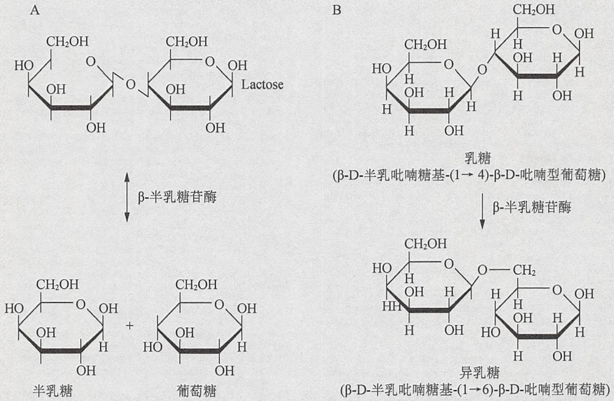
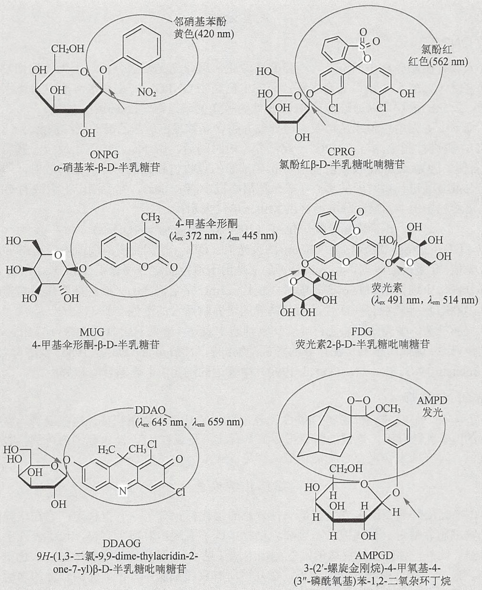
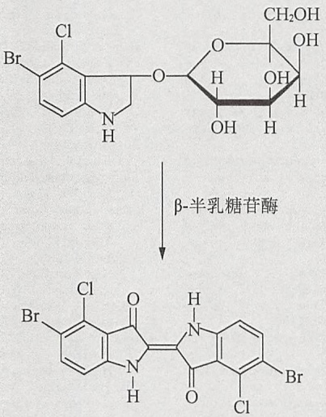
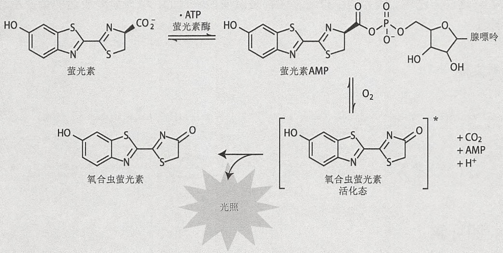
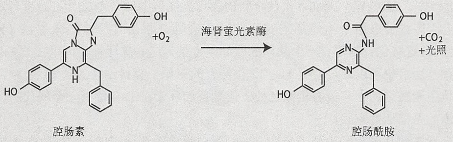

域，荧光恢复的速率取决于细胞上未被漂白的其他区域的蛋白迁移进已经漂白区域的速率；②光漂白中的荧光损失（FLIP），监控被重复漂白区域的邻近区域中荧光信号衰退的速率（for review，见 Lippincott-Schwartz 2003）。尽管检测快速蛋白运动存在限制，例如，使用强光源时产生的过度光毒性不适合用于某些荧光蛋白，光漂白技术还是经常被用于测量和比较蛋白质的流动性。其中一个例子就是解密了细胞核中高迁移率族蛋白的运动（Phair and Mistelli 2000）。

## 亚细胞定位分析

将一个蛋白质与 FP 融合能使其靶向定位各种亚细胞区域, 使细胞器可视化并研究细胞的融合与分裂事件。将已知的信号模序与 FP 融合能将融合蛋白靶向到想研究的细胞小室（VanEngelenburg and Palmer 2008），因此，这些序列必须要能避免其进入非靶向的区域。

## 启动子活性

当研究者将 FP 克隆到感兴趣的启动子下游后，FP 能用作启动子活性的时间与空间的指示剂。它们不仅能用在特定的遗传背景、特定的细胞与组织中、特定的时间，还能响应细胞外部影响，标出启动子的活性（如 Chalfie et al. 1994）。尽管使用 FP 的敏感性不如基于酶的实验，但是它们能使细胞在避免外源干扰，如细胞裂解时实现体内可视化，而且使用多个荧光蛋白作为报道分子实现了多个启动子的多色荧光成像。一个荧光蛋白的成熟速率和在细胞内的半衰期（更新率）对启动子的活性分析十分重要。慢成熟的 FP 在时间上相当地延迟了可探测的荧光信号的出现及对启动子活性的追踪。由于单体状态不能满足追踪启动子活性的需求，快成熟四聚体 FP 被成功应用于此项研究。同样，荧光蛋白的更新率也能相当地影响对启动子活性的追踪，因为高稳定性的荧光蛋白能在启动子活性关闭后的数小时或数天内发出荧光。然而，FP 的生命周期能够通过融合相应的不稳定信号来调节，增加细胞内 FP 的降解速率（Li et al. 1998）。这些报道分子在活系统内能够监测相继的启动子的激活和失活，以研究活细胞内潜在的基因调节网络和循环过程机制。在一种称为双分子荧光互补（BiFC）的实验方法中，拆分的 FP 能重组成有功能的蛋白质是同时追踪两个启动子的实验中的一种可选择的实验方法（Zhang et al. 2004）。在多色的双分子荧光互补（BiFC）实验中，使用一组携带具有不同光谱特性点突变的多个 FP 片段，能分析在特定系统中活化的一组启动子（Hu and Kerppola 2003）。

## 计时器

一个新的且具有进化意义的研究领域是发展“timer FP”，它能随时间变化而改变颜色，允许事后检测暂时性的表达。由于timer FP具有高度变化的成熟率，从几分钟到几小时或几天不等，它们能被用于分析不同时间跨度的进程。第一个被报道的timer FP是DsRed-E5，能在合成后的几小时内产生绿色荧光，但随后即转换成为红色荧光的形式（Terskikh et al. 2000）。这一特性提供了一个监测很多细胞事件的方式，如不同组织的基因表达动力学；区分具有近期活化启动子的细胞与具有持久活化启动子的细胞；分析依赖年龄的细胞器分布和研究蛋白运动（Chudakov et al. 2010）。timer FP随着单体的基于mCherry计时器荧光蛋白（快速FT、中速FT和慢速FT）的发展，该技术能在几小时，最多一天之内将荧光从蓝色变为红色。近期，计时荧光蛋白变得更经得起实验的检验（Subach et al. 2009）。

## 特殊应用

## 研究蛋白质与蛋白质的相互作用

FP 已经至少可用于三种主要研究蛋白质与蛋白质相互作用的技术:荧光共振能量转移（FRET）技术、荧光交互关联光谱（FCCS）技术和荧光蛋白拆分互补技术。

\- FRET:测量两个荧光蛋白分子之间的能量转移现在已经成为了在活细胞中监测蛋白质与蛋白质间相互作用的最常见方法（Piston and Kremers 2007）。在此，一个具有高能量的、受激发的发色团（即在一个较短的激发-发射波长范围内操作）能通过一个称为 FRET 的非辐射的偶极-偶极联动机制转移一些自身激发的能量至一个具有更长波长范围的受体发色团。两个目的蛋白被融合成相应的供体与受体 FP。假设相互作用把荧光蛋白带到足够接近而且使得彼此之间出现有利的定向，当这两个蛋白质相互作用时，它们的 FP 标签之间发生的 FRET 将会被检测到。两个分子间 FRET 的效率与它们之间距离以负六次方的比率降低，所以一般要在少于 10nm 的距离内才能产生可检测的能量转移。这样，在活细胞中的分子的相互作用能被显微镜、光谱学和流式细胞术进行分析（Piston and Kremers 2007）。FRET 甚至能使用现代荧光显微镜用几种方法定量:①减少供体的荧光亮度（荧光量子的产量）；②增加供体的激发后受体的荧光亮度；③降低供体的荧光寿命；④减少发射光的极性。一些理想化的 FRET 的荧光蛋白对已经被鉴定并已商品化。

\- FCCS: 荧光交互相关光谱技术（FCCS）是基于荧光关联光谱（FCS）而建立的，FCS能在限定体积内单分子水平上探测到荧光强度的波动，因此能在活细胞里定量测量分子的平均浓聚与弥散率。在双色FCCS中，两个不同的发色团的信号波动被同时记录，因为它们在活细胞内的相互作用，使研究者能评估两种类型分子弥散的相互依赖性（如Kohl et al. 2002; Bacia et al. 2006）。为能同时有效地激发两个不同的发色团，FCCS需要两个激光束对齐同一个共焦的点。或者，也可以选择使用荧光颜色不同却能被同一波长激发的两种荧光蛋白，但要求一个具有小的而另一个具有大的斯托克斯转移（如Kogure et al. 2006）。另一个普遍的选择是用一个在双色FCCS中能相对有效激发多个荧光蛋白的双光子光源（Kim et al. 2005）。与需要发色团足够接近并达到优势定位的FRET相比，FCCS不依赖荧光蛋白间确定的距离，因此，在载体构建方面具有更高的自由度。FCCS也不需要高表达水平，因此能减少对正常细胞生化过程的干扰。

\- 荧光互补技术（荧光蛋白拆分互补技术）:荧光互补技术使用双荧光蛋白原理，但拆分蛋白不能自发结合。因此，荧光的出现完全依赖于与荧光蛋白融合的蛋白质分子的相互作用（Hu et al. 2002）。对比于 FRET 测量法，因为需要花数小时形成一个成熟的荧光发色团，该 BiFC 分析法不适合于实时监测目标蛋白的相互作用。然而，使用 BiFC 时，由于信号的积累，即使是非常弱的相互作用也能被检测到，使得荧光互补技术与 FRET 相比灵敏度增强。

## 光激活荧光蛋白（PAFP）

光激活荧光蛋白（PAFP）代表一类与荧光蛋白不同的蛋白质，它的荧光能被一束特定波长的光脉冲打开。它们可作为蛋白质、细胞器、组织的选择性光标签，能在独立的光通道中检测到，而未激活的分子不可见。它能对在活细胞中感兴趣的目标进行准确的标记和追踪，还能增强信噪比和进行超分辨成像。光激活的分子基础依赖发色团可逆的顺-反转换，这伴随着邻近氨基酸构象的变化，这种构象变化能产生导致显著改变蛋白质光谱特性的、可逆的、光诱导的光转换。光激活荧光蛋白领域正在快速发展，每几个月都有新的光激活蛋白出现。可逆的光激活荧光蛋白在激发下，荧光展示出可逆的增加或减少，例如，从绿色至红色的 Dendra2（现在由 Clontech $^{1}$ 推向市场）（Gurskaya et al. 2006），由无色到红色的可激活 rsCherry 和 rsCherryRev（Stiel et al. 2008），被用来重复追踪蛋白的运动和增强快速运动蛋白成像（称为蛋白河流）；然而不可逆转的光激活蛋白，如绿色-紫罗兰色 PA-GFP（Patterson and Lippincott-Schwartz 2002）能被用来可视化地实时追踪蛋白与细胞器。

## 使用 FP 的资源

荧光蛋白的信息栏主要倚重于 Chudakov 等发表的一篇优秀且详细的综述（2010）。更多的关于在多种生物中使用野生型和突变型荧光蛋白作为基因表达的标示分子的信息可以在 Shaner（2005）和 Zhang（2009）撰写的综述中找到。Roger Tsien（作为在分子生物学、细胞生物学、生物化学中使用荧光蛋白的先驱与 Osamu Shimomura 和 Martin Chalfie 一同分享了 2008 年的诺贝尔化学奖）的诺贝尔获奖演说也是相当令人着迷的。

现在已经有大量表达荧光蛋白变体的表达载体（天然的和突变的），许多专门的 FP，包括 PAFP、FRET 蛋白对、计时荧光蛋白及 FP 的抗体现在都能通过商品化得到。Clontech 公司可能有最全的荧光蛋白表达载体；GFP 的抗体可从包括 Clontech 和 Life Technologies 在内的多家公司获得。

## 参考文献

- Amsterdam A, Lin S, Hopkins N. 1995. The Aequorea victoria green fluorescent protein can be used as a reporter in live zebra fish embryos. Dev Biol 171: 123–129.
- Bacia K, Kim SA, Schwille P. 2006. Fluorescence cross-correlation spectroscopy in living cells. Nat Methods 3: 83–89.
- Barthmaier P, Fyrberg F. 1995. Monitoring development and pathology of Drosophila indirect flight muscles using green fluorescent protein. Dev Biol 169: 770–774.
- Brejc K, Sixma TK, Kitts PA, Kain SR, Tsien RY, Ormo M, Remington SJ. 1997. Structural basis for dual excitation and photoisomerization of the Aequorea victoria green fluorescent protein. Proc Natl Acad Sci 94: 2306–2311.
- Campbell RE, Tour O, Palmer AE, Steinbach PA, Baird GS, Zacharias DA, Tsien RY. 2002. A monomeric red fluorescent protein. Proc Natl Acad Sci 99: 7877–7882.
- Chalfie M, Tu Y, Euskirchen G, Ward WW, Prasher DC. 1994. Green fluorescent protein as a marker for gene expression. Science 263: 802–805.
- Chiocchetti A, Tolosano E, Hirsch E, Silengo L, Altruda F. 1997. Green fluorescent protein as a reporter of gene expression in transgenic mice. Biochim Biophys Acta 1352: 193–202.
- Chiu WL, Niwa Y, Zeng W, Hirano T, Kobayashi H, Sheen J. 1996. Engineered GFP as a vital reporter in plants. Curr Biol 6: 325–330.
- Chudakov DM, Matz MV, Lukyanov S, Lukyanov KA. 2010. Fluorescent proteins and their applications in imaging living cells and tissues. Physiol Rev 90: 1103–1163.
- Cody CW, Prasher DC, Westler WM, Prendergast FG, Ward WW. 1993. Chemical structure of the hexapeptide chromophore of the Aequorea green-fluorescent protein. Biochemistry 32: 1212–1218.
- Cole NB, Smith CL, Sciaky N, Terasaki M, Edidin M, Lippincott-Schwartz J. 1996. Diffusional mobility of Golgi proteins in membranes of living cells. Science 273: 797–801.
- Culter MW, Ward WW. 1997. Spectral analysis and proposed model for GFP dimerization. In Bioluminescence and chemiluminescence: Molecular reporting with photons (ed. Hastings JW, et al.), pp. 403–406. Wiley, New York.
- Finger FP, Hughes TE, Novick P. 1998. Sec3p is a spatial landmark for polarized secretion in budding yeast. Cell 92: 559–571.
- Flach J, Bossie M, Vogel J, Corbett A, Jinks T, Willins DA, Silver PA. 1994. A yeast RNA-binding protein shuttles between the nucleus and the cytoplasm. Mol Cell Biol 14: 8399–8407.
- Fradkov AF, Verkhusha VV, Staroverov DB, Bulina ME, Yanushevich YG, Martynov VI, Lukyanov S, Lukyanov KA. 2002. Far-red fluorescent tag for protein labelling. Biochem J 368: 17–21.
- Gross LA, Baird GS, Hoffman RC, Baldridge KK, Tsien RY. 2000. The structure of the chromophore within DsRed, a red fluorescent protein from coral. Proc Natl Acad Sci 97: 11990–11995.
- Gurskaya NG, Verkhusha VV, Shcheglov AS, Staroverov DB, Chepurnykh TV, Fradkov AF, Lukyanov S, Lukyanov KA. 2006. Engineering of a monomeric green-to-red photoactivatable fluorescent protein induced by blue light. Nat Biotechnol 24: 461–465.
- Harvey EN. 1952. Bioluminescence. Academic, New York.
- Haupts U, Maiti S, Schwille P, Webb WW. 1998. Dynamics of fluorescence fluctuation in green fluorescent protein observed by fluorescence correlation spectroscopy. Proc Natl Acad Sci 95: 13573–13578.
- Head JF, Inouye SI, Teranishi K, Shimomura O. 2000. The crystal structure of the photoprotein aequorin at 2.3 Å resolution. Nature 405: 372–376.
- Heim R, Prasher DC, Tsien RY. 1994. Wavelength mutations and post-translation autoxidation of green fluorescent protein. Proc Natl Acad Sci 91: 12501–12504.
- Hu CD, Kerppola TK. 2003. Simultaneous visualization of multiple protein interactions in living cells using multicolor fluorescence complementation analysis. Nat Biotechnol 21: 539–545.
- Hu CD, Chinenov Y, Kerppola TK. 2002. Visualization of interactions among bZIP and Rel family proteins in living cells using bimolecular fluorescence complementation. Mol Cell 9: 789–798.
- Hughes T. 1998. Heterologous expression of the green fluorescent protein. In Cells: A laboratory manual. Volume 2: Light microscopy and cell structure (ed. Spector DL, et al.), pp. 78.1–78.8. Cold Spring Harbor Laboratory Press, Cold Spring Harbor, NY.
- Ikawa M, Kominami K, Yoshimura Y, Tanaka K, Nishimune Y, Okabe M. 1995. A rapid and non-invasive selection of transgenic embryos before implantation using green fluorescent protein (GFP). FEBS Lett 375:125–128.
- Inouye S, Tsuji FI. 1994. Evidence for redox forms of the Aequorea green fluorescent protein. FEBS Lett 351: 211–214.
- Johnson FH, Shimomura O, Saiga Y, Gershman LC, Reynolds GT, Waters JR. 1962. Quantum efficiency of Cypridina luminescence, with a note on that of Aequorea. J Cell Comp Physiol 60: 85–103.
- Kim SA, Heinze KG, Bacia K, Waxham MN, Schwille P. 2005. Two photon cross-correlation analysis of intracellular reactions with variable stoichiometry. Biophys J 88: 4319–4336.
- Kogure T, Karasawa S, Araki T, Saito K, Kinjo M, Miyawaki A. 2006. A fluorescent variant of a protein from the stony coral Montipora facilitates dual-color single-laser fluorescence cross-correlation spectroscopy. Nat Biotechnol 24: 577–581.
- Kohl T, Heinze KG, Kuhlemann R, Koltermann A, Schwille P. 2002. A protease assay for two-photon crosscorrelation and FRET analysis based solely on fluorescent proteins. Proc Natl Acad Sci 99: 12161–12166.
- Larrainzar E, O'Gara F, Morrissey JP. 2005. Applications of autofluorescent proteins for in situ studies in microbial ecology. Annu Rev Microbiol 59: 257–277.
- Lee MS, Henry M, Silver PA. 1996. A protein that shuttles between the nucleus and the cytoplasm is an important mediator of RNA export. Genes Dev 10: 1233–1246.
- Li X, Zhao X, Fang Y, Jiang X, Duong T, Fan C, Huang CC, Kain SR. 1998. Generation of destabilized green fluorescent protein as a transcription reporter. J Biol Chem 273: 34970–34975.
- Lippincott-Schwartz J, Altan-Bonnet N, Patterson GH. 2003. Photobleaching and photoactivation: Following protein dynamics in living cells. Nat Cell Biol 2003 Suppl: S7–S14.
- Marshall J, Molloy R, Moss GW, Howe JR, Hughes TE. 1995. The jellyfish green fluorescent protein: A new tool for studying ion channel expression and function. Neuron 14: 211–215.
- Matz MV, Fradkov AF, Labas YA, Savitsky AP, Zaraisky AG, Markelov MK, Lukyanov SA. 1999. Fluorescent proteins from nonbioluminescent Anthozoa species. Nat Biotechnol 17: 969–973.
- McNaughton BR, Cronican JJ, Thompson DB, Liu DR. 2009. Mammalian cell penetration, siRNA transfection, and DNA transfection by supercharged proteins. Proc Natl Acad Sci 106: 6111–6116.
- Misteli T, Caceres JF, Spector DL. 1997. The dynamics of a pre-mRNA splicing factor in living cells. Nature 387: 523–527.
- Mizuno H, Mal TK, Tong KI, Ando R, Furuta T, Ikura M, Miyawaki A. 2003. Photo-induced peptide cleavage in the green-to-red conversion of a fluorescent protein. Mol Cell 12: 1051–1058.
- Morise H, Shimomura O, Johnson FH, Winant J. 1974. Intermolecular energy transfer in the bioluminescent system of Aequorea. Biochemistry 13: 2656–2662.
- Nabeshima K, Kurooka H, Takeuchi M, Kinoshita K, Nakaseko Y, Yanagida M. 1995. p93dis1, which is required for sister chromatid separation, is a novel microtubule and spindle pole body-associating protein phosphorylated at the Cdc2 target sites. Genes Dev 9: 1572–1585.
- Nagai T, Ibata K, Park ES, Kubota M, Mikoshiba K, Miyawaki A. 2002. A variant of yellow fluorescent protein with fast and efficient maturation for cell-biological applications. Nat Biotechnol 20: 87–90.
- Niedenthal RK, Riles L, Johnston M, Hegemann JH. 1996. Green fluorescent protein as a marker for gene expression and subcellular localization in budding yeast. Yeast 12: 773–786.
- Okabe M, Ikawa M, Kominami K, Nakanishi T, Nishimune Y. 1997. 'Green mice' as a source of ubiquitous green cells. FEBS Lett 407; 313–319.
- Olson KR, McIntosh JR, Olmsted JB. 1995. Analysis of MAP 4 function in living cells using green fluorescent protein (GFP) chimeras. J Cell Biol 130: 639–650.
- Ormo M, Cubitt AB, Kallio K, Gross LA, Tsien RY, Remington SJ. 1996. Crystal structure of the Aequorea victoria green fluorescent protein. Science 273: 1392–1395.
- Palm G, Zdanov A, Gaitanaris GA, Stauber R, Pavlakis GN, Wlodawer A. 1997. The structural basis for spectral variations in green fluorescent protein. Nat Struct Biol 4: 361–365.
- Patterson GH, Lippincott-Schwartz J. 2002. A photoactivatable GFP for selective photolabeling of proteins and cells. Science 297: 1873–1877.
- Phair RD, Misteli T. 2000. High mobility of proteins in the mammalian cell nucleus. Nature 404: 604–609.
- Piston DW, Kremers GJ, 2007. Fluorescent protein FRET: The good, the bad and the ugly. Trends Biochem Sci 32: 407–414.
- Prasher DC, Eckenrode VK, Ward WW, Prendergast FG, Cormier MJ. 1992. Primary structure of the Aequorea victoria fluorescent green protein. Gene 111: 229–233.
- Presley JF, Cole NB, Schroer TA, Hirschberg K, Zaal KJM, Lippencott-Schwartz J. 1997. ER-to-Golgi transport visualized in living cells. Nature 389: 81–85.
- Rocheleau JV, Edidin M, Piston DW. 2003. Intrasequence GFP in class I MHC molecules, a rigid probe for fluorescence anisotropy measurements of the membrane environment. Biophys J 84: 4078–4086.
- Shaner NC, Campbell RE, Steinbach PA, Giepmans BN, Palmer AE, Tsien RY. 2004. Improved monomeric red, orange and yellow fluorescent proteins derived from Discosoma sp. red fluorescent protein. Nat Biotechnol 22: 1567–1572.
- Shaner NC, Steinbach PA, Tsien RY. 2005. A guide to choosing fluorescent proteins. Nat Methods 2: 905–909.
- Shaner NC, Patterson GH, Davidson MW. 2007. Advances in fluorescent protein technology. J Cell Sci 120: 4247–4260.
- Shcherbo D, Murphy CS, Ermakova GV, Solovieva EA, Chepurnykh TV, Shcheglov AS, Verkhusha VV, Pletnev VZ, Hazelwood KL, Roche PM, et al. 2009. Far-red fluorescent tags for protein imaging in living tissues. Biochem J 418: 567–574.
- Sherer NM, Lehmann MJ, Jimenez-Soto LF, Horensavitz C, Pypaert M, Mothes W. 2007. Retroviruses can establish filopodial bridges for efficient cell-to-cell transmission. Nat Cell Biol 9: 310–315.
- Shimomura O. 1979. Structure of the chromophore of Aequorea green fluorescent protein. FEBS Lett 104: 220–222.
- Shimomura O, Johnson FH, Saiga Y. 1962. Extraction, purification and properties of aequorin, a bioluminescent protein from the luminous hydromedusan, Aequorea J Cell Comp Physiol 59: 223–239.
- Siegel MS, Isacoff EY. 1997. A genetically encoded optical probe of membrane voltage. Neuron 19: 735–741.
- Sniegowski JA, Lappe JW, Patel HN, Huffman HA, Wachter RM. 2005a. Base catalysis of chromophore formation in Arg96 and Glu222 variants of green fluorescent protein. J Biol Chem 280: 26248–26255.
- Sniegowski JA, Phail ME, Wachter RM. 2005b. Maturation efficiency, trypsin sensitivity, and optical properties of Arg96, Glu222, and Gly67 variants of green fluorescent protein. Biochem Biophys Res Commun 332:657–663.
- Stiel AC, Andresen M, Bock H, Hilbert M, Schilde J, Schonle A, Eggeling C, Egner A, Hell SW, Jakobs S. 2008. Generation of monomeric reversibly switchable red fluorescent proteins for farfield fluorescence nanoscopy. Biophys J 95: 2989–2997.
- Subach FV, Subach OM, Gundorov IS, Morozova KS, Piatkevich KD, Cuervo AM, Verkhusha VV. 2009. Monomeric fluorescent timers that change color from blue to red report on cellular trafficking. Nat Chem Biol 5: 118–126.
- Terskikh A, Fradkov A, Ermakova G, Zaraisky A, Tan P, Kajava AV, Zhao X, Lukyanov S, Matz M, Kim S, et al. 2000. "Fluorescent timer": Protein that changes color with time. Science 290: 1585–1588.
- Tsien RY. 2010. Nobel lecture: Constructing and exploiting the fluorescent protein paintbox. Integr Biol 2: 77–93.
- VanEngelenburg SB, Palmer AE. 2008. Fluorescent biosensors of protein function. Curr Opin Chem Biol 12: 60–65.
- Wacker I, Kaether C, Kromer A, Migala A, Almers W, Gerdes HH. 1997. Microtubule-dependent transport of secretory vesicles visualized in real time with a GFP-tagged secretory protein. J Cell Sci 110: 1453–1463.
- Wall MA, Socolich M, Ranganathan R. 2000. The structural basis for red fluorescence in the tetrameric GFP homolog DsRed. Nat Struct Biol 7: 1133–1138.
- Wang S, Hazelrigg T. 1994. Implications for bcd mRNA localization from spatial distribution of exu protein in Drosophila oogenesis. Nature 369:400–403.
- Ward WW, Bokman SH. 1982. Reversible denaturation of Aequorea green fluorescent protein: Physical separation and characterization of the renatured protein. Biochemistry 21: 4535–4550.
- Ward WW, Cody CW, Hart RC, Cormier MJ. 1980. Spectrophotometric identity of the energy transfer chromophores in Renilla and Aequorea green fluorescent proteins. Photochem Photobiol 31: 611–615.
- Yang F, Moss LG, Phillips GN. 1996. The molecular structure of green fluorescent protein. Nat Biotechnol 14: 1246–1251.
- Yarbrough D, Wachter RM, Kallio K, Matz MV, Remington SJ. 2001. Refined crystal structure of DsRed, a red fluorescent protein from coral, at 2.0-Å resolution. Proc Natl Acad Sci 98: 462–467.
- Yeh E, Skibbens RV, Cheng JW, Salmon ED, Bloom K. 1995. Spindle dynamics and cell cycle regulation of dynein in the budding yeast Saccharomyces cerevisiae. J Cell Biol 130: 687–700.
- Yu J, Xiao J, Ren X, Lao K, Xie XS. 2006. Probing gene expression in live cells, one protein molecule at a time. Science 311: 1600–1603.
- Zhang J. 2009. The colorful journey of green fluorescent protein. ACS Chem Biol 4: 85–88.
- Zhang S, Ma C, Chalfie M. 2004. Combinatorial marking of cells and organelles with reconstituted fluorescent proteins. Cell 119: 137–144.
- Zhuo L, Sun B, Zhang CL, Fine A, Chiu SY, Messing A. 1997. Live astrocytes visualized by green fluorescent protein in transgenic mice. Dev Biol 187: 36–42.

<small>1 http://www.clontech.com/US/Support/Trademarks?sitex=10020:22372:US&PROD=WxhZdLflj99G4FhmUPCranJ1:S&PROD\_pses=ZG84E62907FD5697701543E0B37491307E67680DBAC085E727E84E594964A3DF68F49436E8254A47DF25C7C2902006955FCCEBFE455F714F11.</small>

## 网络资源

Nobel Web AB (Nobel Foundation). The Nobel Prize in Chemistry 2008 http://www.nobelprize.org/nobel\_prizes/nobelguide\_che.pdf

## 表位标记

## 概述

通过重组 DNA 技术，把含有目的氨基酸残基的融合蛋白的氨基端或是羧基端共价结合到载体序列上。通常，当载体序列携带有用的抗原决定簇，该融合蛋白就被称为进行了抗原表位标记（epitope tag）。“表位标记”这个术语现在与各种类型的“已知”和“易于检测”的蛋白质结构域和基序同义，它们能与蛋白质融合，用于鉴定未经纯化的感兴趣的蛋白质。该技术主要的优点是能够使用经过很好鉴定且高度特异的抗体或是表位特异性的配体来研究感兴趣的蛋白质，从而避免耗时、耗力又充满不确定性的生产和鉴定抗体的过程。

最早的表位标记是为了纯化蛋白质而设计的，能够大规模地制备识别表位标记上基序的配体或抗体连接的柱子。最早整合到商业化的蛋白质表达载体中的标记包括Flag、6xHis及谷胱甘肽-S-转移酶（GST）等。在最初的Flag标记系统中，使用了钙依赖结合的抗Flag M1单克隆抗体，含Flag标记的蛋白质能被EDTA洗脱（Hopp et al. 1988），而含6xHis标记的蛋白质则是利用金属螯合色谱法来纯化的（Hochuli et al. 1988）。类似的，含GST标记的蛋白质是利用谷胱甘肽珠子来纯化的（Smith and Johnson 1988）。除了这些商业化的标记以外，很多学术团体改进了HA标记(Field et al. 1988)及c-myc标记（Evan et al. 1985），抗表位标记最初是在酿酒酵母（Saccharomyces cerevisiae）和Schizosaccharomyces pombe（Bahler et al. 1998; Longtine et al. 1998）中成为了可用于蛋白质鉴定的分析工具。自从人们认识到抗原表位标记在蛋白纯化以外的作用后，引起了整个标记及相关抗体/配体领域的快速发展，目前抗原表位标记也能用于哺乳动物蛋白的分析。表3中列举了一些常用的抗原表位标记、相应的表达载体及检测试剂，它们中的大部分可以从多个供应商通过商业途径获得。同时该表也列举了一些以前存在的标记的抗体（例如，抗Flag M2单抗[Brizzard et al. 1994]及抗6xHis标记的抗体[Kaufman et al. 2002]）。通常，一种特异识别抗原表位的单抗可以用于免疫染色、免疫印迹、免疫沉淀及免疫纯化。前面所提到的荧光蛋白也许是目前开发的最重要的表位标记。

表 3 常见表位标记

| 表位标记 | 应用 | 介绍 | 检测 | 参考文献 |
| --- | --- | --- | --- | --- |
| 人c-Myc | IA, Co-IP, WB, IF | EQKLISEEDL | 单抗9E10针对合成的人c-myc的409~439残基免疫而来 | Evan et al. 1985; Munro and Pelham 1986, 1987; Pelham et al. 1988; Squinto et al. 1990; Adamson et al. 1992; Sells and Chernoff 1995 |
| 流行性感冒病毒红细胞凝集素 | IA, Co-IP, WB, IF | YPYDVPDYA | 单抗最初是针对合成的对应H3亚型的流行性感冒病毒红细胞凝集素75~110位氨基酸残基免疫而来。抗体12CA5和3F10,识别整个的抗原决定簇YPYDVPDYA,该9肽是商品化的,可用于把融合蛋白从单抗中释放出来 | Niman et al. 1983; Wilson et al. 1984; Field et al. 1988; Swanson et al. 1991; West et al. 1992; Marck et al. 1993; Sells and Chernoff 1995 |
| Flag序列 | IA, Co-IP, WB, IF | DYKDDDDK; Flag被设计成疏水且可以用于免疫纯化的标记物,可以通过蛋白水解切割从靶蛋白中除去。Flag表位羧基端的5个氨基酸是根据肠激酶对其天然底物牛胰蛋白酶原的切割位点改变而来的 | 单抗4E11能够特异性的针对Flag序列,以钙离子依赖性的方式与之结合,EDTA等螯合剂处理或是低pH条件下相互解离。目前该抗体基本被商业化的不依赖于钙离子的M2和M5单抗所代替 | Davie and Neurath 1955; Hopp et al. 1988; Knott et al. 1988; Prickett et al. 1989; Slootstra et al. 1996 |
| 6xHis | IA, Co-IP, WB, IF | HHHHHH | 针对6-His、6xHis和HIS-11的抗体 | Hochuli et al. 1988 |
| 谷胱甘肽-S-转移酶(GST) | IA, Co-IP, WB, IF | 220个氨基酸残基的GST序列 | Anti-GST抗体eg-mAb gst-2 | Smith and Johnson 1988 |
| 蛋白A | AP, Co-IP | 分离自金黄色葡萄球菌含有IgG结合结构域的蛋白A | 所有的IgG,但是亲和性会随着种属及IgG的亚型而变化 | Uhlén et al. 1983 |
| 麦芽糖结合蛋白(MBP) | AP | 麦芽糖结合蛋白最初纯化的方法利用了与麦芽糖结合蛋白具有天然亲和力的交联的淀粉酶 | MBP抗体 | di Guan et al. 1988 |
| 几丁质结合结构域(CBD) | AP | 环状芽胞杆菌几丁质酶的几丁质结合结构域,结合蟹壳中分离的几丁质基质。最初的纯化方法依赖于CBD融合蛋白与几丁质珠子的相互作用 | CBD抗体 | Chong et al. 1997 |
| S-标记 | AP | S-肽段;核糖核酸A蛋白水解切割产生的短的氨基端序列(S-肽段),它能够高度亲和地结合S-蛋白(核糖核酸A的剩余部分)。S-肽段标签融合的蛋白质通常使用S-蛋白纯化。目前有S-肽段的单抗 | S-肽段抗体 | Hackbarth et al. 2004 |
| 链球菌-标签II | AP | WSAPQFEK;8个氨基酸残基多肽能够结合链霉亲和素 | 工程化的链霉菌-内动蛋白亲和柱子 | Schmidt and Skerra 2007 |
| Avitag | AP, ELISA | GLNDIFEAQKIEWHE;用来自大肠杆菌的生物素连接酶高效靶向催化单生物素与含15个氨基酸残基多肽标记进行结合 | 结合到抗生素蛋白/链霉亲和素包埋的柱子 | Tucker and Grisshammer 1996 |
| 钙调蛋白-结合肽(CBP) | AP | 钙调蛋白-结合肽,这是一个来源于肌肉肌球蛋白轻链激酶的含有26个氨基酸残基的羧基末端片段,在生理pH且钙存在的条件下能与钙调蛋白具有很高的亲和力。当钙离子被移除后,钙调蛋白发生构象变化,从配体上解离 | 钙调蛋白亲和树脂 | Rigaut et al. 1999 |
| CD(生物中心法则) | AP | 18个氨基酸的外显子;CD盒,特别设计的DNA分子,在可读框周围含切割的供受位点,将CD盒插到目标基因的内含子中会产生一个新的、被CD盒可读框所代替的外显子,该外显子被两个有功能的杂合内含子所包围,因此:1该基因会含有一段特异的核苷酸序列;2其mRNA也被标记一段特殊核酸序列;3其蛋白也含有一段特殊肽序列 | 特异的核苷酸或是抗体探针可用于引进的特异标签 | Jarvik et al. 1996 |

注:IA，免疫亲和；Co-IP，免疫共沉淀；WB，免疫印迹；AP，亲和纯化；ELISA，酶联免疫吸附试验；IF，免疫荧光。

## 实际考虑

通过使用已经存在的 PCR 的程序，在不影响内源启动子活性的基础上，将标签的核苷酸序列掺入表达蛋白的 DNA 序列中，一个标签可以在不严重影响蛋白质功能的情况下，融合到大多数蛋白的氨基端、羧基端或是其他部位（Prasad and Goff 1989; Anand et al. 1993; Ross-Macdonald et al. 1997）。但只要可能，应该通过定性（蛋白免疫印迹检测）或功能实验（酶活检测）对蛋白质进行检测，从而确定标签蛋白的活性。大多数情况下，融合蛋白的表达是在异源启动子的控制下，如 CMV，通常会造成感兴趣的基因的异常表达。这并不表示抗原表位标记不能被用于作为内源调控的通路，如研究细胞周期的调控-调控的基因。通过重组技术可以将标签蛋白导入在蛋白内源启动子控制的蛋白质上（Sung et al. 2005）或是染色体上（Chen et al. 2006），从而可以在生理条件下追踪该蛋白质的表达。

然而，在采用某种特定的抗原表位标记策略之前，充分的文献调研有助于确定选择的表位标记是否有类似的应用。虽然蛋白质与蛋白质之间，表位标记有所不同，但用特定标记物进行相似方法探索这个事实就已经提高了成功的可能性，并且对如何使用那些在一般的研究方案中不存在的表位标记，提供一些想法和详细的信息。有一点非常重要，所选择标记的抗体或是结合配体不能与表达标记标记蛋白的宿主细胞中的蛋白质发生交联反应。但是，应该记住，尽管概率很小，因为这些表位大多数来自于激素或是癌基因，与细胞中物质具有免疫交叉反应。此外还有很重要的一点，在靶蛋白中选择适当的标记插入位点，从而不会影响拓扑结构（如疏水信号结构）或是转运信号（核转运信号或是内质网滞留序列）的功能。但是，应尽可能地把表位标记物加到靶蛋白的氨基或是羧基端，那样它们最可能接近抗体，且最不可能干扰靶蛋白的功能。

当表位标记用于免疫纯化时，最好选择一个可以从靶蛋白中移除的标记。有时候，去除标记对于保持蛋白质功能、提高溶解性或是降低抗原性是必需的。虽然不能保证成功，但是可以通过在表位标记和靶蛋白之间的肽接头中插入蛋白酶切割位点来完成标记的去除。表4中列举了常用的用于标记去除的蛋白酶切割位点，用酶去除标记经常效率不高（因为不能达到切割位点），而且有时候是具有破坏性的（因为切割的蛋白酶并不完全特异或是有污染了非特异蛋白酶）（Nagai and Thogersen 1987; Dykes et al. 1988）。

表 4 用于去除标记的蛋白酶切割位点

| 蛋白酶 | 切割位点描述 | 识别肽段 |
| --- | --- | --- |
| 肠激酶 | 高度特异的丝氨酸蛋白酶被用于将Flag 标记从融合蛋白上切除 | Flag 的 Lys-X 位点;N-Asp-Tyr-Lys-Asp-Asp-Asp-Asp-Lys-X-C注意如果 X 位点含有脯氨酸,该多肽不能被切割 |
| 凝血酶 | 一种能够选择性切割 Arg—Gly 键的丝氨酸内切酶。人及牛凝血酶有相同的肽段识别序列 | P4-P3-Pro-Arg/Lys-X-P1'-P2'注意 P4 和 P3 为疏水残基,P1'和 P2'为非酸性残基,Arg /Lys-X-P1'为易断裂的键P2-Arg / Lys-X-P1'注意当 P2 或 P1'为甘氨酸时,Arg / Lys-X-P1'为易断裂的键 |
| 激活的因子X (Xa) | 与凝血酶类似,催化 Arg—Thr 和Arg—Ile 化学键的水解 | Ile-Glu(或 Asp)-Gly-Arg—X 有时候可能会根据靶蛋白的构象切割其他的碱性残基。注意识别位点中如果为脯氨酸位于精氨酸之后,因子 Xa 不能切割该位点 |

## 应用

自从 Munro 和 Pelham（1984）介绍抗原表位标记技术以来，它已经被用来解决多种实验问题，包括表达蛋白的检测、定位和纯化。感兴趣的蛋白质可以用直接针对表位的免疫试剂盒检测，而且可以在没有功能测定的情况下用亲和层析的方法纯化（Field et al. 1988）。此外，因为标记的蛋白质可以很明确地从相关蛋白质中区分出来（Davis and Fink 1990），所以它的大小和定位可以通过 Western 印迹和免疫荧光来确定（Munro and Pelham 1986, 1987; Geli et al. 1988; Pelham et al. 1988; Swanson et al. 1991），它的生物合成形式和翻译后修饰可以通过脉冲式标记和免疫沉淀来追踪（Kolodziej and Young 1989; Squinto et al. 1990），它与其他蛋白质的相互作用可以通过免疫共沉淀进行探索（Kolodziej and Young 1989; Squinto et al. 1990）。最后，随着质谱技术的发展，对多肽测序愈发灵敏，抗原表位标记已经越来越多地应用于纯化蛋白复合物及鉴定复合物中的组分（Ogryzko et al. 1998; Shao et al. 1999; Chang 2006）。虽然不可能提供一份相关文献的全面清单，但是在下面列出了最近有关抗原表位标记技术的主要应用。

\- 基因表达及定位。通过免疫印迹及 ELISA 的方法，抗原表位标记技术已经被用来研究多种生物组织的基因表达。如果因为较低的表达水平和蛋白质不稳定，利用单个表位很难检测到的融合蛋白，可以通过添加多个表位使灵敏度提高

(Nakajima and Yaoita 1997; Hernan et al. 2000)。融合蛋白一旦表达，可以用免疫荧光的方法进行定位。这个技术对于研究具有高度标志序列特性的基因家族亚型的定位很有帮助，这些同种型蛋白序列具有很高的一致性，很难制备针对不同亚型蛋白的特异抗体（Scherer et al. 1995; Toyota et al. 1998）。表位标记技术还可以通过靶向蛋白到特异位置对蛋白质进行区域作图（Xu et al. 1998）。

- 相互作用。通过免疫共沉淀及 Western 印迹检测，表位标记技术广泛地应用于研究体外和体内的蛋白质-蛋白质相互作用。近期一些例子包括，用带 Flag 标记的 COX2 来鉴定其相互作用的泛素连接酶的支架蛋白（Neuss et al. 2007），用带 myc 标记的 FKBP38 来与 presenelin 1 及 presenelin 2 进行免疫共沉淀（Wang et al. 2005）。两个相互作用的蛋白质如果没有可用的抗体，可以使每个蛋白质结合不同的标记。然后识别一个表位的抗体用于免疫沉淀，而另一个表位的抗体用于检测免疫共沉淀的蛋白质。这种情况下为了确定相互作用的特异性，通常进行交互的免疫沉淀实验来进一步确认。而且，需要着重指出的是，因为通过免疫沉淀确定的候选蛋白可能不是直接与诱饵蛋白相互作用，所以比较明智的方法是用其他方法来证明是否存在直接的相互作用。
- 蛋白复合物的纯化。很多情况下，生物功能不是由单个蛋白来执行的，而是由蛋白复合物来执行的。所以，必须鉴定并纯化复合物中的所有蛋白质。酵母等生物体中，存在对执行同一功能的所有组分进行鉴定的遗传学方法，但是仍需要纯化蛋白复合物来研究它们的生化功能。表位标记技术提供了一种通过免疫亲和层析和免疫共沉淀纯化复合物的方法（Chiang and Roeder 1993; Ogryzko et al. 1998; Shao et al. 1999）。
- 串联亲和纯化。也许抗原表位标记技术最重要且发展最大的应用是将不同的标记串联以应用于特性相近的蛋白质纯化中。该法结合了两种甚至更多的标记所需的特性，能将标记蛋白快速、干净地分离出来，并且，如果需要的话，还能得到其在细胞裂解液中相互作用蛋白，例如，Flag 和 His 双标记的融合蛋白既可以被 Flag 抗体检测，又能被金属螯合色谱纯化（DiCiommo et al. 2004）。最广为人知的 TP 标记含有 IgG 结合结构域和钙调蛋白结合肽，两者之间含有用于两步纯化过程中的来自烟草蚀纹病毒（TEV）蛋白酶的切割位点（Rigaut et al. 1999）。首先，被标记的蛋白质用蛋白 A 的亲和性进行纯化，结合到蛋白 A 的融合蛋白通过 TEV 蛋白酶切割后进行释放。接着，洗脱的融合蛋白在钙离子存在的情况下利用钙调蛋白亲和性进行纯化，结合的蛋白质通过 EGTA 的孵育被释放。而且，串联亲和纯化（TAP）后可以利用质谱的方法鉴定与诱饵标记蛋白作用的蛋白质。最近，报道了一个比较短的 4.6kDa 的 TAP 标记——SF-TAP 标记（Gloeckner et al. 2007），这个串联标记是由 Strep-tag II 和 Flag 标记串联而成的。

## 参考文献

- Adamson P, Paterson HF, Hall A. 1992. Intracellular localization of the P21 $^{rho}$ proteins. J Cell Biol 119: 617–627.
- Anand R, Bason L, Saedi MS, Gerzanich V, Peng X, Lindstrom J. 1993. Reporter epitopes: A novel approach to examine transmembrane topology of integral membrane proteins applied to the α1 subunit of the nicotinic acetylcholine receptor. Biochemistry 32: 9975–9984.
- Bahler J, Wu JQ, Longtine MS, Shah NG, McKenzie A III, Steever AB, Wach A, Philippsen P, Pringle JR. 1998. Heterologous modules for efficient and versatile PCR-based gene targeting in Schizosaccharomyces pombe. Yeast 14: 943–951.
- Brizzard BL, Chubet RG, Vizard DL. 1994. Immunoaffinity purification of FLAG epitope-tagged bacterial alkaline phosphatase using a novel
- monoclonal antibody and peptide elution. BioTechniques 16: 730–735.
- Chang IF. 2006. Mass spectrometry-based proteomic analysis of the epitope-tag affinity purified protein complexes in eukaryotes. Proteomics 6: 6158–6166.
- Chen YI, Maika SD, Stevens SW. 2006. Epitope tagging of proteins at the native chromosomal loci of genes in mice and in cultured vertebrate cells. J Mol Biol 361: 412–419.
- Chiang CM, Roeder RG. 1993. Expression and purification of general transcription factors by FLAG epitope-tagging and peptide elution. Pept Res 6: 62–64.
- Chong S, Mersha FB, Comb DG, Scott ME, Landry D, Vence LM, Perler FB, Benner J, Kucera RB, Hirvonen CA, et al. 1997. Single-column
- purification of free recombinant proteins using self-cleavable affinity tag derived from a protein splicing element. Gene 192: 271–281.
- Davie EW, Neurath H. 1955. Identification of a peptide released during autocatalytic activation of trypsinogen. J Biol Chem 212: 515–529.
- Davis LI, Fink GR. 1990. The NUP1 gene encodes an essential component of the yeast nuclear pore complex. Cell 61: 965–978.
- DiCiommo DP, Duckett A, Burcescu I, Bremner R, Gallie BL. 2004. Retinoblastoma protein purification and transduction of retina and retinoblastoma cells using improved alphavirus vectors. Invest. Ophthalmol Vis Sci 45: 3320–3329.
- di Guan C, Li P, Riggs PD, Inouye H. 1988. Vectors that facilitate the expression and purification of foreign peptides in Escherichia coli by fusion to maltose-binding protein. Gene 67: 21–30.
- Dykes CW, Bookless AB, Coomber BA, Noble SA, Humber DC, Hobden AN. 1988. Expression of atrial natriuretic factor as a cleavable fusion protein with chloramphenicol acetyltransferase in Escherichia coli. Eur J Biochem 174: 411–416.
- Evan GI, Lewis GK, Ramsay G, Bishop JM. 1985. Isolation of monoclonal antibodies specific for human c-myc proto-oncogene product. Mol Cell Biol 5: 3610–3616.
- Field J, Nikawa J, Broek D, MacDonald B, Rodgers L, Wilson IA, Lerner RA, Wigler M. 1988. Purification of a RAS-responsive adenylyl cyclase complex from Saccharomyces ceverisiae by use of an epitope addition method. Mol Cell Biol 8: 2159–2165.
- Geli V, Baty D, Lazdunski C. 1988. Use of a foreign epitope as a "tag" for the localization of minor proteins within a cell: The case of the immunity protein to colicin A. Proc Natl Acad Sci 85: 689–693.
- Gloeckner CJ, Boldt K, Schumacher A, Roepman R, Ueffing M. 2007. A novel tandem affinity purification strategy for the efficient isolation of native protein complexes. Proteomics 7: 4228–4234.
- Hackbarth JS, Lee SH, Meng XW, Vroman BT, Kaufmann SH, Karnitz LM. 2004. S-peptide epitope tagging for protein purification, expression monitoring, and localization in mammalian cells. BioTechniques 37:835–839.
- Hernan R, Heuermann K, Brizzard B. 2000. Multiple epitope tagging of expressed proteins for enhanced detection. BioTechniques 28: 789–793.
- Hochuli E, Bannwarth W, Döbeli H, Gentz R, Stuber D. 1988. Genetic approach to facilitate purification of recombinant proteins with a novel metal chelate adsorbent. Nat Biotechnol 6: 1321–1325.
- Hopp TP, Prickett KS, Price VL, Libby RT, March CJ, Cerretti DP, Urdal DL, Conlon PJ. 1988. A short polypeptide marker sequence useful for recombinant protein identification and purification. Nat Biotechnol 6: 1204–1210.
- Jarvik JW, Adler SA, Telmer CA, Subramaniam V, Lopez AJ. 1996. CD-tagging: A new approach to gene and protein discovery and analysis. Bio-Techniques 20: 896–904.
- Kaufmann M, Linder P, Honegger A, Blank K, Tschopp M, Capitani G, Pluckthun A, Grutter MG. 2002. Crystal structure of the anti-His tag antibody 3D5 single-chain fragment complexed to its antigen. J Mol Biol 318: 135–147.
- Knott JA, Sullivan CA, Weston A. 1988. The isolation and characterisation of human atrial natriuretic factor produced as a fusion protein in Escherichia coli. Eur J Biochem 174: 405–410.
- Kolodziej P, Young RA. 1989. RNA polymerase II subunit RPB3 is an essential component of the mRNA transcription apparatus. Mol Cell Biol 9: 5387–5394.
- Longtine MS, McKenzie A III, Demarini DJ, Shah NG, Wach A, Brachat A, Philippsen P, Pringle JR. 1998. Additional modules for versatile and economical PCR-based gene deletion and modification in Saccharomyces cerevisiae. Yeast 14: 953–961.
- Marck C, Lefebvre O, Carles C, Riva M, Chaussivert N, Ruet A, Sentenac A. 1993. The TFIIIB-assembling subunit of yeast transcription factor TFIIIC has both tetratricopeptide repeats and basic helix-loop-helix motifs. Proc Natl Acad Sci 90: 4027–4031.
- Munro S, Pelham HRB. 1984. Use of peptide tagging to detect proteins expressed from cloned genes: Deletion mapping of functional domains of Drosophila hsp 70. EMBO J 3: 3087–3093.
- Munro S, Pelham HRB. 1986. An Hsp70-like protein in the ER: Identity with the 78 kd glucose-regulated protein and immunoglobulin heavy-chain binding protein. Cell 46: 291–300.
- Munro S, Pelham HRB. 1987. A C-terminal signal prevents secretion of luminal ER proteins. Cell 48: 899–907.
- Nagai K, Thøgersen HC. 1987. Synthesis and sequence-specific proteolysis of hybrid proteins produced in Escherichia coli. Methods Enzymol 153:461–481.
- Nakajima K, Yaoita Y. 1997. Construction of multiple-epitope tag sequence by PCR for sensitive Western blot analysis. Nucleic Acids Res 25: 2231–2232.
- Neuss H, Huang X, Hetfeld BKJ, Deva R, Henklein P, Nigam S, Mall JW, Schwenk W, Dubiel W. 2007. The ubiquitin- and proteasome-dependent degradation of COX-2 is regulated by the COP9 signalosome and
- differentially influenced by coxibs. J Mol Med 85: 961–970.
- Niman HL, Houghten RA, Walker LE, Reisfeld RA, Wilson IA, Hogle JM, Lerner RA. 1983. Generation of protein-reactive antibodies by short peptides is an event of high frequency: Implications for the structural basis of immune recognition. Proc Natl Acad Sci 80: 4949–4953.
- Ogryzko VV, Kotani T, Zhang X, Schlitz RL, Howard T, Yang XJ, Howard BH, Qin J, Nakatani Y. 1998. Histone-like TAFs within the PCAF histone acetylase complex. Cell 94: 35–44.
- Pelham HRB, Hardwick KG, Lewis MJ. 1988. Sorting of soluble ER proteins in yeast. EMBO J 7: 1757–1762.
- Prasad VR, Goff SP. 1989. Linker insertion mutagenesis of the human immunodeficiency virus reverse transcriptase expressed in bacteria: Definition of the minimal polymerase domain. Proc Natl Acad Sci 86: 3104–3108.
- Prickett KS, Amberg DC, Hopp TP. 1989. A calcium-dependent antibody for identification and purification of recombinant proteins. BioTechniques 7: 580–589.
- Rigaut G, Shevchenko A, Rutz B, Wilm M, Mann M, Seraphin B. 1999. A generic protein purification method for protein complex characterization and proteome exploration. Nat Biotechnol 17: 1030–1032.
- Ross-Macdonald P, Sheehan A, Roeder GS, Snyder M. 1997. A multipurpose transposon system for analyzing protein production, localization, and function in Saccharomyces cerevisiae. Proc Natl Acad Sci 94: 190–195.
- Scherer PE, Tang Z, Chun M, Sargiacomo M, Lodish HF, Lisanti MP. 1995. Caveolin isoforms differ in their N-terminal protein sequence and subcellular distribution. Identification and epitope mapping of an isoform-specific monoclonal antibody probe. J Biol Chem 270: 16395–16401.
- Schmidt TGM, Skerra A. 2007. The Streptag system for one-step purification and high-affinity detection or capturing of proteins. Nat Protocols 2: 1528–1535.
- Sells MA, Chernoff J. 1995. Epitope-tag vectors for eukaryotic protein production. Gene 152: 187–189.
- Shao Z, Raible F, Mollaaghababa R, Guyon JR, Wu CT, Bender W, Kingston RE. 1999. Stabilization of chromatin structure by PRC1, a Polycomb complex. Cell 98: 37–46.
- Slootstra JW, Kuperus D, Plückthun A, Meloen RH. 1996. Identification of new tag sequences with differential and selective recognition properties for the anti-FLAGw monoclonal antibodies M1, M2 and M5. Mol Divers 2: 156–164.
- Smith DB, Johnson KS. 1988. Single-step purification of polypeptides expressed in Escherichia coli as fusions with glutathione-S-transferase. Gene 67: 31–40.
- Squinto SP, Aldrich TH, Lindsay RM, Morrisset DM, Panayotatos N, Bianco SM, Furth ME, Yancopoulos GD. 1990. Identification of functional receptors for ciliary neurotrophic factor on neuronal cell lines and primary neurons. Neuron 5: 757–766.
- Sung H, Chul Han K, Chul Kim J, Wan Oh K, Su Yoo H, Tae Hong J, Bok Chung Y, Lee CK, Lee KS, Song S. 2005. A set of epitope-tagging integration vectors for functional analysis in Saccharomyces cerevisiae. FEMS Yeast Res 5: 943–950.
- Swanson RN, Conesa C, Lefebvre O, Carles C, Ruet A, Queemeneur E, Gagnon J, Sentenac A. 1991. Isolation of TFCI, a gene encoding one of two DNA-binding subunits of yeast transcription factor 7 (TFIIIC). Proc Natl Acad Sci 88: 4887–4891.
- Toyota N, Uzawa H, Shimada Y. 1998. Assembly of force-expressed troponin-I isoforms in myofibrils of cultured cardiac and fast skeletal muscle cells as studied by epitope tagging. J Muscle Res Cell Motil 19: 937–947.
- Tucker J, Grisshammer R. 1996. Purification of a rat neurotensin receptor expressed in Escherichia coli. Biochem J 317: 891–899.
- Uhlén M, Nilsson B, Guss B, Lindberg M, Gatenbeck S, Philipson L. 1983. Gene fusion vectors based on the gene for staphylococcal protein A. Gene 23: 369–378.
- Wang HQ, Nakaya Y, Du Z, Yamane T, Shirane M, Kudo T, Takeda M, Takebayashi K, Noda Y, Nakayama KI, et al. 2005. Interaction of presenelins with FKBP38 promotes apoptosis by reducing mitochondrial Bcl-2. Hum Mol Genet 14: 1889–1902.
- West AH, Clark DJ, Martin J, Neupert W, Hartl F-U, Horwich AL. 1992. Two related genes encoding extremely hydrophobic proteins suppress
- a lethal mutation in the yeast mitochondrial processing enhancing protein. J Biol Chem 267: 24625–24633.
- Wilson IA, Niman HL, Houghten RA, Cherenson AR, Connolly ML, Lerner RA. 1984. The structure of an antigenic determinant in a protein. Cell 37: 767–778.
- Xu L, Gonzalez-Agosti C, Beauchamp R, Pinney D, Sterner C, Ramesh V. 1998. Analysis of molecular domains of epitope-tagged merlin isoforms in Cos-7 cells and primary rat Schwann cells. Exp Cell Res 238: 231–240.

## β-半乳糖苷酶

大肠杆菌β-半乳糖苷酶（相对分子质量465412; EC 3.2.1.23）是由相同多肽亚单位组成的四聚体，每个亚单位由1023个氨基酸构成。该多肽由lac操纵子的第一个基因（lacZ）编码。Fowler和Zabin（1978）确定了β-半乳糖苷酶的氨基酸序列，Kalnins等（1983）报道了lacZ基因的核酸序列（GenBank登录号V00296）。β-半乳糖苷酶晶体的X射线衍射分析表明，该四聚体显示出222点对称（Jacobson et al. 1994）。每个多肽链折叠成5个连续的结构域，此外在氨基端还有约50个氨基酸的片段。该片段对应于α-肽，以后会更详细地介绍。β-半乳糖苷酶的合成由乳糖和其他某些半乳糖苷诱导，它催化两种酶促反应:

- 水解β-D-半乳糖吡喃糖苷[该酶对于在大肠杆菌中把乳糖（1,4-O-β-D-吡喃型半乳糖-D-葡萄糖）这种二糖水解成葡萄糖和半乳糖是必需的（图3，左图）]。
- 乳糖转换成异乳糖（1,6-O-β-D-吡喃型半乳糖-D-葡萄糖）的转半乳糖苷反应。异乳糖是 lac 操纵子的真正诱导物（图 3，右图）（Muller-Hill et al. 1964; Jobe and Bourgeois 1972）。

图 3 β-半乳糖苷酶的催化反应。水解β-D-半乳糖吡喃糖苷（左）和乳糖转换（右）。

β-半乳糖苷酶还可以与一系列合成的乳糖类似物相互作用，这些类似物中用其他部分代替葡萄糖（图4）。这些代替物包括:

- 生色底物 o-硝基苯-β-D-半乳糖苷（ONPG）、5-溴-4-氯-3-吲哚-β-D-半乳糖苷（X-gal）和氯酚红β-D-半乳糖吡喃糖苷（CPRG）。
- 生荧光底物如 4-甲基伞形酮-β-D-半乳糖苷（MUG）、试卤灵（resorufin）β-D-半乳糖吡喃糖苷（Res-Gal）、荧光素 2-β-D-半乳糖吡喃糖苷（FDG）和 9H-(1,3-二氯-9,9-dime-thylacridin-2-one-7-yl）β-D-半乳糖吡喃糖苷（DDAO 半乳糖苷）。
- 化学发光底物 6-O-β-吡喃型半乳糖荧光素和 3-(2'-螺旋金刚烷)-4-甲氧基-4-(3''-磷酰氧基)苯-1,2-二氧杂环丁烷（AMPGD，也叫 Galacton-Star）（Bronstein et al. 1989）。

图 4 β-半乳糖苷酶水解底物。每个底物的发色基团用圆圈标记。

\- 抑制剂，如 $p$-氨苯基-$\beta$-D-硫代半乳糖苷（$p$-aminophenyl-$\beta$-D-thio-galactoside, TPEG），用于 lacZ 融合蛋白的亲和纯化（Germino et al. 1983; Ullmann 1984）。

β-半乳糖苷酶可以忍受对其氨基端和羧基端的氨基酸进行删减和替换。氨基端最多可以删除26个氨基酸并换上多种其他蛋白质的数百或更多别的蛋白质的残基，也不会影响酶活性（Brickman et al. 1979; Fowler and Zabin 1983）。羧基端有两个氨基酸是可有可无的，能被其他编码区代替而产生有活性的嵌合β-乳糖苷酶（Ruther and Muller-Hill 1983）。
β-半乳糖苷酶还有一个特别有用的特征:不需要该酶的氨基端和羧基端在同一个分子中就能产生β-半乳糖苷酶活性。两个无活性的多肽链，一个缺少氨基端区域（α-受体），另一个缺少羧基端区域（α-供体），无论在体内或体外它们都形成四聚体活性酶（Ullmann et al. 1967; Ullmann and Perrin 1970）。这种异常的互补形式称为α-互补，在分子克隆中常用于检测外源 DNA 序列是否插入编码β-半乳糖苷酶氨基端（α-供体）片段的载体中（更多详细内容请见第3章方案14）。

## 定量分析

## 水解 ONPG

大肠杆菌培养物中的β-半乳糖苷酶活性通常用分光光度法分析。因为该酶切割β-半乳糖苷键（见图4），所以它会水解合成的生色底物ONPG，产生在水溶液中为黄色o-硝基酚。反应的进程可以通过检测420nm处的吸光值来追踪（Lederberg 1950）。

细菌细胞先用甲苯或氯仿做渗透处理并用含高浓度β-巯基乙醇的缓冲液悬浮（Miller 1972），再进行测定。与 ONPG 一起培养一段时间后，用  $Na_{2}CO_{3}$  终止反应，然后测量  $OD_{420}$  值。因为 420nm 吸收值包括了 o-硝基酚的吸收值和细菌碎片对光的散射，所以反应混合液必须进行短时间的离心（在微型离心机中离心 60s），然后测定上清液的  $OD_{420}$ 。细菌培养物中β-半乳糖苷酶的活性用 Miller 单位表示:

$$
\beta \text {-半乳糖苷酶单位} = \mathrm{F} (1 0 0 0 \times \mathrm{OD} _ {4 2 0}, t \times v \times \mathrm{OD} _ {6 0 0})
$$

式中， $OD_{420}$  是反应混合物在 420nm 的吸光值； $OD_{600}$  是测酶活前细菌培养物在 600nm 的吸光值；t 是反应时间，用 min 表示；v 是用于测定的培养物体积（mL）。Miller 单位与每分钟每个细菌增加的 o-硝基酚量成正比；1mL 完全诱导的大肠杆菌野生型培养物含有约 1000U β-半乳糖苷酶活性，而非诱导的培养物所含的活性小于 1U。

大肠杆菌β-半乳糖苷酶还在哺乳动物细胞中表达（请见 Hall et al. 1983）。Miller 测定法稍作修改，就能用于测定在培养的脊椎动物细胞（Norton and Coffin 1985）及酵母（Rose and Botstein 1983; Sledziewski et al. 1990）中表达的细菌β-半乳糖苷酶和酵母。

## 其他的分析底物

近年来，最初的分析底物 ONPG 已经被另外的几个底物所代替，这些底物均含有易断裂的β-半乳糖苷键，该键的断裂可导致具有在可见或在 UV 波长范围内可测量吸光值的发色、发光或发荧光复合物的释放（详见图 4）。

## 组织化学染色

β-半乳糖苷酶在很多方面都是一种理想的组化标记分子。它很稳定；它在培养的哺乳动物细胞、酵母、果蝇或转基因哺乳动物中既不表现出对宿主有害，也不表现出对宿主有益。此外，存在一种灵敏的发色测定方法（见下），可以产生非扩散的、颜色很亮的产物。最后，除了少数特殊的例子，在几乎所有真核细胞中，β-半乳糖苷键的水解由溶酶体中只有在酸性条件下有活性的酶催化。因为这些酶在测定 lacZ 的中性 pH 条件下无活性，所以背景染色可以忽略。

替代的吲哚染料在 20 世纪 50 年代首次用于非特异酯酶的组化定位（综述请见 Burstone 1962）。可以用这些染料是因为酶反应释放出的吲哚很快氧化成不溶的靛青，很容易在酶活性位置看到。60 年代早期，通过使用 5-溴-3-吲哚-β-葡萄糖吡喃糖苷，“靛青原理”被成功地用于哺乳动物葡萄糖苷酶的组织化学定位（Pearson et al. 1961）。J. Horwitz 和他的同事在底特律癌症研究所合成了一系列新的二卤吲哚化合物（Horwitz et al. 1964）后，该项工作扩展到β-半乳糖苷酶的分析（Pearson et al. 1963）。其中一个化合物是 X-gal，可以被β-半乳糖苷酶水解成 5-溴-4-氯-靛青（图 5）。

真核生物中，β-半乳糖苷酶组化反应在冰冻切片上进行（Goring et al. 1987）、或在用乙醛缓冲液（Sanes et al. 1986）或非缓冲液的甲醛（Login et al. 1987）固定的培养细胞和组织块上进行、或用在微波炉中固定戊二醛的切片（Murti and Schimenti 1991）上进行。因为β-半乳糖苷酶是一种细胞质酶，在淋巴细胞等只含有少量细胞质的真核细胞中染色有些困难。这个问题可以通过使用一种改良型的β-半乳糖苷酶（Bonnerot et al. 1987）来消除，它带有来自于SV40大T抗原的氨基端核转运信号（PKKKRKV）。这种改良型的酶迁移到细胞核周围位置，在核孔附近积累，最终使组织化学染色比较集中，提高了β-半乳糖苷酶检测的灵敏度，并且使它能在复杂的组织中被精确定位。

5-溴-4氯-3-吲哚β-D半乳酶

chemical

Chemical reaction showing β-sulfuric acid enzyme catalyzed by β-aminobutyric acid

4, 4'-二氯-5, 5'-二溴靛蓝

图 5 β-半乳糖苷酶将 ONPG 转化成 ONP。

## β-半乳糖苷酶组化染色的起源

1967年，在巴斯德研究所工作的Julian Davies试图开发出非破坏性的组化染料，使他能够区分 $lac^{+}$ 和 $lac^{-}$ 克隆。该目标需要找到一种特殊的生色底物，可能被β-半乳糖苷酶水解成既不扩散又无毒的深色底物。Davies高兴地发现苯基-β-半乳糖苷可以产生符合要求的颜色反应，但他有些不满意，因为它们会转变成有毒的硝基苯，足以杀死试图鉴别的细胞。可以理解，这种情况使既健谈又是威尔士人的Davies有些受挫感。他向来访的Mel Cohn表达他威尔士式的愤怒，很幸运，后者记起曾读过Horwitz及其同事的短文，其中介绍了把卤二代吲哚化合物作为用于β-半乳糖苷酶的组织化学染料（Horwitz et al. 1964）。Davies的下一个问题是劝说巴斯德研究所的人买一些X-gal。那时候，X-gal还没有商品化，委托合成每克需要1000美元。多次讨论后，他们订购了X-gal，合成后递交到他们手上。X-gal不但灵敏、无毒，而且被证实是一种非常漂亮的组化试剂，在有β-半乳糖苷酶表达的所有类型的动植物中产生美丽的画面。

在他们最初的文章里，Pearson 等（1963）提到脑中的β-半乳糖苷酶活性水平很低。这让巴斯德研究所的人很难理解，因为在他们的意识中，β-半乳糖苷酶和智力有明显的联系。Jacques Monod 第一次看到诱导后细菌克隆的亮蓝色，他评论说，这证明了大肠杆菌是世界上最聪明的生物。

## 参考文献

Bonnerot C, Rocancourt D, Briand P, Grimber G, Nicolas J-F. 1987. A β-galactosidase hybrid protein targeted to nuclei as a marker for developmental studies. Proc Natl Acad Sci 84: 6795–6799.

Brickman E, Silhavy TJ, Bassford PJ Jr, Shuman HA, Beckwith JR. 1979. Sites within gene lacZ of Escherichia coli for formation of active hybrid β-galactosidase molecules. J Bacteriol 139: 13–18.

- Bronstein I, Edwards B, Voyta JC. 1989. 1,2-Dioxetanes: Novel chemiluminescent enzyme substrates. Applications to immunoassays. J Chemilumin Biolumin 4: 99–111.
- Burstone M. 1962. Enzyme histochemistry, and its applications in the study of neoplasms, 304. Academic, New York.
- Fowler AV, Zabin I. 1978. Amino acid sequence of β-galactosidase. XI. Peptide ordering procedures and the complete sequence. J Biol Chem 253: 5521–5525.
- Fowler AV, Zabin I. 1983. Purification, structure, and properties of hybrid β-galactosidase proteins. J Biol Chem 258: 14354–14358.
- Germino J, Gray JG, Charbonneau H, Vanaman T, Bastia D. 1983. Use of gene fusions and protein-protein interaction in the isolation of a biologically active regulatory protein: The replication initiator protein of plasmid R6K. Proc Natl Acad Sci 80: 6848–6852.
- Goring DR, Rossant J, Clapoff S, Breitman ML, Tsui L-C. 1987. In situ detection of β-galactosidase in lenses of transgenic mice with a γ-crystallin/lacZ gene. Science 235: 456–458.
- Hall CV, Jacob PE, Ringold GM, Lee F. 1983. Expression and regulation of Escherichia coli lacZ gene fusions in mammalian cells. J Mol Appl Genet 2: 101–109.
- Horwitz JP, Chua J, Curby RJ, Tomson AJ, DaRooge MA, Fisher BE, Mauricio J, Klundt I. 1964. Substrates for cytochemical demonstration of enzyme activity. I. Some substituted 3-indolyl-β-D-glycopyranosides. J Med Chem 7: 574–575.
- Jacobson RH, Zhang X-J, DuBose RF, Matthews BW. 1994. Three-dimensional structure of β-galactosidase from E. coli. Nature 369: 761–766.
- Jobe A, Bourgeois S. 1972. lac repressor-operator interactions VI The natural inducer of the lac operon J Mol Biol 69: 397–408.
- Kalnins A, Otto K, Rüther U, Müller-Hill B. 1983. Sequence of the lacZ gene of Escherichia coli. EMBO J 2: 593–597.
- Lederberg J. 1950. The β-D-galactosidase of Escherichia coli strain K-12. J Bacteriol 60: 381–392.
- Login GR, Schnitt SJ, Dvorak AM. 1987. Rapid microwave fixation of human tissues for light microscopic immunoperoxidase identification of diagnostically useful antigens. Lab Invest 57: 585–591.
- Miller JH. 1972. Experiments in molecular genetics. Cold Spring Harbor Laboratory, Cold Spring Harbor, NY.
- Müller-Hill B, Rickenberg HV, Wallenfels K. 1964. Specificity of induction of the enzymes of the lac operon in Escherichia coli. J Mol Biol 10: 303–308.
- Murti JR, Schimenti JC. 1991. Microwave-accelerated fixation and lacZ activity staining of testicular cells in transgenic mice. Anal Biochem 198: 92–96.
- Norton PA, Coffin JM. 1985. Bacterial β-galactosidase as a marker of Rous sarcoma virus gene expression and replication. Mol Cell Biol 5: 281–290.
- Pearson B, Andrews M, Grose F. 1961. Histochemical demonstration of mammalian glucosidase by means of 3-(5-bromoindolyl)-β-D-glucopyranoside. Proc Soc Exp Biol Med 108: 619–623.
- Pearson B, Wolf PL, Vazquez J. 1963. A comparative study of a series of new indolyl compounds to localize β-galactosidase in tissues. Lab Invest 12: 1249–1259.
- Rose M, Botstein D. 1983. Construction and use of gene fusions to lacZ (β-galactosidase) that are expressed in yeast. Methods Enzymol 101: 167–180.
- Rüther U, Müller-Hill B. 1983. Easy identification of cDNA clones. EMBO J 2: 1791–1794.
- Sanes J, Rubinstein JL, Nicolas JF. 1986. Use of recombinant retroviruses to study post-implantation cell lineages in mouse embryos. EMBO J 5:3133–3142.
- Sledziewski AZ, Bell A, Yip C, Kelsay K, Grant FJ, MacKay VL. 1990. Superimposition of temperature regulation on yeast promoters. Methods Enzymol 185: 351–366.
- Ullmann A. 1984. One-step purification of hybrid proteins which have β-galactosidase activity. Gene 29: 27–31.
- Ullmann A, Perrin D. 1970. Complementation in β-galactosidase. In The lactose operon (ed Beckwith JR, Zipser D), pp. 143–172. Cold Spring Harbor Laboratory, Cold Spring Harbor, NY.
- Ullmann A, Jacob F, Monod J. 1967. Characterization by in vitro complementation of a peptide corresponding to an operator-proximal segment of the β-galactosidase structural gene of Escherichia coli. J Mol Biol 24: 339–343.

## 萤光素酶

萤光素酶可以使萤火虫在夏天的夜空里一闪一闪地翩翩起舞。然而，萤光素酶在给孩子们带来无尽快乐的同时，也帮助了许多对哺乳动物基因转录感兴趣的生物学家。广泛应用在高通量筛选中的萤光素酶主要有甲虫萤光素酶（包括萤火虫萤光素酶和叩头虫萤光素酶）、海肾萤光素酶和水母蛋白（这是一种专门的用于监控胞内钙浓度的萤光素酶）。除了诸如萤火虫和甲虫的肠道、一些细菌和海洋生物等例外，萤光素酶活性并没有在真核细胞中发现，因此，萤光素酶可以作为启动子分析研究中优秀的报道基因。自然界中萤光素酶反应在本质上是生物发光反应，正如“生物性发光”所表明的那样，就是活体自身产生光源。这个过程源通过能量从激发态的分子轨道转移到低能轨道产生光，而激发状态是由放热化学反应产生的。目前多数用于启动子分析中的萤光素标志基因主要源自萤火虫、海肾和水母蛋白（de Wet et al. 1985, 1987; Bronstein et al. 1994）。

## 萤火虫萤光素酶

萤火虫萤光素酶是一个 61kDa 的单体酶，在底物特异性、萤光释放动力学、异构化调节和胞内稳定性等方面具有非常典型的特性。萤光素酶在  $Mg^{2+}$  存在的条件下可以催化两步氧化反应（图 6）。

第一步是通过 ATP 激活萤光素（lucifery 羧酸盐）产生一个有活性的酸酐。第二步是第一步产生的活性中间体和氧反应生成瞬时存在的氧杂环丁烷，随后分解成氧化产物氧化萤光素和  $CO_{2}$ 。与底物分子混合后，萤火虫萤光素酶还能产生一个持续超过 15s 起始闪光直至衰变的低水平持久萤光。这个动力学的简示反映了酶产物缓慢的释放，因此最初反应后限制催化过程的周转。

$$
\text { luciferase } + \text { luciferin } + \text { ATP } + \text { Mg } ^ {2 +} \rightarrow \text { luciferase } \cdot \text { luciferyl - AMP } + \text { PPi },
$$

$$
\text {luciferase} \cdot \text {luciferyl - AMP} \mathrm{t} + \mathrm{O} _ {2} \rightarrow \text {luciferase} + \text {oxyluciferin} + \mathrm{AMP} + \mathrm{CO} _ {2} + \text {light}
$$

de Wet JR 等（1987）最早使用萤火虫萤光素酶基因，他们分离出萤火虫萤光素酶基因，并将它们在哺乳动物细胞中以活性的酶形式表达出来。因为酶活检测敏感和便利性，以及蛋白质合成与酶活性之间的紧密相关性，使得天然的萤火虫萤光素酶适于作为报道基因。萤火虫萤光素不需要任何翻译后修饰，从它的 mRNA 翻译成多肽之后就能形成有活性的酶。而且，当它从核糖体释放后就会立即产生催化能力。除此之外，萤光素酶在细胞内的半衰期非常短（约 3h）。从萤光素酶报道基因实验开始报道以来，进行了多次改良，包括改良萤光素酶基因使它在哺乳动物细胞中具有更高的表达水平、使用不同的检测试剂如 Co A 来改变萤光的释放动力学，或者使用能稳定萤光素酶小分子，以及分离和表达来自不同生物体的萤光素酶基因（de Wet et al. 1987; Bronstein et al. 1994; Himes and Shannon 2000）。此外，这些酶都被优化适合在哺乳动物细胞中表达。这些改进使萤光素酶分析表现出更高的灵敏度，酶浓度的线性范围超过 7 个数量级。

chemical

Fluorescence reaction mechanism showing ATPase-mediated enzymatic activation of AMP and its oxidized form under light irradiation

图 6 萤火虫萤光素酶催化的反应。

## 海肾萤光素酶

海肾萤光素酶是一 36kDa 的单体酶，催化腔肠素的氧化产生腔肠酰胺和 480nm 的蓝色荧光（图 7）。

chemical

Chemical reaction showing conversion of cytochrome c oxidase to cytochrome c oxidase under seawater light and CO₂/光照 conditions

图7 海肾萤光素酶催化的反应。

它的宿主海肾是一种腔肠动物，在触觉刺激下会发出明亮的绿色荧光来明显地避开可能的捕食者。这个绿色荧光是萤光素酶和绿色荧光蛋白相互作用产生的，是一个典型的天然存在的生物发光共振能量转移（BRET）。作为一个报道分子，海肾萤光素酶由Rluc基因编码，并且其天然提纯产物中含有 $3\%$ 的碳水化合物。然而，就像萤火虫萤光素酶一样，它不需要翻译后修饰调控就以活性形式存在，因此它可以直接作为一个报道基因，具有很多如萤火虫萤光素酶一样的优点和萤火虫萤光素酶类似，由海肾萤光素酶催化的荧光反应液具有很强的灵敏度，线性范围超过6个数量级。