## 双萤光素酶反应

双萤光素酶检测标准方法是利用两个可以分别编码不同萤光素酶的质粒。不推荐将两个萤光素酶构建在一个质粒上，因为这会导致交叉干涉并由此产生质粒上的连读及诱导共表达（Fan et al. 2005）。实验中，使用含 CRE/启动子-萤火虫萤光素酶和含 SV40 启动子的海肾萤光素酶作为内参，两个报道基因放入同一个载体的时候，不管处于相同或相反的方向，诱导 CRE 启动子会使两个报道基因交互反应。然而，两个萤光素酶在不同质粒上表达就不产生交叉诱导。通过将 siRNA/miRNA 靶向插入萤火虫萤光素酶基因 3'端，可以成功地分析 siRNA/miRNA 的活性（如 Promega 公司的 psiCheck 和 pmiRGLO 质粒），这种方法中，因为两个报道基因都是组成性表达的，萤光素酶表达的调控是翻译后调控。

## 参考文献

- Bronstein I, Fortin J, Stanley PE, Stewart GSAB, Kricka LJ. 1994. Chemiluminescent and bioluminescent reporter gene assays. Anal Biochem 219: 169–181.
- de Wet JR, Wood KV, Helinsky DR, DeLuca M. 1985. Cloning of firefly luciferase cDNA and the expression of active luciferase in Escherichia coli. Proc Natl Acad Sci 82: 7870–7873.
- de Wet JR, Wood KV, DeLuca M, Helinski DR, Subramani S. 1987. Firefly
- luciferase gene: Structure and expression in mammalian cells. Mol Cell Biol 7: 725–737.
- Fan F, Paguio A, Garvin D, Wood KV. 2005. Using luciferase assays to study G-protein-coupled receptor pathways and screen for GPCR modulators. Cell Notes 13: 5–7.
- Himes SR, Shannon MF. 2000. Assays for transcriptional activity based on the luciferase reporter gene. Methods Mol Biol 130; 165–174.

## 四环素

最早的四环素-氯四环素（金霉素）是1948年由Benjamin Minge Duggar从金色链霉菌中发现的一种天然存在的抗生素，它的杀菌谱很广，包括革兰氏阳性菌、革兰氏阴性菌和原生生物。从那以后，土霉素也很快地从相同的土壤微生物土霉菌中被发现。土霉素结构的确定使得四环素得以在1952年大量工业合成。到1980年，大约1000种四环素的衍生物被分离和/或合成，据估计，每年全球能生产500t的该类药物（参考Chopra et al. 1992的综述）。2005年，替加环素这个新的四环素亚群的第一个成员，被命名为“甘氨酰环素”，其被引进用于治疗那些对传统四环素等杀菌药有抗性的微生物（Kasbekar 2006）。所有这些化合物都有一个共同的四环碳骨架，这些碳环骨架可以在C5、6、7位支撑各种基团，也可以通过与碳11、12位结合的氧原子直接结合 $Mg^{2+}$ （图8）。尽管四环素类抗生素在结构上有很多相似之处，但是替加环素在D-9位有一个取代基，被认为与其广谱的杀菌活性有关。

四环素主要从外膜经由外膜蛋白——F 蛋白组成的孔通道被动扩散进入细菌细胞。然而，向前从周质空间进入质膜则不需要经过一些特殊的蛋白通道。除此之外，四环素跨过质膜是由 pH 或者电子梯度推动的自由扩散来完成的。四环素通过结合核糖体（$K_{\mathrm{a}} \approx 10^{9} \mathrm{~mol/L}$）和干扰密码子与反密码子间相互作用来抑制细菌的生长（参见 Tritton 1977; Gale et al. 1981; Chopra 1985; Chopra et al. 1992 的综述）。尤其是四环素阻止氨酰-tRNA 结合到 30S 核糖体亚基的受体上。四环素紧密但是可逆地与 30S 亚基上由来自至少 4 个蛋白质的残基组成的单一位点（S3、S7、S14 和 S19），以及 16S rRNA 的 893～1054 区域的残基进行结合。

大肠杆菌对高浓度的四环素产生抗性的主要机制涉及多聚体逆向转运蛋白，即 Tet蛋白，它嵌在细菌内膜上，可以交换质子并催化来自胞质的四环素- $Mg^{2+}$ 向外运输（Franklin 1967; McMurry et al. 1980; Kaneko et al. 1985; Hickman and Levy 1988; Yamaguchi et al. 1990; Thanassi et al. 1995）。在一些已知的 Tet 逆向转运蛋白中，由转座子 Tn10 和质粒 pBR322 编码的 TetA 蛋白在分子克隆中是最重要的，它长达 399 个氨基酸，含有 2 个结构域（Backman and Boyer 1983），每个结构域包含 6 个跨膜片段。这两个结构域可以通过富含带正电残基的 30～40 个氨基酸组成的胞质环相连接（Chopra et al. 1992）。

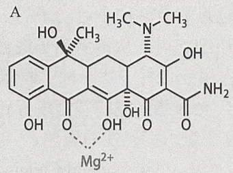

chemical

Chemical structure of a magnesium ion (Mg²⁺) complex with hydroxyl, amine, and carboxylic acid functional groups

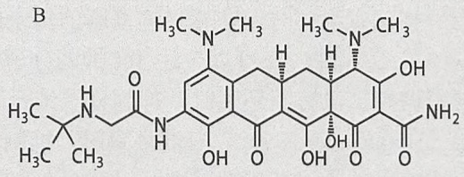

chemical

Chemical structure of a complex organic molecule with multiple amide and hydroxyl groups

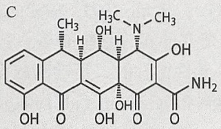

chemical

Chemical structure of a complex organic molecule with multiple hydroxyl and amine functional groups

图 8 四环素和其衍生物的结构。四环素骨架中的碳原子携带四环素衍生物中的替代基团。（A）四环素- $Mg^{2+}$ ；（B）替加环素；（C）多西环素。

TetA 高浓度的时候，阳离子从细菌细胞转运出来的速率很高，使膜去极化，从而威胁细胞的生存能力（Eckert and Beck 1989）。为防止这种灾难，TetA 的表达受一种具有螺旋-转角-螺旋结构的抑制蛋白严谨控制（TetR，24kDa），这种蛋白质是 tetR 基因的产物。没有抗生素的时候，该抑制分子的同源二聚体紧密地结合（ $K_{d}=10^{-11}$  mol/L）在两个 15bp 回文操作子序列（tetQ1,2）的大沟上，从而阻止分开转录的基因 tetR 和 tetA 的表达（Hillen et al. 1984; Heuer and Hillen 1988; Kleinschmidt et al. 1988; Hillen and Berens 1994; Hinrichs et al. 1994; Helbl et al. 1995; Orth et al. 2000）。所以 TetR 是一种很强的负调控因子，可以调控本身基因和 tetA 基因的转录。

四环素- $Mg^{2+}$ 与TetR结合（ $K_{a}=10^{9}mol/L$ ），引起TetR构象变化，从而使抑制分子对tetO的亲和力降低9个数量级（Kleinschmidt et al. 1988; Lederer et al. 1995）。结合常数的差异可以保证tetR的转录在没有四环素的时候受到抑制，当有不足以影响蛋白质合成的低浓度四环素存在时，又可以诱导其转录。目前已获得TetR（Orth et al. 1998）、TetR-四环素- $Mg^{2+}$ 复合物（Hinrichs et al. 1994; Kisker et al. 1995）及TetR-TetO复合物的晶体结构（Orth et al. 2000）。

多西环素（Dox）是一个水溶性的四环素类衍生物（图 8），目前是几乎所有 Tet 调控基因表达系统中优先使用的效应分子。在浓度低至 1～2ng/mL 的 Tet-Off 系统和浓度低至 80ng/mL 的 Tet-On 系统中 Dox 非常有效（解释见下文）。凭借良好的药物安全记录，以及完美确定的药理学特点，如极好的组织穿透性和真核细胞的低毒性，Dox 成为应用于组织培养和所有生物体的最佳效应分子。

## Tet 诱导表达系统 $^{1}$

有多种形式的 TetO 和 TetR 用于调控转染入真核细胞的靶基因的表达。因为抑制分子、操纵子和效应子等所有成分来源于原核，所以这些系统对于宿主内在基因的表达虽有影响，但是影响很弱。

## Tet 抑制系统

该抑制系统[最初由 Gatz 等（1991）发表]中，靶基因的起始转录受 Tet 抑制分子的反式调控。构建重组体时，在感兴趣基因的转录起始位点的上游和小启动子的下游包括数个串联的 tetO 元件。在可以表达 Tet 抑制分子的真核细胞内，从该启动子进行的表达可以被严密调控。没有四环素时，抑制分子结合顺式作用元件并干扰 RNA 聚合酶 II 的转录起始（Heins et al. 1992）。有四环素时，抑制解除，允许感兴趣的基因进行转录。通过选择合适的启动子，在靶细胞中可以获得 Tet 抑制分子组织特异性的表达。

Tet 抑制系统已经成功地应用于转基因植物（Furth et al. 1994; Wu and Chiang 1996），最好的结果是在烟草中取得的（Gatz et al. 1991, 1992; Gossen et al. 1993, 1994; Gatz 1995）。但是，在哺乳动物细胞中建立的相应系统的努力充其量只获得了部分成功，或许因为抑制强启动子需要能使 tetO 元件饱和的、足够高浓度的抑制分子。Tet 抑制分子这样的浓度很难在哺乳动物细胞中维持（Gossen et al. 1994）。

## Tet 反式激活蛋白系统（Tet-Off 系统）

把 TetR 转换成转录反式激活因子可以更有效地控制转染入真核细胞的基因的表达。在这些结构设计中，具有反式转录激活蛋白功能的 TetR 的一部分只是作为响应 Dox 的 DNA 结合结构域而不是抑制剂。将 TetR 与 I 型单纯疱疹病毒（HSV-1）VP16 蛋白羧基端酸性亚基融合，形成转录激活因子（tTA）（Gossen and Bujard 1992; Weinmann et al. 1994; Gossen et al. 1995），当不存在四环素的时候，可以与插入小启动子上游的串联 tetO 序列结合，从而诱导下游靶基因的转录。加入 Dox，会引起四环素反式激活因构象的改变（tTA 或 Tet-Off），使 tTA 不能与 tetO 序列结合，关闭基因的转录。这将导致以剂量依赖的方式降低靶基因的表达。当去掉抗生素后，tTA 能再次激活靶基因的转录。几小时之内，基因产物以线性速率积累，浓度可以提高到 >100 000 倍。

至 2011 年 3 月，超过 8000 篇文献描述了在细胞和转基因生物中，四环素反式激活系统的成功应用。详细的引用列表可参考网址 http://www.tetsystems.com。该系统的成功应用需要对克隆进行仔细筛选，原因是靶基因整合进染色体 DNA 的活化转录区会导致未诱导阶段基因表达水平的组成性表达升高。

## 反向 Tet 反式激活蛋白系统（Tet-On 系统）

反向四环素反式激活系统中使用 Tet 抑制因子（rTetR）的突变体与野生型蛋白只有 4 个氨基酸的差异（Gossen et al. 1995），但具有完全相反的行为。将 rTetR 与 VP16 的激活结构域结合，形成“反向” rTA（rtTA），它在没有效应物的时候抑制转录，在有 Dox 或四环素酐时激活转录（Gossen and Bujard 1993）。所以，在系统中加入诱导物之前，受 rtTA 控制的基因可能保持抑制状态。来自 Clontech 的商品化的 rtTA 系统对 Dox 或四环素酐的敏感性比对四环素高约 100 倍。1996 年研发的最早期的商品化 Tet-On 系统整合了以基本的  $P_{TRE2}$  反应启动子为代表的第一代 tet 诱导表达系统。

<small>1 http://www.clontech.com/US/Support/Trademarks?sitex=10020:22372:US&PROD=WxhZdLflj99G4FhmUPCranJ1:S&PROD\_pse s=ZG84E62907FD5697701543E0B37491307E67680DBAC085E727E84E594964A3DF68F49436E8254A47DF25C7C2902006955FCCEBFE455F714F11.</small>

在细胞培养过程中，tTA 系统和 rtTA 系统是几乎等效的。两者都可在几个数量级上调控基因活性的表达，而且诱导的动力学反应都很快。决定使用何种系统可根据以下原则选择:如果一个基因仅仅需要偶尔开启表达，而在其他大部分时间内保持非活化状态，那么 rtTA（Tet-On）系统更适用因为其默认状态即失活态（如缺少 Dox 时）。相反地，如果一个活化的基因偶尔需要关闭表达，选择 tTA（Tet-Off）更加合适。rtTA（Tet-On）系统通常在体内更加有意义，因为该系统所需的 Dox 更少，阴性对照更加干净。

## 自调节的 Tet 系统

为了提高靶基因的表达水平，以及抑制在哺乳动物细胞中组成型表达 tTA 造成的毒性，Shochett 和他的同伴使 tTA 置于 tetO 反应元件的调控之下（Shockett et al. 1995; Shockett and Schatz 1996）。因此，在稳定转染细胞中 tTA 的表达可以受自身调控，还可以受 Dox 的调控。有抗生素的时候，在巨细胞病毒小启动子的启动下组成型地表达少量 tTA，但它不能结合 tTA 和靶基因上游的 tetO 序列。当去除系统中的抗生素后，tTA 分别结合到两套 tetO 序列上，驱动它自身和靶基因的表达（图 9）。

用这个系统稳定转染 3T3 细胞，重组活化基因 1（RAG1）和重组活化基因 2（RAG2）的表达水平有很大的提高，可诱导的转化克隆的比例也提高了（Shockett et al. 1995）。类似地，在表达萤光素酶报道基因的转基因鼠中，自身调控系统比惯常的反式激活系统的表达水平高了 1～2 倍。但是在这个自身调控系统里基础表达水平也有很大提高，所以诱导倍数是减少的。

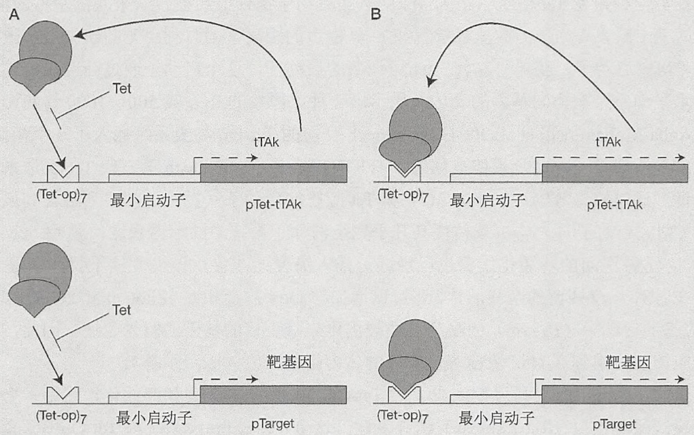

图9 可诱导基因表达的自调控策略。pTet-tTAk中，将tTAk基因处于tetP的调控下，这样可以使tTA实现自我调控表达。tetP由7个拷贝的tet操纵子序列串联排列[(Tet-op)$_{7}$]及其下游含有TATA框和转录起始位点的hCMV最小启动子区域构成。靶基因的表达同样受tetP控制。tTA蛋白用两个相邻的椭圆表示，代表蛋白质的两个结构域（用于DNA结合与反式激活）。（A）有四环素（Tet）存在时，hCMV小启动子只有基本活性，表达非常低水平的tTA蛋白，而且四环素通过与Tet-op的结合，阻断tTA蛋白的产生，所以靶基因和tTA的表达都维持在低水平。（B）去掉四环素后，小量存在的tTA结合Tet-op，刺激tTA基因的表达。更高水平的tTA蛋白会刺激更高水平的tTA基因的表达，从而刺激靶基因的表达[经美国国家科学学会允许，从Shockett et al.（1995）中修改]。

## 基本活性减低的 Tet 系统

靶基因可能会有高水平的基础转录，原因可能是:缺乏反式激活因子结合时的激活；四环素或强力未能抑制 tTA 介导的反式激活；靶基因整合到转录活跃的染色体位点(Furth et al. 1994; Howe et al. 1995; Kistner et al. 1996)。近年来发展了一些改进来抑制靶基础转录。为了抑制基本转录，构建了四环素控制的转录沉默子（tTS），从而抑制对 rtTA 响应的启动子活性。这些沉默子是嵌合蛋白，由经过改良的 Tet 抑制子（TetR）与哺乳动物 Kox1 或者 Kid 等蛋白质的抑制子结构域融合而成(Deutschle et al. 1995; Forster et al. 1999; Freundlieb et al. 1999)。不存在 Dox 时，tTS 的同源二聚体结合在靶基因上游的 tetO 序列，抑制转录。有 Dox 存在时，静默子与 tetO 解离，使 rtTA 的同源二聚体在同一位置与 tetO 结合，激活靶基因的转录。因为 rtTA 与 Dox 的亲和力比 tTS 或者 tTA 低大约 100 倍(Gossen et al. 1995)，所以本方法可能是成功的。低浓度的 Dox 可以允许 tTS 结合 tetO 序列，但不允许 rtTA 与 tetO 结合。相反，高浓度的 Dox 可以允许 rtTA 结合 tetO 序列，但不允许 tTS 结合。当 tTS 与 rtTA 在同一细胞表达，不存在 Dox 时，tTS 结合靶基因上游的 tetO 位点，抑制靶基因的转录。存在高浓度的多西环素时，rtTA 结合靶基因上游的 tetO 位点，抑制靶基因的转录。该系统中，如果 tTS 和 rtTA 形成仍可以结合 tetO 的异源二聚体，那么抑制与激活之间的转换可能会相互让步。为 tTS 和 rtTA 装上不相容的、来自不同类 TetR 蛋白的二聚体形成结构域可以避免这个问题（Rossi et al. 1998; Schnappinger et al. 1998; Baron et al. 1999; Forster et al. 1999; Freundlieb et al. 1999）。

在另一种改良 TetR 的方法中，Tet 应答的启动子原件已经被改进来减低基本的泄露。通过改变 CMV 启动子的数量、位置和 tetO 位点的距离，同时利用靶向缺失最小限度地缩短 CMV 启动子，获得“二代”tet 可调节的启动子，这个启动子通过高度减少基本的泄露水平却不影响靶向基因的表达而显示出一种比原始的  $P_{TRE}$  高 500～1000 倍的调控效率（Agha-Mohammadi et al. 2004）。Clontech 公司的 Tet-On 高级系统插入了一个相似的、经过改良的启动子，这个载体被称为“PTIGHT”。最近，Clotech 第三代 Tet-表达系统已经问世，通过修饰 rtTA（Tet-On 3G）和 Tet 应答的启动子（7 个 tetO 序列融合到最小限度的 CMV 启动子）， $P_{TRE3G}$  载体使其几乎完全消除了系统中的泄露表达问题（Loew et al. 2010）。这种逆向的转活化蛋白也已经通过插入突变而改善，该突变体不仅能消除 Dox 不存在时对 tetO 残留的亲和活性，还可以增加与 Dox 的亲和性（Zhou et al. 2006）。此外，Tet 应答的启动子（ $P_{TRE3G}$ ）的序列已经被优化来减少目的基因的背景表达。因此，这些系统应该能应用到高 Dox 浓度难以实现的体内组织研究（脑组织等）。

最后，Clontech 公司近期完成了对 Tet-On 3G 系统的改善和商业化，它用一个自转换的反式活化蛋白（Tet-Express）诱导表达。这个 Tet-Express 系统与 Tet-On 3G 系统相似，从一个含有  $P_{TRE3G}$  可诱导启动子的载体中表达转入的基因。然而，没有必要去创造一个 rtTA 表达的细胞系，而是将自转换 Tet-Express 反式激活蛋白直接添加到细胞培养介质中。这种 Tet-Express 反式激活子是一种纯化后的 tTA 蛋白，它含有一个修饰的氨基酸序列使自身能通过蛋白转导通路直接进入细胞。因为当四环素类物质不存在时，Tet-Express 能结合并激活表达，这一过程并不需要 Dox 激活转录。

## 参考文献

- Agha-Mohammadi S, O'Malley M, Etemad A, Wang Z, Xiao X, Lotze MT. 2004. Second-generation tetracycline-regulatable promoter: Repositioned tet operator elements optimize transactivator synergy while shorter minimal promoter offers tight basal leakiness. J Gene Med 6:817–828.
- Backman K, Boyer HW. 1983. Tetracycline resistance in Escherichia coli is mediated by one polypeptide. Gene 26: 197–203.
- Baron U, Schnappinger D, Helbl V, Gossen M, Hillen W, Bujard H. 1999. Generation of conditional mutants in higher eukaryotes by switching between the expression of two genes. Proc Natl Acad Sci 96: 1013–1018.
- Chopra I. 1985. Mode of action of the tetracyclines and the nature of bacterial resistance to them. In The tetracyclines (ed Hlavka JJ, Boothe JH), pp. 317–392. Springer-Verlag, Berlin.
- Chopra I, Hawkey PM, Hinton M. 1992. Tetracyclines, molecular and clinical aspects. J Antimicrob Chemother 29: 245–277.
- Deutschle U, Meyer WK, Thiesen HJ. 1995. Tetracycline-reversible silencing of eukaryotic promoters. Mol Cell Biol 15: 1907–1914.
- Eckert B, Beck CF. 1989. Topology of the transposon Tn10-encoded tetracycline resistance protein within the inner membrane of Escherichia coli. J Biol Chem 264: 11663–11670.
- Forster K, Helbl V, Lederer T, Urlinger S, Wittenburg N, Hillen W. 1999. Tetracycline-inducible expression systems with reduced basal activity in mammalian cells. Nucleic Acids Res 27: 708–710.
- Franklin TJ. 1967. Resistance of Escherichia coli to tetracyclines. Changes in permeability to tetracyclines in Escherichia coli bearing transposable resistance factors. Biochem J 105: 371–378.
- Freundlieb S, Schirra-Müller C, Bujard H. 1999. A tetracycline controlled activation/repression system with increased potential for gene transfer into mammalian cells. J Gene Med 1: 4–12.
- Furth PA, St Onge L, Böger H, Gruss P, Gossen M, Kistner A, Bujard H, Hennighausen L. 1994. Temporal control of gene expression in transgenic mice by a tetracycline-responsive promoter. Proc Natl Acad Sci 91: 9302–9306.
- Gale EF, Cundliffe E, Reynolds PE, Richmond MH, Waring MJ. 1981. The molecular basis of antibiotic action, 2nd ed. Wiley, New York.
- Gatz C. 1995. Novel inducible/repressible gene expression systems. Methods Cell Biol 50: 411–424.
- Gatz C, Kaiser A, Wendenberg R. 1991. Regulation of a modified CaMV 35S promoter by the Tn10-encoded Tet repressor in transgenic tobacco. Mol Gen Genet 227: 229–237.
- Gatz C, Frohberg C, Wendenberg R. 1992. Stringent repression and homogeneous derepression by tetracycline of a modified CaMV 35S promoter in intact transgenic tobacco plants. Plant J 2: 397–404.
- Gossen M, Bujard H. 1992. Tight control of gene expression in mammalian cells by tetracycline-responsive promoters. Proc Natl Acad Sci 89:5547–5551.
- Gossen M, Bujard H. 1993. Anhydrotetracycline, a novel effector for tetracycline controlled gene expression systems in eukaryotic cells. Nucleic Acids Res 21: 4411–4412.
- Gossen M, Bonin AL, Bujard H. 1993. Control of gene activity in higher eukaryotic cells by prokaryotic regulatory elements. Trends Biochem Sci 18: 471–475.
- Gossen M, Bonin AL, Freundlieb S, Bujard H. 1994. Inducible gene expression systems for higher eukaryotic cells. Curr Opin Biotechnol 5: 516–520.
- Gossen M, Freundleib S, Bender G, Müller G, Hillen W, Bujard H. 1995. Transcriptional activation by tetracyclines in mammalian cells. Science 268: 1766–1769.
- Heins L, Frohberg C, Gatz C. 1992. The Tn10-encoded Tet repressor blocks early but not late steps of assembly of the RNA polymerase II initiation complex in vivo. Mol Gen Genet 232: 328–331.
- Helbl V, Berens C, Hillen W. 1995. Proximity probing of Tet repressor to tet operator by dimethylsulfate reveals protected and accessible functions for each recognized base-pair in the major groove. J Mol Biol 245: 538–548.
- Heuer C, Hillen W. 1988. Tet repressor-tet operator contacts probed by operator DNA-modification interference studies. J Mol Biol 202:407-415.
- Hickman RK, Levy SB. 1988. Evidence that TET protein functions as a multimer in the inner membrane of Escherichia coli. J Bacteriol 170:1715–1720.
- Hillen W, Berens C. 1994. Mechanisms underlying expression of Tn10 encoded tetracycline resistance. Annu Rev Microbiol 48: 345–369.

## 网络资源

Tet Systems http://www.tetsystems.com

- Hillen W, Schollmeier K, Gatz C. 1984. Control of expression of the Tn10-encoded tetracycline resistance operon. II. Interaction of RNA polymerase and Tet repressor with the tet operon regulatory region. J Mol Biol 172: 185–201.
- Hinrichs W, Kisker C, Düvel M, Müller A, Tovar K, Hillen W, Saenger W. 1994. Structure of the Tet repressor–tetracycline complex and regulation of antibiotic resistance. Science 264: 418–420.
- Howe JR, Skryabin BV, Belcher SM, Zerillo CA, Schmauss C. 1995. The responsiveness of a tetracycline expression system differs in different cell lines. J Biol Chem 270: 14168–14174.
- Kaneko M, Yamaguchi A, Sawai T. 1985. Energetics of tetracycline efflux system coded by Tn10 in Escherichia coli. FEBS Lett 193: 194–198.
- Kasbekar N. 2006. Tigecycline: A new glycylcycline antimicrobial agent. Am J Health Syst Pharm 63: 1235–1243.
- Kisker C, Hinrichs W, Tovar K, Hillen W, Saenger W. 1995. The complex formed between Tet repressor and tetracycline- $Mg^{2+}$ reveals mechanism of antibiotic resistance. J Mol Biol 247: 260–280.
- Kistner A, Gossen M, Zimmermann F, Jerecic J, Ullmer C, Lubbert H, Bujard H. 1996. Doxycycline-mediated quantitative and tissue-specific control of gene expression in transgenic mice. Proc Natl Acad Sci 93:10933–10938.
- Kleinschmidt C, Tovar K, Hillen W, Poerschke D. 1988. Dynamics of repressor-operator recognition: The Tn10-encoded tetracycline resistance control. Biochemistry 27: 1094–1104.
- Lederer T, Takahashi M, Hillen W. 1995. Thermodynamic analysis of tetracycline-mediated induction of Tet repressor by a quantitative methylation protection assay. Anal Biochem 232: 190–196.
- Löew R, Heinz N, Hampf M, Bujard H, Gossen M. 2010. Improved Tet-responsive promoters with minimized background expression. BMC Biotechnol 10: 81. doi: 10.1186/1472-6750-10-81.
- McMurry L, Petrucci RE Jr, Levy SB. 1980. Active efflux of tetracycline encoded by four genetically different tetracycline resistance determinants in Escherichia coli. Proc Natl Acad Sci 77: 3974–3977.
- Orth P, Cordes F, Schnappinger D, Hillen W, Saenger W, Hinrichs W. 1998. Conformational changes of the Tet repressor induced by tetracycline trapping. J Mol Biol 279: 439–447.
- Orth P, Schnappinger D, Hillen W, Saenger W, Hinrichs W. 2000. Structural basis of gene regulation by the tetracycline inducible Tet repressor-operator system. Nat Struct Biol 7: 215–219.
- Rossi FM, Guicherit OM, Spicher A, Kringstein AM, Fatyol K, Blakely BT, Blau HM. 1998. Tetracycline-regulatable factors with distinct dimerization domain allow reversible growth inhibition by p16. Nat Genet 20: 389–393.
- Schnappinger D, Schubert P, Pfleiderer K, Hillen W. 1998. Determinants of protein–protein recognition by four helix bundles: Changing the dimerization specificity of Tet repressor. EMBO J 17: 535–543.
- Shockett PE, Schatz DG. 1996. Diverse strategies for tetracycline-regulated inducible gene expression. Proc Natl Acad Sci 93: 5173–5176.
- Shockett P, Difilippantonio M, Hellman N, Schatz D. 1995. A modified tetracycline-regulated system provides autoregulatory, inducible gene expression in cultured cells and transgenic mice. Proc Natl Acad Sci 92: 6522–6526.
- Thanassi DG, Suh GSB, Nikaido H. 1995. Role of outer membrane barrier in efflux-mediated tetracycline resistance of Escherichia coli. J Bacteriol 177: 998–1007.
- Tritton TR. 1977. Ribosome-tetracycline interactions. Biochemistry 16:4133-4138.
- Weinmann P, Gossen M, Hillen W, Bujard H, Gatz C. 1994. A chimeric transactivator allows tetracycline-responsive gene expression in whole plants. Plant J 5: 559–569.
- Wu S-Y, Chiang C-M. 1996. Establishment of stable cell lines expressing potentially toxic proteins by tetracycline-regulated and epitope-tagging methods. BioTechniques 21: 718–725.
- Yamaguchi A, Udagawa T, Sawai T. 1990. Transport of divalent cations with tetracycline as mediated by the transposon Tn10-encoded tetracycline resistance protein. J Biol Chem 265: 4809–4813.
- Zhou X, Vink M, Berkhout B, Das AT. 2006. Modification of the Tet-On regulatory system prevents the conditional-live HIV-1 variant from losing doxycycline-control. Retrovirology 3: 82, doi: 10.1186/1742-4690-3-82.

## 第 18 章 RNA 干扰与小 RNA 分析

导言 应用 RNA 干扰进行反向遗传学研究 1175

小RNA分析 1181

方案 | 1 双链 siRNA 制备 1185

2 通过转染双链 siRNA 在哺乳动物细胞中进行 RNA 干扰 1187

3 通过转染双链 siRNA 在果蝇 S2 细胞中进行 RNA 干扰 1190

4 体外转录法制备 dsRNA 1192

5 采用 dsRNA 浸泡果蝇 S2 细胞进行 RNA 干扰 1196

6 采用 dsRNA 转染在果蝇 S2 细胞
中进行 RNA 干扰 1198

7 小 RNA 的 Northern 杂交分析 1199

8 反转录定量 PCR 分析小 RNA 1203

9 构建小 RNA 高通量测序文库 1206

10 抑制 miRNA 功能的反义寡核苷酸制备 1215

11 在哺乳动物细胞中通过反义寡核苷酸抑制miRNA功能 1216

12 在果蝇 S2 细胞中通过反义寡核苷酸抑制 miRNA 功能 1218

信息栏 | 全基因组 RNA 干扰:后基因组

学时代的功能基因组学 1219

## 导言

RNA 干扰（RNAi）是指与靶基因序列具有同源性的双链 RNA（dsRNA）使该基因表达沉默。RNA 干扰最早发现于植物细胞中（Napoli et al. 1990），随后在动物细胞中也发现了该现象（Guo and Kemphues 1995）。在发现 dsRNA 能够引起高效而可靠的基因沉默现象后，RNA 干扰进入实际应用（Fire et al. 1998）。RNA 干扰通路在几乎所有的真菌、植物和动物中高度保守，这使得它迅速成为功能基因组学中一种反向遗传学工具（图 18-1）。

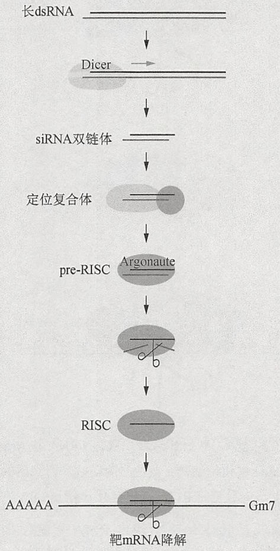

flowchart

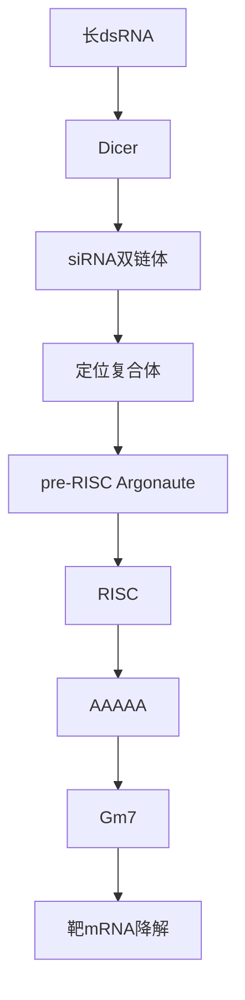

图 18-1 RNA 干扰过程总结。在细胞质中，dsRNA 被 Dicer 酶切割，产生包含 5' 端单磷酸和 3' 端突出 2 个非配对核苷酸的双链 siRNA。新生的双链 siRNA 进入含有 Argonaute 蛋白的 RNA 诱导沉默复合体（RISC）。RISC 复合体通过感知 siRNA 双链体的热力学不对称性，区分向导链（黑色）和信使链（蓝色）。信使链由于 Argonaute 蛋白的限制性内切核酸酶活性而发生移除，而向导链则停留在成熟的 RISC 复合体，并引导对互补 mRNA 靶基因的切割（彩图请扫封底二维码）。

首次 RNA 干扰实验主要使用外源性制备的 dsRNA 诱发基因沉默（Fire et al. 1998; Kennerdell and Carthew 1998; Misquitta and Paterson 1999）。后续有关 RNA 干扰的机制研究发现了一个新奇的复合体，即 ATP 依赖的长 dsRNA 逐步转化为功能性小 RNA-蛋白复合体。长 dsRNA 被 RNase III 核糖核酸酶 Dicer 切割产生 21～23 个核苷酸的双链小干扰 RNA（siRNA），这种 siRNA 5'端含单磷酸、3'端含 2 个突出的非配对核苷酸（Bernstein et al. 2001; Hutvágner et al. 2001; Lee et al. 2004）。随后，双链 siRNA 结合 Argonaute 蛋白，形成前体 RNA 诱导沉默复合体（pre-RISC）。pre-RISC 的组装需要能够感知 siRNA 双链末端相对热力学稳定的蛋白质参与，以便区分 siRNA 双链中哪一条是“向导链”（反义链），哪一条是“信使链”（有义链）（Khvorova et al. 2003; Schwarz et al. 2003; Tomari et al. 2004）。信使链由于 Argonaute 蛋白的限制性内切核酸酶活性而被移除，而向导链则停留在 RISC 复合体中（Matranga et al. 2005; Rand et al. 2005）。信使链的释放使得 pre-RISC 转变为成熟的 RISC，而后，反义链将 RISC 引导至目标 mRNA 的互补位点。最后，由成熟 RISC 内的 Argonaute 蛋白切割目标 mRNA 使其降解（图 18-2）。

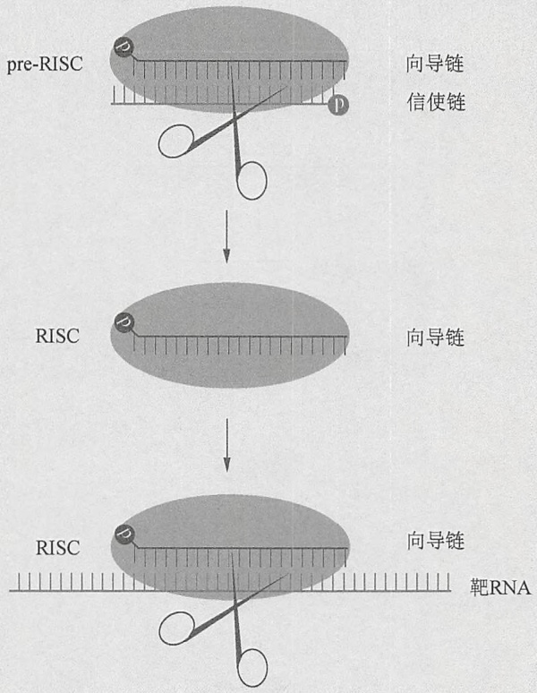

flowchart

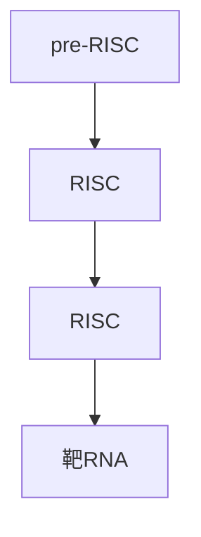

图 18-2 RNA 诱导沉默复合体（RISC）。双链 siRNA 与 Argonaute 蛋白结合，生成含 siRNA 双链的 pre-RISC。然后 Argonaute 催化信使链（蓝色）的切割。切割后的信使链片段被释放，生成仅包含向导链（黑色）的成熟 RISC，向导链将 RISC 引导至互补靶 mRNA（彩图请扫封底二维码）。

长链 dsRNA 不能在哺乳动物体细胞中诱发 RNA 干扰，因为它能诱导干扰素反应和一系列抗病毒反应，最终导致细胞内 RNA 的非特异性降解和广泛抑制蛋白合成（Minks et al. 1979; Manche et al. 1992）。然而，siRNA 的发现（Hamilton and Baulcombe 1999; Zamore et al. 2000）使得人们可以通过合成 siRNA 双链来抑制哺乳动物体细胞内同源基因的表达（Elbashir et al. 2001）。

siRNA 仅是动植物体内多种类型小 RNA 中的一种（Ghildiyal and Zamore 2009）。丰度最高的一种小 RNA 是微小 RNA（microRNA）。1993 年，Ambros 和他的团队发现了首个 miRNA，即 lin-4，其功能是控制线虫（Caenorhabditis elegans）的时间进行性发育（Lee et al. 1993）。多年之后，在多种双侧对称动物（bilateral animal）（如蠕虫、苍蝇、人）中发现了第二个 miRNA——let-7，这说明 miRNA 是生物进化过程中保守的基因表达调控分子（Pasquinelli et al. 2000; Reinhart et al. 2000）。

miRNA 是长度约为 22 个核苷酸的内源性小 RNA，由初级 miRNA（pri-miRNA）转录体中 70 个核苷酸长的发夹结构，经过经典 miRNA 通路或者 mirtron 通路加工而成

（Miyoshi et al. 2010）。这两条通路的不同表现主要在对 pre-miRNA 发夹结构的加工机制上。在经典 miRNA 通路中，pri-miRNA 被 Drosha 酶及其 dsRNA 结合蛋白 Pasha/DGCR8 切割，而后 pre-miRNA 发夹结构被释放（Denli et al. 2004; Gregory et al. 2004）。而在 mirtron 通路中，pre-miRNA 发夹结构由 RNA 剪接机器和索套（lariat）去分支酶释放（Okamura et al. 2007; Ruby et al. 2007）。随后，这两种类型的 pre-miRNA 发夹结构都被 Exportin-5 转运至细胞质（Yi et al. 2003; Okamura et al. 2007）。在细胞质中，Dicer 及其伴侣蛋白 Loquacious（Loqs）/TRBP/PACT 在 pre-miRNA 发夹结构的环结构附近切割生成 miRNA/miRNA\*双链体（Chendrimada et al. 2005; Forstemann et al. 2005; Jiang et al. 2005; Saito et al. 2005; Lee et al. 2006）。生成的双链 miRNA/miRNA\*进入 RISC 复合体，然后 miRNA\*被移除。miRNA 通过 miRNA 的种子区域（2～8 个核苷酸）与 mRNA 3'UTR 的靶位点之间的碱基互补配对将 RISC 引导至靶 mRNA，并通过抑制 mRNA 翻译或破坏其稳定性调控内源性靶基因的表达（Bartel 2009）。

miRNA 来自于 RNaseII 转录生成的不完全配对发夹结构这一发现，使人们可以进行类似于 siRNA 的 miRNA 人工合成。目前尚无证据显示哺乳动物体细胞能够自然产生 siRNA。miRNA 前体的模拟物——小发夹 RNA（shRNA）可以在细胞内被 Dicer 酶加工形成功能性的双链小 RNA。目前已经获得大量的人类和小鼠 shRNA，可以利用质粒或病毒载体表达 shRNA 文库，进行全基因组范围的 RNA 干扰筛选（请见信息栏“全基因组 RNA 干扰:后基因组学时代的功能基因组学”）。miRNA 也是一种重要的内源性调控因子，miRNA 功能阻断技术是重要的反向遗传学工具，可以用于鉴定基因的功能（请见方案 10～方案 12）。最后，高通量测序技术的进展使得越来越多内源性小 RNA 被鉴定出来，目前该技术已成为小 RNA 生物学及生物化学研究中不可或缺的方法。

siRNA 为反向遗传学提供了有力的研究工具，并开启了新的研究领域。本章将描述 RNA 干扰技术在抑制特定基因表达进行功能缺失分析方面的应用，并对检测特定和广谱性小 RNA 表达的研究方法以及抑制特定种类内源性小 RNA（如 miRNA）的方法加以总结。

## 词汇表

## ASO

ASO 即反义寡核苷酸，是指短的（16～53 个核苷酸）、合成的低聚核苷酸，用于阻断 RNA（包括 miRNA）的功能。反义寡核苷酸通常与小 RNA 高度互补，结构上包含化学修饰过的核苷酸或者在两端添加特定序列，以提高其结合靶序列的亲和力并使其抵抗细胞内核酸酶降解。

## BLAST

基础的局部比对搜索工具（BLAST），这是一种算法，用于计算两种核苷酸或氨基酸序列之间相似性的统计学意义，特别是一个未知序列与数据库中已知序列之间的相似性（见 BIOINFS）。

## cDNA

cDNA 是以 RNA 为模板，在反转录酶作用下生成的互补 DNA。

## CDS

CDS 是指成熟 mRNA 中可以被翻译为蛋白质的编码序列区域, 自起始密码子开始至终止密码子结束。

## dsRNA

dsRNA 即双链 RNA，是由两条互补链复性形成的 RNA 分子，可以被 Dicer 酶切割形成 siRNA。

## Endo-siRNA

Endo-siRNA 即内源性小干扰 RNA（siRNA），是一类存在于几乎所有真核生物中的小干扰 RNA 分子。

## exo-siRNA

exo-siRNA 即外源性小干扰 RNA（siRNA），是指通过体内或者体外技术生成且生物基因组上不编码，能诱导基因沉默的一类小干扰 RNA 分子。病毒感染或者实验方法导入的双链 RNA 可以启动外源性小干扰 RNA 的生成。

## miRNA

microRNA 是一类含有约 22 个核苷酸的内源性小 RNA，存在于植物和动物体内。miRNA 由含有 70 个核苷酸的发夹状前体经 Dicer 酶作用而生成，miRNA 可以通过破坏靶 mRNA 的稳定性、抑制靶 mRNA 的翻译来对靶 mRNA 发挥调控作用。

## piRNA

piRNA 是指 piwi 相互作用 RNA，是一类内源性小干扰 RNA，能特异性地与动物细胞中 Argonaute 蛋白的类似物 PIWI 结合。piRNA 不能由 dsRNA 形成。

## RISC

RISC 即 RNA 诱导沉默复合体，是一种靶向 siRNA 的限制性内切核酸酶，能在小向导 RNA 第 10 个碱基配对的核苷酸 5'端磷酸二酯键处催化切割靶 RNA。简言之，RISC 包含一个小 RNA 向导链和一个 Argonaute 蛋白。

RNA 干扰（RNAi）

RNA 干扰是由双链 RNA 诱发的对目的基因表达的序列特异性沉默作用。

## shRNA

shRNA 即小发夹 RNA，是 siRNA 或 miRNA 的前体，包含一个 19～29 个核苷酸的“茎”和一个 4～15 个核苷酸的“环”结构。shRNA 在转录后可以从细胞核转移至细胞质，在细胞质中其环结构被 Dicer 酶切割，释放出 siRNA。shRNA 可以自然生成，也可经人工制备并用作基因沉默的工具。

## shRNAmir

shRNAmir 即第二代 shRNA，将 siRNA 包裹于自然界生成的 pre-miRNA 之中。与标准的 shRNA 相比，shRNAmir 对靶 mRNA 的沉默效率更高。

## siRNA

siRNA 即小干扰 RNA，是一种双链 RNA，长度为 21～23 个核苷酸，其 3'端含有两个突出的非配对碱基。siRNA 与 RISC 结合后，一条链即信使链被移除，另一条链即向导链则引导 RISC 对互补的靶标 RNA 分子实施切割和降解。

## UTR

UTR 即非翻译区域，位于成熟 mRNA 的 5' 端和 3' 端，不编码蛋白质，但具有翻译调控功能，并参与调节 mRNA 的稳定性和细胞内定位。

## 应用 RNA 干扰进行反向遗传学研究

## 应用长链 dsRNA 抑制基因表达

在植物以及大多数真菌、非哺乳动物及其细胞系中，应用外源性长链 dsRNA（方案 5 和方案 6）或者表达长反向重复 RNA 转录物能够诱发细胞内相应 mRNA 的降解（Fire et al. 1998; Kennerdell and Carthew 1998; Misquitta and Paterson 1999）。哺乳动物卵母细胞和 dsRNA 诱导干扰素反应缺失的哺乳动物细胞系中，长链 dsRNA 和反向重复 RNA 转录物也能够诱发 RNA 干扰。dsRNA 诱导的干扰素反应是一种天然免疫反应。长度超过 30bp 的 dsRNA 能够激活 2′, 5′-寡腺苷酸合成酶和蛋白激酶 R，它们能激活 RNase L 并使真核起始因子 2 的 α 亚基（eIF2-α）失活（Minks et al. 1979; Manche et al. 1992）。干扰素反应诱导 mRNA 的非特异性降解和广泛抑制蛋白质合成，最终诱发细胞凋亡。因此，使用长链 dsRNA 对特定基因进行抑制性研究已不再可能。

## 长链 dsRNA 的设计

一般来讲，500～800bp长度的dsRNA分子可用于靶向外显子，尤其是编码序列（CDS）（Hannon 2003）。据报道，如果目标mRNA与另一条mRNA的同源序列长度超过19bp，目标mRNA的表达就能被有效抑制（Kulkarni et al. 2006）。因此，利用dsCheck、E-RNAi、BLAST（表18-1）（详见第8章）或者类似的计算手段寻找dsRNA的有义链或反义链与细胞内mRNA之间的同源性是该技术的关键点。此外，还要注意靶向同一条mRNA的dsRNA的其他区域引起的RNA干扰效应。

表 18-1 dsRNA 和 siRNA 设计工具

<table><tr><td>名称</td><td>URL</td><td>概述</td><td>参考文献</td></tr><tr><td colspan="4">dsRNA 设计工具</td></tr><tr><td>dsCheck</td><td>http://dscheck.rnai.jp</td><td>dsRNA 选择和 off-target 分析</td><td>Naito et al.2005</td></tr><tr><td>E-RNA 干扰</td><td>http://e-rnai.dkfz.de</td><td>dsRNA 和 siRNA 选择</td><td>Arziman et al.2005</td></tr><tr><td colspan="4">siRNA 设计工具</td></tr><tr><td>Ambion siRNATarget Finder</td><td>http://www.ambion.com/techlib/misc/siRNA_finder.html</td><td>基本 siRNA 选择;没有特定选择性</td><td>Ambion</td></tr><tr><td>BIOPREDsi</td><td>http://www.biopredsi.org/start.html</td><td>基于中枢网络的算法,涵盖基因组范围</td><td>Huesken et al.2005</td></tr><tr><td>BLOCK-iT RNA 干扰Designer</td><td>https://rnaidesigner.invitrogen.com/rnaiexpress/setOption.do?designOption=sirna</td><td>一种灵活的 siRNA 设计工具,允许特异性评价</td><td>Invitrogen</td></tr><tr><td>CAPSID</td><td>http://cms.ulsan.ac.kr/capsid/</td><td>抗病毒 siRNA 选择</td><td>Lee et al. 2009</td></tr><tr><td>DSIR</td><td>http://biodev.extra.cea.fr/DSIR/DSIR.html</td><td>基于线性模式的算法和基于基本序列的 siRNA 功能预测</td><td>Vert et al. 2006</td></tr><tr><td>OptiRNA</td><td>http://optirna.unl.edu/</td><td>提供mRNA结构预测,但不提供特异性分析</td><td>Ladunga 2007</td></tr><tr><td>side</td><td>http://side.bioinfo.choa.fib.es/</td><td>为效率预测和特异性分析提供高通量的siRNA设计</td><td>Santoyo et al. 2005</td></tr><tr><td>siDESIGN Center</td><td>http://www.dharmacon.com/ DesignCenter/DesignCenter Page.aspx</td><td>根据热力学参数和序列特征选择 siRNA,包含毒性序列基序和特异性检测</td><td>Thermo Fisher Scientific (Dharmacon Products)</td></tr><tr><td>siDirect2.0</td><td>http://siDirect2.rnai.jp/</td><td>提供siRNA效率分析、特定性质分析以及脱靶效应分析</td><td>Naito et al. 2009</td></tr><tr><td>siDRM</td><td>http://sidrm.biolead.org/</td><td>基于disjunctive rule merging (DRM)的毒性分析和特异性分析工具</td><td>Gong et al. 2008</td></tr><tr><td>Sirna</td><td>http://sfold.wadsworth.org/sirna.pl</td><td>基于靶标可接近性的选择,不提供特异性分析</td><td>Ding et al. 2004</td></tr><tr><td>siRNA Design Software</td><td>http://i.cs.hku.hk/~sirna/software/sirna.php</td><td>基于多工具的siRNA选择,包括靶标可接近性评价</td><td>Yiu et al. 2005</td></tr><tr><td>siRNA Design Tool</td><td>http://www1.qiagen.com/Products/GeneSilencing/SiRnaDuplexes/HPFlexible.aspx</td><td>基于热力学偏性的选择;无特异性分析</td><td>QIAGEN</td></tr><tr><td>siRNA Selection Server</td><td>http://jura.wi.mit.edu/bioc/siRNAext/</td><td>提供多种设计参数,包括多态性和特异性分析,并提供多种输出格式</td><td>Yuan et al. 2004</td></tr><tr><td>siRNArules 1.0</td><td>Downloadable from http://sourceforge.net/projects/sirnarules/</td><td>开放JAVA程序资源,但不能进行灵活性检查</td><td>Holen 2006</td></tr><tr><td>siSearch</td><td>http://sisearch.cgb.ki.se/</td><td>基于能量特征分析进行siRNA的效率评估</td><td>Chalk et al. 2004</td></tr><tr><td>SVM siRNA Design Toolbeta</td><td>http://www5.appliedbiosystems.com/tools/siDesign/</td><td>基于超功能siRNA分析标准进行选择</td><td>Applied Biosystems</td></tr></table>

## 长链 dsRNA 的体外合成

利用来自噬菌体的RNA聚合酶如T7、SP6和T3等进行体外合成是制备RNA干扰实验所用长链dsRNA的一种简便而快速的办法（方案4）。应用体外转录反应制备单独的有义链或反义链也是值得推荐的方法，尤其是在制备富含GC的dsRNA时。应用这种方法可以在将有义链和反义链进行复性之前分别对其质量进行评估。此外，还可以采取将正义模板和反义模板混合在一个体外转录体系内，或者利用两种反向的RNA聚合酶启动子对同一条模板进行转录的方法制备dsRNA。

- 质粒模板。有两种方法可以制备质粒模板。一种方法是:选定 dsRNA，将与其有义链或反义链对应的 DNA 片段克隆至带有噬菌体 RNA 聚合酶启动子质粒的多克隆位点。另一种方法是:将 DNA 片段克隆至质粒，使其位于一对反向的噬菌体 RNA 聚合酶启动子中间。这两种方式中，在体外转录之前都需要利用限制性内切核酸酶在插入片段的两端将插入的 DNA 片段线性化，以确保相应转录物 RNA 的长度。
- PCR 模板。T7、SP6 或 T3 噬菌体启动子长度较小，仅 19bp，这使得它们能够被连接在正向或者反向 PCR 引物的 5'端。利用一条连接启动子的正向引物和一条未连接启动子的反向引物，可以通过 PCR 反应对正义或者反义模板进行体外转录扩增（方案 4）。也可以利用一对融合了启动子的 PCR 引物同时对同一条模板进行扩增。从体外转录的 RNA 得率来看，PCR 模板要优于质粒模板，这是因为前者可以在不增加反应体系中 DNA 总量的情况下提高模板的摩尔浓度。

## 反向重复 dsRNA 的内源性表达

为了进行体内应用，可以构建表达长链发夹状RNA的表达体，方法是装配正义和反义序列，并利用间隔区将它们隔开，以产生反向重复序列（Lee and Carthew 2003）。克隆反向重复序列具有挑战性，但使用内含子作为间隔区能够提高构建体在细菌体内的稳定性，从而使克隆更容易实现。长链发夹状 dsRNA 的内源性表达可以通过 RNA 聚合酶 II 启动子（如 CMV）或者二元表达系统（如 GAL4/UAS）在特定细胞系或者转基因动物体内引起持续、可诱导和组织特异性的基因沉默。这一方法的主要不足在于反向重复序列的构建比较耗时。出于此原因，在本章中没有叙述长链发夹状 RNA 的构建（Haley et al. 2008; Ni et al. 2011）。

## 应用 siRNA 抑制特定基因的活性

长链 dsRNA 的导入能够在小鼠卵母细胞、早期胚胎、胚胎干细胞和胚胎癌细胞（Svoboda et al. 2000; Wianny and Zernicka-Goetz 2000; Billy et al. 2001; Yang et al. 2001），以及植物、蠕虫、果蝇体内诱导特定和高效的 RNA 干扰。但是，早期在哺乳动物体细胞中用长链 dsRNA 诱导 RNA 干扰的尝试未能成功，因为长链 dsRNA 作为一个前体会诱导干扰素反应。这种通常被视为病毒感染反应的天然免疫反应能够诱导 RNA 的非特异性降解以及广泛抑制蛋白质生物合成，最终导致细胞凋亡。使用 3' 端带有 2 个非配对碱基的 21～23 个核苷酸的双链 siRNA，即一种 RNA 干扰信号通路的中间体，能模拟长链 dsRNA 经 Dicer 酶切割后的自然产物可以克服这一障碍（方案 2 和方案 3）（Caplen et al. 2001; Elbashir et al. 2001, 2002）。后续研究表明，内源性表达的 siRNA 和 shRNA 引起靶基因特异性抑制的效率与转染外源性 siRNA 相当。

## siRNA 设计

最初，siRNA 序列的选择是基于实验经验而获得的（Elbashir et al. 2001, 2002）。最近，生物信息学工具被用来设计 siRNA（表 18-1），目前多个数据库收录了经过实验确证的 siRNA 和 shRNA。值得推荐的是，在设计新的 siRNA 之前可以通过搜索已有的 siRNA 数据库和科研文献来寻找已确证的 siRNA。如果不能获得已确证的 siRNA，则应该为每个靶基因设计 3～5 条候选 siRNA（Pei and Tuschl 2006）。以下将介绍如何挑选有效和特异性强的 siRNA。有关 siRNA 设计的详细过程请参考 Birmingham 等（2007）的研究。

- 目标区域。siRNA 通常以 mRNA 的 CDS 序列为靶点，因为一般认为，相对非编码序列而言，CDS 序列容易成为 RNA 干扰的靶点且多态性更低。然而，当 CDS 不容易找到合适的 siRNA 结合位点，或者为了区分两个编码区相同但 3' 非翻译区 (UTR) 不同的基因时，3' 端 UTR 也可以利用。5' 端 UTR 和剪接点通常不被考虑，因为它们可能会被细胞内蛋白质复合体（如翻译起始机器或者外显子连接复合体）所包裹。
- 长度和非配对结构。尽管 20～25 个核苷酸长度、包含 2 个非配对碱基形成的 3' 端突出“尾巴”的双链 siRNA 显示出了与常规 siRNA 相当的效率，但常规的双链 siRNA 依然是长度为 21 个核苷酸、两端包含 2 个非配对碱基形成的 3' 端突出“尾巴”，模拟了 Dicer 酶体内切割的主要产物。长度超过 30 个碱基的双链 RNA 能够在哺乳动物体细胞中诱导干扰素反应。一些长度超过 23 个碱基的 RNA 双链体能够诱导细胞特异性的干扰素反应（Reynolds et al. 2006）。
- 热力学不对称性。进入 RISC 的 siRNA 链被称为 “向导链”（图 18-2）。这一 siRNA 链的 5'端碱基配对较为松弛（动力学稳定性稍差），被 RNA 干扰机器识别为向导（Khvorova et al. 2003; Schwarz et al. 2003）。向导链进入 RISC，两者之间的这种结合会通过 5'端的 G:U 错配得到加强。反之，也可以通过化学修饰减弱信使链（向导链的反义链，目标 mRNA 的同义链）与 RISC 的结合（Nykanen et al. 2001; Chen et al. 2008）.
- GC 含量和核苷酸偏好。有关 siRNA 设计的大量分析显示: 具有生物学功能的 siRNA 不能含有回文（palindromic）序列和内在重复序列，并且 GC 含量达到 30%～52%。回文序列或者内在重复序列会形成二级结构，干扰与 RISC 以及目标 mRNA 的结合(Patzel et al. 2005)。GC含量过高或者过低会干扰两条siRNA链的分离,减慢与RISC的结合。此外,成熟RISC与目标mRNA的强烈结合会妨碍切割产物的释放,使酶的转换效率降低(Haley and Zamore 2004; Tang and Zamore 2004)。有关高效siRNA性质的多因素分析显示:向导链的第1\~第7个碱基应该是U或者A,第10个碱基应为A或者U,第19个碱基应为G或者C(Pei and Tuschl 2006)。这些“规律”预示了向导链的结合喜好,使其与靶标保持适当的亲和力,促进对靶标的多轮切割。

\- RNA干扰介导的脱靶效应。RNA干扰介导的脱靶效应是指双链siRNA的向导链或信使链介导的对基因表达的非特异性抑制，具有浓度依赖性（图18-3）(Jackson et al. 2006a)。RNA干扰介导的脱靶效应通常会在siRNA发挥类似内源性miRNA的作用时发生，即通过小RNA向导链的“种子序列”（2～7位或2～8位核苷酸）与其目标mRNA结合（Lim et al. 2005; Lin et al. 2005; Birmingham et al. 2006）。目前已经有多种消除这种脱靶效应的方法。尽管通过同源性搜索（如BLASTn或者Smith-Waterman算法）来减少可能存在脱靶效应的siRNA的方法应用比较广泛，但这一方法仍不能消除大多数的脱靶效应，这是因为无法避免第6位和第7位核苷酸与细胞内mRNA匹配的偶然情况。通过将针对同一mRNA的多个无相关性siRNA混合使用以降低每一种siRNA浓度的方法可提高RNA干扰的特异性（Kittler et al. 2007），但是这种方法有着严格的适用要求。对siRNA向导链的第2位核苷酸进行不依赖于序列的化学修饰同样可以提高效率，这一方法减少了siRNA对既定靶标以及靶标之外mRNA的亲和力（Jackson et al. 2006b）。唯一被证实的可提高RNA干扰特异性的方法是设计siRNA分子，使其正确的RNA链进入有功能的RNAi酶复合体，或者可以对信使链进行化学修饰，以阻止其通过RNA干扰途径发挥作用（Elmén et al. 2005）。

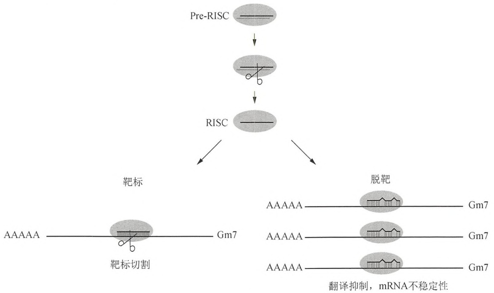

flowchart

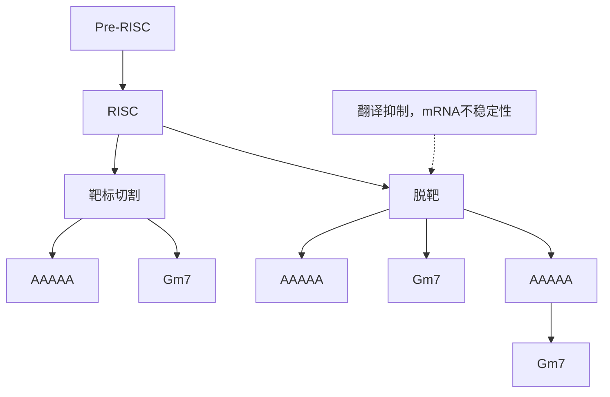

图18-3 siRNA介导的脱靶反应。siRNA与其靶标完全匹配后，引导RISC对目的mRNA进行切割，即通常所说的RNA干扰过程。但是，siRNA也可以发挥类似细胞内miRNA的作用，即通过部分碱基配对与其RNA靶标相匹配。这种miRNA的作用偶尔会导致对非靶标mRNA的抑制作用，即脱靶效应。

\- 天然免疫反应和毒性。在哺乳动物中，如果 siRNA 包含富含 G 和 U 的序列基序，如 GUCCUUCAA 或者 UGUGU，那么此 siRNA 有可能通过 Toll 样受体激活细胞内的天然免疫通路（Hornung et al. 2005; Judge et al. 2005; Marques and Wil-liams 2005; Sioud 2005）。然而，其他的免疫刺激因素仍然有待鉴定，因为有一些 siRNA 虽富含 G 和 U 却不能激活免疫受体，而另一些缺少 GUCCUUCAA 或者 UGUGU 基序的 siRNA 反而具有免疫刺激活性。针对 176 个随机挑选的 siRNA 进行比较研究，鉴定出 UGGC 是一个毒性基序，能引发细胞死亡（Fedorov et al. 2006）。已知的免疫刺激活性和毒性基序可以通过计算预测而避免。另外，化学修饰，如锁状核酸（locked nucleic acid, LNA）（图 18-4）和对免疫刺激活性和毒性基序进行 2'-O-甲基化核酸修饰可以用于抑制其天然免疫刺激活性（Judge et al. 2006）。

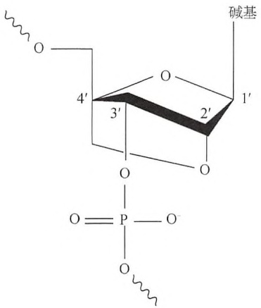

chemical

Chemical structure of a phosphate-phosphate complex with labeled atoms and bonds

图 18-4 锁状核酸的化学结构。LNA 是一种类似于亚甲基  $2^{\prime}-O, 4^{\prime}-C$  连接的核苷酸，限制核糖向 C3' 内（“North”）靠拢，这是存在一种 A 型 RNA 螺旋中的几何学结构。在 DNA 中每 3 个位点引入一个 LNA 将使 B 型螺旋变为 A 型螺旋，可以提高分子的热稳定性（3～8℃/核苷酸）。LNA-取代寡核苷酸增加的热稳定性（ $T_{m}$ ）使得它们可以作为理想的检测小 RNA 表达的短引物和探针，以及用以阻断小 RNA 功能的反义寡核苷酸（ASO）。

## siRNA 的体外制备

- 化学合成 siRNA。合成 siRNA 应用广泛，这种方法的得率和纯度都比较高。对合成 siRNA 还可以进行一系列化学修饰以提高 siRNA 的稳定性、降低脱靶效应，以及（或者）阻止激活天然免疫反应。多家公司，包括 Ambion、Thermo Scientific Dharmacon、QIAGEN 和 Sigma-Aldrich Proligo 等都能提供高质量的合成 siRNA。在用于细胞之前，合成的正义和反义 siRNA 需在体外复性形成双链 siRNA（方案 1）。
- 利用酶学反应从长链 dsRNA 生成 siRNA。利用重组 Dicer 酶或者细菌 RNase III 对体外转录获得的长链 dsRNA 进行酶学消化也可以获得双链 siRNA（Yang et al. 2002）。与合成 siRNA 相比，对长链 dsRNA 酶消化可以生成不同种类的 siRNA，提高了生成功能性 siRNA 的可能性。然而，体外酶学反应生成 siRNA 的主要不足之处在于:这些 siRNA 在使用时不易选择对照。理论上，对照 siRNA 不应该与实验 siRNA 具备相同的种子序列。由于体外酶切生成的确切 siRNA 无从得知，那么也就无法选择精确的对照，因此，无法区分究竟是既定靶标 mRNA 还是脱靶基因的特定表型表达发生下调。
- 体外转录。利用合成的、含有噬菌体启动子的 DNA 寡核苷酸模板，经体外转录可以生成 siRNA。通常，这一方法通过核酸酶或者核酶消化，确保产物拥有确定的末端以及（或者）5'端单磷酸或者羟基末端。这一方式能够以较低成本快速生成多个不同 siRNA，但是风险主要存在于污染的三磷酸 RNA 会触发天然免疫反应（Kim et al. 2004）。