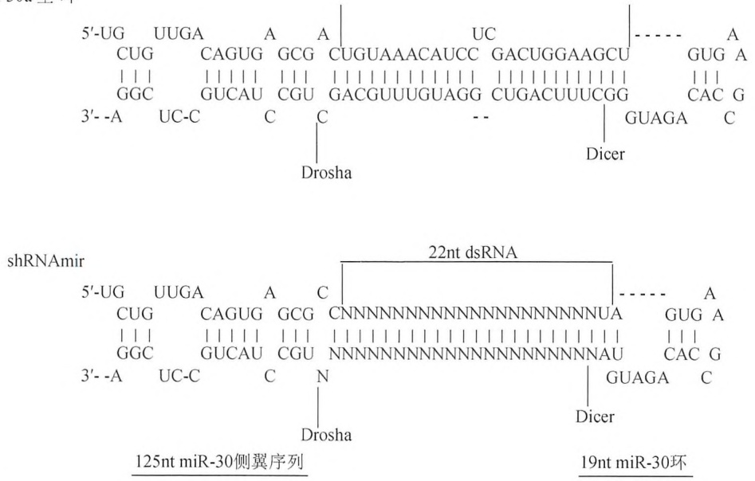

## siRNA、shRNA 和 shRNAmir 的细胞内表达

在细胞内利用 DNA 模板表达 siRNA、shRNA 和 shRNAmir（miRNA-adapted shRNA）能够诱导瞬时、持续或者可诱导的基因沉默，有助于对功能缺失表型进行系统分析。

- 基于 DNA 的 siRNA 表达。在基于 DNA 的 siRNA 表达方法中，siRNA 的有义链和反义链由同一质粒中不同的 RNA 聚合酶 III 启动子转录而成。转录后，有义链和反义链通过分子内配对形成双链 siRNA 并触发 RNA 干扰（Lee et al. 2002; Miyagishi and Taira 2002）。两条 siRNA 链在细胞核内的杂交有可能会由于向细胞质转运而无效；shRNA 以及类似策略已经取代上述方法。
- shRNA。shRNA可以作为单链RNA分子转录形成，与含有19～29个核苷酸的“茎”结构和4～15个核苷酸“环”结构的前体miRNA（pre-miRNA）类似。转录后，shRNA由细胞核转运至细胞质，在细胞质中，“环”结构被Dicer酶切割产生siRNA（Castanotto et al. 2002; McManus et al. 2002; Paddison et al. 2002）。有两种方法可用来表达shRNA:①基于PCR的shRNA表达盒（PCR-derived shRNA-expression cassettes）；②shRNA表达质粒或病毒载体。基于PCR的shRNA表达盒可以避免克隆过程，并且能够快速生成大量shRNA，主要用于筛选功能性shRNA。这一方式由于缺乏抗生素筛选标记而仅能瞬时诱导基因沉默。

相反，shRNA 表达载体能够整合到基因组或者作为游离基因稳定地复制，既可以用于瞬时表达 shRNA，也可以用来建立转基因的 RNA 干扰细胞系或动物，实现针对不同发育阶段和组织类型基因功能缺失的系统研究。

\- shRNAmir。目前，通过将人 pre-miR-30 的茎序列替换为所需的 siRNA 序列可以构建 shRNAmir（图 18-5）。这样，siRNA 被植入天然 pre-miRNA 之中，实现 Drosha 和 Dicer 酶对 siRNA 的有效切割，最终促进 siRNA 向导链与成熟 RISC 的相互作用。与标准 shRNA 相比，shRNAmir 能对靶标进行更高效的抑制（约提高 12 倍）。因此，shRNAmir 被称为 “第二代 shRNA” （Zeng and Cullen 2002, 2003; Zeng et al. 2003; Silva et al. 2005）。

hsa-miR-30a 茎-环

图 18-5 通过将人 pre-miR-30 的茎序列替换为所需 siRNA 序列构建 shRNAmir。生成的 shRNAmir 包含 miR-30 初级转录物中 19 个核苷酸环和 125 个核苷酸侧翼，提高了 RNA 干扰效率（经 Macmillan Publishers 允许，摘自 Silva et al. 2005）（彩图请扫封底二维码）。

## 小 RNA 分析

## 小 RNA 表达检测

## Northern 杂交和 RNase 保护实验

基于变性聚丙烯酰胺凝胶的 Northern 杂交（方案 7）是在检测小 RNA 大小和丰度方面应用最广泛的方法。大多数 miRNA 能够用 5' 端 $^{32}$P-放射性标记的 DNA 寡核苷酸探针进行快速检测。StarFire 寡核苷酸探针含有多个 3' 端 $\alpha$-$^{32}$P 放射性标记，提高了探针的特异性从而拥有更高的敏感性（Behlke et al. 2000）。LNA 寡核苷酸探针提高了杂交的信号/噪声值，并且敏感性提高 10 多倍，使得检测效果更好；但是，LNA 寡核苷酸价格成本较高（Válóczi et al. 2004）。在标准的小 RNA 分子 Northern 杂交方案中，小 RNA 通过紫外线（UV）辐照与尼龙膜发生交联。其他方法中，已有报道:使用 1-乙基-3-(3-二甲基氨丙基)碳化二亚氨（EDC）介导的化学交联可以使敏感度提高 25～50 倍（Pall et al. 2007; Pall and Hamilton 2008）。RNase 保护实验比 Northern 杂交敏感度更高，但是我们不推荐这种方法，因为该方法所提供的小 RNA 亚型的长度和丰度信息不够可靠（Sijen et al. 2001）。

## 定量反转录聚合酶链反应（qRT-PCR）

传统的定量 RT-PCR（第 7 章、第 9 章）不能检测小 RNA 的表达，原因是小 RNA 的长度不足以提供两条引物的结合空间。但是，传统的定量 RT-PCR 可用来定量与 mRNA 长度相当的初级 miRNA(pri-miRNA)。继检测 miRNA 前体首次被报道(Schmittgen et al. 2004)之后，至今已经建立了 3 种基于定量 PCR 的 miRNA 检测方法:①通过多聚腺苷酸化延伸 miRNA 的 3 端，然后利用带有 3' 端简并锚定序列（degenerate anchor）和 5' 端通用标签的多聚（T）连接分子对延长后的 miRNA 进行反转录。最终，利用 miRNA 特异性正向引物和通用反向引物扩增 cDNA，并进行 SYBR Green 检测（Shi and Chiang 2005）。这种方法可以通过一个反转录反应对多个 miRNA 进行相对定量。②利用带有 5' 端通用标签的 miRNA 特异性反转录引物合成第一链 cDNA，然后利用 miRNA 特异并进行了 LNA 修饰的引物，以及便于 SYBR Green 检测的通用引物进行扩增（Raymond et al. 2005）。③利用 miRNA 特异、含有茎-环结构的反转录引物合成第一链 cDNA，然后利用带有 5' 端标签的 miRNA 特异性引物和带有特异性 TaqMan 探针的通用引物进行扩增（Chen et al. 2005）（方案 8）。与 miRNA 特异性反转录引物相比，茎-环结构反转录引物的碱基堆积（base-stacking）可以提高 miRNA 特异性反转录引物双链体的热稳定性，进而提高了反转录反应的特异性和敏感性。小 RNA 特异性引物的 5' 端标签用于使其 $T_m$ 值优化，从而进一步改善引物的特异性和敏感性。TaqMan 小 RNA 检测方法（Applied Biosystems 公司）广泛用于分析 miRNA 和 siRNA。目前，该方法能够对 1～10ng 总 RNA 中的小 RNA 进行至少 6 个数量级范围的定量分析。

## 小 RNA 的芯片检测

小 RNA 的芯片检测比 Northern 杂交检测通量更高，广泛用于小 RNA 尤其是 miRNA 表达谱检测（Krichevsky et al. 2003; Esquela-Kerscher and Slack 2004; Liu et al. 2004; Nelson et al. 2004）。探针标准化和 miRNA 标记是获得高特异性和高敏感性小 RNA 芯片的关键因素。为了达到均一的杂交条件，可以利用混合修饰的核苷酸如 LNA（Castoldi et al. 2006），或者调整探针长度（Baskerville and Bartel 2005）将探针和 miRNA 之间的 $T_m$ 值进行标准化处理。此外，使用荧光染料直接标记 miRNA 已被广泛用于避免反转录和 PCR 扩增带来的偏差。芯片技术的主要不足在于芯片只能用于研究已知的小RNA或者生物信息学预测的小RNA。此外，不存在一种标准芯片，能适用于检测内源性siRNA（endo-siRNA）、外源性siRNA（exo-siRNA）以及Piwi相互作用RNA（piRNA）。这些小RNA种类繁多（Ghildiyal and Zamore 2009），超出了最大芯片平台的探针数量。

## 原位杂交检测小RNA表达模式

利用 LNA 修饰 DNA 探针（12～22 个核苷酸）的原位杂交，可以对特定细胞、组织、器官，以及完整胚胎的小 RNA 进行检测。最近报道了一种新的方法，即在 miRNA 的 5'-磷酸与附近蛋白质氨基之间进行 EDC 介导的交联，可以阻止组织中 miRNA 降解（Pena et al. 2009）。目前的原位杂交方法可以检测 miRNA 前体和成熟 miRNA，但是不能将二者区分开来（Wienholds et al. 2005; Kloosterman et al. 2006; Obernosterer et al. 2007）。

## 小 RNA 克隆和测序

小 RNA 克隆（方案 9）和测序是鉴别新的小 RNA 的有力工具。在过去的 8 年内，已经发展了一系列针对含有不同 5 端或 3 端化学结构小 RNA 的鉴定方法，但基本原则都是相似的。这些基本原则包括:将小 RNA 序列 3 端或 5 端与特定分子（linker）连接，接着通过 RT-PCR 扩增构建小 RNA cDNA 文库，最后进行 DNA 序列分析。起初，小 RNA cDNA 文库被克隆到质粒中作为串联体（concatamer），通过传统的 Sanger DNA 测序技术进行分析（Djikeng et al. 2001; Lagos-Quintana et al. 2001）。现在，可以实现大量平行的高通量测序（第 11 章），测序长度大幅度提升，同时降低了经济成本（Aravin et al. 2006; Girard et al. 2006; Lau et al. 2006; Brennecke et al. 2007; Ghildiyal et al. 2008; Li et al. 2009）。由于对小 RNA 的测序频率（“阅读”）与其丰度成正比，所以如果采用严格的标准化策略，高通量测序可以实现对相同或不同样本间小 RNA 表达的相对定量。

## 使用反义寡核苷酸抑制小 RNA 的功能

2004 年以来，反义寡核苷酸（ASO）成为在细胞系、果蝇、斑马鱼、小鼠，以及非人类灵长动物体内研究个别 miRNA 功能缺失的有力工具。ASO 还具有用于治疗药物的潜能（Hutvágner et al. 2004; Meister et al. 2004; Esau 2008; Horwich and Zamore 2008; Petri et al. 2009）。经典的 ASO 是合成的寡核苷酸，长度为 16～53 个核苷酸，其碱基、核糖、磷酸二酯骨架或者末端带有不同的化学修饰。长度超过 miRNA 的 ASO 含有一个与其目标 miRNA 互补的中心区，两边带有相同数量的侧翼序列。增加 ASO 长度可以提高对 miRNA 功能的抑制能力。核苷酸修饰包括 2'-O-氟代、2'-O-甲基化、2'-O-甲氧基乙基、2'-脱氧以及 LNA。骨架修饰包括硫代磷酸和肽核酸（peptide nucleic acids）（Fabani and Gait 2008）。这些修饰保护 ASO 免受细胞内核酸酶的降解作用，提高其亲和力和特异性。此外，末端进行如胆固醇和细胞穿透性肽（cell-penetrating peptide）修饰，可促进 ASO 向细胞内的转运。ASO 的制备以及在哺乳动物细胞和果蝇 S2 细胞内抑制 miRNA 功能的应用将在方案 10～方案 12 中介绍。

## 致谢

感谢 Hannon 实验室分享其原创的小 RNA 克隆方案；感谢 Klaus Förstemann, Jennifer Broderick, Michael Horwich, Vasily Vagin, Megha Ghildiyal 和 Stefan Ameres 等对本章中的方案加以润色；感谢 Zamore 实验室成员为本章提供的有益讨论和建议。

## 参考文献

- Aravin A, Gaidatzis D, Pfeffer S, Lagos-Quintana M, Landgraf P, Iovino N, Morris P, Brownstein MJ, Kuramochi-Miyagawa S, Nakano T, et al. 2006. A novel class of small RNAs bind to MILI protein in mouse testes. Nature 442: 203–207.
- Arziman Z, Horn T, Boutros M. 2005. E-RNAi: A web application to design optimized RNAi constructs. Nucleic Acids Res 33: W582–W588.
- Bartel DP. 2009. MicroRNAs: Target recognition and regulatory functions. Cell 136: 215–233.
- Baskerville S, Bartel DP. 2005. Microarray profiling of microRNAs reveals frequent coexpression with neighboring miRNAs and host genes. RNA 11: 241–247.
- Behlke MA, Dames SA, McDonald WH, Gould KL, Devor EL, Walder JA. 2000. Use of high specific activity StarFire oligonucleotide probes to visualize low-abundance pre-mRNA splicing intermediates in S. pombe. BioTechniques 29: 892–897.
- Bernstein E, Caudy AA, Hammond SM, Hannon GJ. 2001. Role for a bidentate ribonuclease in the initiation step of RNA interference. Nature 409: 363–366.
- Billy E, Brondani V, Zhang H, Müller U, Filipowicz W. 2001. Specific interference with gene expression induced by long, double-stranded RNA in mouse embryonal teratocarcinoma cell lines. Proc Natl Acad Sci 98: 14428–14433.
- Birmingham A, Anderson EM, Reynolds A, Ilsley-Tyree D, Leake D, Fedorov Y, Baskerville S, Maksimova E, Robinson K, Karpilow J, et al. 2006. 3' UTR seed matches, but not overall identity, are associated with RNAi off-targets. Nat Methods 3: 199–204.
- Birmingham A, Anderson E, Sullivan K, Reynolds A, Boese Q, Leake D, Karpilow J, Khvorova A. 2007. A protocol for designing siRNAs with high functionality and specificity. Nat Protoc 2: 2068–2078.
- Brennecke J, Aravin AA, Stark A, Dus M, Kellis M, Sachidanandam R, Hannon GJ. 2007. Discrete small RNA-generating loci as master regulators of transposon activity in Drosophila. Cell 128: 1089–1103.
- Caplen NJ, Parrish S, Imani F, Fire A, Morgan RA. 2001. Specific inhibition of gene expression by small double-stranded RNAs in invertebrate and vertebrate systems. Proc Natl Acad Sci 98: 9742–9747.
- Castanotto D, Li H, Rossi JJ. 2002. Functional siRNA expression from transfected PCR products. RNA 8: 1454–1460.
- Castoldi M, Schmidt S, Benes V, Noerholm M, Kulozik AE, Hentze MW, Muckenthaler MU. 2006. A sensitive array for microRNA expression profiling (miChip) based on locked nucleic acids (LNA). RNA 12:913–920.
- Chalk AM, Wahlestedt C, Sonnhammer EL. 2004. Improved and automated prediction of effective siRNA. Biochem Biophys Res Commun 319: 264–274.
- Chen C, Ridzon DA, Broomer AJ, Zhou Z, Lee DH, Nguyen JT, Barbisin M, Xu NL, Mahuvakar VR, Andersen MR, et al. 2005. Real-time quantification of microRNAs by stem-loop RT-PCR. Nucleic Acids Res 33: pe179. doi: 10.1093/nar/gni178.
- Chen PY, Weinmann L, Gaidatzis D, Pei Y, Zavolan M, Tuschl T, Meister G. 2008. Strand-specific 5'-O-methylation of siRNA duplexes controls guide strand selection and targeting specificity. RNA 14: 263–274.
- Chendrimada TP, Gregory RI, Kumaraswamy E, Norman J, Cooch N, Nishikura K, Shiekhattar R. 2005. TRBP recruits the Dicer complex to Ago2 for microRNA processing and gene silencing. Nature 436:740–744.
- Denli AM, Tops BB, Plasterk RH, Ketting RF, Hannon GJ. 2004. Processing of primary microRNAs by the Microprocessor complex. Nature 432:231–235.
- Ding Y, Chan CY, Lawrence CE. 2004. Sfold web server for statistical folding and rational design of nucleic acids. Nucleic Acids Res 32: W135-W141.
- Djikeng A, Shi H, Tschudi C, Ullu E. 2001. RNA interference in Trypanosoma brucei: Cloning of small interfering RNAs provides evidence for retroposon-derived 24–26-nucleotide RNAs. RNA 7: 1522–1530.
- Elbashir SM, Harborth J, Lendeckel W, Yalcin A, Weber K, Tuschl T. 2001. Duplexes of 21-nucleotide RNAs mediate RNA interference in cultured mammalian cells. Nature 411: 494–498.
- Elbashir SM, Harborth J, Weber K, Tuschl T. 2002. Analysis of gene function in somatic mammalian cells using small interfering RNAs. Methods 26: 199–213.
- Elmén J, Thonberg H, Ljungberg K, Frieden M, Westergaard M, Xu Y, Wahren B, Liang Z, ∅rum H, Koch T, et al. 2005. Locked nucleic acid (LNA) mediated improvements in siRNA stability and functionality. Nucleic Acids Res 33: 439–447.
- Esau CC. 2008. Inhibition of microRNA with antisense oligonucleotides. Methods 44: 55–60.
- Esquela-Kerscher A, Slack FJ. 2004. The age of high-throughput microRNA profiling. Nat Methods 1: 106–107.
- Fabani MM, Gait MJ. 2008. miR-122 targeting with LNA/2'-O-methyl oligonucleotide mixmers, peptide nucleic acids (PNA), and PNA-peptide conjugates. RNA 14: 336–346.
- Fedorov Y, Anderson EM, Birmingham A, Reynolds A, Karpilow J, Robinson K, Leake D, Marshall WS, Khvorova A. 2006. Off-target effects by
- siRNA can induce toxic phenotype. RNA 12: 1188–1196.
- Fire A, Xu S, Montgomery MK, Kostas SA, Driver SE, Mello CC. 1998. Potent and specific genetic interference by double-stranded RNA in Caenorhabditis elegans. Nature 391: 806–811.
- Förstemann K, Tomari Y, Du T, Vagin VV, Denli AM, Bratu DP, Klattenhoff C, Theurkauf WE, Zamore PD. 2005. Normal microRNA maturation and germ-line stem cell maintenance requires Loquacious, a double-stranded RNA-binding domain protein. PLoS Biol 3: pe236. doi: 10.1371/journal.pbio.0030236.
- Ghildiyal M, Zamore PD. 2009. Small silencing RNAs: An expanding universe. Nat Rev Genet 10: 94–108.
- Ghildiyal M, Seitz H, Horwich MD, Li C, Du T, Lee S, Xu J, Kittler EL, Zapp ML, Weng Z, et al. 2008. Endogenous siRNAs derived from transposons and mRNAs in Drosophila somatic cells. Science 320:1077–1081.
- Girard A, Sachidanandam R, Hannon GJ, Carmell MA. 2006. A germline-specific class of small RNAs binds mammalian Piwi proteins. Nature 442: 199–202.
- Gong W, Ren Y, Zhou H, Wang Y, Kang S, Li T. 2008. siDRM: An effective and generally applicable online siRNA design tool. Bioinformatics 24:2405–2406.
- Gregory RI, Yan KP, Amuthan G, Chendrimada T, Doratotaj B, Cooch N, Shiekhattar R. 2004. The Microprocessor complex mediates the genesis of microRNAs. Nature 432: 235–240.
- Guo S, Kemphues KJ. 1995. par-1, a gene required for establishing polarity in C elegans embryos, encodes a putative Ser/Thr kinase that is asymmetrically distributed. Cell 81: 611–620.
- Haley B, Zamore PD. 2004. Kinetic analysis of the RNAi enzyme complex. Nat Struct Mol Biol 11: 599–606.
- Haley B, Hendrix D, Trang V, Levine M. 2008. A simplified miRNA-based gene silencing method for Drosophila melanogaster. Dev Biol 321: 482–490.
- Hamilton AJ, Baulcombe DC. 1999. A species of small antisense RNA in posttranscriptional gene silencing in plants. Science 286: 950–952.
- Hannon GJ. 2003. RNAi: A guide to gene silencing, pp. vii, 436. Cold Spring Harbor Laboratory Press, Cold Spring Harbor, NY.
- Holen T. 2006. Efficient prediction of siRNAs with siRNArules 1.0: An open-source JAVA approach to siRNA algorithms. RNA 12: 1620–1625.
- Hornung V, Guenthner-Biller M, Bourquin C, Ablasser A, Schlee M, Uematsu S, Noronha A, Manoharan M, Akira S, de Fougerolles A, et al. 2005. Sequence-specific potent induction of IFN- $\alpha$ by short interfering RNA in plasmacytoid dendritic cells through TLR7. Nat Med 11: 263–270.
- Horwich MD, Zamore PD. 2008. Design and delivery of antisense oligonucleotides to block microRNA function in cultured Drosophila and human cells. Nat Protoc 3: 1537–1549.
- Huesken D, Lange J, Mickanin C, Weiler J, Asselbergs F, Warner J, Meloon B, Engel S, Rosenberg A, Cohen D, et al. 2005. Design of a genome-wide siRNA library using an artificial neural network. Nat Biotechnol 23: 995–1001.
- Hutvágner G, McLachlan J, Pasquinelli AE, Bálint E, Tuschl T, Zamore PD. 2001. A cellular function for the RNA-interference enzyme Dicer in the maturation of the let-7 small temporal RNA. Science 293: 834–838.
- Hutvágner G, Simard MJ, Mello CC, Zamore PD. 2004. Sequence-specific inhibition of small RNA function. PLoS Biol 2: pe98. doi: 10.1371/journal.pbio.0020098.
- Jackson AL, Burchard J, Leake D, Reynolds A, Schelter J, Guo J, Johnson JM, Lim L, Karpilow J, Nichols K, et al. 2006a. Position-specific chemical modification of siRNAs reduces "off-target" transcript silencing. RNA 12: 1197–1205.
- Jackson AL, Burchard J, Schelter J, Chau BN, Cleary M, Lim L, Linsley PS. 2006b. Widespread siRNA "off-target" transcript silencing mediated by seed region sequence complementarity. RNA 12: 1179–1187.
- Jiang F, Ye X, Liu X, Fincher L, McKearin D, Liu Q. 2005. Dicer-1 and R3D1-L catalyze microRNA maturation in Drosophila. Genes Dev 19:1674–1679.
- Judge AD, Sood V, Shaw JR, Fang D, McClintock K, MacLachlan I. 2005. Sequence-dependent stimulation of the mammalian innate immune response by synthetic siRNA. Nat Biotechnol 23: 457–462.
- Judge AD, Bola G, Lee AC, MacLachlan I. 2006. Design of noninflammatory synthetic siRNA mediating potent gene silencing in vivo. Mol Ther 13: 494–505.
- Kennerdell JR, Carthew RW. 1998. Use of dsRNA-mediated genetic interference to demonstrate that frizzled and frizzled 2 act in the wingless pathway. Cell 95: 1017–1026.
- Khvorova A, Reynolds A, Jayasena SD. 2003. Functional siRNAs and mi-RNAs exhibit strand bias. Cell 115: 209–216.
- Kim DH, Longo M, Han Y, Lundberg P, Cantin E, Rossi JJ. 2004. Interferon induction by siRNAs and ssRNAs synthesized by phage polymerase. Nat Biotechnol 22: 321–325.
- Kittler R, Surendranath V, Heninger AK, Slabicki M, Theis M, Putz G, Franke K, Caldarelli A, Grabner H, Kozak K, et al. 2007. Genome-
- wide resources of endoribonuclease-prepared short interfering RNAs for specific loss-of-function studies. Nat Methods 4: 337–344.
- Kloosterman WP, Wienholds E, de Bruijn E, Kauppinen S, Plasterk RH. 2006. In situ detection of miRNAs in animal embryos using LNA-modified oligonucleotide probes. Nat Methods 3: 27–29.
- Krichevsky AM, King KS, Donahue CP, Khrapko K, Kosik KS. 2003. A microRNA array reveals extensive regulation of microRNAs during brain development. RNA 9: 1274–1281.
- Kulkarni MM, Booker M, Silver SJ, Friedman A, Hong P, Perrimon N, Mathey-Prevot B. 2006. Evidence of off-target effects associated with long dsRNAs in Drosophila melanogaster cell-based assays. Nat Methods 3: 833–838.
- Ladunga I. 2007. More complete gene silencing by fewer siRNAs: Transparent optimized design and biophysical signature. Nucleic Acids Res 35:433–440.
- Lagos-Quintana M, Rauhut R, Lendeckel W, Tuschl T. 2001. Identification of novel genes coding for small expressed RNAs. Science 294: 853–858.
- Lau NC, Seto AG, Kim J, Kuramochi-Miyagawa S, Nakano T, Bartel DP, Kingston RE. 2006. Characterization of the piRNA complex from rat testes. Science 313: 363–367.
- Lee YS, Carthew RW. 2003. Making a better RNAi vector for Drosophila: Use of intron spacers. Methods 30: 322–329.
- Lee RC, Feinbaum RL, Ambros V. 1993. The C. elegans heterochronic gene lin-4 encodes small RNAs with antisense complementarity to lin-14. Cell 75: 843–854.
- Lee NS, Dohjima T, Bauer G, Li H, Li MJ, Ehsani A, Salvaterra P, Rossi J. 2002. Expression of small interfering RNAs targeted against HIV-1 rev transcripts in human cells. Nat Biotechnol 20: 500–505.
- Lee YS, Nakahara K, Pham JW, Kim K, He Z, Sontheimer EJ, Carthew RW. 2004. Distinct roles for Drosophila Dicer-1 and Dicer-2 in the siRNA/miRNA silencing pathways. Cell 117: 69–81.
- Lee Y, Hur I, Park SY, Kim YK, Suh MR, Kim VN. 2006. The role of PACT in the RNA silencing pathway. EMBO J 25: 522–532.
- Lee HS, Ahn J, Jun EJ, Yang S, Joo CH, Kim YK, Lee H. 2009. A novel program to design siRNAs simultaneously effective to highly variable virus genomes. Biochem Biophys Res Commun 384: 431–435.
- Li C, Vagin VV, Lee S, Xu J, Ma S, Xi H, Seitz H, Horwich MD, Syrzycka M, Honda BM, et al. 2009. Collapse of germline piRNAs in the absence of Argonaute3 reveals somatic piRNAs in flies. Cell 137:509–521.
- Lim LP, Lau NC, Garrett-Engele P, Grimson A, Schelter JM, Castle J, Bartel DP, Linsley PS, Johnson JM. 2005. Microarray analysis shows that some microRNAs downregulate large numbers of target mRNAs. Nature 433: 769–773.
- Lin X, Ruan X, Anderson MG, McDowell JA, Kroeger PE, Fesik SW, Shen Y. 2005. siRNA-mediated off-target gene silencing triggered by a 7 nt complementation. Nucleic Acids Res 33: 4527–4535.
- Liu CG, Calin GA, Meloon B, Gamliel N, Sevignani C, Ferracin M, Dumitru CD, Shimizu M, Zupo S, Dono M, et al. 2004. An oligonucleotide microchip for genome-wide microRNA profiling in human and mouse tissues. Proc Natl Acad Sci 101: 9740–9744.
- Manche L, Green SR, Schmedt C, Mathews MB. 1992. Interactions between double-stranded RNA regulators and the protein kinase DAI. Mol Cell Biol 12: 5238–5248.
- Marques JT, Williams BR. 2005. Activation of the mammalian immune system by siRNAs. Nat Biotechnol 23: 1399–1405.
- Matranga C, Tomari Y, Shin C, Bartel DP, Zamore PD. 2005. Passenger-strand cleavage facilitates assembly of siRNA into Ago2-containing RNAi enzyme complexes. Cell 123: 607–620.
- McManus MT, Petersen CP, Haines BB, Chen J, Sharp PA. 2002. Gene silencing using micro-RNA designed hairpins. RNA 8: 842–850.
- Meister G, Landthaler M, Dorsett Y, Tuschl T. 2004. Sequence-specific inhibition of microRNA- and siRNA-induced RNA silencing. RNA 10: 544–550.
- Minks MA, West DK, Benvin S, Baglioni C. 1979. Structural requirements of double-stranded RNA for the activation of 2',5'-oligo(A) polymerase and protein kinase of interferon-treated HeLa cells. J Biol Chem 254: 10180–10183.
- Misquitta L, Paterson BM. 1999. Targeted disruption of gene function in Drosophila by RNA interference (RNA-i): A role for nautilus in embryonic somatic muscle formation. Proc Natl Acad Sci 96: 1451–1456.
- Miyagishi M, Taira K. 2002. U6 promoter-driven siRNAs with four uridine 3' overhangs efficiently suppress targeted gene expression in mammalian cells. Nat Biotechnol 20: 497–500.
- Miyoshi K, Miyoshi T, Siomi H. 2010. Many ways to generate microRNA-like small RNAs: Non-canonical pathways for microRNA production. Mol Genet Genomics 284: 95–103.
- Naito Y, Yamada T, Matsumiya T, Ui-Tei K, Saigo K, Morishita S. 2005. dsCheck: Highly sensitive off-target search software for double-stranded RNA-mediated RNA interference. Nucleic Acids Res 33: W589–W591.
- Naito Y, Yoshimura J, Morishita S, Ui-Tei K. 2009. siDirect 2.0: Updated software for designing functional siRNA with reduced seed-dependent off-target effect. BMC Bioinformatics 10: p392. doi: 10.1186/1471-2105-10-392.
- Napoli C, Lemieux C, Jorgensen R. 1990. Introduction of a chimeric chalcone synthase gene into petunia results in reversible co-suppression of homologous genes in trans. Plant Cell 2: 279–289.
- Nelson PT, Baldwin DA, Scearce LM, Oberholtzer JC, Tobias JW, Mourelatos Z. 2004. Microarray-based, high-throughput gene expression profiling of microRNAs. Nat Methods 1: 155–161.
- Ni JQ, Zhou R, Czech B, Liu LP, Holderbaum L, Yang-Zhou D, Shim HS, Tao R, Handler D, Karpowicz P, et al. 2011. A genome-scale shRNA resource for transgenic RNAi in Drosophila. Nat Methods 8:405–407.
- Nykanen A, Haley B, Zamore PD. 2001. ATP requirements and small interfering RNA structure in the RNA interference pathway. Cell 107: 309–321.
- Obernosterer G, Martinez J, Alenius M. 2007. Locked nucleic acid-based in situ detection of microRNAs in mouse tissue sections. Nat Protoc 2:1508–1514.
- Okamura K, Hagen JW, Duan H, Tyler DM, Lai EC. 2007. The mirtron pathway generates microRNA-class regulatory RNAs in Drosophila. Cell 130: 89–100.
- Paddison PJ, Caudy AA, Bernstein E, Hannon GJ, Conklin DS. 2002. Short hairpin RNAs (shRNAs) induce sequence-specific silencing in mammalian cells. Genes Dev 16: 948–958.
- Pall GS, Hamilton AJ. 2008. Improved northern blot method for enhanced detection of small RNA. Nat Protoc 3: 1077–1084.
- Pall GS, Codony-Servat C, Byrne J, Ritchie L, Hamilton A. 2007. Carbodiimide-mediated cross-linking of RNA to nylon membranes improves the detection of siRNA, miRNA and piRNA by northern blot. Nucleic Acids Res 35: pe60. doi: 10.1093/nar/gkm112.
- Pasquinelli AE, Reinhart BJ, Slack F, Martindale MQ, Kuroda MI, Maller B, Hayward DC, Ball EE, Degnan B, Müller P, et al. 2000. Conservation of the sequence and temporal expression of let-7 heterochronic regulatory RNA. Nature 408: 86–89.
- Patzel V, Rutz S, Dietrich I, Köberle C, Scheffold A, Kaufmann SH. 2005. Design of siRNAs producing unstructured guide-RNAs results in improved RNA interference efficiency. Nat Biotechnol 23: 1440–1444.
- Pei Y, Tuschl T. 2006. On the art of identifying effective and specific siRNAs. Nat Methods 3: 670–676.
- Pena JT, Sohn-Lee C, Rouhanifard SH, Ludwig J, Hafner M, Mihailovic A, Lim C, Holoch D, Berninger P, Zavolan M, et al. 2009. miRNA in situ hybridization in formaldehyde and EDC-fixed tissues. Nat Methods 6:139–141.
- Petri A, Lindow M, Kauppinen S. 2009. MicroRNA silencing in primates: Towards development of novel therapeutics. Cancer Res 69: 393–395.
- Rand TA, Petersen S, Du F, Wang X. 2005. Argonaute2 cleaves the anti-guide strand of siRNA during RISC activation. Cell 123: 621–629.
- Raymond CK, Roberts BS, Garrett-Engele P, Lim LP, Johnson JM. 2005. Simple, quantitative primer-extension PCR assay for direct monitoring of microRNAs and short-interfering RNAs. RNA 11: 1737–1744.
- Reinhart BJ, Slack FJ, Basson M, Pasquinelli AE, Bettinger JC, Rougvie AE, Horvitz HR, Ruvkun G. 2000. The 21-nucleotide let-7 RNA regulates developmental timing in Caenorhabditis elegans. Nature 403: 901–906.
- Reynolds A, Anderson EM, Vermeulen A, Fedorov Y, Robinson K, Leake D, Karpilow J, Marshall WS, Khvorova A. 2006. Induction of the interferon response by siRNA is cell type- and duplex length-dependent. RNA 12: 988–993.
- Ruby JG, Jan CH, Bartel DP. 2007. Intronic microRNA precursors that bypass Drosha processing. Nature 448: 83–86.
- Saito K, Ishizuka A, Siomi H, Siomi MC. 2005. Processing of pre-microRNAs by the Dicer-1–Loquacious complex in Drosophila cells. PLoS Biol 3: pe235. doi: 10.1371/journal.pbio.0030235.
- Santoyo J, Vaquerizas JM, Dopazo J. 2005. Highly specific and accurate selection of siRNAs for high-throughput functional assays. Bioinformatics 21: 1376–1382.
- Schmittgen TD, Jiang J, Liu Q, Yang L. 2004. A high-throughput method to monitor the expression of microRNA precursors. Nucleic Acids Res 32: e43 doi: 101093/nar/gnh040
- Schwarz DS, Hutvágner G, Du T, Xu Z, Aronin N, Zamore PD. 2003. Asymmetry in the assembly of the RNAi enzyme complex. Cell 115:199–208.
- Shi R, Chiang VL. 2005. Facile means for quantifying microRNA expression by real-time PCR. BioTechniques 39: 519–525.
- Sijen T, Fleenor J, Simmer F, Thijssen KL, Parrish S, Timmons L, Plasterk RH, Fire A. 2001. On the role of RNA amplification in dsRNA-triggered gene silencing. Cell 107: 465–476.
- Silva JM, Li MZ, Chang K, Ge W, Golding MC, Rickles RJ, Siolas D, Hu G, Paddison PJ, Schlabach MR, et al. 2005. Second-generation shRNA libraries covering the mouse and human genomes. Nat Genet 37:1281–1288.
- Sioud M. 2005. Induction of inflammatory cytokines and interferon responses by double-stranded and single-stranded siRNAs is sequence-dependent and requires endosomal localization. J Mol Biol 348: 1079–1090.
- Svoboda P, Stein P, Hayashi H, Schultz RM. 2000. Selective reduction of dormant maternal mRNAs in mouse oocytes by RNA interference. Development 127: 4147–4156.
- Tang G, Zamore PD. 2004. Biochemical dissection of RNA silencing in plants. Methods Mol Biol 257: 223–244.
- Tomari Y, Matranga C, Haley B, Martinez N, Zamore PD. 2004. A protein sensor for siRNA asymmetry. Science 306: 1377–1380.
- Válóczi A, Hornyik C, Varga N, Burgyán J, Kauppinen S, Havelda Z. 2004. Sensitive and specific detection of microRNAs by northern blot analysis using LNA-modified oligonucleotide probes. Nucleic Acids Res 32:pe175. doi: 10.1093/nar/gnh171.
- Vert JP, Foveau N, Lajaunie C, Vandenbrouck Y. 2006. An accurate and interpretable model for siRNA efficacy prediction. BMC Bioinformatics 7: p520. doi: 10.1186/1471-2105-7-520.
- Wianny F, Zernicka-Goetz M. 2000. Specific interference with gene function by double-stranded RNA in early mouse development. Nat Cell Biol 2: 70–75.
- Wienholds E, Kloosterman WP, Miska E, Alvarez-Saavedra E, Berezikov E, de Bruijn E, Horvitz HR, Kauppinen S, Plasterk RH. 2005. MicroRNA expression in zebrafish embryonic development. Science 309: 310–311.
- Yang S, Tutton S, Pierce E, Yoon K. 2001. Specific double-stranded RNA interference in undifferentiated mouse embryonic stem cells. Mol Cell Biol 21: 7807–7816.
- Yang D, Buchholz F, Huang Z, Goga A, Chen CY, Brodsky FM, Bishop JM. 2002. Short RNA duplexes produced by hydrolysis with Escherichia coli RNase III mediate effective RNA interference in mammalian cells. Proc Natl Acad Sci 99: 9942–9947.
- Yi R, Qin Y, Macara IG, Cullen BR. 2003. Exportin-5 mediates the nuclear export of pre-microRNAs and short hairpin RNAs. Genes Dev 17:3011–3016.
- Yiu SM, Wong PW, Lam TW, Mui YC, Kung HF, Lin M, Cheung YT. 2005. Filtering of ineffective siRNAs and improved siRNA design tool. Bioinformatics 21: 144–151.
- Yuan B, Latek R, Hossbach M, Tuschl T, Lewitter F. 2004. siRNA Selection Server: An automated siRNA oligonucleotide prediction server. Nucleic Acids Res 32: W130–W134.
- Zamore PD, Tuschl T, Sharp PA, Bartel DP. 2000. RNAi: Double-stranded RNA directs the ATP-dependent cleavage of mRNA at 21 to 23 nucleotide intervals. Cell 101: 25–33.
- Zeng Y, Cullen BR. 2002. RNA interference in human cells is restricted to the cytoplasm. RNA 8: 855–860.
- Zeng Y, Cullen BR. 2003. Sequence requirements for micro RNA processing and function in human cells. RNA 9: 112–123.
- Zeng Y, Yi R, Cullen BR. 2003. MicroRNAs and small interfering RNAs can inhibit mRNA expression by similar mechanisms. Proc Natl Acad Sci 100: 9779–9784.

## 网络资源

Thermo Scientific DharmaFECT 4

http://www.dharmacon.com/product/productlandingtemplate.aspx?id$^{1/4}$239&tab$^{1/4}$1

## 方案 1 双链 siRNA 制备

本方案介绍如何将合成的 siRNA 有义链和反义链复性形成双链 siRNA，以及利用非变性聚丙烯酰胺凝胶电泳对双链 siRNA 进行分析。

## 材料

为正确使用本方案中的器材和危险试剂，必须查阅相应的材料安全数据表并咨询所在机构的环境卫生和安全办公室。

本方案的专用试剂标注&lt;R&gt;，配方在本方案末提供。常用储备溶液、缓冲液和试剂标注&lt;A&gt;，配方见附录1。储备溶液应稀释至适用浓度后使用。

## 试剂

丙烯酰胺:双丙烯酰胺（19:1，40%，m/V）

过硫酸铵（10%，m/V）&lt;A&gt;

复性缓冲液（10×）&lt;R&gt;

2'脱保护缓冲液[100mmol/L乙酸，用四甲基乙二胺（TEMED）调整pH至3.8]

DNA 分子质量标准

非变性凝胶上样缓冲液（10×）&lt;R&gt;

无核酸酶水

siRNA

从寡核苷酸供应商获得（见步骤2）

SYBR Gold（10 000×）（Life Technologies 公司，目录号 S-11494）或者 10mg/mL 溴化乙锭

TBE 缓冲液（5×，0.5×）&lt;A&gt;

## 设备

离心机

加热模块（37℃，60℃，95℃）

微量离心管（1.5mL）

聚丙烯酰胺凝胶电泳仪

分光光度计

真空离心蒸发浓缩器或者替代品

紫外灯

涡旋振荡仪

## 方法

1. 根据导言中介绍的原则以及 siRNA 设计工具选择 siRNA 序列（表 18-1）。
2. 从寡核苷酸供应商获得 siRNA（如 Dharmacon 公司）

合成的 siRNA 寡核苷酸通常为冻干粉，里面含有  $2^{\prime}-O$ -bis（2-acetoxyethoxy）-methyl ether（ $2^{\prime}-ACE$ ）或者其他的保护剂。去除 2-ACE 的方法:将 siRNA 溶解于  $400\mu L$  的  $2^{\prime}$  脱保护缓冲液，涡旋振荡 10s， $60^{\circ}C$  孵育 30min，然后使用离心蒸发装置（Savant 真空离心蒸发浓缩器或其替代品）在室温下使 siRNA 干燥。

3. 将 siRNA 溶解于无核酸酶水。使用分光光度计测量 siRNA 的浓度（第 6 章）。将 RNA 溶液放置冰上以防止 RNA 降解。
4. 进行以下复性步骤，生成  $20 \mu mol/L$  的双链 siRNA 溶液。

| 有义链 siRNA | 2nmol |
| --- | --- |
| 反义链 siRNA | 2nmol |
| 复性缓冲液(10×) | 10μL |
| 无核酸酶水 | 补足至 100μL |

5. 95℃孵育 5min，37℃孵育 2h。将 siRNA 溶液保存于-20℃或者-80℃。

复性生成的双链 siRNA 在  $-20^{\circ}C$  可稳定保存至少 6 个月， $-80^{\circ}C$  可稳定保存至少一年。

6. 利用以下试剂制备一块浓度为 12% 的非变性聚丙烯酰胺凝胶（如 Bio-Rad Mini-PROTEAN,  $8cm \times 7.3cm \times 0.75mm$ ）（第 2 章，方案 3）。

<table><tr><td>TBE缓冲液(5×)</td><td>1mL</td></tr><tr><td>丙烯酰胺:双丙烯酰胺(19:1,40%,m/V)</td><td>1.5mL</td></tr><tr><td>去离子水</td><td>补足至5mL</td></tr><tr><td colspan="2">室温下混匀,而后加入:</td></tr><tr><td>过硫酸铵(10%,m/V)</td><td>50μL</td></tr><tr><td>TEMED</td><td>5μL</td></tr></table>

7. 迅速混匀上述溶液，然后将其倒入制胶仪中使其聚合。
8. 将双链 siRNA 溶解于  $2 \mu mol/L$  的  $1 \times$  非变性胶上样缓冲液中。
9. 将正义和反义 siRNA 分别溶解于  $4 \mu mol/L$  的  $1 \times$  非变性胶上样缓冲液中。
10. 每个样品上样 $5\mu \mathrm{L}$，在 $0.5\times \mathrm{TBE}$ 缓冲液中进行电泳，电压 $5\mathrm{V}$。电泳需要在低电压条件下进行以避免样品受热变性。
11. 电泳结束后，使用 SYBR Gold（1:10 000 溶解于  $0.5 \times TBE$  缓冲液中）或者溴化乙锭（1:20 000 溶解于  $0.5 \times TBE$  缓冲液中）在室温下染色 5min，在紫外线下观察 RNA 条带。

双链 siRNA 的电泳速度可能比 DNA 分子质量标准或者用作对照的单链 siRNA 稍微慢一些。

## 配方

为正确使用本方案中的器材和危险试剂，必须查阅相应的材料安全数据表并咨询所在机构的环境卫生和安全办公室。

复性缓冲液（10×）

| 试剂 | 数量(配制100mL) | 终浓度(10×) |
| --- | --- | --- |
| 乙酸钾(2mol/L) | 50mL | 1mol/L |
| HEPES-氢氧化钾(KOH)(1mol/L,pH7.4) | 30mL | 300mmol/L |
| 乙酸镁(1mol/L) | 2mL | 20mol/L |
| 水 | 补足至100mL |  |

室温下储存。

非变性胶上样缓冲液（10×）

| 试剂 | 数量(配制100mL) | 终浓度(10×) |
| --- | --- | --- |
| Ficoll-400 | 15g | 15%(m/V) |
| Xylene cyanol FF | 250mg | 0.25%(m/V) |
| 溴酚蓝 | 250mg | 0.25%(m/V) |
| 水 | 补足至100mL |  |

分装为 1mL，-20℃储存。

# 方案 2 通过转染双链 siRNA 在哺乳动物细胞中进行 RNA 干扰

长链 dsRNA 不能用于多数哺乳动物细胞中，这是由于它能诱导干扰素反应而引发基因表达和细胞凋亡的变化。本方案介绍了一种向哺乳动物细胞中转入短的双链 siRNA 的方法，双链 siRNA 因其长度过短而不能引起与 dsRNA 相关的序列非特异性反应。本方案适用于 24 孔板中生长的细胞。如果使用了其他规格的多孔板、培养瓶或者培养皿，则需要根据培养孔的表面积换算细胞密度和试剂用量（表 18-2）。

表 18-2 哺乳动物细胞转染所用的细胞、DharmaFEC T4 转染试剂和 siRNA（或者 ASO）体积

| 培养板或皿 | 24孔 | 12孔 | 6孔 | 6cm | 10cm |
| --- | --- | --- | --- | --- | --- |
| 每孔表面积/cm2 | 2 | 4 | 10 | 20 | 60 |
| DMEM+10%FBS/mL | 0.45 | 0.9 | 1.8 | 4.5 | 9 |
| A管 |  |  |  |  |  |
| DMEM/μL | 24 | 48 | 96 | 240 | 480 |
| 10μmol/L双链siRNA或者12.5μmol/LASO/μL | 1 | 2 | 4 | 10 | 20 |
| B管 |  |  |  |  |  |
| DMEM/μL | 24 | 48 | 96 | 240 | 480 |
| DharmaFECT 4转染试剂/μL | 1 | 2 | 4 | 10 | 20 |
| 总体积/mL | 0.5 | 1 | 2 | 5 | 10 |

## 材料

为正确使用本方案中的器材和危险试剂，必须查阅相应的材料安全数据表并咨询所在机构的环境卫生和安全办公室。

## 试剂

DharmaFECT 4 转染试剂（Dharmacon 公司，目录号 T-2004）

Dulbecco's 改良 Eagle's 培养基（DMEM）

Dulbecco's 磷酸盐缓冲液（PBS），不含钙和镁

热灭活的胎牛血清（FBS）

哺乳动物细胞系（如 HeLa 或者 NTera2）

青霉素和链霉素

双链 siRNA（10μmol/L）（详见方案1）

胰蛋白酶-EDTA 溶液

## 设备

离心机

锥形离心管（50mL）

免疫荧光、Western 印迹、定量 RT-PCR 或者 Northern 杂交用设备（步骤 10）

层流生物安全柜（Ⅱ级）

微量离心管（1.5mL）

体视显微镜

组织培养皿（10cm）

组织培养箱（37℃，5% CO₂），一定湿度

组织培养板（24孔）

## 方法

## 准备转染用细胞

1. 细胞在 DMEM 培养基（含有 10% 胎牛血清、100U/mL 青霉素以及 100μg/mL 链霉素）中培养，37℃、5% CO₂ 生长至 90% 单层。
2. 使用胰蛋白酶-EDTA 溶液消化细胞使其脱离培养板，然后将细胞重悬于无抗生素、含有 10% 胎牛血清的 DMEM 培养基中。24 孔板每孔接种此细胞悬液 500μL。

3. 将细胞在 $37^{\circ} \mathrm{C} 、 5 \% \mathrm{CO}_{2}$ 培养箱中孵育过夜，使其达到转染时所需的 $30 \% \sim 40 \%$ 单层（约每孔 $5 \times 10^{4}$ 个细胞）。

最佳细胞密度因细胞系的生长特性而变化。请考虑转染试剂使用说明中的细胞系特异性说明或者通过试验来判断最佳细胞密度。

## 准备转染溶液

所有的体积都是以单孔实验计算。但是，建议至少进行3次平行重复实验。进行多孔转染时，额外增加 $10\%$ 的试剂以避免在分装时造成损失。

4. 向一个装有  $24 \mu L$  DMEM 培养基（无抗生素和血清）的微量离心管中加入  $1 \mu L$ （10pmol）双链 siRNA，轻轻颠倒混匀。
5. 向另一个装有 $24\mu \mathrm{L}$ DMEM培养基（无抗生素和血清）的微量离心管中加入 $1\mu \mathrm{L}$ DharmaFECT4转染试剂，轻轻颠倒混匀。

高效转染是实现基因沉默的一个必备条件。在本方案中，使用Thermo Scientific公司的专为siRNA转染研制的DharmaFECT4转染试剂，它能够高效、低毒地向一系列哺乳动物细胞中转入siRNA（http://www.dharmacon.com/product/productlandingtemplate.aspx?id=239&tab=1）。

6. 将两种混合液在室温下孵育 $5\mathrm{min}$ 。将 siRNA 混合液缓慢加入 DharmaFECT 4 转染试剂混合液中，轻轻颠倒混匀，室温下静置 $20\mathrm{min}$，使之形成 siRNA-脂质体复合物。

## 转染和基因敲减分析

7. 将细胞培养液（步骤3）更换为 $450\mu \mathrm{L}$ 无抗生素、含 $10\%$ 胎牛血清的DMEM（预先平衡温度至 $37^{\circ}C$）。
8. 将 $50\mu \mathrm{L}$ siRNA-脂质体转染培养液（步骤6）加入每个孔内。努力将液体均匀加入孔内，加完后轻轻晃动混匀。
9. 将细胞置于  $37^{\circ}$ C、 $5\% CO_{2}$  培养箱中培养。

如果 1 天后观察到细胞毒性，请将转染试剂更换为新鲜的无抗生素、含 10% 胎牛血清的 DMEM，继续培养。

10. 对基因敲减（knock down）效果的分析:通过免疫荧光和 Western 印迹法（第 19 章），利用特异性识别目标蛋白的抗体检测目标蛋白的表达水平，通过定量 RT-PCR（第 9 章）或者 Northern 杂交（第 6 章）检测目标 mRNA 的减少量。

大多数情况下，目标RNA的减少通过目标蛋白表达水平的降低而表现出来。一些蛋白质可能半衰期较长，那么实现蛋白质的敲减就需要更长的时间。

请参见“疑难解答”。

## 疑难解答

问题（步骤10）:没有检测到基因敲减。

解决方案:这可能是由于转染效率不高，或者 siRNA 降解。可以通过以下方法解决。

- 重新转染带有荧光标记的双链 siRNA。
- 使用其他转染效率更高的转染试剂或 siRNA。对使用 DharmaFECT 4 转染效率低的细胞系，可以使用其他转染试剂如 DharmaFECT 1, 2 和 3（Dharmacon 公司，目录号 T-2001, T-2002, T-2003），Lipofectamine RNA 干扰 MAX Lipofectamine 2000（Life Technologies 公司，目录号 13778-075, 11668-019），或者 TransIT-TKO siRNA 转染试剂（Mirus 公司，目录号 MIR 2150）。

- 利用非变性聚丙烯酰胺凝胶检查双链 siRNA。
- 如果发生降解，重新制备双链 siRNA 并重复全部实验。

问题（步骤 10）:发现 siRNA 作用没有预想的好。

解决方案:本方案中使用的双链 siRNA 的浓度是 20nmol/L。在 1～100nmol/L 优化双链 siRNA 的浓度。

靶向同一基因的不同 siRNA 的沉默效率会不同。应该针对既定 mRNA 的几条不同双链 siRNA 进行比较。

## 方案 3 通过转染双链 siRNA 在果蝇 S2 细胞中进行 RNA 干扰

本方案介绍一种通过试剂向果蝇 S2 细胞转运 siRNA 以触发 RNA 干扰的有效方法。本方案适用于 24 孔板内培养的细胞。如果使用其他规格的多孔板、培养瓶或者培养皿，需要根据培养孔的表面积换算细胞密度和试剂用量（表 18-3）。

表 18-3 果蝇细胞转染所用细胞、DharmaFECT 4 转染试剂和 siRNA（或者 ASO）的体积

| 培养板或培养皿 | 24孔 | 12孔 | 6孔 | 6cm | 10cm |
| --- | --- | --- | --- | --- | --- |
| 每孔表面积/cm2 | 2 | 4 | 10 | 20 | 60 |
| Schneider's 果蝇培养液+10%FBS/mL | 0.45 | 0.9 | 1.8 | 4.5 | 9 |
| A管 |  |  |  |  |  |
| Schneider's 果蝇培养液/μL | 24 | 48 | 96 | 240 | 480 |
| 1μg/mL dsRNA, 10μmol/L 双链 siRNA 或 12.5μmol/L ASO/μL | 1 | 2 | 4 | 10 | 20 |
| B管 |  |  |  |  |  |
| Schneider's 果蝇培养液/μL | 24 | 48 | 96 | 240 | 480 |
| DharmaFECT 4 转染试剂/μL | 1 | 2 | 4 | 10 | 20 |
| 总体积/mL | 0.5 | 1 | 2 | 5 | 10 |

## 材料

为正确使用本方案中的器材和危险试剂，必须查阅相应的材料安全数据表并咨询所在机构的环境卫生和安全办公室。

## 试剂

DharmaFECT 4 转染试剂（如 Dharmacon 公司，目录号 T-2004）

果蝇 Schneider 2（S2）细胞（如 Life Technologies 公司，目录号 R690-07）

热灭活的胎牛血清（FBS）

Schneider's 果蝇培养液（如 Life Technologies 公司，目录号 11720-034）

双链 siRNA（10μmol/L）（方案 1）

## 设备

离心机

锥形离心管（50mL）

免疫荧光、Western 印迹、定量 RT-PCR 或者 Northern 杂交用设备（步骤 9）

层流生物安全柜（Ⅱ级）

微量离心管（1.5mL）

体视显微镜

组织培养皿（10cm）

组织培养箱（25℃），一定湿度

组织培养板（24孔）

## 方法

## 转染用细胞的制备

1. 用含有 $10\%$ 胎牛血清的 Schneider's 果蝇培养液培养 S2 细胞, 细胞在 $25^{\circ} \mathrm{C}$ 湿润的培养箱中生长至至少 $90 \%$ 单层, 密度达每孔 $8 \times 10^{6} \sim 10 \times 10^{6}$ 个细胞。
2. 在 50mL 消毒锥形离心管中, 用含有 10% 胎牛血清的 Schneider's 果蝇培养液 (25℃) 将细胞稀释至 $2.75 \times 10^{5}$ 个/mL。
3. 向 24 孔板每孔中加入 $450 \mu \mathrm{L}$ 细胞悬液（$1.24 \times 10^{5}$ 个细胞）。在 $25^{\circ} \mathrm{C}$ 湿润的培养箱中培养细胞。

## 准备转染溶液

所有的体积都是以单孔实验计算，但是，建议至少进行三次平行重复的实验。进行多孔转染时，额外增加 10% 的试剂以避免在分装时造成损失。

4. 在一个灭菌微量离心管中加入 $24\mu \mathrm{L}$ 无血清 Schneider's 果蝇培养液，然后向其中加入 $1\mu \mathrm{L}$ （10pmol）双链 siRNA，轻轻颠倒混匀。
5. 在另一个无菌微量离心管中加入  $24 \mu L$  无血清 Schneider's 果蝇培养液，然后向其中加入  $1 \mu L$  DharmaFECT 4 转染试剂，轻轻颠倒混匀。
6. 将两种混合液在室温下孵育 5min。将 siRNA 混合液缓慢加入 DharmaFECT 4 转染试剂混合液中，轻轻颠倒混匀，室温下静置 20min，使之形成 siRNA-脂质体复合物。

## 转染和基因敲减分析

7. 将 $50 \mu \mathrm{L}$ siRNA-脂质体转染溶液加入每个孔稀释过的（步骤3）细胞中。轻轻地前后直线移动培养板使之混匀。不要旋转培养板，以免使中间的细胞脱落，降低转染效率。

8. 将细胞置于  $25^{\circ}$ C 湿润培养箱中培养 2～6 天。

一般没有必要更换培养液，除非细胞密度达到  $1 \times 10^{7}$  个/mL，因为 DharmaFECT 4 转染试剂对果蝇 S2 细胞无明显毒性。

9. 对基因敲减效果的分析:通过免疫荧光和 Western 印迹（详见第 19 章）法，利用特异性识别目标蛋白的抗体检测目标蛋白的减少量，以及通过定量 RT-PCR（详见第 9 章）或者 Northern 杂交（详见第 6 章）检测目标 mRNA 的减少量。

请参见“疑难解答”。

## 疑难解答

问题（步骤 9）:没有实现基因沉默。

解决方案:双链 siRNA 可能发生降解。重新制备双链 siRNA 并转染。

问题（步骤 9）:siRNA 的沉默效率不如预期的高。

解决方案:本方案中使用的双链 siRNA 的浓度为 20nmol/L。在 1～100nmol/L 优化双

链 siRNA 的浓度。

靶向同一基因的不同 siRNA 的沉默效率会不同。应该对既定 mRNA 的几条不同双链 siRNA 进行比较。

问题:蛋白质表达降低量小于90%。

解决方案:返回步骤 1，制备新鲜的双链 siRNA 并对同一细胞进行第二次转染。

## 方案 4 体外转录法制备 dsRNA

该方案是简单而且得到广泛应用的、利用 PCR 模板制备双链 RNA 的体外转录反应。该方法制备的 dsRNA 可以用于在某些细胞或者组织中诱发 RNA 干扰。

## 材料

为正确使用本方案中的器材和危险试剂，必须查阅相应的材料安全数据表并咨询所在机构的环境卫生和安全办公室。

本方案的专用试剂标注&lt;R&gt;，配方在本方案末提供。常用储备溶液、缓冲液和试剂标注&lt;A&gt;，配方见附录1。储备溶液应稀释至适用浓度后使用。

## 试剂

琼脂糖凝胶（1%）

复性缓冲液（10×）&lt;R&gt;

ATP、CTP、GTP、UTP（每种100mmol/L）

二硫苏糖醇（DTT）（1mol/L）&lt;A&gt;

DNA 分子质量标准

dNTP 混合液，每种 10mmol/L

乙醇（100%和70%）

Ficoll-Orange G 上样缓冲液（6×）&lt;R&gt;

非变性凝胶上样缓冲液（10×）&lt;R&gt;

无核酸酶水

寡核苷酸引物

PCR缓冲液（ $10\times$ ）&lt;R&gt;

酚:氯仿（1:1， $V / V$ ）

无 RNA 酶的胰腺 DNA 酶 I（2U/μL）（如 Promega 公司的 RQ1）

乙酸钠（3mol/L，pH 5.2）&lt;A&gt;

SYBR Gold (10 000×) (如 Life Technologies 公司, 目录号 S-11494) 或者溴化乙锭 (10 mg/mL)

T7 RNA 聚合酶（20U/μL）

T7 转录缓冲液（10×）

TAE 缓冲液（50×，1×）&lt;A&gt;

Taq DNA 聚合酶（2.5U/μL）

TBE 缓冲液（5×，0.5×）&lt;A&gt;

PCR 用 DNA 模板

## 设备

琼脂糖凝胶电泳仪

离心机

微量离心管（1.5mL）

PCR 管（0.5mL，薄壁）

Primer3 软件

分光光度计

热循环仪

涡旋振荡器

## 方法

## 制备体外转录用 DNA 模板

1. 在有关的数据库或者根据序列数据，分析目的基因的 mRNA、cDNA 或者基因组序列。
2. 选择长度为 500\~800bp 的靶区域作为 dsRNA 模板。
3. 利用 BLASTn（请见第 8 章）对有义链和反义链进行同源性分析。如果某条链与非目的靶基因同源，则重复步骤 2。
4. 用 Primer3 软件设计长度为 20～24 个核苷酸的正向和反向引物，使其  $T_{m}$  值约为 60℃（http://primer3.sourceforge.net/）（请见第 8 章）。
5. 将 T7 启动子序列（5'-TAATACGACTCACTATAGGG-3'）加到两条引物的 5' 端。需要准备带有或者不带有 T7 启动子序列的正向和反向引物（两对引物）。
6. 分别进行两套 PCR 反应，生成 RNA 有义链和反义链所使用的 DNA 模板。每生成一个 DNA 模板，需要将下列试剂在 $1.5 \mathrm{~mL}$ 试管中配制成一个 $500 \mu \mathrm{L}$ 的 PCR 体系:

| 模板 DNA | $_{a}$ |
| --- | --- |
| 无核酸酶水 | 加至 395μL |
| PCR 缓冲液(10×) | 50μL |
| dNTP 混合液(每种 10mmol) | 10μL |
| 正向引物(10μmol) | 20μL |
| 反向引物(10μmol) | 20μL |
| Taq DNA 聚合酶 | 5μL(12.5U) |
| 总反应体积 | 500μL |

a 用作 PCR 的模板，使用 0.05～100ng 克隆的质粒或噬菌体 DNA，0.5～5μg 基因组 DNA，或者 10～20μL 反转录反应生成的 cDNA。

7. 轻微混合, 涡漩离心 1\~2s 将试剂甩至试管底部, 然后将其分装到为 0.5mL 薄壁 PCR 管中, 每份 100μL。

8. 将试管放入热循环仪中，按下列程序进行 25 个扩增循环:

| i. 94°C | 2min |
| --- | --- |
| ii. 94°C | 45s |
| iii. 50°C | 45s |
| iv. 72°C | 60s |

v. 再次重复 ii～iv，24 个循环。

vi.  $72^{\circ}$ C 5min

vii.  $4^{\circ}$ C 保存

viii. 结束

9. 同时，用 TAE 缓冲液制备一块 1% 的琼脂糖凝胶（第 2 章）。

10. PCR 反应结束后，将  $5 \mu L$  PCR 产物与  $1 \mu L$   $6 \times$  Ficoll Orange G 上样缓冲液混合后上样，通过电泳分析 PCR 产物。Orange G 染料位于电泳的前沿而不会在电泳时遮盖任何条带。
11. 将步骤 10 剩余的 DNA 扩增产物转移至一个新的 1.5mL 微量离心管中，加入 1/10 体积的乙酸钠（3mol/L，pH 5.2）和 2.5 倍体积的无水乙醇，涡旋混匀，在 -20℃ 或者更低的温度下放置 30min 以上，使 PCR 产物沉淀。4℃ 最大转速离心 30min，弃去上清。
12. 用 1mL 70%乙醇洗沉淀以去除残留的盐类。4℃最大转速离心 5min，最大可能地弃去上清（70%乙醇），然后将离心管开盖放置数分钟使乙醇挥发。
13. 将 DNA 沉淀溶解于  $50 \mu L$  水。

## 制备 dsRNA

14. 将 T7 RNA 聚合酶置于冰上放置, 其他试剂室温放置。室温下, 按下列配方在 1.5mL 微量离心管中配制一个  $100 \mu L$  的体外转录体系:

| 无核酸酶水 | 56.5μL |
| --- | --- |
| T7转录缓冲液(10×) | 10μL |
| PCR模板DNA | 5μL |
| ATP(100mmol/L) | 5μL |
| CTP(100mmol/L) | 5μL |
| UTP(100mmol/L) | 5μL |
| GTP(100mmol/L) | 8μL |
| DTT(1mol/L) | 0.5μL |
| T7 RNA聚合酶 | 5μL(100U) |

如果实验需要更多的 RNA，等比例扩大反应体系。

15. 轻轻涡旋 1\~2s 使试剂离心至试管底部。
16.  $37^{\circ}$ C 孵育 2h。
17. 加入  $5 \mu L$ （10U）无 RNA 酶的胰腺 DNA 酶 I（RNase-free pancreatic DNase I）。
18. 轻轻涡旋 1\~2s 使试剂甩至试管底部。
19.  $37^{\circ}$ C 孵育 30min。
20. 加入等体积的酚:氯仿（1:1，V/V），涡旋 20s。4℃最大转速离心 15min，分离固相、液相，将液相层转移至一个新的 1.5mL 微量离心管中。
21. 向液相中加入 1/10 体积的乙酸钠（3mol/L，pH 5.2）和 2.5 倍体积的无水乙醇，涡旋混匀，在-20℃或者更低的温度下放置 30min 以上，使 PCR 产物沉淀。4℃最大转速离心 30min。
22. 弃去上清。加入 1mL 70%乙醇洗涤沉淀，以去除残留的盐类。4℃最大转速离心 5min 使 RNA 沉淀，最大限度地弃去上清（70%乙醇），然后将离心管开盖放置数分钟使乙醇挥发。
23. 将 RNA 沉淀溶解于  $100 \mu L$  的无核酸酶水中。利用吸收光分光光度计测量 RNA 的浓度（请见第 6 章）。

测量 RNA 浓度时，将  $2 \mu L$  RNA 溶解于  $198 \mu L$  水中，在 260 nm 波长处测量吸光度，利用下面的公式计算浓度:

$$
\mathrm{C} = (\mathrm{A} _ {2 6 0} \times \text {稀释度}) / (1 0 3 1 3 \times \text {核苷酸数})
$$

式中，C 是物质的量浓度，稀释度是 100。

请参见“疑难解答”。

24. 使两条链复性，生成  $0.5 \mu mol/L$  的 dsRNA 溶液:

| 正义 RNA | 50pmol |
| --- | --- |
| 反义 RNA | 50pmol |
| 复性缓冲液(10×) | 10μL |
| 无核酶水 | 加至 100μL |

25. 将试管放在热循环仪中，95℃ 1min，关闭热源使温度缓慢降至室温。

26. 按照步骤 21、步骤 22 的方法沉淀 RNA。

27. 将沉淀溶于水中，制成  $1 \mu g/\mu L$  的储备液， $-80^{\circ}C$  保存。

复性后的 dsRNA 在  $-80^{\circ}C$  可稳定保存一年，但要避免反复冻融。

请参见“疑难解答”。

## 检查 dsRNA 的完整性

28. 用  $0.5 \times TBE$  缓冲液配制一块 1% 的琼脂糖凝胶。

29. 将 dsRNA（步骤 27 中得到的）和 ssRNA（步骤 23 中得到的有义链和反义链，作为对照使用）溶解于  $1 \times$  非变性凝胶上样缓冲液中，终浓度为  $0.1 \mu g/\mu L$ 。

30. 每个样品上样  $5 \mu L$ ，在  $0.5 \times TBE$  缓冲液中进行电泳，恒压 75V。

31. 电泳结束后，室温下用 SYBR Gold（1:10 000 溶解于  $0.5 \times$  TBE 缓冲液）或者溴化乙锭（1:20 000 溶解于  $0.5 \times$  TBE 缓冲液）染色 10 min，在紫外光下观察 RNA 条带。

与同样长度的 DNA 标准或者相应的单链 RNA 相比，dsRNA 的电泳迁移率稍微慢一些，电泳时要注意平行对照。

请参见“疑难解答”。

## 疑难解答

问题（步骤 23）:没有检测到转录产物。

解决方案:更换连接到引物上的 T7 启动子（步骤 5）。

检查体外转录使用的试剂（步骤 14）；确认所有的试剂都已添加，并且 T7 聚合酶有活性。使用新鲜的 NTP 和 DTT 进行体外转录反应。

问题（步骤 31）:发现污染条带或与 PCR 产物（步骤 10）同样大小的条带。

解决方案:凝胶中有污染条带表明由于 RNA 酶的污染导致 RNA 降解。要求实验全程都要戴手套，并且要经常更换。使用无 RNA 酶的试剂、试管和移液器吸头。使用 RNA 凝胶电泳专用的 TBE 缓冲液和电泳装置。与 PCR 产物（步骤 10）同样大小的条带表明 DNA 酶 I 失活。对于仍然含有带有模板 DNA（步骤 23 中）的体外转录 RNA（步骤 16）或纯化后的 RNA 要用不同批次 DNA 酶 I（来自步骤 17～步骤 19）处理，并重复纯化和复性过程（步骤 20～步骤 27），然后再进行电泳检测 dsRNA（步骤 28～步骤 31）。

## 配方

为正确使用本方案中的器材和危险试剂，必须查阅相应的材料安全数据表并咨询所在机构的环境卫生和安全办公室。

复性缓冲液（10×）

| 试剂 | 数量(以100mL计) | 终浓度(10×) |
| --- | --- | --- |
| 乙酸钾(2mol/L) | 50mL | 1mol/L |
| HEPES-氢氧化钾(1mol/L,pH 7.4) | 30mL | 300mmol/L |
| 乙酸镁(1mol/L) | 2mL | 20mmol/L |
| 水 | 补足100mL |  |

室温保存。