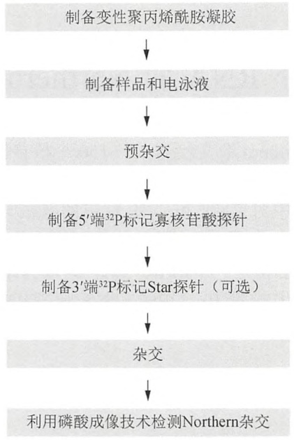
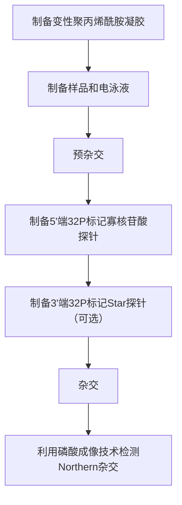
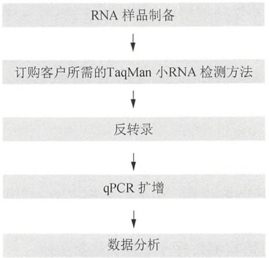
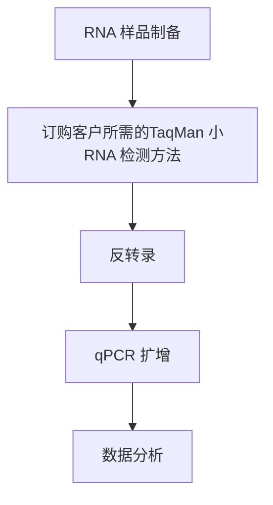
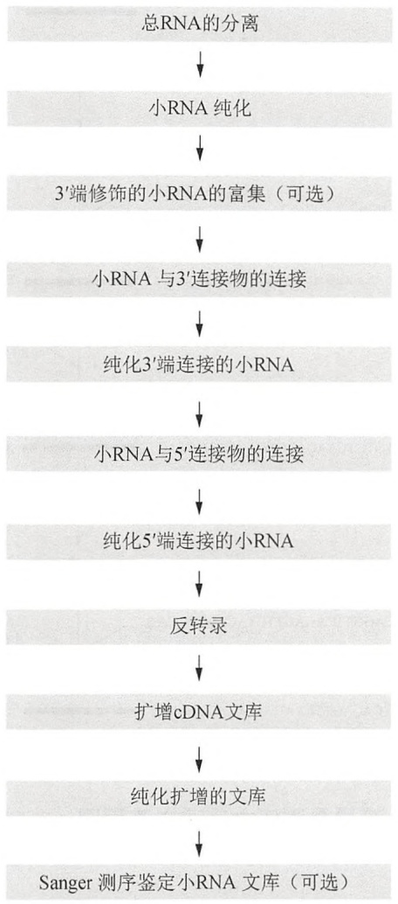
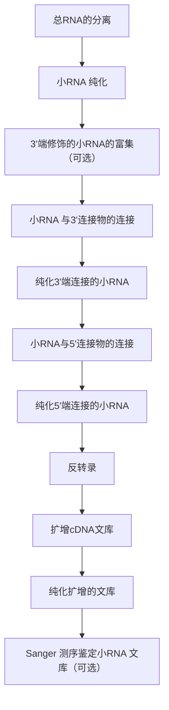
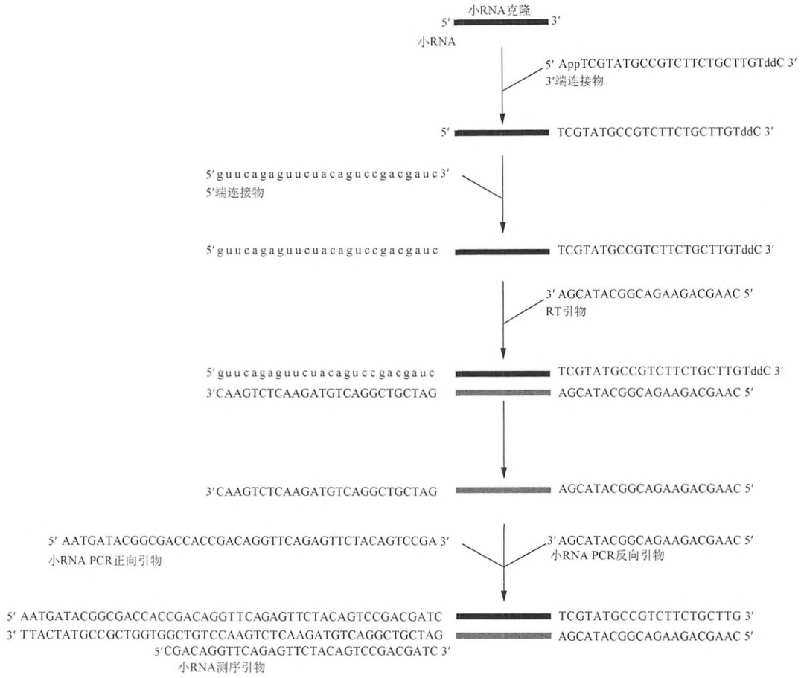
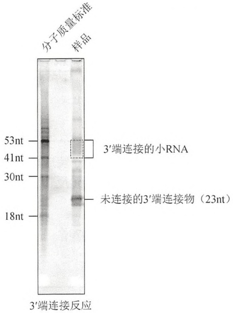

Ficoll-Orange G 上样缓冲液 (6×)

| 试剂 | 数量(以100mL计) | 终浓度(6×) |
| --- | --- | --- |
| Ficoll-400 | 15g | 15%(m/V) |
| Orange G | 250mg | 0.25%(m/V) |
| 水 | 补足100mL |  |

分装为 1mL， $-20^{\circ}C$  保存。

非变性凝胶上样缓冲液（10×）

| 试剂 | 数量(以100mL计) | 终浓度(10×) |
| --- | --- | --- |
| Ficoll-400 | 15g | 15%(m/V) |
| 二甲苯蓝 | 250mg | 0.25%(m/V) |
| 溴酚蓝 | 250mg | 0.25%(m/V) |
| 水 | 补足100mL |  |

分装为 1mL，-20℃保存。

PCR 缓冲液（10×）

| 试剂 | 数量(以100mL计) | 终浓度(10×) |
| --- | --- | --- |
| Tris-HCl(1mol/L,pH 8.3) | 10mL | 100mmol/L |
| KCl(2mol/L) | 25mL | 500mmol/L |
| MgCl2(1mol/L) | 1.5mL | 15mmol/L |
| 明胶(Gelatin)(2%,m/V) | 5mL | 0.1%(m/V) |
| 水 | 补足100mL |  |

分装为 1mL，-20℃保存。

T7 转录缓冲液（10×）

| 试剂 | 数量(以100mL计) | 终浓度(10×) |
| --- | --- | --- |
| Tris-HCl(1mol/L,pH 7.9) | 40mL | 400mmol/L |
| 亚精胺(Spermidine)(1mol/L) | 2.5mL | 25mmol/L |
| MgCl2(1mol/L) | 26mL | 260mmol/L |
| Triton X-100 | 1mL | 0.1%(m/V) |
| 水 | 补足100mL |  |

分装为 1mL，-20℃保存。

## 网络资源

Primer3 软件 http://primer3.sourceforge.net/

## 方案 5 采用 dsRNA 浸泡果蝇 S2 细胞进行 RNA 干扰

该方案是一种通过用含有 dsRNA 的培养液浸泡果蝇 S2 细胞来诱导 RNA 干扰的简便方法。与转染方法（方案 3）相比，浸泡操作需要的步骤更少，而且节省了转染试剂的费用，因此可用于高通量的 RNA 干扰筛选。而且，浸泡避免了转染试剂可能带来的毒性，但是，通过浸泡向果蝇 S2 细胞转运 dsRNA 的效率与转染（方案 6）方法相比较低。对于通过浸泡 dsRNA 难以抑制其表达的基因，可以通过多次转染 dsRNA 获得抑制作用。本方案介绍的浸泡方案用于 6 孔板内培养的细胞。如果使用其他规格的多孔板、培养瓶或者培养皿，需要根据培养孔的表面积换算细胞密度和试剂用量（表 18-4）。

表 18-4 果蝇细胞浸泡所用细胞、DharmaFECT 4 转染试剂和 siRNA（或者 ASO）的体积

<table><tr><td>培养板或培养皿</td><td>24孔</td><td>12孔</td><td>6孔</td><td>6cm</td><td>10cm</td></tr><tr><td>每孔表面积/cm2</td><td>2</td><td>4</td><td>10</td><td>20</td><td>60</td></tr><tr><td colspan="6">浸泡培养基</td></tr><tr><td>Schneider&#x27;s 果蝇培养液/mL</td><td>0.2</td><td>0.4</td><td>1</td><td>2</td><td>3</td></tr><tr><td>1μg/μL dsRNA/μL</td><td>3</td><td>6</td><td>15</td><td>30</td><td>45</td></tr><tr><td>Schneider&#x27;s 果蝇培养液+10%FBS/mL</td><td>0.4</td><td>0.8</td><td>2</td><td>4</td><td>6</td></tr><tr><td>生长培养基总体积/mL</td><td>0.6</td><td>1.2</td><td>3</td><td>6</td><td>9</td></tr></table>


## 材料

为正确使用本方案中的器材和危险试剂，必须查阅相应的材料安全数据表并咨询所在机构的环境卫生和安全办公室。

## 试剂

果蝇 Schneider 2（S2）细胞（如 Life Technologies 公司，目录号 R690-07）

dsRNA (1μg/μL) (方案 4)

热灭活的胎牛血清（FBS）

Schneider's 果蝇培养液（如 Life Technologies 公司，目录号 11720-034）

## 设备

锥形离心管（50mL）

免疫荧光、Western 印迹、定量 RT-PCR 或者 Northern 杂交用设备（步骤 8）

层流生物安全柜（Ⅱ级）

体视显微镜

组织培养皿（10cm）

组织培养箱（25℃），一定湿度

组织培养板（6孔）


## 方法

## 制备浸泡用细胞

1. 用含有 $10\%$ 胎牛血清的 Schneider's 果蝇培养液培养 S2 细胞，细胞在 $25^{\circ} \mathrm{C}$ 湿润培养箱中生长至 $5 \times 10^{6} \sim 10 \times 10^{6}$ 个干细胞/mL。
2. 室温下 $1000\mathrm{g}$ 离心 $3\mathrm{min}$，弃去上清，将细胞重悬于无血清的 Schneider's 果蝇培养液中，密度为 $1 \times 10^{6}$ 个细胞/mL。
3. 向 6 孔板每孔中加入 1mL 细胞悬液（ $1 \times 10^{6}$  个细胞）。
4. 在  $25^{\circ}$ C 湿润的培养箱中培养细胞。

## dsRNA 浸泡细胞和基因敲减效果分析

5. 向每孔细胞中加入  $15 \sim 30 \mu g$ dsRNA。轻轻地前后直线移动培养板。不要旋转，以免使中间的细胞脱落而影响细胞摄入 dsRNA 的效果。
6. 细胞在  $25^{\circ}$ C 湿润的培养箱中孵育 30min。
7. 每孔加入 2mL 含有 10% 胎牛血清的 Schneider's 果蝇培养液。
8. 细胞在  $25^{\circ}$ C 湿润培养箱中培养 2～6 天。对基因敲减效果的分析:通过免疫荧光和 Western 印迹法（第 19 章），利用特异性识别目标蛋白的抗体检测目标蛋白表达的减少量，以及通过定量 RT-PCR（第 9 章）或者 Northern 杂交（第 6 章）检测目标 mRNA 的减少量。

请参见“疑难解答”。


## 疑难解答

问题（步骤 8）:目的基因没有发生沉默。

解决方案:dsRNA 可能降解。使用新鲜制备的 dsRNA 重新进行实验。

## 方案 6 采用 dsRNA 转染在果蝇 S2 细胞中进行 RNA 干扰

尽管使用浸泡法可以将 dsRNA 导入果蝇 S2 细胞, 但在实验中, 发现转染的效率更高。dsRNA 转染法主要适用于 24 孔板, 如果使用不同直径的其他多孔板、培养瓶或者培养皿, 则需要根据孔的表面积计算细胞密度和试剂体积 (方案 3, 表 18-3)。


## 材料

为正确使用本方案中的器材和危险试剂，必须查阅相应的材料安全数据表并咨询所在机构的环境卫生和安全办公室。

## 试剂

DharmaFECT 4 转染试剂（Dharmacon，目录号 T-2004）

果蝇 S2 细胞（Life Technologies，目录号 R690-07）

dsRNA (1μg/μL) (方案 4)

热灭活的胎牛血清（FBS）

果蝇 S2 细胞培养基（Life Technologies，目录号 R690-07）

## 设备

锥形离心管（50）

层流生物安全柜（II级）

体视显微镜

组织培养皿（10cm）

组织培养箱（25℃），一定湿度

组织培养板（24孔）


## 方法

参照方案 3 中的步骤 1～步骤 9，但是步骤 7 中的 dsRNA 的浓度调整为  $1 \mu L$ （ $1 \mu g$ ）/孔。
见方案 3 中的 “疑难解答”。

## 方案 7 小 RNA 的 Northern 杂交分析

该方案描述如何运用 Northern 杂交检测 15～150 个核苷酸的小 RNA（图 18-6）。通过聚丙烯酰胺凝胶电泳分离总 RNA，再采用半干法进行转膜。RNA 通过紫外线照射交联至尼龙膜上，在 Church 缓冲液中对 RNA 和  $\alpha-^{32}P$  标记的寡核苷酸探针进行杂交，并用磷酸成像分析技术（phosphorimager analysis）进行检测分析。使用包含两个结构域的 StarFire 探针可以提高杂交探针的放射特性。StarFire 探针 5' 端的结构域可以特异性地与目标小 RNA 杂交，3' 端结构域可以与携带 10 个脱氧胸腺嘧啶核苷的 5' 端寡聚核苷酸相互结合，从而在 StarFire 探针的 3' 端形成可以与 DNA 聚合酶相互结合的 10[ $\alpha-^{32}P$ ]脱氧腺苷（请见信息栏 “StarFire 探针”）。


## 材料

为正确使用本方案中的器材和危险试剂，必须查阅相应的材料安全数据表并咨询所在机构的环境卫生和安全办公室。

本方案的专用试剂标注&lt;R&gt;，配方在本方案末提供。常用储备溶液、缓冲液和试剂标注&lt;A&gt;，配方见附录1。储备溶液应稀释至适用浓度后使用。

## 试剂

```txt
丙烯酰胺：双丙烯酰胺（19：1, 40%, m/V）
[α-³²P]dATP（6000Ci/mmol, 10mCi/mL）
硫酸铵（10%, m/V）<A>
Church 缓冲液 <A>
甲酰胺上样电泳缓冲液 <A>
[γ-³²P]ATP（6000Ci/mmol, ≥10mCi/mL）
miRNA StarFire 核酸标记仪（DNA 合成技术）
StarFire 探针（50 个核苷酸以上，聚丙烯酰胺凝胶电泳纯化）
StarFire 通用模板（高效液相层析）
StarFire10×混合缓冲液（100mmol/L Tris 7.5, 50mmol/L MgCl₂, 75mmol/L DTT）
StarFire 终止缓冲液（10mmol/L EDTA）
Exo-Klenow DNA 聚合酶
RNA 样品和 5 端³²P-放射性标记的 RNA 分子质量标准（如 RNA Decade 标准，Ambion），目录号 AM7778）
SDS（20%, m/V）<A>
```

SSC (1×, 20×) &lt;A&gt;

合成的寡核苷酸探针（DNA、RNA 或 LNA-modified DNA）

T4 多聚核苷酸酶（10U/ $\mu$ L）

T4 多聚核苷酸酶缓冲液（10×）&lt;R&gt;

TBE 缓冲液（5×和 0.5×）&lt;A&gt;

TE 缓冲液（pH 8.0，10×和 1×）&lt;A&gt;

TEMED（四甲基乙二胺）

尿素



<details>
<summary>flowchart</summary>


</details>

图 18-6 小 RNA Northern 杂交流程图。

## 设备

印迹滤纸（加厚）

加热模块（95℃）

杂交箱（如微型 Autoblot 杂交箱，Bellco Glass，目录号 7930-10110）

杂交管（如 Autoblot 试管，35mm×150mm, Bellco Glass, 目录号 7910-35150）

磁力搅拌器

带正电荷尼龙膜（如 Amersham Hybond N+; GE Healthcare）

磷酸成像仪（如 FUJI FLA-5000）和成像软件（如 ImageGauge v 4.22）

磷酸成像板

聚丙烯酰胺凝胶装置（如 Bio-Rad Mini-PROTEAN,  $8cm \times 7.3cm \times 0.75mm$ ）

Saran 保鲜膜

半干法转膜设备（如 Trans-Blot SD Semi-Dry Transfer Cell; Bio-Rad）

Sephadex G-25 旋转紫外交联仪（如 Stratalinker UV Crosslinker; Stratagene）


## 方法

## 制备变性聚丙烯酰胺凝胶

1. 配制含 8mol/L 尿素的 15% 变性聚丙烯酰胺凝胶（第 2 章，方案 3）:

| TBE 缓冲液(5×) | 2mL |
| --- | --- |
| 丙烯酰胺:双丙烯酰胺(19:1,40%,m/V) | 3.75mL |
| 尿素 | 4.8g |
| 去离子水 | 至10mL |

2. 室温条件下用磁力搅拌器搅拌溶液至尿素完全溶解。
3. 确定胶规格并组装配胶设备。
4. 加入  $100 \mu L 10\% (m/V)$  的过硫酸铵。
5. 加入  $10 \mu L$  (TEMED) 四甲基乙二胺。
6. 快速混合溶液并灌胶，插 10 孔梳子。室温下聚合 20min。

## 样品制备及电泳

7. 将  $5 \sim 10 \mu g$  的总 RNA 样品与上样缓冲液等体积混合，终体积为  $10 \mu L$ 。

RNA 样品总量由检测到的 RNA 丰度决定。

8.  $95^{\circ}$ C加热 5min，置冰上冷却。
9. 冲洗胶孔除去尿素，保证条带一致且整齐，然后上样  $10 \mu L/$ 孔，必须设立含  $10 \times 5'$ 端  ${}^{32}P$ -放射性标记的 RNA 标准。按照说明书，使用 T4 聚核苷酸激酶和  $[\gamma-{}^{32}P]$  ATP 对 RNA 分子质量标准进行标记，然后稀释 200 倍，使其适合小 RNA 的杂交检测。
10. 用  $0.5 \times TBE$  缓冲液 200V 电泳约 1h，直至溴酚蓝至胶底部。

## 半干法 RNA 转膜

11. 根据胶大小，切一张带正电荷的尼龙膜和两张加厚印迹滤纸，并浸入  $0.5 \times TBE$  缓冲液中，室温浸泡 10min。
12. 在铂阳极放一张预浸湿的印迹滤纸，并用塑料移液管排尽气泡。
13. 在印迹滤纸的上面放一张提前浸湿的膜，并排尽气泡。
14. 小心地将胶转移至第一层膜上，并排尽气泡。
15. 将另外一张提前浸湿的印迹滤纸放在胶上，并排尽气泡。
16. 将阴极与胶膜组合（sandwich stack）连接并盖上保护盖，恒压 20V 转膜 1h。
17. 转膜完成后，将湿膜放在一张滤纸上，254nm 紫外线照射（Stratalinker; 120 000μJ 的自交联装置）交联 RNA 至膜上。

紫外交联将 RNA 固定于膜上，从而使印迹可以被多次反复检测。

18. 将交联后的膜放入杂交管中，RNA 面向内。加入 20mL Church 缓冲液，将杂交管放入杂交箱中孵育 1h，37℃ 旋转预杂交过夜。

## 制备 5'端 $^{32}\mathrm{P}$-放射性标记的寡核苷酸探针

19. 相同长度的探针可以与小 RNA 完全互补，5 端标记反应所用试剂:

| 无核酸酶的水 | 6μL |
| --- | --- |
| DNA 寡核苷酸探针(25μmol/L) | 1μL |
| T4 多核苷酸酶反应缓冲液(10×) | 1μL |
| T4 多核苷酸酶(10 U/μL) | 1μL |
| $\left\lbrack {\gamma - {}^{32}\mathrm{P}}\right\rbrack \mathrm{{ATP}}\left( {{6000}\mathrm{{Ci}}/\mathrm{{mmol}}, \geqslant {10}\mathrm{{mCi}}/\mathrm{{mL}}}\right)$ | 1μL |

20.  $37^{\circ}$ C 反应 1h。
21. 根据使用说明书，用 Sephadex G 25 旋转层析柱分离出未掺入的 $[\gamma -^{32}\mathrm{P}]$ ATP。

制备 3'端 $^{32}\mathrm{P}$ 标记的 StarFire 寡核苷酸探针（可选）

22. 用  $1 \times TE$  缓冲液溶解 StarFire 通用模板至浓度为  $12.5 \mu mol/L$ 。

23. 用  $1 \times TE$  缓冲液溶解 StarFire 通用探针至浓度为  $100 \mu mol/L$ 。

24. 用无核酸酶的水将 StarFire 通用探针稀释至  $0.5 \mu mol/L$ 。

25. 在 0.5mL 的微量离心管中混合以下试剂:

| StarFire 缓冲液(10×) | 1μL |
| --- | --- |
| StarFire 探针(0.5μmol/L) | 1μL |
| StarFire 通用模板(12.5μmol/L) | 1μL |

26. 用移液器将溶液混合，然后  $95^{\circ}$ C 加热 1min。

27. 取出试管冷却至室温（约 5min）。短暂离心并收集试管底部反应物。

28. 加入 $6\mu \mathrm{L}[\alpha -^{32}\mathrm{P}]$ dATP（6000Ci/mmol, 10mCi/mL）和 $1\mu \mathrm{L}$ 的Exo-Klenow DNA聚合酶，移液器轻吹混匀。

29. 室温孵育 2h，加入  $40 \mu L$  StarFire 反应终止缓冲液。

30. 按照说明书，用 Sephadex G25 旋转层析柱分离未掺入的  $[\alpha-^{32}P]$ dATP。

## 杂交

31. 预杂交后（步骤 18），向预杂交溶液中加入 5 端  ${}^{32}$ P-放射性标记的探针或 3 端  ${}^{32}$ P-放射性标记的 StarFire 探针，孵育 2h 或者过夜。

选择其中一种方法，相同序列的 3'端  ${}^{32}$ P-放射性标记的 StarFire 探针较 5'端  ${}^{32}$ P-放射性标记的探针敏感。

孵育 2h 可以获得 80% 以上杂交信号，如需获得更高杂交信号可选择孵育过夜。

32. 杂交完成后，将杂交溶液小心转移到 50mL 的锥形离心管中，-20℃储存。

33. 用  $30 \, mL \times SSC$  和  $0.1\% (m/V)$  SDS 混合液洗涤瓶子两次。

34. 用  $30 \, mL \times SSC$  和  $0.1\% (m/V)$  SDS 混合液  $37^{\circ}C$  洗膜 10min，重复洗两次。

35. 用 Saran 保鲜膜封闭湿膜，并置于磷酸成像板上过夜。

36. 磷酸成像仪（如 FUJI FLA-5000）读取杂交信号，并用相关软件（如 ImageGauge V4.22）对其进行分析。

参见“疑难解答”。

## 不同样品小 RNA 相对丰度分析

37. 根据使用说明, 用 ImageGauge 软件对同一样品原始杂交信号和背景信号进行定量, 并从原始信号中减去背景信号, 即得到小 RNA 特异杂交信号。

38. 500mL 0.1%（m/V）SDS 煮膜 10min，从印迹中剥离（strip）出探针。用 Saran 保鲜膜封闭湿膜，并将其置于磷酸成像板上过夜，从而检测探针剥离是否成功。若信号未完全消除，需重复此步骤。

39. 将膜与内参特异性探针杂交（如样品中含有一个小核 RNA、tRNA 或 5S 核糖体 RNA），如上所述，此方法可以检测各个样品内参的特异杂交信号。

40. 对目标小 RNA 杂交信号通过内参特异性杂交信号进行标准化, 不同样品的标准化值即可用于比较目标小 RNA 的相对丰度。

## 样品中小 RNA 绝对量分析

41. 订购一种与目标小 RNA 序列完全相同的 RNA 寡核苷酸序列，并将其稀释成一系列浓度（$10^{-1} \sim 10^{3} \mathrm{fmol}$）。

42. 将稀释的 RNA 寡核苷酸和样品上样至变性聚丙酰胺凝胶, 如上所述进行 Northern

杂交（步骤7～步骤36）。

43. 绘制 RNA 寡核苷酸稀释样品浓度与特异杂交信号（确保减去背景）关系曲线，并对比两者的杂交信号从而得到标准曲线。根据标准曲线确定各个样品中小 RNA 的绝对量。

本实验中，用磷酸成像仪对 Northern 印迹进行分析，其可以分析线性信号多达 5 个对数数量级。

大多数 miRNA 和一些高丰度内源性 siRNA 和 piRNA 连接 5'端  ${}^{32}$ P 放射性标记的 DNA 或 RNA 寡核苷酸探针后，更容易被检测。对于一些低丰度的小 RNA，推荐使用 3'端  ${}^{32}$ P-放射性标记的 StarFire 寡核苷酸探针或 5'端  ${}^{32}$ P-放射性标记的 LNA-修饰的寡核苷酸探针进行检测。


## 疑难解答

问题（步骤 36）:没有检测到信号，但是检测到了  $5'$  端  ${}^{32}P$  放射性标记的分子质量标准。
解决方案:尝试以下方法。

- 检查探针序列是否与待检测目标小 RNA 完全互补。
- 将探针用 $15\%$ 变性聚丙烯酰胺凝胶分离后，用磷酸成像仪检测探针是否标记完全。
- 检查内参。
- 为了提高灵敏度, 用 $5^{\prime}$ 端 ${}^{32}\mathrm{P}$ 标记的 RNA 寡核苷酸探针或者 $5^{\prime}$ 端 ${}^{32}\mathrm{P}$ 标记的 LNA-修饰的 DNA 寡核苷酸探针, 将温度分别升高至 $60^{\circ}\mathrm{C}$ 或 $70^{\circ}\mathrm{C}$ 。

问题（步骤 36）:检测到背景杂交信号较高。

解决方案:将预杂交延长至过夜。最后一次洗涤步骤重复两次或更多次。


## 配方

为正确使用本方案中的器材和危险试剂，必须查阅相应的材料安全数据表并咨询所在机构的环境卫生和安全办公室。

T4 多聚核苷酸激酶反应缓冲液（10×）

| 试剂 | 体积(1mL) | 终浓度(10×) |
| --- | --- | --- |
| Tris-HCl(1mol,pH7.6) | 700μL | 700μmoL |
| MgCl2(1mol) | 100μL | 100μmoL |
| DTT(1mol) | 50μL | 50μmoL |
| H2O | 150μL |  |

-20℃保存。

## 方案 8 反转录定量 PCR 分析小 RNA

Northern 杂交可以揭示小 RNA 的表达水平，同时也可揭示小 RNA 的长度，并且是小 RNA 验证和定量的标准。然而，Northern 杂交不能用来检测低丰度小 RNA，也不能检测大量的小 RNA 种类。相比之下，定量 RT-PCR 更加敏感并且可以适用于高通量处理（图 18-7）。此方案来源于 Applied Biosystems 公司的 TaqMan 小 RNA 测定技术（Life Technologies 公司，2011）。TaqMan 小 RNA 检测技术是针对长度为 17～200 个核苷酸 RNA 的定量检测设计的，包括 siRNA 和 miRNA。TaqMan 小 RNA 检测主要依赖于一套经确证的寡核苷酸体系，其中包括一个茎-环RT引物、一对PCR引物和一个TaqMan探针。其他的有关运用定量RT-PCR对RNA进行定量的信息请参考第9章。



<details>
<summary>flowchart</summary>


</details>

图 18-7 小 RNA 定量 RT-PCR 分析流程图。


## 材料

为正确使用本方案中的器材和危险试剂，必须查阅相应的材料安全数据表并咨询所在机构的环境卫生和安全办公室。

本方案的专用试剂标注&lt;R&gt;，配方在本方案末提供。常用储备溶液、缓冲液和试剂标注&lt;A&gt;，配方见附录1。储备溶液应稀释至适用浓度后使用。

## 试剂

mirVana miRNA 提取试剂盒（Isolation Kit）（Ambio AM1560）或 TRIzol 试剂（Life Technologies, 目录号 15596-026）

无核酸酶水

RNA 样品，总 RNA 对照和内源性 RNA 对照（如 TaqMan 小 RNA 对照）

TaqMan microRNA 反转录试剂盒

TaqMan 小 RNA 检测试剂盒

TaqMan Universal PCR Master Mix II, 不含 uracil N-glycosylase (UNG)

TE 缓冲液（pH 8.0, 10× 和 0.1×）&lt;A&gt;

## 设备

带微孔板转头的离心机

加热模块

PCR 板（96 孔）

PCR 管

实时 PCR 热循环仪


## 方法

## RNA 样品制备

1. 根据使用说明书，用 mirVana miRNA 提取试剂盒或 TRIzol 试剂提取总 RNA，并将总 RNA 溶于水中。

2. 运用分光光度计测量 RNA 浓度和纯度（第 6 章）。

标准总 RNA 的  $A_{260}/A_{280}$  值为 1.8～2.1。

# 订购客户所需的 TaqMan 小 RNA 检测序列

3. 根据 TaqMan Small RNA Assays 设计工具（https://www5.appliedbiosystems.com/tools/smallrna/）设计 TaqMan 小 RNA 检测序列。

每个客户定制的 TaqMan 小 RNA 检测序列包含一个茎-环 RT 引物、一个正向 PCR 引物、一个 TaqMan MGB 探针和一个反转录 PCR 引物。前三者的序列对目的小 RNA 具有特异性。

## 反转录

4. 将 TaqMan MicroRNA 反转录试剂盒中的试剂置冰上溶解，用  $0.1 \times TE$  缓冲液把 RT 引物稀释成  $5 \times$  工作液浓度。

5. 在 $1.5 \mathrm{~mL}$ 试管中加入以下试剂，在冰上将其混合制成 RT 混合液。

以下为总体积  $15 \mu L$  RT 反应液，根据需要体积对以下 RT 反应液的体积进行调整，并配制 10% 的富余体积以弥补在混合过程中的损失。

| dNTP(100mmol/L)(含dTTP) | 0.15μL |
| --- | --- |
| MultiScribe 反转录酶(50U/μL) | 1μL |
| 反转录缓冲液(10×) | 1.5μL |
| RNA 酶抑制剂(20U/μL) | 0.19μL |
| 无核酸酶水 | 4.16μL |
| 总 RNA(来自步骤1) | 5μL(1~10ng) |
| 总体积 | 12μL |

6. 轻轻涡旋振荡，离心 1\~2s 收集试管底部的反应物。

7. 每 $15\mu \mathrm{L}$ 的RT反应液中，取出 $12\mu \mathrm{L}$ 含总RNA（步骤5）的RT混合液加入到96孔板的各个孔中。

8. 向含 RT 混合液的 96 孔板的各个孔中加入  $3 \mu L$  的  $5 \times RT$  引物。

9. 盖上 96 孔板，离心 1\~2s 收集底部反应物。

10. 将 96 孔板冰上静置 5min，然后置于热循环仪中。根据以下程序进行反转录:

| i. 16°C | 30min |
| --- | --- |
| ii. 42°C | 30min |
| iii. 85°C | 5min |
| iv. 4°C | 保存 |

v. 结束

11. 若不立即进行 PCR 扩增，需将 RT 反应液置于 -20°C 储存，或者立即进行 PCR 扩增。

## qPCR 扩增

每个反应设置 3 个平行试验组，且每块板中需包含:每个 cDNA 样品中的小 RNA 含量检测组，内参检测组，用来检测背景信号的无模板对照组。

12. 冰上溶解 TaqMan Assay (20×)。冰上准备定量 PCR 混合液，在 1.5mL 的离心管中加入以下试剂:

每个样品的 3 个平行组所用试剂体积如下，并配制 10% 的富余以弥补混合过程中的损失。

| TaqMan 小 RNA 检测试剂(20×) | 3.3μL |
| --- | --- |
| RT 反应产物 | 4.4μL |
| TaqMan Universal PCR Master Mix II (2×) | 3.3μL |
| 无核酸酶水 | 25.3μL |
| 总体积 | 66μL |

13. 反复颠倒试管数次至混匀，离心 1\~2s 收集试管底部反应物。
14. 96 孔板中，向 3 个平行试验组的各个孔中加入  $20 \mu L$  定量 PCR 反应混合液。
15. 盖上 96 孔板，离心 1\~2s 收集底部反应物。
16. 将 96 孔板置于实时 PCR 热循环仪上，运行以下程序进行 cDNA 扩增:

i.  $95^{\circ}$ C 10min

ii. $95^{\circ}\mathrm{C}$ 15s

iii.  $60^{\circ}$ C 60s

iv. 运行步骤 16 中 ii 和 iii，重复 39 个循环以上

v.  $4^{\circ}$ C 保存
vi. 结束

## 数据分析

17. 根据实验设计，可运用不同统计方法对小 RNA 的表达情况进行分析。例如，相对标准曲线、相对  $C_{T}$  、DART-PCR 或 S 形曲线拟合法（SCF）等（第 9 章）。

## 参考文献

Life Technologies Corporation. 2011. Applied Biosystems by Life Technologies TaqMan® Small RNA Assays. Life Technologies Corporation, Carlsbad, CA.

## 方案 9 构建小 RNA 高通量测序文库

小 RNA 克隆和高通量测序的结合是纯化和鉴别细胞或组织中小 RNA 的有效先进技术。本方案描述了用于 Illumina Genome Analyzer 高通量分析的 19～29 个核苷酸小 RNA 的克隆方法，通过聚丙烯酰胺凝胶从总 RNA 样品中分离纯化小 RNA，并进行两步连接反应:小 RNA 3' 端与 5' 腺苷酸 DNA 连接物的连接；以及小 RNA 5' 端与 RNA 连接物的连接。此后，通过反转录和 PCR 制备高通量测序所需的小 RNA cDNA 文库。图 18-8 中的流程描述了建立 cDNA 文库的具体步骤，图 18-9 描述了建立小 RNA 文库的具体步骤。


## 材料

为正确使用本方案中的器材和危险试剂，必须查阅相应的材料安全数据表并咨询所在机构的环境卫生和安全办公室。

本方案的专用试剂标注&lt;R&gt;，配方在本方案末提供。常用储备溶液、缓冲液和试剂标注&lt;A&gt;，配方见附录1。储备溶液应稀释至适用浓度后使用。



<details>
<summary>flowchart</summary>


</details>

图 18-8 文库建立流程图。

## 试剂

丙烯酰胺:双丙烯酰胺（19:1,40%,m/V）

过硫酸铵（10%, m/V） &lt;A&gt;

硼砂/硼酸缓冲液（5×,pH8.6）&lt;R&gt;

氯仿

二甲基亚砜（DMSO）

DNA 分子质量标准（100bp）

dNTP 混合物（每种浓度为 10mmol/L）

3'端连接反应缓冲液&lt;R&gt;

乙醇（100%和80%）

溴化乙锭

Ficoll-Orange G 上样缓冲液（6×）&lt;R&gt;

甲酰胺上样缓冲液 &lt;A&gt;

肝糖原（20μg/μL）

连接物:3'端连接物（5'-rAppTCGTATGCCGTCTTCTGCTTGT/ddc/-3')

5'端连接物（5'-GUUCAGAGUUCUACAGUCCGACGAUC-3')

```mermaid
graph TD
  A["5'"] --> B["3'"]
  C["小RNA"] --> D["5' AppTCGTATGCCGTCTTCTGCTTGTddC 3'"]
  D --> E["TCGTATGCCGTCTTCTGCTTGTddC 3'"]
  F["5' guucagaguucuacaguccgacgauc 3'"] --> G["TCGTATGCCGTCTTCTGCTTGTddC 3'"]
  H["5' guucagaguucuacaguccgacgauc"] --> I["3' AGCATACGGCAGAAGACGAAC 5' RT引物"]
  J["5' guucagaguucuacaguccgacgauc"] --> K["TCGTATGCCGTCTTCTGCTTGTddC 3'"]
  L["3' CAAGTCTCAAGATGTCAGGCTGCTAG"] --> M["AGCATACGGCAGAAGACGAAC 5'"]
  N["3' CAAGTCTCAAGATGTCAGGCTGCTAG"] --> O["AGCATACGGCAGAAGACGAAC 5'"]
  P["5' AATGATACGGCGACCACCGACAGGTTCAGAGTTCTACAGTCCGA 3' 小RNA PCR正向引物"] --> Q["3' AGCATACGGCAGAAGACGAAC 5' 小RNA PCR反向引物"]
  R["5' AATGATACGGCGACCACCGACAGGTTCAGAGTTCTACAGTCCGACGATC"] --> S["TCGTATGCCGTCTTCTGCTTG 3'"]
  T["3' TTACTATGCCGCTGGTGGCTGTCCAAGTCTCAAGATGTCAGGCTGCTAG"] --> U["AGCATACGGCAGAAGACGAAC 5'"]
  V["5' CGACAGGTTCAGAGTTCTACAGTCCGACGATC 3' 小RNA测序引物"] --> W["3' AGCATACGGCAGAAGACGAAC 5'"]
```



<details>
<summary>flowchart</summary>


</details>

图 18-9 小 RNA 高通量测序文库建立流程图（彩图请扫封底二维码）。

M13 的正、反向引物

mirVana miRNA 分离提取试剂盒（Ambion，目录号 AM1560）或 TRIzol 试剂（Life Technologies，目录号 15596-026）

GTG 琼脂糖凝胶

苯酚（pH 7.9）

酚:氯仿:异戊醇（25:24:1，V/V/V，pH 8.0）

PuReTaq Ready-To-Go PCR Beads (GE Healthcare, 目录号 27-9558-01)

反转录引物（5'-CAAGCAGAAGACGGCATACGA-3')

RNA Century Marker (Ambion, 目录号 AM7140)

总 RNA 样品

小 RNA PCR 正向引物（5'-AATGATACGGCGACCACCGACAGGTTCAGAGTTCTACA GTCCGA-3')

小 RNA PCR 反向引物（5'-CAAGCAGAAGACGGCATACGA-3')

乙酸钠（3mol/L, pH5.2）&lt;A&gt;

氯化钠（0.3mol/L 和 0.6mol/L）&lt;R&gt;

高碘酸钠（200mmol/L）&lt;R&gt;

SuperScript III 反转录酶（Life Technologies, 目录号 18080-093）

$5 \times$ 第一链缓冲液

0.1mol/L DTT

SYBR Gold (10 000×) (Life Technologies, 目录号 S-11494)

合成的小 RNA 分子质量标准（18 个、30 个和 60 个核苷酸）

避免目的小 RNA 样品对小 RNA 分子质量标准造成污染，需对合成的 RNA 寡核苷酸 5' 端进行羟基化而不是磷酸化修饰，以避免其与 5' 端连接物发生连接反应。分子质量标准不应与待测物种的基因组序列相对应，从而可以用生物信息学分析排除污染序列。

T4 RNA 连接酶 2, 截短的 (NEB, 目录号 M0242L) 或 T4 RNA 连接酶 2, 截短的 K2276 (NEB, 目录号 M0351L)

T4 RNA 连接酶和  $10 \times$  T4 RNA 连接酶缓冲液（Ambion，目录号 AM2140）

TAE 缓冲液（50×和 1×） &lt;A&gt;

TBE 缓冲液（5×和 0.5×） &lt;A&gt;

四甲基乙二胺（TEMED）

TOPO TA 克隆试剂盒（Life Technologies, 目录号 K4500-01）

尿素

## 设备

离心机

玻璃托盘

加热模块

微量离心管（2.0mL, 1.5mL）

NanoDrop 分光光度计

PCR 管 (0.5mL)

聚丙烯酰胺凝胶装置

刀片（新）

Thermo 热循环仪

紫外灯（302nm）

涡旋振荡仪


## 方法

## 总 RNA 纯化

1. 按照使用说明书，用 mirVana miRNA 分离提取试剂盒（Ambion，目录号 AM1560）或 TRIzol 试剂（Life Technologies，目录号 15596-026）纯化总 RNA，并溶解于水中。

2. 通过紫外分光光度计检测 RNA 的浓度和纯度（第 6 章）。

标准的总 RNA 的  $A_{260}/A_{280}$  值为 1.8～2.1。

## 从总 RNA 中纯化 19\~29 个核苷酸的小 RNA

3. 配制含 8mol/L 尿嘧啶的 15% 变性聚丙烯酰胺凝胶(长 20cm×宽 16cm×厚 1.5mm)，用 6 孔梳子（左右两边的两个小孔，深 17mm×宽 5mm×厚 1.5mm，小孔上样分子质量标准，中间 4 个大孔用来上样品，深 17mm×宽 30mm×厚 1.5mm）(如方案 7 所述)。

4. 在  $0.5 \times TBE$  缓冲液中 35 W 恒定功率预电泳 30 min。

5. 用 $50 \mu \mathrm{L}$ 水稀释 $100 \mu \mathrm{g}$ 总RNA，并加入等体积的甲酰胺上样缓冲液进行混合。用甲酰胺上样缓冲液稀释人工合成的18核苷酸和30核苷酸RNA寡核苷酸，并配制成终浓度为 $1 \mu \mathrm{mol} / \mathrm{L}$，用作小RNA分子质量标准。

6. 95℃加热样品和分子质量标准 5min，然后置冰上冷却。

7. 洗涤聚丙烯酰胺凝胶孔以洗去尿嘧啶，每个大孔中加入总 RNA 样品  $100 \mu L$ （来自步骤 5)。聚丙烯酰胺凝胶边缘小孔加入  $10 \mu L$ （10pmol 每孔）小 RNA 分子质量标准混合液（来自步骤 5）。

8.  $0.5 \times$  TBE 缓冲液中恒定功率电泳，至溴酚蓝距离孔缘约 6cm。

9. 电泳完成后，室温下用 SYBR Gold（用  $0.5 \times TBE$  缓冲液 1:10 000 稀释）将胶固定在洁净的玻璃托盘中 5min。将胶固定于玻璃托盘之前必须在托盘中加入染色剂。

10. 在 302nm 紫外灯下观察 RNA, 用新刀片切下 18\~30 个核苷酸之间且包含 RNA 的凝胶, 并将切下的凝胶放入预先称量好的 2.0mL 微量离心管中。

11. 每 100mg 凝胶中加入  $300 \mu L$  0.3mol/L 氯化钠，室温下旋转过夜以洗脱小 RNA。

12. 加入  $1 \mu L$   $20 \mu g/\mu L$  糖原和 3 倍体积的无水乙醇沉淀小 RNA。涡旋混合，将混合液置于  $-20^{\circ}C$  或  $-20^{\circ}C$  以下保存 3h。 $4^{\circ}C$  最大转速离心 30min，收集底部沉淀。

13. 用 $1 \mathrm{~mL} 80 \%$ 乙醇洗涤沉淀 1 次, 洗去残留盐分。$4^{\circ} \mathrm{C}$ 最大转速离心 $15 \mathrm{~min}$ 以回收小 RNA。打开离心管管口, 在实验台上静置数分钟, 尽可能除去 $80 \%$ 乙醇。

14. 将沉淀物溶解于  $13 \mu L$  无核酸酶的水中。

## 氧化法富集 3' 端修饰的小 RNA（可选）

与动物 miRNA 不同，动物 Piwi 相互作用 RNA（piRNA）和苍蝇内源性 siRNA 的 3' 端都被 2'-O-甲基化，从而降低其与 3' 端连接物的反应效率。此外，相同细胞中 2'-O-甲基化的 piRNA 或 siRNA 丰度通常较 miRNA 丰度低。通过氧化反应将 miRNA 末端的 2',3'-羟基氧化成醛基，从而阻断其与 3' 端连接物的连接，并增强 2'-O-甲基化小 RNA 的测序效率。

15. 依次加入下列试剂，建立  $40 \mu L$  的氧化反应体系:

| ${\mathrm{H}}_{2}\mathrm{O}$ | 14μL |
| --- | --- |
| 小 RNA(19~29 核苷酸) | 13μL |
| 硼砂/硼酸缓冲液(pH8.6)(5×) | 8μL |
| 高碘酸钠(200mmol/L) | 5μL |

高碘酸钠（200mmol/L）必须现配现用。

16. 移液管轻轻吹打混合溶液，离心 1\~2s 收集试管底部反应物。

17. 反应物  $25^{\circ}$ C 孵育 30min。

18. 加入  $229 \mu L$  水、 $1 \mu L$   $20 \mu g/\mu L$  糖原以及 3 mol/L 乙酸钠（pH5.2）30  $\mu L$ 。移液管轻轻吹打混匀，并加入 3 倍体积的无水乙醇。涡旋以混合溶液， $-20^{\circ}C$  或  $-20^{\circ}C$  以下保存过夜。

19.  $4^{\circ}$ C最大转速离心30min，收集试管底部沉淀。

20. 用 $1 \mathrm{~mL} 80 \%$ 乙醇洗涤沉淀物以清除残留盐分。$4^{\circ} \mathrm{C}$ 最大转速离心 $15 \mathrm{~min}$ 以回收小RNA。打开管口，实验台上静置数分钟，使 $80 \%$ 乙醇尽可能挥发干净。

21. 将沉淀物溶解于  $13 \mu L$  无核酸酶的水中。

## 小 RNA 与 3'端连接物连接

22. 依次加入以下试剂，建立  $20 \mu l$  的 3' 端连接反应体系:

试管A

| 小RNA(19~29个核苷酸)(来自步骤21) | 13μL |
| --- | --- |
| 3端连接物(100μmol/L) | 1μL |
| 3端连接反应缓冲液(10×) | 2μL |
| 二甲基亚砜(DMSO) | 2μL |
| 截短的(truncated)T4 RNA 连接酶2(NEB) | 2μL(400 U) |
| 总体积 | 20μL |

截短的（truncated）T4 RNA 连接酶 2 催化腺苷酸化连接物与小 RNA 3' 端连接时不需要 ATP，并可以有效阻止分子内和分子间小 RNA 的连接。

23. 为准确检测3端连接的小RNA，需依次加入以下试剂，配制3端连接分子质量标准。

试管 B

| ${\mathrm{H}}_{2}\mathrm{O}$ | 11μL |
| --- | --- |
| 合成的 RNA 寡核苷酸(18 核苷酸) | 1μL(100pmol) |
| 合成的 RNA 寡核苷酸(30 核苷酸) | 1μL(100pmol) |
| 3'端连接物(100μmol/L) | 1μL |
| 3'端连接反应缓冲液(10×) | 2μL |
| 二甲基亚砜(DMSO) | 2μL |
| 截短的 T4 RNA 连接酶 2 (NEB) | 2μL(400 U) |
| 总体积 | 20μL |

24. 轻轻敲打试管 A 和 B 外壁，混匀。离心 1\~2s，使试剂置于试管底部。
25. 试管 A 和 B 均  $4^{\circ}$ C 过夜。
26. 试管 A 中加入  $20 \mu L$  甲酰胺上样缓冲液（来自步骤 25）。
27. 试管 B 中加入  $180 \mu L$  甲酰胺上样缓冲液，配制 3 端连接分子质量标准（来自步骤 25）。
28. 试管 A 和 B 于  $95^{\circ}$ C 加热 5min，置冰上冷却。

## 3'端连接小 RNA 纯化

29. 配制含 8mol/L 尿嘧啶的 15% 变性聚丙烯酰胺凝胶（长  $20cm \times 16cm \times 1.5mm$ ），用 20 孔梳子（孔大小:深  $17mm \times$  宽  $5mm \times$  厚 1.5mm）（方案 7）。
30.  $0.5 \times$  TBE 缓冲液中 35W 恒定功率预电脉 30min。
31. 洗去胶孔中的尿素，每孔加入  $40 \mu L$  3' 端反应样品（来自步骤 28）。不同样品之间至少空一个孔，避免交叉污染。胶左右两侧边缘孔上样  $40 \mu L$  3' 端连接分子质量标准（来自步骤 28）。
32.  $0.5 \times TBE$  缓冲液恒定功率 20W 电泳，至溴酚蓝移至胶底部。
33. 按照步骤 9 所描述的方法将胶固定好。
34. 302nm 紫外灯下观察 RNA，对应在两个分子质量标准之间的位置，用新刀片切下包含 RNA 的凝胶（图 18-10）。将切下的凝胶放入预先称重的 1.5mL 微量离心管中。
35. 如步骤 11～步骤 14 所述，对 3' 端连接的小 RNA 进行洗脱、沉淀并溶解。



<details>
<summary>text_image</summary>

分子质量标准
样品
53nt
41nt
30nt
18nt
3'端连接的小RNA
未连接的3'端连接物（23nt）
3'端连接反应
</details>

图 18-10 凝胶检测 3' 端连接小 RNA 大小。