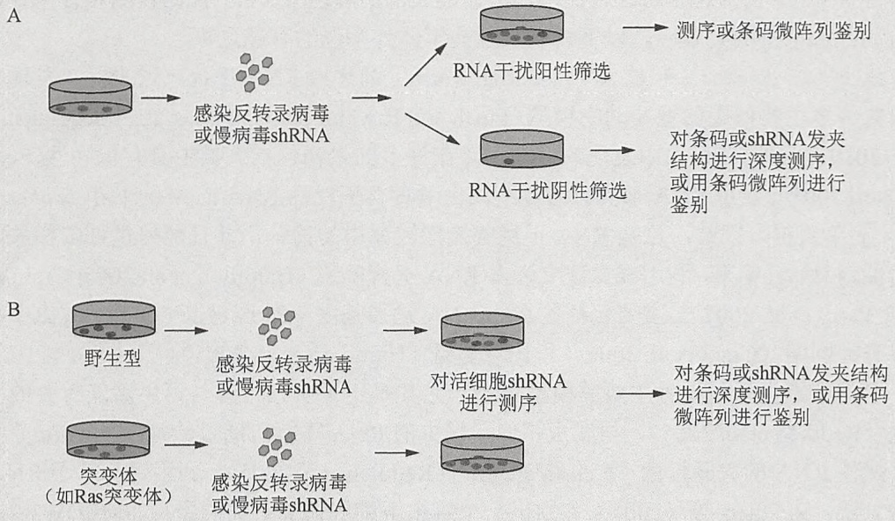
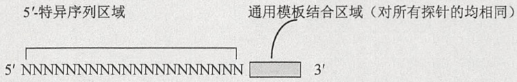
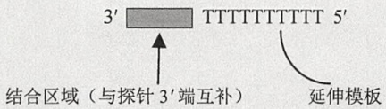
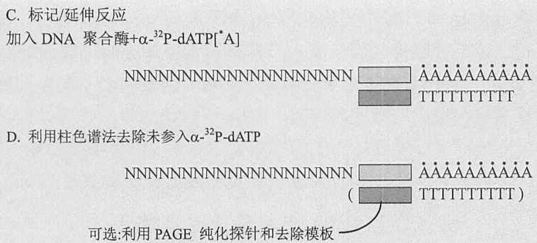

## 连接小 RNA 与 5' 端连接物

36. 在 $1.5 \mathrm{~mL}$ 的微量离心管中, 一次加入下列试剂, 建立 $20 \mu \mathrm{L} 5'$ 端连接反应体系:

| 3'端连接的小RNA(来自步骤35) | 13μL |
| --- | --- |
| 5'端连接物(100μmol/L) | 1μL |
| T4 RNA 连接酶缓冲液(10×)(Ambion) | 2μL |
| 二甲基亚砜(DMSO) | 2μL |
| T4 RNA 连接酶(Ambion) | 2μL(10U) |

37. 轻轻敲打试管外壁，混匀。离心 1\~2s，使试剂处于试管底部。
38.  $4^{\circ}$ C过夜。
39. 加入等体积的甲酰胺上样缓冲液，终止反应。 $95^{\circ}$ C加热5min，置冰上冷却。

## 5'端连接小 RNA 纯化

40. 如步骤 29 和步骤 30 所描述，配制 10% 的变性聚丙烯酰胺凝胶并预电泳。
41. 向  $78 \mu L$  甲酰胺上样缓冲液中加入  $1 \mu L$ （10pmol）合成的 60 个核酸的 RNA 寡核苷酸与  $1 \mu L$ （ $1 \mu g$ ）RNA Century 分子质量标准，配制成 RNA 分子质量标准。 $95^{\circ}C$  加热 5min，置冰上冷却。
42. 洗去胶孔中的尿素, 向各个孔中加入 $40 \mu \mathrm{L} 5^{\prime}$ 端连接反应样品 (步骤 39), 不同样品之间至少空一个孔, 避免交叉污染。左右两侧边缘孔中加入 $40 \mu \mathrm{L}$ RNA 分子质量标准。
43. 如步骤 32 和步骤 33 所述，电泳并固定。
44. 302nm 紫外灯下观察 RNA，并用新刀片切下 60～100 核苷酸包含 RNA 的凝胶，放入预先沉重的 1.5mL 微量离心管中。
45. 如步骤 11～步骤 13 所述，洗脱并沉淀 5' 端连接的小 RNA。
46. 将沉淀物溶于  $20 \mu L$  水中。

## 反转录

47. 向含有 $20\mu \mathrm{L}5'$ 端连接的小RNA（来自步骤46）试管中加入 $1\mu \mathrm{L}$ （$100\mathrm{pmol}$）反转录引物。

用移液枪轻轻吹打混匀，离心1\~2s，使试剂处于试管底部。

48.  $72^{\circ}$ C孵育2min。
49. 室温下最大转速离心 1min，置冰上冷却。
50. 混合以下试剂，配制 RT 混合液:

| ${\mathrm{H}}_{2}\mathrm{O}$ | 4μL |
| --- | --- |
| 第一链(first-strand)反应缓冲液(SuperScript 反转录酶 III 提供) | 10μL |
| dNTP 混合物(10mmol/L) | 5μL |
| DTT (0.1mol/L) | 1μL |

51. 向试管中加入  $16.8 \mu L$  RT 混合液，并将其分装成两管:+RT 和 -RT，每管  $18 \mu L$ 。
52. 向+RT 管中加入  $2\mu L$ （400U）的 SuperScript 反转录酶 III，向-RT 管中加入  $2\mu L$  水。
53.  $50^{\circ}$ C 孵育 1h, 再  $70^{\circ}$ C 加热 15min 灭活反应。

## cDNA 文库扩增

54. 混合以下试剂，配制引物混合物:

| ${\mathrm{H}}_{2}\mathrm{O}$ | 90μL |
| --- | --- |
| 小 RNA PCR 正向引物(100μmol/L) | 1μL |
| 小 RNA PCR 反向引物(100μmol/L) | 1μL |

55. 在 3 个含有 PuReTaq Ready-To-Go PCR Bead 的 0.5mL PCR 试管中，每管分别加入 23μL 的引物混合物。

56. 向 3 个 PCR 管中分别加入  $2 \mu L + RT$  反应液、-RT 反应液（作为阴性对照，检测 PCR 扩增来自模板而不是其他 cDNA），或水（作为 PCR 阴性对照，检测 PCR 试剂是否污染）。

57. 轻敲试管外壁，混匀溶液。离心 1～2s，使试剂处于试管底部。

58. 将试管放入热循环仪中，按下列程序进行 cDNA 文库扩增:

i. $94^{\circ}\mathrm{C}$ 2min  
ii. $94^{\circ}\mathrm{C}$ 15s  
iii. $58^{\circ}\mathrm{C}$ 30s  
iv. $72^{\circ}\mathrm{C}$ 30s

v. 重复步骤 58ii 和 iii 4 个循环或更多。

vi. $94^{\circ}\mathrm{C}$ 15s  
vii. $60^{\circ}\mathrm{C}$ 30s  
viii. $72^{\circ}\mathrm{C}$ 30s

ix. 重复步骤 vi～viii 16 个循环或更多。

x.  $4^{\circ}$ C 保存

xi. 结束

59. PCR 结束后，向各个 PCR 管中加入  $5 \mu L$   $6 \times$  Ficoll-Orange G 上样缓冲液，涡旋振荡混合。

Orange G 染料迁移速度比样品快，因此不会掩盖电泳中的任何样品条带。

## 扩增 cDNA 文库纯化

60. 用含 $0.5\mu \mathrm{g} / \mathrm{mL}$ 溴化乙锭的 $1\times$ TAE缓冲液配制 $2\%$ NuSieve GTG琼脂糖凝胶（长$1\mathrm{cm}\times$ 宽 $15\mathrm{cm}\times$ 厚 $12\mathrm{mm}$）。

61. 每孔中加入步骤 59 中的 PCR 样品  $30 \mu L$ ，不同样品之间至少空一个孔。

62. 左右两侧边缘孔中各加入  $10 \mu L$ （ $1 \mu g$ ）的 100bp DNA 分子质量标准。

63. 在  $1 \times$  TAE 缓冲液中恒压 100V 电泳，至 Orange G 染料移至约胶长 3/4 处（约 80min）。

64. 302nm 紫外灯下观察条带，用新刀片切下所需 DNA 条带并放入预先称重的 2.0mL 微量离心管中。

65. 每 100mg 凝胶中加入  $100\mu L$  0.6mol/L 氯化钠。

66.  $70^{\circ}$ C孵育至胶完全溶解（约10min）。

67. 加入等体积苯酚(pH 7.9, 预热至室温)。涡旋振荡 20s, 室温下最大转速离心 15min, 将水层与有机层分离。

68. 将水层转移至一个新的 1.5mL 微量离心管中，加入等体积酚:氯仿:异戊醇混合物（25:24:1，V/V/V，pH 8.0），涡旋振荡 20s。室温下最大转速离心 15min，分离水层和有机层。

69. 将水层转移至一个新 1.5mL 微量离心管中，加入等体积氯仿，涡旋振荡 20s。室温下最大转速离心 15min，分离水层和有机层。

70. 将水层转移至一个新 1.5mL 微量离心管中，加入 3 倍体积乙醇。涡旋振荡，混匀，-20℃或-20℃以下放置 3h。4℃最大转速离心 30min，收集底部沉淀。

71. 用 $1 \mathrm{~mL} 80 \%$ 乙醇洗涤沉淀, 除去残余盐分。$4^{\circ} \mathrm{C}$ 最大转速离心 $15 \mathrm{~min}$, 回收 DNA。打开离心管口并在实验台上静置数分钟, 使乙醇尽可能挥发。
72. 将 DNA 沉淀溶于  $20 \mu L$  无核酸酶的水中，应用 NanoDrop 分光光度计（第 1 章）检测 DNA 浓度。标准浓度范围为  $20 \sim 50 ng/\mu L$ ， $-20^{\circ}C$  储存 DNA 溶液（如小 RNA 文库）至下次高通量测序时使用。

## Sanger 测序法验证小 RNA 文库（可选）

73. 按照使用说明书，进行TOPO TA克隆（第3章方案12），每个小RNA文库中挑取20个或更多个克隆。
74. 应用插入片段两侧的引物（如 M13 正向、反向引物），进行菌落 PCR。
75. 利用 1.5% 琼脂糖凝胶对 PCR 产物进行鉴定, 然后对 PCR 产物逐个克隆进行测序。

## 疑难解答

问题:核糖体 RNA 交叉污染。

解决方案:核糖体 RNA 交叉污染表明制备的总 RNA 可能发生降解。而降解可能主要发生于步骤 14 之前。如果起始总 RNA 质量没有问题，那么降解可能主要发生于凝胶纯化过程（步骤 3～步骤 11）。实验全程必须戴手套并经常更换，所用的试剂、试管和移液器必须无 RNA 酶污染。RNA 凝胶电泳的 TBE 缓冲液和配胶设备必须是独立专用，同时凝胶纯化前必须彻底清洗配胶设备。如果起始总 RNA 发生降解，需重新制备高质量的总 RNA。

问题:小 RNA cDNA 文库被其他生物小 RNA 污染。

解决方案:这种污染可能主要发生于凝胶纯化过程中。实验全程必须戴手套并经常更换，凝胶设备和 SYBR Gold 染色所用托盘在使用之前必须彻底清洗。

问题:Sanger 测序发现，随意挑取的 20 个克隆中有 2 个或 2 个以上没有插入小 RNA。

解决方案: 这主要是由于纯化过程中扩增文库被 PCR 引物二聚体污染。切胶必须小心，如果有必要，可以用 6%～10% 的非变性聚丙烯酰胺凝胶（29:1，丙烯酰胺:双丙烯酰胺）代替 2% NuSieve GTG 琼脂糖凝胶以提高凝胶分离效果。

## 配方

务必熟悉化学品安全说明书并咨询所在研究机构的环境卫生和安全办公室，确保正确使用本方案中的仪器设备和危险化学试剂。

硼砂/硼酸缓冲液（5×，pH 8.6）

| 试剂 | 质量(100mL) | 终浓度(5×) |
| --- | --- | --- |
| 硼砂 | 5.72g | 150mmol/L |
| 硼酸 | 0.93g | 150mmol/L |
| $H_2O$ | 定容至100mL |  |

用  $0.22 \mu m$  的滤膜过滤缓冲液，室温储存。

Ficoll-Orange G 上样缓冲液（6×）

| 试剂 | 质量(100mL) | 终浓度(6×) |
| --- | --- | --- |
| Ficoll-400 | 15g | 15%(m/V) |
| Orange G | 250mg | 0.25%(m/V) |
| $H_2O$ | 定容至100mL |  |

分装成 1mL，储存于-20℃。

3'端连接反应缓冲液（10×）

| 试剂 | 质量(1mL) | 终浓度(10×) |
| --- | --- | --- |
| Tris-HCl(1mol/L,pH7.5) | 500μL | 500mmol/L |
| MgCl2(500mmol/L) | 200μL | 100mmol/L |
| DTT(1mol/L) | 100μL | 100mmol/L |
| 无RNA酶牛血清白蛋白(BSA)(20mg/mL) | 30μL | 600μg/mL |
| H2O | 170μL |  |

-20℃储存

氯化钠（5mol/L）

将 292g 氯化钠溶于 800mL 水，加水定容至 1L，配制成 5mol/L 的氯化钠溶液。溶液用 0.22μm 滤膜过滤或高压蒸汽灭菌，并室温储存。

高碘酸钠（200mmol/L）

将 $85.56\mathrm{g}$ 高碘酸钠溶于 $2\mathrm{mL}$ 水，配成终浓度为 $200\mathrm{mmol / L}$ 的高碘酸钠溶液，此溶液需现配现用。

## 方案 10 抑制 miRNA 功能的反义寡核苷酸制备

本方案用于设计特异性抑制细胞内 miRNA 功能的反义寡核苷酸（ASO）。2'-O-甲基化修饰的反义寡核苷酸（ASO）可以增加其有效性和抗降解能力，然而 3'端胆固醇修饰可以促进 ASO 进入细胞内。

## 材料

为正确使用本方案中的器材和危险试剂，必须查阅相应的材料安全数据表并咨询所在机构的环境卫生和安全办公室。

## 设备

连接互联网的计算机

## 方法

1. 从 miRBase（http://microrna.sanger.ac.uk/sequences）下载目标 miRNA 序列。

2. 根据 Watson-Crick 碱基配对原则和 miRNA 序列，设计反义 miRNA 序列。

3. 在反义 miRNA 两端加入 5 个任意碱基（如 5'-UCUUA-反义 miRNA 序列-accuu-3'），从而设计 ASO 序列。

在 ASO 两端加入任意碱基使其与 miRNA 靶标更相似，从而可以提高 ASO 效率；此作用可能通过增强 RISC 不依赖序列地与 ASO 结合，从而避免细胞内核酸酶对 miRNA 中心靶序列的降解。

4. 用 mFold 默认设置（http://mfold.bioinfo.rpi.edu/cgi-bin/rna-form1-2.3.cgi）检测 ASO 序列可能的二级结构。如果 ASO 序列可以形成稳定的二级结构，则改变侧链序列并重复步骤 4。

5. 进行 Blast 分析（第 8 章）。如果 mRNA 与侧链序列以及靶序列中 13 个以上的碱基互补，则重复步骤 3～步骤 5。

6. 设计对照寡核苷酸。所有的实验必须包含与实验组 ASO 具有相同侧链序列和相同长度的错配序列（mismatched）对照和/或无关寡核苷酸对照。错配对照是指 ASO 与目标 miRNA 间至少存在 4 个等距离的嘌呤-嘌呤错配。无关对照是指来自其他物种非同源的反义引物序列或随意序列组成的 ASO。如步骤 4 和步骤 5 所述，所有对照寡核苷酸应仔细检查可能的二级结构及其与 mRNA 的互补性。通过改变寡核苷酸序列的碱基可以尽量减少二级结构的存在及其与 mRNA 的互补性。

7. 从寡核苷酸合成公司获得 2'-O-甲基修饰的 ASO 序列。

许多寡核苷酸合成公司，如Dharmacon可提供 $2^{\prime} - O$ -甲基修饰的寡核苷酸。 $2^{\prime} - O$ -甲基修饰通过增强ASO与miRNA的亲和力从而提高ASO效力，并保护ASO不被RISC和细胞内核酸酶降解。也可以对ASO进行 $3^{\prime}$ 端胆固醇修饰，据报道 $3^{\prime}$ 端胆固醇修饰可以促进ASO转运进入细胞。

## 网络资源

miRBase http://microrna.sanger.ac.uk/sequences
mFold http://mfold.bioinfo.rpi.edu/cgi-bin/rna-form 1-2.3.cgi

## 方案 11 在哺乳动物细胞中通过反义寡核苷酸抑制 miRNA 功能

向哺乳动物细胞内转染反义寡核苷酸从而抑制 miRNA 功能的具体方法参照本方案。通过检测 miRNA 靶蛋白水平或携带 miRNA 靶基因的 3'端非翻译区（3'UTR）报道基因的活性来检测 ASO 对于 miRNA 的效应。本方案主要针对 24 孔板设计，如果用其他多孔板、细胞瓶或不同直径培养皿培养细胞，需根据孔/瓶表面积计算细胞密度和试剂体积（方案 2，表 18-2）。

## 材料

为正确使用本方案中的器材和危险试剂，必须查阅相应的材料安全数据表并咨询所在机构的环境卫生和安全办公室。

## 试剂

ASO（12.5μmol/L）（方案10）和错配和/或无关对照寡核苷酸

DharmaFECT 4 转染试剂（Dharmacon，目录号 T-2004）

DMEM，不含抗生素和血清

PBS，不含钙和镁

胎牛血清（FBS），热灭活

哺乳动物细胞系（如 HeLa 或 NTera2）

青霉素和链霉素

胰蛋白酶-EDTA 溶液

## 设备

离心机

锥底离心管（50mL）

免疫荧光和 Western 印迹法所用设备（步骤 9）

层流生物安全柜（II级）

体视显微镜

组织培养皿（10cm）

组织培养箱（37℃，5% CO₂），一定湿度

组织培养板（24孔）

## 方法

## 准备转染所需细胞

1. 如方案 2 步骤 1～步骤 3 所述，准备细胞。

## 准备转染试剂

所有试验应该包括一个与试验组 ASO 侧翼序列一样、长度相同的错配和/或无关对照寡核苷酸。所有体积均表示单一试验孔所需的体积。实验至少需要重复 3 次。对于多个孔的转染，需配 10% 的富余试剂以弥补混合过程中溶液的损失。

2. 向一个含  $24 \mu L$  无抗生素和血清的 DMEM 灭菌试管中加入  $1 \mu L$ （12.5pmol）的实验或对照 ASO，用移液管轻轻吹打混匀。

3. 向另一个含 $24 \mu \mathrm{L}$ 的无抗生素和血清的DMEM灭菌试管中加入 $1 \mu \mathrm{L}$ DharmaFEECT 4 转染试剂，并轻轻混匀。

4. 混合液于室温下孵育 5min。

5. 将 ASO 混合液缓缓地加入 DharmaFECT 4 转染试剂混合液中。移液管轻轻吹打，混匀，室温下孵育 20min 从而形成 ASO-脂质复合体。

## 转染和 miRNA 抑制效应分析

6. 将步骤 1 中生长介质换成  $450 \mu L$  无抗生素、含 10% FBS 的 DMEM，加热至  $37^{\circ}C$ 。

7. 将  $50 \mu L$  ASO-脂质转染介质（来自步骤 5）滴入各个孔中。尽量使其覆盖孔中全部细胞，并轻轻摇动。

8. 将细胞放入含 5% CO₂ 的 37℃ 培养箱培养 1～2 天，若 1 天后观察到细胞毒性，将转染介质换成新鲜的无抗生素、含 10% FBS 的 DMEM，继续培养。

参见“疑难解答”。

9. 通过免疫荧光和 Western 印迹法检测蛋白质水平，从而分析 miRNA 靶基因的表达（第 19 章）。

## 疑难解答

问题（步骤 8）:转染 miRNA 特异的 ASO 和对照 ASO 后，细胞均发生死亡。

解决方案:这可能是转染试剂或者 ASO 用量过大引起的；此外，细胞密度可能太低；理想状态下细胞融合度应为 30%～40%，每孔约  $5 \times 10^{4}$  个细胞。实验前优化转染条件。如果细胞密度太低，需待细胞密度适合时再重复试验。

问题（步骤 8）:仅转染 miRNA 特异 ASO 时，细胞发生死亡。

解决方案: 这一结果表明抑制性 miRNA 的靶 mRNA 是抗凋亡调节因子。或者, miRNA 特异性 ASO 可能含一个促进天然免疫反应的序列基序。尽管这些问题可能比较棘手, 但尝试一个不同化学组成的 ASO（如 LNA）可能有所帮助。

# 方案 12 在果蝇 S2 细胞中通过反义寡核苷酸抑制 miRNA 功能

本方案描述了将 ASO 转入果蝇 S2 细胞以便抑制 miRNA 功能的方法。通过检测 miRNA 靶蛋白水平或 miRNA 靶基因 3'UTR 报道基因的活性，可以检测 ASO 对 miRNA 的效应。本方案是针对 24 孔板设计的，若用其他多孔板、培养瓶或不同直径培养皿，应根据其表面积计算细胞密度和试剂体积（方案 3，表 18-3）。

## 材料

为正确使用本方案中的器材和危险试剂，必须查阅相应的材料安全数据表并咨询所在机构的环境卫生和安全办公室。

## 试剂

ASO（12.5μmol/L）（方案10）和错配和/或无关对照寡核苷酸

DharmaFECT 4 转染试剂（Dharmacon，目录号 T-2004）

果蝇 Schneider 2（S2）细胞（如 Life Technologies，目录号 R690-07）

热灭活的胎牛血清（FBS）

Schneider's 果蝇生长介质（如 Life Technologies，目录号 11720-034）

## 设备

离心机

锥底离心管（50mL）

免疫荧光和 Western 印迹法所需设备（步骤 8）

层流生物安全柜（II级）

体视显微镜

组织培养皿（10cm）

组织培养箱（25℃），一定湿度

组织培养板（24孔）

## 方法

## 制备转染所需细胞

1. 如方案 3 中步骤 1～步骤 3 所述，准备细胞。

## 制备转染试剂

所有试验应该包含与试验组 ASO 侧翼序列一样以及长度相同的错配对照和/或无关对照寡核苷酸。所有体积均表示单一试验孔所需的体积，所有的实验至少重复 3 次。对于多孔的转染，需配置 10% 的富余试剂以补充混合过程中溶液的损失。

2. 向一个含  $24 \mu L$  无血清的 Schneider's 果蝇生长培养基的灭菌微量离心管中加入  $1 \mu L$  (12.5pmol) 实验组或对照组 ASO，移液管轻轻吹打混匀。

3. 向一个含 $24\mu \mathrm{L}$ 无血清果蝇 Schneider's 生长培养基的另一灭菌微量离心管中加入 $1\mu \mathrm{L}$ DharmaFECT 4 转染试剂，移液管轻轻吹打混匀。

4. 将两管混合液室温放置 5min。

5. 将 ASO 混合液轻轻加入 DharmaFECT 4 转染试剂混合液中，移液管轻轻吹打混匀，室温下孵育 20min，从而形成 ASO-脂质复合体。

## 转染和 miRNA 抑制效应分析

6. 分别向各个孔的细胞（来自步骤 5）中加入  $50 \mu L$  的 ASO-脂质体转染介质。缓慢地前后直线形移动培养板以混合溶液，不是环形移动，以避免中间的细胞聚集从而降低转染效率。

7. 将细胞放入  $25^{\circ}$ C 湿孵箱中培养 1～8 天。

由于 DharmaFECT 4 转染试剂对于果蝇 S2 细胞的毒性并不大，因此细胞密度达到  $1 \times 10^{7}$  个细胞/mL 之前不需要更换培养基。

8. 运用免疫荧光法和 Western 印迹法（第 19 章）检测蛋白质水平，从而分析 miRNA 靶基因的表达水平。

若没有特异性抗体，可以用含靶 3'UTR 的萤光素酶报道基因或绿色荧光蛋白（GFP）报道基因检测 miRNA 功能。利用报道基因检测方法，在转染 1 天后即可观察到 miRNA 对于其所调节 mRNA 的抑制效应，且此种效应可持续 6 天以上。

## 信息栏

## 全基因组 RNA 干扰:后基因组学时代的功能基因组学

Katerina Politi 和 Narendra Wajapeyee

Department of Pathology and Yale Cancer Center, Yale School of Medicine, New Haven, Connecticut 06510

本信息栏简要描述了有助于理解多种生物学问题的 RNA 干扰文库的类型（包括基于 shRNA 的，以及基于双链 siRNA 的），并探讨在小鼠、大鼠、人类、果蝇和蠕虫中 RNA 干扰筛选方法学的最新进展。

## RNA 干扰文库

通过靶基因特定 mRNA 转录物的降解作用，RNA 干扰机制导致蛋白编码基因的蛋白质水平降低（Fire et al. 1998; Hannon and Rossi 2004）。通过转录物水平的降低可以发现蛋白编码和非蛋白编码 mRNA 在细胞系中的生物学功能。与体细胞或胚胎干细胞（ES）基因敲除传统方法的费时和需要大量试验材料相比，基于 RNA 干扰的基因敲减方法比较简单且易于操作。此外，RNA 干扰技术已经发展到可以对只有单一核苷酸差异的基因转录物进行选择性沉默（Ding et al. 2003; Schwarz et al. 2006）。

近年来，RNA 干扰技术已被应用于制备人类和鼠的全基因组 RNA 干扰文库（Berns et al. 2004; Silva et al. 2005）。这些文库已覆盖全基因组并几乎靶向人类和鼠基因组中的所有单个基因（表 1）。许多 shRNA 文库是由携带短的、特异性 DNA 序列条码（bar codes）的 shRNA 组成。每个条码是一个短 DNA 序列且可以特异性地识别诸如 shRNA 的连接序列特征。连接 DNA 条码序列的长度和熔点（ $T_{m}$ ）相同，从而使实验在一个混合体系实现，并利用 PCR 使其重叠，随后进行微杂交或者高通量测序。DNA 条码技术极大地提高了遗传筛选的处理量，从而使实验更加省时和简单。此外，更新版文库包含基于慢病毒的 shRNA，从而使在未分裂且不易感染的细胞中筛选成为可能（Silva et al. 2005）。与 shRNA 库相似，siRNA 文库同样可用于 RNA 干扰筛选。然而，由于 siRNA 没有条码，因此不能用于需进行混合的实验，因此，siRNA 筛选必须用于孔-孔体系，且需要大量自动化过程。

表 1 用于全基因组 RNA 干扰筛选的人和鼠 shRNA 或 siRNA 文库

<table><tr><td>文库</td><td>供应商</td><td>靶基因</td><td>总 shRNA或 siRNA</td><td>shRNA 或siRNA 基因</td><td>靶组织</td><td>载体</td><td>文库类型</td><td>特点</td></tr><tr><td rowspan="2">pSM2 反转录病毒库</td><td rowspan="2">Thermo Scientific</td><td>28 000鼠基因</td><td>约 61 000</td><td>约 3</td><td>人和鼠</td><td>pSM2</td><td>反转录病毒</td><td rowspan="2">基于 miRNA 设计嘌呤霉素筛选标记</td></tr><tr><td>28 500人类基因</td><td>81 500</td><td></td><td></td><td></td><td></td></tr><tr><td rowspan="2">GIPZ 慢病毒库</td><td rowspan="2">Thermo Scientific</td><td>全鼠基因组</td><td>62 000</td><td>约 2</td><td>人和鼠</td><td>pGIPZ</td><td>慢病毒</td><td rowspan="2">RNA Pol II 启动子Turbo GFP嘌呤霉素筛选标记可感染非分裂细胞</td></tr><tr><td>全人基因组</td><td>62 000</td><td></td><td></td><td></td><td></td></tr><tr><td rowspan="2">TRIPZ 可诱导的 shRNA 文库</td><td rowspan="2">Thermo Scientific</td><td>约16 000人类注释基因</td><td>约 159 000</td><td>4~5</td><td>人和鼠</td><td>pLKO.1</td><td>慢病毒</td><td>人类 U6 启动子</td></tr><tr><td>约15 950鼠注释基因</td><td>靶向鼠和人基因</td><td></td><td></td><td></td><td></td><td>可诱导的嘌呤霉素可感染非分裂细胞</td></tr><tr><td rowspan="2">MISSION shRNA 文库</td><td rowspan="2">Sigma- Aldrich</td><td>约16 000人类注释基因</td><td>约 159 000</td><td>4~5</td><td>人和鼠</td><td>pLKO.1</td><td>慢病毒</td><td rowspan="2">人类 U6 启动子嘌呤霉素可感染非分裂细胞</td></tr><tr><td>约15 950鼠注释基因</td><td>靶向鼠和人基因</td><td></td><td></td><td></td><td></td></tr><tr><td rowspan="2">NKI 文库</td><td rowspan="2">NKI</td><td>约 8000 人基因</td><td></td><td>约 3</td><td>人和鼠</td><td>pRSC</td><td>反转录病毒</td><td rowspan="2">RNA Pol III 启动子选择性嘌呤霉素</td></tr><tr><td>15 000 鼠基因</td><td></td><td>约 2</td><td></td><td></td><td></td></tr><tr><td rowspan="3">GeneNet shRNA 库</td><td rowspan="3">System Biosciences</td><td>39 000鼠基因</td><td>24 000</td><td>4</td><td>人和鼠</td><td>基于 HIV 和 FIV 的载体</td><td>慢病毒</td><td rowspan="3">荧光蛋白如 GFP 等选择性嘌呤霉素</td></tr><tr><td>47 400人基因</td><td>30 000</td><td></td><td></td><td></td><td></td></tr><tr><td></td><td>150 000</td><td></td><td></td><td></td><td></td></tr><tr><td>EXPAND 库</td><td>UCSF</td><td>20 000人基因</td><td>200 000</td><td>约 30</td><td>人</td><td></td><td>慢病毒</td><td>约 30 shRNA 或基因</td></tr><tr><td>siGenome SMART pool siRNA 库</td><td>Thermo Scientific (Dharmacon)</td><td>18 236人基因</td><td>约 600 000</td><td>约 4</td><td>人</td><td></td><td>基于 siRNA</td><td>同时针对 4 个mRNA区域,减少假阴性确保沉默 75%</td></tr><tr><td rowspan="4" colspan="2">Silencer siRNA 库 Ambion</td><td>12 585人基因</td><td></td><td>约 3</td><td>人和鼠</td><td></td><td>基于 siRNA</td><td rowspan="4">用于低浓度(&gt;30nmol/L)脱靶</td></tr><tr><td>11 134鼠基因</td><td></td><td></td><td></td><td></td><td></td></tr><tr><td></td><td>37 755</td><td></td><td></td><td></td><td></td></tr><tr><td></td><td>33 402</td><td></td><td></td><td></td><td></td></tr></table>

## RNA 干扰筛选类型

在这部分，我们主要介绍 RNA 干扰筛选类型和一些运用这些技术的相关研究。

## 功能获得性/阳性选择性 RNA 干扰筛选

RNA 干扰功能获得性或阳性选择性筛选是指细胞表达已知 shRNA，并具有生长优势，从而以一种已知方式生存与增殖（图 1）。已有许多类似筛选的报道，如负调节因子 p53 的鉴定和致癌 BRAF 诱导的衰老（Berns et al. 2004; Wajapeyee et al. 2008）。因为 p53 和 BERF 在特定的环境中具有生长抑制作用，通过生长抑制所需基因的 shRNA，从而引起细胞在生长抑制刺激的作用下仍然可以生存。这些细胞可以被富集，且可以通过前面所描述的条码微阵列或测序鉴别 shRNA。shRNA 使细胞获得生长优势，包括在琼脂糖上形成菌落（Westbrook et al. 2005）或表型迁移，某些情况下提示其具有转移增强潜力（Gobeil et al. 2008），因此发展了多种检测方法来筛选细胞。

图 1 全基因组 RNA 干扰筛选。A. 全基因组 RNA 干扰的阳性或阴性筛选；B. 与在酵母中相似，通过高通量测序和条码 shRNA 使人工致死性筛选成为可能

## 基于缺失/阴性选择性的 RNA 干扰筛选

与阳性选择性筛选相比，阴性筛选性 RNA 干扰筛选作为最后一步，旨在鉴别增殖或存活的丧失。例如，shRNA 抑制一个关键基因会导致细胞死亡，因此 shRNA 会从 shRNA 文库（pool）中被剔除。这些筛选需要通过条码微阵列或高通量测序来鉴别所剔除的 shRNA。近来，有两项研究利用 RNA 干扰缺失（dropout）性筛选来鉴别哺乳动物上皮细胞中的有效基因（Silva et al. 2008）和影响细胞增殖的基因及其在正常和癌症细胞中的活性（Schlabach et al. 2008）。这些筛选方法都利用多重微阵列法解析（deconvolute）shRNA 文库。

## 合成致死率筛选

合成致死率是指当一种遗传缺陷与另一种遗传突变结合时引起的细胞致死率，然而这两种突变中的任何一种都不具有致死性（Hartwell et al. 1997; Kaelin 2005）。例如，BRCA1 和 BRCA2 缺陷的细胞显现出同源重组（HR）修复通路的缺陷，且对多聚（ADP）核糖聚合酶（PARP）抑制剂高度敏感（Farmer et al. 2005）。利用 RNA 干扰文库，靶向人类和鼠基因的实验可以用于破解综合致死反应。近来这两种筛选被用于鉴别一个选择性地杀死 Ras 突变细胞的致死基因（Luo et al. 2009; Scholl et al. 2009）。相似地，RNA 干扰筛选被用于鉴别含 EGFR 突变肺癌细胞对酪氨酸激酶抑制剂厄洛替尼（erlotinib）治疗敏感性的基因（Bivona et al. 2011）。该研究中，研究人员发现在敲减 NF-κB 信号通路中的某些基因后，厄洛替尼会促进厄洛替尼抗性 EGFR 突变体细胞系发生细胞死亡。尤其需要注意的是，相似的筛选也可应用在表观遗传改变的环境中鉴别靶向癌细胞表观遗传改变引起的合成致死。

## 体内 RNA 干扰筛选

大多的生物进程发生于生物有机体中，并是多种细胞间相互作用的结果，因此，近来很多技术被用于整个有机体的体外 RNA 干扰筛选。建立蠕虫（planarian worms）和线虫体内 RNA 干扰筛选相对比较简单，然而建立鼠的体内 RNA 干扰比较困难且需要精确的检测方法来检测其效应。以下列举了近些年体外筛选的有趣之事。

线虫（C. elegans）和蠕虫（planarian worm）的体内 RNA 干扰。过去几年发现线虫是研究许多生物问题的重要动物模型（Finch and Ruvkun 2001; Feng et al. 2006; Harrington et al. 2010）。此外，在线虫中发现的许多通路在许多的生物包括人类中具有保守性（Segalat and Neri 2003）。线虫 RNA 干扰可通过给线虫喂食含干扰性 RNA 的大肠杆菌（Escherichia coli）简单获得，因此，这些 RNA 干扰的操作较鼠中的简单，并且能提供许多相关的体内功能信息。近年来，利用线虫建立许多 RNA 干扰筛选（Hamilton et al. 2005; Cram et al. 2006; Parry et al. 2007），主要包括鉴别 miRNA 途径基因（Parry et al. 2007）、线虫中细胞迁移基因网络（Cram et al. 2006）和长寿基因（Hamilton et al. 2005）。

近年来蠕虫已经作为主要的模型生物，尤其是用于研究一些与再生潜能有关的生物问题（Reddien et al. 2005）。与线虫相似，蠕虫的 RNA 干扰可通过给蠕虫（worm）喂食含干扰性 RNA 的大肠杆菌（E.coli）来进行（Reddien et al. 2005）。利用这一基于 RNA 干扰的方法，Reddien 等（2005）鉴别出一个蠕虫干细胞调节必需的蛋白 SMEDW1-2，它是一个 Piwi 样蛋白。

果蝇（Drosophila melanogaster）体内 RNA 干扰筛选。与蠕虫筛选相似，许多体内 RNA 干扰筛选可在果蝇中进行（Kambris et al. 2006; Avet-Rochex et al. 2010; Lesch et al. 2010; Neely et al. 2010）。在这些 RNA 干扰筛选中，Neely 等（2010）建立的筛选旨在鉴别心脏功能调节因子中的保守因子。在果蝇中使用心脏特异性 RNA 干扰，在应激条件下敲减 7061 个进化保守基因，从而找出心血管系统通路中可能起保守作用的所有基因。其中发现的一个重要通路是 CCR4-Not 复合体，它参与转录及转录后的调节机制。研究发现在成年果蝇中沉默 CCR4-Not 复合体会引起肌纤维紊乱和心肌扩大（Neely et al. 2010）。杂合子 not 3 敲除鼠会出现心脏收缩自发性损伤，且对心脏衰竭的敏感性增加。抑制 HDAC 可以逆转这些心脏损伤，表明其与表观染色质重塑（remodeling）机制相关。进一步研究表明正常 NOT 3 SNP 与心脏的 QT 周期（心脏电循环的一种检测方法）改变相关，同时也是心室快速性心律失常的一个已知的可能性原因（Neely et al. 2010）。

基于小鼠模型的体内 RNA 干扰筛选。在小鼠中进行大规模的体内 RNA 干扰筛选的可行性在小鼠癌症模型得到证明（Zender et al. 2008; Bric et al. 2009; Meacham et al. 2009）。在这些筛选成功的例子中，要求之一是常用于表示致瘤进程的特征性表型改变必须易于检测。在 Zender 等（2008）的研究中，将肝癌基因组丢失的编码区编码一个含 300 个基因的 shRNA 文库导入未恶化的肝母细胞。鉴别出 13 个肿瘤抑制基因。相似地，在一个淋巴瘤细胞 Eμ-Myc 模型中，针对 1000 个癌症相关基因的 shRNA 导入造血干细胞和祖细胞（progenitor cell）或淋巴细胞；通过筛选可以鉴别新的肿瘤抑制基因（在肿瘤中 shRNA 会减少）和淋巴瘤生成中与 Myc 协同作用的癌基因（在肿瘤中 shRNA 会衰竭）（Bric et al. 2009; Mecham et al. 2009）。在 Eμ-Myc 淋巴瘤细胞中进行体内筛选与体外筛选获得不同的结果，从而鉴定出了参与细胞移动和细胞支架重构许多基因，表明淋巴瘤生成的体内外条件不同，说明在特定条件下进行筛选的重要性。

迄今这些研究具有一些共同特征。第一，每个研究筛选 300～1000 个基因亚类。第二，选用低复杂性 shRNA 库，每个大约包括 50 个不同的 shRNA。第三，筛选是在致敏的且已有癌突变和（或）肿瘤抑制因子缺失，即单因素促进肿瘤生成的细胞中进行。

RNA 干扰对研究小鼠的发育进程十分有用。例如，癌症，当不能如胚胎干母细胞或造血干细胞一样较易获得组织或细胞时，应用 RNA 干扰筛选将面临着如何将文库导入靶组织的难题。一项旨在肾生长发育基因的研究构建出针对 15 个可能性基因的 shRNA 并导入单细胞胚胎，证明了至少有一个基因对于肾的正常生长非常重要（Peng et al. 2006）。

## 全基因组 RNA 干扰筛选发展前景

2004 年，许多报道（Berns et al. 2004; Paddison et al. 2004; Silva et al. 2005）描述了 RNA 干扰文库在人类细胞功能基因组学中的应用，现在大量 RNA 干扰筛选被用于回答一系列生物学问题（Gazin et al. 2007; Zender et al. 2008; Bric et al. 2009; Luo et al. 2009）。这些筛选已鉴别了生物中重要的遗传和表观调节事件（Gazin et al. 2007; Palakurthy et al. 2009）、合成致死相互作用（Luo et al. 2009; Scholl et al. 2009）、肿瘤生成过程中相互关联的体内变化（Zender et al. 2008），以及果蝇生物钟调节基因（Sathyanarayanan et al. 2008）。可以肯定，RNA 干扰在未来几年中仍然是解读基因组信息和生物功能的重要研究方法。

## StarFire 探针

利用聚核苷酸酶将  ${}^{32}$ P 加到寡核苷酸的 5'-OH 可以获得高达约  $1.3 \times 10^{7}$  cpm/pmol 的特异活性。然而，利用 StarFire 探针——一个商品化系统，将多个放射性标记的三磷酸脱氧核苷酸探针（dNTP）加在研究者感兴趣的寡核苷酸 3' 端可以将其活性提高约 10 倍。这些高特异性探针是检测较短长度和低丰度 RNA（如 miRNA）所必需的。

StarFire 探针的制备过程如图 2 所示。总之，合成一个寡核苷酸，其 5' 端为目标序列，3' 端为一个通用模板序列。第二个寡核苷酸通过与第一个寡核苷酸的通用模板序列复性。第二个寡核苷酸突出的单链 poly(T) 突出尾作为 E.coli DNA 聚合酶 I Klenow 片段 (exo⁻) 模板，利用 α-³²P-dATP 作为底物催化引物延伸反应。如图 2 所示，多达 10 个放射性标记的脱氧核苷可以催化导入到研究者感兴趣的序列上，形成一个特定长度和高特异活性的单链探针。

A. 寡核苷酸的设计和合成

1. 寡核苷酸底物（探针）

text_image

5'-特异序列区域
通用模板结合区域（对所有探针的均相同）
5' NNNNNNNNNNNNNNNNNNNNNN
3'

2. 寡核苷酸模板

text_image

3'
TTTTTTTTTTT 5'
结合区域（与探针3'端互补）
延伸模板

B. 缓冲液中探针与模板复性

text_image

C. 标记/延伸反应
加入 DNA 聚合酶+α-32P-dATP[*A]
NNNNNNNNNNNNNNNNNNNNN N A A A A A A A A A TTTTTTTTTT
D. 利用柱色谱法去除未参入α-32P-dATP
NNNNNNNNNNNNNNNNNNNNN N A A A A A A A A ( TTTTTTTTTT )
可选:利用 PAGE 纯化探针和去除模板

图 2 StarFire 寡核苷酸标记步骤。（A）反应中应用的 2 个寡核苷酸——一个靶基因特异性寡核苷酸和一个通用模板寡核苷酸，两个寡核苷酸发生复性；（B）并利用 DNA 聚合酶催化的引物延伸反应对其进行标记；（C）利用凝胶过滤去除未参入  $\alpha-^{32}P-dATP$ ；（D）（Redrawn from Belhke et al. 2000，经许可摘自 Bio Techniques）

## 参考文献

Belhke MA, Dames SA, McDonald WH, Gould KL, Devor EJ, Walder JA. 2000. Use of high specific activity StarFire™ oligonucleotide probes to visualize low-abundance pre-mRNA splicing intermediates in S. pombe. BioTechniques 29: 892–897.

(陈忠斌 译，余云舟 校)

## 第 19 章 克隆基因的表达以及目的 蛋白的纯化和分析

## 导言

表达系统选择

选择合适的表达载体

1226

融合蛋白

外源蛋白的优化表达

1242

1245

## 方案

1 在大肠杆菌中利用可用 IPTG 诱导的启动子表达克隆化基因

\- 附加方案 目标蛋白可溶性表达的小量试验

\- 替代方案 在大肠杆菌中利用阿拉伯糖 BAD 启动子表达克隆基因

\- 替代方案 信号肽融合蛋白的亚细胞定位

2 用杆状病毒表达系统表达克隆基因

\- 附加方案 噬菌斑测定法确定杆状病毒原液的滴度

\- 替代方案 用于转染昆虫细胞的杆粒 DNA 制备

3 用甲醇诱导启动子 AOX1 在毕赤酵母中表达克隆基因

\- 附加方案 酵母培养物的冻存

4 用于纯化大肠杆菌中表达可溶性蛋白的细胞提取物的制备

\- 附加方案 酵母细胞玻璃珠裂解法

1249

1255

1260

1261

1265

1271

1274

1277

1287

1291

1296

\- 替代方案 温和的热诱导的酶裂解
法制备大肠杆菌细胞提取物 1298

\- 替代方案 用溶菌酶裂解和冻融法
联用制备大肠杆菌细胞提取物 1300

5 采用固化的金属亲和层析纯化多聚组氨酸标记的蛋白质 1302

\- 附加方案 $\mathrm{Ni}^{2+}$-NTA 树脂的清洗与再生 1309

\- 替代方案 组氨酸标签蛋白的快速液相色谱纯化 1310

6 采用谷胱甘肽树脂以亲和层析纯化融合蛋白 1314

7 包含体中表达蛋白的增溶 1321

8 蛋白质的 SDS-PAGE 1325

\- 替代方案 用考马斯亮蓝进行 SDS-PAGE 凝胶染色的各种不同方法 1335

\- 替代方案 用银盐进行 SDS-PAGE
凝胶染色 1336

9 蛋白质的免疫印迹分析 1340

10 测定蛋白质浓度的方法 1347

## 信息栏

膜蛋白纯化的策略

历史注脚:考马斯亮蓝

1353

1357

## 导言

通常，难以从天然来源直接获得高质量的特定蛋白，尤其是人体蛋白。很多研究者通过将基因克隆至可在易培养细胞中操作的人工载体上，通过异源表达来克服这个问题，这些细胞包括大肠杆菌、毕赤（酵母）及一系列的昆虫细胞和哺乳动物细胞。异源表达系统还可以简单地通过修饰蛋白优化表达，进行蛋白质内特定位点的突变分析，设计亲和标签以方便纯化。蛋白质进行功能分析前通常需要一定程度的纯化。将蛋白质纯化至近乎均一对X射线晶体衍射或磁共振（NMR）分析蛋白结构以及蛋白质的生物化学和生物物理特性鉴定是非常重要的，因为杂蛋白总会对分析结果产生干扰。

大肠杆菌是很多异源蛋白表达的首选，因为对该菌的遗传学、生物化学和分子生物学研究已经积累了大量知识。大肠杆菌基因操作直接、易培养，生长廉价、与很多外源蛋白相容、可获得高表达。在过去的30年中，用大肠杆菌已表达和纯化了30000种以上重组蛋白（Graslund et al. 2008）。但大肠杆菌也不总是可选的宿主。例如，需要通过翻译后修饰（如糖基化或在特定位点切割）才能获得完整生物活性的蛋白质，最好用真核宿主表达，如毕赤酵母或杆状病毒感染昆虫细胞系统，该系统是20世纪80年代后期出现的。在开始表达研究前，一定要评估最终目的以及分析何种宿主-载体系统最适合表达目标蛋白。

本章介绍了使用各种载体在不同表达平台上生产和纯化蛋白的方法。对生产大量不需要翻译后修饰的简单蛋白，用大肠杆菌表达是一种相对直接、成本划算的方法。真核蛋白用杆状病毒系统在昆虫细胞中表达可能获得一些功能必需的加工或修饰。杆状病毒系统更易获得可帮助用户使用的各种商业化选择。除了真核加工外，毕赤酵母表达系统还有表达载体易构建、可共表达配体蛋白，以及可获得细胞高密度等优点。该系统可用于制备大量用于生化、生理或结构研究的天然蛋白（Daly and Hearn 2005）。因此，毕赤系统是一个成本划算、可选的通用蛋白表达“工具箱”（Cregg et al. 2000）。本章的方案1～方案3介绍了在大肠杆菌、昆虫细胞或毕赤酵母中表达蛋白的方法。

目的蛋白与载体蛋白融合可以增加其溶解度，改变定位，提供亲和纯化方法，或获得对免疫分析的响应。多种可切除的亲和标签可用于纯化和检测。常用的多聚组氨酸（6xHis）和谷胱甘肽-S-转移酶（GST）融合蛋白的细胞裂解和纯化方法见方案4～方案6。有时，大肠杆菌表达蛋白为不溶的包含体。虽然可用杆状病毒或毕赤酵母系统替代具有活性、可溶性蛋白，方案7还是提供了一种从大肠杆菌表达包含体中分离和回收蛋白的方法。分析表达蛋白质的量和纯度的基本方法在本章的最后几个方案（方案8～方案10）中叙述，这包括SDS-聚丙烯酰胺凝胶电泳、免疫印迹法（或Western杂交），以及用Bradford法或 $\mathrm{A}_{280}$ 吸光度法的蛋白质浓度定量。

## 表达系统选择

一些用于重组蛋白表达的系统的优势和缺陷总结于表19-1，并分别进行描述。选择表达系统主要考虑蛋白质的大小、需要蛋白质的量、蛋白质来源的物种，以及蛋白质是否有二硫键和翻译后修饰。如果只需要少量目标蛋白——如当筛选一系列点突变用于酶活性研究时，不需要优化生产条件。但是，如果必须纯化一个活性蛋白和/或需要大量蛋白质时，在发现一个大规模可用方法前就需要尝试不同的宿主-载体系统、表达条件和/或纯化方案（图19-1）。

表 19-1 重组蛋白生产用宿主比较

| 属性/宿主 | 大肠杆菌 | 杆状病毒感染的昆虫细胞 | 毕赤酵母 | 哺乳动物细胞 | 无细胞翻译体系 |
| --- | --- | --- | --- | --- | --- |
| 产率 | +通常高产 | +通常高产 | +易于从小量培养放大到在发酵罐中的发酵、高生物量生产 | -通常表达蛋白质量小 | -通常比活细胞表达产率低 |
| 倍增时间 | +倍增快(约20min) | -倍增时间长(约20h) | +倍增时间适当(约2h) | -倍增时间长(约20h) | +直接从质粒和PCR产物快速表达 |
| 使用方便性 | +相对直接的培养和转化过程+可直接购买宿主菌和试剂 | +良好开发的方法+可直接购买宿主菌和试剂-重组杆状病毒生产费时-需要组织培养的经验 | +可直接购买宿主菌和试剂+良好开发的方法+/-生长条件可能需要优化 | -常常需要制备稳定细胞株,该过程非常耗时。高表达需要通过广泛的培养和筛选来获得高产菌株 | +“开放”系统,可以方便地添加组分,以增加蛋白质的溶解性和功能+可以直接购买包括大肠杆菌、昆虫细胞、酵母和哺乳动物细胞抽提物系统的无细胞翻译试剂盒 |
| 费用 | +相对廉价的培养基 | -约比大肠杆菌高12倍 | +相对廉价的培养基 | -约比大肠杆菌高15倍 | 大规模表达(数毫克)会非常昂贵 |
| 需要的特殊设备 | +培养箱和摇床 | -组织培养超净工作台、培养箱、摇床 | +培养箱和摇床 | -组织培养超净工作台、培养箱、旋转瓶或转瓶培养箱 | +不需要特殊设备 |
| 宿主细胞和标签的通用型 | +有大量带有标签、信号肽和蛋白酶位点的载体 | +很多带有标签、信号肽和蛋白酶位点的载体 | -可选的标记,标签和宿主细胞少 | +天然的折叠和翻译后修饰 | +可以表达一系列标签-可选的宿主少 |
| 蛋白质质量 | -大蛋白可能折叠不正确 | +大蛋白较好地折叠 | +大蛋白较好地折叠 |  | +较好的折叠和翻译后修饰 |
| 翻译后修饰 | -没有真核生物的翻译后修饰 | +有真核蛋白的很多翻译后修饰和加工。-蛋白质被核心糖基化(高甘露糖型)-常有一部分表达蛋白未被修饰 | +有真核蛋白的很多翻译后修饰和加工,包括蛋白酶解加工、二硫桥形成、糖基化及磷酸化。-蛋白被核心糖基化(高甘露糖型)-不能进行特定的复杂型翻译后修饰 | +重组蛋白很可能与在正常组织中一样,被正确加工。包括成熟的N-连接,O-连接糖基化、氨基化、羟脯氨酸化、豆蔻酰化、棕榈酸化或硫酸化 | +/-修饰依赖于无细胞系统的物种。商业化的试剂盒有大肠杆菌、昆虫细胞、酵母和哺乳动物细胞细胞抽提物系统 |
| 毒性基因表达 | -一些蛋白质可能对宿主细胞有毒性 | +毒性蛋白可被表达 | +很多对大肠杆菌有毒性的蛋白获得了成功表达-一些分泌蛋白可能折叠错误,且不能从内质网中运送出来 |  | +可以表达不稳定和有毒性蛋白 |
| 多基因表达 | +有含相容复制起始区和/或双表达盒的质粒 | +有双表达盒的质粒-多种病毒可用于共感染;但这不能保证不同蛋白在相同细胞内共表达 | +用Zeocin可方便地筛选多拷贝整合+有用于配体蛋白定量共表达的多拷贝载体 |  | +在同一反应体系中可以用多重RNA聚合酶,以不同启动子表达多种蛋白+在设计多基因共表达时有很大的灵活性 |
| 膜蛋白表达 | +/-原核膜蛋白表达成功率高,但真核膜蛋白表达可能存在问题 | +常常成功用于真核膜蛋白表达 | +由于可获得高生物量,特别适合于低丰度膜蛋白 |  | -表达膜蛋白困难+可以在去污剂存在条件下表达 |